# 16 Component Dirac Fermion Condensate Singlet Superfluid on 4+4 Deflating Spacetime

**Patrick Lee Nash, Ph.D.**  
*Independent researcher*  
November 13, 2026

> Markdown version generated from `16 Component Dirac Fermion Condensate Singlet Superfluid on 4+4 Deflating Spacetime.tex` by `code/scripts/tex2md.py`; the typeset PDF (`16 Component Dirac Fermion Condensate Singlet Superfluid on 4+4 Deflating Spacetime.pdf`) is authoritative for layout. Equation, figure, table and section numbers are those of the PDF.

## Abstract

A 16-component Dirac field is studied on a spacetime with four space-like and four time-like dimensions in which three of the time-like coordinates deflate exponentially as the ordinary time advances. We derive the geometry, the spin connection and the Dirac equation, and solve the equation exactly. Every admissible mode that depends on a deflating time is a standing wave that is extinguished doubly exponentially: the deflation removes the sector in which the theory is not unitary. Fields that do not depend on the deflating times obey the flat equations with couplings that grow with the deflation. The superfluid of fermion pairs bound by the Vorton-Scalar therefore acquires a history: its gap grows much faster than the coupling, two fermions become bound at a scattering resonance, and the paired state follows the deflation only once its gap exceeds a few times the rate divided by the pairing strength. With equal rates the spacetime is an exact vacuum solution of Einstein-Gauss-Bonnet gravity. If gravity feels the deflation, the Hubble constant inferred from the microwave background falls. If the superfluid were the Higgs field, atomic clocks would limit the rate of deflation to a millionth of the Hubble rate.

## I. Introduction

### A. The question

Two earlier papers ([Nash 2026a](#ref-Flat1644), [2026c](#ref-Flat1671)) studied a single fermion field with sixteen components on two flat spacetimes of eight dimensions. One has four space-like and four time-like dimensions, and is written $4{+}4$; the other has seven space-like dimensions and one time-like dimension, and is written $7{+}1$. On both, the eight Dirac matrices can be chosen real, and the field supports a superfluid of fermion pairs whose order parameter points along one of the four coordinates that are not the coordinates of ordinary spacetime. This paper treats the $4{+}4$ spacetime; a companion paper ([Nash 2026b](#ref-CompanionDefl1671)) treats $7{+}1$.

The eight coordinates are written $x0,x1,\dots,x7$. Throughout, $x1,x2,x3$ are the coordinates of ordinary space and $x4$ is the ordinary time. The coordinate $x0$ is an additional space-like coordinate, called the hidden coordinate. The remaining three, $x5,x6,x7$, are three additional *time-like* coordinates.

In the flat theory nothing explains why the fields of ordinary physics do not depend on $x5$, $x6$ and $x7$. On the $4{+}4$ spacetime this is more than a gap in the explanation. A field that depends on an additional time does not evolve unitarily in the ordinary time, and the earlier paper had to *impose* that the fields do not depend on the additional times. The present paper examines a definite proposal for what happens to these three coordinates.

### B. The hypothesis of deflation

The hypothesis is that *the coordinates $x5$, $x6$ and $x7$ deflate exponentially*: as the ordinary time $x4$ advances, the proper extent of every interval along each of these coordinates shrinks as an exponential of $x4$. Flat spacetime is replaced by a curved spacetime with a diagonal metric, in which the three components of the metric along the deflating coordinates are $$\begin{aligned}
g_{55}&=-\mathrm{const5}^{2}\,e^{-2\,\mathrm{g55}\,x4},\\
g_{66}&=-\mathrm{const6}^{2}\,e^{-2\,\mathrm{g66}\,x4},\\
g_{77}&=-\mathrm{const7}^{2}\,e^{-2\,\mathrm{g77}\,x4}.
\end{aligned}
\tag{1}$$ Here $\mathrm{g55}$, $\mathrm{g66}$ and $\mathrm{g77}$ are three positive constants, the *rates* of deflation; $\mathrm{const5}$, $\mathrm{const6}$ and $\mathrm{const7}$ are three positive constants that set the scale at $x4=0$. The names of the rates are written upright and without a subscript, to distinguish them from the components $g_{55}$, $g_{66}$, $g_{77}$ of the metric, which carry subscripts. The other five components of the metric keep their flat values. The minus signs in Eq. (1) are those of time-like components in the convention of this paper, in which space-like components are positive.

The earlier papers examined three hypotheses about the superfluid, and we keep their labels.

- **H1.** The fermion field forms a superfluid state of spin 0 in which the fermions are paired by the exchange of a new scalar boson, the *Vorton-Scalar*, through a neutral current of the kind known from the weak interaction.

- **H2.** This superfluid state is the Higgs field.

- **H3.** This superfluid state explains the observations of dark matter, or the Hubble tension, or both.

The purpose of this paper is to repeat every calculation of the earlier paper under the hypothesis of deflation, and to report what changes for H1, H2 and H3, favorable or not.

### C. Summary of results

*Geometry* (Sec. II). The deflating spacetime is homogeneous and has 14 symmetries, or 15 or 20 if two or three of the rates are equal, instead of the 36 of flat spacetime. It is not a solution of Einstein’s equations without matter. With three equal rates it *is* an exact solution of the equations of Einstein-Gauss-Bonnet gravity without matter, for one definite relation between the rate and the two constants of that theory.

*The Dirac field* (Secs. III, IV). A field that does not depend on $x5,x6,x7$ obeys, after multiplication by the square root of the volume factor of the deflating coordinates, exactly the flat equation. A field that does depend on them is affected directly. We solve its equation exactly. Of its sixteen solutions eight grow as the exponential of an exponential of the time and are not admissible. The other eight are standing waves, which are extinguished as the exponential of an exponential. *The deflation removes the dependence of the field on the additional times*, and with it the sector in which the $4{+}4$ theory is not unitary.

*The superfluid* (Secs. V to X). For fields that do not depend on the extra coordinates the model of the earlier paper holds unchanged, with one difference: its coupling grows with the time, because a coupling of the four-dimensional description is a coupling of the eight-dimensional theory divided by a power of the deflating volume. The masses do not change. Every threshold of the earlier paper is therefore passed at a definite time. The gap of the paired state grows much faster than the coupling. Two fermions become bound at a scattering resonance. The paired state can follow the deflation only once its gap exceeds a few times the rate divided by the pairing strength; before that it lags behind and breaks pairs. Matter of a given density loses its fermion mass at a definite time. A vortex line carries four fermion zero modes.

*Cosmology* (Sec. XI). If gravity is the Einstein theory in eight dimensions, Newton’s constant grows at the total rate of deflation; lunar laser ranging then bounds that rate to $3\times10^{-3}$ of the Hubble rate, and the Hubble constant inferred from the microwave background falls. The deflation does not relieve the Hubble tension. Whatever keeps the rates constant must carry a tension and must take part in the perturbations of ordinary space; the spectra of the microwave background at all but the largest angular scales do not depend on how it does so, and the growth of structure does.

*The Higgs hypothesis* (Sec. XII). The symmetry under which the pair condensate has the pattern of the Higgs vacuum was a hidden symmetry already on the flat $4{+}4$ spacetime, and remains one. If the condensate were the Higgs field, the electroweak scale would follow the growing coupling, and atomic clocks would limit the rate of deflation to about $10^{-6}$ of the Hubble rate. The hypothesis H2 and a deflation of any consequence today exclude each other.

### D. Method, and the limits of what is claimed

Every statement of this paper about geometry, matrices and operators is an identity that a program has verified in exact rational arithmetic, and that an independent program has verified again by computer algebra for arbitrary values of the rates. Every numerical statement is the output of a program, with a stated accuracy. The programs, their output and the documents that derive each result step by step are public ([Nash 2026d](#ref-DeflationRepo)); the program performs 238 checks, all of which pass. The metric of Eq. (1) is a hypothesis. The paper derives its consequences; it does not claim that the hypothesis is true. Section XIII lists what has been established and what has not.

Units are natural, $\hbar=c=k_B=1$. Symbols that carry the tag $1644d$ refer to the deflating $4{+}4$ spacetime. A general coordinate among the three deflating ones is written $xt$ with $t\in\{5,6,7\}$ and its rate $\mathrm{rate}_t$; a general coordinate among $x0,x1,x2,x3$ is written $xj$ with $j\in\{0,1,2,3\}$. The letter $a$ is kept for the four extra axes, $a\in\{0,5,6,7\}$ (Sec. VI). Appendix A lists the symbols.

## II. The deflating spacetime

This section derives the geometry that the hypothesis implies: the curvature, the field equations that the metric does and does not solve, its symmetries, and the motion of a classical particle. The derivations are given in full in Ref. ([Nash 2026d](#ref-DeflationRepo)).

### A. Metric, frame and volume

Let $\eta=\mathrm{diag}(+1,+1,+1,+1,-1,-1,-1,-1)$ be the flat metric of the earlier paper, with the coordinates in the order $x0,\dots,x7$. Define three *scale factors*, one for each deflating coordinate, $$b_t(x4)=\mathrm{const}_t\,e^{-\mathrm{rate}_t\,x4},\qquad t=5,6,7,
\tag{2}$$ with $\mathrm{rate}_5=\mathrm{g55}$, $\mathrm{rate}_6=\mathrm{g66}$, $\mathrm{rate}_7=\mathrm{g77}$. The metric of the deflating spacetime is $$g_{\mu\nu}=\mathrm{diag}\big(\eta_{00},\eta_{11},\eta_{22},\eta_{33},\eta_{44},\,\eta_{55}b_5^2,\,\eta_{66}b_6^2,\,\eta_{77}b_7^2\big),
\tag{3}$$ whose last three components are those of Eq. (1). Greek indices label the coordinates. A coordinate interval $dxt$ has the proper extent $b_t\,|dxt|$, which shrinks by the factor $e$ in the time $1/\mathrm{rate}_t$. Because $x5,x6,x7$ are time-like, what shrinks is a duration measured along an additional time.

Capital indices $A,B$ label an orthonormal frame, eight vector fields $e_A=e_A{}^{\mu}\partial_\mu$ with $g_{\mu\nu}e_A{}^{\mu}e_B{}^{\nu}=\eta_{AB}$. We take the frame along the coordinates, $e_A{}^{\mu}=\mathrm{diag}(1,1,1,1,1,b_5^{-1},b_6^{-1},b_7^{-1})$. The volume element is $V_d\,d^8x$ with $$V_d(x4)=b_5b_6b_7\propto e^{-\mathrm{gsum}\,x4},\quad\mathrm{gsum}=\mathrm{g55}+\mathrm{g66}+\mathrm{g77}.
\tag{4}$$ $V_d$ is the proper volume of a unit coordinate cell of the deflating coordinates, and the *total rate* $\mathrm{gsum}$ is the rate at which it shrinks. Most results below depend on the three rates only through $\mathrm{gsum}$.

### B. Curvature

The only components of the metric that depend on a coordinate are the three $g_{tt}$, and they depend on $x4$ alone. The Christoffel symbols that do not vanish are $$\Gamma^{t}{}_{4t}=-\mathrm{rate}_t,\qquad\Gamma^{4}{}_{tt}=\eta_{44}\eta_{tt}\,\mathrm{rate}_t\,b_t^{2},$$ without summation over $t$. The Riemann tensor has, in the orthonormal frame, the components $$R^{t}{}_{4t4}=-\mathrm{rate}_t^{2},\quad R^{t}{}_{sts}=-\eta_{44}\eta_{ss}\,\mathrm{rate}_t\,\mathrm{rate}_s\ \ (t\ne s),
\tag{6}$$ and those related to them by symmetry. No component carries an index of $x0,\dots,x3$: these four coordinates span a flat space, and the curvature lives in the four coordinates $x4,\dots,x7$. With $\mathrm{gsq}=\mathrm{g55}^2+\mathrm{g66}^2+\mathrm{g77}^2$ and $\mathrm{gprod}=\mathrm{g55}\mathrm{g66}+\mathrm{g55}\mathrm{g77}+\mathrm{g66}\mathrm{g77}$, the curvature scalar is the constant $R=-\eta_{44}(\mathrm{gsq}+\mathrm{gsum}^{2})$, and the Einstein tensor $\mathcal{G}^{\mu}{}_{\nu}=R^{\mu}{}_{\nu}-\tfrac12R\,\delta^{\mu}_{\nu}$ is diagonal with $$\begin{aligned}
\mathcal{G}^{4}{}_{4}&=\eta_{44}\,\mathrm{gprod},\qquad\mathcal{G}^{j}{}_{j}=\tfrac12\eta_{44}\,(\mathrm{gsq}+\mathrm{gsum}^{2}),\\
\mathcal{G}^{t}{}_{t}&=\eta_{44}\big[\tfrac12(\mathrm{gsq}+\mathrm{gsum}^{2})-\mathrm{rate}_t\,\mathrm{gsum}\big].
\end{aligned}
\tag{7}$$ The Einstein tensor does not vanish, and it is not a multiple of the unit matrix unless all rates vanish. *The deflating spacetime is not a solution of Einstein’s equations without matter, with or without a cosmological constant.*

### C. A solution of Einstein-Gauss-Bonnet gravity

In more than four dimensions the general field equations of second order for the metric are those of Lovelock ([Lovelock 1971](#ref-Lovelock1971)). Their first term beyond Einstein’s is the Lanczos tensor $\mathcal{H}^{\mu}{}_{\nu}$ of the Gauss-Bonnet term ([Boulware and Deser 1985](#ref-BoulwareDeser1985)), and the equations without matter read $$\mathcal{G}^{\mu}{}_{\nu}+\Lambda_8\,\delta^{\mu}_{\nu}+\alpha_{\mathrm{GB}}\,\mathcal{H}^{\mu}{}_{\nu}=0,
\tag{8}$$ with a cosmological constant $\Lambda_8$ and a coupling $\alpha_{\mathrm{GB}}$. (In this subsection the signs are those of the convention in which space-like components of the metric are positive.) For the metric (3) we find $$\begin{aligned}
\mathcal{H}^{j}{}_{j}&=-4\,\mathrm{g55}\,\mathrm{g66}\,\mathrm{g77}\,\mathrm{gsum}\quad(j=0,1,2,3),\\
\mathcal{H}^{4}{}_{4}&=\mathcal{H}^{t}{}_{t}=0,
\end{aligned}
\tag{9}$$ and the Lovelock tensor of the third order, the last that can differ from zero in eight dimensions, vanishes identically. The components of Eq. (8) along $x4,\dots,x7$ therefore contain no Gauss-Bonnet term and require the four corresponding components of the Einstein tensor to be equal, which holds if and only if the three rates are equal. The components along $x0,\dots,x3$ then fix the coupling. The result: $$\mathrm{g55}=\mathrm{g66}=\mathrm{g77}:\qquad\Lambda_8=3\,\mathrm{g55}^{2},\qquad\alpha_{\mathrm{GB}}=-\frac{1}{4\,\mathrm{g55}^{2}} .
\tag{10}$$ *With three equal rates the deflating spacetime is an exact solution of Einstein-Gauss-Bonnet gravity without matter*, in a theory whose two constants satisfy $4\alpha_{\mathrm{GB}}\Lambda_8=-3$; the rate is then $\mathrm{g55}=\sqrt{\Lambda_8/3}$. With unequal rates it is not a solution for any $\Lambda_8$ and $\alpha_{\mathrm{GB}}$. Solutions of this theory in which every scale factor is an exponential of the time have been classified in five and six dimensions ([Chirkov, Pavluchenko, and Toporensky 2014](#ref-ChirkovPavluchenkoToporensky2014)); the present one, with four static and three contracting directions in eight dimensions, is of that kind. Whether it is stable has not been examined.

### D. Symmetries

A Killing vector is a vector field along which the metric does not change. Flat spacetime in eight dimensions has 36. The deflating spacetime has, for any rates, 14: the seven translations along all coordinates but $x4$; the six rotations of $x0,x1,x2,x3$; and the scaling $$\mathcal{X}_{\mathrm{scale}}=\partial_4+\mathrm{g55}\,x5\,\partial_5+\mathrm{g66}\,x6\,\partial_6+\mathrm{g77}\,x7\,\partial_7,
\tag{11}$$ which shifts the time and stretches the deflating coordinates so as to undo the shrinking. Two equal rates add the rotation of the two coordinates concerned. Three equal rates add the three rotations of $x5,x6,x7$ and three further vectors, 20 in all; the four coordinates $x4,\dots,x7$ then form a space of constant curvature of radius $1/\mathrm{g55}$: minus a four-dimensional hyperbolic space. These lists are complete. (A Killing vector that vanishes at a point is a Lorentz transformation of the tangent space that leaves the Riemann tensor (6) unchanged; the dimension of the space of such transformations is 6, 7 or 12, which bounds the number of Killing vectors by 14, 15 or 20.)

Three consequences are used below. The spacetime is homogeneous: no place and no moment is distinguished. The constants $\mathrm{const}_t$ are not observable by themselves, since a rescaling of $xt$ changes them; the deflation is observable only through an object that fixes a coordinate scale along $xt$, such as a wave of given coordinate wavelength. And there is no conserved energy, because a translation in time alone is not a symmetry.

Of the 28 rotations and boosts of flat spacetime, only the six rotations of $x0,\dots,x3$ survive for general rates (Fig. 1). Nothing that involves the time survives, in particular not the boosts of ordinary special relativity: the deflation defines a preferred state of rest, as the expansion of the universe does.

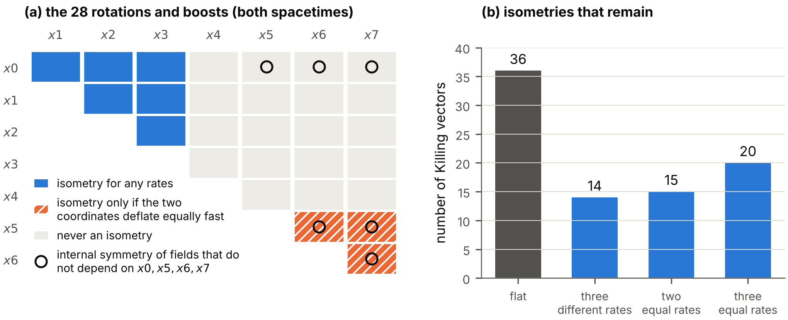

**FIG. 1.** Symmetries of the deflating spacetime. (a) The 28 rotations and boosts of flat spacetime, one square for each pair of coordinates: those that remain symmetries for any rates, those that remain symmetries only if the two coordinates deflate equally fast, and those that are never symmetries. Circles mark the six pairs whose rotations act as internal symmetries on fields that do not depend on $x0,x5,x6,x7$ (Sec. XII). (b) The number of Killing vectors.

### E. Geodesics

The translations give seven conserved momenta $P_\mu$ ($\mu\ne4$) of a classical particle. Let $E_\perp=(m^{2}+\sum_jP_j^{2})^{1/2}$, with the sum over $j=0,1,2,3$, be the energy that a particle of mass $m$ would have without momentum along the deflating coordinates. The conservation of the norm of the momentum gives the velocity along the time, with an affine parameter $\varsigma$ along the path: $$\Big(\frac{dx4}{d\varsigma}\Big)^{2}=E_\perp^{2}-\sum_{t}\frac{P_t^{2}}{b_t(x4)^{2}} .
\tag{12}$$ The last term grows as $e^{2\,\mathrm{rate}_t\,x4}$: the momentum $P_t$ belongs to a fixed coordinate wavelength, and the proper wavelength shrinks. With the minus sign the right-hand side vanishes at a *turning value* of the time; for momentum along $x5$ alone, $$x4_{\mathrm{turn}}=\frac{1}{\mathrm{g55}}\ln\frac{E_\perp\,\mathrm{const5}}{|P_5|} .
\tag{13}$$ The path reaches this value and returns to smaller $x4$ \[Fig. 2(b)\]. A classical particle with momentum along a deflating time cannot pass the turning value of the ordinary time. Section IV shows the quantum form of this result. (On the $7{+}1$ spacetime the sign is the opposite, and the energy of such a particle grows without bound ([Nash 2026b](#ref-CompanionDefl1671)).)

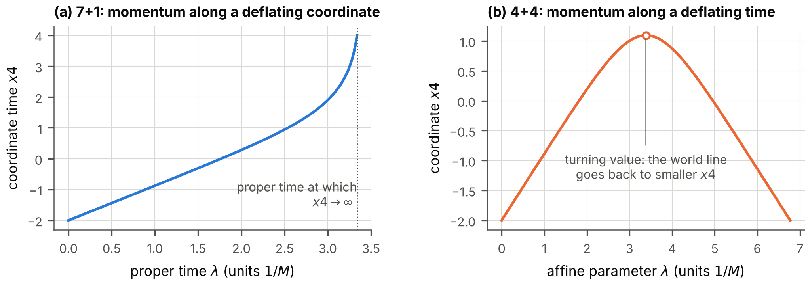

**FIG. 2.** A classical particle of the mass $m=1$ with the momenta $P_1=0.5$ along $x1$ and $P_5=0.3$ along the deflating coordinate $x5$, for $\mathrm{g55}=1$ and $\mathrm{const5}=0.8$, started at $x4=-2$. (a) On the $7{+}1$ spacetime the time $x4$ grows without bound within the finite proper time 3.386. (b) On the $4{+}4$ spacetime the path reaches the turning value $x4=1.0924$ and returns to smaller $x4$.

## III. The Dirac field

### A. Matrices and spin connection

At each point of a curved spacetime the tangent space is flat. The Dirac matrices of the orthonormal frame are therefore the eight real $16\times16$ matrices $\gamma^{A}$ of the earlier paper ([Nash 2026a](#ref-Flat1644)), which satisfy $\gamma^{A}\gamma^{B}+\gamma^{B}\gamma^{A}=2\eta^{AB}$; all of their properties were verified again for this work. The matrices with a coordinate index are $\gamma^{\mu}=e_A{}^{\mu}\gamma^{A}$: five of them are the constant matrices, and the three along the deflating coordinates are the constant matrices divided by the scale factors, $\gamma^{A=t}/b_t$. They satisfy $\gamma^{\mu}\gamma^{\nu}+\gamma^{\nu}\gamma^{\mu}=2g^{\mu\nu}$.

A spinor is defined relative to a frame, and its derivative must account for the turning of the frame from point to point ([Brill and Wheeler 1957](#ref-BrillWheeler1957)). The covariant derivative of a spinor is $\nabla_\mu\psi=(\partial_\mu+\Omega_\mu)\psi$ with the spin connection $\Omega_\mu=\tfrac14\omega_{\mu AB}\gamma^{A}\gamma^{B}$, whose coefficients follow from the metric. For the metric (3) the only coefficients that do not vanish are $\omega_{t\,t4}=-\omega_{t\,4t}=-\eta_{tt}\,\mathrm{rate}_t\,b_t$, so that $$\begin{aligned}
\Omega_t&=-\tfrac12\,\eta_{tt}\,\mathrm{rate}_t\,b_t\,\gamma^{t}\gamma^{4}\quad(t=5,6,7),\\
\Omega_0&=\dots=\Omega_4=0,
\end{aligned}
\tag{14}$$ with the constant matrices of the frame on the right. Each $\Omega_t$ generates the Lorentz transformation in the plane of $xt$ and $x4$. The spin connection is correct if and only if the Dirac matrices are covariantly constant, $\partial_\mu\gamma^{\nu}+\Gamma^{\nu}{}_{\mu\lambda}\gamma^{\lambda}+[\Omega_\mu,\gamma^{\nu}]=0$, which holds for all 64 pairs of indices. Its curvature is the Riemann tensor, $[\nabla_\mu,\nabla_\nu]\psi=\tfrac14R_{AB\mu\nu}\gamma^{A}\gamma^{B}\psi$, a third route to Eq. (6). One combination enters the Dirac equation: $$\gamma^{\mu}\Omega_\mu=-\tfrac12\,\mathrm{gsum}\,\gamma^{4} .
\tag{15}$$ The scale factors cancel, and only the total rate remains.

### B. The Dirac equation

The field of this paper, $\psi_{1644d}(x)$, is a column of sixteen complex-valued Grassmann operators. Its equation is the equation of the earlier paper with the covariant derivative and the matrices $\gamma^{\mu}$: $$\big(\gamma^{\mu}\nabla_\mu-m\big)\psi_{1644d}=0 .
\tag{16}$$ It contains no factor $i$: with the real matrices of $4{+}4$ and the metric convention of this paper the operator $\gamma^{\mu}\nabla_\mu-m$ gives the mass shell of a particle of mass $m$ ([Nash 2026a](#ref-Flat1644)). With Eq. (15), $$\gamma^{4}\Big(\partial_4-\frac{\mathrm{gsum}}{2}\Big)\psi+\sum_{j=0}^{3}\gamma^{j}\partial_j\psi
+\sum_{t=5}^{7}\frac{\gamma^{t}}{b_t}\,\partial_t\psi-m\,\psi=0,
\tag{17}$$ with the constant matrices. Two things have changed with respect to flat spacetime: the derivative along the time is shifted by $\mathrm{gsum}/2$, and each derivative along a deflating coordinate is divided by its scale factor.

### C. The weighted field

The shift is removed by a change of normalization. Define the *weighted field* $$\hat\psi=\sqrt{V_d}\,\psi .
\tag{18}$$ Because $\partial_4\sqrt{V_d}=-\tfrac12\mathrm{gsum}\sqrt{V_d}$, the weighted field obeys Eq. (17) without the term $\mathrm{gsum}/2$. The quantity $\psi^\dagger\psi$ is a density per unit of proper volume and grows as the deflating coordinates shrink; $\hat\psi^\dagger\hat\psi$ is the density per unit of coordinate volume, from which this trivial growth is removed.

The central observation of this paper follows at once. *For a field that does not depend on $x5$, $x6$, $x7$, the equation of the weighted field is exactly the flat equation.* Every result of the earlier paper for such fields, in particular everything about the pairing of the fermions, holds for the weighted field. The deflation enters those results in one way only, through the dependence of the couplings on $V_d$ (Sec. V).

A field that does depend on a deflating coordinate feels the deflation directly. Because the coefficients depend on $x4$ only, a solution can be taken proportional to $\exp(i\sum_jk_j\,xj+i\sum_tk_t\,xt)$ with seven constant wavenumbers, four along the flat coordinates $xj$, $j=0,1,2,3$, and three along the deflating ones; such a solution is a *mode*. Multiplying the equation of the weighted field by $\gamma^{4}$ gives an ordinary differential equation in the time: $$\partial_4\hat\psi=K(x4)\,\hat\psi,\qquad K=K_\perp+i\,k_d(x4)\,\gamma^{4}\gamma^{d},
\tag{19}$$ where $K_\perp=-m\gamma^{4}+i\sum_jk_j\gamma^{4}\gamma^{j}$ is the operator of the modes that do not depend on the deflating times, $$k_d(x4)=\Big(\sum_t\frac{k_t^{2}}{b_t(x4)^{2}}\Big)^{1/2}
\tag{20}$$ is the *physical* wavenumber along the deflating coordinates, and $\gamma^{d}=k_d^{-1}\sum_t(k_t/b_t)\gamma^{t}$ is the frame matrix along its direction. With $E_\perp=(m^{2}+\sum_jk_j^{2})^{1/2}$, $$K^{2}=\big(k_d^{2}-E_\perp^{2}\big)\,1 .
\tag{21}$$ $K_\perp$ is anti-Hermitian and $i\gamma^{4}\gamma^{d}$ is Hermitian. The evolution in the time is unitary, and $\hat\psi^\dagger\hat\psi$ is conserved, if and only if $k_5=k_6=k_7=0$. For the other modes the square of $K$ is negative while $k_d<E_\perp$ and positive afterwards: the mode oscillates until its physical wavenumber, which grows as $e^{\mathrm{rate}_t\,x4}$, has reached $E_\perp$, and its solutions grow or decay exponentially thereafter. A conserved charge exists, $\hat\psi^\dagger W_{1644}\hat\psi$ with the Hermitian matrix $W_{1644}=iC^{-}\gamma^{4}$ of the earlier paper, but it is not positive. (Here $C^{-}=\gamma^{0}\gamma^{1}\gamma^{2}\gamma^{3}$ is the matrix that turns each Dirac matrix into minus its transpose.)

## IV. Modes that depend on the deflating coordinates

### A. Three kinds of modes

Modes fall into three kinds. A mode that does not depend on the deflating coordinates, $k_5=k_6=k_7=0$, obeys the flat equation; its solutions are the plane waves of the earlier paper, with the energies $\pm E_\perp$, eight of each sign. A mode with some $k_t\ne0$ behaves in the same way as long as its physical wavenumber is negligible, $k_d\ll E_\perp$. But $k_d$ grows without bound, and every such mode sooner or later reaches $k_d\gg E_\perp$. The moment at which $k_d=E_\perp$ is its *crossing*. It is the turning value (13) of the classical particle, with the wavenumbers in place of the momenta. The crossing is where the deflation acts on the field, and this section solves the equation of the weighted field across it.

The solution is exact when *one rate governs*: when only one of the $k_t$ differs from zero, or when the three rates are equal. In both cases the matrix $\gamma^{d}$ does not depend on the time, and $k_d$ is proportional to $e^{\mathrm{rate}_t\,x4}$ with the rate that governs. The natural variable is then the physical wavenumber in units of the rate, $$u_d=\frac{k_d(x4)}{\mathrm{rate}_t},\qquad\frac{d}{dx4}=\mathrm{rate}_t\,u_d\,\frac{d}{du_d}.
\tag{22}$$ The crossing is at $u_d=E_\perp/\mathrm{rate}_t$, and this ratio of the energy to the rate is the one parameter on which the results depend.

### B. The exact solution

In $K=K_\perp+i\,k_d\,\gamma^{4}\gamma^{d}$ the first matrix is anti-Hermitian with $K_\perp^{2}=-E_\perp^{2}$, the matrix $i\gamma^{4}\gamma^{d}$ is Hermitian with the square one, and the two anticommute. Let $w$ be one of the eight eigenvectors of $K_\perp$ with the eigenvalue $+iE_\perp$; then $i\gamma^{4}\gamma^{d}w$ is an eigenvector with the eigenvalue $-iE_\perp$ and is orthogonal to $w$. The equation is solved by the modified Bessel functions that decay at large argument, of the orders $\tfrac12\mp iE_\perp/\mathrm{rate}_t$. Such a function is written here with its order as a subscript and with its argument; the letter $K$ without subscript and argument is the matrix of Eq. (19). With the recurrence relations of these functions one verifies by substitution that $$\begin{aligned}
\hat\psi=\sqrt{u_d}\,\Big[&K_{\frac12-iE_\perp/\mathrm{rate}_t}(u_d)\,w\\
&-K_{\frac12+iE_\perp/\mathrm{rate}_t}(u_d)\,i\gamma^{4}\gamma^{d}w\Big]
\end{aligned}
\tag{23}$$ solves Eq. (19) for each of the eight $w$; the relative residual, computed with the Bessel functions of an arbitrary-precision library, is $2\times10^{-15}$. The other eight solutions are built in the same way from the modified Bessel functions that *grow* as $e^{+u_d}$.

### C. Standing waves, and their extinction

Since $u_d$ itself grows exponentially with the time, a solution of the second kind grows as the exponential of an exponential. Such a solution is not admissible; it is the counterpart of the growing exponential under a potential barrier. Admissible are the eight solutions (23), which stay bounded. Their properties are exact.

*Magnitude.* Because $w$ and $i\gamma^{4}\gamma^{d}w$ are orthogonal, and because the two functions in Eq. (23) are complex conjugates of each other, $$|\hat\psi|^{2}=2\,u_d\,\big|K_{\frac12+iE_\perp/\mathrm{rate}_t}(u_d)\big|^{2}\,|w|^{2}.
\tag{24}$$

*Early times*, $u_d\to0$: $|\hat\psi|^{2}\to\pi\,|w|^{2}/\cosh(\pi E_\perp/\mathrm{rate}_t)$, a constant. The solution is then a combination of $e^{+iE_\perp x4}\,w$ and $e^{-iE_\perp x4}\,i\gamma^{4}\gamma^{d}w$ with coefficients of *equal* magnitude: the two signs of the frequency enter with equal weight. A bounded solution is a *standing wave* in the ordinary time, not a traveling wave. Its conserved charge $\hat\psi^\dagger W_{1644}\hat\psi$ vanishes.

*Late times*, $u_d\to\infty$: $|\hat\psi|^{2}\to\pi\,|w|^{2}e^{-2u_d}$. The mode dies out as the exponential of an exponential of the time.

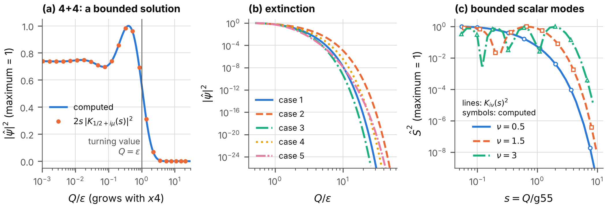

**FIG. 3.** Extinction on the deflating $4{+}4$ spacetime. (a) A bounded solution: $|\hat\psi|^{2}$ against the physical wavenumber $k_d/E_\perp$, which grows with the time; computed (line) and the exact form (24) (symbols). It is constant long before the crossing at $k_d=E_\perp$ and falls after it. (b) Five cases, with one, two or three wavenumbers $k_t$ different from zero and with equal and unequal rates, on a logarithmic scale. (c) The bounded modes of the Vorton-Scalar on the same spacetime (Sec. V D), which are extinguished in the same way; lines: exact, symbols: computed.

*The law of the extinction.* In the semiclassical (WKB) approximation the bounded solution falls beyond the turning value, at which $k_d=E_\perp$, as $e^{-S_{\mathrm{WKB}}}$ with $$\begin{aligned}
S_{\mathrm{WKB}}&=\int_{x4_{\mathrm{turn}}}^{x4}\sqrt{k_d^{2}-E_\perp^{2}}\;dx4'\\
&=\frac{1}{\mathrm{rate}_t}\Big[\sqrt{k_d^{2}-E_\perp^{2}}-E_\perp\arccos\frac{E_\perp}{k_d}\Big],
\tag{25}
\end{aligned}$$ which approaches $(k_d-\tfrac{\pi}{2}E_\perp)/\mathrm{rate}_t$ for $k_d\gg E_\perp$. The exact solution fixes the constant that the approximation leaves open: $$\begin{aligned}
\ln\frac{|\hat\psi|_{\mathrm{early}}}{|\hat\psi|_{\mathrm{late}}}-S_{\mathrm{WKB}}\ \longrightarrow\ {}&\tfrac12\ln2\\
&-\tfrac12\ln\big(1+e^{-2\pi E_\perp/\mathrm{rate}_t}\big).
\end{aligned}
\tag{26}$$

The numerical solution of Eq. (19) for all sixteen components confirms these statements (Fig. 3). Beyond the turning value exactly eight of the sixteen solutions stay bounded; followed backwards to early times they contain parts of positive and of negative frequency of equal weight, to $2\times10^{-14}$. Where one rate governs, the computed magnitude equals Eq. (24) over the range $0.02<u_d<12$ to a relative deviation of $3.6\times10^{-12}$, and Eq. (26) holds to $3.6\times10^{-4}$ at $S_{\mathrm{WKB}}=30$. With three unequal rates no exact solution is known; the bounded solutions fall as $e^{-S_{\mathrm{WKB}}}$ times a factor that depends on the internal state, with a spread of 0.40 in its logarithm at $S_{\mathrm{WKB}}=30$.

### D. What the result means

On the flat $4{+}4$ spacetime a field that depends on the additional times evolves non-unitarily in the ordinary time. This is the principal difficulty of four time-like dimensions ([Tegmark 1997](#ref-Tegmark1997); [Craig and Weinstein 2009](#ref-CraigWeinstein2009)), and the earlier paper met it by imposing that the fields do not depend on those times ([Nash 2026a](#ref-Flat1644)). On the deflating $4{+}4$ spacetime every admissible mode that depends on a deflating time is a standing wave that is extinguished after its crossing, with an exponent $S_{\mathrm{WKB}}$ that grows as $e^{\mathrm{rate}_t\,x4}$. What remains at late times is the sector of fields that do not depend on $x5,x6,x7$, and in that sector the evolution is unitary and $\hat\psi^\dagger\hat\psi$ is conserved. *The deflation of the three additional times removes, dynamically, the sector that causes the difficulty.* The classical counterpart is the turning value of Sec. II E.

The limits of this conclusion must be stated with equal clarity. The eight growing solutions are discarded because they are unbounded. That is a condition of admissibility, imposed as in the theory of a potential barrier; it is not derived from a principle. The theory still has no positive conserved charge for modes that depend on the deflating times, and a consistent quantization exists, as before, only for the sector that does not depend on them. What has been shown is that the admissible modes outside that sector die out, not that the difficulty of four time-like dimensions has been solved.

### E. The numerical method

The equations of this section are linear, with coefficients that grow exponentially, and an integrator with a fixed step fails on them. The program uses a commutator-free Magnus method of the fourth order: over each step the solution is advanced by the product of two matrix exponentials of linear combinations of the coefficient matrix at two Gauss points. Because the square of $K$ is a multiple of the unit matrix at any one time, each exponential is evaluated in closed form. The length of a step is chosen so that neither the phase accumulated in it nor the relative change of the coefficients exceeds a fixed bound. An independent program, which uses an explicit Runge-Kutta method of the eighth order and the Bessel functions of another library, confirms Eq. (23) and, to the accuracy of the semiclassical form at the exponent that it reaches, Eq. (26) ([Nash 2026d](#ref-DeflationRepo)).

## V. The Vorton-Scalar and the deflation clock

### A. The model

The earlier paper ([Nash 2026a](#ref-Flat1644)) introduced a complex scalar field, the *Vorton-Scalar* $\Phi_{\mathrm{VS}}$, whose vacuum value gives the fermions their mass and whose exchange binds two fermions into a pair. We restate the model on the deflating spacetime. It has three real, positive constants: the self-coupling $\lambda_{\mathrm{VS}}$ of the scalar, the constant $v_{\mathrm{VS}}$ that fixes the magnitude $v_{\mathrm{VS}}/\sqrt2$ at which the potential of the scalar is lowest, and the Yukawa coupling $y_{\mathrm{VS}}$ of the scalar to the fermions. The chirality matrix is denoted by $\chi$, with $\chi=\gamma^{0}\gamma^{1}\cdots\gamma^{7}$, which is real on the $4{+}4$ spacetime, and the chiral projectors are $P^{L,R}=\tfrac12(1\mp\chi)$.

On a curved spacetime a Lagrangian is multiplied by the volume factor $V_d$, derivatives of spinors become covariant derivatives, and the flat metric is replaced by the curved one. The earlier paper showed that on the $4{+}4$ spacetime the construction exists only in the sector of fields that do not depend on the additional times, and defined the model there. On the deflating spacetime Sec. IV has given that sector a dynamical reason. In it the model is $$\begin{aligned}
\mathcal L_{1644d}^{\mathrm{VS}}={}&\hat\psi^\dagger\big(i\partial_4+i\sum_{j=0}^{3}\alpha^{j}\partial_j\big)\hat\psi\\
&+V_d\,\Big[|\partial_4\Phi_{\mathrm{VS}}|^{2}-\sum_{j=0}^{3}|\partial_j\Phi_{\mathrm{VS}}|^{2}\Big]\\
&-V_d\,\lambda_{\mathrm{VS}}\Big(|\Phi_{\mathrm{VS}}|^{2}-\frac{v_{\mathrm{VS}}^{2}}{2}\Big)^{2}\\
&-V_d\,y_{\mathrm{VS}}\,\bar\psi\big(\Phi_{\mathrm{VS}}\,P^{R}+\Phi_{\mathrm{VS}}^{*}\,P^{L}\big)\psi ,
\tag{27}
\end{aligned}$$ with the Hermitian matrices $\beta=-i\gamma^{4}$ and $\alpha^{j}=-\gamma^{4}\gamma^{j}$ of the earlier paper and $\bar\psi=\psi^\dagger\beta$. The first line is the kinetic term of the earlier paper for the weighted field $\hat\psi=\sqrt{V_d}\,\psi$; by Sec. III its equation of motion is the covariant Dirac equation (16) in this sector. The other terms carry the volume factor. The Lagrangian has two phase symmetries, as on flat spacetime, because their transformations do not involve the coordinates: the fermion number $U(1)_F$, $\psi\to e^{i\epsilon}\psi$, and the chiral symmetry $U(1)_{\mathrm{VS}}$, $\psi\to e^{i\epsilon\chi}\psi$ with $\Phi_{\mathrm{VS}}\to e^{-2i\epsilon}\Phi_{\mathrm{VS}}$.

A constant field $\Phi_{\mathrm{VS}}=v_{\mathrm{VS}}/\sqrt2$ with $\psi=0$ solves the field equations on the deflating spacetime, because a constant has no derivatives: the vacuum value is the same at all times. It breaks $U(1)_{\mathrm{VS}}$. Around it the Vorton-Scalar has two modes: the *radial mode*, a real field of the mass $m_s$, and the *phase mode*, a real massless field, the Goldstone boson of the broken symmetry. The fermions acquire the mass $m$. Both modes couple to the fermions with the same strength $g_{\mathrm{VS}}$, the radial mode to the scalar density $\bar\psi\psi$ and the phase mode to the pseudoscalar density $\bar\psi\,i\chi\,\psi$: $$\begin{aligned}
m&=\frac{y_{\mathrm{VS}}\,v_{\mathrm{VS}}}{\sqrt2},&\qquad m_s&=\sqrt{2\lambda_{\mathrm{VS}}}\,v_{\mathrm{VS}},\\
g_{\mathrm{VS}}&=\frac{m}{v_{\mathrm{VS}}},&\qquad\alpha_{\mathrm{VS}}&=\frac{g_{\mathrm{VS}}^{2}}{4\pi}.
\end{aligned}
\tag{28}$$

### B. Fields that do not depend on the extra coordinates

As in the earlier paper, consider fields that do not depend on the four extra coordinates $x0,x5,x6,x7$, and introduce the weighted fields $$\hat\psi=\sqrt{V_d}\,\psi,\qquad\hat\Phi_{\mathrm{VS}}=\sqrt{V_d}\,\Phi_{\mathrm{VS}}.$$ Each term of Eq. (27) is rewritten in turn. The kinetic term of the fermions is the flat one for $\hat\psi$ (Sec. III). The Yukawa term contains one scalar and two fermion fields and therefore the factor $V_d\cdot V_d^{-3/2}$. The potential becomes $(\lambda_{\mathrm{VS}}/V_d)\,(|\hat\Phi_{\mathrm{VS}}|^{2}-V_dv_{\mathrm{VS}}^{2}/2)^{2}$. In the kinetic term of the scalar the derivative along the time acts on the weight as well, $\sqrt{V_d}\,\partial_4\Phi_{\mathrm{VS}}=\partial_4\hat\Phi_{\mathrm{VS}}+\tfrac12\mathrm{gsum}\,\hat\Phi_{\mathrm{VS}}$, which gives a term $\tfrac14\mathrm{gsum}^{2}|\hat\Phi_{\mathrm{VS}}|^{2}$ and a total derivative. The result is the Lagrangian of the earlier paper for the weighted fields, with three replacements and one additional term: $$\begin{aligned}
&y_{\mathrm{VS}}\to\frac{y_{\mathrm{VS}}}{\sqrt{V_d(x4)}},\qquad\lambda_{\mathrm{VS}}\to\frac{\lambda_{\mathrm{VS}}}{V_d(x4)},\\
&v_{\mathrm{VS}}\to v_{\mathrm{VS}}\sqrt{V_d(x4)},\qquad\text{and }+\frac{\mathrm{gsum}^{2}}{4}\,|\hat\Phi_{\mathrm{VS}}|^{2}.
\end{aligned}
\tag{30}$$ The three replacements are those by which the earlier paper passed to the four-dimensional description, where the volume of the extra coordinates was a constant. Here that volume is the coordinate volume of a cell times $V_d(x4)$, and it shrinks. The additional term lowers the square of the mass of each mode of the scalar by $\mathrm{gsum}^{2}/4$ in the equation of the weighted field; Section V D shows what it does. From here on the couplings $y_{\mathrm{VS}}$, $\lambda_{\mathrm{VS}}$, $v_{\mathrm{VS}}$, $g_{\mathrm{VS}}$ and $\alpha_{\mathrm{VS}}$ are those of the four-dimensional description at the time considered.

### C. The deflation clock

Define the *deflation clock* $$\tau_d=\mathrm{gsum}\,(x4-x4_{\mathrm{ref}}),
\tag{31}$$ the number of e-foldings by which the volume $V_d$ has shrunk since a reference time $x4_{\mathrm{ref}}$, which is chosen in each application. By Eq. (30) every quantity of the four-dimensional description is proportional to $e^{n\tau_d}$ with a definite exponent $n$ (Table I). Three observations organize what follows.

| quantity                                                                                                                                          | meaning                                                                                        | exponent $n$ |
|:--------------------------------------------------------------------------------------------------------------------------------------------------|:-----------------------------------------------------------------------------------------------|:------------:|
| $V_d$                                                                                                                                             | $b_5b_6b_7$: the factor $\sqrt{\lvert\det g\rvert}$ of the measure                             |     $-1$     |
| $y_{\mathrm{VS}}$ of the four-dimensional description                                                                                             | Yukawa coupling of the weighted fields                                                         |  $\tfrac12$  |
| $\lambda_{\mathrm{VS}}$ of the four-dimensional description                                                                                       | quartic coupling of the weighted Vorton-Scalar                                                 |     $1$      |
| $v_{\mathrm{VS}}$ of the four-dimensional description                                                                                             | vacuum value of the weighted Vorton-Scalar                                                     | $-\tfrac12$  |
| $m$                                                                                                                                               | fermion mass $y_{\mathrm{VS}}v_{\mathrm{VS}}/\sqrt2$                                           |     $0$      |
| $m_s$                                                                                                                                             | mass of the radial mode $\sqrt{2\lambda_{\mathrm{VS}}}\,v_{\mathrm{VS}}$                       |     $0$      |
| $g_{\mathrm{VS}}$                                                                                                                                 | coupling of the radial mode to the fermions, $m/v_{\mathrm{VS}}$                               |  $\tfrac12$  |
| $\alpha_{\mathrm{VS}}$                                                                                                                            | $g_{\mathrm{VS}}^2/4\pi$                                                                       |     $1$      |
| $G_{\mathrm{VS}}$                                                                                                                                 | constant of the Fermi type of the neutral-current interaction, $1/(\sqrt2\,v_{\mathrm{VS}}^2)$ |     $1$      |
| $D_{\mathrm{VS}}$                                                                                                                                 | $\alpha_{\mathrm{VS}}\,m/m_s$: decides whether two fermions bind                               |     $1$      |
| $C$                                                                                                                                               | $g_{\mathrm{VS}}^2m^2/m_s^2$: decides the state of matter                                      |     $1$      |
| vortex energy per length                                                                                                                          | proportional to $v_{\mathrm{VS}}^2$ (four-dimensional)                                         |     $-1$     |
| $G_{\mathrm{Fermi}}$ (Fermi constant of the weak interaction) if the vacuum value of the Vorton-Scalar sets the electroweak scale (assumption HV) | $1/(\sqrt2\,v_{\mathrm{VS}}^2)$, four-dimensional vacuum value                                 |     $1$      |
| $G_N$ (Newton’s constant) if gravity is eight-dimensional (A2)                                                                                    | $G_8$ divided by the volume of $x5,x6,x7$                                                      |     $1$      |

TABLE I. How the quantities of the four-dimensional description follow the deflation clock: each is proportional to $e^{n\tau_d}$. The last two rows hold under additional assumptions, which Secs. XI and XII state and examine.

*The masses do not change.* The fermion mass $m$ and the mass $m_s$ of the radial mode contain the couplings in combinations from which the volume cancels. So do the Fermi momentum and the Fermi energy of matter with a given number of particles per unit of ordinary volume.

*The coupling grows.* The coupling $g_{\mathrm{VS}}=m/v_{\mathrm{VS}}$ grows as $e^{\tau_d/2}$, because the four-dimensional vacuum value falls. The strength of the attraction, $\alpha_{\mathrm{VS}}$, grows as $e^{\tau_d}$: it doubles every time the volume of the deflating coordinates halves.

*The two numbers that decide the state of matter grow at the same rate.* These are $$D_{\mathrm{VS}}=\alpha_{\mathrm{VS}}\,\frac{m}{m_s},\qquad C=\frac{g_{\mathrm{VS}}^{2}m^{2}}{m_s^{2}} .
\tag{32}$$ The first decides whether two fermions form a bound pair (Sec. VII), the second whether matter keeps its fermion mass (Sec. IX). Their ratio $C/D_{\mathrm{VS}}=4\pi\,m/m_s$ is fixed.

A model of the earlier paper is specified by the masses and one coupling. On a deflating spacetime it is specified by the masses and the value of the coupling *at one time*; the deflation then carries it through all larger couplings. The constants of the earlier paper become functions of the time, and its thresholds are passed one after another (Fig. 4).

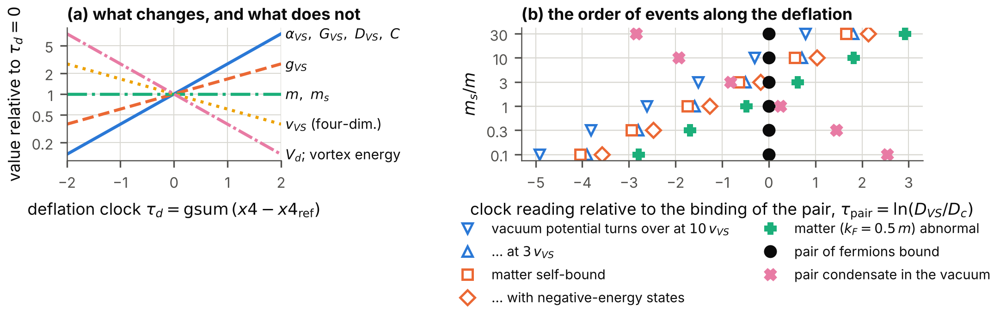

**FIG. 4.** The deflation clock. (a) How the quantities of the four-dimensional description change with the clock $\tau_d$ (logarithmic scale; values relative to $\tau_d=0$). (b) The order of events along the deflation for six ratios $m_s/m$: the clock reading of each event relative to the moment at which two fermions form a bound pair (Table IV).

### D. Modes of the Vorton-Scalar

Let $\varphi_{\mathrm{bos}}$ stand for the radial mode or the phase mode, with the mass $m_{\mathrm{bos}}=m_s$ or $m_{\mathrm{bos}}=0$. To first order in the field, a mode with a wavenumber of the magnitude $k$ along the flat coordinates and the wavenumbers $k_t$ along the deflating ones obeys $$\begin{aligned}
&\frac{1}{V_d}\,\partial_4\big(V_d\,\partial_4\varphi_{\mathrm{bos}}\big)\\
&\quad+\Big(k^{2}-\sum_t\frac{k_t^{2}}{b_t^{2}}+m_{\mathrm{bos}}^{2}\Big)\varphi_{\mathrm{bos}}=0 .
\end{aligned}
\tag{33}$$ The wavenumbers along the deflating coordinates, which are time-like, enter with the sign opposite to that of $k^{2}$, as for the fermions.

*Modes that do not depend on the deflating coordinates.* With $k_t=0$ the equation has constant coefficients, and its solutions are the exponentials $$\varphi_{\mathrm{bos}}\propto\exp\Big\{\Big[\frac{\mathrm{gsum}}{2}\pm\sqrt{\frac{\mathrm{gsum}^{2}}{4}-k^{2}-m_{\mathrm{bos}}^{2}}\,\Big]x4\Big\}.
\tag{34}$$ If $k^{2}+m_{\mathrm{bos}}^{2}>\mathrm{gsum}^{2}/4$, the mode oscillates with the frequency $\varpi_b=(k^{2}+m_{\mathrm{bos}}^{2}-\mathrm{gsum}^{2}/4)^{1/2}$, and its amplitude grows as $e^{\mathrm{gsum}\,x4/2}$. The growth is that of the weight alone: the weighted field has a constant amplitude, and the number of quanta in a cell of fixed coordinates is conserved while the cell shrinks. Otherwise the mode does not oscillate. For the radial mode this never happens if $m_s>\mathrm{gsum}/2$, which holds by many orders of magnitude for any rate that observation allows (Sec. XI). For the phase mode it happens at wavelengths longer than $4\pi/\mathrm{gsum}$. At $k=0$ the two exponents of the phase mode are $0$ and $\mathrm{gsum}$: a constant phase, which costs nothing, and a phase that advances at a rate proportional to $1/V_d$, which is the conservation of the charge of $U(1)_{\mathrm{VS}}$ in a shrinking volume. Neither is an instability of the vacuum. Figure 5 shows the exponents.

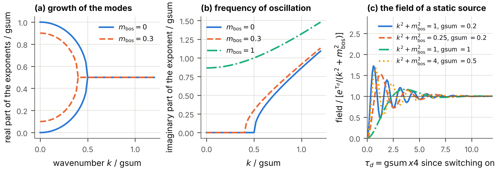

**FIG. 5.** Modes of the Vorton-Scalar that do not depend on the deflating coordinates. (a) Real parts of the two exponents of Eq. (34) against the wavenumber, for the phase mode and for a radial mode, in units of $\mathrm{gsum}$. (b) Their imaginary part, the frequency of oscillation. (c) The field that a static source builds up from zero, divided by the form $e^{\tau_d}/(k^{2}+m_{\mathrm{bos}}^{2})$ that leads to Eq. (35).

*The potential between two fermions.* Two fermions at rest attract each other by exchanging the radial mode. The density of a fixed number of fermions grows as $1/V_d$, so that the radial mode obeys Eq. (33) with a source proportional to $e^{\mathrm{gsum}\,x4}$. The solution that follows the source is $e^{\mathrm{gsum}\,x4}/(k^{2}+m_{\mathrm{bos}}^{2})$ times the source, as substitution shows: the terms $\mathrm{gsum}^{2}-\mathrm{gsum}\cdot\mathrm{gsum}$ cancel, and the denominator contains the *unshifted* mass. The potential between two fermions at rest is therefore, at every moment, the Yukawa potential of the earlier paper, $$V_s(r)=-\alpha_{\mathrm{VS}}(x4)\,\frac{e^{-m_sr}}{r},
\tag{35}$$ with the range $1/m_s$ unchanged and the strength of the moment. The numerical solution from rest approaches this form with a transient that decays as $e^{-\tau_d/2}$ \[Fig. 5(c)\]; after $\tau_d=20$ the relative difference is below $4\times10^{-5}$ in the four cases computed.

*Modes that depend on a deflating coordinate.* For $k_t\ne0$ the weighted field obeys $\partial_4^{2}\hat\varphi_{\mathrm{bos}}+(\varpi_b^{2}-k_d^{2})\,\hat\varphi_{\mathrm{bos}}=0$ with the physical wavenumber $k_d$ of Eq. (20), and the scalar behaves as the fermion field does. Beyond the turning value, at which $k_d=\varpi_b$, one solution decays and one grows. The bounded solution is the modified Bessel function of the imaginary order $i\varpi_b/\mathrm{rate}_t$ that decays at large argument. At early times it is a standing wave; at late times it falls as $e^{-u_d}$ (Fig. 3). The scalar field, like the fermion field, loses its dependence on the deflating times.

## VI. Pairing and the gap along the clock

### A. The pair channels

A pair of fermions is created by an operator $\psi^{T}X\psi$ with a $16\times16$ matrix $X$; the choice of $X$ is the *channel* of the pair. The earlier paper classified the channels and computed, for each, the *exchange amplitudes* $F_S$ and $F_P$ of the radial mode and of the phase mode: the matrix elements of the exchange of one boson between two fermions of opposite momenta in the internal state of the channel. It found that the radial mode attracts in every channel, and that the phase mode attracts in the four *vector pairs along the extra axes*, $$\psi^{T}C^{-}\gamma^{a}\psi,\qquad a\in\{0,5,6,7\},
\tag{36}$$ and repels in their partners that are built with two Dirac matrices. Here $C^{-}=\gamma^{0}\gamma^{1}\gamma^{2}\gamma^{3}$ is the matrix that turns each Dirac matrix into minus its transpose (Sec. III), and the index $a$ labels the four extra axes. The pair along the hidden axis, $a=0$, has spin 0 in ordinary spacetime; it is the *hidden-axis singlet* of hypothesis H1.

The amplitudes are computed from the Dirac matrices of the frame, which the deflation does not change, and each is proportional to the square of the coupling. For fields that do not depend on $x5,x6,x7$ the amplitude of a channel at the time $x4$ is therefore $$\begin{aligned}
F_{S,P}(x4)={}&g_{\mathrm{VS}}(x4)^{2}\\
&\times\big(F_{S,P}\text{ of the flat spacetime at }g_{\mathrm{VS}}=1\big).
\end{aligned}
\tag{37}$$ The program computes the amplitudes of the 15 representative channels of the earlier paper again from the matrices of the deflating spacetime, at three momenta and 13 scattering angles; the numbers agree with those of the earlier paper to every digit recorded there, and the amplitudes of the hidden-axis channel reproduce its closed forms to $1.1\times10^{-15}$. The conclusion of the earlier paper about the channels therefore stands at every moment (Fig. 6): the most attractive channel is the vector pair along an extra axis.

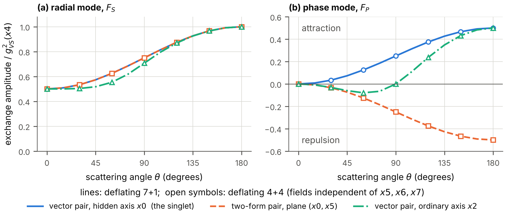

**FIG. 6.** Exchange amplitudes in three pair channels, divided by the square of the coupling of the moment, against the scattering angle, for momenta of the magnitude $m$ in the plane of $x1$ and $x2$. Lines: deflating $7{+}1$ spacetime; open symbols: deflating $4{+}4$ spacetime. (a) The radial mode attracts in all three channels. (b) The phase mode attracts in the vector pair along the hidden axis and repels in its partner built with two Dirac matrices. The amplitudes are those of flat spacetime: the deflation changes their overall strength and nothing else.

### B. The gap grows much faster than the coupling

In matter of a given density the attraction opens a gap $\Delta_F$ at the Fermi momentum $k_F$: the energy that it costs to break a pair. The gap equation of the earlier paper, which generalizes that of Bardeen, Cooper and Schrieffer ([J. Bardeen, Cooper, and Schrieffer 1957](#ref-BCS1957)), holds at each moment with the couplings of that moment. Its solution as a function of the clock is the *adiabatic history* of the paired state: the state that matter would have if it were always in equilibrium. (Section VIII examines when it can be.) The strength of the pairing is measured by the dimensionless number $\lambda=N(0)\,W(k_F,k_F)$, the density of states at the Fermi surface times the kernel of the gap equation there; in the vector channel it is the sum $\lambda_S+\lambda_P$ of the contributions of the two modes. Since the kernel is proportional to $g_{\mathrm{VS}}^{2}$, $$\lambda\ \propto\ e^{\tau_d}.$$

The program solves the gap equation at 34 moments for each of four sets of the mass $m_s$ and the Fermi momentum (Table II, Fig. 7). There are three results.

| $m_s/m$, $k_F/m$ | $\tau_d$ | $g_{\mathrm{VS}}$ | $\lambda$ |   $\Delta_F/E_F$    | $T_c/\Delta_F$ | rate of growth | $\lambda\,\times$ rate |
|:----------------:|:--------:|:-----------------:|:---------:|:-------------------:|:--------------:|:--------------:|:----------------------:|
|    0.10, 0.50    | $-0.63$  |       0.730       |   0.062   | $1.17\times10^{-7}$ |     0.567      |       —        |           —            |
|    0.10, 0.50    | $-0.13$  |       0.939       |   0.102   | $7.40\times10^{-5}$ |     0.567      |      9.88      |          1.01          |
|    0.10, 0.50    |   0.38   |       1.208       |   0.169   | $3.70\times10^{-3}$ |     0.567      |      6.01      |          1.01          |
|    0.10, 0.50    |   0.88   |       1.554       |   0.279   |       0.0407        |     0.565      |      3.74      |           —            |
|    0.10, 0.50    |   1.39   |       2.000       |   0.463   |        0.189        |     0.555      |      2.50      |           —            |
|    0.10, 0.50    |   1.89   |       2.573       |   0.766   |        0.563        |     0.528      |      1.96      |           —            |
|    0.10, 0.50    |   2.39   |       3.311       |   1.268   |        1.49         |     0.480      |      1.96      |           —            |
|    1.0, 0.50     |   0.88   |       1.554       |   0.056   | $1.02\times10^{-7}$ |     0.567      |       —        |           —            |
|    1.0, 0.50     |   1.13   |       1.763       |   0.072   | $5.62\times10^{-6}$ |     0.567      |     14.02      |          1.01          |
|    1.0, 0.50     |   1.39   |       2.000       |   0.092   | $1.27\times10^{-4}$ |     0.567      |     10.93      |          1.01          |
|    1.0, 0.50     |   1.64   |       2.269       |   0.119   | $1.45\times10^{-3}$ |     0.567      |      8.54      |          1.02          |
|    1.0, 0.50     |   1.89   |       2.573       |   0.153   | $9.76\times10^{-3}$ |     0.567      |      6.71      |          1.03          |
|    1.0, 0.50     |   2.14   |       2.919       |   0.197   |       0.0439        |     0.566      |      5.33      |           —            |
|    1.0, 0.50     |   2.39   |       3.311       |   0.253   |        0.147        |     0.563      |      4.37      |           —            |

TABLE II. The gap along the deflation clock for two of the four sets computed. $g_{\mathrm{VS}}$ and $\lambda$: coupling and pairing strength of the moment. $E_F$: Fermi kinetic energy. $T_c$: critical temperature. Rate of growth: $d\ln\Delta_F/d\tau_d$; the last column, its product with $\lambda$, is given where the gap is between $10^{-6}$ and $0.02$ of $E_F$.

*The order of the channels does not change.* At every moment the gap of the vector channel is at least as large as the gap that the radial mode alone would give, and that at least as large as the gap of the channel in which the phase mode repels. The gap never decreases.

*The critical temperature follows the gap.* Wherever the gap is below 5 per cent of the Fermi kinetic energy $E_F$, the critical temperature is $T_c=0.567\,\Delta_F$, the ratio of weak coupling, to within 0.002.

*The law of growth.* In weak coupling the gap is proportional to $e^{-1/\lambda}$. With $\lambda\propto e^{\tau_d}$, $$\frac{d\ln\Delta_F}{d\tau_d}=\frac{1}{\lambda}.
\tag{39}$$ In the computed histories the product $\lambda\,d\ln\Delta_F/d\tau_d$ lies between 1.00 and 1.03 wherever the gap is between $10^{-6}$ and $0.02$ of $E_F$.

Equation (39) is the central quantitative statement about the superfluid on a deflating spacetime. While the coupling grows by one e-folding, the gap of a weakly paired state with $\lambda=0.1$ grows by ten e-foldings, a factor of twenty thousand. A paired state that is unobservably weak at one time is strong a few e-foldings of the volume later.

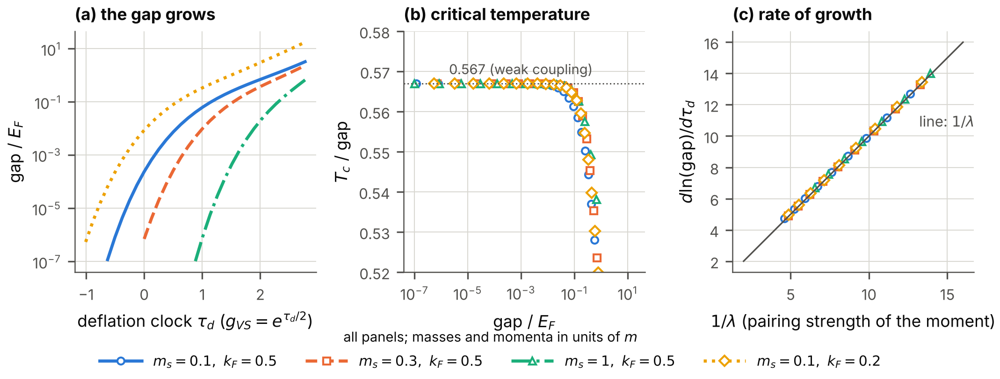

**FIG. 7.** The gap along the deflation clock, for four sets of the mass of the radial mode and of the Fermi momentum (in units of $m$). (a) The gap of the vector channel in units of the Fermi kinetic energy. (b) The ratio of the critical temperature to the gap. (c) The rate of growth of the gap against $1/\lambda$; the line is Eq. (39).

## VII. The bound pair and the order of events

### A. The moment of binding

Two fermions in the Yukawa potential (35) form a bound state if and only if the number $D_{\mathrm{VS}}$ of Eq. (32) exceeds a critical value, $D_c=1.67981$. On a deflating spacetime $D_{\mathrm{VS}}\propto e^{\tau_d}$, so that the pair becomes bound at a definite time. Measure the clock from that moment: $$\tau_{\mathrm{pair}}=\ln\frac{D_{\mathrm{VS}}}{D_c}=\mathrm{gsum}\,\big(x4-x4_{\mathrm{binding}}\big).
\tag{40}$$ Table III and Fig. 8 show the scattering length $a_{\mathrm{sc}}$ of two fermions and the binding energy $E_b$ of the pair as the clock passes the binding.

| $\tau_{\mathrm{pair}}$ | $D_{\mathrm{VS}}$ | $a_{\mathrm{sc}}\,m_s$ | bound states |  $E_b\,m/m_s^{2}$   |
|:----------------------:|:-----------------:|:----------------------:|:------------:|:-------------------:|
|        $-0.105$        |      1.5118       |        $-12.50$        |      0       |          0          |
|        $-0.095$        |      1.5279       |        $-13.93$        |      0       |          0          |
|        $-0.010$        |      1.6630       |        $-134.0$        |      0       |          0          |
|         0.010          |      1.6966       |         135.9          |      1       | $5.50\times10^{-5}$ |
|         0.486          |      2.7314       |         2.698          |      1       |        0.232        |
|         0.994          |      4.5409       |       $-0.1288$        |      1       |        1.82         |

TABLE III. Two fermions as the clock passes the moment of binding: the scattering length in units of $1/m_s$, the number of bound states, and the binding energy in units of $m_s^{2}/m$.

*The scattering length.* Just before the binding the scattering length is large and negative, just after it large and positive: $-134.0/m_s$ at $0.99\,D_c$ and $+135.9/m_s$ at $1.01\,D_c$. At the moment of binding it is infinite: the two fermions are at a scattering resonance. *Every pair of fermions of the model passes through this resonance once, at the same time.* Section XI examines what that means if the fermions are the dark matter.

*The binding energy.* Just after the binding the binding energy starts quadratically, $$E_b\ \propto\ \big(e^{\tau_{\mathrm{pair}}}-1\big)^{2}\,\frac{m_s^{2}}{m},
\tag{41}$$ with the fitted exponent 2.01 between 2 and 8 per cent above $D_c$. Because $E_b$ vanishes at the threshold, the time $1/E_b$ that the pair needs to adjust is infinite there. However slow the deflation is, the pair cannot follow it adiabatically at first.

*The same threshold from the gap equation.* In vacuum the linearized gap equation is the equation of a bound state of two fermions, with a relativistic kernel. It reaches the eigenvalue 1 at $D_{\mathrm{VS}}=1.7347$, $1.6902$ and $1.6810$ for $m_s/m=0.3$, $0.1$ and $0.03$, approaching the value $D_c$ of the Schrödinger equation as the radial mode becomes light and the binding non-relativistic.

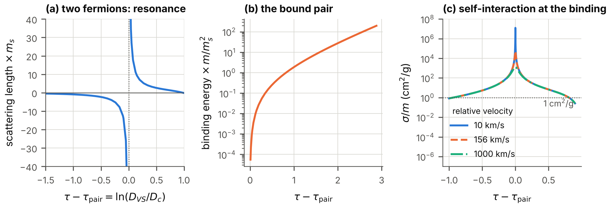

**FIG. 8.** The bound pair along the clock. (a) Scattering length of two fermions in units of $1/m_s$ against $\tau_{\mathrm{pair}}$: the resonance at the moment of binding. (b) Binding energy of the pair. (c) Cross-section per mass of two fermions at three relative velocities while the clock passes the binding, for the example particle of Sec. XI I.

### B. The order of events

The other thresholds of the earlier paper are thresholds in the number $C$ of Eq. (32), which grows at the same rate as $D_{\mathrm{VS}}$. Because $C/D_{\mathrm{VS}}=4\pi m/m_s$ is fixed, the order in which the events happen depends on the ratio $m_s/m$ alone. Table IV gives the clock reading $\tau_{\mathrm{pair}}$ of each event; a negative number means that the event precedes the binding of the pair. The events other than the binding are derived in Sec. IX.

| event                                                                                                       | threshold                             |  $0.1$  |  $0.3$  |   $1$   |   $3$   |  $10$   |  $30$   |
|:------------------------------------------------------------------------------------------------------------|:--------------------------------------|:-------:|:-------:|:-------:|:-------:|:-------:|:-------:|
| the one-loop potential of the Vorton-Scalar falls below its vacuum value at the field $10\,v_{\mathrm{VS}}$ | $C=1.5477$                            | $-4.92$ | $-3.82$ | $-2.61$ | $-1.51$ | $-0.31$ |  0.79   |
| matter is self-bound (Fermi sea only)                                                                       | $C=3.7011$                            | $-4.04$ | $-2.94$ | $-1.74$ | $-0.64$ |  0.56   |  1.66   |
| the one-loop potential falls below its vacuum value at the field $3\,v_{\mathrm{VS}}$                       | $C=4.2694$                            | $-3.90$ | $-2.80$ | $-1.60$ | $-0.50$ |  0.70   |  1.80   |
| matter is self-bound (with the negative-energy states)                                                      | $C=5.9218$                            | $-3.57$ | $-2.48$ | $-1.27$ | $-0.17$ |  1.03   |  2.13   |
| matter of Fermi momentum $0.5\,m$ becomes abnormal (massless fermions)                                      | $C=12.9713$                           | $-2.79$ | $-1.69$ | $-0.49$ |  0.61   |  1.82   |  2.91   |
| **two fermions form a bound pair**                                                                          | $D_{\mathrm{VS}}=1.6798$              |  0.00   |  0.00   |  0.00   |  0.00   |  0.00   |  0.00   |
| pair condensate in the vacuum (ladder equation, cutoff $100\,m$)                                            | $\alpha_{\mathrm{VS}}=2.13$ to $2.93$ |  2.54   |  1.44   |  0.25   | $-0.82$ | $-1.93$ | $-2.84$ |

TABLE IV. The order of events along the deflation: the clock reading $\tau_{\mathrm{pair}}$ of each event, relative to the moment at which two fermions form a bound pair, for six ratios of the mass $m_s$ of the radial mode to the fermion mass $m$.

For a *light radial mode*, $m_s/m\le3$ in the table, the pair becomes bound only *after* the one-loop potential of the Vorton-Scalar has fallen below its vacuum value at a field of three times the vacuum value: the deflation endangers the vacuum of the model before it binds the pair. The condition for the opposite order is $4\pi D_c\,m/m_s<4.27$, that is, $m_s/m>4.9$. For a *heavy radial mode*, $m_s/m=10$ or $30$, the pair becomes bound first, and matter becomes self-bound and loses its fermion mass later. Nothing in the model decides between the two orders; the table states what follows from each.

## VIII. Can the paired state follow the deflation?

### A. The question, and the parameter that decides it

Section VI gave the gap that the paired state would have in equilibrium at each moment. But a state can change at most at the rate of its own energy scale, which for a paired state is the gap. By Eq. (39) the equilibrium gap, written $\Delta_{\mathrm{eq}}$ in this section, changes at the rate $\mathrm{gsum}/\lambda$. The paired state can follow only if that rate is small compared with the gap itself: $$\Xi_d=\frac{\mathrm{gsum}}{\lambda\,\Delta_{\mathrm{eq}}}\ \ll\ 1 .
\tag{42}$$ Early in the deflation the gap is exponentially small, and the condition fails however small the rate is. A system that is carried through a change faster than it can respond falls out of equilibrium, as in the formation of defects at a phase transition ([Kibble 1976](#ref-Kibble1976); [Zurek 1985](#ref-Zurek1985)). The question is what the paired state does then, and when it catches up.

### B. The model

The question is answered with the standard reduced model of a superfluid, whose dynamics without collisions is known in detail ([Barankov, Levitov, and Spivak 2004](#ref-BarankovLevitovSpivak2004)). Pairs of states of opposite momenta, with the single-particle energy $\xi_k$ measured from the Fermi energy, fill a shell $-E_{\mathrm{sh}}<\xi_k<E_{\mathrm{sh}}$ with a constant density of states, and all attract one another with the dimensionless strength $\lambda$. In the mean-field approximation each pair of states is described by its pair correlation $\kappa$, a complex number, and its occupation $n_k$; the order parameter is $\Delta=\lambda\int\kappa\,d\xi_k$. The equations of motion are $$\begin{aligned}
\frac{d\kappa}{dx4}&=-i\,\big[2\,\xi_k\,\kappa-\Delta\,(1-2n_k)\big],\\
\frac{dn_k}{dx4}&=2\,\mathrm{Im}\big(\Delta^{*}\kappa\big).
\tag{43}
\end{aligned}$$ They conserve $|2\kappa|^{2}+(1-2n_k)^{2}=1$ for every pair of states. In equilibrium $\kappa=\Delta/2E_k$ and $n_k=\tfrac12(1-\xi_k/E_k)$ with the quasi-particle energy $E_k=(\xi_k^{2}+\Delta^{2})^{1/2}$, and the gap equation gives $$\Delta_{\mathrm{eq}}(\lambda)=\frac{E_{\mathrm{sh}}}{\sinh(1/\lambda)}\ \approx\ 2\,E_{\mathrm{sh}}\,e^{-1/\lambda}\quad(\lambda\ll1).$$ The model keeps what matters for the question, a gap that depends exponentially on a coupling that grows exponentially, and omits the dependence of the gap on the momentum; $E_{\mathrm{sh}}$ stands for the range of energies over which the attraction acts. The program starts the model in equilibrium at $\lambda=0.15$, lets the coupling grow as $\lambda=0.15\,e^{\tau_d}$ up to $\lambda=0.5$, and integrates Eqs. (43) for 2000 energies. Doubling the number of energies and halving the step changes no digit of the results quoted. Besides $|\Delta|$ the program records the density $n_{\mathrm{ex}}$ of *broken pairs*: the number of pairs of states, per unit of $E_{\mathrm{sh}}$ times the density of states, that are not in the ground state that belongs to the order parameter of the moment. In equilibrium it is zero.

### C. Results

| $\mathrm{gsum}/E_{\mathrm{sh}}$ | $\Xi_d$ at the start | smallest $\vert \Delta\vert /\Delta_{\mathrm{eq}}$ | $\tau_d$ of the catch-up | $\Xi_d$ there | final $\vert \Delta\vert /\Delta_{\mathrm{eq}}$ | $n_{\mathrm{ex}}$ at the end |
|:-------------------------------:|:--------------------:|:----------------------------------------:|:------------------------:|:-------------:|:-------------------------------------:|:----------------------------:|
|        $1\times10^{-4}$         |        0.262         |                  0.958                   |          0.020           |     0.23      |                1.0000                 |      $6.0\times10^{-6}$      |
|        $3\times10^{-4}$         |        0.786         |                  0.890                   |          0.069           |     0.47      |                0.9998                 |      $5.1\times10^{-5}$      |
|        $1\times10^{-3}$         |         2.62         |                  0.737                   |          0.234           |     0.52      |                0.9980                 |      $4.4\times10^{-4}$      |
|        $3\times10^{-3}$         |         7.86         |                  0.539                   |          0.454           |     0.44      |                0.9886                 |      $2.4\times10^{-3}$      |
|              0.01               |         26.2         |                  0.328                   |          0.780           |     0.32      |                0.9347                 |            0.012             |
|              0.03               |         78.6         |                  0.189                   |          1.172           |     0.24      |                0.8076                 |            0.041             |
|               0.1               |         262          |                  0.098                   |            —             |       —       |                0.1189                 |            0.022             |

TABLE V. The paired state while the pairing strength grows from 0.15 to 0.5, for seven rates of deflation: the parameter $\Xi_d$ at the start; the smallest ratio of the order parameter to the equilibrium gap of the moment; the clock reading at which the order parameter has returned to within 10 per cent of the equilibrium gap, and $\Xi_d$ at that moment; the ratio at the end; and the density of broken pairs at the end.

Table V and Fig. 9 show three results.

*The faster the deflation, the further the order parameter falls behind.* For a rate of $10^{-4}\,E_{\mathrm{sh}}$ the order parameter drops to 0.958 of the equilibrium gap of the moment before it recovers; for $10^{-1}\,E_{\mathrm{sh}}$ it drops to 0.098.

*The state catches up when $\Xi_d$ has fallen to a value between 0.23 and 0.52.* In six of the seven runs the order parameter returns to within 10 per cent of the equilibrium gap at such a value. In the fastest run it has not caught up when the coupling reaches 0.5. This confirms the estimate (42) and fixes the number that “small” means.

*The lag leaves broken pairs behind.* Their density at the end grows with the rate, from $6.0\times10^{-6}$ to $4.1\times10^{-2}$ in the six slower runs. They are excitations of the superfluid that the deflation itself has made; in a system without dissipation they remain.

Because $\Delta_{\mathrm{eq}}$ grows as $e^{-1/\lambda}$ while $\lambda$ grows only as $e^{\tau_d}$, the parameter $\Xi_d$ falls steeply with time. For any rate there is a moment at which $\Xi_d$ passes through the window of the second result. Before it the paired state is out of equilibrium, with an order parameter below the equilibrium value; after it the adiabatic history of Sec. VI applies. The slower the deflation, the earlier that moment and the smaller the gap at which it happens: it is the moment at which the equilibrium gap has grown to between two and four times $\mathrm{gsum}/\lambda$.

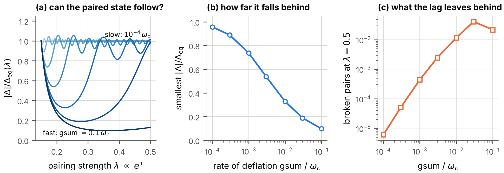

**FIG. 9.** The paired state while the coupling grows. (a) The order parameter divided by the equilibrium gap of the moment, against the pairing strength, for seven rates of deflation. (b) The smallest value of that ratio against the rate. (c) The density of broken pairs at the end of the run against the rate.

## IX. The effective action along the clock

### A. The method, and why it carries over

The earlier paper derived its results on the paired state, on matter, on temperature and on the vacuum from the effective action for composite operators of Cornwall, Jackiw and Tomboulis (CJT) ([Cornwall, Jackiw, and Tomboulis 1974](#ref-CJT1974)): a functional of the expectation value $\phi$ of the Vorton-Scalar and of the full propagators, whose two-particle-irreducible part is truncated at two loops. Its stationarity conditions are the equation for the fermion mass in matter and the gap equation. On the deflating spacetime, and for fields that do not depend on the extra coordinates, nothing in this construction changes, for two reasons established above. The weighted fermion field obeys the flat equations, so that its propagator is the flat one. And the interaction between the fermions is, at each moment, the exchange of the two modes of the scalar with the coupling of that moment and with the unshifted range (Sec. V D).

The one new term, the shift $-\mathrm{gsum}^{2}/4$ of the squares of the boson masses in Eq. (30), is smaller than every other scale of the calculation by the square of the ratio of the rate of deflation to a particle mass. For the largest rate that observation allows (Sec. XI) and a mass of 1 keV that ratio is below $10^{-36}$. The term is neglected in this section; this is the only approximation made here beyond those of the earlier paper. The test of the truncation on a solvable model in zero dimensions, which does not involve the spacetime, was executed again: the two-loop truncation has a solution for every coupling from 0.01 to 30 and stays within 10.7 per cent of the exact propagator.

Every result of this section is a statement about a *sequence of equilibrium states*. Whether a system can follow the sequence was examined, for the paired state, in Sec. VIII.

### B. The paired state

The CJT potential $V[\Delta]$ of the paired state is the effective action per unit volume, measured from the unpaired state, as a functional of the gap function $\Delta(k)$. The program evaluates it at 13 moments, for two choices of the mass $m_s$ at the Fermi momentum $k_F=0.5\,m$, in the vector channel (Table VI, Fig. 10).

| $m_s/m$, $k_F/m$ | $\tau_d$ | $g_{\mathrm{VS}}$ | $\lambda$ |    $\Delta_F/m$     |      $V/m^{4}$       | ratio | curvature | $T_c/\Delta_F$ | size $\times k_F$ |
|:----------------:|:--------:|:-----------------:|:---------:|:-------------------:|:--------------------:|:-----:|:---------:|:--------------:|:-----------------:|
|    0.30, 0.50    |   0.00   |       1.80        |   0.216   | $2.81\times10^{-3}$ | $-4.46\times10^{-7}$ | 1.000 |   0.21    |     0.567      |       25.4        |
|    0.30, 0.50    |   0.21   |       2.00        |   0.266   | $6.89\times10^{-3}$ | $-2.68\times10^{-6}$ | 0.998 |   0.26    |     0.566      |       10.3        |
|    0.30, 0.50    |   0.40   |       2.20        |   0.322   |       0.0135        | $-1.03\times10^{-5}$ | 0.992 |   0.30    |     0.564      |        5.3        |
|    0.30, 0.50    |   0.58   |       2.40        |   0.383   |       0.0230        | $-2.93\times10^{-5}$ | 0.981 |   0.34    |     0.559      |        3.1        |
|    0.30, 0.50    |   0.74   |       2.60        |   0.450   |       0.0354        | $-6.81\times10^{-5}$ | 0.961 |   0.37    |     0.552      |        2.0        |
|    0.30, 0.50    |   0.88   |       2.80        |   0.522   |       0.0511        | $-1.38\times10^{-4}$ | 0.932 |   0.38    |     0.542      |        1.4        |
|    0.30, 0.50    |   1.02   |       3.00        |   0.599   |       0.0707        | $-2.53\times10^{-4}$ | 0.895 |   0.38    |     0.530      |        1.0        |
|    1.0, 0.50     |   0.00   |       2.40        |   0.133   | $4.25\times10^{-4}$ | $-1.02\times10^{-8}$ | 1.000 |   0.13    |     0.567      |       167.6       |
|    1.0, 0.50     |   0.16   |       2.60        |   0.156   | $1.32\times10^{-3}$ | $-9.88\times10^{-8}$ | 1.000 |   0.15    |     0.567      |       53.9        |
|    1.0, 0.50     |   0.31   |       2.80        |   0.181   | $3.28\times10^{-3}$ | $-6.08\times10^{-7}$ | 0.999 |   0.17    |     0.567      |       21.7        |
|    1.0, 0.50     |   0.45   |       3.00        |   0.208   | $6.89\times10^{-3}$ | $-2.68\times10^{-6}$ | 0.998 |   0.19    |     0.566      |       10.3        |
|    1.0, 0.50     |   0.58   |       3.20        |   0.237   |       0.0128        | $-9.25\times10^{-6}$ | 0.994 |   0.21    |     0.564      |        5.6        |
|    1.0, 0.50     |   0.70   |       3.40        |   0.267   |       0.0218        | $-2.65\times10^{-5}$ | 0.987 |   0.23    |     0.561      |        3.3        |

TABLE VI. The paired state along the clock from the CJT potential, for $k_F=0.5\,m$. $\lambda$: pairing strength. $V$: the potential at the solution, the condensation energy. Ratio: $V$ divided by its weak-coupling value $-\nu N(0)\Delta_F^{2}/4$, with $\nu=8$ internal states and the density of states $N(0)$. Curvature: the smallest eigenvalue of the matrix of second derivatives of the potential. Size: the coherence length of the pair in units of $1/k_F$.

*The solution of the gap equation is a minimum at every moment.* Newton’s method applied to the potential converges to the gap function that the iteration of the gap equation finds, to $7.7\times10^{-12}$, and the smallest eigenvalue of the second variation is positive throughout. The temperature at which the second variation at $\Delta=0$ loses its positivity equals the temperature at which the linearized gap equation has the eigenvalue 1, to $2.6\times10^{-12}$: two routes to the critical temperature agree.

*The condensation energy deepens.* It is within 15 per cent of the weak-coupling value wherever the gap is below $0.1\,E_F$, and in weak coupling its logarithmic slope along the clock is twice that of the gap, by Eq. (39): $$\frac{d\ln|V|}{d\tau_d}=\frac{2}{\lambda}.$$

*The pairs shrink.* The coherence length of the first set falls from 25 to 1.0 in units of $1/k_F$. At its last five moments the gap exceeds $0.1\,E_F$, and at the last the pair is as small as the distance between the particles. *The deflation carries the paired state from overlapping pairs toward bound pairs.* On flat spacetime this crossover ([Nozières and Schmitt-Rink 1985](#ref-NozieresSchmittRink1985); [Leggett 1975](#ref-Leggett1975)) is reached by choosing a larger coupling; here it is reached by waiting.

*The universal ratios hold while the coupling is weak.* While the critical temperature rises by a factor of sixteen, from $6.3\times10^{-3}$ to $0.10$ of the Fermi energy, the ratio of the gap at zero temperature to the critical temperature stays within 0.019 of the weak-coupling value 1.7639, and the relative jump of the heat capacity at $T_c$ within 0.048 of 1.4261. The coefficients of the Ginzburg-Landau energy agree with their weak-coupling formulas to 1.0 per cent while $T_c$ is below $0.05\,E_F$ and differ by up to 7.9 per cent at $T_c=0.10\,E_F$. The coherence length of the Ginzburg-Landau energy, $0.1333\,v_F/T_c$ in weak coupling with the Fermi velocity $v_F$, shrinks from 80 to 5.1 in units of $1/m$: the cores of the vortices of the superfluid shrink as the deflation proceeds.

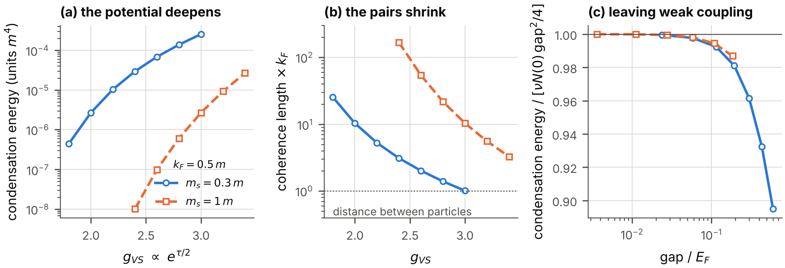

**FIG. 10.** The paired state along the clock, from the CJT potential, for the two sets of Table VI. (a) The condensation energy against the coupling of the moment. (b) The coherence length of the pair in units of $1/k_F$. (c) The condensation energy divided by its weak-coupling value, against the gap in units of the Fermi kinetic energy: the departure from weak coupling.

### C. Matter

*Matter of fixed density loses its fermion mass.* In matter the expectation value of the Vorton-Scalar is reduced by the scalar density of the fermions, and with it the fermion mass in the matter, $m^{*}$. The earlier paper showed that the reduction depends on the density and on the single number $C$, and that above a critical value of $C$ the mass vanishes: the matter is then in the *abnormal* state of Lee and Wick ([Lee and Wick 1974](#ref-LeeWick1974)), a gas of massless fermions in a region without expectation value of the scalar. On the deflating spacetime $C\propto e^{\tau_d}$ grows at fixed density. The critical values are $C=151.892$, $12.971$, $2.556$ and $0.617$ for the Fermi momenta $k_F=0.2$, $0.5$, $1$ and $2$ in units of $m$; they exceed the estimate $\pi^{2}m^{2}/4k_F^{2}$ of the earlier paper by the factors 2.46, 1.31, 1.04 and 1.00. *Every piece of matter becomes abnormal at a definite moment, the denser the earlier.*

*Self-bound matter.* Matter is self-bound, that is, its energy per particle at some density lies below the mass of a free fermion, if $C>3\pi^{2}/8=3.7011$ without the filled negative-energy states and if $C>3\pi^{2}/5=5.9218$ with them. Once the threshold is passed, the lowest energy per particle falls monotonically along the clock (Table VII), from $-0.0192\,m$ at $C=4$ to $-0.405\,m$ at $C=29.6$. At every one of these moments the matter of lowest energy is in the abnormal state. The exchange energies of the two modes, which the mean field omits, are 0.44 and 0.51 per cent of the mean-field energy at the first moment and 0.90 and 1.22 per cent at the last (for $m_s/m=0.3$): the mean field remains a good approximation along the whole history. A gas of the fermions that is dilute and unbound at early times thus has, at late times, a state of lower energy: drops of dense abnormal matter, bound by up to 40 per cent of the rest mass at the last moment of the table. Whether and how fast a gas reaches that state is a question of kinetics that is not answered here.

| $\tau_d$ |  $C$  | $(E/N-m)/m$ | $k_F/m$ |
|:--------:|:-----:|:-----------:|:-------:|
|   0.00   | 4.00  |  $-0.0192$  |  0.981  |
|   0.25   | 5.14  |  $-0.0787$  |  0.921  |
|   0.50   | 6.59  |  $-0.1345$  |  0.866  |
|   0.75   | 8.47  |  $-0.1869$  |  0.813  |
|   1.00   | 10.87 |  $-0.2362$  |  0.764  |
|   1.25   | 13.96 |  $-0.2825$  |  0.718  |
|   1.50   | 17.93 |  $-0.3259$  |  0.674  |
|   1.75   | 23.02 |  $-0.3668$  |  0.633  |
|   2.00   | 29.56 |  $-0.4051$  |  0.595  |

TABLE VII. Self-bound matter along the clock, in the mean-field approximation without the negative-energy states, for $C=4\,e^{\tau_d}$: the lowest energy per particle minus the fermion mass, and the Fermi momentum at which it is reached.

### D. Temperature

At high temperature the expectation value of the Vorton-Scalar vanishes and the fermions are massless. The temperature $T_{1/2}$ at which the expectation value has fallen to one half is of the order of the four-dimensional vacuum value $v_{\mathrm{VS}}=m/g_{\mathrm{VS}}$, which falls as $e^{-\tau_d/2}$ while the masses stay fixed. In units of the constant fermion mass, $T_{1/2}$ falls monotonically as the coupling grows, for each of the three ratios $m_s/m=0.3$, $1$ and $3$ examined; for $m_s/m=1$, from $2.33\,m$ at $g_{\mathrm{VS}}=0.3$ to $0.37\,m$ at $g_{\mathrm{VS}}=4$ \[Fig. 11(d)\]. *Matter of a fixed temperature melts at a definite moment of the deflation.* For $m_s/m=0.3$ no melting temperature can be given from $C=32$ on: there the one-loop potential of the vacuum turns over so close to the vacuum value that the Hartree potential ceases to exist before the expectation value has fallen, and the program marks these moments as not defined.

### E. The vacuum

The one-loop potential of the Vorton-Scalar in vacuum contains the negative contribution of the fermion loop ([Coleman and Weinberg 1973](#ref-ColemanWeinberg1973)), which grows with the fourth power of the field and eventually wins: beyond some field the potential lies below its value in the vacuum. The larger $C$, the smaller that field: 24.7 times the vacuum value at $C=1$, and 1.77 times at $C=10$ \[Fig. 11(c)\]. As the deflation proceeds, the barrier between the vacuum of the model and the region where the one-loop potential is unbounded below moves in toward the vacuum.

The one-loop potential is not reliable at fields far from the vacuum value, and a potential that falls at large field signals that the effective theory needs completion there, not that the vacuum decays. What the result establishes is a trend: every statement of the model that rests on the vacuum of the Vorton-Scalar becomes less secure with time. The order of this event relative to the binding of the pair was given in Sec. VII.

*A pair condensate in the vacuum.* The earlier paper found from the ladder equation with a momentum cutoff that the pair can condense without a medium only if $\alpha_{\mathrm{VS}}$ exceeds a critical value $\alpha_c$ of order one ([Miransky 1985](#ref-Miransky1985)); with the cutoff $100\,m$ the critical values lie between 2.13 and 2.93 for the six mass ratios of Table IV. On the deflating spacetime $\alpha_{\mathrm{VS}}$ reaches such a value at a definite moment. But at that moment the coupling is strong, the exchange of one boson is no longer a controlled approximation, and the vacuum of the model is no longer protected. A pair condensate in the vacuum is not reached by the deflation within the range of validity of the model.

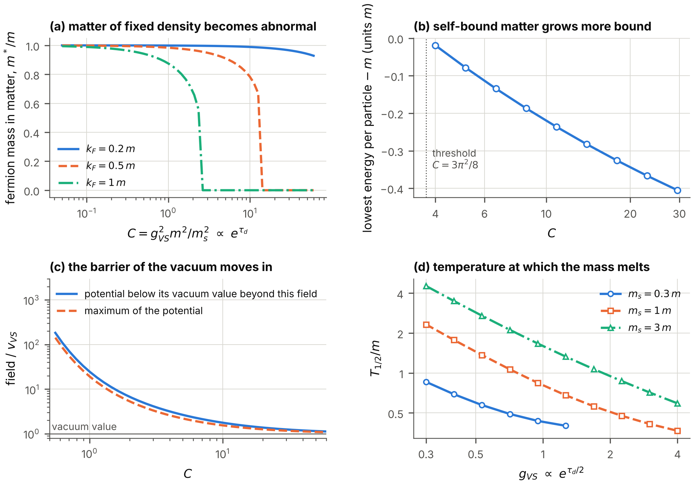

**FIG. 11.** Matter, vacuum and temperature along the clock. (a) The fermion mass in matter of three fixed densities against $C\propto e^{\tau_d}$: it drops to zero at the critical value. (b) The lowest energy per particle of self-bound matter, minus $m$. (c) The field at which the one-loop potential of the vacuum has its maximum, and the field beyond which it lies below the vacuum value, in units of the vacuum value. (d) The temperature at which the fermions have lost half of their mass, against the coupling, for three ratios $m_s/m$.

## X. Order parameter, hidden symmetry and vortices

### A. Frame components and coordinate components

The order parameter of the superfluid is the expectation value $\Delta^{a}$ of the vector pair operator (36) along the extra axis $a\in\{0,5,6,7\}$: four complex numbers. On the deflating spacetime the index $a$ is a *frame* index: $\Delta^{a}$ is the component along the unit vector $e_a$. The coordinate components along the deflating coordinates are $\Delta_t=b_t(x4)\,\Delta^{t}$, and they shrink with the scale factors when the frame components are constant. All statements below are about frame components.

The energy of the paired state depends on the order parameter through the $8\times8$ gap matrix $\mathsf{M}$ on the internal states of a pair. The identity of the earlier paper, $$\tfrac18\,\mathrm{Tr}\big[(\mathsf{M}\mathsf{M}^\dagger)^{2}\big]
=2\Big(\sum_a|\Delta^{a}|^{2}\Big)^{2}-\Big|\sum_{a,b}\eta_{ab}\,\Delta^{a}\Delta^{b}\Big|^{2},
\tag{46}$$ holds on the deflating spacetime with the frame metric $\eta_{ab}$ of the four axes, to $2\times10^{-14}$. In coordinate components the same expression contains the metric $g_{tt}$ of the moment.

### B. The ground state: no direction is preferred

| state                                                   | $d_-^{2}$ | $d_+^{2}$ |    $V$    | flat | positive |
|:--------------------------------------------------------|:---------:|:---------:|:---------:|:----:|:--------:|
| pair along the frame axis of $x0$ (hidden-axis singlet) |   1.000   |   1.000   | $-2.0000$ |  4   |    4     |
| pair along the frame axis of $x5$                       |   1.000   |   1.000   | $-2.0000$ |  4   |    4     |
| pair along the frame axis of $x7$                       |   1.000   |   1.000   | $-2.0000$ |  4   |    4     |
| unitary, rotated between $x0$ and $x5$                  |   1.000   |   1.000   | $-2.0000$ |  4   |    4     |
| unitary, general direction and phase                    |   1.000   |   1.000   | $-2.0000$ |  4   |    4     |
| half-paired: $\eta_{ab}\Delta^a\Delta^b=0$              |   0.000   |   1.000   | $-1.0000$ |  —   |    —     |

TABLE VIII. The potential $V$ of the paired state for six states of the order parameter, in units of $N(0)\Delta_F^{2}$, where $\Delta_F$ is the gap of a unitary state. Each state is taken at the magnitude of the order parameter at which its potential is stationary. $d_-^{2}$ and $d_+^{2}$: the squares of the two fourfold gaps of the state, in units of $\Delta_F^{2}$. Flat and positive: the numbers of eigenvalues of the matrix of second derivatives of the potential that vanish and that are positive.

Table VIII gives the potential of the paired state for six states of the order parameter. Every *unitary* state, in which $\Delta^{a}$ is a real unit vector times a phase, has all eight gaps equal and the lowest potential, whichever direction the vector has. It has four flat directions, the Goldstone modes (one phase and three rotations of the direction), and four directions of positive curvature. The *half-paired* states, in which four of the eight gaps vanish, have half the condensation energy.

One might have expected the deflation to select the direction of the order parameter: the hidden axis $x0$, which does not deflate, against the three axes that do. *In the sector of fields that do not depend on the extra coordinates it does not.* The reason is the central observation of Sec. III: in this sector the weighted field obeys the flat equations, and their internal symmetry rotates the four frame axes into one another. The symmetry of the manifold of ground states is larger than the symmetry of the spacetime.

### C. The internal symmetry of the sector, and the symmetries of the spacetime

For fields that depend on $x1,x2,x3,x4$ only, the equation of the weighted field contains five matrices: $\alpha^{1},\alpha^{2},\alpha^{3}$, $\beta$ and $i\beta\chi$, the last through the coupling of the phase mode. The matrices that commute with all five generate the *internal symmetry* of the sector. The program computes it again for the deflating spacetime, item by item, and finds it unchanged:

- the algebra is $su(2)_A\oplus su(2)_B\oplus u(1)_F\oplus u(1)_E$, of dimension 8;

- the eight internal states of a fermion form the two doublets $(2,1)+(1,2)$;

- the four vector pair operators (36) form the $(2,2)$, with fermion number 2, and their one invariant quadratic form is the frame metric of the four axes, with the signs $(+,-,-,-)$;

- a condensate along one axis breaks $SO(4)=[SU(2)_A\times SU(2)_B]/Z_2$ to $SO(3)$.

Here $U(1)_E$ is a second phase symmetry of the sector, with a generator $P$ that has the square one and distinguishes the doublets of $SU(2)_A$ from those of $SU(2)_B$.

Six of the generators are the products $\gamma^{A}\gamma^{B}$ of the six pairs taken from the four axes $x0,x5,x6,x7$. On the flat $4{+}4$ spacetime only three of them belong to transformations of the spacetime that the sector inherits: the products $\gamma^{s}\gamma^{t}$ of two additional times generate the rotations $SO(3)_T$ of $x5,x6,x7$. The other three, $\gamma^{0}\gamma^{t}$, are Hermitian; the unitary transformations that they generate in the quantized sector are not the boosts of the planes of $x0$ and $xt$, which are not unitary. The full $SU(2)_A\times SU(2)_B$ was therefore a *hidden symmetry* already on the flat spacetime: a symmetry of the equations of a sector that is not a transformation of the spacetime ([Nash 2026a](#ref-Flat1644)). On the deflating spacetime even $SO(3)_T$ is a symmetry of the spacetime only if the three rates are equal (Fig. 1). With two equal rates one rotation remains, and with three different rates none. The internal symmetry of the sector is nevertheless exact in all three cases.

### D. Vortices and their zero modes

Because the vacuum value of the Vorton-Scalar breaks the phase symmetry $U(1)_{\mathrm{VS}}$, the field has line-like defects ([Nielsen and Olesen 1973](#ref-NielsenOlesen1973)): along a straight line, say the $x3$ axis, its magnitude vanishes, and around the line its phase winds by $2\pi$ times an integer. For unit winding, $\Phi_{\mathrm{VS}}$ is $v_{\mathrm{VS}}/\sqrt2$ times a profile that rises from 0 on the line to 1 at a distance of the order of $1/m_s$, times $e^{i\theta_{12}}$ with the angle $\theta_{12}$ around the line in the plane of $x1$ and $x2$.

*Energy per unit length.* It is proportional to the square of the four-dimensional vacuum value and so falls as $e^{-\tau_d}$: in the four-dimensional description vortex lines become lighter as the deflation proceeds, while their core, of the radius $1/m_s$, keeps its size.

*Fermions on the line.* On the line the fermion mass vanishes, and fermions can be trapped there ([Jackiw and Rossi 1981](#ref-JackiwRossi1981)). In the field of the vortex the Hamiltonian of a fermion is $$\sum_{j=1}^{3}\alpha^{j}p_j+m\,(\text{profile})\,\beta\,\big(\cos\theta_{12}+i\chi\,\sin\theta_{12}\big),$$ with the momenta $p_j$ along $x1,x2,x3$. A state of zero energy at zero momentum along the line is a constant spinor $w_z$ times a function that decays away from the line. Inserting this form, the Hamiltonian annihilates the state for every angle if and only if $$\big(i\alpha^{1}+\beta\big)\,w_z=0,\qquad\big(i\alpha^{2}+i\beta\chi\big)\,w_z=0 .
\tag{48}$$ The five matrices $\alpha^{1},\alpha^{2},\alpha^{3},\beta,i\beta\chi$ are Hermitian, have the square one and anticommute with one another. The two conditions state that $w_z$ is an eigenvector, with the eigenvalue $-1$, of the two commuting matrices $i\beta\alpha^{1}$ and $\alpha^{2}\beta\chi$, and each joint eigenspace of these two matrices has the dimension $16/4=4$. *A vortex line of unit winding carries four zero modes of the sixteen-component field.*

For a momentum $p_3$ along the line the energy is the eigenvalue of $\alpha^{3}p_3$. On the four zero modes $\alpha^{3}$ equals the matrix $$P_c=i\,\alpha^{1}\alpha^{2}\alpha^{3}\chi,$$ the product of the five matrices, which commutes with each of them, is Hermitian and traceless and has the square one; it is, up to its sign, the generator $P$ of $U(1)_E$. Its trace on the four zero modes vanishes. *Two zero modes move along the line in one direction at the speed of light and two in the other*, and the direction of motion is tied to the charge under $U(1)_E$. For winding $-1$ the two directions are exchanged.

Equations (48) contain only the matrices of the frame and the fermion mass, neither of which changes. The four zero modes therefore exist at every moment of the deflation. The count also holds on flat spacetime, where it corrects the earlier paper ([Nash 2026a](#ref-Flat1644)): that paper quoted the count for a four-component field, one zero mode for each unit of winding, whereas the sixteen components are equivalent to four such fields.

Massless fermions that run along a vortex line carry a current ([Witten 1985](#ref-Witten1985)); a closed loop of the line can be held open by that current, and such loops are the *vortons* of the literature on cosmic strings ([Davis and Shellard 1989](#ref-DavisShellard1989)). Because the energy per length of the line falls as $e^{-\tau_d}$ while the fermions on it stay massless, the balance between the tension of a loop and the current on it shifts in favor of the current as the deflation proceeds. This paper establishes the ingredients of that statement; it does not compute the equilibrium radius of a loop.

## XI. Cosmology

Hypothesis H3 says that the superfluid explains the dark matter, or the Hubble tension, or both. The earlier paper examined it with the extra coordinates static. It found that the dark radiation of the model does not relieve the Hubble tension and that a superfluid of the fermions cannot be the dark matter of galaxies, although heavy bound pairs could be cold dark matter of an ordinary kind ([Nash 2026a](#ref-Flat1644)). This section examines what changes when $x5,x6,x7$ deflate. The deflation enters cosmology in several ways, and each requires an assumption beyond the hypothesis of deflation. The assumptions are stated first and are kept apart throughout, so that the reader can see which conclusion rests on which.

### A. Assumptions, and the equation of the expansion

*A1: ordinary space expands.* The coordinates $x1,x2,x3$ carry the scale factor $a_{\mathrm{sp}}(x4)$ of standard cosmology, with the Hubble rate $H=d\ln a_{\mathrm{sp}}/dx4$; the hidden coordinate $x0$ is static; $x5,x6,x7$ deflate at constant rates. The metric of Sec. II is the case $a_{\mathrm{sp}}=1$.

*A2: gravity is the Einstein theory in eight dimensions*, with a constant $G_8$. The constant of gravitation that an observer in ordinary space measures is then $G_8$ divided by the proper volume of the extra coordinates, $$G_N(x4)\ \propto\ \frac{1}{V_d}\ \propto\ e^{\mathrm{gsum}\,x4},\qquad\frac{1}{G_N}\frac{dG_N}{dx4}=\mathrm{gsum}.
\tag{50}$$ Newton’s constant *grows* as the extra volume shrinks: gravity was weaker in the past. That a changing volume of extra dimensions makes the constants of four dimensions change, and that nucleosynthesis bounds the change, was pointed out long ago ([Kolb, Perry, and Walker 1986](#ref-KolbPerryWalker1986)); for a review of varying constants see Ref. ([Uzan 2011](#ref-Uzan2011)). By Sec. II C, A2 is an assumption that the deflating spacetime itself puts in doubt: without matter the metric solves the equations of Einstein-Gauss-Bonnet gravity, not Einstein’s.

For a diagonal metric whose seven directions other than the time have the rates $H,H,H$ (ordinary space), $0$ (the coordinate $x0$) and $-\mathrm{g55},-\mathrm{g66},-\mathrm{g77}$, the component of Einstein’s equations along the time is the sum of the products of all pairs of rates, set equal to $8\pi G_8$ times the energy density in eight dimensions. Dividing the density by the extra volume turns $G_8$ into $G_N$: $$3H^{2}-3\,\mathrm{gsum}\,H+\mathrm{gprod}=8\pi\,G_N(x4)\,\rho,
\tag{51}$$ with the density $\rho$ of radiation, matter and the cosmological term in ordinary space. For the unperturbed universe Eq. (51) is the only one of Einstein’s equations that is needed. The others determine the stresses of the unknown source that keeps the three rates constant; they enter when ordinary space is perturbed (Sec. XI E).

The calculations take three equal rates, so that $\mathrm{gprod}=\mathrm{gsum}^{2}/3$, and the densities of the standard model of cosmology ([Aghanim et al. 2020](#ref-Planck2018VI)) as the earlier paper used them: baryons $\omega_b=0.02237$, cold dark matter $\omega_c=0.1200$, and $H_0=67.36~\mathrm{km\,s^{-1}\,Mpc^{-1}}$ without deflation. The cosmological term is chosen so that Eq. (51) holds today. Without deflation the program reproduces the two numbers of the earlier calculation on which this section rests: the angle $\theta_*$ under which the sound horizon at last scattering is seen, $100\,\theta_*=1.03965$, and that sound horizon, $r_s=144.449$ Mpc.

### B. The Hubble constant inferred from the sound horizon

The microwave background fixes the angle $\theta_*$ to high precision. A model that changes the history of the expansion must keep that angle, and the Hubble constant that it then requires is the *inferred* Hubble constant. The tension is that the standard model infers $67.4~\mathrm{km\,s^{-1}\,Mpc^{-1}}$ ([Aghanim et al. 2020](#ref-Planck2018VI)) while the local distance network measures $73.50\pm0.81$ ([Casertano et al. 2026](#ref-H0DN2026)). Table IX gives the inferred value on the deflating spacetime under A1 and A2, at fixed $\theta_*$ and fixed densities of baryons and dark matter. The redshift $z_*$ of last scattering and the mass fraction $Y_{\mathrm{He}}$ of helium, which the sound horizon needs, are computed on the deflating background (Sec. XI G).

| $\mathrm{gsum}/H_0$ | $\mathrm{gsum}$ (per year) | $H_0$ ($\mathrm{km\,s^{-1}\,Mpc^{-1}}$) |  change  | $G_N$ ratio |  $z_*$  | $Y_{\mathrm{He}}$ | $r_s$ (Mpc) | $t_0$ (Gyr) | $H_0$, $z_*$ and $Y_{\mathrm{He}}$ held |
|:-------------------:|:--------------------------:|:---------------------------------------:|:--------:|:-----------:|:-------:|:-----------------:|:-----------:|:-----------:|:---------------------------------------:|
|          0          |             0              |                  67.36                  |   0.00   |   1.0000    | 1089.92 |      0.2454       |   144.45    |    13.81    |                  67.36                  |
|       0.00100       |    $6.89\times10^{-14}$    |                  67.29                  | $-0.07$  |   0.9990    | 1089.90 |      0.2453       |   144.52    |    13.82    |                  67.30                  |
|       0.00300       |    $2.07\times10^{-13}$    |                  67.16                  | $-0.20$  |   0.9971    | 1089.86 |      0.2452       |   144.66    |    13.84    |                  67.18                  |
|       0.00324       |    $2.23\times10^{-13}$    |                  67.15                  | $-0.21$  |   0.9969    | 1089.86 |      0.2451       |   144.68    |    13.84    |                  67.16                  |
|       0.0100        |    $6.89\times10^{-13}$    |                  66.70                  | $-0.66$  |   0.9905    | 1089.73 |      0.2446       |   145.16    |    13.90    |                  66.74                  |
|       0.0300        |    $2.07\times10^{-12}$    |                  65.36                  | $-2.00$  |   0.9714    | 1089.37 |      0.2430       |   146.61    |    14.06    |                  65.48                  |
|       0.0644        |    $4.43\times10^{-12}$    |                  62.98                  | $-4.38$  |   0.9383    | 1088.72 |      0.2401       |   149.23    |    14.37    |                  63.23                  |
|        0.100        |    $6.89\times10^{-12}$    |                  60.37                  | $-6.99$  |   0.9037    | 1088.04 |      0.2370       |   152.13    |    14.70    |                  60.77                  |
|        0.300        |    $2.07\times10^{-11}$    |                  41.94                  | $-25.42$ |   0.6995    | 1083.78 |      0.2168       |   173.35    |    17.29    |                  43.41                  |

TABLE IX. The Hubble constant inferred from the angular scale of the sound horizon if Newton’s constant grows with the deflation (assumptions A1 and A2). $G_N$ ratio: Newton’s constant in the early universe divided by its value today, $e^{-\mathrm{gsum}\,t_0}$ with the age $t_0$ of the model. $z_*$: redshift of last scattering; $Y_{\mathrm{He}}$: mass fraction of helium. Last column: the Hubble constant that results if $z_*$ and $Y_{\mathrm{He}}$ are held at their values without deflation. The rows at $\mathrm{gsum}/H_0=0.00324$ and $0.0644$ are the bounds of lunar laser ranging and of nucleosynthesis (Table X).

*The inferred Hubble constant falls*, with the slope $d\ln H_0/d(\mathrm{gsum}/H_0)=-0.969$ at small rates. The reason is this. By Eq. (50) gravity was weaker in the early universe; the universe expanded more slowly at a given density; sound had more time to travel, and the sound horizon is larger. To keep the angle, the distance to last scattering must be larger, which requires a smaller Hubble constant. The deflation moves the inferred value *away* from the local measurement \[Fig. 12(a)\]. Weaker gravity also delays last scattering and lowers the helium fraction, because the universe expanded more slowly during recombination and during nucleosynthesis as well; both enlarge the sound horizon further. If $z_*$ and $Y_{\mathrm{He}}$ are held at their values without deflation, the slope is $-0.911$: that simpler calculation underestimates the fall by six per cent of itself. An independent calculation of recombination confirms both numbers (Appendix C). The term $\mathrm{gprod}$ of Eq. (51) plays no part in this: it is of the second order in the rate, and it acts as a constant, which the cosmological term that is adjusted to today’s expansion absorbs almost exactly.

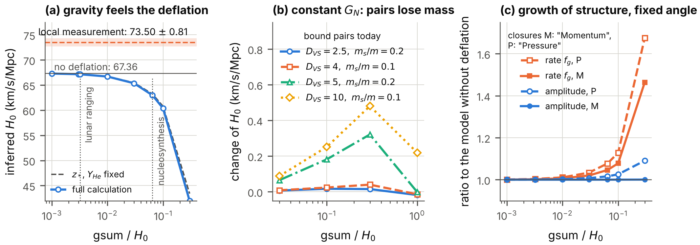

**FIG. 12.** The Hubble constant and the growth of structure on a deflating spacetime. (a) The Hubble constant inferred from the angular scale of the sound horizon against the rate of deflation, if gravity feels the deflation (A1, A2): with recombination computed on the deflating background, and with last scattering and the helium fraction held fixed; the bounds of Table X and the local measurement are marked. (b) The change of the inferred Hubble constant if Newton’s constant is held fixed and bound pairs lose rest mass. (c) Amplitude and rate of the growth of structure relative to the model without deflation, at a fixed angle of the sound horizon, for the two closures of Sec. XI E.

### C. How fast can the coordinates deflate today?

| observation                                                                             | measured                                                                                          | assumption                                                        |      bound on $\mathrm{gsum}$ (per year)      |  in units of $H_0$   |
|:----------------------------------------------------------------------------------------|:--------------------------------------------------------------------------------------------------|:------------------------------------------------------------------|:---------------------------------------------:|:--------------------:|
| lunar laser ranging ([Hofmann and Müller 2018](#ref-HofmannMueller2018))                | $(dG_N/dt)/G_N=(7.1\pm7.6)\times10^{-14}$ per year                                                | A2                                                                |             $2.230\times10^{-13}$             | $3.237\times10^{-3}$ |
| nucleosynthesis, Newton’s constant ([Alvey et al. 2020](#ref-Alvey2020))                | $G_N$ then, divided by $G_N$ today: $0.99^{+0.06}_{-0.05}$ (two standard deviations)              | A2; constant rate                                                 |             $4.434\times10^{-12}$             |        0.0644        |
| nucleosynthesis, Fermi constant ([Scherrer and Spergel 1993](#ref-ScherrerSpergel1993)) | $G_{\mathrm{Fermi}}$ at $t=1$ s within 20 (10) per cent of today’s value, at fixed fermion masses | HV; constant rate                                                 | $1.615\times10^{-11}$ ($7.627\times10^{-12}$) |    0.234 (0.111)     |
| atomic clocks, mass ratio ([Lange et al. 2021](#ref-Lange2021))                         | $(d/dt)\ln(m_p/m_e)=(-8\pm36)\times10^{-18}$ per year                                             | H2, $n_{\mathrm{EW}}=1$                                           |             $8.000\times10^{-17}$             | $1.161\times10^{-6}$ |
| atomic clocks, fine-structure constant ([Lange et al. 2021](#ref-Lange2021))            | $(d\alpha_{\mathrm{em}}/dt)/\alpha_{\mathrm{em}}=(1.0\pm1.1)\times10^{-18}$ per year              | an electromagnetic field along $x5,x6,x7$ (not part of the model) |             $3.200\times10^{-18}$             | $4.645\times10^{-8}$ |

TABLE X. Upper bounds on the present total rate of deflation, each under the assumption named. Uncertainties of the measured values are at 68 per cent unless stated; the bounds are at two standard deviations. The bound in units of $H_0$ uses $H_0=67.36~\mathrm{km\,s^{-1}\,Mpc^{-1}}$. A2: gravity is the Einstein theory in eight dimensions. HV: the vacuum value of the Vorton-Scalar sets the electroweak scale. H2: the superfluid state is the Higgs field; the bound is given for $n_{\mathrm{EW}}=1$ and scales as $1/n_{\mathrm{EW}}$ (Sec. XII).

Table X and Fig. 13 collect the bounds.

*Under A2, lunar laser ranging* measures $(dG_N/dt)/G_N$ directly, and Eq. (50) turns its limit into $\mathrm{gsum}<2.23\times10^{-13}$ per year, that is, $3.24\times10^{-3}\,H_0$. At this rate the deflation clock has advanced by $\mathrm{gsum}\,t_0=3.1\times10^{-3}$ over the age $t_0$ of the universe, and the inferred Hubble constant is lower by $0.21~\mathrm{km\,s^{-1}\,Mpc^{-1}}$.

*Under A2, nucleosynthesis* bounds the ratio of Newton’s constant then to its value today; for a rate that was constant since, $\mathrm{gsum}<0.064\,H_0$. This is weaker than the first bound but does not assume that the rate today equals the rate in the past.

*Under HV, nucleosynthesis* bounds the change of the Fermi constant at fixed fermion masses to 10 to 20 per cent, which gives $\mathrm{gsum}<0.111$ to $0.234\,H_0$. HV is the assumption that the Vorton-Scalar itself plays the role of the Higgs field, so that $G_{\mathrm{Fermi}}=1/(\sqrt2\,v_{\mathrm{VS}}^{2})$ grows as $e^{\tau_d}$ while every mass stays constant. It is *not* the hypothesis H2, and the earlier paper already noted that the Vorton-Scalar, a singlet of all non-Abelian symmetries, cannot be the Higgs field of the Standard Model; the bound is given only to show what the assumption would imply.

*Under the hypothesis H2, atomic clocks* give by far the strongest bound, and one that needs no assumption about gravity. Section XII derives it: $\mathrm{gsum}<1.16\times10^{-6}\,H_0/n_{\mathrm{EW}}$ with an exponent $n_{\mathrm{EW}}$ of order one or larger.

*The fine-structure constant* is bounded by the same clocks to parts in $10^{18}$ per year. This would bound the rate, to $4.6\times10^{-8}\,H_0$, only if an electromagnetic field propagated along the deflating coordinates. The model contains no electromagnetic field; the row shows how strongly such an extension would be constrained.

*Under A2, the microwave background* would bound the rate as well. Section XI H finds, as a forecast for mock data of the quality of the Planck satellite and not as a measurement, $\mathrm{gsum}<0.0385\,H_0$; Fig. 13 includes it for comparison.

*In the model as it stands*, without H2, HV or an electromagnetic extension and without A2, no mass and no coupling of ordinary matter depends on the deflation, and none of these observations bounds the rate.

The consequence for the histories of Secs. VI to IX is severe. Under A2 the clock has advanced by at most 0.0031 during the whole of cosmic history, if the rate was constant; under H2 by at most $1.1\times10^{-6}/n_{\mathrm{EW}}$. A history in which pairs become bound, matter loses its fermion mass or the gap grows by orders of magnitude within the age of the universe requires that gravity does not feel the deflation, that the superfluid is not the Higgs field, or that the rate was much larger in the past than it is today.

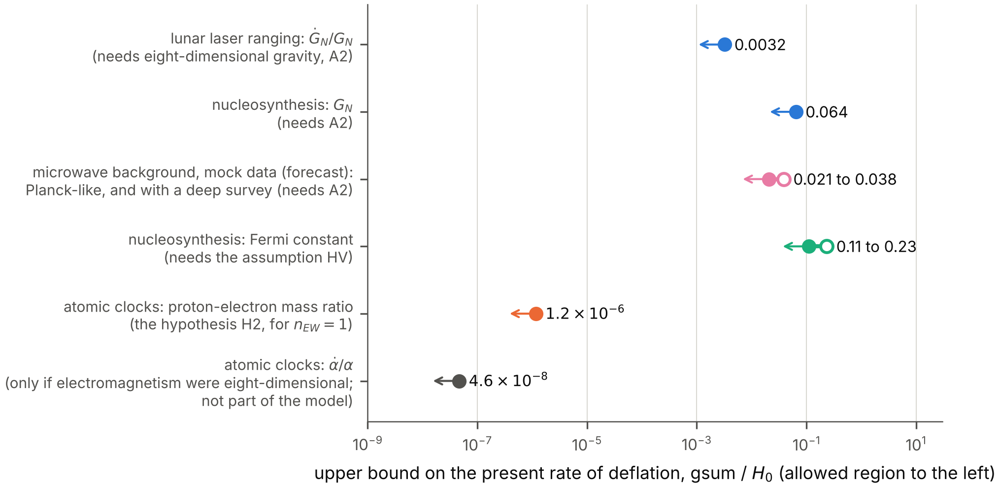

**FIG. 13.** Upper bounds on the present total rate of deflation in units of the Hubble constant, each under the assumption of Table X. The allowed region is to the left of each bound. The row “microwave background” is not a measurement but the forecast of Sec. XI H for mock data (open symbol: Planck-like; filled symbol: with a deep survey).

### D. Bound pairs lose rest mass

If the dark matter consists of bound pairs of the fermions, its particles have the rest mass $2m$ minus the binding energy. The binding energy grows with the coupling, so that the pairs become lighter as the deflation proceeds, and the density of dark matter falls slightly faster than the inverse volume. A dark matter that was heavier in the past raises the inferred Hubble constant. The program computes the effect for four examples with $\alpha_{\mathrm{VS}}$ between 0.4 and 1 today, where the binding energy is at most 8.2 per cent of the rest mass \[Fig. 12(b)\]. If gravity feels the deflation, the inferred Hubble constant changes by between $-4.11$ and $-0.19~\mathrm{km\,s^{-1}\,Mpc^{-1}}$ at the rates that nucleosynthesis and lunar laser ranging allow: the weaker gravity of the past outweighs the loss of mass. (These examples hold $z_*$ and $Y_{\mathrm{He}}$ fixed, which by Table IX underestimates a fall by about six per cent of itself.) If Newton’s constant is held fixed and the deflation acts on the dark sector alone, rates between 0.03 and $1\,H_0$ raise the inferred Hubble constant by at most $+0.48~\mathrm{km\,s^{-1}\,Mpc^{-1}}$, for a loss of up to 7.7 per cent of the rest mass. This is the only effect of the deflation found here that raises the inferred Hubble constant, and in these examples it supplies less than a tenth of the $6.1~\mathrm{km\,s^{-1}\,Mpc^{-1}}$ that separate the model from the local measurement.

### E. Perturbations of ordinary space: what must be assumed

The quantities of the preceding subsections belong to the unperturbed universe. The growth of structure and the spectra of the microwave background are built from small perturbations of ordinary space, and the equations of the perturbations contain more of Einstein’s equations than Eq. (51). They therefore contain what the hypothesis of deflation leaves open.

*The agent.* Something must keep the three rates constant while ordinary space expands and matter dilutes. We call it the agent and assume nothing about its nature. Assumption A2 says that it has no energy density: otherwise its density would stand on the right of Eq. (51). It cannot be without stresses. The components of Einstein’s equations along ordinary space, together with the conservation of matter in ordinary space and Eq. (50), require the agent to have, in ordinary space, the pressure $$\begin{aligned}
8\pi G_N\,p_{\mathrm{agent}}={}&-\frac{\mathrm{gsum}}{H}\frac{dH}{dx4}-2\,\mathrm{gsum}\,H\\
&+2\,\mathrm{gprod}-\frac{\mathrm{gsum}\,\mathrm{gprod}}{3H}.
\end{aligned}
\tag{52}$$ In an era of matter this is $-\mathrm{gsum}\,H/2$ to the first order in the rates. The agent is a medium without energy density and with a tension, of the relative size $\mathrm{gsum}/H$. When ordinary space is perturbed, such a medium will in general be perturbed too.

*A3: the perturbations.* We assume (i) that in a universe with small inhomogeneities the scale factors $b_t$ of the deflating coordinates remain the prescribed functions of the time, the time being the proper time of observers who move with the cold matter, and that $x0$ remains static; and (ii) that the agent has no energy density in the perturbed universe either. Part (i) is the plainest reading of the hypothesis of deflation in a universe that is not exactly homogeneous; part (ii) is A2 taken to first order. Both are assumptions.

*The equations.* We use the conformal time $\tau_{\mathrm{cf}}$ of ordinary space, defined by $d\tau_{\mathrm{cf}}=dx4/a_{\mathrm{sp}}$, write a prime for the derivative with respect to it, and write $H_{\mathrm{cf}}=a_{\mathrm{sp}}'/a_{\mathrm{sp}}=a_{\mathrm{sp}}H$ for the conformal Hubble rate. A scalar perturbation of ordinary space with the comoving wavenumber $k$ is described, in the synchronous gauge, by two functions $h_{\mathrm{sy}}(\tau_{\mathrm{cf}})$ and $\eta_{\mathrm{sy}}(\tau_{\mathrm{cf}})$ of the perturbed metric; they are the $h$ and $\eta$ of Ref. ([Ma and Bertschinger 1995](#ref-MaBertschinger1995)), written here with an index because $h$ and $\eta$ have other meanings in this paper. The combination $\alpha_{\mathrm{sy}}=(h_{\mathrm{sy}}'+6\,\eta_{\mathrm{sy}}')/2k^{2}$ occurs repeatedly. Matter and radiation enter through four sums over the species, each multiplied by $8\pi G_N(x4)\,a_{\mathrm{sp}}^{2}$ with the Newton’s constant of the moment: $\mathcal{D}$, the perturbation of the energy density; $\mathcal{T}$, the divergence of the momentum density; $\mathcal{P}$, the perturbation of the pressure; and $\mathcal{A}$, the anisotropic stress. With the scale factors of the extra coordinates unperturbed, the Einstein tensor of the eight-dimensional metric gives, to first order,

$$\begin{aligned}
2k^{2}\eta_{\mathrm{sy}}-H_e\,h_{\mathrm{sy}}'&=-\mathcal{D},\tag{53a}\\
2k^{2}\eta_{\mathrm{sy}}'&=\mathcal{T},\tag{53b}\\
h_{\mathrm{sy}}''+2H_e\,h_{\mathrm{sy}}'-2k^{2}\eta_{\mathrm{sy}}&=-3\,\mathcal{P},\tag{53c}\\
\alpha_{\mathrm{sy}}'+2H_e\,\alpha_{\mathrm{sy}}-\eta_{\mathrm{sy}}&=-\tfrac32\,\mathcal{A}/k^{2},\tag{53d}
\end{aligned}$$

with $$H_e=H_{\mathrm{cf}}-\tfrac12\,a_{\mathrm{sp}}\,\mathrm{gsum}.
\tag{54}$$ They are the energy constraint, the momentum constraint, the trace of the space-space equations and their traceless part, the equation of the shear. An independent program derives them by computer algebra for arbitrary rates and for both signatures (Appendix C). They are the four equations of general relativity ([Ma and Bertschinger 1995](#ref-MaBertschinger1995)) with two changes: Newton’s constant is that of the moment, and $H_{\mathrm{cf}}$ is replaced by $H_e$ in three of them. The second change can be read off Eq. (51). The time component of the Einstein tensor is the sum of the products of all pairs of expansion rates. If the rate of one ordinary direction is perturbed, the perturbation multiplies the sum of the rates of all *other* directions, which is $2H$ in four dimensions and $2H-\mathrm{gsum}$ here.

*The four equations cannot all hold with matter alone.* In general relativity two of the four equations (53) imply the other two, because the energy and the momentum of matter are conserved. Here they do not. Let Eq. (53a) hold, and define three *gaps*, the amounts by which the other three fail when only matter and radiation stand on their right-hand sides: $$\begin{aligned}
\mathcal{Y}_M&=2k^{2}\eta_{\mathrm{sy}}'-\mathcal{T},\\
\mathcal{Y}_T&=h_{\mathrm{sy}}''+2H_e\,h_{\mathrm{sy}}'-2k^{2}\eta_{\mathrm{sy}}+3\,\mathcal{P},\\
\mathcal{Y}_S&=\alpha_{\mathrm{sy}}'+2H_e\,\alpha_{\mathrm{sy}}-\eta_{\mathrm{sy}}+\tfrac32\,\mathcal{A}/k^{2}.
\end{aligned}
\tag{55}$$ The conservation of the energy and of the momentum of matter in ordinary space gives two identities between them, $$\begin{aligned}
\mathcal{Y}_M&=H_e\,\mathcal{Y}_T+\mathcal{Z},\tag{56}\\
2k^{2}\,\mathcal{Y}_S&=\mathcal{Y}_T+\frac{3}{k^{2}}\big(\mathcal{Y}_M'+2H_e\,\mathcal{Y}_M\big),\tag{57}
\end{aligned}$$ with $$\begin{aligned}
\mathcal{Z}&=h_{\mathrm{sy}}'\,\mathcal{B}-\tfrac12\,a_{\mathrm{sp}}\,\mathrm{gsum}\,(\mathcal{D}-3\,\mathcal{P}),\\
\mathcal{B}&=H_e'-H_e^{2}+\tfrac12(\mathcal{E}+\mathcal{E}_P).
\end{aligned}
\tag{58}$$ Here $\mathcal{E}$ and $\mathcal{E}_P$ are $8\pi G_Na_{\mathrm{sp}}^{2}$ times the density and the pressure of the unperturbed universe. By Eq. (51) the quantity $\mathcal{B}$ is proportional to $\mathrm{gsum}$; in an era of matter it is $a_{\mathrm{sp}}\,\mathrm{gsum}\,H_{\mathrm{cf}}/4$. Without deflation $\mathcal{B}$ and $\mathcal{Z}$ vanish, and Eqs. (56) and (57) say that if one gap vanishes at all times, all three do: that is general relativity. With deflation $\mathcal{Z}\neq0$, and *the three gaps cannot all vanish*. This is not a defect of the calculation. It is the statement that the agent, which has a tension, takes part in the perturbations: the gaps are, up to the factor $8\pi G_Na_{\mathrm{sp}}^{2}$, the perturbations of its momentum density, of its pressure and of its anisotropic stress.

*Closures.* The two identities relate three gaps; one more relation closes the system, and the hypothesis offers no ground for a choice. Three natural choices set one gap to zero. In the closure “Momentum”, $\mathcal{Y}_M=0$: the agent carries no momentum density, and Eqs. (53a) and (53b) hold. In the closure “Pressure”, $\mathcal{Y}_T=0$: the agent carries no perturbation of its pressure, Eqs. (53a) and (53c) hold, and Eq. (53b) is replaced by $2k^{2}\eta_{\mathrm{sy}}'=\mathcal{T}+\mathcal{Z}$. In the closure “Shear”, $\mathcal{Y}_S=0$: the agent carries no anisotropic stress, as a perfect fluid or a scalar field would not. Eliminating $\mathcal{Y}_T$ from the two identities then gives an equation of motion for the momentum density of the agent, $$\mathcal{Y}_M'=-\Big(\frac{k^{2}}{3H_e}+2H_e\Big)\mathcal{Y}_M+\frac{k^{2}}{3H_e}\,\mathcal{Z}.
\tag{59}$$ Far inside the horizon, $k\gg H_{\mathrm{cf}}$, the rate $k^{2}/3H_e$ is enormous, and $\mathcal{Y}_M$ relaxes at once to $\mathcal{Z}$, its value in the closure “Pressure”. *Inside the horizon the closure “Shear” is the closure “Pressure”*, with corrections of the relative order $(H_{\mathrm{cf}}/k)^{2}$. We compute with the closures “Momentum” and “Pressure” and mark every result as depending on the closure or not.

All gaps are proportional to $a_{\mathrm{sp}}\,\mathrm{gsum}/H_{\mathrm{cf}}=\mathrm{gsum}/H$. At the largest rate that nucleosynthesis allows this ratio is $2.7\times10^{-6}$ at recombination and $6.9\times10^{-2}$ today. The closure therefore cannot matter for anything that is decided at recombination, and it must matter for the gravitational potentials and for the growth of structure of the recent universe.

### F. The growth of structure

For pressureless matter with the density contrast $\delta_m$ and the density $\rho_m$ each closure gives one equation. In the closure “Pressure”, Eqs. (53a) and (53c) give $$\frac{d^{2}\delta_m}{dx4^{2}}+\Big(2H-\frac{\mathrm{gsum}}{2}\Big)\frac{d\delta_m}{dx4}=4\pi\,G_N(x4)\,\rho_m\,\delta_m :
\tag{60}$$ gravity is that of the moment, and the Hubble friction is reduced by $\mathrm{gsum}/2$. In the closure “Momentum”, the derivative of Eq. (53a) with Eq. (53b) gives, in conformal time, $$\delta_m''+\frac{2H_e'+\mathcal{E}_m+\tfrac43\mathcal{E}_r}{2H_e}\,\delta_m'=\frac{H_{\mathrm{cf}}-a_{\mathrm{sp}}\,\mathrm{gsum}}{2H_e}\,\mathcal{E}_m\,\delta_m ,
\tag{61}$$ where $\mathcal{E}_m$ and $\mathcal{E}_r$ are the parts of $\mathcal{E}$ from matter and from radiation. Here the source is reduced as well, by the factor $(H-\mathrm{gsum})/(H-\mathrm{gsum}/2)$. (The term with $\mathcal{E}_r$ is the momentum density of radiation that streams freely: far inside the horizon its velocity divergence is $-h_{\mathrm{sy}}'/2$ ([Ma and Bertschinger 1995](#ref-MaBertschinger1995)).) Without deflation both equations reduce to the familiar $d^{2}\delta_m/dx4^{2}+2H\,d\delta_m/dx4=4\pi G_N\rho_m\delta_m$. With deflation that familiar equation, with $G_N(x4)$ inserted, is neither of the two. For matter alone and three equal rates the growth rate $d\ln\delta_m/d\ln a_{\mathrm{sp}}$ is, to the first order in $\mathrm{gsum}/H$, $1-\tfrac{9}{16}\,\mathrm{gsum}/H$ in the closure “Pressure” and $1-\tfrac{13}{16}\,\mathrm{gsum}/H$ in the closure “Momentum”.

Two effects oppose each other \[Fig. 12(c)\]. At a *fixed* Hubble constant, weaker gravity in the past lowers the amplitude $\sigma_8$ of clustering today: $d\ln\sigma_8/d(\mathrm{gsum}/H_0)=-0.443$ in the closure “Momentum” and $-0.207$ in the closure “Pressure”. But the Hubble constant that keeps the angle of the sound horizon is lower, the cosmological term takes over later, and matter clusters for longer. With that Hubble constant the net change is $+0.003$ and $+0.239$ per unit of $\mathrm{gsum}/H_0$: $+0.001$ and $+0.077$ per cent at the bound of lunar laser ranging, and $+0.01$ and $+1.60$ per cent at the bound of nucleosynthesis. The growth rate today, $f_g=d\ln\delta_m/d\ln a_{\mathrm{sp}}$, rises in both closures, by the factors 1.0021 and 1.0035 at the first bound and 1.0463 and 1.0773 at the second. Common to both closures is that, at a fixed angle, the amplitude does not fall and the growth rate rises. How large the changes are depends on the closure: *the growth of structure on the deflating spacetime is not predicted until the perturbations of the agent are specified.*

### G. The spectra of the microwave background

*The program.* The earlier paper computed the temperature and polarization spectra of the microwave background and the power spectrum of matter with an Einstein-Boltzmann program of its own ([Nash 2026a](#ref-Flat1644)). That program has Newton’s constant built into its units. For the deflating spacetime four of its parts were copied and changed in a short, listed set of places: the expansion obeys Eq. (51); every source of the metric perturbations carries the Newton’s constant of the moment; the energy constraint is Eq. (53a); and the sources of the temperature anisotropy contain the gap $\mathcal{Y}_S$ of the closure. The equations of motion of photons, neutrinos, baryons and dark matter are not changed: matter that is spread uniformly over the extra coordinates moves in ordinary space as it does in four dimensions, and Thomson scattering and recombination are atomic physics, which the model does not alter. The copies are written by a script from the original files, so that they cannot differ from them in any place that is not listed, and without deflation they reproduce the spectra of the earlier paper to the last binary digit.

*Recombination and helium.* Recombination is computed on the expansion history of Eq. (51), with the three-level atom and its standard corrections ([Seager, Sasselov, and Scott 1999](#ref-SeagerSasselovScott1999)). The helium fraction responds as well. At nucleosynthesis Newton’s constant was smaller than today by the factor $G_N$ ratio of Table IX; a universe that expands more slowly by that factor in $H^{2}$ is equivalent, for nucleosynthesis, to one with $\tfrac{43}{7}(G_N\ \text{ratio}-1)$ additional neutrino species, a negative number, and the helium fraction follows from the standard fit ([Ade et al. 2016](#ref-Planck2015XIII)). (In a model with extra radiation, $\tfrac{43}{7}$ is replaced by $\tfrac{43}{7}+\Delta N$, where $\Delta N$ is the density of that radiation during nucleosynthesis in units of one neutrino species.) At the largest rate that nucleosynthesis allows, and without extra radiation, this is $-0.379$ species, and $Y_{\mathrm{He}}$ falls from 0.24540 to 0.24008.

*Spectra at a fixed angle.* Table XI lists the model without deflation and five models with three equal rates, each with the densities, the primordial amplitude and tilt and the optical depth of the standard model and with the Hubble constant that keeps $100\,\theta_*=1.03965$. Keeping the angle keeps the acoustic peaks in place: the first five move by at most 0.32 in the multipole $\ell$. What changes is their height and the damping tail \[Fig. 14\], for the reasons that apply to any change of the expansion rate at recombination: the ratio of the diffusion length to the sound horizon, the width of the last-scattering surface and the decay of the potentials shortly after recombination all change, and the lower helium fraction leaves more electrons per baryon.

| $\mathrm{gsum}/H_0$ | $H_0$  | $G_N(z_*)/G_N$ | $\sigma_8$ (M) | $\sigma_8$ (P) |   largest change   | ideal measurement | $\Delta\chi^{2}$ |
|:-------------------:|:------:|:--------------:|:--------------:|:--------------:|:------------------:|:-----------------:|:----------------:|
|          0          | 67.360 |     1.0000     |     0.8228     |     0.8228     |         0          |        0.0        |       0.00       |
|       0.00324       | 67.149 |     0.9969     |     0.8219     |     0.8225     | $2.7\times10^{-3}$ |        3.1        |       1.12       |
|       0.0100        | 66.704 |     0.9905     |     0.8200     |     0.8219     | $8.3\times10^{-3}$ |        9.7        |      10.79       |
|       0.0300        | 65.365 |     0.9714     |     0.8142     |     0.8201     |       0.025        |       29.5        |      98.85       |
|       0.0644        | 62.976 |     0.9383     |     0.8032     |     0.8160     |       0.056        |       64.8        |      468.30      |
|        0.100        | 60.368 |     0.9037     |     0.7903     |     0.8104     |       0.090        |       103.5       |     1166.70      |

TABLE XI. Spectra of the microwave background on the deflating spacetime at a fixed angle of the sound horizon (assumptions A1, A2, A3; three equal rates). $H_0$ in $\mathrm{km\,s^{-1}\,Mpc^{-1}}$. $G_N(z_*)/G_N$: Newton’s constant at last scattering divided by its value today. $\sigma_8$: amplitude of clustering for the same primordial amplitude, in the closures “Momentum” (M) and “Pressure” (P). Largest change: of the temperature spectrum $D_\ell^{TT}$ for $30\le\ell\le2500$ relative to the model without deflation. Ideal measurement: the root of the sum over those multipoles of the squared change divided by the variance $2/(2\ell+1)$ of one multipole, that is, the number of standard deviations by which a measurement of the temperature on the whole sky without noise would tell the model from no deflation if nothing else were unknown. $\Delta\chi^{2}$: against Planck-like mock data with all other parameters fixed.

At the rate that lunar laser ranging allows, the temperature spectrum differs from that of the model without deflation by at most $2.7\times10^{-3}$ of itself, 0.134 of the cosmic variance of a single multipole, and $\Delta\chi^{2}=1.12$ against Planck-like mock data (Sec. XI H) before any parameter is refitted. Such data cannot tell this rate from no deflation. At the rate that nucleosynthesis allows, Newton’s constant at last scattering was 0.9383 of today’s, the spectrum changes by up to 5.6 per cent, and $\Delta\chi^{2}=468$: the microwave background is then a stronger test than nucleosynthesis.

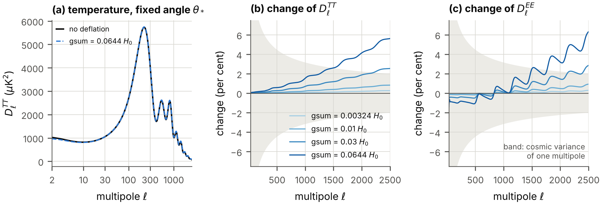

**FIG. 14.** The spectra of the microwave background at a fixed angle of the sound horizon. (a) The temperature spectrum without deflation and at the largest rate that nucleosynthesis allows. (b), (c) The change of the temperature and polarization spectra relative to the model without deflation for four rates (darker: faster); the band is the cosmic variance of a single multipole. Closure “Momentum”; at these multipoles the closure “Pressure” gives the same curves.

*The closure.* For $30\le\ell\le2500$ the spectra of the two closures differ by a thousandth of the effect of the deflation itself ($1.4\times10^{-3}$ and $1.2\times10^{-3}$ of it at the two bounds), and $\Delta\chi^{2}$ is the same to five digits \[Fig. 15(a)\]. *The spectra at these multipoles follow from A1, A2 and A3, whatever the closure.* For $\ell<30$, where the potentials of the recent universe act through the late integrated Sachs-Wolfe effect, the closures differ by more than the effect of the deflation in either of them, by a factor 2.1. The largest angular scales are not predicted; their cosmic variance is large, and at the rate of nucleosynthesis the closures differ by at most a third of it. The amplitude of matter is 0.9762 of its value without deflation in the closure “Momentum” and 0.9918 in the closure “Pressure” at the rate of nucleosynthesis, and 0.99892 and 0.99969 at the rate of lunar laser ranging.

Figure 15(b) shows what the agent must supply. In units of $a_{\mathrm{sp}}\,\mathrm{gsum}/H_{\mathrm{cf}}$ times the terms of each equation, the closure “Momentum” lacks 0.54 to 0.98 in Eq. (53c) and 0.31 to 0.49 in Eq. (53d) after recombination; the closure “Pressure” lacks 0.62 to 0.94 in Eq. (53b), and in Eq. (53d) an amount that falls as $(H_{\mathrm{cf}}/k)^{2}$ inside the horizon, as Eq. (59) requires. The two identities (56) and (57) hold along the numerical solutions to $8.6\times10^{-4}$, the accuracy of the numerical derivative with which they are tested. The complete calculation, with photons, neutrinos and baryons, reproduces the growth of Eqs. (60) and (61) to $1.3\times10^{-4}$ \[Fig. 15(c)\]; with the equation of the other closure it would disagree by a quarter of $\mathrm{gsum}/H_0$.

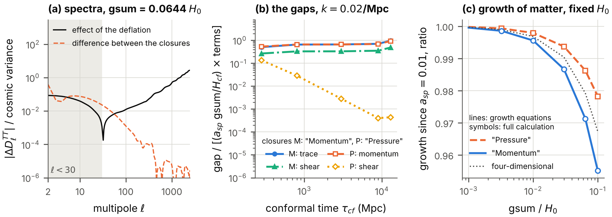

**FIG. 15.** The closure of the perturbation equations, at the largest rate that nucleosynthesis allows. (a) The difference between the temperature spectra of the closures “Momentum” and “Pressure”, and the effect of the deflation itself, in units of the cosmic variance of a single multipole: the closure matters below $\ell=30$ only. (b) What the agent supplies: the gaps of Eqs. (53b), (53c) and (53d) for one wavenumber, in units of $a_{\mathrm{sp}}\,\mathrm{gsum}/H_{\mathrm{cf}}$ times the terms of each equation. (c) The growth of the density contrast of matter since $a_{\mathrm{sp}}=0.01$ relative to no deflation, at a fixed Hubble constant: Eqs. (60) and (61) (lines), the complete calculation (symbols), and the four-dimensional equation with the Newton’s constant of the moment, which is neither closure.

### H. What mock data say about the rate, and about the Hubble constant

The earlier paper asked how far its dark radiation can raise the Hubble constant before the fit to the microwave background degrades, and answered with mock data: the spectra of the standard model stand in for the measurements, with the noise and the sky coverage of the Planck satellite, and of Planck together with a deep survey of a quarter of the sky ([Nash 2026a](#ref-Flat1644)). The mock data contain no gravitational lensing, and the standard model fits them with $\Delta\chi^{2}=0$ by construction. We put the same question to the deflation. The likelihood, the two data sets, the six parameters of the standard model and the fitting procedure are those of the earlier paper; the rate is a seventh parameter. Because the rates are positive, the derivative of the spectra with respect to $\mathrm{gsum}$ at zero rate is one-sided.

| mock data        | closure | $\sigma_{\mathrm{rate}}$ | bound  |  held   |  slope   | error of $H_0$ | rate free |
|:-----------------|:--------|:------------------------:|:------:|:-------:|:--------:|:--------------:|:---------:|
| Planck-like      | M       |         0.01963          | 0.0385 | 0.00108 | $-84.35$ |     0.561      |   1.748   |
| Planck-like      | P       |         0.01974          | 0.0387 | 0.00108 | $-84.40$ |     0.561      |   1.758   |
| with deep survey | M       |         0.01056          | 0.0207 | 0.00055 | $-82.11$ |     0.372      |   0.943   |
| with deep survey | P       |         0.01058          | 0.0207 | 0.00055 | $-82.13$ |     0.372      |   0.945   |

TABLE XII. Forecast for the rate of deflation from mock data of the microwave background (Fisher matrix; three equal rates; assumptions A1, A2, A3). M, P: the closures “Momentum” and “Pressure”. $\sigma_{\mathrm{rate}}$: standard error of $\mathrm{gsum}/H_0$ with the six parameters of the standard model free. Bound: the upper bound at 95 per cent, 1.96 standard errors, for a parameter that cannot be negative and whose best value is zero. Held: the standard error if the six parameters are held fixed. Slope: the change of the best-fit Hubble constant per unit of $\mathrm{gsum}/H_0$, in $\mathrm{km\,s^{-1}\,Mpc^{-1}}$. Last two columns: the standard error of the Hubble constant in $\mathrm{km\,s^{-1}\,Mpc^{-1}}$ with the rate held at zero, and with the rate free.

*A bound, as a forecast.* With the six parameters free, Planck-like data determine $\mathrm{gsum}/H_0$ to 0.0196 (Table XII), and the upper bound at 95 per cent is $$\mathrm{gsum}<0.0385\,H_0=2.65\times10^{-12}\ \text{per year},$$ or $0.0207\,H_0$ with the deep survey. With the six parameters *held* the error would be 0.00108: nearly all of the effect of the deflation on the spectra, above all the shift of the angle $\theta_*$, can be absorbed by the other parameters \[Fig. 16(c)\]. The bound lies between those of Table X: it is 11.9 times weaker than that of lunar laser ranging and 1.7 times stronger than that of nucleosynthesis. The closure changes it by half a per cent.

*The Hubble constant falls in every fit.* Along the degeneracy the best-fit Hubble constant changes by $-84.35~\mathrm{km\,s^{-1}\,Mpc^{-1}}$ per unit of $\mathrm{gsum}/H_0$ for the Planck-like data and by $-82.11$ with the deep survey, that is, by $-3.2$ and $-1.7~\mathrm{km\,s^{-1}\,Mpc^{-1}}$ at the respective bounds. This is steeper than the slope $-65.24$ at a fixed angle and fixed densities, because in the fit the density of dark matter rises and the tilt falls as well. Fits of the six parameters at fixed rates confirm the Fisher matrix \[Fig. 16(a), (b)\]: for rates up to $0.01\,H_0$ the minimum $\Delta\chi^{2}$ and the shift of the Hubble constant are 1.00 to 1.01 times its predictions, and the fits reach $\Delta\chi^{2}=3.84$ at $\mathrm{gsum}=0.0376\,H_0$ and, with the deep survey, at $0.0205\,H_0$. At the rate that lunar laser ranging allows the best fit has $\Delta\chi^{2}=0.027$ and $H_0=67.086~\mathrm{km\,s^{-1}\,Mpc^{-1}}$. At the rate that nucleosynthesis allows it has $\Delta\chi^{2}=11.6$, a deviation of 3.4 standard deviations, and $H_0=61.70~\mathrm{km\,s^{-1}\,Mpc^{-1}}$; with the deep survey $\Delta\chi^{2}=39.8$. *The largest rate that nucleosynthesis allows would be excluded by data of the quality of Planck.*

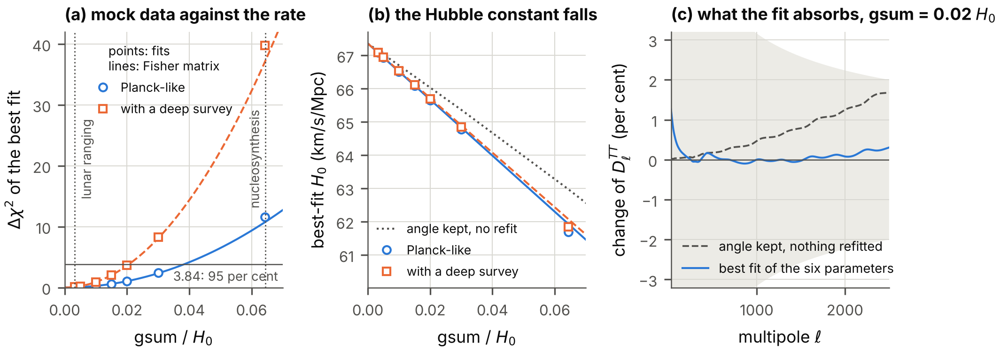

**FIG. 16.** Mock data of the microwave background against the rate of deflation. (a) The minimum $\Delta\chi^{2}$ of fits of the six parameters of the standard model at a fixed rate (symbols) and the parabola of the Fisher matrix (lines), for the two data sets; the rates that lunar laser ranging and nucleosynthesis allow are marked. (b) The best-fit Hubble constant, with the slope of the Fisher matrix and, dotted, the Hubble constant that keeps the angle when nothing else is refitted. (c) The temperature spectrum at $\mathrm{gsum}=0.02\,H_0$ relative to the data: with the angle kept and nothing refitted, and at the best fit, which absorbs most of the difference; the band is the cosmic variance of a single multipole.

*Deflation and dark radiation together.* The earlier paper fitted seven one-parameter families of extra radiation to the same mock data: free-streaming radiation, a fluid, the stepped fluid of the model at four transition redshifts $z_t$, and the Wess–Zumino stepped fluid, each with a density $N$ in units of one neutrino species ([Nash 2026a](#ref-Flat1644)). Every family can raise the Hubble constant, and every one at a price in $\Delta\chi^{2}$. Does the deflation lower the price? We repeated all fits on the deflating spacetime at the largest rate that lunar laser ranging allows, and computed the Fisher matrix with $N$ and the rate free together (Table XIII, Fig. 17). Three results follow.

First, at that rate every best-fit Hubble constant of the earlier paper falls by 0.274 to $0.279~\mathrm{km\,s^{-1}\,Mpc^{-1}}$, which is the shift of the model without extra radiation: the effects of the deflation and of the extra radiation add \[Fig. 17(a), (b)\].

Second, $N$ and the rate are positively correlated, with correlation coefficients of 0.37 to 0.89. Extra radiation makes the early universe expand faster, the weaker gravity of the deflating spacetime makes it expand more slowly, and in the spectra the two compensate in part. Fits with extra radiation are therefore slightly *better* on the deflating spacetime than on the static one, slightly more extra radiation is allowed at a given $\Delta\chi^{2}$, and with both parameters free the error of each grows, for free-streaming radiation from 0.143 to 0.250 in $N$.

Third, the compensation does not help the Hubble constant. When the rate grows and $N$ follows its best-fitting value, the best-fit Hubble constant still falls: by $35.3~\mathrm{km\,s^{-1}\,Mpc^{-1}}$ per unit of $\mathrm{gsum}/H_0$ for free-streaming radiation, against 84.35 without extra radiation, and by 22.1 to 76.9 for the seven families. The largest Hubble constant among the models with $N\ge0$, $\mathrm{gsum}\ge0$ and $\Delta\chi^{2}\le3.84$ is therefore reached at zero rate, for every family and both data sets \[Fig. 17(c)\]. *The deflation lowers the Hubble constant faster than it makes room for extra radiation.*

|                                      |                           |           |             |           |              |           |             |         |         |
|:-------------------------------------|:-------------------------:|:---------:|:-----------:|:---------:|:------------:|:---------:|:-----------:|:-------:|:-------:|
|                                      | $N$ at $\Delta\chi^{2}=4$ |           | $H_0$ there |           | error of $N$ |           |             |   net   | largest |
| family                               |          static           | deflating |   static    | deflating |  rate zero   | rate free | correlation |  slope  |  rise   |
| free-streaming radiation             |           0.29            |   0.31    |    69.74    |   69.62   |    0.143     |   0.250   |    0.82     | $-35.3$ |  2.30   |
| fluid, no step                       |           0.27            |   0.29    |    70.20    |   70.12   |    0.135     |   0.249   |    0.84     | $-23.9$ |  2.77   |
| model fluid, $z_t=10^4$              |           0.25            |   0.26    |    68.75    |   68.53   |    0.122     |   0.145   |    0.54     | $-65.4$ |  1.35   |
| model fluid, $z_t=2\times10^4$       |           0.17            |   0.18    |    68.16    |   67.90   |    0.085     |   0.091   |    0.37     | $-76.9$ |  0.78   |
| model fluid, $z_t=5\times10^4$       |           0.12            |   0.13    |    68.48    |   68.27   |    0.060     |   0.076   |    0.61     | $-67.0$ |  1.10   |
| Wess-Zumino fluid, $z_t=2\times10^4$ |           0.32            |   0.35    |    70.13    |   70.06   |    0.160     |   0.350   |    0.89     | $-22.1$ |  2.69   |
| model fluid, $z_t=10^6$              |           0.30            |   0.32    |    70.39    |   70.32   |    0.150     |   0.250   |    0.80     | $-23.0$ |  2.95   |

TABLE XIII. The dark-radiation families of the earlier paper on the deflating spacetime (Planck-like mock data; assumptions A1, A2, A3). “Model fluid” is the stepped fluid of the model with the transition redshift $z_t$. Columns 2 to 5: the density $N$ of extra radiation at which the best fit reaches $\Delta\chi^{2}=4$, and the Hubble constant there in $\mathrm{km\,s^{-1}\,Mpc^{-1}}$, with static extra coordinates (the earlier paper) and deflating at the largest rate that lunar laser ranging allows. Columns 6 to 10, from the Fisher matrix with $N$ and the rate free together: the standard error of $N$ with the rate held at zero and with the rate free; the correlation coefficient of $N$ and the rate; the net slope, that is, the change of the best-fit Hubble constant in $\mathrm{km\,s^{-1}\,Mpc^{-1}}$ per unit of $\mathrm{gsum}/H_0$ when $N$ follows its best-fitting value; and the largest rise of the best-fit Hubble constant, in $\mathrm{km\,s^{-1}\,Mpc^{-1}}$, among the models with $N\ge0$, $\mathrm{gsum}\ge0$ and $\Delta\chi^{2}\le3.84$, which is reached at zero rate for every family.

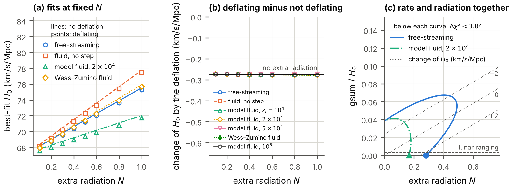

**FIG. 17.** The dark-radiation families of the earlier paper on the deflating spacetime (Planck-like mock data). (a) The best-fit Hubble constant against the density $N$ of extra radiation for four families: without deflation (lines) and at the largest rate that lunar laser ranging allows (symbols). (b) The difference for all seven families; the horizontal line is the shift of the model without extra radiation. (c) The rate and the extra radiation as free parameters together: the regions with $\Delta\chi^{2}<3.84$ of the Fisher matrix for two families, lines of constant change of the best-fit Hubble constant for free-streaming radiation (dotted), the point of the largest Hubble constant of each region (filled symbols, at zero rate), and the rate that lunar laser ranging allows (dashed).

### I. Dark matter

*What does not change.* The estimates of the earlier paper that decide whether the particles of the model can be degenerate or condensed in observed halos contain the masses, the densities and the velocities only, and the masses do not change along the deflation. Computed again, every number agrees: fermions with eight internal states are degenerate in the core of a dwarf galaxy only if they are lighter than 0.276 keV, and bound pairs are condensed there only if they are lighter than 262 eV. The verdict of the earlier paper on these two possibilities stands.

*Self-interaction, and the epoch of the resonance.* The cross-section per mass of bound pairs must respect the bound of about $1~\mathrm{cm^{2}/g}$ from colliding clusters ([Markevitch et al. 2004](#ref-Markevitch2004); [Randall et al. 2008](#ref-Randall2008)), which the earlier paper turned into a smallest allowed fermion mass: 918 MeV for $\alpha_{\mathrm{VS}}=0.1$. For a given particle the masses are constant and so is this cross-section. What the deflation changes is whether the pair *exists*: it is bound only after $D_{\mathrm{VS}}$ has grown to $D_c$. And at that moment the scattering length of two unbound fermions diverges (Sec. VII), so that their cross-section rises to the limit that unitarity allows, which is larger the slower the particles. For the example particle, $m=918$ MeV and $m_s=54.7$ MeV, at the relative velocities 10, 156 and 1000 km/s \[Fig. 8(c)\]: one unit of the clock before the binding the cross-section per mass is $0.84~\mathrm{cm^{2}/g}$ at all three velocities; at the binding it peaks at $1.3\times10^{7}$, $5.2\times10^{4}$ and $1.3\times10^{3}~\mathrm{cm^{2}/g}$; and it exceeds $100~\mathrm{cm^{2}/g}$ during an interval of the clock of 0.27, 0.27 and 0.26 around the binding. *A deflating universe whose dark matter consists of these fermions passes through an epoch of strong, velocity-dependent self-interaction*, strongest in the smallest halos. Whether the epoch lies in the observable past depends on the rate. Under A2 and a constant rate it does so only if $D_{\mathrm{VS}}$ today exceeds $D_c$ by less than a third of a per cent, a coincidence that nothing in the model explains.

*Superfluid dark matter and small-scale structure.* The earlier paper also asked what becomes of the growth of structure if the dark matter is the superfluid itself, a fluid with first sound, in two limits: a degenerate gas of the fermions with eight internal states, and a condensate of bound pairs with the sound speed $c_{s0}$ today. The pressure of such a fluid suppresses structure below a wavenumber, and the bound of the Lyman-$\alpha$ forest on warm dark matter ([Viel et al. 2005](#ref-Viel2005); [Iršič et al. 2017](#ref-Irsic2017)) then limits the fermion mass from below and the sound speed from above. Computed again on the deflating background under A1 to A3, at the Hubble constant that keeps the angle, the wavenumber at which the power falls to a quarter of that of cold dark matter is lower by 0.15 to 0.16 per cent at the rate that lunar laser ranging allows and by 3.0 to 3.3 per cent at the rate that nucleosynthesis allows, for fifteen models. The reason is the weaker gravity of the time at which the suppression is set: the Jeans wavenumber is proportional to the square root of Newton’s constant. The limits move accordingly, from $m>1.514$ keV and $c_{s0}<1.645\times10^{-11}\,c$ without deflation to $m>1.516$ keV and $c_{s0}<1.641\times10^{-11}\,c$ at the first rate and $m>1.555$ keV and $c_{s0}<1.565\times10^{-11}\,c$ at the second. The two closures give the same wavenumbers to $1.5\times10^{-5}$. In this calculation the equation of state of the superfluid in ordinary space is that of the earlier paper; whether the self-interaction of a condensate would itself follow the volume of the deflating coordinates is a question about the microscopic model that the calculation does not answer.

*How fast the quantities drift.* With $n=d\ln(\text{quantity})/d\tau_d$, the relative change of a quantity over the age of the universe is $n\,\mathrm{gsum}\,t_0$. The couplings themselves drift with $n=1$ or $\tfrac12$ (Table I). Quantities near a threshold drift much faster: the scattering length just below the binding, at $D_{\mathrm{VS}}=1.5$, with $n=9.1$; the binding energy just above it, at $D_{\mathrm{VS}}=1.8$, with $n=30$; the gap of a weakly paired state with $n=1/\lambda$. These are the quantities in which a slow deflation would first be seen.

### J. Verdict on hypothesis H3

*The Hubble tension.* The mechanism of the earlier paper, the phase mode of the Vorton-Scalar as dark radiation, is untouched at the allowed rates, since the couplings drift by parts in a thousand; its verdict stands and is not improved. The deflation itself contributes two effects. The first, through Newton’s constant, has the wrong sign: at a fixed angle of the sound horizon the inferred Hubble constant falls by $0.2~\mathrm{km\,s^{-1}\,Mpc^{-1}}$ at the largest rate that lunar laser ranging allows, and in fits to mock data of the microwave background it falls by $84~\mathrm{km\,s^{-1}\,Mpc^{-1}}$ per unit of $\mathrm{gsum}/H_0$. Nor can the rate help the dark radiation: more extra radiation is allowed when the rate is free, but the largest Hubble constant that the mock data allow is reached at zero rate. The second effect, the loss of mass of bound pairs, has the right sign and is bounded, in the examples computed, to $0.5~\mathrm{km\,s^{-1}\,Mpc^{-1}}$. *The hypothesis that the model resolves the Hubble tension is not supported by the deflation, and under A2 it is mildly disfavored.*

*Dark matter.* The conclusions of the earlier paper about the mass ranges hold unchanged, and its limits on superfluid dark matter move by two tenths of a per cent at the rate that lunar laser ranging allows. The deflation adds one qualitative prediction, the epoch of the resonance, and one quantitative one, a rise of the growth rate, whose size depends on the perturbations of the agent. Neither is in conflict with observation at the allowed rates, and neither is detectable at the rate that lunar laser ranging allows. *The hypothesis that the superfluid is the dark matter is neither strengthened nor weakened by the deflation.* It acquires a history, whose observable part is empty if gravity is eight-dimensional and the rate constant.

*What rests on the additional assumptions.* Everything in this section that concerns Newton’s constant rests on A2. The spectra, the forecast and the growth of structure rest in addition on A3, and the growth of structure and the largest angular scales on a closure that the hypothesis of deflation does not supply. The forecasts are for mock data without gravitational lensing; no measured spectrum has been fitted.

## XII. The Higgs hypothesis

### A. The hypothesis and the conditions

Hypothesis H2 says that the superfluid state, the condensate of the fermion pair along the hidden axis, *is the Higgs field* ([Higgs 1964](#ref-Higgs1964)). In the Standard Model the Higgs field is a doublet of the weak-isospin group with a vacuum value $v_{\mathrm{EW}}=246$ GeV, which breaks the electroweak symmetry, gives the W and Z bosons and the quarks and charged leptons their masses, and leaves one scalar particle of 125 GeV. Its four real components form a vector of a group $SO(4)$, which the vacuum value breaks to $SO(3)$ ([Sikivie et al. 1980](#ref-Sikivie1980)). The earlier paper derived from this seven conditions that a condensate must meet in order to *be* the Higgs field (Table XIV) and found that on the flat $4{+}4$ spacetime the hypothesis has no geometric basis. This section repeats the test on the deflating spacetime.

Two statements must be kept apart. H2 is the hypothesis that the *pair condensate* is the Higgs field; the electroweak scale is then the scale of the condensate. HV, used in one row of Table X, is the different assumption that the vacuum value of the *Vorton-Scalar* sets the electroweak scale. HV is not examined here.

| condition                                                                        | status                                                                              |
|:---------------------------------------------------------------------------------|:------------------------------------------------------------------------------------|
| C1: a scalar under the Lorentz group of ordinary spacetime                       | met in the sector of fields that do not depend on the extra coordinates             |
| C2: non-zero in empty space                                                      | open; reached by the deflation only outside the range of validity of the model      |
| C3: a doublet of the weak-isospin group with a neutral component                 | only under a hidden symmetry; a singlet under the rotations of the additional times |
| C4: breaks $SO(4)$ to $SO(3)$                                                    | met in the sector only                                                              |
| C5: scale 246 GeV, with a scalar particle of 125 GeV with the observed couplings | —                                                                                   |
| C6: its couplings give the quarks and leptons their masses                       | —                                                                                   |
| C7: no further light or charged particles that would have been seen              | —                                                                                   |
| new: the electroweak scale does not drift                                        | requires $\mathrm{gsum}<1.16\times10^{-6}\,H_0/n_{\mathrm{EW}}$                     |

TABLE XIV. The conditions that a condensate must meet in order to be the Higgs field, and their status on the deflating $4{+}4$ spacetime. The last row is new. A dash marks a condition that the earlier paper did not examine for this spacetime, because C3 is not met there by any symmetry of the spacetime.

### B. What the deflation leaves unchanged

The pair operators, their transformation properties and the internal symmetry are properties of the Dirac matrices of the frame, which the deflation does not change, and of the equations of the fields that do not depend on the extra coordinates, which for the weighted fields are the flat equations. By Sec. X C the four vector pair operators form the $(2,2)$ of $SU(2)_A\times SU(2)_B$, the representation of a Higgs field, and a condensate along one axis breaks $SO(4)$ to $SO(3)$. Hence, *within the sector*, C1 holds as on flat spacetime: the pair along the hidden axis is invariant under the rotations of $x1,x2,x3$, which remain symmetries of the spacetime, and under the boosts of ordinary spacetime as they act on the fields of the sector. (The boosts are no longer symmetries of the deflating spacetime as a whole; in the sector this shows only in the dependence of the couplings on the time.) C3 and C4 hold in the sector as well, in the sense that the pattern is right under its internal symmetry.

### C. What the deflation changes

On the flat $4{+}4$ spacetime the only non-Abelian internal symmetry that the geometry provides is $SO(3)_T$, the rotations of the three additional times, and under it the condensate along the hidden axis is a singlet, not a doublet ([Nash 2026a](#ref-Flat1644)). By Sec. X C the deflating spacetime keeps $SO(3)_T$ only if the three rates are equal, and reduces it to one rotation, or to none, otherwise. The conclusion of the earlier paper is unchanged where the rates are equal and holds a fortiori where they are not: *the hypothesis has no geometric basis on the $4{+}4$ spacetime.* The pattern of the Higgs vacuum is present in the sector, under a hidden symmetry, and nowhere else. The companion paper shows that the deflation puts the $7{+}1$ model, which had a geometric basis on flat spacetime, in the same position ([Nash 2026b](#ref-CompanionDefl1671)).

### D. Condition C2: a condensate in empty space

The earlier paper left C2 open: a pair condensate forms in the vacuum only if $\alpha_{\mathrm{VS}}$ exceeds a critical value $\alpha_c$ of about 2 or more, depending on the cutoff. On a deflating spacetime $\alpha_{\mathrm{VS}}$ grows as $e^{\tau_d}$ and reaches any such value at a definite time. Section IX showed what else has happened by then: the exchange of one boson is no longer a controlled approximation, and the field at which the one-loop potential of the Vorton-Scalar falls below its vacuum value has moved to within a factor of two of the vacuum value. *C2 can be reached by waiting, but not within the range of validity of the model.* Its status remains open.

### E. A new condition: the electroweak scale must not drift

Suppose that H2 holds. The electroweak scale $v_{\mathrm{EW}}$ is then the scale of the pair condensate in the vacuum, as in models in which a condensate of fermions replaces the elementary Higgs field ([W. A. Bardeen, Hill, and Lindner 1990](#ref-BardeenHillLindner1990)). That scale is determined by the parameters of the model: the masses $m$ and $m_s$, the cutoff, and the coupling $\alpha_{\mathrm{VS}}$. On the deflating spacetime the masses are constant and $\alpha_{\mathrm{VS}}\propto e^{\tau_d}$. Therefore $$v_{\mathrm{EW}}\ \propto\ e^{\,n_{\mathrm{EW}}\,\tau_d},\qquad n_{\mathrm{EW}}=\frac{d\ln v_{\mathrm{EW}}}{d\ln\alpha_{\mathrm{VS}}}.
\tag{63}$$ The exponent cannot vanish: below the critical coupling there is no condensate, so that the scale depends on the coupling, and most strongly just above the critical coupling.

Under H2 the masses of the electron and of the quarks are proportional to $v_{\mathrm{EW}}$ and change at the rate $n_{\mathrm{EW}}\,\mathrm{gsum}$. The mass of the proton is due mostly to the strong interaction and does not follow. The ratio $m_p/m_e$ of the proton mass to the electron mass therefore changes at the rate $n_{\mathrm{EW}}\,\mathrm{gsum}$. Comparisons of atomic clocks find this ratio constant to $8.0\times10^{-17}$ per year at two standard deviations ([Lange et al. 2021](#ref-Lange2021)). Hence $$\mathrm{gsum}<\frac{8.0\times10^{-17}\ \text{per year}}{n_{\mathrm{EW}}}=\frac{1.16\times10^{-6}\,H_0}{n_{\mathrm{EW}}}.
\tag{64}$$ The bound needs no assumption about gravity. For $n_{\mathrm{EW}}=1$ it is 2787 times stronger than the bound that lunar laser ranging gives if gravity is eight-dimensional.

*The size of the exponent.* For the model itself, with massive fermions and a massive radial mode, the scale of the vacuum condensate has not been computed as a function of the coupling. It is known in closed form for the case on which the earlier paper tested its ladder equation: massless fermions and massless bosons between an infrared scale and a cutoff ([Miransky 1985](#ref-Miransky1985)). There the scale of the condensate obeys $$\varrho_c\,\ln\frac{\text{cutoff}}{\text{scale}}=\arctan\frac{1}{2\varrho_c},\qquad
\varrho_c^{2}=\frac14\Big(\frac{\alpha_{\mathrm{VS}}}{\alpha_c}-1\Big),$$ where $\varrho_c$ is only an abbreviation for the square root that the second equation defines, from which $$n_{\mathrm{EW}}=\frac{(1+4\varrho_c^{2})\,\arctan(1/2\varrho_c)}{8\,\varrho_c^{3}}+\frac{1}{4\varrho_c^{2}}.
\tag{66}$$ The program verifies Eq. (66) against the numerical derivative to $3\times10^{-8}$ and tabulates it with the bound (64) (Table XV). The exponent diverges at the critical coupling, equals $1+\pi/2=2.57$ at twice the critical coupling, and exceeds 1 for $\alpha_{\mathrm{VS}}<3.27\,\alpha_c$. It falls below 1 only where the scale of the condensate approaches the cutoff, that is, where the four-dimensional description ends. Within the range in which a condensate of the kind that H2 needs can be described at all, $n_{\mathrm{EW}}$ is of order one or larger.

| $\alpha_{\mathrm{VS}}/\alpha_c$ | $\ln$(cutoff/scale) | $n_{\mathrm{EW}}$ | $\mathrm{gsum}$ (per year) | $\mathrm{gsum}/H_0$ |
|:-------------------------------:|:-------------------:|:-----------------:|:--------------------------:|:-------------------:|
|              1.05               |       12.082        |        147        |    $5.4\times10^{-19}$     | $7.9\times10^{-9}$  |
|              1.10               |        7.998        |       54.0        |    $1.5\times10^{-18}$     | $2.2\times10^{-8}$  |
|              1.25               |        4.429        |       15.1        |    $5.3\times10^{-18}$     | $7.7\times10^{-8}$  |
|              1.50               |        2.702        |       6.05        |    $1.3\times10^{-17}$     | $1.9\times10^{-7}$  |
|              2.00               |        1.571        |       2.57        |    $3.1\times10^{-17}$     | $4.5\times10^{-7}$  |
|              3.00               |        0.870        |       1.15        |    $6.9\times10^{-17}$     | $1.0\times10^{-6}$  |
|              5.00               |        0.464        |       0.540       |    $1.5\times10^{-16}$     | $2.2\times10^{-6}$  |
|              10.0               |        0.215        |       0.230       |    $3.5\times10^{-16}$     | $5.0\times10^{-6}$  |

TABLE XV. The exponent $n_{\mathrm{EW}}$ with which the scale of the vacuum condensate follows the coupling in the scale-invariant ladder equation, and the bound (64) on the present rate of deflation that follows from it under hypothesis H2.

*The conclusion.* Under H2 the deflation clock can have advanced by at most $\mathrm{gsum}\,t_0<1.1\times10^{-6}/n_{\mathrm{EW}}$ during the age of the universe at a constant rate. Every effect of the deflation described in Secs. VI to XI is then unobservably small. Conversely, a deflation at any rate at which those effects matter excludes H2. *The hypothesis H2 and a deflation of any consequence today exclude each other.* This conclusion does not depend on the unresolved conditions C2 and C5 to C7. It depends on two properties only: that the electroweak scale is set by the dynamics of the model, which is the content of H2, and that the coupling of the model follows the volume of the deflating coordinates, which is exact (Sec. V).

### F. Verdict on hypothesis H2

On the deflating spacetime the hypothesis that the singlet superfluid is the Higgs field is unproven and without geometric basis, as on the flat $4{+}4$ spacetime, and it is incompatible with any deflation that is fast enough to matter today. Whether a mechanism exists that would make the electroweak scale insensitive to the coupling of the pair is not known; none is present in the model.

## XIII. What has been established, and what has not

The sections above reported results of very different standing: identities verified in exact arithmetic, numerical results with a stated accuracy, consequences of additional assumptions, and estimates. This section sorts them. An item is called established if a machine check stands behind it (Appendix C); statements of interpretation deserve the reader’s independent scrutiny more than the numbers do.

### A. Established

*Geometry* (Sec. II). The curvature and the Einstein tensor of the deflating spacetime in closed form, for arbitrary rates and constants. The Killing vectors, 14, 15 or 20 in number, and the completeness of the lists. That the spacetime is not a solution of Einstein’s equations without matter, with or without a cosmological constant; that with three equal rates it is an exact solution of Einstein-Gauss-Bonnet gravity without matter, for $\Lambda_8=3\,\mathrm{g55}^{2}$ and $\alpha_{\mathrm{GB}}=-1/(4\,\mathrm{g55}^{2})$; and that with unequal rates it is not. The turning value of the ordinary time for a classical particle with momentum along a deflating time.

*The Dirac field* (Secs. III, IV). The Dirac matrices in coordinate components, the spin connection, the covariant constancy of the matrices, and the curvature of the spinor derivative. The Dirac equation, the weighted field, and the statement that fields which do not depend on $x5,x6,x7$ obey the flat equation. The exact solutions when one rate governs; that exactly eight of the sixteen solutions are bounded; that these are standing waves with vanishing charge; and the law of their extinction, Eqs. (24) to (26). All of this is confirmed numerically by two independent methods.

*The model along the clock* (Secs. V to IX). For fields that do not depend on the extra coordinates, the model of the earlier paper on the deflating spacetime is the same model with the couplings of the moment, exactly. The masses are constant; $g_{\mathrm{VS}}$ grows as $e^{\tau_d/2}$; $\alpha_{\mathrm{VS}}$, $G_{\mathrm{VS}}$, $D_{\mathrm{VS}}$ and $C$ grow as $e^{\tau_d}$. The modes of the Vorton-Scalar grow with the weight only, and the potential between two fermions has the unchanged range and the strength of the moment. The exchange amplitudes are those of flat spacetime times the square of the coupling of the moment. In weak coupling the gap grows according to Eq. (39), and the critical temperature follows it. Two fermions become bound at a definite time, at a scattering resonance, with a binding energy that starts quadratically; the order of the other events depends on $m_s/m$ alone. The paired state follows the deflation if and only if $\Xi_d$ is below about 0.2 to 0.5; before that it lags and accumulates broken pairs. The solution of the gap equation is a minimum of the effective potential at every moment examined. Matter of fixed density loses its fermion mass at a critical value of $C$, is self-bound for $C>3.7011$ and is more strongly bound later; the melting temperature of the fermion mass falls; the barrier of the one-loop potential of the vacuum moves toward the vacuum value.

*Order parameter and symmetry* (Sec. X). The potential of the order parameter prefers no direction among the four frame axes. The internal symmetry of the sector, the representation of the pair operators and the breaking pattern are unchanged by the deflation. Of the six generators that belong to the pairs of the four extra axes, the deflating spacetime keeps none, one or three as symmetries of the spacetime. A vortex line of unit winding carries four fermion zero modes, two for each direction along the line, at every moment; its energy per length falls as $e^{-\tau_d}$.

*Cosmology* (Sec. XI), each item under the assumption named there. The equation of the expansion (51) and the fall of the inferred Hubble constant, with recombination computed on the deflating background and verified by an independent calculation. The bounds of Table X, and that in the model as it stands the atomic clocks give none. The effect of the loss of mass of bound pairs. The pressure (52) of the agent. The equations (53) of the perturbations of ordinary space for unperturbed extra scale factors, the identities (56) and (57), and that the four equations cannot all hold with matter alone. The growth equations of the two closures, and that the closure “Shear” coincides with the closure “Pressure” inside the horizon. The spectra of the microwave background for $\ell\ge30$ and their independence of the closure; the forecast for the rate from mock data; that the Hubble constant falls in every fit, with or without extra radiation; and that extra radiation and the rate of deflation compensate in part in the spectra, without any gain for the Hubble constant. The unchanged estimates of degeneracy and of condensation in halos, the limits on superfluid dark matter, the epoch of the resonance, and the drift of the quantities.

*The Higgs hypothesis* (Sec. XII). Under H2 the electroweak scale follows the coupling with the exponent $n_{\mathrm{EW}}$, and atomic clocks bound the rate of deflation by Eq. (64). The exponent is given in closed form for the scale-invariant ladder equation.

### B. Not established

*The source of the deflation.* The metric is prescribed. For equal rates it solves the equations of Einstein-Gauss-Bonnet gravity without matter; whether that solution is stable has not been examined. For unequal rates no field equation has been found that the metric solves, and the stress tensor that Einstein’s equations would require has not been identified with any matter. All results on fields are results on a given background.

*The theory of gravity and the assumption A2.* If gravity is of the Einstein-Gauss-Bonnet kind, the relation (50) between Newton’s constant and the volume of the deflating coordinates, and with it every result of Sec. XI that is marked A2, would have to be derived anew.

*The agent.* Nothing in the hypothesis says what keeps the three rates constant while ordinary space expands. Under A2 it must have the tension (52) and no energy density; whether a physical source with these properties exists has not been examined. Nor does the hypothesis say how the agent responds when ordinary space is perturbed. That the scale factors of the deflating coordinates are not perturbed (assumption A3) is an assumption; and even with it, a closure is needed that the hypothesis does not supply. The growth of structure, the amplitude $\sigma_8$ and the spectra of the microwave background at the largest angular scales are computed for two closures and differ between them at the first order in the rate. They are the quantities that a theory of the agent would have to predict.

*The exclusion of the growing solutions.* The eight growing solutions of each mode that depends on a deflating time are discarded because they are unbounded. That is a condition of admissibility; it is not derived from a principle. The theory has no positive conserved charge for such modes, and a consistent quantization exists only for the sector that does not depend on the additional times.

*Unequal rates with simultaneous crossings.* No closed form is known for a mode that depends on two deflating coordinates whose crossings coincide; the results are numerical.

*The hidden coordinate.* That the fields do not depend on $x0$ is assumed, as in the earlier paper. Nothing in the deflation explains it.

*The end of the history.* The couplings grow without bound. The four-dimensional description with the exchange of one boson holds only while $\alpha_{\mathrm{VS}}$ is not large, and the eight-dimensional theory itself is an effective theory, with couplings of negative mass dimension, that must fail when the proper size of the deflating coordinates reaches its scale of validity. What happens then is outside the model. Every history of Secs. VI to IX ends in a regime that the two-loop truncation does not control; the numbers at the last moments of each table indicate the trend and are not predictions.

*The energy.* The energy of matter is not conserved while the couplings change. Where it goes, into whatever drives the deflation, is not described.

*Dynamics.* Sections VI, VII and IX give sequences of equilibrium states. Only for the paired state has the ability to follow been examined, in a model without dissipation; with dissipation the broken pairs would relax, and their lifetime is not known. The time-dependent two-body problem at the moment of binding, which decides how much of the population ends in the bound state, has not been solved. How a gas reaches the self-bound state, and whether the abnormal state forms by nucleation, are open. The equilibrium of a loop of vortex line with its current, and its stability, have not been computed.

*The vacuum beyond one loop.* The statements about the vacuum use the one-loop potential outside its range of reliability and draw only the conclusion stated in Sec. IX.

*Cosmology.* The forecasts of Sec. XI H are for mock data without gravitational lensing; no measured spectrum of the microwave background has been fitted. All bounds that reach back to nucleosynthesis or to recombination assume a constant rate; a rate that was large early and is small today is neither excluded nor described. Only linear perturbations were computed. The consequences of the epoch of the resonance for the formation of halos have not been simulated.

*The Higgs hypothesis.* Everything that the earlier paper lists as not established: that a condensate forms in the vacuum, that any symmetry of the model is the electroweak gauge group, the scale and the mass of the scalar particle, and the masses of ordinary fermions. The exponent $n_{\mathrm{EW}}$ has not been computed for the model itself; the statement that it is of order one or larger rests on the scale-invariant case and on the general fact that the scale of the condensate vanishes at the critical coupling.

## XIV. Conclusions

We asked what becomes of a 16-component Dirac field, and of the superfluid of its pairs, when three of the eight coordinates of a spacetime of signature $4{+}4$ deflate exponentially.

The geometry is simple and rigid. The deflating spacetime is homogeneous, it has 14 to 20 symmetries instead of 36, and it is not a solution of Einstein’s equations without matter. With three equal rates it is an exact solution of Einstein-Gauss-Bonnet gravity without matter, for one relation between the rate and the two constants of that theory.

The Dirac field separates into two parts. Fields that do not depend on the deflating coordinates obey, after a change of normalization, exactly the flat equations. Fields that do depend on them are extinguished: every admissible mode is a standing wave that dies out as the exponential of an exponential of the time. The sector in which the $4{+}4$ theory is not unitary is removed by the deflation, although the condition that selects the admissible modes is imposed and not derived.

The superfluid of hypothesis H1 exists on the deflating spacetime at every moment, with the couplings of that moment, and it acquires a history. The masses do not change; the coupling grows with the inverse volume of the deflating coordinates; the gap grows much faster than the coupling, in weak coupling as the exponential of an exponential; two fermions become bound at a scattering resonance; matter loses its fermion mass and becomes self-bound; and the paired state can follow the deflation only once its gap exceeds a few times the rate divided by the pairing strength. The direction of the order parameter is not selected by the deflation.

For hypotheses H2 and H3 the deflation brings no relief. The Higgs hypothesis had no geometric basis on the flat $4{+}4$ spacetime and has none here. If the superfluid were the Higgs field, the electroweak scale would follow the growing coupling, and atomic clocks would then limit the rate of deflation to about a millionth of the Hubble rate. If gravity is the Einstein theory in eight dimensions, lunar laser ranging limits it to three thousandths of the Hubble rate, and the Hubble constant inferred from the microwave background moves away from the local measurement, in the simplest estimate and in fits of all parameters to mock data alike. In either case nothing of the history just described can have happened within the age of the universe at a constant rate.

The perturbations of ordinary space show most plainly what the hypothesis of deflation leaves open. Whatever keeps the rates constant must carry a tension, and it must take part in the perturbations: with a Newton’s constant that depends on the time, the Einstein equations of ordinary space cannot all hold with matter alone. The spectra of the microwave background at all but the largest angular scales do not depend on how the agent does so, and mock data of the quality of the Planck satellite would bound the rate to four per cent of the Hubble rate. The growth of structure does depend on it, at the first order in the rate.

These results are quantitative, and they come with the programs that produced them. They mark what a successful theory of this kind would have to supply: a source or a theory of gravity that sustains the deflation and that says how the source responds to perturbations, a rate that was large early and is small today, and a reason why the constants of ordinary matter do not follow the volume of the deflating coordinates.

## Data availability

The source code of all programs, the data files from which every figure and every computed number of this paper is generated, the instructions for compiling and running the programs, the supplements that derive each result step by step, and the documents that record the provenance of each result are openly available ([Nash 2026d](#ref-DeflationRepo)).

## Appendix A: Symbols

Tables XVI, XVII and XVIII list the symbols of this paper with the place of their definition. Symbols of the earlier paper ([Nash 2026a](#ref-Flat1644)) keep their meanings. The complete registry, with the machine checks that no symbol has two meanings, is part of Ref. ([Nash 2026d](#ref-DeflationRepo)).

| symbol                                                                                        | meaning                                                                                                                                                                                   | defined in      |
|:----------------------------------------------------------------------------------------------|:------------------------------------------------------------------------------------------------------------------------------------------------------------------------------------------|:----------------|
| $x0,\dots,x7$                                                                                 | the eight coordinates: $x0$ hidden space-like coordinate; $x1,x2,x3$ ordinary space; $x4$ ordinary time; $x5,x6,x7$ the deflating coordinates, time-like                                  | Sec. I          |
| $xt$; $xj$; $a$                                                                               | a deflating coordinate, $t\in\{5,6,7\}$; a flat coordinate other than the time, $j\in\{0,1,2,3\}$; index of the four extra axes, $a\in\{0,5,6,7\}$                                        | Sec. I          |
| $\mathrm{g55}$, $\mathrm{g66}$, $\mathrm{g77}$; $\mathrm{rate}_t$                             | the three rates of deflation (upright, without subscript; not components of the metric); the rate of $xt$                                                                                 | Eq. (1)         |
| $\mathrm{const5}$, $\mathrm{const6}$, $\mathrm{const7}$; $\mathrm{const}_t$                   | the three positive constants of the metric: the scale factors at $x4=0$                                                                                                                   | Eq. (1)         |
| $\mathrm{gsum}$, $\mathrm{gsq}$, $\mathrm{gprod}$                                             | the sum of the rates, the sum of their squares, the sum of their products in pairs                                                                                                        | Sec. II         |
| $b_t$                                                                                         | scale factor of the deflating coordinate $xt$                                                                                                                                             | Eq. (2)         |
| $\eta$; $g_{\mu\nu}$; $e_A{}^{\mu}$                                                           | flat metric; metric of the deflating spacetime; orthonormal frame                                                                                                                         | Eq. (3)         |
| $V_d$                                                                                         | proper volume of a unit coordinate cell of the deflating coordinates                                                                                                                      | Eq. (4)         |
| $\Gamma^{\rho}{}_{\mu\nu}$; $R^{\rho}{}_{\sigma\mu\nu}$, $R^{\mu}{}_{\nu}$, $R$               | Christoffel symbols; Riemann tensor \[in Eq. (6) its components in the orthonormal frame\], Ricci tensor, curvature scalar                                                                | Sec. II B       |
| $\mathcal{G}^{\mu}{}_{\nu}$; $\mathcal{H}^{\mu}{}_{\nu}$; $\Lambda_8$, $\alpha_{\mathrm{GB}}$ | Einstein tensor; Lanczos tensor of the Gauss-Bonnet term; cosmological constant and coupling of Einstein-Gauss-Bonnet gravity                                                             | Sec. II C       |
| $\mathcal{X}_{\mathrm{scale}}$, $\mathcal{X}_{(s)}$                                           | the scaling Killing vector; the three special Killing vectors of the case of equal rates                                                                                                  | Eqs. (11), (B8) |
| $K_{AB}$; $\bar x4$, $\bar xt$                                                                | sectional curvature of the plane of the frame directions $A$ and $B$; coordinates adapted to the case of equal rates                                                                      | Appendix B      |
| $P_\mu$; $\varsigma$; $x4_{\mathrm{turn}}$                                                    | conserved momenta of a classical particle; affine parameter; turning value of the ordinary time                                                                                           | Sec. II E       |
| $\gamma^{A}$, $\gamma^{\mu}$; $\Omega_\mu$, $\omega_{\mu AB}$                                 | Dirac matrices of the frame and in coordinate components; spin connection and its coefficients                                                                                            | Sec. III        |
| $C^{-}$; $\chi$, $P^{L,R}$                                                                    | the matrix that turns each Dirac matrix into minus its transpose; chirality matrix and the two chiral projectors                                                                          | Secs. III, V    |
| $\psi_{1644d}$; $\hat\psi$                                                                    | the 16-component field on the deflating spacetime; the weighted field $\sqrt{V_d}\,\psi$                                                                                                  | Eqs. (16), (18) |
| $K$, $K_\perp$; $\gamma^{d}$; $W_{1644}$                                                      | generator of the evolution of a mode in the time, and its part without the scale factors; frame matrix along the wave vector in the deflating coordinates; matrix of the conserved charge | Eq. (19)        |
| $\beta$, $\alpha^{j}$; $\bar\psi$                                                             | the Hermitian matrices $-i\gamma^{4}$ and $-\gamma^{4}\gamma^{j}$ of the earlier paper; the adjoint $\psi^\dagger\beta$                                                                   | Eq. (27)        |
| $k_j$, $k_t$; $E_\perp$; $k_d$; $u_d$                                                         | wavenumbers along the flat and the deflating coordinates; $(m^{2}+\sum_jk_j^{2})^{1/2}$; physical wavenumber along the deflating coordinates; $k_d/\mathrm{rate}_t$                       | Eqs. (20), (22) |
| $w$; $S_{\mathrm{WKB}}$                                                                       | one of the eight constant spinors from which the exact solutions are built; exponent of the extinction of a bounded solution                                                              | Eqs. (23), (25) |

TABLE XVI. The symbols of this paper: geometry and the Dirac field.

| symbol                                                                             | meaning                                                                                                                                                                 | defined in      |
|:-----------------------------------------------------------------------------------|:------------------------------------------------------------------------------------------------------------------------------------------------------------------------|:----------------|
| $\mathcal L_{1644d}^{\mathrm{VS}}$; $\Phi_{\mathrm{VS}}$, $\hat\Phi_{\mathrm{VS}}$ | Lagrangian of the model; the Vorton-Scalar and its weighted form $\sqrt{V_d}\,\Phi_{\mathrm{VS}}$                                                                       | Eq. (27)        |
| $\lambda_{\mathrm{VS}}$, $v_{\mathrm{VS}}$, $y_{\mathrm{VS}}$                      | self-coupling of the Vorton-Scalar, the constant that fixes its vacuum value, its Yukawa coupling                                                                       | Sec. V          |
| $U(1)_F$, $U(1)_{\mathrm{VS}}$; $\epsilon$                                         | the symmetries of fermion number and of chirality; parameter of a symmetry transformation                                                                               | Sec. V          |
| $m$, $m_s$; $g_{\mathrm{VS}}$, $\alpha_{\mathrm{VS}}$                              | fermion mass, mass of the radial mode; coupling of both modes to the fermions, and $g_{\mathrm{VS}}^{2}/4\pi$                                                           | Eq. (28)        |
| $D_{\mathrm{VS}}$, $C$; $D_c$                                                      | the two numbers that decide the state of matter; critical value of $D_{\mathrm{VS}}$ for a bound pair                                                                   | Eq. (32)        |
| $\tau_d$; $\tau_{\mathrm{pair}}$                                                   | the deflation clock; the clock measured from the binding of the pair                                                                                                    | Eqs. (31), (40) |
| $\varphi_{\mathrm{bos}}$, $m_{\mathrm{bos}}$, $\varpi_b$                           | a mode of the Vorton-Scalar, its mass, the frequency of its weighted form                                                                                               | Sec. V D        |
| $F_S$, $F_P$; $W(k,k')$                                                            | exchange amplitudes of the radial and of the phase mode; kernel of the gap equation (always written with its two arguments)                                             | Sec. VI         |
| $\lambda$, $\lambda_S$, $\lambda_P$; $\Delta_F$; $T_c$                             | pairing strength, and its parts from the radial and from the phase mode; gap at the Fermi momentum; critical temperature                                                | Sec. VI         |
| $k_F$, $E_F$, $v_F$, $N(0)$                                                        | Fermi momentum, Fermi kinetic energy, Fermi velocity, density of states at the Fermi surface per internal state                                                         | Secs. VI, IX    |
| $a_{\mathrm{sc}}$, $E_b$                                                           | scattering length of two fermions; binding energy of the pair                                                                                                           | Sec. VII        |
| $\Xi_d$; $\Delta_{\mathrm{eq}}$; $E_{\mathrm{sh}}$; $n_{\mathrm{ex}}$              | the parameter that decides whether the paired state follows the deflation; equilibrium gap; half-width of the shell of states; density of broken pairs                  | Sec. VIII       |
| $\xi_k$, $E_k$, $\kappa$, $n_k$                                                    | single-particle energy, quasi-particle energy, pair correlation and occupation of a pair of states                                                                      | Eq. (43)        |
| $V[\Delta]$; $\phi$; $m^{*}$; $T_{1/2}$                                            | effective potential of the paired state; expectation value of the Vorton-Scalar; fermion mass in matter; temperature at which the fermions have lost half of their mass | Sec. IX         |
| $\Delta^{a}$, $\Delta_t$; $\mathsf{M}$; $d_\pm$                                    | order parameter (frame components), and its coordinate components along the deflating coordinates; gap matrix; the two fourfold gaps of a state                         | Sec. X          |
| $SU(2)_A$, $SU(2)_B$, $U(1)_E$; $SO(3)_T$                                          | the factors of the internal symmetry of the fields that do not depend on the extra coordinates; the rotations of the three additional times $x5,x6,x7$                  | Sec. X C        |
| $P$, $P_c$; $w_z$; $\theta_{12}$                                                   | generator of $U(1)_E$ and the product of the five matrices of the sector; spinor of a zero mode; angle around a vortex line                                             | Sec. X D        |

TABLE XVII. The symbols of this paper, continued: the model and the superfluid.

| symbol                                                                                         | meaning                                                                                                                                                                                                                                                          | defined in        |
|:-----------------------------------------------------------------------------------------------|:-----------------------------------------------------------------------------------------------------------------------------------------------------------------------------------------------------------------------------------------------------------------|:------------------|
| $a_{\mathrm{sp}}$, $H$, $H_0$; $G_N$, $G_8$                                                    | scale factor of ordinary space, Hubble rate, Hubble constant; Newton’s constant and the constant of gravitation in eight dimensions                                                                                                                              | Sec. XI           |
| $\rho$, $\rho_m$; $\omega_b$, $\omega_c$                                                       | energy density in ordinary space, and that of matter; the densities of baryons and of cold dark matter of the standard model of cosmology                                                                                                                        | Sec. XI           |
| $\theta_*$, $r_s$; $t_0$; $z_*$, $Y_{\mathrm{He}}$                                             | angle under which the sound horizon at last scattering is seen, and that sound horizon; age of the universe; redshift of last scattering, mass fraction of helium                                                                                                | Sec. XI           |
| $\delta_m$, $f_g$, $\sigma_8$                                                                  | density contrast of matter, its growth rate, amplitude of clustering                                                                                                                                                                                             | Sec. XI           |
| $p_{\mathrm{agent}}$                                                                           | pressure, in ordinary space, of the agent: of whatever keeps the three rates of deflation constant                                                                                                                                                               | Eq. (52)          |
| $\tau_{\mathrm{cf}}$; $H_{\mathrm{cf}}$, $H_e$                                                 | conformal time of ordinary space (a prime in Sec. XI E is the derivative with respect to it); conformal Hubble rate, and $H_{\mathrm{cf}}-a_{\mathrm{sp}}\mathrm{gsum}/2$                                                                                        | Sec. XI E         |
| $k$ (Sec. XI); $\ell$, $D_\ell^{TT}$                                                           | comoving wavenumber of a perturbation of ordinary space; multipole, and the temperature spectrum of the microwave background                                                                                                                                     | Secs. XI E, XI G  |
| $h_{\mathrm{sy}}$, $\eta_{\mathrm{sy}}$; $\alpha_{\mathrm{sy}}$                                | the two functions of the perturbed metric of ordinary space in the synchronous gauge; $(h_{\mathrm{sy}}'+6\eta_{\mathrm{sy}}')/2k^{2}$                                                                                                                           | Sec. XI E         |
| $\mathcal{D}$, $\mathcal{T}$, $\mathcal{P}$, $\mathcal{A}$                                     | $8\pi G_Na_{\mathrm{sp}}^{2}$ times the perturbations of the energy density, of the divergence of the momentum density, of the pressure, and the anisotropic stress, of matter and radiation together                                                            | Eq. (53)          |
| $\mathcal{E}$, $\mathcal{E}_P$, $\mathcal{E}_m$, $\mathcal{E}_r$; $\mathcal{B}$, $\mathcal{Z}$ | $8\pi G_Na_{\mathrm{sp}}^{2}$ times the density and the pressure of the unperturbed universe, and the parts of the first from matter and from radiation; two combinations that vanish without deflation                                                          | Eq. (58)          |
| $\mathcal{Y}_M$, $\mathcal{Y}_T$, $\mathcal{Y}_S$                                              | the gaps: what the momentum constraint, the trace equation and the equation of the shear lack with matter and radiation alone                                                                                                                                    | Eq. (55)          |
| $\Delta\chi^{2}$; $N$; $c_{s0}$                                                                | difference of $\chi^{2}$ from the best fit of the standard model to the mock data; density of extra radiation in units of that of one neutrino species; sound speed today of a condensate of bound pairs                                                         | Secs. XI H, XI I  |
| $v_{\mathrm{EW}}$, $n_{\mathrm{EW}}$; $\alpha_c$, $\varrho_c$                                  | electroweak scale and the exponent with which it would follow the coupling under H2; critical coupling of the vacuum condensate, and an abbreviation                                                                                                             | Sec. XII          |
| $m_p/m_e$; $G_{\mathrm{Fermi}}$; $\alpha_{\mathrm{em}}$                                        | ratio of the proton mass to the electron mass; Fermi constant; fine-structure constant                                                                                                                                                                           | Sec. XI           |
| H1, H2, H3; A1, A2, A3; HV                                                                     | the three hypotheses about the superfluid; the three assumptions of the cosmological part (A3, on the perturbations, with its closures “Momentum”, “Pressure” and “Shear”); the assumption that the vacuum value of the Vorton-Scalar sets the electroweak scale | Secs. I, XI, XI E |

TABLE XVIII. The symbols of this paper, continued: the cosmological part and the Higgs hypothesis.

## Appendix B: Curvature of the deflating metric

This appendix derives the Einstein tensor and the Lanczos tensor of Sec. II in a form that can be checked by hand, and gives the coordinates and the additional symmetries of the case of equal rates.

### A. Curvatures on pairs of directions

In the orthonormal frame the Riemann tensor (6) of the deflating metric is diagonal on pairs of directions: for each pair of frame directions $A\ne B$ it has one independent component, the sectional curvature $K_{AB}=K_{BA}$ of the plane that the two directions span. In the convention in which space-like components of the metric are positive, which this appendix uses, the sectional curvatures are, for both signatures, $$K_{4t}=\mathrm{rate}_t^{2},\qquad K_{ts}=\mathrm{rate}_t\,\mathrm{rate}_s\quad(t\ne s),
\tag{B1}$$ and $K_{AB}=0$ for every pair that contains one of the flat directions $0,1,2,3$. (A sectional curvature $K_{AB}$ carries two subscripts; it is not the matrix $K$ of Sec. III.) For a Riemann tensor of this kind the mixed components of the Einstein tensor and of the Lanczos tensor are diagonal, and $$\begin{aligned}
\mathcal{G}^{A}{}_{A}&=-\sum_{\{B,C\}}K_{BC},\tag{B2}\\
\mathcal{H}^{A}{}_{A}&=-4\sum_{\{B,C\},\{B',C'\}}K_{BC}\,K_{B'C'},
\tag{B3}
\end{aligned}$$ without summation over $A$. The first sum runs over the pairs of directions that do not contain the direction $A$. The second runs over the unordered couples of two such pairs that have no direction in common; a set of four directions contributes its three divisions into two pairs. As a test, for a space of constant curvature in eight dimensions, where all $K_{BC}$ equal one number, the first sum has $21$ terms and the second $3\times35$, so that the two formulas give $-21$ times that number and $-420$ times its square, the known values $-\tfrac12\cdot7\cdot6$ and $-\tfrac12\cdot7\cdot6\cdot5\cdot4$.

*The Einstein tensor.* With Eq. (B1), Eq. (B2) gives $$\begin{aligned}
\mathcal{G}^{4}{}_{4}&=-\mathrm{gprod},\qquad\mathcal{G}^{j}{}_{j}=-(\mathrm{gsq}+\mathrm{gprod}),\\
\mathcal{G}^{5}{}_{5}&=-(\mathrm{g66}^{2}+\mathrm{g77}^{2}+\mathrm{g66}\,\mathrm{g77}),
\end{aligned}$$ and the corresponding expressions for $\mathcal{G}^{6}{}_{6}$ and $\mathcal{G}^{7}{}_{7}$. Because $\mathrm{gsum}^{2}=\mathrm{gsq}+2\,\mathrm{gprod}$, these are Eq. (7) multiplied by $-\eta_{44}$, the factor that relates the two conventions.

*The Lanczos tensor.* A couple of pairs contributes to Eq. (B3) only if neither pair contains a flat direction, that is, only if the four directions are $4,5,6,7$. For a flat direction $A=j$ these are allowed, and their three divisions into two pairs give $$K_{45}K_{67}+K_{46}K_{57}+K_{47}K_{56}=\mathrm{g55}\,\mathrm{g66}\,\mathrm{g77}\,\mathrm{gsum},$$ which is Eq. (9). For $A=4,5,6,7$ the direction $A$ is itself among the four, and these components vanish. The Lovelock tensor of the third order is built in the same way from sets of six directions, and every such set contains a flat direction: it vanishes.

*The field equations.* In Eq. (8) the components along $x4$ and along the deflating coordinates read $\mathcal{G}^{4}{}_{4}+\Lambda_8=0$ and $\mathcal{G}^{t}{}_{t}+\Lambda_8=0$. Since $\mathcal{G}^{5}{}_{5}-\mathcal{G}^{6}{}_{6}=(\mathrm{g55}-\mathrm{g66})\,\mathrm{gsum}$, they can hold together only if the three rates are equal, and then $\Lambda_8=3\,\mathrm{g55}^{2}$. The components along the flat coordinates read $-6\,\mathrm{g55}^{2}+\Lambda_8-12\,\alpha_{\mathrm{GB}}\,\mathrm{g55}^{4}=0$, which gives $\alpha_{\mathrm{GB}}=-1/(4\,\mathrm{g55}^{2})$: Eq. (10). The program verifies Eqs. (B2) and (B3) for the deflating metric in exact arithmetic, and an independent program obtains the same Lanczos tensor from its standard definition by computer algebra, for arbitrary rates and constants.

### B. Equal rates: a space of constant curvature

Let $\mathrm{g55}=\mathrm{g66}=\mathrm{g77}$, and introduce in place of $x4,\dots,x7$ the coordinates $$\bar x4=\frac{e^{\mathrm{g55}\,x4}}{\mathrm{g55}},\qquad\bar xt=\mathrm{const}_t\,xt\quad(t=5,6,7).$$ The part of the line element that contains $x4,\dots,x7$ becomes $$\eta_{44}\,dx4^{2}-e^{-2\,\mathrm{g55}\,x4}\sum_t d\bar xt^{2}
=\frac{\eta_{44}\,d\bar x4^{2}-\sum_t d\bar xt^{2}}{(\mathrm{g55}\,\bar x4)^{2}} .
\tag{B7}$$ With $\eta_{44}=-1$ this is minus the line element of four-dimensional hyperbolic space of the radius $1/\mathrm{g55}$, in its upper-half-space form: the four time-like coordinates span a negative-definite space of constant curvature. The line element (B7) is a multiple of a flat one. The special conformal transformations of that flat metric along the three axes $\bar x5,\bar x6,\bar x7$ leave the factor $1/\bar x4^{2}$ unchanged and are therefore symmetries. Their generators are, for $s=5,6,7$, $$\begin{aligned}
\mathcal{X}_{(s)}={}&2\,\bar xs\,\Big[\bar x4\,\frac{\partial}{\partial\bar x4}+\sum_t\bar xt\,\frac{\partial}{\partial\bar xt}\Big]\\
&-\Big(\sum_t\bar xt^{2}+\bar x4^{2}\Big)\frac{\partial}{\partial\bar xs},
\end{aligned}
\tag{B8}$$ with $\bar x4\,\partial/\partial\bar x4=\mathrm{g55}^{-1}\partial_4$. Together with the 14 Killing vectors of the general case and the three rotations of $x5,x6,x7$ they are the 20 Killing vectors of the case of equal rates.

## Appendix C: Machine checks, and how the results are reproduced

All physics of this paper is computed by one program, written in Rust, which uses the program of the earlier paper as a library and no other library. Four of its parts, the Einstein-Boltzmann calculation of Sec. XI G, are copies of parts of that program; they are written by a script that applies a listed set of replacements to the original files, and without deflation they reproduce the spectra of the earlier paper to the last binary digit. Each of the fourteen commands of the program writes data files and a list of checks; a check marked “exact” is an identity verified in exact rational arithmetic, and a check marked “numerical” states its accuracy. Table XIX lists them. The central results are verified a second time by a program in Python that shares no code with the first and uses other methods: computer algebra with symbolic rates and constants instead of rational arithmetic, a general-purpose integrator and the Bessel functions of a library instead of the integrator of the program. That second program was itself tested by introducing twenty deliberate errors into it, one at a time; it detected nineteen, and the twentieth, a change of the term $\mathrm{gprod}$ of Eq. (51), cannot be detected by a comparison of Hubble constants for the reason given in Sec. XI and is covered by the symbolic check of the Einstein tensor. The part that verifies Secs. XI E to XI G derives Eqs. (52) to (61) by computer algebra, integrates the growth equations and the closure “Shear” with general-purpose integrators, and computes recombination on the deflating background with Peebles’ three-level atom ([Peebles 1968](#ref-Peebles1968)) in place of the recombination program of the earlier paper. It was tested with sixteen further deliberate errors, and detected all of them.

| command             | content                                                                                                                                                                                                                                             | checks passed |
|:--------------------|:----------------------------------------------------------------------------------------------------------------------------------------------------------------------------------------------------------------------------------------------------|:-------------:|
| `matrices`          | the Dirac matrices of the frame, verified again                                                                                                                                                                                                     |  106 of 106   |
| `matrices`          | geometry, Killing vectors, Einstein and Lanczos tensors, geodesics; matrices in coordinate components, spin connection, Dirac operators                                                                                                             |   47 of 47    |
| `modes`             | solutions of the Dirac equation mode by mode: creation ($7{+}1$) and extinction ($4{+}4$)                                                                                                                                                           |    7 of 7     |
| `symmetry`          | surviving rotations and boosts, internal symmetry of the sector, zero modes on a vortex line, reduction of the couplings                                                                                                                            |   18 of 18    |
| `channels`          | exchange amplitudes in the pair channels; modes of the Vorton-Scalar                                                                                                                                                                                |    7 of 7     |
| `history`           | gap, bound pair, matter, vacuum and temperature along the clock; order of events                                                                                                                                                                    |    8 of 8     |
| `quench`            | dynamics of the paired state under a growing coupling                                                                                                                                                                                               |    5 of 5     |
| `paired`            | the paired state and self-bound matter from the effective action                                                                                                                                                                                    |    7 of 7     |
| `cosmology`         | inferred Hubble constant, bounds on the rate, the exponent $n_{\mathrm{EW}}$                                                                                                                                                                        |    6 of 6     |
| `matter`            | dark-matter estimates, the resonance, growth of structure, drifts                                                                                                                                                                                   |    6 of 6     |
| `background`        | recombination, sound horizons and helium on the deflating background                                                                                                                                                                                |    2 of 2     |
| `spectrum`          | spectra of the microwave background at a fixed angle; the two closures; the gaps and their identities; convergence; growth of structure                                                                                                             |    8 of 8     |
| `forecast`          | mock data against the rate of deflation: Fisher matrices and fits                                                                                                                                                                                   |    5 of 5     |
| `families`          | the dark radiation of the earlier paper on the deflating background, and together with the rate                                                                                                                                                     |    4 of 4     |
| `superfluid`        | superfluid dark matter: suppression of small-scale structure                                                                                                                                                                                        |    2 of 2     |
| independent program | geometry, completeness of the Killing vectors, Lanczos tensor, spin connection and Dirac operators by computer algebra; exact solutions; vortex zero modes; Hubble constant; recombination; perturbation equations, identities, closures and growth |   43 of 43    |
| registry of symbols | no symbol and no name in a data file has two meanings                                                                                                                                                                                               |    6 of 6     |

TABLE XIX. The machine checks behind this paper: the commands of the program, what each verifies or computes, and the number of its checks that pass. The checks of both deflating spacetimes are counted, since the program treats the two together.

No computed number in a table of this paper was typed by hand: the tables are written by a script from the data files of the program. The figures are drawn by a script from the same files. The repository ([Nash 2026d](#ref-DeflationRepo)) contains the programs with their unit tests, the data, the instructions for compiling and running everything, five supplements and a document on the Dirac matrices of the deflating spacetimes that derive each result of this paper step by step, and the record of the errors that were made and corrected during the work.

## References

Ade, P. A. R. et al. 2016. “Planck 2015 Results. XIII. Cosmological Parameters.” *Astron. Astrophys.* 594: A13.

Aghanim, N. et al. 2020. “Planck 2018 Results. VI. Cosmological Parameters.” *Astron. Astrophys.* 641: A6.

Alvey, James, Nashwan Sabti, Miguel Escudero, and Malcolm Fairbairn. 2020. “Improved BBN Constraints on the Variation of the Gravitational Constant.” *Eur. Phys. J. C* 80: 148.

Barankov, R. A., L. S. Levitov, and B. Z. Spivak. 2004. “Collective Rabi Oscillations and Solitons in a Time-Dependent BCS Pairing Problem.” *Phys. Rev. Lett.* 93: 160401.

Bardeen, J., L. N. Cooper, and J. R. Schrieffer. 1957. “Theory of Superconductivity.” *Phys. Rev.* 108: 1175.

Bardeen, William A., Christopher T. Hill, and Manfred Lindner. 1990. “Minimal Dynamical Symmetry Breaking of the Standard Model.” *Phys. Rev. D* 41: 1647.

Boulware, David G., and S. Deser. 1985. “String-Generated Gravity Models.” *Phys. Rev. Lett.* 55: 2656.

Brill, Dieter R., and John A. Wheeler. 1957. “Interaction of Neutrinos and Gravitational Fields.” *Rev. Mod. Phys.* 29: 465.

Casertano, S. et al. 2026. “The Local Distance Network: A Community Consensus Report on the Measurement of the Hubble Constant at $\sim$<!-- -->1% Precision.” *Astron. Astrophys.* <https://doi.org/10.1051/0004-6361/202557993>.

Chirkov, Dmitry, Sergey Pavluchenko, and Alexey Toporensky. 2014. “Exact Exponential Solutions in Einstein-Gauss-Bonnet Flat Anisotropic Cosmology.” *Mod. Phys. Lett. A* 29: 1450093.

Coleman, Sidney, and Erick Weinberg. 1973. “Radiative Corrections as the Origin of Spontaneous Symmetry Breaking.” *Phys. Rev. D* 7: 1888.

Cornwall, John M., R. Jackiw, and E. Tomboulis. 1974. “Effective Action for Composite Operators.” *Phys. Rev. D* 10: 2428.

Craig, Walter, and Steven Weinstein. 2009. “On Determinism and Well-Posedness in Multiple Time Dimensions.” *Proc. R. Soc. A* 465: 3023.

Davis, R. L., and E. P. S. Shellard. 1989. “Cosmic Vortons.” *Nucl. Phys. B* 323: 209.

Higgs, Peter W. 1964. “Broken Symmetries and the Masses of Gauge Bosons.” *Phys. Rev. Lett.* 13: 508.

Hofmann, F., and J. Müller. 2018. “Relativistic Tests with Lunar Laser Ranging.” *Class. Quantum Grav.* 35: 035015.

Iršič, Vid et al. 2017. “New Constraints on the Free-Streaming of Warm Dark Matter from Intermediate and Small Scale Lyman-$\alpha$ Forest Data.” *Phys. Rev. D* 96: 023522.

Jackiw, R., and P. Rossi. 1981. “Zero Modes of the Vortex-Fermion System.” *Nucl. Phys. B* 190: 681.

Kibble, T. W. B. 1976. “Topology of Cosmic Domains and Strings.” *J. Phys. A: Math. Gen.* 9: 1387.

Kolb, Edward W., Malcolm J. Perry, and T. P. Walker. 1986. “Time Variation of Fundamental Constants, Primordial Nucleosynthesis, and the Size of Extra Dimensions.” *Phys. Rev. D* 33: 869.

Lange, R., N. Huntemann, J. M. Rahm, C. Sanner, H. Shao, B. Lipphardt, Chr. Tamm, S. Weyers, and E. Peik. 2021. “Improved Limits for Violations of Local Position Invariance from Atomic Clock Comparisons.” *Phys. Rev. Lett.* 126: 011102.

Lee, T. D., and G. C. Wick. 1974. “Vacuum Stability and Vacuum Excitation in a Spin-0 Field Theory.” *Phys. Rev. D* 9: 2291.

Leggett, Anthony J. 1975. “A Theoretical Description of the New Phases of Liquid $^3$He.” *Rev. Mod. Phys.* 47: 331.

Lovelock, David. 1971. “The Einstein Tensor and Its Generalizations.” *J. Math. Phys.* 12: 498.

Ma, Chung-Pei, and Edmund Bertschinger. 1995. “Cosmological Perturbation Theory in the Synchronous and Conformal Newtonian Gauges.” *Astrophys. J.* 455: 7.

Markevitch, M. et al. 2004. “Direct Constraints on the Dark Matter Self-Interaction Cross Section from the Merging Galaxy Cluster 1E 0657-56.” *Astrophys. J.* 606: 819.

Miransky, V. A. 1985. “Dynamics of Spontaneous Chiral Symmetry Breaking and the Continuum Limit in Quantum Electrodynamics.” *Nuovo Cimento A* 90: 149.

Nash, Patrick Lee. 2026a. “16 Component Dirac Fermion Condensate Singlet Superfluid on 4+4 Spacetime.”

———. 2026b. “16 Component Dirac Fermion Condensate Singlet Superfluid on 7+1 Deflating Spacetime.”

———. 2026c. “16 Component Dirac Fermion Condensate Singlet Superfluid on 7+1 Spacetime.”

———. 2026d. “PROJECT spacetimes, Revision\_Deflation: Source Code, Data, the Document ‘Dirac Matrices Deflating,’ Supplements RS1–RS5 and the Provenance Documents RP0–RP9.” <https://github.com/once-ere/spacetimes>, folder `Revision_Deflation`.

Nielsen, H. B., and P. Olesen. 1973. “Vortex-Line Models for Dual Strings.” *Nucl. Phys. B* 61: 45.

Nozières, P., and S. Schmitt-Rink. 1985. “Bose Condensation in an Attractive Fermion Gas: From Weak to Strong Coupling Superconductivity.” *J. Low Temp. Phys.* 59: 195.

Peebles, P. J. E. 1968. “Recombination of the Primeval Plasma.” *Astrophys. J.* 153: 1.

Randall, Scott W., Maxim Markevitch, Douglas Clowe, Anthony H. Gonzalez, and Maruša Bradač. 2008. “Constraints on the Self-Interaction Cross Section of Dark Matter from Numerical Simulations of the Merging Galaxy Cluster 1E 0657-56.” *Astrophys. J.* 679: 1173.

Scherrer, Robert J., and David N. Spergel. 1993. “How Constant Is the Fermi Coupling Constant?” *Phys. Rev. D* 47: 4774.

Seager, S., D. D. Sasselov, and D. Scott. 1999. “A New Calculation of the Recombination Epoch.” *Astrophys. J.* 523: L1.

Sikivie, P., L. Susskind, M. Voloshin, and V. Zakharov. 1980. “Isospin Breaking in Technicolor Models.” *Nucl. Phys. B* 173: 189.

Tegmark, Max. 1997. “On the Dimensionality of Spacetime.” *Class. Quantum Grav.* 14: L69.

Uzan, Jean-Philippe. 2011. “Varying Constants, Gravitation and Cosmology.” *Living Rev. Relativ.* 14: 2.

Viel, Matteo, Julien Lesgourgues, Martin G. Haehnelt, Sabino Matarrese, and Antonio Riotto. 2005. “Constraining Warm Dark Matter Candidates Including Sterile Neutrinos and Light Gravitinos with WMAP and the Lyman-$\alpha$ Forest.” *Phys. Rev. D* 71: 063534.

Witten, Edward. 1985. “Superconducting Strings.” *Nucl. Phys. B* 249: 557.

Zurek, W. H. 1985. “Cosmological Experiments in Superfluid Helium?” *Nature* 317: 505.

