# 16 Component Dirac Fermion Condensate Singlet Superfluid on 4+4 Deflating Spacetime

**Patrick Lee Nash, Ph.D.**  
*Independent researcher*  
November 13, 2026

> Markdown version generated from `16 Component Dirac Fermion Condensate Singlet Superfluid on 4+4 Deflating Spacetime.tex` by `code/scripts/tex2md.py`; the typeset PDF (`16 Component Dirac Fermion Condensate Singlet Superfluid on 4+4 Deflating Spacetime.pdf`) is authoritative for layout. Equation, figure, table and section numbers are those of the PDF.

## Abstract

A 16-component Dirac field with a mass term and a quartic self-interaction is studied on a spacetime with four space-like and four time-like dimensions in which three of the time-like coordinates deflate exponentially as the ordinary time advances. The Dirac equation is solved exactly: every admissible mode that depends on a deflating time is extinguished, and fields that do not depend on the deflating times obey the flat equations with couplings that grow with the deflation. Of the nine couplings of the self-interaction only four are independent. Matter and vacuum are analyzed with the Kohn-Sham method and with the effective action of Cornwall, Jackiw and Tomboulis, which agree. A gas becomes self-bound matter, a massless field acquires a mass, and fermion pairs bound by the Vorton-Scalar form a superfluid whose gap grows, each at a definite moment of the deflation. With equal rates the spacetime solves Einstein-Gauss-Bonnet gravity without matter; the solution is unstable, and matter accelerates the deflation. Bounds on the rate from cosmology and from atomic clocks are given.

## I. Introduction

### A. The question

This paper studies a single fermion field with sixteen complex components on a spacetime of eight dimensions. Two such spacetimes are of interest. One has four space-like and four time-like dimensions, and is written $4{+}4$; the other has seven space-like dimensions and one time-like dimension, and is written $7{+}1$. On both, the eight Dirac matrices can be chosen real ([Patrick L. Nash 1984](#ref-Nash1984), [2010](#ref-Nash2010); [P. L. Nash 1990](#ref-Nash1990)), and the field supports a superfluid of fermion pairs of spin zero whose order parameter points along one of the four coordinates that are not the coordinates of ordinary spacetime. This paper treats the $4{+}4$ spacetime. Spacetimes with more than one time have been studied for their own sake ([Bars 2001](#ref-Bars2001)); what a second time does to the evolution of a field is taken up in Sec. V.

The eight coordinates are written $x0,x1,\dots,x7$. Throughout, $x1,x2,x3$ are the coordinates of ordinary space and $x4$ is the ordinary time. The coordinate $x0$ is an additional space-like coordinate, called the hidden coordinate. The remaining three, $x5,x6,x7$, are three additional *time-like* coordinates.

On a flat spacetime nothing explains why the fields of ordinary physics do not depend on $x5$, $x6$ and $x7$. On the $4{+}4$ spacetime this is more than a gap in the explanation. A field that depends on an additional time does not evolve unitarily in the ordinary time, and on flat spacetime one has to *impose* that the fields do not depend on the additional times. The present paper examines a definite proposal for what happens to these three coordinates, and it does so for a field with a mass and with a self-interaction.

### B. The hypothesis of deflation

The hypothesis is that *the coordinates $x5$, $x6$ and $x7$ deflate exponentially*: as the ordinary time $x4$ advances, the proper extent of every interval along each of these coordinates shrinks as an exponential of $x4$. Flat spacetime is replaced by a curved spacetime with a diagonal metric, in which the three components of the metric along the deflating coordinates are $$\begin{aligned}
g^{(4+4)}_{55}&=-\mathrm{const5}^{2}\,e^{-2\,\mathrm{g55}\,x4},\\
g^{(4+4)}_{66}&=-\mathrm{const6}^{2}\,e^{-2\,\mathrm{g66}\,x4},\\
g^{(4+4)}_{77}&=-\mathrm{const7}^{2}\,e^{-2\,\mathrm{g77}\,x4}.
\end{aligned}
\tag{1}$$ Here $\mathrm{g55}$, $\mathrm{g66}$ and $\mathrm{g77}$ are three positive constants, the *rates* of deflation; $\mathrm{const5}$, $\mathrm{const6}$ and $\mathrm{const7}$ are three positive constants that set the scale at $x4=0$ and may differ from one another. The names of the rates are written upright and without a subscript, to distinguish them from the components $g^{(4+4)}_{55}$, $g^{(4+4)}_{66}$, $g^{(4+4)}_{77}$ of the metric, which carry subscripts and the superscript $(4+4)$. The other five components of the metric keep their flat values, $+1$ for $x0,\dots,x3$ and $-1$ for the time $x4$. The sign convention is that space-like components of the metric are positive and time-like components negative: the minus signs in Eq. (1) say that $x5,x6,x7$ are time-like.

### C. Mass term, self-interaction, and the two methods

The Lagrangian of the fermion field has three parts (Sec. III): the kinetic term; a *mass term*, bilinear in the field; and a *self-interaction*, quartic in the field. The self-interaction is the most general one without derivatives: nine invariants, one for each number $r=0,\dots,8$ of Dirac matrices in the bilinears from which it is built, with nine couplings $g_r$. The field equation is a nonlinear Dirac equation. The paper answers the following questions about it. How many of the nine couplings are independent? What do the mass term and the self-interaction do to matter made of these fermions, on flat spacetime and while three coordinates deflate? What do they do to the pairing of the fermions, which in this model is mediated by a second field, the Vorton-Scalar? And what does such matter do to the spacetime itself, if it is the source of gravity?

Two methods are used throughout, and each checks the other.

- The *Kohn-Sham method*, known from density-functional theory: the interacting fermions are replaced by independent fermions that move in fields which are determined self-consistently by their own densities. For uniform matter the fields are a shift of the mass and a shift of the energy.

- The *effective potential for composite operators* of Cornwall, Jackiw and Tomboulis (CJT): a function of the full propagator of the fermions whose stationary points are the possible states of matter and whose value there is minus the pressure.

The two methods are equivalent at the level of approximation used here, and the paper verifies this numerically (Sec. XIII).

The paper also examines three hypotheses about the superfluid.

- **H1.** The fermion field forms a superfluid state of spin 0 in which the fermions are paired by the exchange of a new scalar boson, the *Vorton-Scalar*, through a neutral current of the kind known from the weak interaction.

- **H2.** This superfluid state is the Higgs field.

- **H3.** This superfluid state explains the observations of dark matter, or the Hubble tension, or both.

The purpose is to carry out every calculation that these hypotheses call for under the hypothesis of deflation, with the mass term and the self-interaction, and to report what follows for H1, H2 and H3, favorable or not.

### D. Summary of results

*Geometry* (Sec. II). The deflating spacetime is homogeneous and has 14 symmetries, or 15 or 20 if two or three of the rates are equal, instead of the 36 of flat spacetime. It is not a solution of Einstein’s equations without matter. With three equal rates it *is* an exact solution of the equations of Einstein-Gauss-Bonnet gravity without matter, for one definite relation between the rate and the two constants of that theory.

*The Dirac field* (Secs. III, V). A field that does not depend on $x5,x6,x7$ obeys, after multiplication by the square root of the volume factor of the deflating coordinates, exactly the flat equation with the mass unchanged and with every coupling of the self-interaction growing as the exponential of the time. A field that does depend on the deflating coordinates is affected directly. The linear equation is solved exactly. Of its sixteen solutions eight grow as the exponential of an exponential of the time and are not admissible. The other eight are standing waves, which are extinguished as the exponential of an exponential. *The deflation removes the dependence of the field on the additional times*, and with it the sector in which the $4{+}4$ theory is not unitary.

*The self-interaction* (Sec. IV). For anticommuting fields the nine invariants obey five linear relations: only four couplings are independent, a scalar, a vector, an axial-vector and a pseudoscalar one. Uniform matter feels two combinations of them, pairs of particles at rest feel a third. On the $4{+}4$ spacetime the self-interaction has two forms in the sector that can be quantized, which agree for particles in the same half of the field and differ in sign for particles in different halves.

*Matter* (Secs. VII, XIII). The Kohn-Sham method and the CJT effective potential give the same states. In the sector of fields that do not depend on the deflating coordinates a scalar attraction grows with the deflation and turns a gas into self-bound matter at a definite moment. With the filled states of negative energy taken into account, the same growth gives a massless field a mass at a critical coupling. A bare mass together with the Vorton-Scalar gives the phase mode of that field a mass.

*The superfluid* (Secs. VI to XIV). For fields that do not depend on the extra coordinates the pairing calculation of flat spacetime holds at each moment with the couplings of that moment. The masses do not change. Every threshold is passed at a definite time. The gap of the paired state grows much faster than the coupling; a scalar contact attraction raises it, a vector contact repulsion lowers it. Two fermions become bound at a scattering resonance. The paired state can follow the deflation only once its gap exceeds a few times the rate divided by the pairing strength; before that it lags behind and breaks pairs. Matter of a given density loses its fermion mass at a definite time. A vortex line carries four fermion zero modes.

*Gravity* (Sec. XV). With Kohn-Sham matter as the source of the Einstein-Lovelock equations the deflating spacetime is not stationary: the three coordinates deflate faster than exponentially and the four flat coordinates expand. Even without matter the exactly exponential deflation is an unstable solution of the gravity in which it is a solution.

*Cosmology* (Sec. XVI). If gravity is the Einstein theory in eight dimensions, Newton’s constant grows at the total rate of deflation; lunar laser ranging then bounds that rate to $3\times10^{-3}$ of the Hubble rate, and the Hubble constant inferred from the microwave background falls. The deflation does not relieve the Hubble tension. Whatever keeps the rates constant must carry a tension and must take part in the perturbations of ordinary space; the spectra of the microwave background at all but the largest angular scales do not depend on how it does so, and the growth of structure does.

*The Higgs hypothesis* (Sec. XVII). The symmetry under which the pair condensate has the pattern of the Higgs vacuum is a hidden symmetry on the $4{+}4$ spacetime, flat or deflating. A vector or an axial-vector contact coupling breaks one factor of that symmetry. If the condensate were the Higgs field, the electroweak scale would follow the growing coupling, and atomic clocks would limit the rate of deflation to about $10^{-6}$ of the Hubble rate. The hypothesis H2 and a deflation of any consequence today exclude each other.

### E. Method, and the limits of what is claimed

Every statement of this paper about geometry, matrices and operators is an identity that a program has verified in exact rational arithmetic, and that an independent program has verified again by computer algebra or with Grassmann-valued fields. Every numerical statement is the output of a program, with a stated accuracy, and the central ones were computed twice by independent programs. The programs and their output are public ([Patrick Lee Nash 2026](#ref-DeflationRepo)); Appendix E says how each number of this paper is reproduced. The program performs 295 checks and the independent verification 80, all of which pass. The metric of Eq. (1) is a hypothesis. The paper derives its consequences; it does not claim that the hypothesis is true. Section XVIII lists what has been established and what has not.

Units are natural, $\hbar=c=k_B=1$. Symbols that carry the tag $1644d$ refer to the deflating $4{+}4$ spacetime. A general coordinate among the three deflating ones is written $xt$ with $t\in\{5,6,7\}$ and its rate $\mathrm{rate}_t$; a general coordinate among $x0,x1,x2,x3$ is written $xj$ with $j\in\{0,1,2,3\}$. The letter $a$ is kept for the four extra axes, $a\in\{0,5,6,7\}$ (Sec. VIII). Every symbol is defined where it first appears, and Appendix A lists all of them.

## II. The deflating spacetime

This section derives the geometry that the hypothesis implies: the curvature, the field equations that the metric does and does not solve, its symmetries, and the motion of a classical particle. Every formula of this section was obtained twice by exact computer algebra, by the program of this paper and by an independent script (Appendix E); the steps are short enough to be repeated by hand, and the text says how.

### A. Metric, frame and volume

Throughout, the metric is written in the sign convention of the hypothesis (1): *space-like components are positive and time-like components are negative*. The flat metric is $$\eta^{(4+4)}=\mathrm{diag}(+1,+1,+1,+1,-1,-1,-1,-1),
\tag{2}$$ with the coordinates in the order $x0,\dots,x7$: four space-like coordinates $x0,\dots,x3$ and four time-like ones, $x4,\dots,x7$. Define three *scale factors*, one for each deflating coordinate, $$b_t(x4)=\mathrm{const}_t\,e^{-\mathrm{rate}_t\,x4},\qquad t=5,6,7,
\tag{3}$$ with $\mathrm{rate}_5=\mathrm{g55}$, $\mathrm{rate}_6=\mathrm{g66}$, $\mathrm{rate}_7=\mathrm{g77}$. The metric of the deflating spacetime is $$g^{(4+4)}_{\mu\nu}=\mathrm{diag}\big(+1,+1,+1,+1,-1,\,-b_5^2,\,-b_6^2,\,-b_7^2\big),
\tag{4}$$ whose last three components are those of Eq. (1). The superscript $(4+4)$ marks the metric of this spacetime in this sign convention; a component of the metric always carries it, so that $g^{(4+4)}_{55}$ cannot be taken for the rate $\mathrm{g55}$. Greek indices label the coordinates. A coordinate interval $dxt$ has the proper extent $b_t\,|dxt|$, which shrinks by the factor $e$ in the time $1/\mathrm{rate}_t$. Because $x5,x6,x7$ are time-like, what shrinks is a duration measured along an additional time.

Capital indices $A,B$ label an orthonormal frame, eight vector fields $e_A=e_A{}^{\mu}\partial_\mu$ with $g^{(4+4)}_{\mu\nu}e_A{}^{\mu}e_B{}^{\nu}=\eta^{(4+4)}_{AB}$. We take the frame along the coordinates, $e_A{}^{\mu}=\mathrm{diag}(1,1,1,1,1,b_5^{-1},b_6^{-1},b_7^{-1})$. The volume element is $V_d\,d^8x$ with $$V_d(x4)=b_5b_6b_7\propto e^{-\mathrm{gsum}\,x4},\quad\mathrm{gsum}=\mathrm{g55}+\mathrm{g66}+\mathrm{g77}.
\tag{5}$$ $V_d$ is the proper volume of a unit coordinate cell of the deflating coordinates, and the *total rate* $\mathrm{gsum}$ is the rate at which it shrinks. Most results below depend on the three rates only through $\mathrm{gsum}$.

### B. Curvature

The only components of the metric that depend on a coordinate are the three $g^{(4+4)}_{tt}$, and they depend on $x4$ alone. The Christoffel symbols $\Gamma^{\rho}{}_{\mu\nu}=\tfrac12g^{\rho\sigma}(\partial_\mu g_{\sigma\nu}+\partial_\nu g_{\sigma\mu}-\partial_\sigma g_{\mu\nu})$ that do not vanish are therefore $$\Gamma^{t}{}_{4t}=-\mathrm{rate}_t,\qquad\Gamma^{4}{}_{tt}=+\mathrm{rate}_t\,b_t^{2},$$ without summation over $t$. The Riemann tensor has, in the orthonormal frame, the components $$R^{t}{}_{4t4}=-\mathrm{rate}_t^{2},\quad R^{t}{}_{sts}=-\mathrm{rate}_t\,\mathrm{rate}_s\ \ (t\ne s),
\tag{7}$$ and those related to them by symmetry. No component carries an index of $x0,\dots,x3$: these four coordinates span a flat space, and the curvature lives in the four coordinates $x4,\dots,x7$. With $\mathrm{gsq}=\mathrm{g55}^2+\mathrm{g66}^2+\mathrm{g77}^2$ and $\mathrm{gprod}=\mathrm{g55}\mathrm{g66}+\mathrm{g55}\mathrm{g77}+\mathrm{g66}\mathrm{g77}$, the curvature scalar is the constant $R=\mathrm{gsq}+\mathrm{gsum}^{2}$, and the Einstein tensor $\mathcal{G}^{\mu}{}_{\nu}=R^{\mu}{}_{\nu}-\tfrac12R\,\delta^{\mu}_{\nu}$ is diagonal with $$\begin{aligned}
\mathcal{G}^{4}{}_{4}&=-\mathrm{gprod},\qquad\mathcal{G}^{j}{}_{j}=-\tfrac12(\mathrm{gsq}+\mathrm{gsum}^{2}),\\
\mathcal{G}^{t}{}_{t}&=\mathrm{rate}_t\,\mathrm{gsum}-\tfrac12(\mathrm{gsq}+\mathrm{gsum}^{2}),
\end{aligned}
\tag{8}$$ with $j=0,1,2,3$. In the sign convention used here these mixed components are the same on the $4{+}4$ and on the $7{+}1$ spacetime. (They follow from the sectional curvatures of Appendix C: $\mathcal{G}^{A}{}_{A}$ is minus the sum of the sectional curvatures of the planes that do not contain the direction $A$.) The Einstein tensor does not vanish, and it is not a multiple of the unit matrix unless all rates vanish. *The deflating spacetime is not a solution of Einstein’s equations without matter, with or without a cosmological constant.*

### C. A solution of Einstein-Gauss-Bonnet gravity

In more than four dimensions the general field equations of second order for the metric are those of Lovelock ([Lovelock 1971](#ref-Lovelock1971)). Their first term beyond Einstein’s is the Lanczos tensor $\mathcal{H}^{\mu}{}_{\nu}$ of the Gauss-Bonnet term ([Boulware and Deser 1985](#ref-BoulwareDeser1985)), and the equations without matter read $$\mathcal{G}^{\mu}{}_{\nu}+\Lambda_8\,\delta^{\mu}_{\nu}+\alpha_{\mathrm{GB}}\,\mathcal{H}^{\mu}{}_{\nu}=0,
\tag{9}$$ with a cosmological constant $\Lambda_8$ and a coupling $\alpha_{\mathrm{GB}}$. For the metric (4) we find $$\begin{aligned}
\mathcal{H}^{j}{}_{j}&=-4\,\mathrm{g55}\,\mathrm{g66}\,\mathrm{g77}\,\mathrm{gsum}\quad(j=0,1,2,3),\\
\mathcal{H}^{4}{}_{4}&=\mathcal{H}^{t}{}_{t}=0,
\end{aligned}
\tag{10}$$ and the Lovelock tensor of the third order, the last that can differ from zero in eight dimensions, vanishes identically. The components of Eq. (9) along $x4,\dots,x7$ therefore contain no Gauss-Bonnet term and require the four corresponding components of the Einstein tensor to be equal, which holds if and only if the three rates are equal. The components along $x0,\dots,x3$ then fix the coupling. The result: $$\mathrm{g55}=\mathrm{g66}=\mathrm{g77}:\qquad\Lambda_8=3\,\mathrm{g55}^{2},\qquad\alpha_{\mathrm{GB}}=-\frac{1}{4\,\mathrm{g55}^{2}} .
\tag{11}$$ *With three equal rates the deflating spacetime is an exact solution of Einstein-Gauss-Bonnet gravity without matter*, in a theory whose two constants satisfy $4\alpha_{\mathrm{GB}}\Lambda_8=-3$; the rate is then $\mathrm{g55}=\sqrt{\Lambda_8/3}$. With unequal rates it is not a solution for any $\Lambda_8$ and $\alpha_{\mathrm{GB}}$. Solutions of this theory in which every scale factor is an exponential of the time have been classified in five and six dimensions ([Chirkov, Pavluchenko, and Toporensky 2014](#ref-ChirkovPavluchenkoToporensky2014)); the present one, with four static and three contracting directions in eight dimensions, is of that kind. In the notation of the Einstein-Lovelock equations of Sec. XV, Eq. (11) reads $\bar\Lambda=3\,\mathrm{g55}^{2}$, $\alpha_2=1/(4\,\mathrm{g55}^{2})$. Section XV examines the stability of this solution, with and without matter: it is unstable.

### D. Symmetries

A Killing vector is a vector field along which the metric does not change. Flat spacetime in eight dimensions has 36. The deflating spacetime has, for any rates, 14: the seven translations along all coordinates but $x4$; the six rotations of $x0,x1,x2,x3$; and the scaling $$\mathcal{X}_{\mathrm{scale}}=\partial_4+\mathrm{g55}\,x5\,\partial_5+\mathrm{g66}\,x6\,\partial_6+\mathrm{g77}\,x7\,\partial_7,
\tag{12}$$ which shifts the time and stretches the deflating coordinates so as to undo the shrinking. Two equal rates add the rotation of the two coordinates concerned. Three equal rates add the three rotations of $x5,x6,x7$ and three further vectors, 20 in all; the four coordinates $x4,\dots,x7$ then form a space of constant curvature of radius $1/\mathrm{g55}$: minus a four-dimensional hyperbolic space. These lists are complete. (A Killing vector that vanishes at a point is a Lorentz transformation of the tangent space that leaves the Riemann tensor (7) unchanged; the dimension of the space of such transformations is 6, 7 or 12, which bounds the number of Killing vectors by 14, 15 or 20.)

Three consequences are used below. The spacetime is homogeneous: no place and no moment is distinguished. The constants $\mathrm{const}_t$ are not observable by themselves, since a rescaling of $xt$ changes them; the deflation is observable only through an object that fixes a coordinate scale along $xt$, such as a wave of given coordinate wavelength. And there is no conserved energy, because a translation in time alone is not a symmetry.

Of the 28 rotations and boosts of flat spacetime, only the six rotations of $x0,\dots,x3$ survive for general rates (Fig. 1, Table LVII). Nothing that involves the time survives, in particular not the boosts of ordinary special relativity: the deflation defines a preferred state of rest, as the expansion of the universe does.

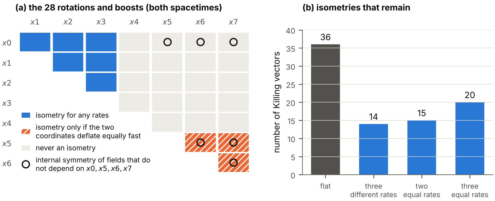

**FIG. 1.** Symmetries of the deflating spacetime. (a) The 28 rotations and boosts of flat spacetime, one square for each pair of coordinates: those that remain symmetries for any rates, those that remain symmetries only if the two coordinates deflate equally fast, and those that are never symmetries. Circles mark the six pairs whose rotations act as internal symmetries on fields that do not depend on $x0,x5,x6,x7$ (Sec. XVII). (b) The number of Killing vectors.

### E. Geodesics

The translations give seven conserved momenta $P_\mu$ ($\mu\ne4$) of a classical particle. Let $E_\perp=(m^{2}+\sum_jP_j^{2})^{1/2}$, with the sum over $j=0,1,2,3$, be the energy that a particle of mass $m$ would have without momentum along the deflating coordinates. The conservation of the norm of the momentum gives the velocity along the time, with an affine parameter $\varsigma$ along the path: $$\Big(\frac{dx4}{d\varsigma}\Big)^{2}=E_\perp^{2}-\sum_{t}\frac{P_t^{2}}{b_t(x4)^{2}} .
\tag{13}$$ The last term grows as $e^{2\,\mathrm{rate}_t\,x4}$: the momentum $P_t$ belongs to a fixed coordinate wavelength, and the proper wavelength shrinks. With the minus sign the right-hand side vanishes at a *turning value* of the time; for momentum along $x5$ alone, $$x4_{\mathrm{turn}}=\frac{1}{\mathrm{g55}}\ln\frac{E_\perp\,\mathrm{const5}}{|P_5|} .
\tag{14}$$ The path reaches this value and returns to smaller $x4$ \[Fig. 2(b)\]. A classical particle with momentum along a deflating time cannot pass the turning value of the ordinary time. Section V shows the quantum form of this result. (On the $7{+}1$ spacetime the sign in Eq. (13) is the opposite, and the energy of such a particle grows without bound.)

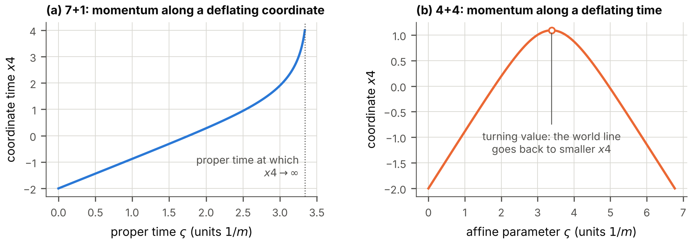

**FIG. 2.** A classical particle of the mass $m=1$ with the momenta $P_1=0.5$ along $x1$ and $P_5=0.3$ along the deflating coordinate $x5$, for $\mathrm{g55}=1$ and $\mathrm{const5}=0.8$, started at $x4=-2$. (a) On the $7{+}1$ spacetime the time $x4$ grows without bound within the finite proper time 3.386. (b) On the $4{+}4$ spacetime the path reaches the turning value $x4=1.0924$ and returns to smaller $x4$.

## III. The Dirac field with mass term and self-interaction

### A. Matrices and spin connection

At each point of a curved spacetime the tangent space is flat. The Dirac matrices of the orthonormal frame are therefore eight constant matrices $\gamma^{A}$, $A=0,\dots,7$. They are real $16\times16$ matrices with entries $0$ and $\pm1$, printed in full in Appendix B. The four matrices of the space-like coordinates are symmetric and square to $+1$, the four matrices of the time-like coordinates are antisymmetric and square to $-1$, and different matrices anticommute: $$\gamma^{A}\gamma^{B}+\gamma^{B}\gamma^{A}=2\,\eta_{(4+4)}^{AB} .
\tag{15}$$ All of these properties were verified by exact integer arithmetic for this work. The matrices with a coordinate index are $\gamma^{\mu}=e_A{}^{\mu}\gamma^{A}$: five of them are the constant matrices, and the three along the deflating coordinates are the constant matrices divided by the scale factors, $\gamma^{A=t}/b_t$. They satisfy $\gamma^{\mu}\gamma^{\nu}+\gamma^{\nu}\gamma^{\mu}=2\,g_{(4+4)}^{\mu\nu}$ with the inverse metric $g_{(4+4)}^{\mu\nu}$.

A spinor is defined relative to a frame, and its derivative must account for the turning of the frame from point to point ([Brill and Wheeler 1957](#ref-BrillWheeler1957)). The covariant derivative of a spinor is $\nabla_\mu\psi=(\partial_\mu+\Omega_\mu)\psi$ with the spin connection $$\begin{aligned}
\Omega_\mu&=\tfrac14\,\omega_{\mu AB}\,\gamma^{A}\gamma^{B},\\
\omega_{\mu AB}&=\eta^{(4+4)}_{AC}\,e^{C}{}_{\nu}\big(\partial_\mu e_B{}^{\nu}+\Gamma^{\nu}{}_{\mu\lambda}e_B{}^{\lambda}\big),
\end{aligned}
\tag{16}$$ whose coefficients $\omega_{\mu AB}=-\omega_{\mu BA}$ follow from the metric ($e^{C}{}_{\nu}$ is the inverse of the frame). For the metric (4) the only coefficients that do not vanish are $\omega_{t\,t4}=-\omega_{t\,4t}=\mathrm{rate}_t\,b_t$, so that $$\begin{aligned}
\Omega_t&=\tfrac12\,\mathrm{rate}_t\,b_t\,\gamma^{t}\gamma^{4}\quad(t=5,6,7),\\
\Omega_0&=\dots=\Omega_4=0,
\end{aligned}
\tag{17}$$ with the constant matrices of the frame on the right. Each $\Omega_t$ generates the Lorentz transformation in the plane of $xt$ and $x4$. The spin connection is correct if and only if the Dirac matrices are covariantly constant, $\partial_\mu\gamma^{\nu}+\Gamma^{\nu}{}_{\mu\lambda}\gamma^{\lambda}+[\Omega_\mu,\gamma^{\nu}]=0$, which holds for all 64 pairs of indices. Its curvature is the Riemann tensor, $[\nabla_\mu,\nabla_\nu]\psi=\tfrac14R_{AB\mu\nu}\gamma^{A}\gamma^{B}\psi$, a third route to Eq. (7). One combination enters the Dirac equation: $$\gamma^{\mu}\Omega_\mu=-\tfrac12\,\mathrm{gsum}\,\gamma^{4} .
\tag{18}$$ The scale factors cancel, and only the total rate remains.

### B. The Lagrangian: kinetic term, mass term, self-interaction

The field of this paper, $\psi_{1644d}(x)$, is a column of sixteen complex-valued Grassmann operators. Its Lagrangian has three parts, $$\mathcal L_{1644d}=V_d\,\big[\mathcal L_{\mathrm{kin}}+\mathcal L_{\mathrm{mass}}+\mathcal{L}_{\mathrm{self}}\big],
\tag{19}$$ where $V_d=\sqrt{|\det g|}$ is the factor that makes $\mathcal L_{1644d}\,d^{8}x$ invariant. A bosonic field theory would call the second part the “mass times $\phi^{2}$” term and the third the “$\phi^{4}$” term; for a fermion field they are bilinear and quartic in $\psi$.

*Kinetic and mass terms.* With the adjoint $\tilde\psi=\psi^\dagger C^{-}$, where $C^{-}=\gamma^{0}\gamma^{1}\gamma^{2}\gamma^{3}$ (a real symmetric matrix that turns each Dirac matrix into minus its transpose), $$\mathcal L_{\mathrm{kin}}+\mathcal L_{\mathrm{mass}}=\tilde\psi\,\big(\gamma^{\mu}\nabla_\mu-m\big)\,\psi .
\tag{20}$$ It contains no factor $i$: with the real matrices of $4{+}4$ the operator $\gamma^{\mu}\nabla_\mu-m$ gives the mass shell of a particle of mass $m$. The mass term $-m\,\tilde\psi\psi$ is real because $C^{-}$ is symmetric, and it is invariant under the transformations of $SO(4,4)$ of the frame.

*Self-interaction.* The most general interaction without derivatives that is quartic in the field and invariant under the transformations of the frame is built from the products of the Dirac matrices. Let $K=(A_1<A_2<\dots<A_r)$ be a strictly increasing list of $r$ indices out of $0,\dots,7$; $r=|K|$ is its *rank*, and there are $2^{8}=256$ lists, with $1,8,28,56,70,56,28,8,1$ of the ranks $0,\dots,8$. Define $$\Theta^{K}=\zeta_r\,\gamma^{A_1}\gamma^{A_2}\cdots\gamma^{A_r},\qquad
\zeta_r=\begin{cases}i,&r=1,2,5,6,\\1,&\text{otherwise},\end{cases}
\tag{21}$$ ($\Theta^{()}=1$ for the empty list) and $\Theta_K=(\Theta^{K})^{-1}=\mathrm{sgn}_K\,\Theta^{K}$, where the sign $\mathrm{sgn}_K=\pm1$ is $(-1)^{r}$ times the product of the squares of the matrices in $K$. The phase $\zeta_r$ makes $C^{-}\Theta^{K}$ Hermitian, so that every bilinear $\tilde\psi\Theta^{K}\psi$ is real. The *invariant of rank $r$* and the self-interaction are $$I_r=\sum_{|K|=r}(\tilde\psi\Theta_K\psi)(\tilde\psi\Theta^{K}\psi),\qquad
\mathcal{L}_{\mathrm{self}}=-\frac12\sum_{r=0}^{8}g_r\,I_r .
\tag{22}$$ The nine real constants $g_r$ are the couplings: $g_0$ multiplies the square of the scalar $\tilde\psi\psi$, $g_1$ the square of the current $\tilde\psi\gamma^{A}\psi$, $g_7$ and $g_8$ the squares of the axial current and of the pseudoscalar; in the traditional names $g_S=g_0$, $g_V=g_1$, $g_A=-g_7$, $g_P=-g_8$. A coupling $g_r$ carries one digit as its subscript; it must not be confused with a rate ($\mathrm{g55}$) or with a component of the metric ($g^{(4+4)}_{55}$). In a gravitational field each $I_r$ is written with the frame matrices exactly as in flat spacetime, because it is invariant under the transformations of the frame. Equation (22) is the *covariant form* of the self-interaction. Section IV shows that for anticommuting fields only four of the nine invariants are independent, and Sec. IV F that in the sector of the theory that can be quantized a second form of the self-interaction exists, which this paper adopts.

### C. The field equation

The variation of the action with respect to $\tilde\psi$ gives $$\big(\gamma^{\mu}\nabla_\mu-m\big)\psi_{1644d}=\sum_{r=0}^{8}g_r\sum_{|K|=r}\big(\tilde\psi\Theta_K\psi\big)\,\Theta^{K}\psi .
\tag{23}$$ (The bilinears are even elements of the Grassmann algebra, so that the derivative with respect to $\tilde\psi$ acts on $\mathcal{L}_{\mathrm{self}}$ as on a product of ordinary numbers.) The left-hand side is the Dirac operator with the mass term; the right-hand side is the self-interaction, cubic in the field. Without it the equation is linear. With Eq. (18), $$\begin{aligned}
&\gamma^{4}\Big(\partial_4-\frac{\mathrm{gsum}}{2}\Big)\psi+\sum_{j=0}^{3}\gamma^{j}\partial_j\psi
+\sum_{t=5}^{7}\frac{\gamma^{t}}{b_t}\,\partial_t\psi-m\,\psi\\
&\qquad=\sum_{r=0}^{8}g_r\sum_{|K|=r}\big(\tilde\psi\Theta_K\psi\big)\,\Theta^{K}\psi,
\end{aligned}
\tag{24}$$ with the constant matrices. Three things distinguish the left-hand side and the interaction from their forms on flat spacetime: the derivative along the time is shifted by $\mathrm{gsum}/2$, each derivative along a deflating coordinate is divided by its scale factor, and, as the next subsection shows, the self-interaction is strengthened by the shrinking of the volume.

### D. The weighted field

The shift is removed by a change of normalization. Define the *weighted field* $$\hat\psi=\sqrt{V_d}\,\psi .
\tag{25}$$ Because $\partial_4\sqrt{V_d}=-\tfrac12\mathrm{gsum}\sqrt{V_d}$, the left-hand side of Eq. (24) applied to $\psi$ equals $V_d^{-1/2}$ times the same expression without the term $\mathrm{gsum}/2$ applied to $\hat\psi$. The right-hand side is cubic in the field and therefore equals $V_d^{-3/2}$ times the same expression in $\hat\psi$. The weighted field thus obeys Eq. (24) *without the term $\mathrm{gsum}/2$ and with every coupling $g_r$ replaced by* $$\frac{g_r}{V_d(x4)}\ \propto\ g_r\,e^{\mathrm{gsum}\,x4} .
\tag{26}$$ The quantity $\psi^\dagger\psi$ is a density per unit of proper volume and grows as the deflating coordinates shrink; $\hat\psi^\dagger\hat\psi$ is the density per unit of coordinate volume, from which this trivial growth is removed.

The central observation of this paper follows at once. *For a field that does not depend on $x5$, $x6$, $x7$, the equation of the weighted field is exactly the flat equation with a self-interaction whose couplings grow as $e^{\mathrm{gsum}\,x4}$.* Every result that holds on flat spacetime for such fields, in particular everything about the pairing of the fermions, holds for the weighted field at each moment with the couplings of that moment. The deflation enters those results in one way only, through the dependence of the couplings on $V_d$ (Sec. VI): the mass term is not changed, and every quartic coupling grows at the same rate.

A field that does depend on a deflating coordinate feels the deflation directly. The rest of this section and Sec. V treat the equation without the self-interaction, which is linear and can be solved exactly; it describes a field so dilute that the cubic term is negligible, and the single-particle states from which the many-body treatment of Secs. IV–VII starts. Because the coefficients depend on $x4$ only, a solution of the linear equation can be taken proportional to $\exp(i\sum_jk_j\,xj+i\sum_tk_t\,xt)$ with seven constant wavenumbers, four along the flat coordinates $xj$, $j=0,1,2,3$, and three along the deflating ones; such a solution is a *mode*. Multiplying the equation of the weighted field by $\gamma^{4}$ gives an ordinary differential equation in the time: $$\partial_4\hat\psi=K(x4)\,\hat\psi,\qquad K=K_\perp+i\,k_d(x4)\,\gamma^{4}\gamma^{d},
\tag{27}$$ where $K_\perp=-m\gamma^{4}+i\sum_jk_j\gamma^{4}\gamma^{j}$ is the operator of the modes that do not depend on the deflating times, $$k_d(x4)=\Big(\sum_t\frac{k_t^{2}}{b_t(x4)^{2}}\Big)^{1/2}
\tag{28}$$ is the *physical* wavenumber along the deflating coordinates, and $\gamma^{d}=k_d^{-1}\sum_t(k_t/b_t)\gamma^{t}$ is the frame matrix along its direction. With $E_\perp=(m^{2}+\sum_jk_j^{2})^{1/2}$, $$K^{2}=\big(k_d^{2}-E_\perp^{2}\big)\,1 .
\tag{29}$$ $K_\perp$ is anti-Hermitian and $i\gamma^{4}\gamma^{d}$ is Hermitian. The evolution in the time is unitary, and $\hat\psi^\dagger\hat\psi$ is conserved, if and only if $k_5=k_6=k_7=0$. For the other modes the square of $K$ is negative while $k_d<E_\perp$ and positive afterwards: the mode oscillates until its physical wavenumber, which grows as $e^{\mathrm{rate}_t\,x4}$, has reached $E_\perp$, and its solutions grow or decay exponentially thereafter. A conserved charge exists, $\hat\psi^\dagger W_{1644}\hat\psi$ with the Hermitian matrix $W_{1644}=iC^{-}\gamma^{4}$ ($W_{1644}^{2}=1$), but it is not positive.

## IV. The self-interaction: nine channels, four couplings

This section analyzes the quartic term $\mathcal{L}_{\mathrm{self}}$ of Eq. (22) by exact algebra. Its results are used in every later section: the number of independent couplings, the couplings that act in uniform matter, the couplings that act between two particles, and the symmetries that the self-interaction keeps or breaks. The algebra is given for the form of the self-interaction that this paper adopts in the quantized sector, which Sec. IV F defines; the results for the covariant form (22) are stated beside it.

### A. The Fierz matrix

The 256 matrices $\Theta^{K}$ are a basis of all $16\times16$ matrices, $\mathrm{Tr}(\Theta_K\Theta^{J})=16\,\delta_{KJ}$, so that $\sum_K(\Theta_K)_{cd}(\Theta^{K})_{ab}=16\,\delta_{ad}\delta_{bc}$. This completeness relation rearranges a product of two bilinears, as in the rearrangement of Fierz for four Dirac matrices ([Fierz 1937](#ref-Fierz1937)). For four columns $a,b,c,d$ of ordinary (commuting) numbers, $$\sum_{|K|=r}(a\,\Theta_Kb)(c\,\Theta^{K}d)=\sum_{r'=0}^{8}\mathsf{F}_{rr'}\sum_{|J|=r'}(a\,\Theta_Jd)(c\,\Theta^{J}b),
\tag{30}$$ with the *Fierz matrix* $$\mathsf{F}_{rr'}=\frac1{16}\sum_{l}(-1)^{rr'-l}\binom{r'}{l}\binom{8-r'}{r-l} .
\tag{31}$$ The derivation takes three lines. Expanding the left-hand side of Eq. (30) in the basis gives the coefficient $\tfrac1{256}\sum_{|K|=r}\mathrm{Tr}(\Theta_K\Theta_J\Theta^{K}\Theta^{J})$ for each list $J$ of rank $r'$. Two products of Dirac matrices either commute or anticommute: $\Theta_K\Theta_J\Theta^{K}=(-1)^{rr'-l}\Theta_J$ if the lists $K$ and $J$ have $l$ indices in common. And $\binom{r'}{l}\binom{8-r'}{r-l}$ lists $K$ of rank $r$ share exactly $l$ indices with a given $J$ of rank $r'$. Table I prints the matrix. It satisfies $\mathsf{F}^{2}=1$; its eigenvalues are $+1$ (five times) and $-1$ (four times).

| $r\backslash r'$ |   0 |     1 |     2 |    3 |    4 |    5 |     6 |     7 |     8 |
|:----------------:|----:|------:|------:|-----:|-----:|-----:|------:|------:|------:|
|        0         |   1 |     1 |     1 |    1 |    1 |    1 |     1 |     1 |     1 |
|        1         |   8 |  $-6$ |     4 | $-2$ |    0 |    2 |  $-4$ |     6 |  $-8$ |
|        2         |  28 |    14 |     4 | $-2$ | $-4$ | $-2$ |     4 |    14 |    28 |
|        3         |  56 | $-14$ |  $-4$ |    6 |    0 | $-6$ |     4 |    14 | $-56$ |
|        4         |  70 |     0 | $-10$ |    0 |    6 |    0 | $-10$ |     0 |    70 |
|        5         |  56 |    14 |  $-4$ | $-6$ |    0 |    6 |     4 | $-14$ | $-56$ |
|        6         |  28 | $-14$ |     4 |    2 | $-4$ |    2 |     4 | $-14$ |    28 |
|        7         |   8 |     6 |     4 |    2 |    0 | $-2$ |  $-4$ |  $-6$ |  $-8$ |
|        8         |   1 |  $-1$ |     1 | $-1$ |    1 | $-1$ |     1 |  $-1$ |     1 |

TABLE I. The Fierz matrix: the integers $16\,\mathsf{F}_{rr'}$ of Eq. (31), rows $r=0,\dots,8$, columns $r'=0,\dots,8$.

### B. Anticommuting fields: only four invariants are independent

The components of $\psi$ anticommute. Setting $a=c=\bar\psi$ and $b=d=\psi$ in Eq. (30), the right-hand side contains the two fields $\psi$ in the opposite order, which costs a sign. The nine invariants therefore obey $$I_r=-\sum_{r'}\mathsf{F}_{rr'}\,I_{r'},\qquad\text{that is}\qquad(1+\mathsf{F})\,I=0 .
\tag{32}$$ Because $\mathsf{F}$ has the eigenvalue $+1$ five times, these are five independent linear relations: *of the nine invariants only four are independent.* Solved for the tensor invariants, $$\begin{aligned}
I_2&=-3I_0-I_1-I_7-I_8, & I_3&=-4I_0-I_7+4I_8,\\
I_4&=-5I_0-5I_8, & I_5&=-4I_0-I_1+4I_8,\\
I_6&=-I_0+I_1+I_7-3I_8 .
\end{aligned}
\tag{33}$$ Inserted into Eq. (22), $$\mathcal{L}_{\mathrm{self}}=-\tfrac12\big(g_{0}^{\mathrm{eff}}\,I_0+g_{1}^{\mathrm{eff}}\,I_1+g_{7}^{\mathrm{eff}}\,I_7+g_{8}^{\mathrm{eff}}\,I_8\big)
\tag{34}$$ with the four *effective couplings* $$\begin{aligned}
g_{0}^{\mathrm{eff}}&=g_0-3g_2-4g_3-5g_4-4g_5-g_6,\\
g_{1}^{\mathrm{eff}}&=g_1-g_2-g_5+g_6,\\
g_{7}^{\mathrm{eff}}&=g_7-g_2-g_3+g_6,\\
g_{8}^{\mathrm{eff}}&=g_8-g_2+4g_3-5g_4+4g_5-3g_6 .
\end{aligned}
\tag{35}$$ A tensor coupling $g_2,\dots,g_6$ is not a new parameter of the theory: it shifts the scalar, vector, axial-vector and pseudoscalar couplings. Every physical quantity computed below depends on the nine $g_r$ only through the four combinations (35), and this is verified in each case. The theorem (32) was verified in two independent ways: by exact integer arithmetic on the $16^{4}$ coefficients of the quartic form, antisymmetrized as anticommuting fields require, and by evaluating the nine invariants on Grassmann-valued fields with an implementation of the Grassmann algebra; in both, the rank of the nine invariants is exactly four.

### C. Uniform matter: the Hartree-Fock couplings

In uniform matter at rest the expectation value of a product of two fields is the density matrix $\mathsf{n}_{ab}=\langle\psi_b^\dagger\psi_a\rangle$. For a filled Fermi sea of particles of mass $m^{*}$ it is $\mathsf{n}=(n+n_S\,\beta)/16$, where $n=\langle\psi^\dagger\psi\rangle$ is the number density and $n_S=\langle\bar\psi\psi\rangle$ the scalar density, with $\beta=-i\gamma^{4}$. By Wick’s theorem the expectation value of a normal-ordered product of two bilinears is a direct (Hartree) term minus an exchange (Fock) term, $\langle(\psi^\dagger M\psi)(\psi^\dagger M\psi)\rangle=[\mathrm{Tr}(M\mathsf{n})]^{2}-\mathrm{Tr}(M\mathsf{n}M\mathsf{n})$. The energy density of the self-interaction, $-\langle\mathcal{L}_{\mathrm{self}}\rangle$, becomes $$\varepsilon_{\mathrm{int}}=\tfrac12\,G_V^{\mathrm{HF}}\,n^{2}+\tfrac12\,G_S^{\mathrm{HF}}\,n_S^{2},
\tag{36}$$ $$\begin{aligned}
G_S^{\mathrm{HF}}&=\tfrac1{16}\big(15\,g_{0}^{\mathrm{eff}}-8\,g_{1}^{\mathrm{eff}}-8\,g_{7}^{\mathrm{eff}}-g_{8}^{\mathrm{eff}}\big),\\
G_V^{\mathrm{HF}}&=\tfrac1{16}\big(-g_{0}^{\mathrm{eff}}+22\,g_{1}^{\mathrm{eff}}-6\,g_{7}^{\mathrm{eff}}+g_{8}^{\mathrm{eff}}\big).
\end{aligned}
\tag{37}$$ In terms of the nine couplings, $G_S^{\mathrm{HF}}=\tfrac1{16}(15g_0-8g_1-28g_2-56g_3-70g_4-56g_5-28g_6-8g_7-g_8)$ and $G_V^{\mathrm{HF}}=\tfrac1{16}(-g_0+22g_1-14g_2+14g_3-14g_5+14g_6-6g_7+g_8)$. The direct terms alone would give $G_S=g_0$ and $G_V=g_1$; the exchange terms reduce the scalar coupling by one sixteenth and add to the vector coupling. Equation (36) is the reason why uniform matter is described by two numbers, a scalar coupling $G_S$ and a vector coupling $G_V$, whatever the nine couplings are: Sec. VII takes these two as its parameters. In the covariant form of the self-interaction the same computation gives four terms, because the two halves of the field (Sec. IV F) enter with opposite signs: $\varepsilon_{\mathrm{int}}=\tfrac12(G_V^{\mathrm c}n^{2}+G_S^{\mathrm c}n_S^{2}+G_V^{\mathrm{HF}}n_W^{2}+G_S^{\mathrm{HF}}n_{SW}^{2})$ with $G_V^{\mathrm c}=-(g_{0}^{\mathrm{eff}}+g_{8}^{\mathrm{eff}})/16$, $G_S^{\mathrm c}=(-g_{0}^{\mathrm{eff}}-2g_{1}^{\mathrm{eff}}+2g_{7}^{\mathrm{eff}}+g_{8}^{\mathrm{eff}})/16$, and with the differences $n_W=n_+-n_-$, $n_{SW}=n_{S+}-n_{S-}$ of the densities of the two halves.

### D. Two particles: the pair couplings

Two particles at rest can be in $8\cdot7/2=28$ antisymmetric states, since a particle at rest has eight internal states (the eigenvalue $+1$ of $\beta$). The self-interaction acts on a pair state $\Phi$, an antisymmetric $16\times16$ matrix, as $\Phi\mapsto\sum_rg_r\sum_{|K|=r}\mathrm{sgn}_K\,(\beta\Theta^{K})\,\Phi\,(\beta\Theta^{K})^{T}$, projected on the states of positive energy. Its eigenvalue is the *pair coupling* $G_{\mathrm{pair}}$, the interaction energy of the pair times the volume; a negative value means attraction. Diagonalizing this map (exactly in the program, numerically in the independent verification) gives two values: $$G_{\mathrm{pair}}=\begin{cases}g_{0}^{\mathrm{eff}}+g_{1}^{\mathrm{eff}}+5\,g_{7}^{\mathrm{eff}}&\text{for 7 pairs,}\\ g_{0}^{\mathrm{eff}}+g_{1}^{\mathrm{eff}}-3\,g_{7}^{\mathrm{eff}}&\text{for 21 pairs.}\end{cases}
\tag{38}$$ The seven pairs are those created by the vector pair operators $\psi^{T}C^{-}\gamma^{A}\psi$ along the seven axes other than the time ($A\neq4$); among them is the pair along the hidden axis $x0$, the pair of the superfluid of this paper. A scalar attraction ($g_{0}^{\mathrm{eff}}<0$) binds all 28 pairs equally; a vector repulsion ($g_{1}^{\mathrm{eff}}>0$) opposes all of them equally; the axial coupling distinguishes the seven from the twenty-one; and the pseudoscalar coupling does not act between particles at rest. In the covariant form the 12 pairs of two particles in the same half of the field have the couplings (38), and the 16 pairs of particles in different halves have the opposite sign. The hidden-axis pair consists of particles in different halves: a scalar coupling that attracts in the quantized-sector form repels in the hidden-axis channel of the covariant form.

### E. Symmetries

*Chiral symmetry.* The transformation $\psi\to e^{i\epsilon\chi}\psi$ with the chirality matrix $\chi$ (Hermitian, $\chi^{2}=1$, anticommuting with every $\gamma^{A}$) leaves $I_1$ and $I_7$ unchanged and rotates $I_0$ and $I_8$ into each other. The self-interaction is invariant under it if and only if $$g_{0}^{\mathrm{eff}}+g_{8}^{\mathrm{eff}}=0
\tag{39}$$ (in the covariant form the condition is $g_{1}^{\mathrm{eff}}-g_{7}^{\mathrm{eff}}=0$ instead, because the bilinears of the two forms differ by the matrix $W_{1644}$, which anticommutes with $\chi$). The mass term breaks this symmetry in any case; it is the symmetry $U(1)_{\mathrm{VS}}$ of the model with the Vorton-Scalar (Sec. VI), in which the mass arises from the vacuum value of a scalar field that transforms as well.

*The internal symmetry of fields in ordinary space.* A field that does not depend on the four extra coordinates $x0,x5,x6,x7$ has an internal symmetry $[SU(2)\times SU(2)]\times U(1)_E$ in addition to the phase symmetry (Sec. XVII). The self-interaction is invariant under the six rotations of the extra axes and under the phase for all couplings, but under $U(1)_E$ only if $g_{1}^{\mathrm{eff}}=g_{7}^{\mathrm{eff}}=0$: *a vector or an axial-vector contact coupling breaks $U(1)_E$.* A scalar and a pseudoscalar coupling keep it.

### F. The two forms of the self-interaction in the quantized sector

On the $4{+}4$ spacetime only fields that do not depend on the three additional times $x5,x6,x7$ have a unitary evolution (Sec. III); they form the *quantized sector*. For such fields the kinetic and mass terms (20) become, with $\beta=-i\gamma^{4}$, $\alpha^{j}=-\gamma^{4}\gamma^{j}$ ($j=0,1,2,3$), the Hamiltonian matrix $\mathsf{h}=\sum_j\alpha^{j}(-i\partial_j)+\beta m$ and the identity $C^{-}=-W_{1644}\beta$, $$\tilde\psi\big(\gamma^{A}\partial_A-m\big)\psi=-\psi^\dagger W_{1644}\big(i\partial_4-\mathsf{h}\big)\psi .
\tag{40}$$ The matrix $W_{1644}$ has the eigenvalues $+1$ and $-1$, eight times each, and commutes with $\mathsf{h}$. The covariant Lagrangian is therefore the ordinary Lagrangian $\psi^\dagger(i\partial_4-\mathsf{h})\psi$ of a Dirac field on the half of the field with $W_{1644}=-1$, and *minus* that Lagrangian on the half with $W_{1644}=+1$. For a free field the sign does not change the equation of motion, and the quantum theory is defined by the positive Lagrangian $$\begin{aligned}
\mathcal L_{\mathrm{kin}}+\mathcal L_{\mathrm{mass}}&=\psi^\dagger\big(i\partial_4-\mathsf{h}\big)\psi\\
&=\bar\psi\,(i\beta\partial_4-\beta\mathsf{h})\,\psi,\qquad\bar\psi=\psi^\dagger\beta,
\end{aligned}
\tag{41}$$ for all sixteen components, which gives a particle eight internal states of positive norm. With a self-interaction the two halves are no longer equivalent, and the quantized theory can be completed in two ways.

*Quantized-sector form (adopted).* The bilinears are formed with the adjoint $\bar\psi=\psi^\dagger\beta$ of Eq. (41) and with the matrices $$\gamma_{44q}^{A}=-i\gamma^{A}\ (A=0,\dots,4),\qquad\gamma_{44q}^{A}=\gamma^{A}\ (A=5,6,7),
\tag{42}$$ which satisfy $\gamma_{44q}^{4}=\beta$ and in terms of which the positive Lagrangian reads $\bar\psi(i\gamma_{44q}^{A}\partial_A-m)\psi$ for fields of the quantized sector. They have the squares of the Dirac matrices of a spacetime with one time: $+1$ for $A=4$ and $-1$ otherwise. The matrices $\Theta^{K}$ are built from them with the phases $\zeta_r=i$ for $r=2,3,6,7$, and $$I_r=\sum_{|K|=r}(\bar\psi\Theta_K\psi)(\bar\psi\Theta^{K}\psi),\qquad\mathcal{L}_{\mathrm{self}}=-\frac12\sum_rg_r\,I_r .
\tag{43}$$ This is the form in which the model with the Vorton-Scalar is defined (Sec. VI), and the exchange of the Vorton-Scalar is a self-interaction of this form with a finite range (Sec. IX). The field equation of the quantized sector is $$i\partial_4\psi=\mathsf{h}\,\psi+\sum_rg_r\sum_{|K|=r}\big(\bar\psi\Theta_K\psi\big)\,\beta\,\Theta^{K}\psi .
\tag{44}$$ All results of the preceding subsections are stated for this form.

*Covariant form with the positive kinetic term.* Alternatively the invariants (22) of the covariant form are kept and combined with the positive Lagrangian (41). Because $C^{-}=-W_{1644}\beta$, the invariants of the two forms are related exactly by $$I_r^{\mathrm{cov}}=\sum_{|K|=r}\mathrm{sgn}_K\,\big(\psi^\dagger\,W_{1644}\,\beta\,\Theta^{K}\psi\big)^{2},
\tag{45}$$ with the matrices $\Theta^{K}$ and the signs $\mathrm{sgn}_K$ of the quantized-sector form: the matrix $W_{1644}$ is inserted in every bilinear. Two particles in the same half of the field therefore interact as in the quantized-sector form, and two particles in different halves with the opposite sign.

*What the covariant field equation itself says.* Equation (23), restricted to the quantized sector, reads $i\partial_4\psi=\mathsf{h}\,\psi-W_{1644}\,\partial V/\partial\psi^\dagger$ with $V=\tfrac12\sum_rg_rI_r^{\mathrm{cov}}$, whereas the covariant form with the positive kinetic term has $+\partial V/\partial\psi^\dagger$ in place of $-W_{1644}\,\partial V/\partial\psi^\dagger$. On the half $W_{1644}=-1$ the two agree, and both agree with the quantized-sector form for a field that lies entirely in that half. On the half $W_{1644}=+1$ the covariant equation has the opposite sign of the whole interaction, the same sign change as in Eq. (40); it conserves $\psi^\dagger W_{1644}\psi$ rather than $\psi^\dagger\psi$ and is not the equation of a Hamiltonian with states of positive norm when both halves are occupied.

This paper takes the quantized-sector form as the definition of the model on $4{+}4$ and reports the results of the covariant form with the positive kinetic term beside it. The choice is the author’s to confirm (Sec. XVIII).

## V. Modes that depend on the deflating coordinates

### A. Three kinds of modes

Modes fall into three kinds. A mode that does not depend on the deflating coordinates, $k_5=k_6=k_7=0$, obeys the flat equation; its solutions are the plane waves of flat spacetime, with the energies $\pm E_\perp$, eight of each sign. A mode with some $k_t\ne0$ behaves in the same way as long as its physical wavenumber is negligible, $k_d\ll E_\perp$. But $k_d$ grows without bound, and every such mode sooner or later reaches $k_d\gg E_\perp$. The moment at which $k_d=E_\perp$ is its *crossing*. It is the turning value (14) of the classical particle, with the wavenumbers in place of the momenta. The crossing is where the deflation acts on the field, and this section solves the equation of the weighted field across it.

The solution is exact when *one rate governs*: when only one of the $k_t$ differs from zero, or when the three rates are equal. In both cases the matrix $\gamma^{d}$ does not depend on the time, and $k_d$ is proportional to $e^{\mathrm{rate}_t\,x4}$ with the rate that governs. The natural variable is then the physical wavenumber in units of the rate, $$u_d=\frac{k_d(x4)}{\mathrm{rate}_t},\qquad\frac{d}{dx4}=\mathrm{rate}_t\,u_d\,\frac{d}{du_d}.
\tag{46}$$ The crossing is at $u_d=E_\perp/\mathrm{rate}_t$, and this ratio of the energy to the rate is the one parameter on which the results depend.

### B. The exact solution

In $K=K_\perp+i\,k_d\,\gamma^{4}\gamma^{d}$ the first matrix is anti-Hermitian with $K_\perp^{2}=-E_\perp^{2}$, the matrix $i\gamma^{4}\gamma^{d}$ is Hermitian with the square one, and the two anticommute. Let $w$ be one of the eight eigenvectors of $K_\perp$ with the eigenvalue $+iE_\perp$; then $i\gamma^{4}\gamma^{d}w$ is an eigenvector with the eigenvalue $-iE_\perp$ and is orthogonal to $w$. The equation is solved by the modified Bessel functions that decay at large argument, of the orders $\tfrac12\mp iE_\perp/\mathrm{rate}_t$. Such a function is written here with its order as a subscript and with its argument; the letter $K$ without subscript and argument is the matrix of Eq. (27). With the recurrence relations of these functions one verifies by substitution that $$\begin{aligned}
\hat\psi=\sqrt{u_d}\,\Big[&K_{\frac12-iE_\perp/\mathrm{rate}_t}(u_d)\,w\\
&-K_{\frac12+iE_\perp/\mathrm{rate}_t}(u_d)\,i\gamma^{4}\gamma^{d}w\Big]
\end{aligned}
\tag{47}$$ solves Eq. (27) for each of the eight $w$; the relative residual, computed with the Bessel functions of an arbitrary-precision library, is $2\times10^{-15}$. The other eight solutions are built in the same way from the modified Bessel functions that *grow* as $e^{+u_d}$.

### C. Standing waves, and their extinction

Since $u_d$ itself grows exponentially with the time, a solution of the second kind grows as the exponential of an exponential. Such a solution is not admissible; it is the counterpart of the growing exponential under a potential barrier. Admissible are the eight solutions (47), which stay bounded. Their properties are exact.

*Magnitude.* Because $w$ and $i\gamma^{4}\gamma^{d}w$ are orthogonal, and because the two functions in Eq. (47) are complex conjugates of each other, $$|\hat\psi|^{2}=2\,u_d\,\big|K_{\frac12+iE_\perp/\mathrm{rate}_t}(u_d)\big|^{2}\,|w|^{2}.
\tag{48}$$

*Early times*, $u_d\to0$: $|\hat\psi|^{2}\to\pi\,|w|^{2}/\cosh(\pi E_\perp/\mathrm{rate}_t)$, a constant. The solution is then a combination of $e^{+iE_\perp x4}\,w$ and $e^{-iE_\perp x4}\,i\gamma^{4}\gamma^{d}w$ with coefficients of *equal* magnitude: the two signs of the frequency enter with equal weight. A bounded solution is a *standing wave* in the ordinary time, not a traveling wave. Its conserved charge $\hat\psi^\dagger W_{1644}\hat\psi$ vanishes.

*Late times*, $u_d\to\infty$: $|\hat\psi|^{2}\to\pi\,|w|^{2}e^{-2u_d}$. The mode dies out as the exponential of an exponential of the time.

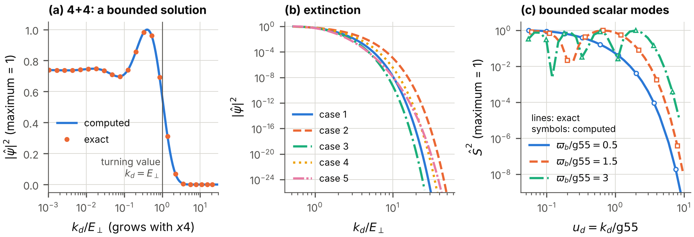

**FIG. 3.** Extinction on the deflating $4{+}4$ spacetime. (a) A bounded solution: $|\hat\psi|^{2}$ against the physical wavenumber $k_d/E_\perp$, which grows with the time; computed (line) and the exact form (48) (symbols). It is constant long before the crossing at $k_d=E_\perp$ and falls after it. (b) Five cases, with one, two or three wavenumbers $k_t$ different from zero and with equal and unequal rates, on a logarithmic scale. (c) The bounded modes of the Vorton-Scalar on the same spacetime (Sec. VI D), which are extinguished in the same way; lines: exact, symbols: computed.

*The law of the extinction.* In the semiclassical (WKB) approximation the bounded solution falls beyond the turning value, at which $k_d=E_\perp$, as $e^{-S_{\mathrm{WKB}}}$ with $$\begin{aligned}
S_{\mathrm{WKB}}&=\int_{x4_{\mathrm{turn}}}^{x4}\sqrt{k_d^{2}-E_\perp^{2}}\;dx4'\\
&=\frac{1}{\mathrm{rate}_t}\Big[\sqrt{k_d^{2}-E_\perp^{2}}-E_\perp\arccos\frac{E_\perp}{k_d}\Big],
\tag{49}
\end{aligned}$$ which approaches $(k_d-\tfrac{\pi}{2}E_\perp)/\mathrm{rate}_t$ for $k_d\gg E_\perp$. The exact solution fixes the constant that the approximation leaves open: $$\begin{aligned}
\ln\frac{|\hat\psi|_{\mathrm{early}}}{|\hat\psi|_{\mathrm{late}}}-S_{\mathrm{WKB}}\ \longrightarrow\ {}&\tfrac12\ln2\\
&-\tfrac12\ln\big(1+e^{-2\pi E_\perp/\mathrm{rate}_t}\big).
\end{aligned}
\tag{50}$$

The numerical solution of Eq. (27) for all sixteen components confirms these statements (Fig. 3). Beyond the turning value exactly eight of the sixteen solutions stay bounded; followed backwards to early times they contain parts of positive and of negative frequency of equal weight, to $2\times10^{-14}$. Where one rate governs, the computed magnitude equals Eq. (48) over the range $0.02<u_d<12$ to a relative deviation of $3.6\times10^{-12}$, and Eq. (50) holds to $3.6\times10^{-4}$ at $S_{\mathrm{WKB}}=30$. With three unequal rates no exact solution is known; the bounded solutions fall as $e^{-S_{\mathrm{WKB}}}$ times a factor that depends on the internal state, with a spread of 0.40 in its logarithm at $S_{\mathrm{WKB}}=30$.

### D. What the result means

On the flat $4{+}4$ spacetime a field that depends on the additional times evolves non-unitarily in the ordinary time. This is the principal difficulty of four time-like dimensions ([Tegmark 1997](#ref-Tegmark1997); [Craig and Weinstein 2009](#ref-CraigWeinstein2009)); on flat spacetime it can only be met by imposing that the fields do not depend on those times. On the deflating $4{+}4$ spacetime every admissible mode that depends on a deflating time is a standing wave that is extinguished after its crossing, with an exponent $S_{\mathrm{WKB}}$ that grows as $e^{\mathrm{rate}_t\,x4}$. What remains at late times is the sector of fields that do not depend on $x5,x6,x7$, and in that sector the evolution is unitary and $\hat\psi^\dagger\hat\psi$ is conserved. *The deflation of the three additional times removes, dynamically, the sector that causes the difficulty.* The classical counterpart is the turning value of Sec. II E.

The limits of this conclusion must be stated with equal clarity. The eight growing solutions are discarded because they are unbounded. That is a condition of admissibility, imposed as in the theory of a potential barrier; it is not derived from a principle. The theory still has no positive conserved charge for modes that depend on the deflating times, and a consistent quantization exists, as before, only for the sector that does not depend on them. What has been shown is that the admissible modes outside that sector die out, not that the difficulty of four time-like dimensions has been solved.

### E. The numerical method

The equations of this section are linear, with coefficients that grow exponentially, and an integrator with a fixed step fails on them. The program uses a commutator-free Magnus method of the fourth order: over each step the solution is advanced by the product of two matrix exponentials of linear combinations of the coefficient matrix at two Gauss points. Because the square of $K$ is a multiple of the unit matrix at any one time, each exponential is evaluated in closed form. The length of a step is chosen so that neither the phase accumulated in it nor the relative change of the coefficients exceeds a fixed bound. An independent program, which uses an explicit Runge-Kutta method of the eighth order and the Bessel functions of another library, confirms Eq. (47) and, to the accuracy of the semiclassical form at the exponent that it reaches, Eq. (50) (Appendix E).

## VI. The Vorton-Scalar and the deflation clock

### A. The model

The model contains, besides the fermion field, a complex scalar field, the *Vorton-Scalar* $\Phi_{\mathrm{VS}}$, whose vacuum value gives the fermions a mass and whose exchange binds two fermions into a pair. This subsection states the complete model on the deflating spacetime: the fermion field with a mass term and with the self-interaction of Sec. III, and the Vorton-Scalar. The Vorton-Scalar brings three real, positive constants: its self-coupling $\lambda_{\mathrm{VS}}$, the constant $v_{\mathrm{VS}}$ that fixes the magnitude $v_{\mathrm{VS}}/\sqrt2$ at which the potential of the scalar is lowest, and its Yukawa coupling $y_{\mathrm{VS}}$ to the fermions. The fermion field brings the mass $m_D$ of its Lagrangian, called the *bare Dirac mass* from here on, and the couplings $g_r$ of its self-interaction. The chirality matrix is denoted by $\chi$, with $\chi=\gamma^{0}\gamma^{1}\cdots\gamma^{7}$, which is real on the $4{+}4$ spacetime, and the chiral projectors are $P^{L,R}=\tfrac12(1\mp\chi)$.

On a curved spacetime a Lagrangian is multiplied by the volume factor $V_d$, derivatives of spinors become covariant derivatives, and the flat metric is replaced by the curved one. On the $4{+}4$ spacetime the Yukawa coupling can be written only in the sector of fields that do not depend on the additional times, the quantized sector of Sec. IV F, because only there does the adjoint $\bar\psi=\psi^\dagger\beta$ exist with which the chiral projectors combine into a real, invariant term; the model is defined there. On the deflating spacetime Sec. V gives that sector a dynamical reason. In it the model is $$\begin{aligned}
\mathcal L_{1644d}^{\mathrm{VS}}={}&\hat\psi^\dagger\big(i\partial_4+i\sum_{j=0}^{3}\alpha^{j}\partial_j-\beta\,m_D\big)\hat\psi+V_d\,\mathcal{L}_{\mathrm{self}}\\
&+V_d\,\Big[|\partial_4\Phi_{\mathrm{VS}}|^{2}-\sum_{j=0}^{3}|\partial_j\Phi_{\mathrm{VS}}|^{2}\Big]\\
&-V_d\,\lambda_{\mathrm{VS}}\Big(|\Phi_{\mathrm{VS}}|^{2}-\frac{v_{\mathrm{VS}}^{2}}{2}\Big)^{2}\\
&-V_d\,y_{\mathrm{VS}}\,\bar\psi\big(\Phi_{\mathrm{VS}}\,P^{R}+\Phi_{\mathrm{VS}}^{*}\,P^{L}\big)\psi ,
\tag{51}
\end{aligned}$$ with the Hermitian matrices $\beta=-i\gamma^{4}$ and $\alpha^{j}=-\gamma^{4}\gamma^{j}$, $\bar\psi=\psi^\dagger\beta$, and the self-interaction $\mathcal{L}_{\mathrm{self}}$ in the quantized-sector form (43). The first line is the positive Lagrangian (41) for the weighted field $\hat\psi=\sqrt{V_d}\,\psi$, with the bare Dirac mass, and the self-interaction; without the self-interaction its equation of motion is the covariant Dirac equation (23) in this sector. The other terms carry the volume factor. The Lagrangian is invariant under the phase transformation $\psi\to e^{i\epsilon}\psi$ of the fermion number, $U(1)_F$, whatever its constants are. Without the bare Dirac mass, and with a self-interaction that satisfies the condition (39), it is also invariant under the chiral transformation $U(1)_{\mathrm{VS}}$: $\psi\to e^{i\epsilon\chi}\psi$ with $\Phi_{\mathrm{VS}}\to e^{-2i\epsilon}\Phi_{\mathrm{VS}}$. These statements hold on the deflating spacetime as on flat spacetime, because the transformations do not involve the coordinates. *The case $m_D=0$, $g_r=0$ is the model in which the whole mass of the fermions comes from the Vorton-Scalar and the whole interaction from its exchange;* Secs. VIII to XIV treat it first, and Secs. VII, IX and XIII then add the bare mass and the self-interaction and say what each changes.

A constant field $\Phi_{\mathrm{VS}}=v_{\mathrm{VS}}/\sqrt2$ with $\psi=0$ solves the field equations on the deflating spacetime, because a constant has no derivatives: the vacuum value is the same at all times. It breaks $U(1)_{\mathrm{VS}}$. Around it the Vorton-Scalar has two modes: the *radial mode*, a real field of the mass $m_s$, and the *phase mode*, a real massless field, the Goldstone boson of the broken symmetry (massless if $U(1)_{\mathrm{VS}}$ is exact; Sec. XIII computes the mass that a bare Dirac mass gives it). The fermions acquire the mass $m=m_D+m_Y$, of which $m_Y=y_{\mathrm{VS}}v_{\mathrm{VS}}/\sqrt2$ comes from the Vorton-Scalar. Both modes couple to the fermions with the same strength $g_{\mathrm{VS}}$, the radial mode to the scalar density $\bar\psi\psi$ and the phase mode to the pseudoscalar density $\bar\psi\,i\chi\,\psi$: $$\begin{aligned}
m_Y&=\frac{y_{\mathrm{VS}}\,v_{\mathrm{VS}}}{\sqrt2},&\qquad m_s&=\sqrt{2\lambda_{\mathrm{VS}}}\,v_{\mathrm{VS}},\\
g_{\mathrm{VS}}&=\frac{m_Y}{v_{\mathrm{VS}}},&\qquad\alpha_{\mathrm{VS}}&=\frac{g_{\mathrm{VS}}^{2}}{4\pi}.
\end{aligned}
\tag{52}$$

### B. Fields that do not depend on the extra coordinates

Consider fields that do not depend on the four extra coordinates $x0,x5,x6,x7$, and introduce the weighted fields $$\hat\psi=\sqrt{V_d}\,\psi,\qquad\hat\Phi_{\mathrm{VS}}=\sqrt{V_d}\,\Phi_{\mathrm{VS}}.$$ Each term of Eq. (51) is rewritten in turn. The kinetic term and the mass term of the fermions are the flat ones for $\hat\psi$ (Sec. III). The self-interaction contains four fermion fields and therefore the factor $V_d\cdot V_d^{-2}$, as in Eq. (26). The Yukawa term contains one scalar and two fermion fields and therefore the factor $V_d\cdot V_d^{-3/2}$. The potential becomes $(\lambda_{\mathrm{VS}}/V_d)\,(|\hat\Phi_{\mathrm{VS}}|^{2}-V_dv_{\mathrm{VS}}^{2}/2)^{2}$. In the kinetic term of the scalar the derivative along the time acts on the weight as well, $\sqrt{V_d}\,\partial_4\Phi_{\mathrm{VS}}=\partial_4\hat\Phi_{\mathrm{VS}}+\tfrac12\mathrm{gsum}\,\hat\Phi_{\mathrm{VS}}$, which gives a term $\tfrac14\mathrm{gsum}^{2}|\hat\Phi_{\mathrm{VS}}|^{2}$ and a total derivative. The result is the flat Lagrangian for the weighted fields, with four replacements and one additional term: $$\begin{aligned}
&y_{\mathrm{VS}}\to\frac{y_{\mathrm{VS}}}{\sqrt{V_d(x4)}},\qquad\lambda_{\mathrm{VS}}\to\frac{\lambda_{\mathrm{VS}}}{V_d(x4)},\qquad g_r\to\frac{g_r}{V_d(x4)},\\
&v_{\mathrm{VS}}\to v_{\mathrm{VS}}\sqrt{V_d(x4)},\qquad\text{and }+\frac{\mathrm{gsum}^{2}}{4}\,|\hat\Phi_{\mathrm{VS}}|^{2}.
\end{aligned}
\tag{54}$$ The bare Dirac mass $m_D$ is not replaced. With a constant volume of the extra coordinates the same replacements define the couplings of a four-dimensional description on flat spacetime. Here that volume is the coordinate volume of a cell times $V_d(x4)$, and it shrinks. The additional term lowers the square of the mass of each mode of the scalar by $\mathrm{gsum}^{2}/4$ in the equation of the weighted field; Section VI D shows what it does. From here on the couplings $y_{\mathrm{VS}}$, $\lambda_{\mathrm{VS}}$, $v_{\mathrm{VS}}$, $g_{\mathrm{VS}}$, $\alpha_{\mathrm{VS}}$ and $g_r$ are those of the four-dimensional description at the time considered.

### C. The deflation clock

Define the *deflation clock* $$\tau_d=\mathrm{gsum}\,(x4-x4_{\mathrm{ref}}),
\tag{55}$$ the number of e-foldings by which the volume $V_d$ has shrunk since a reference time $x4_{\mathrm{ref}}$, which is chosen in each application. By Eq. (54) every quantity of the four-dimensional description is proportional to $e^{n\tau_d}$ with a definite exponent $n$ (Table II). Three observations organize what follows.

| quantity                                                                                                                                          | meaning                                                                                                                                                       | exponent $n$ |
|:--------------------------------------------------------------------------------------------------------------------------------------------------|:--------------------------------------------------------------------------------------------------------------------------------------------------------------|:------------:|
| $V_d$                                                                                                                                             | $b_5b_6b_7$: the factor $\sqrt{\lvert\det g\rvert}$ of the measure                                                                                            |     $-1$     |
| $y_{\mathrm{VS}}$ of the four-dimensional description                                                                                             | Yukawa coupling of the weighted fields                                                                                                                        |  $\tfrac12$  |
| $\lambda_{\mathrm{VS}}$ of the four-dimensional description                                                                                       | quartic coupling of the weighted Vorton-Scalar                                                                                                                |     $1$      |
| $v_{\mathrm{VS}}$ of the four-dimensional description                                                                                             | vacuum value of the weighted Vorton-Scalar                                                                                                                    | $-\tfrac12$  |
| $m_D$                                                                                                                                             | bare Dirac mass (the mass term of the Lagrangian of the fermion field)                                                                                        |     $0$      |
| $m_Y$                                                                                                                                             | part of the fermion mass that the Vorton-Scalar gives, $y_{\mathrm{VS}}v_{\mathrm{VS}}/\sqrt2$; the mass in vacuum is $m=m_D+m_Y$                             |     $0$      |
| $m_s$                                                                                                                                             | mass of the radial mode $\sqrt{2\lambda_{\mathrm{VS}}}\,v_{\mathrm{VS}}$                                                                                      |     $0$      |
| $g_r$ of the four-dimensional description                                                                                                         | each of the nine couplings of the self-interaction of the weighted field, and with them the mean-field couplings $G_S$, $G_V$                                 |     $1$      |
| $g_{\mathrm{VS}}$                                                                                                                                 | coupling of both modes of the Vorton-Scalar to the fermions, $m_Y/v_{\mathrm{VS}}$                                                                            |  $\tfrac12$  |
| $\alpha_{\mathrm{VS}}$                                                                                                                            | $g_{\mathrm{VS}}^2/4\pi$                                                                                                                                      |     $1$      |
| $G_{\mathrm{VS}}$                                                                                                                                 | constant of the Fermi type of the neutral-current interaction, $1/(\sqrt2\,v_{\mathrm{VS}}^2)$                                                                |     $1$      |
| $D_{\mathrm{VS}}$                                                                                                                                 | $\alpha_{\mathrm{VS}}\,m/m_s$: decides whether two fermions bind                                                                                              |     $1$      |
| $C$                                                                                                                                               | $g_{\mathrm{VS}}^2m^2/m_s^2$: decides the state of matter                                                                                                     |     $1$      |
| $m_\vartheta$                                                                                                                                     | mass of the phase mode of the Vorton-Scalar when $m_D\neq0$, $m_\vartheta^2v_{\mathrm{VS}}^2=\lvert\langle\bar\psi\psi\rangle_{\mathrm{vac}}\rvert\,m_Dm_Y/m$ |  $\tfrac12$  |
| vortex energy per length                                                                                                                          | proportional to $v_{\mathrm{VS}}^2$ (four-dimensional)                                                                                                        |     $-1$     |
| $G_{\mathrm{Fermi}}$ (Fermi constant of the weak interaction) if the vacuum value of the Vorton-Scalar sets the electroweak scale (assumption HV) | $1/(\sqrt2\,v_{\mathrm{VS}}^2)$, four-dimensional vacuum value                                                                                                |     $1$      |
| $G_N$ (Newton’s constant) if gravity is eight-dimensional (A2)                                                                                    | $G_8$ divided by the volume of $x5,x6,x7$                                                                                                                     |     $1$      |

TABLE II. How the quantities of the four-dimensional description follow the deflation clock: each is proportional to $e^{n\tau_d}$. The last two rows hold under additional assumptions, which Secs. XVI and XVII state and examine.

*The masses do not change.* The bare Dirac mass is not affected at all, and the part $m_Y$ of the fermion mass and the mass $m_s$ of the radial mode contain the couplings in combinations from which the volume cancels. So do the Fermi momentum and the Fermi energy of matter with a given number of particles per unit of ordinary volume.

*The couplings grow.* The coupling $g_{\mathrm{VS}}=m_Y/v_{\mathrm{VS}}$ grows as $e^{\tau_d/2}$, because the four-dimensional vacuum value falls. The strength of the attraction, $\alpha_{\mathrm{VS}}$, grows as $e^{\tau_d}$: it doubles every time the volume of the deflating coordinates halves. Every coupling $g_r$ of the self-interaction, and with them the couplings $G_S$, $G_V$ of Sec. VII, grows as $e^{\tau_d}$ as well: *the contact interaction and the exchange of the Vorton-Scalar keep their ratio.*

*The two numbers that decide the state of matter grow at the same rate.* These are $$D_{\mathrm{VS}}=\alpha_{\mathrm{VS}}\,\frac{m}{m_s},\qquad C=\frac{g_{\mathrm{VS}}^{2}m^{2}}{m_s^{2}} .
\tag{56}$$ The first decides whether two fermions form a bound pair (Sec. X), the second whether matter keeps its fermion mass (Sec. XII). Their ratio $C/D_{\mathrm{VS}}=4\pi\,m/m_s$ is fixed.

On flat spacetime the model is specified by the masses and the couplings. On a deflating spacetime it is specified by the masses and the values of the couplings *at one time*; the deflation then carries it through all larger couplings. The constants of the flat theory become functions of the time, and its thresholds are passed one after another (Fig. 4).

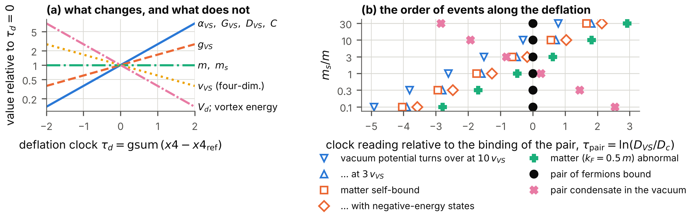

**FIG. 4.** The deflation clock. (a) How the quantities of the four-dimensional description change with the clock $\tau_d$ (logarithmic scale; values relative to $\tau_d=0$). (b) The order of events along the deflation for six ratios $m_s/m$: the clock reading of each event relative to the moment at which two fermions form a bound pair (Table IX).

### D. Modes of the Vorton-Scalar

Let $\varphi_{\mathrm{bos}}$ stand for the radial mode or the phase mode, with the mass $m_{\mathrm{bos}}=m_s$ or $m_{\mathrm{bos}}=0$. To first order in the field, a mode with a wavenumber of the magnitude $k$ along the flat coordinates and the wavenumbers $k_t$ along the deflating ones obeys $$\begin{aligned}
&\frac{1}{V_d}\,\partial_4\big(V_d\,\partial_4\varphi_{\mathrm{bos}}\big)\\
&\quad+\Big(k^{2}-\sum_t\frac{k_t^{2}}{b_t^{2}}+m_{\mathrm{bos}}^{2}\Big)\varphi_{\mathrm{bos}}=0 .
\end{aligned}
\tag{57}$$ The wavenumbers along the deflating coordinates, which are time-like, enter with the sign opposite to that of $k^{2}$, as for the fermions.

*Modes that do not depend on the deflating coordinates.* With $k_t=0$ the equation has constant coefficients, and its solutions are the exponentials $$\varphi_{\mathrm{bos}}\propto\exp\Big\{\Big[\frac{\mathrm{gsum}}{2}\pm\sqrt{\frac{\mathrm{gsum}^{2}}{4}-k^{2}-m_{\mathrm{bos}}^{2}}\,\Big]x4\Big\}.
\tag{58}$$ If $k^{2}+m_{\mathrm{bos}}^{2}>\mathrm{gsum}^{2}/4$, the mode oscillates with the frequency $\varpi_b=(k^{2}+m_{\mathrm{bos}}^{2}-\mathrm{gsum}^{2}/4)^{1/2}$, and its amplitude grows as $e^{\mathrm{gsum}\,x4/2}$. The growth is that of the weight alone: the weighted field has a constant amplitude, and the number of quanta in a cell of fixed coordinates is conserved while the cell shrinks. Otherwise the mode does not oscillate. For the radial mode this never happens if $m_s>\mathrm{gsum}/2$, which holds by many orders of magnitude for any rate that observation allows (Sec. XVI). For the phase mode it happens at wavelengths longer than $4\pi/\mathrm{gsum}$. At $k=0$ the two exponents of the phase mode are $0$ and $\mathrm{gsum}$: a constant phase, which costs nothing, and a phase that advances at a rate proportional to $1/V_d$, which is the conservation of the charge of $U(1)_{\mathrm{VS}}$ in a shrinking volume. Neither is an instability of the vacuum. Figure 5 shows the exponents.

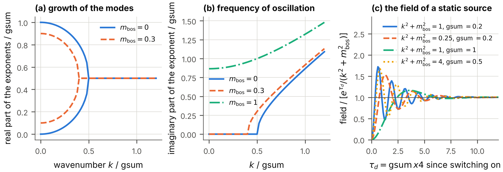

**FIG. 5.** Modes of the Vorton-Scalar that do not depend on the deflating coordinates. (a) Real parts of the two exponents of Eq. (58) against the wavenumber, for the phase mode and for a radial mode, in units of $\mathrm{gsum}$. (b) Their imaginary part, the frequency of oscillation. (c) The field that a static source builds up from zero, divided by the form $e^{\tau_d}/(k^{2}+m_{\mathrm{bos}}^{2})$ that leads to Eq. (59).

*The potential between two fermions.* Two fermions at rest attract each other by exchanging the radial mode. The density of a fixed number of fermions grows as $1/V_d$, so that the radial mode obeys Eq. (57) with a source proportional to $e^{\mathrm{gsum}\,x4}$. The solution that follows the source is $e^{\mathrm{gsum}\,x4}/(k^{2}+m_{\mathrm{bos}}^{2})$ times the source, as substitution shows: the terms $\mathrm{gsum}^{2}-\mathrm{gsum}\cdot\mathrm{gsum}$ cancel, and the denominator contains the *unshifted* mass. The potential between two fermions at rest is therefore, at every moment, a Yukawa potential, $$V_s(r)=-\alpha_{\mathrm{VS}}(x4)\,\frac{e^{-m_sr}}{r},
\tag{59}$$ with the range $1/m_s$ unchanged and the strength of the moment. The numerical solution from rest approaches this form with a transient that decays as $e^{-\tau_d/2}$ \[Fig. 5(c)\]; after $\tau_d=20$ the relative difference is below $4\times10^{-5}$ in the four cases computed.

*Modes that depend on a deflating coordinate.* For $k_t\ne0$ the weighted field obeys $\partial_4^{2}\hat\varphi_{\mathrm{bos}}+(\varpi_b^{2}-k_d^{2})\,\hat\varphi_{\mathrm{bos}}=0$ with the physical wavenumber $k_d$ of Eq. (28), and the scalar behaves as the fermion field does. Beyond the turning value, at which $k_d=\varpi_b$, one solution decays and one grows. The bounded solution is the modified Bessel function of the imaginary order $i\varpi_b/\mathrm{rate}_t$ that decays at large argument. At early times it is a standing wave; at late times it falls as $e^{-u_d}$ (Fig. 3). The scalar field, like the fermion field, loses its dependence on the deflating times.

## VII. Matter: the Kohn-Sham analysis

This section determines the states of uniform matter made of the fermions of the model when the self-interaction acts between them. The Vorton-Scalar is set aside here ($y_{\mathrm{VS}}=0$, so that the mass $m$ of the fermions in vacuum is the bare Dirac mass); Sec. XIII restores it.

### A. The method

In the method of Kohn and Sham ([Kohn and Sham 1965](#ref-KohnSham1965)) a system of interacting fermions is replaced by independent fermions that move in fields which their own densities determine. The energy is written as a function of the densities; the fields are its derivatives; and the densities are computed from the occupied states in those fields, until both agree. For uniform matter of the present model the densities are two numbers (Sec. IV C): the number density $n=\langle\psi^\dagger\psi\rangle$ and the scalar density $n_S=\langle\bar\psi\psi\rangle$. The interaction energy is $\tfrac12G_Vn^{2}+\tfrac12G_Sn_S^{2}$ with a scalar coupling $G_S$ and a vector coupling $G_V$, and each particle obeys the Dirac equation with the Hamiltonian matrix $$\begin{aligned}
\mathsf{h}_{\mathrm{KS}}&=\sum_j\alpha^{j}k_j+\beta\,m^{*}+V_0,\\
m^{*}&=m+G_S\,n_S,\qquad V_0=G_V\,n .
\end{aligned}
\tag{60}$$ The scalar field changes the mass of the particles in matter from $m$ to $m^{*}$; the vector field shifts all energies by $V_0$. A negative $G_S$ is an attraction (it lowers the mass and the energy) and a positive $G_V$ a repulsion; this is the structure of the mean-field theory of dense matter with a scalar and a vector field ([Walecka 1974](#ref-Walecka1974)). With the couplings of Eq. (37) the exchange terms are contained exactly, because for a contact interaction they are a function of the same two densities.

A particle of the momentum $\vec k$ has the energy $E^{*}(k)+V_0$ with $E^{*}(k)=(k^{2}+m^{*2})^{1/2}$. The occupied states are those with $|\vec k|<k_F$, eight for each momentum ($\nu=8$), and averages over them are written $\langle f\rangle=\nu\int d^{D}k\,f/(2\pi)^{D}$, where $D$ is the number of space dimensions in which the particles have momentum. Then $$n=\langle1\rangle=\frac{\nu\,V_D\,k_F^{D}}{(2\pi)^{D}},\qquad n_S=\Big\langle\frac{m^{*}}{E^{*}}\Big\rangle,
\tag{61}$$ with the volume $V_D=\pi^{D/2}/\Gamma_{\mathrm E}(D/2+1)$ of the unit ball ($\Gamma_{\mathrm E}$ is Euler’s gamma function). The second of Eqs. (60) with the second of Eqs. (61) is the *gap equation* for $m^{*}$. The energy density is $$\varepsilon=\langle E^{*}\rangle+\tfrac12G_V\,n^{2}-\frac{(m^{*}-m)^{2}}{2G_S},
\tag{62}$$ which is the kinetic and mass energy of the particles plus the interaction energy \[the first term counts the mass as $m^{*}$ instead of $m$, which the last term corrects\]; it is stationary with respect to $m^{*}$ exactly when the gap equation holds. The pressure along the coordinate $xj$ is $$p_j=\Big\langle\frac{k_j^{2}}{E^{*}}\Big\rangle+p_{\mathrm{int}},\qquad p_{\mathrm{int}}=\tfrac12G_V\,n^{2}+\frac{(m^{*}-m)^{2}}{2G_S}.
\tag{63}$$ The first term is the momentum that the particles carry across a surface; the *interaction pressure* $p_{\mathrm{int}}$ is the same in all directions. *Along a coordinate on which the fields do not depend the particles have no momentum, and the pressure is $p_{\mathrm{int}}$ alone*; this remark is used for the deflating coordinates below. The chemical potential is $\mu=E^{*}(k_F)+V_0$, and for an isotropic state $p=\mu n-\varepsilon$. Matter is *self-bound* if its energy per particle, $\varepsilon/n$, is below the mass $m$ at some density; the density at which $\varepsilon/n$ is smallest is the *saturation* density, where the pressure vanishes and $\mu=\varepsilon/n$ ([Hugenholtz and Van Hove 1958](#ref-HugenholtzVanHove1958)).

Two limitations are stated here once. The filled states of negative energy are not counted (the *no-sea approximation*); Sec. XIII counts them. And the state is the one of lowest energy among the solutions of the gap equation: without the filled negative-energy states the energy as a function of an unrestricted trial mass has no lowest value, because a large negative trial mass places particles in states of negative rest energy.

### B. Fields that do not depend on the deflating coordinates

On the $4{+}4$ spacetime matter exists only in the quantized sector: a mode that depends on a deflating time is extinguished (Sec. V). The particles then have momentum along $x0,\dots,x3$, so that $D=4$, or, if the fields do not depend on the hidden coordinate $x0$ either, along ordinary space, $D=3$. The self-interaction is taken in the quantized-sector form (Sec. IV F). By Eq. (54) the equations of Sec. VII A hold for the weighted field at each moment with the couplings of that moment, $$G_S(x4)=G_S^{\mathrm{ref}}\,e^{\tau_d},\qquad G_V(x4)=G_V^{\mathrm{ref}}\,e^{\tau_d},$$ while the mass $m$ and the density of particles per unit of the volume of $x0,\dots,x3$ do not change. The ratio $G_V/|G_S|$ is fixed. The deflation therefore carries the matter through a one-parameter sequence of interactions of growing strength, and *a gas becomes self-bound matter at a definite moment*: when the scalar attraction reaches the threshold of Table III.

| $D$ | $G_V/\vert G_S\vert $ | $\vert G_S\vert \,m^{D-1}$ | $k_F/m$ | $\vert G_c\vert \,m^{D-1}$ |
|:---:|:-----------:|:----------------:|:-------:|:----------------:|
|  4  |      0      |     62.0767      | 0.8879  |     29.6088      |
|  4  |   0.1000    |     85.6504      | 0.7707  |     29.6088      |
|  4  |   0.2025    |     119.5723     | 0.6792  |     29.6088      |
|  3  |      0      |      8.0671      | 0.7932  |      4.9348      |
|  3  |   0.1000    |      9.8364      | 0.7092  |      4.9348      |
|  3  |   0.2025    |     12.2272      | 0.6351  |      4.9348      |

TABLE III. The smallest scalar attraction at which uniform matter is self-bound, for $D=4$ and $D=3$ space dimensions with momentum and three ratios of the vector repulsion to the scalar attraction, with the Fermi momentum of the bound state at the threshold (units $m=1$). The ratio 0.2025 is that of the Hartree-Fock couplings for $g_1=-0.1\,g_0$. Last column: the critical coupling of the vacuum for a cutoff equal to $m$ (Sec. XIII).

If the coupling at a reference time is $G_S^{\mathrm{ref}}$, the binding begins at the clock reading $\tau_d=\ln(|G_S|_{\mathrm{threshold}}/|G_S^{\mathrm{ref}}|)$. Figure 6 follows the saturated matter from that moment on: its energy per particle falls and the mass of its particles falls, more slowly if a vector repulsion is present. The thresholds were computed twice, by the program and by the independent script, and agree to $10^{-9}$.

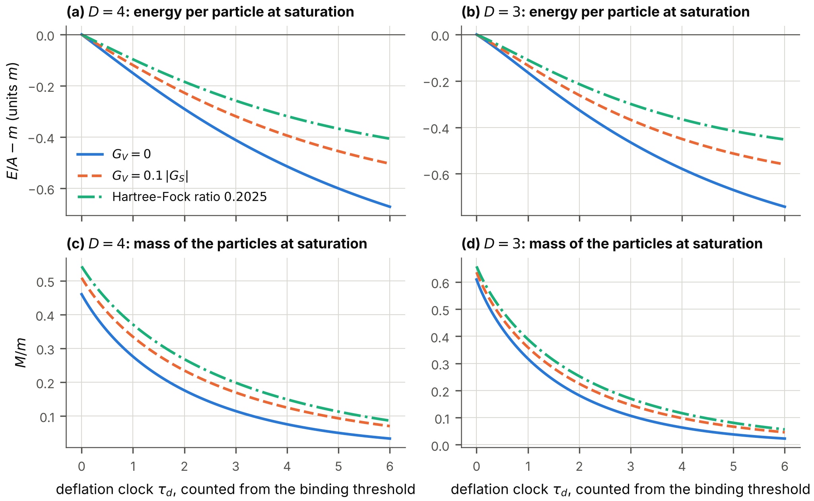

**FIG. 6.** Self-bound matter in the sector of fields that do not depend on $x5,x6,x7$, along the deflation clock, counted from the moment at which matter first becomes self-bound. Upper row: energy per particle of the saturated state minus $m$. Lower row: mass of its particles. Left: $D=4$; right: $D=3$. Three ratios of the vector to the scalar coupling.

Matter of a *fixed* density is carried through the same sequence (Fig. 7). Its pressure along the flat coordinates becomes negative at a moment that depends on the density (Table IV): a uniform gas is then unstable against breaking up into drops of saturated matter. Along the deflating coordinates the pressure is the interaction pressure $p_{\mathrm{int}}$ of Eq. (63) alone, which is negative as long as the scalar attraction dominates: *the matter pulls on the deflating coordinates.* Section XV uses this.

| $D$ | $G_V/\vert G_S\vert $ | $k_F/m$ | $\vert G_S\vert \,m^{D-1}$ | $\tau_d$ |
|:---:|:-----------:|:-------:|:----------------:|:--------:|
|  4  |      0      |   0.3   |     154.957      | $0.915$  |
|  4  |      0      |   0.6   |      47.768      | $-0.262$ |
|  4  |   0.1000    |   0.3   |     174.139      | $0.710$  |
|  4  |   0.1000    |   0.6   |      57.191      | $-0.404$ |
|  4  |   0.2025    |   0.3   |     199.477      | $0.512$  |
|  4  |   0.2025    |   0.6   |      73.117      | $-0.492$ |
|  3  |      0      |   0.3   |      10.485      | $0.262$  |
|  3  |      0      |   0.6   |      6.618       | $-0.198$ |
|  3  |   0.1000    |   0.3   |      11.784      | $0.181$  |
|  3  |   0.1000    |   0.6   |      8.019       | $-0.204$ |
|  3  |   0.2025    |   0.3   |      13.507      | $0.100$  |
|  3  |   0.2025    |   0.6   |      10.631      | $-0.140$ |

TABLE IV. A gas of fixed Fermi momentum in the sector of fields that do not depend on $x5,x6,x7$: the coupling at which its pressure along the flat coordinates vanishes, and the clock reading of that moment counted from the binding threshold of Table III (negative: before the threshold is reached, at this higher density).

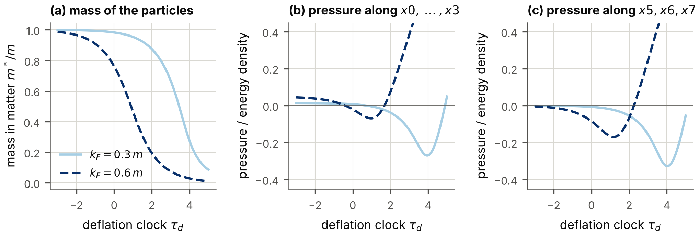

**FIG. 7.** A gas of fixed density in the sector of fields that do not depend on $x5,x6,x7$ ($D=4$, $G_V=0.1\,|G_S|$), along the deflation clock counted from the binding threshold. (a) Mass of the particles in matter. (b) Pressure along $x0,\dots,x3$ divided by the energy density. (c) Pressure along $x5,x6,x7$, the interaction pressure alone, divided by the energy density.

### C. The two halves of the field in the covariant form

With the covariant form of the self-interaction and the positive kinetic term (Sec. IV F) the particles of the two halves $W_{1644}=\pm1$ of the field are two kinds of particles with four internal states each, which carry opposite scalar and vector charges. The interaction energy is the four-term expression of Sec. IV C, and the masses of the two kinds obey two coupled gap equations, $$m^{*}_{\pm}=m+G_S^{\mathrm c}\,n_S\pm G_S^{\mathrm{HF}}\,n_{SW} .$$ For a scalar attraction $G_S^{\mathrm{HF}}<0$ a particle is attracted by particles of its own half and repelled by those of the other. The state with equal halves is then never the state of lowest energy at a given total density: *the matter polarizes spontaneously* (Fig. 8, Table V). The gap equations have exactly one solution at each polarization, with positive masses (the independent script searched from 81 starting values, including negative masses). For couplings three times the binding threshold of the quantized-sector form and a total density of the Fermi momentum $0.8\,m$ the energy per particle minus $m$ is $+0.3799\,m$ for equal halves and $+0.3731\,m$ with all particles in one half, against $+0.1323\,m$ in the quantized-sector form: *the covariant form binds matter much less.* A fully polarized state is matter of one kind of particle with four internal states.

| couplings | $k_F=0.4\,m$ | $0.6\,m$ | $0.8\,m$ | $1.0\,m$ |
|:---------:|:------------:|:--------:|:--------:|:--------:|
| 1.5 times |     1.00     |   1.00   |   1.00   |   0.35   |
|  3 times  |     1.00     |   1.00   |   0.65   |   0.20   |
|  6 times  |     1.00     |   1.00   |   0.40   |   0.20   |

TABLE V. Covariant form on $4{+}4$: the polarization $\mathrm{pol}_W=(n_+-n_-)/n$ of the state of lowest energy, for couplings $g_0<0$, $g_1=-0.1\,g_0$ of 1.5, 3 and 6 times the value at which the quantized-sector form first binds matter, and four total densities given by the Fermi momentum that the density would have with equal halves ($D=4$; steps of 0.05 in the polarization).

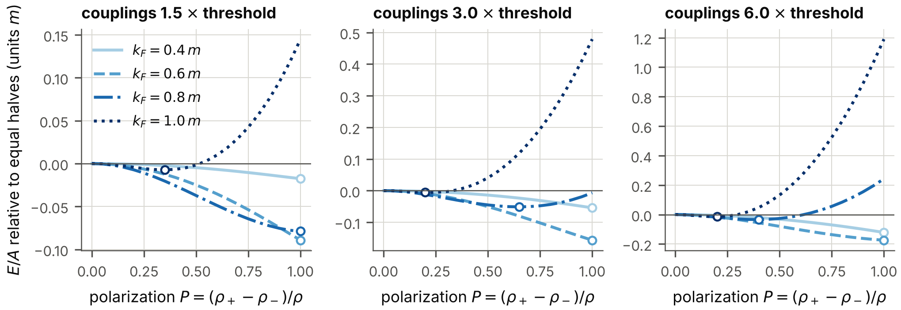

**FIG. 8.** Covariant form of the self-interaction on $4{+}4$: energy per particle as a function of the polarization of the two halves of the field, relative to the state with equal halves, for three strengths of the couplings and four total densities. Circles mark the state of lowest energy.

## VIII. Pairing and the gap along the clock

### A. The pair channels

A pair of fermions is created by an operator $\psi^{T}X\psi$ with a $16\times16$ matrix $X$; the choice of $X$ is the *channel* of the pair. For each channel one computes the *exchange amplitudes* $F_S$ and $F_P$ of the radial mode and of the phase mode: the matrix elements of the exchange of one boson between two fermions of opposite momenta in the internal state of the channel. The radial mode attracts in every channel, and the phase mode attracts in the four *vector pairs along the extra axes*, $$\psi^{T}C^{-}\gamma^{a}\psi,\qquad a\in\{0,5,6,7\},
\tag{66}$$ and repels in their partners that are built with two Dirac matrices. Here $C^{-}=\gamma^{0}\gamma^{1}\gamma^{2}\gamma^{3}$ is the matrix that turns each Dirac matrix into minus its transpose (Sec. III), and the index $a$ labels the four extra axes. The pair along the hidden axis, $a=0$, has spin 0 in ordinary spacetime; it is the *hidden-axis singlet* of hypothesis H1.

The amplitudes are computed from the Dirac matrices of the frame, which the deflation does not change, and each is proportional to the square of the coupling. For fields that do not depend on $x5,x6,x7$ the amplitude of a channel at the time $x4$ is therefore $$\begin{aligned}
F_{S,P}(x4)={}&g_{\mathrm{VS}}(x4)^{2}\\
&\times\big(F_{S,P}\text{ of the flat spacetime at }g_{\mathrm{VS}}=1\big).
\end{aligned}
\tag{67}$$ The antisymmetric matrices $X$ fall into classes under the symmetries of the theory, with 15 representative channels. The program computes the amplitudes of these 15 channels from the matrices of the deflating spacetime, at three momenta and 13 scattering angles; the numbers agree with those computed with the matrices of flat spacetime to every digit, and the amplitudes of the hidden-axis channel reproduce the closed forms of Eq. (71) to $1.1\times10^{-15}$. The conclusion about the channels therefore holds at every moment (Fig. 9): the most attractive channel is the vector pair along an extra axis.

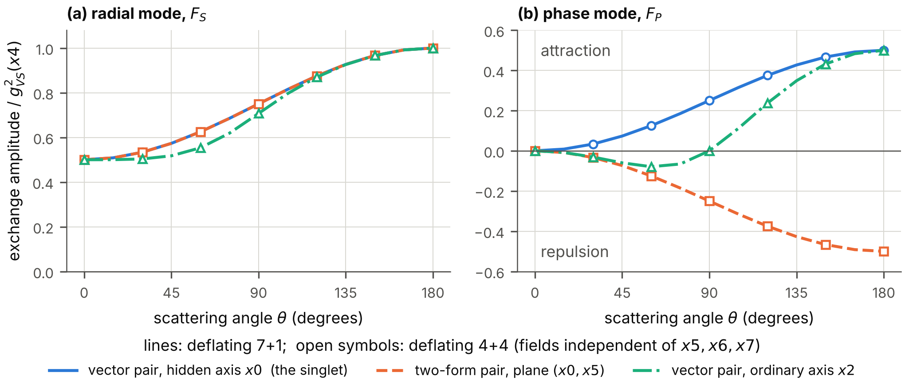

**FIG. 9.** Exchange amplitudes in three pair channels, divided by the square of the coupling of the moment, against the scattering angle, for momenta of the magnitude $m$ in the plane of $x1$ and $x2$. Lines: deflating $7{+}1$ spacetime; open symbols: deflating $4{+}4$ spacetime. (a) The radial mode attracts in all three channels. (b) The phase mode attracts in the vector pair along the hidden axis and repels in its partner built with two Dirac matrices. The amplitudes are those of flat spacetime: the deflation changes their overall strength and nothing else.

### B. The gap grows much faster than the coupling

In matter of a given density the attraction opens a gap $\Delta_F$ at the Fermi momentum $k_F$: the energy that it costs to break a pair. The gap equation \[Eq. (75) below, where it is written out with all its terms\], which generalizes that of Bardeen, Cooper and Schrieffer ([J. Bardeen, Cooper, and Schrieffer 1957](#ref-BCS1957)), holds at each moment with the couplings of that moment. Its solution as a function of the clock is the *adiabatic history* of the paired state: the state that matter would have if it were always in equilibrium. (Section XI examines when it can be.) The strength of the pairing is measured by the dimensionless number $\lambda=N(0)\,W(k_F,k_F)$, the density of states at the Fermi surface times the kernel of the gap equation there; in the vector channel it is the sum $\lambda_S+\lambda_P$ of the contributions of the two modes. Since the kernel is proportional to $g_{\mathrm{VS}}^{2}$, $$\lambda\ \propto\ e^{\tau_d}.$$

The program solves the gap equation at 34 moments for each of four sets of the mass $m_s$ and the Fermi momentum (Table VI, Fig. 10). There are three results.

| $m_s/m$, $k_F/m$ | $\tau_d$ | $g_{\mathrm{VS}}$ | $\lambda$ |   $\Delta_F/E_F$    | $T_c/\Delta_F$ | rate of growth | $\lambda\,\times$ rate |
|:----------------:|:--------:|:-----------------:|:---------:|:-------------------:|:--------------:|:--------------:|:----------------------:|
|    0.10, 0.50    | $-0.63$  |       0.730       |   0.062   | $1.17\times10^{-7}$ |     0.567      |       —        |           —            |
|    0.10, 0.50    | $-0.13$  |       0.939       |   0.102   | $7.40\times10^{-5}$ |     0.567      |      9.88      |          1.01          |
|    0.10, 0.50    |   0.38   |       1.208       |   0.169   | $3.70\times10^{-3}$ |     0.567      |      6.01      |          1.01          |
|    0.10, 0.50    |   0.88   |       1.554       |   0.279   |       0.0407        |     0.565      |      3.74      |           —            |
|    0.10, 0.50    |   1.39   |       2.000       |   0.463   |        0.189        |     0.555      |      2.50      |           —            |
|    0.10, 0.50    |   1.89   |       2.573       |   0.766   |        0.563        |     0.528      |      1.96      |           —            |
|    0.10, 0.50    |   2.39   |       3.311       |   1.268   |        1.49         |     0.480      |      1.96      |           —            |
|    1.0, 0.50     |   0.88   |       1.554       |   0.056   | $1.02\times10^{-7}$ |     0.567      |       —        |           —            |
|    1.0, 0.50     |   1.13   |       1.763       |   0.072   | $5.62\times10^{-6}$ |     0.567      |     14.02      |          1.01          |
|    1.0, 0.50     |   1.39   |       2.000       |   0.092   | $1.27\times10^{-4}$ |     0.567      |     10.93      |          1.01          |
|    1.0, 0.50     |   1.64   |       2.269       |   0.119   | $1.45\times10^{-3}$ |     0.567      |      8.54      |          1.02          |
|    1.0, 0.50     |   1.89   |       2.573       |   0.153   | $9.76\times10^{-3}$ |     0.567      |      6.71      |          1.03          |
|    1.0, 0.50     |   2.14   |       2.919       |   0.197   |       0.0439        |     0.566      |      5.33      |           —            |
|    1.0, 0.50     |   2.39   |       3.311       |   0.253   |        0.147        |     0.563      |      4.37      |           —            |

TABLE VI. The gap along the deflation clock for two of the four sets computed. $g_{\mathrm{VS}}$ and $\lambda$: coupling and pairing strength of the moment. $E_F$: Fermi kinetic energy. $T_c$: critical temperature. Rate of growth: $d\ln\Delta_F/d\tau_d$; the last column, its product with $\lambda$, is given where the gap is between $10^{-6}$ and $0.02$ of $E_F$.

*The order of the channels does not change.* At every moment the gap of the vector channel is at least as large as the gap that the radial mode alone would give, and that at least as large as the gap of the channel in which the phase mode repels. The gap never decreases.

*The critical temperature follows the gap.* Wherever the gap is below 5 per cent of the Fermi kinetic energy $E_F$, the critical temperature is $T_c=0.567\,\Delta_F$, the ratio of weak coupling, to within 0.002.

*The law of growth.* In weak coupling the gap is proportional to $e^{-1/\lambda}$. With $\lambda\propto e^{\tau_d}$, $$\frac{d\ln\Delta_F}{d\tau_d}=\frac{1}{\lambda}.
\tag{69}$$ In the computed histories the product $\lambda\,d\ln\Delta_F/d\tau_d$ lies between 1.00 and 1.03 wherever the gap is between $10^{-6}$ and $0.02$ of $E_F$.

Equation (69) is the central quantitative statement about the superfluid on a deflating spacetime. While the coupling grows by one e-folding, the gap of a weakly paired state with $\lambda=0.1$ grows by ten e-foldings, a factor of twenty thousand. A paired state that is unobservably weak at one time is strong a few e-foldings of the volume later.

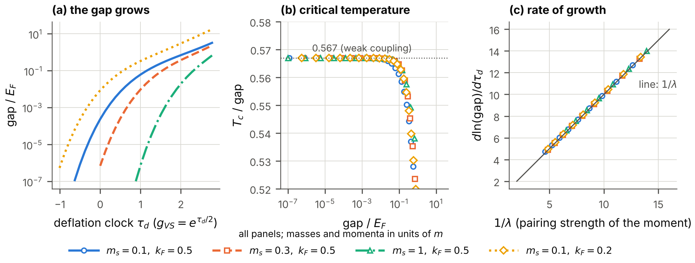

**FIG. 10.** The gap along the deflation clock, for four sets of the mass of the radial mode and of the Fermi momentum (in units of $m$). (a) The gap of the vector channel in units of the Fermi kinetic energy. (b) The ratio of the critical temperature to the gap. (c) The rate of growth of the gap against $1/\lambda$; the line is Eq. (69).

## IX. Pairing with the self-interaction

Section VIII treated the pairing by the exchange of the Vorton-Scalar alone. This section adds the self-interaction of the fermion field. It writes out the amplitudes and the gap equation in full, shows that the exchange of the Vorton-Scalar is itself a self-interaction of finite range, and gives the gap along the deflation clock when both act.

### A. Amplitudes of the four contact channels

Two particles of the mass $m^{*}$ with the momenta $\vec p$ and $-\vec p$ in ordinary space scatter into $\vec p'$ and $-\vec p'$. Let $E=(m^{*2}+p^{2})^{1/2}$ and $E'$ likewise, and let $\mathsf{h}(\vec p)=\sum_j\alpha^{j}p_j+\beta\,m^{*}$ be the Hamiltonian matrix of one particle, so that $\tfrac12(1+\mathsf{h}/E)$ projects on its states of positive energy. The pair along the hidden axis has the wave function $$\Phi(\vec p)=\tfrac12\Big(1+\frac{\mathsf{h}(\vec p)}{E}\Big)\,X^{*}\,\tfrac12\Big(1+\frac{\mathsf{h}(-\vec p)}{E}\Big)^{T},\qquad X=C^{-}\gamma^{0},$$ a $16\times16$ matrix. A vertex $\psi^\dagger M\psi$ acting on both particles gives the amplitude $\mathrm{Tr}[\Phi(\vec p')^\dagger M\Phi(\vec p)M^{T}]$ divided by the norms of the two wave functions. Summed over the lists $K$ of one rank, with $M=\beta\Theta^{K}$ and the signs $\mathrm{sgn}_K$, this defines the amplitude $F_r$ of the rank $r$. For the four independent channels of Sec. IV B the result is $$\begin{aligned}
F_0&=\frac{EE'+m^{*2}-\vec p\cdot\vec p'}{2EE'},\\
F_1&=\frac{3EE'-2m^{*2}-\vec p\cdot\vec p'}{EE'},\\
F_7&=\frac{3EE'+2m^{*2}-\vec p\cdot\vec p'}{EE'},\\
F_8&=-\frac{EE'-m^{*2}-\vec p\cdot\vec p'}{2EE'} .
\end{aligned}
\tag{71}$$ $F_0$ is the amplitude $F_S$ of the exchange of the radial mode of the Vorton-Scalar, which couples to the scalar density, and $F_8=-F_P$ is minus the amplitude of the exchange of its phase mode, which couples to the pseudoscalar density. At rest $(F_0,F_1,F_7,F_8)=(1,1,5,0)$, the pair coupling (38). The closed forms were verified against the direct evaluation with the 256 matrices at random momenta, by the program to $1.8\times10^{-15}$ and by the independent script with projectors built from numerical eigenvectors; the $7{+}1$ spacetime gives the same four functions. They hold for momenta in ordinary space; a momentum along the hidden axis itself changes them, because the pair operator points along that axis.

The relations (33) between the nine invariants hold for the amplitudes at rest, and at general momenta for the part of each amplitude that is even under $\vec p'\to-\vec p'$, which is the sum of the direct and of the exchange scattering of two identical particles; they do not hold for the odd part, which does not contribute to a contact interaction in a pair state without orbital angular momentum. For a strictly local interaction the four couplings (35) therefore suffice. When the interaction is given a range, as below, the model is *defined* by giving that range to the four channels.

### B. The pairing potential and the gap equation

The pairing potential of the contact interaction in the hidden-axis channel is $$V_{\mathrm{ct}}(\vec p',\vec p)=\big(g_{0}^{\mathrm{eff}}F_0+g_{1}^{\mathrm{eff}}F_1+g_{7}^{\mathrm{eff}}F_7+g_{8}^{\mathrm{eff}}F_8\big)\,\frac{m_{\mathrm{ct}}^{2}}{q^{2}+m_{\mathrm{ct}}^{2}},
\tag{72}$$ attractive where it is negative, with $q=|\vec p'-\vec p|$. A contact interaction in a gap equation needs a regularization at large momentum transfer. The last factor gives each coupling the range $1/m_{\mathrm{ct}}$ of an exchanged particle of the mass $m_{\mathrm{ct}}$, the *range parameter*; it is the form that the exchange of the Vorton-Scalar itself has: $$V_{\mathrm{VS}}(\vec p',\vec p)=-g_{\mathrm{VS}}^{2}\Big[\frac{F_S}{q^{2}+m_s^{2}}+\frac{F_P}{q^{2}+m_{\vartheta}^{2}}\Big],
\tag{73}$$ with the mass $m_s$ of the radial mode and the mass $m_{\vartheta}$ of the phase mode, which vanishes when the chiral symmetry is exact. Comparing Eqs. (72) and (73): *the exchange of the Vorton-Scalar is a self-interaction of finite range*, with the momentum-dependent couplings $$g_{0}^{\mathrm{eff}}(q)=-\frac{g_{\mathrm{VS}}^{2}}{q^{2}+m_s^{2}},\qquad g_{8}^{\mathrm{eff}}(q)=+\frac{g_{\mathrm{VS}}^{2}}{q^{2}+m_{\vartheta}^{2}} .
\tag{74}$$ At momenta far below $m_s$ the radial mode acts as the scalar contact coupling $g_0=-g_{\mathrm{VS}}^{2}/m_s^{2}$. In the phase with unbroken symmetry the two masses are equal and $g_{0}^{\mathrm{eff}}(q)+g_{8}^{\mathrm{eff}}(q)=0$, the condition (39) of chiral invariance. The program confirms that the scalar contact coupling $-g_{\mathrm{VS}}^{2}/m_s^{2}$ with $m_{\mathrm{ct}}=m_s$ reproduces the kernel of the exchange of the radial mode to $3\times10^{-16}$.

The gap function $\Delta(k)$ of the paired state obeys, at the temperature $T$, $$\begin{aligned}
\Delta(k)&=\frac{1}{4\pi^{2}}\int_0^\infty dk'\,k'^{2}\,W(k,k')\,\frac{\Delta(k')}{E_{k'}}\tanh\frac{E_{k'}}{2T},\\
W(k,k')&=\frac12\int_{-1}^{1}d\cos\theta\,\big[-V_{\mathrm{VS}}-V_{\mathrm{ct}}\big],
\end{aligned}
\tag{75}$$ with $\xi_k=(k^{2}+m^{2})^{1/2}-\mu$, the quasi-particle energy $E_k=(\xi_k^{2}+\Delta(k)^{2})^{1/2}$, the chemical potential $\mu=(k_F^{2}+m^{2})^{1/2}$, and the angle $\theta$ between $\vec p$ and $\vec p'$ ($k=|\vec p|$, $k'=|\vec p'|$); $\Delta_F=\Delta(k_F)$. It is the condition that the CJT effective action be stationary with respect to the pair part of the propagator, in the truncation of Sec. XII, and equally the form that the Kohn-Sham equations take with a pairing field. The angular integral is elementary, because each amplitude is linear in $\cos\theta$.

### C. The gap along the clock with contact couplings

All couplings of the four-dimensional description grow as $e^{\tau_d}$ (Sec. VI), so that the ratio of a contact coupling to $g_{\mathrm{VS}}^{2}$ is fixed. Table VII and Fig. 11 give the gap for seven choices: the exchange alone; the exchange with a scalar contact attraction $g_{0}^{\mathrm{eff}}=-g_{\mathrm{VS}}^{2}/m^{2}$; with a scalar attraction and a vector repulsion one tenth as large, $g_{1}^{\mathrm{eff}}=+0.1\,g_{\mathrm{VS}}^{2}/m^{2}$; with a vector repulsion alone, $g_{1}^{\mathrm{eff}}=+0.3\,g_{\mathrm{VS}}^{2}/m^{2}$; with an axial coupling $g_{7}^{\mathrm{eff}}=-0.1\,g_{\mathrm{VS}}^{2}/m^{2}$; the contact couplings without the Vorton-Scalar; and the exchange alone with a phase mode of the mass $m_{\vartheta}=0.3\,m$. The range parameter is $m_{\mathrm{ct}}=m$.

| interaction                                                                 | $m_s=0.1\,m$ | $m_s=0.3\,m$ | $m_s=m$ |
|:----------------------------------------------------------------------------|:------------:|:------------:|:-------:|
| exchange of the Vorton-Scalar alone                                         |    0.7502    |    0.4117    | 0.0246  |
| with a scalar contact attraction, $g_0^{\mathrm{eff}}=-1$                   |    1.2882    |    0.9023    | 0.2968  |
| with $g_0^{\mathrm{eff}}=-1$ and $g_1^{\mathrm{eff}}=+0.1$                  |    1.1102    |    0.7403    | 0.1961  |
| with a vector contact repulsion, $g_1^{\mathrm{eff}}=+0.3$                  |    0.5438    |    0.2370    | 0.0006  |
| with an axial-vector contact coupling, $g_7^{\mathrm{eff}}=-0.1$            |    1.0108    |    0.6454    | 0.1287  |
| contact couplings alone, $g_0^{\mathrm{eff}}=-1$, $g_1^{\mathrm{eff}}=+0.1$ |    0.0006    |    0.0006    | 0.0006  |
| exchange alone, phase mode of the mass $0.3\,m$                             |    0.7340    |    0.3966    | 0.0197  |

TABLE VII. The gap at the Fermi surface in units of the Fermi kinetic energy, with contact couplings, at the clock reading 2.04 \[$g_{\mathrm{VS}}=2.771$\], for the Fermi momentum $k_F=0.5\,m$ and three masses of the radial mode. Contact couplings in units of $g_{\mathrm{VS}}^{2}/m^{2}$; $m_{\mathrm{ct}}=m$.

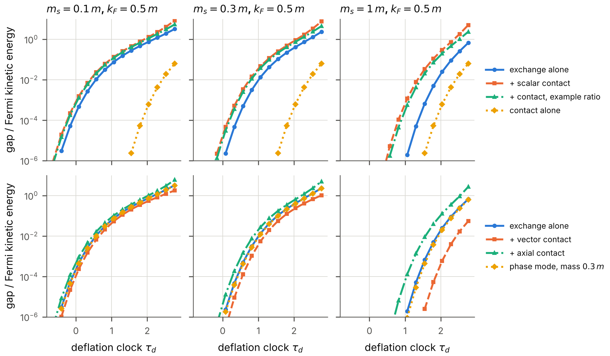

**FIG. 11.** The gap of the hidden-axis pair along the deflation clock with contact couplings, for the Fermi momentum $0.5\,m$ and three masses $m_s$ of the radial mode of the Vorton-Scalar. Upper row: the exchange of the Vorton-Scalar alone; with a scalar contact attraction; with a scalar attraction and a vector repulsion one tenth as large; the contact couplings alone. Lower row: the exchange alone; with a vector contact repulsion; with an axial contact coupling; with a phase mode of the mass $0.3\,m$. Couplings and range parameter as in Table VII.

Three statements summarize the result; each was verified at every clock reading at which the gap exceeds $10^{-6}$ of the Fermi kinetic energy.

*A scalar contact attraction raises the gap*, strongly so where the exchange alone is weak: for $m_s=m$ at the clock reading of Table VII by the factor 12.0.

*A vector contact repulsion lowers it.* A vector coupling of three tenths of $g_{\mathrm{VS}}^{2}/m^{2}$ removes most of the gap of a weakly paired state (Table VII, $m_s=m$) and reduces the gap of a strongly paired one.

*A mass of the phase mode lowers it*, because it weakens the attraction of that mode at small momentum transfer.

Without contact couplings the program reproduces the gaps of Sec. VIII to $7\times10^{-16}$. For small gaps the critical temperature remains $0.567$ times the gap. An independent solution of Eq. (75) on another grid of momenta, by plain iteration, gives the gaps of Table VII for the first three rows to $1.1\times10^{-3}$ (relative). The law of growth (69) holds with contact couplings as it does without, because every part of the kernel grows as $e^{\tau_d}$.

## X. The bound pair and the order of events

### A. The moment of binding

Two fermions in the Yukawa potential (59) form a bound state if and only if the number $D_{\mathrm{VS}}$ of Eq. (56) exceeds a critical value, $D_c=1.67981$. On a deflating spacetime $D_{\mathrm{VS}}\propto e^{\tau_d}$, so that the pair becomes bound at a definite time. Measure the clock from that moment: $$\tau_{\mathrm{pair}}=\ln\frac{D_{\mathrm{VS}}}{D_c}=\mathrm{gsum}\,\big(x4-x4_{\mathrm{binding}}\big).
\tag{76}$$ Table VIII and Fig. 12 show the scattering length $a_{\mathrm{sc}}$ of two fermions and the binding energy $E_b$ of the pair as the clock passes the binding. The linearized gap equation in vacuum, whose kernel is relativistic, gives nearly the same critical value: 1.7347, 1.6902 and 1.6810 for $m_s/m=0.3$, $0.1$ and $0.03$ (Table XXXVIII).

| $\tau_{\mathrm{pair}}$ | $D_{\mathrm{VS}}$ | $a_{\mathrm{sc}}\,m_s$ | bound states |  $E_b\,m/m_s^{2}$   |
|:----------------------:|:-----------------:|:----------------------:|:------------:|:-------------------:|
|        $-0.105$        |      1.5118       |        $-12.50$        |      0       |          0          |
|        $-0.095$        |      1.5279       |        $-13.93$        |      0       |          0          |
|        $-0.010$        |      1.6630       |        $-134.0$        |      0       |          0          |
|         0.010          |      1.6966       |         135.9          |      1       | $5.50\times10^{-5}$ |
|         0.486          |      2.7314       |         2.698          |      1       |        0.232        |
|         0.994          |      4.5409       |       $-0.1288$        |      1       |        1.82         |

TABLE VIII. Two fermions as the clock passes the moment of binding: the scattering length in units of $1/m_s$, the number of bound states, and the binding energy in units of $m_s^{2}/m$.

*The scattering length.* Just before the binding the scattering length is large and negative, just after it large and positive: $-134.0/m_s$ at $0.99\,D_c$ and $+135.9/m_s$ at $1.01\,D_c$. At the moment of binding it is infinite: the two fermions are at a scattering resonance. *Every pair of fermions of the model passes through this resonance once, at the same time.* Section XVI examines what that means if the fermions are the dark matter.

*The binding energy.* Just after the binding the binding energy starts quadratically, $$E_b\ \propto\ \big(e^{\tau_{\mathrm{pair}}}-1\big)^{2}\,\frac{m_s^{2}}{m},
\tag{77}$$ with the fitted exponent 2.01 between 2 and 8 per cent above $D_c$. Because $E_b$ vanishes at the threshold, the time $1/E_b$ that the pair needs to adjust is infinite there. However slow the deflation is, the pair cannot follow it adiabatically at first.

*The same threshold from the gap equation.* In vacuum the linearized gap equation is the equation of a bound state of two fermions, with a relativistic kernel. It reaches the eigenvalue 1 at $D_{\mathrm{VS}}=1.7347$, $1.6902$ and $1.6810$ for $m_s/m=0.3$, $0.1$ and $0.03$, approaching the value $D_c$ of the Schrödinger equation as the radial mode becomes light and the binding non-relativistic.

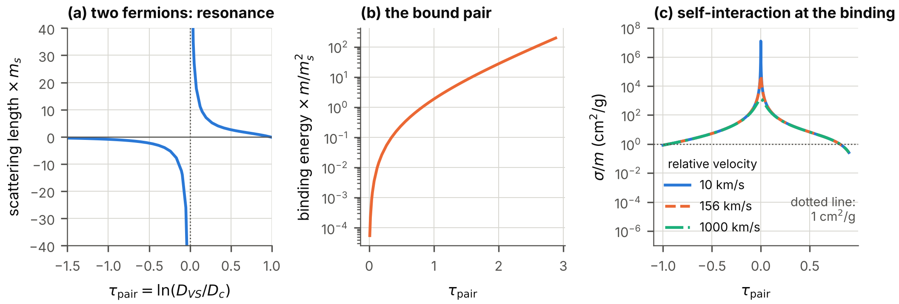

**FIG. 12.** The bound pair along the clock. (a) Scattering length of two fermions in units of $1/m_s$ against $\tau_{\mathrm{pair}}$: the resonance at the moment of binding. (b) Binding energy of the pair. (c) Cross-section per mass of two fermions at three relative velocities while the clock passes the binding, for the example particle of Sec. XVI I.

### B. The order of events

The other thresholds of the model are thresholds in the number $C$ of Eq. (56), which grows at the same rate as $D_{\mathrm{VS}}$. Because $C/D_{\mathrm{VS}}=4\pi m/m_s$ is fixed, the order in which the events happen depends on the ratio $m_s/m$ alone. Table IX gives the clock reading $\tau_{\mathrm{pair}}$ of each event; a negative number means that the event precedes the binding of the pair. The events other than the binding are derived in Sec. XII.

| event                                                                                                       | threshold                             |  $0.1$  |  $0.3$  |   $1$   |   $3$   |  $10$   |  $30$   |
|:------------------------------------------------------------------------------------------------------------|:--------------------------------------|:-------:|:-------:|:-------:|:-------:|:-------:|:-------:|
| the one-loop potential of the Vorton-Scalar falls below its vacuum value at the field $10\,v_{\mathrm{VS}}$ | $C=1.5477$                            | $-4.92$ | $-3.82$ | $-2.61$ | $-1.51$ | $-0.31$ |  0.79   |
| matter is self-bound (Fermi sea only)                                                                       | $C=3.7011$                            | $-4.04$ | $-2.94$ | $-1.74$ | $-0.64$ |  0.56   |  1.66   |
| the one-loop potential falls below its vacuum value at the field $3\,v_{\mathrm{VS}}$                       | $C=4.2694$                            | $-3.90$ | $-2.80$ | $-1.60$ | $-0.50$ |  0.70   |  1.80   |
| matter is self-bound (with the negative-energy states)                                                      | $C=5.9218$                            | $-3.57$ | $-2.48$ | $-1.27$ | $-0.17$ |  1.03   |  2.13   |
| matter of Fermi momentum $0.5\,m$ becomes abnormal (massless fermions)                                      | $C=12.9713$                           | $-2.79$ | $-1.69$ | $-0.49$ |  0.61   |  1.82   |  2.91   |
| **two fermions form a bound pair**                                                                          | $D_{\mathrm{VS}}=1.6798$              |  0.00   |  0.00   |  0.00   |  0.00   |  0.00   |  0.00   |
| pair condensate in the vacuum (ladder equation, cutoff $100\,m$)                                            | $\alpha_{\mathrm{VS}}=2.13$ to $2.93$ |  2.54   |  1.44   |  0.25   | $-0.82$ | $-1.93$ | $-2.84$ |

TABLE IX. The order of events along the deflation: the clock reading $\tau_{\mathrm{pair}}$ of each event, relative to the moment at which two fermions form a bound pair, for six ratios of the mass $m_s$ of the radial mode to the fermion mass $m$.

For a *light radial mode*, $m_s/m\le3$ in the table, the pair becomes bound only *after* the one-loop potential of the Vorton-Scalar has fallen below its vacuum value at a field of three times the vacuum value: the deflation endangers the vacuum of the model before it binds the pair. The condition for the opposite order is $4\pi D_c\,m/m_s<4.27$, that is, $m_s/m>4.9$. For a *heavy radial mode*, $m_s/m=10$ or $30$, the pair becomes bound first, and matter becomes self-bound and loses its fermion mass later. Nothing in the model decides between the two orders; the table states what follows from each.

## XI. Can the paired state follow the deflation?

### A. The question, and the parameter that decides it

Section VIII gave the gap that the paired state would have in equilibrium at each moment. But a state can change at most at the rate of its own energy scale, which for a paired state is the gap. By Eq. (69) the equilibrium gap, written $\Delta_{\mathrm{eq}}$ in this section, changes at the rate $\mathrm{gsum}/\lambda$. The paired state can follow only if that rate is small compared with the gap itself: $$\Xi_d=\frac{\mathrm{gsum}}{\lambda\,\Delta_{\mathrm{eq}}}\ \ll\ 1 .
\tag{78}$$ Early in the deflation the gap is exponentially small, and the condition fails however small the rate is. A system that is carried through a change faster than it can respond falls out of equilibrium, as in the formation of defects at a phase transition ([Kibble 1976](#ref-Kibble1976); [Zurek 1985](#ref-Zurek1985)). The question is what the paired state does then, and when it catches up.

### B. The model

The question is answered with the standard reduced model of a superfluid, whose dynamics without collisions is known in detail ([Barankov, Levitov, and Spivak 2004](#ref-BarankovLevitovSpivak2004)). Pairs of states of opposite momenta, with the single-particle energy $\xi_k$ measured from the Fermi energy, fill a shell $-E_{\mathrm{sh}}<\xi_k<E_{\mathrm{sh}}$ with a constant density of states, and all attract one another with the dimensionless strength $\lambda$. In the mean-field approximation each pair of states is described by its pair correlation $\kappa$, a complex number, and its occupation $n_k$; the order parameter is $\Delta=\lambda\int\kappa\,d\xi_k$. The equations of motion are $$\begin{aligned}
\frac{d\kappa}{dx4}&=-i\,\big[2\,\xi_k\,\kappa-\Delta\,(1-2n_k)\big],\\
\frac{dn_k}{dx4}&=2\,\mathrm{Im}\big(\Delta^{*}\kappa\big).
\tag{79}
\end{aligned}$$ They conserve $|2\kappa|^{2}+(1-2n_k)^{2}=1$ for every pair of states. In equilibrium $\kappa=\Delta/2E_k$ and $n_k=\tfrac12(1-\xi_k/E_k)$ with the quasi-particle energy $E_k=(\xi_k^{2}+\Delta^{2})^{1/2}$, and the gap equation gives $$\Delta_{\mathrm{eq}}(\lambda)=\frac{E_{\mathrm{sh}}}{\sinh(1/\lambda)}\ \approx\ 2\,E_{\mathrm{sh}}\,e^{-1/\lambda}\quad(\lambda\ll1).$$ The model keeps what matters for the question, a gap that depends exponentially on a coupling that grows exponentially, and omits the dependence of the gap on the momentum; $E_{\mathrm{sh}}$ stands for the range of energies over which the attraction acts. The program starts the model in equilibrium at $\lambda=0.15$, lets the coupling grow as $\lambda=0.15\,e^{\tau_d}$ up to $\lambda=0.5$, and integrates Eqs. (79) for 2000 energies. Doubling the number of energies and halving the step changes no digit of the results quoted. Besides $|\Delta|$ the program records the density $n_{\mathrm{ex}}$ of *broken pairs*: the number of pairs of states, per unit of $E_{\mathrm{sh}}$ times the density of states, that are not in the ground state that belongs to the order parameter of the moment. In equilibrium it is zero.

### C. Results

| $\mathrm{gsum}/E_{\mathrm{sh}}$ | $\Xi_d$ at the start | smallest $\vert \Delta\vert /\Delta_{\mathrm{eq}}$ | $\tau_d$ of the catch-up | $\Xi_d$ there | final $\vert \Delta\vert /\Delta_{\mathrm{eq}}$ | $n_{\mathrm{ex}}$ at the end |
|:-------------------------------:|:--------------------:|:----------------------------------------:|:------------------------:|:-------------:|:-------------------------------------:|:----------------------------:|
|        $1\times10^{-4}$         |        0.262         |                  0.958                   |          0.020           |     0.23      |                1.0000                 |      $6.0\times10^{-6}$      |
|        $3\times10^{-4}$         |        0.786         |                  0.890                   |          0.069           |     0.47      |                0.9998                 |      $5.1\times10^{-5}$      |
|        $1\times10^{-3}$         |         2.62         |                  0.737                   |          0.234           |     0.52      |                0.9980                 |      $4.4\times10^{-4}$      |
|        $3\times10^{-3}$         |         7.86         |                  0.539                   |          0.454           |     0.44      |                0.9886                 |      $2.4\times10^{-3}$      |
|              0.01               |         26.2         |                  0.328                   |          0.780           |     0.32      |                0.9347                 |            0.012             |
|              0.03               |         78.6         |                  0.189                   |          1.172           |     0.24      |                0.8076                 |            0.041             |
|               0.1               |         262          |                  0.098                   |            —             |       —       |                0.1189                 |            0.022             |

TABLE X. The paired state while the pairing strength grows from 0.15 to 0.5, for seven rates of deflation: the parameter $\Xi_d$ at the start; the smallest ratio of the order parameter to the equilibrium gap of the moment; the clock reading at which the order parameter has returned to within 10 per cent of the equilibrium gap, and $\Xi_d$ at that moment; the ratio at the end; and the density of broken pairs at the end.

Table X and Fig. 13 show three results.

*The faster the deflation, the further the order parameter falls behind.* For a rate of $10^{-4}\,E_{\mathrm{sh}}$ the order parameter drops to 0.958 of the equilibrium gap of the moment before it recovers; for $10^{-1}\,E_{\mathrm{sh}}$ it drops to 0.098.

*The state catches up when $\Xi_d$ has fallen to a value between 0.23 and 0.52.* In six of the seven runs the order parameter returns to within 10 per cent of the equilibrium gap at such a value. In the fastest run it has not caught up when the coupling reaches 0.5. This confirms the estimate (78) and fixes the number that “small” means.

*The lag leaves broken pairs behind.* Their density at the end grows with the rate, from $6.0\times10^{-6}$ to $4.1\times10^{-2}$ in the six slower runs. They are excitations of the superfluid that the deflation itself has made; in a system without dissipation they remain.

Because $\Delta_{\mathrm{eq}}$ grows as $e^{-1/\lambda}$ while $\lambda$ grows only as $e^{\tau_d}$, the parameter $\Xi_d$ falls steeply with time. For any rate there is a moment at which $\Xi_d$ passes through the window of the second result. Before it the paired state is out of equilibrium, with an order parameter below the equilibrium value; after it the adiabatic history of Sec. VIII applies. The slower the deflation, the earlier that moment and the smaller the gap at which it happens: it is the moment at which the equilibrium gap has grown to between two and four times $\mathrm{gsum}/\lambda$.

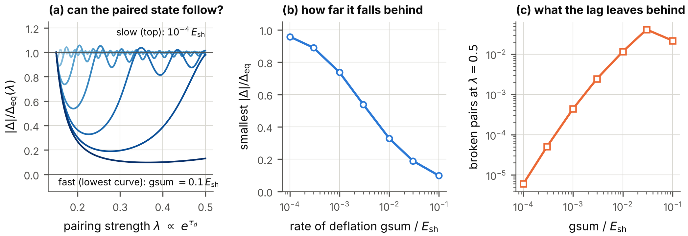

**FIG. 13.** The paired state while the coupling grows. (a) The order parameter divided by the equilibrium gap of the moment, against the pairing strength, for seven rates of deflation. (b) The smallest value of that ratio against the rate. (c) The density of broken pairs at the end of the run against the rate.

## XII. The effective action along the clock

### A. The method, and why it carries over

The results on the paired state, on matter, on temperature and on the vacuum follow from the effective action for composite operators of Cornwall, Jackiw and Tomboulis (CJT) ([Cornwall, Jackiw, and Tomboulis 1974](#ref-CJT1974)): a functional of the expectation value $\phi$ of the Vorton-Scalar and of the full propagators, whose two-particle-irreducible part is truncated at two loops. Its stationarity conditions are the equation for the fermion mass in matter and the gap equation. On the deflating spacetime, and for fields that do not depend on the extra coordinates, nothing in this construction changes, for two reasons established above. The weighted fermion field obeys the flat equations, so that its propagator is the flat one. And the interaction between the fermions is, at each moment, the exchange of the two modes of the scalar with the coupling of that moment and with the unshifted range (Sec. VI D).

The one new term, the shift $-\mathrm{gsum}^{2}/4$ of the squares of the boson masses in Eq. (54), is smaller than every other scale of the calculation by the square of the ratio of the rate of deflation to a particle mass. For the largest rate that observation allows (Sec. XVI) and a mass of 1 keV that ratio is below $10^{-36}$. The term is neglected in this section; this is the only approximation made here beyond the truncation itself. The test of the truncation on a solvable model in zero dimensions, which does not involve the spacetime, was executed again: the two-loop truncation has a solution for every coupling from 0.01 to 30 and stays within 10.7 per cent of the exact propagator.

Every result of this section is a statement about a *sequence of equilibrium states*. Whether a system can follow the sequence was examined, for the paired state, in Sec. XI.

### B. The paired state

The CJT potential $V[\Delta]$ of the paired state is the effective action per unit volume, measured from the unpaired state, as a functional of the gap function $\Delta(k)$. The program evaluates it at 13 moments, for two choices of the mass $m_s$ at the Fermi momentum $k_F=0.5\,m$, in the vector channel (Table XI, Fig. 14).

| $m_s/m$, $k_F/m$ | $\tau_d$ | $g_{\mathrm{VS}}$ | $\lambda$ |    $\Delta_F/m$     |      $V/m^{4}$       | ratio | curvature | $T_c/\Delta_F$ | size $\times k_F$ |
|:----------------:|:--------:|:-----------------:|:---------:|:-------------------:|:--------------------:|:-----:|:---------:|:--------------:|:-----------------:|
|    0.30, 0.50    |   0.00   |       1.80        |   0.216   | $2.81\times10^{-3}$ | $-4.46\times10^{-7}$ | 1.000 |   0.21    |     0.567      |       25.4        |
|    0.30, 0.50    |   0.21   |       2.00        |   0.266   | $6.89\times10^{-3}$ | $-2.68\times10^{-6}$ | 0.998 |   0.26    |     0.566      |       10.3        |
|    0.30, 0.50    |   0.40   |       2.20        |   0.322   |       0.0135        | $-1.03\times10^{-5}$ | 0.992 |   0.30    |     0.564      |        5.3        |
|    0.30, 0.50    |   0.58   |       2.40        |   0.383   |       0.0230        | $-2.93\times10^{-5}$ | 0.981 |   0.34    |     0.559      |        3.1        |
|    0.30, 0.50    |   0.74   |       2.60        |   0.450   |       0.0354        | $-6.81\times10^{-5}$ | 0.961 |   0.37    |     0.552      |        2.0        |
|    0.30, 0.50    |   0.88   |       2.80        |   0.522   |       0.0511        | $-1.38\times10^{-4}$ | 0.932 |   0.38    |     0.542      |        1.4        |
|    0.30, 0.50    |   1.02   |       3.00        |   0.599   |       0.0707        | $-2.53\times10^{-4}$ | 0.895 |   0.38    |     0.530      |        1.0        |
|    1.0, 0.50     |   0.00   |       2.40        |   0.133   | $4.25\times10^{-4}$ | $-1.02\times10^{-8}$ | 1.000 |   0.13    |     0.567      |       167.6       |
|    1.0, 0.50     |   0.16   |       2.60        |   0.156   | $1.32\times10^{-3}$ | $-9.88\times10^{-8}$ | 1.000 |   0.15    |     0.567      |       53.9        |
|    1.0, 0.50     |   0.31   |       2.80        |   0.181   | $3.28\times10^{-3}$ | $-6.08\times10^{-7}$ | 0.999 |   0.17    |     0.567      |       21.7        |
|    1.0, 0.50     |   0.45   |       3.00        |   0.208   | $6.89\times10^{-3}$ | $-2.68\times10^{-6}$ | 0.998 |   0.19    |     0.566      |       10.3        |
|    1.0, 0.50     |   0.58   |       3.20        |   0.237   |       0.0128        | $-9.25\times10^{-6}$ | 0.994 |   0.21    |     0.564      |        5.6        |
|    1.0, 0.50     |   0.70   |       3.40        |   0.267   |       0.0218        | $-2.65\times10^{-5}$ | 0.987 |   0.23    |     0.561      |        3.3        |

TABLE XI. The paired state along the clock from the CJT potential, for $k_F=0.5\,m$. $\lambda$: pairing strength. $V$: the potential at the solution, the condensation energy. Ratio: $V$ divided by its weak-coupling value $-\nu N(0)\Delta_F^{2}/4$, with $\nu=8$ internal states and the density of states $N(0)$. Curvature: the smallest eigenvalue of the matrix of second derivatives of the potential. Size: the coherence length of the pair in units of $1/k_F$.

*The solution of the gap equation is a minimum at every moment.* Newton’s method applied to the potential converges to the gap function that the iteration of the gap equation finds, to $7.7\times10^{-12}$, and the smallest eigenvalue of the second variation is positive throughout. The temperature at which the second variation at $\Delta=0$ loses its positivity equals the temperature at which the linearized gap equation has the eigenvalue 1, to $2.6\times10^{-12}$: two routes to the critical temperature agree.

*The condensation energy deepens.* It is within 15 per cent of the weak-coupling value wherever the gap is below $0.1\,E_F$, and in weak coupling its logarithmic slope along the clock is twice that of the gap, by Eq. (69): $$\frac{d\ln|V|}{d\tau_d}=\frac{2}{\lambda}.$$

*The pairs shrink.* The coherence length of the first set falls from 25 to 1.0 in units of $1/k_F$. At its last five moments the gap exceeds $0.1\,E_F$, and at the last the pair is as small as the distance between the particles. *The deflation carries the paired state from overlapping pairs toward bound pairs.* On flat spacetime this crossover ([Nozières and Schmitt-Rink 1985](#ref-NozieresSchmittRink1985); [Leggett 1975](#ref-Leggett1975)) is reached by choosing a larger coupling; here it is reached by waiting.

*The universal ratios hold while the coupling is weak.* While the critical temperature rises by a factor of sixteen, from $6.3\times10^{-3}$ to $0.10$ of the Fermi energy, the ratio of the gap at zero temperature to the critical temperature stays within 0.019 of the weak-coupling value 1.7639, and the relative jump of the heat capacity at $T_c$ within 0.048 of 1.4261. The coefficients of the Ginzburg-Landau energy agree with their weak-coupling formulas to 1.0 per cent while $T_c$ is below $0.05\,E_F$ and differ by up to 7.9 per cent at $T_c=0.10\,E_F$. The coherence length of the Ginzburg-Landau energy, $0.1333\,v_F/T_c$ in weak coupling with the Fermi velocity $v_F$, shrinks from 80 to 5.1 in units of $1/m$: the cores of the vortices of the superfluid shrink as the deflation proceeds. Tables XXXVI and XXXVII of Appendix D give the numbers at the three moments computed.

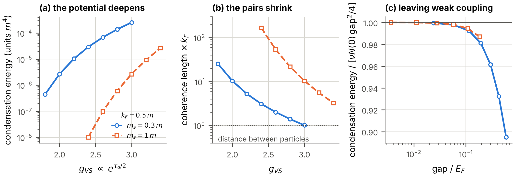

**FIG. 14.** The paired state along the clock, from the CJT potential, for the two sets of Table XI. (a) The condensation energy against the coupling of the moment. (b) The coherence length of the pair in units of $1/k_F$. (c) The condensation energy divided by its weak-coupling value, against the gap in units of the Fermi kinetic energy: the departure from weak coupling.

### C. Matter

*Matter of fixed density loses its fermion mass.* In matter the expectation value of the Vorton-Scalar is reduced by the scalar density of the fermions, and with it the fermion mass in the matter, $m^{*}$. The reduction depends on the density and on the single number $C$, and above a critical value of $C$ the mass vanishes: the matter is then in the *abnormal* state of Lee and Wick ([Lee and Wick 1974](#ref-LeeWick1974)), a gas of massless fermions in a region without expectation value of the scalar. On the deflating spacetime $C\propto e^{\tau_d}$ grows at fixed density. The critical values are $C=151.892$, $12.971$, $2.556$ and $0.617$ for the Fermi momenta $k_F=0.2$, $0.5$, $1$ and $2$ in units of $m$; they exceed the estimate $\pi^{2}m^{2}/4k_F^{2}$, which holds for dense matter, by the factors 2.46, 1.31, 1.04 and 1.00. *Every piece of matter becomes abnormal at a definite moment, the denser the earlier.*

*Self-bound matter.* Matter is self-bound, that is, its energy per particle at some density lies below the mass of a free fermion, if $C>3\pi^{2}/8=3.7011$ without the filled negative-energy states and if $C>3\pi^{2}/5=5.9218$ with them. Once the threshold is passed, the lowest energy per particle falls monotonically along the clock (Table XII), from $-0.0192\,m$ at $C=4$ to $-0.405\,m$ at $C=29.6$. At every one of these moments the matter of lowest energy is in the abnormal state. The exchange energies of the two modes, which the mean field omits, are 0.44 and 0.51 per cent of the mean-field energy at the first moment and 0.90 and 1.22 per cent at the last (for $m_s/m=0.3$): the mean field remains a good approximation along the whole history. A gas of the fermions that is dilute and unbound at early times thus has, at late times, a state of lower energy: drops of dense abnormal matter, bound by up to 40 per cent of the rest mass at the last moment of the table. Whether and how fast a gas reaches that state is a question of kinetics that is not answered here.

| $\tau_d$ |  $C$  | $(E/N-m)/m$ | $k_F/m$ |
|:--------:|:-----:|:-----------:|:-------:|
|   0.00   | 4.00  |  $-0.0192$  |  0.981  |
|   0.25   | 5.14  |  $-0.0787$  |  0.921  |
|   0.50   | 6.59  |  $-0.1345$  |  0.866  |
|   0.75   | 8.47  |  $-0.1869$  |  0.813  |
|   1.00   | 10.87 |  $-0.2362$  |  0.764  |
|   1.25   | 13.96 |  $-0.2825$  |  0.718  |
|   1.50   | 17.93 |  $-0.3259$  |  0.674  |
|   1.75   | 23.02 |  $-0.3668$  |  0.633  |
|   2.00   | 29.56 |  $-0.4051$  |  0.595  |

TABLE XII. Self-bound matter along the clock, in the mean-field approximation without the negative-energy states, for $C=4\,e^{\tau_d}$: the lowest energy per particle minus the fermion mass, and the Fermi momentum at which it is reached.

### D. Temperature

At high temperature the expectation value of the Vorton-Scalar vanishes and the fermions are massless. The temperature $T_{1/2}$ at which the expectation value has fallen to one half is of the order of the four-dimensional vacuum value $v_{\mathrm{VS}}=m/g_{\mathrm{VS}}$, which falls as $e^{-\tau_d/2}$ while the masses stay fixed. In units of the constant fermion mass, $T_{1/2}$ falls monotonically as the coupling grows, for each of the three ratios $m_s/m=0.3$, $1$ and $3$ examined; for $m_s/m=1$, from $2.33\,m$ at $g_{\mathrm{VS}}=0.3$ to $0.37\,m$ at $g_{\mathrm{VS}}=4$ \[Fig. 15(d)\]. *Matter of a fixed temperature melts at a definite moment of the deflation.* For $m_s/m=0.3$ no melting temperature can be given from $C=32$ on: there the one-loop potential of the vacuum turns over so close to the vacuum value that the Hartree potential ceases to exist before the expectation value has fallen, and the program marks these moments as not defined (Table XXXIX).

### E. The vacuum

The one-loop potential of the Vorton-Scalar in vacuum contains the negative contribution of the fermion loop ([Coleman and Weinberg 1973](#ref-ColemanWeinberg1973)), which grows with the fourth power of the field and eventually wins: beyond some field the potential lies below its value in the vacuum. The larger $C$, the smaller that field: 24.7 times the vacuum value at $C=1$, and 1.77 times at $C=10$ \[Fig. 15(c), Table XL\]. As the deflation proceeds, the barrier between the vacuum of the model and the region where the one-loop potential is unbounded below moves in toward the vacuum.

The one-loop potential is not reliable at fields far from the vacuum value, and a potential that falls at large field signals that the effective theory needs completion there, not that the vacuum decays. What the result establishes is a trend: every statement of the model that rests on the vacuum of the Vorton-Scalar becomes less secure with time. The order of this event relative to the binding of the pair was given in Sec. X.

*A pair condensate in the vacuum.* The ladder equation with a momentum cutoff shows that the pair can condense without a medium only if $\alpha_{\mathrm{VS}}$ exceeds a critical value $\alpha_c$ of order one ([Miransky 1985](#ref-Miransky1985)); with the cutoff $100\,m$ the critical values lie between 2.13 and 2.93 for the six mass ratios of Table IX. On the deflating spacetime $\alpha_{\mathrm{VS}}$ reaches such a value at a definite moment. But at that moment the coupling is strong, the exchange of one boson is no longer a controlled approximation, and the vacuum of the model is no longer protected. A pair condensate in the vacuum is not reached by the deflation within the range of validity of the model.

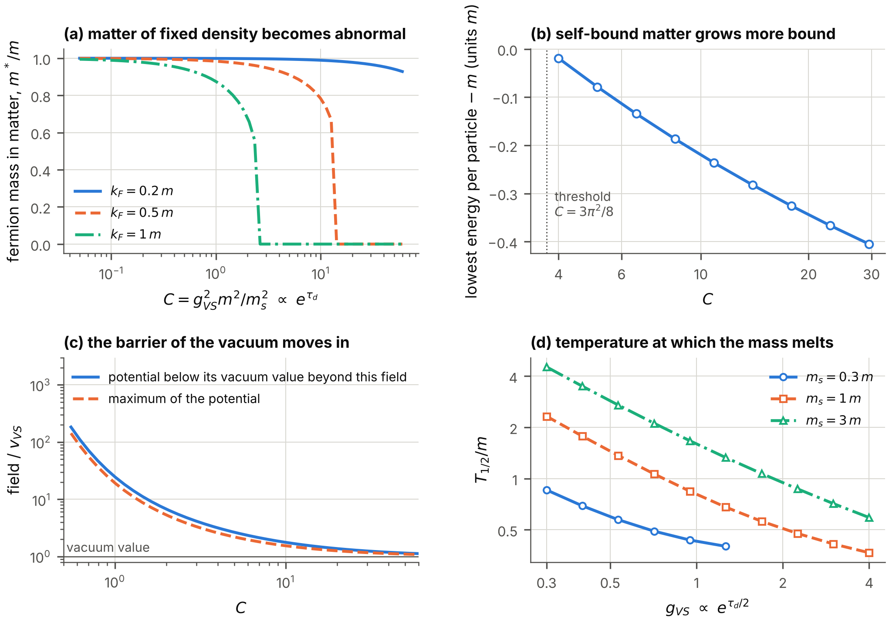

**FIG. 15.** Matter, vacuum and temperature along the clock. (a) The fermion mass in matter of three fixed densities against $C\propto e^{\tau_d}$: it drops to zero at the critical value. (b) The lowest energy per particle of self-bound matter, minus $m$. (c) The field at which the one-loop potential of the vacuum has its maximum, and the field beyond which it lies below the vacuum value, in units of the vacuum value. (d) The temperature at which the fermions have lost half of their mass, against the coupling, for three ratios $m_s/m$.

## XIII. The effective potential with the self-interaction

Section XII applied the effective action of Cornwall, Jackiw and Tomboulis to the model in which the Vorton-Scalar alone provides mass and interaction. This section applies the same method to the self-interaction of the fermion field: first without the Vorton-Scalar, where it must reproduce the Kohn-Sham results of Sec. VII and goes beyond them by counting the filled states of negative energy; then with the bare Dirac mass, the self-interaction and the Vorton-Scalar together.

### A. The effective potential of uniform matter

The CJT effective action is a functional of the full propagator $S$ of the fermions, $$\Gamma[S]=-i\,\mathrm{Tr}\ln S^{-1}-i\,\mathrm{Tr}\big(S_0^{-1}S-1\big)+\Gamma_2[S],
\tag{82}$$ where $S_0$ is the propagator of free particles of the mass $m$ and $\Gamma_2$ is the sum of the vacuum diagrams that cannot be cut in two by cutting two lines, drawn with the full propagator. For the contact interaction $\mathcal{L}_{\mathrm{self}}$ the lowest order of $\Gamma_2$ consists of two diagrams, each with two loops that meet at one vertex: the direct (Hartree) and the exchange (Fock) diagram. At this order the stationarity condition $\delta\Gamma/\delta S=0$ says that the self-energy $S_0^{-1}-S^{-1}$ does not depend on the momentum. For uniform matter at rest it is a combination of the unit matrix and of $\beta$ (Sec. IV C): the full propagator is that of free particles of a mass $m^{*}$ whose energies are shifted by a constant $V_0$. The effective action per unit volume and time then becomes an ordinary function of the two numbers $m^{*}$ and $V_0$, the *effective potential*. At zero temperature and at the chemical potential $\mu$, $$\begin{aligned}
\Omega_{\mathrm{CJT}}&(m^{*},V_0;\mu)=-\frac{(m^{*}-m)^{2}}{2\,G_S}-\frac{V_0^{2}}{2\,G_V}\\
&-\nu\!\int\!\frac{d^{D}k}{(2\pi)^{D}}\,\big(\mu-V_0-E^{*}\big)\,\theta\big(\mu-V_0-E^{*}\big),
\tag{83}
\end{aligned}$$ with $E^{*}=(k^{2}+m^{*2})^{1/2}$, the step function $\theta$, and the couplings $G_S$, $G_V$ of Eq. (37). The integral is the grand potential of free particles of the mass $m^{*}$ at the chemical potential $\mu-V_0$; the two other terms remove the interaction energy that the integral counts twice. The two stationarity conditions are $$\begin{aligned}
\frac{\partial\Omega_{\mathrm{CJT}}}{\partial V_0}&=0:\quad V_0=G_V\,n,\\
\frac{\partial\Omega_{\mathrm{CJT}}}{\partial m^{*}}&=0:\quad m^{*}=m+G_S\,n_S,
\end{aligned}
\tag{84}$$ the two equations (60) of the Kohn-Sham method. At the stationary point $-\Omega_{\mathrm{CJT}}$ is the pressure and $\Omega_{\mathrm{CJT}}+\mu\,n$ the energy density. *The Kohn-Sham method and the CJT effective potential at this order are two formulations of the same approximation*: the first works at a fixed density and solves the gap equation, the second works at a fixed chemical potential and searches the stationary point of a function.

The program evaluates the two with separate code (Gauss-Legendre integrals and a root search in the one, Simpson integrals and a minimization in the other) for 30 states in $D=7$, $4$ and $3$ dimensions (Table XIII). Mass, density, energy density and pressure agree to $1.6\times10^{-12}$ (sum of the four relative deviations); the independent script repeats the comparison with its own integrals and finds the same.

| $D$ |    $G_S$    |   $G_V$   | $k_F$ | $m^{*}$ (KS) | $m^{*}$ (CJT) | $-\Omega_{\mathrm{CJT}}/p$ |
|:---:|:-----------:|:---------:|:-----:|:------------:|:-------------:|:--------------------------:|
|  7  |  $-100000$  |  $10000$  |  0.9  |   0.143888   |   0.143888    |         1.00000000         |
|  7  |  $-100000$  |  $10000$  |  1.4  |   0.011510   |   0.011510    |         1.00000000         |
|  7  |  $-98750$   |  $20000$  |  0.9  |   0.145495   |   0.145495    |         1.00000000         |
|  7  |  $-98750$   |  $20000$  |  1.4  |   0.011654   |   0.011654    |         1.00000000         |
|  4  | $-256.9512$ | $25.6951$ |  0.9  |   0.140053   |   0.140053    |         1.00000000         |
|  4  | $-256.9512$ | $25.6951$ |  1.4  |   0.040348   |   0.040348    |         1.00000000         |
|  3  | $-29.5093$  | $2.9509$  |  0.9  |   0.182319   |   0.182319    |         1.00000000         |
|  3  | $-29.5093$  | $2.9509$  |  1.4  |   0.079333   |   0.079333    |         1.00000000         |
|  3  |    $-4$     |    $0$    |  0.9  |   0.394848   |   0.394848    |         1.00000000         |
|  3  |    $-4$     |    $0$    |  1.4  |   0.240321   |   0.240321    |         1.00000000         |

TABLE XIII. The Kohn-Sham method (KS) and the CJT effective potential compared, without the filled states of negative energy (units $m=1$): the mass of the particles in matter by both methods, and $-\Omega_{\mathrm{CJT}}$ at its stationary point divided by the Kohn-Sham pressure $p$, for ten of the 30 states computed (the data files hold eleven digits).

The effective potential says more than the gap equation in one respect. At a given chemical potential the stationary point with the lowest $\Omega_{\mathrm{CJT}}$, that is, with the highest pressure, is the state of equilibrium (the vector field $V_0$ is taken at its stationary value, a maximum; the minimum is over $m^{*}$). Of the 23 states of the comparison with a positive pressure, 20 are that minimum. In the others a denser state has the higher pressure at the same chemical potential: the Kohn-Sham state of that density is metastable, a dilute gas that can lower its energy by condensing into saturated matter.

### B. The filled states of negative energy

The Kohn-Sham calculation counts the particles of matter only. The term $-i\,\mathrm{Tr}\ln S^{-1}$ of Eq. (82) also contains the filled states of negative energy of the vacuum, whose energy depends on the mass of the particles. Because the contact interaction is an effective interaction, their momenta are counted up to a cutoff $\Lambda$: $$\begin{aligned}
\Omega_{\mathrm{CJT}}\to{}&\Omega_{\mathrm{CJT}}-\nu\!\int_{|\vec k|<\Lambda}\!\frac{d^{D}k}{(2\pi)^{D}}\\
&\times\Big[\sqrt{k^{2}+m^{*2}}-\sqrt{k^{2}+m^{2}}\Big].
\end{aligned}
\tag{85}$$ The filled states contribute the scalar density $-\nu\int_{|\vec k|<\Lambda}d^{D}k\,(m^{*}/E^{*})/(2\pi)^{D}$ to the gap equation. The mass parameter of the Lagrangian is then no longer the mass of a particle in vacuum and is called the *bare mass* $m_{\mathrm{bare}}$; the mass in vacuum, $m_{\mathrm{vac}}$, is the solution of $$\begin{aligned}
m_{\mathrm{vac}}&=m_{\mathrm{bare}}+G_S\,\langle\bar\psi\psi\rangle_{\mathrm{vac}},\\
\langle\bar\psi\psi\rangle_{\mathrm{vac}}&=-\nu\!\int_{|\vec k|<\Lambda}\!\frac{d^{D}k}{(2\pi)^{D}}\,\frac{m_{\mathrm{vac}}}{\sqrt{k^{2}+m_{\mathrm{vac}}^{2}}} .
\end{aligned}
\tag{86}$$ The scalar density of the vacuum is negative, so that an attraction ($G_S<0$) *raises* the mass above the bare mass.

*A critical coupling.* For $m_{\mathrm{bare}}=0$ Eq. (86) always has the solution $m_{\mathrm{vac}}=0$. A second solution, of lower energy, exists if the attraction exceeds a critical value, $G_S<G_c$. Expanding the integral for small $m_{\mathrm{vac}}$, with the area $A_D=D\,V_D$ of the unit sphere, $$\begin{aligned}
G_c&=-\frac{(2\pi)^{D}\,(D-1)}{\nu\,A_D\,\Lambda^{D-1}},\\
G_c\,\Lambda^{D-1}&=-90\pi^{4},\ -3\pi^{2},\ -\frac{\pi^{2}}{2}\quad\text{for }D=7,\ 4,\ 3 .
\end{aligned}
\tag{87}$$ *A field without a mass term acquires a mass by its own self-interaction when the scalar attraction exceeds $G_c$.* This is the mechanism of Nambu and Jona-Lasinio ([Nambu and Jona-Lasinio 1961](#ref-NJL1961)); the minimization of the effective potential gives no mass two per cent below $G_c$ and a mass two per cent above it in all three cases.

*On the deflating spacetime the critical coupling is crossed at a definite moment.* In the sector of fields that do not depend on $x5,x6,x7$ the coupling grows as $e^{\tau_d}$ while the cutoff, a momentum along the flat coordinates, does not change. A field that is massless at early times therefore acquires a mass at the clock reading $\tau_d=\ln[G_c/G_S(x4_{\mathrm{ref}})]$, and from then on the mass grows \[Fig. 16(a), Table XIV\]. With a small bare mass the transition is smooth. The mass reaches the cutoff about half a unit of the clock after the critical coupling is crossed; beyond that point the effective theory says nothing.

| $D$ | $m_{\mathrm{bare}}/\Lambda$ | $\tau_d=-1$ | $\tau_d=0$ | $\tau_d=0.24$ | $\tau_d=0.48$ |
|:---:|:---------------------------:|:-----------:|:----------:|:-------------:|:-------------:|
|  7  |              0              |      0      |     0      |     0.658     |     1.074     |
|  7  |            0.05             |    0.079    |   0.436    |     0.774     |     1.154     |
|  4  |              0              |      0      |     0      |     0.544     |     0.913     |
|  4  |            0.05             |    0.079    |   0.383    |     0.664     |     0.995     |
|  3  |              0              |      0      |     0      |     0.447     |     0.780     |
|  3  |            0.05             |    0.078    |   0.335    |     0.573     |     0.866     |

TABLE XIV. The mass of the fermions in vacuum, $m_{\mathrm{vac}}/\Lambda$, with the filled states of negative energy, along the deflation clock counted from the moment at which $G_S=G_c$, for a field without bare mass and for the bare mass $0.05\,\Lambda$.

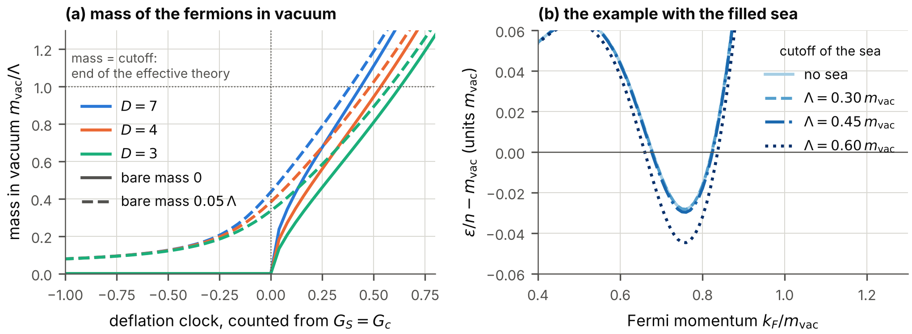

**FIG. 16.** The filled states of negative energy. (a) The mass of the fermions in vacuum, in units of the cutoff, along the deflation clock counted from the moment at which the scalar attraction equals the critical coupling, for $D=7$, $4$ and $3$ dimensions, without bare mass and with the bare mass $0.05\,\Lambda$. (b) Energy per particle of matter relative to the vacuum, for an example on the $7{+}1$ spacetime ($D=7$, $G_S=-10^{5}$, $G_V=+10^{4}$ in units of the mass in vacuum) without the filled states and with them for three cutoffs; the bare mass is chosen so that the mass in vacuum is the same.

*The thresholds of Sec. VII and the vacuum.* The last column of Table III shows that the attraction that binds matter exceeds the critical coupling of the vacuum for a cutoff equal to the mass. *The calculation without the filled states presupposes a lower cutoff*: for the smallest attraction that binds matter without a vector repulsion, a cutoff below $0.781\,m$ in $D=4$ dimensions and below $0.782\,m$ in $D=3$. How the filled states change a saturation point when they are included was computed for an example on the $7{+}1$ spacetime ($D=7$), with the bare mass adjusted so that the mass in vacuum stays the same: the saturation point moves little while the cutoff stays below about half the mass in vacuum, and the binding grows for larger cutoffs \[Fig. 16(b)\]. The results of Sec. VII are therefore those of an effective theory with a low cutoff.

### C. Bare mass, self-interaction and Vorton-Scalar together

Now let all terms of the model (51) act together, for fields in ordinary space ($D=3$) and without the filled states. Let $\phi$ be the expectation value of the Vorton-Scalar, $\langle\Phi_{\mathrm{VS}}\rangle=\phi/\sqrt2$, and $x=\phi/v_{\mathrm{VS}}$. The mass of a fermion in a region with the expectation value $\phi$ is $m_D+m_Y\,x$; let $f_D=m_D/m$ be the fraction of the mass in vacuum that is a bare Dirac mass. In units $m=1$ the energy density of matter of the Fermi momentum $k_F$ is the stationary value of $$\begin{aligned}
\varepsilon={}&\frac{(1-f_D)^{2}\,(x^{2}-1)^{2}}{8\,C}+\langle E^{*}\rangle+\tfrac12G_V\,n^{2}\\
&-\frac{\big[m^{*}-f_D-(1-f_D)\,x\big]^{2}}{2\,G_S}
\end{aligned}
\tag{88}$$ with respect to $x$ and $m^{*}$: the first term is the potential of the scalar, with the number $C$ of Eq. (56); the others are Eq. (62) with the mass $f_D+(1-f_D)x$ in place of $m$. For $f_D=0$ and $G_S=G_V=0$ this is the functional of Sec. XII, and the program reproduces its masses and energies to $2.1\times10^{-8}$ and its binding threshold $C=3\pi^{2}/8$.

*At low density the Vorton-Scalar acts as a scalar contact coupling.* Expanding Eq. (88) for small densities gives $m^{*}=m+(G_S-C/m^{2})\,n_S$: the exchange of the radial mode adds $-g_{\mathrm{VS}}^{2}/m_s^{2}$ to the scalar coupling, whatever fraction of the mass is a bare mass (verified for five sets of parameters to $1.8\times10^{-4}$ at Fermi momenta up to a twentieth of $m$). The scalar channel of the self-interaction and the exchange of the radial mode are the same interaction at momenta far below $m_s$; they differ at higher densities, where the scalar field itself changes.

*The moment at which matter becomes self-bound.* All three couplings $C$, $G_S$, $G_V$ grow as $e^{\tau_d}$, so that their ratios are fixed and the deflation carries matter through a sequence of states with growing $C$. Table XV gives the smallest $C$ at which matter is self-bound, and the shift of that moment relative to the model with the Vorton-Scalar alone \[Fig. 17(a,b)\]. *A bare Dirac mass makes matter bind earlier*, by 0.39 units of the clock if a quarter of the mass is a bare mass and by 0.58 if half of it is: the matter no longer has to pay for the destruction of the whole expectation value of the scalar. *A vector repulsion delays the binding*, by 0.10 and 0.30 units for the two vector couplings of the table, without bare mass. A scalar contact attraction acts only where the particles keep a mass: without a bare mass the matter of lowest energy at the threshold consists of massless particles, whose scalar density vanishes, and the scalar coupling of the second row of the table changes nothing.

| $f_D$ | $-G_S/C$ |      $G_V=0$      |   $G_V=0.1\,C$    |   $G_V=0.3\,C$    |
|:-----:|:--------:|:-----------------:|:-----------------:|:-----------------:|
|   0   |    0     |   3.7011 ($0$)    | 4.0907 ($+0.100$) | 5.0054 ($+0.302$) |
|   0   |   0.5    |   3.7011 ($0$)    | 4.0907 ($+0.100$) | 5.0054 ($+0.302$) |
|   0   |    1     | 3.4470 ($-0.071$) | 3.7717 ($+0.019$) | 4.5419 ($+0.205$) |
| 0.25  |    0     | 2.5112 ($-0.388$) | 2.6869 ($-0.320$) | 3.0810 ($-0.183$) |
| 0.25  |   0.5    | 2.4285 ($-0.421$) | 2.5931 ($-0.356$) | 2.9598 ($-0.223$) |
| 0.25  |    1     | 2.3725 ($-0.445$) | 2.5295 ($-0.381$) | 2.8782 ($-0.251$) |
|  0.5  |    0     | 2.0643 ($-0.584$) | 2.1763 ($-0.531$) | 2.4244 ($-0.423$) |
|  0.5  |   0.5    | 1.8878 ($-0.673$) | 1.9829 ($-0.624$) | 2.1914 ($-0.524$) |
|  0.5  |    1     | 1.7587 ($-0.744$) | 1.8421 ($-0.698$) | 2.0234 ($-0.604$) |

TABLE XV. Bare Dirac mass, contact couplings and Vorton-Scalar together ($D=3$, without the filled states): the smallest $C$ at which uniform matter is self-bound, for three vector couplings, and in parentheses the shift of the moment of binding along the deflation clock relative to the first entry (negative: earlier).

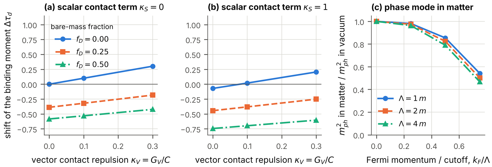

**FIG. 17.** Bare Dirac mass, contact couplings and Vorton-Scalar together. (a), (b) The shift of the moment at which matter becomes self-bound, in units of the deflation clock, against the vector contact coupling, for three fractions $f_D$ of bare mass, without and with a scalar contact coupling. (c) The square of the mass of the phase mode in matter divided by its value in vacuum, against the Fermi momentum in units of the cutoff.

### D. The mass of the phase mode

A bare Dirac mass breaks the chiral symmetry $U(1)_{\mathrm{VS}}$ explicitly, and the phase mode of the Vorton-Scalar is then no longer massless. Write $\Phi_{\mathrm{VS}}=(v_{\mathrm{VS}}/\sqrt2)\,e^{i\vartheta_{\mathrm{VS}}}$ with a constant phase $\vartheta_{\mathrm{VS}}$. The mass term of the fermions becomes $m_D+m_Y\,e^{i\vartheta_{\mathrm{VS}}\chi}$, the mass of a particle $$m(\vartheta_{\mathrm{VS}})=\sqrt{m_D^{2}+m_Y^{2}+2\,m_Dm_Y\cos\vartheta_{\mathrm{VS}}},$$ largest at $\vartheta_{\mathrm{VS}}=0$. The energy of the filled states of negative energy is lowest where the mass is largest, so that the vacuum selects $\vartheta_{\mathrm{VS}}=0$, and the second derivative of the energy density with respect to the phase is $m_{\vartheta}^{2}v_{\mathrm{VS}}^{2}$. With $dm/d\vartheta_{\mathrm{VS}}=0$ and $d^{2}m/d\vartheta_{\mathrm{VS}}^{2}=-m_Dm_Y/m$ at $\vartheta_{\mathrm{VS}}=0$, and with the derivative of the energy density with respect to the mass, which is the scalar density, $$m_{\vartheta}^{2}\,v_{\mathrm{VS}}^{2}=\Big(\big|\langle\bar\psi\psi\rangle_{\mathrm{vac}}\big|-n_S\Big)\,\frac{m_D\,m_Y}{m} .
\tag{90}$$ In vacuum ($n_S=0$) this is the relation of Gell-Mann, Oakes and Renner ([Gell-Mann, Oakes, and Renner 1968](#ref-GellMannOakesRenner1968)) for the model at hand: the square of the mass of the phase mode is proportional to the bare mass and to the scalar density of the vacuum. In ordinary space $|\langle\bar\psi\psi\rangle_{\mathrm{vac}}|=(\nu m/4\pi^{2})\,[\Lambda\sqrt{\Lambda^{2}+m^{2}}-m^{2}\,\mathrm{arsinh}(\Lambda/m)]$; the program confirms Eq. (90) against the numerical second derivative of the energy in 24 cases to $3.2\times10^{-7}$ of the value in vacuum. Three consequences follow.

*The phase mode becomes heavier along the clock.* In the couplings of the model, $m_{\vartheta}^{2}=C\,m_s^{2}\,f_D\,(|\langle\bar\psi\psi\rangle_{\mathrm{vac}}|-n_S)/[(1-f_D)\,m^{3}]$, which grows as $e^{\tau_d}$: $m_{\vartheta}\propto e^{\tau_d/2}$, while all other masses stay fixed. Its value depends on the cutoff through the scalar density of the vacuum (Table XVI).

*In matter the phase mode is lighter.* The matter subtracts its scalar density: $m_{\vartheta}^{2}(k_F)/m_{\vartheta}^{2}(0)=1-n_S/|\langle\bar\psi\psi\rangle_{\mathrm{vac}}|$ \[Table XVI, Fig. 17(c)\].

*A massive phase mode binds pairs less.* The exchange of the phase mode contributes to the pairing potential (73) with the range $1/m_{\vartheta}$; a mass of three tenths of the fermion mass reduces the gap of the example of Table VII ($m_s=m$) from 0.0246 to 0.0197 of the Fermi kinetic energy.

| $\Lambda$ | $\vert \langle\bar\psi\psi\rangle_{\mathrm{vac}}\vert $ | $m_{\vartheta}^{2}/(C\,m_s^{2})$ | $k_F=\Lambda/4$ | $\Lambda/2$ | $3\Lambda/4$ |
|:---------:|:---------------------------------------------:|:--------------------------------:|:---------------:|:-----------:|:------------:|
|     1     |                    0.1080                     |              0.0120              |      0.981      |    0.854    |    0.541     |
|     2     |                    0.6137                     |              0.0682              |      0.974      |    0.824    |    0.502     |
|     4     |                    2.9176                     |              0.3242              |      0.963      |    0.790    |    0.467     |

TABLE XVI. The phase mode of the Vorton-Scalar when a tenth of the fermion mass is a bare Dirac mass ($f_D=0.1$; $D=3$; units $m=1$): scalar density of the vacuum, square of the mass of the phase mode in vacuum in units of $C\,m_s^{2}$, and its reduction in matter of the Fermi momenta $\Lambda/4$, $\Lambda/2$ and $3\Lambda/4$.

## XIV. Order parameter, hidden symmetry and vortices

### A. Frame components and coordinate components

The order parameter of the superfluid is the expectation value $\Delta^{a}$ of the vector pair operator (66) along the extra axis $a\in\{0,5,6,7\}$: four complex numbers. On the deflating spacetime the index $a$ is a *frame* index: $\Delta^{a}$ is the component along the unit vector $e_a$. The coordinate components along the deflating coordinates are $\Delta_t=b_t(x4)\,\Delta^{t}$, and they shrink with the scale factors when the frame components are constant. All statements below are about frame components.

The energy of the paired state depends on the order parameter through the $8\times8$ gap matrix $\mathsf{M}$ on the internal states of a pair. The identity $$\tfrac18\,\mathrm{Tr}\big[(\mathsf{M}\mathsf{M}^\dagger)^{2}\big]
=2\Big(\sum_a|\Delta^{a}|^{2}\Big)^{2}-\Big|\sum_{a,b}\eta_{ab}\,\Delta^{a}\Delta^{b}\Big|^{2},
\tag{91}$$ holds on the deflating spacetime with the frame metric $\eta_{ab}$ of the four axes, to $2\times10^{-14}$. In coordinate components the same expression contains the metric $g_{tt}$ of the moment.

### B. The ground state: no direction is preferred

| state                                                   | $d_-^{2}$ | $d_+^{2}$ |    $V$    | flat | positive |
|:--------------------------------------------------------|:---------:|:---------:|:---------:|:----:|:--------:|
| pair along the frame axis of $x0$ (hidden-axis singlet) |   1.000   |   1.000   | $-2.0000$ |  4   |    4     |
| pair along the frame axis of $x5$                       |   1.000   |   1.000   | $-2.0000$ |  4   |    4     |
| pair along the frame axis of $x7$                       |   1.000   |   1.000   | $-2.0000$ |  4   |    4     |
| unitary, rotated between $x0$ and $x5$                  |   1.000   |   1.000   | $-2.0000$ |  4   |    4     |
| unitary, general direction and phase                    |   1.000   |   1.000   | $-2.0000$ |  4   |    4     |
| half-paired: $\eta_{ab}\Delta^a\Delta^b=0$              |   0.000   |   1.000   | $-1.0000$ |  —   |    —     |

TABLE XVII. The potential $V$ of the paired state for six states of the order parameter, in units of $N(0)\Delta_F^{2}$, where $\Delta_F$ is the gap of a unitary state. Each state is taken at the magnitude of the order parameter at which its potential is stationary. $d_-^{2}$ and $d_+^{2}$: the squares of the two fourfold gaps of the state, in units of $\Delta_F^{2}$. Flat and positive: the numbers of eigenvalues of the matrix of second derivatives of the potential that vanish and that are positive.

Table XVII gives the potential of the paired state for six states of the order parameter. Every *unitary* state, in which $\Delta^{a}$ is a real unit vector times a phase, has all eight gaps equal and the lowest potential, whichever direction the vector has. It has four flat directions, the Goldstone modes (one phase and three rotations of the direction), and four directions of positive curvature. The *half-paired* states, in which four of the eight gaps vanish, have half the condensation energy.

One might have expected the deflation to select the direction of the order parameter: the hidden axis $x0$, which does not deflate, against the three axes that do. *In the sector of fields that do not depend on the extra coordinates it does not.* The reason is the central observation of Sec. III: in this sector the weighted field obeys the flat equations, and their internal symmetry rotates the four frame axes into one another. The symmetry of the manifold of ground states is larger than the symmetry of the spacetime.

### C. The internal symmetry of the sector, and the symmetries of the spacetime

For fields that depend on $x1,x2,x3,x4$ only, the equation of the weighted field contains five matrices: $\alpha^{1},\alpha^{2},\alpha^{3}$, $\beta$ and $i\beta\chi$, the last through the coupling of the phase mode. The matrices that commute with all five generate the *internal symmetry* of the sector. The program computes it again for the deflating spacetime, item by item (Table LVIII), and finds it unchanged:

- the algebra is $su(2)_A\oplus su(2)_B\oplus u(1)_F\oplus u(1)_E$, of dimension 8;

- the eight internal states of a fermion form the two doublets $(2,1)+(1,2)$;

- the four vector pair operators (66) form the $(2,2)$, with fermion number 2, and their one invariant quadratic form is the frame metric of the four axes, with the signs $(+,-,-,-)$;

- a condensate along one axis breaks $SO(4)=[SU(2)_A\times SU(2)_B]/Z_2$ to $SO(3)$.

Here $U(1)_E$ is a second phase symmetry of the sector, with a generator $P$ that has the square one and distinguishes the doublets of $SU(2)_A$ from those of $SU(2)_B$.

Six of the generators are the products $\gamma^{A}\gamma^{B}$ of the six pairs taken from the four axes $x0,x5,x6,x7$. On the flat $4{+}4$ spacetime only three of them belong to transformations of the spacetime that the sector inherits: the products $\gamma^{s}\gamma^{t}$ of two additional times generate the rotations $SO(3)_T$ of $x5,x6,x7$. The other three, $\gamma^{0}\gamma^{t}$, are Hermitian; the unitary transformations that they generate in the quantized sector are not the boosts of the planes of $x0$ and $xt$, which are not unitary. The full $SU(2)_A\times SU(2)_B$ was therefore a *hidden symmetry* already on the flat spacetime: a symmetry of the equations of a sector that is not a transformation of the spacetime. On the deflating spacetime even $SO(3)_T$ is a symmetry of the spacetime only if the three rates are equal (Fig. 1). With two equal rates one rotation remains, and with three different rates none. The internal symmetry of the sector is nevertheless exact in all three cases.

### D. Vortices and their zero modes

Because the vacuum value of the Vorton-Scalar breaks the phase symmetry $U(1)_{\mathrm{VS}}$, the field has line-like defects ([Nielsen and Olesen 1973](#ref-NielsenOlesen1973)): along a straight line, say the $x3$ axis, its magnitude vanishes, and around the line its phase winds by $2\pi$ times an integer. For unit winding, $\Phi_{\mathrm{VS}}$ is $v_{\mathrm{VS}}/\sqrt2$ times a profile that rises from 0 on the line to 1 at a distance of the order of $1/m_s$, times $e^{i\theta_{12}}$ with the angle $\theta_{12}$ around the line in the plane of $x1$ and $x2$.

*Energy per unit length.* It is proportional to the square of the four-dimensional vacuum value and so falls as $e^{-\tau_d}$: in the four-dimensional description vortex lines become lighter as the deflation proceeds, while their core, of the radius $1/m_s$, keeps its size.

*Fermions on the line.* On the line the fermion mass vanishes, and fermions can be trapped there ([Jackiw and Rossi 1981](#ref-JackiwRossi1981)). In the field of the vortex the Hamiltonian of a fermion is $$\sum_{j=1}^{3}\alpha^{j}p_j+m\,(\text{profile})\,\beta\,\big(\cos\theta_{12}+i\chi\,\sin\theta_{12}\big),$$ with the momenta $p_j$ along $x1,x2,x3$. A state of zero energy at zero momentum along the line is a constant spinor $w_z$ times a function that decays away from the line. Inserting this form, the Hamiltonian annihilates the state for every angle if and only if $$\big(i\alpha^{1}+\beta\big)\,w_z=0,\qquad\big(i\alpha^{2}+i\beta\chi\big)\,w_z=0 .
\tag{93}$$ The five matrices $\alpha^{1},\alpha^{2},\alpha^{3},\beta,i\beta\chi$ are Hermitian, have the square one and anticommute with one another. The two conditions state that $w_z$ is an eigenvector, with the eigenvalue $-1$, of the two commuting matrices $i\beta\alpha^{1}$ and $\alpha^{2}\beta\chi$, and each joint eigenspace of these two matrices has the dimension $16/4=4$. *A vortex line of unit winding carries four zero modes of the sixteen-component field.*

For a momentum $p_3$ along the line the energy is the eigenvalue of $\alpha^{3}p_3$. On the four zero modes $\alpha^{3}$ equals the matrix $$P_c=i\,\alpha^{1}\alpha^{2}\alpha^{3}\chi,$$ the product of the five matrices, which commutes with each of them, is Hermitian and traceless and has the square one; it is, up to its sign, the generator $P$ of $U(1)_E$. Its trace on the four zero modes vanishes. *Two zero modes move along the line in one direction at the speed of light and two in the other*, and the direction of motion is tied to the charge under $U(1)_E$. For winding $-1$ the two directions are exchanged.

Equations (93) contain only the matrices of the frame and the fermion mass, neither of which changes. The four zero modes therefore exist at every moment of the deflation. The count also holds on flat spacetime. (The familiar count for a four-component field is one zero mode for each unit of winding; the sixteen components are equivalent to four such fields.)

Massless fermions that run along a vortex line carry a current ([Witten 1985](#ref-Witten1985)); a closed loop of the line can be held open by that current, and such loops are the *vortons* of the literature on cosmic strings ([Davis and Shellard 1989](#ref-DavisShellard1989)). Because the energy per length of the line falls as $e^{-\tau_d}$ while the fermions on it stay massless, the balance between the tension of a loop and the current on it shifts in favor of the current as the deflation proceeds. This paper establishes the ingredients of that statement; it does not compute the equilibrium radius of a loop.

## XV. Gravity: the deflating spacetime with matter as its source

The hypothesis (1) prescribes the metric. This section asks what the field equations of gravity make of it when the matter of Sec. VII is their source: whether such matter can produce the deflation, and what it does to a deflation that is already under way.

### A. Two scale factors and the Einstein-Lovelock equations

Let the three rates be equal, and let the four flat coordinates have a scale factor of their own: $$ds^{2}=-(dx4)^{2}+\mathsf{a}(x4)^{2}\sum_{j=0}^{3}(dxj)^{2}-\mathsf{b}(x4)^{2}\sum_{t=5}^{7}(dxt)^{2},
\tag{95}$$ with the rates $H_{\mathsf{a}}=\mathsf{a}'/\mathsf{a}$ and $H_{\mathsf{b}}=\mathsf{b}'/\mathsf{b}$ (a prime is a derivative with respect to $x4$). The deflating spacetime of the hypothesis is $\mathsf{a}=1$, $\mathsf{b}=\mathrm{const5}\,e^{-\mathrm{g55}\,x4}$, that is, $H_{\mathsf{a}}=0$ and $H_{\mathsf{b}}=-\mathrm{g55}$; it is called the *undisturbed deflation* below.

For a metric of this kind the Riemann tensor is determined by one number for each pair of directions of the frame, the sectional curvature of their plane (Appendix C): $$K_{4i}=H_i'+H_i^{2},\qquad K_{ij}=H_i\,H_j\quad(i\ne j),
\tag{96}$$ where $i,j$ run over the seven directions other than the time and $H_i$ is the rate of the direction $i$. The same formulas hold for the time-like directions $x5,x6,x7$ of the $4{+}4$ spacetime, so that everything that follows is the same on the $4{+}4$ and on the $7{+}1$ spacetime.The field equations of second order for the metric in eight dimensions are those of Lovelock ([Lovelock 1971](#ref-Lovelock1971)), with tensors $E^{(k)\mu}{}_{\nu}$ of the orders $k=1,2,3$ in the curvature. For the metric (95) they are diagonal, and $$E^{(k)m}{}_{m}=(-1)^{k+1}\,k!\,2^{k-1}\!\!\sum_{\substack{\text{sets of }2k\\ \text{directions}\ne m}}\ \sum_{\substack{\text{divisions}\\ \text{into pairs}}}\ \prod_{\text{pairs}}K_{\text{pair}} ,
\tag{97}$$ without summation over $m$: the sum runs over all sets of $2k$ directions that do not contain $m$, and over the ways to divide such a set into $k$ pairs (one way for $k=1$, three for $k=2$, fifteen for $k=3$). In this notation and sign $E^{(1)\mu}{}_{\nu}=-\mathcal{G}^{\mu}{}_{\nu}$ is minus the Einstein tensor and $E^{(2)\mu}{}_{\nu}=\mathcal{H}^{\mu}{}_{\nu}$ the Lanczos tensor of Sec. II C. The *Einstein-Lovelock equations* are $$\sum_{k=1}^{3}\alpha_k\,E^{(k)\mu}{}_{\nu}-\bar\Lambda\,\delta^{\mu}_{\nu}=\kappa_8\,T^{\mu}{}_{\nu},\qquad\alpha_1=1,
\tag{98}$$ with the couplings $\alpha_2$, $\alpha_3$ of the two higher terms, the cosmological term $\bar\Lambda$, and the gravitational coupling $\kappa_8$ of the eight-dimensional theory. The energy-momentum tensor of uniform matter has the components $T^{4}{}_{4}=\varepsilon$ and $T^{m}{}_{m}=-p_m$, with the energy density and the pressures of Sec. VII. \[In terms of Eq. (9): $\bar\Lambda=\Lambda_8$ and $\alpha_2=-\alpha_{\mathrm{GB}}$.\]

Written out for four directions with the rate $H_{\mathsf{a}}$ and three with the rate $H_{\mathsf{b}}$, the first two orders are $$\begin{aligned}
E^{(1)4}{}_{4}={}&6H_{\mathsf{a}}^{2}+12H_{\mathsf{a}}H_{\mathsf{b}}+3H_{\mathsf{b}}^{2},\\
E^{(1)\mathsf{a}}{}_{\mathsf{a}}={}&3H_{\mathsf{a}}'+3H_{\mathsf{b}}'+6H_{\mathsf{a}}^{2}+9H_{\mathsf{a}}H_{\mathsf{b}}+6H_{\mathsf{b}}^{2},\\
E^{(1)\mathsf{b}}{}_{\mathsf{b}}={}&4H_{\mathsf{a}}'+2H_{\mathsf{b}}'+10H_{\mathsf{a}}^{2}+8H_{\mathsf{a}}H_{\mathsf{b}}+3H_{\mathsf{b}}^{2},
\end{aligned}
\tag{99}$$ $$\begin{aligned}
E^{(2)4}{}_{4}={}&-12H_{\mathsf{a}}^{4}-144H_{\mathsf{a}}^{3}H_{\mathsf{b}}-216H_{\mathsf{a}}^{2}H_{\mathsf{b}}^{2}\\
&-48H_{\mathsf{a}}H_{\mathsf{b}}^{3},\\
E^{(2)\mathsf{a}}{}_{\mathsf{a}}={}&-12\big(H_{\mathsf{a}}^{2}+6H_{\mathsf{a}}H_{\mathsf{b}}+3H_{\mathsf{b}}^{2}\big)H_{\mathsf{a}}'\\
&-12\big(3H_{\mathsf{a}}^{2}+6H_{\mathsf{a}}H_{\mathsf{b}}+H_{\mathsf{b}}^{2}\big)H_{\mathsf{b}}'\\
&-12H_{\mathsf{a}}^{4}-108H_{\mathsf{a}}^{3}H_{\mathsf{b}}-180H_{\mathsf{a}}^{2}H_{\mathsf{b}}^{2}\\
&-108H_{\mathsf{a}}H_{\mathsf{b}}^{3}-12H_{\mathsf{b}}^{4},\\
E^{(2)\mathsf{b}}{}_{\mathsf{b}}={}&-16\big(3H_{\mathsf{a}}^{2}+6H_{\mathsf{a}}H_{\mathsf{b}}+H_{\mathsf{b}}^{2}\big)H_{\mathsf{a}}'\\
&-16\big(3H_{\mathsf{a}}^{2}+2H_{\mathsf{a}}H_{\mathsf{b}}\big)H_{\mathsf{b}}'-60H_{\mathsf{a}}^{4}\\
&-192H_{\mathsf{a}}^{3}H_{\mathsf{b}}-136H_{\mathsf{a}}^{2}H_{\mathsf{b}}^{2}-32H_{\mathsf{a}}H_{\mathsf{b}}^{3},
\end{aligned}
\tag{100}$$ where the index $\mathsf{a}$ ($\mathsf{b}$) stands for any one of the four (three) directions. Every term of the third order contains at least two factors of $H_{\mathsf{a}}$ or of its derivative, for example $E^{(3)4}{}_{4}=1080H_{\mathsf{a}}^{4}H_{\mathsf{b}}^{2}+1440H_{\mathsf{a}}^{3}H_{\mathsf{b}}^{3}$. The component along the time contains no derivative of a rate: it is a *constraint* on the initial data. The two other components are linear in $H_{\mathsf{a}}'$ and $H_{\mathsf{b}}'$ and are solved for them at every step of an integration. The polynomials (99) and (100) were obtained by the program from Eq. (97) and, independently, by computer algebra in two ways: from the Riemann tensor of the metric, and as the Euler-Lagrange equations of the reduced action for the lapse and the two scale factors.

### B. A reference calculation

The program was tested on a calculation done before with other tools: gravity with three coordinates of ordinary space (scale factor $\mathsf{a}$) and four further space coordinates (scale factor $\mathsf{b}$), driven by the matter of the reference example of the $7{+}1$ spacetime ($D=7$, $G_S=-10^{5}$, $G_V=+10^{4}$ in units $m=1$, at its saturation density), with $\kappa_8=1000$, $\bar\Lambda=0$, $H_{\mathsf{a}}(0)=0.05$ and $\mathsf{a}(0)=\mathsf{b}(0)=1$, integrated to $x4=20$ in Einstein gravity and in Einstein-Lovelock gravity with $\alpha_2=20$, $\alpha_3=500$. The constraint gives $H_{\mathsf{b}}(0)$. The ten numbers of the first calculation are reproduced to $4.8\times10^{-8}$ by the program and by the independent script (Table XVIII, Fig. 18); the constraint is preserved along the integration to $1.3\times10^{-14}$.

| gravity  | quantity            | this program | first calculation |
|:---------|:--------------------|:-------------|:------------------|
| Einstein | $H_{\mathsf b}(0)$  | 0.00914371   | 0.00914371        |
| Einstein | $\mathsf a(20)$     | 1.58173868   | 1.58173870        |
| Einstein | $\mathsf b(20)$     | 1.19755856   | 1.19755860        |
| Einstein | $H_{\mathsf a}(20)$ | 0.01187800   | 0.01187800        |
| Einstein | $H_{\mathsf b}(20)$ | 0.00741911   | 0.00741911        |
| EL       | $H_{\mathsf b}(0)$  | 0.01498070   | 0.01498070        |
| EL       | $\mathsf a(20)$     | 1.47735148   | 1.47735150        |
| EL       | $\mathsf b(20)$     | 1.27608405   | 1.27608410        |
| EL       | $H_{\mathsf a}(20)$ | 0.01017591   | 0.01017591        |
| EL       | $H_{\mathsf b}(20)$ | 0.00848876   | 0.00848876        |

TABLE XVIII. The reference calculation: three space coordinates with the scale factor $\mathsf{a}$ and four with the scale factor $\mathsf{b}$, with matter of seven space dimensions as the source (units $m=1$). EL: Einstein-Lovelock gravity with $\alpha_2=20$, $\alpha_3=500$.

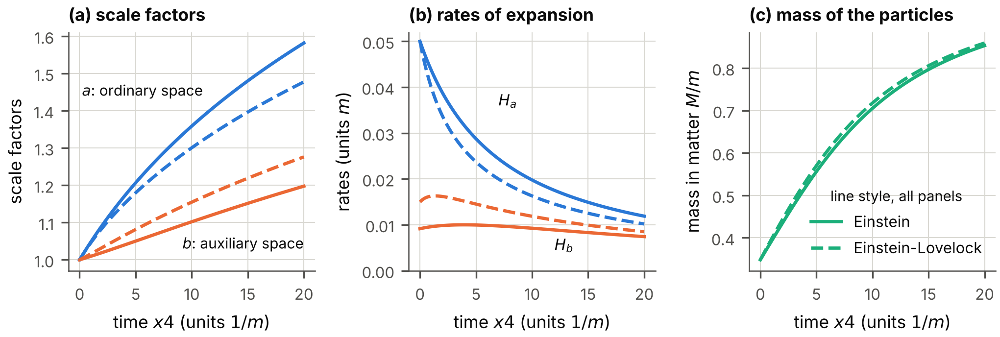

**FIG. 18.** The reference calculation of Table XVIII: (a) the two scale factors, (b) their rates, (c) the mass of the particles in the matter, which rises as the matter is diluted. Solid lines: Einstein gravity; dashed lines: Einstein-Lovelock gravity.

### C. The undisturbed deflation as a solution

*Without matter.* For $H_{\mathsf{a}}=0$, $H_{\mathsf{b}}=-\mathrm{g55}$ and constant rates, Eqs. (99) and (100) give $E^{(1)4}{}_{4}=3\mathrm{g55}^{2}$, $E^{(1)\mathsf{a}}{}_{\mathsf{a}}=6\mathrm{g55}^{2}$, $E^{(1)\mathsf{b}}{}_{\mathsf{b}}=3\mathrm{g55}^{2}$, $E^{(2)\mathsf{a}}{}_{\mathsf{a}}=-12\mathrm{g55}^{4}$, and zero for the other components. The three equations (98) without matter hold if and only if $$\bar\Lambda=3\,\mathrm{g55}^{2},\qquad\alpha_2=\frac{1}{4\,\mathrm{g55}^{2}},
\tag{101}$$ which is Eq. (11); $\alpha_3$ is arbitrary. The gravity with these two constants is called the *tuned* Einstein-Lovelock gravity below. At this solution the coefficients of $(H_{\mathsf{a}}',H_{\mathsf{b}}')$ in the two evolution equations form the matrix $\mathrm{diag}(-6,2)$, which can be inverted: the evolution of a perturbed solution is well defined.

*In Einstein gravity.* Without the Gauss-Bonnet term and without $\bar\Lambda$ the same spacetime requires a source with $$\kappa_8\,\varepsilon=3\,\mathrm{g55}^{2},\qquad p_{\mathsf{a}}=-2\,\varepsilon,\qquad p_{\mathsf{b}}=-\varepsilon ,
\tag{102}$$ a tension along the flat coordinates twice as large as the energy density, and a tension along the deflating coordinates equal to it. *The matter of Sec. VII cannot be this source.* Its pressure along a coordinate on which the fields do not depend is the interaction pressure $p_{\mathrm{int}}$ of Eq. (63), and $\varepsilon+p_{\mathrm{int}}=\langle E^{*}\rangle+G_V\,n^{2}$, which is positive for a repulsive or vanishing vector coupling; $p_{\mathsf{b}}=-\varepsilon$ is not reached. Something else must hold the deflation: an *agent* with the equation of state (102), or the tuned Gauss-Bonnet term.

### D. Matter on the deflating spacetime

Now let matter be present, with the initial data $\mathsf{a}=\mathsf{b}=1$, $H_{\mathsf{a}}=0$, and $H_{\mathsf{b}}$ from the constraint. Its amount is given by the *loading*, $\kappa_8\,\varepsilon(0)/(3\,\mathrm{g55}^{2})$, the energy density at the start in units of the energy density that would make three coordinates deflate at the rate $\mathrm{g55}$ in Einstein gravity. The rate is $\mathrm{g55}=0.01\,m$. The matter is that of the quantized sector, whose fields do not depend on $x5,x6,x7$ ($D=4$; $G_S=-256.95\,m^{-3}$, $G_V=0.1\,|G_S|$, at its saturation density), with the pressure $p_{\mathrm{int}}$ along the deflating coordinates. The integration runs until the clock of the undisturbed deflation, $\tau_d^{0}=3\,\mathrm{g55}\,x4$, reads 6, or until a rate exceeds $50\,\mathrm{g55}$ (Table XIX, Fig. 19).

| matter        | gravity  | loading   | $H_{\mathsf{b}}(0)/\mathrm{g55}$ | end     | $\tau_d^{0}$ | $\mathsf{a}$ | $\mathsf{b}$ | $H_{\mathsf{a}}/\mathrm{g55}$ | $H_{\mathsf{b}}/\mathrm{g55}$ |
|:--------------|:---------|:----------|:--------------------------------:|:--------|:-------------|:------------:|:------------:|:-----------------------------:|:-----------------------------:|
| sector, $D=4$ | tuned EL | $10^{-3}$ |            $-1.0005$             | reached | 6.00         |    1.2333    |   0.05683    |           $+1.1823$           |           $-6.616$            |
| sector, $D=4$ | tuned EL | $10^{-1}$ |            $-1.0488$             | runaway | 3.74         |    1.6348    |   0.02202    |           $+9.1382$           |           $-50.073$           |
| sector, $D=4$ | Einstein | $10^{-3}$ |            $-0.0316$             | reached | 6.00         |    1.0016    |    0.9331    |           $+0.0017$           |           $-0.038$            |
| sector, $D=4$ | Einstein | $10^{-1}$ |            $-0.3162$             | runaway | 4.05         |    1.7118    |   0.08801    |          $+13.1968$           |           $-50.278$           |

TABLE XIX. The deflating spacetime with matter as a source of gravity. Tuned EL: Einstein-Lovelock gravity with the constants (101), in which the undisturbed deflation is a solution without matter; Einstein: Einstein gravity with the matter as the only source. The last five columns give the state at the end of the integration; “runaway” marks an evolution in which a rate exceeded $50\,\mathrm{g55}$ before $\tau_d^{0}=6$.

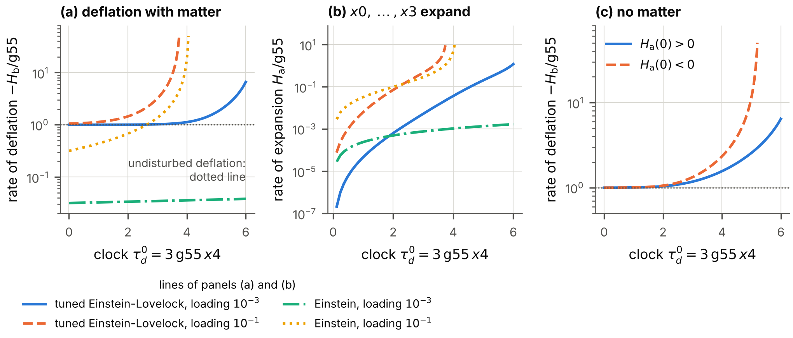

**FIG. 19.** The deflating spacetime with matter as a source of gravity (matter of the quantized sector; the runs of Table XIX). (a) The rate of deflation $-H_{\mathsf{b}}$ in units of $\mathrm{g55}$ against the clock of the undisturbed deflation. (b) The rate $H_{\mathsf{a}}$ at which the four flat coordinates expand. (c) The tuned Einstein-Lovelock gravity without matter, started with a deflation one part in a thousand faster than the undisturbed one: the two initial data that the constraint allows.

*Matter makes the deflation faster than exponential and makes the flat coordinates expand.* In the tuned gravity the smaller loading leaves the deflation close to the undisturbed one for about four units of the clock; then the rates grow, and at $\tau_d^{0}=6$ the three coordinates deflate 6.6 times faster than at the start while the four flat coordinates expand. With the larger loading the rates exceed $50\,\mathrm{g55}$ before the clock reads 4: they grow without bound in a finite time. In Einstein gravity with the matter as the only source the initial rate is $-H_{\mathsf{b}}(0)=\mathrm{g55}\times(\text{loading})^{1/2}$, far below $\mathrm{g55}$ for a small loading, and it grows as the matter is compressed. In two of the four evolutions of the table the rates run away. The constraint is preserved along every evolution to $6.4\times10^{-10}$.

### E. The undisturbed deflation is unstable

The behavior just described is not caused by the matter alone. Near the undisturbed deflation, with $H_{\mathsf{b}}=-\mathrm{g55}+\delta H_{\mathsf{b}}$ and to the lowest order in $\delta H_{\mathsf{b}}$, $H_{\mathsf{a}}$ and the energy density, the constraint of the tuned gravity reads $$-6\,\mathrm{g55}\,\delta H_{\mathsf{b}}-48\,H_{\mathsf{a}}^{2}=\kappa_8\,\varepsilon .
\tag{103}$$ The terms linear in $H_{\mathsf{a}}$ cancel between the Einstein and the Gauss-Bonnet part, which is why $H_{\mathsf{a}}$ enters quadratically. Since $\varepsilon\ge0$, the left-hand side must not be negative: *initial data exist only for a deflation that is at least as fast as the undisturbed one*, $\delta H_{\mathsf{b}}\le0$. For a deflation exactly at the rate $\mathrm{g55}$ and without matter the constraint is $H_{\mathsf{a}}^{2}\,(H_{\mathsf{a}}^{2}-12\,\mathrm{g55}H_{\mathsf{a}}+16\,\mathrm{g55}^{2})=0$, with the roots $0$, $0$ and $(6\pm\sqrt{20})\,\mathrm{g55}$: the undisturbed deflation is a double root, on the edge of the allowed initial data.

For a deflation faster by one part in a thousand and no matter, the constraint has the two roots $H_{\mathsf{a}}(0)=\pm\mathrm{g55}\,(0.001/8)^{1/2}$ to the lowest order. Starting from either, the deflation does not return to the rate $\mathrm{g55}$: it becomes faster and faster \[Table XX, Fig. 19(c)\]. *The exactly exponential deflation is an unstable solution of the gravity in which it is a solution without matter*; every allowed perturbation, with or without matter, grows.

| $H_{\mathsf{a}}(0)/\mathrm{g55}$ | $\tau_d^{0}$ at the end | $H_{\mathsf{a}}/\mathrm{g55}$ | $H_{\mathsf{b}}/\mathrm{g55}$ |
|:--------------------------------:|:-----------------------:|:-----------------------------:|:-----------------------------:|
|            $+0.01147$            |          6.00           |           $+1.7334$           |           $-6.422$            |
|            $-0.01088$            |          5.20           |           $-0.0050$           |           $-50.155$           |

TABLE XX. The tuned Einstein-Lovelock gravity without matter, started at $H_{\mathsf{b}}(0)=-1.001\,\mathrm{g55}$ with the two values of $H_{\mathsf{a}}(0)$ that the constraint allows: the state at the end of the integration (at $\tau_d^{0}=6$, or where a rate exceeded $50\,\mathrm{g55}$).

Three conclusions follow for the hypothesis. First, the matter of the model does not produce the deflation; an agent with the equation of state (102), or a tuned Gauss-Bonnet term, is needed. Second, with the Gauss-Bonnet term the deflation is not stable, so that the Gauss-Bonnet term alone does not explain a deflation that lasts. Third, whatever holds the deflation must also absorb the reaction of the matter, which pushes toward a faster deflation and an expansion of the flat coordinates; the sections on cosmology assume such an agent and say so (assumption A2 of Sec. XVI).

## XVI. Cosmology

Hypothesis H3 says that the superfluid explains the dark matter, or the Hubble tension, or both. The model offers a candidate for each. For the Hubble tension it is the phase mode of the Vorton-Scalar, a massless boson that would act as radiation in addition to photons and neutrinos (*dark radiation*) and make the early universe expand faster. For the dark matter it is the fermions themselves, as a degenerate gas or as a condensate of bound pairs. This section computes what each candidate gives when $x5,x6,x7$ deflate; the case of static extra coordinates is the case of vanishing rates, $\mathrm{gsum}=0$, and appears in every table below as the row or column without deflation. The deflation enters cosmology in several ways, and each requires an assumption beyond the hypothesis of deflation. The assumptions are stated first and are kept apart throughout, so that the reader can see which conclusion rests on which.

### A. Assumptions, and the equation of the expansion

*A1: ordinary space expands.* The coordinates $x1,x2,x3$ carry the scale factor $a_{\mathrm{sp}}(x4)$ of standard cosmology, with the Hubble rate $H=d\ln a_{\mathrm{sp}}/dx4$; the hidden coordinate $x0$ is static; $x5,x6,x7$ deflate at constant rates. The metric of Sec. II is the case $a_{\mathrm{sp}}=1$.

*A2: gravity is the Einstein theory in eight dimensions*, with a constant $G_8$. The constant of gravitation that an observer in ordinary space measures is then $G_8$ divided by the proper volume of the extra coordinates, $$G_N(x4)\ \propto\ \frac{1}{V_d}\ \propto\ e^{\mathrm{gsum}\,x4},\qquad\frac{1}{G_N}\frac{dG_N}{dx4}=\mathrm{gsum}.
\tag{104}$$ Newton’s constant *grows* as the extra volume shrinks: gravity was weaker in the past. That a changing volume of extra dimensions makes the constants of four dimensions change, and that nucleosynthesis bounds the change, was pointed out long ago ([Kolb, Perry, and Walker 1986](#ref-KolbPerryWalker1986)); for a review of varying constants see Ref. ([Uzan 2011](#ref-Uzan2011)). By Sec. II C, A2 is an assumption that the deflating spacetime itself puts in doubt: without matter the metric solves the equations of Einstein-Gauss-Bonnet gravity, not Einstein’s.

For a diagonal metric whose seven directions other than the time have the rates $H,H,H$ (ordinary space), $0$ (the coordinate $x0$) and $-\mathrm{g55},-\mathrm{g66},-\mathrm{g77}$, the component of Einstein’s equations along the time is the sum of the products of all pairs of rates, set equal to $8\pi G_8$ times the energy density in eight dimensions. Dividing the density by the extra volume turns $G_8$ into $G_N$: $$3H^{2}-3\,\mathrm{gsum}\,H+\mathrm{gprod}=8\pi\,G_N(x4)\,\rho,
\tag{105}$$ with the density $\rho$ of radiation, matter and the cosmological term in ordinary space. For the unperturbed universe Eq. (105) is the only one of Einstein’s equations that is needed. The others determine the stresses of the unknown source that keeps the three rates constant; they enter when ordinary space is perturbed (Sec. XVI E).

The calculations take three equal rates, so that $\mathrm{gprod}=\mathrm{gsum}^{2}/3$, and the densities of the standard model of cosmology ([Aghanim et al. 2020](#ref-Planck2018VI)): baryons $\omega_b=0.02237$, cold dark matter $\omega_c=0.1200$, and $H_0=67.36~\mathrm{km\,s^{-1}\,Mpc^{-1}}$ without deflation. The cosmological term is chosen so that Eq. (105) holds today. Without deflation the program gives the two numbers on which this section rests: the angle $\theta_*$ under which the sound horizon at last scattering is seen, $100\,\theta_*=1.03965$, and that sound horizon, $r_s=144.449$ Mpc.

### B. The Hubble constant inferred from the sound horizon

The microwave background fixes the angle $\theta_*$ to high precision. A model that changes the history of the expansion must keep that angle, and the Hubble constant that it then requires is the *inferred* Hubble constant. The tension is that the standard model infers $67.4~\mathrm{km\,s^{-1}\,Mpc^{-1}}$ ([Aghanim et al. 2020](#ref-Planck2018VI)) while the local distance network measures $73.50\pm0.81$ ([Casertano et al. 2026](#ref-H0DN2026)). Table XXI gives the inferred value on the deflating spacetime under A1 and A2, at fixed $\theta_*$ and fixed densities of baryons and dark matter. The redshift $z_*$ of last scattering and the mass fraction $Y_{\mathrm{He}}$ of helium, which the sound horizon needs, are computed on the deflating background (Sec. XVI G).

| $\mathrm{gsum}/H_0$ | $\mathrm{gsum}$ (per year) | $H_0$ ($\mathrm{km\,s^{-1}\,Mpc^{-1}}$) |  change  | $G_N$ ratio |  $z_*$  | $Y_{\mathrm{He}}$ | $r_s$ (Mpc) | $t_0$ (Gyr) | $H_0$, $z_*$ and $Y_{\mathrm{He}}$ held |
|:-------------------:|:--------------------------:|:---------------------------------------:|:--------:|:-----------:|:-------:|:-----------------:|:-----------:|:-----------:|:---------------------------------------:|
|          0          |             0              |                  67.36                  |   0.00   |   1.0000    | 1089.92 |      0.2454       |   144.45    |    13.81    |                  67.36                  |
|       0.00100       |    $6.89\times10^{-14}$    |                  67.29                  | $-0.07$  |   0.9990    | 1089.90 |      0.2453       |   144.52    |    13.82    |                  67.30                  |
|       0.00300       |    $2.07\times10^{-13}$    |                  67.16                  | $-0.20$  |   0.9971    | 1089.86 |      0.2452       |   144.66    |    13.84    |                  67.18                  |
|       0.00324       |    $2.23\times10^{-13}$    |                  67.15                  | $-0.21$  |   0.9969    | 1089.86 |      0.2451       |   144.68    |    13.84    |                  67.16                  |
|       0.0100        |    $6.89\times10^{-13}$    |                  66.70                  | $-0.66$  |   0.9905    | 1089.73 |      0.2446       |   145.16    |    13.90    |                  66.74                  |
|       0.0300        |    $2.07\times10^{-12}$    |                  65.36                  | $-2.00$  |   0.9714    | 1089.37 |      0.2430       |   146.61    |    14.06    |                  65.48                  |
|       0.0644        |    $4.43\times10^{-12}$    |                  62.98                  | $-4.38$  |   0.9383    | 1088.72 |      0.2401       |   149.23    |    14.37    |                  63.23                  |
|        0.100        |    $6.89\times10^{-12}$    |                  60.37                  | $-6.99$  |   0.9037    | 1088.04 |      0.2370       |   152.13    |    14.70    |                  60.77                  |
|        0.300        |    $2.07\times10^{-11}$    |                  41.94                  | $-25.42$ |   0.6995    | 1083.78 |      0.2168       |   173.35    |    17.29    |                  43.41                  |

TABLE XXI. The Hubble constant inferred from the angular scale of the sound horizon if Newton’s constant grows with the deflation (assumptions A1 and A2). $G_N$ ratio: Newton’s constant in the early universe divided by its value today, $e^{-\mathrm{gsum}\,t_0}$ with the age $t_0$ of the model. $z_*$: redshift of last scattering; $Y_{\mathrm{He}}$: mass fraction of helium. Last column: the Hubble constant that results if $z_*$ and $Y_{\mathrm{He}}$ are held at their values without deflation. The rows at $\mathrm{gsum}/H_0=0.00324$ and $0.0644$ are the bounds of lunar laser ranging and of nucleosynthesis (Table XXII).

*The inferred Hubble constant falls*, with the slope $d\ln H_0/d(\mathrm{gsum}/H_0)=-0.969$ at small rates. The reason is this. By Eq. (104) gravity was weaker in the early universe; the universe expanded more slowly at a given density; sound had more time to travel, and the sound horizon is larger. To keep the angle, the distance to last scattering must be larger, which requires a smaller Hubble constant. The deflation moves the inferred value *away* from the local measurement \[Fig. 20(a)\]. Weaker gravity also delays last scattering and lowers the helium fraction, because the universe expanded more slowly during recombination and during nucleosynthesis as well; both enlarge the sound horizon further. If $z_*$ and $Y_{\mathrm{He}}$ are held at their values without deflation, the slope is $-0.911$: that simpler calculation underestimates the fall by six per cent of itself. An independent calculation of recombination confirms both numbers (Appendix E). The term $\mathrm{gprod}$ of Eq. (105) plays no part in this: it is of the second order in the rate, and it acts as a constant, which the cosmological term that is adjusted to today’s expansion absorbs almost exactly.

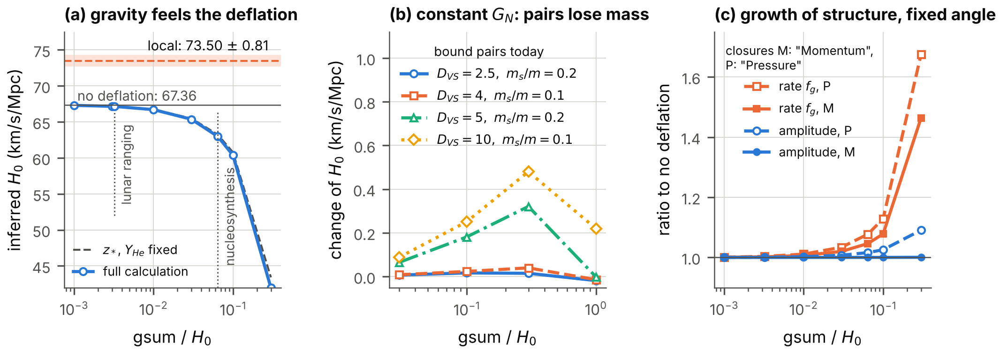

**FIG. 20.** The Hubble constant and the growth of structure on a deflating spacetime. (a) The Hubble constant inferred from the angular scale of the sound horizon against the rate of deflation, if gravity feels the deflation (A1, A2): with recombination computed on the deflating background, and with last scattering and the helium fraction held fixed; the bounds of Table XXII and the local measurement are marked. (b) The change of the inferred Hubble constant if Newton’s constant is held fixed and bound pairs lose rest mass. (c) Amplitude and rate of the growth of structure relative to the model without deflation, at a fixed angle of the sound horizon, for the two closures of Sec. XVI E.

### C. How fast can the coordinates deflate today?

| observation                                                                             | measured                                                                                          | assumption                                                        |      bound on $\mathrm{gsum}$ (per year)      |  in units of $H_0$   |
|:----------------------------------------------------------------------------------------|:--------------------------------------------------------------------------------------------------|:------------------------------------------------------------------|:---------------------------------------------:|:--------------------:|
| lunar laser ranging ([Hofmann and Müller 2018](#ref-HofmannMueller2018))                | $(dG_N/dt)/G_N=(7.1\pm7.6)\times10^{-14}$ per year                                                | A2                                                                |             $2.230\times10^{-13}$             | $3.237\times10^{-3}$ |
| nucleosynthesis, Newton’s constant ([Alvey et al. 2020](#ref-Alvey2020))                | $G_N$ then, divided by $G_N$ today: $0.99^{+0.06}_{-0.05}$ (two standard deviations)              | A2; constant rate                                                 |             $4.434\times10^{-12}$             |        0.0644        |
| nucleosynthesis, Fermi constant ([Scherrer and Spergel 1993](#ref-ScherrerSpergel1993)) | $G_{\mathrm{Fermi}}$ at $t=1$ s within 20 (10) per cent of today’s value, at fixed fermion masses | HV; constant rate                                                 | $1.615\times10^{-11}$ ($7.627\times10^{-12}$) |    0.234 (0.111)     |
| atomic clocks, mass ratio ([Lange et al. 2021](#ref-Lange2021))                         | $(d/dt)\ln(m_p/m_e)=(-8\pm36)\times10^{-18}$ per year                                             | H2, $n_{\mathrm{EW}}=1$                                           |             $8.000\times10^{-17}$             | $1.161\times10^{-6}$ |
| atomic clocks, fine-structure constant ([Lange et al. 2021](#ref-Lange2021))            | $(d\alpha_{\mathrm{em}}/dt)/\alpha_{\mathrm{em}}=(1.0\pm1.1)\times10^{-18}$ per year              | an electromagnetic field along $x5,x6,x7$ (not part of the model) |             $3.200\times10^{-18}$             | $4.645\times10^{-8}$ |

TABLE XXII. Upper bounds on the present total rate of deflation, each under the assumption named. Uncertainties of the measured values are at 68 per cent unless stated; the bounds are at two standard deviations. The bound in units of $H_0$ uses $H_0=67.36~\mathrm{km\,s^{-1}\,Mpc^{-1}}$. A2: gravity is the Einstein theory in eight dimensions. HV: the vacuum value of the Vorton-Scalar sets the electroweak scale. H2: the superfluid state is the Higgs field; the bound is given for $n_{\mathrm{EW}}=1$ and scales as $1/n_{\mathrm{EW}}$ (Sec. XVII).

Table XXII and Fig. 21 collect the bounds.

*Under A2, lunar laser ranging* measures $(dG_N/dt)/G_N$ directly, and Eq. (104) turns its limit into $\mathrm{gsum}<2.23\times10^{-13}$ per year, that is, $3.24\times10^{-3}\,H_0$. At this rate the deflation clock has advanced by $\mathrm{gsum}\,t_0=3.1\times10^{-3}$ over the age $t_0$ of the universe, and the inferred Hubble constant is lower by $0.21~\mathrm{km\,s^{-1}\,Mpc^{-1}}$.

*Under A2, nucleosynthesis* bounds the ratio of Newton’s constant then to its value today; for a rate that was constant since, $\mathrm{gsum}<0.064\,H_0$. This is weaker than the first bound but does not assume that the rate today equals the rate in the past.

*Under HV, nucleosynthesis* bounds the change of the Fermi constant at fixed fermion masses to 10 to 20 per cent, which gives $\mathrm{gsum}<0.111$ to $0.234\,H_0$. HV is the assumption that the Vorton-Scalar itself plays the role of the Higgs field, so that $G_{\mathrm{Fermi}}=1/(\sqrt2\,v_{\mathrm{VS}}^{2})$ grows as $e^{\tau_d}$ while every mass stays constant. It is *not* the hypothesis H2, and the Vorton-Scalar, which is a singlet of every non-Abelian symmetry of the model, cannot be the Higgs field of the Standard Model, which is a doublet; the bound is given only to show what the assumption would imply.

*Under the hypothesis H2, atomic clocks* give by far the strongest bound, and one that needs no assumption about gravity. Section XVII derives it: $\mathrm{gsum}<1.16\times10^{-6}\,H_0/n_{\mathrm{EW}}$ with an exponent $n_{\mathrm{EW}}$ of order one or larger.

*The fine-structure constant* is bounded by the same clocks to parts in $10^{18}$ per year. This would bound the rate, to $4.6\times10^{-8}\,H_0$, only if an electromagnetic field propagated along the deflating coordinates. The model contains no electromagnetic field; the row shows how strongly such an extension would be constrained.

*Under A2, the microwave background* would bound the rate as well. Section XVI H finds, as a forecast for mock data of the quality of the Planck satellite and not as a measurement, $\mathrm{gsum}<0.0385\,H_0$; Fig. 21 includes it for comparison.

*In the model as it stands*, without H2, HV or an electromagnetic extension and without A2, no mass and no coupling of ordinary matter depends on the deflation, and none of these observations bounds the rate.

The consequence for the histories of Secs. VIII to XII is severe. Under A2 the clock has advanced by at most 0.0031 during the whole of cosmic history, if the rate was constant; under H2 by at most $1.1\times10^{-6}/n_{\mathrm{EW}}$. A history in which pairs become bound, matter loses its fermion mass or the gap grows by orders of magnitude within the age of the universe requires that gravity does not feel the deflation, that the superfluid is not the Higgs field, or that the rate was much larger in the past than it is today.

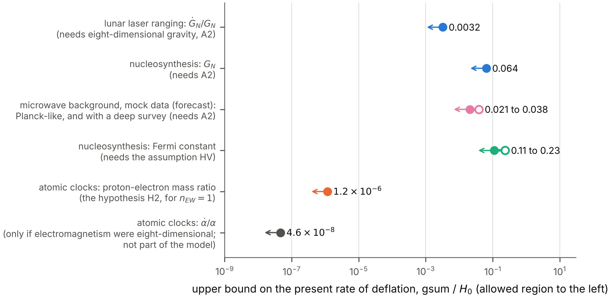

**FIG. 21.** Upper bounds on the present total rate of deflation in units of the Hubble constant, each under the assumption of Table XXII. The allowed region is to the left of each bound. The row “microwave background” is not a measurement but the forecast of Sec. XVI H for mock data (open symbol: Planck-like; filled symbol: with a deep survey).

### D. Bound pairs lose rest mass

If the dark matter consists of bound pairs of the fermions, its particles have the rest mass $2m$ minus the binding energy. The binding energy grows with the coupling, so that the pairs become lighter as the deflation proceeds, and the density of dark matter falls slightly faster than the inverse volume. A dark matter that was heavier in the past raises the inferred Hubble constant. The program computes the effect for four examples with $\alpha_{\mathrm{VS}}$ between 0.4 and 1 today, where the binding energy is at most 8.2 per cent of the rest mass \[Fig. 20(b), Table XLII\]. If gravity feels the deflation, the inferred Hubble constant changes by between $-4.11$ and $-0.19~\mathrm{km\,s^{-1}\,Mpc^{-1}}$ at the rates that nucleosynthesis and lunar laser ranging allow: the weaker gravity of the past outweighs the loss of mass. (These examples hold $z_*$ and $Y_{\mathrm{He}}$ fixed, which by Table XXI underestimates a fall by about six per cent of itself.) If Newton’s constant is held fixed and the deflation acts on the dark sector alone, rates between 0.03 and $1\,H_0$ raise the inferred Hubble constant by at most $+0.48~\mathrm{km\,s^{-1}\,Mpc^{-1}}$, for a loss of up to 7.7 per cent of the rest mass. This is the only effect of the deflation found here that raises the inferred Hubble constant, and in these examples it supplies less than a tenth of the $6.1~\mathrm{km\,s^{-1}\,Mpc^{-1}}$ that separate the model from the local measurement.

### E. Perturbations of ordinary space: what must be assumed

The quantities of the preceding subsections belong to the unperturbed universe. The growth of structure and the spectra of the microwave background are built from small perturbations of ordinary space, and the equations of the perturbations contain more of Einstein’s equations than Eq. (105). They therefore contain what the hypothesis of deflation leaves open.

*The agent.* Something must keep the three rates constant while ordinary space expands and matter dilutes. We call it the agent and assume nothing about its nature. Assumption A2 says that it has no energy density: otherwise its density would stand on the right of Eq. (105). It cannot be without stresses. The components of Einstein’s equations along ordinary space, together with the conservation of matter in ordinary space and Eq. (104), require the agent to have, in ordinary space, the pressure $$\begin{aligned}
8\pi G_N\,p_{\mathrm{agent}}={}&-\frac{\mathrm{gsum}}{H}\frac{dH}{dx4}-2\,\mathrm{gsum}\,H\\
&+2\,\mathrm{gprod}-\frac{\mathrm{gsum}\,\mathrm{gprod}}{3H}.
\end{aligned}
\tag{106}$$ In an era of matter this is $-\mathrm{gsum}\,H/2$ to the first order in the rates. The agent is a medium without energy density and with a tension, of the relative size $\mathrm{gsum}/H$. When ordinary space is perturbed, such a medium will in general be perturbed too.

*A3: the perturbations.* We assume (i) that in a universe with small inhomogeneities the scale factors $b_t$ of the deflating coordinates remain the prescribed functions of the time, the time being the proper time of observers who move with the cold matter, and that $x0$ remains static; and (ii) that the agent has no energy density in the perturbed universe either. Part (i) is the plainest reading of the hypothesis of deflation in a universe that is not exactly homogeneous; part (ii) is A2 taken to first order. Both are assumptions.

*The equations.* We use the conformal time $\tau_{\mathrm{cf}}$ of ordinary space, defined by $d\tau_{\mathrm{cf}}=dx4/a_{\mathrm{sp}}$, write a prime for the derivative with respect to it, and write $H_{\mathrm{cf}}=a_{\mathrm{sp}}'/a_{\mathrm{sp}}=a_{\mathrm{sp}}H$ for the conformal Hubble rate. A scalar perturbation of ordinary space with the comoving wavenumber $k$ is described, in the synchronous gauge, by two functions $h_{\mathrm{sy}}(\tau_{\mathrm{cf}})$ and $\eta_{\mathrm{sy}}(\tau_{\mathrm{cf}})$ of the perturbed metric; they are the $h$ and $\eta$ of Ref. ([Ma and Bertschinger 1995](#ref-MaBertschinger1995)), written here with an index because $h$ and $\eta$ have other meanings in this paper. The combination $\alpha_{\mathrm{sy}}=(h_{\mathrm{sy}}'+6\,\eta_{\mathrm{sy}}')/2k^{2}$ occurs repeatedly. Matter and radiation enter through four sums over the species, each multiplied by $8\pi G_N(x4)\,a_{\mathrm{sp}}^{2}$ with the Newton’s constant of the moment: $\mathcal{D}$, the perturbation of the energy density; $\mathcal{T}$, the divergence of the momentum density; $\mathcal{P}$, the perturbation of the pressure; and $\mathcal{A}$, the anisotropic stress. With the scale factors of the extra coordinates unperturbed, the Einstein tensor of the eight-dimensional metric gives, to first order,

$$\begin{aligned}
2k^{2}\eta_{\mathrm{sy}}-H_e\,h_{\mathrm{sy}}'&=-\mathcal{D},\tag{107a}\\
2k^{2}\eta_{\mathrm{sy}}'&=\mathcal{T},\tag{107b}\\
h_{\mathrm{sy}}''+2H_e\,h_{\mathrm{sy}}'-2k^{2}\eta_{\mathrm{sy}}&=-3\,\mathcal{P},\tag{107c}\\
\alpha_{\mathrm{sy}}'+2H_e\,\alpha_{\mathrm{sy}}-\eta_{\mathrm{sy}}&=-\tfrac32\,\mathcal{A}/k^{2},\tag{107d}
\end{aligned}$$

with $$H_e=H_{\mathrm{cf}}-\tfrac12\,a_{\mathrm{sp}}\,\mathrm{gsum}.
\tag{108}$$ They are the energy constraint, the momentum constraint, the trace of the space-space equations and their traceless part, the equation of the shear. An independent program derives them by computer algebra for arbitrary rates and for both signatures (Appendix E). They are the four equations of general relativity ([Ma and Bertschinger 1995](#ref-MaBertschinger1995)) with two changes: Newton’s constant is that of the moment, and $H_{\mathrm{cf}}$ is replaced by $H_e$ in three of them. The second change can be read off Eq. (105). The time component of the Einstein tensor is the sum of the products of all pairs of expansion rates. If the rate of one ordinary direction is perturbed, the perturbation multiplies the sum of the rates of all *other* directions, which is $2H$ in four dimensions and $2H-\mathrm{gsum}$ here.

*The four equations cannot all hold with matter alone.* In general relativity two of the four equations (107) imply the other two, because the energy and the momentum of matter are conserved. Here they do not. Let Eq. (107a) hold, and define three *gaps*, the amounts by which the other three fail when only matter and radiation stand on their right-hand sides: $$\begin{aligned}
\mathcal{Y}_M&=2k^{2}\eta_{\mathrm{sy}}'-\mathcal{T},\\
\mathcal{Y}_T&=h_{\mathrm{sy}}''+2H_e\,h_{\mathrm{sy}}'-2k^{2}\eta_{\mathrm{sy}}+3\,\mathcal{P},\\
\mathcal{Y}_S&=\alpha_{\mathrm{sy}}'+2H_e\,\alpha_{\mathrm{sy}}-\eta_{\mathrm{sy}}+\tfrac32\,\mathcal{A}/k^{2}.
\end{aligned}
\tag{109}$$ The conservation of the energy and of the momentum of matter in ordinary space gives two identities between them, $$\begin{aligned}
\mathcal{Y}_M&=H_e\,\mathcal{Y}_T+\mathcal{Z},\tag{110}\\
2k^{2}\,\mathcal{Y}_S&=\mathcal{Y}_T+\frac{3}{k^{2}}\big(\mathcal{Y}_M'+2H_e\,\mathcal{Y}_M\big),\tag{111}
\end{aligned}$$ with $$\begin{aligned}
\mathcal{Z}&=h_{\mathrm{sy}}'\,\mathcal{B}-\tfrac12\,a_{\mathrm{sp}}\,\mathrm{gsum}\,(\mathcal{D}-3\,\mathcal{P}),\\
\mathcal{B}&=H_e'-H_e^{2}+\tfrac12(\mathcal{E}+\mathcal{E}_P).
\end{aligned}
\tag{112}$$ Here $\mathcal{E}$ and $\mathcal{E}_P$ are $8\pi G_Na_{\mathrm{sp}}^{2}$ times the density and the pressure of the unperturbed universe. By Eq. (105) the quantity $\mathcal{B}$ is proportional to $\mathrm{gsum}$; in an era of matter it is $a_{\mathrm{sp}}\,\mathrm{gsum}\,H_{\mathrm{cf}}/4$. Without deflation $\mathcal{B}$ and $\mathcal{Z}$ vanish, and Eqs. (110) and (111) say that if one gap vanishes at all times, all three do: that is general relativity. With deflation $\mathcal{Z}\neq0$, and *the three gaps cannot all vanish*. This is not a defect of the calculation. It is the statement that the agent, which has a tension, takes part in the perturbations: the gaps are, up to the factor $8\pi G_Na_{\mathrm{sp}}^{2}$, the perturbations of its momentum density, of its pressure and of its anisotropic stress.

*Closures.* The two identities relate three gaps; one more relation closes the system, and the hypothesis offers no ground for a choice. Three natural choices set one gap to zero. In the closure “Momentum”, $\mathcal{Y}_M=0$: the agent carries no momentum density, and Eqs. (107a) and (107b) hold. In the closure “Pressure”, $\mathcal{Y}_T=0$: the agent carries no perturbation of its pressure, Eqs. (107a) and (107c) hold, and Eq. (107b) is replaced by $2k^{2}\eta_{\mathrm{sy}}'=\mathcal{T}+\mathcal{Z}$. In the closure “Shear”, $\mathcal{Y}_S=0$: the agent carries no anisotropic stress, as a perfect fluid or a scalar field would not. Eliminating $\mathcal{Y}_T$ from the two identities then gives an equation of motion for the momentum density of the agent, $$\mathcal{Y}_M'=-\Big(\frac{k^{2}}{3H_e}+2H_e\Big)\mathcal{Y}_M+\frac{k^{2}}{3H_e}\,\mathcal{Z}.
\tag{113}$$ Far inside the horizon, $k\gg H_{\mathrm{cf}}$, the rate $k^{2}/3H_e$ is enormous, and $\mathcal{Y}_M$ relaxes at once to $\mathcal{Z}$, its value in the closure “Pressure”. *Inside the horizon the closure “Shear” is the closure “Pressure”*, with corrections of the relative order $(H_{\mathrm{cf}}/k)^{2}$. We compute with the closures “Momentum” and “Pressure” and mark every result as depending on the closure or not.

All gaps are proportional to $a_{\mathrm{sp}}\,\mathrm{gsum}/H_{\mathrm{cf}}=\mathrm{gsum}/H$. At the largest rate that nucleosynthesis allows this ratio is $2.7\times10^{-6}$ at recombination and $6.9\times10^{-2}$ today. The closure therefore cannot matter for anything that is decided at recombination, and it must matter for the gravitational potentials and for the growth of structure of the recent universe.

### F. The growth of structure

For pressureless matter with the density contrast $\delta_m$ and the density $\rho_m$ each closure gives one equation. In the closure “Pressure”, Eqs. (107a) and (107c) give $$\frac{d^{2}\delta_m}{dx4^{2}}+\Big(2H-\frac{\mathrm{gsum}}{2}\Big)\frac{d\delta_m}{dx4}=4\pi\,G_N(x4)\,\rho_m\,\delta_m :
\tag{114}$$ gravity is that of the moment, and the Hubble friction is reduced by $\mathrm{gsum}/2$. In the closure “Momentum”, the derivative of Eq. (107a) with Eq. (107b) gives, in conformal time, $$\delta_m''+\frac{2H_e'+\mathcal{E}_m+\tfrac43\mathcal{E}_r}{2H_e}\,\delta_m'=\frac{H_{\mathrm{cf}}-a_{\mathrm{sp}}\,\mathrm{gsum}}{2H_e}\,\mathcal{E}_m\,\delta_m ,
\tag{115}$$ where $\mathcal{E}_m$ and $\mathcal{E}_r$ are the parts of $\mathcal{E}$ from matter and from radiation. Here the source is reduced as well, by the factor $(H-\mathrm{gsum})/(H-\mathrm{gsum}/2)$. (The term with $\mathcal{E}_r$ is the momentum density of radiation that streams freely: far inside the horizon its velocity divergence is $-h_{\mathrm{sy}}'/2$ ([Ma and Bertschinger 1995](#ref-MaBertschinger1995)).) Without deflation both equations reduce to the familiar $d^{2}\delta_m/dx4^{2}+2H\,d\delta_m/dx4=4\pi G_N\rho_m\delta_m$. With deflation that familiar equation, with $G_N(x4)$ inserted, is neither of the two. For matter alone and three equal rates the growth rate $d\ln\delta_m/d\ln a_{\mathrm{sp}}$ is, to the first order in $\mathrm{gsum}/H$, $1-\tfrac{9}{16}\,\mathrm{gsum}/H$ in the closure “Pressure” and $1-\tfrac{13}{16}\,\mathrm{gsum}/H$ in the closure “Momentum”.

Two effects oppose each other \[Fig. 20(c), Table XLIII\]. At a *fixed* Hubble constant, weaker gravity in the past lowers the amplitude $\sigma_8$ of clustering today: $d\ln\sigma_8/d(\mathrm{gsum}/H_0)=-0.443$ in the closure “Momentum” and $-0.207$ in the closure “Pressure”. But the Hubble constant that keeps the angle of the sound horizon is lower, the cosmological term takes over later, and matter clusters for longer. With that Hubble constant the net change is $+0.003$ and $+0.239$ per unit of $\mathrm{gsum}/H_0$: $+0.001$ and $+0.077$ per cent at the bound of lunar laser ranging, and $+0.01$ and $+1.60$ per cent at the bound of nucleosynthesis. The growth rate today, $f_g=d\ln\delta_m/d\ln a_{\mathrm{sp}}$, rises in both closures, by the factors 1.0021 and 1.0035 at the first bound and 1.0463 and 1.0773 at the second. Common to both closures is that, at a fixed angle, the amplitude does not fall and the growth rate rises. How large the changes are depends on the closure: *the growth of structure on the deflating spacetime is not predicted until the perturbations of the agent are specified.*

### G. The spectra of the microwave background

*The program.* The temperature and polarization spectra of the microwave background and the power spectrum of matter are computed with an Einstein-Boltzmann program written for this work. It integrates the equations of motion of photons, neutrinos, baryons and cold dark matter in the synchronous gauge ([Ma and Bertschinger 1995](#ref-MaBertschinger1995)) together with the equations of the metric perturbations, and obtains the spectra by integrating the sources along the line of sight ([Seljak and Zaldarriaga 1996](#ref-SeljakZaldarriaga1996)). Its version for static extra coordinates has Newton’s constant built into its units. For the deflating spacetime four of its parts were copied and changed in a short, listed set of places: the expansion obeys Eq. (105); every source of the metric perturbations carries the Newton’s constant of the moment; the energy constraint is Eq. (107a); and the sources of the temperature anisotropy contain the gap $\mathcal{Y}_S$ of the closure. The equations of motion of photons, neutrinos, baryons and dark matter are not changed: matter that is spread uniformly over the extra coordinates moves in ordinary space as it does in four dimensions, and Thomson scattering and recombination are atomic physics, which the model does not alter. The copies are written by a script from the original files, so that they cannot differ from them in any place that is not listed, and without deflation the two versions give the same spectra to the last binary digit.

*Recombination and helium.* Recombination is computed on the expansion history of Eq. (105), with the three-level atom and its standard corrections ([Seager, Sasselov, and Scott 1999](#ref-SeagerSasselovScott1999)). The helium fraction responds as well. At nucleosynthesis Newton’s constant was smaller than today by the factor $G_N$ ratio of Table XXI; a universe that expands more slowly by that factor in $H^{2}$ is equivalent, for nucleosynthesis, to one with $\tfrac{43}{7}(G_N\ \text{ratio}-1)$ additional neutrino species, a negative number, and the helium fraction follows from the standard fit ([Ade et al. 2016](#ref-Planck2015XIII)). (In a model with extra radiation, $\tfrac{43}{7}$ is replaced by $\tfrac{43}{7}+\Delta N$, where $\Delta N$ is the density of that radiation during nucleosynthesis in units of one neutrino species.) At the largest rate that nucleosynthesis allows, and without extra radiation, this is $-0.379$ species, and $Y_{\mathrm{He}}$ falls from 0.24540 to 0.24008. Table XLIV gives the thermal history of three models.

*Spectra at a fixed angle.* Table XXIII lists the model without deflation and five models with three equal rates, each with the densities, the primordial amplitude and tilt and the optical depth of the standard model and with the Hubble constant that keeps $100\,\theta_*=1.03965$. Keeping the angle keeps the acoustic peaks in place: the first five move by at most 0.32 in the multipole $\ell$ (Table XLV). What changes is their height and the damping tail \[Fig. 22\], for the reasons that apply to any change of the expansion rate at recombination: the ratio of the diffusion length to the sound horizon, the width of the last-scattering surface and the decay of the potentials shortly after recombination all change, and the lower helium fraction leaves more electrons per baryon.

| $\mathrm{gsum}/H_0$ | $H_0$  | $G_N(z_*)/G_N$ | $\sigma_8$ (M) | $\sigma_8$ (P) |   largest change   | ideal measurement | $\Delta\chi^{2}$ |
|:-------------------:|:------:|:--------------:|:--------------:|:--------------:|:------------------:|:-----------------:|:----------------:|
|          0          | 67.360 |     1.0000     |     0.8228     |     0.8228     |         0          |        0.0        |       0.00       |
|       0.00324       | 67.149 |     0.9969     |     0.8219     |     0.8225     | $2.7\times10^{-3}$ |        3.1        |       1.12       |
|       0.0100        | 66.704 |     0.9905     |     0.8200     |     0.8219     | $8.3\times10^{-3}$ |        9.7        |      10.79       |
|       0.0300        | 65.365 |     0.9714     |     0.8142     |     0.8201     |       0.025        |       29.5        |      98.85       |
|       0.0644        | 62.976 |     0.9383     |     0.8032     |     0.8160     |       0.056        |       64.8        |      468.30      |
|        0.100        | 60.368 |     0.9037     |     0.7903     |     0.8104     |       0.090        |       103.5       |     1166.70      |

TABLE XXIII. Spectra of the microwave background on the deflating spacetime at a fixed angle of the sound horizon (assumptions A1, A2, A3; three equal rates). $H_0$ in $\mathrm{km\,s^{-1}\,Mpc^{-1}}$. $G_N(z_*)/G_N$: Newton’s constant at last scattering divided by its value today. $\sigma_8$: amplitude of clustering for the same primordial amplitude, in the closures “Momentum” (M) and “Pressure” (P). Largest change: of the temperature spectrum $D_\ell^{TT}$ for $30\le\ell\le2500$ relative to the model without deflation. Ideal measurement: the root of the sum over those multipoles of the squared change divided by the variance $2/(2\ell+1)$ of one multipole, that is, the number of standard deviations by which a measurement of the temperature on the whole sky without noise would tell the model from no deflation if nothing else were unknown. $\Delta\chi^{2}$: against Planck-like mock data with all other parameters fixed.

At the rate that lunar laser ranging allows, the temperature spectrum differs from that of the model without deflation by at most $2.7\times10^{-3}$ of itself, 0.134 of the cosmic variance of a single multipole, and $\Delta\chi^{2}=1.12$ against Planck-like mock data (Sec. XVI H) before any parameter is refitted. Such data cannot tell this rate from no deflation. At the rate that nucleosynthesis allows, Newton’s constant at last scattering was 0.9383 of today’s, the spectrum changes by up to 5.6 per cent, and $\Delta\chi^{2}=468$: the microwave background is then a stronger test than nucleosynthesis.

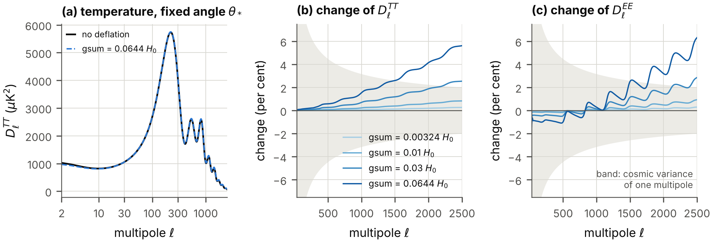

**FIG. 22.** The spectra of the microwave background at a fixed angle of the sound horizon. (a) The temperature spectrum without deflation and at the largest rate that nucleosynthesis allows. (b), (c) The change of the temperature and polarization spectra relative to the model without deflation for four rates (darker: faster); the band is the cosmic variance of a single multipole. Closure “Momentum”; at these multipoles the closure “Pressure” gives the same curves.

*The closure.* For $30\le\ell\le2500$ the spectra of the two closures differ by a thousandth of the effect of the deflation itself ($1.4\times10^{-3}$ and $1.2\times10^{-3}$ of it at the two bounds), and $\Delta\chi^{2}$ is the same to five digits \[Fig. 23(a)\]. *The spectra at these multipoles follow from A1, A2 and A3, whatever the closure.* For $\ell<30$, where the potentials of the recent universe act through the late integrated Sachs-Wolfe effect, the closures differ by more than the effect of the deflation in either of them, by a factor 2.1. The largest angular scales are not predicted; their cosmic variance is large, and at the rate of nucleosynthesis the closures differ by at most a third of it. The amplitude of matter is 0.9762 of its value without deflation in the closure “Momentum” and 0.9918 in the closure “Pressure” at the rate of nucleosynthesis, and 0.99892 and 0.99969 at the rate of lunar laser ranging (Table XLVI).

Figure 23(b) and Table XLVII show what the agent must supply. In units of $a_{\mathrm{sp}}\,\mathrm{gsum}/H_{\mathrm{cf}}$ times the terms of each equation, the closure “Momentum” lacks 0.54 to 0.98 in Eq. (107c) and 0.31 to 0.49 in Eq. (107d) after recombination; the closure “Pressure” lacks 0.62 to 0.94 in Eq. (107b), and in Eq. (107d) an amount that falls as $(H_{\mathrm{cf}}/k)^{2}$ inside the horizon, as Eq. (113) requires. The two identities (110) and (111) hold along the numerical solutions to $8.6\times10^{-4}$, the accuracy of the numerical derivative with which they are tested. The complete calculation, with photons, neutrinos and baryons, reproduces the growth of Eqs. (114) and (115) to $1.3\times10^{-4}$ \[Fig. 23(c), Tables XLVIII and XLIX\]; with the equation of the other closure it would disagree by a quarter of $\mathrm{gsum}/H_0$.

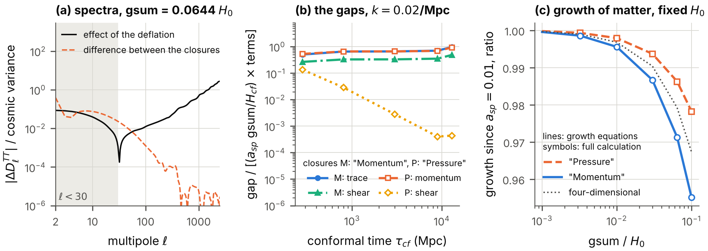

**FIG. 23.** The closure of the perturbation equations, at the largest rate that nucleosynthesis allows. (a) The difference between the temperature spectra of the closures “Momentum” and “Pressure”, and the effect of the deflation itself, in units of the cosmic variance of a single multipole: the closure matters below $\ell=30$ only. (b) What the agent supplies: the gaps of Eqs. (107b), (107c) and (107d) for one wavenumber, in units of $a_{\mathrm{sp}}\,\mathrm{gsum}/H_{\mathrm{cf}}$ times the terms of each equation. (c) The growth of the density contrast of matter since $a_{\mathrm{sp}}=0.01$ relative to no deflation, at a fixed Hubble constant: Eqs. (114) and (115) (lines), the complete calculation (symbols), and the four-dimensional equation with the Newton’s constant of the moment, which is neither closure.

### H. What mock data say about the rate, and about the Hubble constant

How far can the rate of deflation move the Hubble constant before the fit to the microwave background degrades? The question is answered here with mock data: the spectra of the standard model stand in for the measurements, with the noise and the sky coverage of the Planck satellite ([Ade et al. 2016](#ref-Planck2015XIII)), and of Planck together with a deep survey of a quarter of the sky. The mock data contain no gravitational lensing, and the standard model fits them with $\Delta\chi^{2}=0$ by construction. The likelihood is the Gaussian likelihood of the temperature and polarization spectra with these noise levels; the six parameters of the standard model (the densities $\omega_b$ and $\omega_c$, the Hubble constant, the amplitude $A_s$ and the spectral index $n_s$ of the primordial fluctuations, and the optical depth $\tau$) are fitted again for every rate; the rate is a seventh parameter. Because the rates are positive, the derivative of the spectra with respect to $\mathrm{gsum}$ at zero rate is one-sided.

| mock data        | closure | $\sigma_{\mathrm{rate}}$ | bound  |  held   |  slope   | error of $H_0$ | rate free |
|:-----------------|:--------|:------------------------:|:------:|:-------:|:--------:|:--------------:|:---------:|
| Planck-like      | M       |         0.01963          | 0.0385 | 0.00108 | $-84.35$ |     0.561      |   1.748   |
| Planck-like      | P       |         0.01974          | 0.0387 | 0.00108 | $-84.40$ |     0.561      |   1.758   |
| with deep survey | M       |         0.01056          | 0.0207 | 0.00055 | $-82.11$ |     0.372      |   0.943   |
| with deep survey | P       |         0.01058          | 0.0207 | 0.00055 | $-82.13$ |     0.372      |   0.945   |

TABLE XXIV. Forecast for the rate of deflation from mock data of the microwave background (Fisher matrix; three equal rates; assumptions A1, A2, A3). M, P: the closures “Momentum” and “Pressure”. $\sigma_{\mathrm{rate}}$: standard error of $\mathrm{gsum}/H_0$ with the six parameters of the standard model free. Bound: the upper bound at 95 per cent, 1.96 standard errors, for a parameter that cannot be negative and whose best value is zero. Held: the standard error if the six parameters are held fixed. Slope: the change of the best-fit Hubble constant per unit of $\mathrm{gsum}/H_0$, in $\mathrm{km\,s^{-1}\,Mpc^{-1}}$. Last two columns: the standard error of the Hubble constant in $\mathrm{km\,s^{-1}\,Mpc^{-1}}$ with the rate held at zero, and with the rate free.

*A bound, as a forecast.* With the six parameters free, Planck-like data determine $\mathrm{gsum}/H_0$ to 0.0196 (Table XXIV), and the upper bound at 95 per cent is $$\mathrm{gsum}<0.0385\,H_0=2.65\times10^{-12}\ \text{per year},$$ or $0.0207\,H_0$ with the deep survey. With the six parameters *held* the error would be 0.00108: nearly all of the effect of the deflation on the spectra, above all the shift of the angle $\theta_*$, can be absorbed by the other parameters \[Fig. 24(c)\]. The bound lies between those of Table XXII: it is 11.9 times weaker than that of lunar laser ranging and 1.7 times stronger than that of nucleosynthesis. The closure changes it by half a per cent.

*The Hubble constant falls in every fit.* Along the degeneracy the best-fit Hubble constant changes by $-84.35~\mathrm{km\,s^{-1}\,Mpc^{-1}}$ per unit of $\mathrm{gsum}/H_0$ for the Planck-like data and by $-82.11$ with the deep survey, that is, by $-3.2$ and $-1.7~\mathrm{km\,s^{-1}\,Mpc^{-1}}$ at the respective bounds. This is steeper than the slope $-65.24$ at a fixed angle and fixed densities, because in the fit the density of dark matter rises and the tilt falls as well. Fits of the six parameters at fixed rates confirm the Fisher matrix \[Fig. 24(a), (b); Table L\]: for rates up to $0.01\,H_0$ the minimum $\Delta\chi^{2}$ and the shift of the Hubble constant are 1.00 to 1.01 times its predictions, and the fits reach $\Delta\chi^{2}=3.84$ at $\mathrm{gsum}=0.0376\,H_0$ and, with the deep survey, at $0.0205\,H_0$. At the rate that lunar laser ranging allows the best fit has $\Delta\chi^{2}=0.027$ and $H_0=67.086~\mathrm{km\,s^{-1}\,Mpc^{-1}}$. At the rate that nucleosynthesis allows it has $\Delta\chi^{2}=11.6$, a deviation of 3.4 standard deviations, and $H_0=61.70~\mathrm{km\,s^{-1}\,Mpc^{-1}}$; with the deep survey $\Delta\chi^{2}=39.8$. *The largest rate that nucleosynthesis allows would be excluded by data of the quality of Planck.*

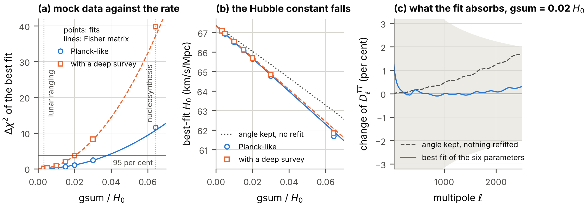

**FIG. 24.** Mock data of the microwave background against the rate of deflation. (a) The minimum $\Delta\chi^{2}$ of fits of the six parameters of the standard model at a fixed rate (symbols) and the parabola of the Fisher matrix (lines), for the two data sets; the rates that lunar laser ranging and nucleosynthesis allow are marked, and the horizontal line is $\Delta\chi^{2}=3.84$, the bound at 95 per cent. (b) The best-fit Hubble constant, with the slope of the Fisher matrix and, dotted, the Hubble constant that keeps the angle when nothing else is refitted. (c) The temperature spectrum at $\mathrm{gsum}=0.02\,H_0$ relative to the data: with the angle kept and nothing refitted, and at the best fit, which absorbs most of the difference; the band is the cosmic variance of a single multipole.

*Deflation and dark radiation together.* Extra radiation is the candidate of the model for the Hubble tension. Seven one-parameter families of extra radiation were fitted to the same mock data, each with a density $N$ in units of one neutrino species: radiation that streams freely; a fluid; the *stepped fluid of the model*, at four transition redshifts $z_t$; and the stepped fluid of the Wess-Zumino model ([Aloni et al. 2022](#ref-Aloni2022)). The stepped fluid of the model is the massless phase mode of the Vorton-Scalar in equilibrium with the sixteen components of the fermion field: when the fermions become non-relativistic, at the redshift $z_t$, they annihilate and heat the phase mode, so that the temperature of the fluid rises by the factor $15^{1/3}$ relative to the law of dilution ($N$ is the density after this step; the Wess-Zumino fluid has the factor $(15/7)^{1/3}$). Every family can raise the Hubble constant, and every one at a price in $\Delta\chi^{2}$. Does the deflation lower the price? All fits were made with static extra coordinates and on the deflating spacetime at the largest rate that lunar laser ranging allows, and the Fisher matrix was computed with $N$ and the rate free together (Table XXV, Fig. 25; Tables LI to LIV of Appendix D). Three results follow.

First, at that rate every best-fit Hubble constant of the static case falls by 0.274 to $0.279~\mathrm{km\,s^{-1}\,Mpc^{-1}}$, which is the shift of the model without extra radiation: the effects of the deflation and of the extra radiation add \[Fig. 25(a), (b)\].

Second, $N$ and the rate are positively correlated, with correlation coefficients of 0.37 to 0.89. Extra radiation makes the early universe expand faster, the weaker gravity of the deflating spacetime makes it expand more slowly, and in the spectra the two compensate in part. Fits with extra radiation are therefore slightly *better* on the deflating spacetime than on the static one, slightly more extra radiation is allowed at a given $\Delta\chi^{2}$, and with both parameters free the error of each grows, for free-streaming radiation from 0.143 to 0.250 in $N$.

Third, the compensation does not help the Hubble constant. When the rate grows and $N$ follows its best-fitting value, the best-fit Hubble constant still falls: by $35.3~\mathrm{km\,s^{-1}\,Mpc^{-1}}$ per unit of $\mathrm{gsum}/H_0$ for free-streaming radiation, against 84.35 without extra radiation, and by 22.1 to 76.9 for the seven families. The largest Hubble constant among the models with $N\ge0$, $\mathrm{gsum}\ge0$ and $\Delta\chi^{2}\le3.84$ is therefore reached at zero rate, for every family and both data sets \[Fig. 25(c)\]. *The deflation lowers the Hubble constant faster than it makes room for extra radiation.*

|                                      |                           |           |             |           |              |           |             |         |         |
|:-------------------------------------|:-------------------------:|:---------:|:-----------:|:---------:|:------------:|:---------:|:-----------:|:-------:|:-------:|
|                                      | $N$ at $\Delta\chi^{2}=4$ |           | $H_0$ there |           | error of $N$ |           |             |   net   | largest |
| family                               |          static           | deflating |   static    | deflating |  rate zero   | rate free | correlation |  slope  |  rise   |
| free-streaming radiation             |           0.29            |   0.31    |    69.74    |   69.62   |    0.143     |   0.250   |    0.82     | $-35.3$ |  2.30   |
| fluid, no step                       |           0.27            |   0.29    |    70.20    |   70.12   |    0.135     |   0.249   |    0.84     | $-23.9$ |  2.77   |
| model fluid, $z_t=10^4$              |           0.25            |   0.26    |    68.75    |   68.53   |    0.122     |   0.145   |    0.54     | $-65.4$ |  1.35   |
| model fluid, $z_t=2\times10^4$       |           0.17            |   0.18    |    68.16    |   67.90   |    0.085     |   0.091   |    0.37     | $-76.9$ |  0.78   |
| model fluid, $z_t=5\times10^4$       |           0.12            |   0.13    |    68.48    |   68.27   |    0.060     |   0.076   |    0.61     | $-67.0$ |  1.10   |
| Wess-Zumino fluid, $z_t=2\times10^4$ |           0.32            |   0.35    |    70.13    |   70.06   |    0.160     |   0.350   |    0.89     | $-22.1$ |  2.69   |
| model fluid, $z_t=10^6$              |           0.30            |   0.32    |    70.39    |   70.32   |    0.150     |   0.250   |    0.80     | $-23.0$ |  2.95   |

TABLE XXV. The seven families of dark radiation on the deflating spacetime (Planck-like mock data; assumptions A1, A2, A3). “Model fluid” is the stepped fluid of the model with the transition redshift $z_t$. Columns 2 to 5: the density $N$ of extra radiation at which the best fit reaches $\Delta\chi^{2}=4$, and the Hubble constant there in $\mathrm{km\,s^{-1}\,Mpc^{-1}}$, with static extra coordinates and deflating at the largest rate that lunar laser ranging allows. Columns 6 to 10, from the Fisher matrix with $N$ and the rate free together: the standard error of $N$ with the rate held at zero and with the rate free; the correlation coefficient of $N$ and the rate; the net slope, that is, the change of the best-fit Hubble constant in $\mathrm{km\,s^{-1}\,Mpc^{-1}}$ per unit of $\mathrm{gsum}/H_0$ when $N$ follows its best-fitting value; and the largest rise of the best-fit Hubble constant, in $\mathrm{km\,s^{-1}\,Mpc^{-1}}$, among the models with $N\ge0$, $\mathrm{gsum}\ge0$ and $\Delta\chi^{2}\le3.84$, which is reached at zero rate for every family.

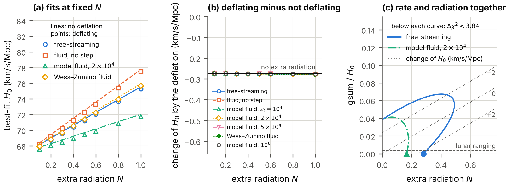

**FIG. 25.** The seven families of dark radiation on the deflating spacetime (Planck-like mock data). (a) The best-fit Hubble constant against the density $N$ of extra radiation for four families: without deflation (lines) and at the largest rate that lunar laser ranging allows (symbols). (b) The difference for all seven families; the horizontal line is the shift of the model without extra radiation. (c) The rate and the extra radiation as free parameters together: the regions with $\Delta\chi^{2}<3.84$ of the Fisher matrix for two families, lines of constant change of the best-fit Hubble constant for free-streaming radiation (dotted), the point of the largest Hubble constant of each region (filled symbols, at zero rate), and the rate that lunar laser ranging allows (dashed).

### I. Dark matter

*What does not change.* A superfluid needs particles that are degenerate (fermions) or condensed (bound pairs) at the mass density $\rho$ and the velocity dispersion $\sigma_v$ of observed halos. A gas of fermions with $\nu=8$ internal states is degenerate if its Fermi velocity is at least $\sigma_v$, and bosons of the mass $m_B$ are condensed if the number of particles in a cube with the edge of their thermal wavelength, at the temperature $k_BT=m_B\sigma_v^{2}$, is at least 2.612. Both conditions are upper limits on the mass, $$m_{\mathrm{deg}}=\Big[\frac{6\pi^{2}\hbar^{3}\rho}{\nu\,\sigma_v^{3}}\Big]^{1/4},\qquad
m_{B,\max}=\Big[\frac{(2\pi)^{3/2}\hbar^{3}\rho}{2.612\,\sigma_v^{3}}\Big]^{1/4},
\tag{117}$$ the first being the bound of Tremaine and Gunn ([Tremaine and Gunn 1979](#ref-TremaineGunn1979)) for this model. They contain the densities and the velocities only, and the masses of the model do not change along the deflation (Table XXVI): in the densest systems of dark matter that are observed, the cores of dwarf spheroidal galaxies, fermions are degenerate only if they are lighter than 0.276 keV and bound pairs are condensed only if they are lighter than 262 eV. The first limit conflicts with the bound of the Lyman-$\alpha$ forest derived below, which demands more than 1.5 keV; the second conflicts with the bound on the self-interaction of the pairs, which demands far heavier fermions. *The dark matter of galaxies is not a superfluid of these particles.* Heavy fermions or pairs can be cold dark matter of an ordinary kind. The deflation does not change this verdict.

| system                        | $\rho$ ($M_\odot$ pc$^{-3}$) | $\sigma_v$ (km/s) | $m_{\mathrm{deg}}$ (keV) | $m_{B,\max}$ (eV) |
|:------------------------------|:----------------------------:|:-----------------:|:------------------------:|:-----------------:|
| dwarf spheroidal galaxy, core |            0.100             |        10         |          0.276           |        262        |
| Milky Way at the Sun          |            0.0105            |        156        |          0.020           |       19.0        |
| cluster of galaxies, core     |           0.00300            |       1000        |          0.004           |       3.45        |

TABLE XXVI. Could the fermions of the model be degenerate, or their bound pairs condensed, in observed systems of dark matter? $\rho$: density; $\sigma_v$: velocity dispersion; $m_{\mathrm{deg}}$ and $m_{B,\max}$: the limits of Eq. (117).

*Self-interaction, and the epoch of the resonance.* The cross-section per mass of bound pairs must respect the bound of about $\kappa_{\mathrm{SI}}=1~\mathrm{cm^{2}/g}$ from colliding clusters ([Markevitch et al. 2004](#ref-Markevitch2004); [Randall et al. 2008](#ref-Randall2008)). A pair bound by the Yukawa potential (59) has a scattering length of at least the range $1/m_s$; identical bosons with that scattering length scatter at low energy with the cross-section $8\pi/m_s^{2}$; and the pair exists only if $D_{\mathrm{VS}}=\alpha_{\mathrm{VS}}\,m/m_s>D_c$ (Sec. X). Together, for pairs of the mass $2m$, these give a smallest fermion mass, $$m\ge\Big[\frac{4\pi\,D_c^{2}}{\alpha_{\mathrm{VS}}^{2}\,\kappa_{\mathrm{SI}}}\Big]^{1/3},
\tag{118}$$ which is 918 MeV for $\alpha_{\mathrm{VS}}=0.1$ and falls as $\alpha_{\mathrm{VS}}^{-2/3}$, that is, as $e^{-2\tau_d/3}$ along the deflation. For a given particle the masses are constant and so is this cross-section. What the deflation changes is whether the pair *exists*: it is bound only after $D_{\mathrm{VS}}$ has grown to $D_c$. And at that moment the scattering length of two unbound fermions diverges (Sec. X), so that their cross-section rises to the limit that unitarity allows, which is larger the slower the particles. For the example particle, $m=918$ MeV and $m_s=54.7$ MeV, at the relative velocities 10, 156 and 1000 km/s \[Fig. 12(c)\]: one unit of the clock before the binding the cross-section per mass is $0.84~\mathrm{cm^{2}/g}$ at all three velocities; at the binding it peaks at $1.3\times10^{7}$, $5.2\times10^{4}$ and $1.3\times10^{3}~\mathrm{cm^{2}/g}$; and it exceeds $100~\mathrm{cm^{2}/g}$ during an interval of the clock of 0.27, 0.27 and 0.26 around the binding. *A deflating universe whose dark matter consists of these fermions passes through an epoch of strong, velocity-dependent self-interaction*, strongest in the smallest halos. Whether the epoch lies in the observable past depends on the rate. Under A2 and a constant rate it does so only if $D_{\mathrm{VS}}$ today exceeds $D_c$ by less than a third of a per cent, a coincidence that nothing in the model explains.

*Superfluid dark matter and small-scale structure.* What becomes of the growth of structure if the dark matter is the superfluid itself, a fluid with first sound? Two limits are computed: a degenerate gas of the fermions with eight internal states, and a condensate of bound pairs with the sound speed $c_{s0}$ today. The pressure of such a fluid suppresses structure below a wavenumber, and the bound of the Lyman-$\alpha$ forest on warm dark matter ([Viel et al. 2005](#ref-Viel2005); [Iršič et al. 2017](#ref-Irsic2017)) then limits the fermion mass from below and the sound speed from above. Computed again on the deflating background under A1 to A3, at the Hubble constant that keeps the angle, the wavenumber at which the power falls to a quarter of that of cold dark matter is lower by 0.15 to 0.16 per cent at the rate that lunar laser ranging allows and by 3.0 to 3.3 per cent at the rate that nucleosynthesis allows, for fifteen models (Fig. 26, Tables LV and LVI). The reason is the weaker gravity of the time at which the suppression is set: the Jeans wavenumber is proportional to the square root of Newton’s constant. The limits move accordingly, from $m>1.514$ keV and $c_{s0}<1.645\times10^{-11}\,c$ without deflation to $m>1.516$ keV and $c_{s0}<1.641\times10^{-11}\,c$ at the first rate and $m>1.555$ keV and $c_{s0}<1.565\times10^{-11}\,c$ at the second. The two closures give the same wavenumbers to $1.5\times10^{-5}$. In this calculation the equation of state of the superfluid in ordinary space is that of static extra coordinates; whether the self-interaction of a condensate would itself follow the volume of the deflating coordinates is a question about the microscopic model that the calculation does not answer.

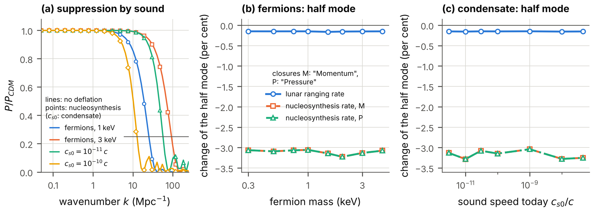

**FIG. 26.** Superfluid dark matter on the deflating spacetime. (a) The power spectrum of matter divided by that of cold dark matter, for a degenerate gas of the fermions of two masses and for a condensate of bound pairs with two sound speeds today: without deflation (lines) and at the rate that nucleosynthesis allows (symbols). The horizontal line marks one quarter, the value that defines the half mode. (b) The change of the wavenumber of the half mode for the degenerate gas, against the fermion mass, at the rates that lunar laser ranging and nucleosynthesis allow, for the closures “Momentum” (M) and “Pressure” (P). (c) The same for the condensate, against its sound speed today.

*How fast the quantities drift.* With $n=d\ln(\text{quantity})/d\tau_d$, the relative change of a quantity over the age of the universe is $n\,\mathrm{gsum}\,t_0$. The couplings themselves drift with $n=1$ or $\tfrac12$ (Table II). Quantities near a threshold drift much faster: the scattering length just below the binding, at $D_{\mathrm{VS}}=1.5$, with $n=9.1$; the binding energy just above it, at $D_{\mathrm{VS}}=1.8$, with $n=30$; the gap of a weakly paired state with $n=1/\lambda$. These are the quantities in which a slow deflation would first be seen (Table XLI).

### J. Verdict on hypothesis H3

*The Hubble tension.* The candidate of the model, the phase mode of the Vorton-Scalar as dark radiation, is untouched at the allowed rates, since the couplings drift by parts in a thousand: with static extra coordinates it raises the Hubble constant by the amounts of the last column of Table XXV at most, a fraction of the $6.1~\mathrm{km\,s^{-1}\,Mpc^{-1}}$ that are needed, and the deflation does not improve this. The deflation itself contributes two effects. The first, through Newton’s constant, has the wrong sign: at a fixed angle of the sound horizon the inferred Hubble constant falls by $0.2~\mathrm{km\,s^{-1}\,Mpc^{-1}}$ at the largest rate that lunar laser ranging allows, and in fits to mock data of the microwave background it falls by $84~\mathrm{km\,s^{-1}\,Mpc^{-1}}$ per unit of $\mathrm{gsum}/H_0$. Nor can the rate help the dark radiation: more extra radiation is allowed when the rate is free, but the largest Hubble constant that the mock data allow is reached at zero rate. The second effect, the loss of mass of bound pairs, has the right sign and is bounded, in the examples computed, to $0.5~\mathrm{km\,s^{-1}\,Mpc^{-1}}$. *The hypothesis that the model resolves the Hubble tension is not supported by the deflation, and under A2 it is mildly disfavored.*

*Dark matter.* The mass ranges stated above hold unchanged, and the limits on superfluid dark matter move by two tenths of a per cent at the rate that lunar laser ranging allows. The deflation adds one qualitative prediction, the epoch of the resonance, and one quantitative one, a rise of the growth rate, whose size depends on the perturbations of the agent. Neither is in conflict with observation at the allowed rates, and neither is detectable at the rate that lunar laser ranging allows. *The hypothesis that the superfluid is the dark matter is neither strengthened nor weakened by the deflation.* It acquires a history, whose observable part is empty if gravity is eight-dimensional and the rate constant.

*What rests on the additional assumptions.* Everything in this section that concerns Newton’s constant rests on A2. The spectra, the forecast and the growth of structure rest in addition on A3, and the growth of structure and the largest angular scales on a closure that the hypothesis of deflation does not supply. The forecasts are for mock data without gravitational lensing; no measured spectrum has been fitted.

## XVII. The Higgs hypothesis

### A. The hypothesis and the conditions

Hypothesis H2 says that the superfluid state, the condensate of the fermion pair along the hidden axis, *is the Higgs field* ([Higgs 1964](#ref-Higgs1964)). In the Standard Model the Higgs field is a doublet of the weak-isospin group with a vacuum value $v_{\mathrm{EW}}=246$ GeV, which breaks the electroweak symmetry, gives the W and Z bosons and the quarks and charged leptons their masses, and leaves one scalar particle of 125 GeV. Its four real components form a vector of a group $SO(4)$, which the vacuum value breaks to $SO(3)$ ([Sikivie et al. 1980](#ref-Sikivie1980)). From these facts follow seven conditions that a condensate must meet in order to *be* the Higgs field (Table XXVII). With static additional times the hypothesis has no geometric basis on the $4{+}4$ spacetime, because the condensate is a singlet under the only non-Abelian symmetry that the geometry provides. This section examines the conditions on the deflating spacetime.

Two statements must be kept apart. H2 is the hypothesis that the *pair condensate* is the Higgs field; the electroweak scale is then the scale of the condensate. HV, used in one row of Table XXII, is the different assumption that the vacuum value of the *Vorton-Scalar* sets the electroweak scale. HV is not examined here.

| condition                                                                        | status                                                                              |
|:---------------------------------------------------------------------------------|:------------------------------------------------------------------------------------|
| C1: a scalar under the Lorentz group of ordinary spacetime                       | met in the sector of fields that do not depend on the extra coordinates             |
| C2: non-zero in empty space                                                      | open; reached by the deflation only outside the range of validity of the model      |
| C3: a doublet of the weak-isospin group with a neutral component                 | only under a hidden symmetry; a singlet under the rotations of the additional times |
| C4: breaks $SO(4)$ to $SO(3)$                                                    | met in the sector only                                                              |
| C5: scale 246 GeV, with a scalar particle of 125 GeV with the observed couplings | —                                                                                   |
| C6: its couplings give the quarks and leptons their masses                       | —                                                                                   |
| C7: no further light or charged particles that would have been seen              | —                                                                                   |
| new: the electroweak scale does not drift                                        | requires $\mathrm{gsum}<1.16\times10^{-6}\,H_0/n_{\mathrm{EW}}$                     |

TABLE XXVII. The conditions that a condensate must meet in order to be the Higgs field, and their status on the deflating $4{+}4$ spacetime. The last row is a condition that only a deflating spacetime imposes. A dash marks a condition that is not examined for this spacetime, because C3 is not met there by any symmetry of the spacetime.

### B. What the deflation leaves unchanged

The pair operators, their transformation properties and the internal symmetry are properties of the Dirac matrices of the frame, which the deflation does not change, and of the equations of the fields that do not depend on the extra coordinates, which for the weighted fields are the flat equations. By Sec. XIV C the four vector pair operators form the $(2,2)$ of $SU(2)_A\times SU(2)_B$, the representation of a Higgs field, and a condensate along one axis breaks $SO(4)$ to $SO(3)$. Hence, *within the sector*, C1 holds as on flat spacetime: the pair along the hidden axis is invariant under the rotations of $x1,x2,x3$, which remain symmetries of the spacetime, and under the boosts of ordinary spacetime as they act on the fields of the sector. (The boosts are no longer symmetries of the deflating spacetime as a whole; in the sector this shows only in the dependence of the couplings on the time.) C3 and C4 hold in the sector as well, in the sense that the pattern is right under its internal symmetry.

### C. What the deflation changes

On the flat $4{+}4$ spacetime the only non-Abelian internal symmetry that the geometry provides is $SO(3)_T$, the rotations of the three additional times, and under it the condensate along the hidden axis is a singlet, not a doublet: the pair operator along $x0$ commutes with the rotations of $x5,x6,x7$. By Sec. XIV C the deflating spacetime keeps $SO(3)_T$ only if the three rates are equal, and reduces it to one rotation, or to none, otherwise. The conclusion is the same where the rates are equal and holds a fortiori where they are not: *the hypothesis has no geometric basis on the $4{+}4$ spacetime.* The pattern of the Higgs vacuum is present in the sector, under a hidden symmetry, and nowhere else. (On a spacetime with seven space-like dimensions and one time the six generators are rotations of the extra dimensions when these are static; a deflation of three of them removes that geometric basis as well.)

### D. Condition C2: a condensate in empty space

With static extra coordinates C2 is open: a pair condensate forms in the vacuum only if $\alpha_{\mathrm{VS}}$ exceeds a critical value $\alpha_c$ of about 2 or more, depending on the cutoff (Sec. XII). On a deflating spacetime $\alpha_{\mathrm{VS}}$ grows as $e^{\tau_d}$ and reaches any such value at a definite time. Section XII showed what else has happened by then: the exchange of one boson is no longer a controlled approximation, and the field at which the one-loop potential of the Vorton-Scalar falls below its vacuum value has moved to within a factor of two of the vacuum value. *C2 can be reached by waiting, but not within the range of validity of the model.* Its status remains open.

### E. The self-interaction and the hidden symmetry

The internal symmetry of the sector, on which C3 and C4 rest, was established in Sec. XIV C for the model without self-interaction. By Sec. IV E a scalar and a pseudoscalar contact coupling keep the whole of it, and so does the exchange of the Vorton-Scalar, which is a self-interaction of these two kinds with a finite range \[Eq. (74)\]. A vector or an axial-vector contact coupling keeps the six generators of $SU(2)_A\times SU(2)_B$ and the phase symmetry but breaks $U(1)_E$. The representation and the breaking pattern that C3 and C4 require are therefore present in the sector for any couplings of the self-interaction; what a vector or axial-vector coupling removes is the additional symmetry $U(1)_E$.

### F. A new condition: the electroweak scale must not drift

Suppose that H2 holds. The electroweak scale $v_{\mathrm{EW}}$ is then the scale of the pair condensate in the vacuum, as in models in which a condensate of fermions replaces the elementary Higgs field ([W. A. Bardeen, Hill, and Lindner 1990](#ref-BardeenHillLindner1990)). That scale is determined by the parameters of the model: the masses $m$ and $m_s$, the cutoff, and the coupling $\alpha_{\mathrm{VS}}$. On the deflating spacetime the masses are constant and $\alpha_{\mathrm{VS}}\propto e^{\tau_d}$. Therefore $$v_{\mathrm{EW}}\ \propto\ e^{\,n_{\mathrm{EW}}\,\tau_d},\qquad n_{\mathrm{EW}}=\frac{d\ln v_{\mathrm{EW}}}{d\ln\alpha_{\mathrm{VS}}}.
\tag{119}$$ The exponent cannot vanish: below the critical coupling there is no condensate, so that the scale depends on the coupling, and most strongly just above the critical coupling.

Under H2 the masses of the electron and of the quarks are proportional to $v_{\mathrm{EW}}$ and change at the rate $n_{\mathrm{EW}}\,\mathrm{gsum}$. The mass of the proton is due mostly to the strong interaction and does not follow. The ratio $m_p/m_e$ of the proton mass to the electron mass therefore changes at the rate $n_{\mathrm{EW}}\,\mathrm{gsum}$. Comparisons of atomic clocks find this ratio constant to $8.0\times10^{-17}$ per year at two standard deviations ([Lange et al. 2021](#ref-Lange2021)). Hence $$\mathrm{gsum}<\frac{8.0\times10^{-17}\ \text{per year}}{n_{\mathrm{EW}}}=\frac{1.16\times10^{-6}\,H_0}{n_{\mathrm{EW}}}.
\tag{120}$$ The bound needs no assumption about gravity. For $n_{\mathrm{EW}}=1$ it is 2787 times stronger than the bound that lunar laser ranging gives if gravity is eight-dimensional.

*The size of the exponent.* For the model itself, with massive fermions and a massive radial mode, the scale of the vacuum condensate has not been computed as a function of the coupling. It is known in closed form for the scale-invariant case of the ladder equation: massless fermions and massless bosons between an infrared scale and a cutoff ([Miransky 1985](#ref-Miransky1985)). There the scale of the condensate obeys $$\varrho_c\,\ln\frac{\text{cutoff}}{\text{scale}}=\arctan\frac{1}{2\varrho_c},\qquad
\varrho_c^{2}=\frac14\Big(\frac{\alpha_{\mathrm{VS}}}{\alpha_c}-1\Big),$$ where $\varrho_c$ is only an abbreviation for the square root that the second equation defines, from which $$n_{\mathrm{EW}}=\frac{(1+4\varrho_c^{2})\,\arctan(1/2\varrho_c)}{8\,\varrho_c^{3}}+\frac{1}{4\varrho_c^{2}}.
\tag{122}$$ The program verifies Eq. (122) against the numerical derivative to $3\times10^{-8}$ and tabulates it with the bound (120) (Table XXVIII). The exponent diverges at the critical coupling, equals $1+\pi/2=2.57$ at twice the critical coupling, and exceeds 1 for $\alpha_{\mathrm{VS}}<3.27\,\alpha_c$. It falls below 1 only where the scale of the condensate approaches the cutoff, that is, where the four-dimensional description ends. Within the range in which a condensate of the kind that H2 needs can be described at all, $n_{\mathrm{EW}}$ is of order one or larger.

| $\alpha_{\mathrm{VS}}/\alpha_c$ | $\ln$(cutoff/scale) | $n_{\mathrm{EW}}$ | $\mathrm{gsum}$ (per year) | $\mathrm{gsum}/H_0$ |
|:-------------------------------:|:-------------------:|:-----------------:|:--------------------------:|:-------------------:|
|              1.05               |       12.082        |        147        |    $5.4\times10^{-19}$     | $7.9\times10^{-9}$  |
|              1.10               |        7.998        |       54.0        |    $1.5\times10^{-18}$     | $2.2\times10^{-8}$  |
|              1.25               |        4.429        |       15.1        |    $5.3\times10^{-18}$     | $7.7\times10^{-8}$  |
|              1.50               |        2.702        |       6.05        |    $1.3\times10^{-17}$     | $1.9\times10^{-7}$  |
|              2.00               |        1.571        |       2.57        |    $3.1\times10^{-17}$     | $4.5\times10^{-7}$  |
|              3.00               |        0.870        |       1.15        |    $6.9\times10^{-17}$     | $1.0\times10^{-6}$  |
|              5.00               |        0.464        |       0.540       |    $1.5\times10^{-16}$     | $2.2\times10^{-6}$  |
|              10.0               |        0.215        |       0.230       |    $3.5\times10^{-16}$     | $5.0\times10^{-6}$  |

TABLE XXVIII. The exponent $n_{\mathrm{EW}}$ with which the scale of the vacuum condensate follows the coupling in the scale-invariant ladder equation, and the bound (120) on the present rate of deflation that follows from it under hypothesis H2.

*The conclusion.* Under H2 the deflation clock can have advanced by at most $\mathrm{gsum}\,t_0<1.1\times10^{-6}/n_{\mathrm{EW}}$ during the age of the universe at a constant rate. Every effect of the deflation described in Secs. VIII to XVI is then unobservably small. Conversely, a deflation at any rate at which those effects matter excludes H2. *The hypothesis H2 and a deflation of any consequence today exclude each other.* This conclusion does not depend on the unresolved conditions C2 and C5 to C7. It depends on two properties only: that the electroweak scale is set by the dynamics of the model, which is the content of H2, and that the coupling of the model follows the volume of the deflating coordinates, which is exact (Sec. VI).

### G. Verdict on hypothesis H2

On the deflating spacetime the hypothesis that the singlet superfluid is the Higgs field is unproven and without geometric basis, as on the flat $4{+}4$ spacetime, and it is incompatible with any deflation that is fast enough to matter today. Whether a mechanism exists that would make the electroweak scale insensitive to the coupling of the pair is not known; none is present in the model.

## XVIII. What has been established, and what has not

The sections above reported results of very different standing: identities verified in exact arithmetic, numerical results with a stated accuracy, consequences of additional assumptions, and estimates. This section sorts them. An item is called established if a machine check stands behind it (Appendix E); statements of interpretation deserve the reader’s independent scrutiny more than the numbers do.

### A. Established

*Geometry* (Sec. II). The curvature and the Einstein tensor of the deflating spacetime in closed form, for arbitrary rates and constants. The Killing vectors, 14, 15 or 20 in number, and the completeness of the lists. That the spacetime is not a solution of Einstein’s equations without matter, with or without a cosmological constant; that with three equal rates it is an exact solution of Einstein-Gauss-Bonnet gravity without matter, for $\Lambda_8=3\,\mathrm{g55}^{2}$ and $\alpha_{\mathrm{GB}}=-1/(4\,\mathrm{g55}^{2})$; that with unequal rates it is not; and that this solution is unstable (Sec. XV). The turning value of the ordinary time for a classical particle with momentum along a deflating time.

*The Dirac field* (Secs. III, V). The Dirac matrices in coordinate components, the spin connection, the covariant constancy of the matrices, and the curvature of the spinor derivative. The Lagrangian with the kinetic term, the mass term and the self-interaction; the field equation (24) with the self-interaction on its right-hand side; the weighted field; and the statement that fields which do not depend on $x5,x6,x7$ obey the flat equation with the couplings $g_r/V_d$ of the moment. The exact solutions when one rate governs; that exactly eight of the sixteen solutions are bounded; that these are standing waves with vanishing charge; and the law of their extinction, Eqs. (48) to (50). All of this is confirmed numerically by two independent methods.

*The self-interaction* (Sec. IV). The Fierz matrix in closed form and from the 256 matrices. That for anticommuting fields the nine invariants obey five linear relations, so that only four couplings are independent, verified by exact integer arithmetic and on Grassmann-valued fields. The four effective couplings (35), the Hartree-Fock couplings (37), the pair couplings (38), and the conditions under which the self-interaction keeps the chiral symmetry and the symmetry $U(1)_E$. The exact relation (45) between the two forms of the self-interaction in the quantized sector.

*Matter with the self-interaction* (Sec. VII). The Kohn-Sham states of uniform matter and their thermodynamic consistency. The thresholds of Table III at which a gas becomes self-bound matter in the sector of fields that do not depend on the deflating coordinates, and the history of the saturated matter after that moment. That in the covariant form with the positive kinetic term the two halves of the field polarize.

*The effective potential with the self-interaction* (Sec. XIII). That the Kohn-Sham method and the CJT effective potential at the order of the Hartree and Fock diagrams give the same states. The critical coupling (87) of the vacuum with the filled states of negative energy, and the moment at which the deflation crosses it. The functional (88) with bare mass, self-interaction and Vorton-Scalar; that the exchange of the radial mode acts at low density as a scalar contact coupling; the shifts of the moment of binding of Table XV; and the mass (90) that a bare Dirac mass gives to the phase mode.

*Pairing with the self-interaction* (Sec. IX). The amplitudes (71) of the four contact channels in closed form; that the exchange of the Vorton-Scalar is a self-interaction of finite range; and the gaps of Table VII.

*Gravity* (Sec. XV). The Einstein-Lovelock tensors (99) and (100), derived in three ways. The reference evolution, reproduced by two programs. That the undisturbed deflation needs the constants (101) or a source with the equation of state (102); that the matter of the model cannot be that source; that matter accelerates the deflation and makes the flat coordinates expand; and that the undisturbed deflation is unstable in the tuned gravity.

*The model along the clock* (Secs. VI to XII). For fields that do not depend on the extra coordinates, the model on the deflating spacetime is the model on flat spacetime with the couplings of the moment, exactly. The masses are constant; $g_{\mathrm{VS}}$ grows as $e^{\tau_d/2}$; $\alpha_{\mathrm{VS}}$, $G_{\mathrm{VS}}$, $D_{\mathrm{VS}}$ and $C$ grow as $e^{\tau_d}$. The modes of the Vorton-Scalar grow with the weight only, and the potential between two fermions has the unchanged range and the strength of the moment. The exchange amplitudes are those of flat spacetime times the square of the coupling of the moment. In weak coupling the gap grows according to Eq. (69), and the critical temperature follows it. Two fermions become bound at a definite time, at a scattering resonance, with a binding energy that starts quadratically; the order of the other events depends on $m_s/m$ alone. The paired state follows the deflation if and only if $\Xi_d$ is below about 0.2 to 0.5; before that it lags and accumulates broken pairs. The solution of the gap equation is a minimum of the effective potential at every moment examined. Matter of fixed density loses its fermion mass at a critical value of $C$, is self-bound for $C>3.7011$ and is more strongly bound later; the melting temperature of the fermion mass falls; the barrier of the one-loop potential of the vacuum moves toward the vacuum value.

*Order parameter and symmetry* (Sec. XIV). The potential of the order parameter prefers no direction among the four frame axes. The internal symmetry of the sector, the representation of the pair operators and the breaking pattern are unchanged by the deflation. Of the six generators that belong to the pairs of the four extra axes, the deflating spacetime keeps none, one or three as symmetries of the spacetime. A vortex line of unit winding carries four fermion zero modes, two for each direction along the line, at every moment; its energy per length falls as $e^{-\tau_d}$.

*Cosmology* (Sec. XVI), each item under the assumption named there. The equation of the expansion (105) and the fall of the inferred Hubble constant, with recombination computed on the deflating background and verified by an independent calculation. The bounds of Table XXII, and that in the model as it stands the atomic clocks give none. The effect of the loss of mass of bound pairs. The pressure (106) of the agent. The equations (107) of the perturbations of ordinary space for unperturbed extra scale factors, the identities (110) and (111), and that the four equations cannot all hold with matter alone. The growth equations of the two closures, and that the closure “Shear” coincides with the closure “Pressure” inside the horizon. The spectra of the microwave background for $\ell\ge30$ and their independence of the closure; the forecast for the rate from mock data; that the Hubble constant falls in every fit, with or without extra radiation; and that extra radiation and the rate of deflation compensate in part in the spectra, without any gain for the Hubble constant. The unchanged estimates of degeneracy and of condensation in halos, the limits on superfluid dark matter, the epoch of the resonance, and the drift of the quantities.

*The Higgs hypothesis* (Sec. XVII). Under H2 the electroweak scale follows the coupling with the exponent $n_{\mathrm{EW}}$, and atomic clocks bound the rate of deflation by Eq. (120). The exponent is given in closed form for the scale-invariant ladder equation.

### B. What the mass term and the self-interaction change

Sections VIII to XIV were derived for the model in which the whole mass of the fermions comes from the Vorton-Scalar and the whole interaction from its exchange ($m_D=0$, $g_r=0$). Table XXIX lists, result by result, what a bare Dirac mass and the self-interaction change.

| result with the Vorton-Scalar alone                                                                          | with a bare Dirac mass                                                                    | with the self-interaction                                                                                  |
|:-------------------------------------------------------------------------------------------------------------|:------------------------------------------------------------------------------------------|:-----------------------------------------------------------------------------------------------------------|
| fields that do not depend on $x5,x6,x7$ obey the flat equations with couplings of the moment (Secs. III, VI) | unchanged; $m_D$ itself does not change with the clock                                    | unchanged; every $g_r$ grows as $e^{\tau_d}$, in a fixed ratio to $g_{\mathrm{VS}}^{2}$                    |
| the chiral symmetry $U(1)_{\mathrm{VS}}$ is exact and the phase mode massless (Sec. VI)                      | broken explicitly; the phase mode has the mass of Eq. (90), which grows as $e^{\tau_d/2}$ | kept only if $g_{0}^{\mathrm{eff}}+g_{8}^{\mathrm{eff}}=0$                                                 |
| the gap of the paired state and its growth (Sec. VIII)                                                       | smaller, because the massive phase mode binds less                                        | larger with a scalar contact attraction, smaller with a vector repulsion (Table VII)                       |
| two fermions bind when $D_{\mathrm{VS}}$ reaches $D_c$ (Sec. X)                                              | the Yukawa potential of the radial mode is unchanged                                      | a contact term $G_{\mathrm{pair}}$ is added to the potential; the threshold with it has not been computed  |
| matter is self-bound for $C>3\pi^{2}/8$ (Sec. XII)                                                           | earlier (Table XV)                                                                        | later with a vector repulsion; earlier with a scalar attraction where the particles keep a mass (Table XV) |
| matter of fixed density loses its whole fermion mass (Sec. XII)                                              | the particles keep the mass $m_D$                                                         | the mass in matter is $m^{*}$ of Eq. (60)                                                                  |
| the internal symmetry $[SU(2)\times SU(2)]\times U(1)_E$ of the sector (Sec. XIV)                            | unchanged                                                                                 | $U(1)_E$ is broken by vector and axial-vector couplings                                                    |
| cosmology and the bounds on the rate (Sec. XVI)                                                              | unchanged                                                                                 | unchanged                                                                                                  |

TABLE XXIX. What a bare Dirac mass $m_D$ and the self-interaction (couplings $g_r$) change in the results obtained with the Vorton-Scalar alone.

### C. The two methods as checks of each other and of the other results

The Kohn-Sham method and the CJT effective potential were used not only for new results but as checks, and each result of this paper that could be computed in two ways was (Table XXX).

| result                                                                   | obtained by                                                                                                                                                         |      deviation      |
|:-------------------------------------------------------------------------|:--------------------------------------------------------------------------------------------------------------------------------------------------------------------|:-------------------:|
| only four of the nine invariants of the self-interaction are independent | exact integer arithmetic on the antisymmetrized quartic form (program); Grassmann-valued fields (independent script)                                                | $9.4\times10^{-16}$ |
| the Hartree-Fock couplings                                               | exact traces (program); Wick’s theorem with density matrices summed from numerical eigenvectors (independent script)                                                | $2.1\times10^{-13}$ |
| the pair couplings of the 28 pairs at rest                               | exact diagonalization (program); numerical diagonalization for random couplings (independent script)                                                                | $7.9\times10^{-14}$ |
| saturation point of the reference example on flat $7{+}1$ spacetime      | a first calculation with a notebook; the program; the independent script                                                                                            | $1.7\times10^{-10}$ |
| states of uniform matter                                                 | Kohn-Sham method (gap equation, Gauss-Legendre integrals); CJT effective potential (minimization, Simpson integrals)                                                | $1.6\times10^{-12}$ |
| matter with momentum along the deflating coordinates ($7{+}1$)           | integral over the ellipsoid of occupied states (program); flat momenta integrated in closed form (independent script)                                               | $1.4\times10^{-8}$  |
| the thresholds at which matter becomes self-bound                        | the program; a general-purpose minimizer (independent script)                                                                                                       | $1.0\times10^{-9}$  |
| matter bound by the Vorton-Scalar (Sec. XII)                             | the functional of Sec. XIII C without bare mass and contact couplings; the functional of Sec. XII                                                                   | $2.1\times10^{-8}$  |
| pairing amplitudes of the contact channels                               | closed forms; direct evaluation with the 256 matrices (program); projectors from numerical eigenvectors (independent script)                                        | $1.8\times10^{-15}$ |
| the exchange of the radial mode as a contact coupling of finite range    | the kernel of the exchange; the kernel of the scalar contact coupling with the range $1/m_s$                                                                        | $3.3\times10^{-16}$ |
| gaps of the paired state without contact couplings                       | the gap equation of Sec. VIII; the gap equation of Sec. IX with vanishing contact couplings                                                                         | $6.6\times10^{-16}$ |
| gaps with contact couplings                                              | the program; plain iteration on another grid of momenta (independent script)                                                                                        | $1.1\times10^{-3}$  |
| the Einstein-Lovelock tensors of the orders 1, 2 and 3                   | sums over pair curvatures (program); the Riemann tensor of the metric and the Euler-Lagrange equations of the reduced action (independent script, computer algebra) |        exact        |
| the reference evolution with gravity                                     | a first calculation with a notebook; the program (Runge-Kutta, order 4); the independent script (Runge-Kutta, order 8)                                              | $4.8\times10^{-8}$  |
| the deflating spacetime with matter as a source                          | the program; a general-purpose integrator with an independent quadrature of the matter (independent script)                                                         | $6.4\times10^{-6}$  |
| the deflating spacetime as a solution of Einstein-Gauss-Bonnet gravity   | the Lanczos tensor from its definition (Sec. II C); the Einstein-Lovelock polynomials of Sec. XV                                                                    |        exact        |

TABLE XXX. Results obtained in two or more independent ways, with the largest relative deviation between them.

### D. Not established

*The source of the deflation.* The metric is prescribed. For equal rates it solves the equations of Einstein-Gauss-Bonnet gravity without matter, but that solution is unstable (Sec. XV); in Einstein gravity it needs a source with the equation of state (102), which the matter of the model cannot be. For unequal rates no field equation has been found that the metric solves. What holds the deflation, and how it absorbs the reaction of matter, is not known. All results on fields are results on a given background.

*The form of the self-interaction on the $4{+}4$ spacetime.* The covariant Lagrangian has an indefinite kinetic term in the quantized sector, and the self-interaction can be completed in two ways (Sec. IV F). They differ in the sign of the interaction between particles of different halves of the field, and they give different matter: the quantized-sector form binds it, the covariant form polarizes it and binds it much less. This paper adopts the quantized-sector form because the model with the Vorton-Scalar is defined in it; no principle has been found that selects it.

*The cutoff.* The self-interaction has couplings of negative mass dimension and defines an effective theory. The results without the filled states of negative energy presuppose a cutoff below the mass of the particles (Sec. XIII B); with the filled states the results depend on the cutoff, and the mass of the phase mode depends on it through the scalar density of the vacuum. The cutoff is a parameter of the model that nothing in the hypotheses fixes.

*The couplings.* The nine couplings $g_r$, of which four are independent, are free parameters. The examples use a scalar attraction and a vector repulsion in the ratio 10 to 1; no value is predicted.

*Matter beyond the mean field.* The Kohn-Sham states and the effective potential at the order of the Hartree and Fock diagrams neglect correlations. Without the filled states the energy has no lowest value as a function of an unrestricted trial mass; the states reported are solutions of the gap equation. Temperature was not included in the calculations with the self-interaction.

*Pairing inside dense matter.* The gaps of Table VII are computed for particles of the mass $m$. In self-bound matter the mass is $m^{*}<m$; the gap equation and the equation for $m^{*}$ have not been solved together. The contact couplings enter the gap equation with a range $1/m_{\mathrm{ct}}$ that is a choice.

*The theory of gravity and the assumption A2.* If gravity is of the Einstein-Gauss-Bonnet kind, the relation (104) between Newton’s constant and the volume of the deflating coordinates, and with it every result of Sec. XVI that is marked A2, would have to be derived anew.

*The agent.* Nothing in the hypothesis says what keeps the three rates constant while ordinary space expands. Under A2 it must have the tension (106) and no energy density; whether a physical source with these properties exists has not been examined. Nor does the hypothesis say how the agent responds when ordinary space is perturbed. That the scale factors of the deflating coordinates are not perturbed (assumption A3) is an assumption; and even with it, a closure is needed that the hypothesis does not supply. The growth of structure, the amplitude $\sigma_8$ and the spectra of the microwave background at the largest angular scales are computed for two closures and differ between them at the first order in the rate. They are the quantities that a theory of the agent would have to predict.

*The exclusion of the growing solutions.* The eight growing solutions of each mode that depends on a deflating time are discarded because they are unbounded. That is a condition of admissibility; it is not derived from a principle. The theory has no positive conserved charge for such modes, and a consistent quantization exists only for the sector that does not depend on the additional times.

*Unequal rates with simultaneous crossings.* No closed form is known for a mode that depends on two deflating coordinates whose crossings coincide; the results are numerical.

*The hidden coordinate.* That the fields do not depend on $x0$ is assumed. Nothing in the deflation explains it.

*The end of the history.* The couplings grow without bound. The four-dimensional description with the exchange of one boson holds only while $\alpha_{\mathrm{VS}}$ is not large, and the eight-dimensional theory itself is an effective theory, with couplings of negative mass dimension, that must fail when the proper size of the deflating coordinates reaches its scale of validity. What happens then is outside the model. Every history of Secs. VIII to XII ends in a regime that the two-loop truncation does not control; the numbers at the last moments of each table indicate the trend and are not predictions.

*The energy.* The energy of matter is not conserved while the couplings change. Where it goes, into whatever drives the deflation, is not described.

*Dynamics.* Sections VIII, X and XII give sequences of equilibrium states. Only for the paired state has the ability to follow been examined, in a model without dissipation; with dissipation the broken pairs would relax, and their lifetime is not known. The time-dependent two-body problem at the moment of binding, which decides how much of the population ends in the bound state, has not been solved. How a gas reaches the self-bound state, and whether the abnormal state forms by nucleation, are open. The equilibrium of a loop of vortex line with its current, and its stability, have not been computed.

*The vacuum beyond one loop.* The statements about the vacuum use the one-loop potential outside its range of reliability and draw only the conclusion stated in Sec. XII.

*Cosmology.* The forecasts of Sec. XVI H are for mock data without gravitational lensing; no measured spectrum of the microwave background has been fitted. All bounds that reach back to nucleosynthesis or to recombination assume a constant rate; a rate that was large early and is small today is neither excluded nor described. Only linear perturbations were computed. The consequences of the epoch of the resonance for the formation of halos have not been simulated.

*The Higgs hypothesis.* That a condensate forms in the vacuum, that any symmetry of the model is the electroweak gauge group, the scale and the mass of the scalar particle, and the masses of ordinary fermions: none of these is established. The exponent $n_{\mathrm{EW}}$ has not been computed for the model itself; the statement that it is of order one or larger rests on the scale-invariant case and on the general fact that the scale of the condensate vanishes at the critical coupling.

## XIX. Conclusions

We asked what becomes of a 16-component Dirac field with a mass term and a self-interaction, and of the superfluid of its pairs, when three of the eight coordinates of a spacetime of signature $4{+}4$ deflate exponentially.

The geometry is simple and rigid. The deflating spacetime is homogeneous, it has 14 to 20 symmetries instead of 36, and it is not a solution of Einstein’s equations without matter. With three equal rates it is an exact solution of Einstein-Gauss-Bonnet gravity without matter, for one relation between the rate and the two constants of that theory; but the solution is unstable, the matter of the model cannot be the source that Einstein gravity would need, and matter that is present accelerates the deflation.

The Dirac field separates into two parts. Fields that do not depend on the deflating coordinates obey, after a change of normalization, exactly the flat equations. Fields that do depend on them are extinguished: every admissible mode is a standing wave that dies out as the exponential of an exponential of the time. The sector in which the $4{+}4$ theory is not unitary is removed by the deflation, although the condition that selects the admissible modes is imposed and not derived.

The self-interaction has nine channels and, because the field anticommutes, four independent couplings. On the deflating spacetime they grow with the inverse volume of the deflating coordinates, in step with the coupling of the Vorton-Scalar. The Kohn-Sham method and the effective action of Cornwall, Jackiw and Tomboulis give the same matter, and the deflation carries it through definite events: a gas becomes self-bound, a massless field acquires a mass, and with a bare Dirac mass the phase mode of the Vorton-Scalar becomes heavy. On the $4{+}4$ spacetime the self-interaction must be defined in the quantized sector, and its two possible forms give different matter.

The superfluid of hypothesis H1 exists on the deflating spacetime at every moment, with the couplings of that moment, and it acquires a history. The masses do not change; the coupling grows with the inverse volume of the deflating coordinates; the gap grows much faster than the coupling, in weak coupling as the exponential of an exponential; two fermions become bound at a scattering resonance; matter loses its fermion mass and becomes self-bound; and the paired state can follow the deflation only once its gap exceeds a few times the rate divided by the pairing strength. A scalar contact attraction raises the gap, and a vector repulsion lowers it. The direction of the order parameter is not selected by the deflation.

For hypotheses H2 and H3 the deflation brings no relief. The Higgs hypothesis had no geometric basis on the flat $4{+}4$ spacetime and has none here. If the superfluid were the Higgs field, the electroweak scale would follow the growing coupling, and atomic clocks would then limit the rate of deflation to about a millionth of the Hubble rate. If gravity is the Einstein theory in eight dimensions, lunar laser ranging limits it to three thousandths of the Hubble rate, and the Hubble constant inferred from the microwave background moves away from the local measurement, in the simplest estimate and in fits of all parameters to mock data alike. In either case nothing of the history just described can have happened within the age of the universe at a constant rate.

The perturbations of ordinary space show most plainly what the hypothesis of deflation leaves open. Whatever keeps the rates constant must carry a tension, and it must take part in the perturbations: with a Newton’s constant that depends on the time, the Einstein equations of ordinary space cannot all hold with matter alone. The spectra of the microwave background at all but the largest angular scales do not depend on how the agent does so, and mock data of the quality of the Planck satellite would bound the rate to four per cent of the Hubble rate. The growth of structure does depend on it, at the first order in the rate.

These results are quantitative, and they come with the programs that produced them. They mark what a successful theory of this kind would have to supply: a source or a theory of gravity that sustains the deflation stably and that says how the source responds to matter and to perturbations, a rate that was large early and is small today, and a reason why the constants of ordinary matter do not follow the volume of the deflating coordinates.

## Data availability

The source code of all programs, the data files from which every figure and every computed number of this paper is generated, the instructions for compiling and running the programs (Appendix E), and the records of the provenance of each result are openly available ([Patrick Lee Nash 2026](#ref-DeflationRepo)).

## Appendix A: Symbols

Tables XXXI to XXXIV list every symbol of this paper with its meaning and the place of its definition. No symbol has two meanings. Where one letter occurs with different indices or in different type, the tables say how the uses are told apart; a machine check of the registry from which these tables are taken verifies that no symbol and no name in a data file is defined twice (Appendix E).

| symbol                                                                                        | meaning                                                                                                                                                                                                                                                                                                      | defined in        |
|:----------------------------------------------------------------------------------------------|:-------------------------------------------------------------------------------------------------------------------------------------------------------------------------------------------------------------------------------------------------------------------------------------------------------------|:------------------|
| $x0,\dots,x7$                                                                                 | the eight coordinates: $x0$ hidden space-like coordinate; $x1,x2,x3$ ordinary space; $x4$ ordinary time; $x5,x6,x7$ the deflating coordinates, time-like                                                                                                                                                     | Sec. I            |
| $xt$; $xj$; $a$                                                                               | a deflating coordinate, $t\in\{5,6,7\}$; a flat coordinate other than the time, $j\in\{0,1,2,3\}$; index of the four extra axes, $a\in\{0,5,6,7\}$                                                                                                                                                           | Sec. I            |
| $\mathrm{g55}$, $\mathrm{g66}$, $\mathrm{g77}$; $\mathrm{rate}_t$                             | the three rates of deflation (upright, without subscript; not components of the metric); the rate of $xt$                                                                                                                                                                                                    | Eq. (1)           |
| $\mathrm{const5}$, $\mathrm{const6}$, $\mathrm{const7}$; $\mathrm{const}_t$                   | the three positive constants of the metric: the scale factors at $x4=0$                                                                                                                                                                                                                                      | Eq. (1)           |
| $\mathrm{gsum}$, $\mathrm{gsq}$, $\mathrm{gprod}$                                             | the sum of the rates, the sum of their squares, the sum of their products in pairs                                                                                                                                                                                                                           | Sec. II           |
| $b_t$                                                                                         | scale factor of the deflating coordinate $xt$                                                                                                                                                                                                                                                                | Eq. (3)           |
| $\eta^{(4+4)}$; $g^{(4+4)}_{\mu\nu}$, $g_{(4+4)}^{\mu\nu}$; $e_A{}^{\mu}$                     | flat metric, metric of the deflating spacetime and its inverse, in the sign convention of the hypothesis (space-like components positive, time-like components negative; the superscript marks the spacetime, so that a component of the metric cannot be taken for a rate or a coupling); orthonormal frame | Eqs. (2), (4)     |
| $V_d$                                                                                         | proper volume of a unit coordinate cell of the deflating coordinates                                                                                                                                                                                                                                         | Eq. (5)           |
| $\Gamma^{\rho}{}_{\mu\nu}$; $R^{\rho}{}_{\sigma\mu\nu}$, $R^{\mu}{}_{\nu}$, $R$               | Christoffel symbols; Riemann tensor \[in Eq. (7) its components in the orthonormal frame\], Ricci tensor, curvature scalar                                                                                                                                                                                   | Sec. II B         |
| $\mathcal{G}^{\mu}{}_{\nu}$; $\mathcal{H}^{\mu}{}_{\nu}$; $\Lambda_8$, $\alpha_{\mathrm{GB}}$ | Einstein tensor; Lanczos tensor of the Gauss-Bonnet term; cosmological constant and coupling of Einstein-Gauss-Bonnet gravity                                                                                                                                                                                | Sec. II C         |
| $\mathcal{X}_{\mathrm{scale}}$, $\mathcal{X}_{(s)}$                                           | the scaling Killing vector; the three special Killing vectors of the case of equal rates                                                                                                                                                                                                                     | Eqs. (12), (C8)   |
| $K_{AB}$; $\bar x4$, $\bar xt$                                                                | sectional curvature of the plane of the frame directions $A$ and $B$ (two subscripts; $K_{4i}$, $K_{ij}$ in Sec. XV); coordinates adapted to the case of equal rates                                                                                                                                         | Appendix C        |
| $P_\mu$; $\varsigma$; $x4_{\mathrm{turn}}$                                                    | conserved momenta of a classical particle; affine parameter; turning value of the ordinary time                                                                                                                                                                                                              | Sec. II E         |
| $\gamma^{A}$, $\gamma^{\mu}$; $\Omega_\mu$, $\omega_{\mu AB}$                                 | Dirac matrices of the frame (printed in Appendix B) and in coordinate components; spin connection and its coefficients                                                                                                                                                                                       | Sec. III          |
| $C^{-}$; $\chi$, $P^{L,R}$                                                                    | the matrix that turns each Dirac matrix into minus its transpose; chirality matrix and the two chiral projectors                                                                                                                                                                                             | Secs. III, VI     |
| $\psi_{1644d}$; $\hat\psi$                                                                    | the 16-component field on the deflating spacetime; the weighted field $\sqrt{V_d}\,\psi$                                                                                                                                                                                                                     | Eqs. (23), (25)   |
| $K$, $K_\perp$; $\gamma^{d}$; $W_{1644}$                                                      | generator of the evolution of a mode in the time, and its part without the scale factors; frame matrix along the wave vector in the deflating coordinates; matrix of the conserved charge                                                                                                                    | Eq. (27)          |
| $\beta$, $\alpha^{j}$; $\bar\psi$; $\tilde\psi$                                               | the Hermitian matrices $-i\gamma^{4}$ and $-\gamma^{4}\gamma^{j}$ ($j=0,1,2,3$); the adjoint $\psi^\dagger\beta$ of the quantized sector; the covariant adjoint $\psi^\dagger C^{-}$                                                                                                                         | Secs. III B, IV F |
| $k_j$, $k_t$; $E_\perp$; $k_d$; $u_d$                                                         | wavenumbers along the flat and the deflating coordinates; $(m^{2}+\sum_jk_j^{2})^{1/2}$; physical wavenumber along the deflating coordinates; $k_d/\mathrm{rate}_t$                                                                                                                                          | Eqs. (28), (46)   |
| $w$; $S_{\mathrm{WKB}}$                                                                       | one of the eight constant spinors from which the exact solutions are built; exponent of the extinction of a bounded solution                                                                                                                                                                                 | Eqs. (47), (49)   |

TABLE XXXI. The symbols of this paper: geometry and the Dirac field.

| symbol                                                                                                         | meaning                                                                                                                                                                                                                                                                        | defined in        |
|:---------------------------------------------------------------------------------------------------------------|:-------------------------------------------------------------------------------------------------------------------------------------------------------------------------------------------------------------------------------------------------------------------------------|:------------------|
| $\mathcal L_{1644d}$; $\mathcal L_{\mathrm{kin}}$, $\mathcal L_{\mathrm{mass}}$, $\mathcal{L}_{\mathrm{self}}$ | Lagrangian of the fermion field, and its three parts: kinetic term, mass term, self-interaction                                                                                                                                                                                | Eq. (19)          |
| $g_r$; $g_0,\dots,g_8$                                                                                         | the nine couplings of the self-interaction, one for each rank (one digit as subscript: not a rate $\mathrm{g55}$, not a component $g^{(4+4)}_{\mu\nu}$ of the metric, not the coupling $g_{\mathrm{VS}}$)                                                                      | Eq. (22)          |
| $K$, $J$; $r$, $r'$, $l$                                                                                       | strictly increasing lists of indices out of $0,\dots,7$; their ranks (numbers of indices), and a summation index (the matrix $K$ of Sec. V is written without index or with the index $\perp$)                                                                                 | Eq. (21)          |
| $\Theta^{K}$, $\Theta_K$; $\zeta_r$; $\mathrm{sgn}_K$                                                          | the 256 matrices of the self-interaction, $\Theta^{K}=\zeta_r\gamma^{A_1}\cdots\gamma^{A_r}$, and their inverses $\Theta_K=\mathrm{sgn}_K\,\Theta^{K}$; the phase $1$ or $i$; the sign $\pm1$                                                                                  | Eq. (21)          |
| $I_r$                                                                                                          | the nine quartic invariants                                                                                                                                                                                                                                                    | Eq. (22)          |
| $\mathsf{F}$, $\mathsf{F}_{rr'}$                                                                               | the Fierz matrix (sans-serif; the amplitudes $F_S$, $F_P$, $F_0,\dots$ are in italic type)                                                                                                                                                                                     | Eq. (31)          |
| $g_{0}^{\mathrm{eff}}$, $g_{1}^{\mathrm{eff}}$, $g_{7}^{\mathrm{eff}}$, $g_{8}^{\mathrm{eff}}$                 | the four independent couplings: scalar, vector, axial vector, pseudoscalar                                                                                                                                                                                                     | Eq. (35)          |
| $\mathsf{n}$; $n$, $n_S$                                                                                       | density matrix of matter; its number density $\langle\psi^\dagger\psi\rangle$ and scalar density $\langle\bar\psi\psi\rangle$                                                                                                                                                  | Sec. IV C         |
| $G_S^{\mathrm{HF}}$, $G_V^{\mathrm{HF}}$; $G_S^{\mathrm c}$, $G_V^{\mathrm c}$                                 | the values that the Hartree-Fock approximation gives to the mean-field couplings; the two further couplings of the covariant form                                                                                                                                              | Eq. (37)          |
| $G_{\mathrm{pair}}$                                                                                            | contact coupling of a pair of two particles at rest                                                                                                                                                                                                                            | Eq. (38)          |
| $\gamma_{44q}^{A}$; $I_r^{\mathrm{cov}}$                                                                       | the matrices of the quantized-sector form of the self-interaction; the invariants of the covariant form                                                                                                                                                                        | Sec. IV F         |
| $n_\pm$, $n_{S\pm}$; $n_W$, $n_{SW}$; $\mathrm{pol}_W$; $m^{*}_{\pm}$                                          | densities and scalar densities of the particles of the two halves $W_{1644}=\pm1$ of the field; their differences; the polarization $(n_+-n_-)/n$; the masses of the particles of the two halves                                                                               | Secs. IV C, VII C |
| $G_S$, $G_V$                                                                                                   | the scalar and the vector coupling of the mean-field description of uniform matter (attraction for $G_S<0$, repulsion for $G_V>0$)                                                                                                                                             | Sec. VII A        |
| $\mathsf{h}_{\mathrm{KS}}$; $V_0$; $E^{*}(k)$                                                                  | Hamiltonian matrix of a particle in matter; the vector mean field $G_V\,n$; the energy $(k^{2}+m^{*2})^{1/2}$                                                                                                                                                                  | Eq. (60)          |
| $D$; $V_D$, $A_D$; $\nu$; $\langle f\rangle$                                                                   | number of space dimensions in which the particles have momentum; volume and area of the unit ball in $D$ dimensions; number of internal states of a particle, 8; average over the occupied states                                                                              | Eq. (61)          |
| $\varepsilon$; $p_j$, $p_{\mathrm{int}}$; $\mu$                                                                | energy density of matter; its pressure along the coordinate $xj$ and the interaction part of the pressure; chemical potential                                                                                                                                                  | Eqs. (62), (63)   |
| $\Gamma[S]$, $\Gamma_2$; $S$, $S_0$                                                                            | the CJT effective action and its two-particle-irreducible part; full and free propagator of the fermions                                                                                                                                                                       | Eq. (82)          |
| $\Omega_{\mathrm{CJT}}$                                                                                        | the CJT effective potential of uniform matter with the self-interaction                                                                                                                                                                                                        | Eq. (83)          |
| $\Lambda$; $G_c$                                                                                               | cutoff of the momenta of the filled states of negative energy (without index or bar; $\Lambda_8$ and $\bar\Lambda$ are cosmological terms); critical coupling of the vacuum                                                                                                    | Sec. XIII B       |
| $m_{\mathrm{vac}}$, $m_{\mathrm{bare}}$; $\langle\bar\psi\psi\rangle_{\mathrm{vac}}$                           | with the filled states of negative energy: mass of a fermion in vacuum, mass parameter of the Lagrangian, scalar density of the vacuum                                                                                                                                         | Eq. (86)          |
| $x$; $f_D$                                                                                                     | expectation value of the Vorton-Scalar in units of its vacuum value, $\phi/v_{\mathrm{VS}}$; fraction $m_D/m$ of the fermion mass that is a bare Dirac mass                                                                                                                    | Eq. (88)          |
| $\vartheta_{\mathrm{VS}}$; $m_{\vartheta}$                                                                     | phase of the Vorton-Scalar; mass of its phase mode                                                                                                                                                                                                                             | Eq. (90)          |
| $F_0$, $F_1$, $F_7$, $F_8$; $\Phi$, $\Phi(\vec p)$, $X$                                                        | pairing amplitudes of the four contact channels; a state of a pair of two particles (an antisymmetric $16\times16$ matrix; without suffix, whereas the Vorton-Scalar is $\Phi_{\mathrm{VS}}$), the state of the pair along the hidden axis, and its matrix $X=C^{-}\gamma^{0}$ | Secs. IV D, IX    |
| $V_{\mathrm{ct}}$, $V_{\mathrm{VS}}$; $m_{\mathrm{ct}}$; $q$                                                   | pairing potentials of the contact interaction and of the exchange of the Vorton-Scalar; range parameter of the contact couplings; momentum transfer                                                                                                                            | Eqs. (72), (73)   |
| $\mathsf{a}$, $\mathsf{b}$; $H_{\mathsf{a}}$, $H_{\mathsf{b}}$; $H_i$                                          | the two scale factors of Sec. XV (sans-serif), for $x0,\dots,x3$ and for $x5,x6,x7$; their rates; the rate of the direction $i$                                                                                                                                                | Eq. (95)          |
| $E^{(k)\mu}{}_{\nu}$; $\alpha_1$, $\alpha_2$, $\alpha_3$; $\bar\Lambda$; $\kappa_8$                            | Lovelock tensor of the order $k$ (the order in parentheses; $E_F$, $E_k$, $E_\perp$, $E^{*}$ are energies); couplings of the Lovelock terms (a digit as subscript; $\alpha^{j}$ are matrices); cosmological term; gravitational coupling in eight dimensions                   | Eq. (98)          |
| $T^{\mu}{}_{\nu}$; loading; $\tau_d^{0}$                                                                       | energy-momentum tensor of matter; $\kappa_8\,\varepsilon(0)/(3\,\mathrm{g55}^{2})$; the clock of the undisturbed deflation, $3\,\mathrm{g55}\,x4$                                                                                                                              | Sec. XV           |

TABLE XXXII. The symbols of this paper, continued: mass term and self-interaction, the Kohn-Sham and CJT calculations, and gravity.

| symbol                                                                             | meaning                                                                                                                                                                                                                                                                                                 | defined in      |
|:-----------------------------------------------------------------------------------|:--------------------------------------------------------------------------------------------------------------------------------------------------------------------------------------------------------------------------------------------------------------------------------------------------------|:----------------|
| $\mathcal L_{1644d}^{\mathrm{VS}}$; $\Phi_{\mathrm{VS}}$, $\hat\Phi_{\mathrm{VS}}$ | Lagrangian of the model; the Vorton-Scalar and its weighted form $\sqrt{V_d}\,\Phi_{\mathrm{VS}}$                                                                                                                                                                                                       | Eq. (51)        |
| $\lambda_{\mathrm{VS}}$, $v_{\mathrm{VS}}$, $y_{\mathrm{VS}}$                      | self-coupling of the Vorton-Scalar, the constant that fixes its vacuum value, its Yukawa coupling                                                                                                                                                                                                       | Sec. VI         |
| $U(1)_F$, $U(1)_{\mathrm{VS}}$; $\epsilon$                                         | the symmetries of fermion number and of chirality; parameter of a symmetry transformation                                                                                                                                                                                                               | Sec. VI         |
| $m$, $m_D$, $m_Y$; $m_s$; $g_{\mathrm{VS}}$, $\alpha_{\mathrm{VS}}$                | mass of a fermion in vacuum, $m=m_D+m_Y$: the bare Dirac mass of the Lagrangian plus the part $m_Y=y_{\mathrm{VS}}v_{\mathrm{VS}}/\sqrt2$ from the Vorton-Scalar; mass of the radial mode; coupling $g_{\mathrm{VS}}=m_Y/v_{\mathrm{VS}}$ of both modes to the fermions, and $g_{\mathrm{VS}}^{2}/4\pi$ | Eq. (52)        |
| $D_{\mathrm{VS}}$, $C$; $D_c$                                                      | the two numbers that decide the state of matter; critical value of $D_{\mathrm{VS}}$ for a bound pair                                                                                                                                                                                                   | Eq. (56)        |
| $\tau_d$; $\tau_{\mathrm{pair}}$                                                   | the deflation clock; the clock measured from the binding of the pair                                                                                                                                                                                                                                    | Eqs. (55), (76) |
| $\varphi_{\mathrm{bos}}$, $m_{\mathrm{bos}}$, $\varpi_b$                           | a mode of the Vorton-Scalar, its mass, the frequency of its weighted form                                                                                                                                                                                                                               | Sec. VI D       |
| $F_S$, $F_P$; $W(k,k')$                                                            | exchange amplitudes of the radial and of the phase mode; kernel of the gap equation (always written with its two arguments)                                                                                                                                                                             | Sec. VIII       |
| $\lambda$, $\lambda_S$, $\lambda_P$; $\Delta_F$; $T_c$                             | pairing strength, and its parts from the radial and from the phase mode; gap at the Fermi momentum; critical temperature                                                                                                                                                                                | Sec. VIII       |
| $k_F$, $E_F$, $v_F$, $N(0)$                                                        | Fermi momentum, Fermi kinetic energy, Fermi velocity, density of states at the Fermi surface per internal state                                                                                                                                                                                         | Secs. VIII, XII |
| $a_{\mathrm{sc}}$, $E_b$                                                           | scattering length of two fermions; binding energy of the pair                                                                                                                                                                                                                                           | Sec. X          |
| $\Xi_d$; $\Delta_{\mathrm{eq}}$; $E_{\mathrm{sh}}$; $n_{\mathrm{ex}}$              | the parameter that decides whether the paired state follows the deflation; equilibrium gap; half-width of the shell of states; density of broken pairs                                                                                                                                                  | Sec. XI         |
| $\xi_k$, $E_k$, $\kappa$, $n_k$                                                    | single-particle energy, quasi-particle energy, pair correlation and occupation of a pair of states                                                                                                                                                                                                      | Eq. (79)        |
| $V[\Delta]$; $\phi$; $m^{*}$; $T_{1/2}$                                            | effective potential of the paired state; expectation value of the Vorton-Scalar, $\langle\Phi_{\mathrm{VS}}\rangle=\phi/\sqrt2$; mass of a fermion in matter; temperature at which the fermions have lost half of their mass                                                                            | Secs. XII, VII  |
| $a(T)$, $b$, $K_{\mathrm{GL}}$; $T_{\mathrm{high}}$, $T_0$                         | coefficients of the Ginzburg-Landau energy of the paired state near $T_c$ (quadratic, quartic and gradient term); a closed estimate of the temperature above which the expectation value of the Vorton-Scalar vanishes, and the temperature at which it has fallen to 0.02 of its vacuum value          | Appendix D      |
| $\Delta^{a}$, $\Delta_t$; $\mathsf{M}$; $d_\pm$                                    | order parameter (frame components), and its coordinate components along the deflating coordinates; gap matrix; the two fourfold gaps of a state                                                                                                                                                         | Sec. XIV        |
| $SU(2)_A$, $SU(2)_B$, $U(1)_E$; $SO(3)_T$                                          | the factors of the internal symmetry of the fields that do not depend on the extra coordinates; the rotations of the three additional times $x5,x6,x7$                                                                                                                                                  | Sec. XIV C      |
| $P$, $P_c$; $w_z$; $\theta_{12}$                                                   | generator of $U(1)_E$ and the product of the five matrices of the sector; spinor of a zero mode; angle around a vortex line                                                                                                                                                                             | Sec. XIV D      |

TABLE XXXIII. The symbols of this paper, continued: the model and the superfluid.

| symbol                                                                                         | meaning                                                                                                                                                                                                                                                          | defined in          |
|:-----------------------------------------------------------------------------------------------|:-----------------------------------------------------------------------------------------------------------------------------------------------------------------------------------------------------------------------------------------------------------------|:--------------------|
| $a_{\mathrm{sp}}$, $H$, $H_0$; $G_N$, $G_8$                                                    | scale factor of ordinary space, Hubble rate, Hubble constant; Newton’s constant and the constant of gravitation in eight dimensions                                                                                                                              | Sec. XVI            |
| $\rho$, $\rho_m$; $\omega_b$, $\omega_c$                                                       | energy density in ordinary space, and that of matter; the densities of baryons and of cold dark matter of the standard model of cosmology                                                                                                                        | Sec. XVI            |
| $\theta_*$, $r_s$; $t_0$; $z_*$, $Y_{\mathrm{He}}$                                             | angle under which the sound horizon at last scattering is seen, and that sound horizon; age of the universe; redshift of last scattering, mass fraction of helium                                                                                                | Sec. XVI            |
| $\delta_m$, $f_g$, $\sigma_8$                                                                  | density contrast of matter, its growth rate, amplitude of clustering                                                                                                                                                                                             | Sec. XVI            |
| $p_{\mathrm{agent}}$                                                                           | pressure, in ordinary space, of the agent: of whatever keeps the three rates of deflation constant                                                                                                                                                               | Eq. (106)           |
| $\tau_{\mathrm{cf}}$; $H_{\mathrm{cf}}$, $H_e$                                                 | conformal time of ordinary space (a prime in Sec. XVI E is the derivative with respect to it); conformal Hubble rate, and $H_{\mathrm{cf}}-a_{\mathrm{sp}}\mathrm{gsum}/2$                                                                                       | Sec. XVI E          |
| $k$ (Sec. XVI); $\ell$, $D_\ell^{TT}$                                                          | comoving wavenumber of a perturbation of ordinary space; multipole, and the temperature spectrum of the microwave background                                                                                                                                     | Secs. XVI E, XVI G  |
| $h_{\mathrm{sy}}$, $\eta_{\mathrm{sy}}$; $\alpha_{\mathrm{sy}}$                                | the two functions of the perturbed metric of ordinary space in the synchronous gauge; $(h_{\mathrm{sy}}'+6\eta_{\mathrm{sy}}')/2k^{2}$                                                                                                                           | Sec. XVI E          |
| $\mathcal{D}$, $\mathcal{T}$, $\mathcal{P}$, $\mathcal{A}$                                     | $8\pi G_Na_{\mathrm{sp}}^{2}$ times the perturbations of the energy density, of the divergence of the momentum density, of the pressure, and the anisotropic stress, of matter and radiation together                                                            | Eq. (107)           |
| $\mathcal{E}$, $\mathcal{E}_P$, $\mathcal{E}_m$, $\mathcal{E}_r$; $\mathcal{B}$, $\mathcal{Z}$ | $8\pi G_Na_{\mathrm{sp}}^{2}$ times the density and the pressure of the unperturbed universe, and the parts of the first from matter and from radiation; two combinations that vanish without deflation                                                          | Eq. (112)           |
| $\mathcal{Y}_M$, $\mathcal{Y}_T$, $\mathcal{Y}_S$                                              | the gaps: what the momentum constraint, the trace equation and the equation of the shear lack with matter and radiation alone                                                                                                                                    | Eq. (109)           |
| $\mathcal{U}$; $R_{\mathrm{TF}}$                                                               | $\eta_{\mathrm{sy}}+\alpha_{\mathrm{sy}}'$, the sum of the two gravitational potentials of the conformal Newtonian gauge; the radius of a core of condensed pairs that is supported by its own pressure                                                          | Appendix D          |
| $\Delta\chi^{2}$; $N$, $z_t$; $c_{s0}$                                                         | difference of $\chi^{2}$ from the best fit of the standard model to the mock data; density of extra radiation in units of that of one neutrino species, and the transition redshift of a stepped fluid; sound speed today of a condensate of bound pairs         | Secs. XVI H, XVI I  |
| $\sigma_v$; $m_{\mathrm{deg}}$, $m_{B,\max}$, $m_B$; $\kappa_{\mathrm{SI}}$                    | velocity dispersion of the dark matter of a halo; the largest masses at which fermions are degenerate and bosons of the mass $m_B$ condensed there; the bound on the cross-section per mass of dark matter                                                       | Sec. XVI I          |
| $v_{\mathrm{EW}}$, $n_{\mathrm{EW}}$; $\alpha_c$, $\varrho_c$                                  | electroweak scale and the exponent with which it would follow the coupling under H2; critical coupling of the vacuum condensate, and an abbreviation                                                                                                             | Sec. XVII           |
| $m_p/m_e$; $G_{\mathrm{Fermi}}$; $\alpha_{\mathrm{em}}$                                        | ratio of the proton mass to the electron mass; Fermi constant; fine-structure constant                                                                                                                                                                           | Sec. XVI            |
| H1, H2, H3; A1, A2, A3; HV                                                                     | the three hypotheses about the superfluid; the three assumptions of the cosmological part (A3, on the perturbations, with its closures “Momentum”, “Pressure” and “Shear”); the assumption that the vacuum value of the Vorton-Scalar sets the electroweak scale | Secs. I, XVI, XVI E |

TABLE XXXIV. The symbols of this paper, continued: the cosmological part and the Higgs hypothesis.

## Appendix B: The Dirac matrices

Table XXXV prints the eight Dirac matrices of the orthonormal frame and three matrices built from them. All are real, with entries $0$, $+1$ and $-1$, and each Dirac matrix is a signed permutation matrix. The matrices $\gamma^{0},\dots,\gamma^{3}$ of the space-like coordinates are symmetric and square to $+1$; the matrices $\gamma^{4},\dots,\gamma^{7}$ of the time-like coordinates are antisymmetric and square to $-1$ \[Eq. (15)\]. Their product $\omega_{1644}=\gamma^{0}\gamma^{1}\cdots\gamma^{7}$ is the chirality matrix $\chi$; it is real and diagonal, $\mathrm{diag}(-1_8,+1_8)$, so that the chiral projectors $P^{L,R}=\tfrac12(1\mp\chi)$ select the upper and the lower eight components. The matrix $C^{-}=\gamma^{0}\gamma^{1}\gamma^{2}\gamma^{3}$ is real and symmetric and turns each Dirac matrix into minus its transpose, $C^{-}\gamma^{A}(C^{-})^{-1}=-(\gamma^{A})^{T}$; it defines the covariant adjoint $\tilde\psi=\psi^\dagger C^{-}$. The matrix $C^{+}=C^{-}\omega_{1644}$ turns each Dirac matrix into plus its transpose. Three further matrices follow by one multiplication: the Hermitian matrices $\beta=-i\gamma^{4}$ and $\alpha^{j}=-\gamma^{4}\gamma^{j}$ ($j=0,1,2,3$) of the quantized sector, and $W_{1644}=i\,C^{-}\gamma^{4}$, which is Hermitian, squares to one, commutes with $\beta$ and with the $\alpha^{j}$, and satisfies $C^{-}=-W_{1644}\beta$. The program verifies every property stated here in exact integer arithmetic (Appendix E).

**TABLE XXXV.** The real matrices of the $4{+}4$ spacetime ($+$ stands for $+1$, $-$ for $-1$, a dot for $0$; the lines separate the upper and the lower eight components). First and second row: the eight Dirac matrices $\gamma^{A}$ of the orthonormal frame. Third row: their product $\omega_{1644}$, and the matrices $C^{-}$ and $C^{+}$.

$$\gamma^{0}=\left(\begin{array}{cccccccc|cccccccc}
\cdot & \cdot & \cdot & \cdot & \cdot & \cdot & \cdot & \cdot & + & \cdot & \cdot & \cdot & \cdot & \cdot & \cdot & \cdot \\
\cdot & \cdot & \cdot & \cdot & \cdot & \cdot & \cdot & \cdot & \cdot & + & \cdot & \cdot & \cdot & \cdot & \cdot & \cdot \\
\cdot & \cdot & \cdot & \cdot & \cdot & \cdot & \cdot & \cdot & \cdot & \cdot & + & \cdot & \cdot & \cdot & \cdot & \cdot \\
\cdot & \cdot & \cdot & \cdot & \cdot & \cdot & \cdot & \cdot & \cdot & \cdot & \cdot & + & \cdot & \cdot & \cdot & \cdot \\
\cdot & \cdot & \cdot & \cdot & \cdot & \cdot & \cdot & \cdot & \cdot & \cdot & \cdot & \cdot & + & \cdot & \cdot & \cdot \\
\cdot & \cdot & \cdot & \cdot & \cdot & \cdot & \cdot & \cdot & \cdot & \cdot & \cdot & \cdot & \cdot & + & \cdot & \cdot \\
\cdot & \cdot & \cdot & \cdot & \cdot & \cdot & \cdot & \cdot & \cdot & \cdot & \cdot & \cdot & \cdot & \cdot & + & \cdot \\
\cdot & \cdot & \cdot & \cdot & \cdot & \cdot & \cdot & \cdot & \cdot & \cdot & \cdot & \cdot & \cdot & \cdot & \cdot & + \\ \hline
+ & \cdot & \cdot & \cdot & \cdot & \cdot & \cdot & \cdot & \cdot & \cdot & \cdot & \cdot & \cdot & \cdot & \cdot & \cdot \\
\cdot & + & \cdot & \cdot & \cdot & \cdot & \cdot & \cdot & \cdot & \cdot & \cdot & \cdot & \cdot & \cdot & \cdot & \cdot \\
\cdot & \cdot & + & \cdot & \cdot & \cdot & \cdot & \cdot & \cdot & \cdot & \cdot & \cdot & \cdot & \cdot & \cdot & \cdot \\
\cdot & \cdot & \cdot & + & \cdot & \cdot & \cdot & \cdot & \cdot & \cdot & \cdot & \cdot & \cdot & \cdot & \cdot & \cdot \\
\cdot & \cdot & \cdot & \cdot & + & \cdot & \cdot & \cdot & \cdot & \cdot & \cdot & \cdot & \cdot & \cdot & \cdot & \cdot \\
\cdot & \cdot & \cdot & \cdot & \cdot & + & \cdot & \cdot & \cdot & \cdot & \cdot & \cdot & \cdot & \cdot & \cdot & \cdot \\
\cdot & \cdot & \cdot & \cdot & \cdot & \cdot & + & \cdot & \cdot & \cdot & \cdot & \cdot & \cdot & \cdot & \cdot & \cdot \\
\cdot & \cdot & \cdot & \cdot & \cdot & \cdot & \cdot & + & \cdot & \cdot & \cdot & \cdot & \cdot & \cdot & \cdot & \cdot \\
\end{array}\right)$$

$$\gamma^{1}=\left(\begin{array}{cccccccc|cccccccc}
\cdot & \cdot & \cdot & \cdot & \cdot & \cdot & \cdot & \cdot & \cdot & \cdot & \cdot & \cdot & \cdot & \cdot & \cdot & - \\
\cdot & \cdot & \cdot & \cdot & \cdot & \cdot & \cdot & \cdot & \cdot & \cdot & \cdot & \cdot & \cdot & \cdot & - & \cdot \\
\cdot & \cdot & \cdot & \cdot & \cdot & \cdot & \cdot & \cdot & \cdot & \cdot & \cdot & \cdot & \cdot & + & \cdot & \cdot \\
\cdot & \cdot & \cdot & \cdot & \cdot & \cdot & \cdot & \cdot & \cdot & \cdot & \cdot & \cdot & + & \cdot & \cdot & \cdot \\
\cdot & \cdot & \cdot & \cdot & \cdot & \cdot & \cdot & \cdot & \cdot & \cdot & \cdot & - & \cdot & \cdot & \cdot & \cdot \\
\cdot & \cdot & \cdot & \cdot & \cdot & \cdot & \cdot & \cdot & \cdot & \cdot & - & \cdot & \cdot & \cdot & \cdot & \cdot \\
\cdot & \cdot & \cdot & \cdot & \cdot & \cdot & \cdot & \cdot & \cdot & + & \cdot & \cdot & \cdot & \cdot & \cdot & \cdot \\
\cdot & \cdot & \cdot & \cdot & \cdot & \cdot & \cdot & \cdot & + & \cdot & \cdot & \cdot & \cdot & \cdot & \cdot & \cdot \\ \hline
\cdot & \cdot & \cdot & \cdot & \cdot & \cdot & \cdot & + & \cdot & \cdot & \cdot & \cdot & \cdot & \cdot & \cdot & \cdot \\
\cdot & \cdot & \cdot & \cdot & \cdot & \cdot & + & \cdot & \cdot & \cdot & \cdot & \cdot & \cdot & \cdot & \cdot & \cdot \\
\cdot & \cdot & \cdot & \cdot & \cdot & - & \cdot & \cdot & \cdot & \cdot & \cdot & \cdot & \cdot & \cdot & \cdot & \cdot \\
\cdot & \cdot & \cdot & \cdot & - & \cdot & \cdot & \cdot & \cdot & \cdot & \cdot & \cdot & \cdot & \cdot & \cdot & \cdot \\
\cdot & \cdot & \cdot & + & \cdot & \cdot & \cdot & \cdot & \cdot & \cdot & \cdot & \cdot & \cdot & \cdot & \cdot & \cdot \\
\cdot & \cdot & + & \cdot & \cdot & \cdot & \cdot & \cdot & \cdot & \cdot & \cdot & \cdot & \cdot & \cdot & \cdot & \cdot \\
\cdot & - & \cdot & \cdot & \cdot & \cdot & \cdot & \cdot & \cdot & \cdot & \cdot & \cdot & \cdot & \cdot & \cdot & \cdot \\
- & \cdot & \cdot & \cdot & \cdot & \cdot & \cdot & \cdot & \cdot & \cdot & \cdot & \cdot & \cdot & \cdot & \cdot & \cdot \\
\end{array}\right)$$

$$\gamma^{2}=\left(\begin{array}{cccccccc|cccccccc}
\cdot & \cdot & \cdot & \cdot & \cdot & \cdot & \cdot & \cdot & \cdot & \cdot & \cdot & \cdot & \cdot & \cdot & + & \cdot \\
\cdot & \cdot & \cdot & \cdot & \cdot & \cdot & \cdot & \cdot & \cdot & \cdot & \cdot & \cdot & \cdot & \cdot & \cdot & - \\
\cdot & \cdot & \cdot & \cdot & \cdot & \cdot & \cdot & \cdot & \cdot & \cdot & \cdot & \cdot & - & \cdot & \cdot & \cdot \\
\cdot & \cdot & \cdot & \cdot & \cdot & \cdot & \cdot & \cdot & \cdot & \cdot & \cdot & \cdot & \cdot & + & \cdot & \cdot \\
\cdot & \cdot & \cdot & \cdot & \cdot & \cdot & \cdot & \cdot & \cdot & \cdot & + & \cdot & \cdot & \cdot & \cdot & \cdot \\
\cdot & \cdot & \cdot & \cdot & \cdot & \cdot & \cdot & \cdot & \cdot & \cdot & \cdot & - & \cdot & \cdot & \cdot & \cdot \\
\cdot & \cdot & \cdot & \cdot & \cdot & \cdot & \cdot & \cdot & - & \cdot & \cdot & \cdot & \cdot & \cdot & \cdot & \cdot \\
\cdot & \cdot & \cdot & \cdot & \cdot & \cdot & \cdot & \cdot & \cdot & + & \cdot & \cdot & \cdot & \cdot & \cdot & \cdot \\ \hline
\cdot & \cdot & \cdot & \cdot & \cdot & \cdot & - & \cdot & \cdot & \cdot & \cdot & \cdot & \cdot & \cdot & \cdot & \cdot \\
\cdot & \cdot & \cdot & \cdot & \cdot & \cdot & \cdot & + & \cdot & \cdot & \cdot & \cdot & \cdot & \cdot & \cdot & \cdot \\
\cdot & \cdot & \cdot & \cdot & + & \cdot & \cdot & \cdot & \cdot & \cdot & \cdot & \cdot & \cdot & \cdot & \cdot & \cdot \\
\cdot & \cdot & \cdot & \cdot & \cdot & - & \cdot & \cdot & \cdot & \cdot & \cdot & \cdot & \cdot & \cdot & \cdot & \cdot \\
\cdot & \cdot & - & \cdot & \cdot & \cdot & \cdot & \cdot & \cdot & \cdot & \cdot & \cdot & \cdot & \cdot & \cdot & \cdot \\
\cdot & \cdot & \cdot & + & \cdot & \cdot & \cdot & \cdot & \cdot & \cdot & \cdot & \cdot & \cdot & \cdot & \cdot & \cdot \\
+ & \cdot & \cdot & \cdot & \cdot & \cdot & \cdot & \cdot & \cdot & \cdot & \cdot & \cdot & \cdot & \cdot & \cdot & \cdot \\
\cdot & - & \cdot & \cdot & \cdot & \cdot & \cdot & \cdot & \cdot & \cdot & \cdot & \cdot & \cdot & \cdot & \cdot & \cdot \\
\end{array}\right)$$

$$\gamma^{3}=\left(\begin{array}{cccccccc|cccccccc}
\cdot & \cdot & \cdot & \cdot & \cdot & \cdot & \cdot & \cdot & \cdot & \cdot & \cdot & \cdot & \cdot & - & \cdot & \cdot \\
\cdot & \cdot & \cdot & \cdot & \cdot & \cdot & \cdot & \cdot & \cdot & \cdot & \cdot & \cdot & + & \cdot & \cdot & \cdot \\
\cdot & \cdot & \cdot & \cdot & \cdot & \cdot & \cdot & \cdot & \cdot & \cdot & \cdot & \cdot & \cdot & \cdot & \cdot & - \\
\cdot & \cdot & \cdot & \cdot & \cdot & \cdot & \cdot & \cdot & \cdot & \cdot & \cdot & \cdot & \cdot & \cdot & + & \cdot \\
\cdot & \cdot & \cdot & \cdot & \cdot & \cdot & \cdot & \cdot & \cdot & - & \cdot & \cdot & \cdot & \cdot & \cdot & \cdot \\
\cdot & \cdot & \cdot & \cdot & \cdot & \cdot & \cdot & \cdot & + & \cdot & \cdot & \cdot & \cdot & \cdot & \cdot & \cdot \\
\cdot & \cdot & \cdot & \cdot & \cdot & \cdot & \cdot & \cdot & \cdot & \cdot & \cdot & - & \cdot & \cdot & \cdot & \cdot \\
\cdot & \cdot & \cdot & \cdot & \cdot & \cdot & \cdot & \cdot & \cdot & \cdot & + & \cdot & \cdot & \cdot & \cdot & \cdot \\ \hline
\cdot & \cdot & \cdot & \cdot & \cdot & + & \cdot & \cdot & \cdot & \cdot & \cdot & \cdot & \cdot & \cdot & \cdot & \cdot \\
\cdot & \cdot & \cdot & \cdot & - & \cdot & \cdot & \cdot & \cdot & \cdot & \cdot & \cdot & \cdot & \cdot & \cdot & \cdot \\
\cdot & \cdot & \cdot & \cdot & \cdot & \cdot & \cdot & + & \cdot & \cdot & \cdot & \cdot & \cdot & \cdot & \cdot & \cdot \\
\cdot & \cdot & \cdot & \cdot & \cdot & \cdot & - & \cdot & \cdot & \cdot & \cdot & \cdot & \cdot & \cdot & \cdot & \cdot \\
\cdot & + & \cdot & \cdot & \cdot & \cdot & \cdot & \cdot & \cdot & \cdot & \cdot & \cdot & \cdot & \cdot & \cdot & \cdot \\
- & \cdot & \cdot & \cdot & \cdot & \cdot & \cdot & \cdot & \cdot & \cdot & \cdot & \cdot & \cdot & \cdot & \cdot & \cdot \\
\cdot & \cdot & \cdot & + & \cdot & \cdot & \cdot & \cdot & \cdot & \cdot & \cdot & \cdot & \cdot & \cdot & \cdot & \cdot \\
\cdot & \cdot & - & \cdot & \cdot & \cdot & \cdot & \cdot & \cdot & \cdot & \cdot & \cdot & \cdot & \cdot & \cdot & \cdot \\
\end{array}\right)$$

$$\gamma^{4}=\left(\begin{array}{cccccccc|cccccccc}
\cdot & \cdot & \cdot & \cdot & \cdot & \cdot & \cdot & \cdot & \cdot & \cdot & \cdot & \cdot & \cdot & - & \cdot & \cdot \\
\cdot & \cdot & \cdot & \cdot & \cdot & \cdot & \cdot & \cdot & \cdot & \cdot & \cdot & \cdot & + & \cdot & \cdot & \cdot \\
\cdot & \cdot & \cdot & \cdot & \cdot & \cdot & \cdot & \cdot & \cdot & \cdot & \cdot & \cdot & \cdot & \cdot & \cdot & + \\
\cdot & \cdot & \cdot & \cdot & \cdot & \cdot & \cdot & \cdot & \cdot & \cdot & \cdot & \cdot & \cdot & \cdot & - & \cdot \\
\cdot & \cdot & \cdot & \cdot & \cdot & \cdot & \cdot & \cdot & \cdot & + & \cdot & \cdot & \cdot & \cdot & \cdot & \cdot \\
\cdot & \cdot & \cdot & \cdot & \cdot & \cdot & \cdot & \cdot & - & \cdot & \cdot & \cdot & \cdot & \cdot & \cdot & \cdot \\
\cdot & \cdot & \cdot & \cdot & \cdot & \cdot & \cdot & \cdot & \cdot & \cdot & \cdot & - & \cdot & \cdot & \cdot & \cdot \\
\cdot & \cdot & \cdot & \cdot & \cdot & \cdot & \cdot & \cdot & \cdot & \cdot & + & \cdot & \cdot & \cdot & \cdot & \cdot \\ \hline
\cdot & \cdot & \cdot & \cdot & \cdot & + & \cdot & \cdot & \cdot & \cdot & \cdot & \cdot & \cdot & \cdot & \cdot & \cdot \\
\cdot & \cdot & \cdot & \cdot & - & \cdot & \cdot & \cdot & \cdot & \cdot & \cdot & \cdot & \cdot & \cdot & \cdot & \cdot \\
\cdot & \cdot & \cdot & \cdot & \cdot & \cdot & \cdot & - & \cdot & \cdot & \cdot & \cdot & \cdot & \cdot & \cdot & \cdot \\
\cdot & \cdot & \cdot & \cdot & \cdot & \cdot & + & \cdot & \cdot & \cdot & \cdot & \cdot & \cdot & \cdot & \cdot & \cdot \\
\cdot & - & \cdot & \cdot & \cdot & \cdot & \cdot & \cdot & \cdot & \cdot & \cdot & \cdot & \cdot & \cdot & \cdot & \cdot \\
+ & \cdot & \cdot & \cdot & \cdot & \cdot & \cdot & \cdot & \cdot & \cdot & \cdot & \cdot & \cdot & \cdot & \cdot & \cdot \\
\cdot & \cdot & \cdot & + & \cdot & \cdot & \cdot & \cdot & \cdot & \cdot & \cdot & \cdot & \cdot & \cdot & \cdot & \cdot \\
\cdot & \cdot & - & \cdot & \cdot & \cdot & \cdot & \cdot & \cdot & \cdot & \cdot & \cdot & \cdot & \cdot & \cdot & \cdot \\
\end{array}\right)$$

$$\gamma^{5}=\left(\begin{array}{cccccccc|cccccccc}
\cdot & \cdot & \cdot & \cdot & \cdot & \cdot & \cdot & \cdot & \cdot & \cdot & \cdot & \cdot & \cdot & \cdot & + & \cdot \\
\cdot & \cdot & \cdot & \cdot & \cdot & \cdot & \cdot & \cdot & \cdot & \cdot & \cdot & \cdot & \cdot & \cdot & \cdot & + \\
\cdot & \cdot & \cdot & \cdot & \cdot & \cdot & \cdot & \cdot & \cdot & \cdot & \cdot & \cdot & - & \cdot & \cdot & \cdot \\
\cdot & \cdot & \cdot & \cdot & \cdot & \cdot & \cdot & \cdot & \cdot & \cdot & \cdot & \cdot & \cdot & - & \cdot & \cdot \\
\cdot & \cdot & \cdot & \cdot & \cdot & \cdot & \cdot & \cdot & \cdot & \cdot & - & \cdot & \cdot & \cdot & \cdot & \cdot \\
\cdot & \cdot & \cdot & \cdot & \cdot & \cdot & \cdot & \cdot & \cdot & \cdot & \cdot & - & \cdot & \cdot & \cdot & \cdot \\
\cdot & \cdot & \cdot & \cdot & \cdot & \cdot & \cdot & \cdot & + & \cdot & \cdot & \cdot & \cdot & \cdot & \cdot & \cdot \\
\cdot & \cdot & \cdot & \cdot & \cdot & \cdot & \cdot & \cdot & \cdot & + & \cdot & \cdot & \cdot & \cdot & \cdot & \cdot \\ \hline
\cdot & \cdot & \cdot & \cdot & \cdot & \cdot & - & \cdot & \cdot & \cdot & \cdot & \cdot & \cdot & \cdot & \cdot & \cdot \\
\cdot & \cdot & \cdot & \cdot & \cdot & \cdot & \cdot & - & \cdot & \cdot & \cdot & \cdot & \cdot & \cdot & \cdot & \cdot \\
\cdot & \cdot & \cdot & \cdot & + & \cdot & \cdot & \cdot & \cdot & \cdot & \cdot & \cdot & \cdot & \cdot & \cdot & \cdot \\
\cdot & \cdot & \cdot & \cdot & \cdot & + & \cdot & \cdot & \cdot & \cdot & \cdot & \cdot & \cdot & \cdot & \cdot & \cdot \\
\cdot & \cdot & + & \cdot & \cdot & \cdot & \cdot & \cdot & \cdot & \cdot & \cdot & \cdot & \cdot & \cdot & \cdot & \cdot \\
\cdot & \cdot & \cdot & + & \cdot & \cdot & \cdot & \cdot & \cdot & \cdot & \cdot & \cdot & \cdot & \cdot & \cdot & \cdot \\
- & \cdot & \cdot & \cdot & \cdot & \cdot & \cdot & \cdot & \cdot & \cdot & \cdot & \cdot & \cdot & \cdot & \cdot & \cdot \\
\cdot & - & \cdot & \cdot & \cdot & \cdot & \cdot & \cdot & \cdot & \cdot & \cdot & \cdot & \cdot & \cdot & \cdot & \cdot \\
\end{array}\right)$$

$$\gamma^{6}=\left(\begin{array}{cccccccc|cccccccc}
\cdot & \cdot & \cdot & \cdot & \cdot & \cdot & \cdot & \cdot & \cdot & \cdot & \cdot & \cdot & \cdot & \cdot & \cdot & + \\
\cdot & \cdot & \cdot & \cdot & \cdot & \cdot & \cdot & \cdot & \cdot & \cdot & \cdot & \cdot & \cdot & \cdot & - & \cdot \\
\cdot & \cdot & \cdot & \cdot & \cdot & \cdot & \cdot & \cdot & \cdot & \cdot & \cdot & \cdot & \cdot & + & \cdot & \cdot \\
\cdot & \cdot & \cdot & \cdot & \cdot & \cdot & \cdot & \cdot & \cdot & \cdot & \cdot & \cdot & - & \cdot & \cdot & \cdot \\
\cdot & \cdot & \cdot & \cdot & \cdot & \cdot & \cdot & \cdot & \cdot & \cdot & \cdot & - & \cdot & \cdot & \cdot & \cdot \\
\cdot & \cdot & \cdot & \cdot & \cdot & \cdot & \cdot & \cdot & \cdot & \cdot & + & \cdot & \cdot & \cdot & \cdot & \cdot \\
\cdot & \cdot & \cdot & \cdot & \cdot & \cdot & \cdot & \cdot & \cdot & - & \cdot & \cdot & \cdot & \cdot & \cdot & \cdot \\
\cdot & \cdot & \cdot & \cdot & \cdot & \cdot & \cdot & \cdot & + & \cdot & \cdot & \cdot & \cdot & \cdot & \cdot & \cdot \\ \hline
\cdot & \cdot & \cdot & \cdot & \cdot & \cdot & \cdot & - & \cdot & \cdot & \cdot & \cdot & \cdot & \cdot & \cdot & \cdot \\
\cdot & \cdot & \cdot & \cdot & \cdot & \cdot & + & \cdot & \cdot & \cdot & \cdot & \cdot & \cdot & \cdot & \cdot & \cdot \\
\cdot & \cdot & \cdot & \cdot & \cdot & - & \cdot & \cdot & \cdot & \cdot & \cdot & \cdot & \cdot & \cdot & \cdot & \cdot \\
\cdot & \cdot & \cdot & \cdot & + & \cdot & \cdot & \cdot & \cdot & \cdot & \cdot & \cdot & \cdot & \cdot & \cdot & \cdot \\
\cdot & \cdot & \cdot & + & \cdot & \cdot & \cdot & \cdot & \cdot & \cdot & \cdot & \cdot & \cdot & \cdot & \cdot & \cdot \\
\cdot & \cdot & - & \cdot & \cdot & \cdot & \cdot & \cdot & \cdot & \cdot & \cdot & \cdot & \cdot & \cdot & \cdot & \cdot \\
\cdot & + & \cdot & \cdot & \cdot & \cdot & \cdot & \cdot & \cdot & \cdot & \cdot & \cdot & \cdot & \cdot & \cdot & \cdot \\
- & \cdot & \cdot & \cdot & \cdot & \cdot & \cdot & \cdot & \cdot & \cdot & \cdot & \cdot & \cdot & \cdot & \cdot & \cdot \\
\end{array}\right)$$

$$\gamma^{7}=\left(\begin{array}{cccccccc|cccccccc}
\cdot & \cdot & \cdot & \cdot & \cdot & \cdot & \cdot & \cdot & + & \cdot & \cdot & \cdot & \cdot & \cdot & \cdot & \cdot \\
\cdot & \cdot & \cdot & \cdot & \cdot & \cdot & \cdot & \cdot & \cdot & + & \cdot & \cdot & \cdot & \cdot & \cdot & \cdot \\
\cdot & \cdot & \cdot & \cdot & \cdot & \cdot & \cdot & \cdot & \cdot & \cdot & + & \cdot & \cdot & \cdot & \cdot & \cdot \\
\cdot & \cdot & \cdot & \cdot & \cdot & \cdot & \cdot & \cdot & \cdot & \cdot & \cdot & + & \cdot & \cdot & \cdot & \cdot \\
\cdot & \cdot & \cdot & \cdot & \cdot & \cdot & \cdot & \cdot & \cdot & \cdot & \cdot & \cdot & - & \cdot & \cdot & \cdot \\
\cdot & \cdot & \cdot & \cdot & \cdot & \cdot & \cdot & \cdot & \cdot & \cdot & \cdot & \cdot & \cdot & - & \cdot & \cdot \\
\cdot & \cdot & \cdot & \cdot & \cdot & \cdot & \cdot & \cdot & \cdot & \cdot & \cdot & \cdot & \cdot & \cdot & - & \cdot \\
\cdot & \cdot & \cdot & \cdot & \cdot & \cdot & \cdot & \cdot & \cdot & \cdot & \cdot & \cdot & \cdot & \cdot & \cdot & - \\ \hline
- & \cdot & \cdot & \cdot & \cdot & \cdot & \cdot & \cdot & \cdot & \cdot & \cdot & \cdot & \cdot & \cdot & \cdot & \cdot \\
\cdot & - & \cdot & \cdot & \cdot & \cdot & \cdot & \cdot & \cdot & \cdot & \cdot & \cdot & \cdot & \cdot & \cdot & \cdot \\
\cdot & \cdot & - & \cdot & \cdot & \cdot & \cdot & \cdot & \cdot & \cdot & \cdot & \cdot & \cdot & \cdot & \cdot & \cdot \\
\cdot & \cdot & \cdot & - & \cdot & \cdot & \cdot & \cdot & \cdot & \cdot & \cdot & \cdot & \cdot & \cdot & \cdot & \cdot \\
\cdot & \cdot & \cdot & \cdot & + & \cdot & \cdot & \cdot & \cdot & \cdot & \cdot & \cdot & \cdot & \cdot & \cdot & \cdot \\
\cdot & \cdot & \cdot & \cdot & \cdot & + & \cdot & \cdot & \cdot & \cdot & \cdot & \cdot & \cdot & \cdot & \cdot & \cdot \\
\cdot & \cdot & \cdot & \cdot & \cdot & \cdot & + & \cdot & \cdot & \cdot & \cdot & \cdot & \cdot & \cdot & \cdot & \cdot \\
\cdot & \cdot & \cdot & \cdot & \cdot & \cdot & \cdot & + & \cdot & \cdot & \cdot & \cdot & \cdot & \cdot & \cdot & \cdot \\
\end{array}\right)$$

$$\omega_{1644}=\left(\begin{array}{cccccccc|cccccccc}
- & \cdot & \cdot & \cdot & \cdot & \cdot & \cdot & \cdot & \cdot & \cdot & \cdot & \cdot & \cdot & \cdot & \cdot & \cdot \\
\cdot & - & \cdot & \cdot & \cdot & \cdot & \cdot & \cdot & \cdot & \cdot & \cdot & \cdot & \cdot & \cdot & \cdot & \cdot \\
\cdot & \cdot & - & \cdot & \cdot & \cdot & \cdot & \cdot & \cdot & \cdot & \cdot & \cdot & \cdot & \cdot & \cdot & \cdot \\
\cdot & \cdot & \cdot & - & \cdot & \cdot & \cdot & \cdot & \cdot & \cdot & \cdot & \cdot & \cdot & \cdot & \cdot & \cdot \\
\cdot & \cdot & \cdot & \cdot & - & \cdot & \cdot & \cdot & \cdot & \cdot & \cdot & \cdot & \cdot & \cdot & \cdot & \cdot \\
\cdot & \cdot & \cdot & \cdot & \cdot & - & \cdot & \cdot & \cdot & \cdot & \cdot & \cdot & \cdot & \cdot & \cdot & \cdot \\
\cdot & \cdot & \cdot & \cdot & \cdot & \cdot & - & \cdot & \cdot & \cdot & \cdot & \cdot & \cdot & \cdot & \cdot & \cdot \\
\cdot & \cdot & \cdot & \cdot & \cdot & \cdot & \cdot & - & \cdot & \cdot & \cdot & \cdot & \cdot & \cdot & \cdot & \cdot \\ \hline
\cdot & \cdot & \cdot & \cdot & \cdot & \cdot & \cdot & \cdot & + & \cdot & \cdot & \cdot & \cdot & \cdot & \cdot & \cdot \\
\cdot & \cdot & \cdot & \cdot & \cdot & \cdot & \cdot & \cdot & \cdot & + & \cdot & \cdot & \cdot & \cdot & \cdot & \cdot \\
\cdot & \cdot & \cdot & \cdot & \cdot & \cdot & \cdot & \cdot & \cdot & \cdot & + & \cdot & \cdot & \cdot & \cdot & \cdot \\
\cdot & \cdot & \cdot & \cdot & \cdot & \cdot & \cdot & \cdot & \cdot & \cdot & \cdot & + & \cdot & \cdot & \cdot & \cdot \\
\cdot & \cdot & \cdot & \cdot & \cdot & \cdot & \cdot & \cdot & \cdot & \cdot & \cdot & \cdot & + & \cdot & \cdot & \cdot \\
\cdot & \cdot & \cdot & \cdot & \cdot & \cdot & \cdot & \cdot & \cdot & \cdot & \cdot & \cdot & \cdot & + & \cdot & \cdot \\
\cdot & \cdot & \cdot & \cdot & \cdot & \cdot & \cdot & \cdot & \cdot & \cdot & \cdot & \cdot & \cdot & \cdot & + & \cdot \\
\cdot & \cdot & \cdot & \cdot & \cdot & \cdot & \cdot & \cdot & \cdot & \cdot & \cdot & \cdot & \cdot & \cdot & \cdot & + \\
\end{array}\right)$$

$$C^{-}=\left(\begin{array}{cccccccc|cccccccc}
\cdot & \cdot & \cdot & \cdot & - & \cdot & \cdot & \cdot & \cdot & \cdot & \cdot & \cdot & \cdot & \cdot & \cdot & \cdot \\
\cdot & \cdot & \cdot & \cdot & \cdot & - & \cdot & \cdot & \cdot & \cdot & \cdot & \cdot & \cdot & \cdot & \cdot & \cdot \\
\cdot & \cdot & \cdot & \cdot & \cdot & \cdot & - & \cdot & \cdot & \cdot & \cdot & \cdot & \cdot & \cdot & \cdot & \cdot \\
\cdot & \cdot & \cdot & \cdot & \cdot & \cdot & \cdot & - & \cdot & \cdot & \cdot & \cdot & \cdot & \cdot & \cdot & \cdot \\
- & \cdot & \cdot & \cdot & \cdot & \cdot & \cdot & \cdot & \cdot & \cdot & \cdot & \cdot & \cdot & \cdot & \cdot & \cdot \\
\cdot & - & \cdot & \cdot & \cdot & \cdot & \cdot & \cdot & \cdot & \cdot & \cdot & \cdot & \cdot & \cdot & \cdot & \cdot \\
\cdot & \cdot & - & \cdot & \cdot & \cdot & \cdot & \cdot & \cdot & \cdot & \cdot & \cdot & \cdot & \cdot & \cdot & \cdot \\
\cdot & \cdot & \cdot & - & \cdot & \cdot & \cdot & \cdot & \cdot & \cdot & \cdot & \cdot & \cdot & \cdot & \cdot & \cdot \\ \hline
\cdot & \cdot & \cdot & \cdot & \cdot & \cdot & \cdot & \cdot & \cdot & \cdot & \cdot & \cdot & + & \cdot & \cdot & \cdot \\
\cdot & \cdot & \cdot & \cdot & \cdot & \cdot & \cdot & \cdot & \cdot & \cdot & \cdot & \cdot & \cdot & + & \cdot & \cdot \\
\cdot & \cdot & \cdot & \cdot & \cdot & \cdot & \cdot & \cdot & \cdot & \cdot & \cdot & \cdot & \cdot & \cdot & + & \cdot \\
\cdot & \cdot & \cdot & \cdot & \cdot & \cdot & \cdot & \cdot & \cdot & \cdot & \cdot & \cdot & \cdot & \cdot & \cdot & + \\
\cdot & \cdot & \cdot & \cdot & \cdot & \cdot & \cdot & \cdot & + & \cdot & \cdot & \cdot & \cdot & \cdot & \cdot & \cdot \\
\cdot & \cdot & \cdot & \cdot & \cdot & \cdot & \cdot & \cdot & \cdot & + & \cdot & \cdot & \cdot & \cdot & \cdot & \cdot \\
\cdot & \cdot & \cdot & \cdot & \cdot & \cdot & \cdot & \cdot & \cdot & \cdot & + & \cdot & \cdot & \cdot & \cdot & \cdot \\
\cdot & \cdot & \cdot & \cdot & \cdot & \cdot & \cdot & \cdot & \cdot & \cdot & \cdot & + & \cdot & \cdot & \cdot & \cdot \\
\end{array}\right)$$

$$C^{+}=\left(\begin{array}{cccccccc|cccccccc}
\cdot & \cdot & \cdot & \cdot & + & \cdot & \cdot & \cdot & \cdot & \cdot & \cdot & \cdot & \cdot & \cdot & \cdot & \cdot \\
\cdot & \cdot & \cdot & \cdot & \cdot & + & \cdot & \cdot & \cdot & \cdot & \cdot & \cdot & \cdot & \cdot & \cdot & \cdot \\
\cdot & \cdot & \cdot & \cdot & \cdot & \cdot & + & \cdot & \cdot & \cdot & \cdot & \cdot & \cdot & \cdot & \cdot & \cdot \\
\cdot & \cdot & \cdot & \cdot & \cdot & \cdot & \cdot & + & \cdot & \cdot & \cdot & \cdot & \cdot & \cdot & \cdot & \cdot \\
+ & \cdot & \cdot & \cdot & \cdot & \cdot & \cdot & \cdot & \cdot & \cdot & \cdot & \cdot & \cdot & \cdot & \cdot & \cdot \\
\cdot & + & \cdot & \cdot & \cdot & \cdot & \cdot & \cdot & \cdot & \cdot & \cdot & \cdot & \cdot & \cdot & \cdot & \cdot \\
\cdot & \cdot & + & \cdot & \cdot & \cdot & \cdot & \cdot & \cdot & \cdot & \cdot & \cdot & \cdot & \cdot & \cdot & \cdot \\
\cdot & \cdot & \cdot & + & \cdot & \cdot & \cdot & \cdot & \cdot & \cdot & \cdot & \cdot & \cdot & \cdot & \cdot & \cdot \\ \hline
\cdot & \cdot & \cdot & \cdot & \cdot & \cdot & \cdot & \cdot & \cdot & \cdot & \cdot & \cdot & + & \cdot & \cdot & \cdot \\
\cdot & \cdot & \cdot & \cdot & \cdot & \cdot & \cdot & \cdot & \cdot & \cdot & \cdot & \cdot & \cdot & + & \cdot & \cdot \\
\cdot & \cdot & \cdot & \cdot & \cdot & \cdot & \cdot & \cdot & \cdot & \cdot & \cdot & \cdot & \cdot & \cdot & + & \cdot \\
\cdot & \cdot & \cdot & \cdot & \cdot & \cdot & \cdot & \cdot & \cdot & \cdot & \cdot & \cdot & \cdot & \cdot & \cdot & + \\
\cdot & \cdot & \cdot & \cdot & \cdot & \cdot & \cdot & \cdot & + & \cdot & \cdot & \cdot & \cdot & \cdot & \cdot & \cdot \\
\cdot & \cdot & \cdot & \cdot & \cdot & \cdot & \cdot & \cdot & \cdot & + & \cdot & \cdot & \cdot & \cdot & \cdot & \cdot \\
\cdot & \cdot & \cdot & \cdot & \cdot & \cdot & \cdot & \cdot & \cdot & \cdot & + & \cdot & \cdot & \cdot & \cdot & \cdot \\
\cdot & \cdot & \cdot & \cdot & \cdot & \cdot & \cdot & \cdot & \cdot & \cdot & \cdot & + & \cdot & \cdot & \cdot & \cdot \\
\end{array}\right)$$

## Appendix C: Curvature of the deflating metric

This appendix derives the Einstein tensor and the Lanczos tensor of Sec. II in a form that can be checked by hand, and gives the coordinates and the additional symmetries of the case of equal rates.

### A. Curvatures on pairs of directions

In the orthonormal frame the Riemann tensor (7) of the deflating metric is diagonal on pairs of directions: for each pair of frame directions $A\ne B$ it has one independent component, $K_{AB}=K_{BA}=R^{AB}{}_{AB}$ (no summation), the sectional curvature of the plane that the two directions span. With the Riemann tensor (7) and the flat metric (2) the sectional curvatures are, on the $4{+}4$ and on the $7{+}1$ spacetime alike, $$K_{4t}=\mathrm{rate}_t^{2},\qquad K_{ts}=\mathrm{rate}_t\,\mathrm{rate}_s\quad(t\ne s),
\tag{C1}$$ and $K_{AB}=0$ for every pair that contains one of the flat directions $0,1,2,3$. (A sectional curvature $K_{AB}$ carries two subscripts; it is not the matrix $K$ of Sec. III.) For a Riemann tensor of this kind the mixed components of the Einstein tensor and of the Lanczos tensor are diagonal, and $$\begin{aligned}
\mathcal{G}^{A}{}_{A}&=-\sum_{\{B,C\}}K_{BC},\tag{C2}\\
\mathcal{H}^{A}{}_{A}&=-4\sum_{\{B,C\},\{B',C'\}}K_{BC}\,K_{B'C'},
\tag{C3}
\end{aligned}$$ without summation over $A$. The first sum runs over the pairs of directions that do not contain the direction $A$. The second runs over the unordered couples of two such pairs that have no direction in common; a set of four directions contributes its three divisions into two pairs. As a test, for a space of constant curvature in eight dimensions, where all $K_{BC}$ equal one number, the first sum has $21$ terms and the second $3\times35$, so that the two formulas give $-21$ times that number and $-420$ times its square, the known values $-\tfrac12\cdot7\cdot6$ and $-\tfrac12\cdot7\cdot6\cdot5\cdot4$.

*The Einstein tensor.* With Eq. (C1), Eq. (C2) gives $$\begin{aligned}
\mathcal{G}^{4}{}_{4}&=-\mathrm{gprod},\qquad\mathcal{G}^{j}{}_{j}=-(\mathrm{gsq}+\mathrm{gprod}),\\
\mathcal{G}^{5}{}_{5}&=-(\mathrm{g66}^{2}+\mathrm{g77}^{2}+\mathrm{g66}\,\mathrm{g77}),
\end{aligned}$$ and the corresponding expressions for $\mathcal{G}^{6}{}_{6}$ and $\mathcal{G}^{7}{}_{7}$. Because $\mathrm{gsum}^{2}=\mathrm{gsq}+2\,\mathrm{gprod}$, these are Eq. (8).

*The Lanczos tensor.* A couple of pairs contributes to Eq. (C3) only if neither pair contains a flat direction, that is, only if the four directions are $4,5,6,7$. For a flat direction $A=j$ these are allowed, and their three divisions into two pairs give $$K_{45}K_{67}+K_{46}K_{57}+K_{47}K_{56}=\mathrm{g55}\,\mathrm{g66}\,\mathrm{g77}\,\mathrm{gsum},$$ which is Eq. (10). For $A=4,5,6,7$ the direction $A$ is itself among the four, and these components vanish. The Lovelock tensor of the third order is built in the same way from sets of six directions, and every such set contains a flat direction: it vanishes.

*The field equations.* In Eq. (9) the components along $x4$ and along the deflating coordinates read $\mathcal{G}^{4}{}_{4}+\Lambda_8=0$ and $\mathcal{G}^{t}{}_{t}+\Lambda_8=0$. Since $\mathcal{G}^{5}{}_{5}-\mathcal{G}^{6}{}_{6}=(\mathrm{g55}-\mathrm{g66})\,\mathrm{gsum}$, they can hold together only if the three rates are equal, and then $\Lambda_8=3\,\mathrm{g55}^{2}$. The components along the flat coordinates read $-6\,\mathrm{g55}^{2}+\Lambda_8-12\,\alpha_{\mathrm{GB}}\,\mathrm{g55}^{4}=0$, which gives $\alpha_{\mathrm{GB}}=-1/(4\,\mathrm{g55}^{2})$: Eq. (11). The program verifies Eqs. (C2) and (C3) for the deflating metric in exact arithmetic, and an independent program obtains the same Lanczos tensor from its standard definition by computer algebra, for arbitrary rates and constants.

### B. Equal rates: a space of constant curvature

Let $\mathrm{g55}=\mathrm{g66}=\mathrm{g77}$, and introduce in place of $x4,\dots,x7$ the coordinates $$\bar x4=\frac{e^{\mathrm{g55}\,x4}}{\mathrm{g55}},\qquad\bar xt=\mathrm{const}_t\,xt\quad(t=5,6,7).$$ The part of the line element that contains $x4,\dots,x7$ becomes $$-dx4^{2}-e^{-2\,\mathrm{g55}\,x4}\sum_t d\bar xt^{2}
=\frac{-d\bar x4^{2}-\sum_t d\bar xt^{2}}{(\mathrm{g55}\,\bar x4)^{2}} .
\tag{C7}$$ This is minus the line element of four-dimensional hyperbolic space of the radius $1/\mathrm{g55}$, in its upper-half-space form: the four time-like coordinates span a negative-definite space of constant curvature. The line element (C7) is a multiple of a flat one. The special conformal transformations of that flat metric along the three axes $\bar x5,\bar x6,\bar x7$ leave the factor $1/\bar x4^{2}$ unchanged and are therefore symmetries. Their generators are, for $s=5,6,7$, $$\begin{aligned}
\mathcal{X}_{(s)}={}&2\,\bar xs\,\Big[\bar x4\,\frac{\partial}{\partial\bar x4}+\sum_t\bar xt\,\frac{\partial}{\partial\bar xt}\Big]\\
&-\Big(\sum_t\bar xt^{2}+\bar x4^{2}\Big)\frac{\partial}{\partial\bar xs},
\end{aligned}
\tag{C8}$$ with $\bar x4\,\partial/\partial\bar x4=\mathrm{g55}^{-1}\partial_4$. Together with the 14 Killing vectors of the general case and the three rotations of $x5,x6,x7$ they are the 20 Killing vectors of the case of equal rates.

## Appendix D: Complete tables of the calculations

Several sections of this paper quote selected numbers from calculations whose complete results are tables. This appendix prints those tables, in the order of the sections to which they belong. Each caption defines every column; the numbers are written by a script from the data files of the program (Appendix E). M and P stand throughout for the closures “Momentum” and “Pressure” of the perturbation equations (Sec. XVI E), and $H_0$ is given in $\mathrm{km\,s^{-1}\,Mpc^{-1}}$.

### A. The paired state, the bound pair, temperature and vacuum (Secs. X and XII)

Tables XXXVI and XXXVII follow the paired state from zero temperature to its critical temperature at three moments of the deflation; they contain the universal ratios and the coefficients of the Ginzburg-Landau energy that Sec. XII quotes. Table XXXVIII compares two calculations of the critical value $D_c$ at which two fermions bind. Table XXXIX lists the melting temperatures along the clock and Table XL the fields at which the one-loop potential of the vacuum turns over.

| $\tau_d$ | $g_{\mathrm{VS}}$ | $\lambda$ |       $T_c/m$       | $T_c/E_F$ | $\Delta_F(0)/T_c$ | jump of the heat capacity |
|:--------:|:-----------------:|:---------:|:-------------------:|:---------:|:-----------------:|:-------------------------:|
|  0.000   |       2.60        |   0.156   | $7.49\times10^{-4}$ |  0.0063   |      1.7640       |          1.4266           |
|  0.286   |       3.00        |   0.208   | $3.90\times10^{-3}$ |  0.0330   |      1.7668       |          1.4331           |
|  0.537   |       3.40        |   0.267   |       0.0122        |  0.1036   |      1.7828       |          1.4742           |

TABLE XXXVI. The paired state between zero temperature and the critical temperature $T_c$, at three moments of the deflation, from the CJT potential, for $m_s=m$ and $k_F=0.5\,m$ (vector channel). $\lambda$: pairing strength. $\Delta_F(0)/T_c$: the gap at the Fermi momentum at zero temperature divided by $T_c$; its weak-coupling value is 1.7639. Jump: the heat capacity of the paired state minus that of the unpaired state, divided by the latter, at $T_c$; its weak-coupling value is 1.4261.

|          |                   |                     |                        |        |                   |                  |                   |
|:--------:|:-----------------:|:-------------------:|:----------------------:|:------:|:-----------------:|:----------------:|:-----------------:|
|          |                   |                     | ratio to weak coupling |        |                   | coherence length |                   |
| $\tau_d$ | $g_{\mathrm{VS}}$ |       $T_c/m$       |    slope of $a(T)$     |  $b$   | $K_{\mathrm{GL}}$ |   $\times\,m$    | $\times\,T_c/v_F$ |
|  0.000   |       2.60        | $7.49\times10^{-4}$ |         1.0000         | 1.0001 |      1.0005       |       79.6       |      0.1333       |
|  0.286   |       3.00        | $3.90\times10^{-3}$ |         0.9993         | 0.9949 |      1.0101       |       15.4       |      0.1340       |
|  0.537   |       3.40        |       0.0122        |         0.9927         | 0.9641 |      1.0793       |       5.1        |      0.1390       |

TABLE XXXVII. The Ginzburg-Landau energy of the paired state at the three moments of Table XXXVI. Near $T_c$ the CJT potential reduces to a quadratic term in the gap with the coefficient $a(T)$, a quartic term with the coefficient $b$ and a gradient term with the coefficient $K_{\mathrm{GL}}$. Columns 4 to 6: the slope of $a$ with respect to $\ln T$ at $T_c$, the coefficient $b$ and the coefficient $K_{\mathrm{GL}}$, each divided by its value in the weak-coupling theory. Last two columns: the coherence length of the Ginzburg-Landau energy, $(K_{\mathrm{GL}}/|a|)^{1/2}$ at $|\ln(T/T_c)|=1$, in units of $1/m$ and in units of $v_F/T_c$ with the Fermi velocity $v_F$; in weak coupling the latter is 0.1333.

| $m_s/m$ | gap equation | Schrödinger equation | difference |
|:-------:|:------------:|:--------------------:|:----------:|
|  0.30   |    1.7347    |        1.6798        |   3.3 %    |
|  0.10   |    1.6902    |        1.6798        |   0.6 %    |
|  0.030  |    1.6810    |        1.6798        |   0.1 %    |

TABLE XXXVIII. The critical value $D_c$ of $D_{\mathrm{VS}}=\alpha_{\mathrm{VS}}\,m/m_s$ at which two fermions bind (Sec. X), from the linearized gap equation in vacuum, whose kernel is relativistic, and from the Schrödinger equation with the Yukawa potential. The two approach each other as the radial mode becomes light and the binding non-relativistic.

| $m_s/m$ | $g_{\mathrm{VS}}$ |  $C$   | $T_{\mathrm{high}}/m$ | $T_{1/2}/m$ | $T_0/m$ | melting defined |
|:-------:|:-----------------:|:------:|:---------------------:|:-----------:|:-------:|:---------------:|
|  0.30   |       0.30        |  1.00  |         0.939         |    0.857    |  0.941  |       yes       |
|  0.30   |       0.40        |  1.78  |         0.749         |    0.691    |  0.751  |       yes       |
|  0.30   |       0.53        |  3.16  |         0.617         |    0.573    |  0.618  |       yes       |
|  0.30   |       0.71        |  5.62  |         0.528         |    0.491    |  0.528  |       yes       |
|  0.30   |       0.95        | 10.00  |         0.471         |    0.435    |  0.471  |       yes       |
|  0.30   |       1.26        |  17.8  |         0.436         |    0.400    |  0.436  |       yes       |
|  0.30   |       1.69        |  31.6  |         0.415         |      —      |    —    |       no        |
|  0.30   |       2.25        |  56.2  |         0.402         |      —      |    —    |       no        |
|  0.30   |       3.00        | 100.0  |         0.395         |      —      |    —    |       no        |
|  0.30   |       4.00        |  178   |         0.391         |      —      |    —    |       no        |
|   1.0   |       0.30        | 0.0900 |         2.605         |    2.325    |  2.627  |       yes       |
|   1.0   |       0.40        | 0.160  |         1.967         |    1.776    |  1.991  |       yes       |
|   1.0   |       0.53        | 0.285  |         1.493         |    1.368    |  1.519  |       yes       |
|   1.0   |       0.71        | 0.506  |         1.143         |    1.065    |  1.170  |       yes       |
|   1.0   |       0.95        | 0.900  |         0.888         |    0.842    |  0.914  |       yes       |
|   1.0   |       1.26        |  1.60  |         0.705         |    0.679    |  0.726  |       yes       |
|   1.0   |       1.69        |  2.85  |         0.577         |    0.561    |  0.587  |       yes       |
|   1.0   |       2.25        |  5.06  |         0.490         |    0.476    |  0.490  |       yes       |
|   1.0   |       3.00        |  9.00  |         0.434         |    0.413    |  0.434  |       yes       |
|   1.0   |       4.00        |  16.0  |         0.399         |    0.366    |  0.399  |       yes       |
|   3.0   |       0.30        | 0.0100 |         4.809         |    4.536    |  4.899  |       yes       |
|   3.0   |       0.40        | 0.0178 |         3.609         |    3.492    |  3.719  |       yes       |
|   3.0   |       0.53        | 0.0316 |         2.710         |    2.707    |  2.842  |       yes       |
|   3.0   |       0.71        | 0.0562 |         2.037         |    2.115    |  2.190  |       yes       |
|   3.0   |       0.95        | 0.1000 |         1.535         |    1.668    |  1.706  |       yes       |
|   3.0   |       1.26        | 0.178  |         1.160         |    1.329    |  1.346  |       yes       |
|   3.0   |       1.69        | 0.316  |         0.881         |    1.070    |  1.075  |       yes       |
|   3.0   |       2.25        | 0.562  |         0.676         |    0.870    |  0.870  |       yes       |
|   3.0   |       3.00        | 1.000  |         0.527         |    0.713    |  0.713  |       yes       |
|   3.0   |       4.00        |  1.78  |         0.420         |    0.590    |  0.590  |       yes       |

TABLE XXXIX. Temperature along the clock: the melting of the expectation value of the Vorton-Scalar, for three ratios $m_s/m$ and ten couplings each. $T_{\mathrm{high}}$: a closed estimate of the temperature above which the expectation value vanishes. $T_{1/2}$ and $T_0$: the temperatures at which the expectation value has fallen to one half and to 0.02 of its vacuum value, in the Hartree approximation. Last column: “no” marks the moments at which no melting temperature can be given, because the Hartree potential ceases to exist before the expectation value has fallen (Sec. XII).

|  $C$  | maximum | below the vacuum value |
|:-----:|:-------:|:----------------------:|
| 0.490 |   252   |          324           |
| 1.01  |  18.9   |          24.2          |
| 9.89  |  1.55   |          1.78          |
| 20.3  |  1.25   |          1.37          |

TABLE XL. The one-loop potential of the Vorton-Scalar in the vacuum along the clock ($C\propto e^{\tau_d}$): the field at which the potential has its maximum beyond the vacuum, and the field beyond which it lies below its value in the vacuum, both in units of the vacuum value $v_{\mathrm{VS}}$.

### B. The unperturbed universe (Sec. XVI)

Table XLI gives the drift of the quantities of the model, Table XLII the examples of bound pairs that lose rest mass, and Table XLIII the growth of structure from the two growth equations.

|                                                                                  |                                       |          |                      |                         |                      |
|:---------------------------------------------------------------------------------|:--------------------------------------|:--------:|:--------------------:|:-----------------------:|:--------------------:|
|                                                                                  |                                       |          |        lunar         | nucleosynthesis through |                      |
| quantity                                                                         | where evaluated                       |   $n$    |       ranging        |          $G_N$          | $G_{\mathrm{Fermi}}$ |
| $\alpha_{\mathrm{VS}}$, $G_{\mathrm{VS}}$, $D_{\mathrm{VS}}$, $C$                | any                                   |  1.000   | $3.08\times10^{-3}$  |         0.0612          |        0.223         |
| $g_{\mathrm{VS}}$                                                                | any                                   |  0.500   | $1.54\times10^{-3}$  |         0.0306          |        0.112         |
| fermion mass $m$, mass $m_s$ of the radial mode                                  | any                                   |  0.000   |          0           |            0            |          0           |
| scattering length of two fermions (no bound state)                               | $D_{\mathrm{VS}}$ = 0.5               |  1.368   | $4.21\times10^{-3}$  |         0.0838          |        0.305         |
| scattering length of two fermions (no bound state)                               | $D_{\mathrm{VS}}$ = 1                 |  2.336   | $7.20\times10^{-3}$  |          0.143          |        0.521         |
| scattering length of two fermions (no bound state)                               | $D_{\mathrm{VS}}$ = 1.5               |  9.092   |        0.0280        |          0.557          |         2.03         |
| binding energy of the pair                                                       | $D_{\mathrm{VS}}$ = 1.8               |  30.129  |        0.0928        |          1.85           |         6.72         |
| binding energy of the pair                                                       | $D_{\mathrm{VS}}$ = 2                 |  12.657  |        0.0390        |          0.775          |         2.82         |
| binding energy of the pair                                                       | $D_{\mathrm{VS}}$ = 3                 |  4.673   |        0.0144        |          0.286          |         1.04         |
| binding energy of the pair                                                       | $D_{\mathrm{VS}}$ = 5                 |  3.101   | $9.55\times10^{-3}$  |          0.190          |        0.692         |
| binding energy of the pair                                                       | $D_{\mathrm{VS}}$ = 10                |  2.456   | $7.57\times10^{-3}$  |          0.150          |        0.548         |
| rest mass of the bound pair                                                      | $D_{\mathrm{VS}}$ = 5, $m_s/m$ = 0.2  | $-0.162$ | $-4.99\times10^{-4}$ |  $-9.91\times10^{-3}$   |      $-0.0361$       |
| rest mass of the bound pair                                                      | $D_{\mathrm{VS}}$ = 10, $m_s/m$ = 0.1 | $-0.218$ | $-6.73\times10^{-4}$ |        $-0.0134$        |      $-0.0488$       |
| gap and critical temperature of the paired state (weak coupling)                 | pairing strength $\lambda$ = 0.15     |  6.667   |        0.0205        |          0.408          |         1.49         |
| gap and critical temperature of the paired state (weak coupling)                 | pairing strength $\lambda$ = 0.2      |  5.000   |        0.0154        |          0.306          |         1.12         |
| gap and critical temperature of the paired state (weak coupling)                 | pairing strength $\lambda$ = 0.3      |  3.333   |        0.0103        |          0.204          |        0.744         |
| cross-section of two fermions at low energy (Born regime, $D_{\mathrm{VS}}\ll1$) | $D_{\mathrm{VS}}$ = 0.05              |  2.052   | $6.32\times10^{-3}$  |          0.126          |        0.458         |

TABLE XLI. How fast the quantities of the model drift. $n$: the logarithmic derivative of the quantity with respect to the clock $\tau_d$. Last three columns: the relative change $n\,\mathrm{gsum}\,t_0$ of the quantity over the age $t_0$ of the universe at the largest total rate that each bound of Table XXII allows: lunar laser ranging (assumption A2); nucleosynthesis through Newton’s constant (A2); nucleosynthesis through the Fermi constant (assumption HV); with $H_0t_0=0.9516$ of the model without deflation.

| $D_{\mathrm{VS}}$ today | $m_s/m$ | $\alpha_{\mathrm{VS}}$ today | $\mathrm{gsum}/H_0$ | gravity feels the deflation | mass ratio | $H_0$ | change  |
|:-----------------------:|:-------:|:----------------------------:|:-------------------:|:---------------------------:|:----------:|:-----:|:-------:|
|          2.50           |  0.20   |             0.50             |       0.00324       |             yes             |  0.99995   | 67.16 | $-0.20$ |
|          2.50           |  0.20   |             0.50             |       0.0644        |             yes             |  0.99905   | 63.25 | $-4.11$ |
|          2.50           |  0.20   |             0.50             |       0.0300        |             no              |  0.99953   | 67.37 |  0.01   |
|          2.50           |  0.20   |             0.50             |        0.100        |             no              |  0.99865   | 67.38 |  0.02   |
|          2.50           |  0.20   |             0.50             |        0.300        |             no              |  0.99736   | 67.38 |  0.02   |
|          2.50           |  0.20   |             0.50             |        1.00         |             no              |  0.99721   | 67.34 | $-0.02$ |
|          5.00           |  0.20   |             1.00             |       0.00324       |             yes             |  0.99950   | 67.17 | $-0.19$ |
|          5.00           |  0.20   |             1.00             |       0.0644        |             yes             |  0.99085   | 63.36 | $-4.00$ |
|          5.00           |  0.20   |             1.00             |       0.0300        |             no              |  0.99557   | 67.42 |  0.06   |
|          5.00           |  0.20   |             1.00             |        0.100        |             no              |  0.98658   | 67.54 |  0.18   |
|          5.00           |  0.20   |             1.00             |        0.300        |             no              |  0.96882   | 67.68 |  0.32   |
|          5.00           |  0.20   |             1.00             |        1.00         |             no              |  0.95069   | 67.36 |  0.00   |
|          4.00           |  0.10   |             0.40             |       0.00324       |             yes             |  0.99994   | 67.16 | $-0.20$ |
|          4.00           |  0.10   |             0.40             |       0.0644        |             yes             |  0.99880   | 63.25 | $-4.11$ |
|          4.00           |  0.10   |             0.40             |       0.0300        |             no              |  0.99942   | 67.37 |  0.01   |
|          4.00           |  0.10   |             0.40             |        0.100        |             no              |  0.99824   | 67.38 |  0.02   |
|          4.00           |  0.10   |             0.40             |        0.300        |             no              |  0.99594   | 67.40 |  0.04   |
|          4.00           |  0.10   |             0.40             |        1.00         |             no              |  0.99408   | 67.35 | $-0.01$ |
|          10.00          |  0.10   |             1.00             |       0.00324       |             yes             |  0.99933   | 67.17 | $-0.19$ |
|          10.00          |  0.10   |             1.00             |       0.0644        |             yes             |  0.98756   | 63.40 | $-3.96$ |
|          10.00          |  0.10   |             1.00             |       0.0300        |             no              |  0.99400   | 67.45 |  0.09   |
|          10.00          |  0.10   |             1.00             |        0.100        |             no              |  0.98168   | 67.61 |  0.25   |
|          10.00          |  0.10   |             1.00             |        0.300        |             no              |  0.95635   | 67.84 |  0.48   |
|          10.00          |  0.10   |             1.00             |        1.00         |             no              |  0.92342   | 67.58 |  0.22   |

TABLE XLII. Dark matter made of bound pairs, which lose rest mass as the binding energy grows (Sec. XVI): four examples of $D_{\mathrm{VS}}$, $m_s/m$ and $\alpha_{\mathrm{VS}}$ today, each at six rates. “Gravity feels the deflation”: yes, assumptions A1 and A2; no, Newton’s constant is held fixed and the deflation acts on the dark sector alone. Mass ratio: the rest mass of a pair today divided by its rest mass in the early universe. $H_0$: the Hubble constant inferred with the density of dark matter at early times, the density of baryons and the angle $\theta_*$ held fixed; change: its difference from the value without deflation.

|                     |       |           |        |        |        |                          |        |                  |
|:-------------------:|:-----:|:---------:|:------:|:------:|:------:|:------------------------:|:------:|:----------------:|
|                     |       | amplitude |        | $f_g$  |        | amplitude at fixed $H_0$ |        |                  |
| $\mathrm{gsum}/H_0$ | $H_0$ |     M     |   P    |   M    |   P    |            M             |   P    | four-dimensional |
|          0          | 67.36 |  1.0000   | 1.0000 | 1.0000 | 1.0000 |          1.0000          | 1.0000 |      1.0000      |
|       0.00100       | 67.29 |  1.0000   | 1.0002 | 1.0006 | 1.0011 |          0.9996          | 0.9998 |      0.9997      |
|       0.00324       | 67.15 |  1.0000   | 1.0008 | 1.0021 | 1.0035 |          0.9986          | 0.9993 |      0.9990      |
|       0.0100        | 66.70 |  1.0000   | 1.0024 | 1.0064 | 1.0109 |          0.9956          | 0.9979 |      0.9968      |
|       0.0300        | 65.36 |  1.0001   | 1.0073 | 1.0201 | 1.0339 |          0.9867          | 0.9937 |      0.9904      |
|       0.0644        | 62.98 |  1.0001   | 1.0160 | 1.0463 | 1.0773 |          0.9713          | 0.9863 |      0.9792      |
|        0.100        | 60.37 |  1.0001   | 1.0256 | 1.0780 | 1.1287 |          0.9553          | 0.9783 |      0.9674      |
|        0.300        | 41.94 |  1.0005   | 1.0907 | 1.4637 | 1.6751 |          0.8638          | 0.9288 |      0.8975      |

TABLE XLIII. Linear growth of pressureless matter from $a_{\mathrm{sp}}=0.01$ to today, from the growth equations (115) of the closure M and (114) of the closure P. Columns 3 to 6, at the Hubble constant of column 2, which keeps the angle of the sound horizon: the amplitude today and the growth rate $f_g$ today, each divided by its value without deflation. Columns 7 and 8: the amplitude ratio at the fixed Hubble constant $67.36~\mathrm{km\,s^{-1}\,Mpc^{-1}}$. Last column: the same from the equation $d^{2}\delta_m/dx4^{2}+2H\,d\delta_m/dx4=4\pi G_N(x4)\rho_m\delta_m$, which is the equation of neither closure and is shown for comparison.

### C. The microwave background (Secs. XVI E and XVI G)

Table XLIV gives the thermal history for three models, Table XLV the acoustic peaks, Table XLVI the difference between the two closures, Table XLVII what the agent must supply in each closure, and Tables XLVIII and XLIX the growth of structure in the complete calculation.

| model            | $\mathrm{gsum}/H_0$ | held  | $H_0$ |  $z_*$  | $r_s$ (Mpc) | $100\,\theta_*$ | $Y_{\mathrm{He}}$ | $G_N$ ratio |
|:-----------------|:-------------------:|:-----:|:-----:|:-------:|:-----------:|:---------------:|:-----------------:|:-----------:|
| fiducial         |          0          | $H_0$ | 67.36 | 1089.92 |   144.45    |     1.03965     |      0.2454       |   1.0000    |
| fiducial         |       0.00324       | $H_0$ | 67.36 | 1089.86 |   144.68    |     1.04028     |      0.2451       |   0.9969    |
| fiducial         |       0.00324       | angle | 67.15 | 1089.86 |   144.68    |     1.03965     |      0.2451       |   0.9969    |
| fiducial         |       0.0644        | $H_0$ | 67.36 | 1088.76 |   149.09    |     1.05252     |      0.2402       |   0.9400    |
| fiducial         |       0.0644        | angle | 62.98 | 1088.72 |   149.23    |     1.03965     |      0.2401       |   0.9383    |
| fluid, $N=0.5$   |          0          | $H_0$ | 67.36 | 1090.40 |   142.02    |     1.02248     |      0.2520       |   1.0000    |
| fluid, $N=0.5$   |       0.00324       | $H_0$ | 67.36 | 1090.34 |   142.25    |     1.02310     |      0.2517       |   0.9969    |
| fluid, $N=0.5$   |       0.00324       | angle | 67.15 | 1090.34 |   142.25    |     1.02248     |      0.2517       |   0.9969    |
| fluid, $N=0.5$   |       0.0644        | $H_0$ | 67.36 | 1089.22 |   146.59    |     1.03517     |      0.2468       |   0.9400    |
| fluid, $N=0.5$   |       0.0644        | angle | 62.97 | 1089.19 |   146.73    |     1.02248     |      0.2466       |   0.9383    |
| stepped, $N=0.5$ |          0          | $H_0$ | 67.36 | 1090.25 |   142.55    |     1.02627     |      0.2481       |   1.0000    |
| stepped, $N=0.5$ |       0.00324       | $H_0$ | 67.36 | 1090.19 |   142.77    |     1.02689     |      0.2479       |   0.9969    |
| stepped, $N=0.5$ |       0.00324       | angle | 67.15 | 1090.19 |   142.77    |     1.02627     |      0.2479       |   0.9969    |
| stepped, $N=0.5$ |       0.0644        | $H_0$ | 67.36 | 1089.07 |   147.13    |     1.03900     |      0.2429       |   0.9400    |
| stepped, $N=0.5$ |       0.0644        | angle | 62.97 | 1089.04 |   147.27    |     1.02627     |      0.2428       |   0.9383    |

TABLE XLIV. Thermal history on the deflating spacetime (assumptions A1, A2; three equal rates) for three models: the standard model (“fiducial”); the same with a fluid of extra radiation of the density $N=0.5$; and the same with the stepped fluid of the model, $N=0.5$ and $z_t=2\times10^{4}$. Held: the row keeps either the Hubble constant $67.36~\mathrm{km\,s^{-1}\,Mpc^{-1}}$ or the angle $\theta_*$ of the same model without deflation. $z_*$: redshift of last scattering. $r_s$: sound horizon at last scattering. $Y_{\mathrm{He}}$: mass fraction of helium. $G_N$ ratio: Newton’s constant at last scattering divided by its value today.

|      |              |               |                    |               |                      |               |
|:----:|:------------:|:-------------:|:------------------:|:-------------:|:--------------------:|:-------------:|
|      | no deflation |               | lunar ranging rate |               | nucleosynthesis rate |               |
| peak |    $\ell$    | $D_\ell^{TT}$ |       $\ell$       | $D_\ell^{TT}$ |        $\ell$        | $D_\ell^{TT}$ |
|  1   |    220.9     |     5740      |       220.9        |     5741      |        220.9         |     5752      |
|  2   |    537.4     |     2607      |       537.4        |     2608      |        537.5         |     2623      |
|  3   |    815.2     |     2584      |       815.2        |     2585      |        815.3         |     2612      |
|  4   |    1131.4    |     1264      |       1131.4       |     1265      |        1131.5        |     1287      |
|  5   |    1429.3    |      844      |       1429.3       |      845      |        1429.5        |      865      |

TABLE XLV. The first five acoustic peaks of the temperature spectrum at a fixed angle of the sound horizon (closure M; without gravitational lensing): the multipole $\ell$ and the height $D_\ell^{TT}$ in $\mu\mathrm{K}^{2}$, without deflation and at the largest rates that lunar laser ranging and nucleosynthesis allow.

|                     |                    |                     |            |                     |                  |        |
|:-------------------:|:------------------:|:-------------------:|:----------:|:-------------------:|:----------------:|:------:|
|                     |    $\ell\ge30$     |                     | $\ell<30$  |                     | $\sigma_8$ ratio |        |
| $\mathrm{gsum}/H_0$ |     difference     | share of the effect | difference | share of the effect |        M         |   P    |
|       0.00324       | $1.4\times10^{-3}$ | $1.4\times10^{-3}$  |   0.011    |        2.14         |      0.9989      | 0.9997 |
|       0.0100        | $4.3\times10^{-3}$ | $1.4\times10^{-3}$  |   0.037    |        2.15         |      0.9966      | 0.9990 |
|       0.0300        |       0.012        | $1.3\times10^{-3}$  |   0.129    |        2.16         |      0.9896      | 0.9967 |
|       0.0644        |       0.023        | $1.2\times10^{-3}$  |   0.330    |        2.13         |      0.9762      | 0.9918 |
|        0.100        |       0.031        | $9.9\times10^{-4}$  |   0.556    |        2.04         |      0.9605      | 0.9850 |

TABLE XLVI. The two closures compared, at a fixed angle of the sound horizon. Difference: the largest difference between the temperature spectra of the two closures in the range of multipoles named, in units of the cosmic variance of a single multipole. Share of the effect: the root of the sum of the squares of that difference over the range, divided by the same for the effect of the deflation itself. $\sigma_8$ ratio: the amplitude of clustering divided by its value without deflation. For $\ell\ge30$ the closure does not matter; for $\ell<30$ the closures differ by more than the effect of the deflation in either.

| closure | $\tau_{\mathrm{cf}}$ (Mpc) | $\mathrm{gsum}/H$  | $\mathcal{U}$ | $\mathcal{Y}_M$ | $\mathcal{Y}_T$ | $\mathcal{Y}_S$ | residual of (111) | residual of (110) |
|:-------:|:--------------------------:|:------------------:|:-------------:|:---------------:|:---------------:|:---------------:|:-----------------:|:-----------------:|
|    M    |            280             | $2.7\times10^{-6}$ |    0.7373     |      0.000      |    $-0.507$     |    $-0.2679$    | $3\times10^{-5}$  | $5\times10^{-5}$  |
|    M    |            800             | $3.0\times10^{-5}$ |    0.5402     |      0.000      |    $-0.656$     |    $-0.3314$    | $4\times10^{-5}$  | $7\times10^{-5}$  |
|    M    |            3000            | $9.4\times10^{-4}$ |    0.5178     |      0.000      |    $-0.666$     |    $-0.3333$    | $4\times10^{-4}$  | $9\times10^{-4}$  |
|    M    |            9000            |       0.021        |    0.5083     |      0.000      |    $-0.708$     |    $-0.3543$    | $4\times10^{-4}$  | $9\times10^{-4}$  |
|    M    |           13000            |       0.055        |    0.4633     |      0.000      |    $-0.980$     |    $-0.4900$    | $4\times10^{-4}$  | $7\times10^{-4}$  |
|    P    |            280             | $2.7\times10^{-6}$ |    0.7373     |      0.536      |      0.000      |     0.1355      | $3\times10^{-5}$  | $5\times10^{-5}$  |
|    P    |            800             | $3.0\times10^{-5}$ |    0.5402     |      0.663      |      0.000      |     0.0289      | $4\times10^{-5}$  | $7\times10^{-5}$  |
|    P    |            3000            | $9.4\times10^{-4}$ |    0.5181     |      0.666      |      0.000      |     0.0028      | $4\times10^{-4}$  | $9\times10^{-4}$  |
|    P    |            9000            |       0.021        |    0.5139     |      0.697      |      0.000      |     0.0004      | $4\times10^{-4}$  | $9\times10^{-4}$  |
|    P    |           13000            |       0.055        |    0.4810     |      0.936      |      0.000      |     0.0004      | $4\times10^{-4}$  | $7\times10^{-4}$  |

TABLE XLVII. What the agent must supply in each closure, at the largest rate that nucleosynthesis allows, for the wavenumber $k=0.02~\mathrm{Mpc}^{-1}$ at five conformal times. $\mathrm{gsum}/H$: the ratio $a_{\mathrm{sp}}\mathrm{gsum}/H_{\mathrm{cf}}$. $\mathcal{U}=\eta_{\mathrm{sy}}+\alpha_{\mathrm{sy}}'$: the sum of the two gravitational potentials of the conformal Newtonian gauge, the potential that light feels. The gaps $\mathcal{Y}_M$, $\mathcal{Y}_T$, $\mathcal{Y}_S$ of Eq. (109) are divided by $\mathrm{gsum}/H$ times the size of the terms of their equations, $k^{2}H_{\mathrm{cf}}|\mathcal{U}|$, $(k^{2}+H_{\mathrm{cf}}^{2})|\mathcal{U}|$ and $|\mathcal{U}|$, so that a number of order one means “of the first order in the rate”. Last two columns: the residuals of the identities (111) and (110), relative to the size of their terms.

|                     |           |          |           |          |
|:-------------------:|:---------:|:--------:|:---------:|:--------:|
|                     | closure M |          | closure P |          |
| $\mathrm{gsum}/H_0$ |  program  | equation |  program  | equation |
|          0          |  1.00000  | 1.00000  |  1.00000  | 1.00000  |
|       0.00324       |  0.99856  | 0.99857  |  0.99933  | 0.99933  |
|       0.0100        |  0.99556  | 0.99557  |  0.99791  | 0.99792  |
|       0.0300        |  0.98664  | 0.98668  |  0.99368  | 0.99371  |
|       0.0644        |  0.97123  | 0.97131  |  0.98620  | 0.98627  |
|        0.100        |  0.95513  | 0.95525  |  0.97819  | 0.97830  |

TABLE XLVIII. Growth of the density contrast of cold dark matter and baryons at $k=0.1~\mathrm{Mpc}^{-1}$ from $a_{\mathrm{sp}}=0.01$ to today, divided by its value without deflation, at the fixed Hubble constant $67.36~\mathrm{km\,s^{-1}\,Mpc^{-1}}$: from the complete Einstein-Boltzmann calculation (“program”) and from the growth equation of the same closure, Eq. (115) for M and Eq. (114) for P.

|                     |        |         |         |                  |         |
|:-------------------:|:------:|:-------:|:-------:|:----------------:|:-------:|
|                     |        | growth  |         | $\sigma_8$ ratio |         |
| $\mathrm{gsum}/H_0$ | $H_0$  |    M    |    P    |        M         |    P    |
|          0          | 67.360 | 1.00000 | 1.00000 |     1.00000      | 1.00000 |
|       0.00324       | 67.149 | 1.00001 | 1.00077 |     0.99892      | 0.99969 |
|       0.0100        | 66.704 | 1.00001 | 1.00239 |     0.99663      | 0.99901 |
|       0.0300        | 65.365 | 1.00003 | 1.00727 |     0.98955      | 0.99672 |
|       0.0644        | 62.976 | 1.00004 | 1.01597 |     0.97620      | 0.99177 |
|        0.100        | 60.368 | 1.00001 | 1.02545 |     0.96051      | 0.98497 |

TABLE XLIX. The same growth in the complete calculation at the Hubble constant that keeps the angle of the sound horizon, and the amplitude $\sigma_8$ divided by its value without deflation.

### D. Fits to mock data (Sec. XVI H)

Table L lists the best fits of the six parameters of the standard model at fixed rates of deflation. Tables LI to LIV give, for the seven families of extra radiation, the Fisher forecasts, the best fits at fixed density $N$ of the extra radiation, their summary, and the forecasts with $N$ and the rate free together. “Model fluid” is the stepped fluid of the model with the transition redshift $z_t$; “with deep survey” means the Planck-like mock data together with a deep survey of a quarter of the sky.

| mock data        | closure | $\mathrm{gsum}/H_0$ | $\Delta\chi^{2}$ | $H_0$  | $\omega_c$ | $n_s$  | $\sigma_8$ | $G_N$ ratio |
|:-----------------|:--------|:-------------------:|:----------------:|:------:|:----------:|:------:|:----------:|:-----------:|
| Planck-like      | M       |       0.00324       |      0.027       | 67.086 |  0.12009   | 0.9638 |   0.8218   |   0.9969    |
| Planck-like      | M       |       0.00500       |      0.065       | 66.937 |  0.12014   | 0.9633 |   0.8213   |   0.9952    |
| Planck-like      | M       |       0.0100        |      0.261       | 66.512 |  0.12029   | 0.9616 |   0.8198   |   0.9905    |
| Planck-like      | P       |       0.0100        |      0.258       | 66.512 |  0.12029   | 0.9616 |   0.8218   |   0.9905    |
| Planck-like      | M       |       0.0150        |      0.589       | 66.084 |  0.12043   | 0.9599 |   0.8183   |   0.9857    |
| Planck-like      | M       |       0.0200        |      1.051       | 65.654 |  0.12058   | 0.9583 |   0.8168   |   0.9809    |
| Planck-like      | M       |       0.0300        |      2.398       | 64.784 |  0.12087   | 0.9549 |   0.8136   |   0.9713    |
| Planck-like      | M       |       0.0644        |      11.575      | 61.695 |  0.12193   | 0.9430 |   0.8016   |   0.9379    |
| Planck-like      | P       |       0.0644        |      11.467      | 61.695 |  0.12193   | 0.9430 |   0.8145   |   0.9379    |
| with deep survey | M       |       0.00324       |      0.094       | 67.094 |  0.12008   | 0.9637 |   0.8218   |   0.9969    |
| with deep survey | M       |       0.00500       |      0.225       | 66.948 |  0.12013   | 0.9631 |   0.8212   |   0.9952    |
| with deep survey | M       |       0.0100        |      0.904       | 66.534 |  0.12025   | 0.9613 |   0.8197   |   0.9905    |
| with deep survey | P       |       0.0100        |      0.900       | 66.534 |  0.12025   | 0.9613 |   0.8216   |   0.9905    |
| with deep survey | M       |       0.0150        |      2.040       | 66.117 |  0.12038   | 0.9594 |   0.8181   |   0.9857    |
| with deep survey | M       |       0.0200        |      3.644       | 65.699 |  0.12050   | 0.9576 |   0.8165   |   0.9809    |
| with deep survey | M       |       0.0300        |      8.301       | 64.851 |  0.12076   | 0.9539 |   0.8131   |   0.9713    |
| with deep survey | M       |       0.0644        |      39.791      | 61.842 |  0.12169   | 0.9408 |   0.8007   |   0.9380    |
| with deep survey | P       |       0.0644        |      39.655      | 61.841 |  0.12170   | 0.9408 |   0.8136   |   0.9380    |

TABLE L. Best fits of the six parameters of the standard model to mock data of the microwave background at fixed total rates of deflation (three equal rates; assumptions A1, A2, A3). $\Delta\chi^{2}$: relative to the best fit without deflation, which is zero by construction. $H_0$, $\omega_c$, $n_s$: the best-fitting Hubble constant, density of cold dark matter and spectral index. $\sigma_8$: the amplitude of clustering of the best fit. $G_N$ ratio: Newton’s constant at last scattering divided by its value today.

|                  |                                      |              |           |           |           |
|:-----------------|:-------------------------------------|:------------:|:---------:|:---------:|:---------:|
|                  |                                      | error of $N$ |           | $dH_0/dN$ |           |
| mock data        | family                               |    static    | deflating |  static   | deflating |
| Planck-like      | free-streaming radiation             |    0.1431    |  0.1432   |   8.190   |   8.180   |
| Planck-like      | fluid, no step                       |    0.1352    |  0.1352   |  10.441   |  10.435   |
| Planck-like      | model fluid, $z_t=10^4$              |    0.1222    |  0.1222   |   5.631   |   5.624   |
| Planck-like      | model fluid, $z_t=2\times10^4$       |    0.0846    |  0.0846   |   4.684   |   4.676   |
| Planck-like      | model fluid, $z_t=5\times10^4$       |    0.0602    |  0.0602   |   9.283   |   9.273   |
| Planck-like      | Wess-Zumino fluid, $z_t=2\times10^4$ |    0.1601    |  0.1598   |   8.578   |   8.573   |
| Planck-like      | model fluid, $z_t=10^6$              |    0.1500    |  0.1500   |  10.042   |  10.038   |
| with deep survey | free-streaming radiation             |    0.0770    |  0.0771   |   7.923   |   7.915   |
| with deep survey | fluid, no step                       |    0.0667    |  0.0666   |   9.801   |   9.797   |
| with deep survey | model fluid, $z_t=10^4$              |    0.0858    |  0.0858   |   6.275   |   6.271   |
| with deep survey | model fluid, $z_t=2\times10^4$       |    0.0591    |  0.0591   |   5.399   |   5.395   |
| with deep survey | model fluid, $z_t=5\times10^4$       |    0.0421    |  0.0421   |   6.928   |   6.919   |
| with deep survey | Wess-Zumino fluid, $z_t=2\times10^4$ |    0.0879    |  0.0876   |   8.246   |   8.241   |
| with deep survey | model fluid, $z_t=10^6$              |    0.0742    |  0.0741   |   9.445   |   9.442   |

TABLE LI. Fisher forecasts for the seven families of extra radiation, with static extra coordinates (“static”) and on the deflating spacetime at the largest rate that lunar laser ranging allows (“deflating”): the standard error of the density $N$ with the six parameters of the standard model free, and the change of the best-fit Hubble constant per unit of $N$.

|                  |                                      |     |        |           |          |                  |           |
|:-----------------|:-------------------------------------|:---:|:------:|:---------:|:--------:|:----------------:|:---------:|
|                  |                                      |     | $H_0$  |           |          | $\Delta\chi^{2}$ |           |
| mock data        | family                               | $N$ | static | deflating |  shift   |      static      | deflating |
| Planck-like      | no extra radiation                   |  0  | 67.360 |  67.086   | $-0.274$ |        0         |   0.027   |
| Planck-like      | free-streaming radiation             | 0.2 | 68.996 |  68.722   | $-0.274$ |       1.92       |   1.57    |
| Planck-like      | free-streaming radiation             | 0.5 | 71.455 |  71.179   | $-0.276$ |      11.55       |   10.67   |
| Planck-like      | free-streaming radiation             | 1.0 | 75.533 |  75.255   | $-0.278$ |      43.83       |   42.10   |
| Planck-like      | fluid, no step                       | 0.2 | 69.445 |  69.171   | $-0.274$ |       2.17       |   1.79    |
| Planck-like      | fluid, no step                       | 0.5 | 72.548 |  72.273   | $-0.275$ |      13.32       |   12.34   |
| Planck-like      | fluid, no step                       | 1.0 | 77.746 |  77.469   | $-0.277$ |      51.94       |   50.01   |
| Planck-like      | model fluid, $z_t=10^4$              | 0.2 | 68.485 |  68.211   | $-0.274$ |       2.64       |   2.38    |
| Planck-like      | model fluid, $z_t=10^4$              | 0.5 | 70.174 |  69.898   | $-0.276$ |      16.08       |   15.40   |
| Planck-like      | model fluid, $z_t=10^4$              | 1.0 | 72.991 |  72.714   | $-0.277$ |      61.23       |   59.89   |
| Planck-like      | model fluid, $z_t=2\times10^4$       | 0.2 | 68.292 |  68.019   | $-0.274$ |       5.47       |   5.21    |
| Planck-like      | model fluid, $z_t=2\times10^4$       | 0.5 | 69.698 |  69.422   | $-0.276$ |      32.98       |   32.32   |
| Planck-like      | model fluid, $z_t=2\times10^4$       | 1.0 | 72.025 |  71.747   | $-0.278$ |      124.24      |  122.93   |
| Planck-like      | model fluid, $z_t=5\times10^4$       | 0.2 | 69.216 |  68.942   | $-0.274$ |      10.81       |   10.18   |
| Planck-like      | model fluid, $z_t=5\times10^4$       | 0.5 | 71.968 |  71.695   | $-0.274$ |      65.29       |   63.71   |
| Planck-like      | model fluid, $z_t=5\times10^4$       | 1.0 | 76.625 |  76.351   | $-0.275$ |      247.48      |  244.38   |
| Planck-like      | Wess-Zumino fluid, $z_t=2\times10^4$ | 0.2 | 69.072 |  68.798   | $-0.274$ |       1.55       |   1.22    |
| Planck-like      | Wess-Zumino fluid, $z_t=2\times10^4$ | 0.5 | 71.641 |  71.365   | $-0.276$ |       9.38       |   8.52    |
| Planck-like      | Wess-Zumino fluid, $z_t=2\times10^4$ | 1.0 | 75.926 |  75.647   | $-0.279$ |      35.77       |   34.11   |
| Planck-like      | model fluid, $z_t=10^6$              | 0.2 | 69.364 |  69.091   | $-0.274$ |       1.76       |   1.44    |
| Planck-like      | model fluid, $z_t=10^6$              | 0.5 | 72.345 |  72.071   | $-0.275$ |      10.80       |   9.97    |
| Planck-like      | model fluid, $z_t=10^6$              | 1.0 | 77.334 |  77.058   | $-0.277$ |      42.16       |   40.49   |
| with deep survey | no extra radiation                   |  0  | 67.360 |  67.094   | $-0.266$ |        0         |   0.094   |
| with deep survey | free-streaming radiation             | 0.2 | 68.943 |  68.676   | $-0.267$ |       6.63       |   5.36    |
| with deep survey | free-streaming radiation             | 0.5 | 71.311 |  71.044   | $-0.268$ |      40.18       |   36.94   |
| with deep survey | free-streaming radiation             | 1.0 | 75.230 |  74.961   | $-0.269$ |      153.44      |  147.06   |
| with deep survey | fluid, no step                       | 0.2 | 69.315 |  69.048   | $-0.267$ |       8.89       |   7.29    |
| with deep survey | fluid, no step                       | 0.5 | 72.193 |  71.926   | $-0.267$ |      54.51       |   50.44   |
| with deep survey | fluid, no step                       | 1.0 | 77.000 |  76.731   | $-0.269$ |      211.85      |  203.79   |
| with deep survey | model fluid, $z_t=10^4$              | 0.2 | 68.614 |  68.347   | $-0.267$ |       5.37       |   4.70    |
| with deep survey | model fluid, $z_t=10^4$              | 0.5 | 70.487 |  70.219   | $-0.268$ |      32.60       |   30.85   |
| with deep survey | model fluid, $z_t=10^4$              | 1.0 | 73.616 |  73.346   | $-0.269$ |      124.07      |  120.58   |
| with deep survey | model fluid, $z_t=2\times10^4$       | 0.2 | 68.436 |  68.169   | $-0.267$ |      11.22       |   10.72   |
| with deep survey | model fluid, $z_t=2\times10^4$       | 0.5 | 70.035 |  69.766   | $-0.269$ |      67.34       |   66.03   |
| with deep survey | model fluid, $z_t=2\times10^4$       | 1.0 | 72.694 |  72.423   | $-0.270$ |      252.39      |  249.73   |
| with deep survey | model fluid, $z_t=5\times10^4$       | 0.2 | 68.742 |  68.475   | $-0.267$ |      22.10       |   20.77   |
| with deep survey | model fluid, $z_t=5\times10^4$       | 0.5 | 70.759 |  70.493   | $-0.266$ |      132.70      |  129.29   |
| with deep survey | model fluid, $z_t=5\times10^4$       | 1.0 | 74.148 |  73.879   | $-0.268$ |      498.87      |  492.12   |
| with deep survey | Wess-Zumino fluid, $z_t=2\times10^4$ | 0.2 | 69.005 |  68.738   | $-0.267$ |       5.17       |   4.00    |
| with deep survey | Wess-Zumino fluid, $z_t=2\times10^4$ | 0.5 | 71.456 |  71.189   | $-0.267$ |      31.49       |   28.50   |
| with deep survey | Wess-Zumino fluid, $z_t=2\times10^4$ | 1.0 | 75.542 |  75.274   | $-0.268$ |      121.43      |  115.53   |
| with deep survey | model fluid, $z_t=10^6$              | 0.2 | 69.243 |  68.976   | $-0.267$ |       7.18       |   5.79    |
| with deep survey | model fluid, $z_t=10^6$              | 0.5 | 72.016 |  71.749   | $-0.267$ |      44.03       |   40.45   |
| with deep survey | model fluid, $z_t=10^6$              | 1.0 | 76.641 |  76.373   | $-0.268$ |      171.23      |  164.11   |

TABLE LII. Best fits of the six parameters of the standard model at fixed density $N$ of extra radiation, for the seven families and both sets of mock data, with static extra coordinates and on the deflating spacetime at the largest rate that lunar laser ranging allows. $H_0$: the best-fitting Hubble constant; shift: the difference of the two. $\Delta\chi^{2}$: relative to the best fit of the standard model with static extra coordinates.

|                                      |                           |           |             |           |                                 |           |
|:-------------------------------------|:-------------------------:|:---------:|:-----------:|:---------:|:-------------------------------:|:---------:|
|                                      | $N$ at $\Delta\chi^{2}=4$ |           | $H_0$ there |           | $\Delta\chi^{2}$ at $H_0=73.50$ |           |
| family                               |          static           | deflating |   static    | deflating |             static              | deflating |
| Planck-like mock data                |                           |           |             |           |                                 |           |
| free-streaming radiation             |           0.29            |   0.31    |    69.74    |   69.62   |               25                |    26     |
| fluid, no step                       |           0.27            |   0.29    |    70.20    |   70.12   |               19                |    19     |
| model fluid, $z_t=10^4$              |           0.25            |   0.26    |    68.75    |   68.53   |              72\*               |   77\*    |
| model fluid, $z_t=2\times10^4$       |           0.17            |   0.18    |    68.16    |   67.90   |              211\*              |   228\*   |
| model fluid, $z_t=5\times10^4$       |           0.12            |   0.13    |    68.48    |   68.27   |               113               |    121    |
| Wess-Zumino fluid, $z_t=2\times10^4$ |           0.32            |   0.35    |    70.13    |   70.06   |               19                |    19     |
| model fluid, $z_t=10^6$              |           0.30            |   0.32    |    70.39    |   70.32   |               16                |    17     |
| with deep survey                     |                           |           |             |           |                                 |           |
| free-streaming radiation             |           0.16            |   0.18    |    68.59    |   68.48   |               95                |    98     |
| fluid, no step                       |           0.13            |   0.15    |    68.67    |   68.59   |               87                |    90     |
| model fluid, $z_t=10^4$              |           0.17            |   0.19    |    68.44    |   68.25   |               120               |   126\*   |
| model fluid, $z_t=2\times10^4$       |           0.12            |   0.12    |    68.00    |   67.75   |              330\*              |   356\*   |
| model fluid, $z_t=5\times10^4$       |           0.08            |   0.09    |    67.94    |   67.70   |               412               |    441    |
| Wess-Zumino fluid, $z_t=2\times10^4$ |           0.18            |   0.20    |    68.81    |   68.74   |               69                |    71     |
| model fluid, $z_t=10^6$              |           0.15            |   0.17    |    68.76    |   68.69   |               76                |    78     |

TABLE LIII. Summary of the fits of Table LII, by interpolation in $N$: the density $N$ at which the best fit reaches $\Delta\chi^{2}=4$; the Hubble constant there; and the $\Delta\chi^{2}$ of the best fit whose Hubble constant equals the local measurement $73.50~\mathrm{km\,s^{-1}\,Mpc^{-1}}$. An asterisk marks a value obtained by extrapolation beyond the largest $N$ computed.

|                                      |              |           |          |             |           |         |         |
|:-------------------------------------|:------------:|:---------:|:--------:|:-----------:|:---------:|:-------:|:-------:|
|                                      | error of $N$ |           | error of |             |  $N$ per  |   net   | largest |
| family                               |  rate zero   | rate free | the rate | correlation | unit rate |  slope  |  rise   |
| Planck-like mock data                |              |           |          |             |           |         |         |
| free-streaming radiation             |    0.1431    |  0.2505   |  0.0344  |    0.821    |   5.98    | $-35.3$ |  2.30   |
| fluid, no step                       |    0.1352    |  0.2490   |  0.0362  |    0.840    |   5.79    | $-23.9$ |  2.77   |
| model fluid, $z_t=10^4$              |    0.1222    |  0.1451   |  0.0233  |    0.540    |   3.36    | $-65.4$ |  1.35   |
| model fluid, $z_t=2\times10^4$       |    0.0846    |  0.0911   |  0.0211  |    0.370    |   1.60    | $-76.9$ |  0.78   |
| model fluid, $z_t=5\times10^4$       |    0.0602    |  0.0760   |  0.0248  |    0.610    |   1.87    | $-67.0$ |  1.10   |
| Wess-Zumino fluid, $z_t=2\times10^4$ |    0.1601    |  0.3503   |  0.0429  |    0.889    |   7.26    | $-22.1$ |  2.69   |
| model fluid, $z_t=10^6$              |    0.1500    |  0.2496   |  0.0326  |    0.799    |   6.11    | $-23.0$ |  2.95   |
| with deep survey                     |              |           |          |             |           |         |         |
| free-streaming radiation             |    0.0770    |  0.1540   |  0.0211  |    0.866    |   6.32    | $-32.1$ |  1.20   |
| fluid, no step                       |    0.0667    |  0.1763   |  0.0279  |    0.926    |   5.85    | $-24.8$ |  1.28   |
| model fluid, $z_t=10^4$              |    0.0858    |  0.1012   |  0.0125  |    0.530    |   4.31    | $-55.0$ |  1.06   |
| model fluid, $z_t=2\times10^4$       |    0.0591    |  0.0617   |  0.0110  |    0.283    |   1.58    | $-73.6$ |  0.63   |
| model fluid, $z_t=5\times10^4$       |    0.0421    |  0.0485   |  0.0121  |    0.495    |   1.97    | $-68.4$ |  0.57   |
| Wess-Zumino fluid, $z_t=2\times10^4$ |    0.0879    |  0.2121   |  0.0255  |    0.910    |   7.57    | $-19.7$ |  1.42   |
| model fluid, $z_t=10^6$              |    0.0742    |  0.1767   |  0.0251  |    0.908    |   6.38    | $-21.9$ |  1.37   |

TABLE LIV. The density $N$ of extra radiation and the total rate of deflation as free parameters together (Fisher matrices with eight parameters at the standard model). Columns 2 and 3: the standard error of $N$ with the rate held at zero and with the rate free. Column 4: the standard error of $\mathrm{gsum}/H_0$ with $N$ free. Correlation: the correlation coefficient of $N$ and the rate. $N$ per unit rate: the change of the best-fitting $N$ per unit of $\mathrm{gsum}/H_0$. Net slope: the change of the best-fit Hubble constant per unit of $\mathrm{gsum}/H_0$ when $N$ follows its best-fitting value. Largest rise: the largest rise of the best-fit Hubble constant among the models with $N\ge0$, $\mathrm{gsum}\ge0$ and $\Delta\chi^{2}\le3.84$, which is reached at zero rate.

### E. Superfluid dark matter (Sec. XVI I)

Table LV lists the wavenumber of the half mode for the fifteen models of Sec. XVI I and Table LVI the limits that follow from the Lyman-$\alpha$ forest.

|                                             |           |               |                      |         |            |
|:--------------------------------------------|:---------:|:-------------:|:--------------------:|:-------:|:----------:|
|                                             |    no     | lunar ranging | nucleosynthesis rate |         |   change   |
| dark matter                                 | deflation |     rate      |          M           |    P    | (per cent) |
| fermions, $m=0.3$ keV                       |   6.215   |     6.206     |        6.025         |  6.025  |  $-3.07$   |
| fermions, $m=0.5$ keV                       |  11.222   |    11.205     |        10.875        | 10.875  |  $-3.09$   |
| fermions, $m=0.75$ keV                      |  17.996   |    17.969     |        17.444        | 17.444  |  $-3.07$   |
| fermions, $m=1$ keV                         |  25.196   |    25.159     |        24.426        | 24.426  |  $-3.06$   |
| fermions, $m=1.5$ keV                       |  40.657   |    40.590     |        39.379        | 39.379  |  $-3.14$   |
| fermions, $m=2$ keV                         |  57.249   |    57.159     |        55.401        | 55.401  |  $-3.23$   |
| fermions, $m=3$ keV                         |  92.774   |    92.633     |        89.868        | 89.868  |  $-3.13$   |
| fermions, $m=4.5$ keV                       |  150.645  |    150.419    |       146.013        | 146.010 |  $-3.08$   |
| condensate, $c_{s0}/c=$ $3.0\times10^{-12}$ |  125.047  |    124.857    |       121.132        | 121.132 |  $-3.13$   |
| condensate, $c_{s0}/c=$ $1.0\times10^{-11}$ |  56.870   |    56.781     |        55.003        | 55.003  |  $-3.28$   |
| condensate, $c_{s0}/c=$ $3.0\times10^{-11}$ |  27.777   |    27.736     |        26.922        | 26.922  |  $-3.08$   |
| condensate, $c_{s0}/c=$ $1.0\times10^{-10}$ |  12.734   |    12.714     |        12.333        | 12.333  |  $-3.15$   |
| condensate, $c_{s0}/c=$ $1.0\times10^{-9}$  |   2.911   |     2.906     |        2.822         |  2.822  |  $-3.04$   |
| condensate, $c_{s0}/c=$ $1.0\times10^{-8}$  |   0.693   |     0.692     |        0.670         |  0.670  |  $-3.28$   |
| condensate, $c_{s0}/c=$ $4.5\times10^{-8}$  |   0.280   |     0.280     |        0.271         |  0.271  |  $-3.25$   |

TABLE LV. Superfluid dark matter: the wavenumber of the half mode, at which the power spectrum of matter first falls to one quarter of that of cold dark matter, in $\mathrm{Mpc}^{-1}$, for a degenerate gas of the fermions of eight masses and for a condensate of bound pairs with seven sound speeds $c_{s0}$ today: without deflation, at the largest rate that lunar laser ranging allows, and at the largest rate that nucleosynthesis allows in the two closures. Last column: the change at the rate of nucleosynthesis relative to no deflation, in per cent.

| deflation               | relic (keV) | half mode ($\mathrm{Mpc}^{-1}$) | fermion mass (keV) |  largest $c_{s0}/c$   | in m/s  | $R_{\mathrm{TF}}$ (pc) |
|:------------------------|:-----------:|:-------------------------------:|:------------------:|:---------------------:|:-------:|:----------------------:|
| none                    |     3.5     |              25.94              |       1.0249       | $3.335\times10^{-11}$ | 0.01000 |         0.740          |
| none                    |     5.3     |              41.11              |       1.5140       | $1.645\times10^{-11}$ | 0.00493 |         0.365          |
| lunar ranging rate      |     3.5     |              25.94              |       1.0262       | $3.327\times10^{-11}$ | 0.00997 |         0.739          |
| lunar ranging rate      |     5.3     |              41.11              |       1.5161       | $1.641\times10^{-11}$ | 0.00492 |         0.364          |
| nucleosynthesis rate, M |     3.5     |              25.94              |       1.0523       | $3.178\times10^{-11}$ | 0.00953 |         0.705          |
| nucleosynthesis rate, M |     5.3     |              41.11              |       1.5554       | $1.565\times10^{-11}$ | 0.00469 |         0.347          |
| nucleosynthesis rate, P |     3.5     |              25.94              |       1.0523       | $3.178\times10^{-11}$ | 0.00953 |         0.705          |
| nucleosynthesis rate, P |     5.3     |              41.11              |       1.5554       | $1.565\times10^{-11}$ | 0.00469 |         0.347          |

TABLE LVI. Limits on superfluid dark matter from the requirement that its half mode lies at a wavenumber not smaller than that of thermal warm dark matter at two mass limits of the Lyman-$\alpha$ forest (“relic”, the mass of the thermal relic). Half mode: the wavenumber required. Fermion mass: the smallest mass of the fermions of a degenerate gas that meets it. Largest $c_{s0}/c$: the largest sound speed today of a condensate of bound pairs that meets it, also in m/s. $R_{\mathrm{TF}}$: the radius of a core of the condensate supported by its own pressure, at that sound speed.

### F. Symmetries (Secs. II and XIV C)

Table LVII counts the rotations and boosts that remain symmetries of the deflating spacetime, and Table LVIII lists, item by item, the internal symmetry of the fields that depend on $x1,x2,x3,x4$ only, as the program computed it for the deflating spacetime.

|           |            |                          |           |           |            |                                    |           |           |
|:----------|:----------:|:------------------------:|:---------:|:---------:|:----------:|:----------------------------------:|:---------:|:---------:|
|           | rotations  | symmetries for the rates |           |           |  internal  | of these, symmetries for the rates |           |           |
| spacetime | and boosts |        $(1,2,3)$         | $(2,2,5)$ | $(1,1,1)$ | generators |             $(1,2,3)$              | $(2,2,5)$ | $(1,1,1)$ |
| 7+1       |     28     |            6             |     7     |     9     |     6      |                 0                  |     1     |     3     |
| 4+4       |     28     |            6             |     7     |     9     |     6      |                 0                  |     1     |     3     |

TABLE LVII. Of the 28 rotations and boosts of flat spacetime, the number that remain symmetries of the deflating spacetime for three sets of rates $(\mathrm{g55},\mathrm{g66},\mathrm{g77})$; and of the six rotations of the extra axes $x0,x5,x6,x7$, whose generators act as internal symmetries on fields that do not depend on these coordinates, the number that remain symmetries of the spacetime.

| item                                                                                                                       | value                                    | expected, and what it means                                                              |
|:---------------------------------------------------------------------------------------------------------------------------|:-----------------------------------------|:-----------------------------------------------------------------------------------------|
| dimension of the algebra of the matrices that commute with $\alpha^1,\alpha^2,\alpha^3$, $\beta$ and $i\beta\chi$          | 8                                        | 8                                                                                        |
| the same if the fields depend on $x0$ as well                                                                              | 4                                        | 4                                                                                        |
| the same if the fields depend on every space-like coordinate of the model                                                  | 4                                        | 1 (7+1); 4 (4+4)                                                                         |
| dimension of the centre of the algebra                                                                                     | 2                                        | 2                                                                                        |
| $\lVert P^2-1\rVert$ for the traceless generator $P$ of the centre                                                         | 0                                        | 0                                                                                        |
| dimensions of the two simple ideals                                                                                        | 3, 3                                     | 3, 3                                                                                     |
| structure constants $\lvert f_{123}\rvert$ of the two ideals, for generators $T_i$ with $\mathrm{Tr}\,T_iT_j=2\delta_{ij}$ | 1, 1                                     | 1, 1: each ideal is $su(2)$                                                              |
| $\lVert\sum_iT_i^2-\tfrac34\,\mathrm{projector}\rVert$ for the two ideals                                                  | $2.2\times10^{-16}$, $2.2\times10^{-16}$ | 0, 0: doublets                                                                           |
| number of states of positive energy with $P=+1$ and with $P=-1$ at a test momentum                                         | 4, 4                                     | 4, 4: the doublets $(2,1)$ and $(1,2)$                                                   |
| residual of the closure of the four pair operators $\psi^TC^-\gamma^a\psi$, $a\in\{0,5,6,7\}$, under the algebra           | $3.1\times10^{-16}$                      | 0                                                                                        |
| Casimir operator of each ideal on the four pair operators, minus $\tfrac34$                                                | $5.6\times10^{-17}$, $5.6\times10^{-17}$ | 0, 0: the $(2,2)$                                                                        |
| fermion number of the pair operators                                                                                       | 2                                        | 2                                                                                        |
| charge of the pair operators under $P$                                                                                     | 0                                        | 0                                                                                        |
| number of invariant quadratic forms on the four pair operators                                                             | 1                                        | 1                                                                                        |
| the invariant quadratic form: its diagonal along the frame axes 0, 5, 6, 7 (first entry 1)                                 | $+1$, $-1$, $-1$, $-1$                   | $+1,+1,+1,+1$ (7+1); $+1,-1,-1,-1$ (4+4): the signs of the metric of the four extra axes |
| largest off-diagonal entry of that form                                                                                    | $2.2\times10^{-16}$                      | 0                                                                                        |
| complex dimension of the generators that mix particles with antiparticles, without chemical potential                      | 2                                        | 2: the symmetry is $O(4)\times O(4)$, of dimension 12                                    |
| the same with a chemical potential                                                                                         | 0                                        | 0: the symmetry is $U(2)\times U(2)$, of dimension 8                                     |
| $\gamma^{0}\gamma^{5}$: character, and norm of its commutator with the five matrices                                       | Hermitian; 0                             | anti-Hermitian (7+1: a rotation), Hermitian (4+4); 0                                     |
| $\gamma^{0}\gamma^{6}$: character, and norm of its commutator with the five matrices                                       | Hermitian; 0                             | anti-Hermitian (7+1: a rotation), Hermitian (4+4); 0                                     |
| $\gamma^{0}\gamma^{7}$: character, and norm of its commutator with the five matrices                                       | Hermitian; 0                             | anti-Hermitian (7+1: a rotation), Hermitian (4+4); 0                                     |
| $\gamma^{5}\gamma^{6}$: character, and norm of its commutator with the five matrices                                       | anti-Hermitian; 0                        | anti-Hermitian (a rotation) on both; 0                                                   |
| $\gamma^{5}\gamma^{7}$: character, and norm of its commutator with the five matrices                                       | anti-Hermitian; 0                        | anti-Hermitian (a rotation) on both; 0                                                   |
| $\gamma^{6}\gamma^{7}$: character, and norm of its commutator with the five matrices                                       | anti-Hermitian; 0                        | anti-Hermitian (a rotation) on both; 0                                                   |

TABLE LVIII. The internal symmetry of the fields that depend on $x1,x2,x3,x4$ only (Sec. XIV C), item by item, computed with the matrices of the $4{+}4$ spacetime; a number of the order of $10^{-16}$ is zero to the accuracy of the arithmetic. $P$: the traceless generator of $U(1)_E$. $T_i$: the generators of one of the two ideals $su(2)_A$, $su(2)_B$. The pair operators are the four vector pair operators of Eq. (66).

## Appendix E: Programs, checks and provenance

This appendix says how every number, table and figure of this paper was computed, how the computation is verified, and how a reader repeats it.

### A. The program and how to run it

All physics of this paper is computed by one program, `deflation_cjt_ks`, written in the Rust language (33 source files, 15007 lines with their comments, 68 unit tests). It uses no library other than a second Rust crate of the same repository, which supplies the Dirac matrices, exact integer arithmetic, quadrature, the gap equation and the Einstein-Boltzmann program for static extra coordinates. It is compiled, tested and run from the folder `Revision_Deflation_CJT_and_Kohn-Sham` of the repository ([Patrick Lee Nash 2026](#ref-DeflationRepo)) with a Rust toolchain alone:

    M=code/deflation-cjt-ks-rs/Cargo.toml
    cargo test  --release --manifest-path $M
    cargo build --release --manifest-path $M
    B=code/deflation-cjt-ks-rs/target/release
    $B/deflation_cjt_ks help
    $B/deflation_cjt_ks kohnsham

The first and the fourth line only abbreviate two paths. The second line runs the unit tests, the third builds the program, the fifth lists its commands, and the sixth executes one of them. Each command writes its results as tables of numbers into the folder `data`, each table with a description of its content and of its columns at its head, together with a list of *checks*: statements that the command verified, each with its accuracy. A check marked “exact” is an identity verified in exact rational arithmetic; a check marked “numerical” states its largest deviation. Table LIX lists the commands. Then

    python3 code/scripts/make_figures.py
    python3 code/scripts/write_doc_tables.py
    python3 code/scripts/build_manuscripts.py

draw the figures from the data files, write every table and every computed number of the text from the data files, and assemble and typeset this paper. No computed number in a table of this paper was typed by hand.

| command              | content                                                                                                                                                                                                                                             | checks passed |
|:---------------------|:----------------------------------------------------------------------------------------------------------------------------------------------------------------------------------------------------------------------------------------------------|:-------------:|
| `selfcoupling`       | the nine channels of the self-interaction in exact arithmetic: Fierz matrix, reduction to four couplings, Hartree-Fock couplings, pair couplings, symmetries                                                                                        |   34 of 34    |
| `kohnsham`           | uniform matter by the Kohn-Sham method and by the CJT effective potential; the filled states of negative energy; bare mass, self-interaction and Vorton-Scalar together                                                                             |   13 of 13    |
| `pairing`            | the gap of the pair along the hidden axis with contact couplings and exchange of the Vorton-Scalar                                                                                                                                                  |    4 of 4     |
| `gravity`            | the Einstein-Lovelock equations with matter as a source; stability of the deflation                                                                                                                                                                 |    5 of 5     |
| `matrices`           | the Dirac matrices of the frame                                                                                                                                                                                                                     |  106 of 106   |
| `matrices`           | geometry, Killing vectors, Einstein and Lanczos tensors, geodesics; matrices in coordinate components, spin connection, Dirac operators                                                                                                             |   47 of 47    |
| `modes`              | solutions of the Dirac equation mode by mode: creation ($7{+}1$) and extinction ($4{+}4$)                                                                                                                                                           |    7 of 7     |
| `symmetry`           | surviving rotations and boosts, internal symmetry of the sector, zero modes on a vortex line, exponents of the couplings                                                                                                                            |   19 of 19    |
| `channels`           | exchange amplitudes in the pair channels; modes of the Vorton-Scalar                                                                                                                                                                                |    7 of 7     |
| `history`            | gap, bound pair, matter, vacuum and temperature along the clock; order of events                                                                                                                                                                    |    8 of 8     |
| `quench`             | dynamics of the paired state under a growing coupling                                                                                                                                                                                               |    5 of 5     |
| `paired`             | the paired state and self-bound matter from the effective action                                                                                                                                                                                    |    7 of 7     |
| `cosmology`          | inferred Hubble constant, bounds on the rate, the exponent $n_{\mathrm{EW}}$                                                                                                                                                                        |    6 of 6     |
| `matter`             | dark-matter estimates, the resonance, growth of structure, drifts                                                                                                                                                                                   |    6 of 6     |
| `background`         | recombination, sound horizons and helium on the deflating background                                                                                                                                                                                |    2 of 2     |
| `spectrum`           | spectra of the microwave background at a fixed angle; the two closures; the gaps and their identities; convergence; growth of structure                                                                                                             |    8 of 8     |
| `forecast`           | mock data against the rate of deflation: Fisher matrices and fits                                                                                                                                                                                   |    5 of 5     |
| `families`           | the seven families of dark radiation on the deflating background, and together with the rate                                                                                                                                                        |    4 of 4     |
| `superfluid`         | superfluid dark matter: suppression of small-scale structure                                                                                                                                                                                        |    2 of 2     |
| independent script 1 | geometry, completeness of the Killing vectors, Lanczos tensor, spin connection and Dirac operators by computer algebra; exact solutions; vortex zero modes; Hubble constant; recombination; perturbation equations, identities, closures and growth |   43 of 43    |
| independent script 2 | self-interaction on Grassmann-valued fields; Kohn-Sham and CJT calculations; pairing amplitudes and gap equation; Lovelock tensors from the metric and from the reduced action; the evolutions with gravity                                         |   37 of 37    |
| deliberate errors    | errors introduced one at a time into the two independent scripts, and detected by them                                                                                                                                                              |   36 of 36    |
| registry of symbols  | no symbol and no name in a data file has two meanings                                                                                                                                                                                               |    7 of 7     |

TABLE LIX. The commands of the program: what each computes, and the number of its checks that pass. The checks of both deflating spacetimes are counted, since the program treats the two together. The last four rows are the verifications by other programs.

### B. Independent verification

The central results are verified a second time by two scripts in the Python language that share no code with the program and use other methods: computer algebra with symbolic rates and constants instead of rational arithmetic; an implementation of the Grassmann algebra for the invariants of the self-interaction; general-purpose integrators, minimizers and quadratures; the Riemann tensor computed from the metric, and the Lovelock tensors derived as Euler-Lagrange equations of the reduced action, for the equations of gravity; and Peebles’ three-level atom ([Peebles 1968](#ref-Peebles1968)) for recombination. They are run by

    S=code/scripts
    python3 $S/verify_deflating_independent.py
    python3 $S/verify_cjt_ks_independent.py
    python3 $S/mutation_test_independent.py

The last line tests the two scripts themselves: it introduces deliberate errors into copies of them, one at a time (a wrong sign, a wrong factor, a wrong exponent), and records whether the checks notice. All 36 errors were detected: 20 in the script for the self-interaction, the Kohn-Sham and CJT calculations, pairing and gravity, 16 in the cosmological part of the other script.

### C. Where each table and each figure comes from

Tables LX to LXII give, for every table and every figure of this paper that contains computed numbers, the command that computed them, the source files of the program in which the calculation is written, and the data files from which the table or figure was made. The numbers quoted in the running text are taken from the same data files or from the statements of the checks, which the commands write to the files `data/*_checks.txt`; a script (`code/scripts/check_numbers.py`) verifies that every number of the text occurs there.

| item       | command             | source files                                              | data files                                    |
|:-----------|:--------------------|:----------------------------------------------------------|:----------------------------------------------|
| Fig. 1     | `symmetry`          | `symmetry_defl.rs`, `cmd_symmetry.rs`                     | `isometries.csv`                              |
| Fig. 2     | `matrices`          | `metric.rs`, `geometry.rs`, `curved.rs`, `main.rs`        | `geodesic_1644d.csv`, `geodesic_1671d.csv`    |
| Table I    | `selfcoupling`      | `selfint.rs`, `cmd_selfcoupling.rs`                       | `selfcoupling_fierz.csv`                      |
| Fig. 3     | `channels`, `modes` | `scalar.rs`, `cmd_channels.rs`, `modes.rs`, `main.rs`     | `boson_bounded.csv`, `extinction_profile.csv` |
| Table II   | `symmetry`          | `symmetry_defl.rs`, `cmd_symmetry.rs`                     | `coupling_exponents.csv`                      |
| Fig. 4     | `history`           | `history.rs`, `main.rs`                                   | `events.csv`                                  |
| Fig. 5     | `channels`          | `scalar.rs`, `cmd_channels.rs`                            | `scalar_zero_modes.csv`, `static_source.csv`  |
| Table III  | `kohnsham`          | `kohn_sham.rs`, `cjt_contact.rs`, `cmd_kohnsham.rs`       | `ks_reduced_thresholds.csv`                   |
| Fig. 6     | `kohnsham`          | `kohn_sham.rs`, `cjt_contact.rs`, `cmd_kohnsham.rs`       | `ks_reduced_saturation.csv`                   |
| Table IV   | `kohnsham`          | `kohn_sham.rs`, `cjt_contact.rs`, `cmd_kohnsham.rs`       | `ks_reduced_gas.csv`                          |
| Fig. 7     | `kohnsham`          | `kohn_sham.rs`, `cjt_contact.rs`, `cmd_kohnsham.rs`       | `ks_reduced_fixed_density.csv`                |
| Table V    | `kohnsham`          | `kohn_sham.rs`, `cjt_contact.rs`, `cmd_kohnsham.rs`       | `ks_44c_polarization.csv`                     |
| Fig. 8     | `kohnsham`          | `kohn_sham.rs`, `cjt_contact.rs`, `cmd_kohnsham.rs`       | `ks_44c_polarization.csv`                     |
| Fig. 9     | `channels`          | `scalar.rs`, `cmd_channels.rs`                            | `pair_channel_kernel.csv`                     |
| Table VI   | `history`           | `history.rs`, `main.rs`                                   | `gap_history.csv`                             |
| Fig. 10    | `history`           | `history.rs`, `main.rs`                                   | `gap_history.csv`                             |
| Table VII  | `pairing`           | `pair_contact.rs`, `cmd_pairing.rs`                       | `pair_gap_history.csv`                        |
| Fig. 11    | `pairing`           | `pair_contact.rs`, `cmd_pairing.rs`                       | `pair_gap_history.csv`                        |
| Table VIII | `history`           | `history.rs`, `main.rs`                                   | `dimer_history.csv`                           |
| Fig. 12    | `history`, `matter` | `history.rs`, `main.rs`, `cosmo_defl.rs`, `cmd_matter.rs` | `dimer_history.csv`, `dm_resonance.csv`       |
| Table IX   | `history`           | `history.rs`, `main.rs`                                   | `events.csv`                                  |
| Table X    | `quench`            | `quench.rs`, `main.rs`                                    | `quench_summary.csv`                          |
| Fig. 13    | `quench`            | `quench.rs`, `main.rs`                                    | `quench_history.csv`, `quench_summary.csv`    |
| Table XI   | `paired`            | `cmd_paired.rs`                                           | `cjt_history.csv`                             |
| Fig. 14    | `paired`            | `cmd_paired.rs`                                           | `cjt_gl_history.csv`, `cjt_history.csv`       |
| Table XII  | `paired`            | `cmd_paired.rs`                                           | `matter_saturation.csv`                       |

TABLE LX. Provenance of the tables and figures of this paper, first part. Source files are in `code/deflation-cjt-ks-rs/src`, data files in `data`.

| item        | command                 | source files                                                                                              | data files                                                                                                                                                     |
|:------------|:------------------------|:----------------------------------------------------------------------------------------------------------|:---------------------------------------------------------------------------------------------------------------------------------------------------------------|
| Fig. 15     | `history`, `paired`     | `history.rs`, `main.rs`, `cmd_paired.rs`                                                                  | `matter_saturation.csv`, `medium_history.csv`, `thermal_history.csv`, `vacuum_history.csv`                                                                     |
| Table XIII  | `kohnsham`              | `kohn_sham.rs`, `cjt_contact.rs`, `cmd_kohnsham.rs`                                                       | `cjt_vs_ks.csv`, `kohnsham_checks.txt`                                                                                                                         |
| Table XIV   | `kohnsham`              | `kohn_sham.rs`, `cjt_contact.rs`, `cmd_kohnsham.rs`                                                       | `cjt_sea_vacuum.csv`                                                                                                                                           |
| Fig. 16     | `kohnsham`              | `kohn_sham.rs`, `cjt_contact.rs`, `cmd_kohnsham.rs`                                                       | `cjt_sea_saturation.csv`, `cjt_sea_vacuum.csv`                                                                                                                 |
| Table XV    | `kohnsham`              | `kohn_sham.rs`, `cjt_contact.rs`, `cmd_kohnsham.rs`                                                       | `unified_thresholds.csv`                                                                                                                                       |
| Fig. 17     | `kohnsham`              | `kohn_sham.rs`, `cjt_contact.rs`, `cmd_kohnsham.rs`                                                       | `unified_phase_mode.csv`, `unified_thresholds.csv`                                                                                                             |
| Table XVI   | `kohnsham`              | `kohn_sham.rs`, `cjt_contact.rs`, `cmd_kohnsham.rs`                                                       | `unified_phase_mode.csv`                                                                                                                                       |
| Table XVII  | `paired`                | `cmd_paired.rs`                                                                                           | `order_parameter_states.csv`                                                                                                                                   |
| Table XVIII | `gravity`               | `gravity.rs`, `cmd_gravity.rs`                                                                            | `gravity_reference.csv`                                                                                                                                        |
| Fig. 18     | `gravity`               | `gravity.rs`, `cmd_gravity.rs`                                                                            | `gravity_reference_path.csv`                                                                                                                                   |
| Table XIX   | `gravity`               | `gravity.rs`, `cmd_gravity.rs`                                                                            | `gravity_deflating_summary.csv`                                                                                                                                |
| Fig. 19     | `gravity`               | `gravity.rs`, `cmd_gravity.rs`                                                                            | `gravity_deflating.csv`, `gravity_vacuum_perturbation.csv`                                                                                                     |
| Table XX    | `gravity`               | `gravity.rs`, `cmd_gravity.rs`                                                                            | `gravity_vacuum_perturbation.csv`                                                                                                                              |
| Table XXI   | `cosmology`             | `cosmo_defl.rs`, `main.rs`                                                                                | `hubble_deflation.csv`                                                                                                                                         |
| Fig. 20     | `cosmology`, `matter`   | `cosmo_defl.rs`, `main.rs`, `cmd_matter.rs`                                                               | `growth_deflation.csv`, `hubble_deflation.csv`, `hubble_mass_loss.csv`                                                                                         |
| Table XXII  | `cosmology`             | `cosmo_defl.rs`, `main.rs`                                                                                | `deflation_bounds.csv`                                                                                                                                         |
| Fig. 21     | `cosmology`, `forecast` | `cosmo_defl.rs`, `main.rs`, `eb_fit.rs`, `eb_spectra.rs`, `cmd_spectra.rs`                                | `deflation_bounds.csv`, `deflation_fisher.csv`                                                                                                                 |
| Table XXIII | `spectrum`              | `spectra_defl.rs`, `eb_boltzmann.rs`, `eb_spectra.rs`, `cmd_spectra.rs`                                   | `cmb_deflation_summary.csv`                                                                                                                                    |
| Fig. 22     | `spectrum`              | `spectra_defl.rs`, `eb_boltzmann.rs`, `eb_spectra.rs`, `cmd_spectra.rs`                                   | `cmb_deflation_cl.csv`, `cmb_deflation_summary.csv`                                                                                                            |
| Fig. 23     | `matter`, `spectrum`    | `cosmo_defl.rs`, `cmd_matter.rs`, `spectra_defl.rs`, `eb_boltzmann.rs`, `eb_spectra.rs`, `cmd_spectra.rs` | `cmb_deflation_cl.csv`, `cmb_deflation_closure.csv`, `cmb_deflation_gaps.csv`, `cmb_deflation_growth.csv`, `cmb_deflation_summary.csv`, `growth_deflation.csv` |
| Table XXIV  | `forecast`              | `eb_fit.rs`, `eb_spectra.rs`, `cmd_spectra.rs`                                                            | `deflation_fisher.csv`                                                                                                                                         |
| Fig. 24     | `cosmology`, `forecast` | `cosmo_defl.rs`, `main.rs`, `eb_fit.rs`, `eb_spectra.rs`, `cmd_spectra.rs`                                | `deflation_fisher.csv`, `deflation_profile.csv`, `deflation_residuals.csv`, `hubble_deflation.csv`                                                             |
| Table XXV   | `families`              | `eb_fit.rs`, `eb_spectra.rs`, `cmd_spectra.rs`                                                            | `dr_deflation_joint.csv`                                                                                                                                       |
| Fig. 25     | `families`              | `eb_fit.rs`, `eb_spectra.rs`, `cmd_spectra.rs`                                                            | `dr_deflation_joint.csv`, `dr_deflation_profiles.csv`                                                                                                          |
| Table XXVI  | `matter`                | `cosmo_defl.rs`, `cmd_matter.rs`                                                                          | `dm_halo_estimates.csv`                                                                                                                                        |
| Fig. 26     | `superfluid`            | `eb_boltzmann.rs`, `cmd_spectra.rs`                                                                       | `sfdm_deflation_summary.csv`, `sfdm_deflation_transfer.csv`                                                                                                    |

TABLE LXI. Provenance of the tables and figures of this paper, second part.

| item          | command      | source files                                                            | data files                   |
|:--------------|:-------------|:------------------------------------------------------------------------|:-----------------------------|
| Table XXVIII  | `cosmology`  | `cosmo_defl.rs`, `main.rs`                                              | `higgs_scale_exponent.csv`   |
| Table XXXVI   | `paired`     | `cmd_paired.rs`                                                         | `cjt_thermo_history.csv`     |
| Table XXXVII  | `paired`     | `cmd_paired.rs`                                                         | `cjt_gl_history.csv`         |
| Table XXXVIII | `paired`     | `cmd_paired.rs`                                                         | `cjt_threshold.csv`          |
| Table XXXIX   | `history`    | `history.rs`, `main.rs`                                                 | `thermal_history.csv`        |
| Table XL      | `history`    | `history.rs`, `main.rs`                                                 | `vacuum_history.csv`         |
| Table XLI     | `matter`     | `cosmo_defl.rs`, `cmd_matter.rs`                                        | `dm_drift.csv`               |
| Table XLII    | `cosmology`  | `cosmo_defl.rs`, `main.rs`                                              | `hubble_mass_loss.csv`       |
| Table XLIII   | `matter`     | `cosmo_defl.rs`, `cmd_matter.rs`                                        | `growth_deflation.csv`       |
| Table XLIV    | `background` | `spectra_defl.rs`, `eb_cosmo.rs`, `cmd_spectra.rs`                      | `background_deflation.csv`   |
| Table XLV     | `spectrum`   | `spectra_defl.rs`, `eb_boltzmann.rs`, `eb_spectra.rs`, `cmd_spectra.rs` | `cmb_deflation_peaks.csv`    |
| Table XLVI    | `spectrum`   | `spectra_defl.rs`, `eb_boltzmann.rs`, `eb_spectra.rs`, `cmd_spectra.rs` | `cmb_deflation_summary.csv`  |
| Table XLVII   | `spectrum`   | `spectra_defl.rs`, `eb_boltzmann.rs`, `eb_spectra.rs`, `cmd_spectra.rs` | `cmb_deflation_gaps.csv`     |
| Table XLVIII  | `spectrum`   | `spectra_defl.rs`, `eb_boltzmann.rs`, `eb_spectra.rs`, `cmd_spectra.rs` | `cmb_deflation_growth.csv`   |
| Table XLIX    | `spectrum`   | `spectra_defl.rs`, `eb_boltzmann.rs`, `eb_spectra.rs`, `cmd_spectra.rs` | `cmb_deflation_growth.csv`   |
| Table L       | `forecast`   | `eb_fit.rs`, `eb_spectra.rs`, `cmd_spectra.rs`                          | `deflation_profile.csv`      |
| Table LI      | `families`   | `eb_fit.rs`, `eb_spectra.rs`, `cmd_spectra.rs`                          | `dr_deflation_fisher.csv`    |
| Table LII     | `families`   | `eb_fit.rs`, `eb_spectra.rs`, `cmd_spectra.rs`                          | `dr_deflation_profiles.csv`  |
| Table LIII    | `families`   | `eb_fit.rs`, `eb_spectra.rs`, `cmd_spectra.rs`                          | `dr_deflation_joint.csv`     |
| Table LIV     | `families`   | `eb_fit.rs`, `eb_spectra.rs`, `cmd_spectra.rs`                          | `dr_deflation_joint.csv`     |
| Table LV      | `superfluid` | `eb_boltzmann.rs`, `cmd_spectra.rs`                                     | `sfdm_deflation_summary.csv` |
| Table LVI     | `superfluid` | `eb_boltzmann.rs`, `cmd_spectra.rs`                                     | `sfdm_deflation_bounds.csv`  |
| Table LVII    | `symmetry`   | `symmetry_defl.rs`, `cmd_symmetry.rs`                                   | `isometries.csv`             |
| Table LVIII   | `symmetry`   | `symmetry_defl.rs`, `cmd_symmetry.rs`                                   | `reduced_symmetry.csv`       |

TABLE LXII. Provenance of the tables and figures of this paper, third part.

## References

Ade, P. A. R. et al. 2016. “Planck 2015 Results. XIII. Cosmological Parameters.” *Astron. Astrophys.* 594: A13.

Aghanim, N. et al. 2020. “Planck 2018 Results. VI. Cosmological Parameters.” *Astron. Astrophys.* 641: A6.

Aloni, Daniel, Asher Berlin, Melissa Joseph, Martin Schmaltz, and Neal Weiner. 2022. “A Step in Understanding the Hubble Tension.” *Phys. Rev. D* 105: 123516.

Alvey, James, Nashwan Sabti, Miguel Escudero, and Malcolm Fairbairn. 2020. “Improved BBN Constraints on the Variation of the Gravitational Constant.” *Eur. Phys. J. C* 80: 148.

Barankov, R. A., L. S. Levitov, and B. Z. Spivak. 2004. “Collective Rabi Oscillations and Solitons in a Time-Dependent BCS Pairing Problem.” *Phys. Rev. Lett.* 93: 160401.

Bardeen, J., L. N. Cooper, and J. R. Schrieffer. 1957. “Theory of Superconductivity.” *Phys. Rev.* 108: 1175.

Bardeen, William A., Christopher T. Hill, and Manfred Lindner. 1990. “Minimal Dynamical Symmetry Breaking of the Standard Model.” *Phys. Rev. D* 41: 1647.

Bars, Itzhak. 2001. “Survey of Two-Time Physics.” *Class. Quantum Grav.* 18: 3113.

Boulware, David G., and S. Deser. 1985. “String-Generated Gravity Models.” *Phys. Rev. Lett.* 55: 2656.

Brill, Dieter R., and John A. Wheeler. 1957. “Interaction of Neutrinos and Gravitational Fields.” *Rev. Mod. Phys.* 29: 465.

Casertano, S. et al. 2026. “The Local Distance Network: A Community Consensus Report on the Measurement of the Hubble Constant at $\sim$<!-- -->1% Precision.” *Astron. Astrophys.* <https://doi.org/10.1051/0004-6361/202557993>.

Chirkov, Dmitry, Sergey Pavluchenko, and Alexey Toporensky. 2014. “Exact Exponential Solutions in Einstein-Gauss-Bonnet Flat Anisotropic Cosmology.” *Mod. Phys. Lett. A* 29: 1450093.

Coleman, Sidney, and Erick Weinberg. 1973. “Radiative Corrections as the Origin of Spontaneous Symmetry Breaking.” *Phys. Rev. D* 7: 1888.

Cornwall, John M., R. Jackiw, and E. Tomboulis. 1974. “Effective Action for Composite Operators.” *Phys. Rev. D* 10: 2428.

Craig, Walter, and Steven Weinstein. 2009. “On Determinism and Well-Posedness in Multiple Time Dimensions.” *Proc. R. Soc. A* 465: 3023.

Davis, R. L., and E. P. S. Shellard. 1989. “Cosmic Vortons.” *Nucl. Phys. B* 323: 209.

Fierz, M. 1937. “Zur Fermischen Theorie Des $\beta$-Zerfalls.” *Z. Phys.* 104: 553.

Gell-Mann, M., R. J. Oakes, and B. Renner. 1968. “Behavior of Current Divergences Under $SU_3\times SU_3$.” *Phys. Rev.* 175: 2195.

Higgs, Peter W. 1964. “Broken Symmetries and the Masses of Gauge Bosons.” *Phys. Rev. Lett.* 13: 508.

Hofmann, F., and J. Müller. 2018. “Relativistic Tests with Lunar Laser Ranging.” *Class. Quantum Grav.* 35: 035015.

Hugenholtz, N. M., and L. Van Hove. 1958. “A Theorem on the Single Particle Energy in a Fermi Gas with Interaction.” *Physica* 24: 363.

Iršič, Vid et al. 2017. “New Constraints on the Free-Streaming of Warm Dark Matter from Intermediate and Small Scale Lyman-$\alpha$ Forest Data.” *Phys. Rev. D* 96: 023522.

Jackiw, R., and P. Rossi. 1981. “Zero Modes of the Vortex-Fermion System.” *Nucl. Phys. B* 190: 681.

Kibble, T. W. B. 1976. “Topology of Cosmic Domains and Strings.” *J. Phys. A: Math. Gen.* 9: 1387.

Kohn, W., and L. J. Sham. 1965. “Self-Consistent Equations Including Exchange and Correlation Effects.” *Phys. Rev.* 140: A1133.

Kolb, Edward W., Malcolm J. Perry, and T. P. Walker. 1986. “Time Variation of Fundamental Constants, Primordial Nucleosynthesis, and the Size of Extra Dimensions.” *Phys. Rev. D* 33: 869.

Lange, R., N. Huntemann, J. M. Rahm, C. Sanner, H. Shao, B. Lipphardt, Chr. Tamm, S. Weyers, and E. Peik. 2021. “Improved Limits for Violations of Local Position Invariance from Atomic Clock Comparisons.” *Phys. Rev. Lett.* 126: 011102.

Lee, T. D., and G. C. Wick. 1974. “Vacuum Stability and Vacuum Excitation in a Spin-0 Field Theory.” *Phys. Rev. D* 9: 2291.

Leggett, Anthony J. 1975. “A Theoretical Description of the New Phases of Liquid $^3$He.” *Rev. Mod. Phys.* 47: 331.

Lovelock, David. 1971. “The Einstein Tensor and Its Generalizations.” *J. Math. Phys.* 12: 498.

Ma, Chung-Pei, and Edmund Bertschinger. 1995. “Cosmological Perturbation Theory in the Synchronous and Conformal Newtonian Gauges.” *Astrophys. J.* 455: 7.

Markevitch, M. et al. 2004. “Direct Constraints on the Dark Matter Self-Interaction Cross Section from the Merging Galaxy Cluster 1E 0657-56.” *Astrophys. J.* 606: 819.

Miransky, V. A. 1985. “Dynamics of Spontaneous Chiral Symmetry Breaking and the Continuum Limit in Quantum Electrodynamics.” *Nuovo Cimento A* 90: 149.

Nambu, Y., and G. Jona-Lasinio. 1961. “Dynamical Model of Elementary Particles Based on an Analogy with Superconductivity. I.” *Phys. Rev.* 122: 345.

Nash, P. L. 1990. “On the Structure of the Split Octonion Algebra.” *Nuovo Cimento B* 105: 31.

Nash, Patrick L. 1984. “Identities Satisfied by the Generators of the Dirac Algebra.” *J. Math. Phys.* 25: 204.

———. 2010. “Second Gravity.” *J. Math. Phys.* 51: 042501.

Nash, Patrick Lee. 2026. “PROJECT spacetimes, Revision\_Deflation\_CJT\_and\_Kohn-Sham: Source Code, Data Files, Figures and Records of Provenance.” <https://github.com/once-ere/spacetimes>, folder `Revision_Deflation_CJT_and_Kohn-Sham`.

Nielsen, H. B., and P. Olesen. 1973. “Vortex-Line Models for Dual Strings.” *Nucl. Phys. B* 61: 45.

Nozières, P., and S. Schmitt-Rink. 1985. “Bose Condensation in an Attractive Fermion Gas: From Weak to Strong Coupling Superconductivity.” *J. Low Temp. Phys.* 59: 195.

Peebles, P. J. E. 1968. “Recombination of the Primeval Plasma.” *Astrophys. J.* 153: 1.

Randall, Scott W., Maxim Markevitch, Douglas Clowe, Anthony H. Gonzalez, and Maruša Bradač. 2008. “Constraints on the Self-Interaction Cross Section of Dark Matter from Numerical Simulations of the Merging Galaxy Cluster 1E 0657-56.” *Astrophys. J.* 679: 1173.

Scherrer, Robert J., and David N. Spergel. 1993. “How Constant Is the Fermi Coupling Constant?” *Phys. Rev. D* 47: 4774.

Seager, S., D. D. Sasselov, and D. Scott. 1999. “A New Calculation of the Recombination Epoch.” *Astrophys. J.* 523: L1.

Seljak, Uroš, and Matias Zaldarriaga. 1996. “A Line-of-Sight Integration Approach to Cosmic Microwave Background Anisotropies.” *Astrophys. J.* 469: 437.

Sikivie, P., L. Susskind, M. Voloshin, and V. Zakharov. 1980. “Isospin Breaking in Technicolor Models.” *Nucl. Phys. B* 173: 189.

Tegmark, Max. 1997. “On the Dimensionality of Spacetime.” *Class. Quantum Grav.* 14: L69.

Tremaine, S., and J. E. Gunn. 1979. “Dynamical Role of Light Neutral Leptons in Cosmology.” *Phys. Rev. Lett.* 42: 407.

Uzan, Jean-Philippe. 2011. “Varying Constants, Gravitation and Cosmology.” *Living Rev. Relativ.* 14: 2.

Viel, Matteo, Julien Lesgourgues, Martin G. Haehnelt, Sabino Matarrese, and Antonio Riotto. 2005. “Constraining Warm Dark Matter Candidates Including Sterile Neutrinos and Light Gravitinos with WMAP and the Lyman-$\alpha$ Forest.” *Phys. Rev. D* 71: 063534.

Walecka, J. D. 1974. “A Theory of Highly Condensed Matter.” *Ann. Phys. (N.Y.)* 83: 491.

Witten, Edward. 1985. “Superconducting Strings.” *Nucl. Phys. B* 249: 557.

Zurek, W. H. 1985. “Cosmological Experiments in Superfluid Helium?” *Nature* 317: 505.

