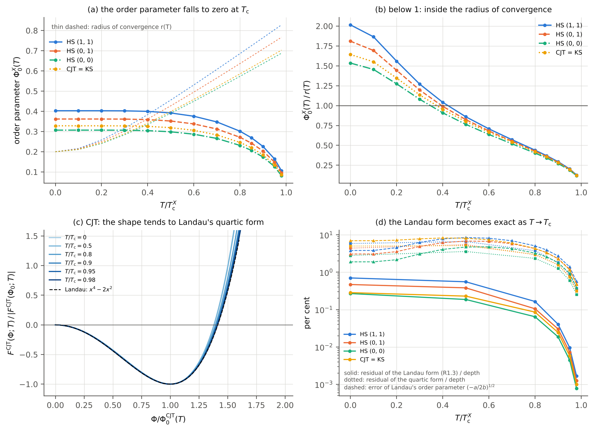
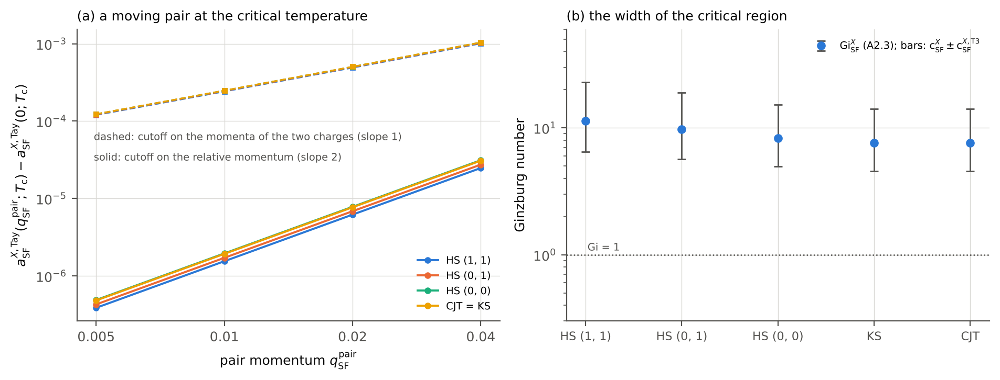
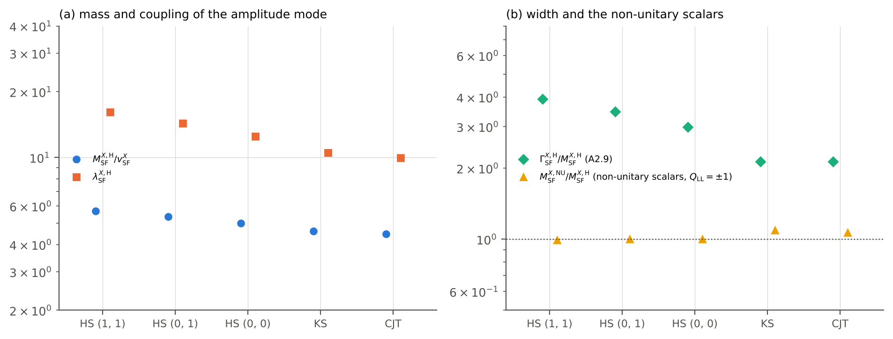

<!-- This file is generated from docs_src/P4_remarks.src.md by code/scripts/assemble_docs.py; edit the source. -->

# 1. What this document is

On 21 November 2026 the author gave a standing instruction (here in my words): every qualifying remark about a result
(that a result is an approximation, a fit, of a stated accuracy, or limited in some way) must be explained clearly,
with what it means, why it holds and why it matters; the answer must be saved, and it must be put into the documents
of the solution and into the Mathematica notebook `superfluid.nb`. This document keeps these answers, one section per
remark. Each section is complete in itself: it defines every symbol and every equation it uses, gives the numbers
(written by programs from the data files; no number of the tables is typed by hand), the cause, the importance, the
corrections of the first answer given to the author, and the provenance (programs, commands, checks, data files with
their SHA-256 checksums). Section 2 keeps remark R1 (the accuracy of the Landau form). Section 3 keeps the addendum A1
that the author asked for on the same day: the free energy of the five methods at finite temperature, and whether the
order parameter is then smaller and more physically reasonable; it is complete in itself in the same way. Section 4
keeps remark R2, made in the answer of Section 3 (the free energies of the methods are mean-field free energies).
Section 5 keeps the addendum A2 that the author asked for later on the same day: the gradient coefficient of the field at
the critical temperature and the width of the critical region (the Ginzburg number), whether the superfluid of each
method can play the role of the Higgs particle, and whether the Higgs is a composite particle, with the remarks R3 to R5
made in its answers.

# 2. Remark R1: "The Landau form is a fit; its largest residual is 0.27–0.7 % of the depth"

**Where the remark was made.** The author asked to be shown the three effective Lagrangians $\mathcal L^{\rm CJT}$,
$\mathcal L^{\rm HS}$, $\mathcal L^{\rm KS}$ of the superfluid (21 November 2026). Their potential parts were summarized by a
polynomial, with the remark above. The author then asked (1) to explain the remark clearly and completely and to discuss
why it is important, and (2) to define the "Landau form" and to give examples. Sections 2.1 to 2.7 are the answer.

## 2.1 The objects

**The spinor field and its states.** The spinor charges are described by an isodoublet of DiracLike fields (the
DiracLike spinor of the author: a Dirac spinor of $SL(2,\mathbb C)$ that has electric charge 0 and no electroweak quantum
numbers) with eight complex components (four Dirac components times two isospin components), of mass $m_{\rm LL}=0.2$, with the momenta
restricted to $\lvert\vec q_{\rm LL}\rvert<\Lambda_{\rm LL}=1$ (the units of the project). The free Hamiltonian matrix at the
momentum $\vec q_{\rm LL}$ is
$$\mathsf h_{\rm LL}(\vec q_{\rm LL})=\Big(\sum_{j=1}^3\alpha^j_{\rm LL}q_j+\beta_{\rm LL}m_{\rm LL}\Big)\otimes\mathsf 1_2,\qquad\alpha^j_{\rm LL}=\gamma^0_{\rm LL}\gamma^j_{\rm LL},\quad\beta_{\rm LL}=\gamma^0_{\rm LL},$$
with the Dirac matrices $\gamma^p_{\rm LL}$ ($p=0,\dots,3$) of the chiral basis, and $\mathsf 1_2$ the unit matrix of isospin. The
spin-zero pairs of two charges at one point are described by the three antisymmetric $8\times8$ matrices
$$\mathsf K^\iota_{\rm LL}=(\mathsf C_{\rm LL}\gamma^{\rm ch}_{\rm LL})\otimes(\mathsf E_{\rm LL}\tau^{\rm LL}_\iota),\qquad\iota=1,2,3,$$
with the charge-conjugation matrix $\mathsf C_{\rm LL}=i\gamma^2_{\rm LL}\gamma^0_{\rm LL}$, the chirality matrix
$\gamma^{\rm ch}_{\rm LL}=i\gamma^0_{\rm LL}\gamma^1_{\rm LL}\gamma^2_{\rm LL}\gamma^3_{\rm LL}$, the antisymmetric matrix $\mathsf E_{\rm LL}=i\tau^{\rm LL}_2$ and the
Pauli matrices $\tau^{\rm LL}_\iota$ of isospin.

**The uniform quasi-free states and the three methods.** A uniform state is described at every momentum by a normal
correlation matrix and a pair correlation matrix; it is the ground state of the matrix of Bogoliubov and de Gennes
$$\mathsf H_{\rm SF}(\vec q_{\rm LL})=\begin{pmatrix}\mathsf h_{\rm LL}(\vec q_{\rm LL})+\mathsf N_{\rm SF}&\mathsf P_{\rm SF}\\\mathsf P_{\rm SF}^\dagger&-(\mathsf h_{\rm LL}(-\vec q_{\rm LL})+\mathsf N_{\rm SF})^T\end{pmatrix}$$
with the normal self-energy $\mathsf N_{\rm SF}$ and the pair self-energy $\mathsf P_{\rm SF}$ (both $8\times8$, independent of the
momentum). The energy per volume of a state contains the contact interactions of the potential $V^{(2)}_{\rm SF}$ of the
solution, evaluated by one of three methods $X$: the method of Hubbard and Stratonovich (HS), with the shares
$s^{\rm HS,S}_{\rm SF}$ and $s^{\rm HS,V}_{\rm SF}$ of the scalar and of the vector term that are decoupled in the density channels
(computed for $(s^{\rm HS,S}_{\rm SF},s^{\rm HS,V}_{\rm SF})=(1,1),(0,1),(0,0)$); the method of Kohn and Sham (KS); and the method of
Cornwall, Jackiw and Tomboulis (CJT). The self-energies are the derivatives of the energy per volume with respect to the
correlation matrices.

**The field and the effective potential.** The field of the superfluid boson singlet state is the complex isospin
vector $\vec\Phi^X_{\rm SF}=(\Phi^{X,1}_{\rm SF},\Phi^{X,2}_{\rm SF},\Phi^{X,3}_{\rm SF})$ of the amplitudes of the pair self-energy that
method $X$ assigns to a state,
$$\mathsf P_{\rm SF}=\sum_{\iota=1}^3\Phi^{X,\iota}_{\rm SF}(\mathsf K^\iota_{\rm LL})^\dagger.\tag{R1.1}$$
The effective potential $\mathcal V^X_{\rm SF}(\vec\Phi)$ is the smallest energy per volume of method $X$ among the uniform states
whose field is $\vec\Phi$, measured from the normal vacuum (so $\mathcal V^X_{\rm SF}(0)=0$):
$$\mathcal V^X_{\rm SF}(\vec\Phi)=\min\{\mathcal E^X_{\rm SF}[\text{state}]-\mathcal E^X_{\rm SF}[\text{normal vacuum}]:\ \vec\Phi^X_{\rm SF}(\text{state})=\vec\Phi\}.\tag{R1.2}$$
It is computed point by point: a fixed pair self-energy $\Phi_{\rm a}(\mathsf K^3_{\rm LL})^\dagger$ (the applied field, of amplitude
$\Phi_{\rm a}$) is put into $\mathsf H_{\rm SF}$, the normal self-energy is made self-consistent, and the ground state of $\mathsf H_{\rm SF}$
gives one point: its own field $\vec\Phi=\Phi\vec e_3$ and its energy per volume. The program computes 61 points per
method, with $\Phi_{\rm a}$ from $0$ to $2\Phi^X_{0,{\rm SF}}$, each self-consistent to $10^{-13}$; the applied field
$\Phi^X_{0,{\rm SF}}$ gives back the ground state of method $X$ to $4\times10^{-14}$ (*check P3-1*). The **polar** fields are
$\vec\Phi=e^{i\vartheta}\Phi\,\vec n$ with a real phase $\vartheta$, a real unit vector $\vec n$ and $\Phi=\lvert\vec\Phi\rvert$; along them the
potential is a function of $\Phi$ alone. Its minimum lies at $\Phi=\Phi^X_{0,{\rm SF}}$ (the vacuum), and the **depth** is
$\lvert\mathcal V^X_{\rm SF}(\Phi^X_{0,{\rm SF}})\rvert$, the energy per volume by which the superfluid lies below the normal vacuum.
The second derivative of the polar curve at its minimum, computed from five states about it, is
$\mathcal V''_{\rm amp}$; it fixes the mass of the amplitude mode of the field,
$$(M^{X,{\rm H}}_{\rm SF})^2=\frac{\mathcal V''_{\rm amp}}{2(Z^X_{\rm SF}+Y^X_{\rm SF})},\tag{R1.6}$$
where $Z^X_{\rm SF}$ and $Y^X_{\rm SF}$ are the two coefficients of the kinetic part of the effective Lagrangian (they are
computed from the susceptibilities of the vacuum and do not depend on the potential).

## 2.2 The Landau form: definition and examples

**Definition.** A *Landau form* of a potential is its expansion in powers of the order parameter (the field that
vanishes in the symmetric state and not in the broken one) under two rules: only polynomial invariants of the symmetry
group occur, and the expansion stops after the lowest orders that bound the potential from below and produce its
minima. L. D. Landau introduced it for phase transitions (1937): near a continuous transition the order parameter is
small, the free energy is assumed to be analytic in it, and the form is its Taylor expansion, whose coefficients (the
Landau coefficients) are derivatives at the symmetric state; the quadratic coefficient changes its sign at the
transition, and the signs of the higher coefficients decide the order of the transition and which broken state is the
minimum.

**Examples.**

* A uniaxial ferromagnet: $F_{\rm mag}=a_{\rm mag}m_{\rm mag}^2+b_{\rm mag}m_{\rm mag}^4$ for the magnetization $m_{\rm mag}$ (the symmetry
  $m_{\rm mag}\to-m_{\rm mag}$), with $a_{\rm mag}$ proportional to the temperature minus the Curie temperature and $b_{\rm mag}>0$;
  below the Curie temperature the minima are $m_{\rm mag}=\pm(-a_{\rm mag}/(2b_{\rm mag}))^{1/2}$.
* The theory of superconductivity of V. L. Ginzburg and L. D. Landau (1950): $\alpha_{\rm GL}\lvert\psi_{\rm GL}\rvert^2+\tfrac12\beta_{\rm GL}\lvert\psi_{\rm GL}\rvert^4$
  for the complex pair wave function $\psi_{\rm GL}$ (the symmetry $U(1)$), to which the gradient terms and the magnetic
  field are added. L. P. Gor'kov (1959) derived it from the theory of Bardeen, Cooper and Schrieffer near the critical
  temperature, where $\lvert\psi_{\rm GL}\rvert$ is small; there the coefficients are true Taylor coefficients.
* The Higgs potential of the Standard Model, $-(\mu^{\rm SM})^2(\Phi^{\rm SM})^\dagger\Phi^{\rm SM}+\lambda^{\rm SM}((\Phi^{\rm SM})^\dagger\Phi^{\rm SM})^2$
  for the Higgs doublet $\Phi^{\rm SM}$: the doublet has the single invariant $(\Phi^{\rm SM})^\dagger\Phi^{\rm SM}$ of degree 2, and this
  Landau form is exact at tree level, not a truncation.
* The Bose-Einstein condensates of spin 1 (T.-L. Ho, 1998; T. Ohmi and K. Machida, 1998), the closest analogue of the
  field $\vec\Phi$: their order parameter is a complex vector $\vec\varpi$, and their energy per volume
  $\tfrac12c_{\rm n}\lvert\vec\varpi\rvert^4+\tfrac12c_{\rm s}(\lvert\vec\varpi\rvert^4-\lvert\vec\varpi\cdot\vec\varpi\rvert^2)$ contains the same two quartic
  invariants as $\vec\Phi$, the second term being the square of the spin. $c_{\rm s}>0$ (sodium-23) favors the polar state,
  $c_{\rm s}<0$ (rubidium-87) the ferromagnetic state $\vec\varpi\propto(1,i,0)$.
* The ferroelectric barium titanate (A. F. Devonshire, 1949): $\alpha_{\rm D}P_{\rm D}^2+\beta_{\rm D}P_{\rm D}^4+\gamma_{\rm D}P_{\rm D}^6$ for the
  polarization $P_{\rm D}$, with $\beta_{\rm D}<0$ and $\gamma_{\rm D}>0$: the sixth power is required, and the transition is of
  first order.
* Superfluid helium-3 (A. J. Leggett, 1975): one quadratic and five quartic invariants of a complex $3\times3$ matrix, whose
  five coefficients decide between the phases A and B.
* The nematic liquid crystals (P. G. de Gennes, 1971): the traceless symmetric tensor of the nematic order admits an
  invariant of the third degree, so the transition is of first order.

The name has nothing to do with the Landau levels of a charge in a magnetic field (the same physicist, another
subject).

**The Landau form of the field $\vec\Phi$.** The symmetry is $SU(2)_{\rm v}\times U(1)^{\rm F}_{\rm LL}$: the isospin rotations turn
$\vec\Phi$ as a vector, and the fermion number multiplies it by a phase. The independent invariants up to the fourth
degree are $\lvert\vec\Phi\rvert^2$, $\lvert\vec\Phi\rvert^4$ and $\lvert\vec\Phi\cdot\vec\Phi\rvert^2$, and
$\lvert\vec\Phi\rvert^4-\lvert\vec\Phi\cdot\vec\Phi\rvert^2=\lvert\vec\Phi\times\vec\Phi^*\rvert^2$ vanishes exactly on the polar fields. The Landau
form used by the solution is
$$\mathcal V^X_{\rm SF}\approx a^X_{\rm SF}\lvert\vec\Phi\rvert^2+b^X_{\rm SF}\lvert\vec\Phi\rvert^4+c^X_{\rm SF}\lvert\vec\Phi\rvert^6+u^X_{\rm SF}\big(\lvert\vec\Phi\rvert^4-\lvert\vec\Phi\cdot\vec\Phi\rvert^2\big).\tag{R1.3}$$
Along the polar fields it is the polynomial $\mathcal V_{\rm L}(\Phi)=a^X_{\rm SF}\Phi^2+b^X_{\rm SF}\Phi^4+c^X_{\rm SF}\Phi^6$. The coefficient
$u^X_{\rm SF}$ is not fitted: it is computed from the second derivative of $\mathcal V^X_{\rm SF}$ in a non-unitary direction at the
minimum, and $u^X_{\rm SF}>0$ in every method, so the polar minimum is a minimum also in the non-unitary directions (the
sodium case of the condensates of spin 1).

## 2.3 What the remark says: the fit and its residual

**"The Landau form is a fit."** The coefficients $a^X_{\rm SF}$, $b^X_{\rm SF}$, $c^X_{\rm SF}$ are not derived from the theory. They
minimize the sum of the squares of the residuals $\mathcal V_{\rm L}(\Phi_i)-\mathcal V^X_{\rm SF}(\Phi_i)$ over the computed points
$\Phi_i\le1.4\Phi^X_{0,{\rm SF}}$ of the polar curve (47 to 51 points per method). (R1.3) is therefore a summary of the computed
function, neither an exact formula nor a derived expansion.

**"Its largest residual is 0.27–0.7 % of the depth."** The largest residual $\max_i\lvert\mathcal V_{\rm L}(\Phi_i)-\mathcal V^X_{\rm SF}(\Phi_i)\rvert$,
divided by the depth, is $0.27$ per cent (HS (0, 0)) to $0.70$ per cent (HS (1, 1)) (row 8 of Table R1). Since the computed points are accurate to
$4\times10^{-14}$, every deviation of (R1.3) from them is an error of the form, not of the computation. Figure R1 (left) shows
the residual along the fitted interval: it changes its sign $3$ times (four arcs of alternating sign), it is
largest at the upper end ($\Phi\approx1.39\Phi^X_{0,{\rm SF}}$), and at the minimum it is $0.11$ per cent (HS (0, 0)) to $0.31$ per cent (HS (1, 1)) of the depth. Such an
oscillation about the curve is the mark of a polynomial that approximates a function which is not a polynomial; it is
not numerical noise.

{width=100%}

**Figure R1.** The accuracy of the Landau form. Left: the residual $\mathcal V_{\rm L}(\Phi)-\mathcal V^X_{\rm SF}(\Phi)$ of (R1.3) along the
polar fields at the computed points of the fitted interval, relative to the depth (KS and CJT coincide along the polar
fields; the figure shows one curve for both). Right: the largest residual of the least-squares fits
$\sum_{k=1}^Kc_k\Phi^{2k}$ against the highest power $2K$; $2K=4$ is the quartic form of the Standard Model, $2K=6$ is (R1.3).
Data: `data/part3_landau_residuals.csv`, `data/part3_landau.csv`.

## 2.4 Why no polynomial can be exact: the cause

**The pair field enters the quasi-particle energies like a mass.** For the applied pair self-energy
$\Phi_{\rm a}(\mathsf K^3_{\rm LL})^\dagger$ and a normal self-energy that is a Dirac mass, $\mathsf N_{\rm SF}=(M^{X,{\rm D}}_{\rm SF}-m_{\rm LL})\beta_{\rm LL}\otimes\mathsf 1_2$,
the eigenvalues of $\mathsf H_{\rm SF}(\vec q_{\rm LL})$ are
$$\pm E(\vec q_{\rm LL}),\qquad E(\vec q_{\rm LL})=\big(\lvert\vec q_{\rm LL}\rvert^2+(M^{X,{\rm D}}_{\rm SF})^2+\Phi_{\rm a}^2\big)^{1/2},\quad\text{each eight times}\tag{R1.4}$$
(*checks P3-8 and YP3-8*, at 20 random momenta, masses and fields), and along the whole polar curve the normal
self-energy is such a Dirac mass (*checks P3-9 and YP3-9*). The pair field $\Phi_{\rm a}$ adds to the square of the mass.

**A logarithm.** The energy per volume is an integral over the momenta $q=\lvert\vec q_{\rm LL}\rvert<\Lambda_{\rm LL}$ of functions of
$(q^2+s)^{1/2}$ with $s=(M^{X,{\rm D}}_{\rm SF})^2+\Phi_{\rm a}^2$. For example,
$$\int_0^{\Lambda_{\rm LL}}q^2(q^2+s)^{1/2}\,dq=\frac{\Lambda_{\rm LL}(2\Lambda_{\rm LL}^2+s)(\Lambda_{\rm LL}^2+s)^{1/2}}8-\frac{s^2}8\ln\frac{\Lambda_{\rm LL}+(\Lambda_{\rm LL}^2+s)^{1/2}}{s^{1/2}},\tag{R1.5}$$
which contains the term $\tfrac1{16}s^2\ln s$; it is not analytic at $s=0$, that is, at $\Phi_{\rm a}^2=-(M^{X,{\rm D}}_{\rm SF})^2$. Hence
$\mathcal V^X_{\rm SF}$ is not a polynomial in $\lvert\vec\Phi\rvert^2$, and no polynomial of finite degree reproduces it exactly.

**The Taylor series converges only near the origin.** A series of powers of $\lvert\vec\Phi\rvert^2$ about the origin can
converge only within a radius of the order of the Dirac mass (the singularity lies at $\Phi_{\rm a}^2=-(M^{X,{\rm D}}_{\rm SF})^2$, and
$M^{X,{\rm D}}_{\rm SF}=m_{\rm LL}=0.2$ at the origin), while $\Phi^X_{0,{\rm SF}}=0.31$ to $0.40$ and the fitted interval reaches $0.42$ to
$0.56$. The superfluid is therefore far from the regime of Landau's theory, in which the order parameter is small and
the Landau coefficients are Taylor coefficients. (R1.3) has the Landau form, but its coefficients are least-squares
numbers.

**More powers, smaller residual.** The least-squares fits $\sum_{k=1}^Kc_k\Phi^{2k}$ on the same points reduce the largest
residual to $0.0044$ per cent (HS (0, 0)) to $0.038$ per cent (HS (1, 1)) of the depth with the powers to $\Phi^8$ ($K=4$) and to $4.3\times10^{-5}$ per cent (KS, CJT) to $0.00067$ per cent (HS (1, 1)) with the powers to
$\Phi^{12}$ ($K=6$) (rows 9 to 11 of Table R1, Figure R1 right): the residual of (R1.3) is the truncation of a series. The
quartic form $a\Phi^2+b\Phi^4$, the form of the Higgs potential of the Standard Model, misses by $2.8$ per cent (HS (0, 0)) to $5.9$ per cent (HS (1, 1)).

## 2.5 Why it matters

1. **It enters no other result.** The effective Lagrangians of the solution contain the computed function
   $\mathcal V^X_{\rm SF}$, not (R1.3), and no other result uses $a^X_{\rm SF}$, $b^X_{\rm SF}$, $c^X_{\rm SF}$: the mass of the amplitude mode
   (R1.6) uses the curvature $\mathcal V''_{\rm amp}$ of the computed curve; $u^X_{\rm SF}$ and the mass of the non-unitary modes use
   the computed curvature in the non-unitary direction; the masses of the gauge bosons and the dynamics use
   $\Phi^X_{0,{\rm SF}}$, $Z^X_{\rm SF}$, $Y^X_{\rm SF}$ and the susceptibilities. This was verified by searching the programs.
2. **It matters to whoever replaces $\mathcal V^X_{\rm SF}$ by (R1.3)**, as in a model of the type of Ginzburg and Landau or of
   Higgs. The errors are those of rows 1 to 4 of Table R1: the minimum $\Phi_{\rm L}$ of the polynomial is
   $0.041$ per cent (KS, CJT) to $0.11$ per cent (HS (1, 1)) too small; its depth is $0.12$ per cent (HS (0, 0)) to $0.31$ per cent (HS (1, 1)) too large; its curvature at its minimum is $0.86$ per cent (HS (0, 0)) to $2.3$ per cent (HS (1, 1))
   too large; and the mass of the amplitude mode by (R1.6) is $0.43$ per cent (HS (0, 0)) to $1.1$ per cent (HS (1, 1)) too large. A derivative enlarges the relative
   error of the function: a residual of a few tenths of a per cent of the depth becomes an error of one to two per cent
   of the curvature. Beyond the fitted interval the error grows: fitted on the whole computed curve (up to
   $\Phi_{\max}=$ $1.52$ to $1.64$ times $\Phi^X_{0,{\rm SF}}$), (R1.3) misses by $1.2$ per cent (HS (0, 0)) to $1.7$ per cent (HS (1, 1)) of the depth (row 17).
3. **The coefficients are not constants of the theory.** $a^X_{\rm SF}$ differs by $0.68$ per cent (KS, CJT) to $2.0$ per cent (HS (1, 1)) from the Taylor coefficient
   $a^{X,{\rm Tay}}_{\rm SF}$ of $\lvert\vec\Phi\rvert^2$ at the origin (rows 5 and 6). $a^{X,{\rm Tay}}_{\rm SF}$ is computed directly from three
   states with the small applied fields $\Phi_{\rm a}=0.004$, $0.008$, $0.016$: the quotient $f=\mathcal V^X_{\rm SF}/\Phi^2$ equals
   $a^{X,{\rm Tay}}_{\rm SF}+f_2\Phi^2+O(\Phi^4)$ with an unknown $f_2$, and two of the points eliminate $f_2$ (Richardson); the two pairs
   agree to $8\times10^{-8}$ (*check P3-10*), and the Python program finds the same value to $4\times10^{-11}$ (*check YP3-10*).
   $b^X_{\rm SF}$ and $c^X_{\rm SF}$ change with the fitted interval and with the number of powers: for CJT, $10^3c^{\rm CJT}_{\rm SF}$ is
   $16.34$, $19.94$ and $23.62$ when (R1.3) is fitted on $[0,\Phi^X_{0,{\rm SF}}]$, on $[0,1.4\Phi^X_{0,{\rm SF}}]$ and on the whole computed curve,
   and $11.61$ when the power $\Phi^8$ is added (rows 13 to 15 and 18). No physical meaning may be given to
   $b^X_{\rm SF}$ or $c^X_{\rm SF}$ alone, and methods may be compared through them only within the accuracy of the fit. The
   physical quantities are those that the computed function defines: $\Phi^X_{0,{\rm SF}}$, the depth, the curvatures at the
   minimum, and $a^{X,{\rm Tay}}_{\rm SF}$.
4. **The qualitative results do not depend on the fit.** That $\mathcal V^X_{\rm SF}$ vanishes at the origin, is negative near it,
   has its minimum at $\Phi^X_{0,{\rm SF}}$, depends only on the two invariants, and has a stable polar minimum
   ($u^X_{\rm SF}>0$) are properties of the computed function, checked on it directly. The sign of $a^X_{\rm SF}$ is that of
   $a^{X,{\rm Tay}}_{\rm SF}$ (negative: the normal vacuum is unstable).
5. **The comparison with the Standard Model.** The field has a Mexican hat with the symmetry structure of the Higgs
   sector and of the polar phase of a condensate of spin 1, but its potential is not the quartic potential of the
   Standard Model: the quartic form misses $\mathcal V^X_{\rm SF}$ by $2.8$ per cent (HS (0, 0)) to $5.9$ per cent (HS (1, 1)) of the depth, about ten times more than
   (R1.3).

## 2.6 The numbers

| quantity | HS (1, 1) | HS (0, 1) | HS (0, 0) | KS | CJT |
|:-----------------------------|-------:|-------:|-------:|-------:|-------:|
| minimum of (R1.3): $\Phi_{\rm L}/\Phi^X_{0,{\rm SF}}-1$ | $-0.11$ | $-0.090$ | $-0.066$ | $-0.041$ | $-0.041$ |
| depth of (R1.3): $\mathcal V_{\rm L}(\Phi_{\rm L})/\mathcal V^X_{\rm SF}(\Phi^X_{0,{\rm SF}})-1$ | $0.31$ | $0.21$ | $0.12$ | $0.12$ | $0.12$ |
| curvature of (R1.3) at its minimum: $\mathcal V_{\rm L}''(\Phi_{\rm L})/\mathcal V''_{\rm amp}-1$ | $2.3$ | $1.5$ | $0.86$ | $0.91$ | $0.91$ |
| $M^{X,{\rm H}}_{\rm SF}$ from (R1.3), relative error | $1.1$ | $0.75$ | $0.43$ | $0.45$ | $0.45$ |
| $10^3a^{X,{\rm Tay}}_{\rm SF}$ (Taylor coefficient at the origin) | $-6.16243$ | $-5.35342$ | $-4.29666$ | $-4.29666$ | $-4.29666$ |
| $a^X_{\rm SF}/a^{X,{\rm Tay}}_{\rm SF}-1$ | $-2.0$ | $-1.4$ | $-0.81$ | $-0.68$ | $-0.68$ |
| largest residual / depth, powers to $\Phi^4$ (quartic) | $5.9$ | $4.4$ | $2.8$ | $5.0$ | $5.0$ |
| the same, powers to $\Phi^6$: (R1.3) | $0.70$ | $0.47$ | $0.27$ | $0.28$ | $0.28$ |
| the same, powers to $\Phi^8$ | $0.038$ | $0.012$ | $0.0044$ | $0.021$ | $0.021$ |
| the same, powers to $\Phi^{10}$ | $0.0099$ | $0.0053$ | $0.0025$ | $0.0015$ | $0.0015$ |
| the same, powers to $\Phi^{12}$ | $0.00067$ | $0.00052$ | $0.00032$ | $4.3\times10^{-5}$ | $4.3\times10^{-5}$ |
| sign changes of the residual of (R1.3) | $3$ | $3$ | $3$ | $3$ | $3$ |
| $10^3c^X_{\rm SF}$, (R1.3) fitted on $[0,\Phi^X_{0,{\rm SF}}]$ | $8.048$ | $8.524$ | $8.450$ | $16.34$ | $16.34$ |
| $10^3c^X_{\rm SF}$, fitted on $[0,1.4\Phi^X_{0,{\rm SF}}]$ | $14.36$ | $14.40$ | $14.00$ | $19.94$ | $19.94$ |
| $10^3c^X_{\rm SF}$, fitted on the whole curve | $17.67$ | $18.42$ | $18.70$ | $23.62$ | $23.62$ |
| end of the whole curve: $\Phi_{\max}/\Phi^X_{0,{\rm SF}}$ | $1.52$ | $1.57$ | $1.64$ | $1.61$ | $1.61$ |
| largest residual / depth on the whole curve | $1.7$ | $1.5$ | $1.2$ | $1.3$ | $1.3$ |
| $10^3c$ of the fit with powers to $\Phi^8$ | $0.6157$ | $1.975$ | $2.736$ | $11.61$ | $11.61$ |

**Table R1.** The accuracy of the Landau form (R1.3), for the five methods. Rows 1 to 4: what the polynomial
$\mathcal V_{\rm L}$ gets wrong at its minimum $\Phi_{\rm L}$ (the position, the depth and the curvature $\mathcal V_{\rm L}''(\Phi_{\rm L})$, compared
with $\Phi^X_{0,{\rm SF}}$, the depth and $\mathcal V''_{\rm amp}$ of the computed curve, and the resulting error of $M^{X,{\rm H}}_{\rm SF}$ by
(R1.6)). Rows 5, 6: the Taylor coefficient of $\lvert\vec\Phi\rvert^2$ at the origin and the deviation of the fitted $a^X_{\rm SF}$
from it. Rows 7 to 11: the largest residual of the least-squares fits with the powers $\Phi^2,\dots,\Phi^{2K}$, $K=2$ to $6$,
relative to the depth. Row 12: the sign changes of the residual of (R1.3). Rows 13 to 17: $c^X_{\rm SF}$ fitted on three
intervals, the end $\Phi_{\max}$ of the computed curve, and the largest residual of the fit on the whole curve. Row 18:
the coefficient of $\Phi^6$ of the fit with the powers to $\Phi^8$. Rows 1 to 4, 6 to 11 and 17 in per cent. The symbols of
the table: $\mathcal V''_{\rm amp}$ (the curvature of the computed polar curve at its minimum, Section 2.1); $a^{X,{\rm Tay}}_{\rm SF}$
(the Taylor coefficient, item 3 of Section 2.5); $\Phi_{\max}$ (the largest field of the computed curve). Data:
`data/part3_landau.csv`, `data/part3_values.csv`.

## 2.7 Corrections of the first answers

The first answers to the author (21 November 2026) contained five statements that were not exact; the numbers above are
the corrected ones, computed by the programs of Section 2.8.

1. *"The residual changes sign five times."* It changes sign three times (row 12 of Table R1). The number had been read
   from a list of every third residual without counting.
2. *"A fit on $[0,2\Phi_0]$ has residuals of 1.2–1.7 %."* That fit used all 61 computed points; the applied field reaches
   $2\Phi^X_{0,{\rm SF}}$, but the field of the states reaches only $1.52$ to $1.64$ times $\Phi^X_{0,{\rm SF}}$ (row 16). The correct
   statement: a fit on the whole computed curve has residuals of $1.2$ per cent (HS (0, 0)) to $1.7$ per cent (HS (1, 1)) of the depth.
3. *"The field of the states reaches only 1.52–1.61 $\Phi_0$"* (in the first correction of item 2): the range is
   $1.52$ to $1.64$ (HS $(0,0)$ reaches $1.64$).
4. *"The power series converges only for $\lvert\Phi\rvert<M$."* The singularity lies at $\Phi_{\rm a}^2=-(M^{X,{\rm D}}_{\rm SF})^2$ in the
   applied field; in the field $\Phi$ of the states the radius of convergence is of the order of the Dirac mass, not
   exactly equal to it.
5. *"The curvature at the minimum is 1.1–2.7 % too large, and $M^{X,{\rm H}}_{\rm SF}$ 0.5–1.3 %."* Those numbers are the curvature of
   the polynomial at the minimum $\Phi^X_{0,{\rm SF}}$ of the computed curve. A user of (R1.3) evaluates the polynomial at its own
   minimum $\Phi_{\rm L}$, where the errors are $0.86$ per cent (HS (0, 0)) to $2.3$ per cent (HS (1, 1)) and $0.43$ per cent (HS (0, 0)) to $1.1$ per cent (HS (1, 1)) (rows 3 and 4); the table gives these.

## 2.8 Provenance

**Programs.** The Rust program `sf_part3` (crate `rust/sfpart3`) computes the polar curves (module `effpot`) and the
accuracy of the Landau form (module `landau`: the least squares by Householder reflections on scaled columns, the
minimum of the polynomial, the fits with $K=2$ to $6$ and on three intervals, the sign changes, the Taylor coefficient
by Richardson, and the checks P3-8 to P3-11). The Python program `python/sf_part3.py` repeats the checks with its own
engine and with LAPACK (YP3-8 to YP3-10) and recomputes every number of Table R1 from the data files with the
singular-value decomposition of numpy (YP3-11). `python/sf_part3_figures.py` draws Figure R1, and
`code/scripts/write_part3_fragments.py` writes Table R1 and every number of this section from the data files. The
notebook `superfluid.nb` repeats the computation of Table R1 in the Wolfram language from the same polar curves.

**Commands** (from the folder `Revision_HS_CJT_and_Kohn-Sham`):

    (cd rust && cargo build --release && ./target/release/sf_part3)
    (cd python && python3 sf_part3.py)
    python3 python/sf_part3_figures.py
    python3 code/scripts/write_part3_fragments.py
    python3 code/scripts/assemble_docs.py docs_src/P4_remarks.src.md
    bash code/scripts/build_docs.sh provenance/P4_remarks.md

**The checks** (from the reports `data/hck_part3_checks.txt` and `data/hck_part3_checks_python.txt`; the deviations of
P3-10 are relative differences, those of YP3-10 and YP3-11 relative differences from the Rust values):

| check | result | deviation | tolerance | statement |
|:---|:---|---:|---:|:-----------|
| P3-8 | PASS | $2.44\times10^{-15}$ | $1\times10^{-13}$ | the pair field enters the quasi-particle energies like a mass, (R1.4): the BdG matrix with N = (M - m) beta (x) 1\_2 and P = Phi\_a (K\^3)\^dag has the eigenvalues -+(q\^2 + M\^2 + Phi\_a\^2)\^(1/2), eight times each (20 random q, M, Phi\_a) |
| P3-9 HS_1_1 | PASS | $2.03\times10^{-17}$ | $1\times10^{-12}$ | HS\_1\_1: along the polar curve the normal self-energy of every state is a Dirac mass, so the quasi-particle energies are (R1.4) (largest deviation from a multiple of beta (x) 1\_2) |
| P3-11 HS_1_1 | PASS | $1.1\times10^{-14}$ | $1\times10^{-9}$ | HS\_1\_1: the least squares of (R1.3) by Householder reflections give the coefficients of the normal equations (sum of the relative differences of a, b, c) |
| P3-10 HS_1_1 | PASS | $8.79\times10^{-9}$ | $1\times10^{-6}$ | HS\_1\_1: the coefficient of Phi\^2 of the Taylor series at the origin, a\^Tay = -6.1624310941e-3, by Richardson from the fields 0.004, 0.008 and from 0.008, 0.016 (relative difference; the fit (R1.3) has a = -6.0408804409e-3) |
| P3-9 HS_0_1 | PASS | $2.27\times10^{-17}$ | $1\times10^{-12}$ | HS\_0\_1: along the polar curve the normal self-energy of every state is a Dirac mass, so the quasi-particle energies are (R1.4) (largest deviation from a multiple of beta (x) 1\_2) |
| P3-11 HS_0_1 | PASS | $5.62\times10^{-13}$ | $1\times10^{-9}$ | HS\_0\_1: the least squares of (R1.3) by Householder reflections give the coefficients of the normal equations (sum of the relative differences of a, b, c) |
| P3-10 HS_0_1 | PASS | $5.42\times10^{-9}$ | $1\times10^{-6}$ | HS\_0\_1: the coefficient of Phi\^2 of the Taylor series at the origin, a\^Tay = -5.3534198133e-3, by Richardson from the fields 0.004, 0.008 and from 0.008, 0.016 (relative difference; the fit (R1.3) has a = -5.2811441242e-3) |
| P3-9 HS_0_0 | PASS | $0$ | $1\times10^{-12}$ | HS\_0\_0: along the polar curve the normal self-energy of every state is a Dirac mass, so the quasi-particle energies are (R1.4) (largest deviation from a multiple of beta (x) 1\_2) |
| P3-11 HS_0_0 | PASS | $8.61\times10^{-13}$ | $1\times10^{-9}$ | HS\_0\_0: the least squares of (R1.3) by Householder reflections give the coefficients of the normal equations (sum of the relative differences of a, b, c) |
| P3-10 HS_0_0 | PASS | $7.21\times10^{-9}$ | $1\times10^{-6}$ | HS\_0\_0: the coefficient of Phi\^2 of the Taylor series at the origin, a\^Tay = -4.2966587316e-3, by Richardson from the fields 0.004, 0.008 and from 0.008, 0.016 (relative difference; the fit (R1.3) has a = -4.2619672631e-3) |
| P3-9 KS | PASS | $2.22\times10^{-16}$ | $1\times10^{-12}$ | KS: along the polar curve the normal self-energy of every state is a Dirac mass, so the quasi-particle energies are (R1.4) (largest deviation from a multiple of beta (x) 1\_2) |
| P3-11 KS | PASS | $7.5\times10^{-13}$ | $1\times10^{-9}$ | KS: the least squares of (R1.3) by Householder reflections give the coefficients of the normal equations (sum of the relative differences of a, b, c) |
| P3-10 KS | PASS | $7.43\times10^{-8}$ | $1\times10^{-6}$ | KS: the coefficient of Phi\^2 of the Taylor series at the origin, a\^Tay = -4.2966587553e-3, by Richardson from the fields 0.004, 0.008 and from 0.008, 0.016 (relative difference; the fit (R1.3) has a = -4.2674033395e-3) |
| P3-9 CJT | PASS | $3.32\times10^{-16}$ | $1\times10^{-12}$ | CJT: along the polar curve the normal self-energy of every state is a Dirac mass, so the quasi-particle energies are (R1.4) (largest deviation from a multiple of beta (x) 1\_2) |
| P3-11 CJT | PASS | $2.94\times10^{-13}$ | $1\times10^{-9}$ | CJT: the least squares of (R1.3) by Householder reflections give the coefficients of the normal equations (sum of the relative differences of a, b, c) |
| P3-10 CJT | PASS | $7.43\times10^{-8}$ | $1\times10^{-6}$ | CJT: the coefficient of Phi\^2 of the Taylor series at the origin, a\^Tay = -4.2966587554e-3, by Richardson from the fields 0.004, 0.008 and from 0.008, 0.016 (relative difference; the fit (R1.3) has a = -4.2674033395e-3) |
| YP3-8 | PASS | $1.33\times10^{-15}$ | $1\times10^{-13}$ | the quasi-particle energies (R1.4) for an applied pair field and a Dirac mass: -+(q\^2 + M\^2 + Phi\_a\^2)\^(1/2), eight times each (LAPACK, 20 random q, M, Phi\_a) |
| YP3-11 HS_1_1 | PASS | $9.62\times10^{-12}$ | $1\times10^{-7}$ | HS\_1\_1: the accuracy of the Landau form recomputed from data/part3\_effpot\_HS\_1\_1.csv with numpy (SVD): the minimum, depth and curvature of (R1.3), the residuals of the fits with Phi\^2 .. Phi\^(2K), K = 2 .. 6, the fits on three intervals and the sign changes = Rust (largest relative difference) |
| YP3-11 HS_0_1 | PASS | $1.48\times10^{-11}$ | $1\times10^{-7}$ | HS\_0\_1: the accuracy of the Landau form recomputed from data/part3\_effpot\_HS\_0\_1.csv with numpy (SVD): the minimum, depth and curvature of (R1.3), the residuals of the fits with Phi\^2 .. Phi\^(2K), K = 2 .. 6, the fits on three intervals and the sign changes = Rust (largest relative difference) |
| YP3-11 HS_0_0 | PASS | $5.7\times10^{-11}$ | $1\times10^{-7}$ | HS\_0\_0: the accuracy of the Landau form recomputed from data/part3\_effpot\_HS\_0\_0.csv with numpy (SVD): the minimum, depth and curvature of (R1.3), the residuals of the fits with Phi\^2 .. Phi\^(2K), K = 2 .. 6, the fits on three intervals and the sign changes = Rust (largest relative difference) |
| YP3-11 KS | PASS | $3.1\times10^{-9}$ | $1\times10^{-7}$ | KS: the accuracy of the Landau form recomputed from data/part3\_effpot\_KS.csv with numpy (SVD): the minimum, depth and curvature of (R1.3), the residuals of the fits with Phi\^2 .. Phi\^(2K), K = 2 .. 6, the fits on three intervals and the sign changes = Rust (largest relative difference) |
| YP3-11 CJT | PASS | $1.22\times10^{-9}$ | $1\times10^{-7}$ | CJT: the accuracy of the Landau form recomputed from data/part3\_effpot\_CJT.csv with numpy (SVD): the minimum, depth and curvature of (R1.3), the residuals of the fits with Phi\^2 .. Phi\^(2K), K = 2 .. 6, the fits on three intervals and the sign changes = Rust (largest relative difference) |
| YP3-9 HS_1_1 | PASS | $8.92\times10^{-18}$ | $1\times10^{-12}$ | HS\_1\_1: the normal self-energy of the states with the applied fields 0.5, 1, 1.5, 2 Phi0 is a Dirac mass (largest deviation from a multiple of beta (x) 1\_2) |
| YP3-10 HS_1_1 | PASS | $3.07\times10^{-11}$ | $1\times10^{-8}$ | HS\_1\_1: the coefficient of Phi\^2 of the Taylor series of the effective potential at the origin a\^Tay = -6.1624310943e-03 = Rust (relative; the Richardson values from 0.004, 0.008 and from 0.008, 0.016 differ by 8.8e-09) |
| YP3-9 CJT | PASS | $8.56\times10^{-17}$ | $1\times10^{-12}$ | CJT: the normal self-energy of the states with the applied fields 0.5, 1, 1.5, 2 Phi0 is a Dirac mass (largest deviation from a multiple of beta (x) 1\_2) |
| YP3-10 CJT | PASS | $2.87\times10^{-12}$ | $1\times10^{-8}$ | CJT: the coefficient of Phi\^2 of the Taylor series of the effective potential at the origin a\^Tay = -4.2966587554e-03 = Rust (relative; the Richardson values from 0.004, 0.008 and from 0.008, 0.016 differ by 7.4e-08) |

**Data files and figure** (SHA-256 checksums; the figure program writes its PDF files without their creation date, so
that a rerun reproduces these checksums):

* `data/part3_effpot_HS_1_1.csv`, `data/part3_effpot_HS_0_1.csv`, `data/part3_effpot_HS_0_0.csv`, `data/part3_effpot_KS.csv`,
  `data/part3_effpot_CJT.csv` (the polar curves):\
  `adec9b41732d6e022c680889612a4f56a4610a52765d36d44a1ae76de2e2dc5c`\
  `d2a263df26a3949391ed3cf24626c1116b9fd794c00a81dcdbfb156a85b8fce7`\
  `b0439dd3ee1bd3a71d6851e4389af27a480fed96707ec6e46c06ae19be0700bc`\
  `96e7485937c714b51f0df37fa06661a407e204cde4156caef7e5274ac29f49d0`\
  `32c3fb53937001c51a23a33b2790112e0970043d8b33f08473d277be1bb9954c`
* `data/part3_values.csv` (all numbers of Part III, among them those of Table R1):\
  `ddd902b2a676351f6903cd034bd788d9d1183377e829b51c84bcfe847a4e2752`
* `data/part3_landau.csv` (Table R1, Figure R1 right):\
  `f2b56e0925e8494c23b4365ab6b91747ccc34bd3c7f3774d8a3817d4685be089`
* `data/part3_landau_residuals.csv` (Figure R1 left):\
  `11a6001a3ffc86e0d2d0dadbdeb4ebcb223ff15f5634e16121130b67ee3b382f`
* `figures/fig_p4_r1_landau.pdf` (Figure R1):\
  `5e0552b995385bb2715d72933bdbd2ade69857c4255c7eb22d8142d1b0acc7ce`

**References.** L. D. Landau, On the theory of phase transitions, Zhurnal Eksperimental'noi i Teoreticheskoi Fiziki 7,
19 (1937); V. L. Ginzburg and L. D. Landau, On the theory of superconductivity, Zhurnal Eksperimental'noi i
Teoreticheskoi Fiziki 20, 1064 (1950); L. P. Gor'kov, Microscopic derivation of the Ginzburg-Landau equations in the
theory of superconductivity, Soviet Physics JETP 9, 1364 (1959); A. F. Devonshire, Theory of barium titanate, Part I,
Philosophical Magazine 40, 1040 (1949); T.-L. Ho, Spinor Bose condensates in optical traps, Physical Review Letters 81,
742 (1998); T. Ohmi and K. Machida, Bose-Einstein condensation with internal degrees of freedom in alkali atom gases,
Journal of the Physical Society of Japan 67, 1822 (1998); A. J. Leggett, A theoretical description of the new phases of
liquid $^3$He, Reviews of Modern Physics 47, 331 (1975); P. G. de Gennes, Short range order effects in the isotropic
phase of nematics and cholesterics, Molecular Crystals and Liquid Crystals 12, 193 (1971); A. S. Householder, Unitary
triangularization of a nonsymmetric matrix, Journal of the ACM 5, 339 (1958); L. F. Richardson, The approximate
arithmetical solution by finite differences of physical problems involving differential equations, Philosophical
Transactions of the Royal Society A 210, 307 (1911).

# 3. Addendum A1: the free energy of the five methods, and the size of the order parameter

**The request.** On 21 November 2026 the author asked (here in my words) to add to the analysis and the solution: the
effective potential of each of the five computed methods $X$ (HS $(1,1)$, HS $(0,1)$, HS $(0,0)$, KS and CJT), the free
energy of each of them, an analysis that determines whether the order parameter is then smaller and more physically
reasonable, and the documentation of this addendum with its provenance. The effective potential (R1.2) of each method
is defined and computed in Section 2.1. This section computes the free energy at the temperature $T$, shows that its
value at $T=0$ is the effective potential, and answers the question (Section 3.6). Sections 3.1 to 3.8 use the objects
of Section 2.1: the spinor field with the mass $m_{\rm LL}=0.2$ and the momentum cutoff $\Lambda_{\rm LL}=1$, the matrix of
Bogoliubov and de Gennes $\mathsf H_{\rm SF}$, the normal and the pair self-energies $\mathsf N_{\rm SF}$ and $\mathsf P_{\rm SF}$, the
energy per volume $\mathcal E^X_{\rm SF}$ of method $X$, the field $\vec\Phi^X_{\rm SF}$ (R1.1) and the effective potential
$\mathcal V^X_{\rm SF}$ (R1.2).

## 3.1 The free energy at the temperature $T$

**Units and conditions.** The temperature $T$ is measured in units of energy (Boltzmann's constant $k_{\rm B}=1$), in the
units of the project ($\Lambda_{\rm LL}=1$). The chemical potential $\mu_{\rm LL}$ of the fermion number is zero, as everywhere
in the solution: the states have as many particles as antiparticles.

**The thermal states.** At the temperature $T$ a uniform quasi-free state is the thermal state of its matrix
$\mathsf H_{\rm SF}$: at every momentum $\vec q_{\rm LL}$ its generalized density (the $16\times16$ matrix of the normal and the pair
correlations) is $f(\mathsf H_{\rm SF}(\vec q_{\rm LL}))$, the Fermi function $f(\varepsilon)=(e^{\varepsilon/T}+1)^{-1}$ applied to the
eigenvalues $\varepsilon_k$ ($k=1,\dots,16$) of $\mathsf H_{\rm SF}(\vec q_{\rm LL})$, with the occupations $f_k=f(\varepsilon_k)$. At $T=0$ the
Fermi function is 1 for the negative and 0 for the positive eigenvalues, and the thermal state is the ground state of
Section 2.1.

**The free energy.** The free energy per volume of method $X$ is
$$\mathcal E^X_{\rm SF}-T\,\mathcal S_{\rm SF},\qquad\mathcal S_{\rm SF}=-\frac12\int\!\frac{d^3q}{(2\pi)^3}\sum_{k=1}^{16}\big[f_k\ln f_k+(1-f_k)\ln(1-f_k)\big],\tag{A1.1}$$
with the energy per volume $\mathcal E^X_{\rm SF}$ of method $X$ (unchanged) and the entropy per volume $\mathcal S_{\rm SF}$ of the
quasi-free state; the integral runs over $\lvert\vec q_{\rm LL}\rvert<\Lambda_{\rm LL}$. Every mode of the doubled space of $\mathsf H_{\rm SF}$
appears twice, at $\pm\varepsilon$ with the occupations $f$ and $1-f$, hence the factor $\tfrac12$. The self-energies are the
derivatives of $\mathcal E^X_{\rm SF}$ with respect to the correlations, as at $T=0$, and the stationary points of (A1.1) are the
self-consistent thermal states. What (A1.1) is in each method:

* **HS:** the free energy of the saddle point of the auxiliary fields of Hubbard and Stratonovich, at the temperature
  $T$;
* **CJT:** the effective action of Cornwall, Jackiw and Tomboulis at the temperature $T$, with the same truncation as at
  $T=0$, evaluated on the thermal states (the self-consistent improvement of the free energy at finite temperature of
  G. Amelino-Camelia and S.-Y. Pi uses the same method);
* **KS:** the functional of N. D. Mermin (the theory of Hohenberg, Kohn and Sham at finite temperature), with the entropy
  of the quasi-free state of Kohn and Sham and the exchange-correlation energy of the method at $T=0$. In the exact
  theory of Mermin the exchange-correlation free energy depends on the temperature; here only the states do. This is an
  approximation of the method, stated here once.

**The free energy of the field.** The free energy of the field $\vec\Phi$ in method $X$ is the smallest free energy among
the thermal states with this field, measured from the normal state at the same temperature:
$$\mathcal F^X_{\rm SF}(\vec\Phi;T)=\min\{\mathcal E^X_{\rm SF}-T\mathcal S_{\rm SF}:\ \vec\Phi^X_{\rm SF}=\vec\Phi\}-\big(\mathcal E^X_{\rm SF}-T\mathcal S_{\rm SF}\big)_{\rm normal}.\tag{A1.2}$$
It is computed point by point as in Section 2.1: a fixed pair self-energy $\Phi_{\rm a}(\mathsf K^3_{\rm LL})^\dagger$ (the applied
field) is put into $\mathsf H_{\rm SF}$, the normal self-energy is made self-consistent at the temperature $T$, and the thermal state
gives one point, its own field $\Phi$ and its free energy. The program computes 61 points per method and temperature,
with $\Phi_{\rm a}$ from $0$ to $2\Phi^X_{0,{\rm SF}}(T)$, at $T/T^{X,{\rm c}}_{\rm SF}=0$, $0.5$, $0.8$, $0.9$, $0.95$, $0.98$ (the critical
temperature $T^{X,{\rm c}}_{\rm SF}$ is defined in Section 3.2). The minimum of $\mathcal F^X_{\rm SF}(\vec\Phi;T)$ lies at
$\lvert\vec\Phi\rvert=\Phi^X_{0,{\rm SF}}(T)$, the **order parameter at the temperature $T$**: the modulus of the field of the
self-consistent superfluid at $T$ (both self-energies self-consistent), computed at the 13 temperatures
$T/T^{X,{\rm c}}_{\rm SF}=0,0.1,\dots,0.8,0.85,0.9,0.95,0.98$. **At $T=0$ the entropy vanishes, and
$\mathcal F^X_{\rm SF}(\vec\Phi;0)=\mathcal V^X_{\rm SF}(\vec\Phi)$: the effective potential is the free energy at zero temperature,** and
$\Phi^X_{0,{\rm SF}}(0)=\Phi^X_{0,{\rm SF}}$. *Checks P3-T1 and YP3-T1:* the thermal states at $T=0.005$ reproduce the ground states
to $2\times10^{-13}$ (the field and the free energy); *check P3-T7:* the Landau form (R1.3) fitted to the free energy at $T=0$
has the largest residual of row 8 of Table R1.

## 3.2 The critical temperature

**The effective couplings.** In every method a uniform scalar density $n^{\rm S}_{\rm SF}$ (the expectation value of
$\bar\psi\psi$ of the spinor field per volume, summed over the isospin components and measured from the normal vacuum at
$T=0$) shifts the Dirac mass by $g^{X,{\rm S}}_{\rm SF}n^{\rm S}_{\rm SF}$, and a pair amplitude in the channel $\mathsf K^3_{\rm LL}$
produces the pair self-energy $\Phi(\mathsf K^3_{\rm LL})^\dagger$ with the strength $g^{X,{\rm P}}_{\rm SF}$: the effective scalar and
pair couplings of method $X$ (rows 1 and 2 of Table A1; the program computes them from the self-energy maps of the
contact terms of the method). For a state with the Dirac mass $M^{X,{\rm D}}_{\rm SF}$ (the normal self-energy
$(M^{X,{\rm D}}_{\rm SF}-m_{\rm LL})\beta_{\rm LL}\otimes\mathsf 1_2$) and the pair field $\Phi$ at the temperature $T$, the quasi-particle energies
are (R1.4) with $\Phi$ in place of $\Phi_{\rm a}$, and the scalar density is
$$n^{\rm S}_{\rm SF}=\int\!\frac{d^3q}{(2\pi)^3}\Big[-\frac{4M^{X,{\rm D}}_{\rm SF}\tanh(E/2T)}E+\frac{4m_{\rm LL}}{(q^2+m_{\rm LL}^2)^{1/2}}\Big]\tag{A1.3}$$
that is,
$$n^{\rm S}_{\rm SF}=-\frac2{\pi^2}\Big[M^{X,{\rm D}}_{\rm SF}I^{(1)}_{\rm SF}(E^{X,{\rm gap}}_{\rm SF},T)-m_{\rm LL}I^{(1)}_{\rm SF}(m_{\rm LL},0)\Big],$$
with $q=\lvert\vec q_{\rm LL}\rvert$, $E=(q^2+(E^{X,{\rm gap}}_{\rm SF})^2)^{1/2}$, the gap $E^{X,{\rm gap}}_{\rm SF}=((M^{X,{\rm D}}_{\rm SF})^2+\Phi^2)^{1/2}$ (the
smallest quasi-particle energy), and the integral
$$I^{(1)}_{\rm SF}(M,T)=\int_0^{\Lambda_{\rm LL}}\frac{q^2\tanh(E_M/2T)}{E_M}\,dq,\qquad E_M=(q^2+M^2)^{1/2},$$
whose value at $T=0$ (where $\tanh=1$) is $I^{(1)}_{\rm SF}(M,0)=\int_0^{\Lambda_{\rm LL}}q^2(q^2+M^2)^{-1/2}dq$. The factor $\tanh(E/2T)=1-2f(E)$
is the thermal factor of a pair of quasi-particles. The Dirac mass is self-consistent when
$M^{X,{\rm D}}_{\rm SF}-m_{\rm LL}=g^{X,{\rm S}}_{\rm SF}n^{\rm S}_{\rm SF}$.

**The normal state and its instability.** The normal state at $T$ has no pair field and the Dirac mass
$M^{X,{\rm n}}_{\rm SF}(T)$ that solves this condition with $\Phi=0$; at $T=0$ it is $m_{\rm LL}$, at $T>0$ the thermal particles and
antiparticles change the scalar density, which shifts the mass where $g^{X,{\rm S}}_{\rm SF}\ne0$ (in HS $(0,1)$ and $(0,0)$,
where $g^{X,{\rm S}}_{\rm SF}=0$, it stays $m_{\rm LL}$). A small pair field in the normal state is amplified by the factor
$$\lambda^{\rm P}_{\rm SF}(T)=\frac{g^{X,{\rm P}}_{\rm SF}\,I^{(1)}_{\rm SF}\big(M^{X,{\rm n}}_{\rm SF}(T),T\big)}{\pi^2},\tag{A1.4}$$
the eigenvalue of the static response of the normal state in the pair channel: the normal state is unstable towards a
superfluid when $\lambda^{\rm P}_{\rm SF}(T)>1$ (the criterion of Thouless). At $T=0$, $\lambda^{\rm P}_{\rm SF}>1$ in every method (row 3 of
Table A1); the thermal factor $\tanh(E/2T)<1$ lowers it at higher temperatures. The **critical temperature**
$T^{X,{\rm c}}_{\rm SF}$ solves $\lambda^{\rm P}_{\rm SF}(T^{X,{\rm c}}_{\rm SF})=1$. *Check P3-T3:* the
program finds it by bisection, with the normal state computed at every step ($\lambda^{\rm P}_{\rm SF}=1$ at the result to
$5\times10^{-13}$), and at $T=0$ (A1.4) gives
the eigenvalue of the full static response of the normal vacuum (row 3 of Table A1); *check YP3-T3:* the Python program
finds the same $T^{X,{\rm c}}_{\rm SF}$ to $3\times10^{-13}$; *checks P3-T9 and YP3-T9:* in every method $\lambda^{\rm P}_{\rm SF}(T)$ does
not increase from $T=0.01$ to $T=0.6$ (60 temperatures with the normal state of the thermal engine; in Python 600
temperatures from $T=0.001$, with the normal state from its scalar self-consistency), so $T^{X,{\rm c}}_{\rm SF}$ is the
only solution there; *check P3-T4:* below $T^{X,{\rm c}}_{\rm SF}$ (at $0.99\,T^{X,{\rm c}}_{\rm SF}$) a polar start
ends in a superfluid, above it (at $1.01\,T^{X,{\rm c}}_{\rm SF}$) in the normal state. The critical temperatures are
$0.214$ (HS (0, 0)) to $0.260$ (HS (1, 1)) (row 4); KS and CJT coincide at every temperature, as they do at $T=0$.

## 3.3 The gap equation, and why the Dirac mass of the superfluid does not depend on the temperature

The polar superfluid at the temperature $T$ has the pair field $\Phi^X_{0,{\rm SF}}(T)$, and its pair self-consistency is the
**gap equation**
$$1=\frac{g^{X,{\rm P}}_{\rm SF}}{\pi^2}\,I^{(1)}_{\rm SF}\Big(\big((M^{X,{\rm D}}_{\rm SF})^2+\Phi^X_{0,{\rm SF}}(T)^2\big)^{1/2},T\Big).\tag{A1.5}$$
*Check P3-T2:* the self-consistent superfluids satisfy it to $2\times10^{-12}$ at every temperature of the table; *check
YP3-T4:* the Python program solves (A1.5) alone for HS $(0,0)$ (where $M^{X,{\rm D}}_{\rm SF}=m_{\rm LL}$) and finds the same order
parameter to $10^{-11}$. The pair coupling alone fixes the gap $E^{X,{\rm gap}}_{\rm SF}$ at every temperature. The scalar density
(A1.3) of the superfluid contains the same integral, which (A1.5) fixes to $\pi^2/g^{X,{\rm P}}_{\rm SF}$:
$n^{\rm S}_{\rm SF}=-2M^{X,{\rm D}}_{\rm SF}/g^{X,{\rm P}}_{\rm SF}+2m_{\rm LL}I^{(1)}_{\rm SF}(m_{\rm LL},0)/\pi^2$. The scalar self-consistency
$M^{X,{\rm D}}_{\rm SF}-m_{\rm LL}=g^{X,{\rm S}}_{\rm SF}n^{\rm S}_{\rm SF}$ therefore contains no temperature, and it has the same solution at every
temperature below $T^{X,{\rm c}}_{\rm SF}$: **the Dirac mass of the superfluid does not depend on the temperature** (*check
P3-T8*, to $4\times10^{-13}$; row 8 of Table A1), and the order parameter follows from (A1.5) alone. In the normal state the
integral is $I^{(1)}_{\rm SF}(M^{X,{\rm n}}_{\rm SF}(T),T)$, which nothing fixes, and $M^{X,{\rm n}}_{\rm SF}(T)$ changes with the temperature.

## 3.4 The radius of convergence at the temperature $T$

Section 2.4 found that at $T=0$ the series of $\mathcal V^X_{\rm SF}$ in powers of $\lvert\vec\Phi\rvert^2$ converges only within a
radius of the order of the Dirac mass, and that the superfluid lies outside it. At $T>0$ the free energy is built from
integrals over the momenta of functions of the quasi-particle energies $E=(q^2+M^2+\Phi_{\rm a}^2)^{1/2}$ (for a Dirac mass $M$
and an applied pair field $\Phi_{\rm a}$) and of their Fermi functions: the terms $-T\ln(2\cosh(E/2T))$, one for each pair of
eigenvalues $\pm E$ of $\mathsf H_{\rm SF}$ (at the Fermi occupation $f=f(E)$ the energy $E(f-\tfrac12)$ of the pair and its term
$T[f\ln f+(1-f)\ln(1-f)]$ in $-T\mathcal S_{\rm SF}$ add up to $-T\ln(2\cosh(E/2T))$), and the densities with the factor
$\tanh(E/2T)/E$. With the **Matsubara frequencies** $\omega_n=(2n+1)\pi T$ ($n=0,1,2,\dots$) they become sums over $n$,
$$\ln\big(2\cosh(E/2T)\big)=\ln2+\sum_{n=0}^\infty\ln\Big(1+\frac{E^2}{\omega_n^2}\Big),\qquad\frac{\tanh(E/2T)}E=4T\sum_{n=0}^\infty\frac1{\omega_n^2+E^2},$$
of functions of $\omega_n^2+q^2+M^2+\Phi_{\rm a}^2$. Integrated over the momenta, each of them is singular where
$\omega_n^2+M^2+\Phi_{\rm a}^2=0$ (at the end $q=0$ of the integral). The nearest of these points to the origin, for the Dirac
mass of the normal state held fixed, is $\Phi_{\rm a}^2=-(M^{X,{\rm n}}_{\rm SF}(T)^2+\pi^2T^2)$; at $T=0$ the frequencies become
continuous, and it is the point $\Phi_{\rm a}^2=-m_{\rm LL}^2$ of Section 2.4. The series of $\mathcal F^X_{\rm SF}$ in powers of
$\lvert\vec\Phi\rvert^2$ about the normal state therefore converges within a radius of the order of
$$r^X_{\rm SF}(T)=\big(M^{X,{\rm n}}_{\rm SF}(T)^2+\pi^2T^2\big)^{1/2},\tag{A1.6}$$
not exactly equal to it: the Dirac mass changes with the applied field where $g^{X,{\rm S}}_{\rm SF}\ne0$, and the field $\Phi$ of the
states is not the applied field $\Phi_{\rm a}$. $r^X_{\rm SF}(0)=m_{\rm LL}$, and $r^X_{\rm SF}$ grows with the temperature to
$0.688$ (HS (0, 0)) to $0.828$ (HS (1, 1)) at $0.98\,T^{X,{\rm c}}_{\rm SF}$. Because (A1.6) is an estimate, the answer of Section 3.6 rests also on two
direct measures that do not use it: the residual of the Landau form, and the error of the order parameter of Landau's
theory.

**Landau's theory and its order parameter.** Landau's theory of a continuous transition expands the free energy in
powers of the order parameter at the symmetric state, $\mathcal F^X_{\rm SF}(\Phi;T)=a^{X,{\rm Tay}}_{\rm SF}(T)\Phi^2+b^{X,{\rm Tay}}_{\rm SF}(T)\Phi^4+\dots$
along the polar fields, and predicts the order parameter $(-a/2b)^{1/2}$, the minimum of the first two terms, with
$a=a^{X,{\rm Tay}}_{\rm SF}(T)$ and $b=b^{X,{\rm Tay}}_{\rm SF}(T)$, the Taylor coefficients of $\Phi^2$ and $\Phi^4$ at $\Phi=0$. The program
computes them from four small applied fields, $\Phi_{\rm a}=0.01$, $0.02$, $0.03$, $0.04$: the quotient $\mathcal F^X_{\rm SF}/\Phi^2$ is
interpolated exactly by a cubic polynomial in $\Phi^2$, whose value and slope at $\Phi^2=0$ are $a$ and $b$. If the order
parameter lies inside the radius of convergence and is small, $(-a/2b)^{1/2}$ approaches it, with an error of relative order
$1-T/T^{X,{\rm c}}_{\rm SF}$ (*check P3-T5*).

## 3.5 The numbers

| quantity | HS (1, 1) | HS (0, 1) | HS (0, 0) | KS | CJT |
|:-----------------------------|-------:|-------:|-------:|-------:|-------:|
| effective pair coupling $g^{X,{\rm P}}_{\rm SF}$ | $25.20$ | $24.50$ | $23.70$ | $23.70$ | $23.70$ |
| effective scalar coupling $g^{X,{\rm S}}_{\rm SF}$ | $2.80$ | $0$ | $0$ | $-7.40$ | $-7.40$ |
| $\lambda^{\rm P}_{\rm SF}(0)$ of the normal vacuum | $1.18384$ | $1.15096$ | $1.11338$ | $1.11338$ | $1.11338$ |
| critical temperature $T^{X,{\rm c}}_{\rm SF}$ | $0.260467$ | $0.240465$ | $0.213799$ | $0.222119$ | $0.222119$ |
| $\Phi^X_{0,{\rm SF}}(0)$ | $0.403064$ | $0.362009$ | $0.306989$ | $0.328486$ | $0.328486$ |
| $\Phi^X_{0,{\rm SF}}(0)/T^{X,{\rm c}}_{\rm SF}$ | $1.547$ | $1.505$ | $1.436$ | $1.479$ | $1.479$ |
| $E^{X,{\rm gap}}_{\rm SF}(0)/T^{X,{\rm c}}_{\rm SF}$ | $1.739$ | $1.720$ | $1.714$ | $1.650$ | $1.650$ |
| Dirac mass of the superfluid (every $T<T^{X,{\rm c}}_{\rm SF}$) | $0.206685$ | $0.200000$ | $0.200000$ | $0.162293$ | $0.162293$ |
| $\Phi^X_{0,{\rm SF}}(T)<r^X_{\rm SF}(T)$ above $T/T^{X,{\rm c}}_{\rm SF}=$ | $0.42$ | $0.40$ | $0.35$ | $0.37$ | $0.37$ |
| $\Phi^X_{0,{\rm SF}}/r^X_{\rm SF}$ at $T/T^{X,{\rm c}}_{\rm SF}=0$ | $2.02$ | $1.81$ | $1.53$ | $1.64$ | $1.64$ |
| $\Phi^X_{0,{\rm SF}}/r^X_{\rm SF}$ at $T/T^{X,{\rm c}}_{\rm SF}=0.5$ | $0.860$ | $0.824$ | $0.765$ | $0.800$ | $0.800$ |
| $\Phi^X_{0,{\rm SF}}/r^X_{\rm SF}$ at $T/T^{X,{\rm c}}_{\rm SF}=0.9$ | $0.295$ | $0.287$ | $0.273$ | $0.284$ | $0.284$ |
| $\Phi^X_{0,{\rm SF}}/r^X_{\rm SF}$ at $T/T^{X,{\rm c}}_{\rm SF}=0.98$ | $0.127$ | $0.124$ | $0.118$ | $0.123$ | $0.123$ |
| residual of (R1.3) / depth at $0$ (per cent) | $0.70$ | $0.47$ | $0.27$ | $0.28$ | $0.28$ |
| residual of (R1.3) / depth at $0.5$ (per cent) | $0.56$ | $0.38$ | $0.19$ | $0.23$ | $0.23$ |
| residual of (R1.3) / depth at $0.9$ (per cent) | $0.040$ | $0.030$ | $0.019$ | $0.024$ | $0.024$ |
| residual of (R1.3) / depth at $0.98$ (per cent) | $0.0017$ | $0.0013$ | $0.00078$ | $0.0010$ | $0.0010$ |
| residual of the quartic form / depth at $0$ (per cent) | $5.9$ | $4.4$ | $2.8$ | $5.0$ | $5.0$ |
| residual of the quartic form / depth at $0.9$ (per cent) | $1.8$ | $1.6$ | $1.3$ | $1.6$ | $1.6$ |
| residual of the quartic form / depth at $0.98$ (per cent) | $0.37$ | $0.32$ | $0.26$ | $0.31$ | $0.31$ |
| $(-a/2b)^{1/2}/\Phi^X_{0,{\rm SF}}-1$ at $0$ (per cent) | $3.8$ | $3.1$ | $1.9$ | $7.0$ | $7.0$ |
| $(-a/2b)^{1/2}/\Phi^X_{0,{\rm SF}}-1$ at $0.9$ (per cent) | $2.7$ | $2.3$ | $1.8$ | $2.3$ | $2.3$ |
| $(-a/2b)^{1/2}/\Phi^X_{0,{\rm SF}}-1$ at $0.98$ (per cent) | $0.56$ | $0.49$ | $0.38$ | $0.47$ | $0.47$ |
| occupation of the states at the cutoff at $0.98\,T^{X,{\rm c}}_{\rm SF}$ (per cent) | $1.8$ | $1.3$ | $0.76$ | $0.94$ | $0.94$ |

**Table A1.** The free energy at finite temperature, for the five methods. Rows 1 to 3: the effective couplings and the
eigenvalue (A1.4) of the normal vacuum at $T=0$; rows 4 to 8: the critical temperature, the order parameter
$\Phi^X_{0,{\rm SF}}(0)=\Phi^X_{0,{\rm SF}}$ at $T=0$, its ratio to $T^{X,{\rm c}}_{\rm SF}$ and that of the gap $E^{X,{\rm gap}}_{\rm SF}$ at $T=0$, and the Dirac
mass of the superfluid; row 9: the reduced temperature $T/T^{X,{\rm c}}_{\rm SF}$ above which the order parameter lies inside the
radius (A1.6) (interpolated linearly in the table of temperatures); rows 10 to 13: $\Phi^X_{0,{\rm SF}}(T)/r^X_{\rm SF}(T)$ at four
temperatures; rows 14 to 20: the largest residual of the Landau form (R1.3) and of the quartic form $a\Phi^2+b\Phi^4$,
fitted by least squares to $\mathcal F^X_{\rm SF}(\Phi;T)$ on $[0,1.4\,\Phi^X_{0,{\rm SF}}(T)]$, relative to the depth
$\lvert\mathcal F^X_{\rm SF}(\Phi^X_{0,{\rm SF}}(T);T)\rvert$; rows 21 to 23: the relative error of the order parameter $(-a/2b)^{1/2}$ of
Landau's theory (Section 3.4); row 24: the occupation $f(E)$ of the states at the cutoff, $E=(\Lambda_{\rm LL}^2+M^{X,{\rm n}}_{\rm SF}(T)^2)^{1/2}$,
at $0.98\,T^{X,{\rm c}}_{\rm SF}$. Data: `data/part3_thermal.csv`,
`data/part3_thermal_landau.csv`, `data/part3_values.csv`.

{width=100%}

**Figure A1.** The free energy at finite temperature. (a) The order parameter $\Phi^X_{0,{\rm SF}}(T)$ against
$T/T^{X,{\rm c}}_{\rm SF}$ (KS and CJT coincide; one curve for both), with the radius $r^X_{\rm SF}(T)$ of (A1.6) thin and dashed in the
same colour. (b) The ratio $\Phi^X_{0,{\rm SF}}(T)/r^X_{\rm SF}(T)$: below 1 the order parameter lies inside the radius of
convergence. (c) The free energy of CJT normalized to its minimum,
$\mathcal F^{\rm CJT}_{\rm SF}(\Phi;T)/\lvert\mathcal F^{\rm CJT}_{\rm SF}(\Phi^{\rm CJT}_{0,{\rm SF}}(T);T)\rvert$ against $\Phi/\Phi^{\rm CJT}_{0,{\rm SF}}(T)$, at six
temperatures, with the curve $x^4-2x^2$ of Landau's quartic theory (dashed; $x$ is the field in units of its minimum).
(d) The largest residual of the Landau form (R1.3) (solid) and of the quartic form (dotted), relative to the depth, and
the error of Landau's order parameter $(-a/2b)^{1/2}$ (dashed), in per cent. Data: `data/part3_thermal.csv`,
`data/part3_thermal_curves.csv`, `data/part3_thermal_landau.csv`.

## 3.6 The answer: is the order parameter smaller and more physically reasonable?

Yes, near the critical temperature, and only there.

1. **It is smaller.** $\Phi^X_{0,{\rm SF}}(T)$ keeps its value of $T=0$ up to about $0.3\,T^{X,{\rm c}}_{\rm SF}$ (the gap at $T=0$,
   $0.366$ (HS (0, 0)) to $0.453$ (HS (1, 1)), is much larger than these temperatures, and thermal quasi-particles are exponentially rare; at
   $0.3\,T^{X,{\rm c}}_{\rm SF}$ the order parameter has changed by $0.12$ per cent (HS (0, 0)) to $0.13$ per cent (KS, CJT)), then falls and vanishes continuously at
   $T^{X,{\rm c}}_{\rm SF}$, like $(1-T/T^{X,{\rm c}}_{\rm SF})^{1/2}$ (Figure A1a): at $0.98\,T^{X,{\rm c}}_{\rm SF}$ it is $0.0812$ (HS (0, 0)) to $0.105$ (HS (1, 1)),
   against $0.307$ (HS (0, 0)) to $0.403$ (HS (1, 1)) at $T=0$.
2. **It lies inside the radius of convergence.** At $T=0$ the order parameter is $1.53$ (HS (0, 0)) to $2.02$ (HS (1, 1)) times the radius
   (A1.6), which is then the mass $m_{\rm LL}$; above $0.35$ (HS (0, 0)) to $0.42$ (HS (1, 1)) times $T^{X,{\rm c}}_{\rm SF}$ it is smaller than the radius (row 9),
   and at $0.98\,T^{X,{\rm c}}_{\rm SF}$ the ratio is $0.118$ (HS (0, 0)) to $0.127$ (HS (1, 1)) (Figure A1b). There the series of the free energy in powers of
   $\lvert\vec\Phi\rvert^2$ converges at the minimum, and the Landau coefficients are the Taylor coefficients of the free energy:
   the regime of Landau's theory, which Section 2.4 found absent at $T=0$.
3. **The Landau form becomes exact.** The largest residual of (R1.3), relative to the depth, is $0.27$ per cent (HS (0, 0)) to $0.70$ per cent (HS (1, 1)) at
   $T=0$ and $0.00078$ per cent (HS (0, 0)) to $0.0017$ per cent (HS (1, 1)) at $0.98\,T^{X,{\rm c}}_{\rm SF}$. That of the quartic form (the form of the Higgs potential of the
   Standard Model and of the theory of Ginzburg and Landau) is $2.8$ per cent (HS (0, 0)) to $5.9$ per cent (HS (1, 1)) at $T=0$ and $0.26$ per cent (HS (0, 0)) to $0.37$ per cent (HS (1, 1)) at
   $0.98\,T^{X,{\rm c}}_{\rm SF}$; near $T^{X,{\rm c}}_{\rm SF}$ it falls in proportion to $1-T/T^{X,{\rm c}}_{\rm SF}$ (*check P3-T6*). The normalized free energy approaches the curve
   $x^4-2x^2$ (Figure A1c).
4. **Landau's theory predicts the order parameter.** $(-a/2b)^{1/2}$ errs by $1.9$ per cent (HS (0, 0)) to $7.0$ per cent (KS, CJT) at $T=0$ and by $0.38$ per cent (HS (0, 0)) to $0.56$ per cent (HS (1, 1)) at
   $0.98\,T^{X,{\rm c}}_{\rm SF}$; near $T^{X,{\rm c}}_{\rm SF}$ the error is about $0.19$ (HS (0, 0)) to $0.28$ (HS (1, 1)) times $1-T/T^{X,{\rm c}}_{\rm SF}$ (*check P3-T5*), as
   Landau's theory requires.
5. **The scales.** Near $T^{X,{\rm c}}_{\rm SF}$ the order parameter is small also against the Dirac mass and the cutoff. The
   critical temperatures themselves, however, are about a fifth to a quarter of the cutoff ($0.214$ (HS (0, 0)) to $0.260$ (HS (1, 1))); the states at
   the cutoff are occupied by $0.76$ per cent (HS (0, 0)) to $1.8$ per cent (HS (1, 1)) at $0.98\,T^{X,{\rm c}}_{\rm SF}$ (row 24), so the thermal physics reaches the cutoff only
   weakly. The ratio $\Phi^X_{0,{\rm SF}}(0)/T^{X,{\rm c}}_{\rm SF}$ is $1.44$ (HS (0, 0)) to $1.55$ (HS (1, 1)), and that of the gap,
   $E^{X,{\rm gap}}_{\rm SF}(0)/T^{X,{\rm c}}_{\rm SF}$, is $1.65$ (KS, CJT) to $1.74$ (HS (1, 1)); the theory of Bardeen, Cooper and Schrieffer gives the ratio
   $\Delta(0)/T_{\rm c}=\pi e^{-\gamma_{\rm E}}=1.764$ of the gap $\Delta(0)$ at $T=0$ to the critical temperature $T_{\rm c}$ for weak pairing
   at a Fermi surface ($\gamma_{\rm E}=0.5772$ is Euler's constant). The ratios are of the same size but not equal: here there
   is no Fermi surface ($\mu_{\rm LL}=0$), the pairing needs a coupling above a critical one, and the gap contains the Dirac
   mass.

**In one sentence.** The order parameter of the mean-field free energy is smaller, and is described exactly by
Landau's theory, near the critical temperature; at low temperatures (below about $0.3\,T^{X,{\rm c}}_{\rm SF}$) it is the order
parameter of $T=0$, outside the radius of convergence. The free energy of these methods is a mean-field free energy; what
that implies near $T^{X,{\rm c}}_{\rm SF}$ is remark R2 (Section 4).

## 3.7 Why it matters

1. **A derived Landau theory.** Near $T^{X,{\rm c}}_{\rm SF}$ the effective Lagrangian of the field may use the quartic potential
   $a\lvert\vec\Phi\rvert^2+b\lvert\vec\Phi\rvert^4$ with the Taylor coefficients of Section 3.4: there it is a derived approximation
   with a known error (items 3 and 4), not a fit as at $T=0$ (Section 2.3). At $T=0$ no truncated series of the potential
   may replace the computed function (Section 2.5).
2. **New predictions of each method.** The critical temperature, the temperature dependence of the order parameter and
   the temperature-independent Dirac mass of the superfluid are results of each method that the effective potential at
   $T=0$ does not contain. The methods differ in $T^{X,{\rm c}}_{\rm SF}$ by about a fifth (row 4), in the same order as their pair
   couplings (row 1), which is the difference that decides their order parameters at $T=0$ as well.
3. **The comparison with the Higgs sector.** The quartic form misses the effective potential at $T=0$ by
   $2.8$ per cent (HS (0, 0)) to $5.9$ per cent (HS (1, 1)) of the depth; near $T^{X,{\rm c}}_{\rm SF}$ the free energy of the superfluid has the quartic form of the Higgs
   potential to $0.26$ per cent (HS (0, 0)) to $0.37$ per cent (HS (1, 1)) at $0.98\,T^{X,{\rm c}}_{\rm SF}$. The resemblance to the quartic form of the Higgs potential of the
   Standard Model is close only there.
4. **What it does not change.** The results of the solution at $T=0$ (the ground states, the masses, the effective
   Lagrangians and the dynamics) are unchanged: they belong to $T=0$, where the free energy is the effective potential.
5. **Its limits.** The statements of Section 3.6 concern the mean-field free energy; the fluctuations that it omits
   matter near $T^{X,{\rm c}}_{\rm SF}$ (remark R2, Section 4), and $T^{X,{\rm c}}_{\rm SF}$ is a sizable fraction of the cutoff (item 5 of
   Section 3.6).

## 3.8 Provenance

**Programs.** The Rust program `sf_part3` (crate `rust/sfpart3`, module `thermal`) computes the thermal states, the
normal states, the critical temperatures by bisection of (A1.4), the order parameter at the 13 temperatures, the
free-energy curves (A1.2) at six temperatures, the Taylor coefficients, the least-squares fits of the Landau form, and
the checks P3-T1 to P3-T9; the thermal states are functions of the library `sfcore` (module `uniform`: `fermi`,
`mode_entropy`, `states_t`, `solve_t`, `fixed_pair_state_t`). The Python program `python/sf_part3.py` computes the thermal
states of HS $(1,1)$ and CJT with its own engine (the limit $T\to0$, the critical temperatures, the order parameter and the
free energy and the Dirac mass at $0.5$ and $0.9\,T^{X,{\rm c}}_{\rm SF}$), solves the gap equation (A1.5) of HS $(0,0)$ alone,
computes the Taylor coefficients of the free energy of CJT at $0.9\,T^{\rm CJT,c}_{\rm SF}$ and the order parameter of
Landau's theory, recomputes from the data file of the free-energy curves the residuals of their Landau forms, and shows
for the five methods that $\lambda^{\rm P}_{\rm SF}(T)$ does not increase with the temperature (checks YP3-T1 to YP3-T9;
each has the identifier of the Rust check of the same statement with the prefix Y). The notebook `superfluid.nb`
repeats the computation in its Section III.T with the engine of its Part II (the checks WP3-T1 to WP3-T9). `python/sf_part3_figures.py` draws Figure A1, and `code/scripts/write_part3_fragments.py` writes Table A1, the
table of the checks below and every number of Section 3 from the data files.

**Commands** (from the folder `Revision_HS_CJT_and_Kohn-Sham`; the Rust program takes about fifteen minutes, the Python
program about one and a half):

    (cd rust && cargo build --release && ./target/release/sf_part3)
    (cd python && python3 sf_part3.py)
    python3 python/sf_part3_figures.py
    python3 code/scripts/write_part3_fragments.py
    python3 code/scripts/assemble_docs.py docs_src/P4_remarks.src.md
    bash code/scripts/build_docs.sh provenance/P4_remarks.md

**The checks** (from the reports `data/hck_part3_checks.txt` and `data/hck_part3_checks_python.txt`; a check shown with
"--" is the check of a fact, which passes when the statement holds):

| check | result | deviation | tolerance | statement |
|:---|:---|---:|---:|:-----------|
| P3-T1 HS_1_1 | PASS | $2.36\times10^{-14}$ | $1\times10^{-12}$ | HS\_1\_1: the thermal engine at T = 0.005 reproduces the ground state of T = 0 (field and free energy; /change of Phi0/ + relative change of the energy) |
| P3-T3 HS_1_1 | PASS | $4.41\times10^{-14}$ | $1\times10^{-12}$ | HS\_1\_1: the critical temperature T\_c = 0.2604672394 solves lambda\^P(T\_c) = 1 (/lambda\^P(T\_c) - 1/), and lambda\^P(0) = 1.1838428143 equals the eigenvalue of the static pair response of the normal vacuum computed by sf\_part2 (difference) |
| P3-T9 HS_1_1 | PASS | $0$ | $1\times10^{-12}$ | HS\_1\_1: lambda\^P(T) of the normal state does not increase on 60 temperatures from 0.01 to 0.6 (from 1.183843 to 0.620857; the largest rise), so T\_c is the only solution of lambda\^P(T) = 1 there |
| P3-T2 HS_1_1 | PASS | $9.36\times10^{-13}$ | $1\times10^{-9}$ | HS\_1\_1: the gap equation g\^P I1(M\^2 + Phi0\^2, T)/pi\^2 = 1 holds for the superfluid at every temperature of the table (largest /residual/; g\^P = 25.200000) |
| P3-T8 HS_1_1 | PASS | $3.62\times10^{-14}$ | $1\times10^{-10}$ | HS\_1\_1: the Dirac mass of the superfluid is the same at every temperature below T\_c (0.2066851932; largest change) |
| P3-T5 HS_1_1 | PASS | $0.281$ | $0.5$ | HS\_1\_1: near T\_c the order parameter of Landau's theory (-a/2b)\^(1/2) approaches Phi0(T) with an error of relative order 1 - T/T\_c (largest /(-a/2b)\^(1/2)/Phi0 - 1/ / (1 - T/T\_c) at T/T\_c = 0.9, 0.95, 0.98; at T/T\_c = 0.98 the error is 5.63e-3) |
| P3-T4 HS_1_1 | PASS | -- | -- | HS\_1\_1: a polar start ends in a superfluid at 0.99 T\_c (Phi0 = 7.489e-2) and in the normal state at 1.01 T\_c (Phi0 = 2.8e-11) |
| P3-T7 HS_1_1 | PASS | $5.58\times10^{-12}$ | $1\times10^{-8}$ | HS\_1\_1: at T = 0 the free energy is the effective potential: the largest residual of its Landau form, 7.035495e-3 of the depth, is that of row 8 of Table R1 (relative difference) |
| P3-T6 HS_1_1 | PASS | -- | -- | HS\_1\_1: the Landau form becomes exact as T -> T\_c: the residual of the quartic form falls (1.83e-2, 8.81e-3, 3.73e-3 of the depth at 0.9, 0.95, 0.98 T\_c) and that of (R1.3) is 1.7e-5 of the depth at 0.98 T\_c |
| P3-T1 HS_0_1 | PASS | $9.23\times10^{-14}$ | $1\times10^{-12}$ | HS\_0\_1: the thermal engine at T = 0.005 reproduces the ground state of T = 0 (field and free energy; /change of Phi0/ + relative change of the energy) |
| P3-T3 HS_0_1 | PASS | $4.03\times10^{-13}$ | $1\times10^{-12}$ | HS\_0\_1: the critical temperature T\_c = 0.2404654563 solves lambda\^P(T\_c) = 1 (/lambda\^P(T\_c) - 1/), and lambda\^P(0) = 1.1509582917 equals the eigenvalue of the static pair response of the normal vacuum computed by sf\_part2 (difference) |
| P3-T9 HS_0_1 | PASS | $0$ | $1\times10^{-12}$ | HS\_0\_1: lambda\^P(T) of the normal state does not increase on 60 temperatures from 0.01 to 0.6 (from 1.150958 to 0.604690; the largest rise), so T\_c is the only solution of lambda\^P(T) = 1 there |
| P3-T2 HS_0_1 | PASS | $1.03\times10^{-12}$ | $1\times10^{-9}$ | HS\_0\_1: the gap equation g\^P I1(M\^2 + Phi0\^2, T)/pi\^2 = 1 holds for the superfluid at every temperature of the table (largest /residual/; g\^P = 24.500000) |
| P3-T8 HS_0_1 | PASS | $0$ | $1\times10^{-10}$ | HS\_0\_1: the Dirac mass of the superfluid is the same at every temperature below T\_c (0.2000000000; largest change) |
| P3-T5 HS_0_1 | PASS | $0.244$ | $0.5$ | HS\_0\_1: near T\_c the order parameter of Landau's theory (-a/2b)\^(1/2) approaches Phi0(T) with an error of relative order 1 - T/T\_c (largest /(-a/2b)\^(1/2)/Phi0 - 1/ / (1 - T/T\_c) at T/T\_c = 0.9, 0.95, 0.98; at T/T\_c = 0.98 the error is 4.87e-3) |
| P3-T4 HS_0_1 | PASS | -- | -- | HS\_0\_1: a polar start ends in a superfluid at 0.99 T\_c (Phi0 = 6.757e-2) and in the normal state at 1.01 T\_c (Phi0 = 3.2e-11) |
| P3-T7 HS_0_1 | PASS | $5.9\times10^{-13}$ | $1\times10^{-8}$ | HS\_0\_1: at T = 0 the free energy is the effective potential: the largest residual of its Landau form, 4.693236e-3 of the depth, is that of row 8 of Table R1 (relative difference) |
| P3-T6 HS_0_1 | PASS | -- | -- | HS\_0\_1: the Landau form becomes exact as T -> T\_c: the residual of the quartic form falls (1.60e-2, 7.67e-3, 3.24e-3 of the depth at 0.9, 0.95, 0.98 T\_c) and that of (R1.3) is 1.3e-5 of the depth at 0.98 T\_c |
| P3-T1 HS_0_0 | PASS | $1.04\times10^{-13}$ | $1\times10^{-12}$ | HS\_0\_0: the thermal engine at T = 0.005 reproduces the ground state of T = 0 (field and free energy; /change of Phi0/ + relative change of the energy) |
| P3-T3 HS_0_0 | PASS | $1.98\times10^{-13}$ | $1\times10^{-12}$ | HS\_0\_0: the critical temperature T\_c = 0.2137990984 solves lambda\^P(T\_c) = 1 (/lambda\^P(T\_c) - 1/), and lambda\^P(0) = 1.1133759801 equals the eigenvalue of the static pair response of the normal vacuum computed by sf\_part2 (difference) |
| P3-T9 HS_0_0 | PASS | $0$ | $1\times10^{-12}$ | HS\_0\_0: lambda\^P(T) of the normal state does not increase on 60 temperatures from 0.01 to 0.6 (from 1.113376 to 0.584946; the largest rise), so T\_c is the only solution of lambda\^P(T) = 1 there |
| P3-T2 HS_0_0 | PASS | $1.21\times10^{-12}$ | $1\times10^{-9}$ | HS\_0\_0: the gap equation g\^P I1(M\^2 + Phi0\^2, T)/pi\^2 = 1 holds for the superfluid at every temperature of the table (largest /residual/; g\^P = 23.700000) |
| P3-T8 HS_0_0 | PASS | $0$ | $1\times10^{-10}$ | HS\_0\_0: the Dirac mass of the superfluid is the same at every temperature below T\_c (0.2000000000; largest change) |
| P3-T5 HS_0_0 | PASS | $0.192$ | $0.5$ | HS\_0\_0: near T\_c the order parameter of Landau's theory (-a/2b)\^(1/2) approaches Phi0(T) with an error of relative order 1 - T/T\_c (largest /(-a/2b)\^(1/2)/Phi0 - 1/ / (1 - T/T\_c) at T/T\_c = 0.9, 0.95, 0.98; at T/T\_c = 0.98 the error is 3.83e-3) |
| P3-T4 HS_0_0 | PASS | -- | -- | HS\_0\_0: a polar start ends in a superfluid at 0.99 T\_c (Phi0 = 5.773e-2) and in the normal state at 1.01 T\_c (Phi0 = 3.9e-11) |
| P3-T7 HS_0_0 | PASS | $1.84\times10^{-11}$ | $1\times10^{-8}$ | HS\_0\_0: at T = 0 the free energy is the effective potential: the largest residual of its Landau form, 2.690453e-3 of the depth, is that of row 8 of Table R1 (relative difference) |
| P3-T6 HS_0_0 | PASS | -- | -- | HS\_0\_0: the Landau form becomes exact as T -> T\_c: the residual of the quartic form falls (1.27e-2, 6.06e-3, 2.56e-3 of the depth at 0.9, 0.95, 0.98 T\_c) and that of (R1.3) is 7.8e-6 of the depth at 0.98 T\_c |
| P3-T1 KS | PASS | $6.27\times10^{-14}$ | $1\times10^{-12}$ | KS: the thermal engine at T = 0.005 reproduces the ground state of T = 0 (field and free energy; /change of Phi0/ + relative change of the energy) |
| P3-T3 KS | PASS | $1.99\times10^{-13}$ | $1\times10^{-12}$ | KS: the critical temperature T\_c = 0.2221187371 solves lambda\^P(T\_c) = 1 (/lambda\^P(T\_c) - 1/), and lambda\^P(0) = 1.1133759801 equals the eigenvalue of the static pair response of the normal vacuum computed by sf\_part2 (difference) |
| P3-T9 KS | PASS | $0$ | $1\times10^{-12}$ | KS: lambda\^P(T) of the normal state does not increase on 60 temperatures from 0.01 to 0.6 (from 1.113376 to 0.588434; the largest rise), so T\_c is the only solution of lambda\^P(T) = 1 there |
| P3-T2 KS | PASS | $1.14\times10^{-12}$ | $1\times10^{-9}$ | KS: the gap equation g\^P I1(M\^2 + Phi0\^2, T)/pi\^2 = 1 holds for the superfluid at every temperature of the table (largest /residual/; g\^P = 23.700000) |
| P3-T8 KS | PASS | $3.27\times10^{-13}$ | $1\times10^{-10}$ | KS: the Dirac mass of the superfluid is the same at every temperature below T\_c (0.1622929325; largest change) |
| P3-T5 KS | PASS | $0.235$ | $0.5$ | KS: near T\_c the order parameter of Landau's theory (-a/2b)\^(1/2) approaches Phi0(T) with an error of relative order 1 - T/T\_c (largest /(-a/2b)\^(1/2)/Phi0 - 1/ / (1 - T/T\_c) at T/T\_c = 0.9, 0.95, 0.98; at T/T\_c = 0.98 the error is 4.70e-3) |
| P3-T4 KS | PASS | -- | -- | KS: a polar start ends in a superfluid at 0.99 T\_c (Phi0 = 6.128e-2) and in the normal state at 1.01 T\_c (Phi0 = 3.8e-11) |
| P3-T7 KS | PASS | $3.46\times10^{-11}$ | $1\times10^{-8}$ | KS: at T = 0 the free energy is the effective potential: the largest residual of its Landau form, 2.846809e-3 of the depth, is that of row 8 of Table R1 (relative difference) |
| P3-T6 KS | PASS | -- | -- | KS: the Landau form becomes exact as T -> T\_c: the residual of the quartic form falls (1.58e-2, 7.47e-3, 3.13e-3 of the depth at 0.9, 0.95, 0.98 T\_c) and that of (R1.3) is 1.0e-5 of the depth at 0.98 T\_c |
| P3-T1 CJT | PASS | $8.08\times10^{-14}$ | $1\times10^{-12}$ | CJT: the thermal engine at T = 0.005 reproduces the ground state of T = 0 (field and free energy; /change of Phi0/ + relative change of the energy) |
| P3-T3 CJT | PASS | $1.98\times10^{-13}$ | $1\times10^{-12}$ | CJT: the critical temperature T\_c = 0.2221187371 solves lambda\^P(T\_c) = 1 (/lambda\^P(T\_c) - 1/), and lambda\^P(0) = 1.1133759801 equals the eigenvalue of the static pair response of the normal vacuum computed by sf\_part2 (difference) |
| P3-T9 CJT | PASS | $0$ | $1\times10^{-12}$ | CJT: lambda\^P(T) of the normal state does not increase on 60 temperatures from 0.01 to 0.6 (from 1.113376 to 0.588434; the largest rise), so T\_c is the only solution of lambda\^P(T) = 1 there |
| P3-T2 CJT | PASS | $1.14\times10^{-12}$ | $1\times10^{-9}$ | CJT: the gap equation g\^P I1(M\^2 + Phi0\^2, T)/pi\^2 = 1 holds for the superfluid at every temperature of the table (largest /residual/; g\^P = 23.700000) |
| P3-T8 CJT | PASS | $3.27\times10^{-13}$ | $1\times10^{-10}$ | CJT: the Dirac mass of the superfluid is the same at every temperature below T\_c (0.1622929325; largest change) |
| P3-T5 CJT | PASS | $0.235$ | $0.5$ | CJT: near T\_c the order parameter of Landau's theory (-a/2b)\^(1/2) approaches Phi0(T) with an error of relative order 1 - T/T\_c (largest /(-a/2b)\^(1/2)/Phi0 - 1/ / (1 - T/T\_c) at T/T\_c = 0.9, 0.95, 0.98; at T/T\_c = 0.98 the error is 4.70e-3) |
| P3-T4 CJT | PASS | -- | -- | CJT: a polar start ends in a superfluid at 0.99 T\_c (Phi0 = 6.128e-2) and in the normal state at 1.01 T\_c (Phi0 = 3.8e-11) |
| P3-T7 CJT | PASS | $4.6\times10^{-11}$ | $1\times10^{-8}$ | CJT: at T = 0 the free energy is the effective potential: the largest residual of its Landau form, 2.846809e-3 of the depth, is that of row 8 of Table R1 (relative difference) |
| P3-T6 CJT | PASS | -- | -- | CJT: the Landau form becomes exact as T -> T\_c: the residual of the quartic form falls (1.58e-2, 7.47e-3, 3.13e-3 of the depth at 0.9, 0.95, 0.98 T\_c) and that of (R1.3) is 1.0e-5 of the depth at 0.98 T\_c |
| YP3-T1 HS_1_1 | PASS | $6.16\times10^{-14}$ | $1\times10^{-12}$ | HS\_1\_1: the thermal states at T = 0.005 reproduce the ground state of T = 0 (/change of Phi0/ + relative change of the energy) |
| YP3-T3 HS_1_1 | PASS | $6.76\times10^{-14}$ | $1\times10^{-10}$ | HS\_1\_1: the critical temperature T\_c = 0.2604672394 = Rust (relative; bisection of lambda\^P(T) = 1 with the normal states of this engine) |
| YP3-T8 HS_1_1 | PASS | $1.71\times10^{-14}$ | $1\times10^{-10}$ | HS\_1\_1: the Dirac mass of the superfluid at 0.5 T\_c and 0.9 T\_c equals that at T = 0 (0.2066851932) and the Rust value (largest difference) |
| YP3-T2 HS_1_1 | PASS | $3.31\times10^{-12}$ | $1\times10^{-8}$ | HS\_1\_1: the order parameter and the free energy of the superfluid at 0.5 T\_c and 0.9 T\_c = Rust (largest difference; the free energy relative) |
| YP3-T1 CJT | PASS | $1.05\times10^{-13}$ | $1\times10^{-12}$ | CJT: the thermal states at T = 0.005 reproduce the ground state of T = 0 (/change of Phi0/ + relative change of the energy) |
| YP3-T3 CJT | PASS | $2.14\times10^{-13}$ | $1\times10^{-10}$ | CJT: the critical temperature T\_c = 0.2221187371 = Rust (relative; bisection of lambda\^P(T) = 1 with the normal states of this engine) |
| YP3-T8 CJT | PASS | $1.72\times10^{-13}$ | $1\times10^{-10}$ | CJT: the Dirac mass of the superfluid at 0.5 T\_c and 0.9 T\_c equals that at T = 0 (0.1622929325) and the Rust value (largest difference) |
| YP3-T2 CJT | PASS | $6.21\times10^{-13}$ | $1\times10^{-8}$ | CJT: the order parameter and the free energy of the superfluid at 0.5 T\_c and 0.9 T\_c = Rust (largest difference; the free energy relative) |
| YP3-T4 | PASS | $9.81\times10^{-12}$ | $1\times10^{-9}$ | HS (0, 0): the order parameter of every temperature of the table from the gap equation g\^P I1(m\^2 + Phi0\^2, T)/pi\^2 = 1 alone (without the self-consistent engine) = Rust (largest difference) |
| YP3-T9 HS_1_1 | PASS | $2.42\times10^{-14}$ | $1\times10^{-9}$ | HS\_1\_1: lambda\^P(T) of the normal state does not increase on 600 temperatures from 0.001 to 0.6 (largest rise 0.0e+00; from 1.183843 to 0.620857), so T\_c is the only solution of lambda\^P(T) = 1, and lambda\^P(T\_c of Rust) = 1 (the normal state from its scalar self-consistency alone; the larger of the rise and /lambda\^P(T\_c) - 1/) |
| YP3-T9 HS_0_1 | PASS | $3.46\times10^{-14}$ | $1\times10^{-9}$ | HS\_0\_1: lambda\^P(T) of the normal state does not increase on 600 temperatures from 0.001 to 0.6 (largest rise 0.0e+00; from 1.150958 to 0.604690), so T\_c is the only solution of lambda\^P(T) = 1, and lambda\^P(T\_c of Rust) = 1 (the normal state from its scalar self-consistency alone; the larger of the rise and /lambda\^P(T\_c) - 1/) |
| YP3-T9 HS_0_0 | PASS | $1.69\times10^{-14}$ | $1\times10^{-9}$ | HS\_0\_0: lambda\^P(T) of the normal state does not increase on 600 temperatures from 0.001 to 0.6 (largest rise 0.0e+00; from 1.113376 to 0.584946), so T\_c is the only solution of lambda\^P(T) = 1, and lambda\^P(T\_c of Rust) = 1 (the normal state from its scalar self-consistency alone; the larger of the rise and /lambda\^P(T\_c) - 1/) |
| YP3-T9 KS | PASS | $5.91\times10^{-14}$ | $1\times10^{-9}$ | KS: lambda\^P(T) of the normal state does not increase on 600 temperatures from 0.001 to 0.6 (largest rise 0.0e+00; from 1.113376 to 0.588434), so T\_c is the only solution of lambda\^P(T) = 1, and lambda\^P(T\_c of Rust) = 1 (the normal state from its scalar self-consistency alone; the larger of the rise and /lambda\^P(T\_c) - 1/) |
| YP3-T9 CJT | PASS | $5.91\times10^{-14}$ | $1\times10^{-9}$ | CJT: lambda\^P(T) of the normal state does not increase on 600 temperatures from 0.001 to 0.6 (largest rise 0.0e+00; from 1.113376 to 0.588434), so T\_c is the only solution of lambda\^P(T) = 1, and lambda\^P(T\_c of Rust) = 1 (the normal state from its scalar self-consistency alone; the larger of the rise and /lambda\^P(T\_c) - 1/) |
| YP3-T5 CJT | PASS | $3.08\times10^{-7}$ | $1\times10^{-5}$ | CJT at 0.9 T\_c: the Taylor coefficients a = -1.05102722e-03, b = 1.47550953e-02 of the free energy at the origin (four applied fields, exact cubic interpolation of F/Phi\^2) and the error 2.2771e-02 of the order parameter (-a/2b)\^(1/2) of Landau's theory = Rust (largest relative difference of a and b, difference of the error); the error is 0.228 times 1 - T/T\_c |
| YP3-T6 HS_1_1 | PASS | $7.06\times10^{-11}$ | $1\times10^{-7}$ | HS\_1\_1: the largest residuals of the Landau form (R1.3) and of the quartic form, relative to the depth, of the free-energy curves at T/T\_c = 0, 0.5, 0.8, 0.9, 0.95, 0.98, recomputed from data/part3\_thermal\_curves.csv with numpy (SVD) = Rust (largest relative difference); the quartic residual falls towards T\_c (1.83e-02, 8.81e-03, 3.73e-03 at 0.9, 0.95, 0.98 T\_c) and that of (R1.3) is 1.7e-05 at 0.98 T\_c: yes |
| YP3-T7 HS_1_1 | PASS | $5.64\times10^{-12}$ | $1\times10^{-8}$ | HS\_1\_1: at T = 0 the free energy is the effective potential: the residual of the Landau form of the curve at T = 0, 7.035495e-03 of the depth, is that of row 8 of Table R1 (relative difference) |
| YP3-T6 HS_0_1 | PASS | $9.27\times10^{-12}$ | $1\times10^{-7}$ | HS\_0\_1: the largest residuals of the Landau form (R1.3) and of the quartic form, relative to the depth, of the free-energy curves at T/T\_c = 0, 0.5, 0.8, 0.9, 0.95, 0.98, recomputed from data/part3\_thermal\_curves.csv with numpy (SVD) = Rust (largest relative difference); the quartic residual falls towards T\_c (1.60e-02, 7.67e-03, 3.24e-03 at 0.9, 0.95, 0.98 T\_c) and that of (R1.3) is 1.3e-05 at 0.98 T\_c: yes |
| YP3-T7 HS_0_1 | PASS | $1.3\times10^{-12}$ | $1\times10^{-8}$ | HS\_0\_1: at T = 0 the free energy is the effective potential: the residual of the Landau form of the curve at T = 0, 4.693236e-03 of the depth, is that of row 8 of Table R1 (relative difference) |
| YP3-T6 HS_0_0 | PASS | $4.88\times10^{-10}$ | $1\times10^{-7}$ | HS\_0\_0: the largest residuals of the Landau form (R1.3) and of the quartic form, relative to the depth, of the free-energy curves at T/T\_c = 0, 0.5, 0.8, 0.9, 0.95, 0.98, recomputed from data/part3\_thermal\_curves.csv with numpy (SVD) = Rust (largest relative difference); the quartic residual falls towards T\_c (1.27e-02, 6.06e-03, 2.56e-03 at 0.9, 0.95, 0.98 T\_c) and that of (R1.3) is 7.8e-06 at 0.98 T\_c: yes |
| YP3-T7 HS_0_0 | PASS | $1.89\times10^{-11}$ | $1\times10^{-8}$ | HS\_0\_0: at T = 0 the free energy is the effective potential: the residual of the Landau form of the curve at T = 0, 2.690453e-03 of the depth, is that of row 8 of Table R1 (relative difference) |
| YP3-T6 KS | PASS | $1.31\times10^{-10}$ | $1\times10^{-7}$ | KS: the largest residuals of the Landau form (R1.3) and of the quartic form, relative to the depth, of the free-energy curves at T/T\_c = 0, 0.5, 0.8, 0.9, 0.95, 0.98, recomputed from data/part3\_thermal\_curves.csv with numpy (SVD) = Rust (largest relative difference); the quartic residual falls towards T\_c (1.58e-02, 7.47e-03, 3.13e-03 at 0.9, 0.95, 0.98 T\_c) and that of (R1.3) is 1.0e-05 at 0.98 T\_c: yes |
| YP3-T7 KS | PASS | $3.54\times10^{-11}$ | $1\times10^{-8}$ | KS: at T = 0 the free energy is the effective potential: the residual of the Landau form of the curve at T = 0, 2.846809e-03 of the depth, is that of row 8 of Table R1 (relative difference) |
| YP3-T6 CJT | PASS | $5.8\times10^{-11}$ | $1\times10^{-7}$ | CJT: the largest residuals of the Landau form (R1.3) and of the quartic form, relative to the depth, of the free-energy curves at T/T\_c = 0, 0.5, 0.8, 0.9, 0.95, 0.98, recomputed from data/part3\_thermal\_curves.csv with numpy (SVD) = Rust (largest relative difference); the quartic residual falls towards T\_c (1.58e-02, 7.47e-03, 3.13e-03 at 0.9, 0.95, 0.98 T\_c) and that of (R1.3) is 1.0e-05 at 0.98 T\_c: yes |
| YP3-T7 CJT | PASS | $4.64\times10^{-11}$ | $1\times10^{-8}$ | CJT: at T = 0 the free energy is the effective potential: the residual of the Landau form of the curve at T = 0, 2.846809e-03 of the depth, is that of row 8 of Table R1 (relative difference) |

**Data files and figure** (SHA-256 checksums; the figure program writes its PDF files without their creation date, so
that a rerun reproduces these checksums):

* `data/part3_thermal.csv` (Table A1, Figure A1 (a), (b), (d); per method and temperature: the order parameter, the
  Dirac masses of the superfluid and of the normal state, the gap, the radius (A1.6), the free energy at the minimum,
  the entropy difference, the residual of the gap equation, the Taylor coefficients, Landau's order parameter):\
  `c5fee32769ca52cea89527613b67cdd854ce91c1ee113805aab3d2ff02d0450f`
* `data/part3_thermal_landau.csv` (Table A1, Figure A1 (d)):\
  `ff63593fd7adfb0540f2141cad93438d810e0c00d44612df93889d17a1b577f0`
* `data/part3_thermal_curves.csv` (Figure A1 (c); the free-energy curves (A1.2)):\
  `519b410f803a762dcdb4d503197344d25079c751b45388421a0d79cc80e69e9b`
* `data/part3_values.csv` (the critical temperatures, the couplings and the eigenvalues of rows 1 to 4):\
  `ddd902b2a676351f6903cd034bd788d9d1183377e829b51c84bcfe847a4e2752`
* `figures/fig_p4_a1_thermal.pdf` (Figure A1):\
  `3f2786a08c6a0ea71ff872fd8f06ebec38de9b8f21b3d30e3b54378e17b3c339`

**References.** T. Matsubara, A new approach to quantum-statistical mechanics, Progress of Theoretical Physics 14, 351
(1955) (the Matsubara frequencies); N. D. Mermin, Thermal properties of the inhomogeneous electron gas, Physical Review
137, A1441 (1965) (the functional of KS at finite temperature); G. Amelino-Camelia and S.-Y. Pi, Self-consistent
improvement of the finite-temperature effective potential, Physical Review D 47, 2356 (1993) (the CJT method at finite
temperature); D. J. Thouless, Perturbation theory in statistical mechanics and the theory of superconductivity, Annals
of Physics 10, 553 (1960) (the instability of the normal state); J. Bardeen, L. N. Cooper and J. R. Schrieffer, Theory
of superconductivity, Physical Review 108, 1175 (1957) (the ratio $\Delta(0)/T_{\rm c}$); L. D. Landau, On the theory of phase
transitions, Zhurnal Eksperimental'noi i Teoreticheskoi Fiziki 7, 19 (1937) (Landau's theory).

# 4. Remark R2: "All three methods give mean-field free energies; the fluctuations of the order parameter are not included"

**Where the remark was made.** In the answer to the addendum A1 (Section 3.6): the statements about the order
parameter near the critical temperature were qualified by this remark. By the author's standing instruction it is
explained here: what it says, why it holds, and why it matters.

## 4.1 What the remark says

The free energy (A1.1) is evaluated on quasi-free (thermal) states: states fully described by their normal and pair
correlations at each momentum, in which the order parameter has a fixed value $\Phi$. Such a state contains the thermal
quasi-particles of the spinor field (the occupations $f_k$), but not the thermal fluctuations of the order parameter
about its mean value, and not the gauge fields. The fluctuations of the order parameter are its collective modes: the
amplitude mode (the "Higgs" mode of the field), the Goldstone modes of the broken symmetry and the non-unitary modes,
excited thermally at every momentum. In each method:

* **HS:** the integral over the auxiliary fields of Hubbard and Stratonovich is replaced by its saddle point; the
  fluctuations of the auxiliary fields about the saddle point are the fluctuations of the order parameter, and they
  are left out;
* **CJT:** the effective action is truncated at the contractions of the contact interactions in pairs (the Hartree,
  Fock and pairing contractions); the diagrams that describe the exchange of collective modes (chains of bubbles and
  beyond) are left out;
* **KS:** the exchange-correlation energy is that of $T=0$, without a thermal part; the thermal fluctuations of the order
  parameter would belong to that thermal part.

## 4.2 Why it holds

A quasi-free state is the most general state whose correlations of four and more fields are fixed by its correlations
of two fields (Wick's theorem). The three methods choose the best such state for the energy (or the free energy) of the
contact interactions: they are self-consistent methods of independent quasi-particles, and their only correlations are
those of the normal and pair densities. A fluctuation of the order parameter is a correlation of two pairs (four
fields) beyond the product of the pair densities, so no quasi-free state contains it. This is the meaning of "mean
field": each charge moves in the mean pair field of the others, whose value is the same in every member of the thermal
ensemble.

## 4.3 Why it matters

1. **The critical region.** Near a continuous transition the fluctuations of the order parameter grow without bound
   (their correlation length diverges at the transition). Their size relative to the order parameter itself is
   measured by the **Ginzburg number** of the transition (Levanyuk 1959, Ginzburg 1960): the mean-field free energy is
   accurate where $1-T/T^{X,{\rm c}}_{\rm SF}$ is much larger than the Ginzburg number, and it fails within the **critical
   region**, where $1-T/T^{X,{\rm c}}_{\rm SF}$ is smaller. For a free energy of the form of Ginzburg and Landau (Section 2.2) in
   three dimensions, $\gamma_{\rm GL}\lvert\nabla\psi_{\rm GL}\rvert^2+\alpha'_{\rm GL}(T/T_{\rm c}-1)\lvert\psi_{\rm GL}\rvert^2+\tfrac12\beta_{\rm GL}\lvert\psi_{\rm GL}\rvert^4$
   with the critical temperature $T_{\rm c}$, the gradient coefficient $\gamma_{\rm GL}$ and the slope $\alpha'_{\rm GL}$ of the
   quadratic coefficient, the Ginzburg number is $T_{\rm c}^2\beta_{\rm GL}^2/(\alpha'_{\rm GL}\gamma_{\rm GL}^3)$, up to a numerical
   factor that depends on the conventions; it needs the gradient coefficient at the critical temperature. Within the
   critical region:
   * the order parameter vanishes with an exponent different from the $\tfrac12$ of item 1 of Section 3.6 (in three
     dimensions this exponent is near $0.33$ to $0.37$ for the Ising, $XY$ and Heisenberg universality classes);
   * the critical temperature is in general lower than the mean-field one (the fluctuations disorder the field);
   * for an order parameter with two quartic invariants, as here ($\lvert\vec\Phi\rvert^4$ and $\lvert\vec\Phi\cdot\vec\Phi\rvert^2$), the
     fluctuations can also make the transition discontinuous (of first order); the renormalization-group theory of such
     fields is reviewed by Pelissetto and Vicari (2002).
2. **The gauge fields.** The field is coupled to gauge fields (it gives masses to gauge bosons in the solution). The
   fluctuations of a gauge field coupled to an order parameter make the transition of a superconductor weakly first
   order (Halperin, Lubensky and Ma 1974); in the electroweak theory the thermal transition of the Higgs field is of
   first order for small Higgs masses, and the line of these transitions ends at a critical Higgs mass, above which
   there is no transition but a smooth crossover (lattice simulations of Kajantie, Laine, Rummukainen and Shaposhnikov,
   1996). Whether the transition of this superfluid is continuous in the full theory is therefore not decided by the
   free energy of Section 3.
3. **What remains valid.** Outside the critical region the mean-field free energy is the leading approximation, and
   items 1 to 4 of Section 3.6 describe the superfluid there. When this remark was written, the size of the critical
   region was not known: the gradient coefficient of the field at $T^{X,{\rm c}}_{\rm SF}$ had not been computed. Section 5 (the
   addendum A2) computes it from the static pair response of the normal state at $T^{X,{\rm c}}_{\rm SF}$ and small momenta, and
   finds the Ginzburg number $7.6$ (KS, CJT) to $11$ (HS (1, 1)): the critical region covers every temperature of Section 3, so that items
   1 to 4 of Section 3.6 hold for the mean-field free energy only (Section 5.5).
4. **At $T=0$.** The same methods omit the quantum fluctuations of the order parameter at $T=0$; that is a property of
   the methods, not the subject of this remark, which concerns the thermal fluctuations near $T^{X,{\rm c}}_{\rm SF}$.

**Provenance.** The remark is a statement about the definitions (A1.1) and (A1.2), which contain only quasi-free
states; no number of this section is computed. The symbols $\gamma_{\rm GL}$, $\alpha'_{\rm GL}$ and $T_{\rm c}$ are defined in item 1 of
Section 4.3 for this section only; $\beta_{\rm GL}$ and $\psi_{\rm GL}$ are those of the example of Ginzburg and Landau in
Section 2.2. References: A. P. Levanyuk, Zhurnal Eksperimental'noi i
Teoreticheskoi Fiziki 36, 810 (1959) [Soviet Physics JETP 9, 571]; V. L. Ginzburg, Some remarks on phase transitions of
the second kind and the microscopic theory of ferroelectric materials, Fizika Tverdogo Tela 2, 2031 (1960) [Soviet
Physics Solid State 2, 1824 (1961)]; A. Pelissetto and E. Vicari, Critical phenomena and renormalization-group theory,
Physics Reports 368, 549 (2002); B. I. Halperin, T. C. Lubensky and S.-k. Ma, First-order phase transitions in
superconductors and smectic-A liquid crystals, Physical Review Letters 32, 292 (1974); K. Kajantie, M. Laine, K.
Rummukainen and M. Shaposhnikov, Physical Review Letters 77, 2887 (1996).

# 5. Addendum A2: the width of the critical region, and whether the superfluid can play the role of the Higgs particle

**The request.** On 21 November 2026 the author asked (here in my words): to find how wide the region of the
fluctuations near the critical temperature is, which requires one more calculation, the gradient coefficient of the
field at the critical temperature; then to determine for each method whether the superfluid can play the role of the
Higgs particle, and whether the Higgs is really a composite particle; and to formulate the answer as a Regular Article
for Physical Review D (the article and its supplemental material are in the folder `paper_prd/`). This section keeps the
computation and the answers, complete in the sense of Section 1. Sections 5.1 to 5.9 use the objects of Section 2.1
and of Section 3 (the thermal states, the free energy (A1.1), the free energy of the field (A1.2), the eigenvalue
$\lambda^{\rm P}_{\rm SF}(T)$ (A1.4) of the static pair response of the normal state, the critical temperature
$T^{X,{\rm c}}_{\rm SF}$, at which $\lambda^{\rm P}_{\rm SF}=1$, the effective pair coupling $g^{X,{\rm P}}_{\rm SF}$, the Dirac mass
$M^{X,{\rm n}}_{\rm SF}(T)$ of the normal state, and the Taylor coefficients $a^{X,{\rm Tay}}_{\rm SF}(T)$, $b^{X,{\rm Tay}}_{\rm SF}(T)$ of
$\lvert\vec\Phi\rvert^2$ and $\lvert\vec\Phi\rvert^4$ of the free energy of the field at $\vec\Phi=0$).

## 5.1 The free energy of a slowly varying field

Near $T^{X,{\rm c}}_{\rm SF}$ the field is small. A static field $\vec\Phi(\vec x)$ that varies slowly in space has, to second
order in the field and in its derivatives and to fourth order in the field, the free energy of Ginzburg and Landau
$$\mathcal F^{X,{\rm GL}}_{\rm SF}[\vec\Phi]=\int d^3x\Big[\mathsf c^X_{\rm SF}\sum_{j=1}^3(\partial_j\vec\Phi)^\dagger\cdot\partial_j\vec\Phi+a^{X,{\rm Tay}}_{\rm SF}(T)\,\lvert\vec\Phi\rvert^2+b^{X,{\rm Tay}}_{\rm SF}(T)\,\lvert\vec\Phi\rvert^4\Big],\tag{A2.1}$$
with $a^{X,{\rm Tay}}_{\rm SF}(T)\approx\alpha^{X,{\rm GL}}_{\rm SF}\,t^{\rm red}_{\rm SF}$ near $T^{X,{\rm c}}_{\rm SF}$, where
$t^{\rm red}_{\rm SF}=(T-T^{X,{\rm c}}_{\rm SF})/T^{X,{\rm c}}_{\rm SF}$ is the reduced temperature, $\alpha^{X,{\rm GL}}_{\rm SF}$ (the slope) is
$T^{X,{\rm c}}_{\rm SF}$ times the derivative of $a^{X,{\rm Tay}}_{\rm SF}$ with respect to the temperature at $T^{X,{\rm c}}_{\rm SF}$, and
$\mathsf c^X_{\rm SF}$ is the **gradient coefficient** at $T^{X,{\rm c}}_{\rm SF}$. Rotations and isospin rotations allow no other term
of second order (two space indices and two isospin indices can only be contracted with the unit matrices; a term with
$\vec\Phi\cdot\vec\Phi$ without the complex conjugate has the fermion number 4). At fourth order the two invariants
$\lvert\vec\Phi\rvert^4$ and $\lvert\vec\Phi\cdot\vec\Phi\rvert^2$ coincide on the polar fields (Section 2.1), where the minimum lies;
(A2.1) keeps the coefficient along them. The static field suffices: a fluctuation with a nonzero Matsubara frequency
$2\pi nT$ costs an energy of the order of $(2\pi T)^2$ times the coefficient of the time derivatives, and
$2\pi T^{X,{\rm c}}_{\rm SF}$ is $1.3$ to $1.6$, of the order of the cutoff.

## 5.2 The Ginzburg number

The field has $n^\Phi_{\rm SF}=6$ real components (the real and imaginary parts of its three isospin components). Above
$T^{X,{\rm c}}_{\rm SF}$ it fluctuates about zero with the probability density proportional to $\exp(-\mathcal F^{X,{\rm GL}}_{\rm SF}/T)$.
To second order in the field the distribution is Gaussian, each real component and each wave vector $\vec k$ contributes
a factor of its own, and the free energy per volume of the fluctuations is, apart from terms analytic in $T$,
$\tfrac12n^\Phi_{\rm SF}T\int\frac{d^3k}{(2\pi)^3}\ln(\mathsf c^X_{\rm SF}k^2+a^{X,{\rm Tay}}_{\rm SF})$. Its second derivative with respect to
$T$ (with $\partial_Ta^{X,{\rm Tay}}_{\rm SF}=\alpha^{X,{\rm GL}}_{\rm SF}/T^{X,{\rm c}}_{\rm SF}$ and $\int\frac{d^3k}{(2\pi)^3}(\mathsf c k^2+a)^{-2}=(8\pi\mathsf c^{3/2}a^{1/2})^{-1}$)
gives the specific heat per volume of the fluctuations, $C=-T\partial_T^2$ of the free energy. Below $T^{X,{\rm c}}_{\rm SF}$ the
minimum of (A2.1) is $\lvert\vec\Phi\rvert^2=-a/(2b)$ with the free energy $-a^2/(4b)$ per volume, so the specific heat of
mean-field theory jumps at $T^{X,{\rm c}}_{\rm SF}$. The two specific heats are
$$C^{X,{\rm fl}}_{\rm SF}=\frac{n^\Phi_{\rm SF}\,(\alpha^{X,{\rm GL}}_{\rm SF})^{3/2}}{16\pi\,(\mathsf c^X_{\rm SF})^{3/2}\,(t^{\rm red}_{\rm SF})^{1/2}},\qquad\Delta C^X_{\rm SF}=\frac{(\alpha^{X,{\rm GL}}_{\rm SF})^2}{2\,b^{X,{\rm Tay}}_{\rm SF}\,T^{X,{\rm c}}_{\rm SF}}.\tag{A2.2}$$
Mean-field theory holds where $C^{X,{\rm fl}}_{\rm SF}\ll\Delta C^X_{\rm SF}$. The two are equal at $t^{\rm red}_{\rm SF}$ equal to the
**Ginzburg number** (Levanyuk 1959, Ginzburg 1960)
$${\rm Gi}^{X}_{\rm SF}=\frac{(n^\Phi_{\rm SF})^2\,(b^{X,{\rm Tay}}_{\rm SF})^2\,(T^{X,{\rm c}}_{\rm SF})^2}{64\pi^2\,\alpha^{X,{\rm GL}}_{\rm SF}\,(\mathsf c^X_{\rm SF})^3}=\frac{(n^\Phi_{\rm SF})^2}{256\pi^2\big(\Delta C^X_{\rm SF}(\xi^{X,{\rm GL}}_{\rm SF})^3\big)^2},\qquad\xi^{X,{\rm GL}}_{\rm SF}=\Big(\frac{\mathsf c^X_{\rm SF}}{\alpha^{X,{\rm GL}}_{\rm SF}}\Big)^{1/2}.\tag{A2.3}$$
The **critical region**, where mean-field theory fails, has the width ${\rm Gi}^{X}_{\rm SF}T^{X,{\rm c}}_{\rm SF}$ in temperature on
both sides of $T^{X,{\rm c}}_{\rm SF}$. The second form shows the meaning: $\xi^{X,{\rm GL}}_{\rm SF}\lvert t^{\rm red}_{\rm SF}\rvert^{-1/2}$ is the
correlation length of mean-field theory, and mean-field theory needs $\Delta C^X_{\rm SF}(\xi^{X,{\rm GL}}_{\rm SF})^3\gg1$, many degrees
of freedom in a correlation volume. (Remark R3 of Section 5.8: the factor 64 is a convention.)

## 5.3 The gradient coefficient from the static pair response

A pair field moving with the momentum $q^{\rm pair}_{\rm SF}$ along $\vec e_3$, $\vec\Phi(\vec x)=\vec\Phi\,e^{iq^{\rm pair}_{\rm SF}x^3}$, has by (A2.1)
the coefficient of $\lvert\vec\Phi\rvert^2$
$a^{X,{\rm Tay}}_{\rm SF}(q^{\rm pair}_{\rm SF};T)=a^{X,{\rm Tay}}_{\rm SF}(T)+\mathsf c^X_{\rm SF}(q^{\rm pair}_{\rm SF})^2+O((q^{\rm pair}_{\rm SF})^4)$. Its state pairs the
momenta $\vec q_{\rm LL}\pm\tfrac12q^{\rm pair}_{\rm SF}\vec e_3$ (relative momentum $\vec q_{\rm LL}$); after the gauge transformation
$\Psi\to e^{iq^{\rm pair}_{\rm SF}x^3/2}\Psi$ it is the thermal state of the matrix $\mathsf H_{\rm SF}$ of Section 2.1 with
$\mathsf h_{\rm LL}(\pm\vec q_{\rm LL})$ replaced by $\mathsf h_{\rm LL}(\pm\vec q_{\rm LL})+\mathsf T^{\rm tw}_{\rm SF}$, where the **twist** is
$\mathsf T^{\rm tw}_{\rm SF}=\tfrac12q^{\rm pair}_{\rm SF}\,\alpha^3_{\rm LL}\otimes\mathsf 1_2$; with the normal self-energy $\mathsf N^{\rm n}_{\rm SF}$ of the
normal state at $T$ (at second order in the field a change of the normal self-energy does not matter, because (A1.1) is
stationary in it); and with a small pair block $\mathsf P^{\rm a}_{\rm SF}$ (8$\times$8, antisymmetric) in place of $\mathsf P_{\rm SF}$. Its
pair correlation matrix summed over the momenta, $\mathsf C^{\rm p,tot}_{\rm SF}$, is linear in $\mathsf P^{\rm a}_{\rm SF}$ (the static pair
response):
$$\mathsf C^{\rm p,tot}_{\rm SF}=\mathcal X^{\rm P}_{\rm SF}[\mathsf P^{\rm a}_{\rm SF}]=-\int\frac{d^3q}{(2\pi)^3}\sum_{a,b=1}^8\frac{f(\varepsilon^{\rm A}_{{\rm SF},a})-f(\varepsilon^{\rm D}_{{\rm SF},b})}{\varepsilon^{\rm A}_{{\rm SF},a}-\varepsilon^{\rm D}_{{\rm SF},b}}\;\mathsf u_{{\rm SF},a}\mathsf u_{{\rm SF},a}^\dagger\,\mathsf P^{\rm a}_{\rm SF}\,\mathsf w_{{\rm SF},b}\mathsf w_{{\rm SF},b}^\dagger,\tag{A2.4}$$
with the eigenvalues $\varepsilon^{\rm A}_{{\rm SF},a}$ and normalized eigenvectors $\mathsf u_{{\rm SF},a}$ of the particle block
$\mathsf h_{\rm LL}(\vec q_{\rm LL})+\mathsf N^{\rm n}_{\rm SF}+\mathsf T^{\rm tw}_{\rm SF}$, those ($\varepsilon^{\rm D}_{{\rm SF},b}$, $\mathsf w_{{\rm SF},b}$) of the hole block
$-(\mathsf h_{\rm LL}(-\vec q_{\rm LL})+\mathsf N^{\rm n}_{\rm SF}+\mathsf T^{\rm tw}_{\rm SF})^T$, the Fermi function $f$, and the quotient replaced by
$f'(\varepsilon)$ where the two energies coincide (the first-order term of $f(\mathsf H_{\rm SF})$ in its off-diagonal block). With
the pair self-energy $\mathsf P_{\rm SF}[\mathsf C^{\rm p,tot}_{\rm SF}]$ that method $X$ assigns to the pair matrix (linear in it; it
contains every pair channel of the method, not only the $\mathsf K^\iota_{\rm LL}$), the free energy of the state, from the normal
state at $T$, is to second order
$$\mathcal F^X_{2,{\rm SF}}=\tfrac12\,\mathrm{Re}\,\mathrm{tr}\Big(\big(\mathsf P^{\rm a}_{\rm SF}-\mathsf P_{\rm SF}[\mathsf C^{\rm p,tot}_{\rm SF}]\big)\big(\mathsf C^{\rm p,tot}_{\rm SF}\big)^\dagger\Big).\tag{A2.5}$$
*Why:* the pair term of the BdG Hamiltonian has the expectation value $-\mathrm{Re}\,\mathrm{tr}(\mathsf P^{\rm a}_{\rm SF}(\mathsf C^{\rm p,tot}_{\rm SF})^\dagger)$;
the thermodynamic potential of the Hamiltonian with this term lies by half of it below that of the normal state
(second-order perturbation theory); (A1.1) contains this potential minus the expectation value of the pair term (which
is not part of the model) plus the pair part of the interaction energy, which is quadratic in the pair matrix and equals
$-\tfrac12\mathrm{Re}\,\mathrm{tr}(\mathsf P_{\rm SF}[\mathsf C^{\rm p,tot}_{\rm SF}](\mathsf C^{\rm p,tot}_{\rm SF})^\dagger)$; the sum is (A2.5). The field of the
state is $\Phi^{X,3}_{\rm SF}=\mathrm{tr}(\mathsf K^3_{\rm LL}\mathsf P_{\rm SF}[\mathsf C^{\rm p,tot}_{\rm SF}])/8$ by (R1.1). The free energy of the field is the
smallest (A2.5) among the states with this field: the components of $\mathsf P^{\rm a}_{\rm SF}$ along the three
$(\mathsf K^\iota_{\rm LL})^\dagger$ (the field) are held at $(0,0,1)$ and those along the other 25 antisymmetric matrices are made
equal to the components of $\mathsf P_{\rm SF}[\mathcal X^{\rm P}_{\rm SF}[\mathsf P^{\rm a}_{\rm SF}]]$ (a linear system; the stationarity with a
Lagrange multiplier for the field). Then $a^{X,{\rm Tay}}_{\rm SF}(q^{\rm pair}_{\rm SF};T)=\mathcal F^X_{2,{\rm SF}}/\lvert\Phi^{X,3}_{\rm SF}\rvert^2$. At
$q^{\rm pair}_{\rm SF}=0$ no other channel is induced (*check P3-G4*), and in the channel $\mathsf K^3_{\rm LL}$, where the method's pair
self-energy is $-\tfrac12g^{X,{\rm P}}_{\rm SF}\mathrm{tr}(\mathsf K^3_{\rm LL}(\mathsf C^{\rm p,tot}_{\rm SF})^T)(\mathsf K^3_{\rm LL})^\dagger$ and the applied block
$(\mathsf K^3_{\rm LL})^\dagger$ produces the field $\lambda^{\rm P}_{\rm SF}(T)$, (A2.5) gives
$$a^{X,{\rm Tay}}_{\rm SF}(0;T)=\frac{1-\lambda^{\rm P}_{\rm SF}(T)}{\lambda^{\rm P}_{\rm SF}(T)\,g^{X,{\rm P}}_{\rm SF}}\tag{A2.6}$$
(*checks P3-G1 to P3-G3*: (A2.6) and the Taylor coefficient of Section 3 at $0.9\,T^{X,{\rm c}}_{\rm SF}$ agree with the linear response to
$9\times10^{-10}$, and $a^{X,{\rm Tay}}_{\rm SF}(0;T^{X,{\rm c}}_{\rm SF})$ vanishes). Hence $\alpha^{X,{\rm GL}}_{\rm SF}=-T^{X,{\rm c}}_{\rm SF}\partial_T\lambda^{\rm P}_{\rm SF}/g^{X,{\rm P}}_{\rm SF}$
at $T^{X,{\rm c}}_{\rm SF}$ (the programs compute it also in this closed form, with the Dirac mass of the normal state from its
scalar self-consistency and no BdG engine, and it agrees with the central differences of (A2.6) to $6\times10^{-12}$:
*checks P3-G10, YP3-G10*).

**The routing of the momenta.** With the cutoff on the momenta of the two charges of a pair,
$\lvert\vec q_{\rm LL}\pm\tfrac12q^{\rm pair}_{\rm SF}\vec e_3\rvert<\Lambda_{\rm LL}$, a moving pair loses the pairs in a shell of thickness of order
$\lvert q^{\rm pair}_{\rm SF}\rvert$ at the cutoff, and $a^{X,{\rm Tay}}_{\rm SF}(q^{\rm pair}_{\rm SF};T)-a^{X,{\rm Tay}}_{\rm SF}(0;T)$ is linear in
$\lvert q^{\rm pair}_{\rm SF}\rvert$ (doubling $q^{\rm pair}_{\rm SF}$ from $0.005$ multiplies it by $2.014$ (HS (1, 1)) to $2.015$ (HS (0, 0)), *check P3-G9*): no gradient
expansion exists. With the cutoff on the relative momentum, $\lvert\vec q_{\rm LL}\rvert<\Lambda_{\rm LL}$, the change is quadratic, and
this routing is used. Remark R4 of Section 5.8 measures what is left of the error of the regularization.

## 5.4 The numbers

| quantity | HS (1, 1) | HS (0, 1) | HS (0, 0) | KS | CJT |
|:-----------------------------|-------:|-------:|-------:|-------:|-------:|
| critical temperature $T^{X,{\rm c}}_{\rm SF}$ | $0.260467$ | $0.240465$ | $0.213799$ | $0.222119$ | $0.222119$ |
| Dirac mass of the normal state at $T^{X,{\rm c}}_{\rm SF}$ | $0.206685$ | $0.200000$ | $0.200000$ | $0.162293$ | $0.162293$ |
| $10^2\,\alpha^{X,{\rm GL}}_{\rm SF}$ | $1.40379$ | $1.26991$ | $1.07434$ | $1.11755$ | $1.11755$ |
| $10^2\,b^{X,{\rm Tay}}_{\rm SF}(T^{X,{\rm c}}_{\rm SF})$ | $1.23886$ | $1.37640$ | $1.59434$ | $1.47237$ | $1.47237$ |
| $10^2\,\mathsf c^X_{\rm SF}$ (phase twist) | $1.548748$ | $1.713759$ | $1.952799$ | $1.927178$ | $1.927178$ |
| $10^2\,\mathsf c^X_{\rm SF}$ from the isospin twist | $1.548748$ | $1.713759$ | $1.952799$ | $1.927178$ | $1.927178$ |
| $10^2\,\mathsf c^X_{\rm SF}$ without the other pair channels | $1.548748$ | $1.713804$ | $1.952810$ | $1.927185$ | $1.927185$ |
| $10^2\,\mathsf c^{X,{\rm T3}}_{\rm SF}$ (twist of the unbroken $T^3_{\rm LL}$; cutoff error) | $0.3218$ | $0.3395$ | $0.3597$ | $0.3597$ | $0.3597$ |
| $10^2\,\mathsf c^{X,{\rm tw}}_{\rm SF}$ (twisted states of the nonlinear engine) | $1.723$ | $1.905$ | $1.953$ | $2.121$ | $0.7684$ |
| $\xi^{X,{\rm GL}}_{\rm SF}=(\mathsf c^X_{\rm SF}/\alpha^{X,{\rm GL}}_{\rm SF})^{1/2}$ | $1.050$ | $1.162$ | $1.348$ | $1.313$ | $1.313$ |
| $\Delta C^X_{\rm SF}(\xi^{X,{\rm GL}}_{\rm SF})^3$ | $0.0354$ | $0.0382$ | $0.0415$ | $0.0432$ | $0.0432$ |
| Ginzburg number ${\rm Gi}^{X}_{\rm SF}$ (A2.3) | $11.38$ | $9.768$ | $8.277$ | $7.621$ | $7.621$ |
| width ${\rm Gi}^{X}_{\rm SF}\,T^{X,{\rm c}}_{\rm SF}$ | $2.964$ | $2.349$ | $1.770$ | $1.693$ | $1.693$ |
| ${\rm Gi}^{X}_{\rm SF}$ with $\mathsf c^X_{\rm SF}+\mathsf c^{X,{\rm T3}}_{\rm SF}$ | $6.46$ | $5.68$ | $4.98$ | $4.56$ | $4.56$ |
| ${\rm Gi}^{X}_{\rm SF}$ with $\mathsf c^X_{\rm SF}-\mathsf c^{X,{\rm T3}}_{\rm SF}$ | $22.9$ | $18.9$ | $15.2$ | $14.2$ | $14.2$ |
| growth factor from $q^{\rm pair}_{\rm SF}=0.005$ to $0.01$, cutoff on the relative momentum | $4.00004$ | $4.00004$ | $4.00003$ | $4.00004$ | $4.00004$ |
| growth factor from $q^{\rm pair}_{\rm SF}=0.005$ to $0.01$, cutoff on the momenta of the charges | $2.0139$ | $2.0145$ | $2.0153$ | $2.0152$ | $2.0152$ |

**Table A2.** The gradient coefficient at the critical temperature and the Ginzburg number of the five methods. Rows 1
to 4: $T^{X,{\rm c}}_{\rm SF}$, the Dirac mass of the normal state at $T^{X,{\rm c}}_{\rm SF}$, $\alpha^{X,{\rm GL}}_{\rm SF}$ and
$b^{X,{\rm Tay}}_{\rm SF}(T^{X,{\rm c}}_{\rm SF})$; rows 5 to 9: the gradient coefficient from the twist of the phase (the result), from the
twist $q^{\rm pair}_{\rm SF}\alpha^3_{\rm LL}\otimes\tfrac12\tau^{\rm LL}_1$ of the isospin direction (equal by isospin invariance, *P3-G5*), without
the other pair channels, the spurious coefficient $\mathsf c^{X,{\rm T3}}_{\rm SF}$ of the twist $q^{\rm pair}_{\rm SF}\alpha^3_{\rm LL}\otimes\tfrac12\tau^{\rm LL}_3$
of the unbroken generator (zero in a gauge-invariant regularization), and the coefficient $\mathsf c^{X,{\rm tw}}_{\rm SF}$ of the
twisted states of the nonlinear engine with a self-consistent normal self-energy; rows 10 to 15: $\xi^{X,{\rm GL}}_{\rm SF}$ (in
units of $1/\Lambda_{\rm LL}$), $\Delta C^X_{\rm SF}(\xi^{X,{\rm GL}}_{\rm SF})^3$, ${\rm Gi}^{X}_{\rm SF}$, the width ${\rm Gi}^{X}_{\rm SF}T^{X,{\rm c}}_{\rm SF}$, and
${\rm Gi}^{X}_{\rm SF}$ with $\mathsf c^X_{\rm SF}\pm\mathsf c^{X,{\rm T3}}_{\rm SF}$; rows 16 and 17: the growth of
$a^{X,{\rm Tay}}_{\rm SF}(q^{\rm pair}_{\rm SF};T^{X,{\rm c}}_{\rm SF})-a^{X,{\rm Tay}}_{\rm SF}(0;T^{X,{\rm c}}_{\rm SF})$ from $q^{\rm pair}_{\rm SF}=0.005$ to $0.01$ for the
two routings (4 for a quadratic, 2 for a linear function). KS and CJT have the same normal state and the same pair
channels at $T^{X,{\rm c}}_{\rm SF}$, hence the same numbers, except for the twisted states. Data: `data/part3_ginzburg.csv`,
`data/part3_ginzburg_regions.csv`.

{width=100%}

**Figure A2.** (a) $a^{X,{\rm Tay}}_{\rm SF}(q^{\rm pair}_{\rm SF};T^{X,{\rm c}}_{\rm SF})-a^{X,{\rm Tay}}_{\rm SF}(0;T^{X,{\rm c}}_{\rm SF})$ against the momentum of the pair:
quadratic for the cutoff on the relative momentum (solid), linear for the cutoff on the momenta of the two charges
(dashed). (b) The Ginzburg number (A2.3) of the five methods with the range from $\mathsf c^X_{\rm SF}\pm\mathsf c^{X,{\rm T3}}_{\rm SF}$, against
the value 1. Drawn by `python/sf_part3_figures.py` from the data files of Table A2.

## 5.5 The answer: how wide is the critical region?

The Ginzburg number is $7.6$ (KS, CJT) to $11$ (HS (1, 1)), far above 1. The condition $\lvert t^{\rm red}_{\rm SF}\rvert\gg{\rm Gi}^{X}_{\rm SF}$ of mean-field
theory holds at no temperature where (A2.1) applies: even at $\lvert t^{\rm red}_{\rm SF}\rvert=1$ the Gaussian fluctuations alone give
$C^{X,{\rm fl}}_{\rm SF}/\Delta C^X_{\rm SF}=({\rm Gi}^{X}_{\rm SF})^{1/2}$ = $2.8$ (KS, CJT) to $3.4$ (HS (1, 1)). The width of the critical region in temperature
is $1.69$ (KS, CJT) to $2.96$ (HS (1, 1)), more than the critical temperature itself and of the order of the cutoff. The reason: the
correlation length $\xi^{X,{\rm GL}}_{\rm SF}$ is $1.05$ (HS (1, 1)) to $1.35$ (HS (0, 0)) times $1/\Lambda_{\rm LL}$, the shortest length of the model, because
the pairs are tightly bound (no Fermi surface at $\mu_{\rm LL}=0$, and a coupling above the critical one), and a correlation
volume holds $\Delta C^X_{\rm SF}(\xi^{X,{\rm GL}}_{\rm SF})^3$ = $0.035$ (HS (1, 1)) to $0.043$ (KS, CJT) degrees of freedom instead of many. (In a superconductor
of the theory of Bardeen, Cooper and Schrieffer the correlation length is large against the distance of the electrons and
the Ginzburg number is tiny.) **What this means for the answer of Section 3.6.** Items 1 to 4 of Section 3.6 are
correct statements about the mean-field free energy, but the temperatures where it shows Landau's behaviour lie inside
the critical region: the mean-field theory of the five methods does not describe the superfluid near its transition,
and its critical temperatures, its exponent $\tfrac12$ and the continuity of its transition are not reliable. The answer
"smaller and more physically reasonable near the critical temperature" holds for the mean-field free energy only. The
agreement of the five methods near $T^{X,{\rm c}}_{\rm SF}$ is no evidence, because all of them omit the same fluctuations (Remark
R2, Section 4). A reliable description needs a calculation beyond the methods, for example the theory (A2.1) of a complex
isospin vector with two quartic invariants and gauge fields on a lattice (as for the electroweak transition by
Kajantie, Laine, Rummukainen and Shaposhnikov, 1996), or the Gaussian fluctuations of the auxiliary pair field (the
method of Nozières and Schmitt-Rink, 1985, for tightly bound pairs).

## 5.6 Can the superfluid play the role of the Higgs particle?

**Two questions.** The question has two meanings, and they have different answers. (a) Is the superfluid the Higgs field
of its own gauge group $SU(2)_{\rm v}\times U(1)^{\rm F}_{\rm LL}$: does it break that group spontaneously, give its gauge bosons
their masses, and have a Higgs particle? (b) Can the superfluid be the Higgs field of the Standard Model, and its
amplitude mode the Higgs boson that is observed?

**The answer to (b).** No, in every method, and the answer needs no number of this work. The only matter field of the
model is the DiracLike spinor, which has electric charge 0 and no quantum numbers of the electroweak group
$SU(2)_L\times U(1)_Y$; $SU(2)_{\rm v}\times U(1)^{\rm F}_{\rm LL}$ is a new gauge group, not the electroweak group. Every field made of
the DiracLike spinor, the pair field $\vec\Phi$ included, is therefore a singlet of the electroweak group: its vacuum value
leaves that group unbroken, it gives no mass to the $W$ and $Z$ bosons of nature, and its amplitude mode has no coupling
at tree level to them, to the quarks or to the leptons, which are the couplings by which the Higgs boson of nature is
identified and which agree with those of the Standard Model to several per cent (ATLAS 2022, CMS 2022). The model
contains no coupling between the superfluid and the Higgs field of the Standard Model; a coupling such as a term
proportional to $(\Phi^{\rm SM})^\dagger\Phi^{\rm SM}\,\vec\Phi^\dagger\cdot\vec\Phi$ would be an addition to the model, would mix the
amplitude mode with the Higgs boson of nature, and would be limited by the measured couplings of that boson. The first
version of this section compared the superfluid with the Higgs boson of the Standard Model as if the two gauge groups
were one; that comparison had no basis and is withdrawn (Section 5.10, item 2).

**(a): the superfluid as the Higgs field of $SU(2)_{\rm v}\times U(1)^{\rm F}_{\rm LL}$.** The rest of this section uses the
quantities of the new group alone. Its scale is not known: the scale $\Lambda_{\rm LL}$ of the model is fixed by no
observation, and every mass is given in units of $\Lambda_{\rm LL}$. In the superfluid the gauge fields $W^\pm_{{\rm SF},p}$ of the
isospin get the mass $M^X_{W,{\rm SF}}=g^{\rm v}_{\rm LL}f^{X,{\rm I}}_{\rm SF}$ and the gauge field $Z_{{\rm SF},p}=B_{{\rm SF},p}$ of the fermion number the
mass $M^X_{Z,{\rm SF}}=2g^{\rm F}_{\rm LL}f^{X,{\rm F}}_{\rm SF}$, with the couplings $g^{\rm v}_{\rm LL}=0.7$ and $g^{\rm F}_{\rm LL}=0.45$ and the decay
constants $f^{X,{\rm I}}_{\rm SF}=(2Z^X_{\rm SF})^{1/2}\Phi^X_{0,{\rm SF}}$ of the isospin rotations and
$f^{X,{\rm F}}_{\rm SF}=(2(Z^X_{\rm SF}+Y^X_{\rm SF}))^{1/2}\Phi^X_{0,{\rm SF}}$ of the phase ($Z^X_{\rm SF}$, $Y^X_{\rm SF}$ of (R1.6)); the third isospin field
stays massless: it is the massless gauge boson $A_{{\rm SF},p}$ of the unbroken charge $Q_{\rm LL}$ of $SU(2)_{\rm v}$, not the photon,
named here the zeugon (remark R7 of Section 5.8). With the convention $M_W=gv/2$ by which the Standard Model defines its
vacuum value, the scale of the breaking is
$$v^X_{\rm SF}=2f^{X,{\rm I}}_{\rm SF},\qquad M^X_{W,{\rm SF}}=\tfrac12g^{\rm v}_{\rm LL}v^X_{\rm SF},\tag{A2.7}$$
independent of the gauge coupling. The amplitude (Higgs) mode has the mass $M^{X,{\rm H}}_{\rm SF}$ of the linear response of
the vacuum (an exact small oscillation of each method; (R1.6) gives it approximately), the two non-unitary modes (scalars
of the charges $Q_{\rm LL}=\pm1$) the mass $M^{X,{\rm NU}}_{\rm SF}$, and the spinor quasi-particles the gap
$E^{X,{\rm gap}}_{\rm SF}=((M^{X,{\rm D}}_{\rm SF})^2+(\Phi^X_{0,{\rm SF}})^2)^{1/2}$ at $T=0$.

**The width of the amplitude mode.** The mean-field response has no pairs of collective modes, and there the amplitude
mode is a sharp level below $2E^{X,{\rm gap}}_{\rm SF}$. Beyond the methods it decays into two Goldstone fields. With the field
$(\Phi^X_{0,{\rm SF}}+h/(2(Z^X_{\rm SF}+Y^X_{\rm SF}))^{1/2})$ times the phase $e^{i\vartheta_0}$ and the rotation by $\vartheta_1$ about $\vec e_1$ of
$\vec e_3$ ($h$ the canonical amplitude field, $\vartheta_0$, $\vartheta_1$ the Goldstone fields of the phase and of an isospin
rotation), the kinetic part $Z^X_{\rm SF}\lvert\nabla\vec\Phi\rvert^2+Y^X_{\rm SF}\lvert\vec\Phi^\dagger\cdot\nabla\vec\Phi\rvert^2/\lvert\vec\Phi\rvert^2$ of the
effective Lagrangian contains the terms linear in $h$
$$f^{X,{\rm F}}_{\rm SF}\,h\,(\partial\vartheta_0)^2+\frac{(f^{X,{\rm I}}_{\rm SF})^2}{f^{X,{\rm F}}_{\rm SF}}\,h\,(\partial\vartheta_1)^2\tag{A2.8}$$
(and the same for the second isospin rotation; *checks P3-H2, YP3-H2*). For the canonically normalized Goldstone fields
$f^{X,{\rm F}}_{\rm SF}\vartheta_0$, $f^{X,{\rm I}}_{\rm SF}\vartheta_1$ all three couplings are $1/f^{X,{\rm F}}_{\rm SF}$; the decay of $h$ at rest into two
massless quanta of one such field has the amplitude $(M^{X,{\rm H}}_{\rm SF})^2/f^{X,{\rm F}}_{\rm SF}$ and the width
$(M^{X,{\rm H}}_{\rm SF})^3/(32\pi(f^{X,{\rm F}}_{\rm SF})^2)$ (two identical particles), and the three channels, one for each broken
generator, give
$$\Gamma^{X,{\rm H}}_{\rm SF}=\frac{3\,(M^{X,{\rm H}}_{\rm SF})^3}{32\pi\,(f^{X,{\rm F}}_{\rm SF})^2}.\tag{A2.9}$$
With the gauge fields the Goldstone fields are the longitudinal parts of $W^\pm_{{\rm SF},p}$ and $Z_{{\rm SF},p}$, and by the
equivalence theorem, which holds in every spontaneously broken gauge theory (Cornwall, Levin and Tiktopoulos 1974;
Chanowitz and Gaillard 1985), (A2.9) is the width of the decays of $h$ into $W^+_{\rm SF}W^-_{\rm SF}$ and $Z_{\rm SF}Z_{\rm SF}$, up
to corrections of the relative order of $(M^X_{W,{\rm SF}}/M^{X,{\rm H}}_{\rm SF})^2$ and $(M^X_{Z,{\rm SF}}/M^{X,{\rm H}}_{\rm SF})^2$. Both squared
masses are proportional to $(\Phi^X_{0,{\rm SF}})^2$, so the term linear in $h$ of each mass term is that mass term times
$2h/f^{X,{\rm F}}_{\rm SF}$, and at tree level the width into a pair of $W_{\rm SF}$ bosons is the width of the two corresponding
Goldstone channels times the factor
$$\Big(1-\frac{4(M^X_{W,{\rm SF}})^2}{(M^{X,{\rm H}}_{\rm SF})^2}\Big)^{1/2}\Big(1-\frac{4(M^X_{W,{\rm SF}})^2}{(M^{X,{\rm H}}_{\rm SF})^2}+\frac{12(M^X_{W,{\rm SF}})^4}{(M^{X,{\rm H}}_{\rm SF})^4}\Big)\tag{A2.10}$$
(the phase space and the sum over the polarizations of the two bosons), and the same with $M^X_{Z,{\rm SF}}$ for
$Z_{\rm SF}Z_{\rm SF}$. The larger of $M^X_{W,{\rm SF}}$ and $M^X_{Z,{\rm SF}}$ is $0.0785$ (HS (1, 1)) to $0.106$ (KS, CJT) times $M^{X,{\rm H}}_{\rm SF}$, so that the
factor (A2.10) is $0.934$ (KS, CJT) to $0.964$ (HS (1, 1)), and (A2.9) overestimates the width into $W^+_{\rm SF}W^-_{\rm SF}$ and $Z_{\rm SF}Z_{\rm SF}$ by
less than $7$ per cent (remark R6 of Section 5.8). (With $f^{X,{\rm F}}_{\rm SF}$ replaced by the vacuum value $v$ of the
Standard Model, (A2.9) is the known width $3m^3/(32\pi v^2)$ of a heavy Higgs boson of mass $m$ into its longitudinal $W$
and $Z$ bosons: a check of the factor 3 and of the normalization. Remark R5 of Section 5.8: (A2.9) is an estimate of the
order of magnitude.)

| quantity | HS (1, 1) | HS (0, 1) | HS (0, 0) | KS | CJT |
|:----------------------|---------:|---------:|---------:|---------:|---------:|
| $v^X_{\rm SF}=2f^{X,{\rm I}}_{\rm SF}$ | $0.143089$ | $0.135450$ | $0.122788$ | $0.131408$ | $0.135320$ |
| $f^{X,{\rm F}}_{\rm SF}$ | $0.0709657$ | $0.0672333$ | $0.0613940$ | $0.0713482$ | $0.0713482$ |
| $f^{X,{\rm I}}_{\rm SF}$ | $0.0715446$ | $0.0677249$ | $0.0613940$ | $0.0657039$ | $0.0676600$ |
| $M^{X,{\rm H}}_{\rm SF}$ (linear response) | $0.813693$ | $0.725083$ | $0.614387$ | $0.603476$ | $0.603476$ |
| $M^{X,{\rm NU}}_{\rm SF}$ (linear response) | $0.806128$ | $0.725083$ | $0.614387$ | $0.657285$ | $0.644007$ |
| $M^X_{W,{\rm SF}}$ ($g^{\rm v}_{\rm LL}=0.7$) | $0.050081$ | $0.047407$ | $0.042976$ | $0.045993$ | $0.047362$ |
| $M^X_{Z,{\rm SF}}$ ($g^{\rm F}_{\rm LL}=0.45$) | $0.063869$ | $0.060510$ | $0.055255$ | $0.064213$ | $0.064213$ |
| $M^{X,{\rm H}}_{\rm SF}/v^X_{\rm SF}$ | $5.687$ | $5.353$ | $5.004$ | $4.592$ | $4.460$ |
| $\lambda^{X,{\rm H}}_{\rm SF}=(M^{X,{\rm H}}_{\rm SF})^2/(2(v^X_{\rm SF})^2)$ | $16.17$ | $14.33$ | $12.52$ | $10.55$ | $9.944$ |
| $M^{X,{\rm H}}_{\rm SF}/M^X_{W,{\rm SF}}$ | $16.25$ | $15.29$ | $14.30$ | $13.12$ | $12.74$ |
| $M^X_{W,{\rm SF}}/M^X_{Z,{\rm SF}}$ | $0.7841$ | $0.7835$ | $0.7778$ | $0.7162$ | $0.7376$ |
| $M^{X,{\rm H}}_{\rm SF}/(2E^{X,{\rm gap}}_{\rm SF})$ | $0.8982$ | $0.8766$ | $0.8384$ | $0.8235$ | $0.8235$ |
| $M^{X,{\rm NU}}_{\rm SF}/M^{X,{\rm H}}_{\rm SF}$ | $0.9907$ | $1.000$ | $1.000$ | $1.089$ | $1.067$ |
| $f^{X,{\rm F}}_{\rm SF}/f^{X,{\rm I}}_{\rm SF}$ | $0.9919$ | $0.9927$ | $1.000$ | $1.086$ | $1.055$ |
| $\Gamma^{X,{\rm H}}_{\rm SF}/M^{X,{\rm H}}_{\rm SF}$ (A2.9) | $3.92$ | $3.47$ | $2.99$ | $2.13$ | $2.13$ |
| $T^{X,{\rm c}}_{\rm SF}/v^X_{\rm SF}$ | $1.820$ | $1.775$ | $1.741$ | $1.690$ | $1.641$ |
| ${\rm Gi}^{X}_{\rm SF}$ (Table A2) | $11.4$ | $9.77$ | $8.28$ | $7.62$ | $7.62$ |

**Table A3.** The superfluid as the Higgs sector of $SU(2)_{\rm v}\times U(1)^{\rm F}_{\rm LL}$. Rows 1 to 7: $v^X_{\rm SF}$ (A2.7), the
decay constants, the masses of the amplitude mode, of the non-unitary doublet and of the gauge bosons, in units of
$\Lambda_{\rm LL}$; rows 8 to 16: the dimensionless numbers; row 17: the Ginzburg number (Table A2). Data:
`data/part3_higgs.csv`.

{width=100%}

**Figure A3.** (a) $M^{X,{\rm H}}_{\rm SF}/v^X_{\rm SF}$ and $\lambda^{X,{\rm H}}_{\rm SF}=(M^{X,{\rm H}}_{\rm SF})^2/(2(v^X_{\rm SF})^2)$ of the five methods;
(b) the width (A2.9) relative to the mass, and the ratio $M^{X,{\rm NU}}_{\rm SF}/M^{X,{\rm H}}_{\rm SF}$ of the two non-unitary scalars
(charges $Q_{\rm LL}=\pm1$); the dotted line marks the ratio 1. Drawn by `python/sf_part3_figures.py` from
`data/part3_higgs.csv`.

**The answer to (a) for each method.** (1) *The Higgs mechanism:* in every method the condensate breaks
$SU(2)_{\rm v}\times U(1)^{\rm F}_{\rm LL}$ to $U(1)^{\rm Q}_{\rm LL}$, gives masses to $W^\pm_{{\rm SF},p}$ and $Z_{{\rm SF},p}$, leaves exactly one gauge
boson, the zeugon, massless, and turns the three Goldstone fields into the longitudinal parts of the massive bosons: the
superfluid does for the new group what a Higgs field does. (2) *A scalar of charge 0 below the threshold:* in every
method the amplitude mode (charge $Q_{\rm LL}=0$) lies below the threshold of two quasi-particles, at $0.824$ (KS, CJT) to $0.898$ (HS (1, 1)) of
$2E^{X,{\rm gap}}_{\rm SF}$ (*P3-H1*). (3) *Its mass against the scale of the breaking:* $M^{X,{\rm H}}_{\rm SF}/v^X_{\rm SF}$ is
$4.46$ (CJT) to $5.69$ (HS (1, 1)) and the quartic coupling is $9.94$ (CJT) to $16.2$ (HS (1, 1)): the amplitude mode is heavier than the scale of the
breaking. Whether a quartic coupling of this size is compatible with the perturbative unitarity of the scattering of the
longitudinal gauge bosons of this group is not decided here: the bound depends on the scalar fields and the channels of
the theory and was not computed for this one. (4) *Its width:* (A2.9) gives $2.1$ (KS, CJT) to $3.9$ (HS (1, 1)) times
$M^{X,{\rm H}}_{\rm SF}$: once the decays are allowed the width exceeds the mass, and the amplitude mode is a broad resonance,
not a particle. (5) *Further scalars:* every method has the two non-unitary scalars of the charges $Q_{\rm LL}=\pm1$ at
$0.991$ (HS (1, 1)) to $1.09$ (KS) times $M^{X,{\rm H}}_{\rm SF}$. (6) *Quantum numbers:* the condensate is an isospin vector of fermion number 2 of
the vector-like $SU(2)_{\rm v}$; the zeugon is the third isospin field (no mixing angle), $Z_{{\rm SF},p}$ is the gauge boson of
the fermion number, which the condensate breaks, and $M^X_{W,{\rm SF}}/M^X_{Z,{\rm SF}}$ ($0.716$ (KS) to $0.784$ (HS (1, 1))) depends on two
independent couplings; the condensate adds a pairing gap to the Dirac mass of the DiracLike spinor instead of giving it a
mass through Yukawa couplings. (7) *The thermal history:* the transition lies deep in its critical region (Section 5.5).
**The verdict:** (a) in every method the superfluid is the Higgs field of $SU(2)_{\rm v}\times U(1)^{\rm F}_{\rm LL}$, with the
massless zeugon and a Higgs-like scalar of charge 0, which is a Higgs particle only in the mean-field dynamics: once it
can decay into the longitudinal gauge bosons it is a resonance broader than its mass, accompanied by the two non-unitary
scalars of about the same mass; the methods differ in degree, not in kind (CJT and KS have the lightest and narrowest
amplitude mode, HS $(1,1)$ the heaviest and broadest); (b) in no method is the superfluid the Higgs field of the Standard
Model, for the reason of structure stated above.

## 5.7 Is the Higgs a composite particle?

In this model, yes, in every method, for the Higgs particle of $SU(2)_{\rm v}\times U(1)^{\rm F}_{\rm LL}$: the field $\vec\Phi^X_{\rm SF}$ is
not a field of the Lagrangian of the model, whose only matter field is the DiracLike spinor; it is the amplitude of the
pair self-energy (R1.1), a composite of two spinor charges; its kinetic part has no term of its own and is generated
entirely by the spinor field ($Z^X_{\rm SF}$, $Y^X_{\rm SF}$ are susceptibilities of the spinor field); and its amplitude mode is a
bound state of two quasi-particles below their threshold. This is the compositeness condition of Bardeen, Hill and
Lindner (1990): the normalization of the kinetic term of the composite field vanishes at the cutoff, where only the
spinor field exists. The same structure explains why the composite is heavy against the scale of the breaking: in the
dynamics of Nambu and Jona-Lasinio (1961) the mass of the bound state is tied to the gap of the spinor charges
($0.824$ (KS, CJT) to $0.898$ (HS (1, 1)) of $2E^{X,{\rm gap}}_{\rm SF}$), while the scale of the breaking comes from a loop and is small against the gap
($f^{X,{\rm I}}_{\rm SF}/E^{X,{\rm gap}}_{\rm SF}$ = $0.16$ (HS (1, 1)) to $0.18$ (KS, CJT)). A light composite needs a cutoff far above the gap or another
mechanism, for example a scalar that is a pseudo-Goldstone boson of a larger broken symmetry (Kaplan and Georgi 1984;
Agashe, Contino and Pomarol 2005). Whether the Higgs boson of nature is composite is not decided here, because the Higgs
particle of this model is not that boson (answer (b) of Section 5.6); the couplings of the Higgs boson of nature agree
with those of the elementary Higgs field of the Standard Model to several per cent (ATLAS 2022, CMS 2022), which
constrains, but does not exclude, its compositeness at a higher scale.

## 5.8 The remarks made in this addendum, what they mean and why they matter

* **R3: "the Ginzburg number is defined up to factors of order one".** *What it means:* the criterion compares two
  quantities that are equal at $t^{\rm red}_{\rm SF}={\rm Gi}^{X}_{\rm SF}$; another choice of the two quantities (the mean square
  fluctuation of the field in a correlation volume against the square of its mean value, or the first correction to
  $b^{X,{\rm Tay}}_{\rm SF}$ against $b^{X,{\rm Tay}}_{\rm SF}$) gives the same combination
  $(b^{X,{\rm Tay}}_{\rm SF}T^{X,{\rm c}}_{\rm SF})^2/(\alpha^{X,{\rm GL}}_{\rm SF}(\mathsf c^X_{\rm SF})^3)$ with another number in front. *Why it matters:* the
  conclusion rests on the size of ${\rm Gi}^{X}_{\rm SF}$ against 1; with $7.6$ (KS, CJT) to $11$ (HS (1, 1)) a factor of order one does not change it.
* **R4: "the regularization of a moving pair leaves an error of about 20 per cent in the gradient coefficient".**
  *What it means:* with a sharp cutoff a gauge transformation does not leave the model unchanged; the twist of the
  unbroken generator, which costs nothing in a gauge-invariant theory, costs $\mathsf c^{X,{\rm T3}}_{\rm SF}$ = $18$ per cent (HS (0, 0)) to $21$ per cent (HS (1, 1)) of
  $\mathsf c^X_{\rm SF}$, and the twisted states of the nonlinear engine, whose normal state carries a spurious current, give
  $\mathsf c^{X,{\rm tw}}_{\rm SF}$ different from $\mathsf c^X_{\rm SF}$ by $10$ to $11$ per cent (and $60$ per cent smaller in CJT). *Why it
  matters:* ${\rm Gi}^{X}_{\rm SF}$ is proportional to $(\mathsf c^X_{\rm SF})^{-3}$; with $\mathsf c^X_{\rm SF}\pm\mathsf c^{X,{\rm T3}}_{\rm SF}$ it lies
  between $4.6$ (KS, CJT) to $6.5$ (HS (1, 1)) and $14$ (KS, CJT) to $23$ (HS (1, 1)), and with $\mathsf c^{\rm CJT,tw}_{\rm SF}$ it would be about $1.2\times10^{2}$: always
  far above 1, so the conclusion stands.
* **R5: "the width (A2.9) is an estimate of the order of magnitude".** *What it means:* (A2.9) uses the effective Lagrangian,
  which keeps the derivatives to second order, at the energy $M^{X,{\rm H}}_{\rm SF}$, where it is not accurate (its own mass of the
  amplitude mode differs from the linear response by $7.0$ (KS, CJT) to $17$ (HS (1, 1)) per cent), and it is a first-order (tree-level)
  width. *Why it matters:* the conclusion needs only the order of magnitude: $2.1$ (KS, CJT) to $3.9$ (HS (1, 1)) times the mass, a width
  larger than the mass in every method.
* **R6: "(A2.9) is the width into $W^+_{\rm SF}W^-_{\rm SF}$ and $Z_{\rm SF}Z_{\rm SF}$ up to corrections of the relative order of the
  squared ratio of the masses".** *What it means:* the equivalence theorem replaces the longitudinal gauge bosons by the Goldstone fields; it
  holds at energies large against the masses of the bosons, and the decay of $h$ at rest gives each boson the energy
  $M^{X,{\rm H}}_{\rm SF}/2$. The corrections at tree level are the factor (A2.10): the velocity of the bosons, which reduces the
  phase space, and the transverse polarizations, which the Goldstone fields do not have. *Why it holds:* the coupling of
  $h$ to the gauge bosons comes from the same kinetic part as its coupling to the Goldstone fields, with the masses
  $M^X_{W,{\rm SF}}=g^{\rm v}_{\rm LL}f^{X,{\rm I}}_{\rm SF}$ and $M^X_{Z,{\rm SF}}=2g^{\rm F}_{\rm LL}f^{X,{\rm F}}_{\rm SF}$ (Table A3); the factor is that of
  every Higgs mechanism at tree level (the widths of a heavy Higgs boson of the Standard Model into its $W$ and $Z$ bosons
  carry the same factor with the masses of those bosons). *Why it matters:* the factor is
  $0.934$ (KS, CJT) to $0.964$ (HS (1, 1)), so (A2.9) overestimates these widths by less than $7$ per cent, far less than the
  uncertainty of R5; the conclusion, a broad resonance, does not depend on it.

* **R7: "the massless gauge boson of the superfluid is not the photon; it is named the zeugon".** *What it means:* after
  the breaking exactly one gauge boson stays massless, $A_{{\rm SF},p}=\vec n\cdot\vec W_{{\rm SF},p}$, the gauge field of the
  unbroken charge $Q_{\rm LL}=\vec n\cdot\vec T_{\rm LL}$ of $SU(2)_{\rm v}$, with the coupling $g^{\rm v}_{\rm LL}$ and no admixture of
  $B_{{\rm SF},p}$. Only the DiracLike spinor (charges $\pm\tfrac12$), $W^\pm_{{\rm SF},p}$ and the two non-unitary scalars
  (charges $\pm1$) carry $Q_{\rm LL}$, and nothing in the model carries electric charge, so it is not the photon. The author
  asked for such a boson and offered the solution its naming; the name is the **zeugon**, from the Greek ζεῦγος, a yoked
  pair, because it is the only gauge boson that attracts the two DiracLike spinors of the condensed pair (pair energy
  $-1$ in the condensed channel; its exchange energy in CJT is $-4.834663821\times10^{-5}$, while $W^1$, $W^2$
  and $B$ repel). *Why it holds:* the massless gauge bosons of a vacuum correspond one to one to the generators that leave
  it unchanged, and the stabilizer of the polar vacuum has the single generator $\vec n\cdot\vec T_{\rm LL}$; the
  microscopic mass matrix confirms it in every method (its smallest eigenvalue is zero to rounding), and in CJT with the
  exchange of the gauge bosons the computed mass is $1.999946729\times10^{-8}$, against
  $M^{\rm CJT}_{W,{\rm SF}}=0.04302319693$. Two qualifications: its attraction alone would pair the normal vacuum only
  for $g^{\rm v}_{\rm LL}>5.290206869$, so at the coupling $0.7$ of the project it attracts the pair but does not by itself
  hold the condensate, which the pairing term of the potential produces; and the zeugon is a prediction of the model, not
  an observation. *Why it matters:* the group that survives the breaking is $O(2)$, not $U(1)$. Its second component, a
  rotation by $\pi$ of the isospin combined with the phase $\pi/2$ of the fermion number, is a gauge transformation that
  reverses the zeugon and exchanges $W^+_{{\rm SF},p}$ and $W^-_{{\rm SF},p}$: the charge conjugation of the zeugon is a local
  symmetry, which it never is for the photon. A $U(1)$ gauge theory with a local charge conjugation is called Alice
  electrodynamics (J. Kiskis 1978; A. S. Schwarz 1982; M. Bucher, H.-K. Lo and J. Preskill 1992). Here the vacua
  $\Phi_0e^{i\vartheta}\vec n$ and $\Phi_0e^{i(\vartheta+\pi)}(-\vec n)$ are the same field, so the vacuum manifold contains closed loops
  along which $\vec n$ turns into $-\vec n$ while the phase advances by $\pi$; a string of the superfluid along such a loop
  (a half-quantum vortex, the Alice string, whose counterpart in a condensate of spin 1 U. Leonhardt and G. E. Volovik
  described in 2000) reverses the charge $Q_{\rm LL}$ of every particle carried around it. These strings, and the magnetic
  monopoles of the zeugon that the sphere of the directions $\vec n$ allows, follow from the topology of the vacuum
  manifold and have not been computed here. The structure exists only after the breaking: in the symmetric vacuum all
  four gauge bosons are massless and the unbroken group contains no charge conjugation.

## 5.9 Provenance

**Programs and commands.** The Rust program `sf_part3` (modules `ginzburg` and `higgs` of the crate `rust/sfpart3`; the
static pair response (A2.4), the free energy (A2.5) with the other pair channels made self-consistent, the coefficients,
the two routings, the twisted states, the Ginzburg number; the numbers of Table A3 and the couplings (A2.8)) and its
Python counterpart `python/sf_part3.py` (functions `ginzburg` and `higgs`: an independent implementation of (A2.4) and
(A2.5) on 64 directions and of the nonlinear thermal states, with which it repeats every Rust check of this addendum
under the same identifier with the prefix Y: the coefficient at zero pair momentum against the Taylor coefficient and
against (A2.6), the vanishing at the critical temperature, the other pair channels, the isospin twist, the gradient
coefficient and its extrapolation, the twisted states of HS $(0,0)$, the independence of the quadrature, the two routings,
the slope $\alpha^{X,{\rm GL}}_{\rm SF}$ in closed form, the two forms of the Ginzburg number, the quartic coefficient of CJT, the
amplitude mode below the threshold, the couplings (A2.8) by differentiating the field, the numbers of Table A3 from the
data files); the notebook `superfluid.nb`, which repeats the same checks with a third implementation in the Wolfram
Language, except the twisted states of HS $(0,0)$ (the checks WP3-G1 to WP3-G6, WP3-G8 to WP3-G12 and WP3-H1 to WP3-H3,
with the couplings (A2.8) by exact symbolic differentiation); the figures by `python/sf_part3_figures.py`; the tables and numbers of this section by
`code/scripts/write_part3_fragments.py`:

    cd rust && cargo build --release && ./target/release/sf_part3 && cd ..
    python3 python/sf_part3.py
    python3 python/sf_part3_figures.py
    python3 code/scripts/write_part3_fragments.py

**The checks.** The 130 checks of this addendum (the Rust identifiers P3-G and P3-H; the Python identifiers
YP3-G and YP3-H; deviation and tolerance as in the reports, a check of a fact shown with "--"):

| check | result | deviation | tolerance | statement |
|:---|:---|---:|---:|:-----------|
| P3-G1 HS_1_1 | PASS | $7.97\times10^{-10}$ | $1\times10^{-7}$ | HS\_1\_1: at 0.9 T\_c the coefficient a(0) of /Phi/\^2 from the linear response (-1.3427965859e-3) equals the Taylor coefficient a\^Tay of the nonlinear free energy of Section 3 (-1.3427965869e-3) (relative difference) |
| P3-G2 HS_1_1 | PASS | $6.28\times10^{-13}$ | $1\times10^{-9}$ | HS\_1\_1: a(0, T) = (1 - lambda\^P(T)) / (lambda\^P(T) g\^P) at T/T\_c = 0.9, 0.998, 1.002 (largest relative difference) |
| P3-G3 HS_1_1 | PASS | $2.2\times10^{-15}$ | $1\times10^{-9}$ | HS\_1\_1: a(0, T\_c) vanishes to the accuracy of T\_c (/a(0, T\_c)/ / alpha; alpha = 0.0140378852) |
| P3-G4 HS_1_1 | PASS | $1.09\times10^{-33}$ | $1\times10^{-12}$ | HS\_1\_1: at k = 0 no other pair channel is induced (norm of the self-consistent components of P other than (K\^iota)\^dag; at k = 0.01 it is 2.22e-16) |
| P3-G5 HS_1_1 | PASS | $2.84\times10^{-11}$ | $1\times10^{-8}$ | HS\_1\_1: the isospin twist gives the gradient coefficient of the phase twist, c = 0.0154874758 (isospin invariance; relative difference) |
| P3-G6 HS_1_1 | PASS | -- | -- | HS\_1\_1: c > 0 and the extrapolation in k converges: c(k = 0.01) = 0.0154876192, c(k = 0.02) = 0.0154880494, extrapolated 0.0154874758 |
| P3-G9 HS_1_1 | PASS | -- | -- | HS\_1\_1: with the cutoff on the momenta of the two charges a(k) - a(0) is linear in /k/ (ratio 2.01391 for k = 0.01 and 0.005, 2 for /k/), with the cutoff on the relative momentum quadratic (ratio 4.000035, 4 for k\^2) |
| P3-G10 HS_1_1 | PASS | $5.46\times10^{-13}$ | $1\times10^{-9}$ | HS\_1\_1: alpha = T\_c da/dT = 0.0140378852 from central differences of the linear response a(0, T) (Richardson) equals the closed form -T\_c lambda'(T\_c)/(lambda\^2 g\^P) = 0.0140378852 (lambda\^P(T\_c) = 1.000000000000, Dirac mass of the normal state 0.2066851932 from its scalar self-consistency; relative difference) |
| P3-G11 HS_1_1 | PASS | $4.44\times10^{-16}$ | $1\times10^{-12}$ | HS\_1\_1: the two forms of the Ginzburg number (12.13) agree: n\^2 b\^2 T\_c\^2/(64 pi\^2 alpha c\^3) = 11.3796139519 and n\^2/(256 pi\^2 (Delta C xi0\^3)\^2) = 11.3796139519, with Delta C = alpha\^2/(2 b T\_c) = 3.053509e-2 and xi0 = (c/alpha)\^(1/2) = 1.05036315 (relative difference) |
| P3-H1 HS_1_1 | PASS | -- | -- | HS\_1\_1: the amplitude mode lies below the threshold of two quasi-particles, M\_H = 0.813693 &lt; 2 E\_gap = 0.905935 (M\_H / 2 E\_gap = 0.8982) |
| P3-H2 HS_1_1 | PASS | $2.1\times10^{-14}$ | $1\times10^{-8}$ | HS\_1\_1: the couplings of h to (d theta\_0)\^2 and (d theta\_1)\^2 from finite differences of (A2.8) are f\_F = 0.07096573 and f\_I\^2/f\_F = 0.07212812 (largest relative difference) |
| P3-H3 HS_1_1 | PASS | $0$ | $1\times10^{-12}$ | HS\_1\_1: the numbers of Table A3 recomputed from chi\_11, chi\_FF, M\_H, M\_NU, E\_gap and T\_c by (14.9), (14.10) (v\_SF = 0.14308913, M\_H/v\_SF = 5.686617, lambda\_SF = 16.16881, Gamma/M\_H = 3.92324) = the module higgs (largest relative difference) |
| P3-G1 HS_0_1 | PASS | $1.75\times10^{-10}$ | $1\times10^{-7}$ | HS\_0\_1: at 0.9 T\_c the coefficient a(0) of /Phi/\^2 from the linear response (-1.2087983988e-3) equals the Taylor coefficient a\^Tay of the nonlinear free energy of Section 3 (-1.2087983990e-3) (relative difference) |
| P3-G2 HS_0_1 | PASS | $3.93\times10^{-12}$ | $1\times10^{-9}$ | HS\_0\_1: a(0, T) = (1 - lambda\^P(T)) / (lambda\^P(T) g\^P) at T/T\_c = 0.9, 0.998, 1.002 (largest relative difference) |
| P3-G3 HS_0_1 | PASS | $9.01\times10^{-15}$ | $1\times10^{-9}$ | HS\_0\_1: a(0, T\_c) vanishes to the accuracy of T\_c (/a(0, T\_c)/ / alpha; alpha = 0.0126991375) |
| P3-G4 HS_0_1 | PASS | $1.93\times10^{-16}$ | $1\times10^{-12}$ | HS\_0\_1: at k = 0 no other pair channel is induced (norm of the self-consistent components of P other than (K\^iota)\^dag; at k = 0.01 it is 1.57e-4) |
| P3-G5 HS_0_1 | PASS | $3.2\times10^{-12}$ | $1\times10^{-8}$ | HS\_0\_1: the isospin twist gives the gradient coefficient of the phase twist, c = 0.0171375865 (isospin invariance; relative difference) |
| P3-G6 HS_0_1 | PASS | -- | -- | HS\_0\_1: c > 0 and the extrapolation in k converges: c(k = 0.01) = 0.0171377370, c(k = 0.02) = 0.0171381885, extrapolated 0.0171375865 |
| P3-G9 HS_0_1 | PASS | -- | -- | HS\_0\_1: with the cutoff on the momenta of the two charges a(k) - a(0) is linear in /k/ (ratio 2.01448 for k = 0.01 and 0.005, 2 for /k/), with the cutoff on the relative momentum quadratic (ratio 4.000036, 4 for k\^2) |
| P3-G10 HS_0_1 | PASS | $2.12\times10^{-12}$ | $1\times10^{-9}$ | HS\_0\_1: alpha = T\_c da/dT = 0.0126991375 from central differences of the linear response a(0, T) (Richardson) equals the closed form -T\_c lambda'(T\_c)/(lambda\^2 g\^P) = 0.0126991375 (lambda\^P(T\_c) = 1.000000000000, Dirac mass of the normal state 0.2000000000 from its scalar self-consistency; relative difference) |
| P3-G11 HS_0_1 | PASS | $2.22\times10^{-16}$ | $1\times10^{-12}$ | HS\_0\_1: the two forms of the Ginzburg number (12.13) agree: n\^2 b\^2 T\_c\^2/(64 pi\^2 alpha c\^3) = 9.7677448828 and n\^2/(256 pi\^2 (Delta C xi0\^3)\^2) = 9.7677448828, with Delta C = alpha\^2/(2 b T\_c) = 2.436246e-2 and xi0 = (c/alpha)\^(1/2) = 1.16168322 (relative difference) |
| P3-H1 HS_0_1 | PASS | -- | -- | HS\_0\_1: the amplitude mode lies below the threshold of two quasi-particles, M\_H = 0.725083 &lt; 2 E\_gap = 0.827165 (M\_H / 2 E\_gap = 0.8766) |
| P3-H2 HS_0_1 | PASS | $3.42\times10^{-14}$ | $1\times10^{-8}$ | HS\_0\_1: the couplings of h to (d theta\_0)\^2 and (d theta\_1)\^2 from finite differences of (A2.8) are f\_F = 0.06723334 and f\_I\^2/f\_F = 0.06822015 (largest relative difference) |
| P3-H3 HS_0_1 | PASS | $0$ | $1\times10^{-12}$ | HS\_0\_1: the numbers of Table A3 recomputed from chi\_11, chi\_FF, M\_H, M\_NU, E\_gap and T\_c by (14.9), (14.10) (v\_SF = 0.13544990, M\_H/v\_SF = 5.353148, lambda\_SF = 14.32810, Gamma/M\_H = 3.47079) = the module higgs (largest relative difference) |
| P3-G1 HS_0_0 | PASS | $8.82\times10^{-10}$ | $1\times10^{-7}$ | HS\_0\_0: at 0.9 T\_c the coefficient a(0) of /Phi/\^2 from the linear response (-1.0158790690e-3) equals the Taylor coefficient a\^Tay of the nonlinear free energy of Section 3 (-1.0158790681e-3) (relative difference) |
| P3-G2 HS_0_0 | PASS | $5.01\times10^{-12}$ | $1\times10^{-9}$ | HS\_0\_0: a(0, T) = (1 - lambda\^P(T)) / (lambda\^P(T) g\^P) at T/T\_c = 0.9, 0.998, 1.002 (largest relative difference) |
| P3-G3 HS_0_0 | PASS | $2.07\times10^{-15}$ | $1\times10^{-9}$ | HS\_0\_0: a(0, T\_c) vanishes to the accuracy of T\_c (/a(0, T\_c)/ / alpha; alpha = 0.0107433853) |
| P3-G4 HS_0_0 | PASS | $1.12\times10^{-16}$ | $1\times10^{-12}$ | HS\_0\_0: at k = 0 no other pair channel is induced (norm of the self-consistent components of P other than (K\^iota)\^dag; at k = 0.01 it is 7.72e-5) |
| P3-G5 HS_0_0 | PASS | $3.1\times10^{-12}$ | $1\times10^{-8}$ | HS\_0\_0: the isospin twist gives the gradient coefficient of the phase twist, c = 0.0195279853 (isospin invariance; relative difference) |
| P3-G6 HS_0_0 | PASS | -- | -- | HS\_0\_0: c > 0 and the extrapolation in k converges: c(k = 0.01) = 0.0195281300, c(k = 0.02) = 0.0195285640, extrapolated 0.0195279853 |
| P3-G7 HS_0_0 | PASS | $2.36\times10^{-6}$ | $1\times10^{-5}$ | HS\_0\_0 (no normal self-energy): the twisted states of the nonlinear engine give the gradient coefficient of the linear response with the pair self-energy along (K\^3)\^dag (0.0195280500 and 0.0195280961; relative difference) |
| P3-G9 HS_0_0 | PASS | -- | -- | HS\_0\_0: with the cutoff on the momenta of the two charges a(k) - a(0) is linear in /k/ (ratio 2.01532 for k = 0.01 and 0.005, 2 for /k/), with the cutoff on the relative momentum quadratic (ratio 4.000035, 4 for k\^2) |
| P3-G10 HS_0_0 | PASS | $2.38\times10^{-12}$ | $1\times10^{-9}$ | HS\_0\_0: alpha = T\_c da/dT = 0.0107433853 from central differences of the linear response a(0, T) (Richardson) equals the closed form -T\_c lambda'(T\_c)/(lambda\^2 g\^P) = 0.0107433853 (lambda\^P(T\_c) = 1.000000000000, Dirac mass of the normal state 0.2000000000 from its scalar self-consistency; relative difference) |
| P3-G11 HS_0_0 | PASS | $6.66\times10^{-16}$ | $1\times10^{-12}$ | HS\_0\_0: the two forms of the Ginzburg number (12.13) agree: n\^2 b\^2 T\_c\^2/(64 pi\^2 alpha c\^3) = 8.2771764750 and n\^2/(256 pi\^2 (Delta C xi0\^3)\^2) = 8.2771764750, with Delta C = alpha\^2/(2 b T\_c) = 1.693035e-2 and xi0 = (c/alpha)\^(1/2) = 1.34821186 (relative difference) |
| P3-H1 HS_0_0 | PASS | -- | -- | HS\_0\_0: the amplitude mode lies below the threshold of two quasi-particles, M\_H = 0.614387 &lt; 2 E\_gap = 0.732781 (M\_H / 2 E\_gap = 0.8384) |
| P3-H2 HS_0_0 | PASS | $8.66\times10^{-15}$ | $1\times10^{-8}$ | HS\_0\_0: the couplings of h to (d theta\_0)\^2 and (d theta\_1)\^2 from finite differences of (A2.8) are f\_F = 0.06139396 and f\_I\^2/f\_F = 0.06139396 (largest relative difference) |
| P3-H3 HS_0_0 | PASS | $0$ | $1\times10^{-12}$ | HS\_0\_0: the numbers of Table A3 recomputed from chi\_11, chi\_FF, M\_H, M\_NU, E\_gap and T\_c by (14.9), (14.10) (v\_SF = 0.12278792, M\_H/v\_SF = 5.003647, lambda\_SF = 12.51824, Gamma/M\_H = 2.98851) = the module higgs (largest relative difference) |
| P3-G1 KS | PASS | $4.37\times10^{-10}$ | $1\times10^{-7}$ | KS: at 0.9 T\_c the coefficient a(0) of /Phi/\^2 from the linear response (-1.0510272234e-3) equals the Taylor coefficient a\^Tay of the nonlinear free energy of Section 3 (-1.0510272239e-3) (relative difference) |
| P3-G2 KS | PASS | $1.57\times10^{-12}$ | $1\times10^{-9}$ | KS: a(0, T) = (1 - lambda\^P(T)) / (lambda\^P(T) g\^P) at T/T\_c = 0.9, 0.998, 1.002 (largest relative difference) |
| P3-G3 KS | PASS | $2.93\times10^{-15}$ | $1\times10^{-9}$ | KS: a(0, T\_c) vanishes to the accuracy of T\_c (/a(0, T\_c)/ / alpha; alpha = 0.0111755228) |
| P3-G4 KS | PASS | $3.14\times10^{-16}$ | $1\times10^{-12}$ | KS: at k = 0 no other pair channel is induced (norm of the self-consistent components of P other than (K\^iota)\^dag; at k = 0.01 it is 6.16e-5) |
| P3-G5 KS | PASS | $1.71\times10^{-11}$ | $1\times10^{-8}$ | KS: the isospin twist gives the gradient coefficient of the phase twist, c = 0.0192717762 (isospin invariance; relative difference) |
| P3-G6 KS | PASS | -- | -- | KS: c > 0 and the extrapolation in k converges: c(k = 0.01) = 0.0192719291, c(k = 0.02) = 0.0192723879, extrapolated 0.0192717762 |
| P3-G9 KS | PASS | -- | -- | KS: with the cutoff on the momenta of the two charges a(k) - a(0) is linear in /k/ (ratio 2.01520 for k = 0.01 and 0.005, 2 for /k/), with the cutoff on the relative momentum quadratic (ratio 4.000036, 4 for k\^2) |
| P3-G10 KS | PASS | $4.84\times10^{-12}$ | $1\times10^{-9}$ | KS: alpha = T\_c da/dT = 0.0111755228 from central differences of the linear response a(0, T) (Richardson) equals the closed form -T\_c lambda'(T\_c)/(lambda\^2 g\^P) = 0.0111755228 (lambda\^P(T\_c) = 1.000000000000, Dirac mass of the normal state 0.1622929325 from its scalar self-consistency; relative difference) |
| P3-G11 KS | PASS | $0$ | $1\times10^{-12}$ | KS: the two forms of the Ginzburg number (12.13) agree: n\^2 b\^2 T\_c\^2/(64 pi\^2 alpha c\^3) = 7.6207226415 and n\^2/(256 pi\^2 (Delta C xi0\^3)\^2) = 7.6207226415, with Delta C = alpha\^2/(2 b T\_c) = 1.909424e-2 and xi0 = (c/alpha)\^(1/2) = 1.31318813 (relative difference) |
| P3-H1 KS | PASS | -- | -- | KS: the amplitude mode lies below the threshold of two quasi-particles, M\_H = 0.603476 &lt; 2 E\_gap = 0.732781 (M\_H / 2 E\_gap = 0.8235) |
| P3-H2 KS | PASS | $4.76\times10^{-14}$ | $1\times10^{-8}$ | KS: the couplings of h to (d theta\_0)\^2 and (d theta\_1)\^2 from finite differences of (A2.8) are f\_F = 0.07134817 and f\_I\^2/f\_F = 0.06050620 (largest relative difference) |
| P3-H3 KS | PASS | $3.37\times10^{-16}$ | $1\times10^{-12}$ | KS: the numbers of Table A3 recomputed from chi\_11, chi\_FF, M\_H, M\_NU, E\_gap and T\_c by (14.9), (14.10) (v\_SF = 0.13140786, M\_H/v\_SF = 4.592389, lambda\_SF = 10.54502, Gamma/M\_H = 2.13489) = the module higgs (largest relative difference) |
| P3-G1 CJT | PASS | $4.42\times10^{-10}$ | $1\times10^{-7}$ | CJT: at 0.9 T\_c the coefficient a(0) of /Phi/\^2 from the linear response (-1.0510272234e-3) equals the Taylor coefficient a\^Tay of the nonlinear free energy of Section 3 (-1.0510272239e-3) (relative difference) |
| P3-G2 CJT | PASS | $1.26\times10^{-12}$ | $1\times10^{-9}$ | CJT: a(0, T) = (1 - lambda\^P(T)) / (lambda\^P(T) g\^P) at T/T\_c = 0.9, 0.998, 1.002 (largest relative difference) |
| P3-G3 CJT | PASS | $2.72\times10^{-15}$ | $1\times10^{-9}$ | CJT: a(0, T\_c) vanishes to the accuracy of T\_c (/a(0, T\_c)/ / alpha; alpha = 0.0111755228) |
| P3-G4 CJT | PASS | $2.22\times10^{-16}$ | $1\times10^{-12}$ | CJT: at k = 0 no other pair channel is induced (norm of the self-consistent components of P other than (K\^iota)\^dag; at k = 0.01 it is 6.16e-5) |
| P3-G5 CJT | PASS | $1.33\times10^{-11}$ | $1\times10^{-8}$ | CJT: the isospin twist gives the gradient coefficient of the phase twist, c = 0.0192717762 (isospin invariance; relative difference) |
| P3-G6 CJT | PASS | -- | -- | CJT: c > 0 and the extrapolation in k converges: c(k = 0.01) = 0.0192719291, c(k = 0.02) = 0.0192723879, extrapolated 0.0192717762 |
| P3-G9 CJT | PASS | -- | -- | CJT: with the cutoff on the momenta of the two charges a(k) - a(0) is linear in /k/ (ratio 2.01520 for k = 0.01 and 0.005, 2 for /k/), with the cutoff on the relative momentum quadratic (ratio 4.000036, 4 for k\^2) |
| P3-G10 CJT | PASS | $5.13\times10^{-12}$ | $1\times10^{-9}$ | CJT: alpha = T\_c da/dT = 0.0111755228 from central differences of the linear response a(0, T) (Richardson) equals the closed form -T\_c lambda'(T\_c)/(lambda\^2 g\^P) = 0.0111755228 (lambda\^P(T\_c) = 1.000000000000, Dirac mass of the normal state 0.1622929325 from its scalar self-consistency; relative difference) |
| P3-G11 CJT | PASS | $4.44\times10^{-16}$ | $1\times10^{-12}$ | CJT: the two forms of the Ginzburg number (12.13) agree: n\^2 b\^2 T\_c\^2/(64 pi\^2 alpha c\^3) = 7.6207231502 and n\^2/(256 pi\^2 (Delta C xi0\^3)\^2) = 7.6207231502, with Delta C = alpha\^2/(2 b T\_c) = 1.909424e-2 and xi0 = (c/alpha)\^(1/2) = 1.31318813 (relative difference) |
| P3-G12 CJT | PASS | $9.24\times10^{-8}$ | $1\times10^{-6}$ | CJT at T\_c: the quartic coefficient b of the free energy at the origin (cubic interpolation of F/Phi\^2 in Phi\^2 through four states of the nonlinear engine) is positive and does not depend on the applied fields: b = 0.0147237368 from the fields 0.01 to 0.04 and 0.0147237354 from the fields 0.015 to 0.045 (relative difference) |
| P3-G8 | PASS | $1.87\times10^{-10}$ | $1\times10^{-8}$ | CJT: the gradient coefficient does not depend on the quadrature: six directions and 24 radial nodes 0.019271776156, 64 directions 0.019271776160, 40 radial nodes 0.019271776155 (largest relative difference) |
| P3-H1 CJT | PASS | -- | -- | CJT: the amplitude mode lies below the threshold of two quasi-particles, M\_H = 0.603476 &lt; 2 E\_gap = 0.732781 (M\_H / 2 E\_gap = 0.8235) |
| P3-H2 CJT | PASS | $7.68\times10^{-14}$ | $1\times10^{-8}$ | CJT: the couplings of h to (d theta\_0)\^2 and (d theta\_1)\^2 from finite differences of (A2.8) are f\_F = 0.07134817 and f\_I\^2/f\_F = 0.06416246 (largest relative difference) |
| P3-H3 CJT | PASS | $3.57\times10^{-16}$ | $1\times10^{-12}$ | CJT: the numbers of Table A3 recomputed from chi\_11, chi\_FF, M\_H, M\_NU, E\_gap and T\_c by (14.9), (14.10) (v\_SF = 0.13531998, M\_H/v\_SF = 4.459622, lambda\_SF = 9.94412, Gamma/M\_H = 2.13489) = the module higgs (largest relative difference) |
| YP3-G1 HS_1_1 | PASS | $7.98\times10^{-10}$ | $1\times10^{-7}$ | HS\_1\_1: at 0.9 T\_c the coefficient a(0) of /Phi/\^2 from the linear response of this engine (-1.3427965859e-03) equals the Taylor coefficient a\^Tay of the nonlinear free energy of Section 3 (-1.3427965869e-03, data/part3\_thermal.csv) (relative difference) |
| YP3-G2 HS_1_1 | PASS | $9.72\times10^{-12}$ | $1\times10^{-9}$ | HS\_1\_1: a(0, T) of this engine = (1 - lambda\^P(T)) / (lambda\^P(T) g\^P) at T/T\_c = 0.9, 0.998, 1.002, with lambda\^P(T) from (12.9) on 400 radial nodes (largest relative difference) |
| YP3-G3 HS_1_1 | PASS | $7.22\times10^{-14}$ | $1\times10^{-9}$ | HS\_1\_1: a(0, T\_c) of this engine vanishes to the accuracy of T\_c (/a(0, T\_c)/ / alpha; alpha = 0.0140378852 in closed form) |
| YP3-G4 HS_1_1 | PASS | $0$ | $1\times10^{-12}$ | HS\_1\_1: at k = 0 no other pair channel is induced in this engine (norm of the self-consistent components of P other than (K\^iota)\^dag; at k = 0.01 it is 1.36e-34) |
| YP3-G5 HS_1_1 | PASS | $3.66\times10^{-10}$ | $1\times10^{-8}$ | HS\_1\_1: the isospin twist gives the gradient coefficient of the phase twist in this engine, c = 0.0154874758 (isospin invariance; relative difference) |
| YP3-G6 HS_1_1 | PASS | -- | -- | HS\_1\_1: c > 0 and the extrapolation in k converges in this engine: c(k = 0.01) = 0.0154876566, c(k = 0.02) = 0.0154881993, extrapolated 0.0154874758 (/c(0.02) - c(0.01)/ / c = 3.50e-05, below 1e-3) |
| YP3-G8 HS_1_1 | PASS | $4.23\times10^{-11}$ | $1\times10^{-7}$ | HS\_1\_1: the gradient coefficient does not depend on the quadrature: 64 directions (this engine) 0.015487475774, six directions (Rust) 0.015487475773 (relative difference) |
| YP3-G9 HS_1_1 | PASS | -- | -- | HS\_1\_1: with the cutoff on the momenta of the two charges a(k) - a(0) is linear in /k/ in this engine (ratio 2.01391 for k = 0.01 and 0.005, 2 for /k/), with the cutoff on the relative momentum quadratic (ratio 4.000035, 4 for k\^2) (/ratio/2 - 1/ = 6.96e-03 below 0.02, /ratio/4 - 1/ = 8.76e-06 below 1e-3) |
| YP3-G10 HS_1_1 | PASS | $4.44\times10^{-13}$ | $1\times10^{-9}$ | HS\_1\_1: alpha = T\_c da/dT = 0.0140378852 in closed form (lambda\^P(T\_c) = 1.000000000000, Dirac mass of the normal state 0.2066851932 from its scalar self-consistency, no BdG engine) = Rust 0.0140378852 from central differences of the linear response (relative difference) |
| YP3-G11 HS_1_1 | PASS | $1.27\times10^{-10}$ | $1\times10^{-6}$ | HS\_1\_1: the Ginzburg number Gi = n\^2 b\^2 T\_c\^2/(64 pi\^2 alpha c\^3) = 11.379614 from the Rust coefficients, 11.379614 from the coefficients alpha, c of this program (with the Rust b), 11.379614 from the second form n\^2/(256 pi\^2 (Delta C xi0\^3)\^2) = Rust 11.379614 (largest relative difference) |
| YP3-G1 HS_0_1 | PASS | $1.75\times10^{-10}$ | $1\times10^{-7}$ | HS\_0\_1: at 0.9 T\_c the coefficient a(0) of /Phi/\^2 from the linear response of this engine (-1.2087983988e-03) equals the Taylor coefficient a\^Tay of the nonlinear free energy of Section 3 (-1.2087983990e-03, data/part3\_thermal.csv) (relative difference) |
| YP3-G2 HS_0_1 | PASS | $7.32\times10^{-12}$ | $1\times10^{-9}$ | HS\_0\_1: a(0, T) of this engine = (1 - lambda\^P(T)) / (lambda\^P(T) g\^P) at T/T\_c = 0.9, 0.998, 1.002, with lambda\^P(T) from (12.9) on 400 radial nodes (largest relative difference) |
| YP3-G3 HS_0_1 | PASS | $1.07\times10^{-13}$ | $1\times10^{-9}$ | HS\_0\_1: a(0, T\_c) of this engine vanishes to the accuracy of T\_c (/a(0, T\_c)/ / alpha; alpha = 0.0126991375 in closed form) |
| YP3-G4 HS_0_1 | PASS | $1.39\times10^{-18}$ | $1\times10^{-12}$ | HS\_0\_1: at k = 0 no other pair channel is induced in this engine (norm of the self-consistent components of P other than (K\^iota)\^dag; at k = 0.01 it is 7.87e-05) |
| YP3-G5 HS_0_1 | PASS | $2.26\times10^{-10}$ | $1\times10^{-8}$ | HS\_0\_1: the isospin twist gives the gradient coefficient of the phase twist in this engine, c = 0.0171375865 (isospin invariance; relative difference) |
| YP3-G6 HS_0_1 | PASS | -- | -- | HS\_0\_1: c > 0 and the extrapolation in k converges in this engine: c(k = 0.01) = 0.0171377895, c(k = 0.02) = 0.0171383984, extrapolated 0.0171375865 (/c(0.02) - c(0.01)/ / c = 3.55e-05, below 1e-3) |
| YP3-G8 HS_0_1 | PASS | $2.11\times10^{-10}$ | $1\times10^{-7}$ | HS\_0\_1: the gradient coefficient does not depend on the quadrature: 64 directions (this engine) 0.017137586472, six directions (Rust) 0.017137586468 (relative difference) |
| YP3-G9 HS_0_1 | PASS | -- | -- | HS\_0\_1: with the cutoff on the momenta of the two charges a(k) - a(0) is linear in /k/ in this engine (ratio 2.01448 for k = 0.01 and 0.005, 2 for /k/), with the cutoff on the relative momentum quadratic (ratio 4.000036, 4 for k\^2) (/ratio/2 - 1/ = 7.24e-03 below 0.02, /ratio/4 - 1/ = 8.88e-06 below 1e-3) |
| YP3-G10 HS_0_1 | PASS | $1.91\times10^{-12}$ | $1\times10^{-9}$ | HS\_0\_1: alpha = T\_c da/dT = 0.0126991375 in closed form (lambda\^P(T\_c) = 1.000000000000, Dirac mass of the normal state 0.2000000000 from its scalar self-consistency, no BdG engine) = Rust 0.0126991375 from central differences of the linear response (relative difference) |
| YP3-G11 HS_0_1 | PASS | $6.35\times10^{-10}$ | $1\times10^{-6}$ | HS\_0\_1: the Ginzburg number Gi = n\^2 b\^2 T\_c\^2/(64 pi\^2 alpha c\^3) = 9.767745 from the Rust coefficients, 9.767745 from the coefficients alpha, c of this program (with the Rust b), 9.767745 from the second form n\^2/(256 pi\^2 (Delta C xi0\^3)\^2) = Rust 9.767745 (largest relative difference) |
| YP3-G1 HS_0_0 | PASS | $8.82\times10^{-10}$ | $1\times10^{-7}$ | HS\_0\_0: at 0.9 T\_c the coefficient a(0) of /Phi/\^2 from the linear response of this engine (-1.0158790690e-03) equals the Taylor coefficient a\^Tay of the nonlinear free energy of Section 3 (-1.0158790681e-03, data/part3\_thermal.csv) (relative difference) |
| YP3-G2 HS_0_0 | PASS | $1.05\times10^{-11}$ | $1\times10^{-9}$ | HS\_0\_0: a(0, T) of this engine = (1 - lambda\^P(T)) / (lambda\^P(T) g\^P) at T/T\_c = 0.9, 0.998, 1.002, with lambda\^P(T) from (12.9) on 400 radial nodes (largest relative difference) |
| YP3-G3 HS_0_0 | PASS | $5.14\times10^{-14}$ | $1\times10^{-9}$ | HS\_0\_0: a(0, T\_c) of this engine vanishes to the accuracy of T\_c (/a(0, T\_c)/ / alpha; alpha = 0.0107433853 in closed form) |
| YP3-G4 HS_0_0 | PASS | $1.06\times10^{-18}$ | $1\times10^{-12}$ | HS\_0\_0: at k = 0 no other pair channel is induced in this engine (norm of the self-consistent components of P other than (K\^iota)\^dag; at k = 0.01 it is 3.86e-05) |
| YP3-G5 HS_0_0 | PASS | $1.69\times10^{-10}$ | $1\times10^{-8}$ | HS\_0\_0: the isospin twist gives the gradient coefficient of the phase twist in this engine, c = 0.0195279853 (isospin invariance; relative difference) |
| YP3-G6 HS_0_0 | PASS | -- | -- | HS\_0\_0: c > 0 and the extrapolation in k converges in this engine: c(k = 0.01) = 0.0195282114, c(k = 0.02) = 0.0195288895, extrapolated 0.0195279853 (/c(0.02) - c(0.01)/ / c = 3.47e-05, below 1e-3) |
| YP3-G8 HS_0_0 | PASS | $6.75\times10^{-11}$ | $1\times10^{-7}$ | HS\_0\_0: the gradient coefficient does not depend on the quadrature: 64 directions (this engine) 0.019527985291, six directions (Rust) 0.019527985290 (relative difference) |
| YP3-G7 HS_0_0 | PASS | $3.03\times10^{-7}$ | $1\times10^{-5}$ | HS\_0\_0 (no normal self-energy): the twisted states of the nonlinear engine of this program give the gradient coefficient of its linear response with the pair self-energy along (K\^3)\^dag (0.0195281020 and 0.0195280961; relative difference) |
| YP3-G9 HS_0_0 | PASS | -- | -- | HS\_0\_0: with the cutoff on the momenta of the two charges a(k) - a(0) is linear in /k/ in this engine (ratio 2.01532 for k = 0.01 and 0.005, 2 for /k/), with the cutoff on the relative momentum quadratic (ratio 4.000035, 4 for k\^2) (/ratio/2 - 1/ = 7.66e-03 below 0.02, /ratio/4 - 1/ = 8.68e-06 below 1e-3) |
| YP3-G10 HS_0_0 | PASS | $2.27\times10^{-12}$ | $1\times10^{-9}$ | HS\_0\_0: alpha = T\_c da/dT = 0.0107433853 in closed form (lambda\^P(T\_c) = 1.000000000000, Dirac mass of the normal state 0.2000000000 from its scalar self-consistency, no BdG engine) = Rust 0.0107433853 from central differences of the linear response (relative difference) |
| YP3-G11 HS_0_0 | PASS | $2.05\times10^{-10}$ | $1\times10^{-6}$ | HS\_0\_0: the Ginzburg number Gi = n\^2 b\^2 T\_c\^2/(64 pi\^2 alpha c\^3) = 8.277176 from the Rust coefficients, 8.277176 from the coefficients alpha, c of this program (with the Rust b), 8.277176 from the second form n\^2/(256 pi\^2 (Delta C xi0\^3)\^2) = Rust 8.277176 (largest relative difference) |
| YP3-G1 KS | PASS | $4.37\times10^{-10}$ | $1\times10^{-7}$ | KS: at 0.9 T\_c the coefficient a(0) of /Phi/\^2 from the linear response of this engine (-1.0510272234e-03) equals the Taylor coefficient a\^Tay of the nonlinear free energy of Section 3 (-1.0510272239e-03, data/part3\_thermal.csv) (relative difference) |
| YP3-G2 KS | PASS | $1.64\times10^{-11}$ | $1\times10^{-9}$ | KS: a(0, T) of this engine = (1 - lambda\^P(T)) / (lambda\^P(T) g\^P) at T/T\_c = 0.9, 0.998, 1.002, with lambda\^P(T) from (12.9) on 400 radial nodes (largest relative difference) |
| YP3-G3 KS | PASS | $2.19\times10^{-13}$ | $1\times10^{-9}$ | KS: a(0, T\_c) of this engine vanishes to the accuracy of T\_c (/a(0, T\_c)/ / alpha; alpha = 0.0111755228 in closed form) |
| YP3-G4 KS | PASS | $3.13\times10^{-16}$ | $1\times10^{-12}$ | KS: at k = 0 no other pair channel is induced in this engine (norm of the self-consistent components of P other than (K\^iota)\^dag; at k = 0.01 it is 3.08e-05) |
| YP3-G5 KS | PASS | $6.58\times10^{-11}$ | $1\times10^{-8}$ | KS: the isospin twist gives the gradient coefficient of the phase twist in this engine, c = 0.0192717762 (isospin invariance; relative difference) |
| YP3-G6 KS | PASS | -- | -- | KS: c > 0 and the extrapolation in k converges in this engine: c(k = 0.01) = 0.0192720049, c(k = 0.02) = 0.0192726911, extrapolated 0.0192717762 (/c(0.02) - c(0.01)/ / c = 3.56e-05, below 1e-3) |
| YP3-G8 KS | PASS | $2.33\times10^{-10}$ | $1\times10^{-7}$ | KS: the gradient coefficient does not depend on the quadrature: 64 directions (this engine) 0.019271776161, six directions (Rust) 0.019271776156 (relative difference) |
| YP3-G9 KS | PASS | -- | -- | KS: with the cutoff on the momenta of the two charges a(k) - a(0) is linear in /k/ in this engine (ratio 2.01520 for k = 0.01 and 0.005, 2 for /k/), with the cutoff on the relative momentum quadratic (ratio 4.000036, 4 for k\^2) (/ratio/2 - 1/ = 7.60e-03 below 0.02, /ratio/4 - 1/ = 8.90e-06 below 1e-3) |
| YP3-G10 KS | PASS | $4.42\times10^{-12}$ | $1\times10^{-9}$ | KS: alpha = T\_c da/dT = 0.0111755228 in closed form (lambda\^P(T\_c) = 1.000000000000, Dirac mass of the normal state 0.1622929325 from its scalar self-consistency, no BdG engine) = Rust 0.0111755228 from central differences of the linear response (relative difference) |
| YP3-G11 KS | PASS | $7.05\times10^{-10}$ | $1\times10^{-6}$ | KS: the Ginzburg number Gi = n\^2 b\^2 T\_c\^2/(64 pi\^2 alpha c\^3) = 7.620723 from the Rust coefficients, 7.620723 from the coefficients alpha, c of this program (with the Rust b), 7.620723 from the second form n\^2/(256 pi\^2 (Delta C xi0\^3)\^2) = Rust 7.620723 (largest relative difference) |
| YP3-G1 CJT | PASS | $4.42\times10^{-10}$ | $1\times10^{-7}$ | CJT: at 0.9 T\_c the coefficient a(0) of /Phi/\^2 from the linear response of this engine (-1.0510272234e-03) equals the Taylor coefficient a\^Tay of the nonlinear free energy of Section 3 (-1.0510272239e-03, data/part3\_thermal.csv) (relative difference) |
| YP3-G2 CJT | PASS | $1.58\times10^{-11}$ | $1\times10^{-9}$ | CJT: a(0, T) of this engine = (1 - lambda\^P(T)) / (lambda\^P(T) g\^P) at T/T\_c = 0.9, 0.998, 1.002, with lambda\^P(T) from (12.9) on 400 radial nodes (largest relative difference) |
| YP3-G3 CJT | PASS | $2.19\times10^{-13}$ | $1\times10^{-9}$ | CJT: a(0, T\_c) of this engine vanishes to the accuracy of T\_c (/a(0, T\_c)/ / alpha; alpha = 0.0111755228 in closed form) |
| YP3-G4 CJT | PASS | $3.13\times10^{-16}$ | $1\times10^{-12}$ | CJT: at k = 0 no other pair channel is induced in this engine (norm of the self-consistent components of P other than (K\^iota)\^dag; at k = 0.01 it is 3.08e-05) |
| YP3-G5 CJT | PASS | $6.74\times10^{-11}$ | $1\times10^{-8}$ | CJT: the isospin twist gives the gradient coefficient of the phase twist in this engine, c = 0.0192717762 (isospin invariance; relative difference) |
| YP3-G6 CJT | PASS | -- | -- | CJT: c > 0 and the extrapolation in k converges in this engine: c(k = 0.01) = 0.0192720049, c(k = 0.02) = 0.0192726911, extrapolated 0.0192717762 (/c(0.02) - c(0.01)/ / c = 3.56e-05, below 1e-3) |
| YP3-G8 CJT | PASS | $2.25\times10^{-10}$ | $1\times10^{-7}$ | CJT: the gradient coefficient does not depend on the quadrature: 64 directions (this engine) 0.019271776161, six directions (Rust) 0.019271776156 (relative difference) |
| YP3-G9 CJT | PASS | -- | -- | CJT: with the cutoff on the momenta of the two charges a(k) - a(0) is linear in /k/ in this engine (ratio 2.01520 for k = 0.01 and 0.005, 2 for /k/), with the cutoff on the relative momentum quadratic (ratio 4.000036, 4 for k\^2) (/ratio/2 - 1/ = 7.60e-03 below 0.02, /ratio/4 - 1/ = 8.90e-06 below 1e-3) |
| YP3-G10 CJT | PASS | $4.7\times10^{-12}$ | $1\times10^{-9}$ | CJT: alpha = T\_c da/dT = 0.0111755228 in closed form (lambda\^P(T\_c) = 1.000000000000, Dirac mass of the normal state 0.1622929325 from its scalar self-consistency, no BdG engine) = Rust 0.0111755228 from central differences of the linear response (relative difference) |
| YP3-G11 CJT | PASS | $6.81\times10^{-10}$ | $1\times10^{-6}$ | CJT: the Ginzburg number Gi = n\^2 b\^2 T\_c\^2/(64 pi\^2 alpha c\^3) = 7.620723 from the Rust coefficients, 7.620723 from the coefficients alpha, c of this program (with the Rust b), 7.620723 from the second form n\^2/(256 pi\^2 (Delta C xi0\^3)\^2) = Rust 7.620723 (largest relative difference) |
| YP3-G12 CJT | PASS | $1.71\times10^{-7}$ | $1\times10^{-6}$ | CJT at T\_c: the quartic coefficient b = 0.0147237342 of the free energy at the origin (four applied fields, nonlinear thermal states of this engine) is positive and = Rust 0.0147237368 (relative difference); a(T\_c) = 4.2e-13 |
| YP3-H1 HS_1_1 | PASS | -- | -- | HS\_1\_1: the amplitude mode lies below the threshold of two quasi-particles, M\_H = 0.813693 &lt; 2 E\_gap = 0.905935 (M\_H / 2 E\_gap = 0.8982; data/part3\_values.csv, data/part3\_thermal.csv) (2 E\_gap - M\_H = 0.092242) |
| YP3-H2 HS_1_1 | PASS | $3.33\times10^{-11}$ | $1\times10^{-6}$ | HS\_1\_1: the couplings of h to (d theta\_0)\^2 and (d theta\_1)\^2, 0.07096573 and 0.07212812, by differentiating the field = f\_F and f\_I\^2/f\_F (largest relative difference) |
| YP3-H3 HS_1_1 | PASS | $3.17\times10^{-13}$ | $1\times10^{-9}$ | HS\_1\_1: the numbers of Table A3 recomputed from data/part3\_values.csv and data/part3\_thermal.csv (v\_SF = 0.14308913, M\_H/v\_SF = 5.686617, lambda\_SF = 16.16881, Gamma/M\_H = 3.92324) = data/part3\_higgs.csv (largest relative difference) |
| YP3-H1 HS_0_1 | PASS | -- | -- | HS\_0\_1: the amplitude mode lies below the threshold of two quasi-particles, M\_H = 0.725083 &lt; 2 E\_gap = 0.827165 (M\_H / 2 E\_gap = 0.8766; data/part3\_values.csv, data/part3\_thermal.csv) (2 E\_gap - M\_H = 0.102082) |
| YP3-H2 HS_0_1 | PASS | $3.33\times10^{-11}$ | $1\times10^{-6}$ | HS\_0\_1: the couplings of h to (d theta\_0)\^2 and (d theta\_1)\^2, 0.06723334 and 0.06822015, by differentiating the field = f\_F and f\_I\^2/f\_F (largest relative difference) |
| YP3-H3 HS_0_1 | PASS | $1.46\times10^{-13}$ | $1\times10^{-9}$ | HS\_0\_1: the numbers of Table A3 recomputed from data/part3\_values.csv and data/part3\_thermal.csv (v\_SF = 0.13544990, M\_H/v\_SF = 5.353148, lambda\_SF = 14.32810, Gamma/M\_H = 3.47079) = data/part3\_higgs.csv (largest relative difference) |
| YP3-H1 HS_0_0 | PASS | -- | -- | HS\_0\_0: the amplitude mode lies below the threshold of two quasi-particles, M\_H = 0.614387 &lt; 2 E\_gap = 0.732781 (M\_H / 2 E\_gap = 0.8384; data/part3\_values.csv, data/part3\_thermal.csv) (2 E\_gap - M\_H = 0.118394) |
| YP3-H2 HS_0_0 | PASS | $3.33\times10^{-11}$ | $1\times10^{-6}$ | HS\_0\_0: the couplings of h to (d theta\_0)\^2 and (d theta\_1)\^2, 0.06139396 and 0.06139396, by differentiating the field = f\_F and f\_I\^2/f\_F (largest relative difference) |
| YP3-H3 HS_0_0 | PASS | $1.85\times10^{-13}$ | $1\times10^{-9}$ | HS\_0\_0: the numbers of Table A3 recomputed from data/part3\_values.csv and data/part3\_thermal.csv (v\_SF = 0.12278792, M\_H/v\_SF = 5.003647, lambda\_SF = 12.51824, Gamma/M\_H = 2.98851) = data/part3\_higgs.csv (largest relative difference) |
| YP3-H1 KS | PASS | -- | -- | KS: the amplitude mode lies below the threshold of two quasi-particles, M\_H = 0.603476 &lt; 2 E\_gap = 0.732781 (M\_H / 2 E\_gap = 0.8235; data/part3\_values.csv, data/part3\_thermal.csv) (2 E\_gap - M\_H = 0.129305) |
| YP3-H2 KS | PASS | $3.33\times10^{-11}$ | $1\times10^{-6}$ | KS: the couplings of h to (d theta\_0)\^2 and (d theta\_1)\^2, 0.07134817 and 0.06050620, by differentiating the field = f\_F and f\_I\^2/f\_F (largest relative difference) |
| YP3-H3 KS | PASS | $2.51\times10^{-13}$ | $1\times10^{-9}$ | KS: the numbers of Table A3 recomputed from data/part3\_values.csv and data/part3\_thermal.csv (v\_SF = 0.13140786, M\_H/v\_SF = 4.592389, lambda\_SF = 10.54502, Gamma/M\_H = 2.13489) = data/part3\_higgs.csv (largest relative difference) |
| YP3-H1 CJT | PASS | -- | -- | CJT: the amplitude mode lies below the threshold of two quasi-particles, M\_H = 0.603476 &lt; 2 E\_gap = 0.732781 (M\_H / 2 E\_gap = 0.8235; data/part3\_values.csv, data/part3\_thermal.csv) (2 E\_gap - M\_H = 0.129305) |
| YP3-H2 CJT | PASS | $3.33\times10^{-11}$ | $1\times10^{-6}$ | CJT: the couplings of h to (d theta\_0)\^2 and (d theta\_1)\^2, 0.07134817 and 0.06416246, by differentiating the field = f\_F and f\_I\^2/f\_F (largest relative difference) |
| YP3-H3 CJT | PASS | $3.08\times10^{-13}$ | $1\times10^{-9}$ | CJT: the numbers of Table A3 recomputed from data/part3\_values.csv and data/part3\_thermal.csv (v\_SF = 0.13531998, M\_H/v\_SF = 4.459622, lambda\_SF = 9.94412, Gamma/M\_H = 2.13489) = data/part3\_higgs.csv (largest relative difference) |

**Data files and figures** (SHA-256 checksums; the figure program writes its PDF files without their creation date, so
that a rerun reproduces these checksums):

* `data/part3_ginzburg.csv` (Table A2, Figure A2 (b); one row per method: the critical temperature, the Dirac mass of the
  normal state at the critical temperature, the coefficients alpha, b and c, the coefficient c from the isospin twist,
  from the fixed channels, from the T3 twist and from the twisted nonlinear states, the two Richardson inputs at the
  pair momenta 0.01 and 0.02, the size of the other channels at zero and at nonzero pair momentum, the value a at the
  critical temperature, the Ginzburg number, the Ginzburg number times the critical temperature, the length xi0 and
  the field scale Phi_G):\
  `792891d8f448384be6b4220806b9db339f60ea76d47db109de0b002f0f93b98c`
* `data/part3_ginzburg_regions.csv` (Figure A2 (a); per method and pair momentum k = 0.005, 0.01, 0.02, 0.04: the growth
  a(k) - a(0) with the cutoff on the relative momentum (sphere) and with the cutoff on each constituent's momentum
  (lens), divided by k squared and by k):\
  `8838a87b0a15124b283f32962b18148fbf6b08b0e4101a355689e2abeaf63b0c`
* `data/part3_higgs.csv` (Table A3, Figure A3; one row per method: the scale v, the decay constants f_F and f_I, the
  masses M_H, M_NU, M_W and M_Z, the ratios of Table A3 and the width ratio):\
  `fc2b3fb56517fb1557ca9c355371472e761ab852189deff8fcb4860feba9ed7b`
* `figures/fig_p4_a2_ginzburg.pdf` (Figure A2):\
  `0fbfb389653d65574d1a72e7f0ca9c2775863b9b74b4a3c26ee4101dd8110bb7`
* `figures/fig_p4_a2_higgs.pdf` (Figure A3):\
  `5b68a4471a2cbbcb420fa62cec8e38dd08500d73e8d509f23f8cf701b0101ba3`

**References.** A. P. Levanyuk, Soviet Physics JETP 9, 571 (1959); V. L. Ginzburg, Soviet Physics Solid State 2, 1824
(1961); K. Kajantie, M. Laine, K. Rummukainen and M. Shaposhnikov, Physical Review Letters 77, 2887 (1996); P. Nozières
and S. Schmitt-Rink, Journal of Low Temperature Physics 59, 195 (1985); S. Navas et al. (Particle Data Group), Review of
Particle Physics, Physical Review D 110, 030001 (2024); B. W. Lee, C. Quigg and H. B. Thacker, Physical Review D 16, 1519
(1977);
J. M. Cornwall, D. N. Levin and G. Tiktopoulos, Physical Review D 10, 1145 (1974); M. S. Chanowitz and M. K. Gaillard,
Nuclear Physics B 261, 379 (1985); W. A. Bardeen, C. T. Hill and M. Lindner, Minimal dynamical symmetry breaking of the
standard model, Physical Review D 41, 1647 (1990); Y. Nambu and G. Jona-Lasinio, Physical Review 122, 345 (1961); D. B.
Kaplan and H. Georgi, Physics Letters B 136, 183 (1984); K. Agashe, R. Contino and A. Pomarol, Nuclear Physics B 719, 165
(2005); ATLAS Collaboration, A detailed map of Higgs boson interactions by the ATLAS experiment ten years after the
discovery, Nature 607, 52 (2022); CMS Collaboration, A portrait of the Higgs boson by the CMS experiment ten years after
the discovery, Nature 607, 60 (2022); J. Kiskis, Disconnected gauge groups and the global violation of charge
conservation, Physical Review D 17, 3196 (1978); A. S. Schwarz, Field theories with no local conservation of the electric
charge, Nuclear Physics B 208, 141 (1982); M. Bucher, H.-K. Lo and J. Preskill, Topological approach to Alice
electrodynamics, Nuclear Physics B 386, 3 (1992); U. Leonhardt and G. E. Volovik, How to create an Alice string
(half-quantum vortex) in a vector Bose-Einstein condensate, JETP Letters 72, 46 (2000).

## 5.10 Corrections of the first version

1. The first version of Section 5.6 said that the masses of $W^\pm_{{\rm SF},p}$ and $Z_{{\rm SF},p}$ "are at most a fifth of
   $M^{X,{\rm H}}_{\rm SF}/2$". That is false for KS and CJT: the larger of $M^X_{W,{\rm SF}}$ and $M^X_{Z,{\rm SF}}$ is
   $0.0785$ (HS (1, 1)) to $0.106$ (KS, CJT) times $M^{X,{\rm H}}_{\rm SF}$, that is, up to $0.213$ of $M^{X,{\rm H}}_{\rm SF}/2$. No program had computed the
   ratio; the bound held for the three HS methods only. The same sentence named only the factor of the phase space of the
   decays into $W^+_{\rm SF}W^-_{\rm SF}$ and $Z_{\rm SF}Z_{\rm SF}$, not that of the sum over the polarizations. It was found on 21 November 2026, when every
   number typed in the drafts of the article for Physical Review D was compared with the data files and the reports;
   Section 5.6 now gives the factor (A2.10) and its values, computed from `data/part3_higgs.csv` by
   `code/scripts/write_part3_fragments.py`, and remark R6 explains it.
2. **The electric charge.** The first version of this addendum, like the manuscript, called the charge $Q_{\rm LL}$ the
   electric charge, the massless gauge boson the photon, $W^\pm_{{\rm SF},p}$ and the non-unitary scalars charged and the
   amplitude mode neutral, and it judged the superfluid against the Higgs boson of the Standard Model: it compared
   $M^{X,{\rm H}}_{\rm SF}/v^X_{\rm SF}$ and the quartic coupling with $m_H/v=0.5085$ and $\lambda_H=0.1293$ ("8.8 to 11 times" too heavy),
   applied the bound $\lambda<8\pi/3$ that Lee, Quigg and Thacker derived for the Higgs doublet of the Standard Model, set
   $v^X_{\rm SF}=246.22$ GeV to give masses and the critical temperature in GeV (Table A3, rows 17 to 19 and its column of the
   Standard Model; Figure A3), and concluded that the amplitude mode is not the observed boson because it is too heavy,
   strongly coupled, broad and accompanied by charged scalars. On 21 November 2026 the author stated that the spinor
   field, the DiracLike spinor, has electric charge 0 and no electroweak degrees of freedom, and that
   $SU(2)_{\rm v}\times U(1)^{\rm F}_{\rm LL}$ is a new gauge group, not the electroweak group, which he never said it was. The
   comparison therefore had no basis. It happened because the meaning "the electric charge" of $Q_{\rm LL}$ was taken
   unchecked from the registry of the earlier work on the super-loop, and the names of the Standard Model, which the
   author had given to establish terms, symbols and conventions, were then read as physical identifications. Section 5.6
   now answers separately whether the superfluid is the Higgs field of its own group (yes, in every method, with an
   amplitude mode broader than its mass) and whether it can be the Higgs field of the Standard Model (no, by its quantum
   numbers); Table A3 and Figure A3 no longer contain values in GeV or values of the Standard Model; the massless gauge
   boson is the zeugon (remark R7); and the spinor field is called the DiracLike field.
3. **The bounds of agreement typed by hand** (Sections 2, 3 and 5 of this document). Two sentences stated a bound smaller
   than the deviation of the checks they summarize: Section 3.3, the gap equation (*check P3-T2*), $10^{-12}$ against the
   deviation $1.214\times10^{-12}$; Section 5.3, the closed form of $\alpha^{X,{\rm GL}}_{\rm SF}$ (*checks P3-G10, YP3-G10*),
   $5\times10^{-12}$ against $5.127\times10^{-12}$. They were typed by hand, rounded to the nearest digit rather than up.
   Found on 21 November 2026, when every bound typed in the documents was compared with the reports of the checks; every
   bound of agreement of Sections 2, 3 and 5 is now written by `code/scripts/write_bound_fragments.py` from the reports
   (the largest deviation over the methods, rounded up), so that a stated bound is never smaller than the deviation it
   summarizes. The tolerance of the self-consistency of the computed points (Section 2) is a parameter of the program
   and stays written in the text.
