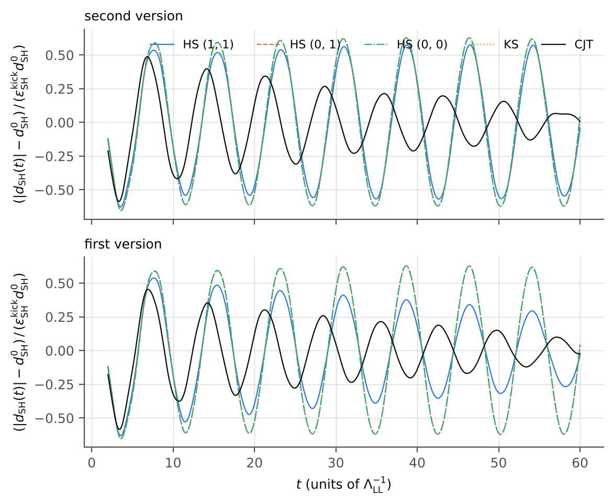
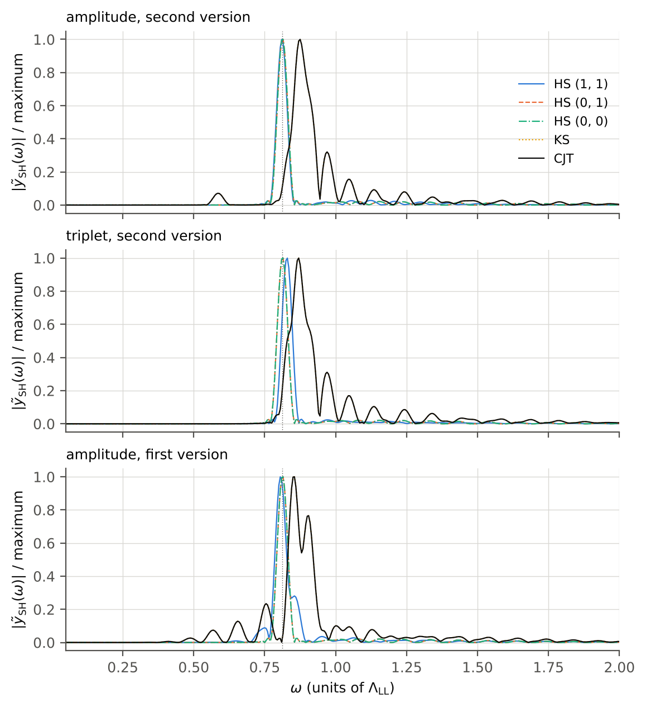
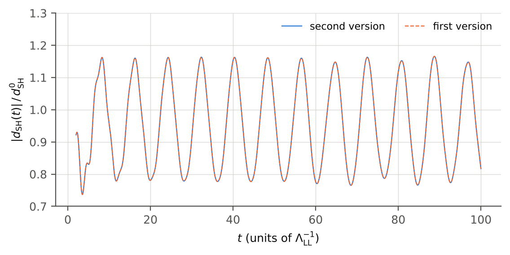

<!-- This file is generated from docs_src/higgs_dynamics.src.md by code/scripts/assemble_docs.py; edit the source. -->

# 0. What this document is and what it finds

*How to read this document.* It is written for a reader who knows quantum mechanics, special relativity, the Dirac
equation and second quantization at the level of a first graduate course. Every technical word that it uses is explained
in Section 0.1, before the findings, and Appendix A builds the algebra from which its fields come (the octonions, the
Lorentz super-loop, the eight spinor charges, the isodoublet of Dirac spinors $\Psi_{\rm LL}$ and their superfluid), with an
example of every object. The document refers to no other document for what it uses.

The author asked that the hypotheses of PROJECT spacetimes be modified so that the superfluid can be the Higgs field of
the Standard Model, with the quantum numbers of the Higgs doublet. In the second version of the revised hypotheses,
stated in Section 1, the superfluid is a condensate of pairs of a particle of the isodoublet $\Psi_{\rm LL}$ with a particle
of one of the two singlets $\chi_{\rm SH}$ and $\chi'_{\rm SH}$. Stage 3 computed its ground state in five mean-field methods,
and stage 4 its effective potential, the masses of the gauge bosons and its amplitude mode, the candidate for the Higgs
boson. Stage 4 found the frequency of the amplitude mode from the linear response at a frequency, in the two methods in
which only the pairing terms act on the ground state. This document is the first part of stage 6: it follows the
superfluid in time. Every method gives an equation of motion for the state, the time-dependent mean field. A small
displacement of the pair fields from the ground state then oscillates at the frequencies of the modes. The first
version of the hypotheses (one singlet) is computed alongside as the comparison. All quantities are in units of the
momentum cutoff $\Lambda_{\rm LL}=1$; times are in units of $1/\Lambda_{\rm LL}$.

## 0.1 Words used in this document

The documents of the revision use the following words. Each is explained here in a few sentences, so that a reader who
meets it in the text knows what it means; the formulas come in the sections that use them. Appendix A builds the
algebra from which the fields come, with an example of every object.

**The fields and their charges**

* *Dirac field, Dirac spinor.* A field of spin $\tfrac12$ with four components per point that obeys the Dirac equation;
  a Dirac spinor is one solution, such as the wave function of an electron of given momentum and spin. In the chiral
  basis its upper two components are *left-handed* and its lower two *right-handed*; each pair is a *Weyl spinor*.
* *Isospin, isodoublet, isovector (isospin triplet), singlet.* Isospin is a symmetry group $SU(2)$ that mixes fields
  without touching space-time, as rotations mix the components of a spin. An *isodoublet* is a pair of fields that it
  mixes like the two states of a spin $\tfrac12$ ("up" and "down"); an *isovector* or *isospin triplet* is a set of three
  fields that it turns like a vector in three dimensions; a *singlet* is a field that it leaves alone. Two isodoublets
  combine into a triplet and a singlet. Appendix A.5 gives an example of each.
* *$\Psi_{\rm LL}$, the isodoublet of Dirac spinors of the spinor charges.* The field of the eight spinor charges of the
  Lorentz super-loop: two Dirac spinors (up and down) that isospin mixes, eight complex components in all (Appendix A.4).
* *Weak isospin, hypercharge, electric charge.* The gauge group of the electroweak interactions of the Standard Model is
  $SU(2)_L\times U(1)_Y$. Its $SU(2)_L$ is the *weak isospin*, with the third component $T^3$; its $U(1)_Y$ has the charge
  $Y$, the *hypercharge*, which says how strongly a field couples to the gauge field $B_\mu$. The *electric charge* is
  $Q=T^3+Y$ (the rule of Gell-Mann and Nishijima).
* *Vector-like.* A field whose left-handed and right-handed components carry the same charges. The quarks and leptons
  of the Standard Model are not vector-like (their left-handed components are doublets, their right-handed ones
  singlets); the three fields of the revision are.
* *Anomaly.* The loss, through quantum effects, of a symmetry of the classical theory; a gauge theory with an anomaly is
  inconsistent. Vector-like fields contribute none.
* *Particle number, relative number.* Two numbers that the interaction of the revision conserves: the number of particles
  of all three fields, and the number of particles of $\Psi_{\rm LL}$ minus the number of particles of the singlets.

**Symmetries and their breaking**

* *Gauge group, gauge field, covariant derivative.* A gauge group is a group of symmetry transformations that may differ
  from point to point of space-time. Keeping the derivatives of the fields covariant needs a field for each generator, the
  gauge field, and turns the derivative into the covariant derivative.
* *Spontaneous breaking, vacuum.* A symmetry is broken spontaneously when the equations keep it but the state of lowest
  energy, the *vacuum*, does not; the vacuum then belongs to a family of equally good vacua related by the symmetry.
* *Goldstone mode.* For every generator of a global symmetry that the vacuum breaks there is a way of changing the state
  that costs no energy, because it only turns the vacuum into another vacuum of the family: a Goldstone mode, a massless
  excitation. In a gauge theory the Goldstone modes of the gauge generators become the third (longitudinal) polarization
  of the gauge bosons, which become massive: the *Higgs mechanism*.
* *Custodial symmetry, $SU(2)_{\rm R}$, $SU(2)_{\rm V}$.* With the hypercharge coupling switched off, the theory has a larger
  symmetry $SU(2)_L\times SU(2)_{\rm R}$, in which $SU(2)_{\rm R}$ turns the pair of singlets as a doublet. A vacuum proportional to
  $i\tau^2$ keeps the diagonal subgroup $SU(2)_{\rm V}$, the transformations with equal elements of $SU(2)_L$ and $SU(2)_{\rm R}$;
  this is the *custodial symmetry*. Its name comes from its job in the Standard Model: as long as it holds, the masses
  that the vacuum gives the $W$ and $Z$ bosons obey $M_W=M_Z\cos\theta_W$ ($\rho=1$, below); the symmetry "keeps custody"
  of this relation.
* *Custodial superfluid, custodial vacuum.* The superfluid whose vacuum keeps the custodial symmetry: both pair fields
  condense with equal lengths, the down member of $\Psi_{\rm LL}$ pairing with the first singlet and the up member with the
  second.
* *Bidoublet; two Higgs doublets.* A $2\times2$ matrix of fields on which $SU(2)_L$ acts from the left and $SU(2)_{\rm R}$ from
  the right. The two columns of the matrix of the pair fields are doublets of $SU(2)_L$; with the conjugate of the second
  they have the quantum numbers of two Higgs doublets, the scalar content of the models with two Higgs doublets.
* *The parameter $\rho$.* The ratio $M_W^2/(M_Z^2\cos^2\theta_W)$, with the weak mixing angle $\theta_W$
  ($\tan\theta_W=g'/g$); it is 1 at tree level in the Standard Model because of the custodial symmetry.
* *Earlier and revised hypotheses; first and second version.* The *earlier hypotheses* are the superfluid of the spinor
  charges of Appendix A.6, with a scalar and a vector contact term of $\Psi_{\rm LL}$ and gauge fields of its isospin and its
  fermion number; there $\Psi_{\rm LL}$ had no electric charge, its isospin was the symmetry of a new interaction, and pairs of
  two members of $\Psi_{\rm LL}$ condensed. The *revised hypotheses* give $\Psi_{\rm LL}$ the electroweak charges and let it
  pair with singlets. Their *first version* has one singlet, their *second version* two; the second is the model of the
  revision, the first the comparison.

**States and methods**

* *Condensate, superfluid, order parameter.* A *condensate* is a state in which a macroscopic number of particles, here
  pairs of fermions, occupy the same quantum state; a condensate of pairs of fermions is a *superfluid* (in a metal, a
  superconductor). Its *order parameter* is the expectation value of the pair field: zero in the normal state, nonzero in
  the condensate.
* *Normal vacuum.* The state without pairs: every negative-energy state of the free Dirac fields is filled and every
  positive one empty.
* *Gap, quasi-particle.* In a superfluid it costs at least a finite energy, the *gap*, to break a pair. The elementary
  excitations are *quasi-particles*, mixtures of a particle and a missing partner of a pair (a hole).
* *Matrix of Bogoliubov and de Gennes (BdG matrix).* The matrix whose eigenvectors are the quasi-particles; it couples the
  field at the momentum $\vec q$ with its conjugate at $-\vec q$.
* *Mean field.* The first approximation for a contact interaction of four fermion fields: each field feels the average of
  all the others, and the state is the best state of independent quasi-particles. BCS theory of superconductivity is a
  mean-field theory.
* *Uniform quasi-free state.* A state that is the same at every point of space and in which every average of a product
  of fields is fixed by the averages of products of two fields, the *normal* averages $\langle\psi^\dagger\psi\rangle$ and the
  *pair* averages $\langle\psi\psi\rangle$ (Wick's theorem). It is the ground state of a BdG matrix.
* *Self-energy (normal, pair).* The constant matrices in the BdG matrix that the interaction contributes: the *normal*
  self-energy shifts the masses and energies of the particles; the *pair* self-energy creates and destroys pairs (it is
  the gap parameter of BCS theory).
* *Direct, exchange and pair contractions (Hartree, Fock, BCS).* The three ways in which Wick's theorem writes the average
  of a product of four fields as products of averages of two.
* *HS, KS, CJT; pairing-only methods.* The five mean-field methods of the revision. *HS* $(s_{\rm S},s_{\rm V})$ is the method of
  Hubbard and Stratonovich at the saddle point: it rewrites the square of a bilinear of fields with an auxiliary field,
  which at the saddle point equals the average of the bilinear; the shares $s_{\rm S}$, $s_{\rm V}$ of the scalar and the vector
  term are rewritten in density channels, the rest in pair channels, and no exchange contraction is kept. *KS* is the
  method of Kohn and Sham of density-functional theory, with all three contractions and the exchange projected onto
  local densities. *CJT* is the effective action of Cornwall, Jackiw and Tomboulis, a functional of the averages of two
  fields whose stationary points are the self-consistent states, with all three contractions. In HS (0,1) and HS (0,0),
  the *pairing-only methods*, only the pairing terms act on the states of the revision.
* *Stationary (self-consistent) state.* A state whose self-energies are those that its own averages produce.
* *Static response; critical coupling.* If a small static field of some kind is imposed on a state, the state answers
  with averages of that kind; the ratios of answer to cause are the eigenvalues of the *static response*. An eigenvalue
  above 1 means that the answer grows by itself: the state is unstable in that direction. The *critical coupling* is
  the coupling at which the largest eigenvalue of the normal vacuum reaches 1; above it, the pairs condense.
* *Cutoff $\Lambda_{\rm LL}$.* The largest momentum of the uniform states; it is the unit of energy and of momentum.

**Responses, masses and modes**

* *Effective potential; Mexican hat.* The energy of the best uniform state with a prescribed size of the order
  parameter. As a function of the complex pair amplitude it is high at zero and lowest on a circle, like the brim of a
  hat: a *Mexican hat*. The points of the brim differ only by the phase of the condensate.
* *Susceptibility; phase stiffness.* A uniform static gauge field acts on the charges like a chemical potential; the
  *susceptibilities* say how much charge the state takes up in answer. For a condensate they measure its *phase
  stiffness*, the energy that it costs to twist the phase of the condensate from point to point, and they give the gauge
  bosons their masses.
* *Scale $v_{\rm SH}$.* The scale of the breaking, defined by $M_W=\tfrac12gv_{\rm SH}$ as the Standard Model defines $v=246.22$ GeV.
* *Amplitude mode.* On the Mexican hat a small oscillation of the condensate can go two ways. Along the brim it changes
  only the phase (the Goldstone modes). Across the brim it changes the size of the condensate; this costs energy and has
  a finite frequency: the *amplitude mode*. In the Standard Model the Higgs boson is the amplitude mode of the Higgs
  field, so the amplitude mode of the superfluid is the candidate for the Higgs boson.
* *Linear response; pole.* How a state answers a small disturbance that oscillates with the frequency $\omega$. A natural
  oscillation of the state shows up as a *pole* of the response, a frequency at which an arbitrarily small push gives a
  finite answer.
* *Effective Lagrangian.* The description of the slow, long-wavelength motions of the order parameter by a kinetic term
  and the effective potential; it gives the amplitude mode to leading order in its frequency.
* *Threshold; bound state; resonance.* The *threshold* is the lowest energy of two free quasi-particles, the energy that
  breaks a pair. A mode below it is a *bound state* of two quasi-particles and does not decay; a mode above it can decay
  into pairs and is a *resonance*, with a width.
* *Time-dependent mean field.* The equations of motion of the averages of a quasi-free state, integrated in time (here
  with the integrator CVODE of SUNDIALS).
* *Josephson relation.* With a chemical potential $\mu$ of the particle number the phase of a condensate of pairs turns at
  the rate $2\mu$, because a pair carries the particle number 2.
* *Critical region.* The range of temperatures near a phase transition in which the fluctuations of the order parameter,
  which the mean field leaves out, dominate; its width is estimated by the criterion of Levanyuk and Ginzburg.

## 0.2 The findings

1. **The equations conserve what they must.** In all 21 runs the energy per volume, the charge densities of the
   symmetries and the orthonormality of the quasi-particle vectors are conserved to the accuracy of the integration
   (Section 3). The ground state stays at rest to $4\times10^{-9}$.
2. **The time domain confirms stage 4.** In the pairing-only methods HS (0, 1) and HS (0, 0) a small displacement along
   the vacuum direction oscillates at $d^0_{\rm SH}$, the frequency of the amplitude mode that stage 4 found, to
   $2\times10^{-6}$, in both versions, without damping. A displacement along the custodial triplet oscillates at the same
   frequency, to $2\times10^{-8}$ (Section 4). In HS (0, 0) the whole dynamics is that of Anderson pseudospins, one for
   the particles and one for the antiparticles at every momentum, to $7\times10^{-9}$ (Section 2.4).
3. **The methods with normal self-energies.** Stage 4 did not compute the amplitude mode in HS (1, 1), KS and CJT. In the
   time domain, in the second version, the mode of HS (1, 1) lies at 0.810871, 0.9736 times its
   $d^0_{\rm SH}$ and below the energy 0.853584 that breaks a pair; it is undamped. In KS and CJT the spectrum peaks
   at 0.873546, above the energy 0.768402 that breaks a pair, and the peak is 1.8 times
   wider than that of an undamped oscillation: there the amplitude mode decays into pairs of quasi-particles (Section 4).
4. **The scalar and vector terms split the triplet from the singlet.** In HS (1, 1) the custodial triplet oscillates at
   0.828525, 2.2 per cent above the singlet; in KS and CJT its peak lies at 0.868711
   (-0.55 per cent from the singlet). The degeneracy of stage 4 is a property of the pairing-only methods
   (Section 4).
5. **The Josephson relation.** With a chemical potential $\mu$ of the particle number, the phase of the pair fields turns
   at the rate $2\mu$, to $2\times10^{-9}$, while their length stays at $d^0_{\rm SH}$ (Section 5).
6. **A large displacement.** A displacement by 0.3 of $d^0_{\rm SH}$ in HS (0, 0) oscillates at 0.778887,
   0.9582 times $d^0_{\rm SH}$: the oscillation softens with its amplitude, as on a Mexican hat (Section 5).
7. **KS and CJT** give the same dynamics, to $5\times10^{-8}$ (Section 3), as they gave the same ground states and
   susceptibilities.

"I" in this document is the assistant that does the work.

# 1. The hypotheses and the ground state

*In words.* This section repeats the model of the revision and the ground state that stage 3 found, so that this
document can be read alone.

## 1.1 The fields and their charges

There are three spinor fields, all four-component Dirac fields of $SL(2,\mathbb C)$ and all singlets of colour:

* the isodoublet $\Psi_{\rm LL}$, the field of the eight spinor charges of the Lorentz super-loop (Appendix A.4), has
  eight components, numbered $2d+s$, where $d=0,\dots,3$ is the Dirac index of the chiral
  basis and $s=0$ (up) or $s=1$ (down) is the isospin index;
* the singlets $\chi_{\rm SH}$ and $\chi'_{\rm SH}$ have four components each, numbered by the Dirac index.

The masses are $m_{\rm LL}=m^\chi_{\rm SH}=m^{\chi'}_{\rm SH}=0.2\,\Lambda_{\rm LL}$. Together the three fields form one field of sixteen
components, $\Psi_{\rm SH}=(\Psi_{\rm LL},\chi_{\rm SH},\chi'_{\rm SH})$: components 0 to 7 are those of $\Psi_{\rm LL}$, 8 to 11 those of
$\chi_{\rm SH}$ and 12 to 15 those of $\chi'_{\rm SH}$.

The gauge group is $SL(2,\mathbb C)\times SU(2)_L\times U(1)_Y$. The generators $T^{a,{\rm SM}}$ ($a=1,2,3$) of $SU(2)_L$ act as
$\mathsf 1_4\otimes\tfrac12\tau^a$ on $\Psi_{\rm LL}$ and as 0 on the singlets, where $\tau^a$ are the Pauli matrices. The hypercharge
$Y^{\rm SM}$ is $\tfrac14$ on $\Psi_{\rm LL}$ and $\chi_{\rm SH}$ and $-\tfrac34$ on $\chi'_{\rm SH}$, and the electric charge is
$Q^{\rm SM}=T^{3,{\rm SM}}+Y^{\rm SM}$. Two further numbers are conserved, global symmetries that are not gauged:

* the particle number $F^{\rm tot}_{\rm SH}$, 1 on every component;
* the relative number $R_{\rm SH}$, $+1$ on the components of $\Psi_{\rm LL}$ and $-1$ on those of the singlets.

With equal masses there is one more symmetry, the custodial group $SU(2)_{\rm R}$. Its generators $T^{a,{\rm R}}_{\rm SH}$ act as
$\tfrac12\tau^a$ on the pair of singlets $(\chi_{\rm SH},\chi'_{\rm SH})$, taken as a doublet with $\chi_{\rm SH}$ above, and as 0 on
$\Psi_{\rm LL}$. The hypercharge is the combination $Y^{\rm SM}=T^{3,{\rm R}}_{\rm SH}+\tfrac14R_{\rm SH}$. The eight generators $T^{a,{\rm SM}}$,
$T^{a,{\rm R}}_{\rm SH}$, $R_{\rm SH}$ and $F^{\rm tot}_{\rm SH}$ form the global group of the hypotheses.

| field component | $T^{3,{\rm SM}}$ | $T^{3,{\rm R}}_{\rm SH}$ | $Y^{\rm SM}$ | $Q^{\rm SM}$ | $F^{\rm tot}_{\rm SH}$ | $R_{\rm SH}$ |
|:---|:---|:---|:---|:---|:---|:---|
| $\Psi_{\rm LL}$, up | $+\tfrac12$ | 0 | $\tfrac14$ | $\tfrac34$ | 1 | $+1$ |
| $\Psi_{\rm LL}$, down | $-\tfrac12$ | 0 | $\tfrac14$ | $-\tfrac14$ | 1 | $+1$ |
| $\chi_{\rm SH}$ | 0 | $+\tfrac12$ | $\tfrac14$ | $\tfrac14$ | 1 | $-1$ |
| $\chi'_{\rm SH}$ | 0 | $-\tfrac12$ | $-\tfrac34$ | $-\tfrac34$ | 1 | $-1$ |

Table 1.1. The charges of the particles of the three fields. Antiparticles have the opposite charges.

## 1.2 The pair fields

In the chiral basis the Dirac matrices are
$\gamma^0_{\rm LL}=\begin{pmatrix}0&\mathsf 1_2\\\mathsf 1_2&0\end{pmatrix}$, $\gamma^j_{\rm LL}=\begin{pmatrix}0&\sigma^{\rm LL}_j\\-\sigma^{\rm LL}_j&0\end{pmatrix}$
($j=1,2,3$, with the Pauli matrices $\sigma^{\rm LL}_j$), $\beta_{\rm LL}=\gamma^0_{\rm LL}$,
$\alpha^j_{\rm LL}=\gamma^0_{\rm LL}\gamma^j_{\rm LL}$, $\gamma^{\rm ch}_{\rm LL}=i\gamma^0_{\rm LL}\gamma^1_{\rm LL}\gamma^2_{\rm LL}\gamma^3_{\rm LL}$, and the
charge-conjugation matrix is $C_{\rm LL}=i\gamma^2_{\rm LL}\gamma^0_{\rm LL}$. The pair operators of $\Psi_{\rm LL}$ with the singlets are
$$\Pi^s_{\rm SH}=\tfrac12\Psi^T_{\rm LL}\big(C_{\rm LL}\gamma^{\rm ch}_{\rm LL}\otimes\mathbf e^s_{\rm SH}\big)\chi_{\rm SH},\qquad
\Pi'^s_{\rm SH}=\tfrac12\Psi^T_{\rm LL}\big(C_{\rm LL}\gamma^{\rm ch}_{\rm LL}\otimes\mathbf e^s_{\rm SH}\big)\chi'_{\rm SH},\qquad s={\rm u},{\rm d},\tag{1.1}$$
with the isospin columns $\mathbf e^{\rm u}_{\rm SH}=(1,0)^T$ and $\mathbf e^{\rm d}_{\rm SH}=(0,1)^T$. Each annihilates two particles in a
state of spin zero and positive parity. On the whole field, $\Psi^T_{\rm SH}\mathsf K^s_{\rm SH}\Psi_{\rm SH}=2\Pi^s_{\rm SH}$ and
$\Psi^T_{\rm SH}\mathsf K'^s_{\rm SH}\Psi_{\rm SH}=2\Pi'^s_{\rm SH}$. Here $\mathsf K^s_{\rm SH}$ is the antisymmetric $16\times16$ matrix with the
block $\tfrac12C_{\rm LL}\gamma^{\rm ch}_{\rm LL}\otimes\mathbf e^s_{\rm SH}$ in the rows of $\Psi_{\rm LL}$ and the columns of $\chi_{\rm SH}$, minus its
transpose in the opposite block, and zero elsewhere; $\mathsf K'^s_{\rm SH}$ is the same with the columns of $\chi'_{\rm SH}$. These
four matrices are real.

The pair fields are the expectation values: $\Phi_{\rm SH}=(\langle\Pi^{\rm u}_{\rm SH}\rangle,\langle\Pi^{\rm d}_{\rm SH}\rangle)$ is a doublet of
$SU(2)_L$ with the hypercharge $\tfrac12$, the quantum numbers of the Higgs doublet, and
$\Phi'_{\rm SH}=(\langle\Pi'^{\rm u}_{\rm SH}\rangle,\langle\Pi'^{\rm d}_{\rm SH}\rangle)$ is a doublet with the hypercharge $-\tfrac12$. Their
neutral components are $\langle\Pi^{\rm d}_{\rm SH}\rangle$ and $\langle\Pi'^{\rm u}_{\rm SH}\rangle$.

## 1.3 The Hamiltonian density and the methods

The Hamiltonian density is
$$\begin{aligned}\mathcal H_{\rm SH}={}&\Psi^\dagger_{\rm SH}\mathsf h_{\rm SH}(-i\nabla)\Psi_{\rm SH}+\tfrac12G^{\rm S}_{\rm SF}{:}(\bar\Psi_{\rm LL}\Psi_{\rm LL})^2{:}
+\tfrac12G^{\rm V}_{\rm SF}{:}\Big[(\Psi^\dagger_{\rm LL}\Psi_{\rm LL})^2-\sum_j\big(\Psi^\dagger_{\rm LL}(\alpha^j_{\rm LL}\otimes\mathsf 1_2)\Psi_{\rm LL}\big)^2\Big]{:}\\
&-G_{\rm SH}\sum_{s={\rm u},{\rm d}}\big[{:}(\Pi^s_{\rm SH})^\dagger\Pi^s_{\rm SH}{:}+{:}(\Pi'^s_{\rm SH})^\dagger\Pi'^s_{\rm SH}{:}\big].\end{aligned}\tag{1.2}$$
Its parts:

* $\mathsf h_{\rm SH}(\vec q_{\rm LL})$ is the free Dirac Hamiltonian of the sixteen components on a plane wave of momentum
  $\vec q_{\rm LL}$, block-diagonal with $(\alpha^j_{\rm LL}q^j_{\rm LL}+\beta_{\rm LL}m_{\rm LL})\otimes\mathsf 1_2$ on $\Psi_{\rm LL}$ and
  $\alpha^j_{\rm LL}q^j_{\rm LL}+\beta_{\rm LL}m_{\rm LL}$ on each singlet (summed over $j$); the momenta are those with
  $\lvert\vec q_{\rm LL}\rvert<\Lambda_{\rm LL}$;
* $\bar\Psi_{\rm LL}=\Psi^\dagger_{\rm LL}(\gamma^0_{\rm LL}\otimes\mathsf 1_2)$, and the colons order the products of field operators so that
  their expectation value in the normal vacuum (the state without pairs) is zero;
* the couplings are those of the potential $V^{(1)}_{\rm SH}$ of stage 3: $G^{\rm S}_{\rm SF}=-8$ and $G^{\rm V}_{\rm SF}=0.8$ (the scalar and the
  vector contact terms of the author's ansatz) and $G_{\rm SH}=100.8$ (the pairing terms), in units of $\Lambda_{\rm LL}^{-2}$.

In the **first version** of the hypotheses the terms of $\Pi'^s_{\rm SH}$ are absent, and $\chi'_{\rm SH}$ is a free field.

The three methods approximate the state by a uniform quasi-free state. Such a state is the ground state of a quadratic
Hamiltonian with constant self-energies, a Hermitian $16\times16$ matrix $\mathsf N_{\rm SH}$ and an antisymmetric one $\mathsf P_{\rm SH}$.
At the momentum $\vec q_{\rm LL}$ its Bogoliubov-de Gennes (BdG) matrix is
$$\mathsf H_{\rm SH}(\vec q_{\rm LL})=\begin{pmatrix}\mathsf h_{\rm SH}(\vec q_{\rm LL})+\mathsf N_{\rm SH}&\mathsf P_{\rm SH}\\\mathsf P_{\rm SH}^\dagger&-\big(\mathsf h_{\rm SH}(-\vec q_{\rm LL})+\mathsf N_{\rm SH}\big)^T\end{pmatrix},\tag{1.3}$$
and the state fills its negative eigenvalues. Its local matrices are the integrals over the momenta of the normal
correlation matrix, measured from the normal vacuum, and of the pair correlation matrix: $\varrho_{\rm SH}$ and $\kappa_{\rm SH}$.
The energy per volume of the state, measured from the normal vacuum, is $\mathcal E^X_{\rm SH}$: the kinetic part plus the
interaction energy that method $X$ assigns to the local matrices. A method keeps the three Wick contractions of every
contact term with its own weights:

* HS rewrites each four-fermion term as the exchange of an auxiliary field and keeps the direct contraction of the terms
  decoupled in density channels and the pair contraction of those decoupled in pair channels. Its parameters
  $s^{\rm HS,S}_{\rm SF}$ and $s^{\rm HS,V}_{\rm SF}$ are the shares of the scalar and of the vector term decoupled in density channels;
  HS (1, 1), HS (0, 1) and HS (0, 0) denote $(s^{\rm HS,S}_{\rm SF},s^{\rm HS,V}_{\rm SF})$. The pairing terms are decoupled in their own pair
  channels. HS keeps no exchange contraction.
* KS keeps all three contractions, the exchange evaluated with the projection of $\varrho_{\rm SH}$ onto sixteen local densities:
  the number and the scalar densities of $\Psi_{\rm LL}$ as $2\times2$ matrices in the isospin space and those of the pair of
  singlets as $2\times2$ matrices in the space of the two singlets.
* CJT keeps all three contractions with the weight 1 (the two-loop effective action of the propagator).

The self-energies are the derivatives of the interaction energy with respect to the local matrices, and a stationary
state is a state whose self-energies are those that its own local matrices produce. The programs find stationary
states by iteration on a grid of 24 radial nodes of $\lvert\vec q_{\rm LL}\rvert$ times the six directions of the coordinate axes.

## 1.4 The ground states of stage 3

In every method the ground state of $V^{(1)}_{\rm SH}$ in the second version is the custodial Higgs superfluid. Its pair
self-energy is $\mathsf P_{\rm SH}=d_{\rm SH}\,\mathsf P^{\rm vac}_{\rm SH}$ with a real number $d_{\rm SH}=d^0_{\rm SH}>0$ and the direction of the vacuum
$$\mathsf P^{\rm vac}_{\rm SH}=(\mathsf K'^{\rm u}_{\rm SH})^\dagger-(\mathsf K^{\rm d}_{\rm SH})^\dagger\qquad\text{(second version)},\qquad
\mathsf P^{\rm vac}_{\rm SH}=(\mathsf K^{\rm d}_{\rm SH})^\dagger\qquad\text{(first version)}.\tag{1.4}$$
A rotation by the particle number multiplies $\mathsf P_{\rm SH}$ by a phase. The programs rotate that phase away, so that
$d_{\rm SH}$ is real and positive. In the second version the down particles are paired with $\chi_{\rm SH}$ and the up particles
with $\chi'_{\rm SH}$, the two pair fields have equal lengths, and the state keeps the electric charge, the custodial group
$SU(2)_{\rm V}$ (generated by $T^{a,{\rm SM}}+T^{a,{\rm R}}_{\rm SH}$) and $R_{\rm SH}$. In the first version the ground state is the condensate of
$\Phi_{\rm SH}$ alone: the down particles are paired with $\chi_{\rm SH}$ and the up particles are unpaired.

# 2. The time-dependent mean field

*In words.* The static methods find the ground state and predict the frequencies of its oscillations. This document
watches the oscillations happen: it displaces the ground state slightly (or strongly), lets the averages of the state
evolve by their equations of motion, and reads the frequencies from the spectra of the motion. Section 2.4 shows that in
the simplest method the motion reduces to the precession of classical spins, the picture of Anderson for a
superconductor.

## 2.1 The equation of motion

A uniform quasi-free state is given, at every momentum $\vec q_{\rm LL}$ of the grid, by its sixteen occupied
quasi-particle vectors: the columns of the $32\times16$ matrix $\mathsf O_{\rm SH}(\vec q_{\rm LL},t)$, which at $t=0$ are the
eigenvectors of negative energy of a BdG matrix (1.3). Its generalized density is the $32\times32$ projector
$$\mathcal R_{\rm SH}(\vec q_{\rm LL},t)=\mathsf O_{\rm SH}(\vec q_{\rm LL},t)\,\mathsf O_{\rm SH}(\vec q_{\rm LL},t)^\dagger,\tag{2.1}$$
whose upper left block is the normal correlation matrix at $\vec q_{\rm LL}$ and whose upper right block is minus the pair
correlation matrix. From these the method computes the local matrices $\varrho_{\rm SH}$ and $\kappa_{\rm SH}$, the energy per
volume $\mathcal E^X_{\rm SH}$ and the self-energies $\mathsf N_{\rm SH}(t)$ and $\mathsf P_{\rm SH}(t)$, exactly as for a static state. The
time-dependent mean field of the method is
$$i\,\frac{d}{dt}\mathsf O_{\rm SH}(\vec q_{\rm LL},t)=\mathsf H_{\rm SH}\big(\vec q_{\rm LL};\mathsf N_{\rm SH}(t),\mathsf P_{\rm SH}(t)\big)\,\mathsf O_{\rm SH}(\vec q_{\rm LL},t),\tag{2.2}$$
with the BdG matrix (1.3) of the self-energies at the time $t$. It gives
$i\,d\mathcal R_{\rm SH}/dt=[\mathsf H_{\rm SH},\mathcal R_{\rm SH}]$. A stationary state of the method is a solution at rest, and the
linear response of stage 4 is the linearization of (2.2) about it. Each of the five methods has its own equation (2.2),
because each has its own self-energies.

Three quantities are conserved by (2.2), and the programs check each (Section 3):

* **the energy per volume**, because the self-energies are the derivatives of the energy: its rate of change is
  $-i\sum_{\vec q}w(\vec q)\,\mathrm{tr}\big(\mathsf H_{\rm SH}[\mathsf H_{\rm SH},\mathcal R_{\rm SH}]\big)$ up to a factor, with the weights $w(\vec q)$ of the
  grid, and the trace of a matrix times a commutator with itself vanishes;
* **the charge densities of the symmetries** of the energy: all eight generators $T^{a,{\rm SM}}$, $T^{a,{\rm R}}_{\rm SH}$, $R_{\rm SH}$ and
  $F^{\rm tot}_{\rm SH}$ in the second version, and $T^{a,{\rm SM}}$, $T^{3,{\rm R}}_{\rm SH}$, $R_{\rm SH}$ and $F^{\rm tot}_{\rm SH}$ in the first, where
  $T^{1,{\rm R}}_{\rm SH}$ and $T^{2,{\rm R}}_{\rm SH}$, which mix $\chi_{\rm SH}$ with the unpaired $\chi'_{\rm SH}$, are not symmetries;
* **the orthonormality** $\mathsf O_{\rm SH}^\dagger\mathsf O_{\rm SH}=\mathsf 1$ of the vectors, because (2.2) is a unitary evolution; it keeps
  $\mathcal R_{\rm SH}$ a projector.

## 2.2 The runs

Each run starts from the ground state $(\mathsf N^0_{\rm SH},\mathsf P^0_{\rm SH})$ of a method, the stationary state of Section 1.4 with
$d_{\rm SH}=d^0_{\rm SH}$ real and positive, and follows (2.2) for $0\le t\le t^{\rm end}_{\rm SH}$:

* **ground**: the ground state itself, which must stay at rest; second version, HS (0, 0) and CJT,
  $t^{\rm end}_{\rm SH}=100$;
* **amplitude**: the ground state of the BdG matrices of $(\mathsf N^0_{\rm SH},\mathsf P^0_{\rm SH}+\epsilon^{\rm kick}_{\rm SH}d^0_{\rm SH}\mathsf P^{\rm vac}_{\rm SH})$
  with $\epsilon^{\rm kick}_{\rm SH}=0.001$: the length of the pair fields displaced along the direction of the vacuum (1.4);
  five methods, both versions, $t^{\rm end}_{\rm SH}=300$;
* **triplet**: the same with the direction
  $$\mathsf P^{\rm trip}_{\rm SH}=(\mathsf K'^{\rm u}_{\rm SH})^\dagger+(\mathsf K^{\rm d}_{\rm SH})^\dagger\tag{2.3}$$
  in place of $\mathsf P^{\rm vac}_{\rm SH}$: the two pair fields displaced oppositely, the neutral member of the custodial triplet
  of the four massive modes of stage 4; second version, five methods;
* **Josephson**: the ground state evolved with $\mathcal H_{\rm SH}-\mu F^{\rm tot}_{\rm SH}$, a chemical potential $\mu=0.01$ of the
  particle number; second version, HS (0, 0) and CJT, $t^{\rm end}_{\rm SH}=100$;
* **large**: the amplitude run with $\epsilon^{\rm kick}_{\rm SH}=0.3$; HS (0, 0), both versions.

The initial state of an amplitude or triplet run is not stationary: its own local matrices produce self-energies that
differ from those with which it was made, and it starts to move. For a small displacement it oscillates at the
frequencies of the modes that the displacement excites, together with the transitions of pairs of quasi-particles.

At every output time, every 0.2, the programs record the coefficients of the pair self-energy along the two directions,
$$d_{\rm SH}(t)=\frac{\mathrm{tr}\big((\mathsf P^{\rm vac}_{\rm SH})^\dagger\mathsf P_{\rm SH}(t)\big)}{\mathrm{tr}\big((\mathsf P^{\rm vac}_{\rm SH})^\dagger\mathsf P^{\rm vac}_{\rm SH}\big)},\qquad
d^{\rm trip}_{\rm SH}(t)=\frac{\mathrm{tr}\big((\mathsf P^{\rm trip}_{\rm SH})^\dagger\mathsf P_{\rm SH}(t)\big)}{\mathrm{tr}\big((\mathsf P^{\rm trip}_{\rm SH})^\dagger\mathsf P^{\rm trip}_{\rm SH}\big)},\tag{2.4}$$
the energy per volume and the eight charge densities.

## 2.3 The spectra

The frequency of an oscillation is read from the spectrum of its signal $y_{\rm SH}(t)$: $\lvert d_{\rm SH}(t)\rvert$ in the amplitude
and large runs, $\mathrm{Re}\,d^{\rm trip}_{\rm SH}(t)$ in the triplet runs, each with its mean over the run removed. With the Hann
window $h^{\rm Hann}_{\rm SH}(t)=\sin^2(\pi t/t^{\rm end}_{\rm SH})$,
$$\tilde y_{\rm SH}(\omega)=\sum_i h^{\rm Hann}_{\rm SH}(t_i)\,y_{\rm SH}(t_i)\,e^{i\omega t_i}\,\Delta t,\tag{2.5}$$
over the output times $t_i$ with the spacing $\Delta t=0.2$. The programs scan $\lvert\tilde y_{\rm SH}(\omega)\rvert$ for
$0.05\le\omega\le3$ with the step 0.001 and refine its largest peak by golden sections: the peak lies at
$\omega^{\rm pk}_{\rm SH}$ and has the half width at half maximum $\Gamma^{\rm pk}_{\rm SH}$. A cosine that lasts the whole run gives the width
of the window alone, $\Gamma^{\rm win}_{\rm SH}=2\pi/t^{\rm end}_{\rm SH}=0.020944$: the transform of the Hann window, normalized to 1 at its
centre, has the modulus $\lvert\sin(\pi x)/(\pi x(1-x^2))\rvert$ at the offset $2\pi x/t^{\rm end}_{\rm SH}$, which is exactly
$\tfrac12$ at $x=1$ (check WD-4). The ratio $\Gamma^{\rm pk}_{\rm SH}/\Gamma^{\rm win}_{\rm SH}$ is therefore 1 for an oscillation that is not damped over
the run, and larger for one that is.

## 2.4 The reduced model of the pairing-only method

In HS (0, 0) the dynamics of the uniform states of the runs reduces to Anderson pseudospins, the classical picture of
the theory of Bardeen, Cooper and Schrieffer. For every radial node $q_i$ of the grid there are two unit vectors, one
for the particles and one for the antiparticles, $\mathbf n^+_{\rm SH}(q_i,t)$ and $\mathbf n^-_{\rm SH}(q_i,t)$. Each precesses in its own
field,
$$\frac{d\mathbf n^\pm_{\rm SH}}{dt}=2\,\mathbf b^\pm_{\rm SH}\times\mathbf n^\pm_{\rm SH},\qquad
\mathbf b^\pm_{\rm SH}=\big(-\mathrm{Re}\,\Delta_{\rm SH}(t),\ \mathrm{Im}\,\Delta_{\rm SH}(t),\ \pm\varepsilon_{\rm LL}(q_i)\big),\tag{2.6}$$
with the free energy $\varepsilon_{\rm LL}=(q_{\rm LL}^2+m_{\rm LL}^2)^{1/2}$ and the gap parameter
$$\Delta_{\rm SH}(t)=\tfrac12d_{\rm SH}(t)=\frac{G_{\rm SH}}{2}\sum_i\frac{w_i}{2}\Big(n^{+,x}_{{\rm SH},i}+n^{-,x}_{{\rm SH},i}-i\big(n^{+,y}_{{\rm SH},i}+n^{-,y}_{{\rm SH},i}\big)\Big),\tag{2.7}$$
where $w_i$ is the weight of the radial node $q_i$ times $q_i^2/(2\pi^2)$, so that $\sum_iw_if(q_i)$ approximates
$\int_0^{\Lambda_{\rm LL}}q^2f(q)\,dq/(2\pi^2)$, and the components of $\mathbf n^\pm_{\rm SH}(q_i,t)$ are written $n^{\pm,x}_{{\rm SH},i}$, and so
on. At $t=0$ each vector points against its field. For the ground state this is the gap equation
$(G_{\rm SH}/2)\sum_iw_i/E_i=1$ with $E_i=(\varepsilon_{\rm LL}(q_i)^2+\Delta_{\rm SH}^2)^{1/2}$, whose solution is $\Delta_{\rm SH}=d^0_{\rm SH}/2$; a kicked
state starts with $\Delta_{\rm SH}(0)=(1+\epsilon^{\rm kick}_{\rm SH})\,d^0_{\rm SH}/2$.

I found this reduction by comparing it with the full computation, not by deriving it. The Python program integrates
the 48 pseudospins with CVODE and finds the $d_{\rm SH}(t)$ of the Rust program, which evolves all sixteen components, to
$7\times10^{-9}$ of $d^0_{\rm SH}$ for $0\le t\le100$, after the small and after the large kick, in both versions (check YD-6). The
Wolfram script integrates them with `NDSolve` and the method IDA and finds the same (check WD-5). Both kinds of pseudospin
are needed: with the particles alone the phase of $\Delta_{\rm SH}$ drifts, which the full computation does not show. The
reduced model explains the results of the pairing-only methods: its linearization is the response of the theory of
Bardeen, Cooper and Schrieffer, whose amplitude mode lies at twice the gap parameter, $2\Delta_{\rm SH}=d^0_{\rm SH}$.

# 3. The numerical method and the conservation laws

*In words.* How the equations of motion are integrated, and how the integration is checked: the energy, the conserved
charges and the orthonormality of the quasi-particle vectors must stay constant, and the ground state must stay at
rest.

The grid has 24 radial nodes and the six directions of the coordinate axes, 144 momenta in all, as in stages 3 and 4.
The unknowns are the real and imaginary parts of the $144\times512$ complex entries of the $\mathsf O_{\rm SH}(\vec q_{\rm LL},t)$. The
integrator is CVODE (SUNDIALS 7.8.0 in pure Rust): Adams-Moulton formulas, the fixed-point iteration, and error weights
that measure each complex unknown by its modulus, with the tolerances $10^{-12}$ (relative) and $10^{-14}$ (absolute). These
tolerances are needed because the energy per volume is the difference of its kinetic and interaction parts, each about
ten times larger. They also cost no more than looser ones: CVODE then takes the order 7 instead of 5, and longer steps.
The runs took 2280 to 9703 steps each.

Table 3.1 lists the runs: the largest change of the energy per volume relative to its size, the largest change of the
charge densities of the symmetries, and the largest departure of $\mathsf O_{\rm SH}^\dagger\mathsf O_{\rm SH}$ from the unit matrix at the
end, each as an upper bound.

Table 3.1. The runs: their displacement, the conservation laws, and the steps and the time of CVODE.

| run | version | method | $\epsilon^{\rm kick}_{\rm SH}$ | energy | charges | $\mathsf O_{\rm SH}^\dagger\mathsf O_{\rm SH}-\mathsf 1$ | steps | time (s) |
|:-----------|:-------|:----------|:------|:--------|:--------|:--------|:------|:------|
| amplitude | second | HS (1, 1) | $0.001$ | $5\times10^{-7}$ | $5\times10^{-10}$ | $2\times10^{-8}$ | 6092 | 157 |
| triplet | second | HS (1, 1) | $0.001$ | $6\times10^{-8}$ | $6\times10^{-11}$ | $2\times10^{-9}$ | 7971 | 125 |
| amplitude | second | HS (0, 1) | $0.001$ | $9\times10^{-8}$ | $10^{-10}$ | $3\times10^{-9}$ | 7458 | 127 |
| triplet | second | HS (0, 1) | $0.001$ | $3\times10^{-7}$ | $3\times10^{-10}$ | $6\times10^{-9}$ | 6524 | 130 |
| ground | second | HS (0, 0) | -- | $6\times10^{-8}$ | $7\times10^{-11}$ | $2\times10^{-9}$ | 2280 | 45 |
| josephson | second | HS (0, 0) | -- | $7\times10^{-8}$ | $7\times10^{-11}$ | $2\times10^{-9}$ | 2281 | 47 |
| amplitude | second | HS (0, 0) | $0.001$ | $5\times10^{-7}$ | $5\times10^{-10}$ | $2\times10^{-8}$ | 6104 | 140 |
| triplet | second | HS (0, 0) | $0.001$ | $6\times10^{-8}$ | $6\times10^{-11}$ | $2\times10^{-9}$ | 8087 | 138 |
| large | second | HS (0, 0) | $0.3$ | $2\times10^{-8}$ | $2\times10^{-11}$ | $4\times10^{-10}$ | 9703 | 155 |
| amplitude | second | KS | $0.001$ | $3\times10^{-8}$ | $5\times10^{-11}$ | $2\times10^{-9}$ | 8349 | 153 |
| triplet | second | KS | $0.001$ | $4\times10^{-8}$ | $6\times10^{-11}$ | $2\times10^{-9}$ | 8122 | 143 |
| ground | second | CJT | -- | $9\times10^{-9}$ | $2\times10^{-11}$ | $4\times10^{-10}$ | 2800 | 43 |
| josephson | second | CJT | -- | $9\times10^{-9}$ | $2\times10^{-11}$ | $4\times10^{-10}$ | 2807 | 43 |
| amplitude | second | CJT | $0.001$ | $3\times10^{-8}$ | $5\times10^{-11}$ | $2\times10^{-9}$ | 8350 | 128 |
| triplet | second | CJT | $0.001$ | $2\times10^{-7}$ | $3\times10^{-10}$ | $7\times10^{-9}$ | 6532 | 114 |
| amplitude | first | HS (1, 1) | $0.001$ | $10^{-6}$ | $6\times10^{-10}$ | $2\times10^{-8}$ | 5695 | 119 |
| amplitude | first | HS (0, 1) | $0.001$ | $2\times10^{-6}$ | $6\times10^{-10}$ | $2\times10^{-8}$ | 5639 | 131 |
| amplitude | first | HS (0, 0) | $0.001$ | $2\times10^{-6}$ | $6\times10^{-10}$ | $2\times10^{-8}$ | 5694 | 129 |
| large | first | HS (0, 0) | $0.3$ | $6\times10^{-8}$ | $3\times10^{-11}$ | $9\times10^{-10}$ | 8657 | 142 |
| amplitude | first | KS | $0.001$ | $9\times10^{-7}$ | $6\times10^{-10}$ | $2\times10^{-8}$ | 5721 | 136 |
| amplitude | first | CJT | $0.001$ | $10^{-6}$ | $7\times10^{-10}$ | $2\times10^{-8}$ | 5601 | 121 |

**What the table shows.**

* **The equations conserve.** The charge densities change by at most $7\times10^{-10}$ and the vectors stay orthonormal to
  $2\times10^{-8}$ (checks D-3b, D-3c). The energy per volume changes by at most $2\times10^{-6}$ of its size (check D-3a). This
  change is the error of the integration, which makes the vectors lose their orthonormality slowly. The exact equations
  conserve the energy: the rate of change of the energy along (2.2) vanishes symbolically (check WD-1).
* **The ground state stays at rest.** In the ground runs $d_{\rm SH}(t)$ stays at $d^0_{\rm SH}$ to $4\times10^{-9}$ (check D-2).
* **KS and CJT give the same dynamics.** Their $d_{\rm SH}(t)$ agree to $5\times10^{-8}$ of $d^0_{\rm SH}$ in every run (check D-7). Their
  ground states and susceptibilities agreed already (stages 3 and 4); the equations of motion agree too.
* **An independent integration agrees.** The Python program integrates (2.2) for HS (0, 0) in both versions with its own
  right side (numpy) and finds the $d_{\rm SH}(t)$ of the Rust program (check YD-1).

# 4. The amplitude mode and the triplet

*In words.* After a small push of the size of the condensate, the size oscillates at the frequency of the amplitude
mode; after a push along the custodial triplet of the pair fields, the triplet oscillates. This section compares the
frequencies with the linear response of stage 4 and shows when the oscillation is undamped (a bound state below the
energy that breaks a pair) and when it decays (a resonance above it).

Figure 1 shows $\lvert d_{\rm SH}(t)\rvert$ after the amplitude kick, relative to the kick, and Figure 2 the spectra of all the
amplitude and triplet runs. Table 4.1 gives the peaks.

{width=92%}

**Figure 1.** The amplitude runs: $(\lvert d_{\rm SH}(t)\rvert-d^0_{\rm SH})/(\epsilon^{\rm kick}_{\rm SH}d^0_{\rm SH})$ for $2\le t\le60$ in the five
methods, second version (above) and first version (below). The signals are stored every 1.0 and drawn through their
samples by band-limited interpolation. HS (0, 1) and HS (0, 0) coincide, and so do KS and CJT.

{width=92%}

**Figure 2.** The spectra $\lvert\tilde y_{\rm SH}(\omega)\rvert$ (2.5), each divided by its largest value: the amplitude runs of the
second version (above), the triplet runs of the second version (middle) and the amplitude runs of the first version
(below). The dotted vertical line is $d^0_{\rm SH}$ of HS (0, 0). KS coincides with CJT.

Table 4.1. The peaks of the amplitude runs (both versions) and of the triplet runs (second version), with $d^0_{\rm SH}$
and twice the gap $E^{X,{\rm gap}}_{\rm SH}$ of stage 3, the lowest energy of two quasi-particles. In the second version every field is
paired and $2E^{X,{\rm gap}}_{\rm SH}$ is the energy that breaks a pair; in the first the gap is that of the unpaired fields.

| version | method | $d^0_{\rm SH}$ | $2E^{X,{\rm gap}}_{\rm SH}$ | $\omega^{\rm pk}_{\rm SH}$, amplitude | $\Gamma^{\rm pk}_{\rm SH}/\Gamma^{\rm win}_{\rm SH}$ | $\omega^{\rm pk}_{\rm SH}$, triplet | $\Gamma^{\rm pk}_{\rm SH}/\Gamma^{\rm win}_{\rm SH}$ |
|:-------|:----------|:---------|:---------|:-----------|:-------|:-----------|:-------|
| second | HS (1, 1) | $0.8328776$ | $0.853584$ | $0.8108707$ | $1$ | $0.8285249$ | $1$ |
| second | HS (0, 1) | $0.8128455$ | $0.905935$ | $0.8128465$ | $1$ | $0.8128465$ | $1$ |
| second | HS (0, 0) | $0.8128455$ | $0.905935$ | $0.8128465$ | $1$ | $0.8128465$ | $1$ |
| second | KS | $0.8907872$ | $0.768402$ | $0.8735459$ | $1.8$ | $0.8687108$ | $2.12$ |
| second | CJT | $0.8907872$ | $0.768402$ | $0.8735459$ | $1.8$ | $0.8687108$ | $2.12$ |
| first | HS (1, 1) | $0.8258096$ | $0.340784$ | $0.8061557$ | $1.04$ | -- | -- |
| first | HS (0, 1) | $0.8128455$ | $0.4$ | $0.8128466$ | $1$ | -- | -- |
| first | HS (0, 0) | $0.8128455$ | $0.4$ | $0.8128466$ | $1$ | -- | -- |
| first | KS | $0.8672856$ | $0.222918$ | $0.8525918$ | $2.16$ | -- | -- |
| first | CJT | $0.8672856$ | $0.222918$ | $0.8525918$ | $2.16$ | -- | -- |

**What the table shows.**

* **The pairing-only methods.** In HS (0, 1) and HS (0, 0) the amplitude oscillates at $d^0_{\rm SH}=0.812845546$ to
  $2\times10^{-6}$ in both versions (check D-4a), the frequency that stage 4 found from the linear response and proved to be
  exact. The difference is of the order of $(\epsilon^{\rm kick}_{\rm SH})^2$, the size of the first correction to a linear
  oscillation. The peaks have the width of the window, $1$ times $\Gamma^{\rm win}_{\rm SH}$ (check D-4b): the mode is not
  damped, as a mode below the threshold of two quasi-particles must not be. The triplet oscillates at the same frequency,
  to $2\times10^{-8}$ (check D-5): the degeneracy of the custodial singlet and triplet of stage 4. The Python program finds
  the same peaks from the stored signals (checks YD-3, YD-4), and the Wolfram script compares them with $d^0_{\rm SH}$ to
  30 digits (check WD-3).
* **HS (1, 1).** The scalar and the vector terms act on the ground state. In the second version the amplitude mode lies at
  0.810871, below the energy 0.853584 that breaks a pair, and its peak has the width of the window
  (1): it is bound and undamped. It is lower than its $d^0_{\rm SH}=0.832878$: the closed form of the
  pairing-only methods does not hold here. The triplet lies at 0.828525, 2.2 per cent above the singlet,
  also undamped (1). In the first version the amplitude peak lies at 0.806156, with the width
  ratio 1.04.
* **KS and CJT.** In the second version the spectrum of the amplitude peaks at 0.873546, above the energy
  0.768402 that breaks a pair. The peak is 1.8 times wider than the window, and $\lvert d_{\rm SH}(t)\rvert$ visibly
  decays in Figure 1: the amplitude mode is a resonance that decays into pairs of quasi-particles. The peak of the triplet
  lies at 0.868711 (-0.55 per cent from the singlet), with the width ratio 2.12. In the first version
  the amplitude peak lies at 0.852592, with the width ratio 2.16. On a grid of 144 momenta the continuum of
  pairs of quasi-particles is a set of discrete transitions, so the decay is a dephasing among them, and the signal
  partly revives at late times; the width of the peak is the measure used here, not a decay rate.

The splitting of the triplet answers a question that stage 4 left open: the degeneracy of the four massive modes of the
second version is a property of the pairing-only methods. With the scalar and the vector terms the triplet separates
from the singlet: by 2.2 per cent of its frequency in HS (1, 1) and by -0.55 per cent in KS and CJT.

# 5. The Josephson relation and a large displacement

*In words.* Two further tests of the dynamics: with a chemical potential of the particle number the phase of the
condensate must turn at twice the chemical potential (the Josephson relation, because a pair carries the particle
number 2), and a large push shows how the oscillation softens when it climbs higher on the walls of the Mexican hat.

**The Josephson relation.** A chemical potential $\mu$ of the particle number adds $-\mu F^{\rm tot}_{\rm SH}$ to the Hamiltonian. On
the Nambu space $F^{\rm tot}_{\rm SH}$ is $\mathsf 1_{16}$ in the particle block and $-\mathsf 1_{16}$ in the hole block, and the
stationary state of $\mathcal H_{\rm SH}$ evolves as $e^{i\mu F^{\rm tot}_{\rm SH}t}\mathcal R_{\rm SH}e^{-i\mu F^{\rm tot}_{\rm SH}t}$, with
$F^{\rm tot}_{\rm SH}$ taken on the Nambu space: its pair block is multiplied by
$e^{2i\mu t}$, because each pair carries the particle number 2 (check WD-2, symbolic). The phase of $d_{\rm SH}(t)$ therefore
turns at the rate $2\mu=0.02$ and its length stays at $d^0_{\rm SH}$. The programs find the rate to $2\times10^{-9}$ and the
length to $2\times10^{-9}$, in HS (0, 0) and in CJT (checks D-6a, D-6b, YD-5). This is the relation of Josephson between the
chemical potential and the frequency of the condensate; it is a check that (2.2) treats the phase of the pair fields, the
Goldstone mode of the particle number, correctly.

**A large displacement.** Figure 3 shows the run with $\epsilon^{\rm kick}_{\rm SH}=0.3$ in HS (0, 0). The length of the pair
fields oscillates between 0.763 and 1.17 times $d^0_{\rm SH}$ at the frequency 0.778887, 0.9582 times
$d^0_{\rm SH}$. The oscillation softens with its amplitude: the potential of the length, the Mexican hat of stage 4, is not a
parabola so far from its minimum. Both versions give the same curve, because in HS (0, 0) each pair moves in the same
closed form.

{width=92%}

**Figure 3.** The large displacement: $\lvert d_{\rm SH}(t)\rvert/d^0_{\rm SH}$ for $2\le t\le100$ in HS (0, 0), both versions (the two
curves coincide). Drawn as in Figure 1.

# 6. What the results mean

*In words.* What the motion in time adds to the static results of stages 3 and 4.

* **The time-dependent mean field is consistent with the static methods.** Its stationary states are the ground states of
  stage 3, its small oscillations reproduce the linear response of stage 4, it conserves energy, charges and
  orthonormality, and it obeys the Josephson relation.
* **The amplitude mode is heavy in every method.** Where it is a sharp mode (HS (0, 1), HS (0, 0), HS (1, 1)) it lies
  near $d^0_{\rm SH}$, of the order of the energy that breaks a pair. In KS and CJT it lies above that energy and decays. The
  conclusion of stage 4 holds in all five methods: relative to the scale $v_{\rm SH}$ the amplitude mode is far heavier than the
  Higgs boson of the Standard Model.
* **The triplet of the second version is split.** The extra massive scalars of the second version are degenerate with the
  amplitude mode only in the pairing-only methods; the scalar and the vector terms split them, by 2.2 per cent in
  HS (1, 1) and by -0.55 per cent in KS and CJT.
* **What remains.** The dynamics here is uniform in space: it contains the modes at zero momentum only. The gauge fields
  are not evolved, because a uniform vector potential couples through the current of the Dirac sea, which the sharp
  cutoff spoils (it gives a spurious current even in the normal vacuum); stage 4 found the masses of the gauge bosons
  from the time components instead. The fluctuations beyond the mean field are not included.

# 7. The programs and the checks

The results were computed and checked by three programs written for this stage:

* **Rust.** The program `sh_dynamics` (crate `rust/shdynamics`) integrates (2.2) with CVODE through the crate `sfsundials`
  of the folder, on the static engine of stages 3 and 4 (the model of stage 3 included unchanged). It ran its
  12 checks and 21 runs in 2516 s on 2 threads; the longest run took 157 s.
  Its verdict: ALL PASS (12 of 12).
* **Python.** The program `python/sh_dynamics.py` integrates (2.2) for HS (0, 0) with its own right side (numpy) and the
  same CVODE through the C interface of the folder, and analyses the signals of the Rust program independently:
  ALL PASS (7 of 7). The figures are drawn by `python/sh_dynamics_figures.py`.
* **Wolfram.** The script `wolfram/source/sh_dynamics.wls`, run on the author's computer, derives the conservation laws, the
  Josephson relation and the width of the Hann window symbolically and compares the numbers of the Rust program with
  them: ALL PASS (5 of 5).

The reports are `data/hck_sh_dynamics_checks.txt`, `data/hck_sh_dynamics_checks_python.txt` and
`data/hck_sh_dynamics_checks_wolfram.txt`. The data are:

* `data/sh_dyn_runs.csv`: for each run the peak of its spectrum, its width, the conservation laws and the work of CVODE;
* `data/sh_dyn_signals.csv`: $d_{\rm SH}(t)$, $d^{\rm trip}_{\rm SH}(t)$ and the energy per volume of every run, every 1.0;
* `data/sh_dyn_spectra.csv`: $\lvert\tilde y_{\rm SH}(\omega)\rvert$ of the amplitude, triplet and large runs for $0.05\le\omega\le2.5$;
* `data/sh_dyn_values.csv`: the settings and the ground states.

The tables and numbers of this document are written from them by `code/scripts/write_sh_dynamics_fragments.py`. The
commands, from the folder `Revision_SM_Higgs`:

```bash
# the Rust program (after sh_superfluid and sh_higgs, whose data it reads)
(cd rust && cargo build --release && ./target/release/sh_dynamics)
# the Python program and the figures (after the Rust program)
(cd python && python3 sh_dynamics.py)
python3 python/sh_dynamics_figures.py
# the Wolfram script (on a computer with Wolfram)
wolframscript -file wolfram/source/sh_dynamics.wls data/sh_dyn_runs.csv data/sh_dyn_signals.csv \
    data/hck_sh_dynamics_checks_wolfram.txt
# the tables and numbers of this document
python3 code/scripts/write_sh_dynamics_fragments.py
```

The Rust program `sh_dynamics`:

| check | result | deviation | tolerance | statement |
|:--------|:-----|:---------|:--------|:------------------------------------------------------------|
| D-1 | PASS | 2.320e-10 | 1.0e-8 | the integrator (CVODE, Adams-Moulton, rtol 1e-12, atol 1e-14): y'' = -y from (1, 0) over 0 &lt;= t &lt;= 100 against (cos t, -sin t) (largest absolute deviation at the 1001 output times) |
| D-2 | PASS | 3.736e-9 | 1.0e-7 | the ground state stays at rest: the largest /d(t) - d\_0/ / d\_0 over 0 &lt;= t &lt;= 100, second version, HS (0, 0) and CJT |
| D-3a | PASS | 1.097e-6 | 1.0e-5 | the energy per volume is conserved in every run (largest /E(t) - E(0)/ relative to the largest /E(t)/ of the run; the largest in amplitude\_first\_HS0\_1); the energy per volume is the difference of its kinetic and interaction parts, each about ten times larger, and its drift follows the loss of orthonormality of D-3c that the integration error causes (the exact flow conserves it: check WD-1) |
| D-3b | PASS | 6.115e-10 | 1.0e-9 | the charge densities of the symmetries are conserved in every run (all eight generators in the second version; T\^1, T\^2, T\^3, T\^3\_R, R, F\_tot in the first; largest absolute change) |
| D-3c | PASS | 1.991e-8 | 1.0e-7 | the evolution is unitary: the largest /V(q)\^dag V(q) - 1/ over the nodes at the end of every run |
| D-4a | PASS | 1.239e-6 | 1.0e-4 | the amplitude mode in the time domain: the peak of the spectrum of /d(t)/ after the kick eps = 1e-3 lies at d\_0, the frequency of the linear response of stage 4 (relative), HS (0, 1) and HS (0, 0), both versions [second HS (0, 1): peak 0.81284655 against d\_0 = 0.81284555, width ratio 1.0000; second HS (0, 0): peak 0.81284655 against d\_0 = 0.81284555, width ratio 1.0000; first HS (0, 1): peak 0.81284655 against d\_0 = 0.81284555, width ratio 1.0000; first HS (0, 0): peak 0.81284655 against d\_0 = 0.81284555, width ratio 1.0000] |
| D-4b | PASS | 5.048e-6 | 2.0e-2 | the amplitude mode is undamped over the run: the half width of its peak equals that of a pure cosine sampled in the same way, the width of the window (largest ratio minus 1), HS (0, 1) and HS (0, 0), both versions |
| D-5 | PASS | 1.975e-8 | 1.0e-4 | second version, HS (0, 1) and HS (0, 0): the neutral member of the custodial triplet oscillates at the frequency of the amplitude mode (relative difference of the peaks), the degeneracy of stage 4 |
| D-6a | PASS | 1.045e-9 | 1.0e-6 | the Josephson relation: with H - mu F\_tot (mu = 0.01) the phase of d(t) turns at the rate 2 mu (relative difference of the modulus of the fitted rate; each pair carries the particle number 2), second version, HS (0, 0) and CJT [second HS (0, 0): rate 0.019999999979 (2 mu = 0.02), largest / /d/ - d\_0 / / d\_0 1.5e-9; second CJT: rate 0.020000000013 (2 mu = 0.02), largest / /d/ - d\_0 / / d\_0 2.9e-10] |
| D-6b | PASS | 1.481e-9 | 1.0e-7 | in the same runs /d(t)/ stays at d\_0 (largest relative deviation) |
| D-7 | PASS | 4.573e-8 | 1.0e-6 | KS and CJT give the same dynamics: the largest /d\_KS(t) - d\_CJT(t)/ / d\_0 in the amplitude runs of both versions and of d\_trip(t) in the triplet runs |
| D-8 | PASS | -- | -- | in the methods with normal self-energies (HS (1, 1), KS, CJT) the spectra of the amplitude runs (both versions) and of the triplet runs (second version) have a peak; reported with twice the gap of stage 3 and d\_0 (second HS (1, 1): amplitude peak 0.810871 (2 E\_gap 0.853584, d\_0 0.832878), width ratio 1.000, triplet peak 0.828525, width ratio 1.001; second KS: amplitude peak 0.873546 (2 E\_gap 0.768402, d\_0 0.890787), width ratio 1.800, triplet peak 0.868711, width ratio 2.120; second CJT: amplitude peak 0.873546 (2 E\_gap 0.768402, d\_0 0.890787), width ratio 1.800, triplet peak 0.868711, width ratio 2.120; first HS (1, 1): amplitude peak 0.806156 (2 E\_gap 0.340784, d\_0 0.825810), width ratio 1.038; first KS: amplitude peak 0.852592 (2 E\_gap 0.222918, d\_0 0.867286), width ratio 2.159; first CJT: amplitude peak 0.852592 (2 E\_gap 0.222918, d\_0 0.867286), width ratio 2.159) |

The Python program `python/sh_dynamics.py`:

| check | result | deviation | tolerance | statement |
|:--------|:-----|:---------|:--------|:------------------------------------------------------------|
| YD-1 | PASS | 3.733e-10 | 1.0e-08 | HS (0, 0), both versions: the kick eps = 1e-3 along the vacuum direction integrated here (numpy and CVODE, rtol 1e-12, atol 1e-14) to t = 100; d(t) against the Rust program every 1.0 (largest /difference/ / d\_0) [second: largest /d\_Python - d\_Rust/ / d\_0 = 4.32e-11 (CVODE: 2049 steps, 4090 evaluations of the right side, 3 rejected steps, 4087 fixed-point iterations (0 convergence failures), last order 7, last step 4.9437e-02); first: largest /d\_Python - d\_Rust/ / d\_0 = 3.73e-10 (CVODE: 1899 steps, 3790 evaluations of the right side, 3 rejected steps, 3787 fixed-point iterations (0 convergence failures), last order 7, last step 5.3391e-02)] |
| YD-2a | PASS | 3.611e-07 | 1.0e-05 | in the same runs the energy per volume is conserved (largest /E(t) - E(0)/ relative to the largest /E/; the energy per volume is the difference of its kinetic and interaction parts, each about ten times larger, and its drift follows the loss of orthonormality that the integration error causes) |
| YD-2b | PASS | 5.922e-09 | 1.0e-07 | in the same runs the vectors stay orthonormal (largest /V\^dag V - 1/ at t = 100) |
| YD-3 | PASS | 1.241e-06 | 1.0e-04 | the peaks of the spectra of /d(t)/ of the amplitude runs of HS (0, 1) and HS (0, 0) of the Rust program, computed here from the samples every 1.0, lie at d\_0 = 0.8128455463 of the closed-form gap equation (relative) [second HS0\_1: 0.81284655; second HS0\_0: 0.81284655; first HS0\_1: 0.81284655; first HS0\_0: 0.81284655] |
| YD-4 | PASS | 7.036e-09 | 1.0e-04 | the peaks of all 17 amplitude, triplet and large runs computed here (samples every 1.0) agree with those of the Rust program (samples every 0.2; data/sh\_dyn\_runs.csv; relative) |
| YD-5 | PASS | 1.045e-09 | 1.0e-06 | the Josephson runs of the Rust program: the unwrapped phase of d(t) grows linearly at the rate 2 mu = 0.02 (relative difference of the modulus of the fitted rate) [josephson\_second\_HS0\_0: rate 0.019999999979; josephson\_second\_CJT: rate 0.020000000013] |
| YD-6 | PASS | 6.022e-09 | 1.0e-07 | HS (0, 0): the reduced model of Anderson pseudospins, one at +eps\_k and one at -eps\_k = -(k\^2 + m\^2)\^(1/2) for each of the 24 radial nodes (each with half the weight of the node), with the gap parameter d / 2, reproduces d(t) of the Rust program for 0 &lt;= t &lt;= 100 after the kicks eps = 1e-3 and 0.3, both versions (largest /difference/ / d\_0; d\_0 of the reduced model is 0.812845546320) [amplitude\_second\_HS0\_0: 3.7e-09; large\_second\_HS0\_0: 1.1e-09; amplitude\_first\_HS0\_0: 6.0e-09; large\_first\_HS0\_0: 1.3e-09] |

The Wolfram script `wolfram/source/sh_dynamics.wls`:

| check | result | deviation | tolerance | statement |
|:--------|:-----|:---------|:--------|:------------------------------------------------------------|
| WD-1 | PASS | -- | -- | the time-dependent mean field i dR/dt = [H, R] conserves tr(H R) when H is the derivative of the energy (d tr(H R)/dt = -i tr(H [H, R]) = 0), keeps R Hermitian, and keeps a projector a projector (symbolic, 3 x 3 Hermitian matrices with symbolic entries; the projector of rank 1 along the first axis) (energy True, hermiticity True, projector True) |
| WD-2 | PASS | -- | -- | the Josephson relation: exp(i mu F t) R\_0 exp(-i mu F t) solves i dR/dt = [H - mu F, R] for a stationary R\_0 and multiplies the pair block by exp(2 i mu t) (symbolic); the phases of d(t) of the Josephson runs of the Rust program grow at the rate 2 mu = 0.02 (straight-line fit in exact arithmetic on the numbers of the file; relative) (rates josephson\_second\_HS0\_0 0.0199999999791, josephson\_second\_CJT 0.0200000000125; deviation 1.0453166110480083e-9) |
| WD-3 | PASS | -- | -- | the peaks of the amplitude runs of HS (0, 1) and HS (0, 0) of the Rust program (both versions) lie at d\_0 = 0.81284554632043386736 of the gap equation (relative) (deviation 1.2e-6) |
| WD-4 | PASS | -- | -- | the Hann window: its normalized transform has the modulus /sin(x pi) / (x pi (1 - x\^2))/ at the offset x 2 pi / T (the squared modulus of the exact integral equals that of the closed form at nine rational offsets, exactly) and the value 1/2 at x = 1 (limit), so that the half width at half maximum of a pure cosine is 2 pi / T = 0.020943951 for the runs of length 300; the widths of the sampled cosines of the Rust program against it (relative) (form True, half True, deviation 5.e-7) |
| WD-5 | PASS | -- | -- | HS (0, 0): the reduced model of 48 Anderson pseudospins (one at +eps\_k and one at -eps\_k for each of the 24 radial nodes, eps\_k = (k\^2 + m\^2)\^(1/2)), integrated here by NDSolve with the method IDA, gives d\_0 = 2 Delta\_0 = 0.812845546320434 from its gap equation and, after the kick 1e-3, the d(t) of the Rust program for 0 &lt;= t &lt;= 50 (largest /difference/ / d\_0, at the 51 stored times) (d\_0 against the gap equation of WD-3 6.e-22; deviation 1.7485437131808761e-9) |

# 8. The symbols of this document

The symbols of Appendix A are listed in its Section A.7.

| symbol | meaning |
|:---|:---|
| $\Psi_{\rm LL}$; $\chi_{\rm SH}$, $\chi'_{\rm SH}$; $\Psi_{\rm SH}$ | the isodoublet of Dirac fields (eight components, component $2d+s$), the two singlet Dirac fields (four components each), and the three as one field of sixteen components |
| $m_{\rm LL}$, $m^\chi_{\rm SH}$, $m^{\chi'}_{\rm SH}$ | the masses of the three fields (all $0.2\,\Lambda_{\rm LL}$) |
| $\Lambda_{\rm LL}$ | the momentum cutoff, the unit of the computation |
| $SL(2,\mathbb C)$, $SU(2)_L$, $U(1)_Y$ | the Lorentz group of the spinors and the electroweak gauge group |
| $T^{a,{\rm SM}}$, $\tau^a$; $Y^{\rm SM}$, $Q^{\rm SM}$ | the generators of $SU(2)_L$ and the Pauli matrices; the hypercharge and the electric charge |
| $F^{\rm tot}_{\rm SH}$, $R_{\rm SH}$ | the particle number and the relative number |
| $SU(2)_{\rm R}$, $T^{a,{\rm R}}_{\rm SH}$; $SU(2)_{\rm V}$ | the custodial group, which acts on $(\chi_{\rm SH},\chi'_{\rm SH})$ as on a doublet, and its generators; the diagonal subgroup of $SU(2)_L\times SU(2)_{\rm R}$ |
| $\gamma^p_{\rm LL}$, $\beta_{\rm LL}$, $\alpha^j_{\rm LL}$, $\gamma^{\rm ch}_{\rm LL}$, $C_{\rm LL}$; $\sigma^{\rm LL}_j$ | the Dirac matrices of the chiral basis, the chirality matrix, the charge-conjugation matrix; the Pauli matrices on a Weyl spinor |
| $\vec q_{\rm LL}$, $q^j_{\rm LL}$ | a momentum and its components |
| $\mathbf e^{\rm u}_{\rm SH}$, $\mathbf e^{\rm d}_{\rm SH}$ ($\mathbf e^s_{\rm SH}$) | the isospin columns $(1,0)^T$ and $(0,1)^T$ |
| $\Pi^s_{\rm SH}$, $\Pi'^s_{\rm SH}$; $\mathsf K^s_{\rm SH}$, $\mathsf K'^s_{\rm SH}$ | the pair operators (1.1) and their $16\times16$ pair matrices |
| $\Phi_{\rm SH}$, $\Phi'_{\rm SH}$ | the two pair fields |
| $\mathcal H_{\rm SH}$, $\mathsf h_{\rm SH}(\vec q_{\rm LL})$ | the Hamiltonian density (1.2) and the free Hamiltonian of the sixteen components on a plane wave |
| $\bar\Psi_{\rm LL}$; ${:}\ {:}$ | the Dirac adjoint; the normal ordering with respect to the normal vacuum |
| $G^{\rm S}_{\rm SF}$, $G^{\rm V}_{\rm SF}$, $G_{\rm SH}$; $V^{(1)}_{\rm SH}$ | the couplings of the scalar, the vector and the pairing terms; the potential with $G^{\rm S}_{\rm SF}=-8$, $G^{\rm V}_{\rm SF}=0.8$, $G_{\rm SH}=100.8$ |
| $\mathsf N_{\rm SH}$, $\mathsf P_{\rm SH}$; $\mathsf H_{\rm SH}(\vec q_{\rm LL})$ | the normal and the pair self-energies of a uniform state; its BdG matrix (1.3) |
| $\mathsf N^0_{\rm SH}$, $\mathsf P^0_{\rm SH}$ | the self-energies of the ground state |
| $\varrho_{\rm SH}$, $\kappa_{\rm SH}$ | the local normal matrix, measured from the normal vacuum, and the local pair matrix |
| $\mathcal E^X_{\rm SH}$ | the energy per volume of a uniform state in method $X$, measured from the normal vacuum |
| $X$; $s^{\rm HS,S}_{\rm SF}$, $s^{\rm HS,V}_{\rm SF}$ | a method (HS (1, 1), HS (0, 1), HS (0, 0), KS or CJT); the HS parameters |
| $\mathsf P^{\rm vac}_{\rm SH}$; $d_{\rm SH}$, $d^0_{\rm SH}$ | the direction (1.4) of the vacuum in the pair self-energy; the coefficient (2.4) of a pair self-energy along it, and its value in the ground state |
| $\mathsf P^{\rm trip}_{\rm SH}$, $d^{\rm trip}_{\rm SH}$ | the direction (2.3) of the neutral member of the custodial triplet; the coefficient (2.4) along it |
| $\mathsf O_{\rm SH}(\vec q_{\rm LL},t)$ | the $32\times16$ matrix of the occupied quasi-particle vectors of a uniform state |
| $\mathcal R_{\rm SH}(\vec q_{\rm LL},t)$ | the generalized density (2.1) of the sixteen components |
| $t$; $t^{\rm end}_{\rm SH}$; $t_i$, $\Delta t$ | the time; the length of a run; the output times and their spacing |
| $w(\vec q)$ | the weight of the momentum $\vec q$ in the sums over the grid |
| $\epsilon^{\rm kick}_{\rm SH}$ | the displacement of a run, relative to $d^0_{\rm SH}$ |
| $\mu$ | the chemical potential of the particle number in the Josephson runs |
| $E^{X,{\rm gap}}_{\rm SH}$ | the gap of a ground state of stage 3: the lowest energy of one quasi-particle |
| $\mathbf n^\pm_{\rm SH}(q_i,t)$, $n^{\pm,x}_{{\rm SH},i}$, $n^{\pm,y}_{{\rm SH},i}$; $\mathbf b^\pm_{\rm SH}$; $\Delta_{\rm SH}(t)$ | the pseudospins (2.6) of the particles and of the antiparticles at the radial node $q_i$, and their components; their fields; the gap parameter (2.7) |
| $q_i$, $w_i$; $E_i$; $\varepsilon_{\rm LL}$ | a radial node of the grid and its weight times $q_i^2/(2\pi^2)$; the energy of a quasi-particle at it; the free energy $(q_{\rm LL}^2+m_{\rm LL}^2)^{1/2}$ |
| $y_{\rm SH}(t)$, $\tilde y_{\rm SH}(\omega)$; $h^{\rm Hann}_{\rm SH}(t)$ | the signal of a run and its transform (2.5); the Hann window |
| $\omega$; $\omega^{\rm pk}_{\rm SH}$, $\Gamma^{\rm pk}_{\rm SH}$, $\Gamma^{\rm win}_{\rm SH}$ | a frequency; the frequency and the half width at half maximum of the largest peak of a spectrum, and the half width of the window |
| $v_{\rm SH}$ | the scale of the breaking of $SU(2)_L\times U(1)_Y$ by the superfluid |
| $a$, $d$, $s$, $j$, $p$, $i$, $x$ | indices: generators, the Dirac index, the isospin index, the space coordinates, the spacetime coordinates, the output times; an offset in units of $2\pi/t^{\rm end}_{\rm SH}$ |
| $\mathsf 1_2$, $\mathsf 1_4$, $\mathsf 1_{16}$, $\mathsf 1$; ${}^T$, ${}^\dagger$, $\otimes$, $\mathrm{tr}$, $\mathrm{Re}$ | unit matrices; the transpose, the Hermitian conjugate, the Kronecker product, the trace, the real part |

# A. The algebra behind the fields, with an example of every object

This appendix builds, from the beginning, the objects from which the fields of the revision come: the octonions and the
loops they form, the bi-octonions and the Lorentz super-loop, Minkowski space and the Lorentz group inside the loop, the
eight spinor charges and the fields that carry them, Dirac spinors and isospin, and the spin-zero superfluid of the
spinor charges, which the revised hypotheses replace. It states what the documents of the revision need of the
author's manuscript of 16 November 2026 on the Lorentz super-loop and derives it, so that this document can be read on
its own. Every object comes with a worked example. The examples of Sections A.1 to A.5 are exact rationals, and those of
Section A.6 come from one-dimensional integrals; the Rust program `sh_examples` (crate `rust/shexamples`) computes all of
them (ALL PASS (27 of 27)), the Python program `python/sh_examples.py` recomputes every one, the algebra in exact
rational arithmetic (ALL PASS (9 of 9)), and the Wolfram script `wolfram/source/sh_examples.wls` derives the general
identities behind them symbolically (ALL PASS (6 of 6)). The values printed here are read from
`data/sh_examples.csv` and `data/sh_examples_charges.csv`. The appendix assumes what a first-year graduate student knows:
special relativity, the Dirac equation, second quantization and the elements of group theory.

## A.1 Octonions, and a loop that is not a group

The *quaternions* are the numbers $a_0\mathbf e_0+a_1\mathbf e_1+a_2\mathbf e_2+a_3\mathbf e_3$ with real $a_p$, where
$\mathbf e_0=1$ and the three imaginary units obey
$$\mathbf e_1^2=\mathbf e_2^2=\mathbf e_3^2=-\mathbf e_0,\qquad\mathbf e_1\mathbf e_2=-\mathbf e_2\mathbf e_1=\mathbf e_3\tag{A.1}$$
and the cyclic permutations ($\mathbf e_2\mathbf e_3=\mathbf e_1$, $\mathbf e_3\mathbf e_1=\mathbf e_2$). Their product is associative
but not commutative. The *octonions* double them. Write an octonion as a pair of quaternions,
$\mathbf x=\mathbf a+\mathbf b\,\mathbf e_4$, and multiply by the rule of Cayley and Dickson,
$$(\mathbf a+\mathbf b\,\mathbf e_4)(\mathbf c+\mathbf d\,\mathbf e_4)=(\mathbf a\mathbf c-\bar{\mathbf d}\mathbf b)+(\mathbf d\mathbf a+\mathbf b\bar{\mathbf c})\,\mathbf e_4,\tag{A.2}$$
where the bar of a quaternion changes the signs of the coefficients of $\mathbf e_1$, $\mathbf e_2$, $\mathbf e_3$. The eight units
are $\mathbf e_0,\dots,\mathbf e_3$, $\mathbf e_4$, and $\mathbf e_5=\mathbf e_1\mathbf e_4$, $\mathbf e_6=\mathbf e_2\mathbf e_4$,
$\mathbf e_7=\mathbf e_3\mathbf e_4$. The product of two units is again a unit, up to a sign. For example
$\mathbf e_1\mathbf e_2=\mathbf e_{3}$ and $\mathbf e_2\mathbf e_1=-\mathbf e_{3}$, so the product is not commutative,
and
$$(\mathbf e_1\mathbf e_2)\mathbf e_4=\mathbf e_{7},\qquad\mathbf e_1(\mathbf e_2\mathbf e_4)=-\mathbf e_{7},\tag{A.3}$$
so it is not associative either. The *associator* $[\mathbf x,\mathbf y,\mathbf z]=(\mathbf x\mathbf y)\mathbf z-\mathbf x(\mathbf y\mathbf z)$
measures the failure; here $[\mathbf e_1,\mathbf e_2,\mathbf e_4]=2\mathbf e_{7}$. The octonions keep a weaker
property: the associator vanishes whenever two of its arguments are equal, so that any two octonions generate an
associative subalgebra; such an algebra is called *alternative*. The *norm* $N(\mathbf x)=\sum_pa_p^2$, the sum of the
squares of the eight coefficients, is multiplicative, $N(\mathbf x\mathbf y)=N(\mathbf x)N(\mathbf y)$, and
$\mathbf x\bar{\mathbf x}=N(\mathbf x)\,\mathbf e_0$, where the bar of an octonion changes the signs of the coefficients of
$\mathbf e_1,\dots,\mathbf e_7$.

Associativity is what turns a set with a product into a group. Without it one has a *loop*: a set with a product, an
identity element, and unique solutions $\mathbf x$ of the equations $\mathbf w\mathbf x=\mathbf y$ and $\mathbf x\mathbf w=\mathbf y$.
A loop that obeys the three *Moufang identities*
$$\mathbf z(\mathbf x(\mathbf z\mathbf y))=((\mathbf z\mathbf x)\mathbf z)\mathbf y,\qquad((\mathbf y\mathbf z)\mathbf x)\mathbf z=\mathbf y(\mathbf z(\mathbf x\mathbf z)),\qquad(\mathbf z\mathbf x)(\mathbf y\mathbf z)=(\mathbf z(\mathbf x\mathbf y))\mathbf z\tag{A.4}$$
is a *Moufang loop* (R. Moufang, 1935). Every group is a Moufang loop, but not every Moufang loop is a group.

**Example: a Moufang loop that is not a group.** The sixteen elements $\pm\mathbf e_0,\dots,\pm\mathbf e_7$ with the product of the
units form a loop with $16$ elements. The identities (A.4) hold for all 4096 ordered triples of
its elements (the programs find $0$ failures), yet 1344 of 4096 ordered triples are not
associative, (A.3) being one of them, and 168 of 256 ordered pairs do not commute.

**Example: the octonions of norm 1.** They form a larger Moufang loop, the seven-sphere. The three octonions
$\mathbf x=\tfrac{3}{5}\mathbf e_{0}+\tfrac{4}{5}\mathbf e_{1}$, $\mathbf y=\tfrac{3}{5}\mathbf e_{2}+\tfrac{4}{5}\mathbf e_{4}$ and $\mathbf z=\tfrac{1}{3}\mathbf e_{0}+\tfrac{2}{3}\mathbf e_{3}+\tfrac{2}{3}\mathbf e_{6}$ have norm 1, the product
$\mathbf x\mathbf y=\tfrac{9}{25}\mathbf e_{2}+\tfrac{12}{25}\mathbf e_{3}+\tfrac{12}{25}\mathbf e_{4}+\tfrac{16}{25}\mathbf e_{5}$ again has norm 1, and $(\mathbf x\mathbf y)\mathbf z$ and $\mathbf x(\mathbf y\mathbf z)$ differ by
the associator $-\tfrac{64}{75}\mathbf e_{3}+\tfrac{16}{25}\mathbf e_{5}+\tfrac{64}{75}\mathbf e_{6}$.

## A.2 Bi-octonions and the Lorentz super-loop

Allow complex coefficients: $\mathbf x=\sum_{p=0}^7\xi_p\,\mathbf e_p$ with $\xi_p\in\mathbb C$. The imaginary unit $i$ of the
coefficients commutes with every unit $\mathbf e_p$; it is not one of them. These *bi-octonions* form an algebra of real
dimension 16 with the same product (A.2), now applied to *bi-quaternions* (quaternions with complex coefficients). The
norm $N(\mathbf x)=\sum_p\xi_p^2$ is now a complex number, still multiplicative, and the algebra is still alternative.
The bi-octonions of norm 1,
$$\mathbb L_{\rm LL}=\{\mathbf w:\ N(\mathbf w)=1\},\tag{A.5}$$
form a Moufang loop. The product of two of them has norm 1, $\mathbf e_0$ is the identity, and $\bar{\mathbf w}$ is the inverse
of $\mathbf w$, since $\mathbf w\bar{\mathbf w}=N(\mathbf w)\,\mathbf e_0=\mathbf e_0$. The equation $\mathbf w\mathbf x=\mathbf y$ has the unique
solution $\mathbf x=\bar{\mathbf w}\mathbf y$: the two elements $\mathbf w$ and $\mathbf y$ generate an associative subalgebra, which
contains $\bar{\mathbf w}=2\xi_0\mathbf e_0-\mathbf w$, so $\mathbf w(\bar{\mathbf w}\mathbf y)=(\mathbf w\bar{\mathbf w})\mathbf y=\mathbf y$, and in the
same way $\mathbf w\mathbf x=\mathbf y$ gives $\mathbf x=\bar{\mathbf w}\mathbf y$. The Moufang identities (A.4) hold in every alternative
algebra (R. D. Schafer, *An Introduction to Nonassociative Algebras*, 1966), so they hold in $\mathbb L_{\rm LL}$. The author
calls this loop the *Lorentz super-loop*, for the reason that the next two sections show: it contains the Lorentz group,
and beside it charges of spin $\tfrac12$. It is a smooth manifold of complex dimension 7 (one complex equation in
$\mathbb C^8$).

**Example: an element of the Lorentz super-loop and a division in it.** $\mathbf w=\tfrac{3}{4}\mathbf e_{0}+\tfrac{9}{20}i\mathbf e_{3}+\mathbf e_{4}+\tfrac{3}{5}i\mathbf e_{7}$ has norm 1; its inverse is
$\bar{\mathbf w}=\tfrac{3}{4}\mathbf e_{0}-\tfrac{9}{20}i\mathbf e_{3}-\mathbf e_{4}-\tfrac{3}{5}i\mathbf e_{7}$, and the solution of $\mathbf w\mathbf x=\mathbf e_5$ is
$\mathbf x=\bar{\mathbf w}\mathbf e_5=-\mathbf e_{1}+\tfrac{3}{5}i\mathbf e_{2}+\tfrac{3}{4}\mathbf e_{5}+\tfrac{9}{20}i\mathbf e_{6}$.

## A.3 Space-time and the Lorentz group inside the loop

The bi-quaternions of norm 1 are a subset of the loop that *is* a group, because the product of bi-quaternions is
associative. The map
$$M_{\rm LL}(\mathbf e_0)=\mathsf 1_2,\qquad M_{\rm LL}(\mathbf e_j)=-i\sigma^{\rm LL}_j\quad(j=1,2,3),\tag{A.6}$$
with the Pauli matrices $\sigma^{\rm LL}_j$ and the $2\times2$ unit matrix $\mathsf 1_2$, extended complex-linearly, turns every
bi-quaternion into a complex $2\times2$ matrix and every product into the product of the matrices, and the norm becomes
the determinant. The bi-quaternions of norm 1 are therefore the group $SL(2,\mathbb C)$ of complex $2\times2$ matrices of
determinant 1, the double cover of the Lorentz group: each Lorentz transformation corresponds to two matrices, $\pm M$.

Space-time enters as follows. A bi-quaternion $\mathbf x$ is *Hermitian* if $\mathbf x^\dagger=\mathbf x$, where the dagger is the
bar combined with the complex conjugation of the coefficients. The Hermitian bi-quaternions are exactly
$$\mathbf x=x^0\mathbf e_0+i\,(x^1\mathbf e_1+x^2\mathbf e_2+x^3\mathbf e_3),\qquad N(\mathbf x)=(x^0)^2-(x^1)^2-(x^2)^2-(x^3)^2,\tag{A.7}$$
with real $x^\mu$: they are the points of Minkowski space, and their norm is the Minkowski interval with the metric
$\mathrm{diag}(1,-1,-1,-1)$. This space is called M31. An element $\mathbf g$ of $SL(2,\mathbb C)$ acts on it by
$\mathbf x\mapsto\mathbf g\,\mathbf x\,\mathbf g^\dagger$, which keeps $\mathbf x$ Hermitian and its norm unchanged: it is a Lorentz
transformation.

**Example: a rotation and a boost.** The rotation $\mathbf g_{\rm rot}=\tfrac{3}{5}\mathbf e_{0}+\tfrac{4}{5}\mathbf e_{1}$ and the boost
$\mathbf g_{\rm boost}=\tfrac{5}{4}\mathbf e_{0}+\tfrac{3}{4}i\mathbf e_{3}$ have the matrices
$$M_{\rm LL}(\mathbf g_{\rm rot})=\begin{pmatrix}\tfrac{3}{5}&-\tfrac{4}{5}i\\-\tfrac{4}{5}i&\tfrac{3}{5}\end{pmatrix},\qquad M_{\rm LL}(\mathbf g_{\rm boost})=\begin{pmatrix}2&0\\0&\tfrac{1}{2}\end{pmatrix},\tag{A.8}$$
both of determinant 1. Written as $4\times4$ matrices $\mathsf L_{\rm LL}(\mathbf g)$ that act on the coordinates
$(x^0,x^1,x^2,x^3)$, the two Lorentz transformations are
$$\mathsf L_{\rm LL}(\mathbf g_{\rm rot})=\begin{pmatrix}1&0&0&0\\0&1&0&0\\0&0&-\tfrac{7}{25}&-\tfrac{24}{25}\\0&0&\tfrac{24}{25}&-\tfrac{7}{25}\end{pmatrix},\qquad\mathsf L_{\rm LL}(\mathbf g_{\rm boost})=\begin{pmatrix}\tfrac{17}{8}&0&0&\tfrac{15}{8}\\0&1&0&0\\0&0&1&0\\\tfrac{15}{8}&0&0&\tfrac{17}{8}\end{pmatrix}.\tag{A.9}$$
The first turns the plane of $x^2$ and $x^3$ about the $x^1$ axis by the angle whose cosine is $-\tfrac7{25}$. The second
moves the point at rest $(1,0,0,0)$ to $(\tfrac{17}{8},0,0,\tfrac{15}{8})$: it is a boost along $x^3$ with the Lorentz factor
$\tfrac{17}8$ and the velocity $\tfrac{15}{17}$.

**Generators and parity.** The tangent directions of $SL(2,\mathbb C)$ at the identity are the imaginary bi-quaternions.
With the rotation and boost generators $J^j_{\rm LL}=\tfrac12\mathbf e_j$ and $K^j_{\rm LL}=\tfrac12i\,\mathbf e_j$, the commutators of
(A.1) are those of the Lie algebra of the Lorentz group; for example $[J^1_{\rm LL},K^2_{\rm LL}]=K^3_{\rm LL}$. The unit
$\mathbf e_4$ supplies the parity: conjugation by it, $\mathbf x\mapsto\mathbf e_4\,\mathbf x\,\mathbf e_4^{-1}=\bar{\mathbf x}$, reverses the
three spatial coordinates, so the point $(2,1,3,5)$ goes to $2\mathbf e_{0}-i\mathbf e_{1}-3i\mathbf e_{2}-5i\mathbf e_{3}$, that is, to $(2,-1,-3,-5)$.
(The expression $\mathbf e_4\,\mathbf x\,\mathbf e_4^{-1}$ needs no brackets, because the octonions are *flexible*,
$(\mathbf a\mathbf b)\mathbf a=\mathbf a(\mathbf b\mathbf a)$, a consequence of alternativity.) No bi-quaternion can do this:
conjugation by an element of an associative algebra keeps the order of products,
$\mathbf g(\mathbf x\mathbf y)\mathbf g^{-1}=(\mathbf g\mathbf x\mathbf g^{-1})(\mathbf g\mathbf y\mathbf g^{-1})$, while the bar reverses it,
$\overline{\mathbf x\mathbf y}=\bar{\mathbf y}\,\bar{\mathbf x}$. In the loop, whose product is not associative, the parity is
conjugation by an element.

**Example: associativity fails inside the loop.** The element $\mathbf s=\tfrac{3}{5}\mathbf e_{0}+\tfrac{4}{5}\mathbf e_{4}$ has norm 1 but is not a bi-quaternion,
and $[\mathbf g_{\rm rot},\mathbf g_{\rm boost},\mathbf s]=-\tfrac{24}{25}i\mathbf e_{6}$.

## A.4 The eight spinor charges

The tangent directions of the whole loop at the identity are the imaginary bi-octonions, a space of real dimension 14.
It splits into two parts. The *Lorentz part* is the six-dimensional space of the imaginary bi-quaternions, the generators
$J^j_{\rm LL}$ and $K^j_{\rm LL}$. The other eight directions are the *spinor charges*, the bi-octonions $\mathbf b\,\mathbf e_4$ with a
bi-quaternion $\mathbf b$, spanned by $\mathbf e_4,\mathbf e_5,\mathbf e_6,\mathbf e_7,i\mathbf e_4,i\mathbf e_5,i\mathbf e_6,i\mathbf e_7$. Two facts make
them interesting.

1. **The Lorentz group acts on them as on spin $\tfrac12$.** For a bi-quaternion $\mathbf g$ of norm 1 the map
   $$\phi_{\mathbf g}:\ \mathbf a+\mathbf b\,\mathbf e_4\ \mapsto\ \mathbf g\mathbf a\mathbf g^{-1}+(\mathbf b\mathbf g^{-1})\,\mathbf e_4\tag{A.10}$$
   keeps every product of bi-octonions, $\phi_{\mathbf g}(\mathbf x\mathbf y)=\phi_{\mathbf g}(\mathbf x)\,\phi_{\mathbf g}(\mathbf y)$ (insert it into
   (A.2) and use $\bar{\mathbf g}=\mathbf g^{-1}$): it is an *automorphism* of the algebra, a symmetry of its multiplication
   table. On the Lorentz part it is the familiar action of $SL(2,\mathbb C)$ on its generators; on a spinor charge it
   multiplies $\mathbf b$ from the right by $\mathbf g^{-1}$. A rotation by the angle $\theta$ about the axis $j$ is
   $\mathbf g=\cos\tfrac\theta2\,\mathbf e_0+\sin\tfrac\theta2\,\mathbf e_j$, so the rotation by $2\pi$ is $\mathbf g=-\mathbf e_0$: it leaves the
   Lorentz part unchanged and multiplies every spinor charge by $-1$, the hallmark of spin $\tfrac12$. So the spinor
   charges are *fermionic*: by the spin-statistics theorem, a field that carries them anticommutes. (The commutator of
   a Lorentz generator $\mathbf u$ with a spinor charge, $[\mathbf u,\mathbf b\,\mathbf e_4]=2(\mathbf b\mathbf u)\,\mathbf e_4$, is again a spinor
   charge, but it is $-2$ times the infinitesimal form of (A.10), $\mathbf b\mapsto-\mathbf b\mathbf u$, and not the same map, as
   it would be in a Lie algebra.)
2. **Two spinor charges commute into the Lorentz part.** For example $[\mathbf e_4,\mathbf e_5]=2\mathbf e_{1}=4J^1_{\rm LL}$ and
   $[\mathbf e_4,i\mathbf e_5]=2i\mathbf e_{1}=4K^1_{\rm LL}$, and these commutators span the whole Lorentz part.

**Why "super-loop".** A *supergroup*, such as the symmetry group of supersymmetry, has besides its ordinary generators
fermionic ones, which turn as spinors under the ordinary ones and whose anticommutators give the ordinary ones back (here
the commutators of the spinor charges do so, fact 2). By analogy, a smooth Moufang loop that contains a Lie group, and
whose other tangent directions turn as spin $\tfrac12$ under it, is called a *super-loop*. **Example:** the loop of the
octonions of norm 1 (Section A.1) contains the quaternions of norm 1, which form the rotation group $SU(2)$, and the
automorphisms (A.10) with a real quaternion $\mathbf g$ turn its four other directions $\mathbf e_4,\dots,\mathbf e_7$ as a doublet of
spin $\tfrac12$: the rotation by $2\pi$, $\mathbf g=-\mathbf e_0$, multiplies each of them by $-1$. The Lorentz super-loop is its
complex version, in which the rotation group grows into the Lorentz group.

**The Jacobi identity fails.** $[[\mathbf e_4,\mathbf e_5],\mathbf e_6]+[[\mathbf e_5,\mathbf e_6],\mathbf e_4]+[[\mathbf e_6,\mathbf e_4],\mathbf e_5]=-12\mathbf e_{7}$,
six times the associator $[\mathbf e_4,\mathbf e_5,\mathbf e_6]$. The tangent space is therefore not a Lie algebra; it is a *Malcev
algebra*, the structure that plays for a smooth Moufang loop the role that a Lie algebra plays for a Lie group (A. I.
Mal'cev, 1955). This is why the spinor charges cannot be generated by operators on a Hilbert space in the usual way: the
commutator of two operators on a Hilbert space always obeys the Jacobi identity, and the commutator of the spinor charges
does not. For the same reason the loop lies outside the assumptions of the theorems of Coleman and Mandula (1967) and of
Haag, Łopuszański and Sohnius (1975), which assume that the symmetries form a Lie group or a Lie superalgebra.

**The fields of the spinor charges.** Write $\mathbf b$ as the $2\times2$ matrix $M_{\rm LL}(\mathbf b)$ and form
$$\psi'_{\rm LL}=\mathsf E^{-1}_{\rm LL}M_{\rm LL}(\mathbf b)^T,\qquad\mathsf E_{\rm LL}=i\sigma^{\rm LL}_2=\begin{pmatrix}0&1\\-1&0\end{pmatrix}.\tag{A.11}$$
Each column of $\psi'_{\rm LL}$ is a two-component (Weyl) spinor. Under the automorphism (A.10) the matrix $M_{\rm LL}(\mathbf b)$
becomes $M_{\rm LL}(\mathbf b)M_{\rm LL}(\mathbf g)^{-1}$, and with the identity $\mathsf E_{\rm LL}^{-1}(M^{-1})^T\mathsf E_{\rm LL}=M$, valid for every
complex $2\times2$ matrix $M$ of determinant 1, each column of $\psi'_{\rm LL}$ is multiplied by $M_{\rm LL}(\mathbf g)$: the Lorentz
group acts on it as on the right-handed spinors of the Dirac equation (the lower two components in the chiral basis of
Section A.5). The two columns are mixed by multiplying $\mathbf b$ from the left with a quaternion $\mathbf t$ of norm 1, the map
$\mathbf a+\mathbf b\,\mathbf e_4\mapsto\mathbf a+(\mathbf t\mathbf b)\,\mathbf e_4$, which is also an automorphism and commutes with the Lorentz
action, because the bi-quaternions multiply associatively. These rotations form a group $SU(2)$ that does not touch
space-time: an *isospin*. Table A.1 lists the eight spinor charges with their matrices. The field of the spinor charges,
completed by the complex-conjugate loop (on which the boosts act with the opposite sign, and which supplies the
left-handed spinors), is therefore a Dirac spinor with two isospin components, an *isodoublet of Dirac spinors*
$\Psi_{\rm LL}$ with eight complex components. The third isospin generator $T^3_{\rm LL}$ has the eigenvalues $+\tfrac12$ (up)
and $-\tfrac12$ (down) on the components.

| spinor charge $\mathbf b\,\mathbf e_4$ | $M_{\rm LL}(\mathbf b)$ | $\psi'_{\rm LL}$ | up column | down column |
|:---|:---|:---|:---|:---|
| $\mathbf e_{4}$ | $\begin{pmatrix}1&0\\0&1\end{pmatrix}$ | $\begin{pmatrix}0&-1\\1&0\end{pmatrix}$ | $\begin{pmatrix}0\\1\end{pmatrix}$ | $\begin{pmatrix}-1\\0\end{pmatrix}$ |
| $\mathbf e_{5}$ | $\begin{pmatrix}0&-i\\-i&0\end{pmatrix}$ | $\begin{pmatrix}i&0\\0&-i\end{pmatrix}$ | $\begin{pmatrix}i\\0\end{pmatrix}$ | $\begin{pmatrix}0\\-i\end{pmatrix}$ |
| $\mathbf e_{6}$ | $\begin{pmatrix}0&-1\\1&0\end{pmatrix}$ | $\begin{pmatrix}1&0\\0&1\end{pmatrix}$ | $\begin{pmatrix}1\\0\end{pmatrix}$ | $\begin{pmatrix}0\\1\end{pmatrix}$ |
| $\mathbf e_{7}$ | $\begin{pmatrix}-i&0\\0&i\end{pmatrix}$ | $\begin{pmatrix}0&-i\\-i&0\end{pmatrix}$ | $\begin{pmatrix}0\\-i\end{pmatrix}$ | $\begin{pmatrix}-i\\0\end{pmatrix}$ |
| $i\mathbf e_{4}$ | $\begin{pmatrix}i&0\\0&i\end{pmatrix}$ | $\begin{pmatrix}0&-i\\i&0\end{pmatrix}$ | $\begin{pmatrix}0\\i\end{pmatrix}$ | $\begin{pmatrix}-i\\0\end{pmatrix}$ |
| $i\mathbf e_{5}$ | $\begin{pmatrix}0&1\\1&0\end{pmatrix}$ | $\begin{pmatrix}-1&0\\0&1\end{pmatrix}$ | $\begin{pmatrix}-1\\0\end{pmatrix}$ | $\begin{pmatrix}0\\1\end{pmatrix}$ |
| $i\mathbf e_{6}$ | $\begin{pmatrix}0&-i\\i&0\end{pmatrix}$ | $\begin{pmatrix}i&0\\0&i\end{pmatrix}$ | $\begin{pmatrix}i\\0\end{pmatrix}$ | $\begin{pmatrix}0\\i\end{pmatrix}$ |
| $i\mathbf e_{7}$ | $\begin{pmatrix}1&0\\0&-1\end{pmatrix}$ | $\begin{pmatrix}0&1\\1&0\end{pmatrix}$ | $\begin{pmatrix}0\\1\end{pmatrix}$ | $\begin{pmatrix}1\\0\end{pmatrix}$ |

Table A.1. The eight spinor charges $\mathbf b\,\mathbf e_4$: the matrix $M_{\rm LL}(\mathbf b)$ of (A.6), the matrix $\psi'_{\rm LL}$ of
(A.11), and its two columns, the isospin-up and the isospin-down Weyl spinor.

## A.5 Spinors and isospin, by example

A *Dirac spinor* is a four-component solution of the Dirac equation. In the chiral basis the Dirac matrices are
$$\gamma^0_{\rm LL}=\begin{pmatrix}0&\mathsf 1_2\\\mathsf 1_2&0\end{pmatrix},\qquad\gamma^j_{\rm LL}=\begin{pmatrix}0&\sigma^{\rm LL}_j\\-\sigma^{\rm LL}_j&0\end{pmatrix},$$
and the chirality matrix $\gamma^{\rm ch}_{\rm LL}=i\gamma^0_{\rm LL}\gamma^1_{\rm LL}\gamma^2_{\rm LL}\gamma^3_{\rm LL}=\mathrm{diag}(-1,-1,1,1)$
separates the left-handed (upper) from the right-handed (lower) components.

**Example: a Dirac spinor.** A particle of mass $1$ at rest with spin up has
$u_{\rm LL}=(1,0,1,0)$ (normalized so that $\bar u_{\rm LL}u_{\rm LL}$ is twice the mass). The boost $\mathbf g_{\rm boost}$
of Section A.3 gives it the energy and momentum $(\tfrac{17}{8},0,0,\tfrac{15}{8})$ and changes the spinor to
$u_{\rm LL}=(\tfrac{1}{2},0,2,0)$: the left-handed half shrinks by the factor 2 and the right-handed half grows by the factor 2
(2 and $\tfrac12$ are the diagonal entries of $M_{\rm LL}(\mathbf g_{\rm boost})$, the factors $e^{\pm\vartheta/2}$ of a boost of
rapidity $\vartheta$). One checks $\bar u_{\rm LL}u_{\rm LL}=2$ (unchanged, as a Lorentz scalar must be) and
$u_{\rm LL}^\dagger u_{\rm LL}=\tfrac{17}{4}$, twice the energy $\tfrac{17}8$.

**Example: an isodoublet and an isovector.** An *isodoublet* is a pair of fields that an isospin rotation
$U_{\rm LL}\in SU(2)$ mixes. An *isovector*, or *isospin triplet*, is a set of three fields that the same rotation turns like a
vector in three dimensions, by the $3\times3$ rotation matrix $\mathsf R_{\rm LL}(U_{\rm LL})$ defined by
$U_{\rm LL}\tau^{\rm LL}_aU_{\rm LL}^\dagger=\sum_b(\mathsf R_{\rm LL})_{ba}\,\tau^{\rm LL}_b$, with the isospin Pauli matrices $\tau^{\rm LL}_a$. For the
rotation $U_{\rm LL}=M_{\rm LL}(\mathbf g_{\rm rot})$ of Section A.3,
$$U_{\rm LL}=\begin{pmatrix}\tfrac{3}{5}&-\tfrac{4}{5}i\\-\tfrac{4}{5}i&\tfrac{3}{5}\end{pmatrix},\qquad\mathsf R_{\rm LL}(U_{\rm LL})=\begin{pmatrix}1&0&0\\0&-\tfrac{7}{25}&-\tfrac{24}{25}\\0&\tfrac{24}{25}&-\tfrac{7}{25}\end{pmatrix}.\tag{A.12}$$
It turns the isodoublet $(1,0)$ (pure "up") into $(\tfrac{3}{5},-\tfrac{4}{5}i)$ and the isovector $(0,0,1)$ into
$(0,-\tfrac{24}{25},-\tfrac{7}{25})$. The isodoublet turns by half the angle of the isovector: the entries $\tfrac35$ and $\tfrac45$ of
$U_{\rm LL}$ are the cosine and the sine of half the angle whose cosine, $-\tfrac7{25}$, appears in $\mathsf R_{\rm LL}(U_{\rm LL})$.
This is the isospin analogue of spin $\tfrac12$ and spin 1. Two isodoublets combine into a triplet and a singlet: the
three symmetric states $|{\rm uu}\rangle$, $|{\rm ud}\rangle+|{\rm du}\rangle$, $|{\rm dd}\rangle$ have total isospin 1 (the
square of the total isospin has the eigenvalue 2 on them), and the antisymmetric state $|{\rm ud}\rangle-|{\rm du}\rangle$
has isospin 0; the eigenvalues of the square of the total isospin on the four states are $0, 2, 2, 2$.

**Example: an isodoublet of Dirac spinors.** It has eight components, a Dirac index times an isospin index. Its up member
with the spinor $u_{\rm LL}$ above is $u_{\rm LL}\otimes(1,0)=(\tfrac{1}{2},0,0,0,2,0,0,0)$ (the Dirac index runs slower), and the isospin
rotation $U_{\rm LL}$ acts on the second factor only: $(\mathsf 1_4\otimes U_{\rm LL})\,(u_{\rm LL}\otimes(1,0))=(\tfrac{3}{10},-\tfrac{2}{5}i,0,0,\tfrac{6}{5},-\tfrac{8}{5}i,0,0)$.
The field $\Psi_{\rm LL}$ of the spinor charges is of this kind.

## A.6 The spin-zero superfluid of the spinor charges

A *superfluid* of fermions is a state in which a macroscopic number of pairs occupy the same pair state, as the Cooper
pairs do in a superconductor. Its *order parameter* is the expectation value of the pair field, which is zero in the
ordinary (normal) state and nonzero in the superfluid, and it costs at least the energy of the *gap* to break a pair.
The elementary excitations are then not the bare particles but *quasi-particles*, mixtures of a particle and a missing
partner of a pair (a hole), whose energies are found by diagonalizing the matrix of Bogoliubov and de Gennes, which
couples the field at momentum $\vec q$ with its conjugate at $-\vec q$.

The superfluid of the spinor charges was proposed by the author in his manuscript of 16 November 2026; this section
states and derives what the documents of the revision need of it. The Hamiltonian is that of free Dirac particles of mass
$m_{\rm LL}$ at the chemical potential $\mu_{\rm LL}$, with an attractive contact interaction of strength $G_{\rm LL}$ that acts on
pairs of spin zero,
$$\mathcal H^{\rm sf}_{\rm LL}=\sum_{\vec q}\Psi^\dagger_{\rm LL}\big(\mathsf h_{\rm LL}(\vec q)-\mu_{\rm LL}\big)\Psi_{\rm LL}-\tfrac14G_{\rm LL}\sum_{\iota=1}^3(\Pi^\iota_{\rm LL})^\dagger\Pi^\iota_{\rm LL},\tag{A.13}$$
where $\mathsf h_{\rm LL}(\vec q)=\gamma^0_{\rm LL}(\vec\gamma_{\rm LL}\cdot\vec q+m_{\rm LL})$ is the free Dirac Hamiltonian (times the unit matrix on
the isospin index), and $\Pi^\iota_{\rm LL}=\sum_{\vec q}\Psi_{\rm LL}(\vec q)^T\mathsf K^\iota_{\rm LL}\Psi_{\rm LL}(-\vec q)$ removes a pair of
opposite momenta. Momenta are cut off at $|\vec q|<\Lambda_{\rm LL}$, the unit of energy. The matrices
$\mathsf K^\iota_{\rm LL}=C_{\rm LL}\gamma^{\rm ch}_{\rm LL}\otimes\mathsf E_{\rm LL}\tau^{\rm LL}_\iota$ (with the charge-conjugation matrix
$C_{\rm LL}=i\gamma^2_{\rm LL}\gamma^0_{\rm LL}$) make the pair a Lorentz scalar. In this model $\Psi_{\rm LL}$ carries no electric
charge: its isospin is an internal symmetry, and $T^3_{\rm LL}$ is the charge of the rotations about the third isospin axis.
This model, completed by a scalar and a vector contact term of $\Psi_{\rm LL}$ and by gauge fields of its isospin and of its
fermion number, is what the documents of the revision call the *earlier hypotheses*; the *revised hypotheses* keep the
two contact terms, make the isospin the weak isospin of the Standard Model, and replace the pairing (A.13) by the
pairing of $\Psi_{\rm LL}$ with singlets. In the earlier hypotheses the coupling was $G_{\rm LL}=25.2$; the examples
below use other values to show how the superfluid behaves.

**Why the pairs are isospin triplets.** A Lorentz-invariant pair of two Dirac spinors of spin zero must be built with
$C_{\rm LL}$ or $C_{\rm LL}\gamma^{\rm ch}_{\rm LL}$, and both are antisymmetric matrices. The fields anticommute, so the pair
$\Psi^T\mathsf K\Psi$ keeps only the antisymmetric part of $\mathsf K$. The product $\mathsf K=C_{\rm LL}\gamma^{\rm ch}_{\rm LL}\otimes\mathsf X_{\rm LL}$
of the antisymmetric Dirac factor with an isospin factor $\mathsf X_{\rm LL}$ is antisymmetric if $\mathsf X_{\rm LL}$ is symmetric
and symmetric if $\mathsf X_{\rm LL}$ is antisymmetric, so only a *symmetric* $2\times2$ isospin factor survives. The symmetric matrices are spanned by
$$\mathsf E_{\rm LL}\tau^{\rm LL}_1=\begin{pmatrix}1&0\\0&-1\end{pmatrix},\qquad\mathsf E_{\rm LL}\tau^{\rm LL}_2=\begin{pmatrix}i&0\\0&i\end{pmatrix},\qquad\mathsf E_{\rm LL}\tau^{\rm LL}_3=\begin{pmatrix}0&-1\\-1&0\end{pmatrix},\tag{A.14}$$
which transform as an isovector; the remaining matrix, $\mathsf E_{\rm LL}$ of (A.11), the isospin singlet, is antisymmetric
and drops out. Every spin-zero pair of two members of the isodoublet therefore has isospin 1, with $T^3_{\rm LL}=+1$, $0$
or $-1$. The combinations
$$\mathsf E_{\rm LL}\tau^{\rm LL}_1-i\mathsf E_{\rm LL}\tau^{\rm LL}_2=\begin{pmatrix}2&0\\0&0\end{pmatrix},\qquad\mathsf E_{\rm LL}\tau^{\rm LL}_1+i\mathsf E_{\rm LL}\tau^{\rm LL}_2=\begin{pmatrix}0&0\\0&-2\end{pmatrix}$$
pair two up and two down members, and $\mathsf E_{\rm LL}\tau^{\rm LL}_3$ pairs an up with a down member.

**Quasi-particles and gaps.** In the mean-field approximation the product of pair operators in (A.13) is replaced by its
average, which leaves a Hamiltonian quadratic in the fields, with the isovector order parameter
$d^\iota_{\rm LL}=-\tfrac12G_{\rm LL}\langle\Pi^\iota_{\rm LL}\rangle$. At each momentum its quasi-particles are the eigenvectors of the
$16\times16$ matrix of Bogoliubov and de Gennes, which acts on the field at $\vec q$ and its conjugate at $-\vec q$,
$$\mathsf H_{\rm LL}(\vec q)=\begin{pmatrix}\mathsf h_{\rm LL}(\vec q)-\mu_{\rm LL}&\mathsf P_{\rm LL}\\\mathsf P_{\rm LL}^\dagger&-\big(\mathsf h_{\rm LL}(-\vec q)-\mu_{\rm LL}\big)^T\end{pmatrix},\qquad\mathsf P_{\rm LL}=\sum_\iota d^\iota_{\rm LL}(\mathsf K^\iota_{\rm LL})^\dagger.\tag{A.15}$$
Its positive eigenvalues are $E^\pm_{\rm LL}=[(\varepsilon_{\rm LL}\pm\mu_{\rm LL})^2+\Delta_{\rm LL}^2]^{1/2}$, with
$\varepsilon_{\rm LL}=(q^2+m_{\rm LL}^2)^{1/2}$ and $\Delta_{\rm LL}$ one of the two *gaps*
$$(\Delta^\pm_{\rm LL})^2=|\vec d_{\rm LL}|^2(1\pm\zeta_{\rm LL}),\qquad\zeta_{\rm LL}=\frac{|\vec d_{\rm LL}\times\vec d^{\,*}_{\rm LL}|}{|\vec d_{\rm LL}|^2},\tag{A.16}$$
each twice. (A change of basis in the lower block by the matrix $C_{\rm LL}\gamma^{\rm ch}_{\rm LL}$, which turns
$\mathsf h_{\rm LL}(-\vec q)^T$ into $\mathsf h_{\rm LL}(\vec q)$, brings $\mathsf H_{\rm LL}$ to the diagonal blocks $\mathsf h_{\rm LL}-\mu_{\rm LL}$ and
$-(\mathsf h_{\rm LL}-\mu_{\rm LL})$ and the off-diagonal blocks $\pm\mathsf D_{\rm LL}$, where $\mathsf D_{\rm LL}$ is the isospin factor of
$\mathsf P_{\rm LL}$. Because $\mathsf D_{\rm LL}\mathsf D_{\rm LL}^\dagger=|\vec d_{\rm LL}|^2+i(\vec d_{\rm LL}\times\vec d^{\,*}_{\rm LL})\cdot\vec\tau_{\rm LL}$ has the
eigenvalues $(\Delta^\pm_{\rm LL})^2$, the matrix splits into two blocks, one per gap, whose squares are
$(\mathsf h_{\rm LL}-\mu_{\rm LL})^2+(\Delta^\pm_{\rm LL})^2$, and $\mathsf h_{\rm LL}$ has the eigenvalues $\pm\varepsilon_{\rm LL}$.) $E^-_{\rm LL}$
belongs to the particles near the Fermi surface, $E^+_{\rm LL}$ to the antiparticles.

**Which state condenses.** A state with $\zeta_{\rm LL}=0$ has one gap $\Delta_{\rm LL}=|\vec d_{\rm LL}|$ for all quasi-particles and is
called *unitary*, as in the theory of superfluid helium 3 (R. Balian and N. R. Werthamer, 1963; A. J. Leggett, 1975). Its
grand potential per volume at zero temperature, measured from the normal state, is half the sum of the positive
eigenvalues of (A.15), in which each energy occurs four times, with the opposite sign, plus the cost of the pair field:
$$\Omega_{\rm LL}=\frac{\Delta_{\rm LL}^2}{G_{\rm LL}}-2\int\frac{d^3q}{(2\pi)^3}\Big[E^+_{\rm LL}+E^-_{\rm LL}-\big(E^+_{\rm LL}+E^-_{\rm LL}\big)_{\Delta_{\rm LL}=0}\Big].\tag{A.17}$$
Its minimum over $\Delta_{\rm LL}$ obeys the *gap equation*
$$\frac1{G_{\rm LL}}=\int\frac{d^3q}{(2\pi)^3}\Big(\frac1{E^+_{\rm LL}}+\frac1{E^-_{\rm LL}}\Big).\tag{A.18}$$
The unitary states have the lowest energy. At fixed $|\vec d_{\rm LL}|$ the two squared gaps $|\vec d_{\rm LL}|^2(1\pm\zeta_{\rm LL})$ have
the mean $|\vec d_{\rm LL}|^2$, and $E^+_{\rm LL}+E^-_{\rm LL}$ is a concave function of $\Delta_{\rm LL}^2$ (each term is the square root of
a linear function of it). By Jensen's inequality the energies of a state with $\zeta_{\rm LL}>0$ add up to less than those of
the unitary state with the same $|\vec d_{\rm LL}|$, and because they enter $\Omega_{\rm LL}$ with a minus sign, its $\Omega_{\rm LL}$ is
higher. For $\zeta_{\rm LL}=1$ one gap vanishes and the other is $\sqrt2|\vec d_{\rm LL}|$: half of the quasi-particles are not
gapped at all, and $\Omega_{\rm LL}$ at $|\vec d_{\rm LL}|$ is half the unitary $\Omega_{\rm LL}$ at the gap $\sqrt2|\vec d_{\rm LL}|$, so its
minimum is exactly half the unitary minimum. A unitary order parameter, $\vec d_{\rm LL}\times\vec d^{\,*}_{\rm LL}=0$, is a complex
multiple of a real vector, so up to an isospin rotation and a phase it is the *polar* state $\vec d_{\rm LL}\propto(0,0,1)$, in
which every pair joins an up with a down member. Its pair matrix $\mathsf K^3_{\rm LL}$ has the non-zero entries
$(\mathsf K^3_{\rm LL})_{03}=(\mathsf K^3_{\rm LL})_{12}=(\mathsf K^3_{\rm LL})_{47}=(\mathsf K^3_{\rm LL})_{56}=1$ and $(\mathsf K^3_{\rm LL})_{21}=(\mathsf K^3_{\rm LL})_{30}=(\mathsf K^3_{\rm LL})_{65}=(\mathsf K^3_{\rm LL})_{74}=-1$ (the rows and columns numbered from 0 to 7, the Dirac index running slower than the isospin
index). The state $\vec d_{\rm LL}\propto(1,i,0)$, built from pairs of two up members, has $\zeta_{\rm LL}=1$. The polar superfluid
keeps the rotations about the third isospin axis, and with them the charge $T^3_{\rm LL}$, unbroken: each of its pairs has
$T^3_{\rm LL}=0$.

**The critical coupling.** In the vacuum, $\mu_{\rm LL}=0$, both energies are $(q^2+m_{\rm LL}^2+\Delta_{\rm LL}^2)^{1/2}$, and the right
side of (A.18) is largest at $\Delta_{\rm LL}=0$. A gap therefore forms only above the coupling at which the right side at
$\Delta_{\rm LL}=0$ equals $1/G_{\rm LL}$, the *critical coupling*
$$\begin{aligned}&G^{\rm crit}_{\rm LL}=\frac{\pi^2}{I^{(1)}_{\rm SF}(m_{\rm LL})},\qquad I^{(1)}_{\rm SF}(M)=\int_0^{\Lambda_{\rm LL}}\frac{q^2\,dq}{(q^2+M^2)^{1/2}},\\&I^{(1)}_{\rm SF}(M)=\tfrac12\Big[\Lambda_{\rm LL}(\Lambda_{\rm LL}^2+M^2)^{1/2}-M^2\ln\frac{\Lambda_{\rm LL}+(\Lambda_{\rm LL}^2+M^2)^{1/2}}{M}\Big].\end{aligned}\tag{A.19}$$
It is $2\pi^2/\Lambda_{\rm LL}^2=19.739209$ for massless fields and $21.286610$ for $m_{\rm LL}=0.2$; at
$G_{\rm LL}=30$ and $m_{\rm LL}=0.2$ the gap of the vacuum is $0.6641405875$ and its grand potential
$-2.3656704935\times10^{-3}$. With a Fermi surface, $\mu_{\rm LL}>m_{\rm LL}$, the integral of $1/E^-_{\rm LL}$ grows without
bound as $\Delta_{\rm LL}\to0$, and a gap forms at every positive coupling, as in a metal.

**Example: an explicit spin-zero superfluid of the eight spinor charges.** Take the polar state at $G_{\rm LL}=12$,
$\mu_{\rm LL}=0.5$ and $m_{\rm LL}=0.2$, where the Fermi momentum is
$k^{\rm F}_{\rm LL}=(\mu_{\rm LL}^2-m_{\rm LL}^2)^{1/2}=0.4582575695$. The gap equation (A.18) gives its gap,
$\Delta_{\rm LL}=0.0904165695$, and (A.17) its grand potential, $\Omega_{\rm LL}=-9.7206051525\times10^{-5}$. At the
momentum $\vec q=(0,0,0.3)$ the matrix (A.15) has the eight positive eigenvalues $E^-_{\rm LL}=0.1661927450$
and $E^+_{\rm LL}=0.8652920221$, four times each. The state of pairs of two up members at the same coupling,
chemical potential and mass has its minimum at $|\vec d_{\rm LL}|=0.0639341652$, the gap divided by $\sqrt2$, with
$\Omega_{\rm LL}=-4.8603025763\times10^{-5}$, exactly half.

**Why this superfluid cannot be the Higgs field.** Its order parameter is an isovector, and a condensate of pairs has the
quantum numbers of the pairs. The Higgs field of the Standard Model is an isodoublet with hypercharge $\tfrac12$. No
choice of the coupling, the mass or the chemical potential changes the isospin of a pair of two members of one
isodoublet. To obtain an isodoublet, a member of $\Psi_{\rm LL}$ must pair with a field that has no isospin, an isospin
singlet: this is the change that the revised hypotheses make.

## A.7 The symbols of this appendix

| symbol | meaning |
|:---|:---|
| $\mathbf e_0,\dots,\mathbf e_7$ | the units of the octonions (A.1), (A.2); $\mathbf e_0=1$ |
| $\mathbf a,\mathbf b,\mathbf c,\mathbf d,\mathbf t$ | quaternions or bi-quaternions; $\mathbf t$ of norm 1 in the isospin rotations |
| $\mathbf x,\mathbf y,\mathbf z,\mathbf w,\mathbf s$ | octonions or bi-octonions, and the elements of the examples |
| $\bar{\mathbf x}$, $\mathbf x^\dagger$ | the bar (the signs of the imaginary units changed) and the bar with the complex conjugation |
| $N(\mathbf x)$ | the norm, $\sum_p\xi_p^2$ |
| $[\mathbf x,\mathbf y,\mathbf z]$ | the associator $(\mathbf x\mathbf y)\mathbf z-\mathbf x(\mathbf y\mathbf z)$ |
| $\xi_p$, $a_p$ | the complex and the real coefficients of a bi-octonion and of a quaternion |
| $\mathbb L_{\rm LL}$ | the Lorentz super-loop (A.5) |
| $M_{\rm LL}(\mathbf b)$ | the $2\times2$ matrix of a bi-quaternion (A.6) |
| $\sigma^{\rm LL}_j$, $\tau^{\rm LL}_a$, $\mathsf 1_2$, $\mathsf 1_4$ | the Pauli matrices on the spinor and on the isospin index; the unit matrices |
| $x^\mu$ | the coordinates of M31 (A.7) |
| $\mathbf g$, $\mathbf g_{\rm rot}$, $\mathbf g_{\rm boost}$ | an element of $SL(2,\mathbb C)$; the rotation and the boost of the examples |
| $\mathsf L_{\rm LL}(\mathbf g)$ | the $4\times4$ Lorentz matrix of $\mathbf g$ (A.9) |
| $J^j_{\rm LL}$, $K^j_{\rm LL}$, $\mathbf u$ | the rotation and boost generators; a Lorentz generator |
| $\theta$, $\vartheta$ | the angle of a rotation; the rapidity of a boost |
| $\phi_{\mathbf g}$ | the automorphism (A.10) |
| $\psi'_{\rm LL}$, $\mathsf E_{\rm LL}$ | the matrix of the Weyl spinors of a spinor charge and $i\sigma^{\rm LL}_2$ (A.11) |
| $\Psi_{\rm LL}$, $T^3_{\rm LL}$ | the isodoublet of Dirac spinors of the spinor charges; its third isospin generator |
| $\gamma^p_{\rm LL}$, $\gamma^{\rm ch}_{\rm LL}$, $C_{\rm LL}$ | the Dirac matrices of the chiral basis, the chirality matrix and the charge-conjugation matrix |
| $u_{\rm LL}$ | the Dirac spinor of the example |
| $U_{\rm LL}$, $\mathsf R_{\rm LL}(U_{\rm LL})$ | an isospin rotation and its $3\times3$ rotation matrix (A.12) |
| $\mathcal H^{\rm sf}_{\rm LL}$, $\mathsf h_{\rm LL}$ | the Hamiltonian (A.13) and the free Dirac Hamiltonian |
| $m_{\rm LL}$, $\mu_{\rm LL}$, $G_{\rm LL}$, $\Lambda_{\rm LL}$ | the mass, the chemical potential, the coupling and the momentum cutoff |
| $\Pi^\iota_{\rm LL}$, $\mathsf K^\iota_{\rm LL}$ | the pair operators and their matrices ($\iota=1,2,3$) |
| $\mathsf K$, $\mathsf X_{\rm LL}$ | a pair matrix of two Dirac spinors and its isospin factor |
| $d^\iota_{\rm LL}$, $\vec d_{\rm LL}$ | the isovector order parameter |
| $\mathsf H_{\rm LL}$, $\mathsf P_{\rm LL}$, $\mathsf D_{\rm LL}$ | the matrix of Bogoliubov and de Gennes (A.15), the pair self-energy and its isospin factor |
| $E^\pm_{\rm LL}$, $\varepsilon_{\rm LL}$ | the quasi-particle energies and $(q^2+m_{\rm LL}^2)^{1/2}$ |
| $\Delta_{\rm LL}$, $\Delta^\pm_{\rm LL}$, $\zeta_{\rm LL}$ | a gap, the two gaps and the measure of non-unitarity (A.16) |
| $\Omega_{\rm LL}$ | the grand potential per volume (A.17) |
| $G^{\rm crit}_{\rm LL}$, $I^{(1)}_{\rm SF}$ | the critical coupling and the integral (A.19) |
| $k^{\rm F}_{\rm LL}$ | the Fermi momentum |
