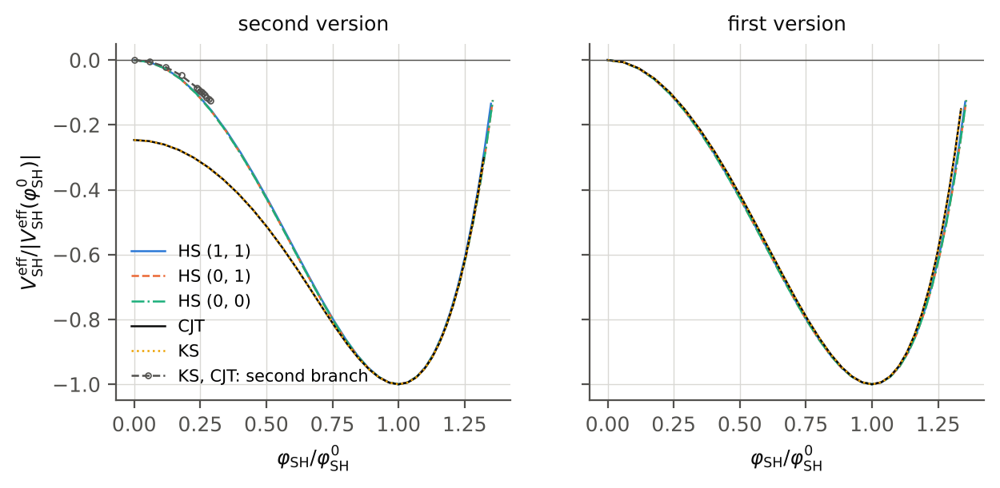

<!-- This file is generated from docs_src/higgs_masses.src.md by code/scripts/assemble_docs.py; edit the source. -->

# 0. What this document is and what it finds

*How to read this document.* It is written for a reader who knows quantum mechanics, special relativity, the Dirac
equation and second quantization at the level of a first graduate course. Every technical word that it uses is explained
in Section 0.1, before the findings, and Appendix A builds the algebra from which its fields come (the octonions, the
Lorentz super-loop, the eight spinor charges, the isodoublet of Dirac spinors $\Psi_{\rm LL}$ and their superfluid), with an
example of every object. The document refers to no other document for what it uses.

The author asked that the hypotheses of PROJECT spacetimes be modified so that the superfluid can be the Higgs field of
the Standard Model, with the quantum numbers of the Higgs doublet. In the second version of the revised hypotheses,
stated in Section 1, the superfluid is a condensate of pairs of a particle of the isodoublet $\Psi_{\rm LL}$ with a particle
of one of the two singlets $\chi_{\rm SH}$ and $\chi'_{\rm SH}$. Stage 3 computed its ground state in three mean-field
approximations, the methods of Hubbard and Stratonovich (HS, with three parameter sets), of Kohn and Sham (KS) and of
Cornwall, Jackiw and Tomboulis (CJT). In every method the ground state is the custodial Higgs superfluid: both pair fields
condense with equal lengths, and the state keeps the electric charge and the custodial symmetry. This document is stage
4: it computes what the Standard Model measures of its Higgs field. Those quantities are the scale of the breaking, the
masses of the weak bosons, the parameter $\rho$, and the mass of the amplitude mode, the particle that would be the
Higgs boson. The first version of the hypotheses (one singlet) is computed alongside as the comparison. All quantities
are first computed in units of the momentum cutoff $\Lambda_{\rm LL}=1$ and then converted to GeV by the value of the scale,
$v_{\rm SH}=246.22$ GeV.

## 0.1 Words used in this document

The documents of the revision use the following words. Each is explained here in a few sentences, so that a reader who
meets it in the text knows what it means; the formulas come in the sections that use them. Appendix A builds the
algebra from which the fields come, with an example of every object.

**The fields and their charges**

* *Dirac field, Dirac spinor.* A field of spin $\tfrac12$ with four components per point that obeys the Dirac equation;
  a Dirac spinor is one solution, such as the wave function of an electron of given momentum and spin. In the chiral
  basis its upper two components are *left-handed* and its lower two *right-handed*; each pair is a *Weyl spinor*.
* *Isospin, isodoublet, isovector (isospin triplet), singlet.* Isospin is a symmetry group $SU(2)$ that mixes fields
  without touching space-time, as rotations mix the components of a spin. An *isodoublet* is a pair of fields that it
  mixes like the two states of a spin $\tfrac12$ ("up" and "down"); an *isovector* or *isospin triplet* is a set of three
  fields that it turns like a vector in three dimensions; a *singlet* is a field that it leaves alone. Two isodoublets
  combine into a triplet and a singlet. Appendix A.5 gives an example of each.
* *$\Psi_{\rm LL}$, the isodoublet of Dirac spinors of the spinor charges.* The field of the eight spinor charges of the
  Lorentz super-loop: two Dirac spinors (up and down) that isospin mixes, eight complex components in all (Appendix A.4).
* *Weak isospin, hypercharge, electric charge.* The gauge group of the electroweak interactions of the Standard Model is
  $SU(2)_L\times U(1)_Y$. Its $SU(2)_L$ is the *weak isospin*, with the third component $T^3$; its $U(1)_Y$ has the charge
  $Y$, the *hypercharge*, which says how strongly a field couples to the gauge field $B_\mu$. The *electric charge* is
  $Q=T^3+Y$ (the rule of Gell-Mann and Nishijima).
* *Vector-like.* A field whose left-handed and right-handed components carry the same charges. The quarks and leptons
  of the Standard Model are not vector-like (their left-handed components are doublets, their right-handed ones
  singlets); the three fields of the revision are.
* *Anomaly.* The loss, through quantum effects, of a symmetry of the classical theory; a gauge theory with an anomaly is
  inconsistent. Vector-like fields contribute none.
* *Particle number, relative number.* Two numbers that the interaction of the revision conserves: the number of particles
  of all three fields, and the number of particles of $\Psi_{\rm LL}$ minus the number of particles of the singlets.

**Symmetries and their breaking**

* *Gauge group, gauge field, covariant derivative.* A gauge group is a group of symmetry transformations that may differ
  from point to point of space-time. Keeping the derivatives of the fields covariant needs a field for each generator, the
  gauge field, and turns the derivative into the covariant derivative.
* *Spontaneous breaking, vacuum.* A symmetry is broken spontaneously when the equations keep it but the state of lowest
  energy, the *vacuum*, does not; the vacuum then belongs to a family of equally good vacua related by the symmetry.
* *Goldstone mode.* For every generator of a global symmetry that the vacuum breaks there is a way of changing the state
  that costs no energy, because it only turns the vacuum into another vacuum of the family: a Goldstone mode, a massless
  excitation. In a gauge theory the Goldstone modes of the gauge generators become the third (longitudinal) polarization
  of the gauge bosons, which become massive: the *Higgs mechanism*.
* *Custodial symmetry, $SU(2)_{\rm R}$, $SU(2)_{\rm V}$.* With the hypercharge coupling switched off, the theory has a larger
  symmetry $SU(2)_L\times SU(2)_{\rm R}$, in which $SU(2)_{\rm R}$ turns the pair of singlets as a doublet. A vacuum proportional to
  $i\tau^2$ keeps the diagonal subgroup $SU(2)_{\rm V}$, the transformations with equal elements of $SU(2)_L$ and $SU(2)_{\rm R}$;
  this is the *custodial symmetry*. Its name comes from its job in the Standard Model: as long as it holds, the masses
  that the vacuum gives the $W$ and $Z$ bosons obey $M_W=M_Z\cos\theta_W$ ($\rho=1$, below); the symmetry "keeps custody"
  of this relation.
* *Custodial superfluid, custodial vacuum.* The superfluid whose vacuum keeps the custodial symmetry: both pair fields
  condense with equal lengths, the down member of $\Psi_{\rm LL}$ pairing with the first singlet and the up member with the
  second.
* *Bidoublet; two Higgs doublets.* A $2\times2$ matrix of fields on which $SU(2)_L$ acts from the left and $SU(2)_{\rm R}$ from
  the right. The two columns of the matrix of the pair fields are doublets of $SU(2)_L$; with the conjugate of the second
  they have the quantum numbers of two Higgs doublets, the scalar content of the models with two Higgs doublets.
* *The parameter $\rho$.* The ratio $M_W^2/(M_Z^2\cos^2\theta_W)$, with the weak mixing angle $\theta_W$
  ($\tan\theta_W=g'/g$); it is 1 at tree level in the Standard Model because of the custodial symmetry.
* *Earlier and revised hypotheses; first and second version.* The *earlier hypotheses* are the superfluid of the spinor
  charges of Appendix A.6, with a scalar and a vector contact term of $\Psi_{\rm LL}$; there $T^3_{\rm LL}$ was the electric charge and
  pairs of two members of $\Psi_{\rm LL}$ condensed. The *revised hypotheses* give $\Psi_{\rm LL}$ the electroweak charges and let it
  pair with singlets. Their *first version* has one singlet, their *second version* two; the second is the model of the
  revision, the first the comparison.

**States and methods**

* *Condensate, superfluid, order parameter.* A *condensate* is a state in which a macroscopic number of particles, here
  pairs of fermions, occupy the same quantum state; a condensate of pairs of fermions is a *superfluid* (in a metal, a
  superconductor). Its *order parameter* is the expectation value of the pair field: zero in the normal state, nonzero in
  the condensate.
* *Normal vacuum.* The state without pairs: every negative-energy state of the free Dirac fields is filled and every
  positive one empty.
* *Gap, quasi-particle.* In a superfluid it costs at least a finite energy, the *gap*, to break a pair. The elementary
  excitations are *quasi-particles*, mixtures of a particle and a missing partner of a pair (a hole).
* *Matrix of Bogoliubov and de Gennes (BdG matrix).* The matrix whose eigenvectors are the quasi-particles; it couples the
  field at the momentum $\vec q$ with its conjugate at $-\vec q$.
* *Mean field.* The first approximation for a contact interaction of four fermion fields: each field feels the average of
  all the others, and the state is the best state of independent quasi-particles. BCS theory of superconductivity is a
  mean-field theory.
* *Uniform quasi-free state.* A state that is the same at every point of space and in which every average of a product
  of fields is fixed by the averages of products of two fields, the *normal* averages $\langle\psi^\dagger\psi\rangle$ and the
  *pair* averages $\langle\psi\psi\rangle$ (Wick's theorem). It is the ground state of a BdG matrix.
* *Self-energy (normal, pair).* The constant matrices in the BdG matrix that the interaction contributes: the *normal*
  self-energy shifts the masses and energies of the particles; the *pair* self-energy creates and destroys pairs (it is
  the gap parameter of BCS theory).
* *Direct, exchange and pair contractions (Hartree, Fock, BCS).* The three ways in which Wick's theorem writes the average
  of a product of four fields as products of averages of two.
* *HS, KS, CJT; pairing-only methods.* The five mean-field methods of the revision. *HS* $(s_{\rm S},s_{\rm V})$ is the method of
  Hubbard and Stratonovich at the saddle point: it rewrites the square of a bilinear of fields with an auxiliary field,
  which at the saddle point equals the average of the bilinear; the shares $s_{\rm S}$, $s_{\rm V}$ of the scalar and the vector
  term are rewritten in density channels, the rest in pair channels, and no exchange contraction is kept. *KS* is the
  method of Kohn and Sham of density-functional theory, with all three contractions and the exchange projected onto
  local densities. *CJT* is the effective action of Cornwall, Jackiw and Tomboulis, a functional of the averages of two
  fields whose stationary points are the self-consistent states, with all three contractions. In HS (0,1) and HS (0,0),
  the *pairing-only methods*, only the pairing terms act on the states of the revision.
* *Stationary (self-consistent) state.* A state whose self-energies are those that its own averages produce.
* *Static response; critical coupling.* If a small static field of some kind is imposed on a state, the state answers
  with averages of that kind; the ratios of answer to cause are the eigenvalues of the *static response*. An eigenvalue
  above 1 means that the answer grows by itself: the state is unstable in that direction. The *critical coupling* is
  the coupling at which the largest eigenvalue of the normal vacuum reaches 1; above it, the pairs condense.
* *Cutoff $\Lambda_{\rm LL}$.* The largest momentum of the uniform states; it is the unit of energy and of momentum.

**Responses, masses and modes**

* *Effective potential; Mexican hat.* The energy of the best uniform state with a prescribed size of the order
  parameter. As a function of the complex pair amplitude it is high at zero and lowest on a circle, like the brim of a
  hat: a *Mexican hat*. The points of the brim differ only by the phase of the condensate.
* *Susceptibility; phase stiffness.* A uniform static gauge field acts on the charges like a chemical potential; the
  *susceptibilities* say how much charge the state takes up in answer. For a condensate they measure its *phase
  stiffness*, the energy that it costs to twist the phase of the condensate from point to point, and they give the gauge
  bosons their masses.
* *Scale $v_{\rm SH}$.* The scale of the breaking, defined by $M_W=\tfrac12gv_{\rm SH}$ as the Standard Model defines $v=246.22$ GeV.
* *Amplitude mode.* On the Mexican hat a small oscillation of the condensate can go two ways. Along the brim it changes
  only the phase (the Goldstone modes). Across the brim it changes the size of the condensate; this costs energy and has
  a finite frequency: the *amplitude mode*. In the Standard Model the Higgs boson is the amplitude mode of the Higgs
  field, so the amplitude mode of the superfluid is the candidate for the Higgs boson.
* *Linear response; pole.* How a state answers a small disturbance that oscillates with the frequency $\omega$. A natural
  oscillation of the state shows up as a *pole* of the response, a frequency at which an arbitrarily small push gives a
  finite answer.
* *Effective Lagrangian.* The description of the slow, long-wavelength motions of the order parameter by a kinetic term
  and the effective potential; it gives the amplitude mode to leading order in its frequency.
* *Threshold; bound state; resonance.* The *threshold* is the lowest energy of two free quasi-particles, the energy that
  breaks a pair. A mode below it is a *bound state* of two quasi-particles and does not decay; a mode above it can decay
  into pairs and is a *resonance*, with a width.
* *Time-dependent mean field.* The equations of motion of the averages of a quasi-free state, integrated in time (here
  with the integrator CVODE of SUNDIALS).
* *Josephson relation.* With a chemical potential $\mu$ of the particle number the phase of a condensate of pairs turns at
  the rate $2\mu$, because a pair carries the particle number 2.
* *Critical region.* The range of temperatures near a phase transition in which the fluctuations of the order parameter,
  which the mean field leaves out, dominate; its width is estimated by the criterion of Levanyuk and Ginzburg.

## 0.2 The findings

1. **The superfluid is a minimum of its effective potential.** Along the direction of the vacuum, the energy of the
   lowest state with a given pair amplitude is a Mexican hat. It falls from its top, at zero pair amplitude, to the
   ground state of stage 3 and rises beyond it, in every method and both versions (Section 2). The top is the normal
   vacuum, of zero energy, except in KS and CJT of the second version. There the top is the scalar condensate of stage
   3, a state without pairs in which the Dirac masses of all four species are negative, at
   $V^{\rm eff}_{\rm SH}(0)=-0.247\,\lvert V^{\rm eff}_{\rm SH}(\varphi^0_{\rm SH})\rvert$. In these two methods the
   states continued from the normal vacuum form a second branch, which lies above the effective potential and which
   the continuation follows up to $d_{\rm SH}=0.24\,d^0_{\rm SH}$. The first version of this document said that the hat is zero in the
   normal vacuum in every method; for these two methods that was false (Section 2.3).
2. **The photon is massless, and in the second version $\rho=1$ exactly.** The susceptibilities of the superfluid to the
   chemical potentials of the generators are computed (Section 3). The electric charge has zero susceptibility in every
   method, so the mass matrix of the electroweak gauge bosons has one zero eigenvalue with the eigenvector of the photon.
   The second version has the custodial structure: in every method $\rho_{\rm SH}$ is $1$. The first version
   has $\rho_{\rm SH}$ from $1.202$ to $1.247$, which the measured $\rho$ excludes.
3. **The number of broken generators is four in the second version.** The susceptibility matrix of the eight generators
   has rank four in every method. The three generators of $SU(2)_L\times U(1)_Y$ that the photon does not keep give the
   longitudinal parts of $W^\pm_\mu$ and $Z_\mu$; the fourth, the particle number, gives a massless Goldstone boson. The
   linear response at zero frequency finds the same four modes (Section 5).
4. **The scale.** $v_{\rm SH}=2(\chi^{11}_{\rm SH})^{1/2}$ is $0.102$ to $0.1116$ in units of the cutoff in the second version.
   With $v_{\rm SH}=246.22$ GeV the cutoff $\Lambda_{\rm LL}$ is $2207$ to $2413$ GeV, and the lightest fermionic excitations,
   which carry the fractional electric charges $\tfrac34$ and $-\tfrac14$, have masses of $848$ to $1.09\times10^{3}$ GeV (Section 4).
5. **The amplitude mode lies exactly at the pair self-energy, and it is far too heavy.** In the pairing-only methods
   HS (0, 1) and HS (0, 0) the linear response has a closed form, that of the theory of Bardeen, Cooper and Schrieffer
   for a superconductor. It puts the amplitude mode exactly at $\omega^{\rm H}_{\rm SH}=d^0_{\rm SH}$, below the threshold of two
   quasi-particles, for every coupling and mass (Section 5.3). With the scale of the second version this is
   $M_{\rm H}/v_{\rm SH}=7.967$, that is $1962$ GeV. The effective Lagrangian gives
   $9.22$ to $9.57$ in all five methods. The Standard Model has $m_{\rm H}/v=0.5082$: the superfluid's amplitude
   mode is $16$ to $19$ times too heavy (Section 5).
6. **No coupling repairs it.** In HS (0, 0), where the ground state has a closed form, $M_{\rm H}/v_{\rm SH}$ lies between
   $4.892$ and $34.43$ for $1.02\le G_{\rm SH}/G^{\rm crit}_{\rm SH}\le3$ and the masses 0.1 and 0.2 of the fields
   (Section 6). The mean-field superfluid of these hypotheses therefore does not have the mass of the Higgs boson.
7. **The second version has the scalars of two Higgs doublets.** Its two pair fields have eight real components, twice
   those of the Higgs doublet. In the pairing-only methods the response has four Goldstone modes and four massive modes,
   all four at $\omega^{\rm H}_{\rm SH}$. Under the custodial symmetry each set is a singlet and a triplet. Besides the candidate
   for the Higgs boson there are therefore three more massive scalars, a neutral one and a charged one with its
   antiparticle, degenerate with it in these methods (Section 5.3).

"I" in this document is the assistant that does the work.

# 1. The hypotheses and the ground state

*In words.* This section repeats the model of the revision and the ground state that stage 3 found, so that this
document can be read alone.

## 1.1 The fields and their charges

There are three spinor fields, all four-component Dirac fields of $SL(2,\mathbb C)$ and all singlets of colour:

* the isodoublet $\Psi_{\rm LL}$, the field of the eight spinor charges of the Lorentz super-loop (Appendix A.4), has
  eight components, numbered $2d+s$, where $d=0,\dots,3$ is the Dirac index of the chiral
  basis and $s=0$ (up) or $s=1$ (down) is the isospin index;
* the singlets $\chi_{\rm SH}$ and $\chi'_{\rm SH}$ have four components each, numbered by the Dirac index.

The masses are $m_{\rm LL}=m^\chi_{\rm SH}=m^{\chi'}_{\rm SH}=0.2\,\Lambda_{\rm LL}$. Together the three fields form one field of sixteen
components, $\Psi_{\rm SH}=(\Psi_{\rm LL},\chi_{\rm SH},\chi'_{\rm SH})$: components 0 to 7 are those of $\Psi_{\rm LL}$, 8 to 11 those of
$\chi_{\rm SH}$ and 12 to 15 those of $\chi'_{\rm SH}$.

The gauge group is $SL(2,\mathbb C)\times SU(2)_L\times U(1)_Y$. The generators $T^{a,{\rm SM}}$ ($a=1,2,3$) of $SU(2)_L$ act as
$\mathsf 1_4\otimes\tfrac12\tau^a$ on $\Psi_{\rm LL}$ and as 0 on the singlets, where $\tau^a$ are the Pauli matrices. The hypercharge
$Y^{\rm SM}$ is $\tfrac14$ on $\Psi_{\rm LL}$ and $\chi_{\rm SH}$ and $-\tfrac34$ on $\chi'_{\rm SH}$, and the electric charge is
$Q^{\rm SM}=T^{3,{\rm SM}}+Y^{\rm SM}$. Two further numbers are conserved, global symmetries that are not gauged:

* the particle number $F^{\rm tot}_{\rm SH}$, 1 on every component;
* the relative number $R_{\rm SH}$, $+1$ on the components of $\Psi_{\rm LL}$ and $-1$ on those of the singlets.

With equal masses there is one more symmetry, the custodial group $SU(2)_{\rm R}$. Its generators $T^{a,{\rm R}}_{\rm SH}$ act as
$\tfrac12\tau^a$ on the pair of singlets $(\chi_{\rm SH},\chi'_{\rm SH})$, taken as a doublet with $\chi_{\rm SH}$ above, and as 0 on
$\Psi_{\rm LL}$. The hypercharge is the combination $Y^{\rm SM}=T^{3,{\rm R}}_{\rm SH}+\tfrac14R_{\rm SH}$. The eight generators $T^{a,{\rm SM}}$,
$T^{a,{\rm R}}_{\rm SH}$, $R_{\rm SH}$ and $F^{\rm tot}_{\rm SH}$ form the global group of the hypotheses.

| field component | $T^{3,{\rm SM}}$ | $T^{3,{\rm R}}_{\rm SH}$ | $Y^{\rm SM}$ | $Q^{\rm SM}$ | $F^{\rm tot}_{\rm SH}$ | $R_{\rm SH}$ |
|:---|:---|:---|:---|:---|:---|:---|
| $\Psi_{\rm LL}$, up | $+\tfrac12$ | 0 | $\tfrac14$ | $\tfrac34$ | 1 | $+1$ |
| $\Psi_{\rm LL}$, down | $-\tfrac12$ | 0 | $\tfrac14$ | $-\tfrac14$ | 1 | $+1$ |
| $\chi_{\rm SH}$ | 0 | $+\tfrac12$ | $\tfrac14$ | $\tfrac14$ | 1 | $-1$ |
| $\chi'_{\rm SH}$ | 0 | $-\tfrac12$ | $-\tfrac34$ | $-\tfrac34$ | 1 | $-1$ |

Table 1.1. The charges of the particles of the three fields. Antiparticles have the opposite charges.

## 1.2 The pair fields

In the chiral basis the Dirac matrices are
$\gamma^0_{\rm LL}=\begin{pmatrix}0&\mathsf 1_2\\\mathsf 1_2&0\end{pmatrix}$, $\gamma^j_{\rm LL}=\begin{pmatrix}0&\sigma^{\rm LL}_j\\-\sigma^{\rm LL}_j&0\end{pmatrix}$
($j=1,2,3$, with the Pauli matrices $\sigma^{\rm LL}_j$), $\beta_{\rm LL}=\gamma^0_{\rm LL}$,
$\alpha^j_{\rm LL}=\gamma^0_{\rm LL}\gamma^j_{\rm LL}$, $\gamma^{\rm ch}_{\rm LL}=i\gamma^0_{\rm LL}\gamma^1_{\rm LL}\gamma^2_{\rm LL}\gamma^3_{\rm LL}$, and the
charge-conjugation matrix is $C_{\rm LL}=i\gamma^2_{\rm LL}\gamma^0_{\rm LL}$. The pair operators of $\Psi_{\rm LL}$ with the singlets are
$$\Pi^s_{\rm SH}=\tfrac12\Psi^T_{\rm LL}\big(C_{\rm LL}\gamma^{\rm ch}_{\rm LL}\otimes\mathbf e^s_{\rm SH}\big)\chi_{\rm SH},\qquad
\Pi'^s_{\rm SH}=\tfrac12\Psi^T_{\rm LL}\big(C_{\rm LL}\gamma^{\rm ch}_{\rm LL}\otimes\mathbf e^s_{\rm SH}\big)\chi'_{\rm SH},\qquad s={\rm u},{\rm d},\tag{1.1}$$
with the isospin columns $\mathbf e^{\rm u}_{\rm SH}=(1,0)^T$ and $\mathbf e^{\rm d}_{\rm SH}=(0,1)^T$. Each annihilates two particles in a
state of spin zero and positive parity. On the whole field, $\Psi^T_{\rm SH}\mathsf K^s_{\rm SH}\Psi_{\rm SH}=2\Pi^s_{\rm SH}$ and
$\Psi^T_{\rm SH}\mathsf K'^s_{\rm SH}\Psi_{\rm SH}=2\Pi'^s_{\rm SH}$. Here $\mathsf K^s_{\rm SH}$ is the antisymmetric $16\times16$ matrix with the
block $\tfrac12C_{\rm LL}\gamma^{\rm ch}_{\rm LL}\otimes\mathbf e^s_{\rm SH}$ in the rows of $\Psi_{\rm LL}$ and the columns of $\chi_{\rm SH}$, minus its
transpose in the opposite block, and zero elsewhere; $\mathsf K'^s_{\rm SH}$ is the same with the columns of $\chi'_{\rm SH}$. These
four matrices are real.

The pair fields are the expectation values: $\Phi_{\rm SH}=(\langle\Pi^{\rm u}_{\rm SH}\rangle,\langle\Pi^{\rm d}_{\rm SH}\rangle)$ is a doublet of
$SU(2)_L$ with the hypercharge $\tfrac12$, the quantum numbers of the Higgs doublet, and
$\Phi'_{\rm SH}=(\langle\Pi'^{\rm u}_{\rm SH}\rangle,\langle\Pi'^{\rm d}_{\rm SH}\rangle)$ is a doublet with the hypercharge $-\tfrac12$. Their
neutral components are $\langle\Pi^{\rm d}_{\rm SH}\rangle$ and $\langle\Pi'^{\rm u}_{\rm SH}\rangle$.

## 1.3 The Hamiltonian density and the methods

The Hamiltonian density is
$$\begin{aligned}\mathcal H_{\rm SH}={}&\Psi^\dagger_{\rm SH}\mathsf h_{\rm SH}(-i\nabla)\Psi_{\rm SH}+\tfrac12G^{\rm S}_{\rm SF}{:}(\bar\Psi_{\rm LL}\Psi_{\rm LL})^2{:}
+\tfrac12G^{\rm V}_{\rm SF}{:}\Big[(\Psi^\dagger_{\rm LL}\Psi_{\rm LL})^2-\sum_j\big(\Psi^\dagger_{\rm LL}(\alpha^j_{\rm LL}\otimes\mathsf 1_2)\Psi_{\rm LL}\big)^2\Big]{:}\\
&-G_{\rm SH}\sum_{s={\rm u},{\rm d}}\big[{:}(\Pi^s_{\rm SH})^\dagger\Pi^s_{\rm SH}{:}+{:}(\Pi'^s_{\rm SH})^\dagger\Pi'^s_{\rm SH}{:}\big].\end{aligned}\tag{1.2}$$
Its parts:

* $\mathsf h_{\rm SH}(\vec q_{\rm LL})$ is the free Dirac Hamiltonian of the sixteen components on a plane wave of momentum
  $\vec q_{\rm LL}$, block-diagonal with $(\alpha^j_{\rm LL}q^j_{\rm LL}+\beta_{\rm LL}m_{\rm LL})\otimes\mathsf 1_2$ on $\Psi_{\rm LL}$ and
  $\alpha^j_{\rm LL}q^j_{\rm LL}+\beta_{\rm LL}m_{\rm LL}$ on each singlet (summed over $j$); the momenta are those with
  $\lvert\vec q_{\rm LL}\rvert<\Lambda_{\rm LL}$;
* $\bar\Psi_{\rm LL}=\Psi^\dagger_{\rm LL}(\gamma^0_{\rm LL}\otimes\mathsf 1_2)$, and the colons order the products of field operators so that
  their expectation value in the normal vacuum (the state without pairs) is zero;
* the couplings are those of the potential $V^{(1)}_{\rm SH}$ of stage 3: $G^{\rm S}_{\rm SF}=-8$ and $G^{\rm V}_{\rm SF}=0.8$ (the scalar and the
  vector contact terms of the author's ansatz) and $G_{\rm SH}=100.8$ (the pairing terms), in units of $\Lambda_{\rm LL}^{-2}$.

In the **first version** of the hypotheses the terms of $\Pi'^s_{\rm SH}$ are absent, and $\chi'_{\rm SH}$ is a free field.

The three methods approximate the state by a uniform quasi-free state. Such a state is the ground state of a quadratic
Hamiltonian with constant self-energies, a Hermitian $16\times16$ matrix $\mathsf N_{\rm SH}$ and an antisymmetric one $\mathsf P_{\rm SH}$.
At the momentum $\vec q_{\rm LL}$ its Bogoliubov-de Gennes (BdG) matrix is
$$\mathsf H_{\rm SH}(\vec q_{\rm LL})=\begin{pmatrix}\mathsf h_{\rm SH}(\vec q_{\rm LL})+\mathsf N_{\rm SH}&\mathsf P_{\rm SH}\\\mathsf P_{\rm SH}^\dagger&-\big(\mathsf h_{\rm SH}(-\vec q_{\rm LL})+\mathsf N_{\rm SH}\big)^T\end{pmatrix},\tag{1.3}$$
and the state fills its negative eigenvalues. Its local matrices are the integrals over the momenta of the normal
correlation matrix, measured from the normal vacuum, and of the pair correlation matrix: $\varrho_{\rm SH}$ and $\kappa_{\rm SH}$.
The energy per volume of the state, measured from the normal vacuum, is $\mathcal E^X_{\rm SH}$: the kinetic part plus the
interaction energy that method $X$ assigns to the local matrices. A method keeps the three Wick contractions of every
contact term with its own weights:

* HS rewrites each four-fermion term as the exchange of an auxiliary field and keeps the direct contraction of the terms
  decoupled in density channels and the pair contraction of those decoupled in pair channels. Its parameters
  $s^{\rm HS,S}_{\rm SF}$ and $s^{\rm HS,V}_{\rm SF}$ are the shares of the scalar and of the vector term decoupled in density channels;
  HS (1, 1), HS (0, 1) and HS (0, 0) denote $(s^{\rm HS,S}_{\rm SF},s^{\rm HS,V}_{\rm SF})$. The pairing terms are decoupled in their own pair
  channels. HS keeps no exchange contraction.
* KS keeps all three contractions, the exchange evaluated with the projection of $\varrho_{\rm SH}$ onto sixteen local densities:
  the number and the scalar densities of $\Psi_{\rm LL}$ as $2\times2$ matrices in the isospin space and those of the pair of
  singlets as $2\times2$ matrices in the space of the two singlets.
* CJT keeps all three contractions with the weight 1 (the two-loop effective action of the propagator).

The self-energies are the derivatives of the interaction energy with respect to the local matrices, and a stationary
state is a state whose self-energies are those that its own local matrices produce. The programs find stationary
states by iteration on a grid of 24 radial nodes of $\lvert\vec q_{\rm LL}\rvert$ times the six directions of the coordinate axes.

## 1.4 The ground states of stage 3

In every method the ground state of $V^{(1)}_{\rm SH}$ in the second version is the custodial Higgs superfluid. Its pair
self-energy is $\mathsf P_{\rm SH}=d_{\rm SH}\,\mathsf P^{\rm vac}_{\rm SH}$ with a real number $d_{\rm SH}=d^0_{\rm SH}>0$ and the direction of the vacuum
$$\mathsf P^{\rm vac}_{\rm SH}=(\mathsf K'^{\rm u}_{\rm SH})^\dagger-(\mathsf K^{\rm d}_{\rm SH})^\dagger\qquad\text{(second version)},\qquad
\mathsf P^{\rm vac}_{\rm SH}=(\mathsf K^{\rm d}_{\rm SH})^\dagger\qquad\text{(first version)}.\tag{1.4}$$
A rotation by the particle number multiplies $\mathsf P_{\rm SH}$ by a phase. The programs rotate that phase away, so that
$d_{\rm SH}$ is real and positive. In the second version the down particles are paired with $\chi_{\rm SH}$ and the up particles
with $\chi'_{\rm SH}$, the two pair fields have equal lengths, and the state keeps the electric charge, the custodial group
$SU(2)_{\rm V}$ (generated by $T^{a,{\rm SM}}+T^{a,{\rm R}}_{\rm SH}$) and $R_{\rm SH}$. In the first version the ground state is the condensate of
$\Phi_{\rm SH}$ alone: the down particles are paired with $\chi_{\rm SH}$ and the up particles are unpaired.

Stage 3 found one more stationary state without pairs, in KS and CJT of the second version only: the **scalar
condensate**. Its normal self-energy shifts the Dirac masses of all four species (defined in Section 2.1) to negative
values, $M^{\rm u}_{\rm SH}=M^{\rm d}_{\rm SH}=-0.329757$ and $M^\chi_{\rm SH}=M^{\chi'}_{\rm SH}=-0.0981686$, at the energy
$10^4\,\mathcal E^X_{\rm SH}=-4.05023$, below the normal vacuum and above the ground state. It occurs only where the
exchange contractions couple the scalar density of $\Psi_{\rm LL}$ with those of both singlets, and it is unstable towards
the pairs.

The **pair amplitude** of a state is
$$\varphi_{\rm SH}=\lvert\langle\Pi^{\rm d}_{\rm SH}\rangle\rvert=\tfrac12\big\lvert\mathrm{tr}\big(\mathsf K^{\rm d}_{\rm SH}\kappa_{\rm SH}^T\big)\big\rvert,\tag{1.5}$$
the length of the neutral component of $\Phi_{\rm SH}$. In the states of the second version computed here it equals
$\lvert\langle\Pi'^{\rm u}_{\rm SH}\rangle\rvert$, the length of the neutral component of $\Phi'_{\rm SH}$ (check H-2d); the program uses the
mean of the two.

# 2. The effective potential

*In words.* The effective potential is the energy of the best uniform state with a prescribed size of the pair
condensate. Plotted against that size it has the shape of a Mexican hat, high at zero and lowest at the size of the
ground state; its curvature at the bottom decides how stiff the condensate is against a change of its size, and with it
the mass of the amplitude mode.

## 2.1 Definition and method

The effective potential $V^{\rm eff}_{\rm SH}(\varphi_{\rm SH})$ is the lowest energy per volume of the uniform states with the pair
amplitude $\varphi_{\rm SH}$ along the direction of the vacuum. It is computed as follows. Minimizing the energy at a fixed
pair amplitude adds a Lagrange multiplier times $\Pi^{\rm d}_{\rm SH}+(\Pi^{\rm d}_{\rm SH})^\dagger$ (and the same for $\Pi'^{\rm u}_{\rm SH}$ in the
second version) to the Hamiltonian. The stationary state of the constrained problem is therefore the ground state of
(1.3) with a pair self-energy along $\mathsf P^{\rm vac}_{\rm SH}$, $\mathsf P_{\rm SH}=d_{\rm SH}\mathsf P^{\rm vac}_{\rm SH}$, for some $d_{\rm SH}$. The
normal self-energy $\mathsf N_{\rm SH}$ is the one that its own local matrices produce. So the program:

* fixes $d_{\rm SH}$ and iterates $\mathsf N_{\rm SH}$ to self-consistency from a given start;
* records the energy $\mathcal E^X_{\rm SH}$, the pair amplitude $\varphi_{\rm SH}$ and the Dirac masses of the state;
* does this for 33 values $d_{\rm SH}=0,0.05\,d^0_{\rm SH},\dots,1.6\,d^0_{\rm SH}$, by continuation: each state is started from
  the normal self-energy of its neighbour.

The Dirac mass of a species is its bare mass plus a quarter of the trace of the normal self-energy with the matrix
$\beta_{\rm LL}$ of that species: $M^{\rm u}_{\rm SH}=m_{\rm LL}+\tfrac14\mathrm{tr}(\beta^{\rm u}_{\rm SH}\mathsf N_{\rm SH})$, with
$\beta^{\rm u}_{\rm SH}$ equal to $\beta_{\rm LL}$ on the up component of $\Psi_{\rm LL}$ and zero on the other components, and
likewise $M^{\rm d}_{\rm SH}$, $M^\chi_{\rm SH}$ and $M^{\chi'}_{\rm SH}$ (with the bare masses $m^\chi_{\rm SH}$ and $m^{\chi'}_{\rm SH}$ of the
singlets).

At a fixed $d_{\rm SH}$ the self-consistent $\mathsf N_{\rm SH}$ need not be unique: at $d_{\rm SH}=0$, KS and CJT of the second
version have two stationary states, the normal vacuum and the scalar condensate (Section 1.4). The continuation is
therefore made from both ends of the curve:

* from the ground state, downward to $d_{\rm SH}=0$ and upward to $1.6\,d^0_{\rm SH}$: the *branch of the ground state*;
* from the normal vacuum, $\mathsf N_{\rm SH}=0$ at $d_{\rm SH}=0$, upward.

Where the two continuations reach different states at the same $d_{\rm SH}$, $V^{\rm eff}_{\rm SH}$ is the lower of the two
branches at the same pair amplitude. Where the continuation from the normal vacuum follows a branch of its own, it is
also followed with the step $0.005\,d^0_{\rm SH}$ from its last point of the grid, to its end.

A branch, the curve $(\varphi_{\rm SH}(d_{\rm SH}),\mathcal E^X_{\rm SH}(d_{\rm SH}))$, is a curve of states in parametric form. At $d_{\rm SH}=d^0_{\rm SH}$ the
pair self-energy that the local matrices produce equals the fixed one: the state is the ground state (check H-1). The
derivatives at the minimum $\varphi^0_{\rm SH}=\varphi_{\rm SH}(d^0_{\rm SH})$ follow from central differences in $d_{\rm SH}$ with the
steps 0.01 and 0.02, combined by Richardson extrapolation:
$$V^{\rm eff\,\prime}_{\rm SH}=\frac{\mathcal E'}{\varphi'},\qquad V^{\rm eff\,\prime\prime}_{\rm SH}=\frac{\mathcal E''-V^{\rm eff\,\prime}_{\rm SH}\varphi''}{\varphi'^2},\tag{2.1}$$
where the primes on $\mathcal E$ and $\varphi$ are derivatives with respect to $d_{\rm SH}$.

## 2.2 The closed form of the pairing-only methods

In HS (0, 1) and HS (0, 0) only the pairing terms act on these states, and the normal self-energy is zero. Then every
quasi-particle has the energy $E=(q_{\rm LL}^2+(M^{\rm eff}_{\rm SH})^2)^{1/2}$ with $M^{\rm eff}_{\rm SH}=(m_{\rm LL}^2+d_{\rm SH}^2/4)^{1/2}$, by the identity
$(C_{\rm LL}\gamma^{\rm ch}_{\rm LL})(-\alpha^j_{\rm LL}q^j_{\rm LL}+\beta_{\rm LL}m_{\rm LL})(C_{\rm LL}\gamma^{\rm ch}_{\rm LL})^{-1}=(\alpha^j_{\rm LL}q^j_{\rm LL}+\beta_{\rm LL}m_{\rm LL})^T$,
and the pair correlation matrix is $\mathsf P_{\rm SH}/(2E)$. With
$$I^{(1)}_{\rm SF}(M)=\int_0^{\Lambda_{\rm LL}}\frac{q^2\,dq}{(q^2+M^2)^{1/2}},\qquad J^{(3)}_{\rm SH}(M)=\int_0^{\Lambda_{\rm LL}}\frac{q^2\,dq}{(q^2+M^2)^{3/2}}=\mathrm{arsinh}\frac{\Lambda_{\rm LL}}{M}-\frac{\Lambda_{\rm LL}}{(\Lambda_{\rm LL}^2+M^2)^{1/2}}\tag{2.2}$$
this gives, for each condensed pair,
$$\varphi_{\rm SH}(d_{\rm SH})=\frac{d_{\rm SH}\,I^{(1)}_{\rm SF}(M^{\rm eff}_{\rm SH})}{4\pi^2},\qquad\frac{dV^{\rm eff}_{\rm SH}}{d\varphi_{\rm SH}}=2\big(d_{\rm SH}-G_{\rm SH}\varphi_{\rm SH}\big)\ \text{(one pair)}.\tag{2.3}$$
The second relation holds because the BdG ground state with the pair self-energy $d_{\rm SH}\mathsf P^{\rm vac}_{\rm SH}$ minimizes the
kinetic energy minus $2d_{\rm SH}\varphi_{\rm SH}$, and the interaction energy of one pair is $-G_{\rm SH}\varphi_{\rm SH}^2$. The minimum is at
$d_{\rm SH}=G_{\rm SH}\varphi_{\rm SH}$, which is the gap equation $G_{\rm SH}I^{(1)}_{\rm SF}(M^{\rm eff}_{\rm SH})/(4\pi^2)=1$, and there
$\varphi^0_{\rm SH}=d^0_{\rm SH}/G_{\rm SH}$. Differentiating once more, with $dI^{(1)}_{\rm SF}/dM=-M\,J^{(3)}_{\rm SH}(M)$,
$$V^{\rm eff\,\prime\prime}_{\rm SH}(\varphi^0_{\rm SH})=\frac{2\pi^2(d^0_{\rm SH})^2J^{(3)}_{\rm SH}}{I^{(1)}_{\rm SF}\big(I^{(1)}_{\rm SF}-(d^0_{\rm SH})^2J^{(3)}_{\rm SH}/4\big)}\tag{2.4}$$
for one pair, at $M=M^{\rm eff}_{\rm SH}$. In the second version both pairs move together along $\mathsf P^{\rm vac}_{\rm SH}$, and the curvature is
twice (2.4). The Wolfram script evaluates (2.4) to 30 digits (check WH-3) and the Python program computes it from the
energies of its own engine (check YH-3); both agree with the Rust program.

## 2.3 The results

Table 2.1 gives, for each method and version, the minimum of the effective potential: the pair self-energy and the
pair amplitude of the ground state, its energy, and the curvature there.

Table 2.1. The minimum of the effective potential of $V^{(1)}_{\rm SH}$.

| version | method | $d^0_{\rm SH}$ | $\varphi^0_{\rm SH}$ | $10^4\,\mathcal E^X_{\rm SH}$ | $V^{\rm eff\,\prime\prime}_{\rm SH}(\varphi^0_{\rm SH})$ |
|:-------|:-----------|:-----------|:-----------|:-----------|:-----------|
| second | HS (1, 1) | $0.832878$ | $0.00826267$ | $-11.2952$ | $149.188$ |
| second | HS (0, 1) | $0.812846$ | $0.00806394$ | $-10.5678$ | $143.361$ |
| second | HS (0, 0) | $0.812846$ | $0.00806394$ | $-10.5678$ | $143.361$ |
| second | KS | $0.890787$ | $0.00883717$ | $-16.4192$ | $181.683$ |
| second | CJT | $0.890787$ | $0.00883717$ | $-16.4192$ | $181.683$ |
| first | HS (1, 1) | $0.82581$ | $0.00819256$ | $-5.49853$ | $73.148$ |
| first | HS (0, 1) | $0.812846$ | $0.00806394$ | $-5.28389$ | $71.6803$ |
| first | HS (0, 0) | $0.812846$ | $0.00806394$ | $-5.28389$ | $71.6803$ |
| first | KS | $0.867286$ | $0.00860402$ | $-6.2857$ | $80.0121$ |
| first | CJT | $0.867286$ | $0.00860402$ | $-6.2857$ | $80.0121$ |

In every method and both versions the effective potential, the branch of the ground state, is a Mexican hat (check
H-3a): it decreases from $\varphi_{\rm SH}=0$ to its minimum at $d_{\rm SH}=d^0_{\rm SH}$ and increases beyond it, and
$\varphi_{\rm SH}$ grows monotonically with $d_{\rm SH}$ (Figure 1). The curvature is positive and the first derivative vanishes
at $\varphi^0_{\rm SH}$ to the accuracy of the differences (checks H-2a and H-2b). In HS (0, 1) and HS (0, 0) the curvature
of the second version is twice that of the first, because two equal pairs move together (Section 2.2); in the other
methods the ratio is $2.04$ to $2.27$.

{width=100%}

**Figure 1.** The effective potential $V^{\rm eff}_{\rm SH}$, divided by the depth $\lvert V^{\rm eff}_{\rm SH}(\varphi^0_{\rm SH})\rvert$ of its
minimum, against $\varphi_{\rm SH}/\varphi^0_{\rm SH}$, for the five methods: the second version (left) and the first (right).
KS and CJT coincide; the dotted line of KS lies on the solid line of CJT. The dashed line with circles is the second
branch of KS and CJT of the second version, the states continued from the normal vacuum; the circles are its computed
states.

**The top of the hat.** Table 2.2 gives the state of the branch of the ground state at $\varphi_{\rm SH}=0$. In HS (1, 1),
HS (0, 1) and HS (0, 0) of both versions and in KS and CJT of the first version it is the normal vacuum, with
$V^{\rm eff}_{\rm SH}(0)=0$ and the bare masses. In these eight computations the continuation from the normal vacuum gives the
same state at every point of the grid, to $4\times10^{-13}$ of the depth (checks H-3b and H-3c). In KS and CJT of the
second version the branch of the ground state ends at $d_{\rm SH}=0$ in the scalar condensate of stage 3: its energy and
its four masses agree with those of stage 3 to $3\times10^{-11}$ (check H-3b). The top of the hat therefore lies below
zero, at $-0.247$ times the depth of the minimum. Along this branch the masses of $\Psi_{\rm LL}$ stay negative,
from $-0.3298$ at the top to $-0.06228$ at the minimum. Those of the singlets rise from
$-0.09817$ to $0.06011$ and change sign between $d_{\rm SH}=0.6\,d^0_{\rm SH}$ and
$0.65\,d^0_{\rm SH}$. In these two methods the ground state is thus connected, along the direction of the
vacuum, to the scalar condensate, not to the normal vacuum.

Table 2.2. The top of the hat: the state of the branch of the ground state at $\varphi_{\rm SH}=0$, its energy, the ratio
of that energy to the depth of the minimum, $\lvert V^{\rm eff}_{\rm SH}(\varphi^0_{\rm SH})\rvert$ (the column "depth"), and its
Dirac masses.

| version | method | the state at $\varphi_{\rm SH}=0$ | $10^4\,V^{\rm eff}_{\rm SH}(0)$ | $V^{\rm eff}_{\rm SH}(0)$ / depth | $M^{\rm u}_{\rm SH}=M^{\rm d}_{\rm SH}$ | $M^\chi_{\rm SH}$ | $M^{\chi'}_{\rm SH}$ |
|:-------|:---------|:-------------|:-------------|:---------------|:-------------|:-------------|:-------------|
| second | HS (1, 1) | the normal vacuum | $0$ | $0$ | $0.2$ | $0.2$ | $0.2$ |
| second | HS (0, 1) | the normal vacuum | $0$ | $0$ | $0.2$ | $0.2$ | $0.2$ |
| second | HS (0, 0) | the normal vacuum | $0$ | $0$ | $0.2$ | $0.2$ | $0.2$ |
| second | KS | the scalar condensate | $-4.05023$ | $-0.2467$ | $-0.329757$ | $-0.0981686$ | $-0.0981686$ |
| second | CJT | the scalar condensate | $-4.05023$ | $-0.2467$ | $-0.329757$ | $-0.0981686$ | $-0.0981686$ |
| first | HS (1, 1) | the normal vacuum | $0$ | $0$ | $0.2$ | $0.2$ | $0.2$ |
| first | HS (0, 1) | the normal vacuum | $0$ | $0$ | $0.2$ | $0.2$ | $0.2$ |
| first | HS (0, 0) | the normal vacuum | $0$ | $0$ | $0.2$ | $0.2$ | $0.2$ |
| first | KS | the normal vacuum | $0$ | $0$ | $0.2$ | $0.2$ | $0.2$ |
| first | CJT | the normal vacuum | $0$ | $0$ | $0.2$ | $0.2$ | $0.2$ |

**The second branch.** In KS and CJT of the second version the continuation from the normal vacuum follows a branch of
its own. Its masses of $\Psi_{\rm LL}$ stay positive and fall slowly from the bare mass $0.2$, to $0.1225$
at its last computed state. At the same pair amplitude its energy lies above the effective potential, by
$0.21$ to $0.247$ times the depth of the minimum (check H-3d). With the step $0.05\,d^0_{\rm SH}$ the continuation
stays on this branch up to $d_{\rm SH}=0.2\,d^0_{\rm SH}$ and is on the branch of the ground state from the
next point on. With the step $0.005\,d^0_{\rm SH}$ it stays on it up to $d_{\rm SH}=0.24\,d^0_{\rm SH}$, where
$\varphi_{\rm SH}=0.2877\,\varphi^0_{\rm SH}$ and the iteration needs 3856 steps, against
419 at $d_{\rm SH}=0.05\,d^0_{\rm SH}$. At $d_{\rm SH}=0.245\,d^0_{\rm SH}$ it reaches the state of the
branch of the ground state at the same $d_{\rm SH}$. The steep rise of the number of steps is what an iteration shows when it
approaches a fold, where two branches of stationary states meet and end together; the program does not follow the
branch beyond its last state, so these two values of $d_{\rm SH}$ bracket the end of the branch as the continuation finds
it, which is not computed more precisely. The second branch is not the effective potential: wherever it was computed,
the branch of the ground state has a state of lower energy with the same pair amplitude.

**A correction.** The first version of this document (21 November 2026) took the continuation from the normal vacuum as
the effective potential and stated that $V^{\rm eff}_{\rm SH}=0$ at $\varphi_{\rm SH}=0$ in every method and both versions (its
check H-3). In KS and CJT of the second version that curve followed the second branch up to
$d_{\rm SH}=0.2\,d^0_{\rm SH}$ and then fell onto the branch of the ground state, so that its energy dropped by
$0.246$ times the depth between two neighbouring points. Its check tested the curve as computed and did
not compare its top with the scalar condensate of stage 3. The minimum and its curvature, and every result of Sections
3 to 6, are computed at the ground state and did not change.

# 3. The susceptibilities and the masses of the gauge bosons

*In words.* How does the condensate make the $W$ and $Z$ bosons heavy? A static gauge field acts on the state like a
chemical potential of the charges, and the condensate answers by taking up charge; the size of the answer, the
susceptibility, measures how much it costs to twist the phase of the condensate, and that cost is the mass term of the
gauge fields. This section computes the susceptibilities, the mass matrix of the four electroweak gauge fields, the
massless photon and the parameter $\rho$.

## 3.1 Chemical potentials as the time components of the gauge fields

A uniform, static gauge field couples to the charge densities. Its time component $A^a_0$ acts on the state like a
chemical potential $\mu^a_{\rm SH}=g_aA^a_0$ of the charge $Q_a$, with $g_a$ the coupling of the generator. In the effective
Lagrangian of the pair fields the term $Z_{\rm SH}\lvert D_\mu\Phi\rvert^2$ (with $D_\mu$ the covariant derivative and $Z_{\rm SH}$
the kinetic coefficient) gives the gauge fields the mass term $\tfrac12\sum_{ab}g_ag_b\chi^{ab}_{\rm SH}A^a_\mu A^{b,\mu}$. Here
$\chi^{ab}_{\rm SH}$ is the susceptibility of the charges to the chemical potentials:
$$\chi^{ab}_{\rm SH}=\frac{\partial\langle Q_a\rangle}{\partial\mu^b_{\rm SH}}\Big\rvert_{\mu=0}=-\frac{\partial^2\mathcal E^X_{\rm SH}}{\partial\mu^a_{\rm SH}\partial\mu^b_{\rm SH}}\Big\rvert_{\mu=0},\tag{3.1}$$
where $\mathcal E^X_{\rm SH}(\mu)$ is the energy of the ground state of $\mathcal H_{\rm SH}-\sum_b\mu^b_{\rm SH}\Psi^\dagger_{\rm SH}Q_b\Psi_{\rm SH}$ and
$\langle Q_a\rangle=\mathrm{tr}(Q_a\varrho_{\rm SH})$ its charge density. The two forms are equal by the theorem of Hellmann and Feynman:
at a stationary state the derivative of the energy with respect to $\mu^a_{\rm SH}$ is $-\langle Q_a\rangle$. For a Lorentz-invariant
vacuum the mass of the time component equals that of the space components. The relation of $\chi^{ab}_{\rm SH}$ to the masses
uses this.

**Why the time components.** The normal vacuum has a gap in its spectrum and keeps every charge, so a small chemical
potential changes nothing in it: its susceptibility is exactly zero, and the gauge bosons get no mass without a
condensate (check YH-9: the charge densities of the normal vacuum stay zero to $3\times10^{-15}$ of the chemical potential). The response to the
space components, the currents, is not zero in the normal vacuum with the sharp cutoff of the momenta. A uniform vector
potential shifts the momenta, and the current of the shifted Dirac sea is a surface term of the cutoff: an artifact,
since a uniform vector potential is a gauge transformation. The time components avoid it.

**The computation.** For each of the eight generators $Q_b$, which are $T^{1,{\rm SM}}$, $T^{2,{\rm SM}}$, $T^{3,{\rm SM}}$,
$T^{1,{\rm R}}_{\rm SH}$, $T^{2,{\rm R}}_{\rm SH}$, $T^{3,{\rm R}}_{\rm SH}$, $R_{\rm SH}$ and $F^{\rm tot}_{\rm SH}$, the program solves for the ground state of $\mathcal H_{\rm SH}-\mu^b_{\rm SH}Q_b$ at $\mu^b_{\rm SH}=\pm0.005$ and $\pm0.01$. It starts from the
ground state and iterates both self-energies to self-consistency. It records the eight charge densities and forms
central differences, combined by Richardson extrapolation. This gives the $8\times8$ matrix $\chi^{ab}_{\rm SH}$. By (3.1) it must
be symmetric (check H-4a). The rows of the hypercharge and of the electric charge follow by linearity from
$Y^{\rm SM}=T^{3,{\rm R}}_{\rm SH}+\tfrac14R_{\rm SH}$ and $Q^{\rm SM}=T^{3,{\rm SM}}+Y^{\rm SM}$. The Python program computes the same susceptibilities by
the second form of (3.1), from the energies of its own engine (check YH-2).

## 3.2 The structure of the susceptibilities

Write $\chi^{11}_{\rm SH}$, $\chi^{33}_{\rm SH}$ for the susceptibilities of $T^{1,{\rm SM}}$ and $T^{3,{\rm SM}}$, $\chi^{YY}_{\rm SH}$ for that of
$Y^{\rm SM}$, $\chi^{3Y}_{\rm SH}$ for the mixed one of $T^{3,{\rm SM}}$ and $Y^{\rm SM}$, and $\chi^{FF}_{\rm SH}$ for that of the particle number.
The computed matrices have the following structure, in every method:

* **The unbroken generators do not respond.** In the second version the generators that stage 3 found unbroken,
  $T^{a,{\rm SM}}+T^{a,{\rm R}}_{\rm SH}$ and $R_{\rm SH}$, have zero susceptibility with every generator (check H-4e). The electric charge
  does not respond in either version (check H-4g).
* **The custodial structure.** In the second version
  $\chi(T^{a,{\rm SM}},T^{a,{\rm SM}})=\chi(T^{a,{\rm R}}_{\rm SH},T^{a,{\rm R}}_{\rm SH})=-\chi(T^{a,{\rm SM}},T^{a,{\rm R}}_{\rm SH})$, equal for $a=1,2,3$ (check H-4f).
  This is the structure that the effective Lagrangian $Z_{\rm SH}\,\mathrm{tr}((\partial\mathcal M_{\rm SH})^\dagger\partial\mathcal M_{\rm SH})$ of the
  bidoublet $\mathcal M_{\rm SH}=(\Phi_{\rm SH},\Phi'_{\rm SH})$ (rows: the isospin components; columns: the two singlets) gives at
  $\mathcal M_{\rm SH}\propto i\tau^2$ (check WH-1, symbolic). It implies $\chi^{11}_{\rm SH}=\chi^{33}_{\rm SH}=\chi^{YY}_{\rm SH}=-\chi^{3Y}_{\rm SH}$.
* **The number of broken generators.** The symmetric matrix $\chi^{ab}_{\rm SH}$ has exactly four nonzero eigenvalues in the
  second version, all positive. In the first version, among the generators that are symmetries there, $T^{1,{\rm SM}}$,
  $T^{2,{\rm SM}}$, $T^{3,{\rm SM}}$, $R_{\rm SH}$ and $F^{\rm tot}_{\rm SH}$, it has three (check H-4d). These are the numbers of broken
  generators.

Table 3.1. The susceptibilities of the ground states of $V^{(1)}_{\rm SH}$ (times $10^3$), and $\rho_{\rm SH}=\chi^{11}_{\rm SH}/\chi^{33}_{\rm SH}$.

| version | method | $\chi^{11}_{\rm SH}$ | $\chi^{33}_{\rm SH}$ | $\chi^{YY}_{\rm SH}$ | $\chi^{3Y}_{\rm SH}$ | $\chi^{FF}_{\rm SH}$ | $\rho_{\rm SH}$ |
|:-------|:-----------|:---------|:---------|:---------|:---------|:---------|:-----------|
| second | HS (1, 1) | $2.73681$ | $2.73681$ | $2.73681$ | $-2.73681$ | $43.4088$ | $1$ |
| second | HS (0, 1) | $2.60214$ | $2.60214$ | $2.60214$ | $-2.60214$ | $41.2905$ | $1$ |
| second | HS (0, 0) | $2.60214$ | $2.60214$ | $2.60214$ | $-2.60214$ | $41.6343$ | $1$ |
| second | KS | $3.11209$ | $3.11209$ | $3.11209$ | $-3.11209$ | $58.367$ | $1$ |
| second | CJT | $3.11209$ | $3.11209$ | $3.11209$ | $-3.11209$ | $58.367$ | $1$ |
| first | HS (1, 1) | $1.66832$ | $1.33798$ | $1.33798$ | $-1.33798$ | $21.4077$ | $1.2468945$ |
| first | HS (0, 1) | $1.59944$ | $1.29568$ | $1.29568$ | $-1.29568$ | $20.7308$ | $1.2344421$ |
| first | HS (0, 0) | $1.59944$ | $1.30107$ | $1.30107$ | $-1.30107$ | $20.8171$ | $1.2293239$ |
| first | KS | $1.88651$ | $1.56984$ | $1.56984$ | $-1.56984$ | $25.1174$ | $1.2017215$ |
| first | CJT | $1.88651$ | $1.56984$ | $1.56984$ | $-1.56984$ | $25.1174$ | $1.2017215$ |

## 3.3 The masses of the gauge bosons and the parameter $\rho$

The mass matrix of the four electroweak gauge fields $(W^1_\mu,W^2_\mu,W^3_\mu,B_\mu)$ is
$$\big(\mathsf M^{\rm g}_{\rm SH}\big)_{ab}=g_ag_b\,\chi^{ab}_{\rm SH},\qquad(g_a)=(g,g,g,g'),\tag{3.2}$$
with $a,b$ running over $T^{1,{\rm SM}}$, $T^{2,{\rm SM}}$, $T^{3,{\rm SM}}$ and $Y^{\rm SM}$. The couplings are those of the measured inputs of
stage 2: $g=0.652771$ and $g'=0.350046$. Its eigenvalues are, in every method and version (checks H-5a, H-5b):

* zero, with the eigenvector $(0,0,g',g)/(g^2+g'^2)^{1/2}$: the photon is massless;
* $M_{W,{\rm SH}}^2=g^2\chi^{11}_{\rm SH}$, twice: $W^\pm_\mu$;
* $M_{Z,{\rm SH}}^2$: $Z_\mu$.

The scale of the breaking is defined as in the Standard Model by $M_{W,{\rm SH}}=g\,v_{\rm SH}/2$, so
$$v_{\rm SH}=2\big(\chi^{11}_{\rm SH}\big)^{1/2},\qquad\rho_{\rm SH}=\frac{M_{W,{\rm SH}}^2}{M_{Z,{\rm SH}}^2\cos^2\theta_W}=\frac{\chi^{11}_{\rm SH}}{\chi^{33}_{\rm SH}},\tag{3.3}$$
with $\cos^2\theta_W=g^2/(g^2+g'^2)$ (check H-6a). The second form of $\rho_{\rm SH}$ follows from the structure of Section 3.2:
the zero row of $Q^{\rm SM}$ gives $\chi^{3Y}_{\rm SH}=-\chi^{33}_{\rm SH}$ and $\chi^{YY}_{\rm SH}=\chi^{33}_{\rm SH}$.

In the second version $\rho_{\rm SH}$ is $1$ in every method (check H-6b): the custodial symmetry of the vacuum
holds to the accuracy of the computation. The measured value, with the weak mixing angle of the $\overline{\rm MS}$ scheme, is
$\rho=1.0103$. Its deviation from 1 comes from the radiative corrections of the Standard Model, which the
mean field leaves out. In the first version $\rho_{\rm SH}$ is $1.202$ to $1.247$. There the condensate pairs only the
down component, and the rotations of $T^{1,{\rm SM}}$ and $T^{2,{\rm SM}}$, which turn a paired down particle into an unpaired up
one, cost a different energy than the phase rotation of $T^{3,{\rm SM}}$. That is the reason for the second singlet.

# 4. The scale in GeV

*In words.* All computations are made in units of the cutoff. Requiring that the $W$ boson get its measured mass fixes
the scale of the breaking at $v=246.22$ GeV, and with it the cutoff and every other mass in GeV.

Setting $v_{\rm SH}=v=246.22$ GeV, the value of the Standard Model from the Fermi constant, fixes the cutoff in GeV:
$\Lambda_{\rm LL}=v/v_{\rm SH}$ when $v_{\rm SH}$ is in units of the cutoff. Then $M_{W,{\rm SH}}=gv/2=80.3625$ GeV in every method, by
construction, and $M_{Z,{\rm SH}}=M_{W,{\rm SH}}/(\rho_{\rm SH}^{1/2}\cos\theta_W)$.

Table 4.1. The scale and the masses of the gauge bosons in GeV.

| version | method | $v_{\rm SH}$ (units of $\Lambda_{\rm LL}$) | $\Lambda_{\rm LL}$ (GeV) | $M_{W,{\rm SH}}$ (GeV) | $M_{Z,{\rm SH}}$ (GeV) | $\rho_{\rm SH}$ |
|:-------|:-----------|:-----------|:-----------|:-----------|:-----------|:-----------|
| second | HS (1, 1) | $0.104629$ | $2353.3$ | $80.3625$ | $91.1879$ | $1$ |
| second | HS (0, 1) | $0.102022$ | $2413.4$ | $80.3625$ | $91.1879$ | $1$ |
| second | HS (0, 0) | $0.102022$ | $2413.4$ | $80.3625$ | $91.1879$ | $1$ |
| second | KS | $0.111572$ | $2206.8$ | $80.3625$ | $91.1879$ | $1$ |
| second | CJT | $0.111572$ | $2206.8$ | $80.3625$ | $91.1879$ | $1$ |
| first | HS (1, 1) | $0.0816903$ | $3014.1$ | $80.3625$ | $81.6624$ | $1.24689$ |
| first | HS (0, 1) | $0.0799859$ | $3078.3$ | $80.3625$ | $82.0733$ | $1.23444$ |
| first | HS (0, 0) | $0.0799859$ | $3078.3$ | $80.3625$ | $82.244$ | $1.22932$ |
| first | KS | $0.0868678$ | $2834.4$ | $80.3625$ | $83.1831$ | $1.20172$ |
| first | CJT | $0.0868678$ | $2834.4$ | $80.3625$ | $83.1831$ | $1.20172$ |

The masses of the fermionic excitations follow from stage 3. In the second version every constituent is paired, and the
lowest quasi-particle energy, the gap $E^{X,{\rm gap}}_{\rm SH}$, belongs to a doublet of $SU(2)_{\rm V}$ with the electric charges
$\tfrac34$ and $-\tfrac14$. In GeV it is $E^{X,{\rm gap}}_{\rm SH}\Lambda_{\rm LL}$:

Table 4.2. The gap of the ground states (stage 3) in units of the cutoff and in GeV.

| version | method | $E^{X,{\rm gap}}_{\rm SH}$ (units of $\Lambda_{\rm LL}$) | $E^{X,{\rm gap}}_{\rm SH}$ (GeV) |
|:-------|:-----------|:-----------|:-----------|
| second | HS (1, 1) | $0.426792$ | $1004.4$ |
| second | HS (0, 1) | $0.452967$ | $1093.2$ |
| second | HS (0, 0) | $0.452967$ | $1093.2$ |
| second | KS | $0.384201$ | $847.86$ |
| second | CJT | $0.384201$ | $847.86$ |
| first | HS (1, 1) | $0.170392$ | $513.57$ |
| first | HS (0, 1) | $0.2$ | $615.66$ |
| first | HS (0, 0) | $0.2$ | $615.66$ |
| first | KS | $0.111459$ | $315.92$ |
| first | CJT | $0.111459$ | $315.92$ |

# 5. The amplitude mode

*In words.* The amplitude mode is the oscillation of the size of the condensate, the candidate for the Higgs boson.
Its frequency is computed twice: from the effective Lagrangian, which uses the curvature of the Mexican hat (Section
5.1), and from the full linear response of the time-dependent mean field (Sections 5.2 and 5.3), which is needed because
the mode lies close to the energy that breaks a pair. Section 5.4 compares the results with the measured $m_H/v$.

## 5.1 The effective Lagrangian

At long wavelengths the pair fields obey the effective Lagrangian
$Z_{\rm SH}\big(\lvert\partial\Phi^{\rm d}\rvert^2+\lvert\partial\Phi'^{\rm u}\rvert^2\big)-V^{\rm eff}_{\rm SH}$ (second version), where $\Phi^{\rm d}$ and $\Phi'^{\rm u}$
are the neutral components $\langle\Pi^{\rm d}_{\rm SH}\rangle$ and $\langle\Pi'^{\rm u}_{\rm SH}\rangle$. The kinetic coefficient follows from the
phase stiffness. A chemical potential $\mu$ of $T^{3,{\rm SM}}$, under which $\Phi^{\rm d}$ has the charge $-\tfrac12$ and $\Phi'^{\rm u}$ the
charge $+\tfrac12$, lowers the energy by $Z_{\rm SH}\mu^2(\tfrac14+\tfrac14)(\varphi^0_{\rm SH})^2$, so
$\chi^{33}_{\rm SH}=Z_{\rm SH}(\varphi^0_{\rm SH})^2$. When both lengths oscillate together, $\varphi_{\rm SH}=\varphi^0_{\rm SH}+\eta$, the kinetic term is
$2Z_{\rm SH}\dot\eta^2$ and the potential $\tfrac12V^{\rm eff\,\prime\prime}_{\rm SH}\eta^2$. The frequency of the oscillation is
$$\big(M^{\rm EFT}_{\rm SH}\big)^2=\frac{V^{\rm eff\,\prime\prime}_{\rm SH}(\varphi^0_{\rm SH})\,(\varphi^0_{\rm SH})^2}{4\chi^{33}_{\rm SH}}.\tag{5.1}$$
The same formula holds in the first version, with one pair field: there $\chi^{33}_{\rm SH}=\tfrac12Z_{\rm SH}(\varphi^0_{\rm SH})^2$ and the
kinetic term is $Z_{\rm SH}\dot\eta^2$ (check WH-2, symbolic). Formula (5.1) is the leading order of an expansion in the
frequency. It is reliable when the mode lies well below the energy at which a pair can break into two quasi-particles,
which is $2E^{X,{\rm gap}}_{\rm SH}$ in the second version, where every field is paired. Here it does not, as Table 5.1 shows.

## 5.2 The linear response

The full answer at zero momentum is the pole of the linear response of the time-dependent mean field. A uniform
fluctuation with the time factor $e^{-i\omega t}$ changes the self-energies by complex amplitudes:

* $\delta\mathsf N$, the change of the normal self-energy;
* $\delta\mathsf P$ and $\delta\bar{\mathsf P}$, the changes of the pair self-energy and of its adjoint (at a real frequency these are
  independent amplitudes).

These change the local matrices by $\boldsymbol\chi_{\rm SH}(\omega)$, the linear response of the state at the frequency
$\omega$. In the eigenbasis $(E_k,\lvert k\rangle)$ of (1.3) at each momentum it is
$$\delta R_{kl}=\delta H_{kl}\,\frac{f_l-f_k}{\omega-E_k+E_l},\qquad f_k=1\text{ for }E_k<0,\ 0\text{ otherwise},\tag{5.2}$$
summed over the momenta, with $\delta H$ the change of (1.3) and $\delta R$ that of the projector onto its negative eigenvalues.
The contact terms map the changes of the local matrices back to changes of the self-energies by the kernel
$\mathsf F^X_{\rm SH}$ of method $X$. A collective mode is a frequency at which $1-\boldsymbol\chi_{\rm SH}(\omega)\mathsf F^X_{\rm SH}$ is
singular. At $\omega=0$ this is the static response of stage 3. A broken symmetry gives a zero there: the Goldstone mode.

The program computes $1-\boldsymbol\chi_{\rm SH}(\omega)\mathsf F^X_{\rm SH}$ in the sector of relative number 0: the normal blocks of
$\Psi_{\rm LL}$ and of the pair of singlets and the pairs of $\Psi_{\rm LL}$ with the singlets, closed under the symmetries of the state.
It does so in HS (0, 1) and HS (0, 0), where the amplitude mode lies below the threshold of two paired quasi-particles,
$2M^{\rm eff}_{\rm SH}$ with $M^{\rm eff}_{\rm SH}=(m_{\rm LL}^2+(d^0_{\rm SH})^2/4)^{1/2}$, and is a sharp state. It searches the frequencies below the
threshold for zeros of the smallest singular value (600 equal steps, and 25 more that approach the threshold
geometrically, refined by golden sections). The eigenvalues of
$(1-\boldsymbol\chi_{\rm SH}\mathsf F^X_{\rm SH})^\dagger(1-\boldsymbol\chi_{\rm SH}\mathsf F^X_{\rm SH})$ give the singular values only to about the square
root of the machine precision, which would fix a zero only to about $10^{-8}$. The program therefore takes the singular
values of $1-\boldsymbol\chi_{\rm SH}\mathsf F^X_{\rm SH}$ restricted to the eigenvectors of that product whose eigenvalues lie below
$10^{-6}$, which keep the precision of the machine; at the modes found they are below $2\times10^{-15}$. At each zero it finds the null space, maps it to the field amplitudes
by $\mathsf F^X_{\rm SH}$, and projects onto it the amplitude of the vacuum direction, the fluctuation
$(\delta\mathsf P,\delta\bar{\mathsf P})=(\mathsf P^{\rm vac}_{\rm SH},(\mathsf P^{\rm vac}_{\rm SH})^\dagger)$, normalized. The amplitude mode is the zero onto
whose null space that projection is (nearly) the whole vector; the dimension of the null space is its multiplicity. Its
frequency is written $\omega^{\rm H}_{\rm SH}$.

The results, in both versions and both methods (checks H-7a to H-7e):

* at $\omega=0$ exactly 4 (second version) and 3 (first version) singular values vanish: the Goldstone modes of the broken generators;
* below the threshold there is one zero whose null space contains the amplitude of the vacuum direction; its multiplicity
  is 4 in the second version and 1 in the first;
* the frequency of that zero equals $d^0_{\rm SH}$ to $2\times10^{-13}$ (relative; Section 5.3 shows why);
* HS (0, 1) and HS (0, 0) give the same frequency, because the vector term of HS (0, 1) acts on the number density and the
  currents, which the amplitude does not change;
* the lowest transition energy whose terms in $\boldsymbol\chi_{\rm SH}(\omega)$ act on the null space is the threshold of two paired
  quasi-particles, $2M^{\rm eff}_{\rm SH}$ (up to the smallest momentum of the grid). In the first version the sector also holds the
  transitions of the unpaired fields $\Psi^{\rm u}$ and $\chi'_{\rm SH}$, from $0.400029$ on. Their terms vanish on the null
  space (the part of each that acts there is below $2\times10^{-31}$ of its size, the level of the rounding), so they do not
  act on the mode, which stays sharp although it lies above them.

The Python program computes the amplitude mode of HS (0, 0) a second way, from the response of the pair amplitudes alone.
In that method the kernel reads only those amplitudes. The phase eigenvalue of its response is 1 at $\omega=0$, a check
of the normalization, and the amplitude and the phase do not couple (check YH-4).

## 5.3 The closed form of the pairing-only methods

In HS (0, 0) the response of the pair amplitudes takes the form that the theory of Bardeen, Cooper and Schrieffer gives
for a superconductor. With the energy $E=(q^2+(M^{\rm eff}_{\rm SH})^2)^{1/2}$ of a quasi-particle of momentum $q$ (Section 2.2), the
eigenvalues along the amplitude and along the phase of the vacuum direction are
$$\lambda^{\rm amp}_{\rm SH}(\omega)=\frac{G_{\rm SH}}{4\pi^2}\int_0^{\Lambda_{\rm LL}}\frac{q^2\,(q^2+m_{\rm LL}^2)\,dq}{E\,(E^2-\omega^2/4)},\qquad
\lambda^{\rm ph}_{\rm SH}(\omega)=\frac{G_{\rm SH}}{4\pi^2}\int_0^{\Lambda_{\rm LL}}\frac{q^2\,E\,dq}{E^2-\omega^2/4}.\tag{5.3}$$
The programs evaluate these integrals as sums over the nodes of their grid, with the weights of the grid. The Python
program finds that its response equals the sums (5.3) to $10^{-15}$ at five frequencies, in both versions (check
YH-7). I found these forms by that comparison; I have not derived them from (5.2) by hand.

Two consequences follow.

* At $\omega=0$ the phase eigenvalue is $\lambda^{\rm ph}_{\rm SH}(0)=G_{\rm SH}I^{(1)}_{\rm SF}(M^{\rm eff}_{\rm SH})/(4\pi^2)=1$. This is the gap
  equation of Section 2.2, and it is the Goldstone theorem: the phase of the condensate costs no energy.
* Since $E^2=q^2+m_{\rm LL}^2+(d^0_{\rm SH})^2/4$, the integrands obey, at every momentum,
  $$\frac{q^2+m_{\rm LL}^2}{E\,(E^2-\omega^2/4)}-\frac1E=\frac{\omega^2-(d^0_{\rm SH})^2}{4E\,(E^2-\omega^2/4)}.$$
  With the gap equation this gives
  $$\lambda^{\rm amp}_{\rm SH}(\omega)-1=\frac{\omega^2-(d^0_{\rm SH})^2}{4}\,\frac{G_{\rm SH}}{4\pi^2}\int_0^{\Lambda_{\rm LL}}\frac{q^2\,dq}{E\,(E^2-\omega^2/4)}.\tag{5.4}$$
  Below the threshold, $\omega<2M^{\rm eff}_{\rm SH}$, every term of the integral is positive. So $\lambda^{\rm amp}_{\rm SH}(\omega)=1$ only at
  $$\omega^{\rm H}_{\rm SH}=d^0_{\rm SH},\tag{5.5}$$
  exactly, for every coupling, mass and cutoff, and on every grid with positive weights. The Wolfram script derives the
  identity and the positivity symbolically and finds the root of $\lambda^{\rm amp}_{\rm SH}=1$ at $d^0_{\rm SH}$ to 22 digits (check
  WH-5).

The Rust program, which solves the linear response of the whole sector and does not use (5.3), finds (5.5) to
$2\times10^{-13}$ (check H-7d) and in all 32 points of the scan of Section 6 to $2\times10^{-12}$ (check H-8d).

Result (5.5) is the analogue of a known result of the theory of Bardeen, Cooper and Schrieffer: the amplitude mode of a
superconductor lies at twice the gap parameter. Here $d^0_{\rm SH}/2$ plays the role of the gap parameter. In a
superconductor the lowest energy of two quasi-particles is also twice the gap parameter, so the mode lies at the
threshold. Here the mass $m_{\rm LL}$ of the fields raises the lowest energy of a quasi-particle from $d^0_{\rm SH}/2$ to
$M^{\rm eff}_{\rm SH}$. The mode is therefore bound, by $2M^{\rm eff}_{\rm SH}-d^0_{\rm SH}=(4m_{\rm LL}^2+(d^0_{\rm SH})^2)^{1/2}-d^0_{\rm SH}=0.0930893$
for the couplings of stage 3.

**The partners of the amplitude mode in the second version.** The four complex pair fields
$\langle\Pi^{\rm u}_{\rm SH}\rangle$, $\langle\Pi^{\rm d}_{\rm SH}\rangle$, $\langle\Pi'^{\rm u}_{\rm SH}\rangle$, $\langle\Pi'^{\rm d}_{\rm SH}\rangle$ have eight real
components. On all of them the Python program finds four eigenvalues equal to 1 at $\omega=0$ and four more at
$\omega=d^0_{\rm SH}$ (check YH-8). The generators $T^{a,{\rm SM}}+T^{a,{\rm R}}_{\rm SH}$ of the custodial group $SU(2)_{\rm V}$ commute with the
response, and on each set of four modes the Casimir $\sum_a(T^{a,{\rm SM}}+T^{a,{\rm R}}_{\rm SH})^2$ has the eigenvalues 0, 2, 2, 2: a
singlet and a triplet. The modes are:

* at $\omega=0$, the triplet of Goldstone modes that become the longitudinal parts of $W^\pm_\mu$ and $Z_\mu$, and the singlet
  Goldstone mode of the particle number $F^{\rm tot}_{\rm SH}$ (decision D32 of the author);
* at $\omega=d^0_{\rm SH}$, the singlet amplitude mode of the vacuum direction, the candidate for the Higgs boson, and a triplet
  of three more massive scalars. The electric charge $Q^{\rm SM}$ equals $T^{3,{\rm SM}}+T^{3,{\rm R}}_{\rm SH}$ on the pair fields, so the
  triplet holds a neutral scalar and a charged scalar with its antiparticle.

The second version therefore has the scalar content of two Higgs doublets, not of one. In the first version, with one
doublet, the same count gives three Goldstone modes and one amplitude mode, as in the Standard Model (check YH-8). The
multiplicity of the amplitude mode in the Rust program, 4 in the second version and 1 in the first, is the same count. The degeneracy of the triplet
with the singlet is a property of the pairing-only methods. The dynamics in time of stage 6, which follows the
time-dependent mean field of every method, finds that the scalar and the vector terms split it: in HS (1, 1) of the
second version the triplet oscillates at 0.828525, 2.2 per cent above the singlet at 0.810871.

## 5.4 The results

Table 5.1. The amplitude mode from the effective Lagrangian (all methods), in units of the cutoff, relative to $v_{\rm SH}$
and in GeV, and twice the gap $E^{X,{\rm gap}}_{\rm SH}$ of stage 3, the lowest energy of two quasi-particles. In the second version
every field is paired and $2E^{X,{\rm gap}}_{\rm SH}$ is the energy that breaks a pair; in the first version the gap is that of the
unpaired fields.

| version | method | $M^{\rm EFT}_{\rm SH}$ | $M^{\rm EFT}_{\rm SH}/v_{\rm SH}$ | $M^{\rm EFT}_{\rm SH}$ (GeV) | $2E^{X,{\rm gap}}_{\rm SH}$ |
|:------|:---------|:--------|:--------|:--------|:--------|
| second | HS (1, 1) | $0.96457$ | $9.219$ | $2270$ | $0.85358$ |
| second | HS (0, 1) | $0.94638$ | $9.276$ | $2284$ | $0.90593$ |
| second | HS (0, 0) | $0.94638$ | $9.276$ | $2284$ | $0.90593$ |
| second | KS | $1.0676$ | $9.569$ | $2356$ | $0.7684$ |
| second | CJT | $1.0676$ | $9.569$ | $2356$ | $0.7684$ |
| first | HS (1, 1) | $0.95778$ | $11.72$ | $2887$ | $0.34078$ |
| first | HS (0, 1) | $0.94835$ | $11.86$ | $2919$ | $0.4$ |
| first | HS (0, 0) | $0.94638$ | $11.83$ | $2913$ | $0.4$ |
| first | KS | $0.97123$ | $11.18$ | $2753$ | $0.22292$ |
| first | CJT | $0.97123$ | $11.18$ | $2753$ | $0.22292$ |

Table 5.2. The amplitude mode from the linear response (HS (0, 1), HS (0, 0)): its frequency, its relative difference
from $d^0_{\rm SH}$, its ratio to $v_{\rm SH}$, its value in GeV, the lowest transition energy that acts on it, and its multiplicity.

| version | method | $\omega^{\rm H}_{\rm SH}$ | $\omega^{\rm H}_{\rm SH}/d^0_{\rm SH}-1$ | $\omega^{\rm H}_{\rm SH}/v_{\rm SH}$ | $\omega^{\rm H}_{\rm SH}$ (GeV) | lowest transition that acts on it | multiplicity |
|:-------|:----------|:--------------|:------------|:--------|:-------|:--------------|:----------|
| second | HS (0, 1) | $0.8128455463$ | $-2\times10^{-13}$ | $7.967$ | $1962$ | $0.905948$ | 4 |
| second | HS (0, 0) | $0.8128455463$ | $-2\times10^{-13}$ | $7.967$ | $1962$ | $0.905948$ | 4 |
| first | HS (0, 1) | $0.8128455463$ | $-2\times10^{-13}$ | $10.16$ | $2502$ | $0.905948$ | 1 |
| first | HS (0, 0) | $0.8128455463$ | $-2\times10^{-13}$ | $10.16$ | $2502$ | $0.905948$ | 1 |

**What the tables show.**

* **The amplitude mode lies at $\omega^{\rm H}_{\rm SH}=d^0_{\rm SH}$.** In HS (0, 1) and HS (0, 0) the linear response puts it at
  $\omega^{\rm H}_{\rm SH}=0.812846$ in both versions, which is $d^0_{\rm SH}$ (Section 5.3), below the threshold
  $2M^{\rm eff}_{\rm SH}=0.905935$.
* **The effective Lagrangian fails here.** In the second version it puts the mode at $0.9464$ to $1.068$, above the energy
  $2E^{X,{\rm gap}}_{\rm SH}$ that breaks a pair in every method, outside its range of validity. In HS (0, 1) and HS (0, 0) it
  overestimates the frequency of the linear response by the factor $1.164$.
* **The second version lowers the ratio, but not enough.** At the same frequency of the amplitude mode, the second doublet
  increases $v_{\rm SH}$ by the factor $1.276$ (HS (0, 0)). So the ratio $M_{\rm H}/v_{\rm SH}$ falls from
  $10.16$ (first version) to $7.967$ (second version).
* **The comparison with the Standard Model.** There $m_{\rm H}/v=0.5082$ ($m_{\rm H}=125.13$ GeV). The amplitude mode of the
  superfluid is $16$ to $19$ times heavier relative to the scale, about $2\times10^{3}$ to $2.4\times10^{3}$ GeV.

# 6. The dependence on the coupling and the mass

*In words.* The coupling and the mass of the fields were choices. This section repeats the computation over a range of
couplings and two masses to see whether any choice brings the amplitude mode down to the measured mass of the Higgs
boson.

The coupling $G_{\rm SH}$ was a choice of stage 3, $G_{\rm SH}/G^{\rm crit}_{\rm SH}=1.1838$ with
$G^{\rm crit}_{\rm SH}=4\pi^2/I^{(1)}_{\rm SF}(m_{\rm LL})$, and so was the mass. In HS (0, 0) the ground state has the closed form of Section 2.2
for any coupling and mass. The program therefore repeats the computation of $v_{\rm SH}$, $\rho_{\rm SH}$ and the amplitude mode for
$G_{\rm SH}/G^{\rm crit}_{\rm SH}$ from 1.02 to 3 and the masses 0.1 and 0.2 of the three fields, in both versions. The amplitude mode
is computed in the sector of the neutral pairs of the vacuum alone, which is exact in this method (check H-8c compares
with the full sector).

Table 6.1. The scan (HS (0, 0)), for the common mass $m_{\rm LL}=m^\chi_{\rm SH}=m^{\chi'}_{\rm SH}$ of the three fields: the ratio
$M_{\rm H}/v_{\rm SH}=\omega^{\rm H}_{\rm SH}/v_{\rm SH}$ and $\rho_{\rm SH}$.

| version | $m_{\rm LL}$ | $G_{\rm SH}/G^{\rm crit}_{\rm SH}$ | $d^0_{\rm SH}$ | $v_{\rm SH}$ | $\rho_{\rm SH}$ | $\omega^{\rm H}_{\rm SH}$ | $2M^{\rm eff}_{\rm SH}$ | $\omega^{\rm H}_{\rm SH}/v_{\rm SH}$ |
|:-------|:-----|:---------|:---------|:---------|:---------|:---------|:---------|:---------|
| second | $0.1$ | $1.02$ | $0.20583$ | $0.042078$ | $1$ | $0.205833$ | $0.286997$ | $4.892$ |
| second | $0.1$ | $1.05$ | $0.34088$ | $0.062877$ | $1$ | $0.340883$ | $0.395223$ | $5.421$ |
| second | $0.1$ | $1.1$ | $0.50977$ | $0.082828$ | $1$ | $0.509767$ | $0.547597$ | $6.155$ |
| second | $0.1$ | $1.1838$ | $0.73828$ | $0.1021$ | $1$ | $0.738278$ | $0.764889$ | $7.231$ |
| second | $0.1$ | $1.3$ | $1.0064$ | $0.11671$ | $1$ | $1.00635$ | $1.02604$ | $8.623$ |
| second | $0.1$ | $1.5$ | $1.4071$ | $0.12807$ | $1$ | $1.40709$ | $1.42123$ | $10.99$ |
| second | $0.1$ | $2$ | $2.2705$ | $0.13152$ | $1$ | $2.2705$ | $2.2793$ | $17.26$ |
| second | $0.1$ | $3$ | $3.8001$ | $0.11903$ | $1$ | $3.80008$ | $3.80534$ | $31.92$ |
| second | $0.2$ | $1.02$ | $0.24066$ | $0.041741$ | $1$ | $0.240656$ | $0.466814$ | $5.765$ |
| second | $0.2$ | $1.05$ | $0.39029$ | $0.062858$ | $1$ | $0.390293$ | $0.558864$ | $6.209$ |
| second | $0.2$ | $1.1$ | $0.57181$ | $0.082962$ | $1$ | $0.571812$ | $0.697832$ | $6.892$ |
| second | $0.2$ | $1.1838$ | $0.81285$ | $0.10202$ | $1$ | $0.812846$ | $0.905935$ | $7.967$ |
| second | $0.2$ | $1.3$ | $1.0931$ | $0.11615$ | $1$ | $1.09305$ | $1.16394$ | $9.411$ |
| second | $0.2$ | $1.5$ | $1.5106$ | $0.12679$ | $1$ | $1.51061$ | $1.56267$ | $11.91$ |
| second | $0.2$ | $2$ | $2.411$ | $0.12934$ | $1$ | $2.41104$ | $2.444$ | $18.64$ |
| second | $0.2$ | $3$ | $4.0115$ | $0.11652$ | $1$ | $4.01146$ | $4.03136$ | $34.43$ |
| first | $0.1$ | $1.02$ | $0.20583$ | $0.030618$ | $1.05896$ | $0.205833$ | $0.286997$ | $6.723$ |
| first | $0.1$ | $1.05$ | $0.34088$ | $0.046903$ | $1.11287$ | $0.340883$ | $0.395223$ | $7.268$ |
| first | $0.1$ | $1.1$ | $0.50977$ | $0.06347$ | $1.1744$ | $0.509767$ | $0.547597$ | $8.032$ |
| first | $0.1$ | $1.1838$ | $0.73828$ | $0.080797$ | $1.25253$ | $0.738278$ | $0.764889$ | $9.137$ |
| first | $0.1$ | $1.3$ | $1.0064$ | $0.095641$ | $1.34313$ | $1.00635$ | $1.02604$ | $10.52$ |
| first | $0.1$ | $1.5$ | $1.4071$ | $0.11017$ | $1.48008$ | $1.40709$ | $1.42123$ | $12.77$ |
| first | $0.1$ | $2$ | $2.2705$ | $0.12369$ | $1.76891$ | $2.2705$ | $2.2793$ | $18.36$ |
| first | $0.1$ | $3$ | $3.8001$ | $0.12476$ | $2.19689$ | $3.80008$ | $3.80534$ | $30.46$ |
| first | $0.2$ | $1.02$ | $0.24066$ | $0.030059$ | $1.03721$ | $0.240656$ | $0.466814$ | $8.006$ |
| first | $0.2$ | $1.05$ | $0.39029$ | $0.046256$ | $1.08303$ | $0.390293$ | $0.558864$ | $8.438$ |
| first | $0.2$ | $1.1$ | $0.57181$ | $0.062771$ | $1.14496$ | $0.571812$ | $0.697832$ | $9.109$ |
| first | $0.2$ | $1.1838$ | $0.81285$ | $0.079986$ | $1.22932$ | $0.812846$ | $0.905935$ | $10.16$ |
| first | $0.2$ | $1.3$ | $1.0931$ | $0.09464$ | $1.32786$ | $1.09305$ | $1.16394$ | $11.55$ |
| first | $0.2$ | $1.5$ | $1.5106$ | $0.10886$ | $1.47434$ | $1.51061$ | $1.56267$ | $13.88$ |
| first | $0.2$ | $2$ | $2.411$ | $0.12187$ | $1.77559$ | $2.41104$ | $2.444$ | $19.78$ |
| first | $0.2$ | $3$ | $4.0115$ | $0.12254$ | $2.21203$ | $4.01146$ | $4.03136$ | $32.74$ |

In every point the amplitude mode lies at $\omega^{\rm H}_{\rm SH}=d^0_{\rm SH}$ (check H-8d), as (5.5) requires, so the ratio is
$d^0_{\rm SH}/v_{\rm SH}$. It stays between $4.892$ and $34.43$ in the second version and between
$6.723$ and $32.74$ in the first. Near the critical coupling both $v_{\rm SH}$ and the amplitude mode shrink
with the condensate, and their ratio does not approach the value $0.508$ of the Standard Model.

# 7. What the results mean

*In words.* What the numbers of this document say about the question of the revision: in which respects the
superfluid is the Higgs field of the Standard Model, and in which it is not.

* **What works.** The superfluid of the second version has the quantum numbers of the Higgs field, breaks
  $SU(2)_L\times U(1)_Y$ to the $U(1)$ of the electric charge, leaves the photon massless and gives $\rho_{\rm SH}=1$. With the
  scale set to $v=246.22$ GeV, the $W$ and the $Z$ have the masses of the Standard Model at tree level.
* **What fails.** The amplitude mode, the candidate for the Higgs boson, is $16$ to $19$ times too heavy relative
  to the scale. In a superfluid of fermion pairs bound by a contact interaction the amplitude mode lies at $d^0_{\rm SH}$,
  just below the energy $2M^{\rm eff}_{\rm SH}$ that breaks a pair (Section 5.3), while $v_{\rm SH}^2$, the phase stiffness, grows
  only like $(M^{\rm eff}_{\rm SH})^2$ times the
  logarithm of $\Lambda_{\rm LL}^2/(M^{\rm eff}_{\rm SH})^2$ (in the leading approximation, divided by $4\pi^2$ and multiplied by the number
  of paired species). Here the cutoff is only about twice $M^{\rm eff}_{\rm SH}$, so $v_{\rm SH}$ is small compared with $M^{\rm eff}_{\rm SH}$
  and the ratio is large. The same relation underlies the models in which the Higgs doublet is a bound state of the top
  quark and its antiparticle, where a light Higgs boson needs a very high cutoff (Bardeen, Hill and Lindner 1990).
* **What the second version adds.** Its two pair fields carry the scalars of two Higgs doublets: besides the candidate
  for the Higgs boson, a custodial triplet of massive scalars (one neutral, one charged with its antiparticle), degenerate
  with it in the pairing-only methods, and the extra Goldstone boson of the particle number (Section 5.3).
* **What remains open.** The mean field leaves out the fluctuations of the pair fields, which shift both the stiffness and
  the amplitude mode; the extra Goldstone boson (decision D32 of the author); and the fermions with fractional charges at
  about $848$ to $1.09\times10^{3}$ GeV.

# 8. The programs and the checks

The results were computed and checked by three programs written for this stage:

* **Rust.** The program `sh_higgs` (crate `rust/shhiggs`), built on the engine `uniform_n` and the module `rpa_n` of the
  library `sfcore` (the linear response at a frequency of the states of several Dirac fields). It includes the model of
  stage 3 unchanged, and reads the scalar condensate of stage 3 from `data/sh_sf_states.csv` for check H-3b. It ran its 30 checks in 2639 s on two parallel threads; the longest of the ten
  computations (five methods, two versions) took 933 s. Its verdict: ALL PASS (30 of 30).
* **Python.** The program `python/sh_higgs.py` uses the engine of the Python program of stage 3. It computes the
  susceptibilities from the energy, the curvature of HS (0, 0) and the amplitude mode by the reduced linear response,
  compares that response with the closed forms (5.3), counts the modes on all the pair fields with their custodial
  content, computes the scalar condensate and the two branches of CJT of the second version at $d_{\rm SH}=0.1\,d^0_{\rm SH}$
  by starting each state directly, and compares its numbers with the data of the Rust program:
  ALL PASS (10 of 10).
* **Wolfram.** The script `wolfram/source/sh_higgs.wls`, run on the author's computer, derives the custodial algebra, the
  formula of the amplitude mode of the effective Lagrangian and the identity behind (5.5) symbolically, evaluates the
  closed forms of HS (0, 0) to 30 digits and checks the conversion to GeV: ALL PASS (5 of 5).

The reports are `data/hck_sh_higgs_checks.txt`, `data/hck_sh_higgs_checks_python.txt` and
`data/hck_sh_higgs_checks_wolfram.txt`. The data are:

* `data/sh_hg_potential.csv`: the effective potential, the branch of the ground state, with the Dirac masses of every
  state;
* `data/sh_hg_potential_second_branch.csv`: the second branch of KS and CJT of the second version;
* `data/sh_hg_minimum.csv`: the minima;
* `data/sh_hg_susceptibility.csv`: the $8\times8$ susceptibilities;
* `data/sh_hg_masses.csv`: the scale, the masses and the amplitude mode;
* `data/sh_hg_scan.csv`: the scan;
* `data/sh_hg_values.csv`: single values.

The tables and numbers of this document are written from them by `code/scripts/write_sh_higgs_fragments.py`, and
Figure 1 by `python/sh_higgs_figures.py`. The commands, from the folder `Revision_SM_Higgs`:

```bash
# the Rust program (after sh_quantum and sh_superfluid, whose data/sh_couplings.csv and data/sh_sf_states.csv it reads)
(cd rust && cargo build --release && ./target/release/sh_higgs)
# the Python program (after the Rust program)
(cd python && python3 sh_higgs.py)
# the Wolfram script (on a computer with Wolfram)
wolframscript -file wolfram/source/sh_higgs.wls data/sh_hg_minimum.csv data/sh_hg_masses.csv data/sh_hg_values.csv \
    data/hck_sh_higgs_checks_wolfram.txt
# the tables and numbers of this document, and Figure 1
python3 code/scripts/write_sh_higgs_fragments.py
python3 python/sh_higgs_figures.py
```

The Rust program `sh_higgs`:

| check | result | deviation | tolerance | statement |
|:--------|:-----|:---------|:--------|:------------------------------------------------------------|
| H-1 | PASS | 1.778e-13 | 1.0e-9 | the state with the fixed pair self-energy d\_0 P\_dir and a self-consistent normal self-energy is the ground state: its energy (relative), and the pair self-energy that its pair amplitude produces equals d\_0 P\_dir (relative; self-consistency), five methods, both versions |
| H-2a | PASS | 9.588e-5 | 1.0e-3 | phi\_0 is a stationary point of V: V'(phi\_0) phi\_0 / /E\_0/ from central differences with the step 0.01 in d (zero up to the error of the differences, of the order of the step squared), five methods, both versions |
| H-2b | PASS | -- | -- | V''(phi\_0) > 0 in every method and both versions: phi\_0 is a minimum of the effective potential (second HS (1, 1): 149.1883; second HS (0, 1): 143.3606; second HS (0, 0): 143.3606; second KS: 181.6833; second CJT: 181.6833; first HS (1, 1): 73.1480; first HS (0, 1): 71.6803; first HS (0, 0): 71.6803; first KS: 80.0121; first CJT: 80.0121) |
| H-2c | PASS | 2.302e-4 | 2.0e-3 | V''(phi\_0) from the steps 0.02 and 0.01 in d agree to the order of the steps (relative difference; the stated value is their Richardson combination) |
| H-2d | PASS | 6.298e-16 | 1.0e-9 | second version: at every computed state of both continuations (and of the second branch) the two pair amplitudes are equal, /&lt;Pi\^d\_SH>/ = /&lt;Pi'\^u\_SH>/ (difference relative to phi\_0): the states move both pair fields together, along the custodial direction |
| H-3a | PASS | -- | -- | the Mexican hat along the vacuum direction, on the branch of the ground state (the effective potential): phi = 0 at d = 0, phi grows with d, V decreases from phi = 0 to the minimum, which is at d = d\_0 among the 33 points, and increases beyond it, five methods, both versions (second HS (1, 1): V(0) = 5.505867e-17, minimum at d = 1.00 d\_0; second HS (0, 1): V(0) = 5.914361e-17, minimum at d = 1.00 d\_0; second HS (0, 0): V(0) = 5.218329e-17, minimum at d = 1.00 d\_0; second KS: V(0) = -4.050235e-4, minimum at d = 1.00 d\_0; second CJT: V(0) = -4.050235e-4, minimum at d = 1.00 d\_0; first HS (1, 1): V(0) = 3.547059e-17, minimum at d = 1.00 d\_0; first HS (0, 1): V(0) = 5.265242e-17, minimum at d = 1.00 d\_0; first HS (0, 0): V(0) = 5.218329e-17, minimum at d = 1.00 d\_0; first KS: V(0) = 2.871952e-17, minimum at d = 1.00 d\_0; first CJT: V(0) = 3.725649e-17, minimum at d = 1.00 d\_0) |
| H-3b | PASS | 2.255e-11 | 1.0e-8 | the top of the hat: at d = 0 the branch of the ground state is the normal vacuum (V = 0 relative to /E\_0/, the bare masses 0.2) in HS (1, 1), HS (0, 1), HS (0, 0) of both versions and in KS and CJT of the first version, and the scalar condensate of stage 3 in KS and CJT of the second version (its energy and its four masses in data/sh\_sf\_states.csv; relative difference): the largest difference |
| H-3c | PASS | 3.243e-13 | 1.0e-9 | the continuation from the normal vacuum (from d = 0 with N = 0) coincides with the branch of the ground state at all 33 points (energy at the same d, relative to /E\_0/) in the eight computations other than KS and CJT of the second version: the largest difference |
| H-3d | PASS | -- | -- | the second branch: exactly KS and CJT of the second version have one; there the continuation from the normal vacuum differs from the branch of the ground state at the grid points from d = 0 up to its last one on the second branch and coincides beyond; the masses of Psi\_LL are negative at every state of the branch of the ground state and positive at every state of the second branch; the second branch lies above V at the same phi; the continuation with the step 0.005 d\_0 ends on it where it falls onto the branch of the ground state (the state found there equals that of the branch of the ground state at the same d, relative difference below 1e-9) (computations with a second branch: second KS, second CJT; second KS: differing grid points d = 0 to 0.20 d\_0, coinciding beyond; M\_up &lt; 0 on the branch of the ground state: true; M\_up > 0 on the second branch: true; above V at the same phi by 0.2097 to 0.2467 /E\_0/; the last state on it at d = 0.240 d\_0 (phi = 0.2877 phi\_0, E = -2.068892e-4, 3856 iterations), at d = 0.245 d\_0 the continuation falls onto the branch of the ground state (difference 1.5e-14 /E\_0/); second CJT: differing grid points d = 0 to 0.20 d\_0, coinciding beyond; M\_up &lt; 0 on the branch of the ground state: true; M\_up > 0 on the second branch: true; above V at the same phi by 0.2097 to 0.2467 /E\_0/; the last state on it at d = 0.240 d\_0 (phi = 0.2877 phi\_0, E = -2.068892e-4, 3856 iterations), at d = 0.245 d\_0 the continuation falls onto the branch of the ground state (difference 4.2e-15 /E\_0/)) |
| H-4a | PASS | 2.562e-7 | 1.0e-6 | the susceptibilities chi\^{ab} = d&lt;Q\_a>/d mu\_b are symmetric (largest /chi\^{ab} - chi\^{ba}/ relative to chi\^{11}), as the theorem of Hellmann and Feynman requires (chi\^{ab} = -d\^2 E / d mu\_a d mu\_b), eight generators, five methods, both versions |
| H-4b | PASS | 3.845e-4 | 1.0e-3 | the steps 0.005 and 0.01 of the chemical potentials give the same susceptibilities to the order of the steps squared (largest difference relative to the largest element; the stated values are their Richardson combination) |
| H-4c | PASS | 3.941e-12 | 1.0e-6 | KS and CJT give the same susceptibilities (relative to chi\^{11}; the perturbed states keep their local normal matrix in the span of the Kohn-Sham densities), both versions |
| H-4d | PASS | -- | -- | the number of broken generators, the nonzero eigenvalues of chi (above 1e-6 of the largest; none negative): four among the eight generators in the second version (the three of SU(2)\_L x U(1)\_Y that the photon does not keep, and F\_tot), three among T\^1, T\^2, T\^3, R, F\_tot in the first version (second HS (1, 1): 4; second HS (0, 1): 4; second HS (0, 0): 4; second KS: 4; second CJT: 4; first HS (1, 1): 3; first HS (0, 1): 3; first HS (0, 0): 3; first KS: 3; first CJT: 3) |
| H-4e | PASS | 1.407e-12 | 1.0e-6 | second version: the generators that stage 3 found unbroken, T\^a + T\^a\_R (a = 1, 2, 3) and R, have zero susceptibility with every generator (relative to chi\^{11}), five methods |
| H-4f | PASS | 2.447e-13 | 1.0e-6 | second version: the custodial structure chi(T\^a, T\^a) = chi(T\^a\_R, T\^a\_R) = -chi(T\^a, T\^a\_R), equal for a = 1, 2, 3 (relative to chi\^{11}), five methods |
| H-4g | PASS | 8.096e-13 | 1.0e-6 | the electric charge Q = T\^3 + T\^3\_R + R/4 does not respond: chi(Q, X\_b) = 0 for the eight generators (relative to chi\^{11}); the photon is massless, five methods, both versions |
| H-5a | PASS | 1.703e-13 | 1.0e-6 | the mass matrix g\_a g\_b chi\^{ab} of (W\^1, W\^2, W\^3, B) has one zero eigenvalue (relative to the largest) whose eigenvector is the photon (0, 0, g', g)/(g\^2 + g'\^2)\^(1/2) (one minus the squared overlap), five methods, both versions |
| H-5b | PASS | 2.018e-13 | 1.0e-6 | its other eigenvalues: M\_W\^2 = g\^2 chi\^{11} twice (relative), five methods, both versions |
| H-6a | PASS | 7.261e-14 | 1.0e-9 | rho from the eigenvalues, M\_W\^2 / (M\_Z\^2 cos\^2 theta\_W), equals chi\^{11} / chi\^{33} (relative), five methods, both versions |
| H-6b | PASS | 1.569e-13 | 1.0e-6 | second version: rho = chi\^{11} / chi\^{33} = 1 (the custodial symmetry of the vacuum), five methods |
| H-7a | PASS | -- | -- | at omega = 0 exactly four singular values of 1 - chi(0) F vanish in the sector of relative number 0 in the second version and three in the first (the Goldstone modes of the broken generators), and the next is not small, HS (0, 1) and HS (0, 0) (second HS (0, 1): 4 below 1e-6, the next 2.60e-1; second HS (0, 0): 4 below 1e-6, the next 2.60e-1; first HS (0, 1): 3 below 1e-6, the next 2.60e-1; first HS (0, 0): 3 below 1e-6, the next 2.60e-1) |
| H-7b | PASS | -- | -- | below the lowest transition energy that acts on it (the lowest omega\_c whose residue A\_c F, B\_c F on the null space exceeds 1e-12 of the size of the bucket) there is a frequency at which 1 - chi(omega) F is singular (smallest singular value below 1e-6) and whose null space contains the amplitude of the vacuum direction (squared length of its projection above 0.999), HS (0, 1) and HS (0, 0), both versions; in the first version the sector also holds the transitions of the unpaired fields from 2 m\_LL on, whose residues on the null space are at the level of the rounding (fraction below 1e-20): they do not act on the mode (second HS (0, 1): omega 0.8128455463 (the lowest transition that acts on it 0.905948, the lowest of the sector 0.905948, the largest residue fraction below the former 0.0e0), singular value 6.6e-16, multiplicity 4, overlap 1.000000000; second HS (0, 0): omega 0.8128455463 (the lowest transition that acts on it 0.905948, the lowest of the sector 0.905948, the largest residue fraction below the former 0.0e0), singular value 4.8e-16, multiplicity 4, overlap 1.000000000; first HS (0, 1): omega 0.8128455463 (the lowest transition that acts on it 0.905948, the lowest of the sector 0.400029, the largest residue fraction below the former 2.8e-32), singular value 5.0e-16, multiplicity 1, overlap 1.000000000; first HS (0, 0): omega 0.8128455463 (the lowest transition that acts on it 0.905948, the lowest of the sector 0.400029, the largest residue fraction below the former 1.3e-31), singular value 1.2e-15, multiplicity 1, overlap 1.000000000) |
| H-7c | PASS | 1.093e-15 | 1.0e-10 | HS (0, 1) and HS (0, 0) give the same amplitude mode (relative difference of the frequencies), both versions: the vector term of HS (0, 1), which acts on the number density and the currents, does not couple to it |
| H-7d | PASS | 1.990e-13 | 1.0e-10 | the amplitude mode lies at the pair self-energy, omega\_H = d\_0 (relative difference), HS (0, 1) and HS (0, 0), both versions: the analogue of the amplitude mode of the theory of Bardeen, Cooper and Schrieffer at twice the gap parameter, here d\_0 / 2 |
| H-7e | PASS | 1.411e-5 | 1.0e-4 | the lowest transition energy that acts on the mode is the threshold of two paired quasi-particles, 2 M\_eff = (4 m\_LL\^2 + d\_0\^2)\^(1/2) (relative excess, of the order of the smallest momentum of the grid squared; never below it), HS (0, 1) and HS (0, 0), both versions |
| H-8a | PASS | 8.549e-14 | 1.0e-9 | the scan (HS (0, 0), 16 points in each version): the pair self-energy d\_0 of the closed-form gap equation (G\_SH / 4 pi\^2) I1((m\^2 + d\_0\^2/4)\^(1/2)) = 1 is self-consistent in the engine (relative) |
| H-8b | PASS | -- | -- | in every point of the scan the amplitude mode is found below the threshold of two quasi-particles (smallest singular value below 1e-6, squared length of the projection of the amplitude of the vacuum direction onto the null space above 0.999) (32 points) |
| H-8c | PASS | 9.782e-10 | 1.0e-6 | the scan point m = 0.2, G\_SH = 100.8 reproduces the main computation of HS (0, 0) in both versions: d\_0, v\_SH and the amplitude mode (the latter from the sector of the neutral pairs of the vacuum alone; relative) |
| H-8d | PASS | 1.030e-12 | 1.0e-9 | in every point of the scan the amplitude mode lies at the pair self-energy, omega\_H = d\_0 (relative difference) |
| H-9 | PASS | 1.853e-14 | 1.0e-6 | 24 and 48 radial nodes give the same v\_SH (HS (0, 0) and CJT) and the same amplitude mode (HS (0, 0)) (relative), second version |

The Python program `python/sh_higgs.py`:

| check | result | deviation | tolerance | statement |
|:--------|:-----|:---------|:--------|:------------------------------------------------------------|
| YH-1 | PASS | 6.455e-13 | 1.0e-09 | HS (0, 1) and HS (0, 0), both versions: d\_0 = 0.812845546320 of the closed-form gap equation (G\_SH / 4 pi\^2) I1((m\^2 + d\_0\^2/4)\^(1/2)) = 1 against the Rust value (relative) |
| YH-2 | PASS | 2.882e-09 | 1.0e-06 | the susceptibilities chi\^{11}, chi\^{33}, chi\^{YY}, chi\^{3Y} as -d\^2 E / d mu\^2 of the energy of the ground state of H - mu Q (a second method) equal those of the Rust program, d&lt;Q\_a>/d mu\_b (relative to chi\^{11}), HS (0, 0) and CJT, both versions [second HS (0, 0): chi11 2.60214225e-03, chi33 2.60214225e-03, chiYY 2.60214225e-03, chi3Y -2.60214226e-03; second CJT: chi11 3.11208804e-03, chi33 3.11208805e-03, chiYY 3.11208805e-03, chi3Y -3.11208804e-03; first HS (0, 0): chi11 1.59943782e-03, chi33 1.30107113e-03, chiYY 1.30107113e-03, chi3Y -1.30107113e-03; first CJT: chi11 1.88650523e-03, chi33 1.56983561e-03, chiYY 1.56983561e-03, chi3Y -1.56983561e-03] |
| YH-3 | PASS | 2.016e-10 | 1.0e-04 | HS (0, 0), both versions: V''(phi\_0) from the energy and the pair amplitude of the states with the fixed pair self-energy d P\_dir (central differences, Richardson) against the Rust value (relative) |
| YH-4 | PASS | 6.952e-12 | 1.0e-06 | HS (0, 0): the reduced linear response of the pair amplitudes has the phase eigenvalue 1 at omega = 0 (the Goldstone mode), no coupling of the amplitude and the phase, and the amplitude mode below 2 M\_eff at the frequency of the Rust program; equal in both versions (largest of these deviations) [second: omega 0.8128455463 (Rust 0.8128455463), threshold 0.905935, phase eigenvalue at 0 1.000000000002, amplitude-phase coupling 1.1e-16; first: omega 0.8128455463 (Rust 0.8128455463), threshold 0.905935, phase eigenvalue at 0 1.000000000002, amplitude-phase coupling 1.2e-16] |
| YH-5 | PASS | 1.768e-16 | 1.0e-09 | the masses of data/sh\_hg\_masses.csv follow from the Rust data: M\_EFT = (V'' phi\_0\^2 / (4 chi\^{33}))\^(1/2), v\_SH = 2 (chi\^{11})\^(1/2), rho = chi\^{11} / chi\^{33}, Lambda\_LL = v / v\_SH with v = 246.219672 GeV, M\_W = g v / 2 (relative), ten rows |
| YH-6 | PASS | 8.304e-15 | 1.0e-06 | the scan: d\_0 of the closed form and the amplitude mode of the reduced linear response against data/sh\_hg\_scan.csv (relative), three points [second m = 0.2, G/G\^crit = 1.02: d\_0 0.24065630, omega 0.24065630; first m = 0.2, G/G\^crit = 3: d\_0 4.01146256, omega 4.01146256; second m = 0.1, G/G\^crit = 1.18384: d\_0 0.73827806, omega 0.73827806] |
| YH-7 | PASS | 9.853e-16 | 1.0e-12 | HS (0, 0), both versions: the amplitude and phase eigenvalues of the reduced linear response equal the closed forms lambda\_amp(omega) = (G/2) sum\_n w\_n (k\_n\^2 + m\^2) / (E\_n (E\_n\^2 - omega\^2/4)) and lambda\_phase(omega) = (G/2) sum\_n w\_n E\_n / (E\_n\^2 - omega\^2/4), E\_n\^2 = k\_n\^2 + m\^2 + d\_0\^2/4, and lambda\_amp(omega) - lambda\_phase(0) = ((omega\^2 - d\_0\^2)/4) S(omega) with S(omega) = (G/2) sum\_n w\_n / (E\_n (E\_n\^2 - omega\^2/4)) > 0, at five frequencies below 2 M\_eff (absolute); lambda\_phase(0) = 1 is the gap equation [second omega 0.000000: lambda\_amp 0.7377040607282 (closed 0.7377040607282), lambda\_phase 1.0000000000016 (closed 1.0000000000016); second omega 0.300000: lambda\_amp 0.7627744954223 (closed 0.7627744954223), lambda\_phase 1.0374095434543 (closed 1.0374095434543); second omega 0.600000: lambda\_amp 0.8529756584284 (closed 0.8529756584284), lambda\_phase 1.1760080331297 (closed 1.1760080331297); second omega 0.812846: lambda\_amp 1.0000000000016 (closed 1.0000000000016), lambda\_phase 1.4232626846379 (closed 1.4232626846379); second omega 0.878757: lambda\_amp 1.0858625854677 (closed 1.0858625854677), lambda\_phase 1.5946805054664 (closed 1.5946805054664); second: lambda\_phase(0) - 1 = 1.6e-12 (the gap equation, to the tolerance of the solution); first omega 0.000000: lambda\_amp 0.7377040607282 (closed 0.7377040607282), lambda\_phase 1.0000000000016 (closed 1.0000000000016); first omega 0.300000: lambda\_amp 0.7627744954223 (closed 0.7627744954223), lambda\_phase 1.0374095434543 (closed 1.0374095434543); first omega 0.600000: lambda\_amp 0.8529756584284 (closed 0.8529756584284), lambda\_phase 1.1760080331297 (closed 1.1760080331297); first omega 0.812846: lambda\_amp 1.0000000000016 (closed 1.0000000000016), lambda\_phase 1.4232626846379 (closed 1.4232626846379); first omega 0.878757: lambda\_amp 1.0858625854677 (closed 1.0858625854677), lambda\_phase 1.5946805054664 (closed 1.5946805054664); first: lambda\_phase(0) - 1 = 1.6e-12 (the gap equation, to the tolerance of the solution)] |
| YH-8 | PASS | 2.442e-15 | 1.0e-09 | HS (0, 0): the number of eigenvalues equal to 1 of the reduced linear response on the pair fields (four in the second version at omega = 0 and at omega = d\_0; three at omega = 0 and one at omega = d\_0 in the first, on the doublet of chi); in the second version the custodial generators T\^a + T\^a\_R commute with the response, and the Casimir sum\_a (T\^a + T\^a\_R)\^2 has the eigenvalues 0, 2, 2, 2 on the four modes at either frequency (a singlet and a triplet; largest deviation) [second omega 0.000000: 4 eigenvalues equal 1, Casimir of T\^a + T\^a\_R on them -0.0000000000, 2.0000000000, 2.0000000000, 2.0000000000; second omega 0.812846: 4 eigenvalues equal 1, Casimir of T\^a + T\^a\_R on them -0.0000000000, 2.0000000000, 2.0000000000, 2.0000000000; first omega 0.000000: 3 eigenvalues equal 1; first omega 0.812846: 1 eigenvalues equal 1] |
| YH-9 | PASS | 2.384e-15 | 1.0e-12 | the normal vacuum (no pair self-energy) of HS (0, 0) and CJT, both versions: the ground state of H - mu Q\_b for the eight generators and mu = +-0.005, +-0.01 has zero charge densities and no pairs, so its susceptibilities vanish and the gauge bosons get no mass without the condensate (largest /&lt;Q\_a>/ / /mu/ and largest element of the pair self-energy) [second HS (0, 0): largest /&lt;Q\_a>/ / /mu/ 2.4e-15; second CJT: largest /&lt;Q\_a>/ / /mu/ 2.0e-15; first HS (0, 0): largest /&lt;Q\_a>/ / /mu/ 2.4e-15; first CJT: largest /&lt;Q\_a>/ / /mu/ 1.9e-15] |
| YH-10 | PASS | 1.841e-11 | 1.0e-09 | CJT, second version, the states with a fixed pair self-energy d P\_dir: at d = 0 the start N = -beta reaches the scalar condensate (E = -4.050234675814e-04, masses -0.3297568683, -0.3297568683, -0.0981685824, -0.0981685824), equal to the point d = 0 of the effective potential of the Rust program (data/sh\_hg\_potential.csv) and to the scalar condensate of stage 3 (data/sh\_sf\_states.csv); at d = 0.1 d\_0 the start from the normal self-energy of the scalar condensate gives the branch of the ground state (E = -4.2735649938e-04, phi = 9.9502069357e-04, M\_up = -0.325786) and the start N = 0 the second branch (E = -3.4414864460e-05, phi = 1.0471619891e-03, M\_up = 0.191416), equal to the Rust data files (sh\_hg\_potential.csv, sh\_hg\_potential\_second\_branch.csv); the second branch has the higher energy and the larger pair amplitude at the same d, so that, V decreasing from phi = 0 to phi\_0, it lies above V at its own phi (largest relative difference from the Rust values; 221, 193 and 485 iterations) |

The Wolfram script `wolfram/source/sh_higgs.wls`:

| check | result | deviation | tolerance | statement |
|:--------|:-----|:---------|:--------|:------------------------------------------------------------|
| WH-1 | PASS | -- | -- | the effective Lagrangian Z tr((dM)\^dag dM) of the bidoublet at M = phi i tau\^2: chi(T\^a, T\^b) = chi(T\^a\_R, T\^b\_R) = -chi(T\^a, T\^b\_R) = Z phi\^2 delta\_ab; with Y = T\^3\_R + R/4 the charge Q = T\^3 + Y does not respond; the mass matrix of (W\^1, W\^2, W\^3, B) has the eigenvalues 0, g\^2 Z phi\^2 (twice), (g\^2 + g'\^2) Z phi\^2, so M\_W = g v/2 and M\_Z = (g\^2 + g'\^2)\^(1/2) v/2 with v\^2 = 4 Z phi\^2, and rho = 1 (symbolic) (eigenvalues {0, g\^2\*phi\^2\*zz, g\^2\*phi\^2\*zz, (g\^2 + gp\^2)\*phi\^2\*zz}) |
| WH-2 | PASS | -- | -- | the effective Lagrangian of the pair fields gives the mass of the amplitude mode M\^2 = V'' phi\_0\^2 / (4 chi\^{33}) in both versions: second version chi\^{33} = phi0\^2\*zz, M\^2 = V''/(4 Z); first version chi\^{33} = (phi0\^2\*zz)/2, M\^2 = V''/(2 Z) (symbolic) (identities) |
| WH-3 | PASS | -- | -- | HS (0, 0): the gap equation (G\_SH / 4 pi\^2) I1(M\_eff) = 1 gives M\_eff = 0.4529674056079986, d\_0 = 0.8128455463204339, phi\_0 = d\_0 I1 / (4 pi\^2) = d\_0 / G\_SH = 0.008063943911909066; dI1/dM = -M J with J = arsinh(1/M) - (1 + M\^2)\^(-1/2) (exact; J equals its integral to 40 digits); V''(phi\_0) = 2 pi\^2 d\_0\^2 J / (I1 (I1 - d\_0\^2 J/4)) = 71.68031758679552 for one pair (first version) and twice that, 143.3606351735910, for the two pairs of the second version; against the Rust values (relative) (deviation 1.3e-8) |
| WH-4 | PASS | -- | -- | m\_H / v = 125.13 / v = 0.5082047224 (the inputs of stage 2); for every row of the masses, Lambda\_LL = v / v\_SH, M\_H = omega\_H Lambda\_LL and M\_H / v = omega\_H / v\_SH (relative); the amplitude modes of the linear response give M\_H / v from 7.96732 to 10.1624, 15.68 to 20.00 times the value of the Standard Model (deviation 0.e-16) |
| WH-5 | PASS | -- | -- | HS (0, 0): the identity (k\^2 + m\^2) / (E (E\^2 - w\^2/4)) - 1/E = (w\^2 - d\^2) / (4 E (E\^2 - w\^2/4)) with E\^2 = k\^2 + m\^2 + d\^2/4 holds for every momentum (symbolic) and E\^2 - w\^2/4 > 0 for w &lt; 2 M\_eff (symbolic), so that lambda\_amp(w) = 1 only at w = d\_0; the continuum integrals give /lambda\_amp(d\_0) - 1/ = 0.e-30 and /lambda\_phase(0) - 1/ = 0.e-30 (the gap equation), the root of lambda\_amp = 1 is 0.81284554632043386736 against d\_0 = 0.81284554632043386736, below 2 M\_eff = 0.9059348112159973 (binding 0.0930893); the amplitude modes of the Rust program (HS (0, 1) and HS (0, 0), both versions) equal d\_0 (relative) (identity True, positivity True; Rust deviation 8.4e-13) |

Reference: W. A. Bardeen, C. T. Hill and M. Lindner, Minimal dynamical symmetry breaking of the standard model, Physical
Review D 41, 1647 (1990).

# 9. The symbols of this document

The symbols of Appendix A are listed in its Section A.7.

| symbol | meaning |
|:---|:---|
| $\Psi_{\rm LL}$; $\chi_{\rm SH}$, $\chi'_{\rm SH}$; $\Psi_{\rm SH}$ | the isodoublet of Dirac fields (eight components, component $2d+s$), the two singlet Dirac fields (four components each), and the three as one field of sixteen components |
| $m_{\rm LL}$, $m^\chi_{\rm SH}$, $m^{\chi'}_{\rm SH}$ | the masses of the three fields (all $0.2\,\Lambda_{\rm LL}$) |
| $\Lambda_{\rm LL}$ | the momentum cutoff, the unit of the computation |
| $SL(2,\mathbb C)$, $SU(2)_L$, $U(1)_Y$ | the Lorentz group of the spinors and the electroweak gauge group |
| $T^{a,{\rm SM}}$, $\tau^a$; $Y^{\rm SM}$, $Q^{\rm SM}$ | the generators of $SU(2)_L$ and the Pauli matrices; the hypercharge and the electric charge |
| $F^{\rm tot}_{\rm SH}$, $R_{\rm SH}$ | the particle number and the relative number |
| $SU(2)_{\rm R}$, $T^{a,{\rm R}}_{\rm SH}$; $SU(2)_{\rm V}$ | the custodial group, which acts on $(\chi_{\rm SH},\chi'_{\rm SH})$ as on a doublet, and its generators; the diagonal subgroup of $SU(2)_L\times SU(2)_{\rm R}$ |
| $\gamma^p_{\rm LL}$, $\beta_{\rm LL}$, $\alpha^j_{\rm LL}$, $\gamma^{\rm ch}_{\rm LL}$, $C_{\rm LL}$; $\sigma^{\rm LL}_j$ | the Dirac matrices of the chiral basis, the chirality matrix, the charge-conjugation matrix; the Pauli matrices on a Weyl spinor |
| $\vec q_{\rm LL}$, $q_{\rm LL}$, $q^j_{\rm LL}$ | a momentum, its length and its components |
| $\mathbf e^{\rm u}_{\rm SH}$, $\mathbf e^{\rm d}_{\rm SH}$ ($\mathbf e^s_{\rm SH}$) | the isospin columns $(1,0)^T$ and $(0,1)^T$ |
| $\Pi^s_{\rm SH}$, $\Pi'^s_{\rm SH}$; $\mathsf K^s_{\rm SH}$, $\mathsf K'^s_{\rm SH}$ | the pair operators (1.1) and their $16\times16$ pair matrices |
| $\Phi_{\rm SH}$, $\Phi'_{\rm SH}$; $\Phi^{\rm d}$, $\Phi'^{\rm u}$ | the two pair fields; their neutral components $\langle\Pi^{\rm d}_{\rm SH}\rangle$, $\langle\Pi'^{\rm u}_{\rm SH}\rangle$ |
| $\mathcal M_{\rm SH}$ | the $2\times2$ matrix $(\Phi_{\rm SH},\Phi'_{\rm SH})$, a bidoublet of $SU(2)_L\times SU(2)_{\rm R}$ |
| $\mathcal H_{\rm SH}$, $\mathsf h_{\rm SH}(\vec q_{\rm LL})$ | the Hamiltonian density (1.2) and the free Hamiltonian of the sixteen components on a plane wave |
| $\bar\Psi_{\rm LL}$; ${:}\ {:}$ | the Dirac adjoint; the normal ordering with respect to the normal vacuum |
| $G^{\rm S}_{\rm SF}$, $G^{\rm V}_{\rm SF}$, $G_{\rm SH}$; $V^{(1)}_{\rm SH}$ | the couplings of the scalar, the vector and the pairing terms; the potential with $G^{\rm S}_{\rm SF}=-8$, $G^{\rm V}_{\rm SF}=0.8$, $G_{\rm SH}=100.8$ |
| $G^{\rm crit}_{\rm SH}$ | the critical coupling $4\pi^2/I^{(1)}_{\rm SF}(m_{\rm LL})$ of the pairing terms |
| $\mathsf N_{\rm SH}$, $\mathsf P_{\rm SH}$; $\mathsf H_{\rm SH}(\vec q_{\rm LL})$ | the normal and the pair self-energies of a uniform state; its BdG matrix (1.3) |
| $\varrho_{\rm SH}$, $\kappa_{\rm SH}$ | the local normal matrix, measured from the normal vacuum, and the local pair matrix |
| $\mathcal E^X_{\rm SH}$ | the energy per volume of a uniform state in method $X$, measured from the normal vacuum |
| $\beta^{\rm u}_{\rm SH}$ | the matrix $\beta_{\rm LL}$ on the up component of $\Psi_{\rm LL}$ and zero elsewhere |
| $M^{\rm u}_{\rm SH}$, $M^{\rm d}_{\rm SH}$, $M^\chi_{\rm SH}$, $M^{\chi'}_{\rm SH}$ | the Dirac masses of the four species up, down, $\chi_{\rm SH}$, $\chi'_{\rm SH}$ in a state: the bare mass plus a quarter of the trace of $\mathsf N_{\rm SH}$ with the matrix $\beta_{\rm LL}$ of the species (Section 2.1) |
| $X$; $s^{\rm HS,S}_{\rm SF}$, $s^{\rm HS,V}_{\rm SF}$ | a method (HS (1, 1), HS (0, 1), HS (0, 0), KS or CJT); the HS parameters |
| $\mathsf P^{\rm vac}_{\rm SH}$; $d_{\rm SH}$, $d^0_{\rm SH}$ | the direction (1.4) of the vacuum in the pair self-energy; the coefficient of a pair self-energy along it, and its value in the ground state |
| $\varphi_{\rm SH}$, $\varphi^0_{\rm SH}$ | the pair amplitude (1.5) of a state, and its value in the ground state |
| $V^{\rm eff}_{\rm SH}(\varphi_{\rm SH})$; $V^{\rm eff\,\prime}_{\rm SH}$, $V^{\rm eff\,\prime\prime}_{\rm SH}$ | the effective potential along the direction of the vacuum; its first and second derivatives |
| $\mathcal E$, $\varphi$ with primes | in (2.1): derivatives of the energy and of the pair amplitude with respect to $d_{\rm SH}$ |
| $M^{\rm eff}_{\rm SH}$, $E$ | the energy $(m_{\rm LL}^2+d_{\rm SH}^2/4)^{1/2}$ of the paired quasi-particles at rest in the pairing-only methods, and the energy of a quasi-particle |
| $I^{(1)}_{\rm SF}(M)$, $J^{(3)}_{\rm SH}(M)$ | the integrals (2.2) |
| $M$, $q$ | a mass and a momentum (integration variables) |
| $Q_a$, $Q_b$; $\langle Q_a\rangle$ | the eight generators of the global group (and combinations of them) as $16\times16$ matrices; the charge density $\mathrm{tr}(Q_a\varrho_{\rm SH})$ |
| $\mu^a_{\rm SH}$, $\mu$ | the chemical potential of the charge $Q_a$; a chemical potential |
| $\chi^{ab}_{\rm SH}$; $\chi^{11}_{\rm SH}$, $\chi^{33}_{\rm SH}$, $\chi^{YY}_{\rm SH}$, $\chi^{3Y}_{\rm SH}$, $\chi^{FF}_{\rm SH}$ | the susceptibilities (3.1); those of $T^{1,{\rm SM}}$, of $T^{3,{\rm SM}}$, of $Y^{\rm SM}$, the mixed one of $T^{3,{\rm SM}}$ and $Y^{\rm SM}$, and that of $F^{\rm tot}_{\rm SH}$ |
| $W^a_\mu$, $B_\mu$, $A^a_0$; $g$, $g'$, $g_a$; $\theta_W$ | the gauge fields of $SU(2)_L$ and $U(1)_Y$, the time component of a gauge field; their couplings, the coupling of the generator $a$; the weak mixing angle |
| $D_\mu$, $Z_{\rm SH}$ | the covariant derivative; the kinetic coefficient of the pair fields in the effective Lagrangian |
| $\mathsf M^{\rm g}_{\rm SH}$ | the mass matrix (3.2) of $(W^1_\mu,W^2_\mu,W^3_\mu,B_\mu)$ |
| $W^\pm_\mu$, $Z_\mu$; $M_{W,{\rm SH}}$, $M_{Z,{\rm SH}}$ | the massive weak gauge fields; their masses from the superfluid |
| $v_{\rm SH}$, $\rho_{\rm SH}$ | the scale of the breaking (3.3) and the ratio $M_{W,{\rm SH}}^2/(M_{Z,{\rm SH}}^2\cos^2\theta_W)$ |
| $v$, $\rho$, $m_{\rm H}$ | the vacuum value of the Higgs field of the Standard Model, its measured parameter $\rho$, the mass of the Higgs boson |
| $E^{X,{\rm gap}}_{\rm SH}$ | the gap of a ground state: the lowest energy of one quasi-particle |
| $\eta$ | a common oscillation of the lengths of the pair fields |
| $M^{\rm EFT}_{\rm SH}$ | the frequency (5.1) of the amplitude mode from the effective Lagrangian |
| $\omega$; $\delta\mathsf N$, $\delta\mathsf P$, $\delta\bar{\mathsf P}$; $\delta H$, $\delta R$ | a frequency; the amplitudes of a fluctuation of the self-energies; the changes of the BdG matrix and of the projector onto its negative eigenvalues |
| $E_k$, $\lvert k\rangle$, $f_k$ | the eigenvalues and eigenvectors of the BdG matrix and their occupations |
| $\boldsymbol\chi_{\rm SH}(\omega)$, $\mathsf F^X_{\rm SH}$ | the linear response of a uniform state at the frequency $\omega$, and the kernel of the contact terms of method $X$ |
| $\omega^{\rm H}_{\rm SH}$; $M_{\rm H}$ | the frequency of the amplitude mode from the linear response; the mass of the amplitude mode |
| $\lambda^{\rm amp}_{\rm SH}(\omega)$, $\lambda^{\rm ph}_{\rm SH}(\omega)$ | the eigenvalues (5.3) of the response of the pair amplitudes in HS (0, 0) along the amplitude and along the phase of the vacuum direction |
| $a$, $b$, $d$, $s$, $j$, $p$, $k$, $l$ | indices: generators (or $a=1,2,3$ of $SU(2)_L$), the Dirac index, the isospin index, the space coordinates, the spacetime coordinates, eigenvectors |
| $\mathsf 1_2$, $\mathsf 1_4$; ${}^T$, ${}^\dagger$, $\otimes$, $\mathrm{tr}$, $\mathrm{arsinh}$ | unit matrices; the transpose, the Hermitian conjugate, the Kronecker product, the trace, the inverse hyperbolic sine |

# A. The algebra behind the fields, with an example of every object

This appendix builds, from the beginning, the objects from which the fields of the revision come: the octonions and the
loops they form, the bi-octonions and the Lorentz super-loop, Minkowski space and the Lorentz group inside the loop, the
eight spinor charges and the fields that carry them, Dirac spinors and isospin, and the spin-zero superfluid of the
spinor charges, which the revised hypotheses replace. It states what the documents of the revision need of the
author's manuscript of 16 November 2026 on the Lorentz super-loop and derives it, so that this document can be read on
its own. Every object comes with a worked example. The examples of Sections A.1 to A.5 are exact rationals, and those of
Section A.6 come from one-dimensional integrals; the Rust program `sh_examples` (crate `rust/shexamples`) computes all of
them (ALL PASS (27 of 27)), the Python program `python/sh_examples.py` recomputes every one, the algebra in exact
rational arithmetic (ALL PASS (9 of 9)), and the Wolfram script `wolfram/source/sh_examples.wls` derives the general
identities behind them symbolically (ALL PASS (6 of 6)). The values printed here are read from
`data/sh_examples.csv` and `data/sh_examples_charges.csv`. The appendix assumes what a first-year graduate student knows:
special relativity, the Dirac equation, second quantization and the elements of group theory.

## A.1 Octonions, and a loop that is not a group

The *quaternions* are the numbers $a_0\mathbf e_0+a_1\mathbf e_1+a_2\mathbf e_2+a_3\mathbf e_3$ with real $a_p$, where
$\mathbf e_0=1$ and the three imaginary units obey
$$\mathbf e_1^2=\mathbf e_2^2=\mathbf e_3^2=-\mathbf e_0,\qquad\mathbf e_1\mathbf e_2=-\mathbf e_2\mathbf e_1=\mathbf e_3\tag{A.1}$$
and the cyclic permutations ($\mathbf e_2\mathbf e_3=\mathbf e_1$, $\mathbf e_3\mathbf e_1=\mathbf e_2$). Their product is associative
but not commutative. The *octonions* double them. Write an octonion as a pair of quaternions,
$\mathbf x=\mathbf a+\mathbf b\,\mathbf e_4$, and multiply by the rule of Cayley and Dickson,
$$(\mathbf a+\mathbf b\,\mathbf e_4)(\mathbf c+\mathbf d\,\mathbf e_4)=(\mathbf a\mathbf c-\bar{\mathbf d}\mathbf b)+(\mathbf d\mathbf a+\mathbf b\bar{\mathbf c})\,\mathbf e_4,\tag{A.2}$$
where the bar of a quaternion changes the signs of the coefficients of $\mathbf e_1$, $\mathbf e_2$, $\mathbf e_3$. The eight units
are $\mathbf e_0,\dots,\mathbf e_3$, $\mathbf e_4$, and $\mathbf e_5=\mathbf e_1\mathbf e_4$, $\mathbf e_6=\mathbf e_2\mathbf e_4$,
$\mathbf e_7=\mathbf e_3\mathbf e_4$. The product of two units is again a unit, up to a sign. For example
$\mathbf e_1\mathbf e_2=\mathbf e_{3}$ and $\mathbf e_2\mathbf e_1=-\mathbf e_{3}$, so the product is not commutative,
and
$$(\mathbf e_1\mathbf e_2)\mathbf e_4=\mathbf e_{7},\qquad\mathbf e_1(\mathbf e_2\mathbf e_4)=-\mathbf e_{7},\tag{A.3}$$
so it is not associative either. The *associator* $[\mathbf x,\mathbf y,\mathbf z]=(\mathbf x\mathbf y)\mathbf z-\mathbf x(\mathbf y\mathbf z)$
measures the failure; here $[\mathbf e_1,\mathbf e_2,\mathbf e_4]=2\mathbf e_{7}$. The octonions keep a weaker
property: the associator vanishes whenever two of its arguments are equal, so that any two octonions generate an
associative subalgebra; such an algebra is called *alternative*. The *norm* $N(\mathbf x)=\sum_pa_p^2$, the sum of the
squares of the eight coefficients, is multiplicative, $N(\mathbf x\mathbf y)=N(\mathbf x)N(\mathbf y)$, and
$\mathbf x\bar{\mathbf x}=N(\mathbf x)\,\mathbf e_0$, where the bar of an octonion changes the signs of the coefficients of
$\mathbf e_1,\dots,\mathbf e_7$.

Associativity is what turns a set with a product into a group. Without it one has a *loop*: a set with a product, an
identity element, and unique solutions $\mathbf x$ of the equations $\mathbf w\mathbf x=\mathbf y$ and $\mathbf x\mathbf w=\mathbf y$.
A loop that obeys the three *Moufang identities*
$$\mathbf z(\mathbf x(\mathbf z\mathbf y))=((\mathbf z\mathbf x)\mathbf z)\mathbf y,\qquad((\mathbf y\mathbf z)\mathbf x)\mathbf z=\mathbf y(\mathbf z(\mathbf x\mathbf z)),\qquad(\mathbf z\mathbf x)(\mathbf y\mathbf z)=(\mathbf z(\mathbf x\mathbf y))\mathbf z\tag{A.4}$$
is a *Moufang loop* (R. Moufang, 1935). Every group is a Moufang loop, but not every Moufang loop is a group.

**Example: a Moufang loop that is not a group.** The sixteen elements $\pm\mathbf e_0,\dots,\pm\mathbf e_7$ with the product of the
units form a loop with $16$ elements. The identities (A.4) hold for all 4096 ordered triples of
its elements (the programs find $0$ failures), yet 1344 of 4096 ordered triples are not
associative, (A.3) being one of them, and 168 of 256 ordered pairs do not commute.

**Example: the octonions of norm 1.** They form a larger Moufang loop, the seven-sphere. The three octonions
$\mathbf x=\tfrac{3}{5}\mathbf e_{0}+\tfrac{4}{5}\mathbf e_{1}$, $\mathbf y=\tfrac{3}{5}\mathbf e_{2}+\tfrac{4}{5}\mathbf e_{4}$ and $\mathbf z=\tfrac{1}{3}\mathbf e_{0}+\tfrac{2}{3}\mathbf e_{3}+\tfrac{2}{3}\mathbf e_{6}$ have norm 1, the product
$\mathbf x\mathbf y=\tfrac{9}{25}\mathbf e_{2}+\tfrac{12}{25}\mathbf e_{3}+\tfrac{12}{25}\mathbf e_{4}+\tfrac{16}{25}\mathbf e_{5}$ again has norm 1, and $(\mathbf x\mathbf y)\mathbf z$ and $\mathbf x(\mathbf y\mathbf z)$ differ by
the associator $-\tfrac{64}{75}\mathbf e_{3}+\tfrac{16}{25}\mathbf e_{5}+\tfrac{64}{75}\mathbf e_{6}$.

## A.2 Bi-octonions and the Lorentz super-loop

Allow complex coefficients: $\mathbf x=\sum_{p=0}^7\xi_p\,\mathbf e_p$ with $\xi_p\in\mathbb C$. The imaginary unit $i$ of the
coefficients commutes with every unit $\mathbf e_p$; it is not one of them. These *bi-octonions* form an algebra of real
dimension 16 with the same product (A.2), now applied to *bi-quaternions* (quaternions with complex coefficients). The
norm $N(\mathbf x)=\sum_p\xi_p^2$ is now a complex number, still multiplicative, and the algebra is still alternative.
The bi-octonions of norm 1,
$$\mathbb L_{\rm LL}=\{\mathbf w:\ N(\mathbf w)=1\},\tag{A.5}$$
form a Moufang loop. The product of two of them has norm 1, $\mathbf e_0$ is the identity, and $\bar{\mathbf w}$ is the inverse
of $\mathbf w$, since $\mathbf w\bar{\mathbf w}=N(\mathbf w)\,\mathbf e_0=\mathbf e_0$. The equation $\mathbf w\mathbf x=\mathbf y$ has the unique
solution $\mathbf x=\bar{\mathbf w}\mathbf y$: the two elements $\mathbf w$ and $\mathbf y$ generate an associative subalgebra, which
contains $\bar{\mathbf w}=2\xi_0\mathbf e_0-\mathbf w$, so $\mathbf w(\bar{\mathbf w}\mathbf y)=(\mathbf w\bar{\mathbf w})\mathbf y=\mathbf y$, and in the
same way $\mathbf w\mathbf x=\mathbf y$ gives $\mathbf x=\bar{\mathbf w}\mathbf y$. The Moufang identities (A.4) hold in every alternative
algebra (R. D. Schafer, *An Introduction to Nonassociative Algebras*, 1966), so they hold in $\mathbb L_{\rm LL}$. The author
calls this loop the *Lorentz super-loop*, for the reason that the next two sections show: it contains the Lorentz group,
and beside it charges of spin $\tfrac12$. It is a smooth manifold of complex dimension 7 (one complex equation in
$\mathbb C^8$).

**Example: an element of the Lorentz super-loop and a division in it.** $\mathbf w=\tfrac{3}{4}\mathbf e_{0}+\tfrac{9}{20}i\mathbf e_{3}+\mathbf e_{4}+\tfrac{3}{5}i\mathbf e_{7}$ has norm 1; its inverse is
$\bar{\mathbf w}=\tfrac{3}{4}\mathbf e_{0}-\tfrac{9}{20}i\mathbf e_{3}-\mathbf e_{4}-\tfrac{3}{5}i\mathbf e_{7}$, and the solution of $\mathbf w\mathbf x=\mathbf e_5$ is
$\mathbf x=\bar{\mathbf w}\mathbf e_5=-\mathbf e_{1}+\tfrac{3}{5}i\mathbf e_{2}+\tfrac{3}{4}\mathbf e_{5}+\tfrac{9}{20}i\mathbf e_{6}$.

## A.3 Space-time and the Lorentz group inside the loop

The bi-quaternions of norm 1 are a subset of the loop that *is* a group, because the product of bi-quaternions is
associative. The map
$$M_{\rm LL}(\mathbf e_0)=\mathsf 1_2,\qquad M_{\rm LL}(\mathbf e_j)=-i\sigma^{\rm LL}_j\quad(j=1,2,3),\tag{A.6}$$
with the Pauli matrices $\sigma^{\rm LL}_j$ and the $2\times2$ unit matrix $\mathsf 1_2$, extended complex-linearly, turns every
bi-quaternion into a complex $2\times2$ matrix and every product into the product of the matrices, and the norm becomes
the determinant. The bi-quaternions of norm 1 are therefore the group $SL(2,\mathbb C)$ of complex $2\times2$ matrices of
determinant 1, the double cover of the Lorentz group: each Lorentz transformation corresponds to two matrices, $\pm M$.

Space-time enters as follows. A bi-quaternion $\mathbf x$ is *Hermitian* if $\mathbf x^\dagger=\mathbf x$, where the dagger is the
bar combined with the complex conjugation of the coefficients. The Hermitian bi-quaternions are exactly
$$\mathbf x=x^0\mathbf e_0+i\,(x^1\mathbf e_1+x^2\mathbf e_2+x^3\mathbf e_3),\qquad N(\mathbf x)=(x^0)^2-(x^1)^2-(x^2)^2-(x^3)^2,\tag{A.7}$$
with real $x^\mu$: they are the points of Minkowski space, and their norm is the Minkowski interval with the metric
$\mathrm{diag}(1,-1,-1,-1)$. This space is called M31. An element $\mathbf g$ of $SL(2,\mathbb C)$ acts on it by
$\mathbf x\mapsto\mathbf g\,\mathbf x\,\mathbf g^\dagger$, which keeps $\mathbf x$ Hermitian and its norm unchanged: it is a Lorentz
transformation.

**Example: a rotation and a boost.** The rotation $\mathbf g_{\rm rot}=\tfrac{3}{5}\mathbf e_{0}+\tfrac{4}{5}\mathbf e_{1}$ and the boost
$\mathbf g_{\rm boost}=\tfrac{5}{4}\mathbf e_{0}+\tfrac{3}{4}i\mathbf e_{3}$ have the matrices
$$M_{\rm LL}(\mathbf g_{\rm rot})=\begin{pmatrix}\tfrac{3}{5}&-\tfrac{4}{5}i\\-\tfrac{4}{5}i&\tfrac{3}{5}\end{pmatrix},\qquad M_{\rm LL}(\mathbf g_{\rm boost})=\begin{pmatrix}2&0\\0&\tfrac{1}{2}\end{pmatrix},\tag{A.8}$$
both of determinant 1. Written as $4\times4$ matrices $\mathsf L_{\rm LL}(\mathbf g)$ that act on the coordinates
$(x^0,x^1,x^2,x^3)$, the two Lorentz transformations are
$$\mathsf L_{\rm LL}(\mathbf g_{\rm rot})=\begin{pmatrix}1&0&0&0\\0&1&0&0\\0&0&-\tfrac{7}{25}&-\tfrac{24}{25}\\0&0&\tfrac{24}{25}&-\tfrac{7}{25}\end{pmatrix},\qquad\mathsf L_{\rm LL}(\mathbf g_{\rm boost})=\begin{pmatrix}\tfrac{17}{8}&0&0&\tfrac{15}{8}\\0&1&0&0\\0&0&1&0\\\tfrac{15}{8}&0&0&\tfrac{17}{8}\end{pmatrix}.\tag{A.9}$$
The first turns the plane of $x^2$ and $x^3$ about the $x^1$ axis by the angle whose cosine is $-\tfrac7{25}$. The second
moves the point at rest $(1,0,0,0)$ to $(\tfrac{17}{8},0,0,\tfrac{15}{8})$: it is a boost along $x^3$ with the Lorentz factor
$\tfrac{17}8$ and the velocity $\tfrac{15}{17}$.

**Generators and parity.** The tangent directions of $SL(2,\mathbb C)$ at the identity are the imaginary bi-quaternions.
With the rotation and boost generators $J^j_{\rm LL}=\tfrac12\mathbf e_j$ and $K^j_{\rm LL}=\tfrac12i\,\mathbf e_j$, the commutators of
(A.1) are those of the Lie algebra of the Lorentz group; for example $[J^1_{\rm LL},K^2_{\rm LL}]=K^3_{\rm LL}$. The unit
$\mathbf e_4$ supplies the parity: conjugation by it, $\mathbf x\mapsto\mathbf e_4\,\mathbf x\,\mathbf e_4^{-1}=\bar{\mathbf x}$, reverses the
three spatial coordinates, so the point $(2,1,3,5)$ goes to $2\mathbf e_{0}-i\mathbf e_{1}-3i\mathbf e_{2}-5i\mathbf e_{3}$, that is, to $(2,-1,-3,-5)$.
(The expression $\mathbf e_4\,\mathbf x\,\mathbf e_4^{-1}$ needs no brackets, because the octonions are *flexible*,
$(\mathbf a\mathbf b)\mathbf a=\mathbf a(\mathbf b\mathbf a)$, a consequence of alternativity.) No bi-quaternion can do this:
conjugation by an element of an associative algebra keeps the order of products,
$\mathbf g(\mathbf x\mathbf y)\mathbf g^{-1}=(\mathbf g\mathbf x\mathbf g^{-1})(\mathbf g\mathbf y\mathbf g^{-1})$, while the bar reverses it,
$\overline{\mathbf x\mathbf y}=\bar{\mathbf y}\,\bar{\mathbf x}$. In the loop, whose product is not associative, the parity is
conjugation by an element.

**Example: associativity fails inside the loop.** The element $\mathbf s=\tfrac{3}{5}\mathbf e_{0}+\tfrac{4}{5}\mathbf e_{4}$ has norm 1 but is not a bi-quaternion,
and $[\mathbf g_{\rm rot},\mathbf g_{\rm boost},\mathbf s]=-\tfrac{24}{25}i\mathbf e_{6}$.

## A.4 The eight spinor charges

The tangent directions of the whole loop at the identity are the imaginary bi-octonions, a space of real dimension 14.
It splits into two parts. The *Lorentz part* is the six-dimensional space of the imaginary bi-quaternions, the generators
$J^j_{\rm LL}$ and $K^j_{\rm LL}$. The other eight directions are the *spinor charges*, the bi-octonions $\mathbf b\,\mathbf e_4$ with a
bi-quaternion $\mathbf b$, spanned by $\mathbf e_4,\mathbf e_5,\mathbf e_6,\mathbf e_7,i\mathbf e_4,i\mathbf e_5,i\mathbf e_6,i\mathbf e_7$. Two facts make
them interesting.

1. **The Lorentz group acts on them as on spin $\tfrac12$.** For a bi-quaternion $\mathbf g$ of norm 1 the map
   $$\phi_{\mathbf g}:\ \mathbf a+\mathbf b\,\mathbf e_4\ \mapsto\ \mathbf g\mathbf a\mathbf g^{-1}+(\mathbf b\mathbf g^{-1})\,\mathbf e_4\tag{A.10}$$
   keeps every product of bi-octonions, $\phi_{\mathbf g}(\mathbf x\mathbf y)=\phi_{\mathbf g}(\mathbf x)\,\phi_{\mathbf g}(\mathbf y)$ (insert it into
   (A.2) and use $\bar{\mathbf g}=\mathbf g^{-1}$): it is an *automorphism* of the algebra, a symmetry of its multiplication
   table. On the Lorentz part it is the familiar action of $SL(2,\mathbb C)$ on its generators; on a spinor charge it
   multiplies $\mathbf b$ from the right by $\mathbf g^{-1}$. A rotation by the angle $\theta$ about the axis $j$ is
   $\mathbf g=\cos\tfrac\theta2\,\mathbf e_0+\sin\tfrac\theta2\,\mathbf e_j$, so the rotation by $2\pi$ is $\mathbf g=-\mathbf e_0$: it leaves the
   Lorentz part unchanged and multiplies every spinor charge by $-1$, the hallmark of spin $\tfrac12$. So the spinor
   charges are *fermionic*: by the spin-statistics theorem, a field that carries them anticommutes. (The commutator of
   a Lorentz generator $\mathbf u$ with a spinor charge, $[\mathbf u,\mathbf b\,\mathbf e_4]=2(\mathbf b\mathbf u)\,\mathbf e_4$, is again a spinor
   charge, but it is $-2$ times the infinitesimal form of (A.10), $\mathbf b\mapsto-\mathbf b\mathbf u$, and not the same map, as
   it would be in a Lie algebra.)
2. **Two spinor charges commute into the Lorentz part.** For example $[\mathbf e_4,\mathbf e_5]=2\mathbf e_{1}=4J^1_{\rm LL}$ and
   $[\mathbf e_4,i\mathbf e_5]=2i\mathbf e_{1}=4K^1_{\rm LL}$, and these commutators span the whole Lorentz part.

**Why "super-loop".** A *supergroup*, such as the symmetry group of supersymmetry, has besides its ordinary generators
fermionic ones, which turn as spinors under the ordinary ones and whose anticommutators give the ordinary ones back (here
the commutators of the spinor charges do so, fact 2). By analogy, a smooth Moufang loop that contains a Lie group, and
whose other tangent directions turn as spin $\tfrac12$ under it, is called a *super-loop*. **Example:** the loop of the
octonions of norm 1 (Section A.1) contains the quaternions of norm 1, which form the rotation group $SU(2)$, and the
automorphisms (A.10) with a real quaternion $\mathbf g$ turn its four other directions $\mathbf e_4,\dots,\mathbf e_7$ as a doublet of
spin $\tfrac12$: the rotation by $2\pi$, $\mathbf g=-\mathbf e_0$, multiplies each of them by $-1$. The Lorentz super-loop is its
complex version, in which the rotation group grows into the Lorentz group.

**The Jacobi identity fails.** $[[\mathbf e_4,\mathbf e_5],\mathbf e_6]+[[\mathbf e_5,\mathbf e_6],\mathbf e_4]+[[\mathbf e_6,\mathbf e_4],\mathbf e_5]=-12\mathbf e_{7}$,
six times the associator $[\mathbf e_4,\mathbf e_5,\mathbf e_6]$. The tangent space is therefore not a Lie algebra; it is a *Malcev
algebra*, the structure that plays for a smooth Moufang loop the role that a Lie algebra plays for a Lie group (A. I.
Mal'cev, 1955). This is why the spinor charges cannot be generated by operators on a Hilbert space in the usual way: the
commutator of two operators on a Hilbert space always obeys the Jacobi identity, and the commutator of the spinor charges
does not. For the same reason the loop lies outside the assumptions of the theorems of Coleman and Mandula (1967) and of
Haag, Łopuszański and Sohnius (1975), which assume that the symmetries form a Lie group or a Lie superalgebra.

**The fields of the spinor charges.** Write $\mathbf b$ as the $2\times2$ matrix $M_{\rm LL}(\mathbf b)$ and form
$$\psi'_{\rm LL}=\mathsf E^{-1}_{\rm LL}M_{\rm LL}(\mathbf b)^T,\qquad\mathsf E_{\rm LL}=i\sigma^{\rm LL}_2=\begin{pmatrix}0&1\\-1&0\end{pmatrix}.\tag{A.11}$$
Each column of $\psi'_{\rm LL}$ is a two-component (Weyl) spinor. Under the automorphism (A.10) the matrix $M_{\rm LL}(\mathbf b)$
becomes $M_{\rm LL}(\mathbf b)M_{\rm LL}(\mathbf g)^{-1}$, and with the identity $\mathsf E_{\rm LL}^{-1}(M^{-1})^T\mathsf E_{\rm LL}=M$, valid for every
complex $2\times2$ matrix $M$ of determinant 1, each column of $\psi'_{\rm LL}$ is multiplied by $M_{\rm LL}(\mathbf g)$: the Lorentz
group acts on it as on the right-handed spinors of the Dirac equation (the lower two components in the chiral basis of
Section A.5). The two columns are mixed by multiplying $\mathbf b$ from the left with a quaternion $\mathbf t$ of norm 1, the map
$\mathbf a+\mathbf b\,\mathbf e_4\mapsto\mathbf a+(\mathbf t\mathbf b)\,\mathbf e_4$, which is also an automorphism and commutes with the Lorentz
action, because the bi-quaternions multiply associatively. These rotations form a group $SU(2)$ that does not touch
space-time: an *isospin*. Table A.1 lists the eight spinor charges with their matrices. The field of the spinor charges,
completed by the complex-conjugate loop (on which the boosts act with the opposite sign, and which supplies the
left-handed spinors), is therefore a Dirac spinor with two isospin components, an *isodoublet of Dirac spinors*
$\Psi_{\rm LL}$ with eight complex components. The third isospin generator $T^3_{\rm LL}$ has the eigenvalues $+\tfrac12$ (up)
and $-\tfrac12$ (down) on the components.

| spinor charge $\mathbf b\,\mathbf e_4$ | $M_{\rm LL}(\mathbf b)$ | $\psi'_{\rm LL}$ | up column | down column |
|:---|:---|:---|:---|:---|
| $\mathbf e_{4}$ | $\begin{pmatrix}1&0\\0&1\end{pmatrix}$ | $\begin{pmatrix}0&-1\\1&0\end{pmatrix}$ | $\begin{pmatrix}0\\1\end{pmatrix}$ | $\begin{pmatrix}-1\\0\end{pmatrix}$ |
| $\mathbf e_{5}$ | $\begin{pmatrix}0&-i\\-i&0\end{pmatrix}$ | $\begin{pmatrix}i&0\\0&-i\end{pmatrix}$ | $\begin{pmatrix}i\\0\end{pmatrix}$ | $\begin{pmatrix}0\\-i\end{pmatrix}$ |
| $\mathbf e_{6}$ | $\begin{pmatrix}0&-1\\1&0\end{pmatrix}$ | $\begin{pmatrix}1&0\\0&1\end{pmatrix}$ | $\begin{pmatrix}1\\0\end{pmatrix}$ | $\begin{pmatrix}0\\1\end{pmatrix}$ |
| $\mathbf e_{7}$ | $\begin{pmatrix}-i&0\\0&i\end{pmatrix}$ | $\begin{pmatrix}0&-i\\-i&0\end{pmatrix}$ | $\begin{pmatrix}0\\-i\end{pmatrix}$ | $\begin{pmatrix}-i\\0\end{pmatrix}$ |
| $i\mathbf e_{4}$ | $\begin{pmatrix}i&0\\0&i\end{pmatrix}$ | $\begin{pmatrix}0&-i\\i&0\end{pmatrix}$ | $\begin{pmatrix}0\\i\end{pmatrix}$ | $\begin{pmatrix}-i\\0\end{pmatrix}$ |
| $i\mathbf e_{5}$ | $\begin{pmatrix}0&1\\1&0\end{pmatrix}$ | $\begin{pmatrix}-1&0\\0&1\end{pmatrix}$ | $\begin{pmatrix}-1\\0\end{pmatrix}$ | $\begin{pmatrix}0\\1\end{pmatrix}$ |
| $i\mathbf e_{6}$ | $\begin{pmatrix}0&-i\\i&0\end{pmatrix}$ | $\begin{pmatrix}i&0\\0&i\end{pmatrix}$ | $\begin{pmatrix}i\\0\end{pmatrix}$ | $\begin{pmatrix}0\\i\end{pmatrix}$ |
| $i\mathbf e_{7}$ | $\begin{pmatrix}1&0\\0&-1\end{pmatrix}$ | $\begin{pmatrix}0&1\\1&0\end{pmatrix}$ | $\begin{pmatrix}0\\1\end{pmatrix}$ | $\begin{pmatrix}1\\0\end{pmatrix}$ |

Table A.1. The eight spinor charges $\mathbf b\,\mathbf e_4$: the matrix $M_{\rm LL}(\mathbf b)$ of (A.6), the matrix $\psi'_{\rm LL}$ of
(A.11), and its two columns, the isospin-up and the isospin-down Weyl spinor.

## A.5 Spinors and isospin, by example

A *Dirac spinor* is a four-component solution of the Dirac equation. In the chiral basis the Dirac matrices are
$$\gamma^0_{\rm LL}=\begin{pmatrix}0&\mathsf 1_2\\\mathsf 1_2&0\end{pmatrix},\qquad\gamma^j_{\rm LL}=\begin{pmatrix}0&\sigma^{\rm LL}_j\\-\sigma^{\rm LL}_j&0\end{pmatrix},$$
and the chirality matrix $\gamma^{\rm ch}_{\rm LL}=i\gamma^0_{\rm LL}\gamma^1_{\rm LL}\gamma^2_{\rm LL}\gamma^3_{\rm LL}=\mathrm{diag}(-1,-1,1,1)$
separates the left-handed (upper) from the right-handed (lower) components.

**Example: a Dirac spinor.** A particle of mass $1$ at rest with spin up has
$u_{\rm LL}=(1,0,1,0)$ (normalized so that $\bar u_{\rm LL}u_{\rm LL}$ is twice the mass). The boost $\mathbf g_{\rm boost}$
of Section A.3 gives it the energy and momentum $(\tfrac{17}{8},0,0,\tfrac{15}{8})$ and changes the spinor to
$u_{\rm LL}=(\tfrac{1}{2},0,2,0)$: the left-handed half shrinks by the factor 2 and the right-handed half grows by the factor 2
(2 and $\tfrac12$ are the diagonal entries of $M_{\rm LL}(\mathbf g_{\rm boost})$, the factors $e^{\pm\vartheta/2}$ of a boost of
rapidity $\vartheta$). One checks $\bar u_{\rm LL}u_{\rm LL}=2$ (unchanged, as a Lorentz scalar must be) and
$u_{\rm LL}^\dagger u_{\rm LL}=\tfrac{17}{4}$, twice the energy $\tfrac{17}8$.

**Example: an isodoublet and an isovector.** An *isodoublet* is a pair of fields that an isospin rotation
$U_{\rm LL}\in SU(2)$ mixes. An *isovector*, or *isospin triplet*, is a set of three fields that the same rotation turns like a
vector in three dimensions, by the $3\times3$ rotation matrix $\mathsf R_{\rm LL}(U_{\rm LL})$ defined by
$U_{\rm LL}\tau^{\rm LL}_aU_{\rm LL}^\dagger=\sum_b(\mathsf R_{\rm LL})_{ba}\,\tau^{\rm LL}_b$, with the isospin Pauli matrices $\tau^{\rm LL}_a$. For the
rotation $U_{\rm LL}=M_{\rm LL}(\mathbf g_{\rm rot})$ of Section A.3,
$$U_{\rm LL}=\begin{pmatrix}\tfrac{3}{5}&-\tfrac{4}{5}i\\-\tfrac{4}{5}i&\tfrac{3}{5}\end{pmatrix},\qquad\mathsf R_{\rm LL}(U_{\rm LL})=\begin{pmatrix}1&0&0\\0&-\tfrac{7}{25}&-\tfrac{24}{25}\\0&\tfrac{24}{25}&-\tfrac{7}{25}\end{pmatrix}.\tag{A.12}$$
It turns the isodoublet $(1,0)$ (pure "up") into $(\tfrac{3}{5},-\tfrac{4}{5}i)$ and the isovector $(0,0,1)$ into
$(0,-\tfrac{24}{25},-\tfrac{7}{25})$. The isodoublet turns by half the angle of the isovector: the entries $\tfrac35$ and $\tfrac45$ of
$U_{\rm LL}$ are the cosine and the sine of half the angle whose cosine, $-\tfrac7{25}$, appears in $\mathsf R_{\rm LL}(U_{\rm LL})$.
This is the isospin analogue of spin $\tfrac12$ and spin 1. Two isodoublets combine into a triplet and a singlet: the
three symmetric states $|{\rm uu}\rangle$, $|{\rm ud}\rangle+|{\rm du}\rangle$, $|{\rm dd}\rangle$ have total isospin 1 (the
square of the total isospin has the eigenvalue 2 on them), and the antisymmetric state $|{\rm ud}\rangle-|{\rm du}\rangle$
has isospin 0; the eigenvalues of the square of the total isospin on the four states are $0, 2, 2, 2$.

**Example: an isodoublet of Dirac spinors.** It has eight components, a Dirac index times an isospin index. Its up member
with the spinor $u_{\rm LL}$ above is $u_{\rm LL}\otimes(1,0)=(\tfrac{1}{2},0,0,0,2,0,0,0)$ (the Dirac index runs slower), and the isospin
rotation $U_{\rm LL}$ acts on the second factor only: $(\mathsf 1_4\otimes U_{\rm LL})\,(u_{\rm LL}\otimes(1,0))=(\tfrac{3}{10},-\tfrac{2}{5}i,0,0,\tfrac{6}{5},-\tfrac{8}{5}i,0,0)$.
The field $\Psi_{\rm LL}$ of the spinor charges is of this kind.

## A.6 The spin-zero superfluid of the spinor charges

A *superfluid* of fermions is a state in which a macroscopic number of pairs occupy the same pair state, as the Cooper
pairs do in a superconductor. Its *order parameter* is the expectation value of the pair field, which is zero in the
ordinary (normal) state and nonzero in the superfluid, and it costs at least the energy of the *gap* to break a pair.
The elementary excitations are then not the bare particles but *quasi-particles*, mixtures of a particle and a missing
partner of a pair (a hole), whose energies are found by diagonalizing the matrix of Bogoliubov and de Gennes, which
couples the field at momentum $\vec q$ with its conjugate at $-\vec q$.

The superfluid of the spinor charges was proposed by the author in his manuscript of 16 November 2026; this section
states and derives what the documents of the revision need of it. The Hamiltonian is that of free Dirac particles of mass
$m_{\rm LL}$ at the chemical potential $\mu_{\rm LL}$, with an attractive contact interaction of strength $G_{\rm LL}$ that acts on
pairs of spin zero,
$$\mathcal H^{\rm sf}_{\rm LL}=\sum_{\vec q}\Psi^\dagger_{\rm LL}\big(\mathsf h_{\rm LL}(\vec q)-\mu_{\rm LL}\big)\Psi_{\rm LL}-\tfrac14G_{\rm LL}\sum_{\iota=1}^3(\Pi^\iota_{\rm LL})^\dagger\Pi^\iota_{\rm LL},\tag{A.13}$$
where $\mathsf h_{\rm LL}(\vec q)=\gamma^0_{\rm LL}(\vec\gamma_{\rm LL}\cdot\vec q+m_{\rm LL})$ is the free Dirac Hamiltonian (times the unit matrix on
the isospin index), and $\Pi^\iota_{\rm LL}=\sum_{\vec q}\Psi_{\rm LL}(\vec q)^T\mathsf K^\iota_{\rm LL}\Psi_{\rm LL}(-\vec q)$ removes a pair of
opposite momenta. Momenta are cut off at $|\vec q|<\Lambda_{\rm LL}$, the unit of energy. The matrices
$\mathsf K^\iota_{\rm LL}=C_{\rm LL}\gamma^{\rm ch}_{\rm LL}\otimes\mathsf E_{\rm LL}\tau^{\rm LL}_\iota$ (with the charge-conjugation matrix
$C_{\rm LL}=i\gamma^2_{\rm LL}\gamma^0_{\rm LL}$) make the pair a Lorentz scalar. In this model the third isospin component $T^3_{\rm LL}$
is the electric charge. This model, completed by a scalar and a vector contact term of $\Psi_{\rm LL}$, is what the documents
of the revision call the *earlier hypotheses*; the *revised hypotheses* keep those two terms and replace the pairing
(A.13) by the pairing of $\Psi_{\rm LL}$ with singlets. In the earlier hypotheses the coupling was $G_{\rm LL}=25.2$; the examples
below use other values to show how the superfluid behaves.

**Why the pairs are isospin triplets.** A Lorentz-invariant pair of two Dirac spinors of spin zero must be built with
$C_{\rm LL}$ or $C_{\rm LL}\gamma^{\rm ch}_{\rm LL}$, and both are antisymmetric matrices. The fields anticommute, so the pair
$\Psi^T\mathsf K\Psi$ keeps only the antisymmetric part of $\mathsf K$. The product $\mathsf K=C_{\rm LL}\gamma^{\rm ch}_{\rm LL}\otimes\mathsf X_{\rm LL}$
of the antisymmetric Dirac factor with an isospin factor $\mathsf X_{\rm LL}$ is antisymmetric if $\mathsf X_{\rm LL}$ is symmetric
and symmetric if $\mathsf X_{\rm LL}$ is antisymmetric, so only a *symmetric* $2\times2$ isospin factor survives. The symmetric matrices are spanned by
$$\mathsf E_{\rm LL}\tau^{\rm LL}_1=\begin{pmatrix}1&0\\0&-1\end{pmatrix},\qquad\mathsf E_{\rm LL}\tau^{\rm LL}_2=\begin{pmatrix}i&0\\0&i\end{pmatrix},\qquad\mathsf E_{\rm LL}\tau^{\rm LL}_3=\begin{pmatrix}0&-1\\-1&0\end{pmatrix},\tag{A.14}$$
which transform as an isovector; the remaining matrix, $\mathsf E_{\rm LL}$ of (A.11), the isospin singlet, is antisymmetric
and drops out. Every spin-zero pair of two members of the isodoublet therefore has isospin 1, and the electric charges
$+1$, $0$, $-1$. The combinations
$$\mathsf E_{\rm LL}\tau^{\rm LL}_1-i\mathsf E_{\rm LL}\tau^{\rm LL}_2=\begin{pmatrix}2&0\\0&0\end{pmatrix},\qquad\mathsf E_{\rm LL}\tau^{\rm LL}_1+i\mathsf E_{\rm LL}\tau^{\rm LL}_2=\begin{pmatrix}0&0\\0&-2\end{pmatrix}$$
pair two up and two down members, and $\mathsf E_{\rm LL}\tau^{\rm LL}_3$ pairs an up with a down member.

**Quasi-particles and gaps.** In the mean-field approximation the product of pair operators in (A.13) is replaced by its
average, which leaves a Hamiltonian quadratic in the fields, with the isovector order parameter
$d^\iota_{\rm LL}=-\tfrac12G_{\rm LL}\langle\Pi^\iota_{\rm LL}\rangle$. At each momentum its quasi-particles are the eigenvectors of the
$16\times16$ matrix of Bogoliubov and de Gennes, which acts on the field at $\vec q$ and its conjugate at $-\vec q$,
$$\mathsf H_{\rm LL}(\vec q)=\begin{pmatrix}\mathsf h_{\rm LL}(\vec q)-\mu_{\rm LL}&\mathsf P_{\rm LL}\\\mathsf P_{\rm LL}^\dagger&-\big(\mathsf h_{\rm LL}(-\vec q)-\mu_{\rm LL}\big)^T\end{pmatrix},\qquad\mathsf P_{\rm LL}=\sum_\iota d^\iota_{\rm LL}(\mathsf K^\iota_{\rm LL})^\dagger.\tag{A.15}$$
Its positive eigenvalues are $E^\pm_{\rm LL}=[(\varepsilon_{\rm LL}\pm\mu_{\rm LL})^2+\Delta_{\rm LL}^2]^{1/2}$, with
$\varepsilon_{\rm LL}=(q^2+m_{\rm LL}^2)^{1/2}$ and $\Delta_{\rm LL}$ one of the two *gaps*
$$(\Delta^\pm_{\rm LL})^2=|\vec d_{\rm LL}|^2(1\pm\zeta_{\rm LL}),\qquad\zeta_{\rm LL}=\frac{|\vec d_{\rm LL}\times\vec d^{\,*}_{\rm LL}|}{|\vec d_{\rm LL}|^2},\tag{A.16}$$
each twice. (A change of basis in the lower block by the matrix $C_{\rm LL}\gamma^{\rm ch}_{\rm LL}$, which turns
$\mathsf h_{\rm LL}(-\vec q)^T$ into $\mathsf h_{\rm LL}(\vec q)$, brings $\mathsf H_{\rm LL}$ to the diagonal blocks $\mathsf h_{\rm LL}-\mu_{\rm LL}$ and
$-(\mathsf h_{\rm LL}-\mu_{\rm LL})$ and the off-diagonal blocks $\pm\mathsf D_{\rm LL}$, where $\mathsf D_{\rm LL}$ is the isospin factor of
$\mathsf P_{\rm LL}$. Because $\mathsf D_{\rm LL}\mathsf D_{\rm LL}^\dagger=|\vec d_{\rm LL}|^2+i(\vec d_{\rm LL}\times\vec d^{\,*}_{\rm LL})\cdot\vec\tau_{\rm LL}$ has the
eigenvalues $(\Delta^\pm_{\rm LL})^2$, the matrix splits into two blocks, one per gap, whose squares are
$(\mathsf h_{\rm LL}-\mu_{\rm LL})^2+(\Delta^\pm_{\rm LL})^2$, and $\mathsf h_{\rm LL}$ has the eigenvalues $\pm\varepsilon_{\rm LL}$.) $E^-_{\rm LL}$
belongs to the particles near the Fermi surface, $E^+_{\rm LL}$ to the antiparticles.

**Which state condenses.** A state with $\zeta_{\rm LL}=0$ has one gap $\Delta_{\rm LL}=|\vec d_{\rm LL}|$ for all quasi-particles and is
called *unitary*, as in the theory of superfluid helium 3 (R. Balian and N. R. Werthamer, 1963; A. J. Leggett, 1975). Its
grand potential per volume at zero temperature, measured from the normal state, is half the sum of the positive
eigenvalues of (A.15), in which each energy occurs four times, with the opposite sign, plus the cost of the pair field:
$$\Omega_{\rm LL}=\frac{\Delta_{\rm LL}^2}{G_{\rm LL}}-2\int\frac{d^3q}{(2\pi)^3}\Big[E^+_{\rm LL}+E^-_{\rm LL}-\big(E^+_{\rm LL}+E^-_{\rm LL}\big)_{\Delta_{\rm LL}=0}\Big].\tag{A.17}$$
Its minimum over $\Delta_{\rm LL}$ obeys the *gap equation*
$$\frac1{G_{\rm LL}}=\int\frac{d^3q}{(2\pi)^3}\Big(\frac1{E^+_{\rm LL}}+\frac1{E^-_{\rm LL}}\Big).\tag{A.18}$$
The unitary states have the lowest energy. At fixed $|\vec d_{\rm LL}|$ the two squared gaps $|\vec d_{\rm LL}|^2(1\pm\zeta_{\rm LL})$ have
the mean $|\vec d_{\rm LL}|^2$, and $E^+_{\rm LL}+E^-_{\rm LL}$ is a concave function of $\Delta_{\rm LL}^2$ (each term is the square root of
a linear function of it). By Jensen's inequality the energies of a state with $\zeta_{\rm LL}>0$ add up to less than those of
the unitary state with the same $|\vec d_{\rm LL}|$, and because they enter $\Omega_{\rm LL}$ with a minus sign, its $\Omega_{\rm LL}$ is
higher. For $\zeta_{\rm LL}=1$ one gap vanishes and the other is $\sqrt2|\vec d_{\rm LL}|$: half of the quasi-particles are not
gapped at all, and $\Omega_{\rm LL}$ at $|\vec d_{\rm LL}|$ is half the unitary $\Omega_{\rm LL}$ at the gap $\sqrt2|\vec d_{\rm LL}|$, so its
minimum is exactly half the unitary minimum. A unitary order parameter, $\vec d_{\rm LL}\times\vec d^{\,*}_{\rm LL}=0$, is a complex
multiple of a real vector, so up to an isospin rotation and a phase it is the *polar* state $\vec d_{\rm LL}\propto(0,0,1)$, in
which every pair joins an up with a down member. Its pair matrix $\mathsf K^3_{\rm LL}$ has the non-zero entries
$(\mathsf K^3_{\rm LL})_{03}=(\mathsf K^3_{\rm LL})_{12}=(\mathsf K^3_{\rm LL})_{47}=(\mathsf K^3_{\rm LL})_{56}=1$ and $(\mathsf K^3_{\rm LL})_{21}=(\mathsf K^3_{\rm LL})_{30}=(\mathsf K^3_{\rm LL})_{65}=(\mathsf K^3_{\rm LL})_{74}=-1$ (the rows and columns numbered from 0 to 7, the Dirac index running slower than the isospin
index). The state $\vec d_{\rm LL}\propto(1,i,0)$, built from pairs of two up members, has $\zeta_{\rm LL}=1$. The polar superfluid
keeps the electric charge $T^3_{\rm LL}$ unbroken (each pair has $T^3_{\rm LL}=0$): it is neutral.

**The critical coupling.** In the vacuum, $\mu_{\rm LL}=0$, both energies are $(q^2+m_{\rm LL}^2+\Delta_{\rm LL}^2)^{1/2}$, and the right
side of (A.18) is largest at $\Delta_{\rm LL}=0$. A gap therefore forms only above the coupling at which the right side at
$\Delta_{\rm LL}=0$ equals $1/G_{\rm LL}$, the *critical coupling*
$$\begin{aligned}&G^{\rm crit}_{\rm LL}=\frac{\pi^2}{I^{(1)}_{\rm SF}(m_{\rm LL})},\qquad I^{(1)}_{\rm SF}(M)=\int_0^{\Lambda_{\rm LL}}\frac{q^2\,dq}{(q^2+M^2)^{1/2}},\\&I^{(1)}_{\rm SF}(M)=\tfrac12\Big[\Lambda_{\rm LL}(\Lambda_{\rm LL}^2+M^2)^{1/2}-M^2\ln\frac{\Lambda_{\rm LL}+(\Lambda_{\rm LL}^2+M^2)^{1/2}}{M}\Big].\end{aligned}\tag{A.19}$$
It is $2\pi^2/\Lambda_{\rm LL}^2=19.739209$ for massless fields and $21.286610$ for $m_{\rm LL}=0.2$; at
$G_{\rm LL}=30$ and $m_{\rm LL}=0.2$ the gap of the vacuum is $0.6641405875$ and its grand potential
$-2.3656704935\times10^{-3}$. With a Fermi surface, $\mu_{\rm LL}>m_{\rm LL}$, the integral of $1/E^-_{\rm LL}$ grows without
bound as $\Delta_{\rm LL}\to0$, and a gap forms at every positive coupling, as in a metal.

**Example: an explicit spin-zero superfluid of the eight spinor charges.** Take the polar state at $G_{\rm LL}=12$,
$\mu_{\rm LL}=0.5$ and $m_{\rm LL}=0.2$, where the Fermi momentum is
$k^{\rm F}_{\rm LL}=(\mu_{\rm LL}^2-m_{\rm LL}^2)^{1/2}=0.4582575695$. The gap equation (A.18) gives its gap,
$\Delta_{\rm LL}=0.0904165695$, and (A.17) its grand potential, $\Omega_{\rm LL}=-9.7206051525\times10^{-5}$. At the
momentum $\vec q=(0,0,0.3)$ the matrix (A.15) has the eight positive eigenvalues $E^-_{\rm LL}=0.1661927450$
and $E^+_{\rm LL}=0.8652920221$, four times each. The state of pairs of two up members at the same coupling,
chemical potential and mass has its minimum at $|\vec d_{\rm LL}|=0.0639341652$, the gap divided by $\sqrt2$, with
$\Omega_{\rm LL}=-4.8603025763\times10^{-5}$, exactly half.

**Why this superfluid cannot be the Higgs field.** Its order parameter is an isovector, and a condensate of pairs has the
quantum numbers of the pairs. The Higgs field of the Standard Model is an isodoublet with hypercharge $\tfrac12$. No
choice of the coupling, the mass or the chemical potential changes the isospin of a pair of two members of one
isodoublet. To obtain an isodoublet, a member of $\Psi_{\rm LL}$ must pair with a field that has no isospin, an isospin
singlet: this is the change that the revised hypotheses make.

## A.7 The symbols of this appendix

| symbol | meaning |
|:---|:---|
| $\mathbf e_0,\dots,\mathbf e_7$ | the units of the octonions (A.1), (A.2); $\mathbf e_0=1$ |
| $\mathbf a,\mathbf b,\mathbf c,\mathbf d,\mathbf t$ | quaternions or bi-quaternions; $\mathbf t$ of norm 1 in the isospin rotations |
| $\mathbf x,\mathbf y,\mathbf z,\mathbf w,\mathbf s$ | octonions or bi-octonions, and the elements of the examples |
| $\bar{\mathbf x}$, $\mathbf x^\dagger$ | the bar (the signs of the imaginary units changed) and the bar with the complex conjugation |
| $N(\mathbf x)$ | the norm, $\sum_p\xi_p^2$ |
| $[\mathbf x,\mathbf y,\mathbf z]$ | the associator $(\mathbf x\mathbf y)\mathbf z-\mathbf x(\mathbf y\mathbf z)$ |
| $\xi_p$, $a_p$ | the complex and the real coefficients of a bi-octonion and of a quaternion |
| $\mathbb L_{\rm LL}$ | the Lorentz super-loop (A.5) |
| $M_{\rm LL}(\mathbf b)$ | the $2\times2$ matrix of a bi-quaternion (A.6) |
| $\sigma^{\rm LL}_j$, $\tau^{\rm LL}_a$, $\mathsf 1_2$, $\mathsf 1_4$ | the Pauli matrices on the spinor and on the isospin index; the unit matrices |
| $x^\mu$ | the coordinates of M31 (A.7) |
| $\mathbf g$, $\mathbf g_{\rm rot}$, $\mathbf g_{\rm boost}$ | an element of $SL(2,\mathbb C)$; the rotation and the boost of the examples |
| $\mathsf L_{\rm LL}(\mathbf g)$ | the $4\times4$ Lorentz matrix of $\mathbf g$ (A.9) |
| $J^j_{\rm LL}$, $K^j_{\rm LL}$, $\mathbf u$ | the rotation and boost generators; a Lorentz generator |
| $\theta$, $\vartheta$ | the angle of a rotation; the rapidity of a boost |
| $\phi_{\mathbf g}$ | the automorphism (A.10) |
| $\psi'_{\rm LL}$, $\mathsf E_{\rm LL}$ | the matrix of the Weyl spinors of a spinor charge and $i\sigma^{\rm LL}_2$ (A.11) |
| $\Psi_{\rm LL}$, $T^3_{\rm LL}$ | the isodoublet of Dirac spinors of the spinor charges; its third isospin generator |
| $\gamma^p_{\rm LL}$, $\gamma^{\rm ch}_{\rm LL}$, $C_{\rm LL}$ | the Dirac matrices of the chiral basis, the chirality matrix and the charge-conjugation matrix |
| $u_{\rm LL}$ | the Dirac spinor of the example |
| $U_{\rm LL}$, $\mathsf R_{\rm LL}(U_{\rm LL})$ | an isospin rotation and its $3\times3$ rotation matrix (A.12) |
| $\mathcal H^{\rm sf}_{\rm LL}$, $\mathsf h_{\rm LL}$ | the Hamiltonian (A.13) and the free Dirac Hamiltonian |
| $m_{\rm LL}$, $\mu_{\rm LL}$, $G_{\rm LL}$, $\Lambda_{\rm LL}$ | the mass, the chemical potential, the coupling and the momentum cutoff |
| $\Pi^\iota_{\rm LL}$, $\mathsf K^\iota_{\rm LL}$ | the pair operators and their matrices ($\iota=1,2,3$) |
| $\mathsf K$, $\mathsf X_{\rm LL}$ | a pair matrix of two Dirac spinors and its isospin factor |
| $d^\iota_{\rm LL}$, $\vec d_{\rm LL}$ | the isovector order parameter |
| $\mathsf H_{\rm LL}$, $\mathsf P_{\rm LL}$, $\mathsf D_{\rm LL}$ | the matrix of Bogoliubov and de Gennes (A.15), the pair self-energy and its isospin factor |
| $E^\pm_{\rm LL}$, $\varepsilon_{\rm LL}$ | the quasi-particle energies and $(q^2+m_{\rm LL}^2)^{1/2}$ |
| $\Delta_{\rm LL}$, $\Delta^\pm_{\rm LL}$, $\zeta_{\rm LL}$ | a gap, the two gaps and the measure of non-unitarity (A.16) |
| $\Omega_{\rm LL}$ | the grand potential per volume (A.17) |
| $G^{\rm crit}_{\rm LL}$, $I^{(1)}_{\rm SF}$ | the critical coupling and the integral (A.19) |
| $k^{\rm F}_{\rm LL}$ | the Fermi momentum |
