<!-- This file is generated from docs_src/superfluid.src.md by code/scripts/assemble_docs.py; edit the source. -->

**The state of this document under the revised hypotheses (21 November 2026).** This document was inherited
unchanged from the earlier hypotheses, under which the spinor field was the DiracLike spinor with the electric charge 0
and $SU(2)_{\rm v}\times U(1)^{\rm F}_{\rm LL}$ was a new gauge group. The hypotheses of this folder are different:
$SU(2)_{\rm v}$ is $SU(2)_L$, the fermion number is the hypercharge ($Y^{\rm SM}=F_{\rm LL}/4$), a singlet field $\chi_{\rm SH}$
is added, and the superfluid is the condensate of the pairs of a particle of $\Psi_{\rm LL}$ and a particle of
$\chi_{\rm SH}$, which has the quantum numbers of the Higgs doublet. Every statement below that depends on the earlier
hypotheses is replaced as this document is rewritten for the revised ones.

# 0. What this manuscript contains, and the state of the work

This manuscript solves the problem that the author posed on 20 November 2026 for PROJECT spacetimes. Its parts are:

* **Part I** (Sections 1 to 7): the $3+1$ manifold M31 of the Lorentz super-loop; the spinor fields on M31, in
  particular the DiracLike field (the spinor field of this work: a Dirac spinor of $SL(2,\mathbb C)$ that has electric
  charge 0 and no electroweak quantum numbers, Section 1); the gauge group $\mathrm{GEE}=SL(2,\mathbb C)\times SU(2)_{\rm v}\times U(1)^{\rm F}_{\rm LL}$
  and the GEE gauge-covariant derivatives; the Lagrangian of the self-interacting spinor field with a mass term and a
  self-interaction, its Euler-Lagrange equations, explicit and in the form needed for numerical solution; and four
  analytic solutions. Every statement that can be checked by a computation is checked by two programs, one in Rust
  and one in Python, whose reports are printed in Section 16.
* **Part II** (Sections 8 to 11): the condensation of the spinor field into a superfluid boson singlet state of spin $S=0$, the gauge
  bosons that mediate the pairing, and the ground state, the first excited states and the gap by the methods of
  Hubbard-Stratonovich (HS), Cornwall-Jackiw-Tomboulis (CJT) and Kohn-Sham (KS), with the recursion of the potential
  of the spinor field; the masses of the gauge bosons in the condensate and their role in the pairing.
* **Part III** (Sections 12 and 13): the three effective Lagrangians $\mathcal L^{\rm CJT}$, $\mathcal L^{\rm HS}$, $\mathcal L^{\rm KS}$, their
  kinetic and potential parts, the Mexican hat, the minima, the spontaneous breaking of the symmetry and
  $\mathrm{SFBSv}^{\rm CJT}$, $\mathrm{SFBSv}^{\rm HS}$, $\mathrm{SFBSv}^{\rm KS}$; and two addenda of 21 November 2026: the free energy at
  finite temperature, the critical temperatures and the size of the order parameter (Section 12.4), and the gradient
  coefficient of the field at the critical temperature with the width of the critical region, the Ginzburg number
  (Section 12.5).
* **Part IV** (Sections 14 and 15): the mass matrix of the gauge bosons in every vacuum, its diagonalization, the theorem
  that the massless gauge bosons are the generators that leave the condensate unchanged, the surviving group
  $SL(2,\mathbb C)\times O(2)$ and its $U(1)$ with the massless gauge boson $A_{{\rm SF},p}$; the dynamics of the superfluid (the
  growth of the condensate from the unstable normal vacuum, the collective modes in time, the stability of the train of
  pulses) and of its gauge fields (the zeugon $A_{{\rm SF},p}$, massless, that radiates and the massive $W^1_{{\rm SF},p}$ that stays bound; the
  Goldstone wave that the gauge field turns into the longitudinal $Z_{{\rm SF},p}$), computed with the integrators CVODE and IDA, with two videos; and, as part of the second addendum,
  whether the superfluid of each method can play the role of the Higgs particle and whether the Higgs is a composite
  particle (Section 14.6).

**State of this version.** This version contains Parts I to IV, complete. Section 16 gives the programs, the commands
and the reports of the checks of every part, Section 17 the corrections made during the work, Section 18 all symbols,
and Section 19 the published works on the methods. The Mathematica notebook `superfluid.nb` named in Section 6.3 is
written part by part; its first version repeats the computations of Part I in the Wolfram language, each with its
counterparts in the two programs, and the corrections that it brought to the programs of Part I are listed in Section
17.5.

**The correction of 21 November 2026.** The author stated on 21 November 2026 that the spinor field of this work, the
DiracLike spinor, has electric charge 0 and carries no electroweak quantum numbers, that it is a particle not yet
observed, and that $SU(2)_{\rm v}\times U(1)^{\rm F}_{\rm LL}$ is a new gauge group, not the electroweak group of the
Standard Model. The earlier versions had called the charge $Q_{\rm LL}$ the electric charge and the massless gauge boson
$A_{{\rm SF},p}$ the photon, and had judged the superfluid against the Higgs boson of the Standard Model as if the two gauge
groups were one. Section 17.6 states what was wrong, why it happened, and what this version changes: the names, and
Section 14.6, whose comparison with the Standard Model is withdrawn.

**How to read it.** The manuscript is written for a reader who knows quantum mechanics, special relativity and the
Dirac equation at the level of a first graduate course. It defines every symbol before it is used (all symbols are
also collected in Section 18), shows every step of every derivation, and states for every result how it was checked.
Nothing is left to another document.

# 1. Conventions, units and notation

**Units.** Planck's constant and the speed of light are 1. Energies, masses and momenta are measured in units of the
momentum cutoff $\Lambda_{\rm LL}$ (Section 7.3 and Part II), and $\Lambda_{\rm LL}=1$; lengths and times in units of
$1/\Lambda_{\rm LL}$.
The mass of the spinor field is $m_{\rm LL}=0.2$ throughout.

**Indices.** $p,p'$ run over the four coordinates of M31 (values 0, 1, 2, 3; 0 is the time); $j,j',j''$ over the
three space coordinates (values 1, 2, 3); $\iota,\iota',\iota''$ over the three directions of isospin (values 1, 2, 3; an
internal direction, not a direction in space); $c,c'$ over the eight components of the spinor field (values 1 to 8);
$\alpha,\alpha'$ over the two components of a two-component spinor; $f,f'$ over the two members of a doublet. The
letter $i$ is always the imaginary unit, never an index. A sum over an index is always written out with $\sum$.

**Metric.** The Minkowski metric is $\eta^{\rm LL}_{pp'}=\mathrm{diag}(1,-1,-1,-1)$. It raises and lowers the indices
$p$: an upper index is written up, as in $x^p_{\rm LL}$ and $\gamma^p_{\rm LL}$, and a lower index down, as in
$\partial_p=\partial/\partial x^p_{\rm LL}$ and in the gauge fields $W^\iota_{{\rm SF},p}$; for example
$W^{\iota,p}_{\rm SF}=\eta^{\rm LL}_{pp}W^\iota_{{\rm SF},p}$ (no sum).

**Matrices.** $\sigma^{\rm LL}_0$ is the $2\times2$ unit matrix and
$$\sigma^{\rm LL}_1=\begin{pmatrix}0&1\\1&0\end{pmatrix},\qquad\sigma^{\rm LL}_2=\begin{pmatrix}0&-i\\i&0\end{pmatrix},\qquad\sigma^{\rm LL}_3=\begin{pmatrix}1&0\\0&-1\end{pmatrix}$$
are the Pauli matrices, acting on the two components of a two-component spinor; the same three matrices acting on
the isospin index are written $\tau^{\rm LL}_\iota$. $\mathsf E_{\rm LL}=i\sigma^{\rm LL}_2=\begin{pmatrix}0&1\\-1&0\end{pmatrix}$,
with $\mathsf E_{\rm LL}^{-1}=\mathsf E_{\rm LL}^T=-\mathsf E_{\rm LL}$. $\mathsf 1_n$ is the $n\times n$ unit matrix.
${}^T$ is the transpose, ${}^\dagger$ the Hermitian conjugate, ${}^*$ the complex conjugate; for a column of operators,
${}^*$ means the column of their adjoints. $\epsilon^{\rm LL}_{jj'j''}$ is the Levi-Civita symbol ($+1$ for an even
permutation of $1,2,3$, $-1$ for an odd one, 0 otherwise), also written with isospin indices.
$\mathrm{tr}$, $\det$, $\mathrm{diag}$, $\mathrm{Re}$, $\mathrm{Im}$ have their usual meanings.

**Suffixes.** The project uses one symbol for one object. A symbol with the suffix LL is taken unchanged from the
earlier work of the project on the super-loop; a symbol with the suffix SF is introduced by this solution; indices,
operations, number sets, the author's own names (M31, GEE, the effective Lagrangians, $\mathrm{SFBSv}$) and the symbols
of the Standard Model below carry no suffix.

**The author's conventions (the Standard Model).** The author gave the gauge-covariant derivative of the Higgs doublet of
the electroweak theory "to establish terms, symbols and conventions", and asked for a new gauge-covariant derivative
that is modelled after it but is not equal or equivalent to it. The gauge theory of this manuscript therefore takes
from the Standard Model its conventions and its names, and nothing else. **$SU(2)_{\rm v}\times U(1)^{\rm F}_{\rm LL}$ is a
new gauge group, not the electroweak group $SU(2)_L\times U(1)_Y$.** Its spinor field, which this manuscript calls the
**DiracLike spinor** (it transforms under $SL(2,\mathbb C)$ as a Dirac spinor, but it is not the electron), has
**electric charge 0** and carries no electroweak quantum numbers; it is a particle not yet observed, and the gauge
bosons of the new group are force particles not yet observed. In the Standard Model the covariant
derivative of the Higgs doublet $\Phi^{\rm SM}=(\phi^+,\phi^0)$ is
$$D^{\rm SM}_\mu\Phi^{\rm SM}=\Big(\partial_\mu+ig\sum_{a=1}^3\frac{\tau^a}2W^a_\mu+ig'Y^{\rm SM}B_\mu\Big)\Phi^{\rm SM},\qquad Y^{\rm SM}=\tfrac12,\qquad Q^{\rm SM}=T^{3,{\rm SM}}+Y^{\rm SM},\tag{1.1}$$
with the gauge fields $W^a_\mu$ of $SU(2)_L$ (coupling $g$), $B_\mu$ of $U(1)_Y$ (coupling $g'$), the generators
$T^{a,{\rm SM}}=\tau^a/2$ and the charge $Q^{\rm SM}$; the fields of definite mass are
$W^\pm_\mu=(W^1_\mu\mp iW^2_\mu)/\sqrt2$, $Z_\mu=\cos\theta_WW^3_\mu-\sin\theta_WB_\mu$ and the photon
$A_\mu=\sin\theta_WW^3_\mu+\cos\theta_WB_\mu$, with $e=g\sin\theta_W$; with the vacuum value
$\langle\Phi^{\rm SM}\rangle=(0,v)/\sqrt2$ the masses are $M_W=gv/2$, $M_Z=\sqrt{g^2+g'^2}\,v/2$, and the photon is
massless. (Some textbooks write $-ig$ in (1.1); the two signs describe the same theory with $W\to-W$.) This
manuscript uses the same sign, $+i$ in front of every coupling, for all GEE covariant derivatives, and names the
analogous objects of the new group after those of the Standard Model, with the suffix SF ($W^\pm_{{\rm SF},p}$,
$Z_{{\rm SF},p}$, $A_{{\rm SF},p}$, the mixing angle $\theta^{\rm W}_{\rm SF}$): a name states how the object is built, not
that it is a particle of the Standard Model. The charge $Q_{\rm LL}$ of the new group (Section 3.3) is not the electric
charge, and the massless gauge boson $A_{{\rm SF},p}$ of the superfluid (Section 14) is not the photon. *Check SM-1 (Section 16):* the kinetic term
$(D^{\rm SM}_\mu\langle\Phi^{\rm SM}\rangle)^\dagger D^{{\rm SM},\mu}\langle\Phi^{\rm SM}\rangle$ of the constant vacuum is a quadratic form in
$(W^1_\mu,W^2_\mu,W^3_\mu,B_\mu)$ whose matrix has the eigenvalues $M_W^2$ (twice), $M_Z^2$ and $0$, with the eigenvectors
$W^1_\mu$, $W^2_\mu$, $Z_\mu$ and $A_\mu$ above; the programs check this for 20 values of $(g,g',v)$.

# 2. The manifold M31 of the Lorentz super-loop (item 1 of the problem)

## 2.1 Bi-quaternions and their matrices

A **bi-quaternion** is $\mathbf b=\sum_{p=0}^3\xi^{\rm LL}_p(\mathbf b)\,\mathbf e_p$ with four complex coefficients
$\xi^{\rm LL}_p(\mathbf b)$ and the units $\mathbf e_0=1,\mathbf e_1,\mathbf e_2,\mathbf e_3$, multiplied by the rules of the
quaternions,
$$\mathbf e_j^2=-1,\qquad\mathbf e_1\mathbf e_2=-\mathbf e_2\mathbf e_1=\mathbf e_3,\quad\mathbf e_2\mathbf e_3=-\mathbf e_3\mathbf e_2=\mathbf e_1,\quad\mathbf e_3\mathbf e_1=-\mathbf e_1\mathbf e_3=\mathbf e_2,\tag{2.1}$$
extended bilinearly; the imaginary unit $i$ of the coefficients commutes with every unit. The product of
bi-quaternions is associative. Three operations are needed:

* **conjugation** $\bar{\mathbf b}$: the signs of the coefficients of $\mathbf e_1,\mathbf e_2,\mathbf e_3$ change (it is
  complex-linear, and $\overline{\mathbf b\mathbf b'}=\bar{\mathbf b}'\bar{\mathbf b}$);
* **complex conjugation** $\mathbf b^*$: every coefficient is complex-conjugated;
* **Hermitian conjugation** $\mathbf b^\dagger=(\bar{\mathbf b})^*$.

The **complex norm** is $N_{\rm LL}(\mathbf b)=\sum_p\xi^{\rm LL}_p(\mathbf b)^2$; it satisfies
$\mathbf b\bar{\mathbf b}=N_{\rm LL}(\mathbf b)\,\mathbf e_0$ and $N_{\rm LL}(\mathbf b\mathbf b')=N_{\rm LL}(\mathbf b)N_{\rm LL}(\mathbf b')$;
its polarization is $N_{\rm LL}(\mathbf b,\mathbf b')=\sum_p\xi^{\rm LL}_p(\mathbf b)\xi^{\rm LL}_p(\mathbf b')$.

**The matrix of a bi-quaternion.** Define $M_{\rm LL}(\mathbf e_0)=\sigma^{\rm LL}_0$, $M_{\rm LL}(\mathbf e_j)=-i\sigma^{\rm LL}_j$,
and extend complex-linearly:
$$M_{\rm LL}(\mathbf b)=\xi^{\rm LL}_0(\mathbf b)\,\sigma^{\rm LL}_0-i\sum_{j=1}^3\xi^{\rm LL}_j(\mathbf b)\,\sigma^{\rm LL}_j.\tag{2.2}$$
Multiplying out shows four properties: $M_{\rm LL}$ is multiplicative, $M_{\rm LL}(\mathbf b\mathbf b')=M_{\rm LL}(\mathbf b)M_{\rm LL}(\mathbf b')$
(for example $M_{\rm LL}(\mathbf e_1)M_{\rm LL}(\mathbf e_2)=(-i\sigma^{\rm LL}_1)(-i\sigma^{\rm LL}_2)=-i\sigma^{\rm LL}_3=M_{\rm LL}(\mathbf e_3)$,
using $\sigma^{\rm LL}_1\sigma^{\rm LL}_2=i\sigma^{\rm LL}_3$); $\det M_{\rm LL}(\mathbf b)=N_{\rm LL}(\mathbf b)$;
$M_{\rm LL}(\mathbf b^\dagger)=M_{\rm LL}(\mathbf b)^\dagger$; and every complex $2\times2$ matrix is $M_{\rm LL}(\mathbf b)$ of exactly
one bi-quaternion, $\xi^{\rm LL}_0=\tfrac12\mathrm{tr}\,M$, $\xi^{\rm LL}_j=\tfrac i2\mathrm{tr}(\sigma^{\rm LL}_jM)$, because the four
Pauli matrices are a basis of the $2\times2$ matrices and $\mathrm{tr}(\sigma^{\rm LL}_p\sigma^{\rm LL}_{p'})=2\delta_{pp'}$.
The **unit bi-quaternions** $\mathbf g$, $N_{\rm LL}(\mathbf g)=1$, are therefore exactly the complex $2\times2$ matrices of
determinant 1: the group $SL(2,\mathbb C)$. For them $\mathbf g\bar{\mathbf g}=\mathbf e_0$, so $\bar{\mathbf g}=\mathbf g^{-1}$,
and $\tilde{\mathbf g}=(\mathbf g^\dagger)^{-1}=\mathbf g^*$ has the matrix $M_{\rm LL}(\tilde{\mathbf g})=(M_{\rm LL}(\mathbf g)^\dagger)^{-1}$.

## 2.2 The bi-octonions and the Lorentz super-loop

A **bi-octonion** is $\mathbf x=\mathbf a+\mathbf b\,\mathbf e_4$ with two bi-quaternions $\mathbf a$, $\mathbf b$ (the
Cayley-Dickson form); the bi-octonions $\mathbb B_{\rm LL}$ have the eight units $\mathbf e_0,\dots,\mathbf e_3$,
$\mathbf e_4$ and $\mathbf e_{4+j}=\mathbf e_j\mathbf e_4$, and the product
$$(\mathbf a+\mathbf b\,\mathbf e_4)(\mathbf c+\mathbf d\,\mathbf e_4)=(\mathbf a\mathbf c-\bar{\mathbf d}\mathbf b)+(\mathbf d\mathbf a+\mathbf b\bar{\mathbf c})\,\mathbf e_4.\tag{2.3}$$
The conjugations are extended as before ($\bar{\mathbf x}$ changes the signs of the coefficients of $\mathbf e_1,\dots,\mathbf e_7$,
$\mathbf x^*$ conjugates every coefficient, $\mathbf x^\dagger=(\bar{\mathbf x})^*$), and
$N_{\rm LL}(\mathbf x)=\sum_{p=0}^7\xi^{\rm LL}_p(\mathbf x)^2=N_{\rm LL}(\mathbf a)+N_{\rm LL}(\mathbf b)$, with
$\mathbf x\bar{\mathbf x}=N_{\rm LL}(\mathbf x)\,\mathbf e_0$ and
$$N_{\rm LL}(\mathbf x\mathbf y)=N_{\rm LL}(\mathbf x)\,N_{\rm LL}(\mathbf y).\tag{2.4}$$
The product (2.3) is **not associative**: for example, by (2.3), $(\mathbf e_1\mathbf e_2)\mathbf e_4=\mathbf e_3\mathbf e_4=\mathbf e_7$,
while $\mathbf e_2\mathbf e_4=\mathbf e_6$ and $\mathbf e_1\mathbf e_6=-\mathbf e_7$, so the associator
$(\mathbf e_1\mathbf e_2)\mathbf e_4-\mathbf e_1(\mathbf e_2\mathbf e_4)=2\mathbf e_7$. It is, however, **alternative**,
$(\mathbf x\mathbf x)\mathbf y=\mathbf x(\mathbf x\mathbf y)$ and $(\mathbf y\mathbf x)\mathbf x=\mathbf y(\mathbf x\mathbf x)$, and it satisfies
the three **Moufang identities**
$$(\mathbf z\mathbf x\mathbf z)\mathbf y=\mathbf z(\mathbf x(\mathbf z\mathbf y)),\qquad\mathbf y(\mathbf z\mathbf x\mathbf z)=((\mathbf y\mathbf z)\mathbf x)\mathbf z,\qquad(\mathbf z\mathbf x)(\mathbf y\mathbf z)=(\mathbf z(\mathbf x\mathbf y))\mathbf z\tag{2.5}$$
($\mathbf z\mathbf x\mathbf z$ needs no brackets, by alternativity). The **Lorentz super-loop** $\mathbb L_{\rm LL}$ is the set of
the unit bi-octonions, $N_{\rm LL}(\mathbf w)=1$, with the product (2.3). By (2.4) it is closed under the product; every
element has the inverse $\bar{\mathbf w}$; it is not a group because the product is not associative, but by (2.5) it is a
**Moufang loop**. It is a manifold of real dimension 14 (sixteen real coefficients and the two real conditions
$N_{\rm LL}(\mathbf w)=1$). The unit bi-quaternions, $SL(2,\mathbb C)$, form a subgroup of $\mathbb L_{\rm LL}$.

*Checks A-1 to A-7 (Section 16).* The quaternion rules (2.1), the rules of the eight units ($\mathbf e_p^2=-1$ and
$\mathbf e_p\mathbf e_{p'}=-\mathbf e_{p'}\mathbf e_p$ for $p\neq p'$, both at least 1), (2.4), $\mathbf x\bar{\mathbf x}=N_{\rm LL}(\mathbf x)\mathbf e_0$,
alternativity and the Moufang identities are checked exactly (bi-octonions with small integer coefficients, whose
products double precision computes without rounding) on 200 random triples; of the 343 ordered triples of imaginary
units, 168 have a nonzero associator. (Three units with two equal members have a vanishing associator, by
alternativity; of the $7\cdot6\cdot5=210$ triples of distinct units, a triple has a vanishing associator exactly when its
third unit is $\pm$ the product of the first two, which leaves $210-42=168$.)

## 2.3 The manifold M31

**Definition.** M31 is the real vector space of the Hermitian bi-quaternions,
$$\mathrm{M31}=\mathbb R^{1,3}_{\rm LL}=\Big\{\mathbf x=x^0_{\rm LL}\,\mathbf e_0+i\sum_{j=1}^3x^j_{\rm LL}\,\mathbf e_j\ :\ x^0_{\rm LL},x^1_{\rm LL},x^2_{\rm LL},x^3_{\rm LL}\in\mathbb R\Big\}.\tag{2.6}$$
A bi-quaternion is Hermitian, $\mathbf x^\dagger=\mathbf x$, exactly when its coefficients are $(x^0_{\rm LL},ix^1_{\rm LL},ix^2_{\rm LL},ix^3_{\rm LL})$
with real numbers $x^p_{\rm LL}$ (conjugation changes the signs of the last three, complex conjugation changes them
back). The four real numbers $x^p_{\rm LL}$ are the **coordinates** of the point; $x^0_{\rm LL}$ is the time. Since
$M_{\rm LL}(i\mathbf e_j)=\sigma^{\rm LL}_j$,
$$M_{\rm LL}(\mathbf x)=\sum_{p=0}^3x^p_{\rm LL}\,\sigma^{\rm LL}_p=\begin{pmatrix}x^0_{\rm LL}+x^3_{\rm LL}&x^1_{\rm LL}-ix^2_{\rm LL}\\x^1_{\rm LL}+ix^2_{\rm LL}&x^0_{\rm LL}-x^3_{\rm LL}\end{pmatrix},\tag{2.7}$$
a Hermitian matrix; every Hermitian $2\times2$ matrix is the matrix of exactly one point. The norm of a point is real
and is the determinant of (2.7):
$$N_{\rm LL}(\mathbf x)=(x^0_{\rm LL})^2-(x^1_{\rm LL})^2-(x^2_{\rm LL})^2-(x^3_{\rm LL})^2,\tag{2.8}$$
the **Minkowski interval**. M31 is therefore Minkowski space-time, with the metric $\eta^{\rm LL}_{pp'}$ of Section 1;
its points are timelike ($N_{\rm LL}>0$), null ($N_{\rm LL}=0$, the light cone) or spacelike ($N_{\rm LL}<0$). M31 sits inside
the bi-octonions as the Hermitian bi-octonions with vanishing coefficients of $\mathbf e_4,\dots,\mathbf e_7$.
*Example* (file `data/part1_m31_examples.csv`): the point with the coordinates $(2,1.2,1.5,1)$ has
$N_{\rm LL}=4-1.44-2.25-1=-0.69$; it is spacelike.

A **frame** of M31 is a set of four Hermitian bi-quaternions $\mathbf f_p$ with
$N_{\rm LL}(\mathbf f_p,\mathbf f_{p'})=\eta^{\rm LL}_{pp'}$; the **canonical frame** is $\mathbf f_0=\mathbf e_0$, $\mathbf f_j=i\mathbf e_j$, with
$M_{\rm LL}(\mathbf f_p)=\sigma^{\rm LL}_p$: the unit vectors of the coordinate axes.

## 2.4 The Lorentz group of M31 comes from the super-loop

A unit bi-quaternion $\mathbf g$ acts on M31 by
$$\mathbf x\longmapsto\mathbf g\,\mathbf x\,\mathbf g^\dagger,\qquad M_{\rm LL}(\mathbf x)\longmapsto M_{\rm LL}(\mathbf g)\,M_{\rm LL}(\mathbf x)\,M_{\rm LL}(\mathbf g)^\dagger.\tag{2.9}$$
The image is again Hermitian, and its norm is
$\det(M_{\rm LL}(\mathbf g)M_{\rm LL}(\mathbf x)M_{\rm LL}(\mathbf g)^\dagger)=\lvert\det M_{\rm LL}(\mathbf g)\rvert^2N_{\rm LL}(\mathbf x)=N_{\rm LL}(\mathbf x)$:
(2.9) is a linear map of M31 that keeps the Minkowski interval, a **Lorentz transformation**. Its real $4\times4$ matrix
$\mathsf L_{\rm LL}(\mathbf g)$, whose entry in row $p$ and column $p'$ is
$$\mathsf L_{\rm LL}(\mathbf g)_{pp'}=\tfrac12\,\mathrm{Re}\,\mathrm{tr}\big(\sigma^{\rm LL}_pM_{\rm LL}(\mathbf g)\,\sigma^{\rm LL}_{p'}M_{\rm LL}(\mathbf g)^\dagger\big)\tag{2.10}$$
(the coordinate $p$ of the image of the axis $p'$), satisfies $\mathsf L^T\eta\mathsf L=\eta$, $\det\mathsf L=1$ and $\mathsf L_{00}\ge1$: a
**proper orthochronous** Lorentz transformation. Moreover $\mathsf L_{\rm LL}(\mathbf g\mathbf h)=\mathsf L_{\rm LL}(\mathbf g)\mathsf L_{\rm LL}(\mathbf h)$ and
$\mathsf L_{\rm LL}(-\mathbf g)=\mathsf L_{\rm LL}(\mathbf g)$. If $\mathsf L_{\rm LL}(\mathbf g)$ is the unit matrix, the image of $\mathbf e_0$ gives
$M_{\rm LL}(\mathbf g)M_{\rm LL}(\mathbf g)^\dagger=\sigma^{\rm LL}_0$, so $M_{\rm LL}(\mathbf g)$ is unitary and commutes with the three
Pauli matrices, hence is $\pm\sigma^{\rm LL}_0$: exactly $\pm\mathbf g$ give the same transformation, and $SL(2,\mathbb C)$ is
the **double cover** of the proper orthochronous Lorentz group.

The super-loop contains the **rotation generators** $J^j_{\rm LL}=\tfrac12\mathbf e_j$ and the **boost generators**
$K^j_{\rm LL}=\tfrac i2\mathbf e_j$, with $M_{\rm LL}(J^j_{\rm LL})=-\tfrac i2\sigma^{\rm LL}_j$ and $M_{\rm LL}(K^j_{\rm LL})=\tfrac12\sigma^{\rm LL}_j$.
A **Lorentz generator** $\mathbf u$ is a complex combination of $\mathbf e_1,\mathbf e_2,\mathbf e_3$ (an imaginary
bi-quaternion), and $\exp(\mathbf u)$ is a unit bi-quaternion. The commutators are
$$[J^j_{\rm LL},J^{j'}_{\rm LL}]=\sum_{j''}\epsilon^{\rm LL}_{jj'j''}J^{j''}_{\rm LL},\qquad[J^j_{\rm LL},K^{j'}_{\rm LL}]=\sum_{j''}\epsilon^{\rm LL}_{jj'j''}K^{j''}_{\rm LL},\qquad[K^j_{\rm LL},K^{j'}_{\rm LL}]=-\sum_{j''}\epsilon^{\rm LL}_{jj'j''}J^{j''}_{\rm LL},\tag{2.11}$$
the Lorentz algebra $\mathfrak{so}(3,1)$ (for example
$[K^1_{\rm LL},K^2_{\rm LL}]=\tfrac14i^2(\mathbf e_1\mathbf e_2-\mathbf e_2\mathbf e_1)=-\tfrac12\mathbf e_3=-J^3_{\rm LL}$). The rotation about
$x^3_{\rm LL}$ by the angle $\theta$ is $M_{\rm LL}(\mathbf g)=\exp(-i\theta\sigma^{\rm LL}_3/2)$, the boost along $x^1_{\rm LL}$ with
the rapidity $\theta$ is $M_{\rm LL}(\mathbf g)=\exp(\theta\sigma^{\rm LL}_1/2)$; a rotation by $2\pi$ gives $\mathbf g=-\mathbf e_0$
and the unit matrix $\mathsf L_{\rm LL}$. *Examples* (file `data/part1_m31_examples.csv`): the boost with the rapidity
0.8 takes $(1,0,0,0)$ to $(\cosh0.8,\sinh0.8,0,0)$, keeping $N_{\rm LL}=1$; the rotation by $\pi/3$ about $x^3_{\rm LL}$
takes $(0,1,0,0)$ to $(0,\tfrac12,\tfrac{\sqrt3}2,0)$.

*Checks A-8 to A-11 (Section 16):* the properties of $M_{\rm LL}$; the Hermiticity of the points and (2.7), (2.8) for 200
random points; for 200 random unit bi-quaternions, that (2.9) keeps M31 and the interval, that $\mathsf L_{\rm LL}(\mathbf g)$
is proper orthochronous, and the homomorphism; and the 27 commutators (2.11).

# 3. The spinor fields on M31, and the DiracLike field (item 2 of the problem)

## 3.1 Two-component spinors and the spinor charges of the super-loop

A **two-component spinor** is a column of two complex numbers that transforms under the unit bi-quaternion $\mathbf g$ as
$\chi\mapsto M_{\rm LL}(\mathbf g)\chi$ (or, for the other kind, as $\chi\mapsto M_{\rm LL}(\tilde{\mathbf g})\chi$). The Hermitian
matrix $\chi\chi^\dagger$ is then the matrix of a point of M31 on the future light cone (determinant 0, positive trace),
which transforms by (2.9): a spinor is a "square root" of a light ray, and a rotation by $2\pi$ changes the sign of
$\chi$ but not of $\chi\chi^\dagger$.

**The spinor charges.** A spinor charge of the super-loop is a bi-octonion $\mathbf b\,\mathbf e_4$ with a bi-quaternion
$\mathbf b$ (the name is that of the earlier work: a spinor charge is the algebraic object that transforms as a spinor;
it carries no electric charge). By (2.3), the multiplication by a unit bi-quaternion $\mathbf g$ of the super-loop acts on it as
$$(\mathbf b\,\mathbf e_4)\,\mathbf g=(\mathbf b\bar{\mathbf g})\,\mathbf e_4,\qquad\mathbf g\,(\mathbf b\,\mathbf e_4)=(\mathbf b\mathbf g)\,\mathbf e_4\tag{3.1}$$
(in (2.3) put $\mathbf a=0$, $\mathbf c=\mathbf g$, $\mathbf d=0$ for the first, and $\mathbf a=\mathbf g$, $\mathbf b=0$, $\mathbf c=0$,
$\mathbf d=\mathbf b$ for the second). The **Lorentz transformation of a spinor charge** is its multiplication by
$\mathbf g$ from the right, $\mathbf b\mapsto\mathbf b\bar{\mathbf g}$. The **Weyl isodoublet** of the spinor charge is the
$2\times2$ matrix
$$\psi'_{\rm LL}(\mathbf b)=\mathsf E_{\rm LL}^{-1}M_{\rm LL}(\mathbf b)^T,\tag{3.2}$$
whose rows are the two components $\alpha$ of a two-component spinor and whose columns are the isospin components
(first column: isospin up; second: isospin down). Multiplying out the four entries gives
$M_{\rm LL}(\mathbf b)^T\mathsf E_{\rm LL}M_{\rm LL}(\mathbf b)=N_{\rm LL}(\mathbf b)\,\mathsf E_{\rm LL}$ for every bi-quaternion, hence
$\mathsf E_{\rm LL}^{-1}M_{\rm LL}(\mathbf h)^T\mathsf E_{\rm LL}=M_{\rm LL}(\mathbf h)^{-1}$ for every unit bi-quaternion $\mathbf h$.
With $\mathbf h=\bar{\mathbf g}$ and $\mathbf h=\mathbf g^\dagger$ this gives
$$\psi'_{\rm LL}(\mathbf b\bar{\mathbf g})=M_{\rm LL}(\mathbf g)\,\psi'_{\rm LL}(\mathbf b),\qquad\psi'_{\rm LL}(\mathbf b\mathbf g^\dagger)=M_{\rm LL}(\tilde{\mathbf g})\,\psi'_{\rm LL}(\mathbf b).\tag{3.3}$$
So each column of $\psi'_{\rm LL}$ is a two-component spinor: of the first kind for the multiplication by $\mathbf g$, and
of the second kind for the multiplication by the complex-conjugate element $\mathbf g^*=\tilde{\mathbf g}$ (the
"complex-conjugate super-loop", on which the boosts act with the opposite sign). **Isospin.** A unit real quaternion
$\mathbf v$ (real coefficients, $N_{\rm LL}(\mathbf v)=1$) acts on the spinor charge from the left, $\mathbf b\mapsto\mathbf v\mathbf b$;
in the super-loop this is the composite of three multiplications,
$\mathbf b\,\mathbf e_4\mapsto(\mathbf v((\mathbf b\,\mathbf e_4)\,\mathbf e_4))\,\mathbf e_4^{-1}=(\mathbf v\mathbf b)\,\mathbf e_4$ (by (2.3),
$(\mathbf b\,\mathbf e_4)\mathbf e_4=-\mathbf b$, and $\mathbf e_4^{-1}=\bar{\mathbf e}_4=-\mathbf e_4$). Then
$$\psi'_{\rm LL}(\mathbf v\mathbf b)=\psi'_{\rm LL}(\mathbf b)\,M_{\rm LL}(\mathbf v)^T,\tag{3.4}$$
and $M_{\rm LL}(\mathbf v)=\xi^{\rm LL}_0\sigma^{\rm LL}_0-i\sum_j\xi^{\rm LL}_j\sigma^{\rm LL}_j$ with real coefficients is a matrix of
$SU(2)$: the isospin column $(\psi'_{{\rm LL},\alpha1},\psi'_{{\rm LL},\alpha2})$ transforms with $M_{\rm LL}(\mathbf v)$, an isospin
doublet. The isospin acts from the left and the Lorentz group from the right on $\mathbf b$; since the product of
bi-quaternions is associative, the two commute. *Checks A-12 and F-4.*

## 3.2 Dirac matrices, frames and the spinor matrix

In the **chiral basis** the Dirac matrices are the $4\times4$ matrices of $2\times2$ blocks
$$\gamma^0_{\rm LL}=\begin{pmatrix}0&\sigma^{\rm LL}_0\\\sigma^{\rm LL}_0&0\end{pmatrix},\qquad\gamma^j_{\rm LL}=\begin{pmatrix}0&\sigma^{\rm LL}_j\\-\sigma^{\rm LL}_j&0\end{pmatrix},\tag{3.5}$$
with $\{\gamma^p_{\rm LL},\gamma^{p'}_{\rm LL}\}=2\eta^{\rm LL}_{pp'}\mathsf 1_4$; the chirality matrix
$\gamma^{\rm ch}_{\rm LL}=i\gamma^0_{\rm LL}\gamma^1_{\rm LL}\gamma^2_{\rm LL}\gamma^3_{\rm LL}=\mathrm{diag}(-1,-1,1,1)$; the
charge-conjugation matrix $C_{\rm LL}=i\gamma^2_{\rm LL}\gamma^0_{\rm LL}=\mathrm{diag}(\mathsf E_{\rm LL},-\mathsf E_{\rm LL})$, which is
antisymmetric and satisfies $C_{\rm LL}\gamma^p_{\rm LL}C_{\rm LL}^{-1}=-(\gamma^p_{\rm LL})^T$; $\alpha^j_{\rm LL}=\gamma^0_{\rm LL}\gamma^j_{\rm LL}=\mathrm{diag}(-\sigma^{\rm LL}_j,\sigma^{\rm LL}_j)$
and $\beta_{\rm LL}=\gamma^0_{\rm LL}$. The **Dirac matrices of a frame** $\mathbf f_p$ are
$$\gamma^p_{\rm LL}[\mathbf f]=\begin{pmatrix}0&M_{\rm LL}(\mathbf f_p)\\M_{\rm LL}(\bar{\mathbf f}_p)&0\end{pmatrix};\tag{3.6}$$
for the canonical frame, $M_{\rm LL}(\mathbf f_p)=\sigma^{\rm LL}_p$ and $M_{\rm LL}(\bar{\mathbf f}_j)=-\sigma^{\rm LL}_j$, and (3.6) is (3.5).
The **spinor matrix** of a unit bi-quaternion and the action of a Lorentz generator on the Dirac index are
$$\mathsf S_{\rm LL}(\mathbf g)=\mathrm{diag}\big(M_{\rm LL}(\tilde{\mathbf g}),M_{\rm LL}(\mathbf g)\big),\qquad\mathsf s_{\rm LL}(\mathbf u)=\mathrm{diag}\big(-M_{\rm LL}(\mathbf u)^\dagger,M_{\rm LL}(\mathbf u)\big),\tag{3.7}$$
so that $\mathsf S_{\rm LL}(\exp\mathbf u)=\exp\mathsf s_{\rm LL}(\mathbf u)$. Four properties of $\mathsf S_{\rm LL}$, with
$M=M_{\rm LL}(\mathbf g)$ and $\mathsf L=\mathsf L_{\rm LL}(\mathbf g)$, are used below:
$$\mathsf S_{\rm LL}(\mathbf g)^{-1}\gamma^p_{\rm LL}\mathsf S_{\rm LL}(\mathbf g)=\sum_{p'}\mathsf L_{pp'}\gamma^{p'}_{\rm LL},\qquad\mathsf S_{\rm LL}(\mathbf g)^\dagger\gamma^0_{\rm LL}\mathsf S_{\rm LL}(\mathbf g)=\gamma^0_{\rm LL},\tag{3.8}$$
$\mathsf S_{\rm LL}(\mathbf g\mathbf h)=\mathsf S_{\rm LL}(\mathbf g)\mathsf S_{\rm LL}(\mathbf h)$, $\mathsf S_{\rm LL}(-\mathbf g)=-\mathsf S_{\rm LL}(\mathbf g)$, and, for the
transformed frame $\mathbf f'_p=\tilde{\mathbf g}\,\mathbf f_p\,\tilde{\mathbf g}^\dagger$,
$$\gamma^p_{\rm LL}[\mathbf f']=\mathsf S_{\rm LL}(\mathbf g)\,\gamma^p_{\rm LL}[\mathbf f]\,\mathsf S_{\rm LL}(\mathbf g)^{-1}.\tag{3.9}$$
*Proof of (3.8).* The upper right block of $\mathsf S^{-1}\gamma^p\mathsf S$ is $M_{\rm LL}(\tilde{\mathbf g})^{-1}\sigma^{\rm LL}_pM=M^\dagger\sigma^{\rm LL}_pM$,
whose expansion in the Pauli matrices has the coefficients $\tfrac12\mathrm{tr}(\sigma^{\rm LL}_{p'}M^\dagger\sigma^{\rm LL}_pM)=\mathsf L_{pp'}$
(by (2.10) and the cyclic property of the trace). The lower left block is $M^{-1}\bar\sigma_p(M^\dagger)^{-1}$ with
$\bar\sigma_0=\sigma^{\rm LL}_0$, $\bar\sigma_j=-\sigma^{\rm LL}_j$, $\bar\sigma_p=\mathsf E_{\rm LL}(\sigma^{\rm LL}_p)^T\mathsf E_{\rm LL}^{-1}$; using
$\mathsf E_{\rm LL}X\mathsf E_{\rm LL}^{-1}=(X^T)^{-1}$ for $\det X=1$ it becomes $\mathsf E_{\rm LL}(M^\dagger\sigma^{\rm LL}_pM)^T\mathsf E_{\rm LL}^{-1}=\sum_{p'}\mathsf L_{pp'}\bar\sigma_{p'}$.
The second relation: $\mathsf S^\dagger\gamma^0\mathsf S$ has the blocks $M_{\rm LL}(\tilde{\mathbf g})^\dagger M=M^{-1}M=\sigma^{\rm LL}_0$ and
$M^\dagger M_{\rm LL}(\tilde{\mathbf g})=\sigma^{\rm LL}_0$ off the diagonal. *Proof of (3.9).* By (2.2),
$M_{\rm LL}(\mathbf f'_p)=M_{\rm LL}(\tilde{\mathbf g})M_{\rm LL}(\mathbf f_p)M_{\rm LL}(\tilde{\mathbf g})^\dagger$, and, since the conjugation
reverses products and $\bar{\tilde{\mathbf g}}=\mathbf g^\dagger$, $M_{\rm LL}(\bar{\mathbf f}'_p)=M\,M_{\rm LL}(\bar{\mathbf f}_p)\,M^\dagger$; with
$\mathsf S^{-1}=\mathrm{diag}(M^\dagger,M^{-1})$ and $M_{\rm LL}(\tilde{\mathbf g})^\dagger=M^{-1}$ the blocks of $\mathsf S\gamma^p[\mathbf f]\mathsf S^{-1}$ are
exactly these. *Checks F-2 and F-3.*

## 3.3 The DiracLike isodoublet $\Psi_{\rm LL}$ on M31

**The field.** The spinor field of this manuscript is the **DiracLike isodoublet** $\Psi_{\rm LL}$: eight complex Grassmann
(anticommuting) operator components $\Psi_{{\rm LL},c}$, $c=1,\dots,8$, functions of the point of M31. Component $c$ has
the Dirac index $d$ and the isospin index $s$ (1 up, 2 down) with $c=2(d-1)+s$: components 1 to 4 form the chirality
block $\Psi^-_{\rm LL}$ ($\gamma^{\rm ch}_{\rm LL}=-1$) and components 5 to 8 the block $\Psi^+_{\rm LL}$ ($\gamma^{\rm ch}_{\rm LL}=+1$). A
$4\times4$ Dirac matrix $A$ acts on $\Psi_{\rm LL}$ as the Kronecker product $A\otimes\mathsf 1_2$ and a $2\times2$ isospin
matrix $t$ as $\mathsf 1_4\otimes t$; where no confusion can arise, $A\otimes\mathsf 1_2$ is written $A$. In the language of
the super-loop, $\Psi_{\rm LL}$ is made of two spinor charges: $\Psi^-_{\rm LL}=\psi'_{\rm LL}(\mathbf b^-_{\rm LL})$ and
$\Psi^+_{\rm LL}=\psi'_{\rm LL}(\mathbf b^+_{\rm LL})$, the rows of the matrices read one after the other. Under the super-loop,
$\mathbf b^+_{\rm LL}\mapsto\mathbf b^+_{\rm LL}\bar{\mathbf g}$ and $\mathbf b^-_{\rm LL}\mapsto\mathbf b^-_{\rm LL}\mathbf g^\dagger$; by (3.3) this is
$$\Psi_{\rm LL}\longmapsto\big(\mathsf S_{\rm LL}(\mathbf g)\otimes\mathsf 1_2\big)\Psi_{\rm LL},\tag{3.10}$$
and the isospin $\mathbf b^\pm_{\rm LL}\mapsto\mathbf v\mathbf b^\pm_{\rm LL}$ is, by (3.4), $\Psi_{\rm LL}\mapsto(\mathsf 1_4\otimes M_{\rm LL}(\mathbf v))\Psi_{\rm LL}$. The
isospin generators on $\Psi_{\rm LL}$ are $T^\iota_{\rm LL}=\mathsf 1_4\otimes\tau^{\rm LL}_\iota/2$, with
$[T^1_{\rm LL},T^2_{\rm LL}]=iT^3_{\rm LL}$ and cyclically, and the **charge** $Q_{\rm LL}=T^3_{\rm LL}$ of the rotations about the third
isospin axis is $\pm\tfrac12$ on isospin up and down. $Q_{\rm LL}$ is a charge of the new group $SU(2)_{\rm v}$, not the electric
charge: the DiracLike spinor has electric charge 0 (Section 1). The phases $\Psi_{\rm LL}\mapsto e^{i\theta^{\rm F}_{\rm LL}}\Psi_{\rm LL}$ form the group $U(1)^{\rm F}_{\rm LL}$ of the fermion
number $F_{\rm LL}$ (1 on $\Psi_{\rm LL}$). The Dirac adjoint is $\bar\Psi_{\rm LL}=\Psi^\dagger_{\rm LL}(\gamma^0_{\rm LL}\otimes\mathsf 1_2)$.

**Why the components anticommute.** A rotation by $2\pi$ is $\mathbf g=-\mathbf e_0$, $\mathsf S_{\rm LL}=-\mathsf 1_4$: the components
change sign. By the spin-statistics theorem $\Psi_{\rm LL}$ is a fermion field: at equal times
$$\{\Psi_{{\rm LL},c}(x),\Psi^\dagger_{{\rm LL},c'}(y)\}=\delta_{cc'}\,\delta^3(\vec x_{\rm LL}-\vec y),\qquad\{\Psi_{{\rm LL},c}(x),\Psi_{{\rm LL},c'}(y)\}=0,\tag{3.11}$$
where $\vec x_{\rm LL}$ and $\vec y$ are the space parts of the two points. At one point, the eight components generate a
Fock space of $2^8=256$ states, on which the exact operator checks of this manuscript are done (check F-1 verifies
(3.11) there).

**Plane waves and the normal vacuum.** In a box of volume $V$ with periodic boundary conditions,
$\Psi_{\rm LL}(x)=V^{-1/2}\sum_{\vec q_{\rm LL}}e^{i\vec q_{\rm LL}\cdot\vec x_{\rm LL}}\Psi_{\rm LL}(\vec q_{\rm LL})$, and the Hamiltonian of the free
field is $\sum_{\vec q_{\rm LL}}\Psi^\dagger_{\rm LL}(\vec q_{\rm LL})\mathsf h_{\rm LL}(\vec q_{\rm LL})\Psi_{\rm LL}(\vec q_{\rm LL})$ with
$$\mathsf h_{\rm LL}(\vec q_{\rm LL})=\sum_{j=1}^3\alpha^j_{\rm LL}q^j_{\rm LL}+\beta_{\rm LL}m_{\rm LL}.\tag{3.12}$$
Because the $\alpha^j_{\rm LL}$ and $\beta_{\rm LL}$ anticommute pairwise and square to 1,
$\mathsf h_{\rm LL}^2=(q_{\rm LL}^2+m_{\rm LL}^2)\mathsf 1_8$: the eigenvalues are $\pm\varepsilon_{\rm LL}$,
$\varepsilon_{\rm LL}=(q_{\rm LL}^2+m_{\rm LL}^2)^{1/2}$, each four times. The **normal vacuum** is the state in which every
mode of negative energy is occupied and every mode of positive energy is empty (the filled Dirac sea), for the
momenta below the cutoff. Its correlation matrix at the momentum $\vec q_{\rm LL}$ is the projector onto the negative
eigenvalues,
$$\mathsf C^{\rm vac}_{\rm LL}(\vec q_{\rm LL})=\tfrac12\big(\mathsf 1_8-\mathsf h_{\rm LL}(\vec q_{\rm LL})/\varepsilon_{\rm LL}\big),\tag{3.13}$$
where the **correlation matrices** of a state are $(\mathsf C^{\rm n}_{\rm LL})_{cc'}=\langle\Psi^\dagger_{{\rm LL},c'}\Psi_{{\rm LL},c}\rangle$
(normal, Hermitian) and $(\mathsf C^{\rm p}_{\rm LL})_{cc'}=\langle\Psi_{{\rm LL},c}\Psi_{{\rm LL},c'}\rangle$ (pair, antisymmetric), at
one point or, with the argument $\vec q_{\rm LL}$, for one momentum. The **normal order** $:\ :$ of a product of field
operators is taken with respect to the normal vacuum: the product is written so that its expectation value in the
normal vacuum vanishes, and every contraction is measured from its value in the normal vacuum. The mass of the
spinor field, $m_{\rm LL}$, is then the mass of a single particle above the normal vacuum in the mean-field
treatment of Section 6 (the self-energy of the normal vacuum is removed by the normal order).

**The mass term.** $m_{\rm LL}\bar\Psi_{\rm LL}\Psi_{\rm LL}=m_{\rm LL}\big((\Psi^-_{\rm LL})^\dagger\Psi^+_{\rm LL}+(\Psi^+_{\rm LL})^\dagger\Psi^-_{\rm LL}\big)$
pairs the two spinor charges. By (3.8) it is invariant under (3.10); it commutes with the isospin generators and with
$F_{\rm LL}$ (check F-6): it is GEE-invariant.

## 3.4 Why the spinor field is an isodoublet of DiracLike fields: theorem D1

The problem asks for a DiracLike field with four components, for the action of $SU(2)_{\rm v}$ on the spinors, and for a
gauge-covariant mass term. The following theorem shows that these three requirements cannot be met by a single DiracLike
field; they are met by the isodoublet $\Psi_{\rm LL}$, whose two isospin components are each a four-component DiracLike
field.

> **Theorem D1.** Let $\psi_{\rm SF}$ be one DiracLike field with four complex Grassmann components on M31, and let
> $SU(2)_{\rm v}$ act on $\psi_{\rm SF}$ by a non-trivial linear representation that commutes with the Lorentz group
> $SL(2,\mathbb C)$ and leaves the kinetic term $\bar\psi_{\rm SF}i\gamma^p_{\rm LL}\partial_p\psi_{\rm SF}$ invariant. Then no
> Lorentz-invariant bilinear of $\psi_{\rm SF}$ without derivatives (Dirac mass, pseudoscalar mass, Majorana mass, or any
> real combination of them) is invariant under $SU(2)_{\rm v}$. Hence no mass term of $\psi_{\rm SF}$ is GEE-invariant.

*Proof.* Write $\psi_{\rm SF}=(\psi^-_{\rm SF},\psi^+_{\rm SF})$ with two-component blocks (chirality $-1$ above, $+1$ below), and
$\bar\psi_{\rm SF}=\psi_{\rm SF}^\dagger\gamma^0_{\rm LL}$. By (3.7) a unit bi-quaternion acts by
$\psi^-_{\rm SF}\mapsto(M^\dagger)^{-1}\psi^-_{\rm SF}$, $\psi^+_{\rm SF}\mapsto M\psi^+_{\rm SF}$, $M=M_{\rm LL}(\mathbf g)$. Every
matrix $X$ of determinant 1 obeys $\mathsf E_{\rm LL}X\mathsf E_{\rm LL}^{-1}=(X^T)^{-1}$ (with the coefficients
$\xi_p=\xi^{\rm LL}_p(\mathbf g)$, $M=\begin{pmatrix}\xi_0-i\xi_3&-i\xi_1-\xi_2\\-i\xi_1+\xi_2&\xi_0+i\xi_3\end{pmatrix}$ and
$\mathsf E_{\rm LL}M\mathsf E_{\rm LL}^{-1}=\begin{pmatrix}\xi_0+i\xi_3&i\xi_1-\xi_2\\i\xi_1+\xi_2&\xi_0-i\xi_3\end{pmatrix}$, the transpose of the adjugate
of $M$, that is $\det M\,(M^T)^{-1}$). Applied to $M^*$ it shows that the two-component fields
$$\xi_{{\rm SF},1}=\psi^-_{\rm SF},\qquad\xi_{{\rm SF},2}=\mathsf E_{\rm LL}(\psi^+_{\rm SF})^*\tag{3.14}$$
transform alike, $\xi_{{\rm SF},f}\mapsto(M^\dagger)^{-1}\xi_{{\rm SF},f}$: they are two left-handed Weyl spinors. Up to a total
derivative (which uses that the components anticommute),
$\bar\psi_{\rm SF}i\gamma^p_{\rm LL}\partial_p\psi_{\rm SF}=\sum_{f=1,2}i\,\xi_{{\rm SF},f}^\dagger(\partial_0-\sum_j\sigma^{\rm LL}_j\partial_j)\xi_{{\rm SF},f}$,
which is invariant exactly under the unitary transformations of the pair $(\xi_{{\rm SF},1},\xi_{{\rm SF},2})$, the group
$U(2)$. A linear map that mixed $\xi_{{\rm SF},f}$ with $\xi_{{\rm SF},f'}^*$ would not commute with $SL(2,\mathbb C)$, because
$\xi_{{\rm SF},f}^*$ transforms with $M^*$, a representation not equivalent to $(M^\dagger)^{-1}$. A non-trivial
representation of $SU(2)_{\rm v}$ by $2\times2$ unitary matrices is equivalent to the defining one; so $SU(2)_{\rm v}$ acts
on $(\xi_{{\rm SF},1},\xi_{{\rm SF},2})$ as an isospin doublet (this is the Pauli-Gürsey group of a single DiracLike field). The
only Lorentz-invariant bilinears of left-handed spinors without derivatives are
$I^{\rm W}_{{\rm SF},ff'}=\xi_{{\rm SF},f}^T\mathsf E_{\rm LL}\xi_{{\rm SF},f'}$ and their Hermitian conjugates. Because the components
anticommute and $\mathsf E_{\rm LL}^T=-\mathsf E_{\rm LL}$,
$I^{\rm W}_{{\rm SF},ff'}=\sum_{\alpha\alpha'}\xi_{{\rm SF},f\alpha}(\mathsf E_{\rm LL})_{\alpha\alpha'}\xi_{{\rm SF},f'\alpha'}=-\sum_{\alpha\alpha'}\xi_{{\rm SF},f'\alpha'}(\mathsf E_{\rm LL})_{\alpha\alpha'}\xi_{{\rm SF},f\alpha}=I^{\rm W}_{{\rm SF},f'f}$:
the bilinears are symmetric in the doublet indices and form the symmetric product of two doublets, the isospin
triplet. The triplet contains no invariant, so no linear combination of the $I^{\rm W}_{{\rm SF},ff'}$ and their Hermitian
conjugates is invariant under $SU(2)_{\rm v}$. The Dirac mass is one such combination:
$\bar\psi_{\rm SF}\psi_{\rm SF}=I^{\rm W}_{{\rm SF},21}+(I^{\rm W}_{{\rm SF},21})^\dagger$ (from $\psi^+_{\rm SF}=\mathsf E_{\rm LL}^{-1}\xi_{{\rm SF},2}^*$ and
$\bar\psi_{\rm SF}\psi_{\rm SF}=(\psi^-_{\rm SF})^\dagger\psi^+_{\rm SF}+(\psi^+_{\rm SF})^\dagger\psi^-_{\rm SF}$). $\square$

*Check F-5 (machine proof of the finite statement).* The eight operators of one point,
$(\psi_{{\rm SF},1},\dots,\psi_{{\rm SF},4},\psi^\dagger_{{\rm SF},1},\dots,\psi^\dagger_{{\rm SF},4})$, are arranged in a column; a
Lorentz transformation acts on it by $\mathrm{diag}(\mathsf S_{\rm LL}(\mathbf g),\mathsf S_{\rm LL}(\mathbf g)^*)$, the Pauli-Gürsey isospin
by the doublet action on (3.14) and the conjugate action on the adjoints. A bilinear without derivatives is
$\mathfrak n^T\mathfrak Q\,\mathfrak n$ for this column $\mathfrak n$ and an antisymmetric $8\times8$ matrix $\mathfrak Q$ (the
anticommutation relations remove the symmetric part, up to a constant); it is invariant under a group exactly when
$\mathfrak X^T\mathfrak Q+\mathfrak Q\mathfrak X=0$ for each generator $\mathfrak X$ of the group (acting on the column as
$\mathfrak n\mapsto(\mathsf 1+\epsilon\mathfrak X)\mathfrak n$). The program computes: the three Pauli-Gürsey generators commute with the six Lorentz generators and
with the massless Dirac Hamiltonian at 50 random momenta; the Lorentz-invariant $Q$ form a complex space of dimension
6 (the bilinears $\psi^T_{\rm SF}C_{\rm LL}\psi_{\rm SF}$, $\psi^T_{\rm SF}C_{\rm LL}\gamma^{\rm ch}_{\rm LL}\psi_{\rm SF}$, their adjoints,
$\bar\psi_{\rm SF}\psi_{\rm SF}$ and $\bar\psi_{\rm SF}\gamma^{\rm ch}_{\rm LL}\psi_{\rm SF}$); of these, the space invariant also under the
Pauli-Gürsey $SU(2)$ has dimension 0; and with the mass $m_{\rm LL}$ the Pauli-Gürsey generators no longer commute with
the Dirac Hamiltonian.

In the super-loop, a single spinor charge $\mathbf b\,\mathbf e_4$ (four complex components) is exactly such a pair
$(\xi_{{\rm SF},1},\xi_{{\rm SF},2})$, an isospin doublet of Weyl spinors; the isodoublet of DiracLike fields consists of two
spinor charges, and its mass term pairs the two.

## 3.5 The spin-zero pairs

A pair of two spinor charges at one point is $\Psi^T_{\rm LL}\mathsf K\Psi_{\rm LL}$ with an $8\times8$ matrix $\mathsf K$;
because the components anticommute, only the antisymmetric part of $\mathsf K$ counts. The pair has spin zero (is a
Lorentz scalar) when $(\mathsf S_{\rm LL}(\mathbf g)\otimes\mathsf 1_2)^T\mathsf K(\mathsf S_{\rm LL}(\mathbf g)\otimes\mathsf 1_2)=\mathsf K$ for every
$\mathbf g$. The Lorentz-invariant bilinear forms of a DiracLike spinor are spanned by $C_{\rm LL}$ and
$C_{\rm LL}\gamma^{\rm ch}_{\rm LL}=-\mathrm{diag}(\mathsf E_{\rm LL},\mathsf E_{\rm LL})$, one for each chirality block, and both are
antisymmetric; so the isospin factor must be symmetric, and the symmetric $2\times2$ matrices are spanned by the
three $\mathsf E_{\rm LL}\tau^{\rm LL}_\iota$ (the remaining $\mathsf E_{\rm LL}$, the isosinglet, is antisymmetric). The spin-zero
pairs are therefore spanned by
$$\mathsf K^\iota_{\rm LL}=C_{\rm LL}\gamma^{\rm ch}_{\rm LL}\otimes\mathsf E_{\rm LL}\tau^{\rm LL}_\iota\ \ (\text{scalar},\,0^+),\qquad\mathsf K'^\iota_{\rm LL}=C_{\rm LL}\otimes\mathsf E_{\rm LL}\tau^{\rm LL}_\iota\ \ (\text{pseudoscalar},\,0^-),\tag{3.15}$$
which are antisymmetric and unitary. Every spin-zero pair is an **isospin triplet**: with the rotation
$\mathsf R^{\rm v}_{\rm LL}(\mathsf U_{\rm LL})$ of an $SU(2)$ matrix $\mathsf U_{\rm LL}$ ($\mathsf U_{\rm LL}\tau^{\rm LL}_\iota\mathsf U_{\rm LL}^\dagger=\sum_{\iota'}[\mathsf R^{\rm v}_{\rm LL}]_{\iota'\iota}\tau^{\rm LL}_{\iota'}$),
$$(\mathsf 1_4\otimes\mathsf U_{\rm LL})^T\mathsf K^\iota_{\rm LL}(\mathsf 1_4\otimes\mathsf U_{\rm LL})=\sum_{\iota'}[\mathsf R^{\rm v}_{\rm LL}(\mathsf U_{\rm LL})]_{\iota\iota'}\mathsf K^{\iota'}_{\rm LL}\tag{3.16}$$
(from $\mathsf U_{\rm LL}^T\mathsf E_{\rm LL}=\mathsf E_{\rm LL}\mathsf U_{\rm LL}^\dagger$, a case of $\mathsf E_{\rm LL}X\mathsf E_{\rm LL}^{-1}=(X^T)^{-1}$), and
likewise for $\mathsf K'^\iota_{\rm LL}$. The local **pair operators**
$$\Pi^\iota_{\rm LL}(x)=\Psi_{\rm LL}(x)^T\mathsf K^\iota_{\rm LL}\Psi_{\rm LL}(x)\tag{3.17}$$
annihilate two spinor charges at one point: they carry fermion number 2, $[F_{\rm LL},\Pi^\iota_{\rm LL}]=-2\Pi^\iota_{\rm LL}$, and
form an isospin vector, $[T^\iota_{\rm LL},\Pi^{\iota'}_{\rm LL}]=i\sum_{\iota''}\epsilon^{\rm LL}_{\iota\iota'\iota''}\Pi^{\iota''}_{\rm LL}$ (here
$F_{\rm LL}$ and $T^\iota_{\rm LL}$ stand for the operators $\Psi^\dagger_{\rm LL}\Psi_{\rm LL}$ and $\Psi^\dagger_{\rm LL}T^\iota_{\rm LL}\Psi_{\rm LL}$
of one point). The pseudoscalar pair
operators $\Pi'^\iota_{\rm LL}$ have $\mathsf K'^\iota_{\rm LL}$ in place of $\mathsf K^\iota_{\rm LL}$. *Checks F-7 and E-7.*

# 4. The gauge group GEE and the GEE gauge-covariant derivatives (item 3 of the problem)

## 4.1 The group and its local transformations

The gauge group of the problem is
$$\mathrm{GEE}=SL(2,\mathbb C)\times SU(2)_{\rm v}\times U(1)^{\rm F}_{\rm LL}.\tag{4.1}$$
A **local GEE transformation** is a triple of functions on M31: a unit bi-quaternion $\mathbf g(x)$, an $SU(2)$ matrix
$\mathsf U_{\rm LL}(x)$ (the isospin rotation, $\mathsf U_{\rm LL}=M_{\rm LL}(\mathbf v)$) and a real phase $\theta^{\rm F}_{\rm LL}(x)$. It acts on the
spinor field by
$$\Psi_{\rm LL}\longmapsto\mathcal U_{\rm LL}\Psi_{\rm LL},\qquad\mathcal U_{\rm LL}=e^{i\theta^{\rm F}_{\rm LL}}\,\mathsf S_{\rm LL}(\mathbf g)\otimes\mathsf U_{\rm LL},\tag{4.2}$$
on a frame by $\mathbf f_p\mapsto\tilde{\mathbf g}\,\mathbf f_p\,\tilde{\mathbf g}^\dagger$ (so that (3.9) holds at every point), and on the
gauge fields as stated below. A field of fermion number $F_{\rm LL}$ is multiplied by $e^{iF_{\rm LL}\theta^{\rm F}_{\rm LL}}$; an
isospin vector $\vec\Phi$ (three complex components, as the pair field of Section 3.5) is rotated by
$\mathsf R^{\rm v}_{\rm LL}(\mathsf U_{\rm LL})$. On an isospin vector the generators of $SU(2)_{\rm v}$ are
$(\mathsf t^\iota_{\rm SF})_{\iota'\iota''}=-i\epsilon^{\rm LL}_{\iota\iota'\iota''}$ (the adjoint representation), so that
$\sum_{\iota\iota''}a^\iota(\mathsf t^\iota_{\rm SF})_{\iota'\iota''}\Phi^{\iota''}=-i(\vec a\times\vec\Phi)_{\iota'}$.

**The gauge fields.** Each factor of GEE has its gauge field: the **Lorentz connection** $\mathbf u^\omega_{{\rm LL},p}$, for
each direction $p$ a Lorentz generator, with the **spin connection** $\Gamma^{\rm LL}_p=\mathsf s_{\rm LL}(\mathbf u^\omega_{{\rm LL},p})\otimes\mathsf 1_2$;
the gauge field of $SU(2)_{\rm v}$, three real vector fields $W^\iota_{{\rm SF},p}$, collected in the Hermitian traceless matrix
$$\mathsf W_{{\rm SF},p}=\sum_{\iota=1}^3W^\iota_{{\rm SF},p}\,\tau^{\rm LL}_\iota/2;\tag{4.3}$$
and the gauge field of $U(1)^{\rm F}_{\rm LL}$, a real vector field $B_{{\rm SF},p}$. The couplings are $g^{\rm v}_{\rm LL}$ and
$g^{\rm F}_{\rm LL}$ (real numbers).

## 4.2 The GEE covariant derivative of the spinor field

$$\nabla^{\rm GEE}_p\Psi_{\rm LL}=\Big(\partial_p+\Gamma^{\rm LL}_p+ig^{\rm v}_{\rm LL}\,\mathsf 1_4\otimes\mathsf W_{{\rm SF},p}+ig^{\rm F}_{\rm LL}B_{{\rm SF},p}\Big)\Psi_{\rm LL}.\tag{4.4}$$
Under the local transformation (4.2), let the gauge fields transform as
$$\begin{aligned}\Gamma'^{\rm LL}_p&=\mathsf S\,\Gamma^{\rm LL}_p\,\mathsf S^{-1}-(\partial_p\mathsf S)\,\mathsf S^{-1},\\\mathsf W'_{{\rm SF},p}&=\mathsf U_{\rm LL}\mathsf W_{{\rm SF},p}\mathsf U_{\rm LL}^\dagger+\frac i{g^{\rm v}_{\rm LL}}(\partial_p\mathsf U_{\rm LL})\mathsf U_{\rm LL}^\dagger,\\B'_{{\rm SF},p}&=B_{{\rm SF},p}-\frac1{g^{\rm F}_{\rm LL}}\partial_p\theta^{\rm F}_{\rm LL},\end{aligned}\tag{4.5}$$
where $\mathsf S$ stands for $\mathsf S_{\rm LL}(\mathbf g(x))\otimes\mathsf 1_2$. **Theorem (covariance).**
$\nabla'^{\rm GEE}_p(\mathcal U_{\rm LL}\Psi_{\rm LL})=\mathcal U_{\rm LL}\nabla^{\rm GEE}_p\Psi_{\rm LL}$. *Proof.* The three factors of
$\mathcal U_{\rm LL}$ commute with each other and act on different indices, so the derivative of the product gives three
terms; it suffices to check each factor with its own gauge field. For the phase:
$(\partial_p+ig^{\rm F}_{\rm LL}B'_{{\rm SF},p})(e^{i\theta^{\rm F}_{\rm LL}}\Psi)=e^{i\theta^{\rm F}_{\rm LL}}(\partial_p+i\partial_p\theta^{\rm F}_{\rm LL}+ig^{\rm F}_{\rm LL}B_{{\rm SF},p}-i\partial_p\theta^{\rm F}_{\rm LL})\Psi$. For
the isospin: $(\partial_p+ig^{\rm v}_{\rm LL}\mathsf W'_p)(\mathsf U\Psi)=\mathsf U\partial_p\Psi+(\partial_p\mathsf U)\Psi+ig^{\rm v}_{\rm LL}\mathsf U\mathsf W_p\Psi-(\partial_p\mathsf U)\mathsf U^\dagger\mathsf U\Psi=\mathsf U(\partial_p+ig^{\rm v}_{\rm LL}\mathsf W_p)\Psi$.
For the Lorentz factor the same computation with $\Gamma'$. $\square$ The transformed $\mathsf W'_{{\rm SF},p}$ is again
Hermitian and traceless ($(\partial_p\mathsf U)\mathsf U^\dagger$ is anti-Hermitian because $\mathsf U\mathsf U^\dagger=\mathsf 1_2$, and traceless
because $\det\mathsf U=1$), so its components are again real; likewise $\Gamma'^{\rm LL}_p$ lies again in the Lorentz algebra
(it has the blocks $-X^\dagger$ and $X$ with $\mathrm{tr}\,X=0$). The infinitesimal form of (4.5) for
$\mathsf U_{\rm LL}=\mathsf 1_2+i\sum_\iota a^\iota\tau^{\rm LL}_\iota/2$ is
$W'^\iota_{{\rm SF},p}=W^\iota_{{\rm SF},p}-\sum_{\iota'\iota''}\epsilon^{\rm LL}_{\iota\iota'\iota''}a^{\iota'}W^{\iota''}_{{\rm SF},p}-\partial_pa^\iota/g^{\rm v}_{\rm LL}$.

**The covariant Dirac operator.** With (3.9) at every point, the operator
$\sum_p\gamma^p_{\rm LL}[\mathbf f]\nabla^{\rm GEE}_p$ (the Dirac matrices of the frame, acting on the Dirac index) is covariant:
$\sum_p\gamma^p_{\rm LL}[\mathbf f']\nabla'^{\rm GEE}_p(\mathcal U_{\rm LL}\Psi_{\rm LL})=\mathcal U_{\rm LL}\sum_p\gamma^p_{\rm LL}[\mathbf f]\nabla^{\rm GEE}_p\Psi_{\rm LL}$,
because $\gamma^p_{\rm LL}[\mathbf f']=\mathsf S\gamma^p_{\rm LL}[\mathbf f]\mathsf S^{-1}$ and the isospin and phase factors commute with the Dirac
matrices. The Dirac adjoint is formed with the fixed matrix $\gamma^0_{\rm LL}$ of (3.5), $\bar\Psi_{\rm LL}=\Psi^\dagger_{\rm LL}\gamma^0_{\rm LL}$;
by (3.8) $\bar\Psi_{\rm LL}\mapsto\bar\Psi_{\rm LL}\mathcal U_{\rm LL}^{-1}$, so
$\bar\Psi_{\rm LL}(i\gamma^p_{\rm LL}[\mathbf f]\nabla^{\rm GEE}_p-m_{\rm LL})\Psi_{\rm LL}$ is GEE-invariant.

**Flat M31.** On M31 the Lorentz connection carries no field strength of its own: in the canonical frame it is zero,
and in a frame obtained from the canonical one by a local transformation it is the pure gauge
$\Gamma^{\rm LL}_p=-(\partial_p\mathsf S)\mathsf S^{-1}$, whose curvature (4.8) vanishes. The dynamics of the Lorentz connection
(the gauge theory of the Lorentz group, which leads to gravity) is not part of the problem; every result of this
manuscript is covariant under local $SL(2,\mathbb C)$ transformations, which act on the frame and the connection as
stated, and is computed in the canonical frame, where $\Gamma^{\rm LL}_p=0$ and $\gamma^p_{\rm LL}[\mathbf f]=\gamma^p_{\rm LL}$.

## 4.3 The covariant derivatives of the other fields

On a field of fermion number $F$ whose isospin generators are the matrices $\mathsf t^\iota$ (the field may be a
spinor, a Lorentz scalar or a vector) the GEE covariant derivative is (4.4) with $\mathsf t^\iota$ in place of
$T^\iota_{\rm LL}$, $F$ in place of 1, and the Lorentz part of the field in place of $\Gamma^{\rm LL}_p$ (none for a Lorentz
scalar). The three cases needed are:

* **the Dirac adjoint:** $\nabla^{\rm GEE}_p\bar\Psi_{\rm LL}=\partial_p\bar\Psi_{\rm LL}-\bar\Psi_{\rm LL}\Gamma^{\rm LL}_p-ig^{\rm v}_{\rm LL}\bar\Psi_{\rm LL}\mathsf 1_4\otimes\mathsf W_{{\rm SF},p}-ig^{\rm F}_{\rm LL}B_{{\rm SF},p}\bar\Psi_{\rm LL}$;
* **an isospin vector of fermion number 2 and spin 0**, such as the pair field of the superfluid of Part II:
  $$\nabla^{\rm GEE}_p\vec\Phi=\partial_p\vec\Phi+ig^{\rm v}_{\rm LL}\sum_\iota W^\iota_{{\rm SF},p}\mathsf t^\iota_{\rm SF}\vec\Phi+2ig^{\rm F}_{\rm LL}B_{{\rm SF},p}\vec\Phi=\partial_p\vec\Phi-g^{\rm v}_{\rm LL}\vec W_{{\rm SF},p}\times\vec\Phi+2ig^{\rm F}_{\rm LL}B_{{\rm SF},p}\vec\Phi,\tag{4.6}$$
  with $\vec W_{{\rm SF},p}=(W^1_{{\rm SF},p},W^2_{{\rm SF},p},W^3_{{\rm SF},p})$; it is covariant under
  $\vec\Phi\mapsto e^{2i\theta^{\rm F}_{\rm LL}}\mathsf R^{\rm v}_{\rm LL}(\mathsf U_{\rm LL})\vec\Phi$ with (4.5);
* **an isospin vector in the adjoint representation**, such as a field strength (below): (4.6) without the term of
  $B_{{\rm SF},p}$; in matrix form, for $\mathsf Z=\sum_\iota Z^\iota\tau^{\rm LL}_\iota/2$,
  $\nabla^{\rm GEE}_p\mathsf Z=\partial_p\mathsf Z+ig^{\rm v}_{\rm LL}[\mathsf W_{{\rm SF},p},\mathsf Z]$.

## 4.4 Field strengths and currents

The field strengths are
$$\begin{aligned}\mathsf W_{{\rm SF},pp'}&=\partial_p\mathsf W_{{\rm SF},p'}-\partial_{p'}\mathsf W_{{\rm SF},p}+ig^{\rm v}_{\rm LL}[\mathsf W_{{\rm SF},p},\mathsf W_{{\rm SF},p'}],\\W^\iota_{{\rm SF},pp'}&=\partial_pW^\iota_{{\rm SF},p'}-\partial_{p'}W^\iota_{{\rm SF},p}-g^{\rm v}_{\rm LL}\sum_{\iota'\iota''}\epsilon^{\rm LL}_{\iota\iota'\iota''}W^{\iota'}_{{\rm SF},p}W^{\iota''}_{{\rm SF},p'},\end{aligned}\tag{4.7}$$
$B_{{\rm SF},pp'}=\partial_pB_{{\rm SF},p'}-\partial_{p'}B_{{\rm SF},p}$ (the two forms of the first agree because
$[\tau^{\rm LL}_\iota/2,\tau^{\rm LL}_{\iota'}/2]=i\sum_{\iota''}\epsilon^{\rm LL}_{\iota\iota'\iota''}\tau^{\rm LL}_{\iota''}/2$), and the curvature of the Lorentz connection is
$$\Omega^{\rm L}_{{\rm SF},pp'}=\partial_p\Gamma^{\rm LL}_{p'}-\partial_{p'}\Gamma^{\rm LL}_p+[\Gamma^{\rm LL}_p,\Gamma^{\rm LL}_{p'}].\tag{4.8}$$
They transform covariantly: $\mathsf W'_{{\rm SF},pp'}=\mathsf U_{\rm LL}\mathsf W_{{\rm SF},pp'}\mathsf U_{\rm LL}^\dagger$,
$B'_{{\rm SF},pp'}=B_{{\rm SF},pp'}$, $\Omega'^{\rm L}_{{\rm SF},pp'}=\mathsf S\,\Omega^{\rm L}_{{\rm SF},pp'}\mathsf S^{-1}$ (each follows from
$[\nabla_p,\nabla_{p'}]$, which is $ig$ times the field strength and is covariant by the theorem of Section 4.2). The
**currents** of the spinor field are the isospin current and the fermion-number current
$$j^{\iota,p}_{\rm SF}=\bar\Psi_{\rm LL}\gamma^p_{\rm LL}T^\iota_{\rm LL}\Psi_{\rm LL},\qquad j^{{\rm F},p}_{\rm SF}=\bar\Psi_{\rm LL}\gamma^p_{\rm LL}\Psi_{\rm LL}.\tag{4.9}$$

*Checks C-1 to C-11 (Section 16).* Every covariance law of this section is checked at 12 random points with random
smooth gauge fields, gauge transformations and test spinors, all derivatives exact (automatic differentiation to
second order in the Rust program; finite differences of eighth order in the Python program): the covariance of (4.4)
under $SU(2)_{\rm v}\times U(1)^{\rm F}_{\rm LL}$ (C-1); the reality of $W'^\iota_{{\rm SF},p}$ (C-2); the field strengths and the
component form (4.7) (C-3); (4.6) (C-4); the Yang-Mills operator of Section 5 (C-5); local $SL(2,\mathbb C)$ with the
frame: (3.9) pointwise, the connection in the Lorentz algebra, the covariance of the Dirac operator and the invariance
of $\bar\Psi\gamma^p\nabla_p\Psi$ (C-6 to C-8); all of GEE at once with a general (not pure-gauge) Lorentz connection
(C-9); the curvature (4.8) (C-10); and the invariance of the value of the Dirac Lagrangian density (C-11).

# 5. The Lagrangian and the field equations (item 4 of the problem)

## 5.1 The Lagrangian

The Lagrangian density of the solution is
$$\mathcal L_{\rm SF}=\mathcal L^\Psi_{\rm SF}+\mathcal L^{\rm self}_{\rm SF}+\mathcal L^{\rm YM}_{\rm SF},\tag{5.1}$$
with the Dirac part (mass term included), written in the canonical frame,
$$\mathcal L^\Psi_{\rm SF}=\bar\Psi_{\rm LL}\Big(i\sum_p\gamma^p_{\rm LL}\nabla^{\rm GEE}_p-m_{\rm LL}\Big)\Psi_{\rm LL},\tag{5.2}$$
the Yang-Mills part of the gauge fields of $SU(2)_{\rm v}$ and $U(1)^{\rm F}_{\rm LL}$,
$$\mathcal L^{\rm YM}_{\rm SF}=-\tfrac14\sum_{\iota}\sum_{pp'}W^\iota_{{\rm SF},pp'}W^{\iota,pp'}_{\rm SF}-\tfrac14\sum_{pp'}B_{{\rm SF},pp'}B^{pp'}_{\rm SF},\tag{5.3}$$
and the **self-interaction** $\mathcal L^{\rm self}_{\rm SF}=-V^{(n)}_{\rm SF}$, minus a sum of normal-ordered GEE-invariant
products of four field components at one point (a "contact" interaction). The potential $V^{(n)}_{\rm SF}$ is the step
$n$ of the recursion that Part II carries out. Its first two steps are
$$V^{(0)}_{\rm SF}=\tfrac12G^{\rm S}_{\rm SF}:(\bar\Psi_{\rm LL}\Psi_{\rm LL})^2:+\tfrac12G^{\rm V}_{\rm SF}\sum_p\eta^{\rm LL}_{pp}:(j^{{\rm F},p}_{\rm SF})^2:,\qquad V^{(1)}_{\rm SF}=V^{(0)}_{\rm SF}-\tfrac14G_{\rm LL}\sum_\iota:(\Pi^\iota_{\rm LL})^\dagger\Pi^\iota_{\rm LL}:.\tag{5.4}$$
$V^{(0)}_{\rm SF}$ is formed after the author's Kohn-Sham ansatz of the project, whose interaction energy density of
uniform matter is $\tfrac12G_Vn^2+\tfrac12G_Sn_S^2$ (number density $n$, scalar density $n_S$; attraction in the
scalar density for $G_S<0$, repulsion of the densities for $G_V>0$; the author's symbols): in a uniform state
$\sum_p\eta^{\rm LL}_{pp}(j^{{\rm F},p}_{\rm SF})^2$ reduces to the square of the number density and
$(\bar\Psi_{\rm LL}\Psi_{\rm LL})^2$ to the square of the scalar density, so that $G^{\rm S}_{\rm SF}$ and $G^{\rm V}_{\rm SF}$ play the
roles of $G_S$ and $G_V$. $V^{(1)}_{\rm SF}$ adds an attraction of strength $G_{\rm LL}>0$ in the spin-zero pair channel. The
mass term $m_{\rm LL}\bar\Psi_{\rm LL}\Psi_{\rm LL}$ and the self-interaction together are the "potential" of the spinor field.

**Invariance.** Every term of (5.1) is GEE-invariant. For (5.2) this is Section 4.2. For (5.3): the traces
$\sum_\iota W^\iota_{pp'}W^{\iota,pp'}=2\,\mathrm{tr}(\mathsf W_{pp'}\mathsf W^{pp'})$ are invariant because $\mathsf W_{pp'}\mapsto\mathsf U\mathsf W_{pp'}\mathsf U^\dagger$;
$B_{pp'}$ is invariant. For (5.4): $\bar\Psi\Psi$ is invariant by (3.8); the current $j^{{\rm F},p}$ transforms as a vector by
(3.8) (its contraction with itself through $\eta^{\rm LL}$ is invariant) and is isospin- and phase-invariant; and
$\sum_\iota(\Pi^\iota)^\dagger\Pi^\iota$ is invariant because $\Pi^\iota$ is Lorentz-invariant, rotates by the orthogonal matrix
$\mathsf R^{\rm v}_{\rm LL}$ under isospin (3.16), and changes only by the phase $e^{2i\theta^{\rm F}_{\rm LL}}$ under $U(1)^{\rm F}_{\rm LL}$.
(Checks F-3, F-6, F-7, C-11, and E-5: the Hamiltonian of one point commutes with $F_{\rm LL}$, $T^\iota_{\rm LL}$ and the
rotations.)

## 5.2 The Euler-Lagrange equations

**The spinor field.** Varying the action with respect to $\bar\Psi_{\rm LL}$ (for Grassmann fields with the derivative
taken from the left) gives the field equation of the spinor field:
$$i\sum_p\gamma^p_{\rm LL}\nabla^{\rm GEE}_p\Psi_{\rm LL}-m_{\rm LL}\Psi_{\rm LL}=G^{\rm S}_{\rm SF}(\bar\Psi_{\rm LL}\Psi_{\rm LL})\Psi_{\rm LL}+G^{\rm V}_{\rm SF}\sum_pj^{\rm F}_{{\rm SF},p}\gamma^p_{\rm LL}\Psi_{\rm LL}-\tfrac12G_{\rm LL}\sum_\iota\gamma^0_{\rm LL}(\mathsf K^\iota_{\rm LL})^\dagger\Psi^*_{\rm LL}\,\Pi^\iota_{\rm LL},\tag{5.5}$$
with $j^{\rm F}_{{\rm SF},p}=\eta^{\rm LL}_{pp}j^{{\rm F},p}_{\rm SF}$ and the column $\Psi^*_{\rm LL}$ of the adjoint operators. As operator equations,
the factors stand in the order written: the bilinears $\bar\Psi\Psi$ and $j^{\rm F}_p$ to the left of the field, the
creation operators $\Psi^*$ to the left of $\Pi$ (the order that the normal order of $V^{(n)}_{\rm SF}$ with respect to the
empty state of a point produces; the normal order with respect to the normal vacuum adds terms linear in the field,
which are the subtraction of the self-energy of the normal vacuum and appear explicitly in the mean-field form of
Section 6). The pairing term is the derivative of $-\tfrac14G_{\rm LL}(\Pi^\iota)^\dagger\Pi^\iota$ with respect to $\bar\Psi$:
since $(\Pi^\iota)^\dagger=\sum_{ab}(\mathsf K^\iota)^*_{ab}\Psi^\dagger_b\Psi^\dagger_a$, its derivative with respect to $\Psi^\dagger_e$ is
$2\sum_a(\mathsf K^\iota)^*_{ae}\Psi^\dagger_a=2((\mathsf K^\iota)^\dagger\Psi^*)_e$, and $\partial/\partial\bar\Psi=\gamma^0\partial/\partial\Psi^\dagger$.

**Explicitly, in the chirality blocks.** With $\Psi_{\rm LL}=(\Psi^-_{\rm LL},\Psi^+_{\rm LL})$, each block of four components
(two-component spinor index times isospin index), and $\nabla_p=\nabla^{\rm GEE}_p$ acting on the blocks (in the canonical
frame, $\Gamma^{\rm LL}_p=0$), the Dirac operator of (3.5) gives
$$i\Big(\nabla_0+\sum_j\sigma^{\rm LL}_j\nabla_j\Big)\Psi^+_{\rm LL}=m_{\rm LL}\Psi^-_{\rm LL}+\mathcal R^-,\qquad i\Big(\nabla_0-\sum_j\sigma^{\rm LL}_j\nabla_j\Big)\Psi^-_{\rm LL}=m_{\rm LL}\Psi^+_{\rm LL}+\mathcal R^+,\tag{5.6}$$
where $\sigma^{\rm LL}_j$ acts on the spinor index, $\nabla_p=\partial_p+ig^{\rm v}_{\rm LL}\mathsf W_{{\rm SF},p}+ig^{\rm F}_{\rm LL}B_{{\rm SF},p}$ on the
isospin index, and $(\mathcal R^-,\mathcal R^+)$ are the blocks of the right side of (5.5) without the mass term. With
$\bar\Psi\Psi=(\Psi^-)^\dagger\Psi^++(\Psi^+)^\dagger\Psi^-$, $j^{{\rm F},0}=(\Psi^-)^\dagger\Psi^-+(\Psi^+)^\dagger\Psi^+$,
$j^{{\rm F},j}=-(\Psi^-)^\dagger\sigma^{\rm LL}_j\Psi^-+(\Psi^+)^\dagger\sigma^{\rm LL}_j\Psi^+$, $C_{\rm LL}\gamma^{\rm ch}_{\rm LL}=-\mathrm{diag}(\mathsf E_{\rm LL},\mathsf E_{\rm LL})$
and therefore
$\Pi^\iota=-(\Psi^-)^T(\mathsf E_{\rm LL}\otimes\mathsf E_{\rm LL}\tau^{\rm LL}_\iota)\Psi^--(\Psi^+)^T(\mathsf E_{\rm LL}\otimes\mathsf E_{\rm LL}\tau^{\rm LL}_\iota)\Psi^+$,
the blocks are
$$\begin{aligned}\mathcal R^-&=G^{\rm S}_{\rm SF}(\bar\Psi\Psi)\Psi^-+G^{\rm V}_{\rm SF}\Big(j^{{\rm F},0}\Psi^+-\sum_jj^{{\rm F},j}\sigma^{\rm LL}_j\Psi^+\Big)-\tfrac12G_{\rm LL}\sum_\iota\big(\mathsf E_{\rm LL}\otimes(\mathsf E_{\rm LL}\tau^{\rm LL}_\iota)^\dagger\big)(\Psi^+)^*\,\Pi^\iota,\\\mathcal R^+&=G^{\rm S}_{\rm SF}(\bar\Psi\Psi)\Psi^++G^{\rm V}_{\rm SF}\Big(j^{{\rm F},0}\Psi^-+\sum_jj^{{\rm F},j}\sigma^{\rm LL}_j\Psi^-\Big)-\tfrac12G_{\rm LL}\sum_\iota\big(\mathsf E_{\rm LL}\otimes(\mathsf E_{\rm LL}\tau^{\rm LL}_\iota)^\dagger\big)(\Psi^-)^*\,\Pi^\iota.\end{aligned}\tag{5.7}$$
The block structure follows from three facts: $\gamma^0_{\rm LL}$ exchanges the blocks, $\gamma^j_{\rm LL}(\Psi^-,\Psi^+)=(\sigma^{\rm LL}_j\Psi^+,-\sigma^{\rm LL}_j\Psi^-)$,
and $(\mathsf K^\iota_{\rm LL})^\dagger=\mathrm{diag}(\mathsf E_{\rm LL},\mathsf E_{\rm LL})\otimes(\mathsf E_{\rm LL}\tau^{\rm LL}_\iota)^\dagger$ (because
$\mathsf E_{\rm LL}^\dagger=-\mathsf E_{\rm LL}$). Each of the two equations (5.6) is a pair of two-component equations for the two
isospin components. The vector term keeps the chirality of the left side and acts like an additional potential
coupled to the fermion number; the mass, the scalar term and the pair operators $\Pi^\iota$ (which contain both blocks)
couple the two spinor charges. Without the mass and the self-interaction, (5.6) are the Weyl equations of the two
spinor charges in the gauge fields. *Check E-12* verifies (5.7) against (5.5) as operators on the 256 states of a
point.

**The Hamiltonian form.** Multiplying (5.5) by $\gamma^0_{\rm LL}$ gives
$$\begin{aligned}i\partial_0\Psi_{\rm LL}={}&\Big(-i\sum_j\alpha^j_{\rm LL}\nabla_j+\beta_{\rm LL}m_{\rm LL}+g^{\rm v}_{\rm LL}\mathsf W_{{\rm SF},0}+g^{\rm F}_{\rm LL}B_{{\rm SF},0}\Big)\Psi_{\rm LL}+G^{\rm S}_{\rm SF}(\bar\Psi\Psi)\gamma^0_{\rm LL}\Psi\\&+G^{\rm V}_{\rm SF}\Big(j^{{\rm F},0}\Psi-\sum_jj^{{\rm F},j}\alpha^j_{\rm LL}\Psi\Big)-\tfrac12G_{\rm LL}\sum_\iota(\mathsf K^\iota_{\rm LL})^\dagger\Psi^*\Pi^\iota,\end{aligned}\tag{5.8}$$
the Heisenberg equation $i\partial_0\Psi=[\Psi,H]$ of the Hamiltonian $H=\int d^3x\,\mathcal H_{\rm SF}$ with the
Hamiltonian density
$$\mathcal H_{\rm SF}=\Psi^\dagger_{\rm LL}\Big(-i\sum_j\alpha^j_{\rm LL}\nabla_j+\beta_{\rm LL}m_{\rm LL}+g^{\rm v}_{\rm LL}\mathsf W_{{\rm SF},0}+g^{\rm F}_{\rm LL}B_{{\rm SF},0}\Big)\Psi_{\rm LL}+V^{(n)}_{\rm SF}\tag{5.9}$$
(plus the energy of the gauge fields). (5.9) follows from (5.2): the momentum conjugate to $\Psi$ is $i\Psi^\dagger$, and
$\mathcal H=i\Psi^\dagger\partial_0\Psi-\mathcal L$ removes the time derivative; the gauge terms come from
$\bar\Psi\gamma^p(-g^{\rm v}\mathsf W_p-g^{\rm F}B_p)\Psi$ with $\bar\Psi\gamma^0=\Psi^\dagger$ and $\bar\Psi\gamma^j=\Psi^\dagger\alpha^j$.

*Checks E-1 to E-7 (Section 16), exact operator algebra on the 256 states of one point.* For each term of
(5.9) at one point (mass, constant gauge potentials of all four components, and the three contact terms of (5.4) with
the normal order of the empty state of the point), the commutator $[\Psi_e,\,\cdot\,]$ equals the corresponding term of
(5.8), for all eight components $e$: the field equation (5.5) is the Heisenberg equation of (5.9), with the operator
order stated. The checks also verify the symmetries (E-5), the ordering identity
$(\Psi^\dagger X\Psi)^2={:}(\Psi^\dagger X\Psi)^2{:}+\Psi^\dagger X^2\Psi$ (E-6) and the charges of $\Pi^\iota$ (E-7).

**The gauge fields.** Varying with respect to the gauge fields: the coupling terms of (5.2) are
$-g^{\rm v}_{\rm LL}\sum_{\iota,p}W^\iota_{{\rm SF},p}j^{\iota,p}_{\rm SF}-g^{\rm F}_{\rm LL}\sum_pB_{{\rm SF},p}j^{{\rm F},p}_{\rm SF}$, and the
Euler-Lagrange equations of (5.1) are the **Yang-Mills equations**
$$\sum_p\partial_pW^{\iota,pp'}_{\rm SF}-g^{\rm v}_{\rm LL}\sum_{p\iota'\iota''}\epsilon^{\rm LL}_{\iota\iota'\iota''}W^{\iota'}_{{\rm SF},p}W^{\iota'',pp'}_{\rm SF}=g^{\rm v}_{\rm LL}j^{\iota,p'}_{\rm SF},\qquad\sum_p\partial_pB^{pp'}_{\rm SF}=g^{\rm F}_{\rm LL}j^{{\rm F},p'}_{\rm SF}.\tag{5.10}$$
The left side of the first is the adjoint covariant derivative of Section 4.3 applied to the field strength,
$\sum_p\nabla^{\rm GEE}_p\mathsf W^{pp'}_{\rm SF}$. *Check E-14* derives the Euler-Lagrange equations of
$\mathcal L^{\rm YM}_{\rm SF}$ plus the coupling to an arbitrary current and finds (5.10) for all twelve components: the Python
program symbolically (the program sympy), the Rust program by exact derivatives of the Lagrangian density (a
polynomial of degree four in the fields and their first derivatives, differentiated in its arguments by five-point
differences, which are exact for such a polynomial, and along the coordinates by automatic differentiation) at six
random points; *check C-5* verifies that the left side transforms covariantly.

**Conservation laws.** The contact terms commute with $F_{\rm LL}$ and $T^\iota_{\rm LL}$ (E-5), so, by Noether's theorem, the
equations (5.5) conserve the currents: $\sum_p\partial_pj^{{\rm F},p}_{\rm SF}=0$ and $\sum_p\nabla^{\rm GEE}_pj^{\iota,p}_{\rm SF}=0$
(covariantly); this is also the consistency condition of (5.10), whose left sides have vanishing (covariant) divergence
because the field strengths are antisymmetric.

**Discussion.** (a) The field equation (5.5) is nonlinear through the self-interaction: cubic in the field operators.
The mass term couples the two spinor charges (the two chirality blocks), the scalar term $G^{\rm S}_{\rm SF}$ acts like a
field-dependent mass, the vector term $G^{\rm V}_{\rm SF}$ like a field-dependent gauge potential coupled to the fermion
number, and the pairing term $G_{\rm LL}$ couples $\Psi$ to $\Psi^*$: it does not conserve the number of particles in a
given state, only $F_{\rm LL}$ as a whole, and is the term that can produce a condensate of pairs. (b) The equations are
covariant under all of GEE: under local Lorentz transformations with the frame and the connection, under local isospin
rotations and fermion-number phases with (4.5). (c) For Grassmann (anticommuting) fields the order of the factors
matters; the commutator checks fix it completely. (d) The field equations of a quantum field cannot be solved exactly
in general; Section 6 formulates them for numerical solution in the mean-field (quasi-free) approximation, which is
the common ground of the three methods of Part II, and Section 7 gives exact solutions of simple cases.

# 6. The field equations formulated for numerical solution

## 6.1 Quasi-free states and the time-dependent mean field

The field equation (5.5) is an equation for operators. All three methods of Part II approximate the state of the
spinor field by a **quasi-free state**: a state in which every expectation value of a product of field operators is
given by Wick's theorem in terms of the two correlation matrices $\mathsf C^{\rm n}_{\rm LL}$ and $\mathsf C^{\rm p}_{\rm LL}$ (the ground
states of Hamiltonians that are quadratic in the field are quasi-free; the normal vacuum is one, with
$\mathsf C^{\rm n}_{\rm LL}=\mathsf C^{\rm vac}_{\rm LL}$ and $\mathsf C^{\rm p}_{\rm LL}=0$). For the contact terms of (5.4), Wick's theorem gives, for
any two $8\times8$ matrices $\mathsf X_{\rm SF}$, $\mathsf Y_{\rm SF}$ and with all fields at one point,
$$\big\langle{:}(\Psi^\dagger\mathsf X_{\rm SF}\Psi)(\Psi^\dagger\mathsf Y_{\rm SF}\Psi){:}\big\rangle=\mathrm{tr}(\mathsf X_{\rm SF}\,\delta\mathsf C^{\rm n})\,\mathrm{tr}(\mathsf Y_{\rm SF}\,\delta\mathsf C^{\rm n})-\mathrm{tr}(\mathsf X_{\rm SF}\,\delta\mathsf C^{\rm n}\,\mathsf Y_{\rm SF}\,\delta\mathsf C^{\rm n})-\mathrm{tr}\big((\mathsf C^{\rm p})^*\mathsf X_{\rm SF}\,\mathsf C^{\rm p}\,\mathsf Y_{\rm SF}^T\big),\tag{6.1}$$
$$\big\langle{:}(\Pi^\iota)^\dagger\Pi^\iota{:}\big\rangle=\big\lvert\mathrm{tr}\big(\mathsf K^\iota_{\rm LL}(\mathsf C^{\rm p})^T\big)\big\rvert^2+2\,\mathrm{tr}\big((\mathsf K^\iota_{\rm LL})^\dagger(\delta\mathsf C^{\rm n})^T\mathsf K^\iota_{\rm LL}\,\delta\mathsf C^{\rm n}\big),\tag{6.2}$$
with $\delta\mathsf C^{\rm n}=\mathsf C^{\rm n}_{\rm LL}-\mathsf C^{\rm vac}_{\rm LL}$ (the normal order with respect to the normal vacuum measures every
normal contraction from its vacuum value; the normal vacuum has no pair contraction). The three terms of (6.1) are the
direct (Hartree), the exchange (Fock) and the pair (Bogoliubov) contraction. *Checks E-8 and E-9* verify (6.1) and
(6.2), with the normal order of the empty state of a point (that is, $\mathsf C^{\rm vac}$ replaced by 0), against the exact
expectation values in five random quasi-free states of the 256 states of one point.

The energy per volume of a uniform quasi-free state is therefore a function $\mathcal E^X_{\rm SF}$ of its correlation
matrices; its derivatives are the **self-energies** of the state, the normal $\mathsf N_{\rm SF}$ (Hermitian) and the pair
$\mathsf P_{\rm SF}$ (antisymmetric) $8\times8$ matrices defined by the first variation
$$\delta\mathcal E=\mathrm{tr}\big(\mathsf N_{\rm SF}\,\delta\mathsf C^{\rm n}\big)-\mathrm{Re}\,\mathrm{tr}\big(\mathsf P_{\rm SF}\,(\delta\mathsf C^{\rm p})^\dagger\big)\tag{6.3}$$
(the minus sign makes $\mathsf P_{\rm SF}$ the upper right block of the Bogoliubov-de Gennes matrix (6.5): the mean-field
Hamiltonian $\Psi^\dagger(\mathsf h+\mathsf N)\Psi+\tfrac12(\Psi^\dagger\mathsf P\Psi^*+\text{h.c.})$ has the expectation value
$\mathrm{tr}((\mathsf h+\mathsf N)\mathsf C^{\rm n})-\mathrm{Re}\,\mathrm{tr}(\mathsf P(\mathsf C^{\rm p})^\dagger)$, because
$\langle\Psi^\dagger_a\Psi^\dagger_b\rangle=(\mathsf C^{\rm p}_{ba})^*=-(\mathsf C^{\rm p}_{ab})^*$). For a term $\nu\,{:}(\Psi^\dagger\mathsf X_{\rm SF}\Psi)(\Psi^\dagger\mathsf Y_{\rm SF}\Psi){:}$
of the Hamiltonian density, (6.1) and (6.3) give
$$\begin{aligned}\mathsf N_{\rm SF}&=\nu\big[\mathsf X_{\rm SF}\,\mathrm{tr}(\mathsf Y_{\rm SF}\delta\mathsf C^{\rm n})+\mathsf Y_{\rm SF}\,\mathrm{tr}(\mathsf X_{\rm SF}\delta\mathsf C^{\rm n})-\mathsf X_{\rm SF}\,\delta\mathsf C^{\rm n}\mathsf Y_{\rm SF}-\mathsf Y_{\rm SF}\,\delta\mathsf C^{\rm n}\mathsf X_{\rm SF}\big],\\\mathsf P_{\rm SF}&=-\nu\big[\mathsf X_{\rm SF}\mathsf C^{\rm p}\mathsf Y_{\rm SF}^T+\mathsf Y_{\rm SF}\mathsf C^{\rm p}\mathsf X_{\rm SF}^T\big],\end{aligned}\tag{6.4}$$
and for the pairing term $-\tfrac14G_{\rm LL}{:}(\Pi^\iota)^\dagger\Pi^\iota{:}$ the pair self-energy
$\mathsf P_{\rm SF}=d^\iota_{\rm LL}(\mathsf K^\iota_{\rm LL})^\dagger$ with the order parameter $d^\iota_{\rm LL}=-\tfrac12G_{\rm LL}\,\mathrm{tr}(\mathsf K^\iota_{\rm LL}(\mathsf C^{\rm p})^T)=-\tfrac12G_{\rm LL}\langle\Pi^\iota_{\rm LL}\rangle$
(plus normal self-energies from the second term of (6.2)). *Checks E-10 and E-11* verify (6.4) and the pair
self-energy against central differences of (6.1) and (6.2) (exact for these quadratic functions).

**The time-dependent equations.** For one momentum $\vec q_{\rm LL}$ of a uniform state, the **Nambu spinor**
$\mathcal N_{\rm LL}(\vec q_{\rm LL})=(\Psi_{\rm LL}(\vec q_{\rm LL}),\Psi^*_{\rm LL}(-\vec q_{\rm LL}))$ has sixteen entries $\mathcal N_{{\rm LL},a}$, and the
**generalized density** $\mathsf R_{\rm SF}(\vec q_{\rm LL})$, the $16\times16$ Hermitian matrix with the entries
$\langle\mathcal N_{{\rm LL},b}^\dagger\mathcal N_{{\rm LL},a}\rangle$, has the blocks
$$\mathsf R_{\rm SF}(\vec q_{\rm LL})=\begin{pmatrix}\mathsf C^{\rm n}_{\rm LL}(\vec q_{\rm LL})&-\mathsf C^{\rm p}_{\rm LL}(\vec q_{\rm LL})\\-\mathsf C^{\rm p}_{\rm LL}(\vec q_{\rm LL})^\dagger&\mathsf 1_8-\mathsf C^{\rm n}_{\rm LL}(-\vec q_{\rm LL})^*\end{pmatrix},\qquad\mathsf C^{\rm p}_{\rm LL}(\vec q_{\rm LL})_{cc'}=\langle\Psi_{{\rm LL},c}(\vec q_{\rm LL})\Psi_{{\rm LL},c'}(-\vec q_{\rm LL})\rangle\tag{6.4a}$$
(the upper right block is $\langle\Psi_{c'}(-\vec q)\Psi_c(\vec q)\rangle=-\mathsf C^{\rm p}_{cc'}$, the lower right
$\langle\Psi_{c'}(-\vec q)\Psi^\dagger_c(-\vec q)\rangle=\delta_{cc'}-\mathsf C^{\rm n}(-\vec q)_{c'c}$), and the **Bogoliubov-de Gennes
matrix** with the self-energies is
$$\mathsf H_{\rm SF}(\vec q_{\rm LL})=\begin{pmatrix}\mathsf h_{\rm LL}(\vec q_{\rm LL})+\mathsf N_{\rm SF}(\vec q_{\rm LL})&\mathsf P_{\rm SF}(\vec q_{\rm LL})\\\mathsf P_{\rm SF}(\vec q_{\rm LL})^\dagger&-\big(\mathsf h_{\rm LL}(-\vec q_{\rm LL})+\mathsf N_{\rm SF}(-\vec q_{\rm LL})\big)^T\end{pmatrix}.\tag{6.5}$$
The mean-field Hamiltonian $\tfrac12\sum_{\vec q_{\rm LL}}\mathcal N_{\rm LL}^\dagger\mathsf H_{\rm SF}\mathcal N_{\rm LL}$ moves the Nambu spinor by
$i\partial_0\mathcal N_{\rm LL}=\mathsf H_{\rm SF}\mathcal N_{\rm LL}$; hence
$i\partial_0\langle\mathcal N_{{\rm LL},b}^\dagger\mathcal N_{{\rm LL},a}\rangle=\langle\mathcal N_{{\rm LL},b}^\dagger(\mathsf H_{\rm SF}\mathcal N_{\rm LL})_a\rangle-\langle(\mathsf H_{\rm SF}\mathcal N_{\rm LL})_b^\dagger\mathcal N_{{\rm LL},a}\rangle$,
which is the **time-dependent mean-field equation** (the time-dependent Hartree-Fock-Bogoliubov equation; it is also
the expectation value of the Heisenberg equation (5.8) in a quasi-free state, with Wick's theorem applied to the
products of three operators)
$$i\,\partial_0\mathsf R_{\rm SF}(\vec q_{\rm LL})=\big[\mathsf H_{\rm SF}(\vec q_{\rm LL}),\mathsf R_{\rm SF}(\vec q_{\rm LL})\big],\tag{6.6}$$
a system of ordinary differential equations for the entries of $\mathsf R_{\rm SF}$ at the momenta of a quadrature grid,
coupled through the self-energies, which are integrals over all momenta. Its stationary solutions, with $\mathsf R_{\rm SF}$ the
projector onto the negative eigenvalues of $\mathsf H_{\rm SF}$, are the self-consistent mean-field ground states (the gap
equations; *check E-13* verifies, for five random quasi-free states of one point, that the matrix (6.4a) of the ground
state of a quadratic Hamiltonian is the projector onto the negative eigenvalues of its Bogoliubov-de Gennes matrix); its small oscillations about them are the collective modes (the first excited states of Part II). For the
contact interactions of (5.4) the self-energies do not depend on the momentum; the exchange of gauge bosons (Part II)
makes them momentum-dependent.

## 6.2 Uniform states, one space direction, and the gauge fields

**Uniform states.** For a uniform state, $\mathsf R_{\rm SF}(\vec q_{\rm LL})$ is computed at the momenta of a product grid: Gauss-Legendre
nodes in $q_{\rm LL}$ on $[0,\Lambda_{\rm LL}]$ (the cutoff of the contact interaction) and a quadrature over the directions of
$\vec q_{\rm LL}$, stated and checked in Part II where it is used; the integrals of the self-energies are the sums over the
grid. The energy per volume is measured from the normal vacuum.

**One space direction.** For states that depend on one coordinate, say $x^1_{\rm LL}$, the coordinate is replaced by a
lattice of $N^{\rm lat}_{\rm SF}$ sites with the spacing $\ell^{\rm lat}_{\rm SF}$. The derivative is the central difference,
$\partial_1\Psi(x)\to[\Psi(x+\ell^{\rm lat}_{\rm SF})-\Psi(x-\ell^{\rm lat}_{\rm SF})]/(2\ell^{\rm lat}_{\rm SF})$, and the **Wilson term**
$\beta_{\rm LL}\,(r^{\rm W}_{\rm SF}/2\ell^{\rm lat}_{\rm SF})[2\Psi(x)-\Psi(x+\ell^{\rm lat}_{\rm SF})-\Psi(x-\ell^{\rm lat}_{\rm SF})]$ ($r^{\rm W}_{\rm SF}=1$) is
added to the mass. Without it, the central difference would give a second, unphysical fermion at the edge of the
Brillouin zone, $q_{\rm LL}=\pi/\ell^{\rm lat}_{\rm SF}$ (the "doubler"); the Wilson term gives the doubler the mass
$m_{\rm LL}+2r^{\rm W}_{\rm SF}/\ell^{\rm lat}_{\rm SF}$, which is large on a fine lattice, and changes the physical spectrum at first order
in $\ell^{\rm lat}_{\rm SF}$. The Hamiltonian is then a Hermitian block-tridiagonal matrix (one block per site). Its eigenvalues
in an interval are found without diagonalizing it: for a number $\sigma$, the block factorization
$\mathsf S_0=\mathsf D_0-\sigma$, $\mathsf S_{k+1}=\mathsf D_{k+1}-\sigma-\mathsf B_k^\dagger\mathsf S_k^{-1}\mathsf B_k$ (diagonal blocks $\mathsf D_k$,
couplings $\mathsf B_k$) writes the matrix minus $\sigma$ as $\mathsf L\,\mathrm{diag}(\mathsf S_k)\,\mathsf L^\dagger$ with an invertible
$\mathsf L$, so by Sylvester's law of inertia the number of eigenvalues below $\sigma$ is the total number of negative
eigenvalues of the small blocks $\mathsf S_k$; bisection on this count locates each eigenvalue to any accuracy, at a cost
proportional to $N^{\rm lat}_{\rm SF}$. *Check AS2-0* compares it with a dense diagonalization.

**The gauge fields.** In the mean field the gauge fields are classical fields obeying (5.10) with the expectation
values of the currents, $\langle j^{\iota,p}_{\rm SF}\rangle=\mathrm{tr}(\gamma^0\gamma^pT^\iota\,\delta\mathsf C^{\rm n})$ and likewise
$\langle j^{{\rm F},p}_{\rm SF}\rangle$. In the temporal gauge $W^\iota_{{\rm SF},0}=B_{{\rm SF},0}=0$ the space components and their
time derivatives (the time-space components of the field strengths) are the dynamical variables, and the time component of (5.10) (Gauss's law)
contains no time derivative: it is a condition on the initial values, which the other equations keep, and the coupled
system of (6.6) and (5.10) is a system of ordinary differential equations. When the time components are kept as
unknowns (for example in the unitary gauge of Section 15.4), Gauss's law is an algebraic equation that determines them,
and the system is a system of differential-algebraic equations: differential equations for $\mathsf R_{\rm SF}$ and the space
components, algebraic equations for the time components.

## 6.3 The integrators

Every time-dependent equation of this manuscript is integrated with the integrators of the library SUNDIALS, never
with a method of fixed step size:

* **CVODE** integrates $\dot y=f(t,y)$ with variable order and variable step, by the backward differentiation formulas
  (orders 1 to 5, for stiff systems) or the Adams-Moulton formulas (orders 1 to 12), with a local error control by a
  relative and an absolute tolerance;
* **IDA** integrates the differential-algebraic system $F(t,y,\dot y)=0$ (such as (6.6) with Gauss's law) with the
  variable-order backward differentiation formulas.

The Rust and the Python programs use the pure-Rust translation of SUNDIALS 7.8.0 of the author's repository
`rustSolveIt_macos-silicon_SUNDIALS_7_8_0`, kept in PROJECT spacetimes as `vendor/sundials_rs-7.8.0`; the Python
programs call it through a library with a C interface. The Mathematica notebook `superfluid.nb` (Section 0) uses IDA
inside the Wolfram function `NDSolve`. The time-dependent solutions are in Section 15.

# 7. Analytic solutions of four simple cases (item 5 of the problem)

Each solution states which equation it solves exactly. AS1 and AS2 solve the field equation (5.5) without the
self-interaction, in given gauge fields: they are the single-particle modes above the normal vacuum, and they are also
exact solutions of the mean-field equation (6.6) for one added particle, because one particle in the volume $V$
changes $\delta\mathsf C^{\rm n}$ by terms of order $1/V$, so that its self-energies vanish in an infinite volume. AS3 solves
the mean-field equations with the pairing interaction (stationary and uniform). AS4 solves the mean-field equation of
the quasi-particles in a given non-uniform pair field. The numbers printed below are written by the program
`sf_part1` (file `data/part1_values.csv`).

## 7.1 AS1: plane waves in constant gauge fields

Let the gauge fields be constant and put $\Psi_{\rm LL}=\chi^{\rm pw}_{\rm SF}\exp(-i\omega^{\rm pw}_{\rm SF}x^0_{\rm LL}+i\sum_jq^j_{\rm LL}x^j_{\rm LL})$
with a constant spinor $\chi^{\rm pw}_{\rm SF}$. Then $\nabla_0\to-i\omega^{\rm pw}_{\rm SF}+i(g^{\rm v}_{\rm LL}\mathsf W_{{\rm SF},0}+g^{\rm F}_{\rm LL}B_{{\rm SF},0})$
and $\nabla_j\to i\mathsf k_{{\rm SF},j}$ with the **kinetic momenta**
$\mathsf k_{{\rm SF},j}=q^j_{\rm LL}\mathsf 1_8+g^{\rm v}_{\rm LL}\mathsf 1_4\otimes\mathsf W_{{\rm SF},j}+g^{\rm F}_{\rm LL}B_{{\rm SF},j}\mathsf 1_8$, and (5.5) without the
self-interaction, multiplied by $\gamma^0_{\rm LL}$, becomes the eigenvalue problem
$$\omega^{\rm pw}_{\rm SF}\chi^{\rm pw}_{\rm SF}=\mathsf H^{\rm pw}_{\rm SF}(\vec q_{\rm LL})\,\chi^{\rm pw}_{\rm SF},\qquad\mathsf H^{\rm pw}_{\rm SF}(\vec q_{\rm LL})=\beta_{\rm LL}m_{\rm LL}+g^{\rm v}_{\rm LL}\mathsf 1_4\otimes\mathsf W_{{\rm SF},0}+g^{\rm F}_{\rm LL}B_{{\rm SF},0}+\sum_j\alpha^j_{\rm LL}\mathsf k_{{\rm SF},j}.\tag{7.1}$$
Every eigenpair of the Hermitian $8\times8$ matrix $\mathsf H^{\rm pw}_{\rm SF}$ is a solution (*check AS1-1*: the residual of the
covariant equation, with exact derivatives, for 20 random sets of constant fields and all eight eigenpairs).

**(a) Abelian fields.** If only $W^3_{{\rm SF},p}$ and $B_{{\rm SF},p}$ are nonzero, the isospin components decouple; a component of
charge $Q_{\rm LL}=\pm\tfrac12$ has
$$\omega^{\rm pw}_{\rm SF}=g^{\rm v}_{\rm LL}Q_{\rm LL}W^3_{{\rm SF},0}+g^{\rm F}_{\rm LL}B_{{\rm SF},0}\pm\Big[m_{\rm LL}^2+\sum_j\big(q^j_{\rm LL}+g^{\rm v}_{\rm LL}Q_{\rm LL}W^3_{{\rm SF},j}+g^{\rm F}_{\rm LL}B_{{\rm SF},j}\big)^2\Big]^{1/2},\tag{7.2}$$
each twice (two spin states): the free dispersion with the momentum shifted by the potential (minimal coupling). These
fields have no field strength and are pure gauge (*check AS1-2*, 50 random cases).

**(b) The spin-isospin locked field.** A constant non-abelian field with a field strength is
$W^\iota_{{\rm SF},j}=w^{\rm lk}_{\rm SF}\delta_{\iota j}$ ($W_0=B=0$): the isospin direction $\iota$ points along the space
direction $j=\iota$. Since $\beta_{\rm LL}$ anticommutes with every $\alpha^j_{\rm LL}$ and commutes with the isospin,
$(\mathsf H^{\rm pw}_{\rm SF})^2=m_{\rm LL}^2+(\sum_j\alpha^j_{\rm LL}\mathsf k_{{\rm SF},j})^2$. With
$\alpha^j_{\rm LL}\alpha^{j'}_{\rm LL}=\delta_{jj'}+i\sum_{j''}\epsilon^{\rm LL}_{jj'j''}\Sigma^{j''}_{\rm SF}$ (the spin matrices
$\Sigma^{j''}_{\rm SF}=\mathrm{diag}(\sigma^{\rm LL}_{j''},\sigma^{\rm LL}_{j''})$ on the Dirac index) and
$[\mathsf k_{{\rm SF},j},\mathsf k_{{\rm SF},j'}]=(g^{\rm v}_{\rm LL}w^{\rm lk}_{\rm SF})^2[T^j_{\rm LL},T^{j'}_{\rm LL}]$ (the isospin index of
$T^\iota_{\rm LL}$ takes the value $j$), and writing $gw$ for the product $g^{\rm v}_{\rm LL}w^{\rm lk}_{\rm SF}$,
$$\big(\mathsf H^{\rm pw}_{\rm SF}\big)^2=m_{\rm LL}^2+q_{\rm LL}^2+\tfrac34(gw)^2+2gw\sum_jq^j_{\rm LL}T^j_{\rm LL}-(gw)^2\sum_j\Sigma^j_{\rm SF}T^j_{\rm LL}.\tag{7.3}$$
At $\vec q_{\rm LL}=0$ the last term depends only on the total of spin and isospin: $\sum_j\Sigma^j_{\rm SF}T^j_{\rm LL}$ is twice the
scalar product of the spin vector (with the components $\Sigma^j_{\rm SF}/2$) and the isospin vector (with the components
$T^j_{\rm LL}$), which is $\tfrac12$ for the total 1 and $-\tfrac32$ for the total 0, so
$\omega^{\rm pw}_{\rm SF}=\pm(m_{\rm LL}^2+(gw)^2/4)^{1/2}$ (three states of each sign, total 1) and $\pm(m_{\rm LL}^2+9(gw)^2/4)^{1/2}$ (one of
each sign, total 0). For $\vec q_{\rm LL}$ along $x^3_{\rm LL}$, (7.3) conserves the third component of the total, and its
eigenvalues are
$$\big(\omega^{\rm pw}_{\rm SF}\big)^2\in\Big\{m_{\rm LL}^2+\big(q^3_{\rm LL}+\tfrac{gw}2\big)^2,\ m_{\rm LL}^2+\big(q^3_{\rm LL}-\tfrac{gw}2\big)^2,\ m_{\rm LL}^2+(q^3_{\rm LL})^2+\tfrac54(gw)^2\pm gw\big((q^3_{\rm LL})^2+(gw)^2\big)^{1/2}\Big\}\tag{7.4}$$
(the first two for the third component $\pm1$, the last two from the $2\times2$ block of the third component 0), each
with both signs of $\omega$. With $g^{\rm v}_{\rm LL}=0.83$ and $w^{\rm lk}_{\rm SF}=0.9$, the frequencies at
$\vec q_{\rm LL}=0$ are $0.4236770586$ and $1.138209229$. *Checks AS1-3, AS1-4* (the eight frequencies at 121 momenta;
Figure 1). The field strength (4.7) of this field is constant, $W^\iota_{{\rm SF},jj'}=-g^{\rm v}_{\rm LL}(w^{\rm lk}_{\rm SF})^2\epsilon^{\rm LL}_{\iota jj'}$,
a non-abelian magnetic field; it is not a solution of the source-free Yang-Mills equations: the left side of (5.10)
is $-2(g^{\rm v}_{\rm LL})^2(w^{\rm lk}_{\rm SF})^3\delta_{\iota j}$, so it needs the constant external current
$j^{\iota,j}_{\rm SF}=-2g^{\rm v}_{\rm LL}(w^{\rm lk}_{\rm SF})^3\delta_{\iota j}$ (*check AS1-5*). The spinor field moves in it as a test field.

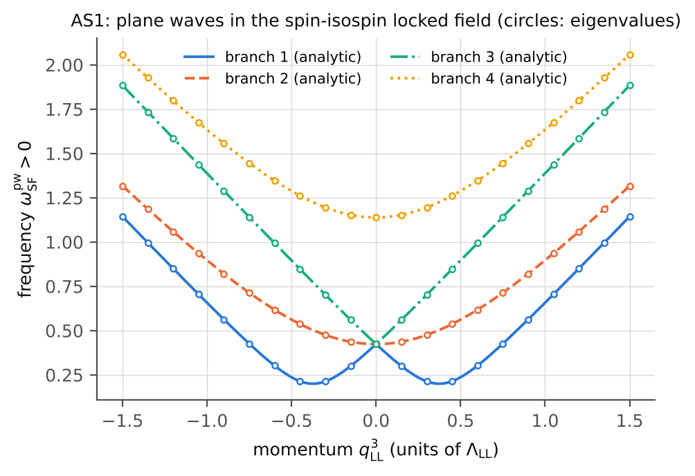{width=88%}

**Figure 1.** AS1: the four positive branches (7.4) of the plane waves in the spin-isospin locked field (lines) and the
eigenvalues of $\mathsf H^{\rm pw}_{\rm SF}$ (circles), for momenta along $x^3_{\rm LL}$; $m_{\rm LL}=0.2$, $gw=g^{\rm v}_{\rm LL}w^{\rm lk}_{\rm SF}=0.747$.
The branches of the third component $\pm1$ of the total of spin and isospin have their minima at
$q^3_{\rm LL}=\mp gw/2$; at $q^3_{\rm LL}=0$ three branches meet (total 1). Data: `data/part1_s1_locked_dispersion.csv`.

## 7.2 AS2: Landau levels in a constant magnetic field

Let the only gauge field be the constant magnetic field $\mathcal B_{\rm SF}$ of the gauge field $W^3_{{\rm SF},p}$ of $SU(2)_{\rm v}$ along
$x^3_{\rm LL}$ ("magnetic" names the space-space components of a field strength, as for any gauge field):
$W^3_{{\rm SF},2}(x)=-\mathcal B_{\rm SF}\,x^1_{\rm LL}$ (lower index; the three-vector potential has the component
$\mathcal B_{\rm SF}x^1_{\rm LL}$ along $x^2_{\rm LL}$, whose curl is $\mathcal B_{\rm SF}$ along $x^3_{\rm LL}$). An isospin component of charge
$Q_{\rm LL}$ couples with the strength $g^{\rm c}_{\rm SF}=g^{\rm v}_{\rm LL}Q_{\rm LL}$. With plane waves along $x^2_{\rm LL}$ and
$x^3_{\rm LL}$ (momenta $q^2_{\rm LL}$, $q^3_{\rm LL}$), the equation for the four components of that isospin component is
$\omega\Psi=\mathsf H\Psi$ with
$$\mathsf H=\alpha^1_{\rm LL}(-i\partial_1)+\alpha^2_{\rm LL}\big(q^2_{\rm LL}-g^{\rm c}_{\rm SF}\mathcal B_{\rm SF}x^1_{\rm LL}\big)+\alpha^3_{\rm LL}q^3_{\rm LL}+\beta_{\rm LL}m_{\rm LL}.\tag{7.5}$$
In the chirality blocks, $\mathsf H=\begin{pmatrix}-\vec\sigma\cdot\vec\pi&m_{\rm LL}\\m_{\rm LL}&\vec\sigma\cdot\vec\pi\end{pmatrix}$ with
$\vec\pi=(-i\partial_1,\,q^2_{\rm LL}-g^{\rm c}_{\rm SF}\mathcal B_{\rm SF}x^1_{\rm LL},\,q^3_{\rm LL})$, so $\mathsf H^2=\mathrm{diag}((\vec\sigma\cdot\vec\pi)^2+m_{\rm LL}^2,\dots)$ and
$(\vec\sigma\cdot\vec\pi)^2=\pi_1^2+\pi_2^2+(q^3_{\rm LL})^2+i\sigma^{\rm LL}_3[\pi_1,\pi_2]$ with $i[\pi_1,\pi_2]=-g^{\rm c}_{\rm SF}\mathcal B_{\rm SF}$.
$\pi_1^2+\pi_2^2=-\partial_1^2+(g^{\rm c}_{\rm SF}\mathcal B_{\rm SF})^2(x^1_{\rm LL}-x_0)^2$, $x_0=q^2_{\rm LL}/(g^{\rm c}_{\rm SF}\mathcal B_{\rm SF})$, is a harmonic oscillator
with the eigenvalues $\lvert g^{\rm c}_{\rm SF}\mathcal B_{\rm SF}\rvert(2n+1)$, $n=0,1,2,\dots$; with $\sigma^{\rm LL}_3=\pm1$ this gives the
**Landau levels**
$$\omega^2=m_{\rm LL}^2+(q^3_{\rm LL})^2+2n^{\rm L}_{\rm SF}\lvert g^{\rm c}_{\rm SF}\mathcal B_{\rm SF}\rvert,\qquad n^{\rm L}_{\rm SF}=0,1,2,\dots,\tag{7.6}$$
for both signs of $\omega$; the level $n^{\rm L}_{\rm SF}=0$ has one spin state (spin along $\mathrm{sign}(g^{\rm c}_{\rm SF}\mathcal B_{\rm SF})$), every
higher level two; the states are localized at $x_0$ within the **magnetic length**
$\ell^{\rm B}_{\rm SF}=\lvert g^{\rm c}_{\rm SF}\mathcal B_{\rm SF}\rvert^{-1/2}$, and each level is degenerate in $q^2_{\rm LL}$. For $g^{\rm c}_{\rm SF}\mathcal B_{\rm SF}>0$ the lowest
level is, exactly, $\Psi=(\lambda_1\uparrow,\,\lambda_2\uparrow)\,\exp(-g^{\rm c}_{\rm SF}\mathcal B_{\rm SF}(x^1_{\rm LL}-x_0)^2/2)$ (spin up in both blocks), with
$\begin{pmatrix}-q^3_{\rm LL}&m_{\rm LL}\\m_{\rm LL}&q^3_{\rm LL}\end{pmatrix}\begin{pmatrix}\lambda_1\\\lambda_2\end{pmatrix}=\omega\begin{pmatrix}\lambda_1\\\lambda_2\end{pmatrix}$ ($\uparrow$ is the spin state $(1,0)$ of the two-component spinor index), because
$\pi_1+i\pi_2=-i(\partial_1+g^{\rm c}_{\rm SF}\mathcal B_{\rm SF}(x^1_{\rm LL}-x_0))$ annihilates the Gaussian (*check AS2-1*: the residual of
$\mathsf H\Psi=\omega\Psi$ with exact derivatives at 41 points). In the superfluid vacuum of Part II the field $W^3_{{\rm SF},p}$ is
the massless gauge boson $A_{{\rm SF},p}$ of the unbroken charge $Q_{\rm LL}$: (7.6) are then the Landau levels of the spinor
charges in a constant magnetic field of $A_{{\rm SF},p}$. A magnetic field of $B_{{\rm SF},p}$ gives the same with
$g^{\rm c}_{\rm SF}=g^{\rm F}_{\rm LL}$.

**Lattice check.** With $g^{\rm v}_{\rm LL}=1$, $\mathcal B_{\rm SF}=1$ (isospin up, $g^{\rm c}_{\rm SF}=\tfrac12$) and
$q^3_{\rm LL}=0.3$, the levels (7.6) are $\omega=$ $0.3605551275$, $1.063014581$, $1.459451952$,
$1.769180601$ for $n^{\rm L}_{\rm SF}=0,1,2,3$. The Wilson lattice of Section 6.2 (open ends, $x^1_{\rm LL}$ from $-10$ to $10$)
reproduces the seven lowest positive levels with their multiplicities, with the largest relative deviations
$0.01953967595$, $0.00969397194$, $0.004827511664$ at the spacings 0.1, 0.05, 0.025: the deviation halves with
the spacing, as expected for the Wilson term, and the Richardson extrapolation $2\omega(0.025)-\omega(0.05)$, which removes
the term of first order, agrees with (7.6) to $6.450238591\times10^{-5}$ (*checks AS2-0 to AS2-4*; Figure 2).

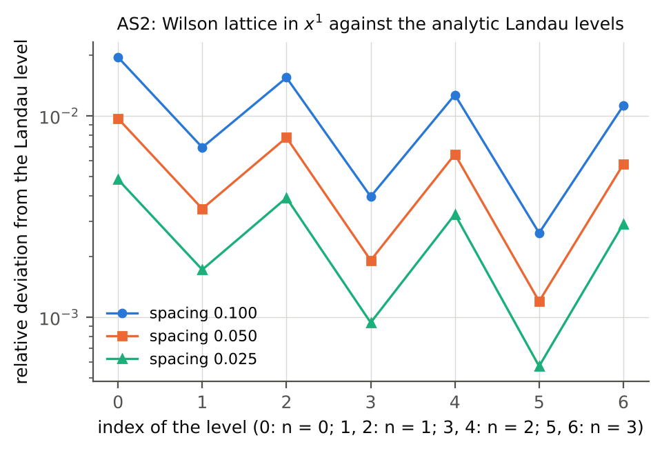{width=82%}

**Figure 2.** AS2: the relative deviation of the lattice levels from the Landau levels (7.6), for the seven lowest
positive levels (index 0: $n^{\rm L}_{\rm SF}=0$; 1 and 2: $n^{\rm L}_{\rm SF}=1$; 3, 4: $n^{\rm L}_{\rm SF}=2$; 5, 6: $n^{\rm L}_{\rm SF}=3$) and three lattice
spacings. Data: `data/part1_s2_landau.csv`.

## 7.3 AS3: the uniform superfluid of the spin-zero pairing (mean field)

Keep, of the self-interaction $V^{(1)}_{\rm SF}$, only the pairing term, and of its Wick contractions (6.2) only the pair
contraction (the pairing-only, or BCS, approximation; Part II keeps all terms). A uniform state at the chemical
potential $\mu_{\rm LL}$ (the term $-\mu_{\rm LL}\Psi^\dagger\Psi$ is added to $\mathcal H_{\rm SF}$) with the order parameter
$\vec d_{\rm LL}$ has the self-energies $\mathsf N_{\rm SF}=0$ and $\mathsf P_{\rm SF}=\mathsf P_{\rm LL}=\sum_\iota d^\iota_{\rm LL}(\mathsf K^\iota_{\rm LL})^\dagger$, and
(6.5) becomes the Bogoliubov-de Gennes matrix $\mathsf H_{\rm LL}(\vec q_{\rm LL})$ with the blocks $\mathsf h_{\rm LL}(\vec q_{\rm LL})-\mu_{\rm LL}$,
$\mathsf P_{\rm LL}$, $\mathsf P_{\rm LL}^\dagger$ and $-(\mathsf h_{\rm LL}(-\vec q_{\rm LL})-\mu_{\rm LL})^T$.

**The spectrum.** Two identities make it explicit. (i) $\mathsf h_{\rm LL}(\vec q)(\mathsf K^\iota)^\dagger=(\mathsf K^\iota)^\dagger\mathsf h_{\rm LL}(-\vec q)^T$:
the isospin part of $(\mathsf K^\iota)^\dagger=\mathrm{diag}(\mathsf E,\mathsf E)\otimes(\mathsf E\tau_\iota)^\dagger$ commutes with $\mathsf h_{\rm LL}$;
$\beta_{\rm LL}$ commutes with $\mathrm{diag}(\mathsf E,\mathsf E)$; and $\alpha^j\mathrm{diag}(\mathsf E,\mathsf E)=-\mathrm{diag}(\mathsf E,\mathsf E)(\alpha^j)^T$
because $\mathsf E(\sigma^{\rm LL}_j)^T=-\sigma^{\rm LL}_j\mathsf E$. Hence the off-diagonal blocks of $\mathsf H_{\rm LL}^2$ vanish. (ii)
$\mathsf P_{\rm LL}\mathsf P_{\rm LL}^\dagger=\mathsf 1_4\otimes\sum_{\iota\iota'}d^\iota_{\rm LL}(d^{\iota'}_{\rm LL})^*\tau_\iota\tau_{\iota'}=\lvert\vec d_{\rm LL}\rvert^2+i(\vec d_{\rm LL}\times\vec d^{\,*}_{\rm LL})\cdot\vec\tau$,
whose eigenvalues are $(\Delta^\pm_{\rm LL})^2=\lvert\vec d_{\rm LL}\rvert^2(1\pm\zeta_{\rm LL})$ with
$\zeta_{\rm LL}=\lvert\vec d_{\rm LL}\times\vec d^{\,*}_{\rm LL}\rvert/\lvert\vec d_{\rm LL}\rvert^2$. For a **unitary** state, $\vec d_{\rm LL}=\Delta_{\rm LL}e^{i\phi}\vec n$
with a real unit vector $\vec n$ ($\zeta_{\rm LL}=0$; the **polar** states), $\mathsf H_{\rm LL}^2=\mathrm{diag}((\mathsf h-\mu)^2+\Delta^2_{\rm LL},\dots)$
and the sixteen eigenvalues are
$$\pm E^+_{\rm LL},\ \pm E^-_{\rm LL}\ \text{(each four times)},\qquad E^\pm_{\rm LL}=\big[(\varepsilon_{\rm LL}\pm\mu_{\rm LL})^2+\Delta_{\rm LL}^2\big]^{1/2}\tag{7.7}$$
(*check AS3-1*, 100 random momenta, chemical potentials, gaps, phases and directions).

**The energy and the gap equation.** The ground state of the mean-field Hamiltonian
$\tfrac12\sum_{\vec q}\mathcal N_{\rm LL}^\dagger\mathsf H_{\rm LL}\mathcal N_{\rm LL}$ plus the constant $V\lvert\vec d_{\rm LL}\rvert^2/G_{\rm LL}$ (which is
what remains of $-\tfrac14G_{\rm LL}\sum\Pi^\dagger\Pi$ after the decoupling
$\Pi^\dagger\Pi\to\langle\Pi\rangle^*\Pi+\Pi^\dagger\langle\Pi\rangle-\lvert\langle\Pi\rangle\rvert^2$) has the energy per volume, at $\mu_{\rm LL}=0$ and
measured from the normal vacuum,
$$\mathcal E^{\rm MF}_{\rm SF}(\Delta_{\rm LL})=-\frac2{\pi^2}\Big[I^{(3)}_{\rm SF}\big(M^{\rm q}_{\rm LL}\big)-I^{(3)}_{\rm SF}\big(m_{\rm LL}\big)\Big]+\frac{\Delta_{\rm LL}^2}{G_{\rm LL}},\qquad M^{\rm q}_{\rm LL}=\big(m_{\rm LL}^2+\Delta_{\rm LL}^2\big)^{1/2},\tag{7.8}$$
with the integrals over the momenta below the cutoff
$$\begin{aligned}I^{(1)}_{\rm SF}(M^{\rm q}_{\rm LL})&=\int_0^{\Lambda_{\rm LL}}\frac{q^2\,dq}{(q^2+(M^{\rm q}_{\rm LL})^2)^{1/2}}=\tfrac12\Big[\Lambda_{\rm LL}\big(\Lambda_{\rm LL}^2+(M^{\rm q}_{\rm LL})^2\big)^{1/2}-(M^{\rm q}_{\rm LL})^2\,\mathrm{arsinh}\frac{\Lambda_{\rm LL}}{M^{\rm q}_{\rm LL}}\Big],\\I^{(3)}_{\rm SF}(M^{\rm q}_{\rm LL})&=\int_0^{\Lambda_{\rm LL}}q^2\big(q^2+(M^{\rm q}_{\rm LL})^2\big)^{1/2}dq\\&=\tfrac18\Big[\Lambda_{\rm LL}\big(2\Lambda_{\rm LL}^2+(M^{\rm q}_{\rm LL})^2\big)\big(\Lambda_{\rm LL}^2+(M^{\rm q}_{\rm LL})^2\big)^{1/2}-(M^{\rm q}_{\rm LL})^4\,\mathrm{arsinh}\frac{\Lambda_{\rm LL}}{M^{\rm q}_{\rm LL}}\Big]\end{aligned}$$
($I^{(1)}_{\rm SF}(m_{\rm LL})$ and $I^{(3)}_{\rm SF}(m_{\rm LL})$ are the same with $m_{\rm LL}$ in place of $M^{\rm q}_{\rm LL}$). Derivation: each momentum contributes $-\tfrac12$ times the sum of
the eight positive eigenvalues, $-4E$ with $E=(q^2+(M^{\rm q}_{\rm LL})^2)^{1/2}$ at $\mu_{\rm LL}=0$, and
$\int d^3q/(2\pi)^3=(2\pi^2)^{-1}\int q^2dq$. Since $dI^{(3)}_{\rm SF}/d\Delta_{\rm LL}=\Delta_{\rm LL}I^{(1)}_{\rm SF}$, the stationary
points of (7.8) are $\Delta_{\rm LL}=0$ and the solutions of the **gap equation**
$$1=\frac{G_{\rm LL}}{\pi^2}\,I^{(1)}_{\rm SF}\big(M^{\rm q}_{\rm LL}\big).\tag{7.9}$$
Because $I^{(1)}_{\rm SF}$ decreases with its argument, (7.9) has a solution exactly when
$G_{\rm LL}>G^{\rm crit}_{\rm LL}=\pi^2/I^{(1)}_{\rm SF}(m_{\rm LL})=21.28660976$. For $G_{\rm LL}=22.5$ the solution is
$\Delta_{\rm LL}=0.2094933033$, the quasi-particle mass $M^{\rm q}_{\rm LL}=0.2896332925$ (the gap of the single
quasi-particle), and $\mathcal E^{\rm MF}_{\rm SF}=-5.288449106\times10^{-5}<0$: the condensed state lies below the normal vacuum. (*Checks
AS3-2 to AS3-4*: (7.8) against Gauss-Legendre quadrature of the eigenvalues of $\mathsf H_{\rm LL}$, the stationarity at the
solution of (7.9), and the values; the Python program finds the same gap with a different root finder.)

**Polar or non-unitary?** For a fixed $\lvert\vec d_{\rm LL}\rvert$, a non-unitary state has the two gaps $\Delta^\pm_{\rm LL}$, and the
energy contains $-[(\varepsilon^2+(\Delta^+)^2)^{1/2}+(\varepsilon^2+(\Delta^-)^2)^{1/2}]$ in place of $-2(\varepsilon^2+\lvert\vec d\rvert^2)^{1/2}$;
since the square root is concave and $(\Delta^+)^2+(\Delta^-)^2=2\lvert\vec d\rvert^2$, the former is larger: in this
approximation the polar states have the lowest energy. Their manifold is described by the phase $\phi$ and the
direction $\vec n$ (with $(\phi,\vec n)$ and $(\phi+\pi,-\vec n)$ the same state). Figure 3 shows the energy along one
direction: for $G_{\rm LL}>G^{\rm crit}_{\rm LL}$ the normal vacuum $\Delta_{\rm LL}=0$ is a local maximum and the minima lie at
$\pm\Delta_{\rm LL}$, the cut of a "Mexican hat"; Part III takes this up with all terms of the potential.

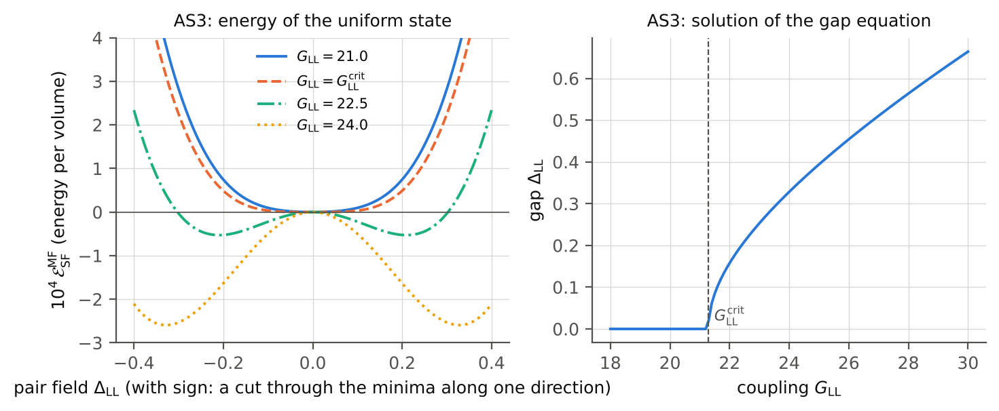{width=100%}

**Figure 3.** AS3. Left: the energy per volume (7.8) of the polar state as a function of the signed pair field, for
four couplings; for $G_{\rm LL}\le G^{\rm crit}_{\rm LL}$ the minimum is the normal vacuum, for $G_{\rm LL}>G^{\rm crit}_{\rm LL}$ two minima appear
at $\pm\Delta_{\rm LL}$. Right: the solution of the gap equation (7.9); it rises from 0 at $G^{\rm crit}_{\rm LL}$. Data:
`data/part1_s3_energy.csv`, `data/part1_s3_gap.csv`.

## 7.4 AS4: the kink of the pair field and its bound states

Let the pair field depend on $x^1_{\rm LL}$ and change sign: $\vec d_{\rm LL}(x)=\Delta^\infty_{\rm LL}\tanh(x^1_{\rm LL}/\ell^{\rm K}_{\rm LL})\,\vec e_3$ ($\vec e_3$ the
unit vector of the third isospin direction), a
domain wall of the polar superfluid of width $\ell^{\rm K}_{\rm LL}$ between the vacua $-\Delta^\infty_{\rm LL}$ and $+\Delta^\infty_{\rm LL}$ (equivalent
to a jump of the phase by $\pi$). At $\mu_{\rm LL}=0$ and $q^2_{\rm LL}=q^3_{\rm LL}=0$ the Bogoliubov-de Gennes operator of the
quasi-particles in this field, the operator of (6.5) in which $\vec q_{\rm LL}$ becomes $-i\partial_1$, is
$$\begin{aligned}\mathsf H^{\rm K}_{\rm SF}&=-i\mathsf A^{\rm K}_{\rm SF}\partial_1+\Delta_{\rm LL}(x)\,\mathsf P^{\rm K}_{\rm SF}+m_{\rm LL}\mathsf B^{\rm K}_{\rm SF},\\\mathsf A^{\rm K}_{\rm SF}&=\mathrm{diag}\big(\alpha^1_{\rm LL},(\alpha^1_{\rm LL})^*\big),\qquad\mathsf P^{\rm K}_{\rm SF}=\begin{pmatrix}0&(\mathsf K^3_{\rm LL})^\dagger\\\mathsf K^3_{\rm LL}&0\end{pmatrix},\qquad\mathsf B^{\rm K}_{\rm SF}=\mathrm{diag}(\beta_{\rm LL},-\beta_{\rm LL})\end{aligned}\tag{7.10}$$
($16\times16$ matrices of $8\times8$ blocks; the lower right block of (6.5), $-(\mathsf h(-\vec q))^T$, becomes $-\mathsf h^*$ in
$x$, which gives $-i(\alpha^1)^*\partial_1-\beta m$). **Structure.** The three matrices anticommute pairwise and square to
$\mathsf 1_{16}$ (*check AS4-1*). Hence, with $\mathsf H^{{\rm K},0}_{\rm SF}=\mathsf H^{\rm K}_{\rm SF}-m_{\rm LL}\mathsf B^{\rm K}_{\rm SF}$,
$(\mathsf H^{\rm K}_{\rm SF})^2=(\mathsf H^{{\rm K},0}_{\rm SF})^2+m_{\rm LL}^2$ and
$$\big(\mathsf H^{{\rm K},0}_{\rm SF}\big)^2=-\partial_1^2+\Delta_{\rm LL}(x)^2+\mathsf G^{\rm K}_{\rm SF}\,\Delta_{\rm LL}'(x),\qquad\mathsf G^{\rm K}_{\rm SF}=-i\mathsf A^{\rm K}_{\rm SF}\mathsf P^{\rm K}_{\rm SF},\tag{7.11}$$
(the cross terms give $-i\mathsf A\mathsf P\,\partial_1(\Delta\,\cdot)-i\Delta\mathsf P\mathsf A\,\partial_1=-i\mathsf A\mathsf P\Delta'$). $\mathsf G^{\rm K}_{\rm SF}$ is Hermitian,
squares to 1, has the eigenvalues $\pm1$ eight times each and commutes with $\mathsf B^{\rm K}_{\rm SF}$ (*check AS4-2*). On its
eigenspace $-1$, with $s^{\rm K}_{\rm SF}=\Delta^\infty_{\rm LL}\ell^{\rm K}_{\rm LL}$, (7.11) is the Pöschl-Teller operator
$-\partial_1^2+(\Delta^\infty_{\rm LL})^2-s^{\rm K}_{\rm SF}(s^{\rm K}_{\rm SF}+1)(\ell^{\rm K}_{\rm LL})^{-2}\,\mathrm{sech}^2(x^1_{\rm LL}/\ell^{\rm K}_{\rm LL})$, whose bound states have
the eigenvalues $(\Delta^\infty_{\rm LL})^2-(s^{\rm K}_{\rm SF}-n)^2/(\ell^{\rm K}_{\rm LL})^2$, $n=0,1,\dots$, $n<s^{\rm K}_{\rm SF}$; on the eigenspace $+1$
the same with $s^{\rm K}_{\rm SF}-1$ in place of $s^{\rm K}_{\rm SF}$, which gives the same eigenvalues for $n\ge1$. The bound states of the
quasi-particles therefore have the energies
$$\pm\big(m_{\rm LL}^2+(E^{\rm K}_{{\rm SF},n})^2\big)^{1/2},\qquad(E^{\rm K}_{{\rm SF},n})^2=(\Delta^\infty_{\rm LL})^2-\big(\Delta^\infty_{\rm LL}-n/\ell^{\rm K}_{\rm LL}\big)^2,\qquad n=0,1,\dots,\ n<s^{\rm K}_{\rm SF},\tag{7.12}$$
below the continuum, which begins at $(m_{\rm LL}^2+(\Delta^\infty_{\rm LL})^2)^{1/2}$. The state $n=0$ is the zero mode of the kink of
the massless problem (Jackiw-Rebbi), $\chi^{\rm K}_{\rm SF}\varphi^{\rm K}_{{\rm SF},0}(x)$ with
$\varphi^{\rm K}_{{\rm SF},0}=\mathrm{sech}^{s^{\rm K}_{\rm SF}}(x^1_{\rm LL}/\ell^{\rm K}_{\rm LL})$ and a constant spinor $\chi^{\rm K}_{\rm SF}$ of the eigenspace
$\mathsf G^{\rm K}_{\rm SF}=-1$ (there $\mathsf P\chi=-i\mathsf A\chi$, so $\mathsf H^{{\rm K},0}(\chi\varphi)=-i\mathsf A\chi(\varphi'+\Delta\varphi)=0$); the Dirac mass
lifts it to $\pm m_{\rm LL}$, four states of each sign (the eigenvalues of $\mathsf B^{\rm K}_{\rm SF}$ on that eigenspace, *check AS4-2b*):
**the domain wall binds fermionic quasi-particles inside the gap, at the energy $m_{\rm LL}$.** The state $n=1$ is built
from $\varphi^{\rm K}_{{\rm SF},1}=\mathrm{sech}^{s^{\rm K}_{\rm SF}-1}(x^1_{\rm LL}/\ell^{\rm K}_{\rm LL})\tanh(x^1_{\rm LL}/\ell^{\rm K}_{\rm LL})$: with $u=\chi\varphi^{\rm K}_{{\rm SF},1}$
($\chi$ in the eigenspace $-1$), $\Psi_0=\mathsf H^{{\rm K},0}u+E^{\rm K}_{{\rm SF},1}u$ is an eigenvector of $\mathsf H^{{\rm K},0}$ with the eigenvalue
$E^{\rm K}_{{\rm SF},1}$; $\mathsf B^{\rm K}$ maps it to the eigenvalue $-E^{\rm K}_{{\rm SF},1}$, and on the pair $(\Psi_0,\mathsf B\Psi_0)$ the
operator $\mathsf H^{\rm K}$ acts as $\begin{pmatrix}E^{\rm K}_{{\rm SF},1}&m_{\rm LL}\\m_{\rm LL}&-E^{\rm K}_{{\rm SF},1}\end{pmatrix}$, whose eigenvector
$\Psi_0+\frac{E-E^{\rm K}_{{\rm SF},1}}{m_{\rm LL}}\mathsf B\Psi_0$ has the eigenvalue $E=(m_{\rm LL}^2+(E^{\rm K}_{{\rm SF},1})^2)^{1/2}$.

With $\Delta^\infty_{\rm LL}=0.5$ and $\ell^{\rm K}_{\rm LL}=4$ ($s^{\rm K}_{\rm SF}=2$): the bound states are at
$\pm m_{\rm LL}=\pm0.2$ and $\pm0.4769696007$ ($(E^{\rm K}_{{\rm SF},1})^2=0.1875$), the continuum begins at
$0.5385164807$. *Checks:* AS4-3 and AS4-4 evaluate $(\mathsf H^{\rm K}-E)\Psi$ for the analytic states $n=0$ and $n=1$
with exact derivatives at 61 points (residuals at the level of rounding); AS4-5 and AS4-6 compute the spectrum on the
Wilson lattice of Section 6.2. On the lattice the problem reduces exactly to two components: the algebra of three
anticommuting matrices that square to 1 has two inequivalent irreducible representations of dimension 2, so in a
suitable basis (7.10) is eight copies of
$\sigma^{\rm LL}_1(-i\partial_1)+\sigma^{\rm LL}_2\Delta_{\rm LL}(x)\pm\sigma^{\rm LL}_3m_{\rm LL}$; the lattice of this operator has exactly three bound
states below the continuum, $-m_{\rm LL}$ and $\pm(m_{\rm LL}^2+(E^{\rm K}_{{\rm SF},1})^2)^{1/2}$, for the spacings 0.1, 0.05 and 0.025 (relative
deviations $0.01241095554$, $0.006227620264$, $0.003119390085$), and the Richardson extrapolation agrees with
(7.12) to $1.11599057\times10^{-5}$ (Figure 4).

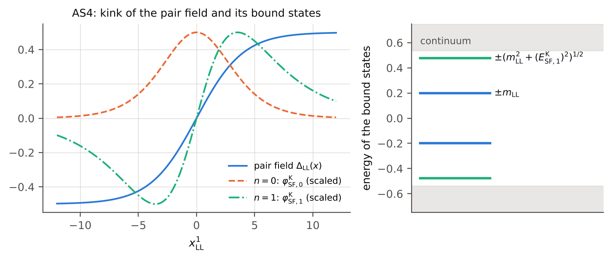{width=100%}

**Figure 4.** AS4. Left: the kink $\Delta_{\rm LL}(x)$ of the pair field ($\Delta^\infty_{\rm LL}=0.5$, $\ell^{\rm K}_{\rm LL}=4$) and the profiles of its
bound states $n=0$ ($\mathrm{sech}^2$) and $n=1$ ($\mathrm{sech}\,\tanh$), scaled. Right: the energies of the bound states,
$\pm m_{\rm LL}$ and $\pm(m_{\rm LL}^2+(E^{\rm K}_{{\rm SF},1})^2)^{1/2}$, below the continuum (grey). Data: `data/part1_s4_kink_profiles.csv`,
`data/part1_s4_kink_lattice.csv`.

## 7.5 Summary of the analytic solutions

| case | equation solved | result | checks |
|:---|:---|:---|:---|
| AS1 plane waves | (5.5) without self-interaction, constant gauge fields | (7.1); (7.2) abelian; (7.3), (7.4) spin-isospin locked field | AS1-1 to AS1-5 |
| AS2 Landau levels | (5.5) without self-interaction, constant magnetic field | (7.6), lowest level explicit | AS2-0 to AS2-4 |
| AS3 uniform superfluid | mean field (6.6), stationary, pairing only | spectrum (7.7), energy (7.8), gap equation (7.9) | AS3-1 to AS3-4 |
| AS4 kink | mean field of the quasi-particles in the pair field $\Delta^\infty_{\rm LL}\tanh(x^1_{\rm LL}/\ell^{\rm K}_{\rm LL})$ | bound states (7.12) at $\pm m_{\rm LL}$ and above | AS4-1 to AS4-6 |

# 8. The pair channels and the gauge bosons that mediate the pairing (item 6 of the problem, first part)

Part II begins with the question of the task: which interaction can bind two spinor charges into a pair of spin
zero, and which gauge boson mediates the pairing? This section answers the first half exactly, by operator algebra on
the 256 states of one point; Section 11 answers the second half quantitatively in the condensed state.

## 8.1 The energy of two spinor charges in a spin-zero channel

The spin-zero pairs of Section 3.5 are the six antisymmetric unitary matrices $\mathsf K^\iota_{\rm LL}$ (scalar, $0^+$)
and $\mathsf K'^\iota_{\rm LL}$ (pseudoscalar, $0^-$), $\iota=1,2,3$. The state of two spinor charges at one point in the
channel $\mathsf K$ is
$$\lvert\mathsf K\rangle=\frac{\tfrac12\sum_{cc'}\mathsf K^*_{cc'}\Psi^\dagger_{{\rm LL},c}\Psi^\dagger_{{\rm LL},c'}\lvert0\rangle}{\big\lVert\tfrac12\sum_{cc'}\mathsf K^*_{cc'}\Psi^\dagger_{{\rm LL},c}\Psi^\dagger_{{\rm LL},c'}\lvert0\rangle\big\rVert},\tag{8.1}$$
where $\lvert0\rangle$ is the empty state of the point and $c,c'$ run over the eight components (the norm in the
denominator is 2 for every unitary antisymmetric $\mathsf K$). For a contact operator $\mathcal O$ (a normal-ordered
product of four field components at one point) the **pair energy** $E^{\rm pair}_{\rm SF}[\mathcal O;\mathsf K]=\langle\mathsf K\rvert\mathcal O\lvert\mathsf K\rangle$
is the interaction energy of the two charges in the channel, per unit coupling: negative means attraction. The
effective coupling of a term in a channel, normalized like the pairing coupling $G_{\rm LL}$, is
$$G^{\rm ch}_{\rm SF}=-\tfrac14E^{\rm pair}_{\rm SF}[\mathcal O;\mathsf K]\times(\text{the coupling of the term}),\tag{8.2}$$
so that the pairing term $-\tfrac14G_{\rm LL}\sum_\iota{:}(\Pi^\iota_{\rm LL})^\dagger\Pi^\iota_{\rm LL}{:}$ of (5.4), whose pair energy in its
own channel is $-4G_{\rm LL}$ (*check P2-0b*), has $G^{\rm ch}_{\rm SF}=G_{\rm LL}$.

The operators examined are the three terms of the potentials (5.4) and the four gauge bosons of GEE in the limit of a
heavy boson. A gauge boson b of mass $M^{\rm b}_{\rm SF}$, with the isospin matrix $\mathsf t^{\rm b}_{\rm SF}$
($\tfrac12\tau^{\rm LL}_\iota$ for $W^\iota_{{\rm SF},p}$ with the coupling $g^{\rm v}_{\rm LL}$, and $\mathsf 1_2$ for $B_{{\rm SF},p}$ with
the coupling $g^{\rm F}_{\rm LL}$), couples to the current $\Psi^\dagger_{\rm LL}\mathsf A^{\rm b}_{{\rm SF},p}\Psi_{\rm LL}$ with the vertex
matrices
$$\mathsf A^{\rm b}_{{\rm SF},p}=(\gamma^0_{\rm LL}\gamma^p_{\rm LL})\otimes\mathsf t^{\rm b}_{\rm SF}\tag{8.3}$$
(the current $\bar\Psi_{\rm LL}\gamma^p_{\rm LL}\mathsf t^{\rm b}_{\rm SF}\Psi_{\rm LL}$ of (5.2), since $\bar\Psi=\Psi^\dagger\gamma^0$). In the static
(instantaneous) approximation of the Feynman gauge the exchange of b adds to the Hamiltonian
$$\frac{g_{\rm b}^2}2\int d^3x\,d^3y\,D^{\rm b}_{\rm SF}(\vec x-\vec y)\sum_p\eta^{\rm LL}_{pp}\,{:}\big(\Psi^\dagger\mathsf A^{\rm b}_{{\rm SF},p}\Psi\big)(\vec x)\big(\Psi^\dagger\mathsf A^{\rm b}_{{\rm SF},p}\Psi\big)(\vec y){:},\qquad D^{\rm b}_{\rm SF}(\vec k)=\frac1{\lvert\vec k\rvert^2+(M^{\rm b}_{\rm SF})^2}\tag{8.4}$$
in momentum space ($g_{\rm b}$ is $g^{\rm v}_{\rm LL}$ or $g^{\rm F}_{\rm LL}$). (The sign: the time components of two equal charges repel,
as for the Coulomb interaction; the space components, with $\eta^{\rm LL}_{jj}=-1$, make parallel currents attract.) For a
heavy boson $D^{\rm b}_{\rm SF}$ is the constant $(M^{\rm b}_{\rm SF})^{-2}$, and (8.4) becomes the contact operator
$\tfrac12\sum_p\eta^{\rm LL}_{pp}{:}(\Psi^\dagger\mathsf A^{\rm b}_{{\rm SF},p}\Psi)^2{:}$ times $g_{\rm b}^2(M^{\rm b}_{\rm SF})^{-2}$. Its pair
energies show which boson attracts and which repels the two charges of each pair at short distances. The table gives
the pair energies of the seven operators, per unit coupling, computed exactly on the 256 states of one point:

| operator | $\mathsf K^{1}_{\rm LL}$ | $\mathsf K^{2}_{\rm LL}$ | $\mathsf K^{3}_{\rm LL}$ | $\mathsf K'^{1}_{\rm LL}$ | $\mathsf K'^{2}_{\rm LL}$ | $\mathsf K'^{3}_{\rm LL}$ |
|:---|---:|---:|---:|---:|---:|---:|
| scalar term | $+1$ | $+1$ | $+1$ | $-1$ | $-1$ | $-1$ |
| vector term | $+4$ | $+4$ | $+4$ | $+4$ | $+4$ | $+4$ |
| pairing term | $-4$ | $-4$ | $-4$ | $+0$ | $+0$ | $+0$ |
| $W^1_{\rm SF}$ | $-1$ | $+1$ | $+1$ | $-1$ | $+1$ | $+1$ |
| $W^2_{\rm SF}$ | $+1$ | $-1$ | $+1$ | $+1$ | $-1$ | $+1$ |
| $W^3_{\rm SF}$ | $+1$ | $+1$ | $-1$ | $+1$ | $+1$ | $-1$ |
| $B_{\rm SF}$ | $+4$ | $+4$ | $+4$ | $+4$ | $+4$ | $+4$ |

**Table 8.1.** Pair energies $E^{\rm pair}_{\rm SF}[\mathcal O;\mathsf K]$ (per unit coupling; negative means attraction) of the
three terms of the potentials and of the contact limit of the exchange of the four gauge bosons, in the six spin-zero
channels. Data: `data/part2_pair_channels.csv`.

What the table shows, row by row:

* the **scalar term** $\tfrac12G^{\rm S}_{\rm SF}{:}(\bar\Psi\Psi)^2{:}$ has the pair energy $+1$ in the $0^+$ channels and $-1$ in the
  $0^-$ channels: for $G^{\rm S}_{\rm SF}<0$ (the attraction of the author's ansatz) it attracts in the $0^+$ channels with
  $G^{\rm ch}_{\rm SF}=-G^{\rm S}_{\rm SF}/4$;
* the **vector term** has $+4$ in every channel: for $G^{\rm V}_{\rm SF}>0$ it repels every pair, $G^{\rm ch}_{\rm SF}=-G^{\rm V}_{\rm SF}$. Its row
  equals the row of $B_{\rm SF}$ (*check P2-0c*): the vector term is the contact form of the exchange of the gauge boson
  of the fermion number;
* the **pairing term** attracts with $-4$ in the three $0^+$ channels and does not act in the $0^-$ channels;
* each **$W^\iota_{\rm SF}$** attracts ($-1$) in the two channels with the same index $\iota$ and repels ($+1$) in the other four;
* **$B_{\rm SF}$** repels ($+4$) in every channel: the two charges of a pair have the same fermion number.

The pair energies are also the pair contractions of the mean field: for $\mathsf C^{\rm p}=\mathsf K^*$ the pair contraction
of (6.1), (6.2) of every operator equals $4E^{\rm pair}_{\rm SF}[\mathcal O;\mathsf K]$ (*check P2-0e*, 42 cases), an exact link
between the two-body problem of one point and the mean field of the three methods, independent of the checks E-8 and
E-9 of Part I.

## 8.2 The gauge bosons before and after the breaking of the symmetry

**Before the breaking.** In the symmetric (normal) vacuum the three $W^\iota_{\rm SF}$ have the same mass (zero), and
their contributions add. In every channel
$$\sum_{\iota=1}^3E^{\rm pair}_{\rm SF}[W^\iota;\mathsf K]=\tfrac14E^{\rm pair}_{\rm SF}[B;\mathsf K]=+1\tag{8.5}$$
(*check P2-0d*). This is the group theory of the pair: the spin-zero pairs are isospin triplets (Section 3.5), and
for two isospin doublets coupled to the triplet the product of the two isospin operators is
$\vec T_1\cdot\vec T_2=\tfrac12[T(T+1)-\tfrac34-\tfrac34]=+\tfrac14$ ($T=1$), positive: the exchange of the isospin gauge bosons
repels. Together with the repulsion by $B_{\rm SF}$, **no gauge boson of GEE attracts the two charges of a spin-zero pair
in the symmetric vacuum**. (An isospin singlet, $\vec T_1\cdot\vec T_2=-\tfrac34$, would be attracted, but an isosinglet
pair of two Dirac charges at one point must have a symmetric Dirac matrix, $C\gamma^p$ or $C\sigma^{pp'}$, and thus spin 1.)

**After the breaking.** Section 10 finds that the superfluid ground state is a polar condensate in the channel
$\mathsf K^3_{\rm LL}$. It is invariant under the isospin rotations about the third axis (the generator $T^3_{\rm LL}$),
because $\mathsf K^3_{\rm LL}$ pairs an up charge ($T^3=+\tfrac12$) with a down charge ($T^3=-\tfrac12$) and the pair has
$T^3=0$; it is not invariant under $T^1$, $T^2$ and the fermion number $F_{\rm LL}$. Section 11 shows that the gauge field
$W^3_{\rm SF}$ of the unbroken generator stays massless: it is the **massless gauge boson** $A_{{\rm SF},p}$ of the superfluid
(not the photon: the charge $T^3_{\rm LL}$ to which it couples is a charge of the new group, Section 1), while
$W^1_{\rm SF}$, $W^2_{\rm SF}$ (the combinations $W^\pm_{\rm SF}$ of charge $Q_{\rm LL}=\pm1$) and $B_{\rm SF}$ (the $Z_{\rm SF}$) become
massive. In the condensed channel $\mathsf K^3_{\rm LL}$, Table 8.1 gives $A_{{\rm SF},p}$ the pair energy $-1$: **the massless
gauge boson of the superfluid attracts the two charges of the condensed pair**, because they carry the opposite charges
$T^3=\pm\tfrac12$. The massive bosons repel, but
their exchange has the short range $1/M^{\rm b}_{\rm SF}$. This is the gauge boson that the task names: a massless GEE gauge
boson that appears with the breaking of the symmetry and attracts the charges of the pair, a force particle not yet
observed, named in Section 14.4 the zeugon. Whether its attraction can
create or sustain the condensate is a quantitative question, answered in Section 11: it reinforces a condensate made by
the pairing term, but it cannot pair the symmetric vacuum, where all four bosons are massless and their sum (8.5)
repels.

# 9. The three methods and their numerical engine

## 9.1 The energy of a uniform quasi-free state and the weights of the contractions

All three methods approximate the state of the spinor field by a uniform quasi-free state (Section 6.1): at every
momentum $\vec q_{\rm LL}$ the correlation matrices $\mathsf C^{\rm n}_{\rm LL}(\vec q_{\rm LL})$, $\mathsf C^{\rm p}_{\rm LL}(\vec q_{\rm LL})$, and
locally their integrals over the momenta, measured from the normal vacuum,
$$\delta\mathsf C^{\rm n}=\int\!\frac{d^3q}{(2\pi)^3}\big[\mathsf C^{\rm n}_{\rm LL}(\vec q_{\rm LL})-\mathsf C^{\rm vac}_{\rm LL}(\vec q_{\rm LL})\big],\qquad\mathsf C^{\rm p}=\int\!\frac{d^3q}{(2\pi)^3}\,\mathsf C^{\rm p}_{\rm LL}(\vec q_{\rm LL}),\tag{9.1}$$
with the integrals over $\lvert\vec q_{\rm LL}\rvert<\Lambda_{\rm LL}$. The energy per volume is the kinetic part
$\int d^3q/(2\pi)^3\,\mathrm{tr}[\mathsf h_{\rm LL}(\vec q_{\rm LL})(\mathsf C^{\rm n}_{\rm LL}-\mathsf C^{\rm vac}_{\rm LL})]$ plus the interaction part. The
Hamiltonian density of a potential with the couplings $(G^{\rm S}_{\rm SF},G^{\rm V}_{\rm SF},G_{\rm LL})$ is a sum of contact terms of two
kinds: the bilinear terms $\nu\,{:}(\Psi^\dagger\mathsf X_{\rm SF}\Psi)^2{:}$, namely $\nu=G^{\rm S}_{\rm SF}/2$ with
$\mathsf X_{\rm SF}=\beta_{\rm LL}\otimes\mathsf 1_2$, $\nu=G^{\rm V}_{\rm SF}/2$ with $\mathsf X_{\rm SF}=\mathsf 1_8$, and $\nu=-G^{\rm V}_{\rm SF}/2$ with
$\mathsf X_{\rm SF}=\alpha^j_{\rm LL}\otimes\mathsf 1_2$ for $j=1,2,3$ (the vector term, since
$\sum_p\eta^{\rm LL}_{pp}(j^{{\rm F},p})^2=(\Psi^\dagger\Psi)^2-\sum_j(\Psi^\dagger\alpha^j_{\rm LL}\Psi)^2$); and the three pairing terms
$-\tfrac14G_{\rm LL}{:}(\Pi^\iota)^\dagger\Pi^\iota{:}$. A method keeps the three contractions of each term of (6.1), (6.2) with
the **weights** $w^{\rm H}_{\rm SF}$ (direct, Hartree), $w^{\rm F}_{\rm SF}$ (exchange, Fock) and $w^{\rm P}_{\rm SF}$ (pair, Bogoliubov):
$$\begin{aligned}\nu{:}(\Psi^\dagger\mathsf X\Psi)^2{:}\ &\to\ \nu\big[w^{\rm H}_{\rm SF}\,\mathrm{tr}(\mathsf X\delta\mathsf C^{\rm n})^2-w^{\rm F}_{\rm SF}\,\mathrm{tr}(\mathsf X\tilde{\mathsf C}\mathsf X\tilde{\mathsf C})-w^{\rm P}_{\rm SF}\,\mathrm{tr}\big((\mathsf C^{\rm p})^*\mathsf X\mathsf C^{\rm p}\mathsf X^T\big)\big],\\-\tfrac14G_{\rm LL}{:}(\Pi^\iota)^\dagger\Pi^\iota{:}\ &\to\ -\tfrac14G_{\rm LL}\big[w^{\rm P}_{\rm SF}\lvert\mathrm{tr}(\mathsf K^\iota_{\rm LL}(\mathsf C^{\rm p})^T)\rvert^2+2w^{\rm F}_{\rm SF}\,\mathrm{tr}\big((\mathsf K^\iota_{\rm LL})^\dagger\tilde{\mathsf C}^T\mathsf K^\iota_{\rm LL}\tilde{\mathsf C}\big)\big],\end{aligned}\tag{9.2}$$
where $\tilde{\mathsf C}=\delta\mathsf C^{\rm n}$, except in the Kohn-Sham method, where $\tilde{\mathsf C}=\mathcal P^{\rm KS}_{\rm SF}(\delta\mathsf C^{\rm n})$ with the
projection
$$\mathcal P^{\rm KS}_{\rm SF}(\mathsf X)=\tfrac18\mathrm{tr}(\mathsf X)\,\mathsf 1_8+\tfrac18\mathrm{tr}\big((\beta_{\rm LL}\otimes\mathsf 1_2)\mathsf X\big)\,\beta_{\rm LL}\otimes\mathsf 1_2\tag{9.3}$$
onto the matrices of the two Kohn-Sham densities, the number density $n_{\rm SF}=\mathrm{tr}\,\delta\mathsf C^{\rm n}$ and the scalar
density $n^{\rm S}_{\rm SF}=\mathrm{tr}((\beta_{\rm LL}\otimes\mathsf 1_2)\delta\mathsf C^{\rm n})$. The self-energies are the derivatives (6.3) of the
energy: for the bilinear term
(here and in (9.5) $\mathcal P$ stands for $\mathcal P^{\rm KS}_{\rm SF}$ in the Kohn-Sham method and for the identity in the
other methods, and $\mathsf X$ for $\mathsf X_{\rm SF}$)
$$\mathsf N_{\rm SF}=\nu\big[2w^{\rm H}_{\rm SF}\,\mathsf X\,\mathrm{tr}(\mathsf X\delta\mathsf C^{\rm n})-2w^{\rm F}_{\rm SF}\,\mathcal P(\mathsf X\tilde{\mathsf C}\mathsf X)\big],\qquad\mathsf P_{\rm SF}=-2\nu\,w^{\rm P}_{\rm SF}\,\mathsf X\mathsf C^{\rm p}\mathsf X^T,\tag{9.4}$$
and for the pairing term
$$\mathsf N_{\rm SF}=-G_{\rm LL}\,w^{\rm F}_{\rm SF}\,\mathcal P\big((\mathsf K^\iota)^\dagger\tilde{\mathsf C}^T\mathsf K^\iota\big),\qquad\mathsf P_{\rm SF}=w^{\rm P}_{\rm SF}\,d^\iota_{\rm LL}(\mathsf K^\iota_{\rm LL})^\dagger,\quad d^\iota_{\rm LL}=-\tfrac12G_{\rm LL}\mathrm{tr}\big(\mathsf K^\iota_{\rm LL}(\mathsf C^{\rm p})^T\big),\tag{9.5}$$
with $\mathsf K^\iota=\mathsf K^\iota_{\rm LL}$. (The derivative of the
exchange term of the pairing term: the two factors $\tilde{\mathsf C}$ give equal contributions, because
$\mathrm{tr}(\mathsf K^\dagger\delta\mathsf C^T\mathsf K\tilde{\mathsf C})=\mathrm{tr}(\mathsf K^\dagger\tilde{\mathsf C}^T\mathsf K\delta\mathsf C)$ for antisymmetric $\mathsf K$;
and $\mathcal P^{\rm KS}_{\rm SF}$ is self-adjoint for $\mathrm{tr}(\mathsf X^\dagger\mathsf Y)$, so the projection passes to the self-energy.)
*Check P2-1a* compares (9.4), (9.5) with central differences of (9.2) for six kinds of terms and 30 random states
(the functions are quadratic, so central differences are exact up to rounding); *check P2-1b* the symmetries of the
self-energies.

## 9.2 The three methods

**Hubbard-Stratonovich (HS).** A four-fermion term is rewritten exactly as the exchange of an auxiliary field. For an
attractive scalar term ($G^{\rm S}_{\rm SF}<0$) the Gaussian integral over a real field $\sigma^{\rm HS}_{\rm SF}(x)$ gives, in the
path integral of the field theory,
$$\exp\Big(-i\!\int\!d^4x\,\tfrac12G^{\rm S}_{\rm SF}(\bar\Psi\Psi)^2\Big)\propto\int\mathcal D\sigma^{\rm HS}_{\rm SF}\,\exp\Big(i\!\int\!d^4x\Big[\frac{(\sigma^{\rm HS}_{\rm SF})^2}{2G^{\rm S}_{\rm SF}}-\sigma^{\rm HS}_{\rm SF}\bar\Psi\Psi\Big]\Big)$$
(the integral over $\sigma^{\rm HS}_{\rm SF}$ is Gaussian; completing the square at
$\sigma^{\rm HS}_{\rm SF}=G^{\rm S}_{\rm SF}\bar\Psi\Psi$ returns the left side; for $G^{\rm S}_{\rm SF}>0$ the same holds with an imaginary
auxiliary field), so the scalar density couples to the auxiliary field $\sigma^{\rm HS}_{\rm SF}$ like a shift of the mass; likewise the vector current with the auxiliary
field $\omega^{{\rm HS},p}_{\rm SF}$ and the pair channel with the complex isospin vector $\vec\Phi^{\rm HS}_{\rm SF}$. The spinor field
then appears quadratically, and the mean-field (saddle-point) approximation replaces the auxiliary fields by constants:
the energy is the direct contraction of the terms decoupled in the density channels and the pair contraction of the
terms decoupled in the pair channels. A four-fermion term can be decoupled in several channels (the Fierz identities
rewrite it as a sum over channels); the **HS parameters** $s^{\rm HS,S}_{\rm SF}$ and $s^{\rm HS,V}_{\rm SF}$ (between 0 and 1) are the
shares of the scalar and of the vector term decoupled in the density channels, the rest being decoupled in the pair
channels. The weights of HS are therefore
$(w^{\rm H}_{\rm SF},w^{\rm F}_{\rm SF},w^{\rm P}_{\rm SF})=(s^{\rm HS,S}_{\rm SF},0,1-s^{\rm HS,S}_{\rm SF})$ for the scalar term, $(s^{\rm HS,V}_{\rm SF},0,1-s^{\rm HS,V}_{\rm SF})$ for the
vector term, and $(0,0,1)$ for the pairing term: HS keeps no exchange contraction. Three parameter sets are computed:
$(s^{\rm HS,S}_{\rm SF},s^{\rm HS,V}_{\rm SF})=(1,1)$, the usual decoupling of density interactions in their own channels; $(0,1)$; and
$(0,0)$, all in the pair channels. The gauge fields enter HS as classical fields (they are bosonic already), and in a
neutral uniform state they vanish.

**Kohn-Sham (KS).** The energy of the ground state is written as a functional of local densities, the number density
$n_{\rm SF}$, the scalar density $n^{\rm S}_{\rm SF}$ and the pair amplitude $\mathsf C^{\rm p}$, and minimized through an auxiliary
system of independent spinor charges in local potentials, the **Kohn-Sham potentials**: the Dirac mass
$m^{\rm KS}_{\rm SF}$, the vector potential $V^{\rm KS}_{0,{\rm SF}}$ and the pair potential $\vec\Phi^{\rm KS}_{\rm SF}$. The functional is
$T^{\rm s}_{\rm SF}+\tfrac12G^{\rm KS,V}_{\rm SF}n_{\rm SF}^2+\tfrac12G^{\rm KS,S}_{\rm SF}(n^{\rm S}_{\rm SF})^2+E^{\rm xc}_{\rm SF}+(\text{pair part})$:
the energy $T^{\rm s}_{\rm SF}$ of the independent charges, the author's Kohn-Sham ansatz with the couplings
$G^{\rm KS,V}_{\rm SF}=G^{\rm V}_{\rm SF}$ and $G^{\rm KS,S}_{\rm SF}=G^{\rm S}_{\rm SF}$ (the direct contractions of the scalar and the vector term), the
exchange-correlation part $E^{\rm xc}_{\rm SF}$, here the exchange contraction of every term in the local-density
approximation (9.3), and the pair part, the pair contractions of all terms, whose coupling in the channel
$\mathsf K^3_{\rm LL}$ is the pair coupling $G^{\rm KS,P}_{\rm SF}$ (equal to $g^{{\rm KS},{\rm P}}_{\rm SF}$ of Section 9.4). The weights are 1 for every
contraction, with the projection (9.3) in the exchange; the Kohn-Sham potentials are the derivatives of the functional
with respect to the densities, the self-energies (9.4), (9.5), which are local (independent of the momentum).

**Theorem (KS and CJT for uniform states).** *For a uniform state whose $\delta\mathsf C^{\rm n}$ lies in the span of $\mathsf 1_8$
and $\beta_{\rm LL}\otimes\mathsf 1_2$ (the normal vacuum and the polar superfluids of Section 10, by their symmetry), KS and
CJT have the same energy and the same self-energies.* Proof: on such a state $\mathcal P^{\rm KS}_{\rm SF}(\delta\mathsf C^{\rm n})=\delta\mathsf C^{\rm n}$,
and the exchange self-energies are again in that span: $\mathsf X\delta\mathsf C^{\rm n}\mathsf X$ for $\mathsf X=\beta$, $\mathsf 1$, $\alpha^j$ (with
$\alpha^j\beta\alpha^j=-\beta$, $(\alpha^j)^2=\mathsf 1$), and $(\mathsf K^\iota)^\dagger(\delta\mathsf C^{\rm n})^T\mathsf K^\iota$ (with $(\mathsf K^\iota)^\dagger\mathsf K^\iota=\mathsf 1$
and $(\mathsf K^\iota)^\dagger\beta^T\mathsf K^\iota=\beta$, from $C\gamma^{\rm ch}=-\mathrm{diag}(\mathsf E,\mathsf E)$ in the chiral basis); so the
projection acts as the identity everywhere. $\square$ The two methods differ in the response to fluctuations outside
this span (Section 10.5) and in the treatment of the gauge bosons (Section 11).

**Cornwall-Jackiw-Tomboulis (CJT).** The effective action of the propagator $\mathcal G_{\rm LL}$ of the Nambu spinor,
$\Gamma^{\rm CJT}_{\rm LL}[\mathcal G_{\rm LL}]$, is the sum of the one-loop terms of a free field with the propagator $\mathcal G_{\rm LL}$ and of
all two-particle-irreducible vacuum diagrams with the propagator $\mathcal G_{\rm LL}$; it is stationary at the exact
propagator. In the two-loop approximation the diagrams are, for the contact terms, the three contractions of every
term, and for the gauge bosons the diagram with one boson propagator. For a uniform static propagator the stationary
point is a quasi-free state, and its energy is (9.2) with all weights 1 and no projection, plus the exchange energy of
the gauge bosons (Section 11.2). The self-energies are the derivatives of $\Gamma^{\rm CJT}_{\rm LL}$, which for the gauge
bosons depend on the momentum.

## 9.3 The numerical engine and its checks

**The grid.** The momenta are the products of $N^{\rm r}$ Gauss-Legendre nodes of $\lvert\vec q_{\rm LL}\rvert$ on $[0,\Lambda_{\rm LL}]$ and
the six directions $\pm\vec e_1$, $\pm\vec e_2$, $\pm\vec e_3$ with equal weights, with the weight
$w_{\rm r}q^2/(2\pi^2)/6$ of $\int d^3q/(2\pi)^3$ at a node of radial weight $w_{\rm r}$ ($N^{\rm r}=24$ unless said otherwise). The
correlation matrices of the uniform states of this part depend on the direction $\hat q$ of the momentum only through
the angular momenta 0 and 1 (terms independent of $\hat q$ and terms linear in $\hat q$, from $\alpha^j\hat q_j$; the products
$\alpha^j\alpha^{j'}\hat q_j\hat q_{j'}$ reduce to 1), and the average over the six directions is exact for these (*check P2-5b*:
the CJT solution of $V^{(1)}_{\rm SF}$ on the six directions and on 72 directions of a product rule agree to rounding).

**The solution.** Starting from initial self-energies, the BdG matrices (6.5) are diagonalized at every node, the
projector onto their negative eigenvalues gives $\mathsf C^{\rm n}_{\rm LL}(\vec q_{\rm LL})$ and $\mathsf C^{\rm p}_{\rm LL}(\vec q_{\rm LL})$ by (6.4a), the
integrals (9.1) give the local matrices, and (9.4), (9.5) the new self-energies; the self-energies are mixed with the
previous ones (new times 0.6 plus old times 0.4) until they change by less than $10^{-12}$. The gap
$E^{X,{\rm gap}}_{\rm SF}$ is the minimum over $0\le\lvert\vec q_{\rm LL}\rvert\le\Lambda_{\rm LL}$ of the smallest positive eigenvalue of
$\mathsf H_{\rm SF}(\vec q_{\rm LL})$ (201 momenta and a golden-section refinement), and the Dirac mass of a state is
$M^{X,{\rm D}}_{\rm SF}=m_{\rm LL}+\tfrac18\mathrm{tr}((\beta_{\rm LL}\otimes\mathsf 1_2)\mathsf N_{\rm SF})$.

**Checks.** *P2-2a to P2-2d:* with only the pair contraction of the pairing term, the engine reproduces the analytic
solution AS3 of Part I: $\lvert d^3_{\rm LL}\rvert=0.2094933033$, the gap $M^{\rm q}_{\rm LL}=0.2896332925$ and
$\mathcal E^{\rm MF}_{\rm SF}=-5.288449106\times10^{-5}$ (to $3\times10^{-11}$, $2\times10^{-11}$ and $3\times10^{-8}$ relative), with
$\mathsf N_{\rm SF}=0$. *P2-5a:* the radial convergence of the same solution (the deviation from AS3 is
$7\times10^{-10}$, $3\times10^{-11}$, $3\times10^{-11}$ for 12, 16, 24 radial nodes, the last value being the convergence of the
iteration). *P2-4:* the normal vacuum (zero self-energies) is a stationary state of every method (the normal order
makes its self-energies and its energy vanish). *P2-3:* see Section 11.2.

## 9.4 The effective couplings and the stability of the normal vacuum

Two numbers decide the fate of the normal vacuum in each method. A uniform scalar density $n^{\rm S}_{\rm SF}$
($\delta\mathsf C^{\rm n}=n^{\rm S}_{\rm SF}\beta/8$) shifts the Dirac mass by $g^{X,{\rm S}}_{\rm SF}n^{\rm S}_{\rm SF}$, and a pair amplitude in the
channel $\mathsf K^3_{\rm LL}$ produces the pair self-energy $D^X_{\rm SF}(\mathsf K^3_{\rm LL})^\dagger$ with
$D^X_{\rm SF}=-\tfrac12g^{X,{\rm P}}_{\rm SF}\mathrm{tr}(\mathsf K^3_{\rm LL}(\mathsf C^{\rm p})^T)$. From (9.4), (9.5):

* the direct contraction of the scalar term gives $G^{\rm S}_{\rm SF}n^{\rm S}_{\rm SF}\beta$; its exchange contraction
  $-2\nu\beta\delta\mathsf C^{\rm n}\beta=-\tfrac18G^{\rm S}_{\rm SF}n^{\rm S}_{\rm SF}\beta$; the exchange contraction of the vector term
  $-\tfrac18G^{\rm V}_{\rm SF}n^{\rm S}_{\rm SF}\beta$ from $\mathsf X=\mathsf 1_8$ and the same from each $\alpha^j$ (with $\nu=-G^{\rm V}/2$ and
  $\alpha^j\beta\alpha^j=-\beta$), together $-\tfrac12G^{\rm V}_{\rm SF}n^{\rm S}_{\rm SF}\beta$; and the exchange contraction of each pairing term
  $-G_{\rm LL}(\mathsf K^\iota)^\dagger(n^{\rm S}\beta/8)^T\mathsf K^\iota=-\tfrac18G_{\rm LL}n^{\rm S}_{\rm SF}\beta$, three times. Hence
$$g^{{\rm HS},{\rm S}}_{\rm SF}=s^{\rm HS,S}_{\rm SF}G^{\rm S}_{\rm SF},\qquad g^{{\rm KS},{\rm S}}_{\rm SF}=g^{{\rm CJT},{\rm S}}_{\rm SF}=\tfrac78G^{\rm S}_{\rm SF}-\tfrac12G^{\rm V}_{\rm SF}-\tfrac38G_{\rm LL};\tag{9.6}$$
* the pair contractions give, by Table 8.1 and check P2-0e, $G^{\rm ch}_{\rm SF}$ of each term times its pair weight:
$$g^{{\rm HS},{\rm P}}_{\rm SF}=G_{\rm LL}-\tfrac14(1-s^{\rm HS,S}_{\rm SF})G^{\rm S}_{\rm SF}-(1-s^{\rm HS,V}_{\rm SF})G^{\rm V}_{\rm SF},\qquad g^{{\rm KS},{\rm P}}_{\rm SF}=g^{{\rm CJT},{\rm P}}_{\rm SF}=G_{\rm LL}-\tfrac14G^{\rm S}_{\rm SF}-G^{\rm V}_{\rm SF}.\tag{9.7}$$

The program computes both numbers from the self-energy maps of the terms (the values of Table 10.1 agree with (9.6),
(9.7)). The **instability criteria** follow from the static linear response (Section 10.5, with $\omega=0$), here in
the two channels. *Scalar channel:* a free state with the Dirac mass $M^{X,{\rm D}}_{\rm SF}$ in place of $m_{\rm LL}$ has the
scalar density $n^{\rm S}_{\rm SF}=\int d^3q/(2\pi)^3\,[-4M^{X,{\rm D}}_{\rm SF}/(q^2+(M^{X,{\rm D}}_{\rm SF})^2)^{1/2}+4m_{\rm LL}/(q^2+m_{\rm LL}^2)^{1/2}]$
(each momentum: $\mathrm{tr}((\beta\otimes\mathsf 1_2)\tfrac12(\mathsf 1_8-\mathsf h/\varepsilon))$ over eight components), so a small shift
$\delta M^{X,{\rm D}}_{\rm SF}$ from $m_{\rm LL}$ changes the scalar density of the normal vacuum by $-\chi^{\rm S}_{\rm SF}\delta M^{X,{\rm D}}_{\rm SF}$,
with the scalar susceptibility
$$\chi^{\rm S}_{\rm SF}=\frac2{\pi^2}\int_0^{\Lambda_{\rm LL}}\frac{q^4\,dq}{(q^2+m_{\rm LL}^2)^{3/2}}=0.0831601473;\tag{9.8}$$
the shift feeds back as $\delta M^{X,{\rm D}}_{\rm SF}=g^{X,{\rm S}}_{\rm SF}\delta n^{\rm S}_{\rm SF}$, so the normal vacuum is unstable towards a scalar condensate
(a Dirac mass different from $m_{\rm LL}$) when $\lambda^{\rm S}_{\rm SF}=-g^{X,{\rm S}}_{\rm SF}\chi^{\rm S}_{\rm SF}>1$. *Pair channel:* the
linearized gap equation (7.9) of AS3 at $\Delta_{\rm LL}\to0$ gives the eigenvalue $\lambda^{\rm P}_{\rm SF}=g^{X,{\rm P}}_{\rm SF}I^{(1)}_{\rm SF}(m_{\rm LL})/\pi^2=g^{X,{\rm P}}_{\rm SF}/G^{\rm crit}_{\rm LL}$
with $G^{\rm crit}_{\rm LL}=21.28660976$, and the normal vacuum is unstable towards pairing (the Thouless criterion) when
$\lambda^{\rm P}_{\rm SF}>1$. *Checks P2-6b and P2-6c:* the eigenvalues of the full $120\times120$ static response of the normal
vacuum in the two channels agree with these formulas to $4\times10^{-14}$, for all potentials and methods.

# 10. The recursion of the potential; the ground state, the first excited states and the gap

The task asks to change the potential (and the HS parameters and the Kohn-Sham potential) recursively until all three
methods admit a superfluid. The recursion is carried out with three potentials; for each potential and method the
program computes the effective couplings, the static response of the normal vacuum, and every stationary uniform state
that is reached from seven starts (the normal vacuum; a polar pair along $\mathsf K^3_{\rm LL}$; a non-unitary pair
$(\mathsf K^1+i\mathsf K^2)/\sqrt2$; Dirac masses raised by $0.5$ and lowered by $1$ and $3$; a lowered mass with a polar pair).
Table 10.1 lists the effective couplings and the static response of the normal vacuum, Table 10.2 the ground states,
and Table 10.3 all stationary states. In the tables, HS (1, 1), HS (0, 1) and HS (0, 0) denote HS with the parameters
$(s^{\rm HS,S}_{\rm SF},s^{\rm HS,V}_{\rm SF})=(1,1)$, $(0,1)$ and $(0,0)$.

| potential | method | $g^{X,{\rm S}}_{\rm SF}$ | $g^{X,{\rm P}}_{\rm SF}$ | $\lambda^{\rm S}_{\rm SF}$ | $\lambda^{\rm P}_{\rm SF}$ |
|:---|:---|---:|---:|---:|---:|
| $V^{(0)}_{\rm SF}$ | HS (1, 1) | $-8$ | $0$ | $0.66528$ | -- |
| $V^{(0)}_{\rm SF}$ | HS (0, 1) | $0$ | $2$ | -- | $0.093956$ |
| $V^{(0)}_{\rm SF}$ | HS (0, 0) | $0$ | $1.2$ | -- | $0.056373$ |
| $V^{(0)}_{\rm SF}$ | KS | $-7.4$ | $1.2$ | $0.61539$ | $0.056373$ |
| $V^{(0)}_{\rm SF}$ | CJT | $-7.4$ | $1.2$ | $0.61539$ | $0.056373$ |
| $V^{(1)}_{\rm SF}$ | HS (1, 1) | $-8$ | $22.5$ | $0.66528$ | $1.057$ |
| $V^{(1)}_{\rm SF}$ | HS (0, 1) | $0$ | $24.5$ | -- | $1.151$ |
| $V^{(1)}_{\rm SF}$ | HS (0, 0) | $0$ | $23.7$ | -- | $1.1134$ |
| $V^{(1)}_{\rm SF}$ | KS | $-15.8375$ | $23.7$ | $1.317$ | $1.1134$ |
| $V^{(1)}_{\rm SF}$ | CJT | $-15.8375$ | $23.7$ | $1.317$ | $1.1134$ |
| $V^{(2)}_{\rm SF}$ | HS (1, 1) | $2.8$ | $25.2$ | -- | $1.1838$ |
| $V^{(2)}_{\rm SF}$ | HS (0, 1) | $0$ | $24.5$ | -- | $1.151$ |
| $V^{(2)}_{\rm SF}$ | HS (0, 0) | $0$ | $23.7$ | -- | $1.1134$ |
| $V^{(2)}_{\rm SF}$ | KS | $-7.4$ | $23.7$ | $0.61539$ | $1.1134$ |
| $V^{(2)}_{\rm SF}$ | CJT | $-7.4$ | $23.7$ | $0.61539$ | $1.1134$ |

**Table 10.1.** The recursion: for each potential and method, the effective couplings (9.6), (9.7) and the eigenvalues
of the static response of the normal vacuum in the scalar and in the pair channel ("--": the channel has no
interaction; above 1 the normal vacuum is unstable). Data: `data/part2_effective_couplings.csv`.

| potential | method | ground state | $10^4\,\mathcal E^X_{\rm SF}$ | $\lvert D^X_{\rm SF}\rvert$ | $M^{X,{\rm D}}_{\rm SF}$ | $E^{X,{\rm gap}}_{\rm SF}$ |
|:---|:---|:---|---:|---:|---:|---:|
| $V^{(0)}_{\rm SF}$ | HS (1, 1) | normal vacuum | $0$ | $0$ | $0.2$ | $0.2$ |
| $V^{(0)}_{\rm SF}$ | HS (0, 1) | normal vacuum | $0$ | $0$ | $0.2$ | $0.2$ |
| $V^{(0)}_{\rm SF}$ | HS (0, 0) | normal vacuum | $0$ | $0$ | $0.2$ | $0.2$ |
| $V^{(0)}_{\rm SF}$ | KS | normal vacuum | $0$ | $0$ | $0.2$ | $0.2$ |
| $V^{(0)}_{\rm SF}$ | CJT | normal vacuum | $0$ | $0$ | $0.2$ | $0.2$ |
| $V^{(1)}_{\rm SF}$ | HS (1, 1) | polar superfluid | $-0.67104$ | $0.233077$ | $0.171937$ | $0.289633$ |
| $V^{(1)}_{\rm SF}$ | HS (0, 1) | polar superfluid | $-3.608$ | $0.362009$ | $0.2$ | $0.413583$ |
| $V^{(1)}_{\rm SF}$ | HS (0, 0) | polar superfluid | $-2.0616$ | $0.306989$ | $0.2$ | $0.366391$ |
| $V^{(1)}_{\rm SF}$ | KS | massive | $-97.286$ | $1.68194\times10^{-12}$ | $-0.93081$ | $0.93081$ |
| $V^{(1)}_{\rm SF}$ | CJT | massive | $-97.286$ | $0$ | $-0.93081$ | $0.93081$ |
| $V^{(2)}_{\rm SF}$ | HS (1, 1) | polar superfluid | $-5.1863$ | $0.403064$ | $0.206685$ | $0.452967$ |
| $V^{(2)}_{\rm SF}$ | HS (0, 1) | polar superfluid | $-3.608$ | $0.362009$ | $0.2$ | $0.413583$ |
| $V^{(2)}_{\rm SF}$ | HS (0, 0) | polar superfluid | $-2.0616$ | $0.306989$ | $0.2$ | $0.366391$ |
| $V^{(2)}_{\rm SF}$ | KS | polar superfluid | $-2.4224$ | $0.328486$ | $0.162293$ | $0.366391$ |
| $V^{(2)}_{\rm SF}$ | CJT | polar superfluid | $-2.4224$ | $0.328486$ | $0.162293$ | $0.366391$ |

**Table 10.2.** The ground states (the stationary states of lowest energy): their kind, energy per volume (times
$10^4$), pair amplitude, Dirac mass and gap. Data: `data/part2_states.csv`.

## 10.1 Step 0: the author's interaction $V^{(0)}_{\rm SF}$

$V^{(0)}_{\rm SF}$ has $G^{\rm S}_{\rm SF}=-8$, $G^{\rm V}_{\rm SF}=0.8$ and no pairing term (Section 5.1). Its pair couplings are small,
$g^{X,{\rm P}}_{\rm SF}=0$ (HS $(1,1)$), $2$ (HS $(0,1)$) and $1.2$ (HS $(0,0)$, KS, CJT), far below
$G^{\rm crit}_{\rm LL}$; the scalar channel is stable ($\lambda^{\rm S}_{\rm SF}=0.6653$ in HS $(1,1)$ and $0.6154$ in KS and CJT). Every start of every method ends in
the normal vacuum (*check P2-6e*): **$V^{(0)}_{\rm SF}$ admits no superfluid in any method**, whatever the HS parameters. The
scalar attraction of the author's ansatz helps the pairing only in the pair contraction ($-G^{\rm S}_{\rm SF}/4=2$ in
$G^{\rm ch}_{\rm SF}$), an order of magnitude too weak.

## 10.2 Step 1: $V^{(1)}_{\rm SF}$ adds the pairing term

$V^{(1)}_{\rm SF}$ adds the pairing term with $G_{\rm LL}=22.5>G^{\rm crit}_{\rm LL}$, the value of AS3. In HS the pair channel becomes
unstable ($\lambda^{\rm P}_{\rm SF}$ from $1.057$ to $1.151$) and the ground state is a polar superfluid for all three parameter sets.
In KS and CJT, however, the exchange contraction of the pairing term acts in the scalar channel like the scalar
attraction $-\tfrac38G_{\rm LL}=-8.44$ of (9.6), and with the author's $G^{\rm S}_{\rm SF}=-8$ the scalar coupling becomes
$g^{{\rm CJT},{\rm S}}_{\rm SF}=-15.84$: $\lambda^{\rm S}_{\rm SF}=1.317>1$, the normal vacuum is unstable towards a scalar condensate, and the
ground state of KS and CJT is a **massive state** with the Dirac mass $-0.9308$ (the condensate of $\bar\Psi\Psi$ has the
opposite sign to $m_{\rm LL}$; a second massive state with the mass $+0.5388$ lies higher). No start reaches a superfluid
(*check P2-6f*): with the large Dirac mass the pair channel is subcritical, since
the critical coupling grows with the mass ($\pi^2/I^{(1)}_{\rm SF}(\lvert M^{{\rm CJT},{\rm D}}_{\rm SF}\rvert)=35.39>g^{{\rm CJT},{\rm P}}_{\rm SF}=23.7$). **$V^{(1)}_{\rm SF}$ admits a superfluid in HS
but not in KS and CJT.** (This is the reason why the pairing term must be accompanied by a change of the scalar
term: in the methods that keep the exchange contraction, an attraction in the pair channel brings with it, by the Fierz
identities, an attraction in the scalar channel.)

## 10.3 Step 2: $V^{(2)}_{\rm SF}$

The next potential keeps the form (5.4) of $V^{(1)}_{\rm SF}$ and the vector coupling, and changes $G^{\rm S}_{\rm SF}$ and $G_{\rm LL}$ so
that, in the methods with the exchange contraction (KS and CJT), the scalar channel has the effective coupling of the
author's $V^{(0)}_{\rm SF}$ (stable) and the pair channel the effective coupling of $V^{(1)}_{\rm SF}$ (supercritical):
$$g^{{\rm CJT},{\rm S}}_{\rm SF}(V^{(2)}_{\rm SF})=g^{{\rm CJT},{\rm S}}_{\rm SF}(V^{(0)}_{\rm SF})=-7.4,\qquad g^{{\rm CJT},{\rm P}}_{\rm SF}(V^{(2)}_{\rm SF})=g^{{\rm CJT},{\rm P}}_{\rm SF}(V^{(1)}_{\rm SF})=23.7.\tag{10.1}$$
By (9.6), (9.7) these are two linear equations, $\tfrac78G^{\rm S}-\tfrac38G=-7.4+0.4$ and $-\tfrac14G^{\rm S}+G=23.7+0.8$, with the
solution $G^{\rm S}_{\rm SF}=2.8$ and $G_{\rm LL}=25.2$ (*check P2-6a*: the program solves the system from the
computed couplings and obtains these values to $9\times10^{-15}$). Hence
$$V^{(2)}_{\rm SF}=\tfrac12(2.8):(\bar\Psi_{\rm LL}\Psi_{\rm LL})^2:+\tfrac12(0.8)\sum_p\eta^{\rm LL}_{pp}:(j^{{\rm F},p}_{\rm SF})^2:-\tfrac14(25.2)\sum_\iota:(\Pi^\iota_{\rm LL})^\dagger\Pi^\iota_{\rm LL}:.\tag{10.2}$$
The explicit scalar term is now repulsive: the scalar attraction of the author's ansatz is supplied, in KS and CJT, by
the exchange contraction of the pairing term. With $V^{(2)}_{\rm SF}$ the static response of the normal vacuum is unstable
only in the pair channel, in every method ($\lambda^{\rm P}_{\rm SF}=1.113$ to $1.184$; $\lambda^{\rm S}_{\rm SF}=0.615$ in KS and CJT; the
scalar term of HS is repulsive), and **the ground state of every method is a polar superfluid** (*check P2-6d*). The
recursion ends here: the potential $V^{(2)}_{\rm SF}$, with the HS parameters $(1,1)$, $(0,1)$ or $(0,0)$ and the Kohn-Sham
potential of Section 9.2, admits the superfluid in all three methods. The Python program finds the same couplings,
energies, pair amplitudes, Dirac masses and gaps for all fifteen cases (*checks YP2-6a to YP2-6g*).

## 10.4 The ground states of $V^{(2)}_{\rm SF}$ and the gap

| potential | method | stationary state | starts | $10^4\,\mathcal E^X_{\rm SF}$ | $\lvert D^X_{\rm SF}\rvert$ | $M^{X,{\rm D}}_{\rm SF}$ | $E^{X,{\rm gap}}_{\rm SF}$ |
|:---|:---|:---|:---|---:|---:|---:|---:|
| $V^{(0)}_{\rm SF}$ | HS (1, 1) | normal vacuum | N, DP, F, D, P, U, 0 | $0$ | $0$ | $0.2$ | $0.2$ |
| $V^{(0)}_{\rm SF}$ | HS (0, 1) | normal vacuum | D, F, DP, N, U, P, 0 | $0$ | $0$ | $0.2$ | $0.2$ |
| $V^{(0)}_{\rm SF}$ | HS (0, 0) | normal vacuum | F, D, N, U, P, 0, DP | $0$ | $0$ | $0.2$ | $0.2$ |
| $V^{(0)}_{\rm SF}$ | KS | normal vacuum | DP, P, U, F, D, N, 0 | $0$ | $0$ | $0.2$ | $0.2$ |
| $V^{(0)}_{\rm SF}$ | CJT | normal vacuum | P, F, D, U, N, DP, 0 | $0$ | $0$ | $0.2$ | $0.2$ |
| $V^{(1)}_{\rm SF}$ | HS (1, 1) | polar superfluid | P, DP | $-0.67104$ | $0.233077$ | $0.171937$ | $0.289633$ |
| $V^{(1)}_{\rm SF}$ | HS (1, 1) | non-unitary superfluid | N | $-0.29759$ | $0$ | $0.186863$ | $0.186863$ |
| $V^{(1)}_{\rm SF}$ | HS (1, 1) | normal vacuum | F, D, U, 0 | $0$ | $0$ | $0.2$ | $0.2$ |
| $V^{(1)}_{\rm SF}$ | HS (0, 1) | polar superfluid | DP, P | $-3.608$ | $0.362009$ | $0.2$ | $0.413583$ |
| $V^{(1)}_{\rm SF}$ | HS (0, 1) | non-unitary superfluid | N | $-1.804$ | $0$ | $0.2$ | $0.2$ |
| $V^{(1)}_{\rm SF}$ | HS (0, 1) | normal vacuum | D, F, U, 0 | $0$ | $0$ | $0.2$ | $0.2$ |
| $V^{(1)}_{\rm SF}$ | HS (0, 0) | polar superfluid | DP, P | $-2.0616$ | $0.306989$ | $0.2$ | $0.366391$ |
| $V^{(1)}_{\rm SF}$ | HS (0, 0) | non-unitary superfluid | N | $-1.0308$ | $0$ | $0.2$ | $0.2$ |
| $V^{(1)}_{\rm SF}$ | HS (0, 0) | normal vacuum | F, D, U, 0 | $0$ | $0$ | $0.2$ | $0.2$ |
| $V^{(1)}_{\rm SF}$ | KS | massive | DP, N, P, F, D | $-97.286$ | $1.68194\times10^{-12}$ | $-0.93081$ | $0.93081$ |
| $V^{(1)}_{\rm SF}$ | KS | massive | U | $-3.6522$ | $0$ | $0.53882$ | $0.53882$ |
| $V^{(1)}_{\rm SF}$ | KS | normal vacuum | 0 | $0$ | $0$ | $0.2$ | $0.2$ |
| $V^{(1)}_{\rm SF}$ | CJT | massive | N, DP, P, F, D | $-97.286$ | $0$ | $-0.93081$ | $0.93081$ |
| $V^{(1)}_{\rm SF}$ | CJT | massive | U | $-3.6522$ | $0$ | $0.53882$ | $0.53882$ |
| $V^{(1)}_{\rm SF}$ | CJT | normal vacuum | 0 | $0$ | $0$ | $0.2$ | $0.2$ |
| $V^{(2)}_{\rm SF}$ | HS (1, 1) | polar superfluid | DP, P | $-5.1863$ | $0.403064$ | $0.206685$ | $0.452967$ |
| $V^{(2)}_{\rm SF}$ | HS (1, 1) | non-unitary superfluid | N | $-2.6177$ | $0$ | $0.203329$ | $0.203329$ |
| $V^{(2)}_{\rm SF}$ | HS (1, 1) | normal vacuum | F, D, U, 0 | $0$ | $0$ | $0.2$ | $0.2$ |
| $V^{(2)}_{\rm SF}$ | HS (0, 1) | polar superfluid | DP, P | $-3.608$ | $0.362009$ | $0.2$ | $0.413583$ |
| $V^{(2)}_{\rm SF}$ | HS (0, 1) | non-unitary superfluid | N | $-1.804$ | $0$ | $0.2$ | $0.2$ |
| $V^{(2)}_{\rm SF}$ | HS (0, 1) | normal vacuum | D, F, U, 0 | $0$ | $0$ | $0.2$ | $0.2$ |
| $V^{(2)}_{\rm SF}$ | HS (0, 0) | polar superfluid | P, DP | $-2.0616$ | $0.306989$ | $0.2$ | $0.366391$ |
| $V^{(2)}_{\rm SF}$ | HS (0, 0) | non-unitary superfluid | N | $-1.0308$ | $0$ | $0.2$ | $0.2$ |
| $V^{(2)}_{\rm SF}$ | HS (0, 0) | normal vacuum | F, D, U, 0 | $0$ | $0$ | $0.2$ | $0.2$ |
| $V^{(2)}_{\rm SF}$ | KS | polar superfluid | DP, P | $-2.4224$ | $0.328486$ | $0.162293$ | $0.366391$ |
| $V^{(2)}_{\rm SF}$ | KS | non-unitary superfluid | N | $-1.1206$ | $0$ | $0.181159$ | $0.181159$ |
| $V^{(2)}_{\rm SF}$ | KS | normal vacuum | U, F, D, 0 | $0$ | $0$ | $0.2$ | $0.2$ |
| $V^{(2)}_{\rm SF}$ | CJT | polar superfluid | P, DP | $-2.4224$ | $0.328486$ | $0.162293$ | $0.366391$ |
| $V^{(2)}_{\rm SF}$ | CJT | non-unitary superfluid | N | $-1.1473$ | $0$ | $0.1812$ | $0.186778$ |
| $V^{(2)}_{\rm SF}$ | CJT | normal vacuum | D, F, U, 0 | $0$ | $0$ | $0.2$ | $0.2$ |

**Table 10.3.** All stationary uniform states found from the seven starts, for every potential and method, in the
order of their energies (the first is the ground state); the energy per volume is multiplied by $10^4$. The starts:
0 the normal vacuum, P a polar pair, N a non-unitary pair, U the Dirac mass raised by 0.5, D lowered by 1, F lowered
by 3, DP lowered by 1 with a polar pair. Data: `data/part2_states.csv`.

The ground states of $V^{(2)}_{\rm SF}$ (Table 10.2):

* **HS $(1,1)$:** $\mathcal E^{\rm HS}_{\rm SF}=-0.0005186344202$, $\lvert D^{\rm HS}_{\rm SF}\rvert=0.4030641406$,
  $M^{{\rm HS},{\rm D}}_{\rm SF}=0.2066851932$, $E^{{\rm HS},{\rm gap}}_{\rm SF}=0.4529674056$;
* **KS and CJT** (equal, by the theorem of Section 9.2): $\mathcal E^{\rm CJT}_{\rm SF}=-0.0002422384966$,
  $\lvert D^{\rm CJT}_{\rm SF}\rvert=0.3284861084$, $M^{{\rm CJT},{\rm D}}_{\rm SF}=0.1622929325$, $E^{{\rm CJT},{\rm gap}}_{\rm SF}=0.3663906649$.

The normal self-energy of every polar ground state is a multiple of $\beta_{\rm LL}\otimes\mathsf 1_2$ (a Dirac mass; the
number density vanishes at $\mu_{\rm LL}=0$, where the program finds $\lvert n_{\rm SF}\rvert<10^{-15}$) and the pair self-energy is $D^X_{\rm SF}(\mathsf K^3_{\rm LL})^\dagger$. By the
two identities of AS3 (Section 7.3), the quasi-particle energies are then
$$E(\vec q_{\rm LL})=\big(\lvert\vec q_{\rm LL}\rvert^2+(M^{X,{\rm D}}_{\rm SF})^2+\lvert D^X_{\rm SF}\rvert^2\big)^{1/2}\quad\text{(eight times)},\tag{10.3}$$
the gap is $E^{X,{\rm gap}}_{\rm SF}=((M^{X,{\rm D}}_{\rm SF})^2+\lvert D^X_{\rm SF}\rvert^2)^{1/2}$ at $\vec q_{\rm LL}=0$, and the pair self-consistency
$D^X_{\rm SF}=g^{X,{\rm P}}_{\rm SF}D^X_{\rm SF}\,I^{(1)}_{\rm SF}(E^{X,{\rm gap}}_{\rm SF})/\pi^2$ (the gap equation (7.9) with the coupling $g^{X,{\rm P}}_{\rm SF}$) fixes the gap
by the pair coupling alone: $1=g^{X,{\rm P}}_{\rm SF}I^{(1)}_{\rm SF}(E^{X,{\rm gap}}_{\rm SF})/\pi^2$. That is why HS $(0,0)$, KS and CJT,
which have the same $g^{\rm P}=23.7$, have the same gap $0.3663906649$ although their Dirac masses and pair amplitudes
differ (the scalar term shifts the mass and the pair amplitude adjusts so that $M^2+\lvert D\rvert^2$ stays fixed). The
non-unitary stationary states lie higher in energy in every method (Table 10.3), as AS3 found for the pairing term
alone. Figure 5 shows the eigenvalues of the static response and the quasi-particle energies (10.3).

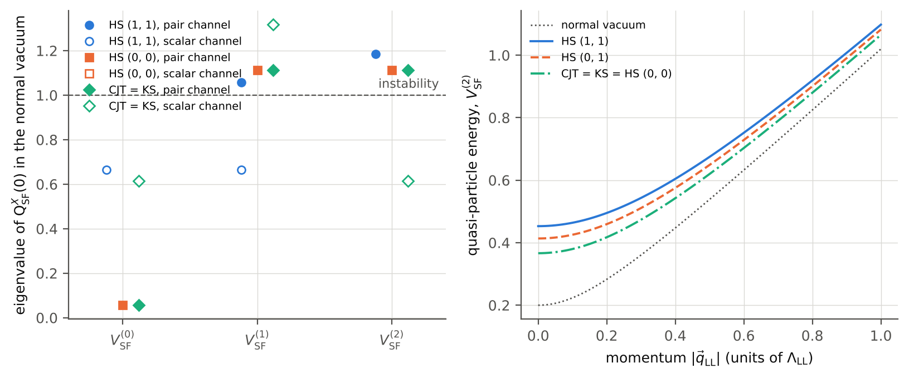{width=100%}

**Figure 5.** Left: the eigenvalues $\lambda^{\rm P}_{\rm SF}$ (filled) and $\lambda^{\rm S}_{\rm SF}$ (open) of the static response of the
normal vacuum for the three potentials; above the dashed line the normal vacuum is unstable. Right: the quasi-particle
energies (10.3) of the ground states of $V^{(2)}_{\rm SF}$ and of the normal vacuum. Data:
`data/part2_effective_couplings.csv`, `data/part2_dispersion.csv`.

## 10.5 The first excited states: quasi-particles and collective modes

**The quasi-particles.** A state with an odd fermion number has at least one quasi-particle; the lowest such state lies
the gap $E^{X,{\rm gap}}_{\rm SF}$ above the ground state. States of even fermion number and zero total momentum can contain two
quasi-particles with opposite momenta; their energies form a continuum that begins at $2E^{X,{\rm gap}}_{\rm SF}$ (the threshold).
Below the threshold the only excitations of zero total momentum are the **collective modes**, the small oscillations
of the self-consistent state.

**The linear response.** Let the self-energies oscillate with the frequency $\omega$: the BdG matrix becomes
$\mathsf H_{\rm SF}+\delta\mathsf H\,e^{-i\omega t}+{\rm h.c.}$ with
$$\delta\mathsf H=\begin{pmatrix}\delta\mathsf N&\delta\mathsf P\\\delta\bar{\mathsf P}&-\delta\mathsf N^T\end{pmatrix},\tag{10.4}$$
where $\delta\mathsf N$, $\delta\mathsf P$, $\delta\bar{\mathsf P}$ are the complex amplitudes of the normal self-energy, of the pair
self-energy and of its adjoint (independent amplitudes: $\delta\bar{\mathsf P}$ is the amplitude of $\mathsf P^\dagger$ at the same
frequency). Linearizing (6.6), $i\partial_0\mathsf R=[\mathsf H,\mathsf R]$, about the stationary state gives, in the eigenbasis
$\mathsf H_{\rm SF}(\vec q_{\rm LL})\lvert k\rangle=E_k\lvert k\rangle$ with the occupations $f_k=1$ for $E_k<0$ and $0$ otherwise,
$$\delta\mathsf R_{kl}=\frac{(f_l-f_k)\,\delta\mathsf H_{kl}}{\omega-E_k+E_l}\tag{10.5}$$
(from $\omega\,\delta\mathsf R=[\mathsf H_{\rm SF},\delta\mathsf R]+[\delta\mathsf H,\mathsf R_{\rm SF}]$). The local amplitudes are the integrals over the grid,
$\delta\mathsf C^{\rm n}=\int\delta\mathsf R_{11}$, $\delta\mathsf C^{\rm p}=-\int\delta\mathsf R_{12}$ and $\delta\bar{\mathsf C}^{\rm p}=-\int\delta\mathsf R_{21}$ (the
blocks of (6.4a)). Each triple of amplitudes is a vector of 120 complex numbers (the 64 entries of an $8\times8$ matrix and
the 28 entries above the diagonal of each of two antisymmetric matrices). Grouping the transitions of every node by
their energy $\Omega_{\rm SF}=E_k-E_l>0$ ($k$ empty, $l$ occupied), the map from the self-energy amplitudes to the density
amplitudes is
$$\boldsymbol\chi_{\rm SF}(\omega)=\sum_\kappa\Big[\frac{\mathsf J^+_\kappa}{\omega-\Omega_\kappa}-\frac{\mathsf J^-_\kappa}{\omega+\Omega_\kappa}\Big],\tag{10.6}$$
with $120\times120$ matrices $\mathsf J^+_\kappa$ from the pairs ($k$ empty, $l$ occupied) and $\mathsf J^-_\kappa$ from the pairs ($k$ occupied, $l$
empty) of the group $\kappa$ of transitions with the energy $\Omega_\kappa$ (a value of $\Omega_{\rm SF}$). The self-energies of a density amplitude are
the linear map $\mathsf F^X_{\rm SF}$ of the method (9.4), (9.5) applied to complex amplitudes (with
$\delta\bar{\mathsf P}=[\mathsf P(\delta\bar{\mathsf C}^{\rm p\dagger})]^\dagger$), so a self-consistent oscillation is an eigenvector with the eigenvalue
1 of
$$\mathsf Q^X_{\rm SF}(\omega)=\boldsymbol\chi_{\rm SF}(\omega)\,\mathsf F^X_{\rm SF}.\tag{10.7}$$
A **collective mode** is a frequency below the threshold at which an eigenvalue of $\mathsf Q^X_{\rm SF}(\omega)$ passes through 1;
at $\omega=0$, an eigenvalue larger than 1 means a static instability (Section 9.4). The program computes the
eigenvalues of $\mathsf Q^X_{\rm SF}(\omega)$ (general complex matrices: Hessenberg reduction and shifted QR, checked on random
matrices by *checks P2-0L1 to P2-0L3*), counts those above 1 at 300 frequencies up to the threshold, and locates every
change of the count by bisection; the amplitude of the mode is the eigenvector, described by its largest components in
the orthogonal bases $\Gamma\otimes\tau^{\rm LL}_a$ (normal part, "n") and $\mathsf K_{\rm SF}[\Gamma,\tau^{\rm LL}_a]$ (pair parts, "k" and "kb"), with
$\tau^{\rm LL}_0=\mathsf 1_2$.

**The Goldstone modes.** The polar ground state breaks three generators of GEE: the fermion number $F_{\rm LL}$ (the phase of
$D$) and the isospin rotations $T^1_{\rm LL}$, $T^2_{\rm LL}$ (which turn $\mathsf K^3$ into $\mathsf K^2$ and $\mathsf K^1$). For every broken generator
(an $8\times8$ charge matrix doubled to the Nambu spinor as $\mathrm{diag}(\mathsf G,-\mathsf G^T)$) the rotated state
$\mathsf R_{\rm SF}+i\epsilon[\mathsf G,\mathsf R_{\rm SF}]$ is again stationary, so $\delta\mathsf R=i[\mathsf G,\mathsf R_{\rm SF}]$ solves the linearized
equation at $\omega=0$: $\mathsf Q^X_{\rm SF}(0)$ has the eigenvalue 1 three times. *Check P2-7a:* in all five methods exactly three
eigenvalues of $\mathsf Q^X_{\rm SF}(0)$ equal 1, to $3\times10^{-13}$ (the Goldstone theorem, a test of the self-consistency of the
ground state and of the response). The unbroken generator $T^3_{\rm LL}$ gives no mode. With the gauge fields, the three
Goldstone modes become the longitudinal parts of the massive $W^\pm_{\rm SF}$ and $Z_{\rm SF}$ (Sections 11, 14.2 and 15.4).

**The massive modes.**

| method | $E^{X,{\rm gap}}_{\rm SF}$ | threshold | Goldstone | mode | multiplicity | the two largest components of the amplitude |
|:---|---:|---:|---:|---:|---:|:---|
| HS (1, 1) | $0.45296741$ | $0.90593481$ | 3 | $0.80612828$ | 2 | kb[C gamma\^ch x E tau2] 0.461; k[C gamma\^ch x E tau2] 0.461 |
| HS (1, 1) | $0.45296741$ | $0.90593481$ | 3 | $0.81369309$ | 1 | k[C gamma\^ch x E tau3] 0.474; kb[C gamma\^ch x E tau3] 0.474 |
| HS (0, 1) | $0.41358254$ | $0.82716508$ | 3 | $0.72508339$ | 3 | k[C gamma\^ch x E tau3] 0.282; kb[C gamma\^ch x E tau3] 0.282 |
| HS (0, 0) | $0.36639066$ | $0.73278133$ | 3 | $0.61438738$ | 3 | k[C gamma\^ch x E tau3] 0.285; kb[C gamma\^ch x E tau3] 0.285 |
| KS | $0.36639066$ | $0.73278133$ | 3 | $0.60347597$ | 1 | k[C gamma\^ch x E tau3] 0.426; kb[C gamma\^ch x E tau3] 0.426 |
| KS | $0.36639066$ | $0.73278133$ | 3 | $0.65728473$ | 2 | kb[C gamma\^ch x E tau2] 0.475; k[C gamma\^ch x E tau2] 0.475 |
| CJT | $0.36639066$ | $0.73278133$ | 3 | $0.60347597$ | 1 | k[C gamma\^ch x E tau3] 0.426; kb[C gamma\^ch x E tau3] 0.426 |
| CJT | $0.36639066$ | $0.73278133$ | 3 | $0.64400715$ | 2 | k[C gamma\^ch x E tau2] 0.467; kb[C gamma\^ch x E tau2] 0.467 |

**Table 10.4.** The excitations of the ground states of $V^{(2)}_{\rm SF}$ at zero total momentum: the gap, the threshold of two
quasi-particles, the number of Goldstone modes, and the collective modes below the threshold with their multiplicity and
the largest components of their amplitudes. Data: `data/part2_modes.csv`.

* The **amplitude (Higgs) mode**, the oscillation of $\lvert D\rvert$ (the components k and kb of
  $C\gamma^{\rm ch}\otimes\mathsf E\tau_3=\mathsf K^3$ with equal weights), with a share of the scalar density in KS and CJT (n[$\gamma^0\otimes\mathsf 1$],
  that is $\bar\Psi\Psi$): $M^{{\rm HS},{\rm H}}_{\rm SF}=0.8136930917$ (HS $(1,1)$), $M^{{\rm CJT},{\rm H}}_{\rm SF}=M^{{\rm KS},{\rm H}}_{\rm SF}=0.6034759669$.
* The **non-unitary modes**, a doublet (components along $\mathsf K^1$, $\mathsf K^2$ with the phase that makes the state non-unitary;
  they carry the charge $\pm1$ of the surviving $T^3$): $M^{{\rm HS},{\rm NU}}_{\rm SF}=0.8061282812$,
  $M^{{\rm KS},{\rm NU}}_{\rm SF}=0.6572847272$, $M^{{\rm CJT},{\rm NU}}_{\rm SF}=0.6440071546$. KS and CJT differ here: the amplitude contains
  the isovector scalar density (n[$\gamma^0\otimes\tau_1$]), outside the span of (9.3), where KS has no exchange kernel.
* In HS $(0,1)$ and $(0,0)$ the amplitude mode and the two non-unitary modes are degenerate (one mode of multiplicity
  3, at $0.725083391$ and $0.614387384$): without the direct contraction of the scalar term, the only
  interaction left in these channels is the pairing term, whose kernel treats the three components of the pair vector
  alike.

All massive modes lie below the threshold, so they are stable excitations (bosonic bound states of two spinor
charges). Figure 6 shows how the eigenvalues of $\mathsf Q^X_{\rm SF}(\omega)$ cross 1. The Python program finds the same
Goldstone modes and the same frequencies to $3\times10^{-13}$, with the eigenvalues of LAPACK (*checks YP2-7a, YP2-7b*).

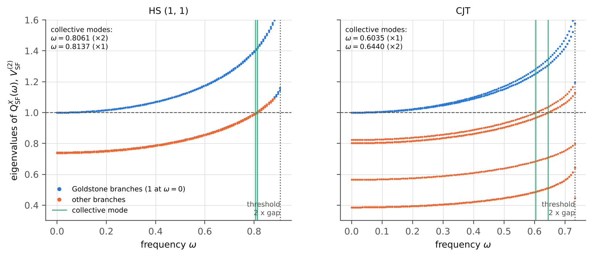{width=100%}

**Figure 6.** The eigenvalues of $\mathsf Q^X_{\rm SF}(\omega)$ between 0.3 and 1.6 as functions of the frequency, for HS $(1,1)$
and CJT ($V^{(2)}_{\rm SF}$). Three branches start at 1 for $\omega=0$ (the Goldstone modes); a collective mode is a frequency at
which a branch crosses 1 (vertical lines, with the multiplicity); the dotted line is the threshold
$2E^{X,{\rm gap}}_{\rm SF}$. Data: `data/part2_rpa_curves_HS_1_1.csv`, `data/part2_rpa_curves_CJT.csv`.

**Summary of item 6 for the three methods.** For $V^{(2)}_{\rm SF}$: the ground state is the polar superfluid boson singlet
($S=0$, the pair $\mathsf K^3_{\rm LL}$, a Lorentz scalar of fermion number 2); the first excited states are the three Goldstone
modes (massless before the gauge fields are included), the amplitude mode, the non-unitary doublet, and the
quasi-particles; the gap is $E^{{\rm HS},{\rm gap}}_{\rm SF}=0.4529674056$ (HS $(1,1)$) and
$E^{{\rm KS},{\rm gap}}_{\rm SF}=E^{{\rm CJT},{\rm gap}}_{\rm SF}=0.3663906649$.

# 11. The gauge bosons in the superfluid (item 6 of the problem, second part)

The gauge couplings are those of the earlier work of the project, $g^{\rm v}_{\rm LL}=0.7$ and $g^{\rm F}_{\rm LL}=0.45$, and their
common scale $s^{\rm g}_{\rm SF}$ ($g^{\rm v}_{\rm LL}=0.7s^{\rm g}_{\rm SF}$, $g^{\rm F}_{\rm LL}=0.45s^{\rm g}_{\rm SF}$) is varied in Section 11.4.

## 11.1 The masses of the gauge bosons

**From the susceptibilities to the masses.** A constant time component $W^\iota_{{\rm SF},0}$ of a gauge field enters the
Hamiltonian density as $g^{\rm v}_{\rm LL}W^\iota_{{\rm SF},0}\Psi^\dagger\mathsf q^\iota_{\rm SF}\Psi$ with the charge matrix
$\mathsf q^\iota_{\rm SF}=\mathsf 1_4\otimes\tfrac12\tau^{\rm LL}_\iota$ (the Lagrangian (5.2) contains
$\bar\Psi i\gamma^0(ig^{\rm v}_{\rm LL}W^\iota_{{\rm SF},0}T^\iota_{\rm LL})\Psi=-g^{\rm v}_{\rm LL}W^\iota_{{\rm SF},0}\Psi^\dagger T^\iota_{\rm LL}\Psi$), and
$B_{{\rm SF},0}$ as $g^{\rm F}_{\rm LL}B_{{\rm SF},0}\Psi^\dagger\mathsf q^{\rm F}_{\rm SF}\Psi$ with $\mathsf q^{\rm F}_{\rm SF}=\mathsf 1_8$. These terms have the
form $-\mu^a_{\rm SF}\Psi^\dagger\mathsf q^a_{\rm SF}\Psi$ of chemical potentials of the four charges, with
$\mu^\iota_{\rm SF}=-g^{\rm v}_{\rm LL}W^\iota_{{\rm SF},0}$ and $\mu^{\rm F}_{\rm SF}=-g^{\rm F}_{\rm LL}B_{{\rm SF},0}$.
The energy of the state of lowest energy of $\mathcal H-\sum_a\mu^a_{\rm SF}\Psi^\dagger\mathsf q^a_{\rm SF}\Psi$ falls quadratically,
$-\tfrac12\sum_{ab}\chi^{ab}_{\rm SF}\mu^a_{\rm SF}\mu^b_{\rm SF}$, with the static susceptibilities
$\chi^{ab}_{\rm SF}=\partial\langle\Psi^\dagger\mathsf q^a_{\rm SF}\Psi\rangle/\partial\mu^b_{\rm SF}$. Minus this energy is a term of the effective Lagrangian
of the gauge fields, $\tfrac12\sum_{ab}g_ag_b\chi^{ab}_{\rm SF}\mathcal A^a_0\mathcal A^b_0$, where
$(\mathcal A^1_p,\mathcal A^2_p,\mathcal A^3_p,\mathcal A^{\rm F}_p)=(W^1_{{\rm SF},p},W^2_{{\rm SF},p},W^3_{{\rm SF},p},B_{{\rm SF},p})$ and $g_a$ is
$g^{\rm v}_{\rm LL}$ for $a=1,2,3$ and $g^{\rm F}_{\rm LL}$ for $a={\rm F}$. This is the time-time part of the mass term
$\tfrac12\sum_{ab}\mathsf M^X_{{\rm SF},ab}\sum_p\eta^{\rm LL}_{pp}\mathcal A^a_p\mathcal A^b_p$. Hence the **mass matrix**
$$\mathsf M^X_{{\rm SF},ab}=g_ag_b\,\chi^{ab}_{\rm SF}.\tag{11.1}$$
The vacuum is Lorentz-invariant, so the mass term of the space components is the same. (The time components are used
because a constant time component does not shift the momenta of the spinor charges, so the momentum cutoff introduces no
error; a constant space component shifts the momenta inside a fixed cutoff, which breaks gauge invariance at the
boundary $\lvert\vec q_{\rm LL}\rvert=\Lambda_{\rm LL}$ and would give the massless boson a spurious mass.) In the normal vacuum, which has a gap, the
susceptibilities vanish and all four bosons are massless. The program computes $\chi^{ab}_{\rm SF}$ by central differences of the
induced charges of the self-consistent states at $\mu^b_{\rm SF}=\pm h,\pm2h$ ($h=2\times10^{-3}$) with Richardson extrapolation, and
checks the thermodynamic identity $-\partial^2\mathcal E/\partial\mu^2=\chi$ (*checks P2-8b*, $9\times10^{-9}$ relative).

| state | $\chi^{11}_{\rm SF}=\chi^{22}_{\rm SF}$ | $\chi^{33}_{\rm SF}$ | $\chi^{\rm FF}_{\rm SF}$ | largest off-diagonal entry | $\chi^{\rm FF}_{\rm SF}/\chi^{11}_{\rm SF}$ |
|:---|---:|---:|---:|---:|---:|
| HS (1, 1) | $0.0051186247$ | $0$ | $0.020144539$ | $0$ | $3.93554$ |
| KS | $0.0043170062$ | $0$ | $0.020362243$ | $0$ | $4.71675$ |
| CJT | $0.0045778739$ | $0$ | $0.020362243$ | $0$ | $4.44797$ |
| CJT with exchange | $0.0037775418$ | $0$ | $0.016351082$ | $0$ | $4.3285$ |

**Table 11.1.** The susceptibilities of the four charges in the ground states of $V^{(2)}_{\rm SF}$ (the matrix is diagonal;
$\chi^{22}=\chi^{11}$). Data: `data/part2_chi.csv`.

**The mass eigenstates.** In every method $\chi^{33}_{\rm SF}=0$ and the matrix is diagonal (*checks P2-8a*, $3\times10^{-15}$): the gauge
field $W^3_{\rm SF}$ of the unbroken generator is massless, it is the **massless gauge boson** $A_{{\rm SF},p}=W^3_{{\rm SF},p}$ ($\theta^{\rm W}_{\rm SF}=0$: no
mixing with $B_{\rm SF}$, because the charge $\mathsf q^3$ of the condensate is zero while its fermion number is 2); $W^1_{\rm SF}$ and
$W^2_{\rm SF}$ have the common mass $M^X_{W,{\rm SF}}=g^{\rm v}_{\rm LL}(\chi^{11}_{\rm SF})^{1/2}$, and their combinations
$W^\pm_{\rm SF}=(W^1_{\rm SF}\mp iW^2_{\rm SF})/\sqrt2$ carry the charges $Q_{\rm LL}=\pm1$; and $Z_{\rm SF}=B_{\rm SF}$ has the mass
$M^X_{Z,{\rm SF}}=g^{\rm F}_{\rm LL}(\chi^{\rm FF}_{\rm SF})^{1/2}$. In CJT, with the couplings of the project and the exchange included
self-consistently (Section 11.4): $M^{\rm CJT}_{W,{\rm SF}}=0.04302319693$, $M^{\rm CJT}_{Z,{\rm SF}}=0.05754210808$,
$M^{\rm CJT}_{A,{\rm SF}}=0$. The surviving symmetry of the vacuum and the derivation of these masses from the effective
Lagrangians are the subject of Parts III and IV.

## 11.2 The exchange of the gauge bosons in a uniform state

In a uniform state the direct (Hartree) term of (8.4) vanishes, because the state is neutral: its densities of the four
charges are zero. The exchange and the pair contractions give the momentum-dependent self-energies
$$\begin{aligned}\mathsf N_{\rm SF}(\vec q)&=-\sum_{\rm b}g_{\rm b}^2\sum_p\eta^{\rm LL}_{pp}\!\int\!\frac{d^3q'}{(2\pi)^3}D^{\rm b}_{\rm SF}(\vec q-\vec q\,')\,\mathsf A^{\rm b}_{{\rm SF},p}\,\delta\mathsf C^{\rm n}_{\rm LL}(\vec q\,')\,\mathsf A^{\rm b}_{{\rm SF},p},\\\mathsf P_{\rm SF}(\vec q)&=-\sum_{\rm b}g_{\rm b}^2\sum_p\eta^{\rm LL}_{pp}\!\int\!\frac{d^3q'}{(2\pi)^3}D^{\rm b}_{\rm SF}(\vec q-\vec q\,')\,\mathsf A^{\rm b}_{{\rm SF},p}\,\mathsf C^{\rm p}_{\rm LL}(\vec q\,')\,(\mathsf A^{\rm b}_{{\rm SF},p})^T\end{aligned}\tag{11.2}$$
($\delta\mathsf C^{\rm n}_{\rm LL}=\mathsf C^{\rm n}_{\rm LL}-\mathsf C^{\rm vac}_{\rm LL}$; the momentum arguments are $\vec q_{\rm LL}$, $\vec q\,'_{\rm LL}$), and the exchange energy per volume
$\mathcal E^{\rm ex,b}_{\rm SF}$, summed over b, $\tfrac12\int d^3q/(2\pi)^3[\mathrm{tr}(\mathsf N\delta\mathsf C^{\rm n})-\mathrm{Re}\,\mathrm{tr}(\mathsf P(\mathsf C^{\rm p})^\dagger)]$.

**The angular integral.** On the six-direction grid a correlation matrix has the form $\mathsf L_0(q)+\sum_j\hat q_j\mathsf L_{1,j}(q)$
(angular momenta 0 and 1; $\mathsf L_0$ is the average over the six directions and $\mathsf L_{1,j}$ half the difference between the
directions $+\vec e_j$ and $-\vec e_j$), and the average over the directions of $\vec q\,'$ of the kernel times such a matrix is
$\mathfrak d_0\mathsf L_0+\mathfrak d_1\sum_j\hat q_j\mathsf L_{1,j}$ with
$$\begin{aligned}\mathfrak d_0&=\frac{\ln(\mathfrak a+\mathfrak b)-\ln(\mathfrak a-\mathfrak b)}{2\mathfrak b},\qquad\mathfrak d_1=-\frac1{\mathfrak b}+\frac{\mathfrak a[\ln(\mathfrak a+\mathfrak b)-\ln(\mathfrak a-\mathfrak b)]}{2\mathfrak b^2},\\\mathfrak a&=q^2+q'^2+(M^{\rm b}_{\rm SF})^2,\qquad\mathfrak b=2qq'\end{aligned}\tag{11.3}$$
($\tfrac12\int_{-1}^1dx/(\mathfrak a-\mathfrak bx)$ and $\tfrac12\int_{-1}^1x\,dx/(\mathfrak a-\mathfrak bx)$, with $q$, $q'$ the lengths of the
momenta and $x$ the cosine of their angle). The logarithm $\ln(\mathfrak a-\mathfrak b)=\ln((q-q')^2+(M^{\rm b}_{\rm SF})^2)$ is singular at
$q'=q$ for a massless boson; its radial integral $\int\mathfrak s(q')\ln((q-q')^2+(M^{\rm b}_{\rm SF})^2)dq'$ with a smooth factor
$\mathfrak s(q')$ is computed with the subtraction $\int[\mathfrak s(q')-\mathfrak s(q)]\ln(\dots)dq'+\mathfrak s(q)\mathfrak A(q)$, where
$\mathfrak A(q)=\mathfrak F(\Lambda_{\rm LL}-q)-\mathfrak F(-q)$ with
$\mathfrak F(x)=x\ln(x^2+(M^{\rm b}_{\rm SF})^2)-2x+2M^{\rm b}_{\rm SF}\arctan(x/M^{\rm b}_{\rm SF})$ (for a massless boson
$x\ln x^2-2x$) is the exact integral of the logarithm. *Check P2-3:* with a constant kernel ($\mathfrak d_0$ a constant
$\mathfrak d^{\rm c}$, $\mathfrak d_1=0$) the exchange self-energies and energy equal those of the contact terms
$\tfrac12g_{\rm b}^2\mathfrak d^{\rm c}\eta^{\rm LL}_{pp}{:}(\Psi^\dagger\mathsf A^{\rm b}_{{\rm SF},p}\Psi)^2{:}$ with $w^{\rm H}_{\rm SF}=0$, $w^{\rm F}_{\rm SF}=w^{\rm P}_{\rm SF}=1$, to
$2\times10^{-17}$ (self-energies) and $6\times10^{-15}$ (energy, relative).

## 11.3 Can the gauge bosons pair the normal vacuum?

The static exchange (8.4) of a massless boson has a long range, and the contact limit of Section 8 does not decide its
effect. The linearized gap equation of the normal vacuum with the exchange answers it: a small pair self-energy
$\mathsf P(\vec q_{\rm LL})$ produces the pair correlation $\mathsf C^{\rm p}_{\rm LL}(\vec q_{\rm LL})=-[\delta\mathsf R(\vec q_{\rm LL})]_{12}$ of (10.5) at $\omega=0$
(the normal vacuum at each node), and the exchange (11.2) turns it into a new pair self-energy. The
largest eigenvalue $\lambda^{\rm T}_{\rm SF}$ of this linear map in the channel $\mathsf K^3_{\rm LL}$ is computed by power iteration; the normal
vacuum is unstable against pairing when $\lambda^{\rm T}_{\rm SF}>1$.

| case | value |
|:---|---:|
| W1 alone, massless, per unit coupling\^2 | $-0.035731783$ |
| W2 alone, massless, per unit coupling\^2 | $-0.035731783$ |
| W3 (the zeugon of the condensate) alone, massless, per unit coupling\^2 | $0.035731783$ |
| B alone, massless, per unit coupling\^2 | $-0.14292713$ |
| all four massless, couplings 1 | $-0.17865892$ |
| all four massless, g\_v = 0.7, g\_F = 0.45 | $-0.046451318$ |
| critical g\_v of the zeugon alone | $5.2902069$ |
| V\^(0) by CJT, contact terms alone | $0.056373467$ |

**Table 11.2.** The largest eigenvalues of the linearized gap equation of the normal vacuum, per unit coupling squared
for the single bosons. Data: `data/part2_thouless.csv`.

The zeugon $W^3_{\rm SF}$ (massless) alone attracts, $\lambda^{\rm T}_{\rm SF}=0.03573178316\,(g^{\rm v}_{\rm LL})^2$, and would pair the normal
vacuum by itself for $g^{\rm v}_{\rm LL}>g^{\rm crit}_{\rm SF}=5.290206869$, almost eight times the coupling of the project. But in the
normal vacuum all four bosons are massless, $W^1_{\rm SF}$ and $W^2_{\rm SF}$ repel exactly as strongly as $W^3_{\rm SF}$ attracts and
$B_{\rm SF}$ four times as strongly (*checks P2-8c, P2-8d*, the linear structure of (8.5)), and the sum is
$\lambda^{\rm T}_{\rm SF}=-0.04645131811$ at the couplings of the project: **the gauge bosons repel in the symmetric vacuum and cannot
create the condensate at any coupling**. (The Python program finds the same eigenvalues; it also checks the closed forms
of the angular averages of $D^{\rm b}_{\rm SF}$ against a direct quadrature, *checks YP2-8b, YP2-8c*.)

## 11.4 The CJT solution with the exchange of the gauge bosons

**The self-consistent masses.** The masses in (11.2) are those of the state itself: the program starts from the masses
of the contact solution (Table 11.1), solves (11.2) with the contact terms of $V^{(2)}_{\rm SF}$, recomputes the
susceptibilities of the new state (with the exchange; $\chi^{33}$ stays 0 and $\chi^{3{\rm F}}=0$, *check P2-8i*), and repeats
until the masses change by less than $10^{-5}$ (three iterations; *check P2-8j*).

| quantity | value |
|:---|---:|
| mass iterations | $3$ |
| eigenvalue 1 of the mass matrix | $0$ |
| eigenvalue 2 of the mass matrix | $0.0018509955$ |
| eigenvalue 3 of the mass matrix | $0.0018509955$ |
| eigenvalue 4 of the mass matrix | $0.0033110942$ |
| M\_W | $0.043023197$ |
| M\_A | $1.9999467\times10^{-8}$ |
| M\_Z | $0.057542108$ |
| D | $0.27617557$ |
| Dirac mass | $0.15696812$ |
| energy | $-0.00013240202$ |
| exchange energy | $9.6467867\times10^{-5}$ |
| gap | $0.31766639$ |
| residual | $9.4120267\times10^{-12}$ |
| exchange energy W1 | $4.0132214\times10^{-5}$ |
| exchange energy W2 | $4.0132214\times10^{-5}$ |
| exchange energy W3 | $-4.8346638\times10^{-5}$ |
| exchange energy B | $6.4550078\times10^{-5}$ |
| D with 16 radial nodes | $0.27617572$ |
| energy with 16 radial nodes | $-0.00013240217$ |
| D with 32 radial nodes | $0.27617552$ |
| energy with 32 radial nodes | $-0.00013240191$ |

**Table 11.3.** The CJT solution of $V^{(2)}_{\rm SF}$ with the exchange of the four gauge bosons, $g^{\rm v}_{\rm LL}=0.7$, $g^{\rm F}_{\rm LL}=0.45$, at
self-consistent masses; the exchange energies of the four bosons; the mass matrix; and the same solution on 16 and 32
radial nodes. Data: `data/part2_gauge_cjt.csv`.

The superfluid survives (*check P2-8f*): $\lvert D^{\rm CJT}_{\rm SF}\rvert=0.2761755673$ (without the gauge bosons
$0.3284861084$), the gap $0.3176663895$ and the energy $-0.0001324020178$. The exchange energies show the roles of
the bosons in the condensate: the **zeugon $W^3_{\rm SF}$ (massless) attracts**, $\mathcal E^{{\rm ex},W^3}_{\rm SF}=-4.834663821\times10^{-5}$, while $W^1$, $W^2$ and
$B$ repel ($4.013221351\times10^{-5}$ each and $6.455007785\times10^{-5}$); the net effect,
$9.646786667\times10^{-5}$, weakens the condensate. The energies of the bosons add up to the exchange energy (*check
P2-8e*), and with 16, 24 and 32 radial nodes the pair amplitudes $\lvert D^{\rm CJT}_{\rm SF}\rvert$ agree to $2\times10^{-7}$ and the
energies to $2\times10^{-6}$ (relative). The Python program, with the masses of the
Rust program, finds the same energy (*check YP2-8d*).

**The strength of the couplings.** Table 11.4 and Figure 7 follow the CJT solution as the common scale
$s^{\rm g}_{\rm SF}$ of the couplings grows (with the masses of the contact solution scaled with the couplings). The pair amplitude
falls; at $s^{\rm g}_{\rm SF}=2$ ($g^{\rm v}_{\rm LL}=1.4$, $g^{\rm F}_{\rm LL}=0.9$) the superfluid has disappeared (the iteration ends, slowly, in the
normal vacuum); at $s^{\rm g}_{\rm SF}=2.5$ the exchange contractions of the gauge bosons, acting in the scalar channel as the
pairing term did in $V^{(1)}_{\rm SF}$, make a massive state with the Dirac mass $-0.4187$ the ground state.

| $s^{\rm g}_{\rm SF}$ | $\lvert D^{\rm CJT}_{\rm SF}\rvert$ | $M^{{\rm CJT},{\rm D}}_{\rm SF}$ | $10^4\,\mathcal E^{\rm CJT}_{\rm SF}$ | $E^{{\rm CJT},{\rm gap}}_{\rm SF}$ | $10^5\,\mathcal E^{{\rm ex},W^3}_{\rm SF}$ | iterations |
|---:|---:|---:|---:|---:|---:|---:|
| $0$ | $0.328486$ | $0.162293$ | $-2.4224$ | $0.366391$ | $0$ | 0 |
| $0.5$ | $0.315086$ | $0.160591$ | $-2.105$ | $0.353651$ | $-1.453$ | 220 |
| $1$ | $0.277084$ | $0.156973$ | $-1.3386$ | $0.318459$ | $-4.857$ | 289 |
| $1.5$ | $0.212064$ | $0.156623$ | $-0.47599$ | $0.263632$ | $-7.223$ | 502 |
| $2$ | $<10^{-6}$ | $0.2$ | $0$ | $0.2$ | $0$ | 14835 |
| $2.5$ | $<10^{-6}$ | $-0.41873$ | $-5.0177$ | $0.418578$ | $-99.79$ | 440 |

**Table 11.4.** The CJT solution of $V^{(2)}_{\rm SF}$ with the exchange of the gauge bosons for growing couplings. Data:
`data/part2_gauge_scan.csv`.

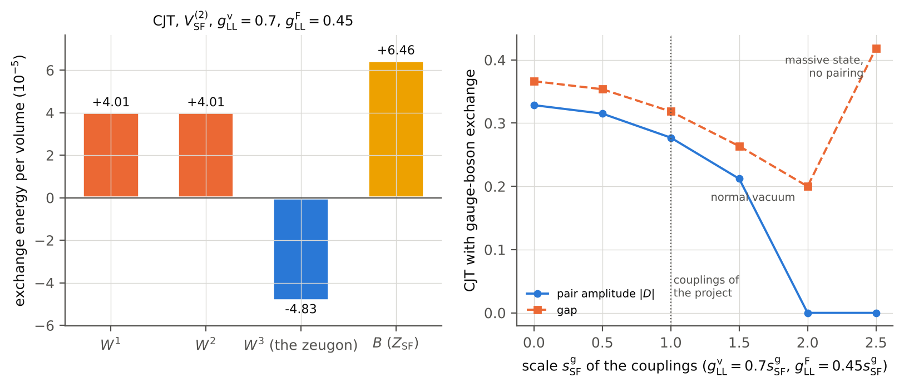{width=100%}

**Figure 7.** Left: the exchange energies of the four gauge bosons in the CJT superfluid at the couplings of the project;
the zeugon $W^3_{\rm SF}$ (massless) attracts, $W^1$, $W^2$ and $B$ repel. Right: the pair amplitude and the gap of the CJT solution as the
couplings grow. Data: `data/part2_gauge_cjt.csv`, `data/part2_gauge_scan.csv`.

## 11.5 KS and HS with the gauge bosons

**KS.** The Kohn-Sham potentials are local; with the exchange energy of the gauge bosons as a further part of the
functional, the Kohn-Sham ground state is the state of lowest energy among the ground states of local potentials, the
Dirac mass $m^{\rm KS}_{\rm SF}=m_{\rm LL}+\mathfrak m$ and the pair potential $\mathfrak D(\mathsf K^3_{\rm LL})^\dagger$ (an optimized effective
potential; the program minimizes over the two real numbers $(\mathfrak m,\mathfrak D)$ by the method of Nelder and Mead). Without the exchange this reproduces the contact solution
(*check P2-8g*). With the exchange, at the masses of the KS susceptibilities:

| quantity | value |
|:---|---:|
| M\_W | $0.04599275$ |
| M\_Z | $0.064213349$ |
| D | $0.28309937$ |
| Dirac mass | $0.16211111$ |
| energy | $-0.00013350681$ |
| exchange energy | $9.5854916\times10^{-5}$ |
| gap | $0.32622885$ |
| Nelder-Mead steps | $65$ |
| energy with the masses of the CJT state | $-0.00013225021$ |

**Table 11.5.** The KS solution of $V^{(2)}_{\rm SF}$ with the exchange energy of the gauge bosons. Data:
`data/part2_gauge_ks.csv`.

With the masses of the CJT state, the KS energy $-0.0001322502068$ lies above the CJT energy
$-0.0001324020178$, as it must: KS minimizes the same energy over the smaller family of states made by local potentials
(*check P2-8h*). The difference is small because the exchange self-energy depends only weakly on the momentum.

**HS.** In HS the gauge fields are classical fields; in a neutral uniform state they vanish, and the ground state of
Section 10 is unchanged. The gauge bosons acquire the masses of Table 11.1 by the Higgs mechanism of the HS pair field
(Parts III and IV).

## 11.6 The answer to item 6: the gauge boson that mediates the pairing

* The pairing of the spinor charges into the superfluid boson singlet ($S=0$, isospin triplet, fermion number 2) is
  produced by the pairing term of $V^{(2)}_{\rm SF}$; in the methods with the exchange contraction the potential must also
  contain a repulsive scalar term (Section 10.3).
* In the symmetric vacuum no gauge boson of GEE attracts a spin-zero pair (Section 8.2), and the exchange of the four
  massless gauge bosons repels (Section 11.3).
* After the breaking of the symmetry the gauge field $W^3_{\rm SF}$ of the surviving generator is the massless gauge boson
  $A_{{\rm SF},p}$ of the superfluid, a force particle not yet observed; it is the gauge boson that attracts the two charges of the condensed pair (pair energy $-1$; exchange
  energy $-4.834663821\times10^{-5}$ in CJT), and it mediates the pairing in this sense; it would pair the vacuum
  by itself only for $g^{\rm v}_{\rm LL}>5.290206869$, and with all bosons together the net exchange weakens the condensate at
  the couplings of the project.

# 12. The effective Lagrangians of the superfluid boson singlet state (Part III)

Part III builds, for each method $X$, the effective Lagrangian $\mathcal L^X=\mathcal L^X_{\rm kinetic}+\mathcal L^X_{\rm potential}$ of the field
of the superfluid boson singlet state (decision D7 of the task record: the potential part is minus the effective
potential, the energy per volume of a uniform state as a function of the field; the kinetic part contains the
derivatives to second order, in the form that GEE requires). All results are for the potential $V^{(2)}_{\rm SF}$ of
Section 10.3.

## 12.1 The field and the effective potential

**The field.** The superfluid boson singlet state is described by the complex isospin vector $\vec\Phi^X_{\rm SF}$ of the
amplitudes of the pair self-energy of a uniform state,
$$\mathsf P_{\rm SF}=\sum_{\iota=1}^3\Phi^{X,\iota}_{\rm SF}(\mathsf K^\iota_{\rm LL})^\dagger,\tag{12.1}$$
where $\mathsf P_{\rm SF}$ is the pair self-energy (9.4), (9.5) that the functional of method $X$ assigns to the state. In HS
it is the value of the auxiliary pair field $\vec\Phi^{\rm HS}_{\rm SF}$, in CJT the anomalous self-energy, in KS the Kohn-Sham
pair potential; in each method it equals $-\tfrac12g^{X,{\rm P}}_{\rm SF}\langle\Pi^\iota_{\rm LL}\rangle$ (Section 9.4), and for the
ground state $\vec\Phi^X_{\rm SF}=D^X_{\rm SF}\vec e_3$. Under GEE the field is a Lorentz scalar, an isospin vector (by (3.16)), and
it takes the phase $e^{2i\theta^{\rm F}_{\rm LL}}$ under $U(1)^{\rm F}_{\rm LL}$ (fermion number 2).

**The effective potential.** $\mathcal V^X_{\rm SF}(\vec\Phi)$ is the smallest energy per volume of method $X$ among the uniform
quasi-free states whose field (12.1) is $\vec\Phi$ (the constrained effective potential). It is computed as follows.
Apply a fixed pair self-energy $\mathsf P$ (an applied field), make the normal self-energy self-consistent,
$\mathsf N_{\rm SF}=\mathsf N(\delta\mathsf C^{\rm n})$, and take the ground state $\mathsf R$ of the BdG matrix with $(\mathsf N_{\rm SF},\mathsf P)$; its field
$\vec\Phi(\mathsf R)$ and its energy $\mathcal E^X_{\rm SF}[\mathsf R]$ give one point $(\vec\Phi(\mathsf R),\mathcal E^X_{\rm SF}[\mathsf R])$ of
$\mathcal V^X_{\rm SF}$. Proof that it is the constrained minimum: the states of smallest energy with a given field are the
stationary points of $\mathcal E^X_{\rm SF}-2\,\mathrm{Re}\,\lambda\,\mathrm{tr}(\mathsf K^3\mathsf C^{\rm p\,T})$ with a Lagrange multiplier
$\lambda$; by (6.3) they are the ground states of the BdG matrix with the normal self-energy of the state and the pair
self-energy $\mathsf P_{\rm SF}(\mathsf R)+2\lambda(\mathsf K^3)^\dagger$, that is, with an applied pair self-energy; conversely every applied
field defines a $\lambda$. Along the applied fields, the derivative of the energy vanishes where the applied field equals
the state's own pair self-energy, so the stationary points of $\mathcal V^X_{\rm SF}$ are the self-consistent states of
Part II and its minimum is the ground state (*checks P3-1, P3-2*: the applied field $\Phi^X_{0,{\rm SF}}=\lvert D^X_{\rm SF}\rvert$
returns the field $\Phi^X_{0,{\rm SF}}$ and the ground-state energy of Table 10.2 to $4\times10^{-14}$, and the slope there is at most
$4\times10^{-8}$ of $\Phi^X_{0,{\rm SF}}$ times the curvature, the accuracy of the five-point derivative).

**Symmetry.** Since $\mathcal E^X_{\rm SF}$ is GEE-invariant, $\mathcal V^X_{\rm SF}$ depends on $\vec\Phi$ only through the two invariants
$\lvert\vec\Phi\rvert^2$ and $\lvert\vec\Phi\cdot\vec\Phi\rvert^2$ (the latter equals $\lvert\vec\Phi\rvert^4$ for the polar fields
$\vec\Phi=e^{i\vartheta}\lvert\vec\Phi\rvert\vec n$ with a real unit vector $\vec n$, and is smaller for the others). *Check P3-3:* a phase
of the applied field and the isospin direction 1 instead of 3 give the same energy to $7\times10^{-14}$ (relative).

**The Mexican hat.** Figure 8 shows $\mathcal V^X_{\rm SF}$ along the polar fields $\Phi^{X,3}_{\rm SF}$ (real) for the five methods.
It vanishes at $\vec\Phi=0$ (the normal vacuum), is negative next to it (*check P3-5*: the normal vacuum is a maximum,
because $\lambda^{\rm P}_{\rm SF}>1$, Section 9.4) and has its minimum at $\lvert\vec\Phi\rvert=\Phi^X_{0,{\rm SF}}$. Rotated about the
origin of the complex plane of $\Phi^3$ (the phase is a symmetry), the curve is the Mexican hat. The potential $V^{(2)}_{\rm SF}$
already produces it in all three methods, so the recursion of Section 10 needs no further step for this purpose.
**The Landau form.** A *Landau form* of a potential is its expansion in powers of the order parameter (the field that
vanishes in the symmetric state and not in the broken one) under two rules: only polynomial invariants of the symmetry
group occur, and the expansion stops after the lowest orders that bound the potential from below and produce its
minima. L. D. Landau introduced it for phase transitions: near a continuous transition the order parameter is small,
the free energy is assumed to be analytic in it, and the form is its Taylor expansion, whose coefficients (the Landau
coefficients) are derivatives at the symmetric state; the quadratic coefficient changes its sign at the transition, and
the signs of the higher coefficients decide the order of the transition and which broken state is the minimum.
Examples:

* a uniaxial ferromagnet: $F_{\rm mag}=a_{\rm mag}m_{\rm mag}^2+b_{\rm mag}m_{\rm mag}^4$ for the magnetization $m_{\rm mag}$ (the
  symmetry $m_{\rm mag}\to-m_{\rm mag}$), with $a_{\rm mag}$ proportional to the temperature minus the Curie temperature
  and $b_{\rm mag}>0$; below the Curie temperature the minima are $m_{\rm mag}=\pm(-a_{\rm mag}/(2b_{\rm mag}))^{1/2}$;
* the theory of superconductivity of V. L. Ginzburg and L. D. Landau: $\alpha_{\rm GL}\lvert\psi_{\rm GL}\rvert^2+\tfrac12\beta_{\rm GL}\lvert\psi_{\rm GL}\rvert^4$
  for the complex pair wave function $\psi_{\rm GL}$ (the symmetry $U(1)$), to which the gradient terms and the magnetic
  field are added; L. P. Gor'kov derived it from the theory of Bardeen, Cooper and Schrieffer near the critical
  temperature, where $\lvert\psi_{\rm GL}\rvert$ is small, so that there the coefficients are true Taylor coefficients;
* the Higgs potential of the Standard Model (Section 1), $-(\mu^{\rm SM})^2(\Phi^{\rm SM})^\dagger\Phi^{\rm SM}+\lambda^{\rm SM}((\Phi^{\rm SM})^\dagger\Phi^{\rm SM})^2$:
  the doublet has the single invariant $(\Phi^{\rm SM})^\dagger\Phi^{\rm SM}$ of degree 2, and this Landau form is exact
  at tree level, not a truncation;
* the Bose-Einstein condensates of spin 1 (T.-L. Ho; T. Ohmi and K. Machida), the closest analogue of the field of this
  manuscript: their order parameter is a complex vector $\vec\varpi$, and their energy per volume
  $\tfrac12c_{\rm n}\lvert\vec\varpi\rvert^4+\tfrac12c_{\rm s}(\lvert\vec\varpi\rvert^4-\lvert\vec\varpi\cdot\vec\varpi\rvert^2)$ contains the same two
  quartic invariants as the isospin vector below, the second term being the square of the spin; $c_{\rm s}>0$ (sodium-23)
  favors the polar state, $c_{\rm s}<0$ (rubidium-87) the ferromagnetic state $\vec\varpi\propto(1,i,0)$;
* the ferroelectric barium titanate (A. F. Devonshire): $\alpha_{\rm D}P_{\rm D}^2+\beta_{\rm D}P_{\rm D}^4+\gamma_{\rm D}P_{\rm D}^6$ for the
  polarization $P_{\rm D}$ with $\beta_{\rm D}<0$ and $\gamma_{\rm D}>0$: the sixth power is required, and the transition is of
  first order;
* superfluid helium-3 (A. J. Leggett): one quadratic and five quartic invariants of a complex $3\times3$ matrix, whose
  five coefficients decide between the phases A and B;
* the nematic liquid crystals (P. G. de Gennes): the traceless symmetric tensor of the nematic order admits an
  invariant of the third degree, so the transition is of first order.

The name has nothing to do with the Landau levels of Section 7.2. For the complex isospin vector $\vec\Phi$ under GEE
the independent invariants up to the fourth degree are $\lvert\vec\Phi\rvert^2$, $\lvert\vec\Phi\rvert^4$ and
$\lvert\vec\Phi\cdot\vec\Phi\rvert^2$, and $\lvert\vec\Phi\rvert^4-\lvert\vec\Phi\cdot\vec\Phi\rvert^2=\lvert\vec\Phi\times\vec\Phi^*\rvert^2$ vanishes
exactly on the polar fields. Along the polar states the computed curve is summarized by the Landau form
$$\mathcal V^X_{\rm SF}\approx a^X_{\rm SF}\lvert\vec\Phi\rvert^2+b^X_{\rm SF}\lvert\vec\Phi\rvert^4+c^X_{\rm SF}\lvert\vec\Phi\rvert^6+u^X_{\rm SF}\big(\lvert\vec\Phi\rvert^4-\lvert\vec\Phi\cdot\vec\Phi\rvert^2\big)\tag{12.2}$$
(its first three coefficients by least squares on the computed points with $0\le\lvert\vec\Phi\rvert\le1.4\Phi^X_{0,{\rm SF}}$, so that
(12.2) is a fit and not a derivation, whose accuracy is the subject of the last paragraphs of this section;
$a^X_{\rm SF}<0$ is the instability of the origin). The last term
vanishes for polar fields and measures the cost of non-unitarity: for $\vec\Phi=\Phi_0\vec e_3+i\nu\vec e_1$ (with $\Phi_0$ short for
$\Phi^X_{0,{\rm SF}}$) it is $4u^X_{\rm SF}\Phi_0^2\nu^2$, while the first three terms give $\nu^2$ times the derivative of the polar
curve, which vanishes at the minimum; hence $u^X_{\rm SF}=\mathcal V''_{\rm NU}/(8\Phi_0^2)$, with the curvature
$\mathcal V''_{\rm NU}=\partial^2\mathcal V^X_{\rm SF}/\partial\nu^2$ computed from states with the applied field
$\Phi_0(\mathsf K^3)^\dagger+i\nu(\mathsf K^1)^\dagger$ (two values of $\nu$ and the Richardson extrapolation, corrected for the small change of the
amplitude). $u^X_{\rm SF}>0$ in every method (*check P3-4*): the polar minimum is a minimum also in the non-unitary
directions.

| method | $\Phi^X_{0,{\rm SF}}$ | $10^4\,\mathcal V^X_{\rm SF}$ at the minimum | $10^3a^X_{\rm SF}$ | $10^3b^X_{\rm SF}$ | $10^3c^X_{\rm SF}$ | $10^3u^X_{\rm SF}$ | largest fit residual / depth |
|:---|---:|---:|---:|---:|---:|---:|---:|
| HS (1, 1) | $0.4030641$ | $-5.18634$ | $-6.0409$ | $15.138$ | $14.363$ | $21.23$ | $0.007$ |
| HS (0, 1) | $0.362009$ | $-3.60803$ | $-5.2811$ | $17.36$ | $14.402$ | $22.63$ | $0.0047$ |
| HS (0, 0) | $0.3069888$ | $-2.06162$ | $-4.262$ | $20.666$ | $13.997$ | $24.376$ | $0.0027$ |
| KS | $0.3284861$ | $-2.42238$ | $-4.2674$ | $16.566$ | $19.938$ | $25.171$ | $0.0028$ |
| CJT | $0.3284861$ | $-2.42238$ | $-4.2674$ | $16.566$ | $19.938$ | $24.418$ | $0.0028$ |

**Table 12.1.** The effective potentials: the modulus of the field in the vacuum, the depth of the minimum (equal to the
ground-state energy of Table 10.2), the Landau coefficients (12.2), and the largest deviation of the fit from the
computed curve relative to the depth. Data: `data/part3_effpot_*.csv`, `data/part3_values.csv`.

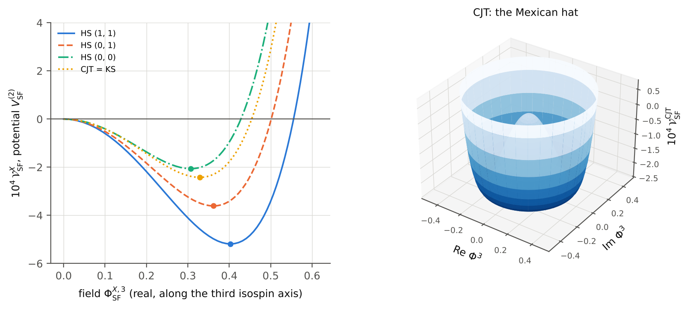{width=100%}

**Figure 8.** Left: the effective potentials $\mathcal V^X_{\rm SF}$ along the polar fields, with their minima (dots). Right: the
Mexican hat of CJT over the complex plane of $\Phi^3$. Data: `data/part3_effpot_*.csv`.

**The accuracy of the Landau form.** The coefficients $a^X_{\rm SF}$, $b^X_{\rm SF}$, $c^X_{\rm SF}$ of (12.2) are not derived
from the theory: they minimize the sum of the squares of the residuals $\mathcal V_{\rm L}(\Phi_i)-\mathcal V^X_{\rm SF}(\Phi_i)$ over the
computed points $\Phi_i\le1.4\Phi^X_{0,{\rm SF}}$ (47 to 51 points), where
$\mathcal V_{\rm L}(\Phi)=a^X_{\rm SF}\Phi^2+b^X_{\rm SF}\Phi^4+c^X_{\rm SF}\Phi^6$ is (12.2) along the polar fields $\vec\Phi=\Phi\vec e_3$. The
computed points are accurate to $4\times10^{-14}$ (*check P3-1*), so every deviation of (12.2) from them is an error of
the form, not of the computation. The largest residual is $0.27$ per cent (HS (0, 0)) to $0.70$ per cent (HS (1, 1)) of the depth
$\lvert\mathcal V^X_{\rm SF}(\Phi^X_{0,{\rm SF}})\rvert$ of the minimum (Table 12.1, last column). Figure 9 (left) shows the residual along
the interval: it changes its sign $3$ times, it is largest at the upper end ($\Phi\approx1.39\Phi^X_{0,{\rm SF}}$), and at
the minimum it is $0.11$ per cent (HS (0, 0)) to $0.31$ per cent (HS (1, 1)) of the depth. This oscillation about the computed curve is that of a polynomial
that approximates a function which is not a polynomial: the least-squares fits $\sum_{k=1}^Kc_k\Phi^{2k}$ with more powers
reduce the largest residual to $0.0044$ per cent (HS (0, 0)) to $0.038$ per cent (HS (1, 1)) of the depth with the powers to $\Phi^8$ ($K=4$) and to $4.3\times10^{-5}$ per cent (KS, CJT) to $0.00067$ per cent (HS (1, 1))
with the powers to $\Phi^{12}$ ($K=6$) (Figure 9, right), while the quartic form $a\Phi^2+b\Phi^4$ of the Standard Model
misses by $2.8$ per cent (HS (0, 0)) to $5.9$ per cent (HS (1, 1)) (*check P3-11*: the least squares by Householder reflections reproduce the coefficients of
(12.2); *check YP3-11*: the Python program recomputes every number of Table 12.2 from the data files with the
singular-value decomposition).

**The cause.** The pair field enters the quasi-particle energies like a mass. For the applied pair self-energy
$\Phi_{\rm a}(\mathsf K^3_{\rm LL})^\dagger$ and a normal self-energy that is a Dirac mass $M^{X,{\rm D}}_{\rm SF}$, the quasi-particle
energies are (10.3) with $\lvert D^X_{\rm SF}\rvert$ replaced by $\Phi_{\rm a}$ (*checks P3-8, YP3-8*), and along the whole polar curve
the normal self-energy is such a Dirac mass (*checks P3-9, YP3-9*). The energy per volume is then an integral over the
momenta $q=\lvert\vec q_{\rm LL}\rvert<\Lambda_{\rm LL}$ of functions of $(q^2+s)^{1/2}$ with $s=(M^{X,{\rm D}}_{\rm SF})^2+\Phi_{\rm a}^2$; the
integral $\int_0^{\Lambda_{\rm LL}}q^2(q^2+s)^{1/2}\,dq$ contains the term $\tfrac1{16}s^2\ln s$, which is not analytic at $s=0$, that is,
at $\Phi_{\rm a}^2=-(M^{X,{\rm D}}_{\rm SF})^2$. Hence $\mathcal V^X_{\rm SF}$ is not a polynomial in $\lvert\vec\Phi\rvert^2$, and its Taylor series
about the origin can converge only within a radius of the order of the Dirac mass ($m_{\rm LL}=0.2$ at the origin),
while $\Phi^X_{0,{\rm SF}}$ is $0.307$ (HS (0, 0)) to $0.403$ (HS (1, 1)): the superfluid is far from the regime of Landau's theory, in which the order
parameter is small and the Landau coefficients are Taylor coefficients. The coefficients of (12.2) are therefore
properties of the fit:

* $a^X_{\rm SF}$ differs by $0.68$ per cent (KS, CJT) to $2.0$ per cent (HS (1, 1)) from the Taylor coefficient $a^{X,{\rm Tay}}_{\rm SF}$ of $\lvert\vec\Phi\rvert^2$ at the
  origin, computed directly from the states with the small applied fields $\Phi_{\rm a}=0.004$, $0.008$, $0.016$ (the
  quotient $\mathcal V^X_{\rm SF}/\Phi^2$ at two of them, with the term proportional to $\Phi^2$ eliminated by the Richardson
  extrapolation; the two pairs agree to $8\times10^{-8}$, *check P3-10*, and the Python program finds the same value to
  $4\times10^{-11}$, *check YP3-10*);
* $b^X_{\rm SF}$ and $c^X_{\rm SF}$ change with the fitted interval and with the number of powers: for CJT, $10^3c^{\rm CJT}_{\rm SF}$ is
  $16.34$, $19.94$ and $23.62$ when (12.2) is fitted on $[0,\Phi^X_{0,{\rm SF}}]$, on $[0,1.4\Phi^X_{0,{\rm SF}}]$ and on the whole computed
  curve, and $11.61$ when the power $\Phi^8$ is added (Table 12.2).

| quantity | HS (1, 1) | HS (0, 1) | HS (0, 0) | KS | CJT |
|:-----------------------------|-------:|-------:|-------:|-------:|-------:|
| minimum of (12.2): $\Phi_{\rm L}/\Phi^X_{0,{\rm SF}}-1$ | $-0.11$ | $-0.090$ | $-0.066$ | $-0.041$ | $-0.041$ |
| depth of (12.2): $\mathcal V_{\rm L}(\Phi_{\rm L})/\mathcal V^X_{\rm SF}(\Phi^X_{0,{\rm SF}})-1$ | $0.31$ | $0.21$ | $0.12$ | $0.12$ | $0.12$ |
| curvature of (12.2) at its minimum: $\mathcal V_{\rm L}''(\Phi_{\rm L})/\mathcal V''_{\rm amp}-1$ | $2.3$ | $1.5$ | $0.86$ | $0.91$ | $0.91$ |
| $M^{X,{\rm H}}_{\rm SF}$ from (12.2), relative error | $1.1$ | $0.75$ | $0.43$ | $0.45$ | $0.45$ |
| $10^3a^{X,{\rm Tay}}_{\rm SF}$ (Taylor coefficient at the origin) | $-6.16243$ | $-5.35342$ | $-4.29666$ | $-4.29666$ | $-4.29666$ |
| $a^X_{\rm SF}/a^{X,{\rm Tay}}_{\rm SF}-1$ | $-2.0$ | $-1.4$ | $-0.81$ | $-0.68$ | $-0.68$ |
| largest residual / depth, powers to $\Phi^4$ (quartic) | $5.9$ | $4.4$ | $2.8$ | $5.0$ | $5.0$ |
| the same, powers to $\Phi^6$: (12.2) | $0.70$ | $0.47$ | $0.27$ | $0.28$ | $0.28$ |
| the same, powers to $\Phi^8$ | $0.038$ | $0.012$ | $0.0044$ | $0.021$ | $0.021$ |
| the same, powers to $\Phi^{10}$ | $0.0099$ | $0.0053$ | $0.0025$ | $0.0015$ | $0.0015$ |
| the same, powers to $\Phi^{12}$ | $0.00067$ | $0.00052$ | $0.00032$ | $4.3\times10^{-5}$ | $4.3\times10^{-5}$ |
| sign changes of the residual of (12.2) | $3$ | $3$ | $3$ | $3$ | $3$ |
| $10^3c^X_{\rm SF}$, (12.2) fitted on $[0,\Phi^X_{0,{\rm SF}}]$ | $8.048$ | $8.524$ | $8.450$ | $16.34$ | $16.34$ |
| $10^3c^X_{\rm SF}$, fitted on $[0,1.4\Phi^X_{0,{\rm SF}}]$ (Table 12.1) | $14.36$ | $14.40$ | $14.00$ | $19.94$ | $19.94$ |
| $10^3c^X_{\rm SF}$, fitted on the whole curve | $17.67$ | $18.42$ | $18.70$ | $23.62$ | $23.62$ |
| end of the whole curve: $\Phi_{\max}/\Phi^X_{0,{\rm SF}}$ | $1.52$ | $1.57$ | $1.64$ | $1.61$ | $1.61$ |
| largest residual / depth on the whole curve | $1.7$ | $1.5$ | $1.2$ | $1.3$ | $1.3$ |
| $10^3c$ of the fit with powers to $\Phi^8$ | $0.6157$ | $1.975$ | $2.736$ | $11.61$ | $11.61$ |

**Table 12.2.** The accuracy of the Landau form (12.2). Rows 1 to 4: what the polynomial (12.2) gets wrong at its
minimum $\Phi_{\rm L}$ (the position, the depth and the curvature $\mathcal V_{\rm L}''(\Phi_{\rm L})$, compared with $\Phi^X_{0,{\rm SF}}$, the
ground-state energy and the curvature $\mathcal V''_{\rm amp}$ of the computed curve, and the resulting error of the mass of
the amplitude mode by (13.6)). Rows 5, 6: the Taylor coefficient of $\lvert\vec\Phi\rvert^2$ at the origin and the deviation
of the fitted $a^X_{\rm SF}$ from it. Rows 7 to 11: the largest residual of the least-squares fits with the powers
$\Phi^2,\dots,\Phi^{2K}$, $K=2$ to $6$, relative to the depth. Row 12: the sign changes of the residual of (12.2). Rows 13
to 17: the coefficient $c^X_{\rm SF}$ of (12.2) fitted on three intervals, the end $\Phi_{\max}$ of the computed curve and the
largest residual of the fit on the whole curve. Row 18: the coefficient of $\Phi^6$ of the fit with the powers to
$\Phi^8$. Rows 1 to 4, 6 to 11 and 17 in per cent. Data: `data/part3_landau.csv`, `data/part3_values.csv`.

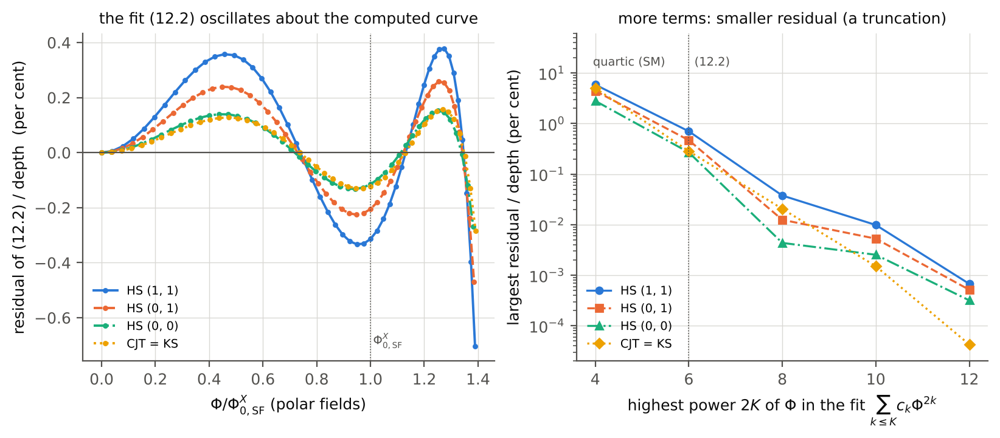{width=100%}

**Figure 9.** The accuracy of the Landau form. Left: the residual $\mathcal V_{\rm L}(\Phi)-\mathcal V^X_{\rm SF}(\Phi)$ of (12.2) at the
computed points of the fitted interval, relative to the depth of the minimum (KS and CJT coincide along the polar
fields). Right: the largest residual of the least-squares fits $\sum_{k=1}^Kc_k\Phi^{2k}$ against the highest power $2K$;
$2K=4$ is the quartic form of the Standard Model, $2K=6$ is (12.2). Data: `data/part3_landau_residuals.csv`,
`data/part3_landau.csv`.

**Why the accuracy matters.**

1. The effective Lagrangians (12.6) contain the computed function $\mathcal V^X_{\rm SF}$, not (12.2), and no other result of
   this manuscript uses $a^X_{\rm SF}$, $b^X_{\rm SF}$, $c^X_{\rm SF}$: the mass $M^{X,{\rm H}}_{\rm SF}$ of the amplitude mode uses the
   curvature $\mathcal V''_{\rm amp}$ of the computed curve at its minimum (five states, *check P3-2*), $u^X_{\rm SF}$ and
   $M^{X,{\rm NU}}_{\rm SF}$ use the computed curvature $\mathcal V''_{\rm NU}$, and Part IV uses $\Phi^X_{0,{\rm SF}}$, $Z^X_{\rm SF}$,
   $Y^X_{\rm SF}$ and the susceptibilities. The error of the fit therefore enters no other number.
2. Whoever replaces $\mathcal V^X_{\rm SF}$ by (12.2), as in a model of the type of Ginzburg and Landau or of Higgs, makes the
   errors of Table 12.2: the minimum $\Phi_{\rm L}$ of (12.2) is $0.041$ per cent (KS, CJT) to $0.11$ per cent (HS (1, 1)) too small, its depth $0.12$ per cent (HS (0, 0)) to $0.31$ per cent (HS (1, 1)) too
   large, its curvature at its minimum $0.86$ per cent (HS (0, 0)) to $2.3$ per cent (HS (1, 1)) too large, and the mass of the amplitude mode by (13.6)
   $0.43$ per cent (HS (0, 0)) to $1.1$ per cent (HS (1, 1)) too large: a derivative enlarges the relative error of the function. Beyond the fitted interval the
   error grows: fitted on the whole computed curve (up to $\Phi_{\max}=$ $1.52$ to $1.64$ times $\Phi^X_{0,{\rm SF}}$), (12.2)
   misses by $1.2$ per cent (HS (0, 0)) to $1.7$ per cent (HS (1, 1)) of the depth.
3. Only the quantities that the computed function itself defines are physical: $\Phi^X_{0,{\rm SF}}$, the depth, the
   curvatures $\mathcal V''_{\rm amp}$ and $\mathcal V''_{\rm NU}$, and the Taylor coefficient $a^{X,{\rm Tay}}_{\rm SF}$ at the origin. No
   physical meaning may be given to $b^X_{\rm SF}$ or $c^X_{\rm SF}$ alone, and the methods may be compared through these
   coefficients only within the accuracy of the fit.
4. The qualitative results do not depend on the fit: the Mexican hat (*checks P3-1, P3-2, P3-5*), the dependence on the
   two invariants only (*P3-3*) and the stability of the polar minimum ($u^X_{\rm SF}>0$, *P3-4*) are properties of the
   computed function, and the sign of $a^X_{\rm SF}$ is that of $a^{X,{\rm Tay}}_{\rm SF}$.
5. The field of the superfluid boson singlet state has a Mexican hat with the symmetry structure of the Higgs sector
   (Section 12.3) and of the polar phase of a condensate of spin 1, but its potential is not the quartic potential of
   the Standard Model, which is exact at tree level: the quartic form misses $\mathcal V^X_{\rm SF}$ by $2.8$ per cent (HS (0, 0)) to $5.9$ per cent (HS (1, 1)) of the
   depth, about ten times more than (12.2).

## 12.2 The kinetic part

**The form.** The field $\vec\Phi$ has the covariant derivative of an isospin vector of fermion number 2 (Section 4.3),
$$\nabla_p\vec\Phi=\partial_p\vec\Phi+2ig^{\rm F}_{\rm LL}B_{{\rm SF},p}\vec\Phi-g^{\rm v}_{\rm LL}\vec W_{{\rm SF},p}\times\vec\Phi,\tag{12.3}$$
with $\vec W_{{\rm SF},p}=(W^1_{{\rm SF},p},W^2_{{\rm SF},p},W^3_{{\rm SF},p})$. The terms with two derivatives that are invariant under GEE
(Lorentz scalars, isospin scalars, phase-invariant) are built from the two invariants
$(\nabla_p\vec\Phi)^\dagger\cdot\nabla_{p'}\vec\Phi$ and $(\vec\Phi^\dagger\cdot\nabla_p\vec\Phi)^*(\vec\Phi^\dagger\cdot\nabla_{p'}\vec\Phi)/\lvert\vec\Phi\rvert^2$,
contracted with $\eta^{\rm LL}_{pp'}$:
$$\mathcal L^X_{\rm kinetic}=\sum_p\eta^{\rm LL}_{pp}\Big[Z^X_{\rm SF}(\nabla_p\vec\Phi)^\dagger\cdot\nabla_p\vec\Phi+Y^X_{\rm SF}\frac{\lvert\vec\Phi^\dagger\cdot\nabla_p\vec\Phi\rvert^2}{\lvert\vec\Phi\rvert^2}\Big]\tag{12.4}$$
(a term $(\vec\Phi\cdot\nabla\vec\Phi)$ without the complex conjugate is not phase-invariant, and further terms with
$\lvert\vec\Phi\cdot\vec\Phi\rvert$ contribute to the stiffnesses only for non-unitary fields).

**The coefficients from the time components.** On the vacuum $\vec\Phi=\Phi_0\vec e_3$, a rotation of the phase,
$\vec\Phi=\Phi_0e^{i\vartheta_0}\vec e_3$, gives $(\partial\vec\Phi)^\dagger\cdot\partial\vec\Phi=\lvert\vec\Phi^\dagger\cdot\partial\vec\Phi\rvert^2/\lvert\vec\Phi\rvert^2=\Phi_0^2(\partial\vartheta_0)^2$,
so (12.4) becomes $\tfrac12(f^{X,{\rm F}}_{\rm SF})^2(\partial\vartheta_0)^2$ with $(f^{X,{\rm F}}_{\rm SF})^2=2(Z^X_{\rm SF}+Y^X_{\rm SF})\Phi_0^2$; an isospin rotation
about the first axis, $\vec\Phi=\Phi_0(\cos\vartheta_1\vec e_3+\sin\vartheta_1\vec e_2)$, gives $\vec\Phi^\dagger\cdot\partial\vec\Phi=0$ and
$(f^{X,{\rm I}}_{\rm SF})^2=2Z^X_{\rm SF}\Phi_0^2$. A chemical potential $\mu^{\rm F}_{\rm SF}$ of the fermion number enters as the time
component of the covariant derivative, $\partial_0\vartheta_0\to\partial_0\vartheta_0-2\mu^{\rm F}_{\rm SF}$ (the field has fermion number 2),
and lowers the energy by $\tfrac12(f^{X,{\rm F}}_{\rm SF})^2(2\mu^{\rm F}_{\rm SF})^2$; comparing with $\tfrac12\chi^{\rm FF}_{\rm SF}(\mu^{\rm F}_{\rm SF})^2$ (Section
11.1) gives $(f^{X,{\rm F}}_{\rm SF})^2=\chi^{\rm FF}_{\rm SF}/4$; likewise $\mu^1_{\rm SF}$ turns the vector about the first axis,
$\partial_0\vartheta_1\to\partial_0\vartheta_1-\mu^1_{\rm SF}$, and $(f^{X,{\rm I}}_{\rm SF})^2=\chi^{11}_{\rm SF}$. Hence
$$Z^X_{\rm SF}=\frac{\chi^{11}_{\rm SF}}{2\Phi_0^2},\qquad Z^X_{\rm SF}+Y^X_{\rm SF}=\frac{\chi^{\rm FF}_{\rm SF}}{8\Phi_0^2}.\tag{12.5}$$
The susceptibilities are recomputed by the program of Part III (with the method of Section 11.1). The unbroken $T^3$ has
no stiffness, $\chi^{33}_{\rm SF}=0$ (*check P3-6*), as (12.4) requires: $\vec e_3\times\vec e_3=0$.

**The space components.** A Lorentz-invariant theory has the same coefficients for the space components. The program
also computes the space components directly, from states with a uniform twist: the constant potential
$Q\,\Psi^\dagger(\alpha^3_{\rm LL}\otimes\mathsf t)\Psi$ ($Q=0.01,0.02$, Richardson extrapolation) shifts the momenta of the charges of the
isospin matrix $\mathsf t$ and twists the field along the third space axis (the phase by $2Qx^3$ for $\mathsf t=\mathsf 1_2$; the
direction by the angle $Qx^3$ about the first axis for $\mathsf t=\tfrac12\tau_1$); the energy of the twisted superfluid minus that of
the twisted normal vacuum gives $(\tilde f^{X,{\rm F}}_{\rm SF})^2$ and $(\tilde f^{X,{\rm I}}_{\rm SF})^2$. The six directions are exact
for these states at second order in $Q$ (*check P3-7*). Table 12.3 shows that the space components differ from the time
components (by up to a factor 2.3 for the phase in CJT), and that the twist of the unbroken $T^3$, which costs nothing in a
gauge-invariant theory, costs $(\tilde f^{X,3}_{\rm SF})^2\neq0$. Both effects come from the momentum cutoff: a uniform space
component shifts the momenta inside the fixed sphere $\lvert\vec q_{\rm LL}\rvert<\Lambda_{\rm LL}$, which is neither gauge- nor
Lorentz-invariant, while a time component does not shift them (Section 11.1). The effective Lagrangian (12.4) therefore
takes the Lorentz-covariant form that GEE requires, with the coefficients (12.5) of the time components; the space
components measure the error of the regularization.

| method | $10^2Z^X_{\rm SF}$ | $10^3Y^X_{\rm SF}$ | $10^3(f^{X,{\rm F}}_{\rm SF})^2$ | $10^3(\tilde f^{X,{\rm F}}_{\rm SF})^2$ | $10^3(f^{X,{\rm I}}_{\rm SF})^2$ | $10^3(\tilde f^{X,{\rm I}}_{\rm SF})^2$ | $10^3(\tilde f^{X,3}_{\rm SF})^2$ |
|:---|---:|---:|---:|---:|---:|---:|---:|
| HS (1, 1) | $1.57534$ | $-0.2539$ | $5.0361$ | $6.8732$ | $5.1186$ | $6.2952$ | $1.177$ |
| HS (0, 1) | $1.74996$ | $-0.2531$ | $4.5203$ | $6.0643$ | $4.5867$ | $5.5405$ | $0.954$ |
| HS (0, 0) | $1.99975$ | $0$ | $3.7692$ | $4.472$ | $3.7692$ | $4.472$ | $0.7028$ |
| KS | $2.00041$ | $3.584$ | $5.0906$ | $5.5039$ | $4.317$ | $5.0198$ | $0.7028$ |
| CJT | $2.12129$ | $2.376$ | $5.0906$ | $2.2553$ | $4.5779$ | $3.5749$ | $0.4769$ |

**Table 12.3.** The coefficients of the kinetic part (12.4), (12.5), and the squared decay constants from the time
components ($f$) and from the space components ($\tilde f$; the last column: the unbroken $T^3$). Data:
`data/part3_sfbsv.csv`.

In HS $(0,0)$, $Y^{\rm HS}_{\rm SF}=0$: with only the pairing interaction in the pair channels, the phase and the isospin
directions are alike (the degeneracy of the massive modes of Section 10.5 has the same cause).

## 12.3 The three effective Lagrangians

With (12.4) and the effective potential, and with the Yang-Mills part (5.3) of the gauge fields, the effective
Lagrangian of method $X$ is
$$\mathcal L^X=\mathcal L^X_{\rm kinetic}+\mathcal L^X_{\rm potential}+\mathcal L^{\rm YM}_{\rm SF},\qquad\mathcal L^X_{\rm potential}=-\mathcal V^X_{\rm SF}(\vec\Phi),\tag{12.6}$$
for $X$ = CJT, HS, KS, with the numbers of Tables 12.1 and 12.3 ($\mathcal V^X_{\rm SF}$ is the computed function; (12.2) is its
Landau approximation, whose accuracy Table 12.2 states). KS and CJT have the same potential along the polar fields (the theorem of Section 9.2); they differ
in the non-unitary directions ($u^X_{\rm SF}$) and in $Z$ and $Y$, through the isovector response, where KS has no exchange
kernel. $\mathcal L^{\rm CJT}$, $\mathcal L^{\rm HS}$ and $\mathcal L^{\rm KS}$ are Lagrangians of a
complex isospin vector of fermion number 2 coupled to the gauge fields of $SU(2)_{\rm v}\times U(1)^{\rm F}_{\rm LL}$, with a
Mexican-hat potential: the structure of the Higgs sector of the Standard Model (Section 1), with an isospin vector of a
different gauge group in place of the doublet.

## 12.4 The free energy at finite temperature, the critical temperatures and the size of the order parameter

This section is an addendum that the author asked for on 21 November 2026: to compute the effective potential and the
free energy of each method $X$ (HS $(1,1)$, HS $(0,1)$, HS $(0,0)$, KS and CJT), and to determine whether the order
parameter is then smaller and more physically reasonable. The effective potential is the subject of Section 12.1; this
section computes the free energy at the temperature $T$ (with $k_{\rm B}=1$, in the units of the cutoff $\Lambda_{\rm LL}=1$, and
$\mu_{\rm LL}=0$), whose value at $T=0$ is the effective potential.

**The free energy of a state.** At the temperature $T$ a uniform quasi-free state is the thermal state of its matrix of
Bogoliubov and de Gennes: at every momentum the generalized density is $\mathsf R(\vec q_{\rm LL})=f(\mathsf H_{\rm SF}(\vec q_{\rm LL}))$,
the Fermi function $f(\varepsilon)=(e^{\varepsilon/T}+1)^{-1}$ applied to the eigenvalues $\varepsilon_k$ of $\mathsf H_{\rm SF}$. The free energy
per volume of method $X$ is
$$\mathcal E^X_{\rm SF}[\mathsf R]-T\,\mathcal S_{\rm SF}[\mathsf R],\qquad\mathcal S_{\rm SF}[\mathsf R]=-\frac12\int\!\frac{d^3q}{(2\pi)^3}\sum_{k=1}^{16}\big[f_k\ln f_k+(1-f_k)\ln(1-f_k)\big],\tag{12.7}$$
with the energy $\mathcal E^X_{\rm SF}$ of method $X$ (Section 9, unchanged) and the entropy $\mathcal S_{\rm SF}$ of the quasi-free state,
$f_k=f(\varepsilon_k)$ (every mode of the doubled space of $\mathsf H_{\rm SF}$ appears twice, at $\pm\varepsilon$ with the occupations $f$ and $1-f$,
hence the factor $\tfrac12$). For HS this is the free energy at the saddle point of the auxiliary fields, for CJT the
effective action at finite temperature with the truncation of Section 9.2, and for KS the functional of Mermin with the
entropy of the quasi-free state of Kohn and Sham and the exchange-correlation energy of Section 9, which has no explicit
dependence on the temperature (in the exact theory of Mermin the exchange-correlation free energy depends on the
temperature; here only the states do). The choice is decision D15 of the task record. The self-energies are the
derivatives of $\mathcal E^X_{\rm SF}$ as before, and the stationary points of (12.7) are the self-consistent thermal states. The
**free energy of the field** $\vec\Phi$ is the smallest free energy among the states with this field, measured from the
normal state at the same temperature,
$$\mathcal F^X_{\rm SF}(\vec\Phi;T)=\min\{\mathcal E^X_{\rm SF}-T\mathcal S_{\rm SF}:\ \vec\Phi^X_{\rm SF}(\mathsf R)=\vec\Phi\}-\big(\mathcal E^X_{\rm SF}-T\mathcal S_{\rm SF}\big)_{\rm normal},\tag{12.8}$$
computed as in Section 12.1 with an applied pair field and a self-consistent normal self-energy (the argument of
Section 12.1 holds at every temperature). At $T=0$ the entropy vanishes and $\mathcal F^X_{\rm SF}(\vec\Phi;0)=\mathcal V^X_{\rm SF}(\vec\Phi)$:
**the effective potential is the free energy at zero temperature.** *Checks P3-T1, YP3-T1:* at $T=0.005$ the thermal
states reproduce the ground states of $T=0$ to $2\times10^{-13}$; *check P3-T7:* the Landau form fitted to the free energy at
$T=0$ has the residual of Table 12.1. The minimum of $\mathcal F^X_{\rm SF}(\vec\Phi;T)$ lies at $\lvert\vec\Phi\rvert=\Phi^X_{0,{\rm SF}}(T)$, the
order parameter at the temperature $T$, with $\Phi^X_{0,{\rm SF}}(0)=\Phi^X_{0,{\rm SF}}$.

**The critical temperature.** The normal state at $T$ has a normal self-energy that is a Dirac mass $M^{X,{\rm n}}_{\rm SF}(T)$ (the
thermally excited particles and antiparticles change the scalar density, which shifts the mass through $g^{X,{\rm S}}_{\rm SF}$;
in HS $(0,1)$ and $(0,0)$, where $g^{X,{\rm S}}_{\rm SF}=0$, it stays $m_{\rm LL}$). Its pair channel is unstable when
$$\lambda^{\rm P}_{\rm SF}(T)=\frac{g^{X,{\rm P}}_{\rm SF}\,I^{(1)}_{\rm SF}(M^{X,{\rm n}}_{\rm SF}(T),T)}{\pi^2}>1\tag{12.9}$$
with the integral
$$I^{(1)}_{\rm SF}(M,T)=\int_0^{\Lambda_{\rm LL}}\frac{q^2\tanh(E/2T)}{E}\,dq,\qquad E=(q^2+M^2)^{1/2},$$
the static pair response of Section 9.4 at finite temperature ($\tanh(E/2T)=1-2f(E)$ is the thermal factor of a pair of
quasi-particles; at $T=0$, $I^{(1)}_{\rm SF}(M,0)=I^{(1)}_{\rm SF}(M)$). The critical temperature $T^{X,{\rm c}}_{\rm SF}$ solves
$\lambda^{\rm P}_{\rm SF}(T^{X,{\rm c}}_{\rm SF})=1$ (*check P3-T3*: by bisection, with the normal state computed at every step; at $T=0$
the formula gives the eigenvalue of Table 10.1; *check YP3-T3*: the Python program finds the same $T^{X,{\rm c}}_{\rm SF}$ to
$3\times10^{-13}$; *checks P3-T9 and YP3-T9*: in every method $\lambda^{\rm P}_{\rm SF}(T)$ does not increase from $T=0.01$ to $T=0.6$
(60 temperatures with the normal state of the thermal engine; in Python 600 temperatures from $T=0.001$, with the normal
state from its scalar self-consistency), so $T^{X,{\rm c}}_{\rm SF}$ is the only solution there). Below $T^{X,{\rm c}}_{\rm SF}$ a polar start ends in a superfluid, above it in the normal state (*check P3-T4*). The
critical temperatures are $0.214$ (HS (0, 0)) to $0.260$ (HS (1, 1)); KS and CJT coincide also at finite temperature.

**The gap equation and the Dirac mass.** The polar superfluid with the Dirac mass $M^{X,{\rm D}}_{\rm SF}$ and the pair
amplitude $\Phi^X_{0,{\rm SF}}(T)$ has the quasi-particle energies (10.3), and its pair self-consistency is
$$1=\frac{g^{X,{\rm P}}_{\rm SF}}{\pi^2}\,I^{(1)}_{\rm SF}\Big(\big((M^{X,{\rm D}}_{\rm SF})^2+\Phi^X_{0,{\rm SF}}(T)^2\big)^{1/2},T\Big)\tag{12.10}$$
(*check P3-T2*: the self-consistent states satisfy it to $2\times10^{-12}$ at every temperature of Table 12.4; *check YP3-T4*: the
Python program solves (12.10) alone for HS $(0,0)$ and finds the same order parameter to $10^{-11}$). The pair coupling
alone fixes $(M^{X,{\rm D}}_{\rm SF})^2+\Phi^X_{0,{\rm SF}}(T)^2$ at every temperature. The scalar density of the superfluid, the
density $n^{\rm S}_{\rm SF}$ of Section 9.4 at the temperature $T$,
$$n^{\rm S}_{\rm SF}=\int\!\frac{d^3q}{(2\pi)^3}\Big[-\frac{4M^{X,{\rm D}}_{\rm SF}\tanh(E/2T)}{E}+\frac{4m_{\rm LL}}{(q^2+m_{\rm LL}^2)^{1/2}}\Big],$$
that is,
$$n^{\rm S}_{\rm SF}=-\frac2{\pi^2}\Big[M^{X,{\rm D}}_{\rm SF}\,I^{(1)}_{\rm SF}(E^{X,{\rm gap}}_{\rm SF},T)-m_{\rm LL}I^{(1)}_{\rm SF}(m_{\rm LL})\Big],$$
with $E=(q^2+(E^{X,{\rm gap}}_{\rm SF})^2)^{1/2}$ and $E^{X,{\rm gap}}_{\rm SF}=((M^{X,{\rm D}}_{\rm SF})^2+\Phi^X_{0,{\rm SF}}(T)^2)^{1/2}$, contains the
same integral, which (12.10) fixes to $\pi^2/g^{X,{\rm P}}_{\rm SF}$: $n^{\rm S}_{\rm SF}=-2M^{X,{\rm D}}_{\rm SF}/g^{X,{\rm P}}_{\rm SF}+2m_{\rm LL}I^{(1)}_{\rm SF}(m_{\rm LL})/\pi^2$.
The scalar self-consistency $M^{X,{\rm D}}_{\rm SF}-m_{\rm LL}=g^{X,{\rm S}}_{\rm SF}n^{\rm S}_{\rm SF}$ therefore contains no temperature, and it has
the same solution at every temperature below $T^{X,{\rm c}}_{\rm SF}$ (*check P3-T8*): **the Dirac mass of the superfluid does not
depend on the temperature**, and the order parameter follows from (12.10) alone. (In the normal state the integral is
$I^{(1)}_{\rm SF}(M^{X,{\rm n}}_{\rm SF}(T),T)$, which is not fixed, and $M^{X,{\rm n}}_{\rm SF}(T)$ changes with the temperature where
$g^{X,{\rm S}}_{\rm SF}\ne0$.)

**The radius of convergence at finite temperature.** The free energy is built from integrals over the momenta of
functions of the quasi-particle energies $E=(q^2+M^2+\Phi_{\rm a}^2)^{1/2}$ (for a Dirac mass $M$ and an applied pair field
$\Phi_{\rm a}$) and of their Fermi functions: the terms $-T\ln(2\cosh(E/2T))$, one for each pair of eigenvalues $\pm E$ of $\mathsf H_{\rm SF}$
(at the Fermi occupation $f=f(E)$ the energy $E(f-\tfrac12)$ of the pair and its term $T[f\ln f+(1-f)\ln(1-f)]$ in
$-T\mathcal S_{\rm SF}$ add up to $-T\ln(2\cosh(E/2T))$), and the densities with the factor $\tanh(E/2T)/E$. With the Matsubara frequencies $\omega_n=(2n+1)\pi T$ they become sums over $n$,
$$\ln\big(2\cosh(E/2T)\big)=\ln2+\sum_{n=0}^\infty\ln\Big(1+\frac{E^2}{\omega_n^2}\Big),\qquad\frac{\tanh(E/2T)}E=4T\sum_{n=0}^\infty\frac1{\omega_n^2+E^2},$$
of functions of $\omega_n^2+q^2+M^2+\Phi_{\rm a}^2$. Integrated over the momenta, each is singular where $\omega_n^2+M^2+\Phi_{\rm a}^2=0$
(at the end $q=0$ of the integral); the nearest of these points to the origin, for the Dirac mass of the normal state
held fixed, is $\Phi_{\rm a}^2=-(M^{X,{\rm n}}_{\rm SF}(T)^2+\pi^2T^2)$. At $T=0$ the frequencies become continuous, and the singularity
is the point $\Phi_{\rm a}^2=-(M^{X,{\rm D}}_{\rm SF})^2$ of Section 12.1. The series of $\mathcal F^X_{\rm SF}$ in powers of
$\lvert\vec\Phi\rvert^2$ about the normal state therefore converges within a radius of the order of
$$r^X_{\rm SF}(T)=\big(M^{X,{\rm n}}_{\rm SF}(T)^2+\pi^2T^2\big)^{1/2},\tag{12.11}$$
not exactly equal to it: the Dirac mass changes with the applied field where $g^{X,{\rm S}}_{\rm SF}\ne0$, and the field $\Phi$ of the
states is not the applied field $\Phi_{\rm a}$. $r^X_{\rm SF}(0)=m_{\rm LL}$, and $r^X_{\rm SF}$ grows with the temperature to
$0.688$ (HS (0, 0)) to $0.828$ (HS (1, 1)) at $0.98\,T^{X,{\rm c}}_{\rm SF}$. Because (12.11) is an estimate, the statements below rest also on direct
measures that do not use it: the residual of the Landau form and the error of Landau's order parameter.

| quantity | HS (1, 1) | HS (0, 1) | HS (0, 0) | KS | CJT |
|:-----------------------------|-------:|-------:|-------:|-------:|-------:|
| effective pair coupling $g^{X,{\rm P}}_{\rm SF}$ | $25.20$ | $24.50$ | $23.70$ | $23.70$ | $23.70$ |
| effective scalar coupling $g^{X,{\rm S}}_{\rm SF}$ | $2.80$ | $0$ | $0$ | $-7.40$ | $-7.40$ |
| $\lambda^{\rm P}_{\rm SF}(0)$ of the normal vacuum | $1.18384$ | $1.15096$ | $1.11338$ | $1.11338$ | $1.11338$ |
| critical temperature $T^{X,{\rm c}}_{\rm SF}$ | $0.260467$ | $0.240465$ | $0.213799$ | $0.222119$ | $0.222119$ |
| $\Phi^X_{0,{\rm SF}}(0)$ | $0.403064$ | $0.362009$ | $0.306989$ | $0.328486$ | $0.328486$ |
| $\Phi^X_{0,{\rm SF}}(0)/T^{X,{\rm c}}_{\rm SF}$ | $1.547$ | $1.505$ | $1.436$ | $1.479$ | $1.479$ |
| $E^{X,{\rm gap}}_{\rm SF}(0)/T^{X,{\rm c}}_{\rm SF}$ | $1.739$ | $1.720$ | $1.714$ | $1.650$ | $1.650$ |
| Dirac mass of the superfluid (every $T<T^{X,{\rm c}}_{\rm SF}$) | $0.206685$ | $0.200000$ | $0.200000$ | $0.162293$ | $0.162293$ |
| $\Phi^X_{0,{\rm SF}}(T)<r^X_{\rm SF}(T)$ above $T/T^{X,{\rm c}}_{\rm SF}=$ | $0.42$ | $0.40$ | $0.35$ | $0.37$ | $0.37$ |
| $\Phi^X_{0,{\rm SF}}/r^X_{\rm SF}$ at $T/T^{X,{\rm c}}_{\rm SF}=0$ | $2.02$ | $1.81$ | $1.53$ | $1.64$ | $1.64$ |
| $\Phi^X_{0,{\rm SF}}/r^X_{\rm SF}$ at $T/T^{X,{\rm c}}_{\rm SF}=0.5$ | $0.860$ | $0.824$ | $0.765$ | $0.800$ | $0.800$ |
| $\Phi^X_{0,{\rm SF}}/r^X_{\rm SF}$ at $T/T^{X,{\rm c}}_{\rm SF}=0.9$ | $0.295$ | $0.287$ | $0.273$ | $0.284$ | $0.284$ |
| $\Phi^X_{0,{\rm SF}}/r^X_{\rm SF}$ at $T/T^{X,{\rm c}}_{\rm SF}=0.98$ | $0.127$ | $0.124$ | $0.118$ | $0.123$ | $0.123$ |
| residual of (12.2) / depth at $0$ (per cent) | $0.70$ | $0.47$ | $0.27$ | $0.28$ | $0.28$ |
| residual of (12.2) / depth at $0.5$ (per cent) | $0.56$ | $0.38$ | $0.19$ | $0.23$ | $0.23$ |
| residual of (12.2) / depth at $0.9$ (per cent) | $0.040$ | $0.030$ | $0.019$ | $0.024$ | $0.024$ |
| residual of (12.2) / depth at $0.98$ (per cent) | $0.0017$ | $0.0013$ | $0.00078$ | $0.0010$ | $0.0010$ |
| residual of the quartic form / depth at $0$ (per cent) | $5.9$ | $4.4$ | $2.8$ | $5.0$ | $5.0$ |
| residual of the quartic form / depth at $0.9$ (per cent) | $1.8$ | $1.6$ | $1.3$ | $1.6$ | $1.6$ |
| residual of the quartic form / depth at $0.98$ (per cent) | $0.37$ | $0.32$ | $0.26$ | $0.31$ | $0.31$ |
| $(-a/2b)^{1/2}/\Phi^X_{0,{\rm SF}}-1$ at $0$ (per cent) | $3.8$ | $3.1$ | $1.9$ | $7.0$ | $7.0$ |
| $(-a/2b)^{1/2}/\Phi^X_{0,{\rm SF}}-1$ at $0.9$ (per cent) | $2.7$ | $2.3$ | $1.8$ | $2.3$ | $2.3$ |
| $(-a/2b)^{1/2}/\Phi^X_{0,{\rm SF}}-1$ at $0.98$ (per cent) | $0.56$ | $0.49$ | $0.38$ | $0.47$ | $0.47$ |
| occupation of the states at the cutoff at $0.98\,T^{X,{\rm c}}_{\rm SF}$ (per cent) | $1.8$ | $1.3$ | $0.76$ | $0.94$ | $0.94$ |

**Table 12.4.** The free energy at finite temperature. Rows 1 to 3: the effective couplings and the eigenvalue of the
static pair response of the normal vacuum; rows 4 to 8: the critical temperature, the order parameter at $T=0$, its
ratio to $T^{X,{\rm c}}_{\rm SF}$ and that of the gap $E^{X,{\rm gap}}_{\rm SF}=((M^{X,{\rm D}}_{\rm SF})^2+(\Phi^X_{0,{\rm SF}})^2)^{1/2}$ at $T=0$,
and the Dirac mass $M^{X,{\rm D}}_{\rm SF}$ of the superfluid;
row 9: the reduced temperature above which the order parameter lies inside the radius of convergence (12.11)
(interpolated linearly in the table of temperatures); rows 10 to 13: $\Phi^X_{0,{\rm SF}}(T)/r^X_{\rm SF}(T)$ at four temperatures; rows 14
to 20: the largest residual of the Landau form (12.2) and of the quartic form fitted to $\mathcal F^X_{\rm SF}(\Phi;T)$ on
$[0,1.4\,\Phi^X_{0,{\rm SF}}(T)]$, relative to the depth $\lvert\mathcal F^X_{\rm SF}(\Phi^X_{0,{\rm SF}}(T);T)\rvert$; rows 21 to 23: the error of the
order parameter $(-a/2b)^{1/2}$ of Landau's theory, where $a=a^{X,{\rm Tay}}_{\rm SF}(T)$ and $b=b^{X,{\rm Tay}}_{\rm SF}(T)$ are the Taylor
coefficients of $\lvert\vec\Phi\rvert^2$ and $\lvert\vec\Phi\rvert^4$ of $\mathcal F^X_{\rm SF}$ at the origin (computed from four small applied
fields); row 24: the occupation $f(E(\Lambda_{\rm LL}))$ of the states at the cutoff. Data: `data/part3_thermal.csv`,
`data/part3_thermal_landau.csv`, `data/part3_values.csv`.

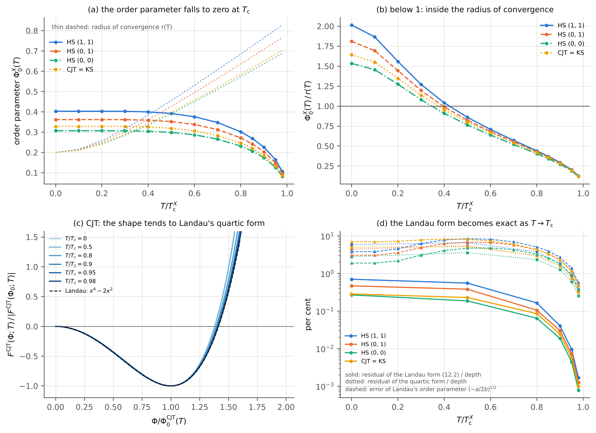{width=100%}

**Figure 10.** The free energy at finite temperature. (a) The order parameter $\Phi^X_{0,{\rm SF}}(T)$ against $T/T^{X,{\rm c}}_{\rm SF}$
(KS and CJT coincide; one curve for both), with the radius $r^X_{\rm SF}(T)$ of (12.11) thin and dashed in the same colour. (b) The ratio
$\Phi^X_{0,{\rm SF}}(T)/r^X_{\rm SF}(T)$: below 1 the order parameter lies inside the radius of convergence. (c) The free energy of
CJT normalized to its minimum, $\mathcal F^{\rm CJT}_{\rm SF}(\Phi;T)/\lvert\mathcal F^{\rm CJT}_{\rm SF}(\Phi_0;T)\rvert$ against $\Phi/\Phi^{\rm CJT}_{0,{\rm SF}}(T)$,
with the curve $x^4-2x^2$ of Landau's theory (dashed). (d) The largest residual of the Landau form (12.2) (solid) and of
the quartic form (dotted), relative to the depth, and the error of Landau's order parameter $(-a/2b)^{1/2}$ (dashed).
Data: `data/part3_thermal.csv`, `data/part3_thermal_curves.csv`, `data/part3_thermal_landau.csv`.

**Is the order parameter smaller and more physically reasonable?** Yes, near the critical temperature, and only
there, for the mean-field free energy of the methods (Section 12.5 shows that these temperatures lie inside the critical
region of the transition, where the fluctuations that the methods omit dominate):

1. **It is smaller.** $\Phi^X_{0,{\rm SF}}(T)$ keeps its value of $T=0$ up to about $0.3\,T^{X,{\rm c}}_{\rm SF}$ (the gap, $0.366$ (HS (0, 0)) to $0.453$ (HS (1, 1)), is much
   larger than $T$, and thermal quasi-particles are exponentially rare; at $0.3\,T^{X,{\rm c}}_{\rm SF}$ it has changed by
   $0.12$ per cent (HS (0, 0)) to $0.13$ per cent (KS, CJT)), then falls and vanishes continuously at
   $T^{X,{\rm c}}_{\rm SF}$, like $(1-T/T^{X,{\rm c}}_{\rm SF})^{1/2}$ (Figure 10a): at $0.98\,T^{X,{\rm c}}_{\rm SF}$ it is $0.0812$ (HS (0, 0)) to $0.105$ (HS (1, 1)), against
   $0.307$ (HS (0, 0)) to $0.403$ (HS (1, 1)) at $T=0$.
2. **It lies inside the radius of convergence.** At $T=0$ the order parameter is $1.53$ (HS (0, 0)) to $2.02$ (HS (1, 1)) times the radius (12.11);
   above $0.35$ (HS (0, 0)) to $0.42$ (HS (1, 1)) times $T^{X,{\rm c}}_{\rm SF}$ it is smaller than the radius (row 9), and at $0.98\,T^{X,{\rm c}}_{\rm SF}$ the ratio is
   $0.118$ (HS (0, 0)) to $0.127$ (HS (1, 1)) (Figure 10b). There the series of the free energy in powers of $\lvert\vec\Phi\rvert^2$ converges at the
   minimum, and the Landau coefficients are the Taylor coefficients of the free energy: the regime of Landau's theory,
   which Section 12.1 found absent at $T=0$.
3. **The Landau form becomes exact.** The largest residual of (12.2), relative to the depth, is $0.27$ per cent (HS (0, 0)) to $0.70$ per cent (HS (1, 1)) at
   $T=0$ and $0.00078$ per cent (HS (0, 0)) to $0.0017$ per cent (HS (1, 1)) at $0.98\,T^{X,{\rm c}}_{\rm SF}$. That of the quartic form (the form of the Higgs potential of the
   Standard Model and of the theory of Ginzburg and Landau) is $2.8$ per cent (HS (0, 0)) to $5.9$ per cent (HS (1, 1)) at $T=0$ and $0.26$ per cent (HS (0, 0)) to $0.37$ per cent (HS (1, 1)) at
   $0.98\,T^{X,{\rm c}}_{\rm SF}$; near $T^{X,{\rm c}}_{\rm SF}$ it falls in proportion to $1-T/T^{X,{\rm c}}_{\rm SF}$ (*check P3-T6*). The normalized free energy approaches the curve $x^4-2x^2$ (Figure 10c).
4. **Landau's theory predicts the order parameter.** $(-a/2b)^{1/2}$ from the Taylor coefficients at the origin errs by
   $1.9$ per cent (HS (0, 0)) to $7.0$ per cent (KS, CJT) at $T=0$ and by $0.38$ per cent (HS (0, 0)) to $0.56$ per cent (HS (1, 1)) at $0.98\,T^{X,{\rm c}}_{\rm SF}$; the error is about
   $0.19$ (HS (0, 0)) to $0.28$ (HS (1, 1)) times $1-T/T^{X,{\rm c}}_{\rm SF}$ near $T^{X,{\rm c}}_{\rm SF}$ (*check P3-T5*), as Landau's theory requires.
5. **The scales.** Near $T^{X,{\rm c}}_{\rm SF}$ the order parameter is small also against the Dirac mass and the cutoff. The
   critical temperatures themselves, however, are about a fifth to a quarter of the cutoff ($0.214$ (HS (0, 0)) to $0.260$ (HS (1, 1))); the states at the cutoff are
   occupied by $0.76$ per cent (HS (0, 0)) to $1.8$ per cent (HS (1, 1)) at $0.98\,T^{X,{\rm c}}_{\rm SF}$ (row 24), so the thermal physics reaches the cutoff only weakly.
   The ratio $\Phi^X_{0,{\rm SF}}(0)/T^{X,{\rm c}}_{\rm SF}$ is $1.44$ (HS (0, 0)) to $1.55$ (HS (1, 1)), and the ratio of the gap,
   $E^{X,{\rm gap}}_{\rm SF}(0)/T^{X,{\rm c}}_{\rm SF}$, is $1.65$ (KS, CJT) to $1.74$ (HS (1, 1)); the theory of Bardeen, Cooper and Schrieffer gives
   $\Delta(0)/T_{\rm c}=\pi e^{-\gamma_{\rm E}}=1.764$ for weak pairing at a Fermi surface. The ratios are of the same size but not equal:
   here there is no Fermi surface ($\mu_{\rm LL}=0$), the pairing needs a coupling above the critical one, and the gap
   contains the Dirac mass.

**What the free energy of these methods does not contain (a remark, and why it matters).** All three methods give
mean-field free energies. The thermal state is quasi-free, so (12.7) contains the thermal quasi-particles of the spinor
field, but neither the thermal fluctuations of the order parameter about its mean value (its amplitude, Goldstone and
non-unitary modes, Sections 13 and 14) nor thermal gauge fields (the gauge fields of Sections 13 to 15 do not enter the
thermal state). In HS this is the saddle point without the fluctuations of the auxiliary fields, in CJT the truncation
of Section 9.2, and in KS an exchange-correlation energy without a thermal part. Near a continuous transition the
fluctuations of the order parameter grow. Within the critical region, whose width in $1-T/T^{X,{\rm c}}_{\rm SF}$ is the
Ginzburg number of the transition (Levanyuk 1959, Ginzburg 1960), the mean-field free energy fails: the order parameter
vanishes with an exponent different from the $\tfrac12$ of item 1, $T^{X,{\rm c}}_{\rm SF}$ is shifted, and for an order
parameter with two quartic invariants, as here, the fluctuations can also make the transition discontinuous (the
renormalization-group analysis of such fields is reviewed by Pelissetto and Vicari, 2002). A gauge field coupled to the
order parameter can do the same: its fluctuations make the transition of a superconductor weakly first order
(Halperin, Lubensky and Ma, 1974), and the thermal transition of the Higgs field of the electroweak theory, of first
order for small Higgs masses, ends at a critical Higgs mass, above which there is no transition but a smooth crossover
(Kajantie, Laine, Rummukainen and Shaposhnikov, 1996). The statements of items 1 to 4 are therefore statements about the
mean-field free energy; they describe the superfluid near $T^{X,{\rm c}}_{\rm SF}$ only outside the critical region, and
whether the transition of the full theory is continuous is not decided here. The Ginzburg number needs the gradient
coefficient of the field at $T^{X,{\rm c}}_{\rm SF}$, which Section 12.5 computes (Section 12.2 computes the kinetic coefficients at
$T=0$); the result, ${\rm Gi}^{X}_{\rm SF}$ = $7.6$ (KS, CJT) to $11$ (HS (1, 1)), places the whole range of temperatures of this section inside the
critical region. At $T=0$ the methods omit the quantum fluctuations of the order parameter as well; that is a property
of the methods (Section 9), not the subject of this remark.

## 12.5 The gradient coefficient at the critical temperature and the width of the critical region

This section is the second addendum that the author asked for on 21 November 2026: to find how wide the region of the
fluctuations near $T^{X,{\rm c}}_{\rm SF}$ is (the remark at the end of Section 12.4), which needs one more calculation, the
gradient coefficient of the field at $T^{X,{\rm c}}_{\rm SF}$. The temperature is measured with $k_{\rm B}=1$ in the units of the
cutoff $\Lambda_{\rm LL}=1$, as in Section 12.4.

**The form of Ginzburg and Landau.** Near $T^{X,{\rm c}}_{\rm SF}$ the field $\vec\Phi$ is small. For a static field
$\vec\Phi(\vec x)$ that varies slowly in space (near a continuous transition the fluctuations that matter are static and
slow: a fluctuation with a nonzero Matsubara frequency $2\pi nT$ costs an energy of the order of $(2\pi T)^2$ times the
coefficient of the time derivatives, and $2\pi T^{X,{\rm c}}_{\rm SF}$ is $1.3$ (HS (0, 0)) to $1.6$ (HS (1, 1)) here, of the order of the cutoff), the free energy of method $X$ to second order in the field and in its derivatives and to fourth
order in the field is the functional of Ginzburg and Landau
$$\mathcal F^{X,{\rm GL}}_{\rm SF}[\vec\Phi]=\int d^3x\Big[\mathsf c^X_{\rm SF}\sum_{j=1}^3(\partial_j\vec\Phi)^\dagger\cdot\partial_j\vec\Phi+a^{X,{\rm Tay}}_{\rm SF}(T)\,\lvert\vec\Phi\rvert^2+b^{X,{\rm Tay}}_{\rm SF}(T)\,\lvert\vec\Phi\rvert^4\Big],\tag{12.12}$$
with $a^{X,{\rm Tay}}_{\rm SF}(T)\approx\alpha^{X,{\rm GL}}_{\rm SF}\,t^{\rm red}_{\rm SF}$ near $T^{X,{\rm c}}_{\rm SF}$, the reduced temperature
$t^{\rm red}_{\rm SF}=(T-T^{X,{\rm c}}_{\rm SF})/T^{X,{\rm c}}_{\rm SF}$, the Taylor coefficients
$a^{X,{\rm Tay}}_{\rm SF}$, $b^{X,{\rm Tay}}_{\rm SF}$ of the free energy (12.8) at the origin (Section 12.4), the slope
$\alpha^{X,{\rm GL}}_{\rm SF}=T^{X,{\rm c}}_{\rm SF}\,\partial_Ta^{X,{\rm Tay}}_{\rm SF}$ at $T^{X,{\rm c}}_{\rm SF}$, and the **gradient
coefficient** $\mathsf c^X_{\rm SF}$ at $T^{X,{\rm c}}_{\rm SF}$. The rotations and the isospin rotations allow no other term of
second order: the space indices and the isospin indices of two derivatives of the field can only be contracted with
$\delta_{jj'}$ and $\delta_{\iota\iota'}$, and a term with $\vec\Phi\cdot\vec\Phi$ (without the complex conjugate) has the fermion number 4
and is not invariant under $U(1)^{\rm F}_{\rm LL}$. At fourth order there are two invariants, $\lvert\vec\Phi\rvert^4$ and
$\lvert\vec\Phi\cdot\vec\Phi\rvert^2$, which are equal on the polar fields of Section 13 (the minimum); (12.12) keeps the
coefficient along these fields. The gauge fields enter (12.12) through the covariant derivative (12.3); they are not
part of the estimate below.

**The Ginzburg number.** The field has $n^\Phi_{\rm SF}=6$ real components (the real and imaginary parts of
$\Phi^{X,1}_{\rm SF}$, $\Phi^{X,2}_{\rm SF}$, $\Phi^{X,3}_{\rm SF}$), and $\lvert\vec\Phi\rvert^2$ is the sum of their squares. Above
$T^{X,{\rm c}}_{\rm SF}$ the field fluctuates about zero with the probability density proportional to
$\exp(-\mathcal F^{X,{\rm GL}}_{\rm SF}/T)$. To second order in the field the probability is Gaussian, every real component and
every wave vector $\vec k$ contributes a factor of its own, and the free energy per volume of the fluctuations is, up to
terms that are analytic in $T$,
$\tfrac12n^\Phi_{\rm SF}T\int\frac{d^3k}{(2\pi)^3}\ln\big(\mathsf c^X_{\rm SF}k^2+a^{X,{\rm Tay}}_{\rm SF}\big)$. Its second derivative
with respect to $T$, with $\partial_Ta^{X,{\rm Tay}}_{\rm SF}=\alpha^{X,{\rm GL}}_{\rm SF}/T^{X,{\rm c}}_{\rm SF}$ and
$\int\frac{d^3k}{(2\pi)^3}(\mathsf ck^2+a)^{-2}=(8\pi\mathsf c^{3/2}a^{1/2})^{-1}$, gives the specific heat per volume of the
fluctuations, $C=-T\,\partial^2_T(\text{free energy})$, near $T^{X,{\rm c}}_{\rm SF}$:
$$C^{X,{\rm fl}}_{\rm SF}=\frac{n^\Phi_{\rm SF}\,(\alpha^{X,{\rm GL}}_{\rm SF})^{3/2}}{16\pi\,(\mathsf c^X_{\rm SF})^{3/2}\,(t^{\rm red}_{\rm SF})^{1/2}}.$$
It diverges at $T^{X,{\rm c}}_{\rm SF}$. Below $T^{X,{\rm c}}_{\rm SF}$ the minimum of (12.12) is $\lvert\vec\Phi\rvert^2=-a/(2b)$ with the
free energy $-a^2/(4b)$ per volume, so the specific heat of mean-field theory jumps at $T^{X,{\rm c}}_{\rm SF}$ by
$$\Delta C^X_{\rm SF}=\frac{(\alpha^{X,{\rm GL}}_{\rm SF})^2}{2\,b^{X,{\rm Tay}}_{\rm SF}\,T^{X,{\rm c}}_{\rm SF}}.$$
Mean-field theory holds where the fluctuations add little to it, $C^{X,{\rm fl}}_{\rm SF}\ll\Delta C^X_{\rm SF}$. The two are equal at
$t^{\rm red}_{\rm SF}={\rm Gi}^{X}_{\rm SF}$, the **Ginzburg number**,
$${\rm Gi}^{X}_{\rm SF}=\frac{(n^\Phi_{\rm SF})^2\,\big(b^{X,{\rm Tay}}_{\rm SF}\big)^2\,\big(T^{X,{\rm c}}_{\rm SF}\big)^2}{64\pi^2\,\alpha^{X,{\rm GL}}_{\rm SF}\,\big(\mathsf c^X_{\rm SF}\big)^3}=\frac{(n^\Phi_{\rm SF})^2}{256\pi^2\big(\Delta C^X_{\rm SF}(\xi^{X,{\rm GL}}_{\rm SF})^3\big)^2},\qquad\xi^{X,{\rm GL}}_{\rm SF}=\Big(\frac{\mathsf c^X_{\rm SF}}{\alpha^{X,{\rm GL}}_{\rm SF}}\Big)^{1/2}\tag{12.13}$$
(Levanyuk 1959, Ginzburg 1960). The critical region, where mean-field theory fails, has the width of about
${\rm Gi}^{X}_{\rm SF}\,T^{X,{\rm c}}_{\rm SF}$ in temperature on both sides of $T^{X,{\rm c}}_{\rm SF}$. The second form shows the meaning: the
correlation length of mean-field theory is $\xi^{X,{\rm GL}}_{\rm SF}\lvert t^{\rm red}_{\rm SF}\rvert^{-1/2}$, and mean-field theory needs
a large specific-heat jump per correlation volume, $\Delta C^X_{\rm SF}(\xi^{X,{\rm GL}}_{\rm SF})^3\gg1$ (many degrees of freedom in a
correlation volume). Other forms of the criterion (the mean square fluctuation of the field in a correlation volume
against the square of its mean value, or the first correction to $b^{X,{\rm Tay}}_{\rm SF}$ against $b^{X,{\rm Tay}}_{\rm SF}$) lead to the
same combination with other factors of order one; (12.13) is the definition used here.

**The coefficient of $\lvert\vec\Phi\rvert^2$ of a moving pair.** A pair field with the momentum $q^{\rm pair}_{\rm SF}$ along
$\vec e_3$, $\vec\Phi(\vec x)=\vec\Phi\,e^{iq^{\rm pair}_{\rm SF}x^3}$, has the gradient term $\mathsf c^X_{\rm SF}(q^{\rm pair}_{\rm SF})^2\lvert\vec\Phi\rvert^2$
in (12.12), so its coefficient of $\lvert\vec\Phi\rvert^2$ is
$a^{X,{\rm Tay}}_{\rm SF}(q^{\rm pair}_{\rm SF};T)=a^{X,{\rm Tay}}_{\rm SF}(T)+\mathsf c^X_{\rm SF}(q^{\rm pair}_{\rm SF})^2+O((q^{\rm pair}_{\rm SF})^4)$. The program
computes it from the static pair response at second order in the field. The state of a moving pair pairs the
momenta $\vec q_{\rm LL}+\tfrac12q^{\rm pair}_{\rm SF}\vec e_3$ and $-\vec q_{\rm LL}+\tfrac12q^{\rm pair}_{\rm SF}\vec e_3$ (relative momentum
$\vec q_{\rm LL}$); after the gauge transformation $\Psi\to e^{iq^{\rm pair}_{\rm SF}x^3/2}\Psi$, which makes the pair field uniform, it is
the thermal state (Section 12.4) of the matrix (6.5) with $\mathsf h_{\rm LL}(\pm\vec q_{\rm LL})$ replaced by
$\mathsf h_{\rm LL}(\pm\vec q_{\rm LL})+\mathsf T^{\rm tw}_{\rm SF}$, the **twist** $\mathsf T^{\rm tw}_{\rm SF}=\tfrac12q^{\rm pair}_{\rm SF}\,\alpha^3_{\rm LL}\otimes\mathsf 1_2$,
with the normal self-energy $\mathsf N^{\rm n}_{\rm SF}$ of the normal state at $T$ (a change of the normal self-energy changes
the free energy only at fourth order in the field, because (12.7) is stationary in it) and with a small pair block
$\mathsf P^{\rm a}_{\rm SF}$ (8$\times$8, antisymmetric) in place of $\mathsf P_{\rm SF}$. To first order in $\mathsf P^{\rm a}_{\rm SF}$ the pair
matrix of the state, summed over the momenta, $\mathsf C^{\rm p,tot}_{\rm SF}=\int\frac{d^3q}{(2\pi)^3}\mathsf C^{\rm p}_{\rm LL}(\vec q_{\rm LL})$, is
the **static pair response**
$$\mathsf C^{\rm p,tot}_{\rm SF}=\mathcal X^{\rm P}_{\rm SF}[\mathsf P^{\rm a}_{\rm SF}]=-\int\frac{d^3q}{(2\pi)^3}\sum_{a,b=1}^8\frac{f(\varepsilon^{\rm A}_{{\rm SF},a})-f(\varepsilon^{\rm D}_{{\rm SF},b})}{\varepsilon^{\rm A}_{{\rm SF},a}-\varepsilon^{\rm D}_{{\rm SF},b}}\;\mathsf u_{{\rm SF},a}\mathsf u_{{\rm SF},a}^\dagger\,\mathsf P^{\rm a}_{\rm SF}\,\mathsf w_{{\rm SF},b}\mathsf w_{{\rm SF},b}^\dagger,\tag{12.14}$$
where $\varepsilon^{\rm A}_{{\rm SF},a}$ and the normalized eigenvectors $\mathsf u_{{\rm SF},a}$ are those of the particle block
$\mathsf h_{\rm LL}(\vec q_{\rm LL})+\mathsf N^{\rm n}_{\rm SF}+\mathsf T^{\rm tw}_{\rm SF}$, $\varepsilon^{\rm D}_{{\rm SF},b}$ and $\mathsf w_{{\rm SF},b}$ those of
the hole block $-(\mathsf h_{\rm LL}(-\vec q_{\rm LL})+\mathsf N^{\rm n}_{\rm SF}+\mathsf T^{\rm tw}_{\rm SF})^T$, $f$ is the Fermi function, and the
quotient is $f'(\varepsilon)$ where the two energies coincide (the first-order term of the function $f(\mathsf H_{\rm SF})$ of a
Hermitian matrix in its off-diagonal block). The free energy of the state, from the normal state at $T$, is to second
order
$$\mathcal F^X_{2,{\rm SF}}=\tfrac12\,\mathrm{Re}\,\mathrm{tr}\Big(\big(\mathsf P^{\rm a}_{\rm SF}-\mathsf P_{\rm SF}[\mathsf C^{\rm p,tot}_{\rm SF}]\big)\big(\mathsf C^{\rm p,tot}_{\rm SF}\big)^\dagger\Big),\tag{12.15}$$
where $\mathsf P_{\rm SF}[\mathsf C^{\rm p,tot}_{\rm SF}]$ is the pair self-energy (6.3), (6.4) of method $X$ for the pair matrix
$\mathsf C^{\rm p,tot}_{\rm SF}$ (linear in it; it contains every pair channel of the method's functional, not only the channels
$\mathsf K^\iota_{\rm LL}$). *Derivation:* the expectation value of the pair term of the BdG Hamiltonian is
$\langle V\rangle=-\mathrm{Re}\,\mathrm{tr}(\mathsf P^{\rm a}_{\rm SF}(\mathsf C^{\rm p,tot}_{\rm SF})^\dagger)$ (from (6.3)); the thermal state of the
Hamiltonian with the pair term has the thermodynamic potential $\tfrac12\langle V\rangle$ below that of the normal state (second-order
perturbation theory); the free energy (12.7) of the method contains this potential minus $\langle V\rangle$ (the pair term is
not part of the Hamiltonian of the model) plus the pair part of the interaction energy, which is quadratic in the pair
matrix and therefore equals $-\tfrac12\mathrm{Re}\,\mathrm{tr}(\mathsf P_{\rm SF}[\mathsf C^{\rm p,tot}_{\rm SF}](\mathsf C^{\rm p,tot}_{\rm SF})^\dagger)$ by (6.3);
the sum is (12.15). The field of the state is the component of its pair self-energy along $(\mathsf K^3_{\rm LL})^\dagger$,
$\Phi^{X,3}_{\rm SF}=\mathrm{tr}(\mathsf K^3_{\rm LL}\mathsf P_{\rm SF}[\mathsf C^{\rm p,tot}_{\rm SF}])/8$ (Section 12.1). The free energy of the field is
the smallest (12.15) among the states with this field: the components of $\mathsf P^{\rm a}_{\rm SF}$ along $(\mathsf K^1_{\rm LL})^\dagger$,
$(\mathsf K^2_{\rm LL})^\dagger$, $(\mathsf K^3_{\rm LL})^\dagger$ (the three components of the field) are held at $(0,0,1)$, and its
components along the other 25 antisymmetric matrices are made self-consistent, equal to those of
$\mathsf P_{\rm SF}[\mathcal X^{\rm P}_{\rm SF}[\mathsf P^{\rm a}_{\rm SF}]]$ (a linear system of 25 complex unknowns; this is the stationarity
of the free energy with a Lagrange multiplier for the field). Then
$a^{X,{\rm Tay}}_{\rm SF}(q^{\rm pair}_{\rm SF};T)=\mathcal F^X_{2,{\rm SF}}/\lvert\Phi^{X,3}_{\rm SF}\rvert^2$.

**Checks of the method.** At $q^{\rm pair}_{\rm SF}=0$ no other pair channel is induced (the norm of the self-consistent
other components is at most $4\times10^{-16}$, *check P3-G4*), and the computation reproduces Section 12.4: at
$0.9\,T^{X,{\rm c}}_{\rm SF}$ it gives the Taylor coefficient of the nonlinear free energy to $9\times10^{-10}$ (*P3-G1*), and at every
temperature
$$a^{X,{\rm Tay}}_{\rm SF}(0;T)=\frac{1-\lambda^{\rm P}_{\rm SF}(T)}{\lambda^{\rm P}_{\rm SF}(T)\,g^{X,{\rm P}}_{\rm SF}}\tag{12.16}$$
(*P3-G2*, to $6\times10^{-12}$ at $T/T^{X,{\rm c}}_{\rm SF}=0.9$, $0.998$, $1.002$), with the eigenvalue (12.9). (12.16) is (12.15) in
the channel $\mathsf K^3_{\rm LL}$ alone: there the pair self-energy is $\mathsf P_{\rm SF}[\mathsf C^{\rm p}]=-\tfrac12g^{X,{\rm P}}_{\rm SF}\,\mathrm{tr}(\mathsf K^3_{\rm LL}(\mathsf C^{\rm p})^T)(\mathsf K^3_{\rm LL})^\dagger$
(the definition of the effective pair coupling, Section 9.4), the applied block $(\mathsf K^3_{\rm LL})^\dagger$ produces the field
$\Phi^{X,3}_{\rm SF}=\lambda^{\rm P}_{\rm SF}(T)$ (the definition of the eigenvalue), and (12.15) is
$\tfrac12(1-\lambda^{\rm P}_{\rm SF})\cdot2\lambda^{\rm P}_{\rm SF}/g^{X,{\rm P}}_{\rm SF}$. At $T^{X,{\rm c}}_{\rm SF}$, $a^{X,{\rm Tay}}_{\rm SF}(0;T)$ vanishes to
$10^{-14}\,\alpha^{X,{\rm GL}}_{\rm SF}$ (*P3-G3*), and $\alpha^{X,{\rm GL}}_{\rm SF}$ is $-T^{X,{\rm c}}_{\rm SF}\partial_T\lambda^{\rm P}_{\rm SF}/g^{X,{\rm P}}_{\rm SF}$ (the
programs compute it also in this closed form, with the Dirac mass of the normal state from its scalar self-consistency
and no BdG engine, and it agrees with the central differences below to $6\times10^{-12}$: *check P3-G10*).

**The momenta of the pair and the regularization.** The model has the cutoff $\lvert\vec q_{\rm LL}\rvert<\Lambda_{\rm LL}$ on the
momenta of the uniform states, and for a moving pair the cutoff must be placed on one of two momenta. With the cutoff on
the momenta of the two charges of the pair, $\lvert\vec q_{\rm LL}\pm\tfrac12q^{\rm pair}_{\rm SF}\vec e_3\rvert<\Lambda_{\rm LL}$ (a lens of two
spheres), a moving pair loses the pairs in a shell at the cutoff whose thickness is of order $\lvert q^{\rm pair}_{\rm SF}\rvert$, and
$a^{X,{\rm Tay}}_{\rm SF}(q^{\rm pair}_{\rm SF};T)-a^{X,{\rm Tay}}_{\rm SF}(0;T)$ is linear in $\lvert q^{\rm pair}_{\rm SF}\rvert$: doubling $q^{\rm pair}_{\rm SF}$ from $0.005$ to
$0.01$ multiplies it by $2.014$ (HS (1, 1)) to $2.015$ (HS (0, 0)) (2 for a linear function; the slope is $0.0240$ (HS (1, 1)) to $0.0247$ (KS, CJT)), and a gradient
expansion does not exist (*check P3-G9*). With the cutoff on the relative momentum, $\lvert\vec q_{\rm LL}\rvert<\Lambda_{\rm LL}$, the
change is quadratic (the factor is $4.0000$ in every method, to five digits, Table 12.5): this is the routing of the momenta of the space
components of Section 12.2, where the uniform twist shifts the momenta inside the fixed sphere, and it is used here. The
remaining error of the regularization is measured by two quantities:

1. The twist $\mathsf T^{\rm tw}_{\rm SF}=q^{\rm pair}_{\rm SF}\,\alpha^3_{\rm LL}\otimes\tfrac12\tau_3$ of the unbroken generator $T^3_{\rm LL}$ does not
   change the field $\Phi^{X,3}_{\rm SF}\vec e_3$ (its charge is 0) and costs nothing in a gauge-invariant theory; with the cutoff it
   displaces the relative momentum of the two charges of the pair inside the sphere and costs
   $\mathsf c^{X,{\rm T3}}_{\rm SF}(q^{\rm pair}_{\rm SF})^2\lvert\vec\Phi\rvert^2$, with $\mathsf c^{X,{\rm T3}}_{\rm SF}$ equal to $18$ per cent (HS (0, 0)) to $21$ per cent (HS (1, 1)) of $\mathsf c^X_{\rm SF}$.
   (The twist $q^{\rm pair}_{\rm SF}\,\alpha^3_{\rm LL}\otimes\tfrac12\tau_1$ of the isospin direction moves the two components of
   charge $\pm1$ of $T^1_{\rm LL}$ with the momenta $\pm q^{\rm pair}_{\rm SF}$ and gives the same coefficient as the phase twist, to
   $3\times10^{-11}$, *check P3-G5*: the isospin invariance of (12.12).)
2. The same coefficient can be computed with the nonlinear thermal states of the engine (Section 12.4) in the presence
   of the constant potential $\mathsf T^{\rm tw}_{\rm SF}$ and with a self-consistent normal self-energy, as the space components of
   Section 12.2: $\mathsf c^{X,{\rm tw}}_{\rm SF}$. For HS $(0,0)$, which has no normal self-energy, it agrees with the linear response
   with the pair self-energy along $(\mathsf K^3_{\rm LL})^\dagger$ to $2.4\times10^{-6}$ (*check P3-G7*). For the other methods the
   twisted normal state carries a spurious current (the occupied sphere is displaced), which through the vector
   interaction changes the normal self-energy at first order in $q^{\rm pair}_{\rm SF}$; $\mathsf c^{X,{\rm tw}}_{\rm SF}$ differs from
   $\mathsf c^X_{\rm SF}$ by $10$ to $11$ per cent (HS $(1,1)$, HS $(0,1)$, KS) and is $60$ per cent smaller in CJT,
   whose exchange of the space components of the vector current is the strongest: the cutoff effect that makes the space
   components of Table 12.3 differ from the time components. The linear response (12.14) uses the normal self-energy of
   the untwisted normal state and is free of this effect, because a moving pair field changes the normal self-energy only
   at second order in the field.

**The coefficients.** $\mathsf c^X_{\rm SF}$ is $[a^{X,{\rm Tay}}_{\rm SF}(q^{\rm pair}_{\rm SF};T^{X,{\rm c}}_{\rm SF})-a^{X,{\rm Tay}}_{\rm SF}(0;T^{X,{\rm c}}_{\rm SF})]/(q^{\rm pair}_{\rm SF})^2$
at $q^{\rm pair}_{\rm SF}=0.01$ and $0.02$ with the Richardson extrapolation (the two values differ by at most $3\times10^{-5}$ of
$\mathsf c^X_{\rm SF}$, *P3-G6*); $\alpha^{X,{\rm GL}}_{\rm SF}$ comes from central differences of $a^{X,{\rm Tay}}_{\rm SF}(0;T)$ at
$T^{X,{\rm c}}_{\rm SF}(1\pm0.002)$ and $T^{X,{\rm c}}_{\rm SF}(1\pm0.004)$ (the normal state recomputed at every temperature) with the Richardson
extrapolation, and $b^{X,{\rm Tay}}_{\rm SF}(T^{X,{\rm c}}_{\rm SF})$ from the nonlinear free energy of four small applied fields at
$T^{X,{\rm c}}_{\rm SF}$ (as in Section 12.4); four other fields, $0.015$ to $0.045$, give the same $b^{\rm CJT,Tay}_{\rm SF}$ to
$10^{-7}$ (*P3-G12*). The six directions of the momentum grid are exact at second order in
$q^{\rm pair}_{\rm SF}$ (as for the twisted states of Section 12.2): 64 directions and 40 radial nodes give $\mathsf c^{\rm CJT}_{\rm SF}$ to
$2\times10^{-10}$ (*P3-G8*). The two forms of (12.13) give the same Ginzburg number (*P3-G11*). The Python program
repeats every one of the checks P3-G1 to P3-G12 with its own implementation of (12.14), (12.15) on 64 directions and
with its own nonlinear thermal states (the checks YP3-G1 to YP3-G12, each with the identifier of the Rust check of the
same statement and the prefix Y; its gradient coefficients agree with those of the Rust program to $3\times10^{-10}$,
*YP3-G8*). The notebook `superfluid.nb` repeats them with a third implementation in the Wolfram Language, except the
twisted states of HS $(0,0)$ (its checks WP3-G1 to WP3-G6 and WP3-G8 to WP3-G12, all passed).

| quantity | HS (1, 1) | HS (0, 1) | HS (0, 0) | KS | CJT |
|:-----------------------------|-------:|-------:|-------:|-------:|-------:|
| critical temperature $T^{X,{\rm c}}_{\rm SF}$ | $0.260467$ | $0.240465$ | $0.213799$ | $0.222119$ | $0.222119$ |
| Dirac mass of the normal state at $T^{X,{\rm c}}_{\rm SF}$ | $0.206685$ | $0.200000$ | $0.200000$ | $0.162293$ | $0.162293$ |
| $10^2\,\alpha^{X,{\rm GL}}_{\rm SF}$ | $1.40379$ | $1.26991$ | $1.07434$ | $1.11755$ | $1.11755$ |
| $10^2\,b^{X,{\rm Tay}}_{\rm SF}(T^{X,{\rm c}}_{\rm SF})$ | $1.23886$ | $1.37640$ | $1.59434$ | $1.47237$ | $1.47237$ |
| $10^2\,\mathsf c^X_{\rm SF}$ (phase twist) | $1.548748$ | $1.713759$ | $1.952799$ | $1.927178$ | $1.927178$ |
| $10^2\,\mathsf c^X_{\rm SF}$ from the isospin twist | $1.548748$ | $1.713759$ | $1.952799$ | $1.927178$ | $1.927178$ |
| $10^2\,\mathsf c^X_{\rm SF}$ without the other pair channels | $1.548748$ | $1.713804$ | $1.952810$ | $1.927185$ | $1.927185$ |
| $10^2\,\mathsf c^{X,{\rm T3}}_{\rm SF}$ (twist of the unbroken $T^3_{\rm LL}$; cutoff error) | $0.3218$ | $0.3395$ | $0.3597$ | $0.3597$ | $0.3597$ |
| $10^2\,\mathsf c^{X,{\rm tw}}_{\rm SF}$ (twisted states of the nonlinear engine) | $1.723$ | $1.905$ | $1.953$ | $2.121$ | $0.7684$ |
| $\xi^{X,{\rm GL}}_{\rm SF}=(\mathsf c^X_{\rm SF}/\alpha^{X,{\rm GL}}_{\rm SF})^{1/2}$ | $1.050$ | $1.162$ | $1.348$ | $1.313$ | $1.313$ |
| $\Delta C^X_{\rm SF}(\xi^{X,{\rm GL}}_{\rm SF})^3$ | $0.0354$ | $0.0382$ | $0.0415$ | $0.0432$ | $0.0432$ |
| Ginzburg number ${\rm Gi}^{X}_{\rm SF}$ (12.13) | $11.38$ | $9.768$ | $8.277$ | $7.621$ | $7.621$ |
| width ${\rm Gi}^{X}_{\rm SF}\,T^{X,{\rm c}}_{\rm SF}$ | $2.964$ | $2.349$ | $1.770$ | $1.693$ | $1.693$ |
| ${\rm Gi}^{X}_{\rm SF}$ with $\mathsf c^X_{\rm SF}+\mathsf c^{X,{\rm T3}}_{\rm SF}$ | $6.46$ | $5.68$ | $4.98$ | $4.56$ | $4.56$ |
| ${\rm Gi}^{X}_{\rm SF}$ with $\mathsf c^X_{\rm SF}-\mathsf c^{X,{\rm T3}}_{\rm SF}$ | $22.9$ | $18.9$ | $15.2$ | $14.2$ | $14.2$ |
| growth factor from $q^{\rm pair}_{\rm SF}=0.005$ to $0.01$, cutoff on the relative momentum | $4.00004$ | $4.00004$ | $4.00003$ | $4.00004$ | $4.00004$ |
| growth factor from $q^{\rm pair}_{\rm SF}=0.005$ to $0.01$, cutoff on the momenta of the charges | $2.0139$ | $2.0145$ | $2.0153$ | $2.0152$ | $2.0152$ |

**Table 12.5.** The gradient coefficient at the critical temperature and the Ginzburg number. Rows 1 to 4: the
critical temperature, the Dirac mass of the normal state at $T^{X,{\rm c}}_{\rm SF}$, the slope $\alpha^{X,{\rm GL}}_{\rm SF}$ and the quartic
coefficient of (12.12); rows 5 to 9: the gradient coefficient from the phase twist (the result), from the isospin twist,
without the other pair channels, the spurious coefficient of the twist of $T^3_{\rm LL}$ and the coefficient of the twisted
states of the nonlinear engine; rows 10 to 15: the correlation length $\xi^{X,{\rm GL}}_{\rm SF}$ (in units of $1/\Lambda_{\rm LL}$), the
specific-heat jump per correlation volume, the Ginzburg number (12.13), the width of the critical region in temperature, and
the Ginzburg number with $\mathsf c^X_{\rm SF}$ changed by $\pm\mathsf c^{X,{\rm T3}}_{\rm SF}$; rows 16 and 17: the factor by which
$a^{X,{\rm Tay}}_{\rm SF}(q^{\rm pair}_{\rm SF};T^{X,{\rm c}}_{\rm SF})-a^{X,{\rm Tay}}_{\rm SF}(0;T^{X,{\rm c}}_{\rm SF})$ grows from $q^{\rm pair}_{\rm SF}=0.005$ to $0.01$ for the
two regularizations (4 for a quadratic, 2 for a linear function). KS and CJT have the same normal state and the same
pair channels at $T^{X,{\rm c}}_{\rm SF}$ (they differ only in the exchange of the normal part), hence the same numbers, except
for the twisted states. Data: `data/part3_ginzburg.csv`, `data/part3_ginzburg_regions.csv`.

**How wide is the critical region?** The Ginzburg number is $7.6$ (KS, CJT) to $11$ (HS (1, 1)), far above 1. The condition
$\lvert t^{\rm red}_{\rm SF}\rvert\gg{\rm Gi}^{X}_{\rm SF}$ of mean-field theory therefore holds at no temperature where the form (12.12) applies: even at
$\lvert t^{\rm red}_{\rm SF}\rvert=1$ (that is at $T=0$ or at $T=2T^{X,{\rm c}}_{\rm SF}$) the Gaussian fluctuations alone give
$C^{X,{\rm fl}}_{\rm SF}/\Delta C^X_{\rm SF}=({\rm Gi}^{X}_{\rm SF})^{1/2}=$ $2.8$ (KS, CJT) to $3.4$ (HS (1, 1)). The width ${\rm Gi}^{X}_{\rm SF}T^{X,{\rm c}}_{\rm SF}$ is
$1.69$ (KS, CJT) to $2.96$ (HS (1, 1)): larger than the critical temperature itself and of the order of the cutoff. The numbers show why.
The correlation length $\xi^{X,{\rm GL}}_{\rm SF}$ is $1.05$ (HS (1, 1)) to $1.35$ (HS (0, 0)) times $1/\Lambda_{\rm LL}$, about the shortest length of the model:
the pairs are tightly bound (there is no Fermi surface, $\mu_{\rm LL}=0$, and the pairing needs a coupling above the critical
one, Section 9.4). The specific-heat jump per correlation volume is $0.035$ (HS (1, 1)) to $0.043$ (KS, CJT), far below 1: a correlation
volume holds much less than one degree of freedom, while mean-field theory needs many. (In a superconductor of the theory
of Bardeen, Cooper and Schrieffer the correlation length is large against the distance of the electrons, and the
Ginzburg number, of the order of $(T_{\rm c}/E_{\rm F})^4$ with the Fermi energy $E_{\rm F}$, is tiny; here the opposite holds.) The error
of the regularization does not change the conclusion: with $\mathsf c^X_{\rm SF}$ changed by $\pm\mathsf c^{X,{\rm T3}}_{\rm SF}$ the Ginzburg number
lies between $4.6$ (KS, CJT) to $6.5$ (HS (1, 1)) and $14$ (KS, CJT) to $23$ (HS (1, 1)), and with the coefficient $\mathsf c^{\rm CJT,tw}_{\rm SF}$ of the twisted states
CJT would have ${\rm Gi}^{\rm CJT}_{\rm SF}\approx$ $1.2\times10^{2}$.

**What this means for Section 12.4 (a remark, and why it matters).** The statements of items 1 to 4 of Section 12.4
are statements about the mean-field free energy, and as such they are correct (and checked). But the temperatures at
which that free energy shows the behaviour of Landau's theory, from $0.35$ (HS (0, 0)) to $0.42$ (HS (1, 1)) times $T^{X,{\rm c}}_{\rm SF}$ (where the
order parameter enters the radius of convergence, Section 12.4) to $0.98\,T^{X,{\rm c}}_{\rm SF}$, lie inside the critical region (12.13). The mean-field theory of the five methods therefore does not
describe the superfluid anywhere near its transition: the critical temperatures of Table 12.4, the exponent $\tfrac12$ of
the order parameter and the continuity of the transition are not reliable, and the answer of Section 12.4 ("smaller and
more physically reasonable near the critical temperature") holds for the mean-field free energy only. It matters
because the five methods agree with each other there (Table 12.4), and agreement among mean-field methods is no evidence
when all of them omit the same fluctuations. A reliable description of the transition needs a calculation beyond the
methods: for example the three-dimensional theory (12.12) of a complex isospin vector with two quartic invariants and
with the gauge fields on a lattice (the method used for the thermal transition of the electroweak theory by Kajantie,
Laine, Rummukainen and Shaposhnikov, 1996), or the Gaussian fluctuations of the auxiliary pair field in HS (the method of
Nozières and Schmitt-Rink, 1985, for pairs that are bound more tightly than their distance). At $T=0$ the corresponding
question concerns the quantum fluctuations of the field; Section 14.6 estimates their strength from the coupling of the
amplitude mode.

# 13. The minima, the breaking of the symmetry and $\mathrm{SFBSv}^X$

## 13.1 The vacua and the surviving symmetry

**The minima.** By Section 12.1 the minima of $\mathcal V^X_{\rm SF}$ are the polar fields of modulus $\Phi_0$:
$$\mathcal M^{X,{\rm vac}}_{\rm SF}=\{\Phi_0e^{i\vartheta}\vec n:\ \vartheta\ \text{real},\ \vec n\in\mathbb R^3,\ \lvert\vec n\rvert=1\},\tag{13.1}$$
where $(\vartheta,\vec n)$ and $(\vartheta+\pi,-\vec n)$ give the same field; the manifold is $(S^1\times S^2)/\mathbb Z_2$, of
dimension 3. GEE acts on it transitively: the phase by $U(1)^{\rm F}_{\rm LL}$ ($\vartheta\to\vartheta+2\theta^{\rm F}_{\rm LL}$) and $\vec n$ by the
rotations $\mathsf R^{\rm v}_{\rm LL}$ of $SU(2)_{\rm v}$; the Lorentz group does not act (the field is a scalar). Every vacuum is
therefore equivalent to $\vec\Phi=\Phi_0\vec e_3$, chosen from now on.

**The stabilizer.** The elements of GEE that leave $\Phi_0\vec e_3$ unchanged form the group
$$H^{\rm vac}_{\rm SF}=SL(2,\mathbb C)\times O(2),\qquad O(2)=\{e^{i\theta T^3_{\rm LL}}\}\rtimes\{\mathsf 1,\ \mathsf r\},\tag{13.2}$$
where $e^{i\theta T^3_{\rm LL}}$ are the isospin rotations about $\vec e_3$ (they fix $\vec e_3$) and $\mathsf r$ is the rotation by $\pi$ about
$\vec e_1$ ($\vec e_3\to-\vec e_3$) combined with the phase $\theta^{\rm F}_{\rm LL}=\pi/2$ ($e^{2i\theta^{\rm F}}=-1$), which together leave
$\Phi_0\vec e_3$ unchanged. Proof that there are no others: an element $(\mathsf U_{\rm LL},\theta^{\rm F}_{\rm LL})$ of $SU(2)_{\rm v}\times U(1)^{\rm F}_{\rm LL}$
maps $\Phi_0\vec e_3$ to $e^{2i\theta^{\rm F}}\Phi_0\mathsf R^{\rm v}_{\rm LL}(\mathsf U_{\rm LL})\vec e_3$; equality requires
$\mathsf R^{\rm v}_{\rm LL}(\mathsf U_{\rm LL})\vec e_3=\pm\vec e_3$ with $e^{2i\theta^{\rm F}}=\pm1$
correspondingly, which are the rotations about $\vec e_3$ (with $e^{2i\theta^{\rm F}}=1$) and those composed with $\mathsf r$. The
identity component is $U(1)^{\rm Q}_{\rm LL}=\{e^{i\theta T^3_{\rm LL}}\}$, generated by the charge $Q_{\rm LL}=T^3_{\rm LL}$ (the
isospin $T^3$ of the spinor charges: $\pm\tfrac12$). **The symmetry breaking** is
$$\mathrm{GEE}=SL(2,\mathbb C)\times SU(2)_{\rm v}\times U(1)^{\rm F}_{\rm LL}\ \longrightarrow\ SL(2,\mathbb C)\times O(2),\tag{13.3}$$
with three broken generators ($T^1_{\rm LL}$, $T^2_{\rm LL}$, $F_{\rm LL}$), the three Goldstone modes of Section 10.5; the Lorentz group is
unbroken because the condensate has spin zero.

## 13.2 $\mathrm{SFBSv}^X$: the expansion about the vacuum

Write the field near the vacuum as
$$\vec\Phi=e^{i\vartheta^X_{{\rm SF},0}}\,\mathsf R^{\rm v}_{\rm LL}(\mathsf U_{\vartheta})\Big[\Big(\Phi_0+\frac{h^X_{\rm SF}}{\sqrt{2(Z^X_{\rm SF}+Y^X_{\rm SF})}}\Big)\vec e_3+\frac{i\big(\nu^X_{{\rm SF},1}\vec e_1+\nu^X_{{\rm SF},2}\vec e_2\big)}{\sqrt{2Z^X_{\rm SF}}}\Big],\tag{13.4}$$
with the amplitude (Higgs) field $h^X_{\rm SF}$, the three Goldstone fields $\vartheta^X_{{\rm SF},0}$ (the phase) and
$\vartheta^X_{{\rm SF},1}$, $\vartheta^X_{{\rm SF},2}$ (the angles of the isospin rotation $\mathsf R^{\rm v}_{\rm LL}$ of
$\mathsf U_\vartheta=\exp(-i\vartheta^X_{{\rm SF},1}T^1_{\rm LL}-i\vartheta^X_{{\rm SF},2}T^2_{\rm LL})$, about $\vec e_1$ and $\vec e_2$ to first
order), and the two
non-unitary fields $\nu^X_{{\rm SF},1}$, $\nu^X_{{\rm SF},2}$: six real fields for the six real components of $\vec\Phi$. Inserting (13.4)
into (12.6) without gauge fields and keeping the terms of second order in the fields gives $\mathrm{SFBSv}^X$:
$$\begin{aligned}\mathcal L^X\approx{}&\sum_p\eta^{\rm LL}_{pp}\Big[\tfrac12(\partial_ph^X_{\rm SF})^2+\tfrac12(f^{X,{\rm F}}_{\rm SF})^2(\partial_p\vartheta^X_{{\rm SF},0})^2+\tfrac12(f^{X,{\rm I}}_{\rm SF})^2\sum_{k=1,2}(\partial_p\vartheta^X_{{\rm SF},k})^2+\tfrac12\sum_{k=1,2}(\partial_p\nu^X_{{\rm SF},k})^2\Big]\\&-\tfrac12(M^{X,{\rm H}}_{\rm SF})^2(h^X_{\rm SF})^2-\tfrac12(M^{X,{\rm NU}}_{\rm SF})^2\sum_{k=1,2}(\nu^X_{{\rm SF},k})^2-\mathcal V^X_{\rm SF}(\Phi_0),\end{aligned}\tag{13.5}$$
with $k$ a local index and the masses
$$(M^{X,{\rm H}}_{\rm SF})^2=\frac{\mathcal V''_{\rm amp}}{2(Z^X_{\rm SF}+Y^X_{\rm SF})},\qquad(M^{X,{\rm NU}}_{\rm SF})^2=\frac{\mathcal V''_{\rm NU}}{2Z^X_{\rm SF}}=\frac{4u^X_{\rm SF}\Phi_0^2}{Z^X_{\rm SF}}\tag{13.6}$$
($\mathcal V''_{\rm amp}$ is the curvature of the polar curve at its minimum, computed from five states around it). The
normalizations in (13.4) make the kinetic terms of $h$ and $\nu$ canonical: the amplitude direction has the coefficient
$Z+Y$ of (12.4) (both invariants contribute), the non-unitary directions only $Z$ ($\vec\Phi^\dagger\cdot\partial\vec\Phi=0$ for them).
The Goldstone fields are massless: $\mathcal V^X_{\rm SF}$ does not depend on them.

| method | $M^{X,{\rm H}}_{\rm SF}$ from $\mathcal L^X$ | linear response | ratio | $M^{X,{\rm NU}}_{\rm SF}$ from $\mathcal L^X$ | linear response | ratio | $M^X_{W,{\rm SF}}$ | $M^X_{Z,{\rm SF}}$ |
|:---|---:|---:|---:|---:|---:|---:|---:|---:|
| HS (1, 1) | $0.951401$ | $0.813693$ | $1.169$ | $0.935828$ | $0.806128$ | $1.161$ | $0.050081$ | $0.063869$ |
| HS (0, 1) | $0.829356$ | $0.725083$ | $1.144$ | $0.823336$ | $0.725083$ | $1.136$ | $0.047407$ | $0.06051$ |
| HS (0, 0) | $0.677868$ | $0.614387$ | $1.103$ | $0.677868$ | $0.614387$ | $1.103$ | $0.042976$ | $0.055255$ |
| KS | $0.645739$ | $0.603476$ | $1.07$ | $0.736943$ | $0.657285$ | $1.121$ | $0.045993$ | $0.064213$ |
| CJT | $0.645739$ | $0.603476$ | $1.07$ | $0.704855$ | $0.644007$ | $1.094$ | $0.047362$ | $0.064213$ |

**Table 13.1.** The masses of $\mathrm{SFBSv}^X$ from the effective Lagrangian (13.6), compared with the collective modes
of the linear response (Section 10.5), and the masses of the gauge bosons that (12.4) gives at the couplings of the
project, $g^{\rm v}_{\rm LL}=0.7$, $g^{\rm F}_{\rm LL}=0.45$ (Section 13.3). Data: `data/part3_sfbsv.csv`.

The effective Lagrangian, which keeps the derivatives to second order, gives the masses of the amplitude and of the
non-unitary modes above the exact linear response, by $7.0$ (KS, CJT) to $17$ (HS (1, 1)) per cent for the amplitude mode and by
$9.4$ (CJT) to $16$ (HS (1, 1)) per cent for the non-unitary modes (Table 13.1 and Figure 11). The difference is
expected: the modes lie at $0.82$ to $0.90$ of the threshold $2E^{X,{\rm gap}}_{\rm SF}$, where the response depends strongly on the
frequency and the expansion to second order in the derivatives (in $\omega$) is not accurate; the ordering of the modes
(in CJT and KS the amplitude mode below the non-unitary doublet; in HS $(0,1)$ and $(0,0)$ the two degenerate) is the
same in both.

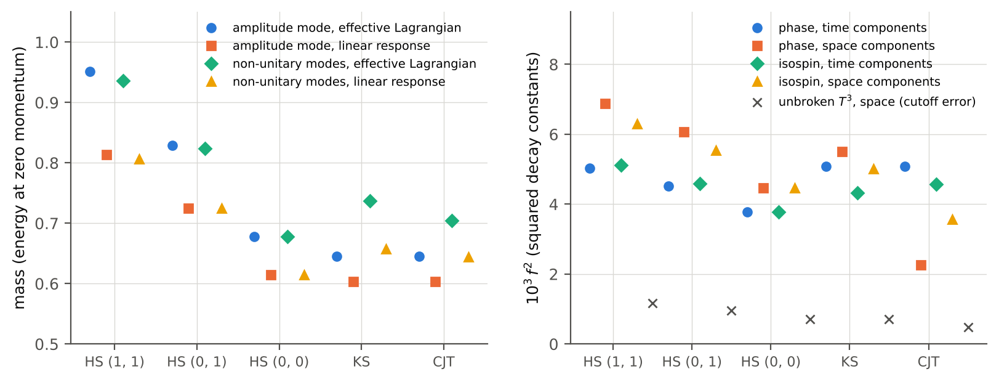{width=100%}

**Figure 11.** Left: the masses of the amplitude and of the non-unitary modes from the effective Lagrangians (13.6) and
from the linear response of Section 10.5. Right: the squared decay constants of the Goldstone fields from the time
components and from the space components, and the spurious stiffness of the unbroken $T^3$ from the space components.
Data: `data/part3_sfbsv.csv`.

## 13.3 The gauge fields in $\mathrm{SFBSv}^X$

With the gauge fields, the Goldstone fields can be removed by a gauge transformation (the unitary gauge
$\vartheta^X_{{\rm SF},0}=\vartheta^X_{{\rm SF},1}=\vartheta^X_{{\rm SF},2}=0$). In the vacuum, (12.3) gives
$\nabla_p(\Phi_0\vec e_3)=\Phi_0[2ig^{\rm F}_{\rm LL}B_{{\rm SF},p}\vec e_3+g^{\rm v}_{\rm LL}(W^1_{{\rm SF},p}\vec e_2-W^2_{{\rm SF},p}\vec e_1)]$ (from
$\vec e_1\times\vec e_3=-\vec e_2$, $\vec e_2\times\vec e_3=\vec e_1$, $\vec e_3\times\vec e_3=0$), and (12.4) becomes the mass term
$$\sum_p\eta^{\rm LL}_{pp}\Big[Z^X_{\rm SF}\Phi_0^2(g^{\rm v}_{\rm LL})^2\big((W^1_{{\rm SF},p})^2+(W^2_{{\rm SF},p})^2\big)+4(Z^X_{\rm SF}+Y^X_{\rm SF})\Phi_0^2(g^{\rm F}_{\rm LL})^2(B_{{\rm SF},p})^2\Big],\tag{13.7}$$
that is $M^X_{W,{\rm SF}}=g^{\rm v}_{\rm LL}(2Z^X_{\rm SF})^{1/2}\Phi_0=g^{\rm v}_{\rm LL}(\chi^{11}_{\rm SF})^{1/2}$, $M^X_{Z,{\rm SF}}=g^{\rm F}_{\rm LL}(8(Z^X_{\rm SF}+Y^X_{\rm SF}))^{1/2}\Phi_0=g^{\rm F}_{\rm LL}(\chi^{\rm FF}_{\rm SF})^{1/2}$,
and no mass for $W^3_{\rm SF}$: the masses (11.1) of Part II follow from the effective Lagrangian, and the three Goldstone
fields have become the longitudinal parts of $W^\pm_{\rm SF}$ and $Z_{\rm SF}$ (the Higgs mechanism; the reading of "give mass to
the Goldstone bosons" of decision D8). The mass matrix, its diagonalization and the proof that the surviving gauge
boson is massless are the subject of Section 14.

# 14. The masses of the gauge bosons, the surviving group and the massless gauge boson (Part IV)

Part IV completes item 6 of the problem. Section 13.3 inserted the vacuum $\Phi^X_{0,{\rm SF}}\vec e_3$ into the kinetic part
(12.4) and found the masses of $W^\pm_{{\rm SF},p}$ and $Z_{{\rm SF},p}$; this section writes the mass matrix of the four gauge
fields for every vacuum (13.1), diagonalizes it, proves that exactly one gauge boson stays massless, identifies the
surviving symmetry group and its $U(1)$, and checks all of it against the microscopic theory of Part II. Section 15
follows the superfluid and its gauge fields in time. Throughout, $\Phi_0$ is short for $\Phi^X_{0,{\rm SF}}$, and $a$, $b$
label the four gauge fields $(\mathcal A^1_p,\mathcal A^2_p,\mathcal A^3_p,\mathcal A^{\rm F}_p)=(W^1_{{\rm SF},p},W^2_{{\rm SF},p},W^3_{{\rm SF},p},B_{{\rm SF},p})$
with the couplings $g_a=g^{\rm v}_{\rm LL}$ ($a=1,2,3$) and $g_{\rm F}=g^{\rm F}_{\rm LL}$, as in Section 11.1.

## 14.1 The mass matrix of a general field and of a vacuum

**A constant field.** Let the field $\vec\Phi$ of the superfluid boson singlet state be constant, and let only one gauge
field be present, with the components $\mathcal A^a_p=\mathfrak c_a\mathcal A_p$ along a fixed real vector
$\mathfrak c=(\mathfrak c_1,\mathfrak c_2,\mathfrak c_3,\mathfrak c_{\rm F})$ of the four gauge directions
($\vec{\mathfrak c}=(\mathfrak c_1,\mathfrak c_2,\mathfrak c_3)$). The covariant derivative (12.3) is then
$\nabla_p\vec\Phi=\mathcal A_p\,\vec X(\mathfrak c)$ with the complex isospin vector
$$\vec X(\mathfrak c)=2ig^{\rm F}_{\rm LL}\mathfrak c_{\rm F}\vec\Phi-g^{\rm v}_{\rm LL}\,\vec{\mathfrak c}\times\vec\Phi,\qquad(\vec{\mathfrak c}\times\vec\Phi)_\iota=\sum_{\iota'\iota''}\epsilon^{\rm LL}_{\iota\iota'\iota''}\mathfrak c_{\iota'}\Phi^{\iota''},\tag{14.1}$$
and (12.4) becomes $\sum_p\eta^{\rm LL}_{pp}\mathcal A_p\mathcal A_p\,\mathcal K(\vec X(\mathfrak c))$ with the quadratic form
$$\mathcal K(\vec X)=Z^X_{\rm SF}\lvert\vec X\rvert^2+Y^X_{\rm SF}\frac{\lvert\vec\Phi^\dagger\cdot\vec X\rvert^2}{\lvert\vec\Phi\rvert^2}.\tag{14.2}$$
For several gauge fields at once, $\vec X$ is linear in $\mathfrak c$, $\vec X(\mathfrak c)=\sum_a\mathfrak c_a\vec X_a$, where $\vec X_a$ is
(14.1) for the direction $a$ alone ($\mathfrak c_b=1$ for $b=a$ and 0 otherwise), and the terms of second order in the gauge fields of (12.4) are the **mass term**
$\tfrac12\sum_{ab}\mathsf M^X_{{\rm SF},ab}\sum_p\eta^{\rm LL}_{pp}\mathcal A^a_p\mathcal A^b_p$ with the mass matrix
$$\mathsf M^X_{{\rm SF},ab}=2\,\mathrm{Re}\Big[Z^X_{\rm SF}\,\vec X_a^\dagger\cdot\vec X_b+Y^X_{\rm SF}\frac{(\vec\Phi^\dagger\cdot\vec X_a)^*(\vec\Phi^\dagger\cdot\vec X_b)}{\lvert\vec\Phi\rvert^2}\Big]\tag{14.3}$$
(the second derivative of $\mathcal K(\vec X(\mathfrak c))$ with respect to $\mathfrak c_a$ and $\mathfrak c_b$; the factor 2 makes it the coefficient of
$\tfrac12\mathcal A^a\mathcal A^b$). (14.3) is the matrix (11.1) of the effective theory: the same quadratic dependence on
constant time components of the gauge fields, computed from $\mathcal L^X$ instead of from the susceptibilities.

**A vacuum.** For the vacuum $\vec\Phi=\Phi_0e^{i\vartheta}\vec n$ of (13.1) ($\vartheta$ real, $\vec n$ a real unit vector), (14.1)
gives $\vec X(\mathfrak c)=\Phi_0e^{i\vartheta}\big(2ig^{\rm F}_{\rm LL}\mathfrak c_{\rm F}\vec n-g^{\rm v}_{\rm LL}\vec{\mathfrak c}\times\vec n\big)$. The two parts
are orthogonal ($\vec n\cdot(\vec{\mathfrak c}\times\vec n)=0$), $\lvert\vec{\mathfrak c}\times\vec n\rvert^2=\lvert\vec{\mathfrak c}\rvert^2-(\vec n\cdot\vec{\mathfrak c})^2$, and
$\vec\Phi^\dagger\cdot\vec X=2ig^{\rm F}_{\rm LL}\mathfrak c_{\rm F}\Phi_0^2$. Hence
$$\mathcal K(\vec X(\mathfrak c))=Z^X_{\rm SF}\Phi_0^2(g^{\rm v}_{\rm LL})^2\big(\lvert\vec{\mathfrak c}\rvert^2-(\vec n\cdot\vec{\mathfrak c})^2\big)+4\big(Z^X_{\rm SF}+Y^X_{\rm SF}\big)\Phi_0^2(g^{\rm F}_{\rm LL})^2\mathfrak c_{\rm F}^2,\tag{14.4}$$
and the mass matrix of the vacuum, in the order $(W^1,W^2,W^3,B)$, is
$$\begin{aligned}\mathsf M^X_{\rm SF}&=\begin{pmatrix}(M^X_{W,{\rm SF}})^2\big(\mathsf 1_3-\vec n\,\vec n^T\big)&0\\0&(M^X_{Z,{\rm SF}})^2\end{pmatrix},\\(M^X_{W,{\rm SF}})^2&=2Z^X_{\rm SF}\Phi_0^2(g^{\rm v}_{\rm LL})^2,\qquad(M^X_{Z,{\rm SF}})^2=8\big(Z^X_{\rm SF}+Y^X_{\rm SF}\big)\Phi_0^2(g^{\rm F}_{\rm LL})^2.\end{aligned}\tag{14.5}$$
It does not depend on the phase $\vartheta$, and for $\vec n=\vec e_3$ it is the mass term (13.7). With (12.5) the two masses are
$g^{\rm v}_{\rm LL}(\chi^{11}_{\rm SF})^{1/2}$ and $g^{\rm F}_{\rm LL}(\chi^{\rm FF}_{\rm SF})^{1/2}$, the masses (11.1) of Part II.

## 14.2 The diagonalization

The matrix (14.5) is diagonalized by inspection. Let $(\vec e_{\perp1},\vec e_{\perp2},\vec n)$ be a right-handed orthonormal frame
of the isospin space ($\vec e_{\perp1}\times\vec e_{\perp2}=\vec n$). Then
* $(\vec n,0)$ has the eigenvalue $0$: the field $A_{{\rm SF},p}=\vec n\cdot\vec W_{{\rm SF},p}$ is massless (the **massless gauge boson** of the superfluid);
* $(\vec e_{\perp1},0)$ and $(\vec e_{\perp2},0)$ have the eigenvalue $(M^X_{W,{\rm SF}})^2$: the fields
  $W^\pm_{{\rm SF},p}=(\vec e_{\perp1}\cdot\vec W_{{\rm SF},p}\mp i\,\vec e_{\perp2}\cdot\vec W_{{\rm SF},p})/\sqrt2$;
* $(0,0,0,1)$ has the eigenvalue $(M^X_{Z,{\rm SF}})^2$: the field $Z_{{\rm SF},p}=B_{{\rm SF},p}$.

For the vacuum along $\vec e_3$ ($\vec e_{\perp1}=\vec e_1$, $\vec e_{\perp2}=\vec e_2$) these are the fields of Section 11.1:
$A_{{\rm SF},p}=W^3_{{\rm SF},p}$, $W^\pm_{{\rm SF},p}=(W^1_{{\rm SF},p}\mp iW^2_{{\rm SF},p})/\sqrt2$, $Z_{{\rm SF},p}=B_{{\rm SF},p}$. In the
basis of the mass eigenstates the mass term is
$$\sum_p\eta^{\rm LL}_{pp}\Big[(M^X_{W,{\rm SF}})^2\,W^+_{{\rm SF},p}W^-_{{\rm SF},p}+\tfrac12(M^X_{Z,{\rm SF}})^2Z_{{\rm SF},p}Z_{{\rm SF},p}+0\cdot A_{{\rm SF},p}A_{{\rm SF},p}\Big]\tag{14.6}$$
(the real field $W^\pm$ pair contributes $\tfrac12M^2[(e_{\perp1}\cdot W)^2+(e_{\perp2}\cdot W)^2]=M^2W^+W^-$, since $W^-=(W^+)^*$).

**The mixing angle and the coupling of the massless gauge boson.** In the Standard Model (1.1) the photon is the combination
$\sin\theta_WW^3_\mu+\cos\theta_WB_\mu$ because the vacuum of the doublet is left unchanged by the charge
$Q^{\rm SM}=T^{3,{\rm SM}}+Y^{\rm SM}$, which mixes the generators of $SU(2)_L$ and $U(1)_Y$. Here the vacuum is left unchanged by
$\vec n\cdot\vec T_{\rm LL}$ alone (Section 13.1): the condensate has fermion number 2, so no admixture of $F_{\rm LL}$ can leave it
unchanged, and it has the charge 0 of $\vec n\cdot\vec T_{\rm LL}$. Therefore $A_{{\rm SF},p}$ contains no $B_{{\rm SF},p}$:
$\theta^{\rm W}_{\rm SF}=0$. The covariant derivative (5.6) contains $ig^{\rm v}_{\rm LL}\sum_\iota W^\iota_{{\rm SF},p}T^\iota_{\rm LL}$, whose part along
$A_{{\rm SF},p}$ is $ig^{\rm v}_{\rm LL}A_{{\rm SF},p}\,(\vec n\cdot\vec T_{\rm LL})$; $A_{{\rm SF},p}$ couples to the charge $\vec n\cdot\vec T_{\rm LL}$
($Q_{\rm LL}=T^3_{\rm LL}$ for the vacuum along $\vec e_3$) with the coupling
$$g^{\rm Q}_{\rm SF}=g^{\rm v}_{\rm LL}\qquad(\theta^{\rm W}_{\rm SF}=0).\tag{14.7}$$
The charges $Q_{\rm LL}$ of the fields (vacuum along $\vec e_3$): the spinor charges $\pm\tfrac12$ (isospin up and down);
$W^\pm_{{\rm SF},p}$: $\pm1$ (from $[T^3_{\rm LL},T^1_{\rm LL}\pm iT^2_{\rm LL}]=\pm(T^1_{\rm LL}\pm iT^2_{\rm LL})$); $Z_{{\rm SF},p}$, $A_{{\rm SF},p}$: 0;
the condensate $\Phi_0\vec e_3$ and the amplitude field $h^X_{\rm SF}$: 0; the two non-unitary fields combine into
$\nu^X_{{\rm SF},1}\mp i\nu^X_{{\rm SF},2}$ of charge $\pm1$ (they rotate like the components 1, 2 of an isospin vector).

**The count of the degrees of freedom.** Before the breaking: four massless vector fields with two polarizations each
(8) and the six real components of $\vec\Phi$: 14. After the breaking: three massive vector fields $W^+$, $W^-$, $Z$ with three
polarizations each (9), the zeugon $A_{{\rm SF},p}$ (massless, 2), and the three massive scalar fields $h^X_{\rm SF}$, $\nu^X_{{\rm SF},1}$,
$\nu^X_{{\rm SF},2}$ (3): 14. The three Goldstone fields $\vartheta^X_{{\rm SF},0}$, $\vartheta^X_{{\rm SF},1}$, $\vartheta^X_{{\rm SF},2}$
have become the third (longitudinal) polarizations of $Z$, $W^+$, $W^-$: the Higgs mechanism, which the author calls
"give mass to the Goldstone bosons" (decision D8). Section 15.4 shows it in time.

## 14.3 The theorem: the massless gauge bosons are the generators that leave the field unchanged

**Theorem M1.** Let $Z^X_{\rm SF}>0$ and $Z^X_{\rm SF}+Y^X_{\rm SF}>0$. For every field $\vec\Phi\neq0$ the vectors $\mathfrak c$ with
$\mathsf M^X_{\rm SF}\mathfrak c=0$ in (14.3) are exactly those for which the infinitesimal gauge transformation with the parameters
$\mathfrak c_a$ leaves $\vec\Phi$ unchanged, $\vec X(\mathfrak c)=0$. *Proof.* By the Cauchy-Schwarz inequality,
$\lvert\vec\Phi^\dagger\cdot\vec X\rvert^2\le\lvert\vec\Phi\rvert^2\lvert\vec X\rvert^2$, so
$\mathcal K(\vec X)\ge\min(Z^X_{\rm SF},Z^X_{\rm SF}+Y^X_{\rm SF})\lvert\vec X\rvert^2$, which is positive for $\vec X\neq0$. Since
$\mathfrak c^T\mathsf M^X_{\rm SF}\mathfrak c=2\mathcal K(\vec X(\mathfrak c))\ge0$, the matrix is positive semidefinite, and for such a
matrix $\mathsf M^X_{\rm SF}\mathfrak c=0$ holds exactly when $\mathfrak c^T\mathsf M^X_{\rm SF}\mathfrak c=0$ (write
$\mathsf M^X_{\rm SF}=\mathsf V^T\mathsf V$ with a real matrix $\mathsf V$; then $\mathfrak c^T\mathsf M^X_{\rm SF}\mathfrak c=\lvert\mathsf V\mathfrak c\rvert^2$). Hence
$\mathsf M^X_{\rm SF}\mathfrak c=0\Leftrightarrow\mathcal K(\vec X(\mathfrak c))=0\Leftrightarrow\vec X(\mathfrak c)=0$. Finally, $\vec X(\mathfrak c)$ is by
(12.3) the change of $\vec\Phi$ under the infinitesimal transformation of $SU(2)_{\rm v}\times U(1)^{\rm F}_{\rm LL}$ with the parameters
$\mathfrak c_a$ (times the couplings). $\square$

The conditions hold in every method (Table 12.3: $Z^X_{\rm SF}>0$, and $Z^X_{\rm SF}+Y^X_{\rm SF}>0$ also for HS $(1,1)$, where
$Y^X_{\rm SF}<0$). For a vacuum, $\vec X(\mathfrak c)=0$ means $2ig^{\rm F}_{\rm LL}\mathfrak c_{\rm F}\vec n=g^{\rm v}_{\rm LL}\vec{\mathfrak c}\times\vec n$; the two
sides are orthogonal, so both vanish: $\mathfrak c_{\rm F}=0$ and $\vec{\mathfrak c}\parallel\vec n$. **The massless gauge bosons of a vacuum correspond one to one
to the generators of the identity component of its stabilizer** (Section 13.1): there is exactly one,
$A_{{\rm SF},p}=\vec n\cdot\vec W_{{\rm SF},p}$, because the stabilizer has the one-dimensional Lie algebra spanned by $\vec n\cdot\vec T_{\rm LL}$.

**Why the mixing angle is zero: a field with a mixed stabilizer.** The theorem holds for every field, also for fields
that are not vacua. For $\vec\Phi=\Phi_0(\vec e_3+i\vec e_1)/\sqrt2$ (a non-unitary field, which the potential does not favour:
$u^X_{\rm SF}>0$), $\vec e_2\times\vec\Phi=-i\vec\Phi$, so $\vec X(\mathfrak c)$ for $\mathfrak c=(0,\mathfrak c_2,0,\mathfrak c_{\rm F})$ is
$i(g^{\rm v}_{\rm LL}\mathfrak c_2+2g^{\rm F}_{\rm LL}\mathfrak c_{\rm F})\vec\Phi$, which vanishes for
$\mathfrak c\propto(0,2g^{\rm F}_{\rm LL},0,-g^{\rm v}_{\rm LL})$ (and the other directions give no further zero eigenvalue, *check P4-M8*). The massless field is
then $\cos\theta'\,W^2_{{\rm SF},p}-\sin\theta'\,B_{{\rm SF},p}$ with $\tan\theta'=g^{\rm v}_{\rm LL}/(2g^{\rm F}_{\rm LL})$,
$\theta'=37.875^\circ$, and it couples to the charge $T^2_{\rm LL}-\tfrac12F_{\rm LL}$ with the strength
$g^{\rm v}_{\rm LL}\cos\theta'=2g^{\rm v}_{\rm LL}g^{\rm F}_{\rm LL}/((g^{\rm v}_{\rm LL})^2+4(g^{\rm F}_{\rm LL})^2)^{1/2}=0.55255$: the same structure as
the weak mixing angle of the Standard Model ($\tan\theta_W=g'/g$, $e=gg'/(g^2+g'^2)^{1/2}$), with $g'$ replaced by $2g^{\rm F}_{\rm LL}$
because the field has fermion number 2. The mixing angle of the massless boson is fixed by the generator that leaves the
condensate unchanged; for the
polar vacua of the superfluid that generator is pure isospin, and the angle is zero. Figure 12 follows the masses
along the family $\vec\Phi=\Phi_0(\cos\upsilon\,\vec e_3+i\sin\upsilon\,\vec e_1)$ of the angle $\upsilon$ (upsilon): a massless boson
exists only where the field has a continuous stabilizer ($\upsilon=0$, $45^\circ$, $90^\circ$), and its composition changes from
$W^3$ through $\cos\theta'W^2-\sin\theta'B$ to $W^1$.

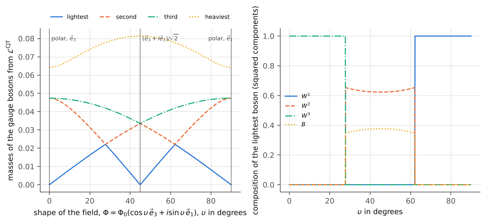{width=100%}

**Figure 12.** The mass matrix (14.3) of $\mathcal L^{\rm CJT}$ along the fields $\Phi_0(\cos\upsilon\,\vec e_3+i\sin\upsilon\,\vec e_1)$. Left: the
four masses (square roots of the eigenvalues). Right: the squared components of the lightest boson. At $\upsilon=0$ and
$90^\circ$ the field is a polar vacuum (along $\vec e_3$ and, up to the phase $i$, along $\vec e_1$) and the massless boson is $W^3$
and $W^1$; at $\upsilon=45^\circ$ it is $\cos\theta'W^2-\sin\theta'B$. Computed by `python/sf_part4_figures.py` from (14.3) with the
coefficients of Table 12.3.

## 14.4 The surviving group and its U(1)

By Section 13.1 the stabilizer of the vacuum $\Phi_0\vec e_3$ is $H^{\rm vac}_{\rm SF}=SL(2,\mathbb C)\times O(2)$ with
$O(2)=\{e^{i\theta T^3_{\rm LL}}\}\rtimes\{\mathsf 1,\mathsf r\}$, where $\mathsf r$ is the rotation by $\pi$ about $\vec e_1$ combined with the phase
$\theta^{\rm F}_{\rm LL}=\pi/2$. As a group of transformations of the fields:
* **The identity component** is the group $U(1)^{\rm Q}_{\rm LL}=\{e^{i\theta Q_{\rm LL}}\}$, $Q_{\rm LL}=T^3_{\rm LL}$, of the earlier work of the
  project: a circle group, of period $4\pi$ on the spinor charges ($Q_{\rm LL}=\pm\tfrac12$) and $2\pi$ on all bosonic fields. Its
  element $e^{2\pi iQ_{\rm LL}}$ is $-1$ on the spinor field and $+1$ on the bosons, as is $e^{i\pi F_{\rm LL}}$, which also leaves the
  condensate unchanged ($e^{2i\theta^{\rm F}_{\rm LL}}=1$): the two act alike on every field, so the stabilizer contains no further
  continuous or discrete transformations of the fields than $U(1)^{\rm Q}_{\rm LL}$ and $\mathsf r$.
* **The discrete part.** $\mathsf r e^{i\theta Q_{\rm LL}}\mathsf r^{-1}=e^{-i\theta Q_{\rm LL}}$ (the rotation by $\pi$ about $\vec e_1$ reverses $\vec e_3$), and
  $\mathsf r^2$ (the rotation by $2\pi$ times $e^{i\pi F_{\rm LL}}$) acts as the identity on every field; so
  $O(2)/U(1)^{\rm Q}_{\rm LL}=\mathbb Z_2$. On the gauge fields $\mathsf r$ acts as $W^1\to W^1$, $W^2\to-W^2$, $W^3\to-W^3$, $B\to B$, that is
  $$A_{{\rm SF},p}\to-A_{{\rm SF},p},\qquad W^\pm_{{\rm SF},p}\to W^\mp_{{\rm SF},p},\qquad Z_{{\rm SF},p}\to Z_{{\rm SF},p}:\tag{14.8}$$
  $\mathsf r$ reverses the charge $Q_{\rm LL}$ (a charge conjugation of $U(1)^{\rm Q}_{\rm LL}$), a discrete symmetry without a gauge
  boson.

**The answer to the last request of item 6.** The surviving symmetry group of every method is
$SL(2,\mathbb C)\times O(2)$; it is related to a $U(1)$ in the precise sense that its gauge part $O(2)$ is the semidirect product of
the circle group $U(1)^{\rm Q}_{\rm LL}$ (its identity component, the group of the charge $Q_{\rm LL}$, which is not the electric
charge) and the charge conjugation $\mathsf r$. The gauge field of $U(1)^{\rm Q}_{\rm LL}$ is the gauge boson
$A_{{\rm SF},p}=W^3_{{\rm SF},p}$, which is massless by theorem M1, couples with $g^{\rm Q}_{\rm SF}=g^{\rm v}_{\rm LL}$ and does not mix with $B_{{\rm SF},p}$. The masslessness does not depend on the
details of the method. In every method the vacuum is invariant under $U(1)^{\rm Q}_{\rm LL}$, has the charge $Q_{\rm LL}=0$ and a gap, so a
small chemical potential of $Q_{\rm LL}$ does not change it: $\chi^{33}_{\rm SF}=0$. The rotation by $\pi$ about $\vec e_3$ reverses
$\mu^1_{\rm SF}$ and $\mu^2_{\rm SF}$ and keeps $Q_{\rm LL}$, and $\mathsf r$ reverses $Q_{\rm LL}$ and keeps $\mu^{\rm F}_{\rm SF}$; so the induced charge
$\langle Q_{\rm LL}\rangle$ is an even function of $\mu^1_{\rm SF}$, $\mu^2_{\rm SF}$ and vanishes for every $\mu^{\rm F}_{\rm SF}$, and $\chi^{3b}_{\rm SF}=0$ for
all $b$. The matrix (11.1) therefore has the null vector of $W^3_{{\rm SF},p}$ in every method that keeps these symmetries, as
Tables 11.1 and 14.1 confirm.

**The new massless gauge boson: the zeugon.** The massless gauge boson $A_{{\rm SF},p}=\vec n\cdot\vec W_{{\rm SF},p}$ of
$U(1)^{\rm Q}_{\rm LL}$ is the massless GEE gauge boson that appears with the breaking of the symmetry, which item 6 of the
problem asks for. It is not the photon: it couples to the charge $Q_{\rm LL}$ of $SU(2)_{\rm v}$, which only the DiracLike
spinor (charges $\pm\tfrac12$), $W^\pm_{{\rm SF},p}$ and the two non-unitary scalars (charges $\pm1$) carry, and nothing in the
model carries electric charge. The author, who asked for such a boson, offered the solution its naming; it is named here
the **zeugon**, from the Greek ζεῦγος, a yoked pair, because it is the only gauge boson that attracts the two DiracLike
spinors of the condensed pair (Sections 8.2 and 11.4). What the computation establishes about it:

1. *It is massless in every method:* by theorem M1, and in the microscopic theory of Part II
   (*checks P2-8a, P4-M2*); in CJT with the exchange of the gauge bosons its computed mass is $1.999946729\times10^{-8}$,
   against $M^{\rm CJT}_{W,{\rm SF}}=0.04302319693$ (Section 11.4).
2. *It attracts the pair, but does not by itself hold it at the couplings of the project:* its exchange energy in the
   CJT condensate is $-4.834663821\times10^{-5}$ (attraction), while $W^1$, $W^2$ and $B$ repel; its attraction alone
   would pair the normal vacuum only for $g^{\rm v}_{\rm LL}>5.290206869$ (Section 11.3), so at
   $g^{\rm v}_{\rm LL}=0.7$ the condensate is produced by the pairing term of $V^{(2)}_{\rm SF}$.
3. *Its charge conjugation is a gauge symmetry:* the group that survives the breaking is $O(2)$, not $U(1)$, and its
   second component $\mathsf r$, a gauge transformation, reverses the zeugon and exchanges $W^+_{{\rm SF},p}$ and $W^-_{{\rm SF},p}$
   (14.8). This never holds for the photon. A $U(1)$ gauge theory with a local charge conjugation is called Alice
   electrodynamics (J. Kiskis 1978; A. S. Schwarz 1982; M. Bucher, H.-K. Lo and J. Preskill 1992). Here the vacua
   $\Phi_0e^{i\vartheta}\vec n$ and $\Phi_0e^{i(\vartheta+\pi)}(-\vec n)$ are the same field, so the vacuum manifold contains closed
   loops along which $\vec n$ turns into $-\vec n$ while the phase advances by $\pi$; a string of the superfluid along such
   a loop (a half-quantum vortex, the Alice string; U. Leonhardt and G. E. Volovik described its counterpart in a
   condensate of spin 1 in 2000) reverses the charge $Q_{\rm LL}$ of every particle carried around it. These strings, and
   the magnetic monopoles of the zeugon that the sphere of the directions $\vec n$ allows, follow from the topology of the
   vacuum manifold; they have not been computed in this work.

The structure exists only after the breaking: in the symmetric vacuum all four gauge bosons are massless and the unbroken
group contains no charge conjugation. Whether nature contains the zeugon is not decided by this work: it is a prediction
of the model, which couples it to no field of the Standard Model.

## 14.5 The numbers and the checks

The microscopic mass matrix (11.1) is computed for a vacuum that is not along $\vec e_3$, so that the identification of the
massless boson is not the trivial one: the self-consistent state with the pair self-energy $\Phi_0e^{i\pi/5}(\mathsf K^1_{\rm LL})^\dagger$, the
vacuum $\vartheta=\pi/5$, $\vec n=\vec e_1$ of (13.1), for which theorem M1 predicts the massless field $W^1_{{\rm SF},p}$.
The program finds the state with the energy of the ground state (*checks P4-M0*), computes the $4\times4$ matrix
$\chi^{ab}_{\rm SF}$ by the method of Section 11.1 (with the self-consistency solved to $10^{-13}$), and diagonalizes
$g_ag_b\chi^{ab}_{\rm SF}$ by the cyclic Jacobi method (plane rotations that annihilate one off-diagonal entry at a time).

| quantity | HS (1, 1) | HS (0, 1) | HS (0, 0) | KS | CJT |
|:--------------------|-----------:|-----------:|-----------:|-----------:|-----------:|
| $\Phi^X_{0,{\rm SF}}$ | $0.4030641$ | $0.362009$ | $0.3069888$ | $0.3284861$ | $0.3284861$ |
| $10^3\lambda_0$ (the zeugon $A_{{\rm SF},p}$) | $-1.2\times10^{-13}$ | $1.5\times10^{-13}$ | $-2.3\times10^{-13}$ | $-3\times10^{-14}$ | $-1.3\times10^{-13}$ |
| $10^3\lambda_1=10^3\lambda_2$ | $2.5081261$ | $2.2474677$ | $1.846917$ | $2.115333$ | $2.2431582$ |
| $10^3\lambda_3$ | $4.0792692$ | $3.6614611$ | $3.0530669$ | $4.1233542$ | $4.1233542$ |
| $M^X_{W,{\rm SF}}=\lambda_1^{1/2}$ | $0.05008119$ | $0.04740746$ | $0.04297577$ | $0.04599275$ | $0.04736199$ |
| $M^X_{Z,{\rm SF}}=\lambda_3^{1/2}$ | $0.06386916$ | $0.06051001$ | $0.05525456$ | $0.06421335$ | $0.06421335$ |
| $v_0$ from $W^1$ | $0$ | $0$ | $0$ | $0$ | $0$ |
| (14.3) $-$ microscopic | $4.7\times10^{-13}$ | $6.9\times10^{-13}$ | $2\times10^{-12}$ | $2.3\times10^{-12}$ | $2.1\times10^{-12}$ |

**Table 14.1.** The eigenvalues $\lambda_0\le\lambda_1\le\lambda_2\le\lambda_3$ of the microscopic mass matrix of the vacuum
$\Phi_0e^{i\pi/5}\vec e_1$ ($\lambda_1$ and $\lambda_2$ agree to $3\times10^{-13}\,\lambda_3$ and share a row), the masses $M^X_{W,{\rm SF}}=\lambda_1^{1/2}$ and $M^X_{Z,{\rm SF}}=\lambda_3^{1/2}$, the distance
$1-\lvert\langle v_0,(1,0,0,0)\rangle\rvert$ of the eigenvector $v_0$ of $\lambda_0$ from $W^1$ (in the order $(W^1,W^2,W^3,B)$), and the largest difference between (14.3) and the microscopic matrix, relative to
$(M^X_{Z,{\rm SF}})^2$. Data: `data/part4_massmatrix.csv`.

In all five methods: the matrix is symmetric (*P4-M1*), its smallest eigenvalue vanishes to rounding (*P4-M2*), its
eigenvector is $W^1$ to rounding (*P4-M3*), the other eigenvalues are the $(M^X_{W,{\rm SF}})^2$ (twice) and $(M^X_{Z,{\rm SF}})^2$ of
the vacuum along $\vec e_3$ of Part III to $3\times10^{-12}$, with $Z_{{\rm SF},p}=B_{{\rm SF},p}$ (*P4-M4*), and the mass matrix (14.3) of the
effective Lagrangian at the same vacuum equals the microscopic one to $3\times10^{-12}$ (*P4-M5*). For the vacuum
$\Phi_0e^{i\pi/5}(1,1,1)/\sqrt3$, (14.3) has the eigenvalues $0$, $(M^X_{W,{\rm SF}})^2$, $(M^X_{W,{\rm SF}})^2$, $(M^X_{Z,{\rm SF}})^2$ and the
massless field $(W^1+W^2+W^3)/\sqrt3$ (*P4-M6*); along $\vec e_3$ its eigenvalues are those of (14.5) (*P4-M7*); for the field
$\Phi_0(\vec e_3+i\vec e_1)/\sqrt2$ it has one zero eigenvalue with the eigenvector $\cos\theta'W^2-\sin\theta'B$ (*P4-M8*). (The
microscopic check uses a vacuum along a coordinate axis because there the static response is well defined; see Section
17.4, item 1.) The Python program repeats the microscopic matrices of HS $(1,1)$ and CJT with its own engine and LAPACK
(*checks YP4-M1 to YP4-M3*).

## 14.6 Can the superfluid play the role of the Higgs particle, and is the Higgs a composite particle?

This section is the second part of the second addendum of 21 November 2026 (Section 12.5 is the first): to determine for
each method whether the superfluid can play the role of the Higgs particle, and whether the Higgs is really a composite
particle. The question has two meanings, and they have different answers:

* **(a)** Is the superfluid the Higgs field of its own gauge group: does it break $SU(2)_{\rm v}\times U(1)^{\rm F}_{\rm LL}$
  spontaneously, give the gauge bosons of that group their masses, and have a Higgs particle, an amplitude mode that is
  a particle?
* **(b)** Can the superfluid be the Higgs field of the Standard Model, and its amplitude mode the Higgs boson that is
  observed?

**The answer to (b).** No, in every method, and the answer needs no number of this work. The only matter field of the
Lagrangian (5.1) to (5.4) is the DiracLike spinor, which has electric charge 0 and no quantum numbers of the electroweak
group $SU(2)_L\times U(1)_Y$ (Section 1). Every field made of it, the pair field $\vec\Phi$ of the superfluid included, is
therefore a singlet of $SU(2)_L\times U(1)_Y$: its vacuum value leaves the electroweak group unbroken, it gives no mass to
the $W$ and $Z$ bosons of nature, and its amplitude mode has no coupling at tree level to the $W$ and $Z$ bosons, to the
quarks or to the leptons. The Higgs boson of nature is identified by exactly these couplings, which have been measured
and agree with those of the Standard Model to several per cent (ATLAS 2022, CMS 2022). The model contains no coupling
between the superfluid and the Higgs field of the Standard Model. Such a coupling, for example a term proportional to
$(\Phi^{\rm SM})^\dagger\Phi^{\rm SM}\,\vec\Phi^\dagger\cdot\vec\Phi$, would be an addition to the model; it would mix the amplitude mode
with the Higgs boson of nature, and the measured couplings of that boson would limit the mixing. The earlier version of
this section compared the numbers of the superfluid with those of the Higgs boson of the Standard Model as if the two
gauge groups were one; that comparison had no basis and is withdrawn (Section 17.6).

**(a): the superfluid as the Higgs field of $SU(2)_{\rm v}\times U(1)^{\rm F}_{\rm LL}$.** The rest of this section answers (a)
with the quantities of the new group alone. The scale of the new group is not known: the scale $\Lambda_{\rm LL}$ of the
model is fixed by no observation, and every mass is given in units of $\Lambda_{\rm LL}$.

**The scale of the breaking.** $M^X_{W,{\rm SF}}=g^{\rm v}_{\rm LL}f^{X,{\rm I}}_{\rm SF}$ with the isospin decay constant
$f^{X,{\rm I}}_{\rm SF}=(2Z^X_{\rm SF})^{1/2}\Phi^X_{0,{\rm SF}}$ (Sections 12.2 and 13.3). In the convention $M_W=gv/2$ of (1.1) the scale of
the breaking is
$$v^X_{\rm SF}=2f^{X,{\rm I}}_{\rm SF},\qquad M^X_{W,{\rm SF}}=\tfrac12g^{\rm v}_{\rm LL}v^X_{\rm SF},\tag{14.9}$$
which does not depend on the gauge coupling. The dimensionless numbers of the Higgs sector are then the ratio
$M^{X,{\rm H}}_{\rm SF}/v^X_{\rm SF}$ of the mass of the amplitude (Higgs) mode to the scale of the breaking, the quartic coupling
$\lambda^{X,{\rm H}}_{\rm SF}=(M^{X,{\rm H}}_{\rm SF})^2/(2(v^X_{\rm SF})^2)$ (in the convention $m_H^2=2\lambda_Hv^2$ of Section 1), the ratio of the
width of the amplitude mode to its mass, and, at the couplings $g^{\rm v}_{\rm LL}=0.7$, $g^{\rm F}_{\rm LL}=0.45$ of the project, the
ratios $M^{X,{\rm H}}_{\rm SF}/M^X_{W,{\rm SF}}$ and $M^X_{W,{\rm SF}}/M^X_{Z,{\rm SF}}$. The masses $M^{X,{\rm H}}_{\rm SF}$ and
$M^{X,{\rm NU}}_{\rm SF}$ are those of the linear response of Section 10.5 (Table 13.1), the exact small oscillations of each
method.

**The width of the amplitude mode.** The mean-field response of the methods contains no pairs of collective modes, and
there the amplitude mode is a sharp pole below the threshold $2E^{X,{\rm gap}}_{\rm SF}$ of two quasi-particles. Beyond the methods
it can decay into two Goldstone fields. The kinetic part (12.4), written with the fields of (13.4), contains the
couplings of the amplitude field $h^X_{\rm SF}$ to the Goldstone fields: on the field
$\vec\Phi=(\Phi^X_{0,{\rm SF}}+h^X_{\rm SF}/(2(Z^X_{\rm SF}+Y^X_{\rm SF}))^{1/2})\,e^{i\vartheta^X_{{\rm SF},0}}\vec e_3$ the two invariants of (12.4) give
$(Z^X_{\rm SF}+Y^X_{\rm SF})(\Phi^X_{0,{\rm SF}}+h^X_{\rm SF}/(2(Z^X_{\rm SF}+Y^X_{\rm SF}))^{1/2})^2(\partial\vartheta^X_{{\rm SF},0})^2$, whose term linear in
$h^X_{\rm SF}$ is $f^{X,{\rm F}}_{\rm SF}\,h^X_{\rm SF}(\partial\vartheta^X_{{\rm SF},0})^2$; on the field rotated about $\vec e_1$ by
$\vartheta^X_{{\rm SF},1}$ only the first invariant contributes, and the term is
$((f^{X,{\rm I}}_{\rm SF})^2/f^{X,{\rm F}}_{\rm SF})\,h^X_{\rm SF}(\partial\vartheta^X_{{\rm SF},1})^2$ (and the same for $\vartheta^X_{{\rm SF},2}$) (*checks
P3-H2, YP3-H2* differentiate (12.4) numerically). With the canonically normalized Goldstone fields $f^{X,{\rm F}}_{\rm SF}\vartheta^X_{{\rm SF},0}$ and
$f^{X,{\rm I}}_{\rm SF}\vartheta^X_{{\rm SF},k}$ ($k=1,2$) all three couplings are $1/f^{X,{\rm F}}_{\rm SF}$ times $h^X_{\rm SF}$ times the squared
derivative of the canonical field. For the decay of $h^X_{\rm SF}$ at rest into two massless quanta of one canonical field this
gives the amplitude $(M^{X,{\rm H}}_{\rm SF})^2/f^{X,{\rm F}}_{\rm SF}$ (the coupling times the product $(M^{X,{\rm H}}_{\rm SF})^2/2$ of the
four-momenta of the two quanta, twice, because the two quanta are identical) and the width
$\lvert\text{amplitude}\rvert^2/(32\pi M^{X,{\rm H}}_{\rm SF})=(M^{X,{\rm H}}_{\rm SF})^3/(32\pi(f^{X,{\rm F}}_{\rm SF})^2)$ (the two-body phase space
of two identical massless particles), and the three channels, one for each broken generator of
$SU(2)_{\rm v}\times U(1)^{\rm F}_{\rm LL}$, give together
$$\Gamma^{X,{\rm H}}_{\rm SF}=\frac{3\,(M^{X,{\rm H}}_{\rm SF})^3}{32\pi\,(f^{X,{\rm F}}_{\rm SF})^2}.\tag{14.10}$$
With the gauge fields the Goldstone fields are the longitudinal parts of $W^\pm_{{\rm SF},p}$ and $Z_{{\rm SF},p}$; by the
equivalence theorem of the longitudinal gauge bosons and the Goldstone fields, which holds in every spontaneously broken
gauge theory (Cornwall, Levin and Tiktopoulos 1974; Chanowitz and Gaillard 1985), (14.10) is then the width of the decays
of $h^X_{\rm SF}$ into $W^+_{\rm SF}W^-_{\rm SF}$ and $Z_{\rm SF}Z_{\rm SF}$, the massive gauge bosons of the new group, up to corrections of the
relative order of $(M^X_{W,{\rm SF}}/M^{X,{\rm H}}_{\rm SF})^2$ and $(M^X_{Z,{\rm SF}}/M^{X,{\rm H}}_{\rm SF})^2$. The kinetic part (12.4) couples
$h^X_{\rm SF}$ to these bosons through their mass terms: both squared masses of (14.5) are proportional to $\Phi_0^2$, so on the
field $\Phi^X_{0,{\rm SF}}+h^X_{\rm SF}/(2(Z^X_{\rm SF}+Y^X_{\rm SF}))^{1/2}$ the term linear in $h^X_{\rm SF}$ of each mass term of (14.6) is that
mass term times $2h^X_{\rm SF}/f^{X,{\rm F}}_{\rm SF}$. At tree level the width of $h^X_{\rm SF}$ into a pair of $W_{\rm SF}$ bosons is then
the width of the two corresponding Goldstone channels times the factor
$$\Big(1-\frac{4(M^X_{W,{\rm SF}})^2}{(M^{X,{\rm H}}_{\rm SF})^2}\Big)^{1/2}\Big(1-\frac{4(M^X_{W,{\rm SF}})^2}{(M^{X,{\rm H}}_{\rm SF})^2}+\frac{12(M^X_{W,{\rm SF}})^4}{(M^{X,{\rm H}}_{\rm SF})^4}\Big)$$
(the phase space and the sum over the polarizations of the two bosons), and the same with $M^X_{Z,{\rm SF}}$ for
$Z_{\rm SF}Z_{\rm SF}$. Here the larger of $M^X_{W,{\rm SF}}$ and $M^X_{Z,{\rm SF}}$ is $0.0785$ (HS (1, 1)) to $0.106$ (KS, CJT) times $M^{X,{\rm H}}_{\rm SF}$, so that the factor
is $0.934$ (KS, CJT) to $0.964$ (HS (1, 1)): (14.10) overestimates the width into $W^+_{\rm SF}W^-_{\rm SF}$ and $Z_{\rm SF}Z_{\rm SF}$ by less than
$7$ per cent. (The factor 3 and the normalization of (14.10) can be checked against a known case: with
$f^{X,{\rm F}}_{\rm SF}$ replaced by the vacuum value $v$ of (1.1), (14.10) is the width $3m^3/(32\pi v^2)$ of a heavy Higgs boson of
mass $m$ of the Standard Model into its longitudinal $W$ and $Z$ bosons.) (14.10) uses the effective Lagrangian at the
energy $M^{X,{\rm H}}_{\rm SF}$, where it is not accurate (its mass of the amplitude mode differs from the linear response by
$7.0$ (KS, CJT) to $17$ (HS (1, 1)) per cent, Table 13.1); it estimates the order of magnitude.

| quantity | HS (1, 1) | HS (0, 1) | HS (0, 0) | KS | CJT |
|:----------------------|---------:|---------:|---------:|---------:|---------:|
| $v^X_{\rm SF}=2f^{X,{\rm I}}_{\rm SF}$ | $0.143089$ | $0.135450$ | $0.122788$ | $0.131408$ | $0.135320$ |
| $f^{X,{\rm F}}_{\rm SF}$ | $0.0709657$ | $0.0672333$ | $0.0613940$ | $0.0713482$ | $0.0713482$ |
| $f^{X,{\rm I}}_{\rm SF}$ | $0.0715446$ | $0.0677249$ | $0.0613940$ | $0.0657039$ | $0.0676600$ |
| $M^{X,{\rm H}}_{\rm SF}$ (linear response) | $0.813693$ | $0.725083$ | $0.614387$ | $0.603476$ | $0.603476$ |
| $M^{X,{\rm NU}}_{\rm SF}$ (linear response) | $0.806128$ | $0.725083$ | $0.614387$ | $0.657285$ | $0.644007$ |
| $M^X_{W,{\rm SF}}$ ($g^{\rm v}_{\rm LL}=0.7$) | $0.050081$ | $0.047407$ | $0.042976$ | $0.045993$ | $0.047362$ |
| $M^X_{Z,{\rm SF}}$ ($g^{\rm F}_{\rm LL}=0.45$) | $0.063869$ | $0.060510$ | $0.055255$ | $0.064213$ | $0.064213$ |
| $M^{X,{\rm H}}_{\rm SF}/v^X_{\rm SF}$ | $5.687$ | $5.353$ | $5.004$ | $4.592$ | $4.460$ |
| $\lambda^{X,{\rm H}}_{\rm SF}=(M^{X,{\rm H}}_{\rm SF})^2/(2(v^X_{\rm SF})^2)$ | $16.17$ | $14.33$ | $12.52$ | $10.55$ | $9.944$ |
| $M^{X,{\rm H}}_{\rm SF}/M^X_{W,{\rm SF}}$ | $16.25$ | $15.29$ | $14.30$ | $13.12$ | $12.74$ |
| $M^X_{W,{\rm SF}}/M^X_{Z,{\rm SF}}$ | $0.7841$ | $0.7835$ | $0.7778$ | $0.7162$ | $0.7376$ |
| $M^{X,{\rm H}}_{\rm SF}/(2E^{X,{\rm gap}}_{\rm SF})$ | $0.8982$ | $0.8766$ | $0.8384$ | $0.8235$ | $0.8235$ |
| $M^{X,{\rm NU}}_{\rm SF}/M^{X,{\rm H}}_{\rm SF}$ | $0.9907$ | $1.000$ | $1.000$ | $1.089$ | $1.067$ |
| $f^{X,{\rm F}}_{\rm SF}/f^{X,{\rm I}}_{\rm SF}$ | $0.9919$ | $0.9927$ | $1.000$ | $1.086$ | $1.055$ |
| $\Gamma^{X,{\rm H}}_{\rm SF}/M^{X,{\rm H}}_{\rm SF}$ (14.10) | $3.92$ | $3.47$ | $2.99$ | $2.13$ | $2.13$ |
| $T^{X,{\rm c}}_{\rm SF}/v^X_{\rm SF}$ | $1.820$ | $1.775$ | $1.741$ | $1.690$ | $1.641$ |
| ${\rm Gi}^{X}_{\rm SF}$ (Table 12.5) | $11.4$ | $9.77$ | $8.28$ | $7.62$ | $7.62$ |

**Table 14.2.** The superfluid as the Higgs sector of $SU(2)_{\rm v}\times U(1)^{\rm F}_{\rm LL}$. Rows 1 to 7: the scale $v^X_{\rm SF}$
(14.9), the decay constants, the masses of the amplitude mode and of the non-unitary doublet (linear response, Table 13.1)
and of the gauge bosons (Table 14.1), in units of $\Lambda_{\rm LL}$; rows 8 to 16: the dimensionless numbers; row 17: the
Ginzburg number of Section 12.5. The numbers of the table are recomputed from the susceptibilities $\chi^{11}_{\rm SF}$,
$\chi^{\rm FF}_{\rm SF}$, the masses, the gap and the critical temperature by (14.9) and (14.10) independently of the module that
writes them (*check P3-H3*); the Python program and the notebook repeat this check (YP3-H3, WP3-H3) and the checks P3-H1
and P3-H2 (YP3-H1, YP3-H2, WP3-H1, WP3-H2; the notebook derives the couplings of the amplitude field by exact symbolic
differentiation of (12.4)). Data: `data/part3_higgs.csv`.

**The answer to (a) for each method.** The five methods are judged by the properties that make a field the Higgs field of
a gauge group and its amplitude mode a Higgs particle:

1. *The Higgs mechanism.* In every method the condensate breaks $SU(2)_{\rm v}\times U(1)^{\rm F}_{\rm LL}$ to $U(1)^{\rm Q}_{\rm LL}$, gives
   masses to $W^\pm_{{\rm SF},p}$ and $Z_{{\rm SF},p}$, leaves exactly one gauge boson, $A_{{\rm SF},p}$, massless (theorem M1) and turns
   the three Goldstone fields into the longitudinal parts of the massive bosons (Sections 13.3, 14.2, 15.4): the
   superfluid does for the new group what a Higgs field does.
2. *A scalar of charge 0 below the threshold.* In every method the amplitude mode $h^X_{\rm SF}$ (charge $Q_{\rm LL}=0$) lies
   below the threshold of two quasi-particles, at $0.824$ (KS, CJT) to $0.898$ (HS (1, 1)) of $2E^{X,{\rm gap}}_{\rm SF}$ (*P3-H1*): a bound state of the
   mean-field dynamics.
3. *Its mass against the scale of the breaking.* $M^{X,{\rm H}}_{\rm SF}/v^X_{\rm SF}$ is $4.46$ (CJT) to $5.69$ (HS (1, 1)) and $\lambda^{X,{\rm H}}_{\rm SF}$ is
   $9.94$ (CJT) to $16.2$ (HS (1, 1)): the amplitude mode is heavier than the scale of the breaking, and $M^{X,{\rm H}}_{\rm SF}/M^X_{W,{\rm SF}}$ is
   $12.7$ (CJT) to $16.2$ (HS (1, 1)). Whether a quartic coupling of this size is compatible with the perturbative unitarity of the
   scattering of the longitudinal gauge bosons of this group is not decided here: the bound depends on the scalar fields
   and the scattering channels of the theory, and it was not computed for this one.
4. *Its width.* (14.10) gives $\Gamma^{X,{\rm H}}_{\rm SF}/M^{X,{\rm H}}_{\rm SF}$ = $2.1$ (KS, CJT) to $3.9$ (HS (1, 1)): once the decays into Goldstone fields
   (or longitudinal gauge bosons) are allowed, the width exceeds the mass, and the amplitude mode is not a particle but a
   broad resonance. A width larger than the mass also means that the coupling is too strong for the expansion in which
   the width was computed, so (14.10) gives the order of magnitude only.
5. *Further scalars.* Every method has the non-unitary doublet, two scalars of charge $Q_{\rm LL}=\pm1$ at
   $0.991$ (HS (1, 1)) to $1.09$ (KS) times $M^{X,{\rm H}}_{\rm SF}$ (degenerate with the amplitude mode in HS $(0,1)$ and HS $(0,0)$); with the
   amplitude mode they are the three massive scalar fields of the count of Section 14.2.
6. *The quantum numbers.* The condensate is an isospin vector of fermion number 2 of the vector-like $SU(2)_{\rm v}$. The
   massless gauge boson is $A_{{\rm SF},p}=W^3_{{\rm SF},p}$ ($\theta^{\rm W}_{\rm SF}=0$), $Z_{{\rm SF},p}$ is the gauge boson of the
   fermion number, which the condensate breaks, and
   $M^X_{W,{\rm SF}}/M^X_{Z,{\rm SF}}=g^{\rm v}_{\rm LL}f^{X,{\rm I}}_{\rm SF}/(2g^{\rm F}_{\rm LL}f^{X,{\rm F}}_{\rm SF})$ ($0.716$ (KS) to $0.784$ (HS (1, 1))) depends on two
   independent couplings and on two decay constants ($f^{X,{\rm F}}_{\rm SF}/f^{X,{\rm I}}_{\rm SF}$ is $0.992$ (HS (1, 1)) to $1.09$ (KS); exactly 1 only in
   HS $(0,0)$). The mass of the DiracLike spinor does not come from the condensate as a Yukawa mass: the condensate adds
   a pairing gap, $E^{X,{\rm gap}}_{\rm SF}=((M^{X,{\rm D}}_{\rm SF})^2+(\Phi^X_{0,{\rm SF}})^2)^{1/2}$, to a Dirac mass that the vector-like
   theory allows without it.
7. *The thermal history.* The transition of the superfluid lies deep in its own critical region
   (${\rm Gi}^{X}_{\rm SF}$ = $7.6$ (KS, CJT) to $11$ (HS (1, 1)), Section 12.5); its mean-field temperature, $1.64$ (CJT) to $1.82$ (HS (1, 1)) times $v^X_{\rm SF}$, is not
   reliable.

**The verdict.** (a) In every method the superfluid is the Higgs field of $SU(2)_{\rm v}\times U(1)^{\rm F}_{\rm LL}$: it breaks the
group to $U(1)^{\rm Q}_{\rm LL}$, gives the force particles $W^\pm_{{\rm SF},p}$ and $Z_{{\rm SF},p}$ their masses, leaves the massless
force particle $A_{{\rm SF},p}$, the zeugon (Section 14.4), and has a Higgs-like scalar of charge $Q_{\rm LL}=0$ below the threshold of two quasi-particles.
That scalar is a Higgs particle of the new group only in the mean-field dynamics: once it can decay into the longitudinal
gauge bosons it is a resonance broader than its mass, and it is accompanied by the two non-unitary scalars of charge
$Q_{\rm LL}=\pm1$ of about the same mass. The methods differ in degree, not in kind: CJT and KS have the lightest and
narrowest amplitude mode ($M^{X,{\rm H}}_{\rm SF}/v^X_{\rm SF}$ = $4.46$ and $4.59$), HS $(1,1)$ the
heaviest and broadest ($5.69$). (b) In no method is the superfluid the Higgs field of the Standard
Model, for the reason of structure stated above.

**Is the Higgs a composite particle?** In this model, yes, in every method, for the Higgs particle of
$SU(2)_{\rm v}\times U(1)^{\rm F}_{\rm LL}$: the field $\vec\Phi^X_{\rm SF}$ is not a field of the Lagrangian (5.1) to (5.4), whose only
matter field is the DiracLike spinor. It is the amplitude of the pair self-energy, a composite of two spinor charges; its
kinetic part (12.4) has no term of its own and is generated entirely by the spinor field (the coefficients $Z^X_{\rm SF}$,
$Y^X_{\rm SF}$ are susceptibilities of the spinor field, Section 12.2); and its amplitude mode is a bound state of two
quasi-particles below their threshold (Section 10.5). This is the compositeness condition of Bardeen, Hill and Lindner
(1990) (the wave-function normalization of the composite field vanishes at the cutoff, where only the spinor field
exists). The same structure explains why the composite is heavy against the scale of the breaking: in the dynamics of
Nambu and Jona-Lasinio (1961) the mass of the bound state is tied to the gap of the spinor charges ($M^{X,{\rm H}}_{\rm SF}$ is
$0.824$ (KS, CJT) to $0.898$ (HS (1, 1)) of $2E^{X,{\rm gap}}_{\rm SF}$), while the scale of the breaking comes from a loop of the spinor field and is
small against the gap ($f^{X,{\rm I}}_{\rm SF}/E^{X,{\rm gap}}_{\rm SF}$ is $0.16$ (HS (1, 1)) to $0.18$ (KS, CJT)). A light composite needs a large ratio of
the cutoff to the gap (Bardeen, Hill and Lindner) or a different mechanism, for example a scalar that is itself a
pseudo-Goldstone boson of a larger broken symmetry (Kaplan and Georgi 1984; Agashe, Contino and Pomarol 2005). Whether the
Higgs boson of nature is composite is not decided by this work, because the Higgs particle of this model is not that
boson (answer (b)); the measured couplings of the Higgs boson of nature agree with those of an elementary Higgs field of
the Standard Model at the level of several per cent (ATLAS 2022, CMS 2022), which constrains, but does not exclude, its
compositeness at a higher scale.

# 15. The dynamics of the superfluid and of its gauge fields (Part IV)

Every equation of this section is integrated by CVODE or IDA (Section 6.3) in the pure-Rust SUNDIALS 7.8.0, by the
program `sf_part4` and, through the C interface of the crate `sfsundials_c`, by the Python program `sf_part4.py`. The
time $t$ is $x^0_{\rm LL}$, in units of $1/\Lambda_{\rm LL}$.

## 15.1 The growth of the condensate from the normal vacuum

**The equations.** The unknowns are the generalized densities $\mathsf R_{\rm SF}(\vec q_{\rm LL})$ (6.4a) at the 144 momenta of the grid
of Part II (24 radial nodes times six directions): all 256 complex entries of every matrix, 73 728 real numbers. Their
equation is the time-dependent mean field (6.6), $i\partial_0\mathsf R_{\rm SF}=[\mathsf H_{\rm SF},\mathsf R_{\rm SF}]$, with the BdG matrices (6.5)
built from the self-energies of the state at every instant (from the local matrices (9.1) and the formulas (9.4), (9.5)
of the method). CVODE integrates it with the Adams-Moulton formulas (orders up to 12, the fixed-point iteration of the
corrector) and the error weights $1/(10^{-10}\lvert z\rvert+10^{-15})$ of the complex entries $z$ (the relative tolerance $10^{-10}$
and the absolute tolerance $10^{-15}$; the runs with the non-unitary seeds below use the absolute tolerance $10^{-18}$, the
runs of Section 15.2 the absolute tolerance $10^{-13}$); the weight uses the modulus
because the real and the imaginary part of an oscillating entry pass through zero. The equations conserve the energy
per volume (the self-energies are the derivatives (6.3) of the energy, so that
$d\mathcal E/dt=\tfrac12\sum_{\vec q}w\,\mathrm{tr}(\mathsf H\,d\mathsf R/dt)=-\tfrac i2\sum_{\vec q}w\,\mathrm{tr}(\mathsf H[\mathsf H,\mathsf R])=0$, $w$ the weight of a node), the four
charges (the energy is GEE-invariant), the projector property $\mathsf R^2=\mathsf R$, the Hermiticity and the relation of the
blocks of (6.4a); the program checks all of them.

**The start.** The normal vacuum is a stationary state (Section 9.3), but unstable: its static response in the pair
channel has the eigenvalue $\lambda^{\rm P}_{\rm SF}>1$ (Section 9.4). The run starts from the ground state of the BdG matrix with
$\mathsf N_{\rm SF}=0$ and the small pair self-energy $10^{-7}(\mathsf K^3_{\rm LL})^\dagger$ (a seed), which differs from the normal vacuum by
terms of order $10^{-7}$.

**The linear stage.** A fluctuation of the normal vacuum with the time dependence $e^{-i\omega t}$ obeys the equations of
Section 10.5 with the same matrix $\mathsf Q^X_{\rm SF}(\omega)$ (10.7); at the imaginary frequency $\omega=i\gamma$ ($\gamma>0$) the
fluctuation grows as $e^{\gamma t}$. For the normal vacuum the eigenvalue of $\mathsf Q^X_{\rm SF}(i\gamma)$ in the pair channel is real and
falls from $\lambda^{\rm P}_{\rm SF}$ at $\gamma=0$ to 0 as $\gamma\to\infty$. (At $\omega=i\gamma$ the two terms of a group of (10.6) give
$-[(\mathsf J^+_\kappa+\mathsf J^-_\kappa)\Omega_\kappa+i\gamma(\mathsf J^+_\kappa-\mathsf J^-_\kappa)]/(\Omega_\kappa^2+\gamma^2)$; the normal vacuum at
$\mu_{\rm LL}=0$ is symmetric under charge conjugation, the pairs of two particles and of two antiparticles contribute alike, and the
eigenvalue is real; the program checks that its imaginary part vanishes, *check P4-T1b*.) The **growth rate**
$\gamma^X_{\rm SF}$ is the value at which it passes 1; the program finds it by bisection with the response of Part II at complex
frequencies (*check P4-T1*: at $\gamma\to0$ the eigenvalue is $\lambda^{\rm P}_{\rm SF}$ of Part II to $4\times10^{-13}$). The time-dependent run grows exactly at this rate: the slope of
$\ln\lvert\Phi^{X,3}_{\rm SF}(t)\rvert$ between $3\times10^{-5}\Phi_0$ and $3\times10^{-3}\Phi_0$ equals $\gamma^X_{\rm SF}$ to $2\times10^{-5}$
(*check P4-T2*, Table 15.1). HS $(0,0)$, KS and CJT, which have the same pair coupling $g^{X,{\rm P}}_{\rm SF}$ in the normal vacuum,
have the same rate.

**The nonlinear stage.** When $\lvert\Phi^3\rvert$ reaches $\Phi_0$ the growth stops; the field overshoots to
$\lvert\Phi^3\rvert_{\max}>\Phi_0$, falls back (in the three HS methods to between $0.2$ and $7$ per cent of $\Phi_0$, in KS and CJT
to between $0.2$ and $0.65$ of $\Phi_0$), and grows again: a train of pulses (Figure 13). The state cannot
settle in the minimum of the Mexican hat. Its energy is conserved (*check P4-T3*, $4\times10^{-8}$ of the depth of the
minimum) and equals that of the normal vacuum, which lies above the minimum by $\lvert\mathcal E^X_{\rm SF}\rvert$; the time-dependent
mean field has no mechanism that carries this energy away (it is collisionless: no scattering of quasi-particles, no
radiation, the state stays uniform), so it stays in the motion, which exchanges it between the kinetic and the
interaction energy (Figure 13, right). The same pulse train is known from the collisionless dynamics of the BCS pairing
problem started near the normal state; relaxation to the minimum needs processes beyond the mean field. The charges stay
zero to $7\times10^{-17}$ (*P4-T4*), $\mathsf R_{\rm SF}$ stays a Hermitian projector with the block relation of (6.4a) to $6\times10^{-10}$ (*P4-T5*), and
the run with ten times smaller tolerances agrees to $5\times10^{-8}\,\Phi_0$ (*P4-T12*).

**The polar sector and its stability.** The seed lies in the channel $\mathsf K^3_{\rm LL}$, which is invariant under
$U(1)^{\rm Q}_{\rm LL}$ (the pair has $Q_{\rm LL}=0$); so is the normal vacuum, and the equations keep the invariance: the state stays in
the **polar sector**, the states invariant under $U(1)^{\rm Q}_{\rm LL}$, in which $\Phi^1=\Phi^2=0$. The self-energies of such a state connect
only components of equal $Q_{\rm LL}$ ($\mathsf N$) or of opposite $Q_{\rm LL}$ ($\mathsf P$). The growth runs use these invariant parts of the
self-energies, which in exact arithmetic is the same; the state then stays polar to $3\times10^{-17}$ (*P4-T6*). Without this
projection the rounding errors of the order $10^{-16}$ in the components $\mathsf K^1$, $\mathsf K^2$ grow: in a first run with the full
equations they reached $0.95$ of $\lvert\Phi^3\rvert$ in HS $(1,1)$ by $t=250$. This is a property of the motion, not of the
integration. Two runs with the full equations and the additional seeds $10^{-11}i(\mathsf K^1_{\rm LL})^\dagger$ and
$10^{-13}i(\mathsf K^1_{\rm LL})^\dagger$ (non-unitary perturbations, of the charges $\pm1$ of $Q_{\rm LL}$; the absolute tolerance
$10^{-18}$, far below the off-polar entries of $\mathsf R_{\rm SF}$ of the smaller seed) measure it with the departure
$$s(t)=\big(\lvert\Phi^{X,1}_{\rm SF}(t)\rvert^2+\lvert\Phi^{X,2}_{\rm SF}(t)\rvert^2\big)^{1/2}\big/\Phi_0.\tag{15.1}$$
During the growth from the normal vacuum the departure grows with the condensate, because the three pair channels of the
normal vacuum are unstable at the same rate. After the saturation, let $e_k$ be the largest $s(t)$ in the pulse $k$ (between
the $k$-th and the $(k+1)$-th maximum of $\lvert\Phi^3\rvert$, $k=0,1,\dots$); the least-squares line through $\ln e_k$ (seed
$10^{-13}$, while $e_k<0.1$) gives the **growth of the departure per pulse** of Table 15.1. Through the growth and the first pulse,
while the departure of the larger seed is below $10^{-3}$, the two runs differ by the factor 100 of their seeds to
$2.2\times10^{-5}$ or better (*check P4-T14*, tolerance $10^{-3}$): the departure is the linear response to the perturbation, which the motion amplifies. (Its
nonlinear corrections are of the relative order $s^2$: the departure has the charges $\pm1$ of $Q_{\rm LL}$, so a product of two
departures, of charge 0 or $\pm2$, cannot enter its equation; the first correction is of the third order.) The result:
the pulse train of the polar sector is unstable against non-unitary perturbations in HS $(1,1)$ (a factor of about 100
per pulse), in KS and in CJT (about 3 per pulse), and neutral in HS $(0,1)$ and HS $(0,0)$ (the factor 1 to $10^{-3}$; these are
the two methods in which the amplitude mode and the non-unitary modes are degenerate, Table 10.4). The growth does not
follow from how close the pulses come to the normal vacuum (the pulses of HS $(0,0)$ come closest, those of KS and CJT stay
farthest from it); its mechanism is not analyzed further in this manuscript. The energy stays conserved in these runs
(*P4-T13*), and the departure reaches $0.1$ at the times of Table 15.1 (seed $10^{-11}$; Figure 14, right).

| method | $\lambda^{\rm P}_{\rm SF}$ | $\gamma^X_{\rm SF}$, linear response | $\gamma^X_{\rm SF}$, time-dependent | largest $\lvert\Phi^3\rvert/\Phi_0$ | first maximum at $t$ | period | growth of the departure per pulse | $t$ at $s=0.1$ |
|:---|---:|---:|---:|---:|---:|---:|---:|---:|
| HS (1, 1) | $1.183843$ | $0.540658$ | $0.540667$ | $1.3319$ | $30.75$ | $20.5$ | $104.8$ | $63.25$ |
| HS (0, 1) | $1.150958$ | $0.486556$ | $0.486563$ | $1.3417$ | $34$ | $28$ | $0.9999$ | -- |
| HS (0, 0) | $1.113376$ | $0.416518$ | $0.41652$ | $1.3557$ | $39.5$ | $37.75$ | $0.9997$ | -- |
| KS | $1.113376$ | $0.416518$ | $0.416519$ | $1.3282$ | $39.75$ | $15.75$ | $3.298$ | $103$ |
| CJT | $1.113376$ | $0.416518$ | $0.416519$ | $1.3282$ | $39.75$ | $15.75$ | $2.965$ | $105$ |

**Table 15.1.** The growth of the condensate from the normal vacuum ($V^{(2)}_{\rm SF}$, polar sector, $t\le250$): the static eigenvalue,
the growth rate from the linear response and from the time-dependent run, the largest $\lvert\Phi^3\rvert/\Phi_0$, the time of the
first maximum, the time between the first two maxima; and, from the runs with the full equations and the non-unitary
seeds, the growth of the departure (15.1) per pulse (seed $10^{-13}$) and the time at which the departure reaches $0.1$
(seed $10^{-11}$; "--": not by $t=250$). Data: `data/part4_td_summary.csv`, `data/part4_td_growth_*.csv`.

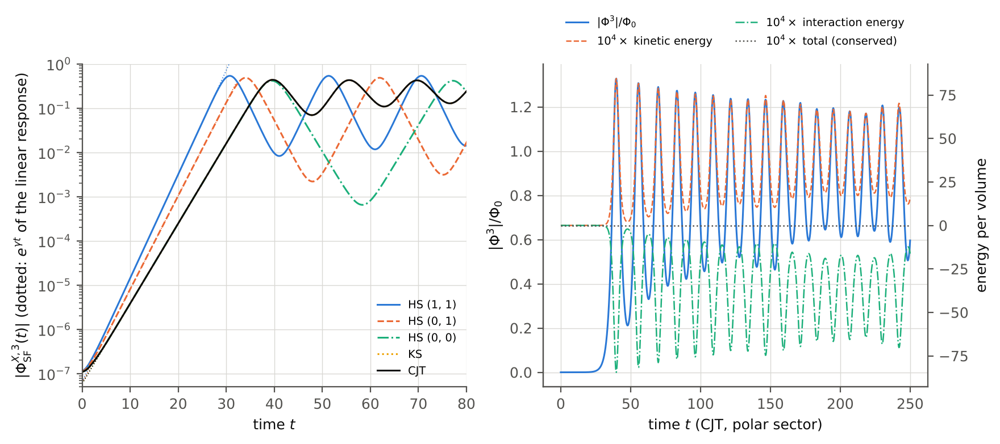{width=100%}

**Figure 13.** Left: $\lvert\Phi^{X,3}_{\rm SF}(t)\rvert$ from the normal vacuum with the seed $10^{-7}$, for the five methods (KS and CJT
coincide to $8\times10^{-9}$ of the largest $\lvert\Phi^3\rvert$), with the growth $e^{\gamma^X_{\rm SF}t}$ of the linear response (dotted). Right: CJT, $\lvert\Phi^3\rvert/\Phi_0$ and the kinetic, the interaction and the
total energy per volume. Data: `data/part4_td_growth_*.csv`.

## 15.2 The small oscillations: the collective modes in time

The first excited states of Part II are oscillations of the ground state; the time-dependent mean field must show them.
Two runs per method start from the ground state of the BdG matrix with the pair self-energy of the ground state changed
slightly: $(1+10^{-3})\mathsf P_{\rm SF}$ (a change of the amplitude) and $\mathsf P_{\rm SF}+10^{-3}i\Phi_0(\mathsf K^1_{\rm LL})^\dagger$ (a non-unitary change). The
frequency of the oscillation of $\lvert\Phi^3(t)\rvert$ in the first run, and of $\mathrm{Im}(\Phi^1\Phi^{3*})/\lvert\Phi^3\rvert$ in the second, is
the maximum of the Fourier sum with the Hann window ($w_j=\sin^2(\pi j/(n_{\rm out}-1))$ for the outputs $j=0,\dots,n_{\rm out}-1$ at
$30\le t\le400$),
located by a scan and a golden-section search. The continuum of two quasi-particles, which the change also excites,
begins at the threshold $2E^{X,{\rm gap}}_{\rm SF}$, above the modes, and its contribution decays.

| method | amplitude mode, time-dependent | linear response | relative difference | non-unitary mode, time-dependent | linear response | relative difference |
|:---|---:|---:|---:|---:|---:|---:|
| HS (1, 1) | $0.813692485$ | $0.813693092$ | $7.5\times10^{-7}$ | $0.806127818$ | $0.806128281$ | $5.7\times10^{-7}$ |
| HS (0, 1) | $0.725082877$ | $0.725083391$ | $7.1\times10^{-7}$ | $0.725082878$ | $0.725083391$ | $7.1\times10^{-7}$ |
| HS (0, 0) | $0.614387111$ | $0.614387384$ | $4.4\times10^{-7}$ | $0.614387108$ | $0.614387384$ | $4.5\times10^{-7}$ |
| KS | $0.603475712$ | $0.603475967$ | $4.2\times10^{-7}$ | $0.657283773$ | $0.657284727$ | $1.5\times10^{-6}$ |
| CJT | $0.603475712$ | $0.603475967$ | $4.2\times10^{-7}$ | $0.644006582$ | $0.644007155$ | $8.9\times10^{-7}$ |

**Table 15.2.** The frequencies of the time-dependent runs after the two changes of the ground state, and the collective
modes of the linear response of Section 10.5 (Table 10.4). Data: `data/part4_td_summary.csv`, `data/part4_td_kicks_CJT.csv`.

The frequencies of the runs equal those of the linear response to $2\times10^{-6}$ (*checks P4-T7, P4-T8*), with the energy
conserved to $6\times10^{-12}$ of the depth (*P4-T9*): the amplitude mode and the non-unitary doublet are undamped oscillations of
the superfluid (they lie below the threshold), and in HS $(0,1)$, $(0,0)$ the two changes give the same frequency, the
triple mode of Table 10.4. The ground state does not move (*P4-T10*, $dR/dt$ at most $8\times10^{-15}$), and neither does the ground state
turned by a phase rotation or an isospin rotation (*P4-T11*): these are the Goldstone directions, of zero frequency. The
Python program repeats the growth and the amplitude mode on the grid of 8 radial nodes with its own response (*YP4-T1 to
YP4-T3*).

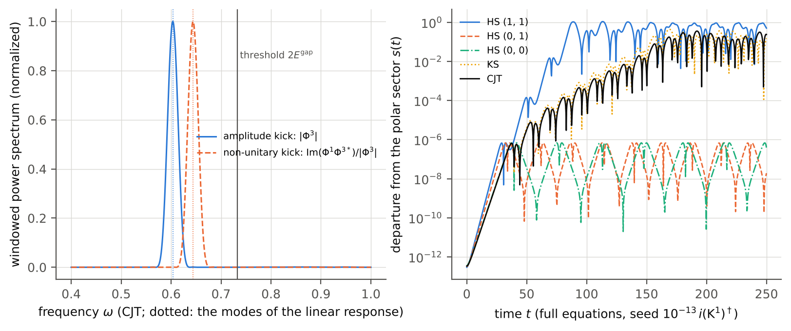{width=100%}

**Figure 14.** Left: CJT, the windowed power spectra of the two signals after the changes of the ground state, with the
collective modes of the linear response (dotted) and the threshold of two quasi-particles. Right: the departure (15.1) from
the polar sector with the full equations and the non-unitary seed $10^{-13}$. Data: `data/part4_td_kicks_CJT.csv`,
`data/part4_td_growth_*.csv`.

## 15.3 The zeugon $A_{{\rm SF},p}$ and the massive $W^1_{{\rm SF},p}$: radiation and a bound cloud

**The equations.** In the unitary gauge and to first order in the gauge fields, (12.6) gives every component of every
gauge field the Yang-Mills kinetic term (5.3) and the mass term (14.6). A component transverse to the direction of
propagation, for fields that depend on $t$ and $x=x^1_{\rm LL}$ only, obeys the Klein-Gordon equation with the mass of its
field (the Proca equation reduces to it). With a prescribed transverse current sheet $\mathcal J(t,x)$ of the spinor charges
(of the charge $Q_{\rm LL}$ for $A_{{\rm SF},p}$, of $T^1_{\rm LL}$ for $W^1_{{\rm SF},p}$, with the same profile):
$$\partial_0^2A_{{\rm SF},2}=\partial_1^2A_{{\rm SF},2}+\mathcal J,\qquad\partial_0^2W^1_{{\rm SF},2}=\partial_1^2W^1_{{\rm SF},2}-(M^X_{W,{\rm SF}})^2W^1_{{\rm SF},2}+\mathcal J,\tag{15.2}$$
$$\mathcal J(t,x)=\mathcal J_0\big(1-x^2/\sigma_{\rm s}^2\big)e^{-x^2/(2\sigma_{\rm s}^2)}\,r_{\rm s}(t)\sin(\omega_{\rm s}t),\qquad r_{\rm s}(t)=\sin^2\big(\pi t/(2\tau_{\rm s})\big)\ (t<\tau_{\rm s}),\ 1\ (t\ge\tau_{\rm s}),\tag{15.3}$$
with $\mathcal J_0=10^{-3}$, $\sigma_{\rm s}=8$, $\tau_{\rm s}=300$ and the frequency $\omega_{\rm s}=0.7M^{\rm CJT}_{W,{\rm SF}}=0.033153$, below
the mass of $W^1_{{\rm SF},p}$ ($M^{\rm CJT}_{W,{\rm SF}}=0.047362$, Table 13.1). The profile integrates to zero, so the sheet carries no net
current.

**The spectral grid.** $x$ runs over $N^{\rm lat}_{\rm SF}=511$ points with the spacing $\ell^{\rm lat}_{\rm SF}=2000/511$ on a periodic interval
of the length $2000$. A function on the grid is the trigonometric polynomial
$\sum_mu_me^{ik_mx}$, $k_m=2\pi m/2000$, $\lvert m\rvert\le255$, and its derivative at the grid points is $\mathsf D^{\rm sp}_{\rm SF}u$ with
the Fourier differentiation matrix (odd number of points; $x_j$, $x_l$ grid points, $N=N^{\rm lat}_{\rm SF}$, $L=2000$)
$$(\mathsf D^{\rm sp}_{\rm SF})_{jl}=\frac{\pi}{L}\,\frac{(-1)^{j-l}}{\sin(\pi(j-l)/N)}\quad(j\neq l),\qquad(\mathsf D^{\rm sp}_{\rm SF})_{jj}=0.\tag{15.4}$$
It is real and antisymmetric, its eigenvectors are the modes $e^{ik_mx_j}$ with the eigenvalues $ik_m$ exactly (*check P4-W1*),
so $\partial_1^2$ is $(\mathsf D^{\rm sp}_{\rm SF})^2$, exact for every mode of the grid; the error of the spatial derivatives is then
smaller than any power of the spacing for smooth fields. Each Fourier mode of (15.2) from rest has the exact solution
$$u_m(t)=\mathcal J_m\int_0^t\frac{\sin(\omega_m(t-t'))}{\omega_m}\,r_{\rm s}(t')\sin(\omega_{\rm s}t')\,dt',\qquad\omega_m=(k_m^2+M^2)^{1/2},\tag{15.5}$$
($M=0$ or $M^{\rm CJT}_{W,{\rm SF}}$; $\mathcal J_m$ the Fourier coefficient of the profile), which the program evaluates by Gauss-Legendre
quadrature (12 points on every interval of length 1).

**The results.** CVODE (Adams, real weights, $10^{-10}$, $10^{-13}$) integrates (15.2) to $t=900$; the fields equal (15.5) to
$5\times10^{-9}$ of their largest value (*checks P4-W2, P4-W3*). The zeugon $A_{{\rm SF},p}$ (massless) **radiates**: for $100<x<400$ its amplitude at $t=900$ is
$0.020539$, the amplitude $\mathcal J_0\lvert\hat\varsigma(\omega_{\rm s})\rvert/(2\omega_{\rm s})=0.0205392$ of the
outgoing wave of the steady state ($\hat\varsigma(\omega)=(2\pi)^{1/2}\sigma_{\rm s}^3\omega^2e^{-\omega^2\sigma_{\rm s}^2/2}$, the Fourier
transform of the profile; *check P4-W4*). The massive $W^1_{{\rm SF},p}$ **stays bound**: below its mass a wave cannot propagate, $k^2=\omega_{\rm s}^2-M^2<0$,
and the steady state is the evanescent cloud $\propto e^{-\lvert x\rvert/\ell_{\rm W}}$ with
$\ell_{\rm W}=((M^{\rm CJT}_{W,{\rm SF}})^2-\omega_{\rm s}^2)^{-1/2}=29.565$. The amplitude of $W^1_{{\rm SF},p}$ at the source
frequency over the last two periods agrees with this steady state for $\lvert x\rvert<100$ to $2\times10^{-3}$ of its largest value, and
its decay length for $30<x<100$ is $30.141$ (*check P4-W5*; the remaining difference comes from the
width of the source and from the waves above the mass that the switching on of the source excites, which travel slowly and
are still visible beyond $x\approx150$, Figure 15). The massless boson carries energy to infinity at any frequency, the massive one only above its
mass: the range of the force of a static source is infinite for $A_{{\rm SF},p}$ and $1/M^X_{W,{\rm SF}}$ for $W^1_{{\rm SF},p}$.

## 15.4 The longitudinal $Z_{{\rm SF},p}$: the Higgs mechanism in time

**The equations.** Keep only the phase of the condensate and the gauge field $B_{{\rm SF},p}$:
$\vec\Phi=\Phi_0e^{i\vartheta}\vec e_3$ with $\vartheta$ short for $\vartheta^X_{{\rm SF},0}(t,x)$, and $B_{{\rm SF},0}(t,x)$, $B^1_{\rm SF}(t,x)=-B_{{\rm SF},1}(t,x)$
(the other components zero). With the field strength $B_{{\rm SF},01}=\partial_0B_{{\rm SF},1}-\partial_1B_{{\rm SF},0}$, the
decay constant $f^{X,{\rm F}}_{\rm SF}$ of the phase (Section 12.2: $(f^{X,{\rm F}}_{\rm SF})^2=2(Z^X_{\rm SF}+Y^X_{\rm SF})\Phi_0^2$) and (12.4), (5.3),
the Lagrangian is
$$\mathcal L=\tfrac12B_{{\rm SF},01}^2+\tfrac12(f^{X,{\rm F}}_{\rm SF})^2\Big[\big(\partial_0\vartheta+2g^{\rm F}_{\rm LL}B_{{\rm SF},0}\big)^2-\big(\partial_1\vartheta-2g^{\rm F}_{\rm LL}B^1_{\rm SF}\big)^2\Big],\tag{15.6}$$
and the mass of (14.5) is $M^X_{Z,{\rm SF}}=2g^{\rm F}_{\rm LL}f^{X,{\rm F}}_{\rm SF}$. (15.6) is invariant under $\vartheta\to\vartheta-2g^{\rm F}_{\rm LL}\lambda$,
$B_{{\rm SF},p}\to B_{{\rm SF},p}+\partial_p\lambda$ for every function $\lambda(t,x)$. Its Euler-Lagrange equations (with respect to
$B_{{\rm SF},0}$, $B^1_{\rm SF}$ and $\vartheta$) are, with $\kappa_{\rm F}=2g^{\rm F}_{\rm LL}(f^{X,{\rm F}}_{\rm SF})^2$,
$$\begin{aligned}\partial_1B_{{\rm SF},01}&=-\kappa_{\rm F}\big(\partial_0\vartheta+2g^{\rm F}_{\rm LL}B_{{\rm SF},0}\big),\qquad\partial_0B_{{\rm SF},01}=-\kappa_{\rm F}\big(\partial_1\vartheta-2g^{\rm F}_{\rm LL}B^1_{\rm SF}\big),\\\partial_0^2\vartheta&=\partial_1^2\vartheta-2g^{\rm F}_{\rm LL}\big(\partial_0B_{{\rm SF},0}+\partial_1B^1_{\rm SF}\big).\end{aligned}\tag{15.7}$$
The first, Gauss's law, contains no time derivative of $B_{{\rm SF},0}$. Without the gauge field ($g=0$) $\vartheta$ is the free
Goldstone field, massless.

**Two gauges, two integrators.**
* *The temporal gauge* $B_{{\rm SF},0}=0$ (CVODE). Unknowns $\vartheta$, $\partial_0\vartheta$, $B^1_{\rm SF}$ and $B_{{\rm SF},01}$, with
  $\partial_0B^1_{\rm SF}=-B_{{\rm SF},01}$ (the definition of the field strength when $B_{{\rm SF},0}=0$) and the second and third
  equations of (15.7): ordinary differential equations. Gauss's
  law is then a condition on the initial values, which these equations keep (its time derivative vanishes by the other two);
  the program checks it at every output (*check P4-W7*, $2\times10^{-14}$).
* *The unitary gauge* $\vartheta=0$ (IDA). The gauge-invariant fields $\mathcal C_p=B_{{\rm SF},p}+\partial_p\vartheta/(2g^{\rm F}_{\rm LL})$ are
  the gauge field of the unitary gauge. With $\mathcal C^1=-\mathcal C_1$ and $M$ short for $M^X_{Z,{\rm SF}}$, (15.7) becomes the system
  $$\partial_0\mathcal C^1=-B_{{\rm SF},01}-\partial_1\mathcal C_0,\qquad\partial_0B_{{\rm SF},01}=M^2\mathcal C^1,\qquad0=\partial_1B_{{\rm SF},01}+M^2\mathcal C_0,\tag{15.8}$$
  two differential equations and an algebraic one (Gauss's law, which determines $\mathcal C_0$ from $B_{{\rm SF},01}$): a
  differential-algebraic system of index one, because the derivative of the algebraic equation with respect to its
  unknown, $M^2$, is invertible. IDA solves it with the exact iteration matrix (I1) of the crate `sfsundials`. For a
  massless gauge boson, $M=0$, Gauss's law no longer determines $\mathcal C_0$: the gauge freedom remains, and there is no longitudinal mode.

Every Fourier mode of (15.8) obeys $\partial_0^2\mathcal C^1_m=-(k_m^2+M^2)\mathcal C^1_m$, with $B_{{\rm SF},01,m}=-M^2\partial_0\mathcal C^1_m/(k_m^2+M^2)$
and $\mathcal C_{0,m}=-ik_mB_{{\rm SF},01,m}/M^2$: the longitudinal Z, massive, with the dispersion $\omega^2=k^2+M^2$, is the exact solution.

**The run.** A packet of the Goldstone field, $\vartheta=e^{-(x+150)^2/(2\cdot40^2)}\cos(0.08(x+150))$ with
$\partial_0\vartheta=-\partial_1\vartheta$ (moving to the right at the speed 1 when $g=0$), $B^1_{\rm SF}=0$ and $B_{{\rm SF},01}$ from Gauss's law, on
255 points of a periodic interval of the length 1024, to $t=350$, with the CJT values $(f^{X,{\rm F}}_{\rm SF})^2=0.005090560758$,
$g^{\rm F}_{\rm LL}=0.45$, $M^X_{Z,{\rm SF}}=0.064213$ (*check P4-W0*: $2g^{\rm F}_{\rm LL}f^{X,{\rm F}}_{\rm SF}$ equals
$g^{\rm F}_{\rm LL}(\chi^{\rm FF}_{\rm SF})^{1/2}$ of Part III):
* without the gauge field the packet keeps its shape and its energy moves at the speed 1 (*checks P4-W6*, the exact
  solution to $1.4\times10^{-9}$; *P4-W12*, the slope of the centre of the energy differs from 1 by at most $3\times10^{-10}$);
* with the gauge field the same packet becomes the longitudinal Z: its energy, $\tfrac12B_{{\rm SF},01}^2+\tfrac12M^2(\mathcal C_0^2+(\mathcal C^1)^2)$,
  moves at $0.76505$ (the group velocity $k/(k^2+M^2)^{1/2}$ of the central wave number is
  $0.77985$) and the packet disperses (*P4-W13*: the same velocity in the exact solution);
* the temporal gauge (CVODE) and the unitary gauge (IDA) describe the same physics: their gauge-invariant fields
  $B^1_{\rm SF}-\partial_1\vartheta/(2g^{\rm F}_{\rm LL})$, $B_{{\rm SF},01}$, $\partial_0\vartheta/(2g^{\rm F}_{\rm LL})$ and $\mathcal C^1$, $B_{{\rm SF},01}$,
  $\mathcal C_0$ agree to
  $5\times10^{-9}$ of their largest value (*P4-W10*), the IDA solution equals the exact one to $5\times10^{-9}$ (*P4-W9*), and the
  energies are conserved and equal (*P4-W8*, *P4-W11*).

This is the Higgs mechanism in time: the Goldstone wave of the phase of the condensate, massless and moving at the
speed of light without the gauge field, is in the presence of the gauge field the longitudinal polarization of the
massive Z. The Python program repeats both sections through the C interface (*checks YP4-W2 to YP4-W7*).

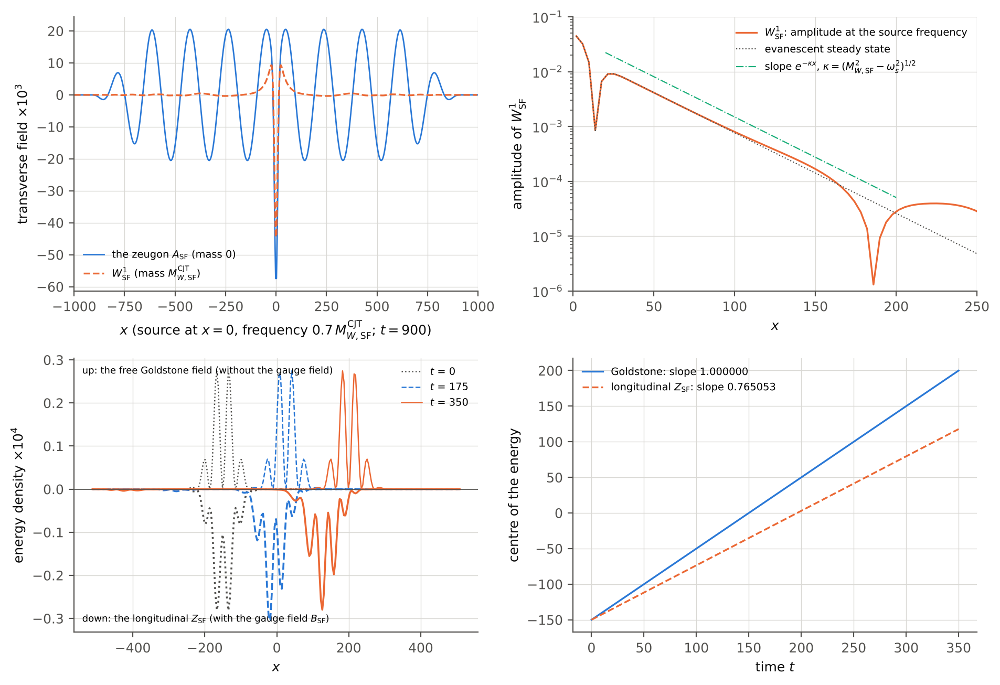{width=100%}

**Figure 15.** Top left: the transverse zeugon $A_{{\rm SF},p}$ (massless) and the massive $W^1_{{\rm SF},p}$ at $t=900$, driven at
$0.7M^{\rm CJT}_{W,{\rm SF}}$ by the current sheet at $x=0$. Top right: the amplitude of $W^1_{{\rm SF},p}$ at the source frequency, the
evanescent steady state and the slope $e^{-x/\ell_{\rm W}}$. Bottom left: the energy density of the free Goldstone packet (up)
and of the longitudinal $Z_{{\rm SF},p}$ (down) at three times. Bottom right: the centres of
their energies. Data: `data/part4_waves_transverse.csv`, `data/part4_waves_Wcloud.csv`, `data/part4_waves_longitudinal.csv`.

## 15.5 The videos

* `videos/video_part4_v1_condensate_growth.mp4` -- the growth of the condensate of CJT from the normal vacuum (Section
  15.1): $\lvert\Phi^3(t)\rvert/\Phi_0$, the pair amplitude $\lVert\mathsf C^{\rm p}(\vec q)\rVert/\sqrt8$ and the occupation of the upper band (the
  number of quanta of the DiracLike field in its band of positive energy) at the momenta of the grid along $+\vec e_3$, compared with the ground state, every 0.5 time units to $t=250$.
* `videos/video_part4_v2_gauge_fields.mp4` -- the zeugon $A_{{\rm SF},p}$ (massless) radiating and the massive $W^1_{{\rm SF},p}$ bound
  (Section 15.3), and the free Goldstone packet against the same packet eaten by the gauge field (Section 15.4).

Both are drawn by `python/sf_part4_figures.py` from the data files of `sf_part4` and encoded by the program ffmpeg
(H.264).

# 16. Provenance: programs, commands, reports, data and figures

The programs of each part, how to build and run them, the reports of their checks (printed completely), and the
checksums of their data files and figures. In the reports, a check whose deviation and tolerance are both 0 is the check
of a fact (a yes-or-no statement, such as "a polar start ends in a superfluid"): it passes when the statement holds.

## 16.1 Part I: the programs and how to run them

All paths are relative to the folder `Revision_SM_Higgs` of PROJECT spacetimes.

* **Rust** (requires the Rust toolchain with `cargo`; no crate is downloaded). The workspace `rust/` contains the
  library `sfcore` (bi-quaternions and bi-octonions, Dirac matrices, automatic differentiation, Fock-space operators,
  the block-tridiagonal eigenvalue solver, quadrature, reports) and the program `sf_part1` (crate `rust/sfpart1`), which
  runs the checks A, F, C, E and S of this part and writes the data files:

      cd rust
      cargo build --release
      ./target/release/sf_part1

  Output: `data/hck_part1_checks.txt` (the report), `data/part1_values.csv` (the numbers printed in Section 7), and the
  data of the figures. The program ends with the exit status 0 exactly when every check passes.
* **Python** (requires Python 3 with numpy, scipy, sympy and matplotlib). `python/sf_part1.py` is an independent second
  computation of the checks (other random test values; finite differences of eighth order instead of automatic
  differentiation; LAPACK instead of the Rust eigensolvers; symbolic Euler-Lagrange equations with sympy);
  `python/sf_part1_figures.py` draws the four figures from the data of the Rust program:

      python3 python/sf_part1.py
      python3 python/sf_part1_figures.py

* **Documents.** `code/scripts/write_part1_fragments.py` turns the reports and values into the tables and numbers of
  this manuscript; `code/scripts/assemble_docs.py` writes the Markdown from its source `docs_src/superfluid.src.md`, and
  `code/scripts/build_docs.sh` makes the `.tex` (pandoc) and the `.pdf` (XeLaTeX):

      python3 code/scripts/write_part1_fragments.py
      python3 code/scripts/assemble_docs.py docs_src/superfluid.src.md
      bash code/scripts/build_docs.sh superfluid.md

## 16.2 Part I: the report of the Rust program

| check | result | deviation | tolerance | statement |
|:---|:---|:---|:---|:---|
| A-1 | PASS | 0.000e0 | 0.0e0 | quaternion units: e\_j\^2 = -1, e\_j e\_k = -e\_k e\_j = e\_l for (j,k,l) cyclic |
| A-2 | PASS | 0.000e0 | 0.0e0 | bi-octonion units: e\_p\^2 = -1, e\_p e\_q = -e\_q e\_p (p != q, both >= 1), e\_j e\_4 = e\_{4+j} |
| A-3 | PASS | 0.000e0 | 0.0e0 | the complex norm is multiplicative, N(xy) = N(x)N(y), 200 random bi-octonions (exact integers) |
| A-4 | PASS | 0.000e0 | 0.0e0 | x xbar = N(x) e\_0, 200 random bi-octonions (exact) |
| A-5 | PASS | 0.000e0 | 0.0e0 | alternativity (xx)y = x(xy), (yx)x = y(xx), 200 random triples (exact) |
| A-6 | PASS | 0.000e0 | 0.0e0 | the three Moufang identities, 200 random triples (exact) |
| A-7 | PASS | -- | -- | the bi-octonion product is not associative: (e1 e2) e4 - e1 (e2 e4) = 2 e7, and of the 343 triples of imaginary units 168 have a nonzero associator; the largest associator of the 200 random triples is nonzero (nonzero unit associators 168 of 343; (e1e2)e4 - e1(e2e4) = 2 e7: true; max random associator 654.638831723264) |
| A-8 | PASS | 1.776e-15 | 1.0e-13 | bi-quaternions: associative; M(bb') = M(b)M(b'); det M(b) = N(b); M(b\^dag) = M(b)\^dag; the inverse map recovers b (200 random) |
| A-9 | PASS | 0.000e0 | 1.0e-13 | M31: the points are Hermitian bi-quaternions (x\^dag = x), M(x) = sum\_p x\^p sigma\_p, N(x) = Minkowski interval (200 random) |
| A-10a | PASS | 3.324e-14 | 1.0e-11 | x -> g x g\^dag maps M31 to itself (Hermitian image) and keeps N(x) (200 random unit g) |
| A-10b | PASS | 5.551e-15 | 1.0e-10 | L(g)\^T eta L(g) = eta and det L(g) = 1 (200 random unit g) |
| A-10c | PASS | -- | -- | L(g)\_00 >= 1 (orthochronous) for the 200 random unit g (all 200) |
| A-10d | PASS | 4.441e-15 | 1.0e-10 | L(gh) = L(g) L(h) and L(-g) = L(g) (200 random pairs) |
| A-11 | PASS | 0.000e0 | 1.0e-15 | the 27 commutators of the generators: [J\^j,J\^k] = eps\_jkl J\^l, [J\^j,K\^k] = eps\_jkl K\^l, [K\^j,K\^k] = -eps\_jkl J\^l |
| A-12 | PASS | 0.000e0 | 0.0e0 | spinor charges: (b e4) g = (b gbar) e4, g (b e4) = (b g) e4, (v ((b e4) e4)) e4\^-1 = (v b) e4 (200 random, exact) |
| F-1 | PASS | 0.000e0 | 0.0e0 | the eight components at one point: {Psi\_c, Psi\_c'\^dag} = delta, {Psi\_c, Psi\_c'} = 0 (Fock space of dimension 256) |
| F-2 | PASS | 0.000e0 | 1.0e-15 | Dirac matrices: {g\^p, g\^q} = 2 eta\^pq, g\^0 g\^p g\^0 = (g\^p)\^dag, C g\^p C\^-1 = -(g\^p)\^T, g\^ch = diag(-1,-1,1,1), C = diag(E,-E), C\^T = -C |
| F-3a | PASS | 1.599e-14 | 1.0e-10 | S(g)\^-1 g\^p S(g) = sum\_q L(g)\_pq g\^q (200 random unit g) |
| F-3b | PASS | 6.280e-16 | 1.0e-10 | S(g)\^dag g\^0 S(g) = g\^0, so Psi-bar Psi is invariant (200 random) |
| F-3c | PASS | 7.229e-15 | 1.0e-10 | S(gh) = S(g) S(h) and S(-g) = -S(g) (200 random pairs) |
| F-3d | PASS | 3.625e-15 | 1.0e-10 | the Dirac matrices of the frame gtilde f gtilde\^dag are S(g) g\^p S(g)\^-1 (200 random) |
| F-4 | PASS | 5.674e-15 | 1.0e-12 | spinor charges: psi'(b gbar) = M(g) psi'(b), psi'(b g\^dag) = M(gtilde) psi'(b), psi'(v b) = psi'(b) M(v)\^T with M(v) in SU(2) (200 random) |
| F-5a | PASS | 0.000e0 | 1.0e-14 | D1: the three Pauli-Guersey generators commute with the six Lorentz generators on (psi, psi\^dag) |
| F-5b | PASS | 0.000e0 | 1.0e-14 | D1: they commute with the massless Dirac Hamiltonian at 50 random momenta (the kinetic term is invariant) |
| F-5c | PASS | -- | -- | D1: the Lorentz-invariant antisymmetric bilinears of one point form a complex space of dimension 6; of these none (dimension 0) is invariant under the Pauli-Guersey SU(2): no GEE-invariant mass term of a single Dirac field (dimension of the Lorentz invariants 6, of the GEE invariants 0) |
| F-5d | PASS | -- | -- | D1: with the mass m = 0.2 the Pauli-Guersey generators do not commute with the Dirac Hamiltonian (smallest of the largest commutators over 50 momenta > 0.1) (0.200000) |
| F-6 | PASS | 0.000e0 | 1.0e-13 | doublet: [m Psi-bar Psi, T\^iota] = [m Psi-bar Psi, F] = [m Psi-bar Psi, J\^j] = 0 on the Fock space of one point |
| F-7a | PASS | 1.650e-15 | 1.0e-12 | pair matrices: K\^T = -K, K\^dag K = 1, (S (x) 1)\^T K (S (x) 1) = K (50 random g), (1 (x) U)\^T K\^a (1 (x) U) = sum\_b R(U)\_ab K\^b (50 random U), for the six K\^iota, K'\^iota |
| F-7b | PASS | -- | -- | the Lorentz-invariant antisymmetric pair matrices of the eight components form a space of dimension 6 (the spin-zero pairs are isospin triplets) (dimension 6) |
| C-1 | PASS | 5.551e-16 | 1.0e-12 | SU(2)\_v x U(1)\^F: nabla'\_p (e\^{i theta} U Psi) = e\^{i theta} U nabla\_p Psi with W' = U W U\^dag + (i/g)(dU)U\^dag, B' = B - (d theta)/g\_F (12 points, 4 directions) |
| C-2 | PASS | 2.236e-16 | 1.0e-13 | the transformed W'\_p is again Hermitian and traceless: real components W'\^iota\_p |
| C-3 | PASS | 2.238e-16 | 1.0e-12 | field strengths: W'\_pq = U W\_pq U\^dag, B'\_pq = B\_pq, and W\^iota\_pq = dW - dW - g eps W W |
| C-4 | PASS | 9.037e-16 | 1.0e-12 | isotriplet of fermion number 2: nabla Phi = dPhi - g W x Phi + 2 i g\_F B Phi is covariant, Phi' = e\^{2 i theta} R(U) Phi; R(U) orthogonal |
| C-5 | PASS | 5.551e-16 | 1.0e-11 | the Yang-Mills operator D\_q W\^{q p} is covariant (adjoint): D'\_q W'\^{q p} = U (D\_q W\^{q p}) U\^dag |
| C-6 | PASS | 0.000e0 | 1.0e-12 | local SL(2,C): the Dirac matrices of the transformed frame are S(x) gamma\^p S(x)\^-1 |
| C-7 | PASS | 2.371e-16 | 1.0e-12 | local SL(2,C): the connection Gamma'\_p = -(d\_p S) S\^-1 lies in the Lorentz algebra (blocks -X\^dag, X with tr X = 0) |
| C-8 | PASS | 2.809e-15 | 1.0e-11 | local SL(2,C): gamma\^p[f'] (d\_p + Gamma'\_p)(S psi) = S gamma\^p d\_p psi, and psi-bar gamma\^p nabla\_p psi is invariant |
| C-9 | PASS | 2.701e-15 | 1.0e-11 | all of GEE at once on the eight components, with a general Lorentz connection, W and B: the Dirac operator is covariant |
| C-10 | PASS | 8.006e-16 | 1.0e-11 | the curvature of the Lorentz connection transforms as R'\_pq = S R\_pq S\^-1 |
| C-11 | PASS | 7.298e-15 | 1.0e-11 | the value of the Dirac Lagrangian density Psi-bar (i gamma\^p nabla\_p - m) Psi is invariant under all of GEE |
| E-1 | PASS | 1.665e-16 | 1.0e-12 | [Psi\_e, Psi\^dag h0 Psi] = (h0 Psi)\_e: mass and constant gauge potentials (all 8 components) |
| E-2 | PASS | 0.000e0 | 1.0e-11 | [Psi\_e, (G\^S/2) :(Psi-bar Psi)\^2:] = G\^S (Psi-bar Psi)(gamma\^0 Psi)\_e: the scalar contact term |
| E-3 | PASS | 3.553e-15 | 1.0e-11 | [Psi\_e, (G\^V/2) :j\_p j\^p:] = G\^V [(Psi\^dag Psi) Psi\_e - sum\_j (Psi\^dag alpha\^j Psi)(alpha\^j Psi)\_e]: the vector contact term |
| E-4 | PASS | 0.000e0 | 1.0e-10 | [Psi\_e, -(G/4) sum Pi\^dag Pi] = -(G/2) sum (K\^dag Psi\^\*)\_e Pi: the spin-zero pairing term |
| E-5 | PASS | 7.105e-15 | 1.0e-10 | the Hamiltonian of a point (mass and contact terms) commutes with F, T\^1, T\^2, T\^3 and the rotations J\^j |
| E-6 | PASS | 0.000e0 | 1.0e-12 | ordering: (Psi\^dag A Psi)\^2 = :(Psi\^dag A Psi)\^2: + Psi\^dag A\^2 Psi (A = gamma\^0, alpha\^1) |
| E-7a | PASS | 0.000e0 | 1.0e-12 | [F, Pi\^iota] = -2 Pi\^iota: the pair operator removes fermion number 2 |
| E-7b | PASS | 0.000e0 | 1.0e-12 | [T\^a, Pi\^b] = i eps\_abc Pi\^c: the pair operators form an isospin vector |
| E-10 | PASS | 3.109e-13 | 1.0e-9 | Hartree and Fock self-energy N = c[X tr(Y rho) + Y tr(X rho) - X rho Y - Y rho X] is the derivative of the Wick energy: dE = tr(N d rho) |
| E-11 | PASS | 5.431e-11 | 1.0e-9 | pair self-energies P = -c(X kappa Y\^T + Y kappa X\^T) and P = d K\^dag (d = -(G/2) tr(K kappa\^T)): dE = -Re tr(P d kappa\^dag) (BdG convention) |
| E-12 | PASS | 1.066e-14 | 1.0e-10 | the chirality-block form (5.7) of the right side of the field equation equals gamma\^0 [Psi, H\_self] (all eight components) |
| E-13 | PASS | 4.774e-15 | 1.0e-10 | the generalized density ((rho, -kappa), (-kappa\^dag, 1 - rho\^\*)) of a quasi-free ground state is the projector onto the negative eigenvalues of its BdG matrix (5 random states) |
| E-8 | PASS | 1.243e-14 | 1.0e-11 | Wick: &lt;:(Psi\^dag A Psi)(Psi\^dag B Psi):> = tr(A rho)tr(B rho) - tr(A rho B rho) - tr(kappa\^\* A kappa B\^T) in random quasi-free states |
| E-9 | PASS | 3.197e-14 | 1.0e-11 | Wick: &lt;Pi\^dag Pi> = /tr(K kappa\^T)/\^2 + 2 tr(K\^dag rho\^T K rho) in random quasi-free states |
| E-14 | PASS | 2.331e-15 | 1.0e-11 | the Euler-Lagrange equations of L = -(1/4) F\^a\_pq F\^(a,pq) - g W\^a\_p J\^(a,p) are the Yang-Mills equations (5.10): d\_p F\^(a,pq) - g eps\_abc W\^b\_p F\^(c,pq) = g J\^(a,q), all 12 components at 6 random points (exact derivatives of the polynomial L by five-point differences in its arguments, automatic differentiation in x; largest residual, the largest /E/ being 1.961e0) |
| AS1-1 | PASS | 2.421e-15 | 1.0e-13 | plane waves chi exp(-i omega t + i q.x) with (omega, chi) an eigenpair of H\_pw(q) solve the field equation in constant gauge fields (20 random field sets, 8 eigenpairs each) |
| AS1-2 | PASS | 5.107e-15 | 1.0e-13 | abelian constant fields (W\^3, B): omega = V0\_s +- [m\^2 + (q + e\_s W\^3 + g\_F B)\^2]\^(1/2), each twice (50 random cases) |
| AS1-3 | PASS | 2.887e-15 | 1.0e-12 | spin-isospin locked constant field: the eight frequencies at 121 momenta along x\^3 equal the four analytic branches with both signs |
| AS1-5 | PASS | 0.000e0 | 1.0e-14 | locked field: W\^iota\_jk = -g w\^2 eps\_{iota jk}, and the left side of the Yang-Mills equation (5.10) is -2 g\^2 w\^3 delta\_{iota j} (it needs the external current -2 g w\^3 delta\_{iota j}) |
| AS1-4 | PASS | 6.661e-16 | 1.0e-13 | locked field at q = 0: frequencies +-(m\^2 + g\^2 w\^2/4)\^(1/2) (3 each, total isospin+spin J = 1) and +-(m\^2 + 9 g\^2 w\^2/4)\^(1/2) (J = 0) |
| AS2-1 | PASS | 5.551e-17 | 1.0e-14 | Landau level n = 0: the analytic spinor (spin up in both chirality blocks) times exp(-eB(x-x0)\^2/2) solves H Psi = (m\^2+q3\^2)\^(1/2) Psi exactly (41 points) |
| AS2-0 | PASS | 4.197e-14 | 1.0e-11 | block-tridiagonal eigenvalues by inertia counting and bisection = dense eigenvalues (40 sites, 160 eigenvalues) |
| AS2-2 | PASS | 4.828e-3 | 1.0e-2 | Wilson lattice in x\^1 (spacing 0.025, 800 sites): the seven lowest positive frequencies agree with the Landau levels, multiplicities included (largest relative deviation) |
| AS2-3 | PASS | -- | -- | the lattice deviation decreases each time the spacing is halved (0.1 -> 0.05 -> 0.025): the discretization converges (relative deviations 1.954e-2 (a = 0.1), 9.694e-3 (a = 0.05), 4.828e-3 (a = 0.025)) |
| AS2-4 | PASS | 6.450e-5 | 1.0e-3 | the Richardson extrapolation 2 E(0.025) - E(0.05) of the seven lattice levels agrees with the Landau levels (largest relative deviation; tolerance of order a\^2) |
| AS3-1 | PASS | 3.775e-15 | 1.0e-12 | uniform unitary pair field: the 16 BdG eigenvalues are +-[(eps +- mu)\^2 + Delta\^2]\^(1/2), each four times (100 random q, mu, Delta, phase, direction) |
| AS3-2 | PASS | 1.561e-17 | 1.0e-12 | energy per volume of the polar state: Gauss-Legendre quadrature (64 nodes) of the BdG eigenvalues = closed form -(2/pi\^2)[I3(M) - I3(m)] + Delta\^2/G (5 values of Delta) |
| AS3-3 | PASS | 1.681e-12 | 1.0e-9 | the gap equation 1 = (G/pi\^2) I1(M\_q), M\_q = (m\^2 + Delta\^2)\^(1/2), gives the stationary point of E(Delta) (central difference of E) |
| AS3-4 | PASS | -- | -- | for G = 22.5 > G\_crit the gap is nonzero and the condensed state lies below the normal vacuum (G\_crit = 21.286610, Delta = 0.209493, E(Delta) = -5.288449e-5) |
| AS4-1 | PASS | 0.000e0 | 1.0e-14 | kink: the 16x16 matrices A = diag(alpha\^1, alpha\^1\*), P (pairing K\^3) and Bm = diag(beta, -beta) anticommute pairwise and square to 1, so H\^2 = H0\^2 + m\^2 |
| AS4-2 | PASS | -- | -- | Gamma = -i A P has the eigenvalues -1 and +1, eight times each, and commutes with Bm (8 eigenvalues -1) |
| AS4-2b | PASS | -- | -- | restricted to the eigenspace Gamma = -1, Bm has the eigenvalues +1 and -1 four times each (n = 0 states at +m and -m, four each) (+1: 4, -1: 4) |
| AS4-3 | PASS | 2.776e-17 | 1.0e-14 | kink Delta\_inf tanh(x/ell) (Delta\_inf = 0.5, ell = 4): the analytic bound state sech\^2(x/ell) chi has the energy +-m exactly (61 points) |
| AS4-4 | PASS | 2.502e-17 | 1.0e-13 | kink: the analytic n = 1 bound state built from sech(x/ell) tanh(x/ell) has the energy (m\^2 + 2 Delta\_inf/ell - 1/ell\^2)\^(1/2) exactly (61 points) |
| AS4-5a | PASS | -- | -- | Wilson lattice of the reduced kink problem: below the continuum there are exactly three bound states, one at -m or +m and the pair +-(m\^2+E1\^2)\^(1/2), for each of the three spacings (numbers of eigenvalues 3, 3, 3) |
| AS4-5b | PASS | 1.116e-5 | 1.0e-3 | the Richardson extrapolation 2 E(0.025) - E(0.05) of the lattice bound states agrees with m and (m\^2+E1\^2)\^(1/2) (largest relative deviation; tolerance of order a\^2) |
| AS4-6 | PASS | -- | -- | the lattice deviation of the bound states decreases each time the spacing is halved (1.241e-2, 6.228e-3, 3.119e-3) |
| SM-1 | PASS | 4.163e-16 | 1.0e-14 | Standard Model with +i g: the mass matrix of (W\^1, W\^2, W\^3, B) from (D &lt;Phi>)\^dag (D &lt;Phi>) has the eigenvectors W\^1, W\^2 (M\_W\^2 = (g v/2)\^2), Z = cos(thetaW) W\^3 - sin(thetaW) B (M\_Z\^2 = (g\^2 + g'\^2) v\^2/4) and the massless photon A = sin(thetaW) W\^3 + cos(thetaW) B (20 triples g, g', v; largest residual relative to M\_Z\^2) |

VERDICT: ALL PASS (78 of 78)

## 16.3 Part I: the report of the Python program

| check | result | deviation | tolerance | statement |
|:---|:---|:---|:---|:---|
| A-2 | PASS | 0.000e+00 | 0.0e+00 | bi-octonion units: e\_p\^2 = -1, e\_p e\_q = -e\_q e\_p, e\_j e\_4 = e\_{4+j} |
| A-3 | PASS | 0.000e+00 | 0.0e+00 | N(xy) = N(x) N(y), 200 random integer bi-octonions |
| A-4 | PASS | 0.000e+00 | 0.0e+00 | x xbar = N(x) e0 |
| A-5 | PASS | 0.000e+00 | 0.0e+00 | alternativity |
| A-6 | PASS | 0.000e+00 | 0.0e+00 | the three Moufang identities |
| A-7 | PASS | -- | -- | 168 of the 343 triples of imaginary units have a nonzero associator; (e1e2)e4 - e1(e2e4) = 2 e7 (168 nonzero) |
| A-8 | PASS | 7.589e-15 | 1.0e-12 | M(bb') = M(b)M(b'), det M = N, M(b\^dag) = M(b)\^dag, inverse map |
| A-10b | PASS | 5.329e-15 | 1.0e-10 | L\^T eta L = eta, det L = 1 |
| A-10c | PASS | -- | -- | L\_00 >= 1 (200) |
| A-10d | PASS | 7.105e-15 | 1.0e-10 | L(gh) = L(g)L(h), L(-g) = L(g) |
| A-12 | PASS | 0.000e+00 | 0.0e+00 | spinor charges under the super-loop multiplications |
| F-2 | PASS | 0.000e+00 | 1.0e-14 | Clifford algebra, chirality, charge conjugation |
| F-3a | PASS | 1.604e-14 | 1.0e-10 | S\^-1 gamma\^p S = L\_pq gamma\^q |
| F-3b | PASS | 7.448e-16 | 1.0e-10 | S\^dag gamma\^0 S = gamma\^0 |
| F-3d | PASS | 3.827e-15 | 1.0e-10 | frame transformation of the Dirac matrices |
| F-5a | PASS | 0.000e+00 | 1.0e-14 | D1: Pauli-Guersey generators commute with the Lorentz generators |
| F-5c | PASS | -- | -- | D1: Lorentz-invariant bilinears: dimension 6; GEE-invariant: dimension 0 (6, 0) |
| C-1 | PASS | 3.736e-14 | 1.0e-09 | SU(2)\_v x U(1)\^F covariance of nabla on Psi (eighth-order differences, 4 points) |
| C-3 | PASS | 2.755e-13 | 1.0e-08 | field strength W'\_pq = U W\_pq U\^dag (nested eighth-order differences, 2 points) |
| C-4 | PASS | 6.969e-14 | 1.0e-09 | isotriplet: nabla Phi = dPhi - g W x Phi + 2 i g\_F B Phi is covariant |
| C-8 | PASS | 5.043e-14 | 1.0e-09 | local SL(2,C): gamma\^p[f'] (d\_p + Gamma'\_p)(S psi) = S gamma\^p d\_p psi (eighth-order differences) |
| E-2 | PASS | 0.000e+00 | 1.0e-11 | scalar contact term: [Psi\_e, H\_S] = G\^S (Psi-bar Psi)(gamma\^0 Psi)\_e |
| E-14 | PASS | -- | -- | symbolic Euler-Lagrange equations of the Yang-Mills Lagrangian with the source: d\_p W\^{a,pp'} - g eps\_abc W\^b\_p W\^{c,pp'} = g j\^{a,p'} for all 12 components (sympy) (12 equations identical) |
| E-3 | PASS | 3.553e-15 | 1.0e-11 | vector contact term |
| E-4 | PASS | 0.000e+00 | 1.0e-10 | pairing term: [Psi\_e, H\_P] = -(G/2) sum (K\^dag Psi\^\*)\_e Pi |
| AS1-3 | PASS | 1.554e-15 | 1.0e-12 | spin-isospin locked field: four analytic branches (61 momenta) |
| AS2-2 | PASS | 4.828e-03 | 1.0e-02 | Landau levels, Wilson lattice spacing 0.025 (LAPACK) |
| AS2-4 | PASS | 6.450e-05 | 1.0e-03 | Landau levels, Richardson extrapolation 2E(0.025) - E(0.05) |
| AS3-1 | PASS | 2.665e-15 | 1.0e-12 | BdG spectrum of unitary pair fields (50 random) |
| AS3-4 | PASS | 3.005e-11 | 1.0e-09 | the gap at G = 22.5 agrees with the Rust value 0.2094933033 |
| AS4-5a | PASS | -- | -- | three bound states below the continuum for each spacing ([3, 3, 3]) |
| AS4-5b | PASS | 1.116e-05 | 1.0e-03 | kink bound states, Richardson extrapolation |
| AS4-3 | PASS | -- | -- | symbolic: (d/dx + Delta) sech\^2(x/ell) = 0 and (-d\^2 + Delta\^2 - Delta') sech tanh = E1\^2 sech tanh with E1\^2 = 3/16 (residuals 0, 0) |
| SM-1 | PASS | 3.863e-16 | 1.0e-14 | Standard Model with +i g: the mass matrix of (W\^1, W\^2, W\^3, B) has the eigenvalues 0, M\_W\^2 (twice), M\_Z\^2 (LAPACK) and the null vector A = sin(thetaW) W\^3 + cos(thetaW) B (20 random g, g', v; relative to M\_Z\^2) |

VERDICT: ALL PASS (34 of 34)

## 16.4 Part I: data files and figures (SHA-256 checksums)

* `data/hck_part1_checks.txt` (report of `sf_part1`):\
  `5843c6b9e58dc8b5dd03c980d4a47c6d1672da1b564f86b6fc093e973513bb44`
* `data/hck_part1_checks_python.txt` (report of `python/sf_part1.py`):\
  `d8328c8c945436fde4e689661d08e23df95cd36b346a51a62577140ee167777c`
* `data/part1_values.csv` (the numbers of Section 7):\
  `3ee618a621336b48e077572329a1e1ef7631b83492e9afb769629b7dfd643db0`
* `data/part1_m31_examples.csv` (examples of M31 (Section 2)):\
  `ce6c9f01eb4d4a36c25a0cd3fa93062d04d31a630dfdd650187bfdaa910de2dd`
* `data/part1_s1_locked_dispersion.csv` (data of Figure 1):\
  `2e4e681ab9b7fc011882b060f8044fbea0fe70718fed635e74d9b2ed637fdcba`
* `data/part1_s2_landau.csv` (data of Figure 2):\
  `ba6611eb516dd75f6306d7ba30c4a220ee4b8d5d078a7595c07ea08c894bbc80`
* `data/part1_s3_energy.csv` (data of Figure 3 (left)):\
  `c4bbc60dab31e04a8f2b7a21936a3d071e92bfaa1eaf50d2d111e51294260c9d`
* `data/part1_s3_gap.csv` (data of Figure 3 (right)):\
  `904d78f898cedc54b310e946a5d72845e072e52c95c83268dc01f3af481a0c92`
* `data/part1_s4_kink_profiles.csv` (data of Figure 4 (left)):\
  `d98c64f54d95d515c5f11a450456498b83b34649fc07ed59e82e39e261b43c2d`
* `data/part1_s4_kink_lattice.csv` (lattice spectra of AS4):\
  `d61852ed753a29862ac5ff4082ab6e054a7846967470c1a133c4cbbddb8edd3c`
* `figures/fig_part1_s1_locked.pdf` (Figure 1):\
  `a797b410252c9e1098c922903b48ca337ab60c07685209daa7cff4daabbb0720`
* `figures/fig_part1_s2_landau.pdf` (Figure 2):\
  `05bb395a393f09534d50fbd8a83b88e1abfb8739d1b53a737fc0f5e8696c611f`
* `figures/fig_part1_s3_superfluid.pdf` (Figure 3):\
  `651e579dd37efd6196b59a72a4dffbb4821ceb251df707c92c677ba6e461df4b`
* `figures/fig_part1_s4_kink.pdf` (Figure 4):\
  `918902c3a3d50f1cfe2e2c8a7ffd1ec9b0c571ecf1b7a96d66c920a244140f19`

## 16.5 Part II: the programs and how to run them

* **Rust.** The program `sf_part2` (crate `rust/sfpart2`: the modules `channels` (Section 8), `engine` (Section 9.3 and
  the checks of the linear algebra), `recursion` (Sections 9.4, 10.1 to 10.4), `excited` (Section 10.5), `gauge` and
  `gauge_run` (Section 11)) uses the modules of the library `sfcore` written for this part: `uniform` (the uniform
  quasi-free states, the contact terms with the weights of (9.2), the self-consistent solution, the gap), `methods`
  (the potentials and the weights of HS, KS and CJT, the effective couplings (9.6), (9.7)), `rpa` (the linear response
  (10.5) to (10.7)), `linalg` (linear systems, eigenvalues and eigenvectors of general complex matrices) and `exchange`
  (the static exchange (11.2), (11.3) of the gauge bosons):

      cd rust
      cargo build --release
      ./target/release/sf_part2

  Output: `data/hck_part2_checks.txt` (the report) and the data files listed in Section 16.8. The program ends with the
  exit status 0 exactly when every check passes; it runs about nine minutes on two processor cores.
* **Python.** `python/sf_part2.py` is an independent second computation with numpy and LAPACK (its own grid from
  `numpy.polynomial.legendre`, its own energy functional, response, exchange kernels and iterations); it reads the
  values of the Rust program from the data files and compares. `python/sf_part2_figures.py` draws Figures 5 to 7:

      python3 python/sf_part2.py
      python3 python/sf_part2_figures.py

* **Documents.** `code/scripts/write_part2_fragments.py` turns the reports and the data files into the tables and the
  numbers of Part II; the manuscript is then assembled and built as in Section 16.1:

      python3 code/scripts/write_part2_fragments.py
      python3 code/scripts/assemble_docs.py docs_src/superfluid.src.md
      bash code/scripts/build_docs.sh superfluid.md

## 16.6 Part II: the report of the Rust program

| check | result | deviation | tolerance | statement |
|:---|:---|:---|:---|:---|
| P2-0a | PASS | 0.000e0 | 1.0e-12 | the pair-channel energies are real (largest imaginary part) |
| P2-0b | PASS | 0.000e0 | 1.0e-12 | the pairing term -(G/4) sum Pi\^dag Pi has the pair energy -4 G in the channel K\^3 (so G\^ch = G) |
| P2-0c | PASS | 0.000e0 | 1.0e-12 | the vector term and the contact limit of the exchange of B have equal pair energies in the six channels |
| P2-0d | PASS | 0.000e0 | 1.0e-12 | sum over W\^1, W\^2, W\^3 = 1/4 of B in every channel (isospin Casimir of the triplet pair, +1/4) |
| P2-0e | PASS | 0.000e0 | 1.0e-12 | the pair contraction of the mean field = 4 x the exact two-body energy, every operator and channel (42 cases) |
| P2-0L1 | PASS | 5.625e-15 | 1.0e-11 | eigenvalues of random complex 7x7, 30x30, 120x120 matrices: sum and sum of squares = tr M, tr M\^2 (relative) |
| P2-0L2 | PASS | 8.802e-16 | 1.0e-11 | eigenvectors by inverse iteration: /M v - lambda v/ / /M/ for every eigenvalue |
| P2-0L3 | PASS | 5.450e-14 | 1.0e-11 | Gaussian elimination: residual of M x = b |
| P2-1a | PASS | 6.262e-14 | 1.0e-9 | self-energies = derivatives of the energy (6.3), six kinds of terms incl. HS shares and the KS projection, 30 random states (central differences, relative) |
| P2-1b | PASS | 1.110e-16 | 1.0e-13 | the normal self-energies are Hermitian and the pair self-energies antisymmetric |
| P2-2a | PASS | 2.919e-11 | 2.0e-10 | pairing-only limit = AS3 of Part I: /d\^3/ = 0.2094933033 (AS3 0.2094933033; 237 iterations) |
| P2-2b | PASS | 1.566e-11 | 2.0e-10 | pairing-only limit: the gap 0.2896332925 = M\^q of AS3 (0.2896332925) |
| P2-2c | PASS | 2.013e-8 | 2.0e-6 | pairing-only limit: the energy per volume -5.288449e-5 = AS3 (-5.288449e-5) |
| P2-2d | PASS | 0.000e0 | 1.0e-12 | pairing-only limit: no normal self-energy (N = 0) |
| P2-3a | PASS | 1.475e-17 | 1.0e-12 | exchange of W\^1 and B with a constant kernel = exchange and pair contractions of the contact terms (g\^2 V0/2) eta :(Psi\^dag A\_p Psi)\^2: (self-energies) |
| P2-3b | PASS | 5.309e-15 | 1.0e-11 | the same for the exchange energy (relative) |
| P2-4 | PASS | 0.000e0 | 0.0e0 | the normal vacuum (zero self-energies) is a stationary state of HS, KS and CJT for V\^(1) (zero residual and energy) |
| P2-5a | PASS | 2.997e-11 | 1.0e-9 | radial nodes: /d\^3/ - AS3 for 12/16/24/32/48 nodes: 6.9e-10, 3.2e-11, 3.0e-11, 3.0e-11, 3.0e-11 |
| P2-5b | PASS | 4.441e-16 | 1.0e-10 | the six directions are exact for the uniform states of the contact terms: CJT solution of V\^(1), six directions vs 72 directions (self-energies) |
| P2-6a | PASS | 8.882e-15 | 1.0e-11 | V\^(2) from the two conditions on the CJT effective couplings: G\^S = 2.800000000000, G = 25.200000000000 |
| P2-6b | PASS | 1.776e-15 | 1.0e-9 | static response of the normal vacuum, pair channel: eigenvalue of M(0) = g\_P I1(m)/pi\^2 = g\_P/G\_crit (all potentials and methods with g\_P > 1) |
| P2-6c | PASS | 3.486e-14 | 1.0e-9 | static response of the normal vacuum, scalar channel: eigenvalue = -g\_S chi\_S, chi\_S = 0.0831601473 (400-node quadrature) |
| P2-6d | PASS | 0.000e0 | 0.0e0 | V\^(2): the ground state of every method (HS with three parameter sets, KS, CJT) is the polar superfluid |
| P2-6e | PASS | 0.000e0 | 0.0e0 | V\^(0): every start of every method ends in the normal vacuum (no superfluid, no other state) |
| P2-6f | PASS | 0.000e0 | 0.0e0 | V\^(1): the HS ground states are polar superfluids; KS and CJT have no superfluid state, their ground state is massive |
| P2-7a HS_1_1 | PASS | 1.816e-13 | 1.0e-9 | HS(s\_S=1,s\_V=1): three Goldstone modes at omega = 0 (eigenvalues of M(0) equal to 1) |
| P2-7a HS_0_1 | PASS | 1.954e-13 | 1.0e-9 | HS(s\_S=0,s\_V=1): three Goldstone modes at omega = 0 (eigenvalues of M(0) equal to 1) |
| P2-7a HS_0_0 | PASS | 2.403e-13 | 1.0e-9 | HS(s\_S=0,s\_V=0): three Goldstone modes at omega = 0 (eigenvalues of M(0) equal to 1) |
| P2-7a KS | PASS | 2.502e-13 | 1.0e-9 | KS: three Goldstone modes at omega = 0 (eigenvalues of M(0) equal to 1) |
| P2-7a CJT | PASS | 2.485e-13 | 1.0e-9 | CJT: three Goldstone modes at omega = 0 (eigenvalues of M(0) equal to 1) |
| P2-8a HS_1_1 | PASS | 2.278e-15 | 1.0e-10 | HS(s\_S=1,s\_V=1): the zeugon (W\^3, the massless gauge boson of the unbroken charge, not the photon) is massless, chi\_33 = -1.47e-15; no mixing (largest off-diagonal chi 2.3e-15) |
| P2-8b HS_1_1 | PASS | 8.820e-9 | 1.0e-7 | HS(s\_S=1,s\_V=1): thermodynamic consistency -d2 Omega/d mu\^2 = d&lt;Q>/d mu (relative); chi\_11 = chi\_22 = 0.0051186247, chi\_FF = 0.0201445392 |
| P2-8a KS | PASS | 2.159e-15 | 1.0e-10 | KS: the zeugon (W\^3, the massless gauge boson of the unbroken charge, not the photon) is massless, chi\_33 = -3.69e-16; no mixing (largest off-diagonal chi 2.2e-15) |
| P2-8b KS | PASS | 4.283e-9 | 1.0e-7 | KS: thermodynamic consistency -d2 Omega/d mu\^2 = d&lt;Q>/d mu (relative); chi\_11 = chi\_22 = 0.0043170062, chi\_FF = 0.0203622430 |
| P2-8a CJT | PASS | 1.879e-15 | 1.0e-10 | CJT: the zeugon (W\^3, the massless gauge boson of the unbroken charge, not the photon) is massless, chi\_33 = -1.86e-16; no mixing (largest off-diagonal chi 1.9e-15) |
| P2-8b CJT | PASS | 3.584e-9 | 1.0e-7 | CJT: thermodynamic consistency -d2 Omega/d mu\^2 = d&lt;Q>/d mu (relative); chi\_11 = chi\_22 = 0.0045778739, chi\_FF = 0.0203622430 |
| P2-8c | PASS | 5.102e-12 | 1.0e-9 | Thouless eigenvalues of the exchange: the four bosons together = the sum of the four alone (one radial eigenvector) |
| P2-8d | PASS | 2.041e-11 | 1.0e-9 | Thouless eigenvalues: W\^3 attracts and W\^1 repels the pair K\^3 equally, B repels four times as strongly |
| P2-8j | PASS | 0.000e0 | 1.0e-4 | the masses used in the final CJT state are those of its own susceptibilities |
| P2-8i | PASS | 8.163e-16 | 1.0e-9 | CJT with exchange: the zeugon stays massless (chi\_33 = 8.2e-16) and does not mix with B (chi\_3F = 1.7e-16) |
| P2-8e | PASS | 1.355e-20 | 1.0e-14 | CJT with exchange: the energies of the four bosons add up to the exchange energy |
| P2-8f | PASS | 0.000e0 | 0.0e0 | CJT with exchange at g\_v = 0.7, g\_F = 0.45: still superfluid (/D/ = 0.276176), the zeugon attracts (E\_W3 = -4.835e-5 &lt; 0), W\^1, W\^2, B repel |
| P2-8g | PASS | 3.223e-14 | 1.0e-8 | KS with local potentials and no exchange reproduces the KS (= CJT) contact solution (energy) |
| P2-8h | PASS | 0.000e0 | 0.0e0 | variational order: with the same boson masses, the KS energy with local potentials (-1.32250207e-4) lies above the CJT energy (-1.32402018e-4) |

VERDICT: ALL PASS (44 of 44)

## 16.7 Part II: the report of the Python program

| check | result | deviation | tolerance | statement |
|:---|:---|:---|:---|:---|
| YP2-0a | PASS | 0.000e+00 | 1.0e-12 | pair-channel energies of 7 operators in 6 channels (exact algebra of one point) = the Rust table |
| YP2-0b | PASS | 0.000e+00 | 1.0e-12 | the three W together = 1/4 of B in every channel |
| YP2-1 | PASS | 7.233e-13 | 1.0e-08 | self-energies = derivatives of the energy, V\^(2), five methods, random states |
| YP2-2 | PASS | 2.918e-11 | 3.0e-10 | pairing-only limit = AS3 of part I (/d\^3/ = 0.2094933033) |
| YP2-6a | PASS | 1.332e-15 | 1.0e-10 | V\^(2) from the conditions on the CJT effective couplings: (G\^S, G) = (2.8000000000, 25.2000000000) |
| YP2-6b | PASS | 3.268e-13 | 1.0e-10 | the critical pair coupling pi\^2/I1(m) = 21.2866097555 |
| YP2-6c | PASS | 1.776e-15 | 1.0e-11 | effective couplings g\_S, g\_P of 3 potentials x 5 methods = Rust |
| YP2-6d | PASS | 7.541e-17 | 1.0e-11 | ground-state energies of 3 potentials x 5 methods = Rust |
| YP2-6e | PASS | 1.682e-12 | 1.0e-08 | pair amplitudes /D/ of the ground states = Rust |
| YP2-6f | PASS | 4.952e-13 | 1.0e-08 | Dirac masses of the ground states = Rust |
| YP2-6g | PASS | 4.959e-13 | 1.0e-07 | gaps of the ground states = Rust |
| YP2-7a HS_1_1 | PASS | 1.621e-13 | 1.0e-09 | HS\_1\_1: three Goldstone modes (LAPACK eigenvalues of M(0) equal to 1); spectrum of every node +-E (spread 4.0e-15) |
| YP2-7b HS_1_1 | PASS | 5.262e-14 | 1.0e-07 | HS\_1\_1: the collective modes below the threshold ['0.80612828', '0.81369309'] = Rust ['0.80612828', '0.81369309'] |
| YP2-7a KS | PASS | 2.320e-13 | 1.0e-09 | KS: three Goldstone modes (LAPACK eigenvalues of M(0) equal to 1); spectrum of every node +-E (spread 4.0e-15) |
| YP2-7b KS | PASS | 1.333e-13 | 1.0e-07 | KS: the collective modes below the threshold ['0.60347597', '0.65728473'] = Rust ['0.60347597', '0.65728473'] |
| YP2-7a CJT | PASS | 2.329e-13 | 1.0e-09 | CJT: three Goldstone modes (LAPACK eigenvalues of M(0) equal to 1); spectrum of every node +-E (spread 4.4e-15) |
| YP2-7b CJT | PASS | 1.180e-13 | 1.0e-07 | CJT: the collective modes below the threshold ['0.60347597', '0.64400715'] = Rust ['0.60347597', '0.64400715'] |
| YP2-8a HS_1_1 | PASS | 3.744e-15 | 1.0e-08 | HS\_1\_1: chi\_11 = 0.0051186247, chi\_FF = 0.0201445392 = Rust; chi\_33 = 1.1e-15 (massless zeugon), no mixing |
| YP2-8a KS | PASS | 5.405e-15 | 1.0e-08 | KS: chi\_11 = 0.0043170062, chi\_FF = 0.0203622430 = Rust; chi\_33 = 1.3e-16 (massless zeugon), no mixing |
| YP2-8a CJT | PASS | 3.879e-15 | 1.0e-08 | CJT: chi\_11 = 0.0045778739, chi\_FF = 0.0203622430 = Rust; chi\_33 = 8.2e-16 (massless zeugon), no mixing |
| YP2-8b | PASS | 1.443e-14 | 1.0e-12 | angular averages D0, D1 of the Yukawa kernel (closed forms of the Rust program) = 400-point quadrature in the angle |
| YP2-8c | PASS | 5.918e-12 | 1.0e-09 | Thouless eigenvalues of the exchange per unit coupling\^2: zeugon (W\^3) 0.0357317832, B -0.1429271327 = Rust |
| YP2-8d | PASS | 1.492e-08 | 1.0e-07 | CJT with exchange at g\_v = 0.7, g\_F = 0.45: energy -1.3240201973e-04 = Rust (relative; 294 iterations) |

VERDICT: ALL PASS (23 of 23)

## 16.8 Part II: data files and figures (SHA-256 checksums)

* `data/hck_part2_checks.txt` (report of `sf_part2`):\
  `0af252aca8349d4fcad4a29a50c56d9fab1dbbb46f586bf5ae8d899a070db855`
* `data/hck_part2_checks_python.txt` (report of `python/sf_part2.py`):\
  `762edbe64fb56153be102cbe89af467630ccf876686f96a65042dac09d48b7ac`
* `data/part2_values.csv` (the numbers of Part II):\
  `0b75b5e83506ca26fa80f1b26be7a36da6e61c4e955b1fe9797be2c516b3f94a`
* `data/part2_pair_channels.csv` (Table 8.1):\
  `029d1c2b2644f42e3bbce79769c9fc0154f44fb0459d1c069699fca0dc323da0`
* `data/part2_effective_couplings.csv` (Table 10.1, Figure 5 (left)):\
  `23076ace01f0f57bae6acb1599e05574fbb54789fdbea4db2522252c0e6ec4d0`
* `data/part2_states.csv` (Tables 10.2 and 10.3):\
  `67ca395e508bdbea0af515666f6a6a5ea74871ff7357bfbec97a88f8e1450d47`
* `data/part2_dispersion.csv` (Figure 5 (right)):\
  `9c2a140574279d1bde31992bc4cd1281201a15bd753dec101e2075210890ac93`
* `data/part2_modes.csv` (Table 10.4):\
  `31c590ef811ce049767659f43148914031cc6f89505100e33322a0bd3224494b`
* `data/part2_rpa_curves_HS_1_1.csv`, `data/part2_rpa_curves_KS.csv`, `data/part2_rpa_curves_CJT.csv` (Figure 6):\
  `cb027b170c5313894e9550e12ca2622ee9bbbbb64725bce1ed0661d77daa239d`\
  `f8d0d1d953f6445ffcae3a09692fdedbaf592bcd26f0f9037f0e8c4247d50d36`\
  `3e36c3f70c823d06e9bcadcda02b825610293332d7c6effd5b6538761a1949ca`
* `data/part2_chi.csv` (Table 11.1):\
  `aaed88f55d3ef88d54cb1d2f4149a22fd9c242c8eab4d28462b78247d135d2d4`
* `data/part2_thouless.csv` (Table 11.2):\
  `a9924278268950ee150f24343e5dbf03f2c56890230fbb17874926cc5a30ed7d`
* `data/part2_gauge_cjt.csv` (Table 11.3, Figure 7 (left)):\
  `533c1840af82f7056dc4b08c891c4c7f8123b39f54747df846ea7a15c37ad170`
* `data/part2_gauge_scan.csv` (Table 11.4, Figure 7 (right)):\
  `9ea878b824ad18f6d93f451b035a4f0ddb39d79928e1446ace09035611e0e81c`
* `data/part2_gauge_ks.csv` (Table 11.5):\
  `8c4801cdae98db572b760b6d8b5c96d66d96a157c62fd383d271c99b2b21a4b1`
* `figures/fig_part2_p1_recursion.pdf` (Figure 5):\
  `2273cbc1c127a5bfe6a73051d308d2bd55d349244b6dbaee282305aff997aac2`
* `figures/fig_part2_p2_modes.pdf` (Figure 6):\
  `c99bdd393cc64cd80fd39bf4c2008a30cb9bdaff6ae0b5eeea33af628867b0d4`
* `figures/fig_part2_p3_gauge.pdf` (Figure 7):\
  `4ba39faaa1e779dd803d76cfa32f23d4065baecc79d4e44091de87c4edd8edf6`

## 16.9 Part III: the programs and how to run them

* **Rust.** The program `sf_part3` (crate `rust/sfpart3`: the modules `effpot` (Section 12.1: the states with a fixed
  pair field, the curves, the curvatures, the symmetries, the Landau fit), `landau` (Section 12.1: the accuracy of the
  Landau form, Table 12.2 and Figure 9, with the checks P3-8 to P3-11), `kinetic` (Section 12.2: the
  susceptibilities and the twisted states) and `thermal` (Section 12.4: the free energy at finite temperature, the
  critical temperatures, Table 12.4 and Figure 10, with the checks P3-T1 to P3-T9), `ginzburg` (Section 12.5: the static
  pair response (12.14) of a moving pair, the gradient coefficient at the critical temperature, the two regularizations
  of a moving pair, the twisted states, the slope in closed form, the Ginzburg number, Table 12.5, with the checks
  P3-G1 to P3-G12) and `higgs` (Section 14.6: the numbers of Table 14.2, the couplings of the amplitude field to the
  Goldstone fields and the width (14.10), with the checks P3-H1 to P3-H3)) uses the library `sfcore`, with two functions added for this part in the
  module `uniform` (the state of a fixed pair self-energy, and a column of the susceptibility matrix) and, for
  Section 12.4, the thermal states (`fermi`, `mode_entropy`, `states_t`, `solve_t`, `fixed_pair_state_t`). It reads
  `data/part2_modes.csv` of the program `sf_part2` for Table 13.1, so it is run after it:

      cd rust
      cargo build --release
      ./target/release/sf_part3

  Output: `data/hck_part3_checks.txt` (the report) and the data files of Section 16.12; about fifteen minutes on two
  processor cores (899 s in the run of the report; the free energy at finite temperature takes most of it: near the
  critical temperature the iterations converge slowly).
* **Python.** `python/sf_part3.py` recomputes, with the engine of `python/sf_part2.py`, the minima, the curvatures of the
  effective potentials, the Taylor coefficients at the origin, the susceptibilities and the stiffness of the twisted
  states of HS $(1,1)$ and CJT, checks the quasi-particle energies (10.3) with an applied pair field, recomputes every
  number of Table 12.2 from the data files of the five polar curves, computes the thermal states of HS $(1,1)$ and
  CJT (the limit $T\to0$, the critical temperatures, the order parameter, the free energy and the Dirac mass at two
  temperatures), solves the gap equation (12.10) of HS $(0,0)$ alone, computes the Taylor coefficients of the free
  energy of CJT at $0.9\,T^{\rm CJT,c}_{\rm SF}$ and the order parameter of Landau's theory, recomputes from the data file of
  the free-energy curves the residuals of their Landau forms, shows for the five methods that
  $\lambda^{\rm P}_{\rm SF}(T)$ does not increase with the temperature (checks YP3-T1 to YP3-T9), repeats every check of
  Section 12.5 with its own implementation of (12.14), (12.15) on 64 directions and with its own nonlinear thermal
  states: the coefficient at zero pair momentum against the Taylor coefficient and against (12.16), the vanishing at
  the critical temperature, the other pair channels, the isospin twist, the gradient coefficient and its extrapolation,
  the twisted states of HS $(0,0)$, the independence of the quadrature, the two regularizations, the slope in closed
  form, the two forms of the Ginzburg number and the quartic coefficient of CJT (checks YP3-G1 to YP3-G12), and
  repeats the checks of Section 14.6: the amplitude mode below the threshold, the couplings of the amplitude field by
  differentiating (12.4), and the numbers of Table 14.2 recomputed from the data files (checks YP3-H1 to YP3-H3); each check has the identifier of the Rust check of the same statement with the prefix Y,
  and the program compares its values with those of the Rust program;
  `python/sf_part3_figures.py` draws Figures 8, 9, 10 and 11; it writes each PDF file without its creation date, so
  that a rerun gives the same bytes and the same SHA-256 checksums as those of Section 16.12:

      python3 python/sf_part3.py
      python3 python/sf_part3_figures.py

* **Documents.** `code/scripts/write_part3_fragments.py` writes the tables and the numbers of Part III:

      python3 code/scripts/write_part3_fragments.py

## 16.10 Part III: the report of the Rust program

| check | result | deviation | tolerance | statement |
|:---|:---|:---|:---|:---|
| P3-8 | PASS | 2.442e-15 | 1.0e-13 | the pair field enters the quasi-particle energies like a mass, (10.3): the BdG matrix with N = (M - m) beta (x) 1\_2 and P = Phi\_a (K\^3)\^dag has the eigenvalues -+(q\^2 + M\^2 + Phi\_a\^2)\^(1/2), eight times each (20 random q, M, Phi\_a) |
| P3-1 HS_1_1 | PASS | 2.509e-14 | 1.0e-9 | HS\_1\_1: the applied field Phi0 = 0.4030641406 gives back Phi\^3 = Phi0 and the ground-state energy -5.1863442023e-4 of part II |
| P3-2 HS_1_1 | PASS | 3.985e-8 | 1.0e-6 | HS\_1\_1: the effective potential is stationary at its minimum (slope dV/dPhi, relative to Phi0 V'') |
| P3-3 HS_1_1 | PASS | 3.010e-14 | 1.0e-10 | HS\_1\_1: the effective potential depends only on /Phi/ (a phase of U(1)F and the isospin direction 1 give the same energy) |
| P3-4 HS_1_1 | PASS | 0.000e0 | 0.0e0 | HS\_1\_1: the polar minimum is a minimum also in the non-unitary directions (curvature 2.759287e-2 > 0) |
| P3-5 HS_1_1 | PASS | 0.000e0 | 0.0e0 | HS\_1\_1: Mexican hat: V(0) = 1.9e-17 and V &lt; 0 near the origin (V(0.0159) = -1.557047e-6) |
| P3-9 HS_1_1 | PASS | 2.027e-17 | 1.0e-12 | HS\_1\_1: along the polar curve the normal self-energy of every state is a Dirac mass, so the quasi-particle energies are (10.3) (largest deviation from a multiple of beta (x) 1\_2) |
| P3-11 HS_1_1 | PASS | 1.103e-14 | 1.0e-9 | HS\_1\_1: the least squares of (12.2) by Householder reflections give the coefficients of the normal equations (sum of the relative differences of a, b, c) |
| P3-10 HS_1_1 | PASS | 8.786e-9 | 1.0e-6 | HS\_1\_1: the coefficient of Phi\^2 of the Taylor series at the origin, a\^Tay = -6.1624310941e-3, by Richardson from the fields 0.004, 0.008 and from 0.008, 0.016 (relative difference; the fit (12.2) has a = -6.0408804409e-3) |
| P3-T1 HS_1_1 | PASS | 2.357e-14 | 1.0e-12 | HS\_1\_1: the thermal engine at T = 0.005 reproduces the ground state of T = 0 (field and free energy; /change of Phi0/ + relative change of the energy) |
| P3-T3 HS_1_1 | PASS | 4.408e-14 | 1.0e-12 | HS\_1\_1: the critical temperature T\_c = 0.2604672394 solves lambda\^P(T\_c) = 1 (/lambda\^P(T\_c) - 1/), and lambda\^P(0) = 1.1838428143 equals the eigenvalue of the static pair response of the normal vacuum computed by sf\_part2 (difference) |
| P3-T9 HS_1_1 | PASS | 0.000e0 | 1.0e-12 | HS\_1\_1: lambda\^P(T) of the normal state does not increase on 60 temperatures from 0.01 to 0.6 (from 1.183843 to 0.620857; the largest rise), so T\_c is the only solution of lambda\^P(T) = 1 there |
| P3-T2 HS_1_1 | PASS | 9.363e-13 | 1.0e-9 | HS\_1\_1: the gap equation g\^P I1(M\^2 + Phi0\^2, T)/pi\^2 = 1 holds for the superfluid at every temperature of the table (largest /residual/; g\^P = 25.200000) |
| P3-T8 HS_1_1 | PASS | 3.622e-14 | 1.0e-10 | HS\_1\_1: the Dirac mass of the superfluid is the same at every temperature below T\_c (0.2066851932; largest change) |
| P3-T5 HS_1_1 | PASS | 2.814e-1 | 5.0e-1 | HS\_1\_1: near T\_c the order parameter of Landau's theory (-a/2b)\^(1/2) approaches Phi0(T) with an error of relative order 1 - T/T\_c (largest /(-a/2b)\^(1/2)/Phi0 - 1/ / (1 - T/T\_c) at T/T\_c = 0.9, 0.95, 0.98; at T/T\_c = 0.98 the error is 5.63e-3) |
| P3-T4 HS_1_1 | PASS | 0.000e0 | 0.0e0 | HS\_1\_1: a polar start ends in a superfluid at 0.99 T\_c (Phi0 = 7.489e-2) and in the normal state at 1.01 T\_c (Phi0 = 2.8e-11) |
| P3-T7 HS_1_1 | PASS | 5.579e-12 | 1.0e-8 | HS\_1\_1: at T = 0 the free energy is the effective potential: the largest residual of its Landau form, 7.035495e-3 of the depth, is that of Table 12.1 (relative difference) |
| P3-T6 HS_1_1 | PASS | 0.000e0 | 0.0e0 | HS\_1\_1: the Landau form becomes exact as T -> T\_c: the residual of the quartic form falls (1.83e-2, 8.81e-3, 3.73e-3 of the depth at 0.9, 0.95, 0.98 T\_c) and that of (12.2) is 1.7e-5 of the depth at 0.98 T\_c |
| P3-G1 HS_1_1 | PASS | 7.975e-10 | 1.0e-7 | HS\_1\_1: at 0.9 T\_c the coefficient a(0) of /Phi/\^2 from the linear response (-1.3427965859e-3) equals the Taylor coefficient a\^Tay of the nonlinear free energy of Section 12.4 (-1.3427965869e-3) (relative difference) |
| P3-G2 HS_1_1 | PASS | 6.276e-13 | 1.0e-9 | HS\_1\_1: a(0, T) = (1 - lambda\^P(T)) / (lambda\^P(T) g\^P) at T/T\_c = 0.9, 0.998, 1.002 (largest relative difference) |
| P3-G3 HS_1_1 | PASS | 2.197e-15 | 1.0e-9 | HS\_1\_1: a(0, T\_c) vanishes to the accuracy of T\_c (/a(0, T\_c)/ / alpha; alpha = 0.0140378852) |
| P3-G4 HS_1_1 | PASS | 1.089e-33 | 1.0e-12 | HS\_1\_1: at k = 0 no other pair channel is induced (norm of the self-consistent components of P other than (K\^iota)\^dag; at k = 0.01 it is 2.22e-16) |
| P3-G5 HS_1_1 | PASS | 2.845e-11 | 1.0e-8 | HS\_1\_1: the isospin twist gives the gradient coefficient of the phase twist, c = 0.0154874758 (isospin invariance; relative difference) |
| P3-G6 HS_1_1 | PASS | 0.000e0 | 0.0e0 | HS\_1\_1: c > 0 and the extrapolation in k converges: c(k = 0.01) = 0.0154876192, c(k = 0.02) = 0.0154880494, extrapolated 0.0154874758 |
| P3-G9 HS_1_1 | PASS | 0.000e0 | 0.0e0 | HS\_1\_1: with the cutoff on the momenta of the two charges a(k) - a(0) is linear in /k/ (ratio 2.01391 for k = 0.01 and 0.005, 2 for /k/), with the cutoff on the relative momentum quadratic (ratio 4.000035, 4 for k\^2) |
| P3-G10 HS_1_1 | PASS | 5.463e-13 | 1.0e-9 | HS\_1\_1: alpha = T\_c da/dT = 0.0140378852 from central differences of the linear response a(0, T) (Richardson) equals the closed form -T\_c lambda'(T\_c)/(lambda\^2 g\^P) = 0.0140378852 (lambda\^P(T\_c) = 1.000000000000, Dirac mass of the normal state 0.2066851932 from its scalar self-consistency; relative difference) |
| P3-G11 HS_1_1 | PASS | 4.441e-16 | 1.0e-12 | HS\_1\_1: the two forms of the Ginzburg number (12.13) agree: n\^2 b\^2 T\_c\^2/(64 pi\^2 alpha c\^3) = 11.3796139519 and n\^2/(256 pi\^2 (Delta C xi0\^3)\^2) = 11.3796139519, with Delta C = alpha\^2/(2 b T\_c) = 3.053509e-2 and xi0 = (c/alpha)\^(1/2) = 1.05036315 (relative difference) |
| P3-6 HS_1_1 | PASS | 2.471e-16 | 1.0e-10 | HS\_1\_1: the unbroken T\^3 has no temporal stiffness in the effective Lagrangian (chi\_33 = 2.5e-16) |
| P3-H1 HS_1_1 | PASS | 0.000e0 | 0.0e0 | HS\_1\_1: the amplitude mode lies below the threshold of two quasi-particles, M\_H = 0.813693 &lt; 2 E\_gap = 0.905935 (M\_H / 2 E\_gap = 0.8982) |
| P3-H2 HS_1_1 | PASS | 2.098e-14 | 1.0e-8 | HS\_1\_1: the couplings of h to (d theta\_0)\^2 and (d theta\_1)\^2 from finite differences of (12.4) are f\_F = 0.07096573 and f\_I\^2/f\_F = 0.07212812 (largest relative difference) |
| P3-H3 HS_1_1 | PASS | 0.000e0 | 1.0e-12 | HS\_1\_1: the numbers of Table 14.2 recomputed from chi\_11, chi\_FF, M\_H, M\_NU, E\_gap and T\_c by (14.9), (14.10) (v\_SF = 0.14308913, M\_H/v\_SF = 5.686617, lambda\_SF = 16.16881, Gamma/M\_H = 3.92324) = the module higgs (largest relative difference) |
| P3-1 HS_0_1 | PASS | 3.606e-14 | 1.0e-9 | HS\_0\_1: the applied field Phi0 = 0.3620090014 gives back Phi\^3 = Phi0 and the ground-state energy -3.6080292614e-4 of part II |
| P3-2 HS_0_1 | PASS | 3.451e-8 | 1.0e-6 | HS\_0\_1: the effective potential is stationary at its minimum (slope dV/dPhi, relative to Phi0 V'') |
| P3-3 HS_0_1 | PASS | 1.082e-14 | 1.0e-10 | HS\_0\_1: the effective potential depends only on /Phi/ (a phase of U(1)F and the isospin direction 1 give the same energy) |
| P3-4 HS_0_1 | PASS | 0.000e0 | 0.0e0 | HS\_0\_1: the polar minimum is a minimum also in the non-unitary directions (curvature 2.372538e-2 > 0) |
| P3-5 HS_0_1 | PASS | 0.000e0 | 0.0e0 | HS\_0\_1: Mexican hat: V(0) = 1.9e-17 and V &lt; 0 near the origin (V(0.0139) = -1.031488e-6) |
| P3-9 HS_0_1 | PASS | 2.269e-17 | 1.0e-12 | HS\_0\_1: along the polar curve the normal self-energy of every state is a Dirac mass, so the quasi-particle energies are (10.3) (largest deviation from a multiple of beta (x) 1\_2) |
| P3-11 HS_0_1 | PASS | 5.616e-13 | 1.0e-9 | HS\_0\_1: the least squares of (12.2) by Householder reflections give the coefficients of the normal equations (sum of the relative differences of a, b, c) |
| P3-10 HS_0_1 | PASS | 5.417e-9 | 1.0e-6 | HS\_0\_1: the coefficient of Phi\^2 of the Taylor series at the origin, a\^Tay = -5.3534198133e-3, by Richardson from the fields 0.004, 0.008 and from 0.008, 0.016 (relative difference; the fit (12.2) has a = -5.2811441242e-3) |
| P3-T1 HS_0_1 | PASS | 9.226e-14 | 1.0e-12 | HS\_0\_1: the thermal engine at T = 0.005 reproduces the ground state of T = 0 (field and free energy; /change of Phi0/ + relative change of the energy) |
| P3-T3 HS_0_1 | PASS | 4.028e-13 | 1.0e-12 | HS\_0\_1: the critical temperature T\_c = 0.2404654563 solves lambda\^P(T\_c) = 1 (/lambda\^P(T\_c) - 1/), and lambda\^P(0) = 1.1509582917 equals the eigenvalue of the static pair response of the normal vacuum computed by sf\_part2 (difference) |
| P3-T9 HS_0_1 | PASS | 0.000e0 | 1.0e-12 | HS\_0\_1: lambda\^P(T) of the normal state does not increase on 60 temperatures from 0.01 to 0.6 (from 1.150958 to 0.604690; the largest rise), so T\_c is the only solution of lambda\^P(T) = 1 there |
| P3-T2 HS_0_1 | PASS | 1.032e-12 | 1.0e-9 | HS\_0\_1: the gap equation g\^P I1(M\^2 + Phi0\^2, T)/pi\^2 = 1 holds for the superfluid at every temperature of the table (largest /residual/; g\^P = 24.500000) |
| P3-T8 HS_0_1 | PASS | 0.000e0 | 1.0e-10 | HS\_0\_1: the Dirac mass of the superfluid is the same at every temperature below T\_c (0.2000000000; largest change) |
| P3-T5 HS_0_1 | PASS | 2.436e-1 | 5.0e-1 | HS\_0\_1: near T\_c the order parameter of Landau's theory (-a/2b)\^(1/2) approaches Phi0(T) with an error of relative order 1 - T/T\_c (largest /(-a/2b)\^(1/2)/Phi0 - 1/ / (1 - T/T\_c) at T/T\_c = 0.9, 0.95, 0.98; at T/T\_c = 0.98 the error is 4.87e-3) |
| P3-T4 HS_0_1 | PASS | 0.000e0 | 0.0e0 | HS\_0\_1: a polar start ends in a superfluid at 0.99 T\_c (Phi0 = 6.757e-2) and in the normal state at 1.01 T\_c (Phi0 = 3.2e-11) |
| P3-T7 HS_0_1 | PASS | 5.897e-13 | 1.0e-8 | HS\_0\_1: at T = 0 the free energy is the effective potential: the largest residual of its Landau form, 4.693236e-3 of the depth, is that of Table 12.1 (relative difference) |
| P3-T6 HS_0_1 | PASS | 0.000e0 | 0.0e0 | HS\_0\_1: the Landau form becomes exact as T -> T\_c: the residual of the quartic form falls (1.60e-2, 7.67e-3, 3.24e-3 of the depth at 0.9, 0.95, 0.98 T\_c) and that of (12.2) is 1.3e-5 of the depth at 0.98 T\_c |
| P3-G1 HS_0_1 | PASS | 1.747e-10 | 1.0e-7 | HS\_0\_1: at 0.9 T\_c the coefficient a(0) of /Phi/\^2 from the linear response (-1.2087983988e-3) equals the Taylor coefficient a\^Tay of the nonlinear free energy of Section 12.4 (-1.2087983990e-3) (relative difference) |
| P3-G2 HS_0_1 | PASS | 3.926e-12 | 1.0e-9 | HS\_0\_1: a(0, T) = (1 - lambda\^P(T)) / (lambda\^P(T) g\^P) at T/T\_c = 0.9, 0.998, 1.002 (largest relative difference) |
| P3-G3 HS_0_1 | PASS | 9.010e-15 | 1.0e-9 | HS\_0\_1: a(0, T\_c) vanishes to the accuracy of T\_c (/a(0, T\_c)/ / alpha; alpha = 0.0126991375) |
| P3-G4 HS_0_1 | PASS | 1.929e-16 | 1.0e-12 | HS\_0\_1: at k = 0 no other pair channel is induced (norm of the self-consistent components of P other than (K\^iota)\^dag; at k = 0.01 it is 1.57e-4) |
| P3-G5 HS_0_1 | PASS | 3.195e-12 | 1.0e-8 | HS\_0\_1: the isospin twist gives the gradient coefficient of the phase twist, c = 0.0171375865 (isospin invariance; relative difference) |
| P3-G6 HS_0_1 | PASS | 0.000e0 | 0.0e0 | HS\_0\_1: c > 0 and the extrapolation in k converges: c(k = 0.01) = 0.0171377370, c(k = 0.02) = 0.0171381885, extrapolated 0.0171375865 |
| P3-G9 HS_0_1 | PASS | 0.000e0 | 0.0e0 | HS\_0\_1: with the cutoff on the momenta of the two charges a(k) - a(0) is linear in /k/ (ratio 2.01448 for k = 0.01 and 0.005, 2 for /k/), with the cutoff on the relative momentum quadratic (ratio 4.000036, 4 for k\^2) |
| P3-G10 HS_0_1 | PASS | 2.118e-12 | 1.0e-9 | HS\_0\_1: alpha = T\_c da/dT = 0.0126991375 from central differences of the linear response a(0, T) (Richardson) equals the closed form -T\_c lambda'(T\_c)/(lambda\^2 g\^P) = 0.0126991375 (lambda\^P(T\_c) = 1.000000000000, Dirac mass of the normal state 0.2000000000 from its scalar self-consistency; relative difference) |
| P3-G11 HS_0_1 | PASS | 2.220e-16 | 1.0e-12 | HS\_0\_1: the two forms of the Ginzburg number (12.13) agree: n\^2 b\^2 T\_c\^2/(64 pi\^2 alpha c\^3) = 9.7677448828 and n\^2/(256 pi\^2 (Delta C xi0\^3)\^2) = 9.7677448828, with Delta C = alpha\^2/(2 b T\_c) = 2.436246e-2 and xi0 = (c/alpha)\^(1/2) = 1.16168322 (relative difference) |
| P3-6 HS_0_1 | PASS | 1.170e-19 | 1.0e-10 | HS\_0\_1: the unbroken T\^3 has no temporal stiffness in the effective Lagrangian (chi\_33 = 1.2e-19) |
| P3-H1 HS_0_1 | PASS | 0.000e0 | 0.0e0 | HS\_0\_1: the amplitude mode lies below the threshold of two quasi-particles, M\_H = 0.725083 &lt; 2 E\_gap = 0.827165 (M\_H / 2 E\_gap = 0.8766) |
| P3-H2 HS_0_1 | PASS | 3.419e-14 | 1.0e-8 | HS\_0\_1: the couplings of h to (d theta\_0)\^2 and (d theta\_1)\^2 from finite differences of (12.4) are f\_F = 0.06723334 and f\_I\^2/f\_F = 0.06822015 (largest relative difference) |
| P3-H3 HS_0_1 | PASS | 0.000e0 | 1.0e-12 | HS\_0\_1: the numbers of Table 14.2 recomputed from chi\_11, chi\_FF, M\_H, M\_NU, E\_gap and T\_c by (14.9), (14.10) (v\_SF = 0.13544990, M\_H/v\_SF = 5.353148, lambda\_SF = 14.32810, Gamma/M\_H = 3.47079) = the module higgs (largest relative difference) |
| P3-1 HS_0_0 | PASS | 7.716e-15 | 1.0e-9 | HS\_0\_0: the applied field Phi0 = 0.3069887935 gives back Phi\^3 = Phi0 and the ground-state energy -2.0616190807e-4 of part II |
| P3-2 HS_0_0 | PASS | 2.628e-8 | 1.0e-6 | HS\_0\_0: the effective potential is stationary at its minimum (slope dV/dPhi, relative to Phi0 V'') |
| P3-3 HS_0_0 | PASS | 6.311e-14 | 1.0e-10 | HS\_0\_0: the effective potential depends only on /Phi/ (a phase of U(1)F and the isospin direction 1 give the same energy) |
| P3-4 HS_0_0 | PASS | 0.000e0 | 0.0e0 | HS\_0\_0: the polar minimum is a minimum also in the non-unitary directions (curvature 1.837793e-2 > 0) |
| P3-5 HS_0_0 | PASS | 0.000e0 | 0.0e0 | HS\_0\_0: Mexican hat: V(0) = 1.9e-17 and V &lt; 0 near the origin (V(0.0114) = -5.571838e-7) |
| P3-9 HS_0_0 | PASS | 0.000e0 | 1.0e-12 | HS\_0\_0: along the polar curve the normal self-energy of every state is a Dirac mass, so the quasi-particle energies are (10.3) (largest deviation from a multiple of beta (x) 1\_2) |
| P3-11 HS_0_0 | PASS | 8.612e-13 | 1.0e-9 | HS\_0\_0: the least squares of (12.2) by Householder reflections give the coefficients of the normal equations (sum of the relative differences of a, b, c) |
| P3-10 HS_0_0 | PASS | 7.213e-9 | 1.0e-6 | HS\_0\_0: the coefficient of Phi\^2 of the Taylor series at the origin, a\^Tay = -4.2966587316e-3, by Richardson from the fields 0.004, 0.008 and from 0.008, 0.016 (relative difference; the fit (12.2) has a = -4.2619672631e-3) |
| P3-T1 HS_0_0 | PASS | 1.041e-13 | 1.0e-12 | HS\_0\_0: the thermal engine at T = 0.005 reproduces the ground state of T = 0 (field and free energy; /change of Phi0/ + relative change of the energy) |
| P3-T3 HS_0_0 | PASS | 1.976e-13 | 1.0e-12 | HS\_0\_0: the critical temperature T\_c = 0.2137990984 solves lambda\^P(T\_c) = 1 (/lambda\^P(T\_c) - 1/), and lambda\^P(0) = 1.1133759801 equals the eigenvalue of the static pair response of the normal vacuum computed by sf\_part2 (difference) |
| P3-T9 HS_0_0 | PASS | 0.000e0 | 1.0e-12 | HS\_0\_0: lambda\^P(T) of the normal state does not increase on 60 temperatures from 0.01 to 0.6 (from 1.113376 to 0.584946; the largest rise), so T\_c is the only solution of lambda\^P(T) = 1 there |
| P3-T2 HS_0_0 | PASS | 1.214e-12 | 1.0e-9 | HS\_0\_0: the gap equation g\^P I1(M\^2 + Phi0\^2, T)/pi\^2 = 1 holds for the superfluid at every temperature of the table (largest /residual/; g\^P = 23.700000) |
| P3-T8 HS_0_0 | PASS | 0.000e0 | 1.0e-10 | HS\_0\_0: the Dirac mass of the superfluid is the same at every temperature below T\_c (0.2000000000; largest change) |
| P3-T5 HS_0_0 | PASS | 1.915e-1 | 5.0e-1 | HS\_0\_0: near T\_c the order parameter of Landau's theory (-a/2b)\^(1/2) approaches Phi0(T) with an error of relative order 1 - T/T\_c (largest /(-a/2b)\^(1/2)/Phi0 - 1/ / (1 - T/T\_c) at T/T\_c = 0.9, 0.95, 0.98; at T/T\_c = 0.98 the error is 3.83e-3) |
| P3-T4 HS_0_0 | PASS | 0.000e0 | 0.0e0 | HS\_0\_0: a polar start ends in a superfluid at 0.99 T\_c (Phi0 = 5.773e-2) and in the normal state at 1.01 T\_c (Phi0 = 3.9e-11) |
| P3-T7 HS_0_0 | PASS | 1.841e-11 | 1.0e-8 | HS\_0\_0: at T = 0 the free energy is the effective potential: the largest residual of its Landau form, 2.690453e-3 of the depth, is that of Table 12.1 (relative difference) |
| P3-T6 HS_0_0 | PASS | 0.000e0 | 0.0e0 | HS\_0\_0: the Landau form becomes exact as T -> T\_c: the residual of the quartic form falls (1.27e-2, 6.06e-3, 2.56e-3 of the depth at 0.9, 0.95, 0.98 T\_c) and that of (12.2) is 7.8e-6 of the depth at 0.98 T\_c |
| P3-G1 HS_0_0 | PASS | 8.823e-10 | 1.0e-7 | HS\_0\_0: at 0.9 T\_c the coefficient a(0) of /Phi/\^2 from the linear response (-1.0158790690e-3) equals the Taylor coefficient a\^Tay of the nonlinear free energy of Section 12.4 (-1.0158790681e-3) (relative difference) |
| P3-G2 HS_0_0 | PASS | 5.015e-12 | 1.0e-9 | HS\_0\_0: a(0, T) = (1 - lambda\^P(T)) / (lambda\^P(T) g\^P) at T/T\_c = 0.9, 0.998, 1.002 (largest relative difference) |
| P3-G3 HS_0_0 | PASS | 2.071e-15 | 1.0e-9 | HS\_0\_0: a(0, T\_c) vanishes to the accuracy of T\_c (/a(0, T\_c)/ / alpha; alpha = 0.0107433853) |
| P3-G4 HS_0_0 | PASS | 1.116e-16 | 1.0e-12 | HS\_0\_0: at k = 0 no other pair channel is induced (norm of the self-consistent components of P other than (K\^iota)\^dag; at k = 0.01 it is 7.72e-5) |
| P3-G5 HS_0_0 | PASS | 3.099e-12 | 1.0e-8 | HS\_0\_0: the isospin twist gives the gradient coefficient of the phase twist, c = 0.0195279853 (isospin invariance; relative difference) |
| P3-G6 HS_0_0 | PASS | 0.000e0 | 0.0e0 | HS\_0\_0: c > 0 and the extrapolation in k converges: c(k = 0.01) = 0.0195281300, c(k = 0.02) = 0.0195285640, extrapolated 0.0195279853 |
| P3-G7 HS_0_0 | PASS | 2.360e-6 | 1.0e-5 | HS\_0\_0 (no normal self-energy): the twisted states of the nonlinear engine give the gradient coefficient of the linear response with the pair self-energy along (K\^3)\^dag (0.0195280500 and 0.0195280961; relative difference) |
| P3-G9 HS_0_0 | PASS | 0.000e0 | 0.0e0 | HS\_0\_0: with the cutoff on the momenta of the two charges a(k) - a(0) is linear in /k/ (ratio 2.01532 for k = 0.01 and 0.005, 2 for /k/), with the cutoff on the relative momentum quadratic (ratio 4.000035, 4 for k\^2) |
| P3-G10 HS_0_0 | PASS | 2.378e-12 | 1.0e-9 | HS\_0\_0: alpha = T\_c da/dT = 0.0107433853 from central differences of the linear response a(0, T) (Richardson) equals the closed form -T\_c lambda'(T\_c)/(lambda\^2 g\^P) = 0.0107433853 (lambda\^P(T\_c) = 1.000000000000, Dirac mass of the normal state 0.2000000000 from its scalar self-consistency; relative difference) |
| P3-G11 HS_0_0 | PASS | 6.661e-16 | 1.0e-12 | HS\_0\_0: the two forms of the Ginzburg number (12.13) agree: n\^2 b\^2 T\_c\^2/(64 pi\^2 alpha c\^3) = 8.2771764750 and n\^2/(256 pi\^2 (Delta C xi0\^3)\^2) = 8.2771764750, with Delta C = alpha\^2/(2 b T\_c) = 1.693035e-2 and xi0 = (c/alpha)\^(1/2) = 1.34821186 (relative difference) |
| P3-6 HS_0_0 | PASS | 1.946e-16 | 1.0e-10 | HS\_0\_0: the unbroken T\^3 has no temporal stiffness in the effective Lagrangian (chi\_33 = -1.9e-16) |
| P3-H1 HS_0_0 | PASS | 0.000e0 | 0.0e0 | HS\_0\_0: the amplitude mode lies below the threshold of two quasi-particles, M\_H = 0.614387 &lt; 2 E\_gap = 0.732781 (M\_H / 2 E\_gap = 0.8384) |
| P3-H2 HS_0_0 | PASS | 8.660e-15 | 1.0e-8 | HS\_0\_0: the couplings of h to (d theta\_0)\^2 and (d theta\_1)\^2 from finite differences of (12.4) are f\_F = 0.06139396 and f\_I\^2/f\_F = 0.06139396 (largest relative difference) |
| P3-H3 HS_0_0 | PASS | 0.000e0 | 1.0e-12 | HS\_0\_0: the numbers of Table 14.2 recomputed from chi\_11, chi\_FF, M\_H, M\_NU, E\_gap and T\_c by (14.9), (14.10) (v\_SF = 0.12278792, M\_H/v\_SF = 5.003647, lambda\_SF = 12.51824, Gamma/M\_H = 2.98851) = the module higgs (largest relative difference) |
| P3-1 KS | PASS | 1.074e-14 | 1.0e-9 | KS: the applied field Phi0 = 0.3284861084 gives back Phi\^3 = Phi0 and the ground-state energy -2.4223849659e-4 of part II |
| P3-2 KS | PASS | 3.446e-8 | 1.0e-6 | KS: the effective potential is stationary at its minimum (slope dV/dPhi, relative to Phi0 V'') |
| P3-3 KS | PASS | 3.939e-14 | 1.0e-10 | KS: the effective potential depends only on /Phi/ (a phase of U(1)F and the isospin direction 1 give the same energy) |
| P3-4 KS | PASS | 0.000e0 | 0.0e0 | KS: the polar minimum is a minimum also in the non-unitary directions (curvature 2.172785e-2 > 0) |
| P3-5 KS | PASS | 0.000e0 | 0.0e0 | KS: Mexican hat: V(0) = 1.9e-17 and V &lt; 0 near the origin (V(0.0122) = -6.380082e-7) |
| P3-9 KS | PASS | 2.222e-16 | 1.0e-12 | KS: along the polar curve the normal self-energy of every state is a Dirac mass, so the quasi-particle energies are (10.3) (largest deviation from a multiple of beta (x) 1\_2) |
| P3-11 KS | PASS | 7.503e-13 | 1.0e-9 | KS: the least squares of (12.2) by Householder reflections give the coefficients of the normal equations (sum of the relative differences of a, b, c) |
| P3-10 KS | PASS | 7.428e-8 | 1.0e-6 | KS: the coefficient of Phi\^2 of the Taylor series at the origin, a\^Tay = -4.2966587553e-3, by Richardson from the fields 0.004, 0.008 and from 0.008, 0.016 (relative difference; the fit (12.2) has a = -4.2674033395e-3) |
| P3-T1 KS | PASS | 6.271e-14 | 1.0e-12 | KS: the thermal engine at T = 0.005 reproduces the ground state of T = 0 (field and free energy; /change of Phi0/ + relative change of the energy) |
| P3-T3 KS | PASS | 1.987e-13 | 1.0e-12 | KS: the critical temperature T\_c = 0.2221187371 solves lambda\^P(T\_c) = 1 (/lambda\^P(T\_c) - 1/), and lambda\^P(0) = 1.1133759801 equals the eigenvalue of the static pair response of the normal vacuum computed by sf\_part2 (difference) |
| P3-T9 KS | PASS | 0.000e0 | 1.0e-12 | KS: lambda\^P(T) of the normal state does not increase on 60 temperatures from 0.01 to 0.6 (from 1.113376 to 0.588434; the largest rise), so T\_c is the only solution of lambda\^P(T) = 1 there |
| P3-T2 KS | PASS | 1.142e-12 | 1.0e-9 | KS: the gap equation g\^P I1(M\^2 + Phi0\^2, T)/pi\^2 = 1 holds for the superfluid at every temperature of the table (largest /residual/; g\^P = 23.700000) |
| P3-T8 KS | PASS | 3.271e-13 | 1.0e-10 | KS: the Dirac mass of the superfluid is the same at every temperature below T\_c (0.1622929325; largest change) |
| P3-T5 KS | PASS | 2.348e-1 | 5.0e-1 | KS: near T\_c the order parameter of Landau's theory (-a/2b)\^(1/2) approaches Phi0(T) with an error of relative order 1 - T/T\_c (largest /(-a/2b)\^(1/2)/Phi0 - 1/ / (1 - T/T\_c) at T/T\_c = 0.9, 0.95, 0.98; at T/T\_c = 0.98 the error is 4.70e-3) |
| P3-T4 KS | PASS | 0.000e0 | 0.0e0 | KS: a polar start ends in a superfluid at 0.99 T\_c (Phi0 = 6.128e-2) and in the normal state at 1.01 T\_c (Phi0 = 3.8e-11) |
| P3-T7 KS | PASS | 3.458e-11 | 1.0e-8 | KS: at T = 0 the free energy is the effective potential: the largest residual of its Landau form, 2.846809e-3 of the depth, is that of Table 12.1 (relative difference) |
| P3-T6 KS | PASS | 0.000e0 | 0.0e0 | KS: the Landau form becomes exact as T -> T\_c: the residual of the quartic form falls (1.58e-2, 7.47e-3, 3.13e-3 of the depth at 0.9, 0.95, 0.98 T\_c) and that of (12.2) is 1.0e-5 of the depth at 0.98 T\_c |
| P3-G1 KS | PASS | 4.374e-10 | 1.0e-7 | KS: at 0.9 T\_c the coefficient a(0) of /Phi/\^2 from the linear response (-1.0510272234e-3) equals the Taylor coefficient a\^Tay of the nonlinear free energy of Section 12.4 (-1.0510272239e-3) (relative difference) |
| P3-G2 KS | PASS | 1.572e-12 | 1.0e-9 | KS: a(0, T) = (1 - lambda\^P(T)) / (lambda\^P(T) g\^P) at T/T\_c = 0.9, 0.998, 1.002 (largest relative difference) |
| P3-G3 KS | PASS | 2.934e-15 | 1.0e-9 | KS: a(0, T\_c) vanishes to the accuracy of T\_c (/a(0, T\_c)/ / alpha; alpha = 0.0111755228) |
| P3-G4 KS | PASS | 3.135e-16 | 1.0e-12 | KS: at k = 0 no other pair channel is induced (norm of the self-consistent components of P other than (K\^iota)\^dag; at k = 0.01 it is 6.16e-5) |
| P3-G5 KS | PASS | 1.707e-11 | 1.0e-8 | KS: the isospin twist gives the gradient coefficient of the phase twist, c = 0.0192717762 (isospin invariance; relative difference) |
| P3-G6 KS | PASS | 0.000e0 | 0.0e0 | KS: c > 0 and the extrapolation in k converges: c(k = 0.01) = 0.0192719291, c(k = 0.02) = 0.0192723879, extrapolated 0.0192717762 |
| P3-G9 KS | PASS | 0.000e0 | 0.0e0 | KS: with the cutoff on the momenta of the two charges a(k) - a(0) is linear in /k/ (ratio 2.01520 for k = 0.01 and 0.005, 2 for /k/), with the cutoff on the relative momentum quadratic (ratio 4.000036, 4 for k\^2) |
| P3-G10 KS | PASS | 4.843e-12 | 1.0e-9 | KS: alpha = T\_c da/dT = 0.0111755228 from central differences of the linear response a(0, T) (Richardson) equals the closed form -T\_c lambda'(T\_c)/(lambda\^2 g\^P) = 0.0111755228 (lambda\^P(T\_c) = 1.000000000000, Dirac mass of the normal state 0.1622929325 from its scalar self-consistency; relative difference) |
| P3-G11 KS | PASS | 0.000e0 | 1.0e-12 | KS: the two forms of the Ginzburg number (12.13) agree: n\^2 b\^2 T\_c\^2/(64 pi\^2 alpha c\^3) = 7.6207226415 and n\^2/(256 pi\^2 (Delta C xi0\^3)\^2) = 7.6207226415, with Delta C = alpha\^2/(2 b T\_c) = 1.909424e-2 and xi0 = (c/alpha)\^(1/2) = 1.31318813 (relative difference) |
| P3-6 KS | PASS | 6.046e-16 | 1.0e-10 | KS: the unbroken T\^3 has no temporal stiffness in the effective Lagrangian (chi\_33 = -6.0e-16) |
| P3-H1 KS | PASS | 0.000e0 | 0.0e0 | KS: the amplitude mode lies below the threshold of two quasi-particles, M\_H = 0.603476 &lt; 2 E\_gap = 0.732781 (M\_H / 2 E\_gap = 0.8235) |
| P3-H2 KS | PASS | 4.763e-14 | 1.0e-8 | KS: the couplings of h to (d theta\_0)\^2 and (d theta\_1)\^2 from finite differences of (12.4) are f\_F = 0.07134817 and f\_I\^2/f\_F = 0.06050620 (largest relative difference) |
| P3-H3 KS | PASS | 3.369e-16 | 1.0e-12 | KS: the numbers of Table 14.2 recomputed from chi\_11, chi\_FF, M\_H, M\_NU, E\_gap and T\_c by (14.9), (14.10) (v\_SF = 0.13140786, M\_H/v\_SF = 4.592389, lambda\_SF = 10.54502, Gamma/M\_H = 2.13489) = the module higgs (largest relative difference) |
| P3-1 CJT | PASS | 3.223e-14 | 1.0e-9 | CJT: the applied field Phi0 = 0.3284861084 gives back Phi\^3 = Phi0 and the ground-state energy -2.4223849659e-4 of part II |
| P3-2 CJT | PASS | 3.446e-8 | 1.0e-6 | CJT: the effective potential is stationary at its minimum (slope dV/dPhi, relative to Phi0 V'') |
| P3-3 CJT | PASS | 6.266e-14 | 1.0e-10 | CJT: the effective potential depends only on /Phi/ (a phase of U(1)F and the isospin direction 1 give the same energy) |
| P3-4 CJT | PASS | 0.000e0 | 0.0e0 | CJT: the polar minimum is a minimum also in the non-unitary directions (curvature 2.107798e-2 > 0) |
| P3-5 CJT | PASS | 0.000e0 | 0.0e0 | CJT: Mexican hat: V(0) = 1.9e-17 and V &lt; 0 near the origin (V(0.0122) = -6.380082e-7) |
| P3-9 CJT | PASS | 3.315e-16 | 1.0e-12 | CJT: along the polar curve the normal self-energy of every state is a Dirac mass, so the quasi-particle energies are (10.3) (largest deviation from a multiple of beta (x) 1\_2) |
| P3-11 CJT | PASS | 2.943e-13 | 1.0e-9 | CJT: the least squares of (12.2) by Householder reflections give the coefficients of the normal equations (sum of the relative differences of a, b, c) |
| P3-10 CJT | PASS | 7.425e-8 | 1.0e-6 | CJT: the coefficient of Phi\^2 of the Taylor series at the origin, a\^Tay = -4.2966587554e-3, by Richardson from the fields 0.004, 0.008 and from 0.008, 0.016 (relative difference; the fit (12.2) has a = -4.2674033395e-3) |
| P3-T1 CJT | PASS | 8.078e-14 | 1.0e-12 | CJT: the thermal engine at T = 0.005 reproduces the ground state of T = 0 (field and free energy; /change of Phi0/ + relative change of the energy) |
| P3-T3 CJT | PASS | 1.978e-13 | 1.0e-12 | CJT: the critical temperature T\_c = 0.2221187371 solves lambda\^P(T\_c) = 1 (/lambda\^P(T\_c) - 1/), and lambda\^P(0) = 1.1133759801 equals the eigenvalue of the static pair response of the normal vacuum computed by sf\_part2 (difference) |
| P3-T9 CJT | PASS | 0.000e0 | 1.0e-12 | CJT: lambda\^P(T) of the normal state does not increase on 60 temperatures from 0.01 to 0.6 (from 1.113376 to 0.588434; the largest rise), so T\_c is the only solution of lambda\^P(T) = 1 there |
| P3-T2 CJT | PASS | 1.142e-12 | 1.0e-9 | CJT: the gap equation g\^P I1(M\^2 + Phi0\^2, T)/pi\^2 = 1 holds for the superfluid at every temperature of the table (largest /residual/; g\^P = 23.700000) |
| P3-T8 CJT | PASS | 3.271e-13 | 1.0e-10 | CJT: the Dirac mass of the superfluid is the same at every temperature below T\_c (0.1622929325; largest change) |
| P3-T5 CJT | PASS | 2.348e-1 | 5.0e-1 | CJT: near T\_c the order parameter of Landau's theory (-a/2b)\^(1/2) approaches Phi0(T) with an error of relative order 1 - T/T\_c (largest /(-a/2b)\^(1/2)/Phi0 - 1/ / (1 - T/T\_c) at T/T\_c = 0.9, 0.95, 0.98; at T/T\_c = 0.98 the error is 4.70e-3) |
| P3-T4 CJT | PASS | 0.000e0 | 0.0e0 | CJT: a polar start ends in a superfluid at 0.99 T\_c (Phi0 = 6.128e-2) and in the normal state at 1.01 T\_c (Phi0 = 3.8e-11) |
| P3-T7 CJT | PASS | 4.596e-11 | 1.0e-8 | CJT: at T = 0 the free energy is the effective potential: the largest residual of its Landau form, 2.846809e-3 of the depth, is that of Table 12.1 (relative difference) |
| P3-T6 CJT | PASS | 0.000e0 | 0.0e0 | CJT: the Landau form becomes exact as T -> T\_c: the residual of the quartic form falls (1.58e-2, 7.47e-3, 3.13e-3 of the depth at 0.9, 0.95, 0.98 T\_c) and that of (12.2) is 1.0e-5 of the depth at 0.98 T\_c |
| P3-G1 CJT | PASS | 4.421e-10 | 1.0e-7 | CJT: at 0.9 T\_c the coefficient a(0) of /Phi/\^2 from the linear response (-1.0510272234e-3) equals the Taylor coefficient a\^Tay of the nonlinear free energy of Section 12.4 (-1.0510272239e-3) (relative difference) |
| P3-G2 CJT | PASS | 1.258e-12 | 1.0e-9 | CJT: a(0, T) = (1 - lambda\^P(T)) / (lambda\^P(T) g\^P) at T/T\_c = 0.9, 0.998, 1.002 (largest relative difference) |
| P3-G3 CJT | PASS | 2.725e-15 | 1.0e-9 | CJT: a(0, T\_c) vanishes to the accuracy of T\_c (/a(0, T\_c)/ / alpha; alpha = 0.0111755228) |
| P3-G4 CJT | PASS | 2.218e-16 | 1.0e-12 | CJT: at k = 0 no other pair channel is induced (norm of the self-consistent components of P other than (K\^iota)\^dag; at k = 0.01 it is 6.16e-5) |
| P3-G5 CJT | PASS | 1.327e-11 | 1.0e-8 | CJT: the isospin twist gives the gradient coefficient of the phase twist, c = 0.0192717762 (isospin invariance; relative difference) |
| P3-G6 CJT | PASS | 0.000e0 | 0.0e0 | CJT: c > 0 and the extrapolation in k converges: c(k = 0.01) = 0.0192719291, c(k = 0.02) = 0.0192723879, extrapolated 0.0192717762 |
| P3-G9 CJT | PASS | 0.000e0 | 0.0e0 | CJT: with the cutoff on the momenta of the two charges a(k) - a(0) is linear in /k/ (ratio 2.01520 for k = 0.01 and 0.005, 2 for /k/), with the cutoff on the relative momentum quadratic (ratio 4.000036, 4 for k\^2) |
| P3-G10 CJT | PASS | 5.127e-12 | 1.0e-9 | CJT: alpha = T\_c da/dT = 0.0111755228 from central differences of the linear response a(0, T) (Richardson) equals the closed form -T\_c lambda'(T\_c)/(lambda\^2 g\^P) = 0.0111755228 (lambda\^P(T\_c) = 1.000000000000, Dirac mass of the normal state 0.1622929325 from its scalar self-consistency; relative difference) |
| P3-G11 CJT | PASS | 4.441e-16 | 1.0e-12 | CJT: the two forms of the Ginzburg number (12.13) agree: n\^2 b\^2 T\_c\^2/(64 pi\^2 alpha c\^3) = 7.6207231502 and n\^2/(256 pi\^2 (Delta C xi0\^3)\^2) = 7.6207231502, with Delta C = alpha\^2/(2 b T\_c) = 1.909424e-2 and xi0 = (c/alpha)\^(1/2) = 1.31318813 (relative difference) |
| P3-G12 CJT | PASS | 9.245e-8 | 1.0e-6 | CJT at T\_c: the quartic coefficient b of the free energy at the origin (cubic interpolation of F/Phi\^2 in Phi\^2 through four states of the nonlinear engine) is positive and does not depend on the applied fields: b = 0.0147237368 from the fields 0.01 to 0.04 and 0.0147237354 from the fields 0.015 to 0.045 (relative difference) |
| P3-G8 | PASS | 1.874e-10 | 1.0e-8 | CJT: the gradient coefficient does not depend on the quadrature: six directions and 24 radial nodes 0.019271776156, 64 directions 0.019271776160, 40 radial nodes 0.019271776155 (largest relative difference) |
| P3-6 CJT | PASS | 1.269e-15 | 1.0e-10 | CJT: the unbroken T\^3 has no temporal stiffness in the effective Lagrangian (chi\_33 = 1.3e-15) |
| P3-H1 CJT | PASS | 0.000e0 | 0.0e0 | CJT: the amplitude mode lies below the threshold of two quasi-particles, M\_H = 0.603476 &lt; 2 E\_gap = 0.732781 (M\_H / 2 E\_gap = 0.8235) |
| P3-H2 CJT | PASS | 7.683e-14 | 1.0e-8 | CJT: the couplings of h to (d theta\_0)\^2 and (d theta\_1)\^2 from finite differences of (12.4) are f\_F = 0.07134817 and f\_I\^2/f\_F = 0.06416246 (largest relative difference) |
| P3-H3 CJT | PASS | 3.573e-16 | 1.0e-12 | CJT: the numbers of Table 14.2 recomputed from chi\_11, chi\_FF, M\_H, M\_NU, E\_gap and T\_c by (14.9), (14.10) (v\_SF = 0.13531998, M\_H/v\_SF = 4.459622, lambda\_SF = 9.94412, Gamma/M\_H = 2.13489) = the module higgs (largest relative difference) |
| P3-7 | PASS | 4.002e-7 | 2.0e-6 | the six directions are exact for the twisted states at second order: phase twist of HS (1, 1), six vs 72 directions (1.3746345987e-2, 1.3746351488e-2; relative) |

VERDICT: ALL PASS (155 of 155)

## 16.11 Part III: the report of the Python program

| check | result | deviation | tolerance | statement |
|:---|:---|:---|:---|:---|
| YP3-8 | PASS | 1.332e-15 | 1.0e-13 | the quasi-particle energies (10.3) for an applied pair field and a Dirac mass: -+(q\^2 + M\^2 + Phi\_a\^2)\^(1/2), eight times each (LAPACK, 20 random q, M, Phi\_a) |
| YP3-11 HS_1_1 | PASS | 9.618e-12 | 1.0e-07 | HS\_1\_1: the accuracy of the Landau form recomputed from data/part3\_effpot\_HS\_1\_1.csv with numpy (SVD): the minimum, depth and curvature of (12.2), the residuals of the fits with Phi\^2 .. Phi\^(2K), K = 2 .. 6, the fits on three intervals and the sign changes = Rust (largest relative difference) |
| YP3-11 HS_0_1 | PASS | 1.478e-11 | 1.0e-07 | HS\_0\_1: the accuracy of the Landau form recomputed from data/part3\_effpot\_HS\_0\_1.csv with numpy (SVD): the minimum, depth and curvature of (12.2), the residuals of the fits with Phi\^2 .. Phi\^(2K), K = 2 .. 6, the fits on three intervals and the sign changes = Rust (largest relative difference) |
| YP3-11 HS_0_0 | PASS | 5.701e-11 | 1.0e-07 | HS\_0\_0: the accuracy of the Landau form recomputed from data/part3\_effpot\_HS\_0\_0.csv with numpy (SVD): the minimum, depth and curvature of (12.2), the residuals of the fits with Phi\^2 .. Phi\^(2K), K = 2 .. 6, the fits on three intervals and the sign changes = Rust (largest relative difference) |
| YP3-11 KS | PASS | 3.104e-09 | 1.0e-07 | KS: the accuracy of the Landau form recomputed from data/part3\_effpot\_KS.csv with numpy (SVD): the minimum, depth and curvature of (12.2), the residuals of the fits with Phi\^2 .. Phi\^(2K), K = 2 .. 6, the fits on three intervals and the sign changes = Rust (largest relative difference) |
| YP3-11 CJT | PASS | 1.216e-09 | 1.0e-07 | CJT: the accuracy of the Landau form recomputed from data/part3\_effpot\_CJT.csv with numpy (SVD): the minimum, depth and curvature of (12.2), the residuals of the fits with Phi\^2 .. Phi\^(2K), K = 2 .. 6, the fits on three intervals and the sign changes = Rust (largest relative difference) |
| YP3-T1 HS_1_1 | PASS | 6.164e-14 | 1.0e-12 | HS\_1\_1: the thermal states at T = 0.005 reproduce the ground state of T = 0 (/change of Phi0/ + relative change of the energy) |
| YP3-T3 HS_1_1 | PASS | 6.756e-14 | 1.0e-10 | HS\_1\_1: the critical temperature T\_c = 0.2604672394 = Rust (relative; bisection of lambda\^P(T) = 1 with the normal states of this engine) |
| YP3-T8 HS_1_1 | PASS | 1.707e-14 | 1.0e-10 | HS\_1\_1: the Dirac mass of the superfluid at 0.5 T\_c and 0.9 T\_c equals that at T = 0 (0.2066851932) and the Rust value (largest difference) |
| YP3-T2 HS_1_1 | PASS | 3.311e-12 | 1.0e-08 | HS\_1\_1: the order parameter and the free energy of the superfluid at 0.5 T\_c and 0.9 T\_c = Rust (largest difference; the free energy relative) |
| YP3-T1 CJT | PASS | 1.046e-13 | 1.0e-12 | CJT: the thermal states at T = 0.005 reproduce the ground state of T = 0 (/change of Phi0/ + relative change of the energy) |
| YP3-T3 CJT | PASS | 2.138e-13 | 1.0e-10 | CJT: the critical temperature T\_c = 0.2221187371 = Rust (relative; bisection of lambda\^P(T) = 1 with the normal states of this engine) |
| YP3-T8 CJT | PASS | 1.717e-13 | 1.0e-10 | CJT: the Dirac mass of the superfluid at 0.5 T\_c and 0.9 T\_c equals that at T = 0 (0.1622929325) and the Rust value (largest difference) |
| YP3-T2 CJT | PASS | 6.209e-13 | 1.0e-08 | CJT: the order parameter and the free energy of the superfluid at 0.5 T\_c and 0.9 T\_c = Rust (largest difference; the free energy relative) |
| YP3-T4 | PASS | 9.807e-12 | 1.0e-09 | HS (0, 0): the order parameter of every temperature of the table from the gap equation g\^P I1(m\^2 + Phi0\^2, T)/pi\^2 = 1 alone (without the self-consistent engine) = Rust (largest difference) |
| YP3-T9 HS_1_1 | PASS | 2.420e-14 | 1.0e-09 | HS\_1\_1: lambda\^P(T) of the normal state does not increase on 600 temperatures from 0.001 to 0.6 (largest rise 0.0e+00; from 1.183843 to 0.620857), so T\_c is the only solution of lambda\^P(T) = 1, and lambda\^P(T\_c of Rust) = 1 (the normal state from its scalar self-consistency alone; the larger of the rise and /lambda\^P(T\_c) - 1/) |
| YP3-T9 HS_0_1 | PASS | 3.464e-14 | 1.0e-09 | HS\_0\_1: lambda\^P(T) of the normal state does not increase on 600 temperatures from 0.001 to 0.6 (largest rise 0.0e+00; from 1.150958 to 0.604690), so T\_c is the only solution of lambda\^P(T) = 1, and lambda\^P(T\_c of Rust) = 1 (the normal state from its scalar self-consistency alone; the larger of the rise and /lambda\^P(T\_c) - 1/) |
| YP3-T9 HS_0_0 | PASS | 1.688e-14 | 1.0e-09 | HS\_0\_0: lambda\^P(T) of the normal state does not increase on 600 temperatures from 0.001 to 0.6 (largest rise 0.0e+00; from 1.113376 to 0.584946), so T\_c is the only solution of lambda\^P(T) = 1, and lambda\^P(T\_c of Rust) = 1 (the normal state from its scalar self-consistency alone; the larger of the rise and /lambda\^P(T\_c) - 1/) |
| YP3-T9 KS | PASS | 5.906e-14 | 1.0e-09 | KS: lambda\^P(T) of the normal state does not increase on 600 temperatures from 0.001 to 0.6 (largest rise 0.0e+00; from 1.113376 to 0.588434), so T\_c is the only solution of lambda\^P(T) = 1, and lambda\^P(T\_c of Rust) = 1 (the normal state from its scalar self-consistency alone; the larger of the rise and /lambda\^P(T\_c) - 1/) |
| YP3-T9 CJT | PASS | 5.906e-14 | 1.0e-09 | CJT: lambda\^P(T) of the normal state does not increase on 600 temperatures from 0.001 to 0.6 (largest rise 0.0e+00; from 1.113376 to 0.588434), so T\_c is the only solution of lambda\^P(T) = 1, and lambda\^P(T\_c of Rust) = 1 (the normal state from its scalar self-consistency alone; the larger of the rise and /lambda\^P(T\_c) - 1/) |
| YP3-T5 CJT | PASS | 3.080e-07 | 1.0e-05 | CJT at 0.9 T\_c: the Taylor coefficients a = -1.05102722e-03, b = 1.47550953e-02 of the free energy at the origin (four applied fields, exact cubic interpolation of F/Phi\^2) and the error 2.2771e-02 of the order parameter (-a/2b)\^(1/2) of Landau's theory = Rust (largest relative difference of a and b, difference of the error); the error is 0.228 times 1 - T/T\_c |
| YP3-T6 HS_1_1 | PASS | 7.060e-11 | 1.0e-07 | HS\_1\_1: the largest residuals of the Landau form (12.2) and of the quartic form, relative to the depth, of the free-energy curves at T/T\_c = 0, 0.5, 0.8, 0.9, 0.95, 0.98, recomputed from data/part3\_thermal\_curves.csv with numpy (SVD) = Rust (largest relative difference); the quartic residual falls towards T\_c (1.83e-02, 8.81e-03, 3.73e-03 at 0.9, 0.95, 0.98 T\_c) and that of (12.2) is 1.7e-05 at 0.98 T\_c: yes |
| YP3-T7 HS_1_1 | PASS | 5.638e-12 | 1.0e-08 | HS\_1\_1: at T = 0 the free energy is the effective potential: the residual of the Landau form of the curve at T = 0, 7.035495e-03 of the depth, is that of Table 12.1 (relative difference) |
| YP3-T6 HS_0_1 | PASS | 9.270e-12 | 1.0e-07 | HS\_0\_1: the largest residuals of the Landau form (12.2) and of the quartic form, relative to the depth, of the free-energy curves at T/T\_c = 0, 0.5, 0.8, 0.9, 0.95, 0.98, recomputed from data/part3\_thermal\_curves.csv with numpy (SVD) = Rust (largest relative difference); the quartic residual falls towards T\_c (1.60e-02, 7.67e-03, 3.24e-03 at 0.9, 0.95, 0.98 T\_c) and that of (12.2) is 1.3e-05 at 0.98 T\_c: yes |
| YP3-T7 HS_0_1 | PASS | 1.304e-12 | 1.0e-08 | HS\_0\_1: at T = 0 the free energy is the effective potential: the residual of the Landau form of the curve at T = 0, 4.693236e-03 of the depth, is that of Table 12.1 (relative difference) |
| YP3-T6 HS_0_0 | PASS | 4.884e-10 | 1.0e-07 | HS\_0\_0: the largest residuals of the Landau form (12.2) and of the quartic form, relative to the depth, of the free-energy curves at T/T\_c = 0, 0.5, 0.8, 0.9, 0.95, 0.98, recomputed from data/part3\_thermal\_curves.csv with numpy (SVD) = Rust (largest relative difference); the quartic residual falls towards T\_c (1.27e-02, 6.06e-03, 2.56e-03 at 0.9, 0.95, 0.98 T\_c) and that of (12.2) is 7.8e-06 at 0.98 T\_c: yes |
| YP3-T7 HS_0_0 | PASS | 1.891e-11 | 1.0e-08 | HS\_0\_0: at T = 0 the free energy is the effective potential: the residual of the Landau form of the curve at T = 0, 2.690453e-03 of the depth, is that of Table 12.1 (relative difference) |
| YP3-T6 KS | PASS | 1.306e-10 | 1.0e-07 | KS: the largest residuals of the Landau form (12.2) and of the quartic form, relative to the depth, of the free-energy curves at T/T\_c = 0, 0.5, 0.8, 0.9, 0.95, 0.98, recomputed from data/part3\_thermal\_curves.csv with numpy (SVD) = Rust (largest relative difference); the quartic residual falls towards T\_c (1.58e-02, 7.47e-03, 3.13e-03 at 0.9, 0.95, 0.98 T\_c) and that of (12.2) is 1.0e-05 at 0.98 T\_c: yes |
| YP3-T7 KS | PASS | 3.539e-11 | 1.0e-08 | KS: at T = 0 the free energy is the effective potential: the residual of the Landau form of the curve at T = 0, 2.846809e-03 of the depth, is that of Table 12.1 (relative difference) |
| YP3-T6 CJT | PASS | 5.804e-11 | 1.0e-07 | CJT: the largest residuals of the Landau form (12.2) and of the quartic form, relative to the depth, of the free-energy curves at T/T\_c = 0, 0.5, 0.8, 0.9, 0.95, 0.98, recomputed from data/part3\_thermal\_curves.csv with numpy (SVD) = Rust (largest relative difference); the quartic residual falls towards T\_c (1.58e-02, 7.47e-03, 3.13e-03 at 0.9, 0.95, 0.98 T\_c) and that of (12.2) is 1.0e-05 at 0.98 T\_c: yes |
| YP3-T7 CJT | PASS | 4.636e-11 | 1.0e-08 | CJT: at T = 0 the free energy is the effective potential: the residual of the Landau form of the curve at T = 0, 2.846809e-03 of the depth, is that of Table 12.1 (relative difference) |
| YP3-G1 HS_1_1 | PASS | 7.976e-10 | 1.0e-07 | HS\_1\_1: at 0.9 T\_c the coefficient a(0) of /Phi/\^2 from the linear response of this engine (-1.3427965859e-03) equals the Taylor coefficient a\^Tay of the nonlinear free energy of Section 12.4 (-1.3427965869e-03, data/part3\_thermal.csv) (relative difference) |
| YP3-G2 HS_1_1 | PASS | 9.724e-12 | 1.0e-09 | HS\_1\_1: a(0, T) of this engine = (1 - lambda\^P(T)) / (lambda\^P(T) g\^P) at T/T\_c = 0.9, 0.998, 1.002, with lambda\^P(T) from (12.9) on 400 radial nodes (largest relative difference) |
| YP3-G3 HS_1_1 | PASS | 7.218e-14 | 1.0e-09 | HS\_1\_1: a(0, T\_c) of this engine vanishes to the accuracy of T\_c (/a(0, T\_c)/ / alpha; alpha = 0.0140378852 in closed form) |
| YP3-G4 HS_1_1 | PASS | 0.000e+00 | 1.0e-12 | HS\_1\_1: at k = 0 no other pair channel is induced in this engine (norm of the self-consistent components of P other than (K\^iota)\^dag; at k = 0.01 it is 1.36e-34) |
| YP3-G5 HS_1_1 | PASS | 3.656e-10 | 1.0e-08 | HS\_1\_1: the isospin twist gives the gradient coefficient of the phase twist in this engine, c = 0.0154874758 (isospin invariance; relative difference) |
| YP3-G6 HS_1_1 | PASS | -- | -- | HS\_1\_1: c > 0 and the extrapolation in k converges in this engine: c(k = 0.01) = 0.0154876566, c(k = 0.02) = 0.0154881993, extrapolated 0.0154874758 (/c(0.02) - c(0.01)/ / c = 3.50e-05, below 1e-3) |
| YP3-G8 HS_1_1 | PASS | 4.228e-11 | 1.0e-07 | HS\_1\_1: the gradient coefficient does not depend on the quadrature: 64 directions (this engine) 0.015487475774, six directions (Rust) 0.015487475773 (relative difference) |
| YP3-G9 HS_1_1 | PASS | -- | -- | HS\_1\_1: with the cutoff on the momenta of the two charges a(k) - a(0) is linear in /k/ in this engine (ratio 2.01391 for k = 0.01 and 0.005, 2 for /k/), with the cutoff on the relative momentum quadratic (ratio 4.000035, 4 for k\^2) (/ratio/2 - 1/ = 6.96e-03 below 0.02, /ratio/4 - 1/ = 8.76e-06 below 1e-3) |
| YP3-G10 HS_1_1 | PASS | 4.438e-13 | 1.0e-09 | HS\_1\_1: alpha = T\_c da/dT = 0.0140378852 in closed form (lambda\^P(T\_c) = 1.000000000000, Dirac mass of the normal state 0.2066851932 from its scalar self-consistency, no BdG engine) = Rust 0.0140378852 from central differences of the linear response (relative difference) |
| YP3-G11 HS_1_1 | PASS | 1.274e-10 | 1.0e-06 | HS\_1\_1: the Ginzburg number Gi = n\^2 b\^2 T\_c\^2/(64 pi\^2 alpha c\^3) = 11.379614 from the Rust coefficients, 11.379614 from the coefficients alpha, c of this program (with the Rust b), 11.379614 from the second form n\^2/(256 pi\^2 (Delta C xi0\^3)\^2) = Rust 11.379614 (largest relative difference) |
| YP3-G1 HS_0_1 | PASS | 1.748e-10 | 1.0e-07 | HS\_0\_1: at 0.9 T\_c the coefficient a(0) of /Phi/\^2 from the linear response of this engine (-1.2087983988e-03) equals the Taylor coefficient a\^Tay of the nonlinear free energy of Section 12.4 (-1.2087983990e-03, data/part3\_thermal.csv) (relative difference) |
| YP3-G2 HS_0_1 | PASS | 7.318e-12 | 1.0e-09 | HS\_0\_1: a(0, T) of this engine = (1 - lambda\^P(T)) / (lambda\^P(T) g\^P) at T/T\_c = 0.9, 0.998, 1.002, with lambda\^P(T) from (12.9) on 400 radial nodes (largest relative difference) |
| YP3-G3 HS_0_1 | PASS | 1.071e-13 | 1.0e-09 | HS\_0\_1: a(0, T\_c) of this engine vanishes to the accuracy of T\_c (/a(0, T\_c)/ / alpha; alpha = 0.0126991375 in closed form) |
| YP3-G4 HS_0_1 | PASS | 1.392e-18 | 1.0e-12 | HS\_0\_1: at k = 0 no other pair channel is induced in this engine (norm of the self-consistent components of P other than (K\^iota)\^dag; at k = 0.01 it is 7.87e-05) |
| YP3-G5 HS_0_1 | PASS | 2.265e-10 | 1.0e-08 | HS\_0\_1: the isospin twist gives the gradient coefficient of the phase twist in this engine, c = 0.0171375865 (isospin invariance; relative difference) |
| YP3-G6 HS_0_1 | PASS | -- | -- | HS\_0\_1: c > 0 and the extrapolation in k converges in this engine: c(k = 0.01) = 0.0171377895, c(k = 0.02) = 0.0171383984, extrapolated 0.0171375865 (/c(0.02) - c(0.01)/ / c = 3.55e-05, below 1e-3) |
| YP3-G8 HS_0_1 | PASS | 2.108e-10 | 1.0e-07 | HS\_0\_1: the gradient coefficient does not depend on the quadrature: 64 directions (this engine) 0.017137586472, six directions (Rust) 0.017137586468 (relative difference) |
| YP3-G9 HS_0_1 | PASS | -- | -- | HS\_0\_1: with the cutoff on the momenta of the two charges a(k) - a(0) is linear in /k/ in this engine (ratio 2.01448 for k = 0.01 and 0.005, 2 for /k/), with the cutoff on the relative momentum quadratic (ratio 4.000036, 4 for k\^2) (/ratio/2 - 1/ = 7.24e-03 below 0.02, /ratio/4 - 1/ = 8.88e-06 below 1e-3) |
| YP3-G10 HS_0_1 | PASS | 1.914e-12 | 1.0e-09 | HS\_0\_1: alpha = T\_c da/dT = 0.0126991375 in closed form (lambda\^P(T\_c) = 1.000000000000, Dirac mass of the normal state 0.2000000000 from its scalar self-consistency, no BdG engine) = Rust 0.0126991375 from central differences of the linear response (relative difference) |
| YP3-G11 HS_0_1 | PASS | 6.345e-10 | 1.0e-06 | HS\_0\_1: the Ginzburg number Gi = n\^2 b\^2 T\_c\^2/(64 pi\^2 alpha c\^3) = 9.767745 from the Rust coefficients, 9.767745 from the coefficients alpha, c of this program (with the Rust b), 9.767745 from the second form n\^2/(256 pi\^2 (Delta C xi0\^3)\^2) = Rust 9.767745 (largest relative difference) |
| YP3-G1 HS_0_0 | PASS | 8.823e-10 | 1.0e-07 | HS\_0\_0: at 0.9 T\_c the coefficient a(0) of /Phi/\^2 from the linear response of this engine (-1.0158790690e-03) equals the Taylor coefficient a\^Tay of the nonlinear free energy of Section 12.4 (-1.0158790681e-03, data/part3\_thermal.csv) (relative difference) |
| YP3-G2 HS_0_0 | PASS | 1.047e-11 | 1.0e-09 | HS\_0\_0: a(0, T) of this engine = (1 - lambda\^P(T)) / (lambda\^P(T) g\^P) at T/T\_c = 0.9, 0.998, 1.002, with lambda\^P(T) from (12.9) on 400 radial nodes (largest relative difference) |
| YP3-G3 HS_0_0 | PASS | 5.145e-14 | 1.0e-09 | HS\_0\_0: a(0, T\_c) of this engine vanishes to the accuracy of T\_c (/a(0, T\_c)/ / alpha; alpha = 0.0107433853 in closed form) |
| YP3-G4 HS_0_0 | PASS | 1.063e-18 | 1.0e-12 | HS\_0\_0: at k = 0 no other pair channel is induced in this engine (norm of the self-consistent components of P other than (K\^iota)\^dag; at k = 0.01 it is 3.86e-05) |
| YP3-G5 HS_0_0 | PASS | 1.692e-10 | 1.0e-08 | HS\_0\_0: the isospin twist gives the gradient coefficient of the phase twist in this engine, c = 0.0195279853 (isospin invariance; relative difference) |
| YP3-G6 HS_0_0 | PASS | -- | -- | HS\_0\_0: c > 0 and the extrapolation in k converges in this engine: c(k = 0.01) = 0.0195282114, c(k = 0.02) = 0.0195288895, extrapolated 0.0195279853 (/c(0.02) - c(0.01)/ / c = 3.47e-05, below 1e-3) |
| YP3-G8 HS_0_0 | PASS | 6.746e-11 | 1.0e-07 | HS\_0\_0: the gradient coefficient does not depend on the quadrature: 64 directions (this engine) 0.019527985291, six directions (Rust) 0.019527985290 (relative difference) |
| YP3-G7 HS_0_0 | PASS | 3.026e-07 | 1.0e-05 | HS\_0\_0 (no normal self-energy): the twisted states of the nonlinear engine of this program give the gradient coefficient of its linear response with the pair self-energy along (K\^3)\^dag (0.0195281020 and 0.0195280961; relative difference) |
| YP3-G9 HS_0_0 | PASS | -- | -- | HS\_0\_0: with the cutoff on the momenta of the two charges a(k) - a(0) is linear in /k/ in this engine (ratio 2.01532 for k = 0.01 and 0.005, 2 for /k/), with the cutoff on the relative momentum quadratic (ratio 4.000035, 4 for k\^2) (/ratio/2 - 1/ = 7.66e-03 below 0.02, /ratio/4 - 1/ = 8.68e-06 below 1e-3) |
| YP3-G10 HS_0_0 | PASS | 2.272e-12 | 1.0e-09 | HS\_0\_0: alpha = T\_c da/dT = 0.0107433853 in closed form (lambda\^P(T\_c) = 1.000000000000, Dirac mass of the normal state 0.2000000000 from its scalar self-consistency, no BdG engine) = Rust 0.0107433853 from central differences of the linear response (relative difference) |
| YP3-G11 HS_0_0 | PASS | 2.048e-10 | 1.0e-06 | HS\_0\_0: the Ginzburg number Gi = n\^2 b\^2 T\_c\^2/(64 pi\^2 alpha c\^3) = 8.277176 from the Rust coefficients, 8.277176 from the coefficients alpha, c of this program (with the Rust b), 8.277176 from the second form n\^2/(256 pi\^2 (Delta C xi0\^3)\^2) = Rust 8.277176 (largest relative difference) |
| YP3-G1 KS | PASS | 4.375e-10 | 1.0e-07 | KS: at 0.9 T\_c the coefficient a(0) of /Phi/\^2 from the linear response of this engine (-1.0510272234e-03) equals the Taylor coefficient a\^Tay of the nonlinear free energy of Section 12.4 (-1.0510272239e-03, data/part3\_thermal.csv) (relative difference) |
| YP3-G2 KS | PASS | 1.635e-11 | 1.0e-09 | KS: a(0, T) of this engine = (1 - lambda\^P(T)) / (lambda\^P(T) g\^P) at T/T\_c = 0.9, 0.998, 1.002, with lambda\^P(T) from (12.9) on 400 radial nodes (largest relative difference) |
| YP3-G3 KS | PASS | 2.192e-13 | 1.0e-09 | KS: a(0, T\_c) of this engine vanishes to the accuracy of T\_c (/a(0, T\_c)/ / alpha; alpha = 0.0111755228 in closed form) |
| YP3-G4 KS | PASS | 3.134e-16 | 1.0e-12 | KS: at k = 0 no other pair channel is induced in this engine (norm of the self-consistent components of P other than (K\^iota)\^dag; at k = 0.01 it is 3.08e-05) |
| YP3-G5 KS | PASS | 6.579e-11 | 1.0e-08 | KS: the isospin twist gives the gradient coefficient of the phase twist in this engine, c = 0.0192717762 (isospin invariance; relative difference) |
| YP3-G6 KS | PASS | -- | -- | KS: c > 0 and the extrapolation in k converges in this engine: c(k = 0.01) = 0.0192720049, c(k = 0.02) = 0.0192726911, extrapolated 0.0192717762 (/c(0.02) - c(0.01)/ / c = 3.56e-05, below 1e-3) |
| YP3-G8 KS | PASS | 2.334e-10 | 1.0e-07 | KS: the gradient coefficient does not depend on the quadrature: 64 directions (this engine) 0.019271776161, six directions (Rust) 0.019271776156 (relative difference) |
| YP3-G9 KS | PASS | -- | -- | KS: with the cutoff on the momenta of the two charges a(k) - a(0) is linear in /k/ in this engine (ratio 2.01520 for k = 0.01 and 0.005, 2 for /k/), with the cutoff on the relative momentum quadratic (ratio 4.000036, 4 for k\^2) (/ratio/2 - 1/ = 7.60e-03 below 0.02, /ratio/4 - 1/ = 8.90e-06 below 1e-3) |
| YP3-G10 KS | PASS | 4.420e-12 | 1.0e-09 | KS: alpha = T\_c da/dT = 0.0111755228 in closed form (lambda\^P(T\_c) = 1.000000000000, Dirac mass of the normal state 0.1622929325 from its scalar self-consistency, no BdG engine) = Rust 0.0111755228 from central differences of the linear response (relative difference) |
| YP3-G11 KS | PASS | 7.051e-10 | 1.0e-06 | KS: the Ginzburg number Gi = n\^2 b\^2 T\_c\^2/(64 pi\^2 alpha c\^3) = 7.620723 from the Rust coefficients, 7.620723 from the coefficients alpha, c of this program (with the Rust b), 7.620723 from the second form n\^2/(256 pi\^2 (Delta C xi0\^3)\^2) = Rust 7.620723 (largest relative difference) |
| YP3-G1 CJT | PASS | 4.422e-10 | 1.0e-07 | CJT: at 0.9 T\_c the coefficient a(0) of /Phi/\^2 from the linear response of this engine (-1.0510272234e-03) equals the Taylor coefficient a\^Tay of the nonlinear free energy of Section 12.4 (-1.0510272239e-03, data/part3\_thermal.csv) (relative difference) |
| YP3-G2 CJT | PASS | 1.583e-11 | 1.0e-09 | CJT: a(0, T) of this engine = (1 - lambda\^P(T)) / (lambda\^P(T) g\^P) at T/T\_c = 0.9, 0.998, 1.002, with lambda\^P(T) from (12.9) on 400 radial nodes (largest relative difference) |
| YP3-G3 CJT | PASS | 2.192e-13 | 1.0e-09 | CJT: a(0, T\_c) of this engine vanishes to the accuracy of T\_c (/a(0, T\_c)/ / alpha; alpha = 0.0111755228 in closed form) |
| YP3-G4 CJT | PASS | 3.134e-16 | 1.0e-12 | CJT: at k = 0 no other pair channel is induced in this engine (norm of the self-consistent components of P other than (K\^iota)\^dag; at k = 0.01 it is 3.08e-05) |
| YP3-G5 CJT | PASS | 6.741e-11 | 1.0e-08 | CJT: the isospin twist gives the gradient coefficient of the phase twist in this engine, c = 0.0192717762 (isospin invariance; relative difference) |
| YP3-G6 CJT | PASS | -- | -- | CJT: c > 0 and the extrapolation in k converges in this engine: c(k = 0.01) = 0.0192720049, c(k = 0.02) = 0.0192726911, extrapolated 0.0192717762 (/c(0.02) - c(0.01)/ / c = 3.56e-05, below 1e-3) |
| YP3-G8 CJT | PASS | 2.252e-10 | 1.0e-07 | CJT: the gradient coefficient does not depend on the quadrature: 64 directions (this engine) 0.019271776161, six directions (Rust) 0.019271776156 (relative difference) |
| YP3-G9 CJT | PASS | -- | -- | CJT: with the cutoff on the momenta of the two charges a(k) - a(0) is linear in /k/ in this engine (ratio 2.01520 for k = 0.01 and 0.005, 2 for /k/), with the cutoff on the relative momentum quadratic (ratio 4.000036, 4 for k\^2) (/ratio/2 - 1/ = 7.60e-03 below 0.02, /ratio/4 - 1/ = 8.90e-06 below 1e-3) |
| YP3-G10 CJT | PASS | 4.702e-12 | 1.0e-09 | CJT: alpha = T\_c da/dT = 0.0111755228 in closed form (lambda\^P(T\_c) = 1.000000000000, Dirac mass of the normal state 0.1622929325 from its scalar self-consistency, no BdG engine) = Rust 0.0111755228 from central differences of the linear response (relative difference) |
| YP3-G11 CJT | PASS | 6.806e-10 | 1.0e-06 | CJT: the Ginzburg number Gi = n\^2 b\^2 T\_c\^2/(64 pi\^2 alpha c\^3) = 7.620723 from the Rust coefficients, 7.620723 from the coefficients alpha, c of this program (with the Rust b), 7.620723 from the second form n\^2/(256 pi\^2 (Delta C xi0\^3)\^2) = Rust 7.620723 (largest relative difference) |
| YP3-G12 CJT | PASS | 1.715e-07 | 1.0e-06 | CJT at T\_c: the quartic coefficient b = 0.0147237342 of the free energy at the origin (four applied fields, nonlinear thermal states of this engine) is positive and = Rust 0.0147237368 (relative difference); a(T\_c) = 4.2e-13 |
| YP3-H1 HS_1_1 | PASS | -- | -- | HS\_1\_1: the amplitude mode lies below the threshold of two quasi-particles, M\_H = 0.813693 &lt; 2 E\_gap = 0.905935 (M\_H / 2 E\_gap = 0.8982; data/part3\_values.csv, data/part3\_thermal.csv) (2 E\_gap - M\_H = 0.092242) |
| YP3-H2 HS_1_1 | PASS | 3.333e-11 | 1.0e-06 | HS\_1\_1: the couplings of h to (d theta\_0)\^2 and (d theta\_1)\^2, 0.07096573 and 0.07212812, by differentiating the field = f\_F and f\_I\^2/f\_F (largest relative difference) |
| YP3-H3 HS_1_1 | PASS | 3.168e-13 | 1.0e-09 | HS\_1\_1: the numbers of Table 14.2 recomputed from data/part3\_values.csv and data/part3\_thermal.csv (v\_SF = 0.14308913, M\_H/v\_SF = 5.686617, lambda\_SF = 16.16881, Gamma/M\_H = 3.92324) = data/part3\_higgs.csv (largest relative difference) |
| YP3-H1 HS_0_1 | PASS | -- | -- | HS\_0\_1: the amplitude mode lies below the threshold of two quasi-particles, M\_H = 0.725083 &lt; 2 E\_gap = 0.827165 (M\_H / 2 E\_gap = 0.8766; data/part3\_values.csv, data/part3\_thermal.csv) (2 E\_gap - M\_H = 0.102082) |
| YP3-H2 HS_0_1 | PASS | 3.334e-11 | 1.0e-06 | HS\_0\_1: the couplings of h to (d theta\_0)\^2 and (d theta\_1)\^2, 0.06723334 and 0.06822015, by differentiating the field = f\_F and f\_I\^2/f\_F (largest relative difference) |
| YP3-H3 HS_0_1 | PASS | 1.460e-13 | 1.0e-09 | HS\_0\_1: the numbers of Table 14.2 recomputed from data/part3\_values.csv and data/part3\_thermal.csv (v\_SF = 0.13544990, M\_H/v\_SF = 5.353148, lambda\_SF = 14.32810, Gamma/M\_H = 3.47079) = data/part3\_higgs.csv (largest relative difference) |
| YP3-H1 HS_0_0 | PASS | -- | -- | HS\_0\_0: the amplitude mode lies below the threshold of two quasi-particles, M\_H = 0.614387 &lt; 2 E\_gap = 0.732781 (M\_H / 2 E\_gap = 0.8384; data/part3\_values.csv, data/part3\_thermal.csv) (2 E\_gap - M\_H = 0.118394) |
| YP3-H2 HS_0_0 | PASS | 3.333e-11 | 1.0e-06 | HS\_0\_0: the couplings of h to (d theta\_0)\^2 and (d theta\_1)\^2, 0.06139396 and 0.06139396, by differentiating the field = f\_F and f\_I\^2/f\_F (largest relative difference) |
| YP3-H3 HS_0_0 | PASS | 1.853e-13 | 1.0e-09 | HS\_0\_0: the numbers of Table 14.2 recomputed from data/part3\_values.csv and data/part3\_thermal.csv (v\_SF = 0.12278792, M\_H/v\_SF = 5.003647, lambda\_SF = 12.51824, Gamma/M\_H = 2.98851) = data/part3\_higgs.csv (largest relative difference) |
| YP3-H1 KS | PASS | -- | -- | KS: the amplitude mode lies below the threshold of two quasi-particles, M\_H = 0.603476 &lt; 2 E\_gap = 0.732781 (M\_H / 2 E\_gap = 0.8235; data/part3\_values.csv, data/part3\_thermal.csv) (2 E\_gap - M\_H = 0.129305) |
| YP3-H2 KS | PASS | 3.334e-11 | 1.0e-06 | KS: the couplings of h to (d theta\_0)\^2 and (d theta\_1)\^2, 0.07134817 and 0.06050620, by differentiating the field = f\_F and f\_I\^2/f\_F (largest relative difference) |
| YP3-H3 KS | PASS | 2.514e-13 | 1.0e-09 | KS: the numbers of Table 14.2 recomputed from data/part3\_values.csv and data/part3\_thermal.csv (v\_SF = 0.13140786, M\_H/v\_SF = 4.592389, lambda\_SF = 10.54502, Gamma/M\_H = 2.13489) = data/part3\_higgs.csv (largest relative difference) |
| YP3-H1 CJT | PASS | -- | -- | CJT: the amplitude mode lies below the threshold of two quasi-particles, M\_H = 0.603476 &lt; 2 E\_gap = 0.732781 (M\_H / 2 E\_gap = 0.8235; data/part3\_values.csv, data/part3\_thermal.csv) (2 E\_gap - M\_H = 0.129305) |
| YP3-H2 CJT | PASS | 3.334e-11 | 1.0e-06 | CJT: the couplings of h to (d theta\_0)\^2 and (d theta\_1)\^2, 0.07134817 and 0.06416246, by differentiating the field = f\_F and f\_I\^2/f\_F (largest relative difference) |
| YP3-H3 CJT | PASS | 3.085e-13 | 1.0e-09 | CJT: the numbers of Table 14.2 recomputed from data/part3\_values.csv and data/part3\_thermal.csv (v\_SF = 0.13531998, M\_H/v\_SF = 4.459622, lambda\_SF = 9.94412, Gamma/M\_H = 2.13489) = data/part3\_higgs.csv (largest relative difference) |
| YP3-1 HS_1_1 | PASS | 5.519e-14 | 1.0e-09 | HS\_1\_1: the applied field Phi0 gives back Phi0 and the ground-state energy (= Rust Phi0 0.4030641406) |
| YP3-2 HS_1_1 | PASS | 2.068e-10 | 1.0e-06 | HS\_1\_1: the curvature of the effective potential along the amplitude V'' = 2.8059266387e-02 = Rust (relative) |
| YP3-4 HS_1_1 | PASS | 4.316e-10 | 1.0e-05 | HS\_1\_1: the curvature along the non-unitary direction 2.7592871094e-02 = Rust (relative) |
| YP3-6 HS_1_1 | PASS | 1.229e-14 | 1.0e-09 | HS\_1\_1: the susceptibilities chi\_11 = 0.0051186247, chi\_FF = 0.0201445392 = Rust (the coefficients Z and Y of the kinetic part) |
| YP3-9 HS_1_1 | PASS | 8.923e-18 | 1.0e-12 | HS\_1\_1: the normal self-energy of the states with the applied fields 0.5, 1, 1.5, 2 Phi0 is a Dirac mass (largest deviation from a multiple of beta (x) 1\_2) |
| YP3-10 HS_1_1 | PASS | 3.072e-11 | 1.0e-08 | HS\_1\_1: the coefficient of Phi\^2 of the Taylor series of the effective potential at the origin a\^Tay = -6.1624310943e-03 = Rust (relative; the Richardson values from 0.004, 0.008 and from 0.008, 0.016 differ by 8.8e-09) |
| YP3-7 HS_1_1 | PASS | 1.239e-11 | 1.0e-07 | HS\_1\_1: the stiffness of the phase from the twisted states f\^2 = 6.8731729932e-03 = Rust (relative) |
| YP3-1 CJT | PASS | 9.310e-14 | 1.0e-09 | CJT: the applied field Phi0 gives back Phi0 and the ground-state energy (= Rust Phi0 0.3284861084) |
| YP3-2 CJT | PASS | 4.557e-11 | 1.0e-06 | CJT: the curvature of the effective potential along the amplitude V'' = 1.9671873735e-02 = Rust (relative) |
| YP3-4 CJT | PASS | 4.249e-10 | 1.0e-05 | CJT: the curvature along the non-unitary direction 2.1077976476e-02 = Rust (relative) |
| YP3-6 CJT | PASS | 4.226e-15 | 1.0e-09 | CJT: the susceptibilities chi\_11 = 0.0045778739, chi\_FF = 0.0203622430 = Rust (the coefficients Z and Y of the kinetic part) |
| YP3-9 CJT | PASS | 8.555e-17 | 1.0e-12 | CJT: the normal self-energy of the states with the applied fields 0.5, 1, 1.5, 2 Phi0 is a Dirac mass (largest deviation from a multiple of beta (x) 1\_2) |
| YP3-10 CJT | PASS | 2.872e-12 | 1.0e-08 | CJT: the coefficient of Phi\^2 of the Taylor series of the effective potential at the origin a\^Tay = -4.2966587554e-03 = Rust (relative; the Richardson values from 0.004, 0.008 and from 0.008, 0.016 differ by 7.4e-08) |
| YP3-7 CJT | PASS | 1.972e-11 | 1.0e-07 | CJT: the stiffness of the phase from the twisted states f\^2 = 2.2552881119e-03 = Rust (relative) |

VERDICT: ALL PASS (112 of 112)

## 16.12 Part III: data files and figures (SHA-256 checksums)

* `data/hck_part3_checks.txt` (report of `sf_part3`):\
  `5b46688b9e601c0afd52fb609c6157754b29def63464de6742e0d0742f03b606`
* `data/hck_part3_checks_python.txt` (report of `python/sf_part3.py`):\
  `344367a0a0fbfa332a3dbe83e888713f55d619bdf7506a43008c60dbd116e8b8`
* `data/part3_values.csv` (the numbers of Part III):\
  `ddd902b2a676351f6903cd034bd788d9d1183377e829b51c84bcfe847a4e2752`
* `data/part3_sfbsv.csv` (Tables 12.3 and 13.1, Figure 11):\
  `7553ebd5ec2cd946f5b3e634d1bcf5d68eb8426474dfb02c123669fa6aad4214`
* `data/part3_landau.csv` (Table 12.2, Figure 9, right):\
  `f2b56e0925e8494c23b4365ab6b91747ccc34bd3c7f3774d8a3817d4685be089`
* `data/part3_landau_residuals.csv` (Figure 9, left):\
  `11a6001a3ffc86e0d2d0dadbdeb4ebcb223ff15f5634e16121130b67ee3b382f`
* `data/part3_thermal.csv` (Table 12.4, Figure 10):\
  `c5fee32769ca52cea89527613b67cdd854ce91c1ee113805aab3d2ff02d0450f`
* `data/part3_thermal_landau.csv` (Table 12.4, Figure 10 (d)):\
  `ff63593fd7adfb0540f2141cad93438d810e0c00d44612df93889d17a1b577f0`
* `data/part3_thermal_curves.csv` (Figure 10 (c)):\
  `519b410f803a762dcdb4d503197344d25079c751b45388421a0d79cc80e69e9b`
* `data/part3_ginzburg.csv` (Table 12.5; the columns: the method, $T^{X,{\rm c}}_{\rm SF}$, the Dirac mass of the normal state,
  $\alpha^{X,{\rm GL}}_{\rm SF}$, $b^{X,{\rm Tay}}_{\rm SF}(T^{X,{\rm c}}_{\rm SF})$, $\mathsf c^X_{\rm SF}$ from the phase twist, from the isospin twist,
  without the other pair channels, $\mathsf c^{X,{\rm T3}}_{\rm SF}$, $\mathsf c^{X,{\rm tw}}_{\rm SF}$, the two steps $q^{\rm pair}_{\rm SF}=0.01$, $0.02$
  of the extrapolation, the norms of the other pair channels at $q^{\rm pair}_{\rm SF}=0$ and $0.01$,
  $a^{X,{\rm Tay}}_{\rm SF}(0;T^{X,{\rm c}}_{\rm SF})$, ${\rm Gi}^{X}_{\rm SF}$, ${\rm Gi}^{X}_{\rm SF}T^{X,{\rm c}}_{\rm SF}$, $\xi^{X,{\rm GL}}_{\rm SF}$, and the field
  $(\alpha^{X,{\rm GL}}_{\rm SF}{\rm Gi}^{X}_{\rm SF}/(2b^{X,{\rm Tay}}_{\rm SF}))^{1/2}$ of mean-field theory at $t^{\rm red}_{\rm SF}=-{\rm Gi}^{X}_{\rm SF}$):\
  `792891d8f448384be6b4220806b9db339f60ea76d47db109de0b002f0f93b98c`
* `data/part3_ginzburg_regions.csv` (Table 12.5, rows 16 and 17: $a^{X,{\rm Tay}}_{\rm SF}(q^{\rm pair}_{\rm SF};T^{X,{\rm c}}_{\rm SF})-a^{X,{\rm Tay}}_{\rm SF}(0;T^{X,{\rm c}}_{\rm SF})$
  for the two regularizations at $q^{\rm pair}_{\rm SF}=0.005$, $0.01$, $0.02$, $0.04$):\
  `8838a87b0a15124b283f32962b18148fbf6b08b0e4101a355689e2abeaf63b0c`
* `data/part3_higgs.csv` (Table 14.2; one row per method):\
  `fc2b3fb56517fb1557ca9c355371472e761ab852189deff8fcb4860feba9ed7b`
* `data/part3_effpot_HS_1_1.csv`, `data/part3_effpot_HS_0_1.csv`, `data/part3_effpot_HS_0_0.csv`, `data/part3_effpot_KS.csv`,
  `data/part3_effpot_CJT.csv` (Figure 8):\
  `adec9b41732d6e022c680889612a4f56a4610a52765d36d44a1ae76de2e2dc5c`\
  `d2a263df26a3949391ed3cf24626c1116b9fd794c00a81dcdbfb156a85b8fce7`\
  `b0439dd3ee1bd3a71d6851e4389af27a480fed96707ec6e46c06ae19be0700bc`\
  `96e7485937c714b51f0df37fa06661a407e204cde4156caef7e5274ac29f49d0`\
  `32c3fb53937001c51a23a33b2790112e0970043d8b33f08473d277be1bb9954c`
* `figures/fig_part3_q1_potential.pdf` (Figure 8):\
  `d76e0840c72af9ee73ca97111560d3800af8f0b1760a0539b3ccd9b194d0cbb0`
* `figures/fig_part3_q3_landau.pdf` (Figure 9):\
  `9528807f42d28cc9fb173dd96b0c877394511f1c6986c564be5e63660bb50784`
* `figures/fig_part3_q4_thermal.pdf` (Figure 10):\
  `c7bac6536492b220f77d5c0652b13a4a6fc65f2c63b2f3a77adfc5c2e371080d`
* `figures/fig_part3_q2_masses.pdf` (Figure 11):\
  `37d94068ca894275ebf15ebd80feaf5be10954d6bde11275b051e5cffb382a15`

## 16.13 Part IV: the programs and how to run them

* **Rust.** Three new crates of the workspace `rust/`:
  * `sfsundials` -- the integrators: `cvode::integrate` (CVODE of SUNDIALS 7.8.0 in pure Rust: Adams-Moulton or BDF
    formulas, fixed-point iteration of the corrector, real or complex error weights) and `ida::integrate` (IDA: BDF
    formulas, Newton's method with the dense LU solver, an exact or a difference-quotient iteration matrix, the
    optional correction of the initial values by `IDACalcIC`), with the vendored crates `cvode_rs` and `ida_rs` of
    `vendor/sundials_rs-7.8.0` of PROJECT spacetimes;
  * `sfsundials_c` -- the shared library `libsfsundials_c` (`.so` on Linux, `.dylib` on macOS) with the C functions
    `sfs_cvode` and `sfs_ida`, through which the Python programs use the same integrators;
  * `sfpart4` -- the program `sf_part4` with the modules `mass` (Section 14: the vectors (14.1), the matrix (14.3), the
    cyclic Jacobi method), `tdhfb` (Section 15.1: the right side of (6.6), the projector states, the polar sector, the
    observables), `waves` (Sections 15.3 and 15.4: (15.2) with the source (15.3), the exact solutions (15.5), the two
    gauges of (15.7), (15.8) and their exact solution), `spectral` (the grid and the matrix (15.4), the discrete Fourier
    transform) and `signal` (the windowed Fourier sum, the least-squares line).

  The library `sfcore` gained one function for this part, the response at a complex frequency (`Response::chi_complex`
  in the module `rpa`); nothing else of Parts I to III was changed. `sf_part4` reads `data/part2_modes.csv`,
  `data/part2_values.csv` and `data/part3_values.csv`, so it is run after `sf_part2` and `sf_part3`:

      cd rust
      cargo build --release
      ./target/release/sf_part4

  Output: `data/hck_part4_checks.txt` and the data files of Section 16.16; about twenty minutes (1203 s) on two processor
  cores (the right side of (6.6) is shared among the cores of the machine).
* **Python.** `python/sfsundials.py` loads the library of `sfsundials_c` with the standard module ctypes;
  `python/sf_part4.py` recomputes, with numpy, LAPACK and the integrators through the C interface, the checks YP4 of
  Section 16.15; `python/sf_part4_figures.py` draws Figures 12 to 15 and makes the two videos (it needs matplotlib and
  the program ffmpeg):

      python3 python/sf_part4.py
      python3 python/sf_part4_figures.py

* **Documents.** `code/scripts/write_part4_fragments.py` writes the tables and the numbers of Part IV:

      python3 code/scripts/write_part4_fragments.py

* **The bounds of agreement.** `code/scripts/write_bound_fragments.py` writes every bound of agreement that Sections 9
  to 15 state (Section 17.7) from the reports of the checks of all four parts and from four data files, into
  `provenance/generated/bounds.md` (run after the programs of Parts I to IV):

      python3 code/scripts/write_bound_fragments.py

## 16.14 Part IV: the report of the Rust program

| check | result | deviation | tolerance | statement |
|:---|:---|:---|:---|:---|
| P4-0a | PASS | 2.857e-8 | 1.0e-7 | CVODE (Adams, complex weights, rtol 1e-10) integrates z' = 2 i z to t = 50 (1255 steps, 2437 evaluations of the right side, 4 rejected steps, 2434 fixed-point iterations (0 convergence failures), last order 7, last step 4.1368e-2): largest error |
| P4-0b | PASS | 7.603e-8 | 1.0e-6 | CVODE (BDF, real weights, rtol 1e-10) on the same problem (4669 steps, 5025 evaluations of the right side, 3 rejected steps, 5024 fixed-point iterations (0 convergence failures), last order 5, last step 1.0808e-2): largest error |
| P4-0c | PASS | 7.442e-9 | 1.0e-6 | IDA (rtol 1e-10, exact matrix) integrates the index-one system y1' = y3, y2' = -y1, 0 = y3 - y2 to t = 20 (1150 steps, 1181 residual evaluations, 40 matrix evaluations, 40 factorizations, 2 rejected steps, 1181 Newton iterations (0 convergence failures), last order 5, last step 1.8979e-2): largest error |
| P4-0d | PASS | 8.725e-9 | 1.0e-6 | IDA (rtol 1e-10, matrix by difference quotients) integrates the index-one system y1' = y3, y2' = -y1, 0 = y3 - y2 to t = 20 (1392 steps, 1557 residual evaluations, 80 matrix evaluations, 80 factorizations, 20 rejected steps, 1557 Newton iterations (0 convergence failures), last order 5, last step 1.5191e-2): largest error |
| P4-0e | PASS | 8.433e-9 | 1.0e-6 | IDACalcIC corrects the algebraic initial value y3(0) = 0.3 to 1.000000000000 and y1'(0) to 1.000000000000 (exact 1, 1; largest change 0.700); then the largest error to t = 20 |
| P4-M0 HS_1_1 | PASS | 2.829e-14 | 1.0e-10 | HS\_1\_1: the vacuum Phi\_0 e\^(i pi/5) e\_1 is a self-consistent state with the ground-state energy (E = -5.186344202260e-4, E0 = -5.186344202260e-4; relative difference, plus the change of its field relative to Phi\_0) |
| P4-M1 HS_1_1 | PASS | 2.270e-13 | 1.0e-7 | HS\_1\_1: the susceptibility matrix of the vacuum along e\_1 is symmetric (largest asymmetry relative to chi\_FF; largest residual of the self-consistency 9.6e-14) |
| P4-M2 HS_1_1 | PASS | 2.862e-14 | 1.0e-7 | HS\_1\_1: the smallest eigenvalue of the mass matrix g\_a g\_b chi\^ab of this vacuum vanishes: the zeugon is massless (-1.167e-16, relative to M\_Z\^2 = 4.079269e-3) |
| P4-M3 HS_1_1 | PASS | 0.000e0 | 1.0e-9 | HS\_1\_1: its eigenvector is (1, 0, 0, 0): the zeugon is W\^1, the gauge field of the generator T\^1 that leaves the condensate along e\_1 unchanged (1 minus the overlap) |
| P4-M4 HS_1_1 | PASS | 9.152e-13 | 1.0e-6 | HS\_1\_1: the other eigenvalues are M\_W\^2, M\_W\^2, M\_Z\^2 of the vacuum along e\_3 (2.508126086e-3, 2.508126086e-3, 4.079269192e-3 against 2.508126086e-3, 2.508126086e-3, 4.079269192e-3; relative) and the Z is B (1 minus overlap 0.0e0) |
| P4-M5 HS_1_1 | PASS | 4.667e-13 | 1.0e-6 | HS\_1\_1: the mass matrix (14.3) of the effective Lagrangian L\^X at this vacuum equals the microscopic one (largest difference relative to M\_Z\^2) |
| P4-M6 HS_1_1 | PASS | 2.244e-13 | 1.0e-12 | HS\_1\_1: the mass matrix (14.3) of L\^X at the vacuum Phi\_0 e\^(i pi/5) (1,1,1)/sqrt3 has the eigenvalues 0 (0.0e0), M\_W\^2, M\_W\^2, M\_Z\^2, and the massless field is n.W = (W\^1 + W\^2 + W\^3)/sqrt3 (sum of 1 minus the overlap, the zero eigenvalue relative to M\_Z\^2 and the relative deviations) |
| P4-M0 HS_0_1 | PASS | 3.373e-14 | 1.0e-10 | HS\_0\_1: the vacuum Phi\_0 e\^(i pi/5) e\_1 is a self-consistent state with the ground-state energy (E = -3.608029261390e-4, E0 = -3.608029261390e-4; relative difference, plus the change of its field relative to Phi\_0) |
| P4-M1 HS_0_1 | PASS | 2.085e-13 | 1.0e-7 | HS\_0\_1: the susceptibility matrix of the vacuum along e\_1 is symmetric (largest asymmetry relative to chi\_FF; largest residual of the self-consistency 9.7e-14) |
| P4-M2 HS_0_1 | PASS | 4.190e-14 | 1.0e-7 | HS\_0\_1: the smallest eigenvalue of the mass matrix g\_a g\_b chi\^ab of this vacuum vanishes: the zeugon is massless (1.534e-16, relative to M\_Z\^2 = 3.661461e-3) |
| P4-M3 HS_0_1 | PASS | 0.000e0 | 1.0e-9 | HS\_0\_1: its eigenvector is (1, 0, 0, 0): the zeugon is W\^1, the gauge field of the generator T\^1 that leaves the condensate along e\_1 unchanged (1 minus the overlap) |
| P4-M4 HS_0_1 | PASS | 1.455e-12 | 1.0e-6 | HS\_0\_1: the other eigenvalues are M\_W\^2, M\_W\^2, M\_Z\^2 of the vacuum along e\_3 (2.247467656e-3, 2.247467656e-3, 3.661461137e-3 against 2.247467656e-3, 2.247467656e-3, 3.661461137e-3; relative) and the Z is B (1 minus overlap 0.0e0) |
| P4-M5 HS_0_1 | PASS | 6.860e-13 | 1.0e-6 | HS\_0\_1: the mass matrix (14.3) of the effective Lagrangian L\^X at this vacuum equals the microscopic one (largest difference relative to M\_Z\^2) |
| P4-M6 HS_0_1 | PASS | 3.189e-13 | 1.0e-12 | HS\_0\_1: the mass matrix (14.3) of L\^X at the vacuum Phi\_0 e\^(i pi/5) (1,1,1)/sqrt3 has the eigenvalues 0 (-2.6e-20), M\_W\^2, M\_W\^2, M\_Z\^2, and the massless field is n.W = (W\^1 + W\^2 + W\^3)/sqrt3 (sum of 1 minus the overlap, the zero eigenvalue relative to M\_Z\^2 and the relative deviations) |
| P4-M0 HS_0_0 | PASS | 1.290e-13 | 1.0e-10 | HS\_0\_0: the vacuum Phi\_0 e\^(i pi/5) e\_1 is a self-consistent state with the ground-state energy (E = -2.061619080677e-4, E0 = -2.061619080677e-4; relative difference, plus the change of its field relative to Phi\_0) |
| P4-M1 HS_0_0 | PASS | 1.856e-13 | 1.0e-7 | HS\_0\_0: the susceptibility matrix of the vacuum along e\_1 is symmetric (largest asymmetry relative to chi\_FF; largest residual of the self-consistency 9.6e-14) |
| P4-M2 HS_0_0 | PASS | 7.656e-14 | 1.0e-7 | HS\_0\_0: the smallest eigenvalue of the mass matrix g\_a g\_b chi\^ab of this vacuum vanishes: the zeugon is massless (-2.337e-16, relative to M\_Z\^2 = 3.053067e-3) |
| P4-M3 HS_0_0 | PASS | 0.000e0 | 1.0e-9 | HS\_0\_0: its eigenvector is (1, 0, 0, 0): the zeugon is W\^1, the gauge field of the generator T\^1 that leaves the condensate along e\_1 unchanged (1 minus the overlap) |
| P4-M4 HS_0_0 | PASS | 2.012e-12 | 1.0e-6 | HS\_0\_0: the other eigenvalues are M\_W\^2, M\_W\^2, M\_Z\^2 of the vacuum along e\_3 (1.846917010e-3, 1.846917010e-3, 3.053066913e-3 against 1.846917010e-3, 1.846917010e-3, 3.053066913e-3; relative) and the Z is B (1 minus overlap 0.0e0) |
| P4-M5 HS_0_0 | PASS | 2.008e-12 | 1.0e-6 | HS\_0\_0: the mass matrix (14.3) of the effective Lagrangian L\^X at this vacuum equals the microscopic one (largest difference relative to M\_Z\^2) |
| P4-M6 HS_0_0 | PASS | 7.620e-14 | 1.0e-12 | HS\_0\_0: the mass matrix (14.3) of L\^X at the vacuum Phi\_0 e\^(i pi/5) (1,1,1)/sqrt3 has the eigenvalues 0 (0.0e0), M\_W\^2, M\_W\^2, M\_Z\^2, and the massless field is n.W = (W\^1 + W\^2 + W\^3)/sqrt3 (sum of 1 minus the overlap, the zero eigenvalue relative to M\_Z\^2 and the relative deviations) |
| P4-M0 KS | PASS | 8.156e-14 | 1.0e-10 | KS: the vacuum Phi\_0 e\^(i pi/5) e\_1 is a self-consistent state with the ground-state energy (E = -2.422384965940e-4, E0 = -2.422384965940e-4; relative difference, plus the change of its field relative to Phi\_0) |
| P4-M1 KS | PASS | 1.340e-13 | 1.0e-7 | KS: the susceptibility matrix of the vacuum along e\_1 is symmetric (largest asymmetry relative to chi\_FF; largest residual of the self-consistency 9.7e-14) |
| P4-M2 KS | PASS | 7.270e-15 | 1.0e-7 | KS: the smallest eigenvalue of the mass matrix g\_a g\_b chi\^ab of this vacuum vanishes: the zeugon is massless (-2.997e-17, relative to M\_Z\^2 = 4.123354e-3) |
| P4-M3 KS | PASS | 0.000e0 | 1.0e-9 | KS: its eigenvector is (1, 0, 0, 0): the zeugon is W\^1, the gauge field of the generator T\^1 that leaves the condensate along e\_1 unchanged (1 minus the overlap) |
| P4-M4 KS | PASS | 2.459e-12 | 1.0e-6 | KS: the other eigenvalues are M\_W\^2, M\_W\^2, M\_Z\^2 of the vacuum along e\_3 (2.115333020e-3, 2.115333020e-3, 4.123354214e-3 against 2.115333020e-3, 2.115333020e-3, 4.123354214e-3; relative) and the Z is B (1 minus overlap 0.0e0) |
| P4-M5 KS | PASS | 2.332e-12 | 1.0e-6 | KS: the mass matrix (14.3) of the effective Lagrangian L\^X at this vacuum equals the microscopic one (largest difference relative to M\_Z\^2) |
| P4-M6 KS | PASS | 1.273e-13 | 1.0e-12 | KS: the mass matrix (14.3) of L\^X at the vacuum Phi\_0 e\^(i pi/5) (1,1,1)/sqrt3 has the eigenvalues 0 (-8.9e-20), M\_W\^2, M\_W\^2, M\_Z\^2, and the massless field is n.W = (W\^1 + W\^2 + W\^3)/sqrt3 (sum of 1 minus the overlap, the zero eigenvalue relative to M\_Z\^2 and the relative deviations) |
| P4-M0 CJT | PASS | 7.076e-14 | 1.0e-10 | CJT: the vacuum Phi\_0 e\^(i pi/5) e\_1 is a self-consistent state with the ground-state energy (E = -2.422384965940e-4, E0 = -2.422384965940e-4; relative difference, plus the change of its field relative to Phi\_0) |
| P4-M1 CJT | PASS | 2.139e-13 | 1.0e-7 | CJT: the susceptibility matrix of the vacuum along e\_1 is symmetric (largest asymmetry relative to chi\_FF; largest residual of the self-consistency 1.0e-13) |
| P4-M2 CJT | PASS | 3.101e-14 | 1.0e-7 | CJT: the smallest eigenvalue of the mass matrix g\_a g\_b chi\^ab of this vacuum vanishes: the zeugon is massless (-1.279e-16, relative to M\_Z\^2 = 4.123354e-3) |
| P4-M3 CJT | PASS | 0.000e0 | 1.0e-9 | CJT: its eigenvector is (1, 0, 0, 0): the zeugon is W\^1, the gauge field of the generator T\^1 that leaves the condensate along e\_1 unchanged (1 minus the overlap) |
| P4-M4 CJT | PASS | 2.318e-12 | 1.0e-6 | CJT: the other eigenvalues are M\_W\^2, M\_W\^2, M\_Z\^2 of the vacuum along e\_3 (2.243158228e-3, 2.243158228e-3, 4.123354214e-3 against 2.243158228e-3, 2.243158228e-3, 4.123354214e-3; relative) and the Z is B (1 minus overlap 0.0e0) |
| P4-M5 CJT | PASS | 2.106e-12 | 1.0e-6 | CJT: the mass matrix (14.3) of the effective Lagrangian L\^X at this vacuum equals the microscopic one (largest difference relative to M\_Z\^2) |
| P4-M6 CJT | PASS | 2.114e-13 | 1.0e-12 | CJT: the mass matrix (14.3) of L\^X at the vacuum Phi\_0 e\^(i pi/5) (1,1,1)/sqrt3 has the eigenvalues 0 (-6.3e-20), M\_W\^2, M\_W\^2, M\_Z\^2, and the massless field is n.W = (W\^1 + W\^2 + W\^3)/sqrt3 (sum of 1 minus the overlap, the zero eigenvalue relative to M\_Z\^2 and the relative deviations) |
| P4-M7 | PASS | 1.052e-16 | 1.0e-13 | the mass matrix (14.3) of L\^CJT at Phi\_0 e\_3 has the eigenvalues 0, 2 Z Phi\_0\^2 g\_v\^2 (twice), 8 (Z + Y) Phi\_0\^2 g\_F\^2 of (13.7) (0.000e0, 2.243158228e-3, 2.243158228e-3, 4.123354214e-3; largest difference relative to M\_Z\^2) |
| P4-M8 | PASS | -5.248e-17 | 1.0e-12 | for the field Phi\_0 (e\_3 + i e\_1)/sqrt2 (not a vacuum) the mass matrix (14.3) of L\^CJT has one zero eigenvalue (1.90e-19; next 1.121579e-3), whose eigenvector is cos(th') W\^2 - sin(th') B with tan th' = g\_v/(2 g\_F), th' = 37.874984 degrees (1 minus the overlap, plus the zero eigenvalue relative to the next) |
| P4-W0 | PASS | 5.619e-14 | 1.0e-10 | the mass of the Z of L\^CJT is M\_Z = 2 g\_F f\_F = 0.064213349187 (f\_F\^2 = 5.090560758e-3); g\_F (chi\_FF)\^(1/2) of Part III = 0.064213349187 (relative) |
| P4-W1 | PASS | 6.196e-14 | 1.0e-11 | the spectral matrix (15.4) on 511 points differentiates sin(k x), k = 2 pi 37/L, exactly (largest error relative to k) and is antisymmetric (largest /D\_jl + D\_lj/ = 0.0e0) |
| P4-W2 | PASS | 3.815e-9 | 1.0e-6 | the zeugon A driven by the source (15.2) to t = 900 (1897 steps, 3748 evaluations of the right side, 4 rejected steps, 3745 fixed-point iterations (1 convergence failures), last order 5, last step 4.7045e-1) equals the exact Duhamel solution of every Fourier mode (largest difference relative to the largest field) |
| P4-W3 | PASS | 4.630e-9 | 1.0e-6 | the W (mass M\_W of L\^CJT) driven by the same source equals its exact solution (largest difference relative to the largest field) |
| P4-W4 | PASS | 6.147e-6 | 2.0e-2 | the zeugon radiates: at t = 900 its amplitude for 100 &lt; x &lt; 400 is 2.053903e-2, the outgoing wave J\_0 /s\^(omega\_s)//(2 omega\_s) = 2.053916e-2 (relative) |
| P4-W5 | PASS | 2.137e-2 | 5.0e-2 | the W stays a bound cloud: its decay length for 30 &lt; x &lt; 100 is 30.1415 against 1/(M\_W\^2 - omega\_s\^2)\^(1/2) = 29.5655, and its amplitude for /x/ &lt; 100 differs from the evanescent steady state by at most 1.88e-3 of its largest value 4.45027e-2 (sum of the relative difference of the lengths and this profile difference) |
| P4-W6 | PASS | 1.308e-9 | 1.0e-7 | the free Goldstone field (g = 0) by CVODE to t = 350 (932 steps, 1710 evaluations of the right side, 5 rejected steps, 1707 fixed-point iterations (0 convergence failures), last order 6, last step 3.8197e-1) equals its exact solution (largest difference of theta and pi relative to their largest value) |
| P4-W7 | PASS | 1.151e-14 | 1.0e-8 | temporal gauge, g = g\_F, by CVODE (1028 steps, 1821 evaluations of the right side, 5 rejected steps, 1818 fixed-point iterations (0 convergence failures), last order 6, last step 3.4663e-1): Gauss's law D E + 2 g f\^2 pi = 0 holds at all outputs (largest residual relative to the largest 2 g f\^2 /pi/) |
| P4-W8 | PASS | 1.812e-9 | 1.0e-8 | the energies of the free Goldstone field and of the temporal gauge are conserved (sum of the largest relative changes) |
| P4-W9 | PASS | 4.082e-9 | 1.0e-6 | unitary gauge by IDA (2981 steps, 3084 residual evaluations, 38 matrix evaluations, 38 factorizations, 3 rejected steps, 3084 Newton iterations (0 convergence failures), last order 5, last step 1.2212e-1): (a\_u, E, phi\_u) equal the exact solution of the longitudinal Z (largest difference relative to the largest value) |
| P4-W10 | PASS | 4.427e-9 | 1.0e-6 | the two gauges describe the same physics: the gauge-invariant fields a - D theta/(2 g), E and pi/(2 g) of the temporal gauge (CVODE) equal a\_u, E, phi\_u of the unitary gauge (IDA) (largest difference relative to the largest value) |
| P4-W11 | PASS | 7.184e-9 | 1.0e-6 | the energy of the unitary gauge, sum (E\^2 + M\_Z\^2 (a\_u\^2 + phi\_u\^2))/2, is conserved by IDA and equals that of the temporal gauge (3.942941784152e-4, 3.942941784153e-4; sum of the relative change and the relative difference) |
| P4-W12 | PASS | 2.238e-10 | 1.0e-6 | the energy of the free Goldstone packet moves at the speed of light: slope of its centre 0.999999999776 (difference from 1) |
| P4-W13 | PASS | 3.384e-10 | 1.0e-6 | the energy of the eaten Goldstone field, the longitudinal Z, moves at 0.765053417 (the exact solution: 0.765053417; the group velocity k0/(k0\^2 + M\_Z\^2)\^(1/2) of the central wave number: 0.779853); difference from the exact |
| P4-T1 HS_1_1 | PASS | 3.770e-14 | 1.0e-8 | HS\_1\_1: the static eigenvalue of the pair channel of the normal vacuum from the response at imaginary frequency equals lambda\^P of Part II (1.183842814304, 1.183842814304; relative) |
| P4-T1b HS_1_1 | PASS | 5.419e-17 | 1.0e-10 | HS\_1\_1: at the growth rate gamma = 0.540657761 the eigenvalues of chi(i gamma) F next to 1 are real (largest modulus of their imaginary parts) |
| P4-T2 HS_1_1 | PASS | 1.671e-5 | 2.0e-5 | HS\_1\_1: the condensate grows from the normal vacuum at the rate of the unstable mode of the linear response, gamma = 0.540666797 (fit of ln/Phi\^3/ on 34 outputs, 9.8 &lt;= t &lt;= 18.0), gamma\_RPA = 0.540657761; relative |
| P4-T3 HS_1_1 | PASS | 1.496e-8 | 1.0e-6 | HS\_1\_1: growth run in the polar sector to t = 250 (6422 steps, 10151 evaluations of the right side, 214 rejected steps, 10148 fixed-point iterations (0 convergence failures), last order 7, last step 2.9658e-2): the energy per volume is conserved (largest change relative to /E0/) |
| P4-T4 HS_1_1 | PASS | 5.277e-17 | 1.0e-12 | HS\_1\_1: the four charge densities stay zero (largest modulus) |
| P4-T5 HS_1_1 | PASS | 3.171e-10 | 1.0e-7 | HS\_1\_1: R stays a Hermitian projector with R\_22(q) = 1 - R\_11(-q)\^\* (largest deviation, every 10 time units) |
| P4-T6 HS_1_1 | PASS | 2.087e-17 | 1.0e-12 | HS\_1\_1: the pair stays in the channel K\^3, the state in the polar sector (largest /Phi\^1/, /Phi\^2/ relative to the largest /Phi\^3/ = 0.536832) |
| P4-T13 HS_1_1 | PASS | 5.566e-9 | 1.0e-6 | HS\_1\_1: the run with the full right side and the non-unitary seed 1e-11 i (K\^1)\^dag (11405 steps, 15594 evaluations of the right side, 380 rejected steps, 15591 fixed-point iterations (0 convergence failures), last order 6, last step 3.2295e-2) conserves the energy (largest change relative to /E0/) |
| P4-T14 HS_1_1 | PASS | 1.598e-7 | 1.0e-3 | HS\_1\_1: the departure from the polar sector is linear in the seed: until t = 43.75 (1 maxima of /Phi\^3/; the growth and the first pulse, while s &lt; 1e-3), s(t) for the seed 1e-11 is 100 times s(t) for the seed 1e-13 (largest /s\_1 - 100 s\_2/ relative to the largest s\_1) |
| P4-T7 HS_1_1 | PASS | 7.458e-7 | 2.0e-4 | HS\_1\_1: after a kick of the amplitude, /Phi\^3/ oscillates at 0.813692485 (6053 steps, 11154 evaluations of the right side, 2 rejected steps, 11151 fixed-point iterations (0 convergence failures), last order 6, last step 6.6353e-2); the amplitude mode of the linear response is at 0.813693092 (relative) |
| P4-T8 HS_1_1 | PASS | 5.740e-7 | 2.0e-4 | HS\_1\_1: after a non-unitary kick, Im(Phi\^1 Phi\^3\*)//Phi\^3/ oscillates at 0.806127818 (7123 steps, 10125 evaluations of the right side, 2 rejected steps, 10122 fixed-point iterations (0 convergence failures), last order 6, last step 5.6274e-2); the non-unitary modes of the linear response are at 0.806128281 (relative) |
| P4-T9 HS_1_1 | PASS | 2.248e-12 | 1.0e-7 | HS\_1\_1: the energy is conserved in the two runs with kicks to t = 400 (largest change relative to /E0/) |
| P4-T1 HS_0_1 | PASS | 3.492e-13 | 1.0e-8 | HS\_0\_1: the static eigenvalue of the pair channel of the normal vacuum from the response at imaginary frequency equals lambda\^P of Part II (1.150958291684, 1.150958291684; relative) |
| P4-T1b HS_0_1 | PASS | 2.277e-16 | 1.0e-10 | HS\_0\_1: at the growth rate gamma = 0.486556176 the eigenvalues of chi(i gamma) F next to 1 are real (largest modulus of their imaginary parts) |
| P4-T2 HS_0_1 | PASS | 1.319e-5 | 2.0e-5 | HS\_0\_1: the condensate grows from the normal vacuum at the rate of the unstable mode of the linear response, gamma = 0.486562592 (fit of ln/Phi\^3/ on 38 outputs, 10.8 &lt;= t &lt;= 20.0), gamma\_RPA = 0.486556176; relative |
| P4-T3 HS_0_1 | PASS | 1.810e-8 | 1.0e-6 | HS\_0\_1: growth run in the polar sector to t = 250 (5250 steps, 8734 evaluations of the right side, 46 rejected steps, 8731 fixed-point iterations (0 convergence failures), last order 7, last step 4.9218e-2): the energy per volume is conserved (largest change relative to /E0/) |
| P4-T4 HS_0_1 | PASS | 1.518e-17 | 1.0e-12 | HS\_0\_1: the four charge densities stay zero (largest modulus) |
| P4-T5 HS_0_1 | PASS | 4.391e-10 | 1.0e-7 | HS\_0\_1: R stays a Hermitian projector with R\_22(q) = 1 - R\_11(-q)\^\* (largest deviation, every 10 time units) |
| P4-T6 HS_0_1 | PASS | 2.067e-17 | 1.0e-12 | HS\_0\_1: the pair stays in the channel K\^3, the state in the polar sector (largest /Phi\^1/, /Phi\^2/ relative to the largest /Phi\^3/ = 0.485692) |
| P4-T13 HS_0_1 | PASS | 8.345e-9 | 1.0e-6 | HS\_0\_1: the run with the full right side and the non-unitary seed 1e-11 i (K\^1)\^dag (8483 steps, 11935 evaluations of the right side, 244 rejected steps, 11932 fixed-point iterations (0 convergence failures), last order 7, last step 2.7215e-2) conserves the energy (largest change relative to /E0/) |
| P4-T14 HS_0_1 | PASS | 1.132e-5 | 1.0e-3 | HS\_0\_1: the departure from the polar sector is linear in the seed: until t = 62.00 (2 maxima of /Phi\^3/; the growth and the first pulse, while s &lt; 1e-3), s(t) for the seed 1e-11 is 100 times s(t) for the seed 1e-13 (largest /s\_1 - 100 s\_2/ relative to the largest s\_1) |
| P4-T7 HS_0_1 | PASS | 7.093e-7 | 2.0e-4 | HS\_0\_1: after a kick of the amplitude, /Phi\^3/ oscillates at 0.725082877 (5760 steps, 9128 evaluations of the right side, 2 rejected steps, 9125 fixed-point iterations (0 convergence failures), last order 6, last step 6.9826e-2); the amplitude mode of the linear response is at 0.725083391 (relative) |
| P4-T8 HS_0_1 | PASS | 7.079e-7 | 2.0e-4 | HS\_0\_1: after a non-unitary kick, Im(Phi\^1 Phi\^3\*)//Phi\^3/ oscillates at 0.725082878 (6804 steps, 9883 evaluations of the right side, 2 rejected steps, 9880 fixed-point iterations (0 convergence failures), last order 6, last step 5.8914e-2); the non-unitary modes of the linear response are at 0.725083391 (relative) |
| P4-T9 HS_0_1 | PASS | 3.459e-12 | 1.0e-7 | HS\_0\_1: the energy is conserved in the two runs with kicks to t = 400 (largest change relative to /E0/) |
| P4-T1 HS_0_0 | PASS | 1.771e-13 | 1.0e-8 | HS\_0\_0: the static eigenvalue of the pair channel of the normal vacuum from the response at imaginary frequency equals lambda\^P of Part II (1.113375980119, 1.113375980119; relative) |
| P4-T1b HS_0_0 | PASS | 2.631e-16 | 1.0e-10 | HS\_0\_0: at the growth rate gamma = 0.416517653 the eigenvalues of chi(i gamma) F next to 1 are real (largest modulus of their imaginary parts) |
| P4-T2 HS_0_0 | PASS | 4.724e-6 | 2.0e-5 | HS\_0\_0: the condensate grows from the normal vacuum at the rate of the unstable mode of the linear response, gamma = 0.416519620 (fit of ln/Phi\^3/ on 44 outputs, 12.2 &lt;= t &lt;= 23.0), gamma\_RPA = 0.416517653; relative |
| P4-T3 HS_0_0 | PASS | 3.652e-8 | 1.0e-6 | HS\_0\_0: growth run in the polar sector to t = 250 (5777 steps, 8190 evaluations of the right side, 19 rejected steps, 8187 fixed-point iterations (0 convergence failures), last order 7, last step 4.3563e-2): the energy per volume is conserved (largest change relative to /E0/) |
| P4-T4 HS_0_0 | PASS | 3.049e-17 | 1.0e-12 | HS\_0\_0: the four charge densities stay zero (largest modulus) |
| P4-T5 HS_0_0 | PASS | 5.213e-10 | 1.0e-7 | HS\_0\_0: R stays a Hermitian projector with R\_22(q) = 1 - R\_11(-q)\^\* (largest deviation, every 10 time units) |
| P4-T6 HS_0_0 | PASS | 2.014e-17 | 1.0e-12 | HS\_0\_0: the pair stays in the channel K\^3, the state in the polar sector (largest /Phi\^1/, /Phi\^2/ relative to the largest /Phi\^3/ = 0.416191) |
| P4-T13 HS_0_0 | PASS | 1.157e-8 | 1.0e-6 | HS\_0\_0: the run with the full right side and the non-unitary seed 1e-11 i (K\^1)\^dag (7731 steps, 11157 evaluations of the right side, 224 rejected steps, 11154 fixed-point iterations (0 convergence failures), last order 7, last step 3.0694e-2) conserves the energy (largest change relative to /E0/) |
| P4-T14 HS_0_0 | PASS | 2.198e-5 | 1.0e-3 | HS\_0\_0: the departure from the polar sector is linear in the seed: until t = 77.25 (2 maxima of /Phi\^3/; the growth and the first pulse, while s &lt; 1e-3), s(t) for the seed 1e-11 is 100 times s(t) for the seed 1e-13 (largest /s\_1 - 100 s\_2/ relative to the largest s\_1) |
| P4-T7 HS_0_0 | PASS | 4.439e-7 | 2.0e-4 | HS\_0\_0: after a kick of the amplitude, /Phi\^3/ oscillates at 0.614387111 (4764 steps, 9524 evaluations of the right side, 5 rejected steps, 9521 fixed-point iterations (0 convergence failures), last order 6, last step 8.4474e-2); the amplitude mode of the linear response is at 0.614387384 (relative) |
| P4-T8 HS_0_0 | PASS | 4.499e-7 | 2.0e-4 | HS\_0\_0: after a non-unitary kick, Im(Phi\^1 Phi\^3\*)//Phi\^3/ oscillates at 0.614387108 (6350 steps, 9294 evaluations of the right side, 2 rejected steps, 9291 fixed-point iterations (0 convergence failures), last order 6, last step 6.3132e-2); the non-unitary modes of the linear response are at 0.614387384 (relative) |
| P4-T9 HS_0_0 | PASS | 4.012e-12 | 1.0e-7 | HS\_0\_0: the energy is conserved in the two runs with kicks to t = 400 (largest change relative to /E0/) |
| P4-T1 KS | PASS | 1.771e-13 | 1.0e-8 | KS: the static eigenvalue of the pair channel of the normal vacuum from the response at imaginary frequency equals lambda\^P of Part II (1.113375980119, 1.113375980119; relative) |
| P4-T1b KS | PASS | 2.631e-16 | 1.0e-10 | KS: at the growth rate gamma = 0.416517653 the eigenvalues of chi(i gamma) F next to 1 are real (largest modulus of their imaginary parts) |
| P4-T2 KS | PASS | 3.297e-6 | 2.0e-5 | KS: the condensate grows from the normal vacuum at the rate of the unstable mode of the linear response, gamma = 0.416519026 (fit of ln/Phi\^3/ on 44 outputs, 12.5 &lt;= t &lt;= 23.2), gamma\_RPA = 0.416517653; relative |
| P4-T3 KS | PASS | 3.406e-8 | 1.0e-6 | KS: growth run in the polar sector to t = 250 (5910 steps, 8771 evaluations of the right side, 102 rejected steps, 8768 fixed-point iterations (0 convergence failures), last order 7, last step 4.5617e-2): the energy per volume is conserved (largest change relative to /E0/) |
| P4-T4 KS | PASS | 6.804e-17 | 1.0e-12 | KS: the four charge densities stay zero (largest modulus) |
| P4-T5 KS | PASS | 3.002e-10 | 1.0e-7 | KS: R stays a Hermitian projector with R\_22(q) = 1 - R\_11(-q)\^\* (largest deviation, every 10 time units) |
| P4-T6 KS | PASS | 2.035e-17 | 1.0e-12 | KS: the pair stays in the channel K\^3, the state in the polar sector (largest /Phi\^1/, /Phi\^2/ relative to the largest /Phi\^3/ = 0.436284) |
| P4-T13 KS | PASS | 6.904e-9 | 1.0e-6 | KS: the run with the full right side and the non-unitary seed 1e-11 i (K\^1)\^dag (11873 steps, 14264 evaluations of the right side, 129 rejected steps, 14261 fixed-point iterations (0 convergence failures), last order 7, last step 1.4056e-2) conserves the energy (largest change relative to /E0/) |
| P4-T14 KS | PASS | 2.221e-6 | 1.0e-3 | KS: the departure from the polar sector is linear in the seed: until t = 55.50 (2 maxima of /Phi\^3/; the growth and the first pulse, while s &lt; 1e-3), s(t) for the seed 1e-11 is 100 times s(t) for the seed 1e-13 (largest /s\_1 - 100 s\_2/ relative to the largest s\_1) |
| P4-T7 KS | PASS | 4.226e-7 | 2.0e-4 | KS: after a kick of the amplitude, /Phi\^3/ oscillates at 0.603475712 (5313 steps, 10570 evaluations of the right side, 4 rejected steps, 10567 fixed-point iterations (0 convergence failures), last order 6, last step 7.5749e-2); the amplitude mode of the linear response is at 0.603475967 (relative) |
| P4-T8 KS | PASS | 1.452e-6 | 2.0e-4 | KS: after a non-unitary kick, Im(Phi\^1 Phi\^3\*)//Phi\^3/ oscillates at 0.657283773 (6538 steps, 9465 evaluations of the right side, 2 rejected steps, 9462 fixed-point iterations (0 convergence failures), last order 6, last step 6.1313e-2); the non-unitary modes of the linear response are at 0.657284727 (relative) |
| P4-T9 KS | PASS | 5.364e-12 | 1.0e-7 | KS: the energy is conserved in the two runs with kicks to t = 400 (largest change relative to /E0/) |
| P4-T1 CJT | PASS | 1.771e-13 | 1.0e-8 | CJT: the static eigenvalue of the pair channel of the normal vacuum from the response at imaginary frequency equals lambda\^P of Part II (1.113375980119, 1.113375980119; relative) |
| P4-T1b CJT | PASS | 2.631e-16 | 1.0e-10 | CJT: at the growth rate gamma = 0.416517653 the eigenvalues of chi(i gamma) F next to 1 are real (largest modulus of their imaginary parts) |
| P4-T2 CJT | PASS | 3.297e-6 | 2.0e-5 | CJT: the condensate grows from the normal vacuum at the rate of the unstable mode of the linear response, gamma = 0.416519026 (fit of ln/Phi\^3/ on 44 outputs, 12.5 &lt;= t &lt;= 23.2), gamma\_RPA = 0.416517653; relative |
| P4-T3 CJT | PASS | 3.382e-8 | 1.0e-6 | CJT: growth run in the polar sector to t = 250 (7013 steps, 10222 evaluations of the right side, 30 rejected steps, 10219 fixed-point iterations (0 convergence failures), last order 7, last step 2.9947e-2): the energy per volume is conserved (largest change relative to /E0/) |
| P4-T4 CJT | PASS | 5.292e-17 | 1.0e-12 | CJT: the four charge densities stay zero (largest modulus) |
| P4-T5 CJT | PASS | 2.705e-10 | 1.0e-7 | CJT: R stays a Hermitian projector with R\_22(q) = 1 - R\_11(-q)\^\* (largest deviation, every 10 time units) |
| P4-T6 CJT | PASS | 2.035e-17 | 1.0e-12 | CJT: the pair stays in the channel K\^3, the state in the polar sector (largest /Phi\^1/, /Phi\^2/ relative to the largest /Phi\^3/ = 0.436284) |
| P4-T13 CJT | PASS | 7.857e-9 | 1.0e-6 | CJT: the run with the full right side and the non-unitary seed 1e-11 i (K\^1)\^dag (8702 steps, 11834 evaluations of the right side, 144 rejected steps, 11831 fixed-point iterations (0 convergence failures), last order 7, last step 2.9226e-2) conserves the energy (largest change relative to /E0/) |
| P4-T14 CJT | PASS | 1.448e-6 | 1.0e-3 | CJT: the departure from the polar sector is linear in the seed: until t = 55.50 (2 maxima of /Phi\^3/; the growth and the first pulse, while s &lt; 1e-3), s(t) for the seed 1e-11 is 100 times s(t) for the seed 1e-13 (largest /s\_1 - 100 s\_2/ relative to the largest s\_1) |
| P4-T7 CJT | PASS | 4.222e-7 | 2.0e-4 | CJT: after a kick of the amplitude, /Phi\^3/ oscillates at 0.603475712 (5313 steps, 10571 evaluations of the right side, 4 rejected steps, 10568 fixed-point iterations (0 convergence failures), last order 6, last step 7.5748e-2); the amplitude mode of the linear response is at 0.603475967 (relative) |
| P4-T8 CJT | PASS | 8.886e-7 | 2.0e-4 | CJT: after a non-unitary kick, Im(Phi\^1 Phi\^3\*)//Phi\^3/ oscillates at 0.644006582 (6591 steps, 9708 evaluations of the right side, 2 rejected steps, 9705 fixed-point iterations (0 convergence failures), last order 6, last step 6.0818e-2); the non-unitary modes of the linear response are at 0.644007155 (relative) |
| P4-T9 CJT | PASS | 5.378e-12 | 1.0e-7 | CJT: the energy is conserved in the two runs with kicks to t = 400 (largest change relative to /E0/) |
| P4-T10 | PASS | 7.773e-15 | 1.0e-11 | CJT: the ground state is a stationary solution of (6.6) (largest entry of dR/dt) |
| P4-T11a | PASS | 4.790e-13 | 1.0e-9 | CJT: the ground state turned by the phase rotation (angle 0.3, a Goldstone direction) is stationary: the largest change of Phi to t = 50 relative to Phi\_0 |
| P4-T11b | PASS | 3.780e-13 | 1.0e-9 | CJT: the ground state turned by the isospin rotation (angle 0.3, a Goldstone direction) is stationary: the largest change of Phi to t = 50 relative to Phi\_0 |
| P4-T12 | PASS | 4.508e-8 | 1.0e-5 | CJT: the growth run with rtol 1e-11, atol 1e-16 agrees with the run of rtol 1e-10, atol 1e-15 (largest difference of Phi\^3 to t = 250 relative to Phi\_0) |

VERDICT: ALL PASS (120 of 120)

## 16.15 Part IV: the report of the Python program

| check | result | deviation | tolerance | statement |
|:---|:---|:---|:---|:---|
| YP4-0a | PASS | 2.857e-08 | 1.0e-07 | CVODE (Adams, complex weights) through the C interface: z' = 2 i z to t = 50, largest error; 1255 steps (Rust: 1255) |
| YP4-0b | PASS | 7.603e-08 | 1.0e-06 | CVODE (BDF, real weights): the same problem, largest error; 4669 steps (Rust: 4669) |
| YP4-0c | PASS | 7.442e-09 | 1.0e-06 | IDA (exact matrix) through the C interface: y1' = y3, y2' = -y1, 0 = y3 - y2 to t = 20, largest error; 1150 steps (Rust: 1150) |
| YP4-0d | PASS | 8.725e-09 | 1.0e-06 | IDA (difference quotients) through the C interface: y1' = y3, y2' = -y1, 0 = y3 - y2 to t = 20, largest error; 1392 steps (Rust: 1392) |
| YP4-0e | PASS | 7.764e-09 | 1.0e-06 | IDACalcIC corrects y3(0) = 0.3 to 1.000000000000 and y1'(0) to 1.000000000000; largest error to t = 20 |
| YP4-M1 HS_1_1 | PASS | 9.568e-14 | 1.0e-08 | HS\_1\_1: the mass matrix of the vacuum Phi\_0 e\^(i pi/5) e\_1 (Python engine, largest residual 9.7e-14): eigenvalues ['-4.445635061e-17', '2.508126086e-03', '2.508126086e-03', '4.079269192e-03'] = Rust ['-1.167443970e-16', '2.508126086e-03', '2.508126086e-03', '4.079269192e-03'], the zeugon W\^1 (1 minus the overlap 0.0e+00); largest difference relative to M\_Z\^2 (8 s) |
| YP4-M2 HS_1_1 | PASS | 8.163e-13 | 1.0e-07 | HS\_1\_1: the mass matrix (14.3) at the vacuum along (1,1,1)/sqrt3: zero eigenvalue 1.1e-19 with the eigenvector n.W (1 minus the overlap), the others equal to those along e\_1 (relative) |
| YP4-M1 CJT | PASS | 1.548e-13 | 1.0e-08 | CJT: the mass matrix of the vacuum Phi\_0 e\^(i pi/5) e\_1 (Python engine, largest residual 1.0e-13): eigenvalues ['-2.935364260e-17', '2.243158228e-03', '2.243158228e-03', '4.123354214e-03'] = Rust ['-1.278819494e-16', '2.243158228e-03', '2.243158228e-03', '4.123354214e-03'], the zeugon W\^1 (1 minus the overlap 0.0e+00); largest difference relative to M\_Z\^2 (15 s) |
| YP4-M2 CJT | PASS | 2.215e-12 | 1.0e-07 | CJT: the mass matrix (14.3) at the vacuum along (1,1,1)/sqrt3: zero eigenvalue -4.3e-19 with the eigenvector n.W (1 minus the overlap), the others equal to those along e\_1 (relative) |
| YP4-M3 | PASS | 1.805e-12 | 1.0e-10 | the field Phi\_0 (e\_3 + i e\_1)/sqrt2 of CJT: one zero eigenvalue (4.3e-19) with the eigenvector cos(th') W\^2 - sin(th') B, th' = 37.874984 degrees = Rust 37.874984 |
| YP4-W2 | PASS | 2.411e-10 | 1.0e-06 | the zeugon A and the W driven by the source to t = 900 (CVODE through the C interface, 1897 steps, 3749 evaluations of the right side, 4 rejected steps, 3746 fixed-point iterations (1 convergence failures), last order 5, last step 4.7045e-01; 1 s) equal the fields of the Rust program (sum of the largest differences relative to the largest fields) |
| YP4-W3 | PASS | 8.406e-09 | 1.0e-06 | the zeugon A and the W at t = 900 equal the exact solutions of every Fourier mode (sum of the largest relative differences) |
| YP4-W4 | PASS | 2.194e-08 | 1.0e-06 | the free Goldstone field and the temporal gauge (CVODE: 932 steps, 1710 evaluations of the right side, 5 rejected steps, 1707 fixed-point iterations (0 convergence failures), last order 6, last step 3.8197e-01; 1028 steps, 1828 evaluations of the right side, 5 rejected steps, 1825 fixed-point iterations (0 convergence failures), last order 6, last step 3.4660e-01) and the unitary gauge (IDA: 2356 steps, 2398 residual evaluations, 33 matrix evaluations, 33 factorizations, 2 rejected steps, 2398 Newton iterations (0 convergence failures), last order 5, last step 1.5403e-01) through the C interface equal the Rust fields (sum of five largest relative differences; 3 s) |
| YP4-W5 | PASS | 2.011e-08 | 1.0e-06 | a - D theta/(2 g) and E of the temporal gauge equal a\_u and E of the unitary gauge (sum of the largest relative differences) |
| YP4-W6 | PASS | 1.153e-08 | 1.0e-06 | a\_u of IDA equals the exact solution a\_m(t) = a\_m(0) cos(w\_m t) + a\_m'(0) sin(w\_m t)/w\_m, w\_m = (k\_m\^2 + M\_Z\^2)\^(1/2) (largest difference relative to the largest value) |
| YP4-W7 | PASS | 2.238e-10 | 1.0e-06 | the energy of the free Goldstone packet moves at the speed of light (slope of its centre 0.999999999776; difference from 1) |
| YP4-T1 | PASS | 2.229e-08 | 1.0e-06 | CJT on 8 radial nodes, polar sector, from the normal vacuum with the seed 1e-7 (K\^3)\^dag to t = 60 (CVODE through the C interface, 967 steps, 1489 evaluations of the right side, 16 rejected steps, 1486 fixed-point iterations (0 convergence failures), last order 6, last step 4.2705e-02; 2 s): Phi\^3(t) equals the Rust run (largest difference relative to the largest /Phi\^3/ = 0.435614) |
| YP4-T1e | PASS | 1.057e-08 | 1.0e-06 | the energy of this run is conserved (largest change relative to the depth of the minimum, /E0/ of the 24-node grid) |
| YP4-T2 | PASS | 1.053e-05 | 1.0e-04 | the growth rate on this grid, 0.416516158 (fit of ln/Phi\^3/ on 22 outputs), equals the rate of the unstable mode of the linear response at imaginary frequency, 0.416520543 (LAPACK; lambda\^P = 1.113373070); relative |
| YP4-T3 | PASS | 1.073e-06 | 2.0e-04 | after the kick (1 + 1e-3) P\_0 of the ground state on this grid (5263 steps, 10061 evaluations of the right side, 4 rejected steps, 10058 fixed-point iterations (0 convergence failures), last order 6, last step 7.6470e-02; 25 s), /Phi\^3/ oscillates at 0.603477242; the amplitude mode of the linear response of this grid (modes ['0.603478 x1', '0.644007 x2']) is at 0.603477890 (relative) |

VERDICT: ALL PASS (20 of 20)

## 16.16 Part IV: data files, figures and videos (SHA-256 checksums)

* `data/hck_part4_checks.txt` (report of `sf_part4`):\
  `6cc8ba37d8787ea1cb0a31438079f8348d2a2273fa847b446524f9ca8f36443a`
* `data/hck_part4_checks_python.txt` (report of `python/sf_part4.py`):\
  `0f0fb9a12812008f66200f6a14f2fc633f4c70e7f06be29651d55e3645d4d487`
* `data/part4_values.csv` (the numbers of Part IV):\
  `9fcf41519e8438002668778734a44f79176f228dc29efe1c77b2a80f8b5b3aa5`
* `data/part4_massmatrix.csv` (Table 14.1):\
  `3ea98ff1b722e2f15ac95985a38820a8cfba90dcf0e14a10e0437e76450d51f5`
* `data/part4_td_summary.csv` (Tables 15.1 and 15.2):\
  `024c04abcdabc12484921f19de63cbf4f2fb20b002b60735ac6bdbd89142283d`
* `data/part4_td_growth_HS_1_1.csv`, `data/part4_td_growth_HS_0_1.csv`, `data/part4_td_growth_HS_0_0.csv`,
  `data/part4_td_growth_KS.csv`, `data/part4_td_growth_CJT.csv` (Figures 13 and 14):\
  `3525bd90a9e4ae91e4479c3ee62d90e1cee605428625b0fd48aaff5af7770939`\
  `e5f39af7202beedaf504a1842704ce029027df2106ff8321aee3c01750712549`\
  `4234161741cbfc3ab106921af2db43125087a23762514982db39fff6ee842c93`\
  `6b83ed8e8fb654546be5dea32d4c0768fde9d9a9943cd604dcdbae277c1e429e`\
  `fe10d5a08d11fee1d4490e656c891218bc6fc0e9b22c9d775a4338861131d925`
* `data/part4_td_kicks_HS_1_1.csv`, `data/part4_td_kicks_HS_0_1.csv`, `data/part4_td_kicks_HS_0_0.csv`,
  `data/part4_td_kicks_KS.csv`, `data/part4_td_kicks_CJT.csv` (Table 15.2, Figure 14):\
  `0d5c8386b3f4a19ce4e2609ecc7a165dcd6e0e96022ab79a8f1ec072a9d023b5`\
  `9f7e896649bb63551331d3b0e36e95abc9762c2266a1ff2f7b5cdd98e49c8557`\
  `929607fadd33d1d6940f515687ce2ac29a95743282f7bd747306610fa2df094f`\
  `b56bbbc659a45de2f7835dfed9955e82bc6d79c20e82928c783fa19e6a1c39f9`\
  `3f3f1a3ab807db5c71e5138a00b72f230796fd9165c5400e667f6a65c0d46e82`
* `data/part4_td_frames_CJT.csv`, `data/part4_td_groundprofile_CJT.csv` (the first video):\
  `09b5e5b1171f0f8498bf06ffee5b96fa01dbc36ae35fc560dc90591423d32e00`\
  `f467ab53be96720146dff2fc335820ee48da7c8b5491cc3e4586c31c14b9f182`
* `data/part4_td_small_CJT.csv` (the comparison YP4-T1):\
  `af01b17d961e4283f8b66e2bb97c79b024ddf2b4a7cd64f5843795d80bfbec80`
* `data/part4_waves_transverse.csv`, `data/part4_waves_Wcloud.csv`, `data/part4_waves_longitudinal.csv` (Figure 15, the
  second video):\
  `afcbf67a220a0a6ce9c367c783ca763dd91dd63f1f3b6991e5ed2f3a43790904`\
  `94e3bec519f3a739f4862f33814fc749a3a85710e67e859c5925a91887ad99cc`\
  `3d773b42e6ef09b3ef4047bfcd470db74b420e803e2b22f01a6e96b1263ee09e`
* `figures/fig_part4_r1_massmatrix.pdf` (Figure 12):\
  `caa47847ba676acb6b11a824be1101413d542f7d5fdaa76b76f9ef12b91385c6`
* `figures/fig_part4_r2_growth.pdf` (Figure 13):\
  `8ced54b15da35c5546d0e06305383f0b664ea038cdd3c8f34df9dabae68c3799`
* `figures/fig_part4_r3_modes.pdf` (Figure 14):\
  `d7cc1802f966287a371b23c0099d38dcec18f794cd5815c962722adabc8418ec`
* `figures/fig_part4_r4_waves.pdf` (Figure 15):\
  `33d2891a6d9bc882164c2361f2fdc526fa162ec5fd9427a995ae96ab507d1bd9`
* `videos/video_part4_v1_condensate_growth.mp4`:\
  `365c9e3b01d6225f0785a02cafa6509abb3ab17050603035bbbf22b5ecc0ccd2`
* `videos/video_part4_v2_gauge_fields.mp4`:\
  `e52a8112c4d24c1a12b583979e605729bc511ff63e4c7ecc48187407faf50d57`

# 17. Corrections made during the work

## 17.1 Part I

Each of the following was found before part I was committed; each is recorded so that the history of the results is
complete.

1. **Check E-11** first compared the central difference of the energy with $+\mathrm{Re}\,\mathrm{tr}(\mathsf P\,\delta\mathsf C^{\rm p\dagger})$
   and failed. The derivation of (6.3) from the expectation value of the mean-field Hamiltonian gives the minus sign
   ($\langle\Psi^\dagger_a\Psi^\dagger_b\rangle=-(\mathsf C^{\rm p}_{ab})^*$); with it the check passes. The formulas (6.4) were not changed.
2. **Check F-7a** first used the transposed rotation matrix in (3.16) and failed; the derivation
   ($\mathsf U^T\mathsf E=\mathsf E\mathsf U^\dagger$) gives the order of (3.16), with which it passes.
3. **Check AS4-5** first required the raw lattice energies at the spacing 0.025 to agree with (7.12) within
   $2\times10^{-3}$ and failed (deviation $0.003119390085$). The deviation of Wilson fermions is of first order in
   the spacing (check AS4-6: it halves when the spacing is halved); the check was replaced by the comparison of the
   Richardson extrapolation (AS4-5b) and the count of the bound states (AS4-5a), and the raw deviation is printed in
   Section 7.4. The same extrapolation was added for AS2 (AS2-4).
4. The first draft of (5.7) put the scalar and the vector terms into the wrong chirality blocks, and the first draft of
   (6.4a) lacked the minus signs of the pair blocks; both were found by repeating the derivations, and the checks E-12
   and E-13 were added to verify the corrected forms.
5. The first version of the gauge checks of the Python program differentiated the full expressions symbolically
   (sympy); it had not finished after 11 minutes of computing time and was stopped. It was replaced by differences of
   eighth order, which also makes the Python method independent of the Rust method.

## 17.2 Part II

Each of the following was found before part II was committed.

1. In the first version of the list of terms of HS, in the Rust library and in the Python program alike, the two
   weights of the pairing term were interchanged: its exchange contraction was kept with the weight 1 and its pair
   contraction was dropped. The first survey therefore found a massive state, and no superfluid, for HS with
   $V^{(1)}_{\rm SF}$. The error was found because the Dirac mass of that state ($-0.995$) did not agree with the direct
   contraction of the scalar term, the only term that should shift the mass in HS ($m_{\rm LL}+G^{\rm S}_{\rm SF}n^{\rm S}_{\rm SF}=-0.38$
   for that state); after the correction (weights $(0,0,1)$, Section 9.2) the HS ground state of $V^{(1)}_{\rm SF}$ is the
   polar superfluid of Table 10.2.
2. *Check P2-2b* first took the gap as the smallest positive eigenvalue over the nodes of the grid and failed by
   $6.5\times10^{-7}$: the smallest radial node is not at $\lvert\vec q_{\rm LL}\rvert=0$, where the minimum lies. The gap is now the
   minimum over all momenta below the cutoff (Section 9.3).
3. *Check P2-8h* first compared the KS energy at the masses of the KS susceptibilities with the CJT energy at the masses
   of the CJT state, and failed: these are minima of two different functionals. It now compares the two minimizations of
   the same functional (the masses of the CJT state in both), as the variational argument requires.
4. *Check YP2-8d* first required the energies with exchange of the two programs to agree to $10^{-12}$ absolute and
   failed by $2.0\times10^{-12}$. Both programs stop when the self-energies change by less than $10^{-11}$ per step, so the
   comparison is now relative, with the tolerance $10^{-7}$.
5. The first data files of part II wrote the names of the HS parameter sets with commas, which split the columns of the
   CSV files when they were read back; the names are now `HS_1_1`, `HS_0_1`, `HS_0_0`.
6. A run of the Python program was once started while an earlier run was still writing to the same output file; the
   interleaved output was discarded, and the program was run again alone.
7. Section 10.1 gave the pair couplings of $V^{(0)}_{\rm SF}$ as "$0$ (HS with $s^{\rm HS,S}_{\rm SF}=1$), $2$ (HS with $s^{\rm HS,S}_{\rm SF}=0$) and $1.2$
   (KS, CJT)". Of the two HS methods with $s^{\rm HS,S}_{\rm SF}=0$, only HS $(0,1)$ has the pair coupling $2$; HS $(0,0)$ has $1.2$, like
   KS and CJT (Table 10.1). The numbers had been typed by hand, grouped by one HS parameter instead of by method. Found
   on 21 November 2026, when the numbers typed in the manuscript were compared with the data files; the numbers of
   Sections 10.1 to 10.3 and 11.4 (the pair couplings, the eigenvalues of the static response, the scalar coupling of
   $V^{(1)}_{\rm SF}$, the Dirac masses of its massive states and the critical pair coupling at the larger of them, and the
   Dirac mass of Table 11.4 at the largest scale of the couplings) are now written by `code/scripts/write_part2_fragments.py`
   from the data files.

## 17.3 Part III

1. *Check P3-7* first required the stiffness of the twisted state on six directions and on 72 directions to agree to
   $10^{-8}$ and failed with $4\times10^{-7}$. The six directions are exact for the term of second order in the twist;
   the terms of fourth order, where they are not, are removed by the Richardson extrapolation only up to terms of
   relative order $Q^4\approx10^{-8}$ times their coefficients; the tolerance is now $2\times10^{-6}$.
2. The first version of the figure program wrote the calligraphic letter without braces, which the formula renderer of
   matplotlib does not accept; corrected before any figure was used.
3. Section 12.1 said only that the polar curve "is fitted well by the Landau form" and gave the largest residual in
   Table 12.1, without saying what the residual means, why the form cannot be exact, and what follows from it. Asked by
   the author (21 November 2026) to explain the remark and its importance and to define the Landau form with examples,
   the solution added the definition and the examples of the Landau form, the paragraphs on its accuracy, its cause and
   its importance, Table 12.2 and Figure 9 (module `landau` of `sf_part3`, checks P3-8 to P3-11 and YP3-8 to YP3-11).
   The figures 9 to 13 of the earlier versions are now the figures 10 to 14, and the earlier Table 12.2 is Table 12.3.
4. Section 12.3 named "Section 2.2" for the Higgs sector of the Standard Model; the Standard Model is stated in
   Section 1 (corrected with item 3).
5. Asked by the author (21 November 2026) to compute the effective potential and the free energy of every method and to
   determine whether the order parameter is smaller and more physically reasonable, the solution added Section 12.4
   (the free energy at finite temperature, the critical temperatures, the radius of convergence at finite temperature,
   Table 12.4 and Figure 10; module `thermal` of `sf_part3`, checks P3-T1 to P3-T9 and YP3-T1 to YP3-T9; the thermal
   states of the library `sfcore`). The figures 10 to 14 of the earlier versions are now the figures 11 to 15. The first
   run of the module fitted the Landau form to free-energy curves of 41 points with the applied fields up to
   $1.6\,\Phi^X_{0,{\rm SF}}(T)$, which cover a smaller interval than the curves of Section 12.1 and gave at $T=0$ a residual
   different from that of Table 12.1; the curves now use the 61 applied fields of Section 12.1 (up to
   $2\,\Phi^X_{0,{\rm SF}}(T)$), and check P3-T7 confirms that the residual at $T=0$ is that of Table 12.1.
6. The renumbering of item 3 changed only the first number of two ranges of figures: Section 16.13 said that
   `python/sf_part4_figures.py` draws "Figures 11 to 13" (it draws four figures, then numbered 11 to 14, now 12 to 15),
   and Section 16.16 said that the data of the growth runs serve "Figures 12 and 12" (they serve the figures then
   numbered 12 and 13, now 13 and 14). Found while renumbering for item 5 and corrected with it.
7. The Python check that $\lambda^{\rm P}_{\rm SF}(T)$ does not increase with the temperature (the uniqueness of
   $T^{X,{\rm c}}_{\rm SF}$) was first named YP3-T5, the identifier that the rule of the identifiers gives to the Python
   counterpart of the Rust check P3-T5, a check of another statement (the order parameter of Landau's theory): one
   identifier for two different checks. It was found when the notebook named the counterparts of its checks of
   Section 12.4. The Python check is now YP3-T9, the Rust program makes the same check as P3-T9 (60 temperatures with the
   normal state of its thermal engine), and the Python program has the counterparts YP3-T5 to YP3-T8 of the Rust checks
   P3-T5 to P3-T8 (P3-T4, a polar start below and above $T^{X,{\rm c}}_{\rm SF}$, has no Python counterpart).
8. The answer of Section 12.4 ("the order parameter is smaller and more physically reasonable near the critical
   temperature") was first stated without the qualification that Section 12.5 showed to be needed: the temperatures at
   which the mean-field free energy behaves as Landau's theory lie inside the critical region, whose width in reduced
   temperature, the Ginzburg number, is $7.6$ (KS, CJT) to $11$ (HS (1, 1)). The answer now says that it holds for the mean-field free energy
   of the methods, and the remark at the end of Section 12.4 states the result of Section 12.5. The header of the program
   `sf_part3` said that it runs about two minutes; since Section 12.4 it runs about fifteen minutes (845 s and 888 s in
   the runs of the two earlier reports, 889 s with Section 12.5 and 899 s with the checks of item 10); the header and
   Section 16.9 now say so. A first draft
   of this item and of Section 16.9 said "about sixteen minutes with Section 12.5": that was an estimate written before
   the program was run, and it was false (the new modules add about a second); it was corrected before the commit.
9. The figure program of Part III wrote each PDF file with the date and time of its creation, so that a rerun gave
   files with the same drawing but other SHA-256 checksums than those listed in Section 16.12. It now writes the PDF
   files without the creation date; the checksums of Section 16.12 are those of the files written so, and a rerun
   reproduces them.
10. The Python checks of Sections 12.5 and 14.6 were first numbered YP3-G1 to YP3-G4 and YP3-H1 to YP3-H3 in the order
    in which the Python program made them, without regard to the rule of the identifiers (a Python check carries the
    identifier of the Rust check of the same statement with the prefix Y): YP3-G1 to YP3-G4, YP3-H1 and YP3-H3 named
    other statements than the Rust checks P3-G1 to P3-G4, P3-H1 and P3-H3 (only YP3-H2 matched), the error of item 7
    again. It was found when the notebook named the counterparts of its checks of Sections 12.5 and 14.6, before the
    notebook was evaluated. The Python program now makes, with its own engine, the counterpart of every Rust check
    P3-G1 to P3-G9, P3-H1 and P3-H2 under the identifier of the rule. Its earlier checks of statements that had no Rust
    check (the slope in closed form, the two forms of the Ginzburg number, the quartic coefficient of CJT, the numbers
    of Table 14.2 recomputed from the data files, the row of the Standard Model) received Rust checks of the same
    statements, P3-G10 to P3-G12, P3-H3 and P3-H4, whose identifiers they now carry; the earlier YP3-G1 (the gradient
    coefficient on 64 directions) is now YP3-G8, the counterpart of P3-G8 (the gradient coefficient does not depend on
    the quadrature). The Rust program then made 156 checks (all pass, 899 s), the Python program 113 (all pass, 99 s).
    The check P3-H4 of the row of the Standard Model and its counterparts YP3-H4 and WP3-H4 were removed on
    21 November 2026 together with that row (Section 17.6, item 2); the present numbers of checks are those of the
    verdicts in Sections 16.10 and 16.11.
11. Section 14.6 said that the masses of $W^\pm_{{\rm SF},p}$ and $Z_{{\rm SF},p}$ "are at most about a fifth of
    $M^{X,{\rm H}}_{\rm SF}/2$ (the phase-space factor $(1-4M^2/(M^{X,{\rm H}}_{\rm SF})^2)^{1/2}$ is above $0.97$)". No program had computed
    the ratio: the bound holds for the three HS methods but not for KS and CJT, where the larger mass is
    $0.213$ of $M^{X,{\rm H}}_{\rm SF}/2$; and the sentence named only the factor of the phase space of the decays
    into $W^+W^-$ and $ZZ$, not that of the sum over the polarizations of the bosons. It was found on 21 November 2026,
    when every number typed in the drafts of the article for Physical Review D was compared with the data files and the
    reports. Section 14.6 now gives the whole factor at tree level and its values, which `code/scripts/write_part3_fragments.py`
    computes from `data/part3_higgs.csv`; the ranges of the masses of the effective Lagrangian against the linear response
    (Sections 13.2 and 14.6), typed as "7 to 17 per cent", are now computed by the same program, separately for the
    amplitude mode and for the non-unitary modes.
12. Six more numbers of Sections 12.1, 12.5 and 13.2 had been typed by hand: the number 47 to 51 of the fitted points, the range $0.31$ to $0.40$ of
    $\Phi^X_{0,{\rm SF}}$, the range $1.3$ to $1.6$ of $2\pi T^{X,{\rm c}}_{\rm SF}$, the factor $4.0000$ of the doubled pair momentum with
    the cutoff on the relative momentum, the lower end "about $0.4\,T^{X,{\rm c}}_{\rm SF}$" of the temperatures with the
    behaviour of Landau's theory, and "0.8 to 0.9" for the modes relative to the threshold. Compared with the data files on
    21 November 2026, all six were correct as rounded; they are now written by `code/scripts/write_part3_fragments.py`.

## 17.4 Part IV

Each of the following was found before part IV was committed.

1. The first microscopic check of the mass matrix used the vacuum $\Phi_0e^{i\pi/5}(1,1,1)/\sqrt3$. Its static
   susceptibilities could not be computed: a chemical potential $\mu^b_{\rm SF}$ of a charge whose axis is neither parallel nor
   perpendicular to $\vec n$ lowers the energy of the vacua by $\tfrac12\chi^{11}_{\rm SF}(\mu^b_{\rm SF})^2\sin^2$ of the angle between the
   axis and $\vec n$, so the self-consistent iteration turned the condensate slowly along the flat Goldstone directions, never
   reached the tolerance and ran for many minutes; the run was stopped. For a vacuum along a coordinate axis the
   symmetry forbids this turning (the axis of every charge is parallel or perpendicular to $\vec n$); the microscopic check
   now uses the vacuum along $\vec e_1$, and the vacuum along $(1,1,1)/\sqrt3$ is checked with (14.3) (Section 14.5). The
   results of Section 14 do not depend on this choice: the mass matrix of every vacuum is (14.5).
2. *Check P4-W5* (the bound cloud of $W^1_{{\rm SF},p}$) first required the decay length fitted for $40<x<110$ to agree with
   $\ell_{\rm W}$ to 5 per cent, with the source switched on in the time $\tau_{\rm s}=100$, and failed (17 per cent). The waves
   above the mass that the switching on excites travel slowly and were still present at $40<x<110$. With $\tau_{\rm s}=300$ (a
   gentler switching on), the amplitude over the last two periods, and the fit for $30<x<100$, the check compares the
   whole profile with the steady state and passes (Section 15.3).
3. *Check P4-T6* (the state stays in the channel $\mathsf K^3$) first failed in HS $(1,1)$, KS and CJT: with the full equations the
   rounding errors in the components $\mathsf K^1$, $\mathsf K^2$ grew (in HS $(1,1)$ to $0.95$ of $\lvert\Phi^3\rvert$). This is the
   instability of the pulse train described in Section 15.1; the growth runs now stay in the polar sector, and the
   instability is measured by the seeded runs (*checks P4-T13, P4-T14*).
4. *Check P4-T14* (the departure is linear in the seed) first compared $s(t)$ of the seeds $10^{-10}$ and $10^{-12}$ by their
   ratio at every output and failed for CJT (2.5 per cent): near the zeros of the oscillating components the ratio of two
   small numbers is dominated by the errors of the integration. The next version compared $\lvert s_1-100s_2\rvert$ with the
   largest $s_1$, with the seeds $10^{-11}$ and $10^{-13}$, over the whole run while $s_1<10^{-3}$, and failed for HS $(0,0)$
   ($8\times10^{-3}$); the difference appeared only after the first pulse. Restricted to the growth and the first pulse
   (the present window), the check still failed for HS $(0,0)$ ($1.8\times10^{-3}$). In the output of that run $s_1$ and
   $100s_2$ agree to $10^{-8}$ (relative) until $t\approx46$; the difference arises while the pulse passes near the normal
   vacuum (the minimum $\lvert\Phi^3\rvert=2.1\times10^{-3}\Phi_0$ at $t\approx58$) and stays near $2\times10^{-3}$ afterwards. These
   runs then used the absolute tolerance $10^{-15}$, like the growth runs. With the absolute tolerance $10^{-18}$, and no other
   change, the check passes for all five methods (largest value $2.2\times10^{-5}$). The off-polar entries of
   $\mathsf R_{\rm SF}$ in the run with the smaller seed are many orders of magnitude below the entries of the order 1, and
   they are smallest near the normal vacuum, where all pair amplitudes are small; the absolute tolerance $10^{-15}$ was
   evidently not small enough for them there (this account of the mechanism was not tested further). Whether the
   comparison over the whole run would pass with the smaller tolerance was not tested. In the same
   revision the growth of the departure was measured first as an average rate from $t=0$; since the departure grows with
   the condensate during the growth from the normal vacuum, that rate mixed two effects, and the growth per pulse after
   the saturation replaced it (Section 15.1).
5. Section 13.1 wrote the identity component of the stabilizer as $U(1)^{\rm Q}_{\rm SF}$ and its generator as $Q$. This group and this
   charge are the objects $U(1)^{\rm Q}_{\rm LL}$ and $Q_{\rm LL}=T^3_{\rm LL}$ of the earlier work of the project, which the registry of the
   symbols lists; by the rule "one symbol, one object" Section 13.1 now writes $U(1)^{\rm Q}_{\rm LL}$ and $Q_{\rm LL}$.
6. Section 6.2 stated that in the temporal gauge the coupled system of the field equations is a system of
   differential-algebraic equations with an algebraic equation for Gauss's law. In the temporal gauge Gauss's law contains
   no unknown that it determines: it is a condition on the initial values that the other equations keep (Section 15.4,
   *check P4-W7*). A differential-algebraic system arises when the time component of the gauge field is kept as an
   unknown, as in the unitary gauge of Section 15.4. Section 6.2 now says so.
7. Sections 13.1 and 14.4 first wrote the angle of a rotation about $\vec e_3$ as $\alpha$, the letter of the index of the two
   components of a two-component spinor (Section 1); the angle is now written $\theta$, as in the definition of
   $U(1)^{\rm Q}_{\rm LL}$.
8. The statements of the checks of Part IV (Sections 16.14 and 16.15) first cited equation labels that exist only in the source code
   of the programs `sf_part4` and `sf_part4.py` (such as (M2) for the mass matrix), which this manuscript does not contain; they now cite
   the equations (14.1), (14.3), (15.2), (15.4) and (15.6), and the programs were run again. In the same revision Table
   14.1 was given a row per quantity (it was wider than the page), the growth rates of Table 15.1 were given six
   digits, equation (14.5) was set on two lines, and the rounded values of checks quoted in Sections 15.1 and 15.3 were
   compared with the final report and corrected where they differed.

## 17.5 Corrections brought by the notebook

1. The Python program of Part I had used the identifier E-10 for its symbolic derivation of the Yang-Mills equations
   (5.10), while E-10 of the Rust program is the check that the self-energy of Hartree and Fock is the derivative of the
   energy: one identifier named two different checks. It was found when the notebook compared each of its checks with
   the checks of the same identifier in the two programs. The Python check is now E-14, and the Rust program has a new
   check E-14 of the same statement (Section 5.2), made by exact derivatives of the Lagrangian density.
2. The conventions of the Standard Model (Section 1) had no check of their own; the check SM-1, added to both programs,
   is the counterpart of the notebook's check of these conventions.

## 17.6 The charge of the DiracLike spinor

On 21 November 2026, after Parts I to IV and the article for Physical Review D had been written, the author stated that
the spinor field of this work, which he had called a Dirac spinor to emphasize its Lorentz transformation, is to be
called the **DiracLike spinor**; that it has electric charge 0 and no electroweak degrees of freedom and is a particle not
yet observed; that $SU(2)_{\rm v}\times U(1)^{\rm F}_{\rm LL}$ is a new gauge group, not the electroweak group, which he had never
said it was; and that the gauge boson that mediates the pairing is a force particle not yet observed, which arises with
the spontaneous breaking of the new group. The earlier versions were wrong in the following ways.

1. **The electric charge.** Section 3.3 called $Q_{\rm LL}=T^3_{\rm LL}$ "the electric charge". The symbol and its meaning were
   taken unchanged from the registry of the earlier work on the super-loop (the folder Revision_SuperLoop), where the
   meaning "the electric charge" had been written by that earlier solution, not by the author. The check HCK-S4 of the
   symbols confirmed that the symbol denotes the same object, $T^3_{\rm LL}$, in both registries; nothing checked the meaning
   against the author's statements, and the author's conventions, which restate the electroweak theory "to establish
   terms, symbols and conventions" for a gauge-covariant derivative that is modelled after it but not equal or equivalent
   to it, were read as permission to give the objects of the new group the physical names of the electroweak theory.
   Every later use of the electric charge in this manuscript follows from that entry: the massless gauge boson
   $A_{{\rm SF},p}$ was called "the photon", $U(1)^{\rm Q}_{\rm LL}$ "the group of the electric charge", $W^\pm_{{\rm SF},p}$ and the
   non-unitary scalars "charged", the amplitude mode "neutral", and the couplings $g^{\rm Q}_{\rm SF}$ (14.7) and $g^{\rm c}_{\rm SF}$
   (Section 7.2) were written with the letter $e$ of the elementary electric charge. $Q_{\rm LL}$
   is a charge of $SU(2)_{\rm v}$; the names are corrected in Sections 0, 1, 3, 6, 7, 8, 11, 12, 14 and 15, in the registry
   of the symbols (Section 18) and in the labels of Figures 7 and 15 and of the second video.
2. **The Higgs boson of the Standard Model.** Because $U(1)^{\rm Q}_{\rm LL}$ was taken to be the group of electromagnetism, the
   breaking of $SU(2)_{\rm v}\times U(1)^{\rm F}_{\rm LL}$ to $U(1)^{\rm Q}_{\rm LL}$ was treated as if it were the breaking of the electroweak
   group to electromagnetism, and Section 14.6 judged the superfluid against the Higgs boson of the Standard Model. It
   compared $M^{X,{\rm H}}_{\rm SF}/v^X_{\rm SF}$ and $\lambda^{X,{\rm H}}_{\rm SF}$ with $m_H/v=0.5085$ and $\lambda_H=0.1293$ ("8.8 to 11 times"
   too heavy), the masses and couplings of $W^\pm_{{\rm SF},p}$ and $Z_{{\rm SF},p}$ with those of the $W$ and $Z$ bosons, the width
   with that of the Higgs boson and the critical temperature with the electroweak crossover; it applied the bound
   $\lambda<8\pi/3$ of perturbative unitarity, which Lee, Quigg and Thacker derived for the scattering of the longitudinal
   $W$ and $Z$ bosons and the Higgs boson of the doublet of the Standard Model; it set $v^X_{\rm SF}=246.22$ GeV and gave the
   masses and the critical temperature in GeV (Table 14.2, its rows 17 to 19 and its column of the Standard Model); and
   it concluded that the amplitude mode is too heavy, strongly coupled, broad and accompanied by charged scalars, and so
   is not the observed boson. These comparisons had no basis. The DiracLike spinor carries no electroweak quantum
   numbers, so the superfluid is a singlet of the electroweak group and cannot be its Higgs field whatever its numbers
   are, and nothing fixes the scale of the new group in GeV. The comparisons are withdrawn; Section 14.6 now answers
   separately whether the superfluid is the Higgs field of its own gauge group (yes, in every method, with an amplitude
   mode that is a resonance broader than its mass) and whether it can be the Higgs field of the Standard Model (no, by
   its quantum numbers, in every method). Table 14.2 no longer contains the values in GeV and the values of the Standard
   Model, and the programs no longer compute them: the Rust module `higgs` and its Python counterpart write no row of
   the Standard Model and no values in GeV into `data/part3_higgs.csv`, and the checks P3-H4, YP3-H4 and WP3-H4 of that
   row were removed.
3. **The name of the spinor field.** The manuscript now calls the spinor field the DiracLike field (the DiracLike
   isodoublet $\Psi_{\rm LL}$, an isodoublet of DiracLike fields) and keeps the word Dirac only in the names of the Lorentz
   structure: the Dirac matrices, the Dirac adjoint, the Dirac mass, the Dirac sea.
4. **What did not change.** No computed number of Parts I to IV depended on the names: the masses, the susceptibilities,
   the couplings, the widths and every check are those of the earlier version. What depended on the identification with
   the electroweak theory, the values in GeV, the ratios to the values of the Standard Model, the unitarity bound and the
   verdict built on them, is withdrawn.
5. **The name of the massless gauge boson.** On 21 November 2026 the author asked again for the new massless gauge
   boson that appears after the breaking and is not the photon, and offered the solution its naming. Section 14.4 names
   it the zeugon and states what the computation establishes about it, including that its charge conjugation is a gauge
   symmetry (Alice electrodynamics), with the strings and monopoles that follow from it not computed.
6. **The name used throughout.** Since the name was given, the text calls the massless gauge boson the zeugon wherever it
   had called it only massless: in Section 0, Sections 11.3 and 11.4, the count of the degrees of freedom in Section
   14.2, the title and the results of Section 15.3, and the captions and labels of Figures 7 and 15.

## 17.7 The bounds of agreement typed by hand

The text states for many checks that two computations agree "to" some number, a bound on the deviation. On 21 November
2026 every such bound of Sections 9 to 15 was compared with the reports of the checks it summarizes (the largest
deviation over the methods). Eleven sentences stated a bound smaller than the measured deviation, so they were false:

1. Section 9.3, the energy of the pairing-only limit (*check P2-2c*): $2\times10^{-8}$; the deviation is $2.013\times10^{-8}$.
2. Section 9.4 (*checks P2-6b, P2-6c*): $10^{-14}$; the deviation of P2-6c is $3.486\times10^{-14}$.
3. Section 10.5, the Goldstone eigenvalues (*check P2-7a*): $2.5\times10^{-13}$; the deviation of KS is $2.502\times10^{-13}$.
4. Section 10.5, the Python program (*checks YP2-7a, YP2-7b*): $10^{-13}$; the deviations are $2.329\times10^{-13}$ and
   $1.333\times10^{-13}$.
5. Section 11.1, the massless $W^3_{\rm SF}$ (*checks P2-8a*): $10^{-15}$; the deviation is $2.278\times10^{-15}$.
6. Section 11.2, the contact terms (*checks P2-3a, P2-3b*): $10^{-17}$ and $5\times10^{-15}$; the deviations are
   $1.475\times10^{-17}$ and $5.309\times10^{-15}$.
7. Section 11.4: "the results of 16, 24 and 32 radial nodes agree to $2\times10^{-7}$". That holds for the pair amplitude;
   the energies differ by up to $1.118\times10^{-6}$ (relative).
8. Section 12.4, the gap equation (*check P3-T2*): $10^{-12}$; the deviation is $1.214\times10^{-12}$.
9. Section 12.5, the closed form of $\alpha^{X,{\rm GL}}_{\rm SF}$ (*check P3-G10*): $5\times10^{-12}$; the deviation is
   $5.127\times10^{-12}$.
10. Section 12.5, the gradient coefficients of the Python program (*check YP3-G8*): $2\times10^{-10}$; the deviation is
    $2.334\times10^{-10}$.
11. Section 15.4, the free Goldstone field (*check P4-W6*): $1.3\times10^{-9}$; the deviation is $1.308\times10^{-9}$.

They happened because the bounds were typed by hand: some from the order of magnitude of a deviation, rounded to the
nearest digit rather than up, and one (item 7) from the pair amplitude alone. The same kind of error had been found
earlier in the drafts of the article for Physical Review D, whose numbers were then all computed by its build program.
Every bound of agreement of Sections 9 to 15, true or false, is now written by
`code/scripts/write_bound_fragments.py` from the reports of the checks: the largest deviation over the methods,
rounded up to one significant digit (to two where the text gives two), so that a stated bound is never smaller than
the deviation it summarizes; four bounds come from data files (the three radial grids of Section 11.4, the two
extrapolations of the gradient coefficient, the eigenvalues $\lambda_1$, $\lambda_2$ of Table 14.1 and the growth runs of KS
and CJT). The values of the analytic solution AS3 in Section 9.3 are now the fragments of Part I. Numbers that are
parameters of the programs (the tolerances of the iterations and of the integrators, the seeds, the steps of the
differences) are still written in the text, as are the numbers of earlier runs in this Section 17.

# 18. The symbols

Every symbol of this manuscript, except the local variables listed at the end of this section, is an entry of the
registry of the solution, which is printed here completely. The column "origin" states where the symbol comes from:
"Revision_SuperLoop" for the symbols taken unchanged (suffix LL) from the earlier work of the project on the
super-loop, "new" for the symbols introduced by this solution (suffix SF), "the author" for the names that the author
fixed, "the author's Kohn-Sham ansatz" for the symbols formed after it, and "Standard Model" for the symbols of the
author's conventions (Section 1).

**Group 1 Indices, conventions, number sets, operations and groups.**

| symbol | plain-text names | meaning | origin |
|:---|:---|:---|:---|
| $i$ |  | the imaginary unit, $i^2=-1$; it commutes and associates with every bi-quaternion and bi-octonion | Revision_SuperLoop, same symbol |
| $\mathbb R$, $\mathbb C$ | `R` `C` | the real and the complex numbers | Revision_SuperLoop, same symbol |
| $p$, $p'$ | `p` `p'` | an index over the four coordinates of M31, values 0 (the time), 1, 2, 3; also an index over the four units $\mathbf e_0,\dots,\mathbf e_3$ of the quaternions | Revision_SuperLoop, same symbol |
| $j$, $j'$, $j''$ | `j` | an index over the three space coordinates and over the three imaginary quaternion units, values 1, 2, 3 (the letter $i$ is never an index) | Revision_SuperLoop, entry $i,j$ |
| $\iota$, $\iota'$, $\iota''$ | `iota` | the isospin index, values 1, 2, 3: it numbers the generators of $SU(2)_{\rm v}$, the Pauli matrices $\tau^{\rm LL}_\iota$, the pair matrices, the pair operators and the components of isospin vectors; an internal direction, not a direction in space | Revision_SuperLoop, same symbol |
| $c$, $c'$ | `c` | an index over the eight components of the spinor field, values 1 to 8 (the component number is $2\times(\text{Dirac index}-1)+(\text{isospin index})$, isospin index 1 for up and 2 for down) | new |
| $\alpha$, $\alpha'$ |  | an index over the two components of a two-component (Weyl) spinor, values 1, 2 | new |
| $f$, $f'$ |  | an index over the two members of an $SU(2)_{\rm v}$ doublet of Weyl spinors, values 1, 2 | new |
| $\epsilon^{\rm LL}_{jj'j''}$ | `eps3` | the Levi-Civita symbol: $+1$ for an even permutation of $(1,2,3)$, $-1$ for an odd one, $0$ otherwise; also with isospin indices, $\epsilon^{\rm LL}_{\iota\iota'\iota''}$ | Revision_SuperLoop, same symbol |
| $\sigma^{\rm LL}_0$, $\sigma^{\rm LL}_j$ | `sigma_0` `sigma_1` `sigma_2` `sigma_3` | the $2\times2$ unit matrix and the Pauli matrices $\sigma^{\rm LL}_1=\begin{pmatrix}0&1\\1&0\end{pmatrix}$, $\sigma^{\rm LL}_2=\begin{pmatrix}0&-i\\i&0\end{pmatrix}$, $\sigma^{\rm LL}_3=\begin{pmatrix}1&0\\0&-1\end{pmatrix}$, acting on the two components of a Weyl spinor | Revision_SuperLoop, same symbol |
| $\tau^{\rm LL}_\iota$ | `tau_1` `tau_2` `tau_3` | the same three Pauli matrices acting on the isospin index | Revision_SuperLoop, same symbol |
| $\mathsf E_{\rm LL}$ | `eps2` | the real antisymmetric $2\times2$ matrix $i\sigma^{\rm LL}_2=\begin{pmatrix}0&1\\-1&0\end{pmatrix}$, $\mathsf E_{\rm LL}^{-1}=\mathsf E_{\rm LL}^T=-\mathsf E_{\rm LL}$ | Revision_SuperLoop, same symbol |
| $\mathsf 1_2$, $\mathsf 1_4$, $\mathsf 1_8$, $\mathsf 1_{16}$ |  | the unit matrices of 2, 4, 8 and 16 rows | Revision_SuperLoop, same symbol |
| $\eta^{\rm LL}_{pp'}$ | `eta` | the Minkowski metric of M31: $\eta^{\rm LL}_{00}=1$, $\eta^{\rm LL}_{11}=\eta^{\rm LL}_{22}=\eta^{\rm LL}_{33}=-1$, $0$ for $p\neq p'$; it raises and lowers the indices $p$ (an upper index is written $p$ up, as in $\gamma^p_{\rm LL}$, a lower one down) | Revision_SuperLoop, same symbol |
| $\mathrm{tr}$, $\det$, $\mathrm{diag}$, $\mathrm{Re}$, $\mathrm{Im}$ | `tr` `det` `diag` `Re` `Im` | trace, determinant, the diagonal matrix with the listed entries, real part, imaginary part | Revision_SuperLoop, same symbol |
| ${}^T$; $\otimes$, $\oplus$; $\circ$; $\langle\ \rangle$; h.c. | `(x)` `^T` | transpose; tensor product and direct sum; composition; expectation value in the state named in the text (the ground state unless said otherwise); the Hermitian conjugate of the preceding terms | Revision_SuperLoop, same symbol |
| ${}^\dagger$, ${}^*$ | `dag` | the Hermitian conjugate (of a matrix: the complex-conjugate transpose; of an operator: its adjoint) and the complex conjugate (of a column of operators: the column of their adjoints) | new |
| $:\ :$ |  | normal ordering with respect to the normal vacuum: the product of field operators between the colons is written so that its expectation value in the normal vacuum is zero, and every contraction is measured from its value in the normal vacuum | new |
| $\square$ |  | the end of a proof | new |
| $SL(2,\mathbb C)$, $SU(2)$, $U(1)$, $SO(3)$, $O(2)$ | `SL(2,C)` `SU(2)` `U(1)` `SO(3)` `O(2)` | groups: the complex $2\times2$ matrices of determinant 1 (the unit bi-quaternions, the double cover of the Lorentz group); the unitary $2\times2$ matrices of determinant 1; the phases; the rotations of three dimensions; the rotations and reflections of a plane | Revision_SuperLoop, same symbol |
| $\mathfrak{so}(3,1)$, $\mathfrak{su}(2)$ | `so(3,1)` `su(2)` | the Lie algebras of the Lorentz group and of $SU(2)$ | Revision_SuperLoop, same symbol |
| $SU(2)_{\rm v}$, $U(1)^{\rm F}_{\rm LL}$; $F_{\rm LL}$ | `SU(2)_v` `U(1)_F_LL` `F_LL` | the isospin group, which acts on the isospin index of the spinor field (and on isospin vectors by rotations), and the group of the phases of the fermion number, $\Psi_{\rm LL}\mapsto e^{i\theta^{\rm F}_{\rm LL}}\Psi_{\rm LL}$; $F_{\rm LL}$ is its generator, the fermion number (1 on $\Psi_{\rm LL}$, 2 on a pair of two spinor charges); the author writes $U(1)^{\rm F}_{\rm LL}$ as U(1)FLL | Revision_SuperLoop, same symbol |
| $U(2)$ | `U(2)` | the group of the unitary $2\times2$ matrices | new |
| $S$ | `S` | the total spin of a state of two spinor charges; $S=0$, the spin singlet (the author's notation) | the author's name |
| GEE | `GEE` | the gauge group of the problem, $SL(2,\mathbb C)\times SU(2)_{\rm v}\times U(1)^{\rm F}_{\rm LL}$ (the author's name) | the author's name |
| $U(1)^{\rm Q}_{\rm LL}$ | `U(1)^Q` | the group of the charge $Q_{\rm LL}$ (a charge of $SU(2)_{\rm v}$, not the electric charge): the phases $\exp(i\theta Q_{\rm LL})$, $Q_{\rm LL}=T^3_{\rm LL}$, the rotations about the third isospin axis | Revision_SuperLoop, same symbol |

**Group 2 The bi-quaternions, the bi-octonions and the super-loop.**

| symbol | plain-text names | meaning | origin |
|:---|:---|:---|:---|
| $\mathbb H$, $\mathbb O$ | `H` `O` | the quaternions and the octonions: the real combinations of the units $\mathbf e_0,\dots,\mathbf e_3$ and of $\mathbf e_0,\dots,\mathbf e_7$ | Revision_SuperLoop, same symbol |
| $\mathbb B_{\rm LL}$ | `biocts` | the bi-octonions: the complex combinations of the eight units $\mathbf e_0,\dots,\mathbf e_7$, with the product of the units extended bilinearly (real dimension 16) | Revision_SuperLoop, same symbol |
| $\mathbf e_0,\dots,\mathbf e_7$; $\mathbf e_p$, $\mathbf e_j$ | `e0` `e1` `e2` `e3` `e4` `e5` `e6` `e7` | the units: $\mathbf e_0=1$; $\mathbf e_1,\mathbf e_2,\mathbf e_3$ the quaternion units, $\mathbf e_j^2=-1$, $\mathbf e_1\mathbf e_2=-\mathbf e_2\mathbf e_1=\mathbf e_3$ and cyclically; $\mathbf e_4$ the unit of the Cayley-Dickson doubling, $\mathbf e_4^2=-1$; $\mathbf e_{4+j}=\mathbf e_j\mathbf e_4$ | Revision_SuperLoop, same symbol |
| $\xi^{\rm LL}_p(\mathbf x)$ | `xi_p` | the complex coefficient of the unit $\mathbf e_p$ in the bi-quaternion or bi-octonion $\mathbf x$ | Revision_SuperLoop, same symbol |
| $\mathbf x$, $\mathbf y$, $\mathbf z$, $\mathbf w$ | `x` `y` `z` `w` | bi-octonions (or bi-quaternions, as said in the text); a Hermitian bi-quaternion $\mathbf x$ is also a point of M31 | Revision_SuperLoop, same symbol |
| $\mathbf a$, $\mathbf b$, $\mathbf c$, $\mathbf d$ | `aH` `bS` `cH` `dS` | bi-quaternions: complex combinations of $\mathbf e_0,\dots,\mathbf e_3$; every bi-octonion is $\mathbf a+\mathbf b\,\mathbf e_4$ (Cayley-Dickson form), and $\mathbf b\,\mathbf e_4$ is a spinor charge | Revision_SuperLoop, same symbol |
| $\bar{\mathbf x}$, $\mathbf x^*$, $\mathbf x^\dagger$ | `xbar` `x^*` `x^dag` | the three conjugations: $\bar{\mathbf x}$ changes the signs of the coefficients of $\mathbf e_1,\dots,\mathbf e_7$; $\mathbf x^*$ conjugates every complex coefficient; $\mathbf x^\dagger=(\bar{\mathbf x})^*$ | Revision_SuperLoop, same symbol |
| $N_{\rm LL}(\mathbf x)$, $N_{\rm LL}(\mathbf x,\mathbf y)$ | `N_LL` | the complex norm $N_{\rm LL}(\mathbf x)=\sum_p\xi^{\rm LL}_p(\mathbf x)^2$, with $\mathbf x\bar{\mathbf x}=N_{\rm LL}(\mathbf x)\,\mathbf e_0$, and its polarization $N_{\rm LL}(\mathbf x,\mathbf y)=\sum_p\xi^{\rm LL}_p(\mathbf x)\xi^{\rm LL}_p(\mathbf y)$ | Revision_SuperLoop, same symbol |
| $\mathbb L_{\rm LL}$ | `L_LL` | the Lorentz super-loop: the unit bi-octonions, $N_{\rm LL}(\mathbf w)=1$, with the product of $\mathbb B_{\rm LL}$; a Moufang loop (not a group), a manifold of real dimension 14 | Revision_SuperLoop, same symbol |
| $\mathbf g$ | `gL` | a unit bi-quaternion, $N_{\rm LL}(\mathbf g)=1$: an element of $SL(2,\mathbb C)$ | Revision_SuperLoop, same symbol |
| $\mathbf v$ | `vI` | a unit real quaternion, which rotates the isospin of the spinor charges from the left | Revision_SuperLoop, same symbol |
| $J^j_{\rm LL}$, $K^j_{\rm LL}$ | `J_LL^j` `K_LL^j` | the rotation and boost generators of the Lorentz algebra of the super-loop, $J^j_{\rm LL}=\mathbf e_j/2$, $K^j_{\rm LL}=i\,\mathbf e_j/2$ | Revision_SuperLoop, same symbol |
| $\mathbf u$ | `uL` | a Lorentz generator: an imaginary bi-quaternion (a complex combination of $\mathbf e_1,\mathbf e_2,\mathbf e_3$) | Revision_SuperLoop, same symbol |
| $M_{\rm LL}(\mathbf b)$ | `M_LL` | the complex $2\times2$ matrix of a bi-quaternion, $M_{\rm LL}(\mathbf e_0)=\sigma^{\rm LL}_0$, $M_{\rm LL}(\mathbf e_j)=-i\sigma^{\rm LL}_j$, extended complex-linearly; $M_{\rm LL}(\mathbf b\mathbf b')=M_{\rm LL}(\mathbf b)M_{\rm LL}(\mathbf b')$ and $\det M_{\rm LL}(\mathbf b)=N_{\rm LL}(\mathbf b)$ | Revision_SuperLoop, same symbol |
| $R^{\rm LL}_{\mathbf x}$ | `R_x` | the right multiplication $\mathbf y\mapsto\mathbf y\mathbf x$ by a bi-octonion | Revision_SuperLoop, same symbol |
| $\psi'_{\rm LL}$ | `psi'_LL` | the Weyl isodoublet of a spinor charge $\mathbf b\mathbf e_4$: the $2\times2$ matrix $\psi'_{\rm LL}(\mathbf b)=\mathsf E_{\rm LL}^{-1}M_{\rm LL}(\mathbf b)^T$, whose rows are the two components of a Weyl spinor and whose columns are isospin up and down | Revision_SuperLoop, same symbol |

**Group 3 The manifold M31.**

| symbol | plain-text names | meaning | origin |
|:---|:---|:---|:---|
| M31, $\mathbb R^{1,3}_{\rm LL}$ | `M31` `R^(1,3)_LL` | the $3+1$ manifold of the Lorentz super-loop: the Hermitian bi-quaternions $\mathbf x=x^0_{\rm LL}\mathbf e_0+i\sum_jx^j_{\rm LL}\mathbf e_j$ with four real coordinates, whose norm $N_{\rm LL}(\mathbf x)=(x^0_{\rm LL})^2-\sum_j(x^j_{\rm LL})^2$ is the Minkowski interval (M31 is the author's name) | Revision_SuperLoop, same symbol |
| $x^p_{\rm LL}$; $x_{\rm LL}$, $\vec x_{\rm LL}$; $\partial_p$ | `x_LL^p` `x_LL` `xvec` `d_p` | the coordinates of a point of M31 ($x^0_{\rm LL}$ the time), the point, its space part, and the partial derivative with respect to $x^p_{\rm LL}$ | Revision_SuperLoop, same symbol |
| $\mathbf f_p$ | `f_p` | a frame of M31: four Hermitian bi-quaternions with $N_{\rm LL}(\mathbf f_p,\mathbf f_{p'})=\eta^{\rm LL}_{pp'}$; the canonical frame is $\mathbf f_0=\mathbf e_0$, $\mathbf f_j=i\mathbf e_j$, with $M_{\rm LL}(\mathbf f_p)=\sigma^{\rm LL}_p$ | Revision_SuperLoop, same symbol |
| $\gamma^p_{\rm LL}[\mathbf f]$ | `gamma_LL^p[f]` | the Dirac matrices of a frame, the $4\times4$ matrices of $2\times2$ blocks $\begin{pmatrix}0&M_{\rm LL}(\mathbf f_p)\\M_{\rm LL}(\bar{\mathbf f}_p)&0\end{pmatrix}$ | Revision_SuperLoop, same symbol |
| $\tilde{\mathbf g}$ | `gLt` | for a unit bi-quaternion: $\tilde{\mathbf g}=(\mathbf g^\dagger)^{-1}=\mathbf g^*$, $M_{\rm LL}(\tilde{\mathbf g})=(M_{\rm LL}(\mathbf g)^\dagger)^{-1}$ | Revision_SuperLoop, same symbol |
| $\mathsf L_{\rm LL}(\mathbf g)$ | `Lmat` | the real $4\times4$ matrix of the Lorentz transformation $\mathbf x\mapsto\mathbf g\mathbf x\mathbf g^\dagger$ of M31: its entry in row $p$ and column $p'$ is $\tfrac12\mathrm{Re}\,\mathrm{tr}(\sigma^{\rm LL}_pM\sigma^{\rm LL}_{p'}M^\dagger)$ with $M=M_{\rm LL}(\mathbf g)$ | Revision_SuperLoop, same symbol |

**Group 4 The spinor field and its matrices.**

| symbol | plain-text names | meaning | origin |
|:---|:---|:---|:---|
| $\Psi_{\rm LL}$ | `Psi_LL` | the spinor field, the doublet field: an isospin doublet of four-component Dirac fields, eight complex Grassmann (anticommuting) operator components $\Psi_{{\rm LL},c}$, made of two spinor charges of the super-loop. Under the hypotheses of this folder $SU(2)_{\rm v}$ is $SU(2)_L$ and the field has the hypercharge $Y^{\rm SM}=1/4$ and the electric charges $3/4$ (isospin up) and $-1/4$ (isospin down); under the earlier hypotheses, which the inherited documents still state, it was the DiracLike spinor with the electric charge 0 | Revision_SuperLoop, same symbol |
| $\Psi_{{\rm LL},1},\dots,\Psi_{{\rm LL},8}$; $\Psi^\pm_{\rm LL}$; $\bar\Psi_{\rm LL}$ | `Psi_LL^+` `Psi_LL^-` | the eight components of $\Psi_{\rm LL}$ (components 1, 2: first Dirac component, isospin up and down; 3, 4 the second; 5, 6 the third; 7, 8 the fourth); the chirality blocks $\Psi^-_{\rm LL}$ (components 1 to 4) and $\Psi^+_{\rm LL}$ (5 to 8); the Dirac adjoint $\bar\Psi_{\rm LL}=\Psi^\dagger_{\rm LL}(\gamma^0_{\rm LL}\otimes\sigma^{\rm LL}_0)$ | Revision_SuperLoop, same symbol |
| $\psi_{\rm SF}$, $\psi^\pm_{\rm SF}$ | `psi1` `psi1_pm` | a single DiracLike field with four complex Grassmann components (no isospin index), and its chirality blocks $\psi^-_{\rm SF}$ (first two components, chirality $-1$) and $\psi^+_{\rm SF}$ (last two, chirality $+1$); used in the theorem that rules out a GEE-invariant mass term for such a field | new |
| $\xi_{{\rm SF},f}$, $\xi_{{\rm SF},f\alpha}$ | `xi_W` | the two left-handed Weyl spinors of a single DiracLike field, $\xi_{{\rm SF},1}=\psi^-_{\rm SF}$ and $\xi_{{\rm SF},2}=\mathsf E_{\rm LL}(\psi^+_{\rm SF})^*$, and their components | new |
| $I^{\rm W}_{{\rm SF},ff'}$ | `I_W` | the Lorentz-invariant bilinears $\xi_{{\rm SF},f}^T\mathsf E_{\rm LL}\xi_{{\rm SF},f'}$ of two left-handed Weyl spinors | new |
| $\mathbf b^+_{\rm LL}$, $\mathbf b^-_{\rm LL}$ | `bSp` `bSm` | the two spinor charges $\mathbf b^\pm_{\rm LL}\mathbf e_4$ of which $\Psi_{\rm LL}$ is made: $\Psi^-_{\rm LL}=\psi'_{\rm LL}(\mathbf b^-_{\rm LL})$, $\Psi^+_{\rm LL}=\psi'_{\rm LL}(\mathbf b^+_{\rm LL})$, the rows of the matrices read one after the other | Revision_SuperLoop, same symbol |
| $\gamma^p_{\rm LL}$, $\gamma^{\rm ch}_{\rm LL}$, $C_{\rm LL}$, $\alpha^j_{\rm LL}$, $\beta_{\rm LL}$ | `gamma_LL^p` `gamma_ch` `C_LL` `alpha_LL^j` `beta_LL` | the Dirac matrices of the canonical frame in the chiral basis, $\gamma^0_{\rm LL}=\begin{pmatrix}0&\sigma^{\rm LL}_0\\\sigma^{\rm LL}_0&0\end{pmatrix}$, $\gamma^j_{\rm LL}=\begin{pmatrix}0&\sigma^{\rm LL}_j\\-\sigma^{\rm LL}_j&0\end{pmatrix}$; the chirality matrix $\gamma^{\rm ch}_{\rm LL}=i\gamma^0_{\rm LL}\gamma^1_{\rm LL}\gamma^2_{\rm LL}\gamma^3_{\rm LL}=\mathrm{diag}(-1,-1,1,1)$; the charge-conjugation matrix $C_{\rm LL}=i\gamma^2_{\rm LL}\gamma^0_{\rm LL}$; $\alpha^j_{\rm LL}=\gamma^0_{\rm LL}\gamma^j_{\rm LL}$, $\beta_{\rm LL}=\gamma^0_{\rm LL}$ (on the eight components each acts as its tensor product with $\sigma^{\rm LL}_0$) | Revision_SuperLoop, same symbol |
| $\mathsf S_{\rm LL}(\mathbf g)$ | `Sspin` | the spinor matrix of a unit bi-quaternion, $\mathrm{diag}(M_{\rm LL}(\tilde{\mathbf g}),M_{\rm LL}(\mathbf g))$ (blocks of $2\times2$) | Revision_SuperLoop, same symbol |
| $\mathsf s_{\rm LL}(\mathbf u)$ | `sgen` | the action of a Lorentz generator on the Dirac index, $\mathrm{diag}(-M_{\rm LL}(\mathbf u)^\dagger,M_{\rm LL}(\mathbf u))$ | Revision_SuperLoop, same symbol |
| $\mathsf K^\iota_{\rm LL}$, $\mathsf K'^\iota_{\rm LL}$ | `Kch_iota` `Kch'_iota` | the $8\times8$ pair matrices of the spin-zero isotriplet channels: scalar $\mathsf K^\iota_{\rm LL}=C_{\rm LL}\gamma^{\rm ch}_{\rm LL}\otimes\mathsf E_{\rm LL}\tau^{\rm LL}_\iota$ and pseudoscalar $\mathsf K'^\iota_{\rm LL}=C_{\rm LL}\otimes\mathsf E_{\rm LL}\tau^{\rm LL}_\iota$; antisymmetric and unitary | Revision_SuperLoop, same symbol |
| $\Pi^\iota_{\rm LL}(x_{\rm LL})$ | `Pi_iota(x)` | the local pair operator $\Psi_{\rm LL}(x_{\rm LL})^T\mathsf K^\iota_{\rm LL}\Psi_{\rm LL}(x_{\rm LL})$, which annihilates two spinor charges at one point | Revision_SuperLoop, same symbol |
| $\Pi^\iota_{\rm LL}$ | `Pi_iota` | the pair operators of the momenta: the sum over $\vec q_{\rm LL}$ of $\Psi_{\rm LL}(\vec q_{\rm LL})^T\mathsf K^\iota_{\rm LL}\Psi_{\rm LL}(-\vec q_{\rm LL})$; they annihilate two spinor charges of opposite momenta | Revision_SuperLoop, same symbol |
| $\Pi'^\iota_{\rm LL}$ | `Pi'_iota` | the pseudoscalar pair operators, with $\mathsf K'^\iota_{\rm LL}$ in the place of $\mathsf K^\iota_{\rm LL}$ | Revision_SuperLoop, same symbol |
| $\vec q_{\rm LL}$, $q_{\rm LL}$, $q^j_{\rm LL}$ | `q` | the momentum of a plane wave of the spinor field, its length and its components | Revision_SuperLoop, same symbol |
| $m_{\rm LL}$, $\mu_{\rm LL}$, $\Lambda_{\rm LL}$ | `m` `mu` `Lambda` | the mass of the spinor charges, the chemical potential, and the momentum cutoff ($q_{\rm LL}<\Lambda_{\rm LL}$; $\Lambda_{\rm LL}=1$ sets the units) | Revision_SuperLoop, same symbol |
| $\mathsf h_{\rm LL}(\vec q_{\rm LL})$ | `h(q)` | the $8\times8$ matrix of the free Hamiltonian on a plane wave, $\sum_j\alpha^j_{\rm LL}q^j_{\rm LL}+\beta_{\rm LL}m_{\rm LL}$; eigenvalues $\pm\varepsilon_{\rm LL}$ | Revision_SuperLoop, same symbol |
| $\varepsilon_{\rm LL}$, $E^\pm_{\rm LL}$ | `eps` `E^+` `E^-` | the free energy $\varepsilon_{\rm LL}=(q_{\rm LL}^2+m_{\rm LL}^2)^{1/2}$ and the quasi-particle energies of the scalar pair channel $E^\pm_{\rm LL}=[(\varepsilon_{\rm LL}\pm\mu_{\rm LL})^2+\Delta_{\rm LL}^2]^{1/2}$ | Revision_SuperLoop, same symbol |
| $N^\Lambda_{\rm LL}$ | `N_Lambda` | the number of modes per volume and per component below the cutoff, $\Lambda_{\rm LL}^3/(6\pi^2)$ | Revision_SuperLoop, same symbol |

**Group 5 The gauge group GEE, the gauge fields and the covariant derivatives.**

| symbol | plain-text names | meaning | origin |
|:---|:---|:---|:---|
| $T^\iota_{\rm LL}$ | `T_LL^iota` | the generators of $SU(2)_{\rm v}$ on the spinor field, $\mathsf 1_4\otimes\tau^{\rm LL}_\iota/2$; $[T^1_{\rm LL},T^2_{\rm LL}]=iT^3_{\rm LL}$ and cyclically | Revision_SuperLoop, same symbol |
| $Q_{\rm LL}$ | `Q_LL` | the charge of the rotations about the third isospin axis, the generator $Q_{\rm LL}=T^3_{\rm LL}$ of the group $U(1)^{\rm Q}_{\rm LL}$; $\pm\tfrac12$ on isospin up and down; a charge of $SU(2)_{\rm v}$, not the electric charge (the DiracLike spinor has electric charge 0) | Revision_SuperLoop, same symbol |
| $\theta^{\rm F}_{\rm LL}$ | `thF` | the phase of a local transformation of the fermion number, a real function on M31 | Revision_SuperLoop, same symbol |
| $\mathsf U_{\rm LL}$, $\mathsf R^{\rm v}_{\rm LL}(\mathsf U_{\rm LL})$ | `U_LL` `Rv` | a local isospin rotation, a matrix of $SU(2)$ that is a function on M31 and acts on the isospin index ($\mathsf U_{\rm LL}=M_{\rm LL}(\mathbf v)$); $\mathsf R^{\rm v}_{\rm LL}(\mathsf U_{\rm LL})$, the real orthogonal $3\times3$ matrix with $\mathsf U_{\rm LL}\tau^{\rm LL}_\iota\mathsf U_{\rm LL}^\dagger=\sum_{\iota'}[\mathsf R^{\rm v}_{\rm LL}]_{\iota'\iota}\tau^{\rm LL}_{\iota'}$ | Revision_SuperLoop, same symbol |
| $\mathcal U_{\rm LL}$ | `Ucal` | a local gauge transformation of the spinor field by GEE, $\mathcal U_{\rm LL}=\exp(i\theta^{\rm F}_{\rm LL})\,\mathsf S_{\rm LL}(\mathbf g)\otimes\mathsf U_{\rm LL}$ | Revision_SuperLoop, same symbol |
| $\mathbf u^\omega_{{\rm LL},p}$; $\Gamma^{\rm LL}_p$ | `uLw` `Gamma_LL` | the Lorentz connection, for each direction $p$ a Lorentz generator, and the spin connection $\Gamma^{\rm LL}_p=\mathsf s_{\rm LL}(\mathbf u^\omega_{{\rm LL},p})\otimes\sigma^{\rm LL}_0$ (on flat M31 a pure gauge, zero in the canonical frame) | Revision_SuperLoop, same symbol |
| $g^{\rm v}_{\rm LL}$, $g^{\rm F}_{\rm LL}$ | `g_v` `g_F` | the gauge couplings of $SU(2)_{\rm v}$ and of $U(1)^{\rm F}_{\rm LL}$ (real numbers) | Revision_SuperLoop, same symbol |
| $W^\iota_{{\rm SF},p}$ | `W_p` `W^iota_p` | the gauge field of $SU(2)_{\rm v}$: three real vector fields on M31 (they enter the covariant derivative with $+ig^{\rm v}_{\rm LL}$) | Revision_SuperLoop wrote $A^\iota_{{\rm LL},p}$ |
| $B_{{\rm SF},p}$ | `B_p` | the gauge field of $U(1)^{\rm F}_{\rm LL}$: a real vector field on M31 (it enters the covariant derivative with $+ig^{\rm F}_{\rm LL}F_{\rm LL}$) | Revision_SuperLoop wrote $A^{\rm F}_{{\rm LL},p}$ |
| $\nabla^{\rm GEE}_p$ | `nabla_GEE` | the GEE gauge-covariant derivative; on the spinor field $\partial_p+\Gamma^{\rm LL}_p+ig^{\rm v}_{\rm LL}\sum_\iota W^\iota_{{\rm SF},p}T^\iota_{\rm LL}+ig^{\rm F}_{\rm LL}B_{{\rm SF},p}$, on a field of fermion number $F_{\rm LL}$ and isospin generators $\mathsf t$ the same with these in place of 1 and $T^\iota_{\rm LL}$, and without $\Gamma^{\rm LL}_p$ on a Lorentz scalar | new |
| $\mathsf t^\iota_{\rm SF}$ | `t_adj` | the generators of $SU(2)_{\rm v}$ on an isospin vector (the adjoint representation), $(\mathsf t^\iota_{\rm SF})_{\iota'\iota''}=-i\epsilon^{\rm LL}_{\iota\iota'\iota''}$ | new |
| $W^\iota_{{\rm SF},pp'}$, $B_{{\rm SF},pp'}$ | `W_pq` `B_pq` | the field strengths $\partial_pW^\iota_{{\rm SF},p'}-\partial_{p'}W^\iota_{{\rm SF},p}-g^{\rm v}_{\rm LL}\sum\epsilon^{\rm LL}_{\iota\iota'\iota''}W^{\iota'}_{{\rm SF},p}W^{\iota''}_{{\rm SF},p'}$ and $\partial_pB_{{\rm SF},p'}-\partial_{p'}B_{{\rm SF},p}$ | new |
| $\mathsf W_{{\rm SF},p}$ | `Wmat_p` | the gauge field of $SU(2)_{\rm v}$ as a Hermitian traceless $2\times2$ matrix, $\sum_\iota W^\iota_{{\rm SF},p}\tau^{\rm LL}_\iota/2$; with two indices, $\mathsf W_{{\rm SF},pp'}$, its field strength $\partial_p\mathsf W_{{\rm SF},p'}-\partial_{p'}\mathsf W_{{\rm SF},p}+ig^{\rm v}_{\rm LL}[\mathsf W_{{\rm SF},p},\mathsf W_{{\rm SF},p'}]$ | new |
| $\Omega^{\rm L}_{{\rm SF},pp'}$ | `Omega_L` | the curvature of the Lorentz connection, $\partial_p\Gamma^{\rm LL}_{p'}-\partial_{p'}\Gamma^{\rm LL}_p+[\Gamma^{\rm LL}_p,\Gamma^{\rm LL}_{p'}]$ (zero on flat M31) | new |
| $j^{\iota,p}_{\rm SF}$, $j^{{\rm F},p}_{\rm SF}$ | `j_iota` `j_F` | the isospin current $\bar\Psi_{\rm LL}\gamma^p_{\rm LL}T^\iota_{\rm LL}\Psi_{\rm LL}$ and the fermion-number current $\bar\Psi_{\rm LL}\gamma^p_{\rm LL}\Psi_{\rm LL}$ of the spinor field | new |
| $W^\pm_{{\rm SF},p}$, $Z_{{\rm SF},p}$, $A_{{\rm SF},p}$ | `Wplus` `Wminus` `Z_p` `A_p` | the gauge fields of definite mass after the breaking of the symmetry of $SU(2)_{\rm v}\times U(1)^{\rm F}_{\rm LL}$, named after the Standard Model (the names only: the group is a new one): the fields $(W^1_{{\rm SF},p}\mp iW^2_{{\rm SF},p})/\sqrt2$ of the charges $Q_{\rm LL}=\pm1$, the massive field of charge 0 and the massless gauge boson of $U(1)^{\rm Q}_{\rm LL}$, which is not the photon and is named the zeugon (their expressions in $W^3_{{\rm SF},p}$ and $B_{{\rm SF},p}$ are derived in the solution) | new |
| $\theta^{\rm W}_{\rm SF}$, $g^{\rm Q}_{\rm SF}$ | `theta_W` `g_Q` | the mixing angle: the angle between the massless gauge boson $A_{{\rm SF},p}$ and the axis $W^3_{{\rm SF},p}$ in the plane of $W^3_{{\rm SF},p}$ and $B_{{\rm SF},p}$; the coupling of $A_{{\rm SF},p}$ to the charge $Q_{\rm LL}$ | new |

**Group 6 The Lagrangian, the field equations and their numerical form.**

| symbol | plain-text names | meaning | origin |
|:---|:---|:---|:---|
| $\mathcal L_{\rm SF}$, $\mathcal L^\Psi_{\rm SF}$, $\mathcal L^{\rm self}_{\rm SF}$, $\mathcal L^{\rm YM}_{\rm SF}$ | `Lagr` `Lagr_Psi` `Lagr_self` `Lagr_YM` | the Lagrangian density of the solution and its parts: the Dirac part with the covariant derivative and the mass term, the self-interaction (four field components at one point) and the Yang-Mills part of the gauge fields | new |
| $G^{\rm S}_{\rm SF}$, $G^{\rm V}_{\rm SF}$ | `G_S` `G_V` | the couplings of the scalar and of the vector contact terms, $\tfrac12G^{\rm S}_{\rm SF}:(\bar\Psi_{\rm LL}\Psi_{\rm LL})^2:$ and $\tfrac12G^{\rm V}_{\rm SF}\sum_p\eta^{\rm LL}_{pp}:(j^{{\rm F},p}_{\rm SF})^2:$ of the Hamiltonian density, formed after the author's Kohn-Sham ansatz of the project (attraction in the scalar density for $G^{\rm S}_{\rm SF}<0$, repulsion of the densities for $G^{\rm V}_{\rm SF}>0$) | after the author's Kohn-Sham ansatz |
| $G_S$, $G_V$ |  | the author's scalar and vector couplings of his Kohn-Sham ansatz of uniform matter in the earlier work of the project (fields of 16 components on the eight-dimensional deflating spacetimes): the interaction energy density $\tfrac12G_Vn^2+\tfrac12G_Sn_S^2$, attraction for $G_S<0$, repulsion for $G_V>0$; quoted only where that ansatz is described | the author's symbol (Revision_Deflation_CJT_and_Kohn-Sham) |
| $n$, $n_S$ |  | in the author's Kohn-Sham ansatz: the number density and the scalar density of uniform matter; quoted only where that ansatz is described | the author's symbol (Revision_Deflation_CJT_and_Kohn-Sham) |
| $G_{\rm LL}$, $G^{\rm crit}_{\rm LL}$ | `G` `G_crit` | the coupling of the attractive spin-zero contact interaction $-\tfrac14G_{\rm LL}\sum_\iota:(\Pi^\iota_{\rm LL})^\dagger\Pi^\iota_{\rm LL}:$ of the Hamiltonian density, and its critical value for the condensation of the vacuum with this interaction alone | Revision_SuperLoop, same symbol |
| $V^{(0)}_{\rm SF}$, $V^{(1)}_{\rm SF}$, $V^{(n)}_{\rm SF}$ | `V0` `V1` `Vn` | the self-interaction of the step $n$ of the recursion of the potential: the set of contact terms (with their couplings) and of gauge-boson exchanges examined at that step | new |
| $\mathsf X_{\rm SF}$, $\mathsf Y_{\rm SF}$ | `Xmat` `Ymat` | two arbitrary $8\times8$ matrices in the general statements of Wick's theorem and of the self-energies of a contact term $\nu{:}(\Psi^\dagger\mathsf X_{\rm SF}\Psi)(\Psi^\dagger\mathsf Y_{\rm SF}\Psi){:}$ | new |
| $\mathsf R_{\rm SF}(\vec q_{\rm LL})$ | `Rgen` | the generalized density of a uniform quasi-free state at the momentum $\vec q_{\rm LL}$: the $16\times16$ Hermitian matrix of the expectation values $\langle\mathcal N_{{\rm LL},b}^\dagger\mathcal N_{{\rm LL},a}\rangle$ of the Nambu spinor, with the blocks $\mathsf C^{\rm n}_{\rm LL}(\vec q_{\rm LL})$, $-\mathsf C^{\rm p}_{\rm LL}(\vec q_{\rm LL})$, $-\mathsf C^{\rm p}_{\rm LL}(\vec q_{\rm LL})^\dagger$, $\mathsf 1_8-\mathsf C^{\rm n}_{\rm LL}(-\vec q_{\rm LL})^*$ | new |
| $\mathcal H_{\rm SF}$ | `Hdens` | the Hamiltonian density of the spinor field, minus the Lagrangian density without the time derivative terms | new |

**Group 7 The analytic solutions.**

| symbol | plain-text names | meaning | origin |
|:---|:---|:---|:---|
| $\vec d_{\rm LL}$, $d^\iota_{\rm LL}$; $\zeta_{\rm LL}$ | `dvec` `d_iota` `zeta` | the order parameter, the isospin vector $d^\iota_{\rm LL}=-\tfrac12G_{\rm LL}\langle\Pi^\iota_{\rm LL}\rangle$ in $\mathbb C^3$, and its non-unitarity $\zeta_{\rm LL}=\lvert\vec d_{\rm LL}\times\vec d^{\,*}_{\rm LL}\rvert/\lvert\vec d_{\rm LL}\rvert^2$ | Revision_SuperLoop, same symbol |
| $\Delta_{\rm LL}$, $\Delta^\pm_{\rm LL}$ | `Delta` `Delta_+` `Delta_-` | the gap $\lvert\vec d_{\rm LL}\rvert$ of a unitary state ($\zeta_{\rm LL}=0$), and the two gaps $(\Delta^\pm_{\rm LL})^2=\lvert\vec d_{\rm LL}\rvert^2(1\pm\zeta_{\rm LL})$ of a general state | Revision_SuperLoop, same symbol |
| $\mathsf P_{\rm LL}$; $\mathsf H_{\rm LL}(\vec q_{\rm LL})$; $\mathcal N_{\rm LL}(\vec q_{\rm LL})$ | `Ppair` `H_BdG` | the pairing block $\sum_\iota d^\iota_{\rm LL}(\mathsf K^\iota_{\rm LL})^\dagger$; the $16\times16$ Bogoliubov-de Gennes matrix of $8\times8$ blocks: upper left $\mathsf h_{\rm LL}(\vec q_{\rm LL})-\mu_{\rm LL}$, upper right $\mathsf P_{\rm LL}$, lower left $\mathsf P_{\rm LL}^\dagger$, lower right $-(\mathsf h_{\rm LL}(-\vec q_{\rm LL})-\mu_{\rm LL})^T$; and the Nambu spinor $(\Psi_{\rm LL}(\vec q_{\rm LL}),\Psi^*_{\rm LL}(-\vec q_{\rm LL}))$ on which it acts | Revision_SuperLoop, same symbol |
| $M^{\rm q}_{\rm LL}$ | `M_q` | the quasi-particle mass of a uniform polar state at $\mu_{\rm LL}=0$, $(m_{\rm LL}^2+\Delta_{\rm LL}^2)^{1/2}$ | Revision_SuperLoop, same symbol |
| $\omega^{\rm pw}_{\rm SF}$, $\chi^{\rm pw}_{\rm SF}$ | `omega_pw` `chi_pw` | the frequency and the constant eight-component spinor of a plane-wave solution of the field equation in constant gauge fields | new |
| $\chi^{\rm ch}_{\rm SF}(\omega)$, $M^{\rm B}_{\rm SF}$ | `chi_ch` `M_B_SF` | the pair susceptibility of the normal vacuum in a pair channel at the frequency $\omega$ and zero momentum, and the mass of the bound state of two spinor charges in that channel (the solution of $G^{\rm ch}_{\rm SF}\chi^{\rm ch}_{\rm SF}(M^{\rm B}_{\rm SF})=1$ below $2m_{\rm LL}$) | new |
| $\mathsf H^{\rm pw}_{\rm SF}(\vec q_{\rm LL})$, $\mathsf k_{{\rm SF},j}$ | `H_pw` `k_j` | the Hermitian $8\times8$ matrix whose eigenvalues are the frequencies of the plane waves of momentum $\vec q_{\rm LL}$ in constant gauge fields, $\beta_{\rm LL}m_{\rm LL}+g^{\rm v}_{\rm LL}\mathsf 1_4\otimes\mathsf W_{{\rm SF},0}+g^{\rm F}_{\rm LL}B_{{\rm SF},0}+\sum_j\alpha^j_{\rm LL}\mathsf k_{{\rm SF},j}$, and the kinetic momenta $\mathsf k_{{\rm SF},j}=q^j_{\rm LL}+g^{\rm v}_{\rm LL}\mathsf 1_4\otimes\mathsf W_{{\rm SF},j}+g^{\rm F}_{\rm LL}B_{{\rm SF},j}$ | new |
| $w^{\rm lk}_{\rm SF}$ | `w_lk` | the amplitude of the spin-isospin locked constant gauge field $W^\iota_{{\rm SF},j}=w^{\rm lk}_{\rm SF}\delta_{\iota j}$ | new |
| $\Sigma^j_{\rm SF}$ | `Sigma_j` | the spin matrices $\mathrm{diag}(\sigma^{\rm LL}_j,\sigma^{\rm LL}_j)$ on the Dirac index (twice the spin) | new |
| $g^{\rm c}_{\rm SF}$ | `g_c` | the strength with which an isospin component couples to an abelian gauge field: $g^{\rm v}_{\rm LL}Q_{\rm LL}$ for the field $W^3_{{\rm SF},p}$, $g^{\rm F}_{\rm LL}$ for $B_{{\rm SF},p}$ | new |
| $\mathcal E^{\rm MF}_{\rm SF}(\Delta_{\rm LL})$ | `E_MF` | the energy per volume of the uniform polar state of the pairing interaction in the mean-field (pairing-only) approximation at $\mu_{\rm LL}=0$, as a function of the gap, measured from the normal vacuum: the ground-state energy of the mean-field Hamiltonian plus $\Delta_{\rm LL}^2/G_{\rm LL}$ | new |
| $I^{(1)}_{\rm SF}$, $I^{(3)}_{\rm SF}$ | `I1` `I3` | the integrals $\int_0^{\Lambda_{\rm LL}}q^2(q^2+M^2)^{\mp1/2}dq$ (upper sign $I^{(1)}_{\rm SF}$, lower $I^{(3)}_{\rm SF}$) as functions of the mass $M$ in their argument; at the temperature $T$, $I^{(1)}_{\rm SF}(M,T)=\int_0^{\Lambda_{\rm LL}}q^2\tanh(E/2T)E^{-1}dq$ with $E=(q^2+M^2)^{1/2}$, which equals $I^{(1)}_{\rm SF}(M)$ at $T=0$ | new |
| $\mathsf A^{\rm K}_{\rm SF}$, $\mathsf P^{\rm K}_{\rm SF}$, $\mathsf B^{\rm K}_{\rm SF}$, $\mathsf G^{\rm K}_{\rm SF}$ | `A_K` `P_K` `B_K` `G_K` | the $16\times16$ matrices of the kink problem: $\mathrm{diag}(\alpha^1_{\rm LL},(\alpha^1_{\rm LL})^*)$, the pairing matrix with the blocks $(\mathsf K^3_{\rm LL})^\dagger$ (upper right) and $\mathsf K^3_{\rm LL}$ (lower left), $\mathrm{diag}(\beta_{\rm LL},-\beta_{\rm LL})$, and $-i\mathsf A^{\rm K}_{\rm SF}\mathsf P^{\rm K}_{\rm SF}$ | new |
| $\mathsf H^{\rm K}_{\rm SF}$, $\mathsf H^{{\rm K},0}_{\rm SF}$ | `H_K` `H_K0` | the Bogoliubov-de Gennes operator of the quasi-particles in the kink of the pair field, $-i\mathsf A^{\rm K}_{\rm SF}\partial_1+\Delta_{\rm LL}(x)\mathsf P^{\rm K}_{\rm SF}+m_{\rm LL}\mathsf B^{\rm K}_{\rm SF}$, and the same without the mass term | new |
| $E^{\rm K}_{{\rm SF},n}$, $s^{\rm K}_{\rm SF}$ | `E_Kn` `s_K` | the energies of the bound states of the kink problem without the mass, $(E^{\rm K}_{{\rm SF},n})^2=(\Delta^\infty_{\rm LL})^2-(\Delta^\infty_{\rm LL}-n/\ell^{\rm K}_{\rm LL})^2$, and the index $s^{\rm K}_{\rm SF}=\Delta^\infty_{\rm LL}\ell^{\rm K}_{\rm LL}$ of the Poeschl-Teller potential | new |
| $\Delta^\infty_{\rm LL}$, $\ell^{\rm K}_{\rm LL}$ | `Delta_inf` `ell_K` | the gap far from a domain wall (kink) of the pair field, and the width of the wall | Revision_SuperLoop, same symbol |
| $\varphi^{\rm K}_{\rm SF}$, $\varphi^{\rm K}_{{\rm SF},n}$, $\chi^{\rm K}_{\rm SF}$ | `phi_K` `chi_K` | the profile of a bound state of a kink of the pair field (with the number $n$ of the state: $n=0$, $1$, ...), and the constant 16-component spinor of that state | new |
| $\mathcal B_{\rm SF}$, $n^{\rm L}_{\rm SF}$, $\ell^{\rm B}_{\rm SF}$ | `Bmag` `n_L` `l_B` | the strength of a constant magnetic field (of the gauge field $W^3_{{\rm SF},p}$ or of $B_{{\rm SF},p}$, as said in the text), the number of a Landau level (0, 1, 2, ...), and the magnetic length | new |

**Group 8 The pair channels and the gauge bosons that mediate the pairing.**

| symbol | plain-text names | meaning | origin |
|:---|:---|:---|:---|
| $\mathsf K_{\rm SF}[\Gamma,\mathsf t]$ | `Kpair` | the general pair matrix $C_{\rm LL}\Gamma\otimes\mathsf E_{\rm LL}\mathsf t$ for a $4\times4$ Dirac matrix $\Gamma$ and a $2\times2$ isospin matrix $\mathsf t$ (antisymmetric $8\times8$ when $C_{\rm LL}\Gamma$ and $\mathsf E_{\rm LL}\mathsf t$ have opposite symmetry) | new |
| $\Gamma$ | `Gamma_D` | one of the sixteen Dirac matrices $\mathsf 1_4$, $\gamma^p_{\rm LL}$, $\sigma^{pp'}_{\rm SF}=\tfrac i2[\gamma^p_{\rm LL},\gamma^{p'}_{\rm LL}]$, $\gamma^p_{\rm LL}\gamma^{\rm ch}_{\rm LL}$, $\gamma^{\rm ch}_{\rm LL}$ (without scripts and in square brackets: a placeholder for any of them) | new |
| $\sigma^{pp'}_{\rm SF}$ | `sigma_pq` | the six antisymmetric Dirac matrices $\tfrac i2(\gamma^p_{\rm LL}\gamma^{p'}_{\rm LL}-\gamma^{p'}_{\rm LL}\gamma^p_{\rm LL})$ | new |
| $\lvert\mathsf K\rangle$ | `pairstate` | the normalized state of two spinor charges at one point with the antisymmetric pair matrix $\mathsf K$: $\tfrac12\sum\mathsf K^*_{cc'}\Psi^\dagger_{{\rm LL},c}\Psi^\dagger_{{\rm LL},c'}$ applied to the empty state, divided by its norm | new |
| $E^{\rm pair}_{\rm SF}[\mathcal O;\mathsf K]$ | `E_pair` | the energy of a normal-ordered contact term $\mathcal O$ (an operator built from four field components at one point) in the pair state $\lvert\mathsf K\rangle$, per unit coupling: negative means attraction | new |
| $G^{\rm ch}_{\rm SF}$ | `G_ch` | the effective coupling of a self-interaction in a pair channel, normalized like $G_{\rm LL}$: $-\tfrac14$ times the pair energy of the channel | new |
| $D^{\rm b}_{\rm SF}(\vec k)$, $M^{\rm b}_{\rm SF}$ | `D_b` `M_b` | the static kernel $1/(\lvert\vec k\rvert^2+(M^{\rm b}_{\rm SF})^2)$ of the exchange of the gauge boson b (b = $A$, $W$, $Z$) with the momentum transfer $\vec k$, and the mass of that boson | new |
| $\mathsf t^{\rm b}_{\rm SF}$, $\mathsf A^{\rm b}_{{\rm SF},p}$ | `t_b` `A_b` | the isospin matrix of the gauge boson b ($\tfrac12\tau^{\rm LL}_\iota$ for $W^\iota_{{\rm SF},p}$, $\mathsf 1_2$ for $B_{{\rm SF},p}$) and its vertex matrices $(\gamma^0_{\rm LL}\gamma^p_{\rm LL})\otimes\mathsf t^{\rm b}_{\rm SF}$ (the current of b is $\Psi^\dagger_{\rm LL}\mathsf A^{\rm b}_{{\rm SF},p}\Psi_{\rm LL}$) | new |
| $\lambda^{\rm T}_{\rm SF}$, $g^{\rm crit}_{\rm SF}$ | `lambda_T` `g_crit` | the largest eigenvalue of the linearized gap equation of the normal vacuum in the channel $\mathsf K^3_{\rm LL}$ with the exchange of gauge bosons (the normal vacuum is unstable against pairing when it exceeds 1), and the coupling at which $W^3_{\rm SF}$ alone would make it 1 | new |
| $\mathcal E^{\rm ex,b}_{\rm SF}$ | `E_ex_b` | the energy per volume of the static exchange of the gauge boson b in a uniform state, measured from the normal vacuum | new |

**Group 9 The three methods and the recursion of the potential.**

| symbol | plain-text names | meaning | origin |
|:---|:---|:---|:---|
| HS, CJT, KS; $X$ | `HS` `CJT` `KS` `X` | the labels of the three methods: Hubbard-Stratonovich, Cornwall-Jackiw-Tomboulis, Kohn-Sham; $X$ stands for any one of them | the author's name |
| $\sigma^{\rm HS}_{\rm SF}$, $\omega^{{\rm HS},p}_{\rm SF}$, $\vec\Phi^{\rm HS}_{\rm SF}$ | `sigma_HS` `omega_HS` `Phi_HS` | the auxiliary (Hubbard-Stratonovich) fields of the scalar density, of the vector current and of the pair channel | new |
| $s^{\rm HS,S}_{\rm SF}$, $s^{\rm HS,V}_{\rm SF}$ | `s_S` `s_V` | the HS parameters: the shares (between 0 and 1) of the scalar and of the vector contact term that are decoupled in the density channels (their direct contraction); the rest of each term is decoupled in the pair channels (its pair contraction) | new |
| $w^{\rm H}_{\rm SF}$, $w^{\rm F}_{\rm SF}$, $w^{\rm P}_{\rm SF}$ | `w_h` `w_f` `w_p` | the weights with which a method keeps the direct (Hartree), the exchange (Fock) and the pair (Bogoliubov) contraction of a contact term in its energy per volume | new |
| $\mathcal P^{\rm KS}_{\rm SF}$ | `ks_project` | the projection of an $8\times8$ matrix $\mathsf X$ onto the span of $\mathsf 1_8$ and $\beta_{\rm LL}\otimes\mathsf 1_2$: $\mathcal P^{\rm KS}_{\rm SF}(\mathsf X)=\tfrac18\mathrm{tr}(\mathsf X)\,\mathsf 1_8+\tfrac18\mathrm{tr}(\beta_{\rm LL}\mathsf X)\,\beta_{\rm LL}$ (the Kohn-Sham densities are the number density and the scalar density) | new |
| $g^{X,{\rm S}}_{\rm SF}$, $g^{X,{\rm P}}_{\rm SF}$ | `g_S` `g_P` | the effective couplings of method $X$ in the scalar-density channel (a uniform scalar density $n^{\rm S}_{\rm SF}$ shifts the Dirac mass by $g^{X,{\rm S}}_{\rm SF}n^{\rm S}_{\rm SF}$) and in the pair channel $\mathsf K^3_{\rm LL}$ (normalized so that the pairing term alone has $g^{X,{\rm P}}_{\rm SF}=G_{\rm LL}$) | new |
| $\chi^{\rm S}_{\rm SF}$ | `chi_S` | the scalar susceptibility of the normal vacuum, $-\partial n^{\rm S}_{\rm SF}/\partial M=(2/\pi^2)\int_0^{\Lambda_{\rm LL}}q^4(q^2+m_{\rm LL}^2)^{-3/2}dq$ | new |
| $D^X_{\rm SF}$ | `D_X` | the pair amplitude of a polar state of method $X$: its pair self-energy is $D^X_{\rm SF}(\mathsf K^3_{\rm LL})^\dagger$ | new |
| $\boldsymbol\chi_{\rm SF}(\omega)$, $\mathsf F^X_{\rm SF}$, $\mathsf Q^X_{\rm SF}(\omega)$ | `chi_resp` `F_kern` `Q_resp` | the linear response of a uniform state at the frequency $\omega$ (the map from the amplitudes of the self-energies to the amplitudes of the local correlation matrices, a $120\times120$ matrix), the kernel of method $X$ (the map from the amplitudes of the correlation matrices to those of the self-energies), and their product $\boldsymbol\chi_{\rm SF}(\omega)\mathsf F^X_{\rm SF}$ | new |
| $\lambda^{\rm S}_{\rm SF}$, $\lambda^{\rm P}_{\rm SF}$ | `lambda_S` `lambda_P` | the eigenvalues of $\mathsf Q^X_{\rm SF}(0)$ of the normal vacuum in the scalar-density channel and in the pair channel (an eigenvalue larger than 1 means that the normal vacuum is unstable in that channel); $\lambda^{\rm P}_{\rm SF}(T)$ is the eigenvalue of the pair channel of the normal state at the temperature $T$ | new |
| $\Omega_{\rm SF}$ | `Omega` | the energy of a transition between an occupied and an empty eigenvector of $\mathsf H_{\rm SF}(\vec q_{\rm LL})$, the difference of their eigenvalues | new |
| $\Gamma^{\rm CJT}_{\rm LL}$; $\mathcal G_{\rm LL}$ | `Gamma_CJT` `G_prop` | the effective action of the propagator in the method of Cornwall, Jackiw and Tomboulis, and the propagator of the Nambu spinor of 16 components | Revision_SuperLoop, same symbol |
| $\mathsf C^{\rm n}_{\rm LL}$, $\mathsf C^{\rm p}_{\rm LL}$; $\mathsf C^{\rm vac}_{\rm LL}$ | `C_n` `C_p` `C_vac` | the correlation matrices of a uniform state: $(\mathsf C^{\rm n}_{\rm LL})_{cc'}=\langle\Psi^\dagger_{{\rm LL},c'}\Psi_{{\rm LL},c}\rangle$ (normal, Hermitian) and $(\mathsf C^{\rm p}_{\rm LL})_{cc'}=\langle\Psi_{{\rm LL},c}\Psi_{{\rm LL},c'}\rangle$ (pair, antisymmetric), both fields at one point, and the normal correlation matrix of the normal vacuum; with the argument $\vec q_{\rm LL}$, their parts of one momentum | Revision_SuperLoop, same symbol |
| $\mathsf N_{\rm SF}(\vec q_{\rm LL})$, $\mathsf P_{\rm SF}(\vec q_{\rm LL})$ | `N_self` `P_self` | the normal and the pair self-energy of a method (Hermitian and antisymmetric $8\times8$ matrices), which may depend on the momentum | new |
| $\mathsf H_{\rm SF}(\vec q_{\rm LL})$ | `H_SF` | the Bogoliubov-de Gennes matrix with the self-energies, of $8\times8$ blocks: upper left $\mathsf h_{\rm LL}(\vec q_{\rm LL})+\mathsf N_{\rm SF}(\vec q_{\rm LL})$, upper right $\mathsf P_{\rm SF}(\vec q_{\rm LL})$, lower left its Hermitian conjugate, lower right minus the transpose of $\mathsf h_{\rm LL}(-\vec q_{\rm LL})+\mathsf N_{\rm SF}(-\vec q_{\rm LL})$ | new |
| $\mathcal E^X_{\rm SF}$ | `E_X` | the energy per volume of a uniform state in the approximation of method $X$, measured from the normal vacuum | new |
| $n_{\rm SF}$, $n^{\rm S}_{\rm SF}$ | `n_SF` `nS_SF` | the number density $\langle\Psi^\dagger_{\rm LL}\Psi_{\rm LL}\rangle$ and the scalar density $\langle\bar\Psi_{\rm LL}\Psi_{\rm LL}\rangle$ of a uniform state, each measured from its value in the normal vacuum | new |
| $m^{\rm KS}_{\rm SF}$, $V^{\rm KS}_{0,{\rm SF}}$, $\vec\Phi^{\rm KS}_{\rm SF}$ | `m_KS` `V0_KS` `Phi_KS` | the Kohn-Sham potentials: the Dirac mass, the vector potential and the pair potential of the auxiliary system of independent spinor charges | after the author's Kohn-Sham ansatz |
| $G^{\rm KS,S}_{\rm SF}$, $G^{\rm KS,V}_{\rm SF}$, $G^{\rm KS,P}_{\rm SF}$ | `GKS_S` `GKS_V` `GKS_P` | the couplings of the Kohn-Sham functional in the scalar density, in the number density and in the pair channel | after the author's Kohn-Sham ansatz |
| $T^{\rm s}_{\rm SF}$, $E^{\rm xc}_{\rm SF}$ | `T_s` `E_xc` | the energy of the independent spinor charges of the Kohn-Sham system, and the exchange-correlation part of the Kohn-Sham functional | new |
| $E^{X,{\rm gap}}_{\rm SF}$, $M^{X,{\rm D}}_{\rm SF}$ | `E_gap` `M_D` | the gap of method $X$ (the lowest energy of one quasi-particle) and the Dirac mass of its ground state | new |

**Group 10 The effective Lagrangians, the breaking of the symmetry and SFBSv.**

| symbol | plain-text names | meaning | origin |
|:---|:---|:---|:---|
| $\vec\Phi^X_{\rm SF}$, $\Phi^{X,\iota}_{\rm SF}$ | `Phi_X` | the field of the superfluid boson singlet state in method $X$, a complex isospin vector of fermion number 2 and spin 0: the amplitudes of the pair self-energy of a uniform state, $\mathsf P_{\rm SF}=\sum_\iota\Phi^{X,\iota}_{\rm SF}(\mathsf K^\iota_{\rm LL})^\dagger$ (the value of the auxiliary pair field in HS, the anomalous self-energy in CJT, the Kohn-Sham pair potential in KS) | new |
| $\Phi^X_{0,{\rm SF}}$ | `Phi0` | the modulus of the field $\vec\Phi^X_{\rm SF}$ in the vacuum of method $X$ (the minimum of $\mathcal V^X_{\rm SF}$); $\Phi^X_{0,{\rm SF}}(T)$ is the modulus in the superfluid at the temperature $T$ (the minimum of $\mathcal F^X_{\rm SF}$), with $\Phi^X_{0,{\rm SF}}(0)=\Phi^X_{0,{\rm SF}}$ | new |
| $Z^X_{\rm SF}$, $Y^X_{\rm SF}$ | `Z_X` `Y_X` | the two coefficients of the kinetic part of the effective Lagrangian of method $X$: of $(\nabla\vec\Phi)^\dagger\cdot\nabla\vec\Phi$ and of $\lvert\vec\Phi^\dagger\cdot\nabla\vec\Phi\rvert^2/\lvert\vec\Phi\rvert^2$ (each contracted over the coordinates with $\eta^{\rm LL}_{pp}$) | new |
| $f^{X,{\rm F}}_{\rm SF}$, $f^{X,{\rm I}}_{\rm SF}$; $\tilde f^{X,{\rm F}}_{\rm SF}$, $\tilde f^{X,{\rm I}}_{\rm SF}$, $\tilde f^{X,3}_{\rm SF}$ | `fF` `fI` `fF_s` `fI_s` `f3_s` | the decay constants of the Goldstone field of the phase (F) and of the isospin rotations (I) in method $X$, from the time components (the static susceptibilities); the same from the space components (states with a uniform twist), and the space-component stiffness of the unbroken generator $T^3_{\rm LL}$, which vanishes in a gauge-invariant regularization | new |
| $\nu^X_{{\rm SF},1}$, $\nu^X_{{\rm SF},2}$ | `nu_1` `nu_2` | the two non-unitary fields of $\mathrm{SFBSv}^X$ (the imaginary parts of the components 1 and 2 of the field relative to its phase) | new |
| $a^X_{\rm SF}$, $b^X_{\rm SF}$, $c^X_{\rm SF}$, $u^X_{\rm SF}$ | `landau_a` `landau_b` `landau_c` `u_X` `landau_res` `landau_phifit` `landau_depthfit` `landau_curvfit` `landau_signs` `landau_resK` `landau_cK4` `landau_rng` | the coefficients of the Landau form $a\lvert\vec\Phi\rvert^2+b\lvert\vec\Phi\rvert^4+c\lvert\vec\Phi\rvert^6+u(\lvert\vec\Phi\rvert^4-\lvert\vec\Phi\cdot\vec\Phi\rvert^2)$ of $\mathcal V^X_{\rm SF}$ (the first three fitted along the polar states, $u$ from the curvature along the non-unitary directions) | new |
| $T^{X,{\rm c}}_{\rm SF}$ | `Tc` | the critical temperature of method $X$: the temperature at which the eigenvalue $\lambda^{\rm P}_{\rm SF}(T)$ of the static pair response of the normal state reaches 1 (with $k_{\rm B}=1$, in units of $\Lambda_{\rm LL}$) | new |
| $\mathcal S_{\rm SF}$ | `entropy` `S_minus_S_normal` | the entropy per volume of a uniform quasi-free state: minus one half of the integral $\int d^3q/(2\pi)^3$ over the momenta of $\sum_k[f_k\ln f_k+(1-f_k)\ln(1-f_k)]$, the sum over the 16 eigenvalues of the matrix of Bogoliubov and de Gennes at the momentum, with their occupations $f_k$ | new |
| $\mathcal F^X_{\rm SF}$ | `F_min` `free` | the free energy of the field $\vec\Phi$ in method $X$ at the temperature $T$: the smallest $\mathcal E^X_{\rm SF}-T\mathcal S_{\rm SF}$ among the thermal states with the field $\vec\Phi$, measured from the normal state at the same temperature; at $T=0$ the effective potential | new |
| $M^{X,{\rm n}}_{\rm SF}$ | `Dirac_mass_normal` `mass_n` | the Dirac mass of the normal state of method $X$ at the temperature $T$ (the mass plus the scalar part of its normal self-energy) | new |
| $r^X_{\rm SF}$ | `radius` | the radius of convergence, up to a factor of the order of 1, of the series of the free energy of method $X$ in powers of $\lvert\vec\Phi\rvert^2$ about the normal state: $(M^{X,{\rm n}}_{\rm SF}(T)^2+\pi^2T^2)^{1/2}$ | new |
| $b^{X,{\rm Tay}}_{\rm SF}$ | `b_Taylor` | the coefficient of $\lvert\vec\Phi\rvert^4$ of the Taylor series of the free energy of method $X$ at $\vec\Phi=0$ (at the temperature $T$) | new |
| $a^{X,{\rm Tay}}_{\rm SF}$ | `a_taylor` `a_Taylor` | the coefficient of $\lvert\vec\Phi\rvert^2$ of the Taylor series of the effective potential $\mathcal V^X_{\rm SF}$ at $\vec\Phi=0$ (one half of its second derivative along the polar fields there), computed from states with small applied pair fields; the coefficient $a^X_{\rm SF}$ of the fitted Landau form differs from it; $a^{X,{\rm Tay}}_{\rm SF}(T)$ is the same coefficient of the free energy $\mathcal F^X_{\rm SF}$ at the temperature $T$, and $a^{X,{\rm Tay}}_{\rm SF}(q^{\rm pair}_{\rm SF};T)$ that of a pair field moving with the momentum $q^{\rm pair}_{\rm SF}$ ($a^{X,{\rm Tay}}_{\rm SF}(0;T)=a^{X,{\rm Tay}}_{\rm SF}(T)$) | new |
| $\mathcal F^{X,{\rm GL}}_{\rm SF}$ | `F_GL` | the free energy of Ginzburg and Landau of method $X$ near its critical temperature: the functional of a static field $\vec\Phi(\vec x)$ that varies slowly in space, to second order in the field and in its derivatives and to fourth order in the field | new |
| $\mathsf c^X_{\rm SF}$, $\mathsf c^{X,{\rm T3}}_{\rm SF}$, $\mathsf c^{X,{\rm tw}}_{\rm SF}$ | `gz_c` `gz_c_fixed` `gz_c_T3` `gz_c_twisted` `c_isospin_twist` `c_fixed_channels` `c_T3_twist` `c_twisted_states` `c_k001` `c_k002` | the gradient coefficient of method $X$ at its critical temperature: the coefficient of $\sum_j(\partial_j\vec\Phi)^\dagger\cdot\partial_j\vec\Phi$ in the free energy of a static field, from the static pair response of a moving pair with the cutoff on the relative momentum; the spurious coefficient of the twist of the unbroken generator $T^3_{\rm LL}$, which vanishes in a gauge-invariant regularization; and the coefficient from the twisted states of the nonlinear engine with a self-consistent normal self-energy | new |
| $\alpha^{X,{\rm GL}}_{\rm SF}$ | `gz_alpha` | the slope of the coefficient of $\lvert\vec\Phi\rvert^2$ at the critical temperature of method $X$: $T^{X,{\rm c}}_{\rm SF}$ times the derivative of $a^{X,{\rm Tay}}_{\rm SF}(T)$ with respect to the temperature | new |
| $t^{\rm red}_{\rm SF}$ |  | the reduced temperature $(T-T^{X,{\rm c}}_{\rm SF})/T^{X,{\rm c}}_{\rm SF}$ | new |
| $n^\Phi_{\rm SF}$ | `N_COMP` | the number of real components of the field $\vec\Phi^X_{\rm SF}$: 6 (the real and imaginary parts of its three isospin components) | new |
| ${\rm Gi}^{X}_{\rm SF}$ | `gz_Gi` `Gi` `Gi_Tc` `gz_width` | the Ginzburg number of method $X$: the reduced temperature at which the specific heat of the Gaussian fluctuations of the field equals the jump of the specific heat of mean-field theory: $(n^\Phi_{\rm SF}b^{X,{\rm Tay}}_{\rm SF}T^{X,{\rm c}}_{\rm SF})^2$ divided by $64\pi^2\alpha^{X,{\rm GL}}_{\rm SF}(\mathsf c^X_{\rm SF})^3$; the critical region has the width ${\rm Gi}^{X}_{\rm SF}T^{X,{\rm c}}_{\rm SF}$ in temperature | new |
| $C^{X,{\rm fl}}_{\rm SF}$, $\Delta C^X_{\rm SF}$ |  | the specific heat per volume of the Gaussian fluctuations of the field above the critical temperature of method $X$, and the jump of the specific heat of mean-field theory at the critical temperature | new |
| $\xi^{X,{\rm GL}}_{\rm SF}$ | `gz_xi0` `xi0` | the amplitude $(\mathsf c^X_{\rm SF}/\alpha^{X,{\rm GL}}_{\rm SF})^{1/2}$ of the correlation length of mean-field theory near the critical temperature of method $X$ (the correlation length is $\xi^{X,{\rm GL}}_{\rm SF}\lvert t^{\rm red}_{\rm SF}\rvert^{-1/2}$) | new |
| $q^{\rm pair}_{\rm SF}$ | `K1` `k_pair` | the momentum of a moving pair field $\vec\Phi e^{iq^{\rm pair}_{\rm SF}x^3}$, along $\vec e_3$ | new |
| $\mathsf T^{\rm tw}_{\rm SF}$ | `twist_matrix` | the twist: a constant matrix $Q\,\alpha^3_{\rm LL}\otimes\mathsf t$ added to the particle and hole blocks of the BdG matrix, which moves the charges of the isospin matrix $\mathsf t$ with the momentum $Q$ along $\vec e_3$ (for a moving pair: $Q=q^{\rm pair}_{\rm SF}/2$, $\mathsf t=\mathsf 1_2$) | new |
| $\mathsf P^{\rm a}_{\rm SF}$ |  | the applied pair block (8 x 8, antisymmetric) of the BdG matrix of a state with a small moving pair field | new |
| $\mathsf C^{\rm p,tot}_{\rm SF}$ | `kap_tot` | the pair matrix of a uniform state summed over the momenta, $\int\frac{d^3q}{(2\pi)^3}\mathsf C^{\rm p}_{\rm LL}(\vec q_{\rm LL})$ | new |
| $\mathcal X^{\rm P}_{\rm SF}$ | `pair_response` `pair_response_nodes` `pair_response_py` | the static pair response: the linear map from the applied pair block $\mathsf P^{\rm a}_{\rm SF}$ to the summed pair matrix of the thermal state | new |
| $\varepsilon^{\rm A}_{{\rm SF},a}$, $\varepsilon^{\rm D}_{{\rm SF},b}$, $\mathsf u_{{\rm SF},a}$, $\mathsf w_{{\rm SF},b}$ |  | the eigenvalues and the normalized eigenvectors of the particle block and of the hole block of the BdG matrix of a moving pair at the relative momentum $\vec q_{\rm LL}$ | new |
| $\mathcal F^X_{2,{\rm SF}}$ |  | the free energy of a state with a small applied pair block, to second order in it, measured from the normal state at the same temperature | new |
| $v^X_{\rm SF}$ | `vSF` `v_SF` | the scale of the breaking in method $X$, $2f^{X,{\rm I}}_{\rm SF}$: the analogue of the vacuum value $v$ of the Standard Model by the same convention ($M^X_{W,{\rm SF}}=g^{\rm v}_{\rm LL}v^X_{\rm SF}/2$); a scale of the new group, not the electroweak scale | new |
| $\lambda^{X,{\rm H}}_{\rm SF}$ | `lambda_SF` | the quartic coupling of the amplitude mode of method $X$ in the convention of the Standard Model, $(M^{X,{\rm H}}_{\rm SF})^2/(2(v^X_{\rm SF})^2)$ | new |
| $\Gamma^{X,{\rm H}}_{\rm SF}$ | `width_MH` `Gamma_over_M_H` | the estimate of the width of the amplitude mode of method $X$ from its decays into two Goldstone fields or two longitudinal gauge bosons, $3(M^{X,{\rm H}}_{\rm SF})^3/(32\pi(f^{X,{\rm F}}_{\rm SF})^2)$ | new |
| $\mathcal L^{\rm CJT}$, $\mathcal L^{\rm HS}$, $\mathcal L^{\rm KS}$; $\mathcal L^X_{\rm kinetic}$, $\mathcal L^X_{\rm potential}$ | `L_CJT` `L_HS` `L_KS` `L_kin` `L_pot` | the effective Lagrangian of the field $\vec\Phi^X_{\rm SF}$ in method $X$, and its kinetic part (the terms with derivatives, to second order) and potential part (the author's names) | the author's name |
| $\mathcal V^X_{\rm SF}$ | `V_eff_X` | the effective potential of method $X$, $-\mathcal L^X_{\rm potential}$: the energy per volume of the uniform state with the field $\vec\Phi^X_{\rm SF}$, measured from the normal vacuum | new |
| $\kappa^{X,{\rm t}}_{\rm SF}$, $\kappa^{X,{\rm s}}_{\rm SF}$, $\kappa^{X,{\rm h}}_{\rm SF}$ | `kappa_t` `kappa_s` `kappa_h` | the stiffness coefficients of $\mathcal L^X_{\rm kinetic}$: of the time derivatives and of the space derivatives of the directions in which the field turns (phase and isospin), and of the derivatives of its modulus | Revision_SuperLoop wrote $Z^{\rm t}_{\rm LL}$, $Z^{\rm s}_{\rm LL}$ |
| $\Delta^X_{\rm SF}$ | `Delta_X` | the vacuum value of method $X$: the modulus of $\vec\Phi^X_{\rm SF}$ at the minima of $\mathcal V^X_{\rm SF}$ | new |
| $\mathrm{SFBSv}^X$ | `SFBSv` | the superfluid solution of method $X$ expanded about its vacuum (the author's name) | the author's name |
| $h^X_{\rm SF}$; $\vartheta^X_{{\rm SF},0}$, $\vartheta^X_{{\rm SF},1}$, $\vartheta^X_{{\rm SF},2}$ | `h_X` `th0` `th1` `th2` | the amplitude (Higgs) field and the three Goldstone fields of $\mathrm{SFBSv}^X$: the phase of the fermion number and the angles of the isospin rotations about the first two axes | new |
| $\mathcal M^{X,{\rm vac}}_{\rm SF}$, $H^{\rm vac}_{\rm SF}$ | `M_vac` `H_vac` | the manifold of vacua of method $X$ (the minima of $\mathcal V^X_{\rm SF}$) and the stabilizer of a chosen vacuum in GEE | new |
| $M^{X,{\rm H}}_{\rm SF}$ | `M_H` | the mass of the amplitude (Higgs) mode of the superfluid in method $X$ | new |
| $M^{X,{\rm NU}}_{\rm SF}$ | `M_NU` | the mass of the two non-unitary modes of the superfluid in method $X$ (the oscillations of the imaginary parts of the components 1 and 2 of the order parameter of a polar state along the third isospin axis) | new |

**Group 11 The masses of the gauge bosons and the surviving symmetry.**

| symbol | plain-text names | meaning | origin |
|:---|:---|:---|:---|
| $\mathsf M^X_{\rm SF}$ | `Mmat` | the real symmetric $4\times4$ mass matrix of the gauge fields $W^1_{{\rm SF},p}$, $W^2_{{\rm SF},p}$, $W^3_{{\rm SF},p}$, $B_{{\rm SF},p}$ in the vacuum of method $X$ | new |
| $\mathsf q^a_{\rm SF}$, $\mu^a_{\rm SF}$, $\chi^{ab}_{\rm SF}$ | `q_a` `mu_a` `chi_ab` | the charge matrices of the four gauge fields ($a=1,2,3$: $\mathsf 1_4\otimes\tfrac12\tau^{\rm LL}_a$; $a={\rm F}$: $\mathsf 1_8$), the chemical potentials of the charges $\Psi^\dagger_{\rm LL}\mathsf q^a_{\rm SF}\Psi_{\rm LL}$, and the static susceptibilities $\chi^{ab}_{\rm SF}=\partial\langle\Psi^\dagger_{\rm LL}\mathsf q^a_{\rm SF}\Psi_{\rm LL}\rangle/\partial\mu^b_{\rm SF}$ at $\mu^b_{\rm SF}=0$ | new |
| $s^{\rm g}_{\rm SF}$ | `s_g` | a common factor of the two gauge couplings, $g^{\rm v}_{\rm LL}=0.7\,s^{\rm g}_{\rm SF}$ and $g^{\rm F}_{\rm LL}=0.45\,s^{\rm g}_{\rm SF}$ | new |
| $M^X_{W,{\rm SF}}$, $M^X_{Z,{\rm SF}}$, $M^X_{A,{\rm SF}}$ | `M_W` `M_Z` `M_A` | the masses of $W^\pm_{{\rm SF},p}$, $Z_{{\rm SF},p}$ and $A_{{\rm SF},p}$ in method $X$ | new |

**Group 12 The dynamics.**

| symbol | plain-text names | meaning | origin |
|:---|:---|:---|:---|
| $\ell^{\rm lat}_{\rm SF}$, $N^{\rm lat}_{\rm SF}$ | `dx_lat` `N_lat` | the spacing and the number of sites of a lattice in one space direction | new |
| $\gamma^X_{\rm SF}$ | `gamma_RPA` `gamma_TD` | the growth rate of the unstable pair mode of the normal vacuum in method $X$: the number $\gamma>0$ at which an eigenvalue of $\mathsf Q^X_{\rm SF}(i\gamma)$ equals 1; a fluctuation of the normal vacuum in the pair channel grows as $e^{\gamma^X_{\rm SF}t}$ | new |
| $\mathsf D^{\rm sp}_{\rm SF}$ | `dmatrix` | the Fourier differentiation matrix of a periodic grid of an odd number $N^{\rm lat}_{\rm SF}$ of points with the spacing $\ell^{\rm lat}_{\rm SF}$: the derivative, at the points, of the trigonometric polynomial through the values of a function at the points | new |
| $r^{\rm W}_{\rm SF}$ | `r_W` | the Wilson parameter of the lattice: the coefficient of the Wilson term $\beta_{\rm LL}(r^{\rm W}_{\rm SF}/2\ell^{\rm lat}_{\rm SF})[2\Psi(x)-\Psi(x+\ell^{\rm lat}_{\rm SF})-\Psi(x-\ell^{\rm lat}_{\rm SF})]$ (value 1) | new |

**Group 13 The Standard Model of the author's conventions.**

| symbol | plain-text names | meaning | origin |
|:---|:---|:---|:---|
| $D^{\rm SM}_\mu$; $\Phi^{\rm SM}$, $\phi^+$, $\phi^0$ |  | the covariant derivative of the Higgs doublet of the Standard Model, the doublet and its two components | the author's conventions (Standard Model) |
| $W^a_\mu$, $B_\mu$; $g$, $g'$; $\tau^a$, $T^{a,{\rm SM}}$; $Y^{\rm SM}$, $Q^{\rm SM}$ |  | the gauge fields of $SU(2)_L$ and $U(1)_Y$ of the Standard Model, their couplings, the Pauli matrices and generators, the hypercharge and the electric charge ($a=1,2,3$; $\mu=0,\dots,3$) | the author's conventions (Standard Model) |
| $W^\pm_\mu$, $Z_\mu$, $A_\mu$, $\theta_W$, $e$, $v$ |  | the mass eigenstates of the Standard Model, the weak mixing angle, the elementary charge and the vacuum value of the Higgs field | the author's conventions (Standard Model) |
| $\mu^{\rm SM}$, $\lambda^{\rm SM}$ |  | the two coefficients of the Higgs potential $-(\mu^{\rm SM})^2(\Phi^{\rm SM})^\dagger\Phi^{\rm SM}+\lambda^{\rm SM}((\Phi^{\rm SM})^\dagger\Phi^{\rm SM})^2$ of the Standard Model | the author's conventions (Standard Model) |
| $M_W$, $M_Z$ |  | the masses of $W^\pm_\mu$ and $Z_\mu$ in the Standard Model, $gv/2$ and $\sqrt{g^2+g'^2}\,v/2$ | the author's conventions (Standard Model) |
| $m_H$, $\Gamma_H$, $\lambda_H$, $G_F$ | `SM_MH` `SM_V` `SM_MW` `SM_MZ` | the mass and the total width of the Higgs boson of the Standard Model, its quartic coupling $m_H^2/(2v^2)$, and the Fermi constant ($v=(\sqrt2G_F)^{-1/2}$) | the author's conventions (Standard Model) |
| $SU(2)_L$, $U(1)_Y$ |  | the electroweak gauge group of the Standard Model | the author's conventions (Standard Model) |
| $\hat\theta_W$, $\hat\alpha(M_Z)$ | `SM_s2w` `SM_alpha` | the weak mixing angle and the fine-structure constant in the $\overline{\rm MS}$ scheme at the scale $M_Z$; $\sin^2\hat\theta_W$ is measured independently of the ratio $M_W/M_Z$ and is therefore the angle with which the parameter $\rho$ can be tested | the author's conventions (Standard Model) |
| $\rho$ | `rho_with_s2_hat` | the ratio $M_W^2/(M_Z^2\cos^2\theta_W)$ of the masses of the weak bosons; equal to 1 at tree level when the field that breaks the symmetry is a doublet whose kinetic term has one coefficient | the author's conventions (Standard Model) |

**Group 14 The revised hypotheses: the singlet field and the Higgs doublet of the superfluid.**

| symbol | plain-text names | meaning | origin |
|:---|:---|:---|:---|
| $\chi_{\rm SH}$ | `chi_SH` | the singlet field of the revised hypotheses: a four-component Dirac field of $SL(2,\mathbb C)$, a singlet of $SU(2)_L$ and of colour, with the hypercharge $Y^{\rm SM}=1/4$, the fermion number 1 and the electric charge $1/4$; four complex Grassmann (anticommuting) operator components | new in the revision of the hypotheses |
| $m^\chi_{\rm SH}$ | `m_chi` | the mass of the singlet field $\chi_{\rm SH}$ | new in the revision of the hypotheses |
| $\Pi^{\rm u}_{\rm SH}$, $\Pi^{\rm d}_{\rm SH}$ | `Pi_u` `Pi_d` | the pair operators of the doublet-singlet channel: $\Pi^{\rm u}_{\rm SH}$ annihilates an isospin-up particle of $\Psi_{\rm LL}$ and a particle of $\chi_{\rm SH}$ in the spin-zero state built with the matrix $C_{\rm LL}\gamma^{\rm ch}_{\rm LL}$ (a Lorentz scalar of positive parity), $\Pi^{\rm d}_{\rm SH}$ the same with an isospin-down particle; together an $SU(2)_L$ doublet with $Y^{\rm SM}=1/2$ | new in the revision of the hypotheses |
| $G_{\rm SH}$ | `G_SH` | the coupling of the attractive pairing term $-G_{\rm SH}[(\Pi^{\rm u}_{\rm SH})^\dagger\Pi^{\rm u}_{\rm SH}+(\Pi^{\rm d}_{\rm SH})^\dagger\Pi^{\rm d}_{\rm SH}]$ of the revised hypotheses, the only pairing term of the interaction | new in the revision of the hypotheses |
| $\Phi_{\rm SH}$; $\Phi^{\rm u}_{\rm SH}$, $\Phi^{\rm d}_{\rm SH}$ | `Phi_SH` `Phi_u` `Phi_d` | the pair field of the superfluid of the revised hypotheses and its two components, the expectation values of the pair operators $\Pi^{\rm u}_{\rm SH}$, $\Pi^{\rm d}_{\rm SH}$ in the state: a Lorentz scalar, a colour singlet, an $SU(2)_L$ doublet with $Y^{\rm SM}=+1/2$, whose components have the electric charges $+1$ and $0$; the quantum numbers of the Higgs doublet $\Phi^{\rm SM}$ | new in the revision of the hypotheses |
| $\mathsf V_{\rm SH}$ | `V_SH` | the matrix of the coefficients of a spin-zero bilinear of the two fields: its rows are numbered by the components of the first field and its columns by those of the second (eight components for $\Psi_{\rm LL}$, four for $\chi_{\rm SH}$) | new in the revision of the hypotheses |
| $\Pi_{\rm SH}[\mathsf V_{\rm SH}]$ | `Pi_SH` | a pair of two particles with the coefficient matrix $\mathsf V_{\rm SH}$: $\Psi^T_{\rm LL}\mathsf V_{\rm SH}\chi_{\rm SH}$, or the same with two particles of one field; an operator that annihilates two particles, of which the superfluid is a condensate | new in the revision of the hypotheses |
| $\Xi_{\rm SH}[\mathsf V_{\rm SH}]$ | `Xi_SH` | a particle-antiparticle bilinear with the coefficient matrix $\mathsf V_{\rm SH}$: $\Psi^\dagger_{\rm LL}\mathsf V_{\rm SH}\chi_{\rm SH}$, or the same with one field twice; its expectation values are the mean fields of the methods HS, KS and CJT | new in the revision of the hypotheses |
| $\mathbf e^{\rm u}_{\rm SH}$, $\mathbf e^{\rm d}_{\rm SH}$ | `e_up` `e_down` | the isospin columns $(1,0)^T$ and $(0,1)^T$ of the up and the down component of $\Psi_{\rm LL}$ | new in the revision of the hypotheses |
| $\Psi_{\rm SH}$ | `Psi_SH` | the two fields of the revised hypotheses written as one field of twelve components: the eight components of $\Psi_{\rm LL}$ (component $2d+s$) followed by the four components of $\chi_{\rm SH}$ | new in the revision of the hypotheses |
| $\mathsf K^{\rm u}_{\rm SH}$, $\mathsf K^{\rm d}_{\rm SH}$ | `k_sh` | the antisymmetric $12\times12$ pair matrices of the doublet-singlet channel: the block $\tfrac12C_{\rm LL}\gamma^{\rm ch}_{\rm LL}\otimes\mathbf e^{\rm u}_{\rm SH}$ (or $\mathbf e^{\rm d}_{\rm SH}$) between the components of $\Psi_{\rm LL}$ and those of $\chi_{\rm SH}$ and minus its transpose in the opposite block, so that $\Psi^T_{\rm SH}\mathsf K^{\rm u}_{\rm SH}\Psi_{\rm SH}=2\Pi^{\rm u}_{\rm SH}$ | new in the revision of the hypotheses |
| $\mathsf h_{\rm SH}(\vec q_{\rm LL})$ | `h_SH` | the free Dirac Hamiltonian of the twelve components on a plane wave of momentum $\vec q_{\rm LL}$, block-diagonal: $\mathsf h_{\rm LL}(\vec q_{\rm LL})$ on $\Psi_{\rm LL}$ and $\alpha^j_{\rm LL}q_j+\beta_{\rm LL}m^\chi_{\rm SH}$ on $\chi_{\rm SH}$ | new in the revision of the hypotheses |
| $\mathsf H_{\rm SH}(\vec q_{\rm LL})$ | `bdg_SH` | the Bogoliubov-de Gennes matrix ($24\times24$) of a uniform state of the twelve components with the self-energies $\mathsf N_{\rm SH}$, $\mathsf P_{\rm SH}$ | new in the revision of the hypotheses |
| $\mathsf N_{\rm SH}$, $\mathsf P_{\rm SH}$ | `N_SH` `P_SH` | the constant normal (Hermitian) and pair (antisymmetric) self-energies of a uniform state of the twelve components ($12\times12$) | new in the revision of the hypotheses |
| $\mathsf C^{\rm n}_{\rm SH}(\vec q_{\rm LL})$, $\mathsf C^{\rm p}_{\rm SH}(\vec q_{\rm LL})$ | `Cn_SH` `Cp_SH` | the normal and the pair correlation matrix of the ground state of $\mathsf H_{\rm SH}(\vec q_{\rm LL})$: the blocks of its projector onto the negative eigenvalues | new in the revision of the hypotheses |
| $\varrho_{\rm SH}$, $\kappa_{\rm SH}$ | `rho_SH` `kap_SH` | the local normal matrix, measured from the normal vacuum, and the local pair matrix of a uniform state: the integrals over the momenta of $\mathsf C^{\rm n}_{\rm SH}$ minus its value in the normal vacuum, and of $\mathsf C^{\rm p}_{\rm SH}$ | new in the revision of the hypotheses |
| $V^{(0)}_{\rm SH}$, $V^{(1)}_{\rm SH}$ | `V0_SH` `V1_SH` | the potentials of the revised hypotheses: the scalar and the vector contact terms of the author's ansatz on $\Psi_{\rm LL}$ ($G^{\rm S}_{\rm SF}=-8$, $G^{\rm V}_{\rm SF}=0.8$), without ($V^{(0)}_{\rm SH}$) and with ($V^{(1)}_{\rm SH}$, $G_{\rm SH}=100.8$) the pairing term of the doublet-singlet channel | new in the revision of the hypotheses |
| $G^{\rm crit}_{\rm SH}$ | `G_crit_SH` | the critical coupling of the pairing term of the doublet-singlet channel: the normal vacuum is unstable towards the condensation of the pairs when $G_{\rm SH}>G^{\rm crit}_{\rm SH}=4\pi^2/I^{(1)}_{\rm SF}(m_{\rm LL})$ (equal masses of the two fields) | new in the revision of the hypotheses |
| $\lambda^{\rm H}_{\rm SH}$, $\lambda^{\rm S}_{\rm SH}$, $\lambda^{\rm T}_{\rm SH}$ | `lam_higgs` `lam_scalar` `lam_triplet` | eigenvalues of the static response of the normal vacuum of the revised hypotheses: in the doublet-singlet pairs (the Higgs channel), in the scalar densities of the two fields (the largest eigenvalue of a $2\times2$ matrix), and in the scalar triplet pairs of $\Psi_{\rm LL}$; an eigenvalue above 1 is an instability | new in the revision of the hypotheses |
| $D^{\rm u}_{\rm SH}$, $D^{\rm d}_{\rm SH}$ | `D_up` `D_down` | the coefficients of $(\mathsf K^{\rm u}_{\rm SH})^\dagger$ and $(\mathsf K^{\rm d}_{\rm SH})^\dagger$ in the pair self-energy $\mathsf P_{\rm SH}$ of a state: the pair self-energy of the doublet-singlet channel, which transforms as the pair field | new in the revision of the hypotheses |
| $M^{\rm u}_{\rm SH}$, $M^{\rm d}_{\rm SH}$, $M^\chi_{\rm SH}$ | `M_up` `M_down` `M_chi` | the Dirac masses of the up and the down components of $\Psi_{\rm LL}$ and of $\chi_{\rm SH}$ in a state: the bare mass plus the coefficient of $\beta_{\rm LL}$ in the normal self-energy of that species | new in the revision of the hypotheses |
| $n^{\rm S,u}_{\rm SH}$, $n^{\rm S,d}_{\rm SH}$, $n^{{\rm S},\chi}_{\rm SH}$ | `nS_up` `nS_down` `nS_chi` | the scalar densities of the three species in a state, measured from the normal vacuum: the trace of $\varrho_{\rm SH}$ with the matrix $\beta_{\rm LL}$ of the species | new in the revision of the hypotheses |
| $\mathcal E^X_{\rm SH}$, $E^{X,{\rm gap}}_{\rm SH}$ | `energy_SH` `gap_SH` | the energy per volume of a uniform state of the revised hypotheses in the approximation of method $X$, measured from the normal vacuum, and the gap of its ground state (the lowest energy of one quasi-particle) | new in the revision of the hypotheses |
| $\mathcal H_{\rm SH}$ | `H_density_SH` | the Hamiltonian density of the revised hypotheses: the free Dirac Hamiltonians of $\Psi_{\rm LL}$ and $\chi_{\rm SH}$, the scalar and the vector contact terms of the author's ansatz on $\Psi_{\rm LL}$, and the pairing term $-G_{\rm SH}\sum_s{:}(\Pi^s_{\rm SH})^\dagger\Pi^s_{\rm SH}{:}$ of the doublet-singlet channel | new in the revision of the hypotheses |
| $\mathsf C^{\rm vac}_{\rm SH}(\vec q_{\rm LL})$ | `vac_SH` | the normal correlation matrix of the normal vacuum of the twelve components: the projector onto the negative eigenvalues of $\mathsf h_{\rm SH}(\vec q_{\rm LL})$ | new in the revision of the hypotheses |
| $\nu_{\rm SH}$, $\mathsf X_{\rm SH}$, $\mathsf Y_{\rm SH}$ | `nu_SH` `X_SH` `Y_SH` | the coefficient and the two $12\times12$ matrices of a bilinear contact term of the Hamiltonian density of the twelve components: $\nu_{\rm SH}$ times the normal-ordered product of $\Psi^\dagger_{\rm SH}\mathsf X_{\rm SH}\Psi_{\rm SH}$ and $\Psi^\dagger_{\rm SH}\mathsf Y_{\rm SH}\Psi_{\rm SH}$ | new in the revision of the hypotheses |
| $\tilde\varrho_{\rm SH}$, $\mathcal P^{\rm KS}_{\rm SH}$ | `rho_tilde_SH` `ks_project_SH` | the local normal matrix with which the exchange contractions are evaluated ($\varrho_{\rm SH}$ itself, or in the Kohn-Sham method its projection), and the orthogonal projection of the Kohn-Sham method onto the span of the ten Kohn-Sham densities of the twelve components: the number and the scalar densities of $\Psi_{\rm LL}$ as $2\times2$ matrices in the isospin space ($\mathsf 1_4\otimes\mathsf 1_2$, $\mathsf 1_4\otimes\tau^a$, $\beta_{\rm LL}\otimes\mathsf 1_2$, $\beta_{\rm LL}\otimes\tau^a$) and those of $\chi_{\rm SH}$ ($\mathsf 1_4$, $\beta_{\rm LL}$) | new in the revision of the hypotheses |
| $\mathcal E^{X,{\rm int}}_{\rm SH}$ | `e_int_SH` | the interaction part of the energy per volume of a uniform state of the twelve components in the approximation of method $X$: the sum over the contact terms of their contractions, each with the weight of the method | new in the revision of the hypotheses |
| $\beta^{\rm u}_{\rm SH}$, $\beta^{\rm d}_{\rm SH}$, $\beta^\chi_{\rm SH}$; $\beta_{\rm SH}$ | `beta_up` `beta_down` `beta_chi` `bb_SH` | the matrix $\beta_{\rm LL}$ on the four components of one species of the twelve components (the up components of $\Psi_{\rm LL}$, its down components, $\chi_{\rm SH}$) and zero on the others; their sum | new in the revision of the hypotheses |
| $\mathsf L_{\rm SH}$, $\mathsf F^X_{\rm SH}$, $\mathsf Q^X_{\rm SH}$, $\mathsf B_{\rm SH}$ | `L_resp_SH` `F_kern_SH` `Q_resp_SH` `B_resp_SH` | the static response of a stationary uniform state of the twelve components in an orthonormal basis of real directions of the self-energies: the response of the local matrices $(\varrho_{\rm SH},-\kappa_{\rm SH})$ to the self-energies (negative semidefinite), the kernel of the contact terms of method $X$ (the self-energies produced from the local matrices), their product $\mathsf F^X_{\rm SH}\mathsf L_{\rm SH}$, and $(-\mathsf L_{\rm SH})^{1/2}$; the eigenvalues of the product are those of $-\mathsf B_{\rm SH}\mathsf F^X_{\rm SH}\mathsf B_{\rm SH}$, and the state is stable in the directions considered when all are below 1 | new in the revision of the hypotheses |
| $\mathsf S^X_{\rm SH}$ | `S_PsiPsi` `S_Psichi` `S_chiPsi` `S_chichi` | the $2\times2$ static response of the Dirac masses of $\Psi_{\rm LL}$ and $\chi_{\rm SH}$ in the normal vacuum in method $X$: the change of the mass of each field, through one step of the self-consistency, per unit change of the mass of either field | new in the revision of the hypotheses |
| $\chi^{\rm J}_{\rm SH}$ | `chi_J` | the response of the current of the normal vacuum of $\Psi_{\rm LL}$ to a uniform vector potential with the sharp momentum cutoff, $2\Lambda_{\rm LL}^3/(3\pi^2(\Lambda_{\rm LL}^2+m_{\rm LL}^2)^{1/2})$: a surface term of the cutoff, which a regularization that respects the gauge symmetry would make zero | new in the revision of the hypotheses |
| $M^{\rm eff}_{\rm SH}$ | `M_eff` | the energy at zero momentum of the paired quasi-particles of a Higgs ground state in which only the pairing term acts (equal masses $m_{\rm LL}$ of the two fields): $(m_{\rm LL}^2+\lvert D^{\rm d}_{\rm SH}\rvert^2/4)^{1/2}$ | new in the revision of the hypotheses |
| $R_{\rm SH}$ | `R_SH` | the relative number: the number of particles of $\Psi_{\rm LL}$ minus the number of particles of $\chi_{\rm SH}$, a global symmetry of the whole Lagrangian of the revised hypotheses | new in the revision of the hypotheses |
| $v_{\rm SH}$ | `v_SH` | the scale of the breaking of $SU(2)_L\times U(1)_Y$ by the superfluid, defined by the mass $M_W=g\,v_{\rm SH}/2$ that the superfluid gives the $W$ boson (the definition that the Standard Model gives $v$); identified with $v$ to fix the scale of the model in GeV | new in the revision of the hypotheses |

**Local variables.** The following letters are used only inside the derivation in which they are defined:
$V$ (the volume of the box of Section 3.3); $q$ (the length of the momentum, as the variable of integration of
$I^{(1)}_{\rm SF}$, $I^{(3)}_{\rm SF}$); $\mathfrak n$, $\mathfrak Q$, $\mathfrak X$ (the column of operators, an antisymmetric matrix and
a generator in the machine check of theorem D1, Section 3.4); $E$ (an energy eigenvalue, Section 7.4); $\omega$ (a
frequency, the eigenvalue of $i\partial_0$ of a stationary solution, Section 7.2); $x_0$ (the center of a Landau orbit);
$\lambda_1,\lambda_2$ (the two coefficients of the lowest Landau level); $n$ (the number of a bound state of the kink, and
of a level of the harmonic oscillator); $\nu$ (the coupling of a general contact term in (6.4)); $a$, $b$, $e$ (component
indices in Sections 5.2 and 6.1, values 1 to 8, and, for the Nambu spinor, values 1 to 16); $u$, $\Psi_0$ (the intermediate spinors of the construction of the state $n=1$
of the kink); $\mathsf S$ (short for $\mathsf S_{\rm LL}(\mathbf g(x))\otimes\mathsf 1_2$ in Section 4.2); $\mathsf Z$, $Z^\iota$ (an adjoint field and its components in
Section 4.3); $\vec\Phi$ (an isospin vector of fermion number 2 in Section 4.3); $\mathsf h$, $\mathsf N$, $\mathsf P$ (short for
$\mathsf h_{\rm LL}$, $\mathsf N_{\rm SF}$, $\mathsf P_{\rm SF}$ inside one formula); $M$ (short for $M_{\rm LL}(\mathbf g)$ inside the proofs of
Sections 3.2 and 3.4); $\mathsf L$ (short for $\mathsf L_{\rm LL}(\mathbf g)$); $X$ (a matrix of determinant 1 in Section 3.4); $\xi_p$
(the coefficients of $\mathbf g$ in the proof of theorem D1); $\theta$ (an angle or a rapidity in Section 2.4);
$\epsilon$ (an infinitesimal number, Section 3.4); $\uparrow$ (the spin state $(1,0)$, Section 7.2); $gw$ (the product
$g^{\rm v}_{\rm LL}w^{\rm lk}_{\rm SF}$, Section 7.1); $\vec e_3$ (the unit vector of the third isospin direction, Section 7.4);
$\Delta_{\rm LL}(x)$ (the modulus of the kink of the pair field, with sign, Section 7.4).

**Local variables of Part II.** $c$, $c'$ (component indices in (8.1)); $\lvert0\rangle$ (the empty state of one point);
$g_{\rm b}$ (the coupling of the gauge boson b, $g^{\rm v}_{\rm LL}$ or $g^{\rm F}_{\rm LL}$); $\vec x$, $\vec y$ (two points in (8.4)); $\vec T_1$,
$\vec T_2$, $T$ (the isospin operators of the two charges of a pair and their total isospin, Section 8.2); $\mathsf X$,
$\mathsf K^\iota$ (short for $\mathsf X_{\rm SF}$ and $\mathsf K^\iota_{\rm LL}$ inside one formula of Section 9.1); $\tilde{\mathsf C}$ (the
normal correlation matrix used in the exchange contraction, (9.2)); $\mathcal P$ (short for $\mathcal P^{\rm KS}_{\rm SF}$ or the
identity, (9.4)); $N^{\rm r}$, $w_{\rm r}$ (the number of radial nodes and a radial weight); $\hat q$, $q'$ (the direction of a
momentum and a second momentum length); $\delta\mathsf H$, $\delta\mathsf N$, $\delta\mathsf P$, $\delta\bar{\mathsf P}$, $\delta\mathsf R$,
$\delta\bar{\mathsf C}^{\rm p}$ (the complex amplitudes of a fluctuation, Section 10.5); $k$, $l$, $\lvert k\rangle$, $E_k$, $f_k$ (the
eigenvectors of $\mathsf H_{\rm SF}(\vec q_{\rm LL})$, their numbers, eigenvalues and occupations); $\kappa$, $\Omega_\kappa$,
$\mathsf J^\pm_\kappa$ (a group of transitions, its energy and its two matrices in (10.6)); $\mathsf G$ (the charge matrix of a
broken generator); $a$, $b$ (labels of the four charges 1, 2, 3, F, Section 11.1); $\mathcal A^a_p$, $g_a$ (the four gauge
fields with one label and their couplings); $h$ (the step of the finite differences); $\mathsf L_0$, $\mathsf L_{1,j}$ (the parts
of angular momentum 0 and 1 of a correlation matrix); $\mathfrak a$, $\mathfrak b$, $\mathfrak d_0$, $\mathfrak d_1$, $\mathfrak d^{\rm c}$, $x$,
$\mathfrak s$, $\mathfrak A$, $\mathfrak F$ (the quantities of the angular and radial integrals of (11.3)); $\mathfrak m$, $\mathfrak D$ (the
two parameters of the Kohn-Sham potentials, Section 11.5).

**Local variables of Part III.** $\Phi_0$ (short for $\Phi^X_{0,{\rm SF}}$); $T$ (the temperature, with $k_{\rm B}=1$, in units of
$\Lambda_{\rm LL}$, Section 12.4), $f(\varepsilon)$, $f_k$, $\varepsilon_k$ (the Fermi function, the occupation and the eigenvalue $k$ of
$\mathsf H_{\rm SF}$ at a momentum), $\omega_n$ (the Matsubara frequencies $(2n+1)\pi T$), $E$ (a quasi-particle energy in (12.9),
(12.10)), $a$, $b$ (short for $a^{X,{\rm Tay}}_{\rm SF}(T)$, $b^{X,{\rm Tay}}_{\rm SF}(T)$ in Table 12.4), $x$ (the variable of the curve
$x^4-2x^2$ of Figure 10), $\Delta(0)$, $T_{\rm c}$, $\gamma_{\rm E}$ (the gap at zero temperature and the critical temperature of
the theory of Bardeen, Cooper and Schrieffer, and Euler's constant); $\Phi$ (the modulus of a polar field), $\Phi_i$ (the
computed points of a polar curve), $\Phi_{\max}$ (the end of a computed curve), $\Phi_{\rm a}$ (the amplitude of an applied
pair self-energy $\Phi_{\rm a}(\mathsf K^3_{\rm LL})^\dagger$), $\mathcal V_{\rm L}$, $\Phi_{\rm L}$ (the polynomial (12.2) along the polar fields and its
minimum), $K$, $c_k$ (the number of powers and the coefficients of a least-squares fit $\sum_{k=1}^Kc_k\Phi^{2k}$), $q$, $s$ (the
modulus of a momentum and the quantity $(M^{X,{\rm D}}_{\rm SF})^2+\Phi_{\rm a}^2$ in the paragraph on the cause of the residual);
the symbols of the examples of Landau forms in Section 12.1: $F_{\rm mag}$, $a_{\rm mag}$, $b_{\rm mag}$, $m_{\rm mag}$ (the energy, its
two coefficients and the magnetization of a ferromagnet), $\alpha_{\rm GL}$, $\beta_{\rm GL}$, $\psi_{\rm GL}$ (the coefficients and the
order parameter of Ginzburg and Landau), $\vec\varpi$, $c_{\rm n}$, $c_{\rm s}$ (the order parameter and the two coefficients of a
condensate of spin 1), $\alpha_{\rm D}$, $\beta_{\rm D}$, $\gamma_{\rm D}$, $P_{\rm D}$ (the coefficients and the polarization of Devonshire's
theory); $\mathsf R$ (short for the generalized density
$\mathsf R_{\rm SF}$ of a state, Section 12.1); $\lambda$ (a Lagrange multiplier, Section 12.1); $\nu$ (the coefficient of the
non-unitary direction in Section 12.1); $\mathcal V''_{\rm amp}$, $\mathcal V''_{\rm NU}$ (the curvatures of
$\mathcal V^X_{\rm SF}$ along the amplitude and along the non-unitary direction); $Q$ (the strength of a uniform twist);
$\mathsf t$ (the isospin matrix of a twist); $\vartheta$, $\vec n$ (the phase and the direction of a vacuum, (13.1));
$\mathsf r$ (the element of the stabilizer that reverses $\vec e_3$); $\theta$ (an angle of rotation about $\vec e_3$);
$\mathsf U_\vartheta$ (the isospin matrix of the Goldstone angles in (13.4)); $k$ (an index, 1 or 2, in (13.5)).

**Local variables of Part IV.** $\Phi_0$ (short for $\Phi^X_{0,{\rm SF}}$); $a$, $b$, $\mathcal A^a_p$, $g_a$ (as in Part II); $\mathfrak c$,
$\mathfrak c_a$, $\vec{\mathfrak c}$ (the directions of a gauge field in the space of the four gauge fields, (14.1)); $\vec X(\mathfrak c)$,
$\vec X_a$ (the change of a constant field under a gauge field of the direction $\mathfrak c$, (14.1)); $\mathcal K$ (the quadratic
form (14.2)); $\vartheta$, $\vec n$ (the phase and the direction of a vacuum, as in Part III); $\vec e_{\perp1}$, $\vec e_{\perp2}$ (two
unit vectors that complete $\vec n$ to a right-handed frame); $\mathsf V$ (a real matrix with $\mathsf M^X_{\rm SF}=\mathsf V^T\mathsf V$);
$\theta'$ (the angle of the massless field of the non-polar example, Section 14.3); $\upsilon$ (the angle of the family of fields of
Figure 12); $\mathsf r$, $\theta$ (as in Part III); $\lambda_0,\dots,\lambda_3$, $v_0$ (the eigenvalues of the microscopic mass
matrix and the eigenvector of $\lambda_0$, Table 14.1); $\mathsf R$, $\mathsf H$ (short for $\mathsf R_{\rm SF}$, $\mathsf H_{\rm SF}$), $w$ (the
weight of a node of the grid) and $\gamma$ (a positive number, $\omega=i\gamma$) in Section 15.1; $s(t)$, $s_1$, $s_2$, $e_k$ (the departure
(15.1) from the polar sector, its values for the two seeds, and its largest value in the pulse $k$); $w_j$, $n_{\rm out}$ (the
Hann window and the number of outputs,
Section 15.2); $t$, $x$ (short for $x^0_{\rm LL}$ and $x^1_{\rm LL}$ in Sections 15.3 and 15.4); $\mathcal J$, $\mathcal J_0$, $\sigma_{\rm s}$,
$\omega_{\rm s}$, $\tau_{\rm s}$, $r_{\rm s}$ (the source (15.3), its strength, width, frequency, switching time and switching
function); $\hat\varsigma$ (the Fourier transform of the profile of the source); $N$, $L$, $x_j$, $x_l$, $k_m$, $m$, $u_m$, $\mathcal J_m$,
$\omega_m$, $M$ (the number of points, the period, the points, the wave numbers and their number, the Fourier
coefficients of a field and of the source, the frequency of a mode and the mass in (15.4), (15.5)); $\ell_{\rm W}$ (the decay
length of the bound W); $\kappa_{\rm F}$ (the coefficient $2g^{\rm F}_{\rm LL}(f^{X,{\rm F}}_{\rm SF})^2$ in (15.7)), $M$ (short for
$M^X_{Z,{\rm SF}}$ in Section 15.4), $\lambda$ (the function of a gauge transformation), $\mathcal C_p$, $\mathcal C^1$ (the
gauge-invariant fields of (15.8)).

# 19. Published works on the methods used

* A. C. Hindmarsh, P. N. Brown, K. E. Grant, S. L. Lee, R. Serban, D. E. Shumaker and C. S. Woodward, SUNDIALS: Suite
  of nonlinear and differential/algebraic equation solvers, ACM Transactions on Mathematical Software 31, 363 (2005);
  D. J. Gardner, D. R. Reynolds, C. S. Woodward and C. J. Balos, Enabling new flexibility in the SUNDIALS suite of
  nonlinear and differential/algebraic equation solvers, ACM Transactions on Mathematical Software 48, article 31
  (2022) -- the integrators CVODE and IDA.
* J. C. Baez, The octonions, Bulletin of the American Mathematical Society 39, 145 (2002); R. Moufang, Zur Struktur von
  Alternativkörpern, Mathematische Annalen 110, 416 (1935) -- octonions and Moufang loops.
* W. Pauli, On the conservation of the lepton charge, Il Nuovo Cimento 6, 204 (1957); F. Gürsey, Relation of charge
  independence and baryon conservation to Pauli's transformation, Il Nuovo Cimento 7, 411 (1958) -- the Pauli-Gürsey
  group (theorem D1).
* W. Pauli, The connection between spin and statistics, Physical Review 58, 716 (1940).
* R. Utiyama, Invariant theoretical interpretation of interaction, Physical Review 101, 1597 (1956); T. W. B. Kibble,
  Lorentz invariance and the gravitational field, Journal of Mathematical Physics 2, 212 (1961) -- the local Lorentz
  group as a gauge group, with frame and connection.
* L. Landau, Diamagnetismus der Metalle, Zeitschrift für Physik 64, 629 (1930) -- Landau levels.
* J. Bardeen, L. N. Cooper and J. R. Schrieffer, Theory of superconductivity, Physical Review 108, 1175 (1957);
  N. N. Bogoliubov, On a new method in the theory of superconductivity, Il Nuovo Cimento 7, 794 (1958); P. G. de Gennes,
  Superconductivity of Metals and Alloys (Benjamin, New York, 1966) -- pairing, the Bogoliubov-de Gennes equations.
* Y. Nambu and G. Jona-Lasinio, Dynamical model of elementary particles based on an analogy with superconductivity. I,
  Physical Review 122, 345 (1961) -- relativistic contact interactions and dynamical masses.
* P. Ring and P. Schuck, The Nuclear Many-Body Problem (Springer, Berlin, 1980); J.-P. Blaizot and G. Ripka, Quantum
  Theory of Finite Systems (MIT Press, Cambridge, 1986) -- quasi-free states, Wick's theorem, the time-dependent
  Hartree-Fock-Bogoliubov equations.
* R. Jackiw and C. Rebbi, Solitons with fermion number 1/2, Physical Review D 13, 3398 (1976) -- fermion zero modes of
  kinks.
* G. Pöschl and E. Teller, Bemerkungen zur Quantenmechanik des anharmonischen Oszillators, Zeitschrift für Physik 83,
  143 (1933) -- the reflectionless potentials of Section 7.4.
* K. G. Wilson, Confinement of quarks, Physical Review D 10, 2445 (1974) -- lattice fermions and the Wilson term.
* E. V. Haynsworth, Determination of the inertia of a partitioned Hermitian matrix, Linear Algebra and its Applications
  1, 73 (1968) -- the additivity of the inertia used in Section 6.2.
* L. F. Richardson, The approximate arithmetical solution by finite differences of physical problems involving
  differential equations, Philosophical Transactions of the Royal Society A 210, 307 (1911) -- the extrapolation of
  Sections 7.2 and 7.4.
* J. M. Cornwall, R. Jackiw and E. Tomboulis, Effective action for composite operators, Physical Review D 10, 2428
  (1974); J. Hubbard, Calculation of partition functions, Physical Review Letters 3, 77 (1959); R. L. Stratonovich, On a
  method of calculating quantum distribution functions, Soviet Physics Doklady 2, 416 (1957); P. Hohenberg and W. Kohn,
  Inhomogeneous electron gas, Physical Review 136, B864 (1964); W. Kohn and L. J. Sham, Self-consistent equations
  including exchange and correlation effects, Physical Review 140, A1133 (1965) -- the three methods of Part II.

* M. Fierz, Zur Fermischen Theorie des $\beta$-Zerfalls, Zeitschrift für Physik 104, 553 (1937) -- the Fierz identities
  (the several channels of a contact term).
* D. J. Thouless, Perturbation theory in statistical mechanics and the theory of superconductivity, Annals of Physics
  10, 553 (1960) -- the instability of the normal state against pairing (Sections 9.4 and 11.3).
* P. W. Anderson, Random-phase approximation in the theory of superconductivity, Physical Review 112, 1900 (1958);
  J. Goldstone, Field theories with "superconductor" solutions, Il Nuovo Cimento 19, 154 (1961) -- the collective modes
  and the Goldstone modes (Section 10.5).
* P. W. Anderson, Plasmons, gauge invariance, and mass, Physical Review 130, 439 (1963); F. Englert and R. Brout, Broken
  symmetry and the mass of gauge vector mesons, Physical Review Letters 13, 321 (1964); P. W. Higgs, Broken symmetries
  and the masses of gauge bosons, Physical Review Letters 13, 508 (1964) -- the masses of the gauge bosons in a
  condensate (Section 11.1).
* J. D. Talman and W. F. Shadwick, Optimized effective atomic central potential, Physical Review A 14, 36 (1976) -- the
  optimized effective potential (Section 11.5).
* J. A. Nelder and R. Mead, A simplex method for function minimization, The Computer Journal 7, 308 (1965).
* J. G. F. Francis, The QR transformation: a unitary analogue to the LR transformation, The Computer Journal 4, 265
  (1961); J. H. Wilkinson, The Algebraic Eigenvalue Problem (Clarendon Press, Oxford, 1965) -- the shifted QR algorithm
  for the eigenvalues of general matrices (Section 10.5).

* L. O'Raifeartaigh, A. Wipf and H. Yoneyama, The constraint effective potential, Nuclear Physics B 271, 653 (1986) --
  the effective potential at a fixed value of the field (Section 12.1).
* V. L. Ginzburg and L. D. Landau, On the theory of superconductivity, Zhurnal Eksperimental'noi i Teoreticheskoi Fiziki
  20, 1064 (1950) -- the expansion of the energy in powers of the order parameter and its gradients (Sections 12 and 13).
* L. D. Landau, On the theory of phase transitions, Zhurnal Eksperimental'noi i Teoreticheskoi Fiziki 7, 19 (1937) -- the
  Landau form (Section 12.1).
* L. P. Gor'kov, Microscopic derivation of the Ginzburg-Landau equations in the theory of superconductivity, Soviet
  Physics JETP 9, 1364 (1959); A. F. Devonshire, Theory of barium titanate, Part I, Philosophical Magazine 40, 1040
  (1949); T.-L. Ho, Spinor Bose condensates in optical traps, Physical Review Letters 81, 742 (1998); T. Ohmi and
  K. Machida, Bose-Einstein condensation with internal degrees of freedom in alkali atom gases, Journal of the Physical
  Society of Japan 67, 1822 (1998); A. J. Leggett, A theoretical description of the new phases of liquid $^3$He, Reviews
  of Modern Physics 47, 331 (1975); P. G. de Gennes, Short range order effects in the isotropic phase of nematics and
  cholesterics, Molecular Crystals and Liquid Crystals 12, 193 (1971) -- the examples of Landau forms (Section 12.1).
* A. S. Householder, Unitary triangularization of a nonsymmetric matrix, Journal of the ACM 5, 339 (1958) -- the
  least squares by reflections (Section 12.1).
* T. Matsubara, A new approach to quantum-statistical mechanics, Progress of Theoretical Physics 14, 351 (1955); N. D.
  Mermin, Thermal properties of the inhomogeneous electron gas, Physical Review 137, A1441 (1965); G. Amelino-Camelia
  and S.-Y. Pi, Self-consistent improvement of the finite-temperature effective potential, Physical Review D 47, 2356
  (1993) -- the free energy at finite temperature of the three methods (Section 12.4).
* A. P. Levanyuk, Zhurnal Eksperimental'noi i Teoreticheskoi Fiziki 36, 810 (1959) [Soviet Physics JETP 9, 571]; V. L.
  Ginzburg, Some remarks on phase transitions of the second kind and the microscopic theory of ferroelectric materials,
  Fizika Tverdogo Tela 2, 2031 (1960) [Soviet Physics Solid State 2, 1824 (1961)] -- the width of the critical region of
  a continuous transition, in which the fluctuations of the order parameter invalidate the mean-field theory
  (Section 12.4).
* A. Pelissetto and E. Vicari, Critical phenomena and renormalization-group theory, Physics Reports 368, 549 (2002) --
  the critical behavior of fields with several quartic invariants (Section 12.4).
* B. I. Halperin, T. C. Lubensky and S.-k. Ma, First-order phase transitions in superconductors and smectic-A liquid
  crystals, Physical Review Letters 32, 292 (1974) -- a transition made first order by the fluctuations of a gauge field
  (Section 12.4).
* K. Kajantie, M. Laine, K. Rummukainen and M. Shaposhnikov, Physical Review Letters 77, 2887 (1996) -- lattice
  simulations showing that the line of thermal first-order transitions of the Higgs field of the electroweak theory ends
  at a critical Higgs mass (Section 12.4).

* G. S. Guralnik, C. R. Hagen and T. W. B. Kibble, Global conservation laws and massless particles, Physical Review Letters
  13, 585 (1964); A. Proca, Sur la théorie ondulatoire des électrons positifs et négatifs, Journal de Physique et le
  Radium 7, 347 (1936); E. C. G. Stueckelberg, Die Wechselwirkungskräfte in der Elektrodynamik und in der Feldtheorie
  der Kernkräfte, Helvetica Physica Acta 11, 225 (1938) -- the Higgs mechanism, the massive vector field and its
  gauge-invariant form (Sections 14 and 15.4).
* S. Weinberg, A model of leptons, Physical Review Letters 19, 1264 (1967) -- the mixing angle of the Standard Model
  (Section 14.3).
* A. F. Volkov and Sh. M. Kogan, Collisionless relaxation of the energy gap in superconductors, Soviet Physics JETP 38,
  1018 (1974); R. A. Barankov, L. S. Levitov and B. Z. Spivak, Collective Rabi oscillations and solitons in a
  time-dependent BCS pairing problem, Physical Review Letters 93, 160401 (2004) -- the collisionless dynamics of a
  condensate (Section 15.1).
* L. N. Trefethen, Spectral Methods in MATLAB (SIAM, Philadelphia, 2000) -- the Fourier differentiation matrix (Section 15.3).
* C. G. J. Jacobi, Über ein leichtes Verfahren, die in der Theorie der Säcularstörungen vorkommenden Gleichungen numerisch
  aufzulösen, Journal für die reine und angewandte Mathematik 30, 51 (1846) -- the eigenvalues of symmetric matrices by
  plane rotations (Section 14.5).
