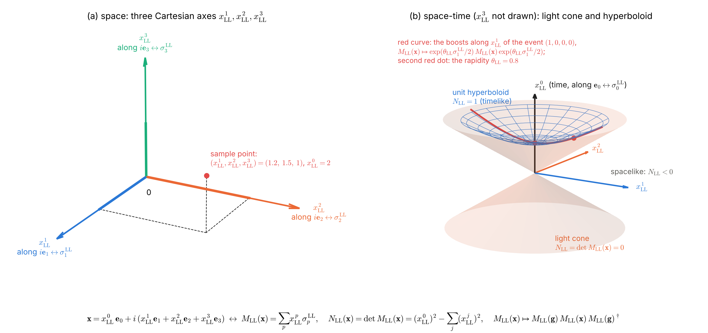
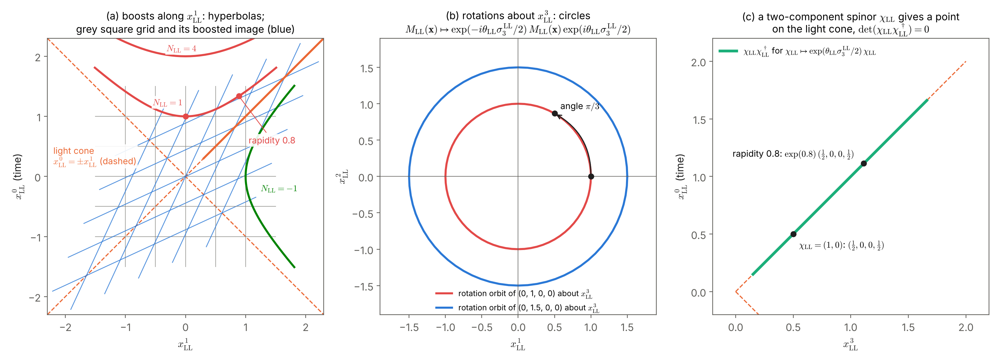
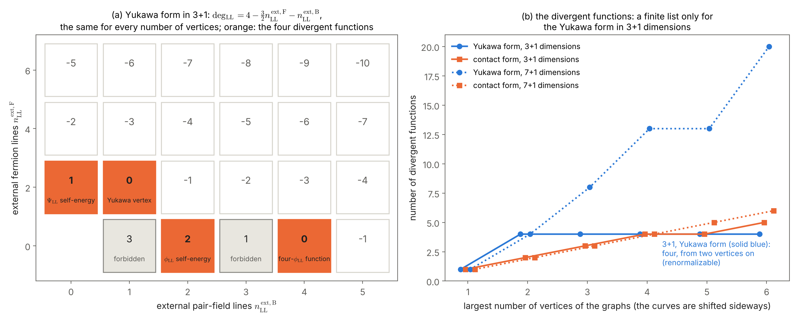
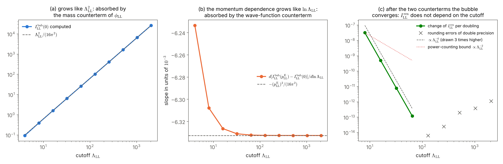

<!-- This file is generated from docs_src/X2_r13_manifold_and_yukawa_renormalizability.src.md by code/scripts/assemble_docs.py; edit the source. -->

# 1. The statement, and the answer in brief

The conclusions of the manuscript of the folder Revision_SuperLoop, "The Lorentz Super-Loop of the
Bi-Octonions — Non-Associative Counterexamples to the No-Go Theorems and a Spin-Zero Spinor
Superfluid", end with these three sentences:

> It lives on the $7+1$ and $3+1$ Minkowski spaces inside the bi-octonions, on the $4+4$ split
> octonions, and on itself, a parallelizable manifold without a group structure. The spin-zero
> superfluid of its spinor charges condenses in an isospin-triplet, unitary, electrically neutral
> state, and the pair that is a singlet of the whole super-loop requires two species. In $3+1$
> dimensions its Yukawa form is renormalizable; on the eight-dimensional manifolds it is not.

**What the words refer to.**

- "It" is the Lorentz super-loop $\mathbb L_{\rm LL}$, the set of unit bi-octonions (Section 2.1).
- "Its Yukawa form" in the last sentence belongs to the spin-zero superfluid of the sentence before it.
  The superfluid is described by a quantum field theory of the spinor charges of the super-loop. That
  theory has two forms (Section 4):
  - the **contact form**, in which two spinor charges attract each other at a point;
  - the **Yukawa form**, in which they attract each other by exchanging a pair field.
- "In $3+1$ dimensions" means: on the $3+1$ Minkowski space of the first sentence, the manifold
  $\mathbb R^{1,3}_{\rm LL}$ of this document.

This document defines that manifold mathematically, gives examples with figures, and proves the
statement. Every number in it was computed by a program of the folder and is checked by machine
(Section 7).

**The answer in brief.**

1. **The manifold.** The $3+1$ manifold is $\mathbb R^{1,3}_{\rm LL}$, the Hermitian bi-quaternions
   $\mathbf x=x^0_{\rm LL}\mathbf e_0+i(x^1_{\rm LL}\mathbf e_1+x^2_{\rm LL}\mathbf e_2+x^3_{\rm LL}\mathbf e_3)$,
   with four real coordinates. As a $2\times2$ matrix, $\mathbf x$ is the Hermitian matrix
   $M_{\rm LL}(\mathbf x)=x^0_{\rm LL}\sigma^{\rm LL}_0+\sum_jx^j_{\rm LL}\sigma^{\rm LL}_j$. The norm of the
   bi-octonions, restricted to it, is the Minkowski interval,
   $N_{\rm LL}(\mathbf x)=\det M_{\rm LL}(\mathbf x)=(x^0_{\rm LL})^2-\sum_j(x^j_{\rm LL})^2$ (Section 2).
2. **Its Lorentz group comes from the super-loop.** The unit bi-quaternions $\mathbf g$ of the super-loop
   form the group $SL(2,\mathbb C)$. They act on the manifold by $\mathbf x\mapsto\mathbf g\mathbf x\mathbf g^\dagger$,
   and these maps are exactly the proper orthochronous Lorentz transformations. The rotation and boost
   generators $J^j_{\rm LL}$, $K^j_{\rm LL}$ of the super-loop generate them. The spinor charges are
   two-component spinors, on which the same matrices $M_{\rm LL}(\mathbf g)$ act (Section 3).
3. **The Yukawa form is renormalizable on it.**
   - In $3+1$ dimensions the Yukawa coupling and the two quartic couplings are dimensionless.
   - The superficial degree of divergence does not depend on the number of vertices.
   - Exactly four functions diverge, and the Lagrangian already contains a term that absorbs each of
     them.
   - The one-loop bubble shows it explicitly: after the mass and wave-function counterterms nothing
     depends on the cutoff (Sections 4 and 5).
4. **Not in eight dimensions.** On the $7+1$ and $4+4$ manifolds every coupling has a negative mass
   dimension, and the number of divergent functions grows without bound with the order of
   perturbation theory (Section 5.6).

**What "renormalizable" means here.** A quantum field theory is *renormalizable* if every divergence of
its perturbation theory can be removed by adjusting finitely many parameters of its Lagrangian. The
proof given here has three parts:

- power counting (Section 5.2), which identifies the finitely many divergent functions;
- the completeness of the Lagrangian (Section 5.3), which shows that a term of the Lagrangian absorbs
  each of them;
- an explicit one-loop example (Section 5.4).

That these properties imply renormalizability to all orders is the standard theorem of renormalization
theory (Section 5.7). The renormalization was not carried out to all orders here.

**Units and notation.** $\hbar$ and the speed of light are 1. Every symbol is defined at its first use
and in the complete table of symbols (Section 9). The index $j$ runs over $1,2,3$, the index $p$ over
$0,1,2,3$, and the isospin index $\iota$ over $1,2,3$.

# 2. The 3+1 manifold: definition and coordinates

## 2.1 Bi-quaternions and their matrices

**Bi-octonions and bi-quaternions.** The bi-octonions $\mathbb B_{\rm LL}$ are the octonions with
complex coefficients: the combinations $\mathbf x=\sum_{p=0}^7\xi^{\rm LL}_p(\mathbf x)\,\mathbf e_p$ of eight
units $\mathbf e_0=1,\mathbf e_1,\dots,\mathbf e_7$ with complex coefficients $\xi^{\rm LL}_p(\mathbf x)$. The
imaginary unit $i$ of the coefficients commutes with every unit. A **bi-quaternion** is a bi-octonion
$\mathbf b=\sum_{p=0}^3\xi^{\rm LL}_p(\mathbf b)\,\mathbf e_p$ that uses only the first four units. Their
products are those of the quaternions:

- $\mathbf e_j^2=-1$ for $j=1,2,3$;
- $\mathbf e_1\mathbf e_2=-\mathbf e_2\mathbf e_1=\mathbf e_3$, and cyclically
  ($\mathbf e_2\mathbf e_3=\mathbf e_1$, $\mathbf e_3\mathbf e_1=\mathbf e_2$).

The product of bi-quaternions is associative. (The product of bi-octonions is not; that is why the
unit bi-octonions form a loop and not a group. The $3+1$ manifold is built from the bi-quaternions, where
the product is associative.)

Three operations on bi-quaternions are needed:

- **Conjugation.** $\bar{\mathbf b}$ changes the signs of the coefficients of $\mathbf e_1,\mathbf e_2,\mathbf e_3$.
- **Hermitian conjugation.** $\mathbf b^\dagger$ is $\bar{\mathbf b}$ with, in addition, every coefficient
  complex-conjugated.
- **Norm.** The complex norm is $N_{\rm LL}(\mathbf b)=\sum_p\xi^{\rm LL}_p(\mathbf b)^2$. It satisfies
  $\mathbf b\bar{\mathbf b}=N_{\rm LL}(\mathbf b)\,\mathbf e_0$ and is multiplicative,
  $N_{\rm LL}(\mathbf b\mathbf b')=N_{\rm LL}(\mathbf b)N_{\rm LL}(\mathbf b')$.

**The matrix of a bi-quaternion.** The Pauli matrices are
$$\sigma^{\rm LL}_0=\begin{pmatrix}1&0\\0&1\end{pmatrix},\quad\sigma^{\rm LL}_1=\begin{pmatrix}0&1\\1&0\end{pmatrix},\quad\sigma^{\rm LL}_2=\begin{pmatrix}0&-i\\i&0\end{pmatrix},\quad\sigma^{\rm LL}_3=\begin{pmatrix}1&0\\0&-1\end{pmatrix}.$$
Define $M_{\rm LL}(\mathbf e_0)=\sigma^{\rm LL}_0$ and $M_{\rm LL}(\mathbf e_j)=-i\sigma^{\rm LL}_j$, and extend
$M_{\rm LL}$ complex-linearly:
$M_{\rm LL}(\mathbf b)=\xi^{\rm LL}_0(\mathbf b)\,\sigma^{\rm LL}_0-i\sum_j\xi^{\rm LL}_j(\mathbf b)\,\sigma^{\rm LL}_j$.
This map has four properties, each checked by multiplying out the matrices:

- it is multiplicative, $M_{\rm LL}(\mathbf b\mathbf b')=M_{\rm LL}(\mathbf b)M_{\rm LL}(\mathbf b')$; for example
  $M_{\rm LL}(\mathbf e_1)M_{\rm LL}(\mathbf e_2)=(-i\sigma^{\rm LL}_1)(-i\sigma^{\rm LL}_2)=-\sigma^{\rm LL}_1\sigma^{\rm LL}_2=-i\sigma^{\rm LL}_3=M_{\rm LL}(\mathbf e_3)$;
- it turns the norm into the determinant, $\det M_{\rm LL}(\mathbf b)=N_{\rm LL}(\mathbf b)$;
- it turns Hermitian conjugation into the Hermitian conjugate matrix,
  $M_{\rm LL}(\mathbf b^\dagger)=M_{\rm LL}(\mathbf b)^\dagger$;
- every complex $2\times2$ matrix is $M_{\rm LL}(\mathbf b)$ of exactly one bi-quaternion, because the
  four Pauli matrices are a basis of the complex $2\times2$ matrices.

The **unit bi-quaternions** $\mathbf g$, those with $N_{\rm LL}(\mathbf g)=1$, are therefore exactly the
complex $2\times2$ matrices of determinant 1: the group $SL(2,\mathbb C)$. It is a subgroup of the Lorentz
super-loop $\mathbb L_{\rm LL}$, the set of unit bi-octonions ($N_{\rm LL}=1$): the unit bi-octonions that use
only the units $\mathbf e_0,\dots,\mathbf e_3$. For a unit
bi-quaternion, $\mathbf g\bar{\mathbf g}=\mathbf e_0$, so the conjugate is the inverse:
$M_{\rm LL}(\bar{\mathbf g})=M_{\rm LL}(\mathbf g)^{-1}$.

## 2.2 Definition of the manifold

**Definition.** The $3+1$ manifold of the super-loop is the real vector space of the Hermitian
bi-quaternions,
$$\mathbb R^{1,3}_{\rm LL}=\big\{\mathbf x=x^0_{\rm LL}\,\mathbf e_0+i\,(x^1_{\rm LL}\mathbf e_1+x^2_{\rm LL}\mathbf e_2+x^3_{\rm LL}\mathbf e_3)\ :\ x^0_{\rm LL},x^1_{\rm LL},x^2_{\rm LL},x^3_{\rm LL}\in\mathbb R\big\}. \tag{2.1}$$
The four real numbers $x^0_{\rm LL}$ (time) and $x^1_{\rm LL}$, $x^2_{\rm LL}$, $x^3_{\rm LL}$ (space) are its
**coordinates**. A bi-quaternion is Hermitian, $\mathbf x^\dagger=\mathbf x$, exactly when its coefficients
have the form $(x^0_{\rm LL},ix^1_{\rm LL},ix^2_{\rm LL},ix^3_{\rm LL})$ with real coordinates. (Conjugation
changes the signs of the last three coefficients, and complex conjugation changes them back.)

The manifold sits inside the bi-octonions. The Hermitian bi-octonions
$x^0_{\rm LL}\mathbf e_0+i\sum_{p=1}^7x^p_{\rm LL}\mathbf e_p$ form the $7+1$ Minkowski space
$\mathbb R^{1,7}_{\rm LL}$, and $\mathbb R^{1,3}_{\rm LL}$ is its subspace with
$x^4_{\rm LL}=\dots=x^7_{\rm LL}=0$ (check N-1 of the program `superloop`, Section 7.3).

**The matrix of a point.** Because $M_{\rm LL}(i\mathbf e_j)=i(-i\sigma^{\rm LL}_j)=\sigma^{\rm LL}_j$,
$$M_{\rm LL}(\mathbf x)=x^0_{\rm LL}\sigma^{\rm LL}_0+x^1_{\rm LL}\sigma^{\rm LL}_1+x^2_{\rm LL}\sigma^{\rm LL}_2+x^3_{\rm LL}\sigma^{\rm LL}_3=\begin{pmatrix}x^0_{\rm LL}+x^3_{\rm LL}&x^1_{\rm LL}-ix^2_{\rm LL}\\x^1_{\rm LL}+ix^2_{\rm LL}&x^0_{\rm LL}-x^3_{\rm LL}\end{pmatrix}, \tag{2.2}$$
a Hermitian matrix. Every Hermitian $2\times2$ matrix is the matrix of exactly one point. The coordinates
are recovered as
$$x^0_{\rm LL}=\tfrac12\mathrm{tr}\,M_{\rm LL}(\mathbf x),\qquad x^j_{\rm LL}=\tfrac12\mathrm{tr}\big(\sigma^{\rm LL}_jM_{\rm LL}(\mathbf x)\big),$$
because $\mathrm{tr}(\sigma^{\rm LL}_p\sigma^{\rm LL}_{p'})$ is 2 for $p=p'$ and 0 otherwise.

**The coordinate axes.** The basis element $\mathbf e_0$ points along the time axis, and $i\mathbf e_1$,
$i\mathbf e_2$, $i\mathbf e_3$ point along the three space axes. They correspond to $\sigma^{\rm LL}_0$,
$\sigma^{\rm LL}_1$, $\sigma^{\rm LL}_2$, $\sigma^{\rm LL}_3$, exactly as the unit vectors of Cartesian
coordinates do. Figure 1(a) draws the three space axes. (Check Z-1 verifies Eq. (2.2), the Hermiticity
and the inverse formulas for the four basis elements and 200 random points.)

*Example.* The **sample point** with $x^0_{\rm LL}=2$ and
$(x^1_{\rm LL},x^2_{\rm LL},x^3_{\rm LL})=(1.2,1.5,1.0)$ has the matrix
$$M_{\rm LL}(\mathbf x)=\begin{pmatrix}3&1.2-1.5\,i\\1.2+1.5\,i&1\end{pmatrix}.$$

## 2.3 The metric: Minkowski space

On $\mathbb R^{1,3}_{\rm LL}$ the complex norm is real, and it is the determinant of Eq. (2.2):
$$\begin{aligned}N_{\rm LL}(\mathbf x)=\det M_{\rm LL}(\mathbf x)&=(x^0_{\rm LL}+x^3_{\rm LL})(x^0_{\rm LL}-x^3_{\rm LL})-(x^1_{\rm LL}-ix^2_{\rm LL})(x^1_{\rm LL}+ix^2_{\rm LL})\\&=(x^0_{\rm LL})^2-(x^1_{\rm LL})^2-(x^2_{\rm LL})^2-(x^3_{\rm LL})^2.\end{aligned} \tag{2.3}$$
This is the Minkowski interval. The symmetric matrix of the quadratic form (2.3) in the coordinates is
$\mathrm{diag}(1,-1,-1,-1)$: one positive and three negative directions, the **signature (1,3)** (check Z-2).
So $\mathbb R^{1,3}_{\rm LL}$ is Minkowski space-time, and its points are classified like the events of
special relativity:

- **timelike** if $N_{\rm LL}(\mathbf x)>0$: inside the light cone, reachable from the origin by a particle
  slower than light;
- **null** if $N_{\rm LL}(\mathbf x)=0$: on the **light cone** $\det M_{\rm LL}(\mathbf x)=0$, reachable by
  light;
- **spacelike** if $N_{\rm LL}(\mathbf x)<0$: outside the light cone.

The sample point has $N_{\rm LL}=4-1.44-2.25-1=-0.69$: it is spacelike. The future timelike points with
$N_{\rm LL}(\mathbf x)=1$ form the **unit hyperboloid**: the possible positions, after one unit of proper
time, of an observer who starts at the origin. Figure 1(b) draws the light cone and the hyperboloid,
with $x^3_{\rm LL}$ left out so that the picture is three-dimensional.

{width=100%}

**Figure 1.** The coordinates of $\mathbb R^{1,3}_{\rm LL}$, drawn like Cartesian coordinates.

- **(a) Space.** The three space axes $x^1_{\rm LL}$, $x^2_{\rm LL}$, $x^3_{\rm LL}$ point along the basis
  elements $i\mathbf e_1$, $i\mathbf e_2$, $i\mathbf e_3$, which correspond to $\sigma^{\rm LL}_1$,
  $\sigma^{\rm LL}_2$, $\sigma^{\rm LL}_3$. The sample point is drawn with its projections onto the axes
  (thick segments) and onto the $(x^1_{\rm LL},x^2_{\rm LL})$ plane (dashed lines).
- **(b) Space-time, with $x^3_{\rm LL}$ not drawn.**
  - The time axis $x^0_{\rm LL}$ points along $\mathbf e_0$, which corresponds to $\sigma^{\rm LL}_0$.
  - The light cone (orange) is $N_{\rm LL}=\det M_{\rm LL}(\mathbf x)=0$; outside it the points are
    spacelike.
  - The blue wire frame is the future unit hyperboloid $N_{\rm LL}=1$.
  - The red curve is the orbit of the event $(1,0,0,0)$ under the boosts along $x^1_{\rm LL}$
    (Section 3.2). It lies on the hyperboloid. The second red dot is its image under the boost with the
    rapidity 0.8.
- **Bottom line:** the formulas of Sections 2 and 3.

Data: `explanations/data/ex_r13_points.csv` and `ex_r13_orbits.csv`; checks Z-1, Z-2, Z-5; drawn by
`explanations/code/make_r13_figures.py`.

# 3. The Lorentz group on the manifold comes from the super-loop

## 3.1 The action of the unit bi-quaternions

A unit bi-quaternion $\mathbf g$ of the super-loop acts on $\mathbb R^{1,3}_{\rm LL}$ by
$$\mathbf x\longmapsto\mathbf g\,\mathbf x\,\mathbf g^\dagger,\qquad\text{that is}\qquad M_{\rm LL}(\mathbf x)\longmapsto M_{\rm LL}(\mathbf g)\,M_{\rm LL}(\mathbf x)\,M_{\rm LL}(\mathbf g)^\dagger. \tag{3.1}$$
Two lines show that this is a Lorentz transformation:

- **It maps the manifold to itself.** The image is again Hermitian:
  $(M_{\rm LL}(\mathbf g)M_{\rm LL}(\mathbf x)M_{\rm LL}(\mathbf g)^\dagger)^\dagger=M_{\rm LL}(\mathbf g)M_{\rm LL}(\mathbf x)^\dagger M_{\rm LL}(\mathbf g)^\dagger=M_{\rm LL}(\mathbf g)M_{\rm LL}(\mathbf x)M_{\rm LL}(\mathbf g)^\dagger$.
- **It preserves the interval.** By the product rule of determinants,
  $\det(M_{\rm LL}(\mathbf g)M_{\rm LL}(\mathbf x)M_{\rm LL}(\mathbf g)^\dagger)=\lvert\det M_{\rm LL}(\mathbf g)\rvert^2\det M_{\rm LL}(\mathbf x)=N_{\rm LL}(\mathbf x)$.

In the coordinates, Eq. (3.1) is a real $4\times4$ matrix $\mathsf L_{\rm LL}(\mathbf g)$. Its entry in row $p$
and column $p'$ is
$$\tfrac12\,\mathrm{Re}\,\mathrm{tr}\big(\sigma^{\rm LL}_pM_{\rm LL}(\mathbf g)\,\sigma^{\rm LL}_{p'}M_{\rm LL}(\mathbf g)^\dagger\big),$$
the $p$-th coordinate of the image of the $p'$-th basis element. Check Z-3 verifies, for 200 random unit
bi-quaternions $\mathbf g$ and $\mathbf h$, that:

- $\mathsf L_{\rm LL}(\mathbf g)$ keeps the metric:
  $\mathsf L_{\rm LL}(\mathbf g)^T\,\mathrm{diag}(1,-1,-1,-1)\,\mathsf L_{\rm LL}(\mathbf g)=\mathrm{diag}(1,-1,-1,-1)$;
- it has determinant 1, and its time-time entry is at least 1, so that it does not reverse the direction
  of time: it is a **proper orthochronous Lorentz transformation**;
- $\mathbf g$ and $-\mathbf g$ give the same $\mathsf L_{\rm LL}$;
- $\mathsf L_{\rm LL}(\mathbf g\mathbf h)=\mathsf L_{\rm LL}(\mathbf g)\mathsf L_{\rm LL}(\mathbf h)$: the map from
  $SL(2,\mathbb C)$ to the Lorentz group is a group homomorphism.

**Exactly two elements for each transformation.** If $\mathsf L_{\rm LL}(\mathbf g)$ is the unit matrix, then
$M_{\rm LL}(\mathbf g)$ commutes with every Hermitian matrix: the image of $\mathbf e_0$ gives
$M_{\rm LL}(\mathbf g)M_{\rm LL}(\mathbf g)^\dagger=\sigma^{\rm LL}_0$, so $M_{\rm LL}(\mathbf g)$ is unitary, and
then $M_{\rm LL}(\mathbf g)\sigma^{\rm LL}_jM_{\rm LL}(\mathbf g)^{-1}=\sigma^{\rm LL}_j$ for every $j$. Only multiples
of $\sigma^{\rm LL}_0$ commute with all three Pauli matrices, and the determinant 1 leaves $\pm\sigma^{\rm LL}_0$.
So exactly $\mathbf g$ and $-\mathbf g$ give the same transformation: $SL(2,\mathbb C)$ is the **double cover**
of the Lorentz group. That every proper orthochronous Lorentz transformation is reached is shown at the
end of Section 3.2.

## 3.2 Rotations and boosts, and their generators in the super-loop

The super-loop contains the **rotation generators** $J^j_{\rm LL}=\tfrac12\mathbf e_j$ and the **boost
generators** $K^j_{\rm LL}=\tfrac12i\,\mathbf e_j$, with $M_{\rm LL}(J^j_{\rm LL})=-\tfrac i2\sigma^{\rm LL}_j$ and
$M_{\rm LL}(K^j_{\rm LL})=\tfrac12\sigma^{\rm LL}_j$. Their exponentials are the finite transformations; the
real parameter $\theta_{\rm LL}$ is an angle for a rotation and a rapidity for a boost.

**The rotation about the axis $x^3_{\rm LL}$** by the angle $\theta_{\rm LL}$ is
$\mathbf g=\exp(\theta_{\rm LL}J^3_{\rm LL})$, with $M_{\rm LL}(\mathbf g)=\exp(-i\theta_{\rm LL}\sigma^{\rm LL}_3/2)$.
It gives
$$\mathsf L_{\rm LL}(\mathbf g)=\begin{pmatrix}1&0&0&0\\0&\cos\theta_{\rm LL}&-\sin\theta_{\rm LL}&0\\0&\sin\theta_{\rm LL}&\cos\theta_{\rm LL}&0\\0&0&0&1\end{pmatrix},$$
because
$\exp(-i\theta_{\rm LL}\sigma^{\rm LL}_3/2)\,\sigma^{\rm LL}_1\,\exp(i\theta_{\rm LL}\sigma^{\rm LL}_3/2)=\sigma^{\rm LL}_1\exp(i\theta_{\rm LL}\sigma^{\rm LL}_3)=\cos\theta_{\rm LL}\,\sigma^{\rm LL}_1+\sin\theta_{\rm LL}\,\sigma^{\rm LL}_2$.
(The first step uses that $\sigma^{\rm LL}_1$ anticommutes with $\sigma^{\rm LL}_3$; the second uses
$i\sigma^{\rm LL}_1\sigma^{\rm LL}_3=\sigma^{\rm LL}_2$.) The matrices $\sigma^{\rm LL}_0$ and $\sigma^{\rm LL}_3$
commute with $\sigma^{\rm LL}_3$ and stay fixed.

**The boost along the axis $x^1_{\rm LL}$** with the rapidity $\theta_{\rm LL}$ is
$\mathbf g=\exp(\theta_{\rm LL}K^1_{\rm LL})$, with $M_{\rm LL}(\mathbf g)=\exp(\theta_{\rm LL}\sigma^{\rm LL}_1/2)$, a
Hermitian matrix. It gives
$$\mathsf L_{\rm LL}(\mathbf g)=\begin{pmatrix}\cosh\theta_{\rm LL}&\sinh\theta_{\rm LL}&0&0\\\sinh\theta_{\rm LL}&\cosh\theta_{\rm LL}&0&0\\0&0&1&0\\0&0&0&1\end{pmatrix},$$
because
$\exp(\theta_{\rm LL}\sigma^{\rm LL}_1/2)\,\sigma^{\rm LL}_0\,\exp(\theta_{\rm LL}\sigma^{\rm LL}_1/2)=\exp(\theta_{\rm LL}\sigma^{\rm LL}_1)=\cosh\theta_{\rm LL}\,\sigma^{\rm LL}_0+\sinh\theta_{\rm LL}\,\sigma^{\rm LL}_1$,
and $\sigma^{\rm LL}_1$ goes to $\sigma^{\rm LL}_1\exp(\theta_{\rm LL}\sigma^{\rm LL}_1)=\sinh\theta_{\rm LL}\,\sigma^{\rm LL}_0+\cosh\theta_{\rm LL}\,\sigma^{\rm LL}_1$.
A boost mixes time with space, along hyperbolas; a rotation mixes two space coordinates, along circles.

**A rotation by $2\pi$** has $M_{\rm LL}(\mathbf g)=\exp(-i\pi\sigma^{\rm LL}_3)=-\sigma^{\rm LL}_0$, and
$\mathsf L_{\rm LL}(\mathbf g)$ is the unit matrix: every point returns to itself, while the group element is
$-1$.

**The generators.** For a generator $\mathbf u$ ($\mathbf u=J^j_{\rm LL}$ or $K^j_{\rm LL}$) and
$\mathbf g=\exp(\theta_{\rm LL}\mathbf u)$, the derivative of Eq. (3.1) at $\theta_{\rm LL}=0$ is the
infinitesimal transformation
$$\mathbf x\longmapsto\mathbf u\mathbf x+\mathbf x\mathbf u^\dagger,\qquad M_{\rm LL}(\mathbf x)\longmapsto M_{\rm LL}(\mathbf u)M_{\rm LL}(\mathbf x)+M_{\rm LL}(\mathbf x)M_{\rm LL}(\mathbf u)^\dagger .$$
Its real $4\times4$ matrix in the coordinates is $\mathcal V_{\rm LL}(\mathbf u)$, the **vector action** of
$\mathbf u$. The six matrices $\mathcal V_{\rm LL}(J^j_{\rm LL})$ and $\mathcal V_{\rm LL}(K^j_{\rm LL})$ have three
properties:

- they are linearly independent;
- they preserve the metric:
  $\mathcal V_{\rm LL}(\mathbf u)^T\mathrm{diag}(1,-1,-1,-1)+\mathrm{diag}(1,-1,-1,-1)\,\mathcal V_{\rm LL}(\mathbf u)=0$;
- they obey the commutation relations of the Lorentz algebra $\mathfrak{so}(3,1)$.

The third property follows from the generators themselves. Expanding the two products gives
$$\mathcal V_{\rm LL}(\mathbf u)\mathcal V_{\rm LL}(\mathbf u')\mathbf x-\mathcal V_{\rm LL}(\mathbf u')\mathcal V_{\rm LL}(\mathbf u)\mathbf x=[\mathbf u,\mathbf u']\,\mathbf x+\mathbf x\,[\mathbf u,\mathbf u']^\dagger,$$
where $[\mathbf u,\mathbf u']=\mathbf u\mathbf u'-\mathbf u'\mathbf u$; the mixed terms $\mathbf u\mathbf x\mathbf u'^\dagger$ and
$\mathbf u'\mathbf x\mathbf u^\dagger$ cancel. So the commutators of the six matrices are the matrices of the
commutators of the generators, and these are
$$[J^j_{\rm LL},J^{j'}_{\rm LL}]=\sum_{j''}\epsilon^{\rm LL}_{jj'j''}J^{j''}_{\rm LL},\qquad[J^j_{\rm LL},K^{j'}_{\rm LL}]=\sum_{j''}\epsilon^{\rm LL}_{jj'j''}K^{j''}_{\rm LL},\qquad[K^j_{\rm LL},K^{j'}_{\rm LL}]=-\sum_{j''}\epsilon^{\rm LL}_{jj'j''}J^{j''}_{\rm LL}, \tag{3.2}$$
with the Levi-Civita symbol $\epsilon^{\rm LL}_{jj'j''}$ ($+1$ for an even permutation of $1,2,3$, $-1$ for an
odd one, 0 otherwise). For example,
$[J^1_{\rm LL},J^2_{\rm LL}]=\tfrac14(\mathbf e_1\mathbf e_2-\mathbf e_2\mathbf e_1)=\tfrac12\mathbf e_3=J^3_{\rm LL}$ and
$[K^1_{\rm LL},K^2_{\rm LL}]=\tfrac14i^2(\mathbf e_1\mathbf e_2-\mathbf e_2\mathbf e_1)=-J^3_{\rm LL}$. The minus sign in the
last relation distinguishes the Lorentz algebra from the algebra $\mathfrak{so}(4)$ of the rotations of
four-dimensional Euclidean space: two boosts in different directions combine into a rotation (the Thomas
precession). Check Z-4 verifies all 27 relations on the $4\times4$ matrices, their linear independence, the
preservation of the metric, and that the derivatives of the finite transformations at
$\theta_{\rm LL}=0$ equal the generators.

**Every proper orthochronous Lorentz transformation is reached.** The six independent matrices span
the whole six-dimensional Lorentz algebra. So the transformations $\mathsf L_{\rm LL}(\mathbf g)$ fill a
neighbourhood of the unit matrix in the Lorentz group. The group of proper orthochronous Lorentz
transformations is connected, and every element of a connected group is a product of elements from any
neighbourhood of the unit element. Because $\mathsf L_{\rm LL}$ is a homomorphism, every proper
orthochronous Lorentz transformation is therefore $\mathsf L_{\rm LL}(\mathbf g)$ for some unit
bi-quaternion $\mathbf g$, and by Section 3.1 for exactly two, $\pm\mathbf g$.

(In the $7+1$ space $\mathbb R^{1,7}_{\rm LL}$ the same six generators do not close: their Lie closure there
has dimension 9. $\mathbb R^{1,3}_{\rm LL}$ is the part of the bi-octonions on which the super-loop's own
Lorentz generators act as an honest Lorentz group; check N-5 of the program `superloop`, printed in
Section 7.3.)

**Worked examples** (check Z-5; the table is written from the data file
`explanations/data/ex_r13_points.csv`):

| example | $x^0_{\rm LL}$ | $x^1_{\rm LL}$ | $x^2_{\rm LL}$ | $x^3_{\rm LL}$ | $N_{\rm LL}(\mathbf x)$ | kind |
|--------------------------------|---------|---------|---------|---------|------------|--------------------|
| the sample point | 2.000000 | 1.200000 | 1.500000 | 1.000000 | $-0.690000$ | spacelike |
| the event $(1,0,0,0)$ | 1.000000 | 0 | 0 | 0 | 1.000000 | timelike |
| after the boost along $x^1_{\rm LL}$ with the rapidity 0.8 | 1.337435 | 0.888106 | 0 | 0 | 1.000000 | timelike |
| the event $(0,1,0,0)$ | 0 | 1.000000 | 0 | 0 | $-1.000000$ | spacelike |
| after the rotation about $x^3_{\rm LL}$ by the angle $\pi/3$ | 0 | 0.500000 | 0.866025 | 0 | $-1.000000$ | spacelike |
| the point $\chi_{\rm LL}\chi_{\rm LL}^\dagger$ of $\chi_{\rm LL}=(1,0)$ | 0.500000 | 0 | 0 | 0.500000 | 0 | null (on the light cone) |
| after the boost of $\chi_{\rm LL}$ along $x^3_{\rm LL}$ with the rapidity 0.8 | 1.112770 | 0 | 0 | 1.112770 | 0 | null (on the light cone) |

The boost with the rapidity 0.8 takes $(1,0,0,0)$ to $(\cosh0.8,\sinh0.8,0,0)$ and keeps
$N_{\rm LL}=1$. The rotation by $\pi/3$ takes $(0,1,0,0)$ to $(0,\tfrac12,\tfrac{\sqrt3}2,0)$ and keeps
$N_{\rm LL}=-1$. Figure 2 shows these transformations as curves.

## 3.3 Spinors on the manifold, and the spinor charges

A **two-component spinor** $\chi_{\rm LL}$ is a column of two complex numbers. It transforms under the
unit bi-quaternion $\mathbf g$ as $\chi_{\rm LL}\mapsto M_{\rm LL}(\mathbf g)\chi_{\rm LL}$. Two facts tie such
spinors to the manifold:

- **A spinor gives a point on the light cone.** The Hermitian matrix $\chi_{\rm LL}\chi_{\rm LL}^\dagger$ is
  the matrix of a point of $\mathbb R^{1,3}_{\rm LL}$. It has determinant 0 (its rank is 1) and the positive
  trace $\lvert\chi_{\rm LL}\rvert^2$, so the point lies on the **future light cone**. Under $\mathbf g$ it
  transforms by Eq. (3.1), because
  $(M_{\rm LL}(\mathbf g)\chi_{\rm LL})(M_{\rm LL}(\mathbf g)\chi_{\rm LL})^\dagger=M_{\rm LL}(\mathbf g)\,\chi_{\rm LL}\chi_{\rm LL}^\dagger\,M_{\rm LL}(\mathbf g)^\dagger$.
  A spinor is thus a "square root" of a light ray.
- **The double cover becomes visible.** A rotation by $2\pi$ changes the sign of $\chi_{\rm LL}$, but it
  leaves the point $\chi_{\rm LL}\chi_{\rm LL}^\dagger$ unchanged.

*Example.* $\chi_{\rm LL}=(1,0)$ gives
$\chi_{\rm LL}\chi_{\rm LL}^\dagger=\mathrm{diag}(1,0)=\tfrac12(\sigma^{\rm LL}_0+\sigma^{\rm LL}_3)$, the null point
$(\tfrac12,0,0,\tfrac12)$. The boost along $x^3_{\rm LL}$ with the rapidity 0.8,
$M_{\rm LL}(\mathbf g)=\exp(0.4\,\sigma^{\rm LL}_3)$, multiplies $\chi_{\rm LL}$ by $\exp(0.4)$ and the null point
by $\exp(0.8)$. The point moves along the light cone: this is the Doppler shift of a light ray
(Figure 2(c)).

**The spinor charges are such spinors.** A spinor charge of the super-loop is a bi-octonion
$\mathbf b\,\mathbf e_4$ with a bi-quaternion $\mathbf b$. The Lorentz transformations of the super-loop act on
it by multiplying $\mathbf b$ from the right: the infinitesimal transformation generated by $\mathbf u$
multiplies $\mathbf b$ by $-\mathbf u$ from the right, so the finite transformation by
$\mathbf g=\exp(\theta_{\rm LL}\mathbf u)$ changes $\mathbf b$ into $\mathbf b\bar{\mathbf g}$ (for these generators
$\bar{\mathbf u}=-\mathbf u$, so $\bar{\mathbf g}=\exp(-\theta_{\rm LL}\mathbf u)$). The **Weyl isodoublet** of the
spinor charge is the $2\times2$ matrix
$$\psi'_{\rm LL}=\mathsf E_{\rm LL}^{-1}M_{\rm LL}(\mathbf b)^T,\qquad\mathsf E_{\rm LL}=i\sigma^{\rm LL}_2=\begin{pmatrix}0&1\\-1&0\end{pmatrix}.$$
Its first column is the isospin-up component and its second column the isospin-down component.
Under $\mathbf g$, $M_{\rm LL}(\mathbf b)^T$ becomes $M_{\rm LL}(\bar{\mathbf g})^TM_{\rm LL}(\mathbf b)^T$, so each column
transforms as
$$\chi_{\rm LL}\longmapsto\mathsf E_{\rm LL}^{-1}M_{\rm LL}(\bar{\mathbf g})^T\mathsf E_{\rm LL}\,\chi_{\rm LL}=M_{\rm LL}(\mathbf g)\,\chi_{\rm LL}.$$
The last equality holds for every unit bi-quaternion. Multiplying out the four entries shows that
$M_{\rm LL}(\mathbf b)^T\mathsf E_{\rm LL}M_{\rm LL}(\mathbf b)=N_{\rm LL}(\mathbf b)\,\mathsf E_{\rm LL}$ for every
bi-quaternion $\mathbf b$. With $\bar{\mathbf g}$ in place of $\mathbf b$ (norm 1) this gives
$\mathsf E_{\rm LL}^{-1}M_{\rm LL}(\bar{\mathbf g})^T\mathsf E_{\rm LL}=M_{\rm LL}(\bar{\mathbf g})^{-1}=M_{\rm LL}(\mathbf g)$
(check Z-5, 200 random cases).

So **the spinor charges are two-component spinors of the Lorentz group of $\mathbb R^{1,3}_{\rm LL}$, each
with an isospin label**, and the generators act on them as $M_{\rm LL}(J^j_{\rm LL})=-\tfrac i2\sigma^{\rm LL}_j$
and $M_{\rm LL}(K^j_{\rm LL})=\tfrac12\sigma^{\rm LL}_j$. Their quantum field, the Dirac isodoublet
$\Psi_{\rm LL}$ of Section 4, is a function of the point $\mathbf x$ of $\mathbb R^{1,3}_{\rm LL}$. This is the
precise sense in which the theory of the spinor charges "lives" on the $3+1$ manifold.

{width=100%}

**Figure 2.** The Lorentz transformations of $\mathbb R^{1,3}_{\rm LL}$, computed from Eq. (3.1).

- **(a) Boosts along $x^1_{\rm LL}$, in the $(x^1_{\rm LL},x^0_{\rm LL})$ plane.**
  - The orbits of the events $(1,0,0,0)$ and $(2,0,0,0)$ (red) are the hyperbolas $N_{\rm LL}=1$ and
    $N_{\rm LL}=4$. The red dots are $(1,0,0,0)$ and its image under the boost with the rapidity 0.8.
  - The orbit of $(0,1,0,0)$ (green) is the hyperbola $N_{\rm LL}=-1$.
  - The orbit of the null event $(1,1,0,0)$ (orange, solid) stays on the light cone (orange, dashed).
  - A grey square grid is drawn with its image under the boost with the rapidity 0.5 (blue). The boost
    shears the grid along the light cone and leaves the light cone in place.
- **(b) Rotations about $x^3_{\rm LL}$, in the $(x^1_{\rm LL},x^2_{\rm LL})$ plane.** The orbits of
  $(0,1,0,0)$ (red) and $(0,1.5,0,0)$ (blue) are circles. The arrow is the rotation by $\pi/3$ of the
  example.
- **(c) The null points of the spinor $\chi_{\rm LL}=(1,0)$, in the $(x^3_{\rm LL},x^0_{\rm LL})$ plane.** As
  $\chi_{\rm LL}$ is boosted along $x^3_{\rm LL}$, its null point $\chi_{\rm LL}\chi_{\rm LL}^\dagger$ (green)
  moves along the light cone (dashed). The black dots are the two points of the example.

Data: `explanations/data/ex_r13_orbits.csv` and `ex_r13_points.csv`; checks Z-3 to Z-5; drawn by
`explanations/code/make_r13_figures.py`.

# 4. The field theory on the manifold: the contact form and the Yukawa form

## 4.1 The fields

Two fields are functions of the point $\mathbf x$ of $\mathbb R^{1,3}_{\rm LL}$; $\partial_p$ is the derivative
with respect to $x^p_{\rm LL}$.

**The spinor charges: the field $\Psi_{\rm LL}$.** The Dirac matrices in the chiral basis are
$$\gamma^0_{\rm LL}=\begin{pmatrix}0&\sigma^{\rm LL}_0\\\sigma^{\rm LL}_0&0\end{pmatrix},\qquad\gamma^j_{\rm LL}=\begin{pmatrix}0&\sigma^{\rm LL}_j\\-\sigma^{\rm LL}_j&0\end{pmatrix},$$
with the chirality matrix
$\gamma^{\rm ch}_{\rm LL}=i\gamma^0_{\rm LL}\gamma^1_{\rm LL}\gamma^2_{\rm LL}\gamma^3_{\rm LL}=\mathrm{diag}(-1,-1,1,1)$
and the charge-conjugation matrix $C_{\rm LL}=i\gamma^2_{\rm LL}\gamma^0_{\rm LL}=\mathrm{diag}(\mathsf E_{\rm LL},-\mathsf E_{\rm LL})$.

- The spinor charges, on which the boosts act as $+\tfrac12\sigma^{\rm LL}_j$ (Section 3.3), are the lower
  block of a Dirac spinor ($\gamma^{\rm ch}_{\rm LL}=+1$).
- The complex-conjugate super-loop, on which the boosts act with the opposite sign, supplies the upper
  block.
- The field of the spinor charges is therefore a **Dirac isodoublet** $\Psi_{\rm LL}$ with eight components
  (four Dirac components times two isospin components).
- Its electric charges are $Q_{\rm LL}=\pm\tfrac12$, where $Q_{\rm LL}=T^3_{\rm LL}$ and $T^\iota_{\rm LL}$ are the
  isospin generators.
- Its components have spinor number $-1$: they change sign under the rotation by $2\pi$. By the
  spin-statistics theorem, $\Psi_{\rm LL}$ is therefore a fermion field, and its components anticommute.

The Dirac adjoint is $\bar\Psi_{\rm LL}=\Psi^\dagger_{\rm LL}\gamma^0_{\rm LL}$.

**The spin-zero pairs.** A pair of two spinor charges at the same point is $\Psi^T_{\rm LL}\mathsf K\Psi_{\rm LL}$
with an $8\times8$ matrix $\mathsf K$. Because the components anticommute, only the antisymmetric part of
$\mathsf K$ contributes. The antisymmetric matrices for which the pair is Lorentz invariant (spin zero) form
a complex space of dimension 6, spanned by
$$\mathsf K^\iota_{\rm LL}=C_{\rm LL}\gamma^{\rm ch}_{\rm LL}\otimes\mathsf E_{\rm LL}\tau^{\rm LL}_\iota\ \ (\text{scalar, }0^+),\qquad\mathsf K'^\iota_{\rm LL}=C_{\rm LL}\otimes\mathsf E_{\rm LL}\tau^{\rm LL}_\iota\ \ (\text{pseudoscalar, }0^-),$$
where $\tau^{\rm LL}_\iota$ are the Pauli matrices acting on the isospin index. The reason, in three steps:

1. The Lorentz-invariant bilinear forms of a Dirac spinor are spanned by $C_{\rm LL}$ and
   $C_{\rm LL}\gamma^{\rm ch}_{\rm LL}=-\mathrm{diag}(\mathsf E_{\rm LL},\mathsf E_{\rm LL})$, one for each chirality
   block. Both are antisymmetric.
2. The whole matrix must be antisymmetric, so the isospin factor must be symmetric.
3. The symmetric $2\times2$ matrices are spanned by the three matrices $\mathsf E_{\rm LL}\tau^{\rm LL}_\iota$,
   which form an isospin vector. The remaining matrix $\mathsf E_{\rm LL}$, the isosinglet, is antisymmetric
   and drops out.

Every spin-zero pair is therefore an isospin **triplet**. The pair $\Psi^T_{\rm LL}\mathsf K^\iota_{\rm LL}\Psi_{\rm LL}$
has fermion number 2: it annihilates two spinor charges.

**The pair field: the field $\phi_{\rm LL}$.** This is a complex isospin triplet
$\phi_{\rm LL}=(\phi^1_{\rm LL},\phi^2_{\rm LL},\phi^3_{\rm LL})$, a scalar field. It describes the scalar pairs
as particles of their own.

## 4.2 The two forms of the theory

**The contact form.** The spinor charges attract each other in the scalar channel through a contact
interaction of strength $G_{\rm LL}>0$:
$$\mathcal L^{\rm c}_{\rm LL}=\bar\Psi_{\rm LL}\Big(i\sum_p\gamma^p_{\rm LL}\partial_p-m_{\rm LL}\Big)\Psi_{\rm LL}+\tfrac14G_{\rm LL}\sum_\iota\big(\Psi^T_{\rm LL}\mathsf K^\iota_{\rm LL}\Psi_{\rm LL}\big)^\dagger\big(\Psi^T_{\rm LL}\mathsf K^\iota_{\rm LL}\Psi_{\rm LL}\big), \tag{4.1}$$
with the mass $m_{\rm LL}$ of the spinor charges. Two remarks connect it with the superfluid:

- At a chemical potential $\mu_{\rm LL}$ the term $\mu_{\rm LL}\Psi^\dagger_{\rm LL}\Psi_{\rm LL}$ is added. It is a
  term of dimension 3 with a coefficient of dimension 1 and changes no power counting.
- The superfluid calculation keeps from this interaction only the pairs of total momentum zero (the
  reduced, or BCS, form of Eq. (4.1)). The power counting concerns the full local interaction (4.1).

**The Yukawa form.** The contact interaction is replaced by the exchange of the pair field:
$$\begin{aligned}\mathcal L^{\rm Y}_{\rm LL}={}&\bar\Psi_{\rm LL}\Big(i\sum_p\gamma^p_{\rm LL}\partial_p-m_{\rm LL}\Big)\Psi_{\rm LL}+\sum_\iota\Big(\lvert\partial_0\phi^\iota_{\rm LL}\rvert^2-\sum_j\lvert\partial_j\phi^\iota_{\rm LL}\rvert^2-(m^\phi_{\rm LL})^2\lvert\phi^\iota_{\rm LL}\rvert^2\Big)\\&-g^{\rm Y}_{\rm LL}\sum_\iota\Big(\phi^{\iota*}_{\rm LL}\,\Psi^T_{\rm LL}\mathsf K^\iota_{\rm LL}\Psi_{\rm LL}+\text{h.c.}\Big)-\lambda^{(1)}_{\rm LL}\big(\phi^\dagger_{\rm LL}\phi_{\rm LL}\big)^2-\lambda^{(2)}_{\rm LL}\big\lvert\phi^T_{\rm LL}\phi_{\rm LL}\big\rvert^2 .\end{aligned} \tag{4.2}$$
Here h.c. is the Hermitian conjugate of the preceding term. The parameters are:

- $m^\phi_{\rm LL}$, the mass of the pair field;
- $g^{\rm Y}_{\rm LL}$, the Yukawa coupling;
- $\lambda^{(1)}_{\rm LL}$ and $\lambda^{(2)}_{\rm LL}$, the two quartic couplings.

**The symmetries of both forms.** Both forms are invariant under:

- the Lorentz group of Section 3, with $\Psi_{\rm LL}$ a Dirac spinor and $\phi_{\rm LL}$ a scalar;
- the isospin rotations $SU(2)_{\rm v}$, generated by $T^\iota_{\rm LL}$, with $\phi_{\rm LL}$ a vector;
- the fermion-number rotations $\Psi_{\rm LL}\to\exp(i\theta_{\rm LL})\Psi_{\rm LL}$,
  $\phi_{\rm LL}\to\exp(2i\theta_{\rm LL})\phi_{\rm LL}$, generated by the fermion number $F_{\rm LL}$ (the pair
  field carries fermion number 2);
- parity, with $\phi_{\rm LL}$ a scalar of positive parity ($0^+$).

## 4.3 The Yukawa form contains the contact form

At momenta much smaller than $m^\phi_{\rm LL}$ the derivative terms of $\phi_{\rm LL}$ are negligible. The
field $\phi_{\rm LL}$ then follows its equation of motion, obtained by varying Eq. (4.2) with respect to
$\phi^{\iota*}_{\rm LL}$:
$$\phi^\iota_{\rm LL}=-\frac{g^{\rm Y}_{\rm LL}}{(m^\phi_{\rm LL})^2}\,\Psi^T_{\rm LL}\mathsf K^\iota_{\rm LL}\Psi_{\rm LL}$$
(the quartic terms are of higher order in the fields and are dropped here). Inserted into Eq. (4.2), each
term multiplies $\sum_\iota\lvert\Psi^T_{\rm LL}\mathsf K^\iota_{\rm LL}\Psi_{\rm LL}\rvert^2$:

- the mass term contributes $-(g^{\rm Y}_{\rm LL})^2/(m^\phi_{\rm LL})^2$;
- the Yukawa term contributes $+2(g^{\rm Y}_{\rm LL})^2/(m^\phi_{\rm LL})^2$.

The result is exactly the contact form (4.1) with
$$G_{\rm LL}=\frac{4\,(g^{\rm Y}_{\rm LL})^2}{(m^\phi_{\rm LL})^2}. \tag{4.3}$$
The Yukawa form is therefore a completion of the contact form: it agrees with it at low energies and
resolves the contact interaction at high energies. The mass dimensions of Section 5.1 are consistent with
Eq. (4.3): $2[g^{\rm Y}_{\rm LL}]-2=(3-D)-2=1-D=[G_{\rm LL}]$ (check Z-6 verifies this for $D=3$ and $D=7$).

# 5. Why the Yukawa form is renormalizable in 3+1 dimensions

## 5.1 Mass dimensions

In units with $\hbar=1$ and the speed of light 1, every quantity has a **mass dimension**, written with
square brackets: a coordinate has the dimension $-1$, a derivative $+1$. The action, the integral of the
Lagrangian density over the $D+1$ coordinates (with $D$ the number of space dimensions), is dimensionless.
So every term of the Lagrangian density has the mass dimension $D+1$, and each term fixes one dimension:

- the kinetic term $\bar\Psi_{\rm LL}\gamma^p_{\rm LL}\partial_p\Psi_{\rm LL}$ gives
  $2[\Psi_{\rm LL}]+1=D+1$, so $[\Psi_{\rm LL}]=\tfrac D2$;
- the kinetic term $\lvert\partial_0\phi^\iota_{\rm LL}\rvert^2$ gives $2[\phi_{\rm LL}]+2=D+1$, so
  $[\phi_{\rm LL}]=\tfrac{D-1}2$;
- the contact term gives $[G_{\rm LL}]=D+1-4[\Psi_{\rm LL}]=1-D$;
- the Yukawa term gives $[g^{\rm Y}_{\rm LL}]=D+1-[\phi_{\rm LL}]-2[\Psi_{\rm LL}]=\tfrac{3-D}2$;
- the quartic terms give $[\lambda^{(1)}_{\rm LL}]=[\lambda^{(2)}_{\rm LL}]=D+1-4[\phi_{\rm LL}]=3-D$.

The values computed by the program (check Z-6, data file `ex_r13_dimensions.csv`):

| space dimensions $D$ | space-time dimension | $[\Psi_{\rm LL}]$ | $[\phi_{\rm LL}]$ | $[G_{\rm LL}]$ | $[g^{\rm Y}_{\rm LL}]$ | $[\lambda^{(1)}_{\rm LL}]=[\lambda^{(2)}_{\rm LL}]$ | renormalizable by power counting |
|----------|----------|--------|--------|--------|--------|--------------|--------------------------|
| 3 | 4 | $\tfrac{3}{2}$ | 1 | $-2$ | 0 | 0 | contact form: no; Yukawa form: yes |
| 7 | 8 | $\tfrac{7}{2}$ | 3 | $-6$ | $-2$ | $-4$ | contact form: no; Yukawa form: no |

**On $\mathbb R^{1,3}_{\rm LL}$ ($D=3$) the Yukawa and quartic couplings are dimensionless, while the contact
coupling has the dimension $-2$.** A coupling of negative dimension makes a theory non-renormalizable, for
the reason that Section 5.2 makes precise: each vertex that carries it raises the degree of divergence.

## 5.2 Power counting: the superficial degree of divergence

Consider a one-particle-irreducible graph (one that stays connected when any single line is cut) with
these numbers:

- $n^{\rm v}_{\rm LL}$ vertices: $n^{\rm v,Y}_{\rm LL}$ Yukawa vertices and $n^{\rm v,4}_{\rm LL}$ quartic
  vertices;
- $n^{\rm int,F}_{\rm LL}$ internal fermion lines and $n^{\rm int,B}_{\rm LL}$ internal boson (pair-field) lines;
- $n^{\rm ext,F}_{\rm LL}$ external fermion lines and $n^{\rm ext,B}_{\rm LL}$ external boson lines.

Every loop brings an integral over a loop momentum with $D+1$ components, which contributes the power
$D+1$ of the momentum. A fermion propagator falls like the inverse of the momentum and a boson propagator
like its inverse square. When all loop momenta grow together, the integral therefore grows like the power
$$\deg_{\rm LL}=(D+1)\,n^{\rm loop}_{\rm LL}-n^{\rm int,F}_{\rm LL}-2\,n^{\rm int,B}_{\rm LL},\qquad n^{\rm loop}_{\rm LL}=n^{\rm int,F}_{\rm LL}+n^{\rm int,B}_{\rm LL}-n^{\rm v}_{\rm LL}+1 , \tag{5.1}$$
the **superficial degree of divergence**. The number of loops follows from Euler's formula for a
connected graph.

The internal lines follow from counting the line ends at the vertices. A Yukawa vertex has two fermion
ends and one boson end, and a quartic vertex has four boson ends. Every internal line uses two ends and
every external line one, so that
$$2n^{\rm v,Y}_{\rm LL}=2n^{\rm int,F}_{\rm LL}+n^{\rm ext,F}_{\rm LL}\quad\text{and}\quad n^{\rm v,Y}_{\rm LL}+4n^{\rm v,4}_{\rm LL}=2n^{\rm int,B}_{\rm LL}+n^{\rm ext,B}_{\rm LL}.$$
Eliminating the internal lines gives, for the Yukawa form,
$$\deg_{\rm LL}=(D+1)-\tfrac D2\,n^{\rm ext,F}_{\rm LL}-\tfrac{D-1}2\,n^{\rm ext,B}_{\rm LL}+(D-3)\big(\tfrac12n^{\rm v,Y}_{\rm LL}+n^{\rm v,4}_{\rm LL}\big), \tag{5.2}$$
and, for the contact form, whose vertices have four fermion ends
($4n^{\rm v}_{\rm LL}=2n^{\rm int,F}_{\rm LL}+n^{\rm ext,F}_{\rm LL}$),
$$\deg_{\rm LL}=(D+1)-\tfrac D2\,n^{\rm ext,F}_{\rm LL}+(D-1)\,n^{\rm v}_{\rm LL}. \tag{5.3}$$

**In $3+1$ dimensions ($D=3$) the vertex term of Eq. (5.2) vanishes:**
$$\deg_{\rm LL}=4-\tfrac32\,n^{\rm ext,F}_{\rm LL}-n^{\rm ext,B}_{\rm LL}\qquad\text{(Yukawa form, }D=3\text{)}.$$
The degree depends only on the external lines, not on the order of perturbation theory. That is the
decisive property: at every order, only the functions with few external lines can diverge. For the
contact form, by contrast, Eq. (5.3) gives $\deg_{\rm LL}=4-\tfrac32n^{\rm ext,F}_{\rm LL}+2n^{\rm v}_{\rm LL}$. The
degree grows by 2 with every vertex, and functions with ever more external lines diverge as the order
grows.

**What the program checks (check Z-7).** The program enumerates **classes of graphs**. A class is a set of
the four numbers $n^{\rm ext,F}_{\rm LL}$, $n^{\rm ext,B}_{\rm LL}$, $n^{\rm v,Y}_{\rm LL}$, $n^{\rm v,4}_{\rm LL}$, with
1 to 6 vertices, for which:

- the line ends left over by the external lines can be joined in pairs into internal lines, and
- at least one loop remains.

By Eq. (5.1) and the line-end relations, the degree depends only on the class. For $D=3$ and $D=7$ the
program compares Eqs. (5.2) and (5.3) with the direct count (5.1) for every class (408 classes in all).
A class need not contain a one-particle-irreducible graph. The list of divergent classes is therefore an
upper bound for the superficially divergent irreducible functions, and that is the direction the proof
needs: every superficially divergent irreducible graph belongs to a class on the list.

## 5.3 The four divergent functions, and the terms that absorb them

For the Yukawa form in $3+1$ dimensions, $\deg_{\rm LL}\ge0$ requires few external lines:

- with $n^{\rm ext,F}_{\rm LL}=0$: one to four external pair-field lines;
- with $n^{\rm ext,F}_{\rm LL}=2$: zero or one external pair-field line;
- with four or more external fermion lines, $\deg_{\rm LL}\le4-6<0$.

Two of these six functions vanish identically: those with one or three external pair-field lines and no
fermion lines. The pair field carries fermion number $\pm2$ and a fermion line $\pm1$, and the fermion
numbers of the external lines must add up to zero, which is impossible for an odd number of pair-field
lines and no fermion lines. (The function with no external lines is the energy of the vacuum, a constant
that has no effect without gravity.) Because the degree does not depend on the vertices, this conclusion
holds at every order. The program confirms it: for the graphs with at most $n^{\rm v}_{\rm LL}$ vertices, for
every $n^{\rm v}_{\rm LL}$ from 2 to 6, the divergent classes that conserve the fermion number belong to
exactly these four functions (check Z-7):

| function | $n^{\rm ext,F}_{\rm LL}$ | $n^{\rm ext,B}_{\rm LL}$ | $\deg_{\rm LL}$ | the term of $\mathcal L^{\rm Y}_{\rm LL}$ that absorbs it |
|--------------------------|--------|--------|--------|----------------------------------------|
| self-energy of the pair field | 0 | 2 | 2 | $(m^\phi_{\rm LL})^2\lvert\phi_{\rm LL}\rvert^2$ and the kinetic term of $\phi_{\rm LL}$ |
| four pair fields | 0 | 4 | 0 | $\lambda^{(1)}_{\rm LL}$, $\lambda^{(2)}_{\rm LL}$ |
| self-energy of the fermions | 2 | 0 | 1 | $m_{\rm LL}\bar\Psi_{\rm LL}\Psi_{\rm LL}$ and the kinetic term of $\Psi_{\rm LL}$ |
| Yukawa vertex | 2 | 1 | 0 | $g^{\rm Y}_{\rm LL}$ |

**Why each divergence has the form of a term of the Lagrangian.**

- By the theorem of Weinberg on the high-momentum behaviour of Feynman integrals, an integral converges
  when the superficial degree of the whole graph and of every one of its subgraphs is negative.
- The renormalization procedure of Bogoliubov, Parasiuk, Hepp and Zimmermann removes the divergences of a
  graph and of its subgraphs by subtracting the first terms of their Taylor series in the external
  momenta, up to the order $\deg_{\rm LL}$.
- These subtractions are polynomials of degree $\deg_{\rm LL}$ in the external momenta, with the symmetries
  of the Lagrangian.

The four functions give:

- **the self-energy of the pair field** ($\deg_{\rm LL}=2$): a constant plus a term quadratic in the momentum
  (a linear term is excluded by Lorentz invariance). They are removed by changing the mass term and the
  normalization of the kinetic term of $\phi_{\rm LL}$ (the mass and wave-function counterterms);
- **the self-energy of the fermions** ($\deg_{\rm LL}=1$): a constant plus a term linear in the momentum,
  proportional to $\sum_p\gamma^p_{\rm LL}$ times the momentum. They are removed by the mass term and the
  normalization of the kinetic term of $\Psi_{\rm LL}$;
- **the Yukawa vertex and the four-pair-field function** ($\deg_{\rm LL}=0$): constants, removed by changing
  $g^{\rm Y}_{\rm LL}$ and the quartic couplings.

**The Lagrangian (4.2) contains every term that can be needed.** It contains every term of mass
dimension at most 4 that the symmetries of Section 4.2 allow ($[\Psi_{\rm LL}]=\tfrac32$,
$[\phi_{\rm LL}]=1$, a derivative 1):

- **Fermion terms:** the fermion mass and kinetic terms. A pseudoscalar mass term and an axial kinetic term
  (with $\gamma^{\rm ch}_{\rm LL}$) are excluded by parity. A Majorana-type term
  $\Psi^T_{\rm LL}(\dots)\Psi_{\rm LL}$ is excluded by the fermion number, and an isospin-breaking term by
  isospin.
- **Pair-field quadratic terms:** the mass and kinetic terms of the pair field. A term
  $\phi^T_{\rm LL}\phi_{\rm LL}$ (fermion number 4) and every product with unequal numbers of
  $\phi_{\rm LL}$ and $\phi^*_{\rm LL}$, in particular every odd power, are excluded by the fermion number.
- **Quartic terms:** exactly the two independent isospin-invariant quartic terms
  $(\phi^\dagger_{\rm LL}\phi_{\rm LL})^2$ and $\lvert\phi^T_{\rm LL}\phi_{\rm LL}\rvert^2$. (Check R-5 of the
  program `superloop` shows that the space of such terms has dimension exactly 2.)
- **The Yukawa coupling** to the scalar pairs, with one constant for all $\iota$ because the sum over
  $\iota$ is the only isospin-invariant combination. The coupling to the pseudoscalar pairs, with
  $\mathsf K'^\iota_{\rm LL}$ in place of $\mathsf K^\iota_{\rm LL}$, is excluded by parity. Without parity it
  would be one more dimensionless coupling, and the theory would remain renormalizable.
- **Nothing else:** every other invariant term has mass dimension 5 or more, for example
  $\phi^\dagger_{\rm LL}\phi_{\rm LL}\bar\Psi_{\rm LL}\Psi_{\rm LL}$. Such a term is never needed as a
  counterterm, because only the four functions above have $\deg_{\rm LL}\ge0$.

So every divergence is absorbed by a finite number of parameters:

- $m_{\rm LL}$, $m^\phi_{\rm LL}$, $g^{\rm Y}_{\rm LL}$, $\lambda^{(1)}_{\rm LL}$ and $\lambda^{(2)}_{\rm LL}$;
- the two normalizations of the kinetic terms.

{width=100%}

**Figure 3.** The divergences, counted.

- **(a) The Yukawa form in $3+1$ dimensions.** Each cell is one function, labelled by its numbers of
  external fermion lines (rows) and external pair-field lines (columns). The cell shows the superficial
  degree $\deg_{\rm LL}$, which is the same at every order.
  - The four orange cells are the divergent functions of the table above.
  - The two grey cells (marked "forbidden") have $\deg_{\rm LL}\ge0$ but vanish by fermion-number
    conservation.
  - Every white cell is convergent.
  - The empty corner is the vacuum energy.
- **(b) The number of divergent functions, against the largest number of vertices of the graphs.** The
  four curves are shifted sideways by small amounts so that equal values stay visible.
  - Only for the Yukawa form in $3+1$ dimensions (solid blue) does the number stop growing: four, from two
    vertices on.
  - For the contact form, and for both forms in $7+1$ dimensions, it grows with the order.

Data: `explanations/data/ex_r13_power_counting.csv` and `ex_r13_divergent_counts.csv`; check Z-7; drawn by
`explanations/code/make_r13_figures.py`.

The counts behind panel (b), from the data file `ex_r13_divergent_counts.csv`. The columns are the largest
number of vertices of the graphs:

| form, dimensions | 1 | 2 | 3 | 4 | 5 | 6 |
|------------------------|----|----|----|----|----|----|
| Yukawa form, 3+1 | 1 | 4 | 4 | 4 | 4 | 4 |
| contact form, 3+1 | 1 | 2 | 3 | 4 | 4 | 5 |
| Yukawa form, 7+1 | 1 | 4 | 8 | 13 | 13 | 20 |
| contact form, 7+1 | 1 | 2 | 3 | 4 | 5 | 6 |

## 5.4 An explicit example: the one-loop bubble

The simplest divergent function is the self-energy of the pair field at one loop: a fermion loop with
two Yukawa vertices. After the traces over the Dirac and isospin indices it is a constant times the
Euclidean **bubble**. The loop momentum $k^{\rm E}_{\rm LL}$ and the external momentum $p^{\rm E}_{\rm LL}$ are
continued to four Euclidean dimensions, and a cutoff $\Lambda_{\rm LL}$ is put on the length of the loop
momentum:
$$I^{\rm bub}_{\rm LL}(p^{\rm E}_{\rm LL})=\int_{\lvert k^{\rm E}_{\rm LL}\rvert<\Lambda_{\rm LL}}\frac{d^4k^{\rm E}_{\rm LL}}{(2\pi)^4}\;\frac{k^{\rm E}_{\rm LL}\cdot(k^{\rm E}_{\rm LL}+p^{\rm E}_{\rm LL})+m_{\rm LL}^2}{\big[(k^{\rm E}_{\rm LL})^2+m_{\rm LL}^2\big]\big[(k^{\rm E}_{\rm LL}+p^{\rm E}_{\rm LL})^2+m_{\rm LL}^2\big]} . \tag{5.4}$$
The constant factor depends on $g^{\rm Y}_{\rm LL}$ and on the normalization of the pair matrices, but not on
the cutoff, and is omitted. Power counting gives $\deg_{\rm LL}=4-2=2$ (two fermion propagators).

**How the program computes it** (check Z-8). It takes $\lvert p^{\rm E}_{\rm LL}\rvert=1$ and $m_{\rm LL}=0.5$, in
an arbitrary unit of momentum, and cutoffs from 4 to 2048 (doubling each time). The integral is computed
in two steps:

- the average of the integrand over the directions of $k^{\rm E}_{\rm LL}$, by a 48-point Gauss-Legendre rule
  in the angle between $k^{\rm E}_{\rm LL}$ and $p^{\rm E}_{\rm LL}$, with the weight of the four-dimensional
  sphere;
- the integral over the length of $k^{\rm E}_{\rm LL}$, with the measure
  $\lvert k^{\rm E}_{\rm LL}\rvert^3d\lvert k^{\rm E}_{\rm LL}\rvert/(8\pi^2)$, by the same 48-point rule on the
  panels between the points $0,\ 0.25,\ 0.375,\ 0.5625,\dots$ (each point 1.5 times the previous one), the
  last panel ending at $\Lambda_{\rm LL}$.

The results:

- **The quadratic divergence is a constant.** At zero external momentum the integrand is
  $1/[(k^{\rm E}_{\rm LL})^2+m_{\rm LL}^2]$, and
  $$I^{\rm bub}_{\rm LL}(0)=\frac1{16\pi^2}\Big[\Lambda_{\rm LL}^2-m_{\rm LL}^2\ln\Big(1+\frac{\Lambda_{\rm LL}^2}{m_{\rm LL}^2}\Big)\Big],$$
  which grows like $\Lambda_{\rm LL}^2$. The program confirms the closed form and the growth. A constant
  is absorbed by the **mass counterterm** of $\phi_{\rm LL}$.
- **The logarithmic divergence is proportional to $(p^{\rm E}_{\rm LL})^2$.** The derivative of the
  momentum-dependent part, $I^{\rm bub}_{\rm LL}(p^{\rm E}_{\rm LL})-I^{\rm bub}_{\rm LL}(0)$, with respect to
  $\ln\Lambda_{\rm LL}$ is $\Lambda_{\rm LL}^4/(8\pi^2)$ times the difference of the directional averages of
  the integrand on the sphere $\lvert k^{\rm E}_{\rm LL}\rvert=\Lambda_{\rm LL}$. For large loop momenta the
  difference is $-(p^{\rm E}_{\rm LL})^2/[2(k^{\rm E}_{\rm LL})^4]$. (Expand the integrand to second order in
  $p^{\rm E}_{\rm LL}$; the average of $(k^{\rm E}_{\rm LL}\cdot p^{\rm E}_{\rm LL})^2$ over the directions of
  four-dimensional space is $\tfrac14(k^{\rm E}_{\rm LL})^2(p^{\rm E}_{\rm LL})^2$.) So the derivative tends to
  $-(p^{\rm E}_{\rm LL})^2/(16\pi^2)$. A term proportional to $(p^{\rm E}_{\rm LL})^2$ is absorbed by the
  **wave-function counterterm**.
- **Nothing else diverges.** The directional average of the integrand, expanded in
  $p^{\rm E}_{\rm LL}$, has:
  - the coefficient $-[(k^{\rm E}_{\rm LL})^2+2m_{\rm LL}^2]/(2[(k^{\rm E}_{\rm LL})^2+m_{\rm LL}^2]^3)$ of
    $(p^{\rm E}_{\rm LL})^2$;
  - the coefficient $m_{\rm LL}^4/[(k^{\rm E}_{\rm LL})^2+m_{\rm LL}^2]^5$ of $(p^{\rm E}_{\rm LL})^4$ (checked
    numerically by the program);
  - no odd powers, because the average depends only on $(p^{\rm E}_{\rm LL})^2$.

  The **renormalized bubble** is the bubble minus the two counterterms,
  $$I^{\rm ren}_{\rm LL}(p^{\rm E}_{\rm LL})=I^{\rm bub}_{\rm LL}(p^{\rm E}_{\rm LL})-I^{\rm bub}_{\rm LL}(0)-(p^{\rm E}_{\rm LL})^2\,\frac{\partial I^{\rm bub}_{\rm LL}}{\partial(p^{\rm E}_{\rm LL})^2}\Big|_{p^{\rm E}_{\rm LL}=0}.$$
  Its directional average starts with the power $(p^{\rm E}_{\rm LL})^4$.
  - **What power counting guarantees.** Each power of $p^{\rm E}_{\rm LL}$ costs one power of the loop
    momentum, so the term of order $(p^{\rm E}_{\rm LL})^4$ falls at least like
    $\lvert k^{\rm E}_{\rm LL}\rvert^{-6}$. With the measure $\lvert k^{\rm E}_{\rm LL}\rvert^3$ the radial
    integrand falls at least like $\lvert k^{\rm E}_{\rm LL}\rvert^{-3}$, and the change of
    $I^{\rm ren}_{\rm LL}$ per doubling of the cutoff falls at least like $\Lambda_{\rm LL}^{-2}$: a factor 4 per
    doubling.
  - **What the calculation shows.** The coefficient $m_{\rm LL}^4/[(k^{\rm E}_{\rm LL})^2+m_{\rm LL}^2]^5$
    falls like $\lvert k^{\rm E}_{\rm LL}\rvert^{-10}$, because the leading terms cancel in the average over
    the directions. The radial integrand then falls like $\lvert k^{\rm E}_{\rm LL}\rvert^{-7}$, and each
    doubling divides the change by about $2^6=64$.

The computed values (data file `ex_r13_bubble.csv`):

| $\Lambda_{\rm LL}$ | $I^{\rm bub}_{\rm LL}(0)$ computed | $I^{\rm bub}_{\rm LL}(0)$ closed form | $d[I^{\rm bub}_{\rm LL}(p^{\rm E}_{\rm LL})-I^{\rm bub}_{\rm LL}(0)]/d\ln\Lambda_{\rm LL}$ | $I^{\rm ren}_{\rm LL}$ | change of $I^{\rm ren}_{\rm LL}$ from $\Lambda_{\rm LL}/2$ |
|------|--------------|--------------|------------------|--------------|----------------|
| 4 | $9.471253\times10^{-2}$ | $9.471253\times10^{-2}$ | $-6.233478\times10^{-3}$ | $1.560633\times10^{-3}$ | — |
| 8 | $3.964998\times10^{-1}$ | $3.964998\times10^{-1}$ | $-6.307835\times10^{-3}$ | $1.560665\times10^{-3}$ | $3.208453\times10^{-8}$ |
| 16 | $1.610164$ | $1.610164$ | $-6.326390\times10^{-3}$ | $1.560666\times10^{-3}$ | $4.968769\times10^{-10}$ |
| 32 | $6.471387$ | $6.471387$ | $-6.331028\times10^{-3}$ | $1.560666\times10^{-3}$ | $7.745994\times10^{-12}$ |
| 64 | $2.592286\times10^{1}$ | $2.592286\times10^{1}$ | $-6.332187\times10^{-3}$ | $1.560666\times10^{-3}$ | $1.200301\times10^{-13}$ |
| 128 | $1.037353\times10^{2}$ | $1.037353\times10^{2}$ | $-6.332477\times10^{-3}$ | $1.560666\times10^{-3}$ | $6.415875\times10^{-15}$ |
| 256 | $4.149918\times10^{2}$ | $4.149918\times10^{2}$ | $-6.332550\times10^{-3}$ | $1.560666\times10^{-3}$ | $2.449018\times10^{-14}$ |
| 512 | $1.660024\times10^{3}$ | $1.660024\times10^{3}$ | $-6.332568\times10^{-3}$ | $1.560666\times10^{-3}$ | $1.993965\times10^{-13}$ |
| 1024 | $6.640161\times10^{3}$ | $6.640161\times10^{3}$ | $-6.332572\times10^{-3}$ | $1.560666\times10^{-3}$ | $3.827856\times10^{-13}$ |
| 2048 | $2.656071\times10^{4}$ | $2.656071\times10^{4}$ | $-6.332574\times10^{-3}$ | $1.560666\times10^{-3}$ | $1.132425\times10^{-12}$ |

Read the table column by column:

- **$I^{\rm bub}_{\rm LL}(0)$** agrees with its closed form and grows by a factor of 4 per doubling of the
  cutoff: $\Lambda_{\rm LL}^2$.
- **The slope** tends to $-1/(16\pi^2)$ for $\lvert p^{\rm E}_{\rm LL}\rvert=1$: a logarithm. The program
  `superloop` found the same slope independently, with a different quadrature, $-6.332440\times10^{-3}$
  against $-6.332574\times10^{-3}$ (ratio $0.99998$, check R-4 in Section 7.3).
- **The renormalized bubble** settles at a constant. Its change per doubling falls by a factor of about
  64 until it reaches the rounding errors of double precision (from $\Lambda_{\rm LL}=128$ on).

**After the two counterterms nothing depends on the cutoff.** This is renormalization at work, in the
simplest case.

{width=100%}

**Figure 4.** The one-loop bubble (5.4) at $\lvert p^{\rm E}_{\rm LL}\rvert=1$, $m_{\rm LL}=0.5$, against the
cutoff.

- **(a)** $I^{\rm bub}_{\rm LL}(0)$ follows $\Lambda_{\rm LL}^2/(16\pi^2)$ (dashed): a quadratic divergence,
  absorbed by the mass counterterm.
- **(b)** The cutoff derivative of $I^{\rm bub}_{\rm LL}(p^{\rm E}_{\rm LL})-I^{\rm bub}_{\rm LL}(0)$ tends to
  $-(p^{\rm E}_{\rm LL})^2/(16\pi^2)$ (dashed): a logarithmic divergence, absorbed by the wave-function
  counterterm.
- **(c)** The change of the renormalized bubble per doubling of the cutoff (green) falls like
  $\Lambda_{\rm LL}^{-6}$. The dashed line of that slope is drawn three times higher so as not to hide the
  data. The fall is faster than the power-counting bound $\Lambda_{\rm LL}^{-2}$ (red, dotted). From
  $\Lambda_{\rm LL}=128$ on, the changes are rounding errors of double precision (crosses).

Data: `explanations/data/ex_r13_bubble.csv`; check Z-8; drawn by `explanations/code/make_r13_figures.py`.

## 5.5 The contact form is not renormalizable

The contact coupling has the mass dimension $-2$ in $3+1$ dimensions. By Eq. (5.3), the degree of
divergence grows by 2 with every contact vertex. The four-fermion function, the six-fermion function and so
on all diverge at high enough order, and infinitely many counterterms would be needed (Figure 3(b)).

The superfluid calculation shows the same thing directly.

- **The gap equation.** For the unitary scalar superfluid with the gap $\Delta_{\rm LL}$, the gap equation of
  the contact form is
  $$\frac1{G_{\rm LL}}=\int_{q_{\rm LL}<\Lambda_{\rm LL}}\frac{d^3q_{\rm LL}}{(2\pi)^3}\Big(\frac1{E^+_{\rm LL}}+\frac1{E^-_{\rm LL}}\Big),\qquad E^\pm_{\rm LL}=\big[(\varepsilon_{\rm LL}\pm\mu_{\rm LL})^2+\Delta_{\rm LL}^2\big]^{1/2},\quad\varepsilon_{\rm LL}=(q_{\rm LL}^2+m_{\rm LL}^2)^{1/2},$$
  with the momentum $\vec q_{\rm LL}$ of a spinor charge and its length $q_{\rm LL}$.
- **Its large-momentum part.** For $q_{\rm LL}$ much larger than $\mu_{\rm LL}$, $m_{\rm LL}$ and
  $\Delta_{\rm LL}$, the bracket is $2/q_{\rm LL}$. Since
  $d^3q_{\rm LL}/(2\pi)^3=q_{\rm LL}^2\,dq_{\rm LL}/(2\pi^2)$ after the angular integration, the integral grows
  like $\int^{\Lambda_{\rm LL}}q_{\rm LL}\,dq_{\rm LL}/\pi^2=\Lambda_{\rm LL}^2/(2\pi^2)$. The remaining terms grow
  at most like $\ln\Lambda_{\rm LL}$.
- **The consequence.** At a fixed physical gap the bare coupling must fall like the inverse square of the
  cutoff: $G_{\rm LL}\Lambda_{\rm LL}^2/(2\pi^2)\to1$.
- **The computed value.** The program `superloop` solves the gap equation at $\Delta_{\rm LL}=0.05$,
  $\mu_{\rm LL}=0.5$, $m_{\rm LL}=0.2$. It finds $G_{\rm LL}\Lambda_{\rm LL}^2/(2\pi^2)=$$0.99981$
  at $\Lambda_{\rm LL}=128$ (check R-3 in Section 7.3).

The cutoff cannot be removed with finitely many logarithmic counterterms. Like the model of Nambu and
Jona-Lasinio, the contact form is an effective theory, valid below the cutoff. The Yukawa form (4.2) is its
renormalizable completion, with $G_{\rm LL}=4(g^{\rm Y}_{\rm LL})^2/(m^\phi_{\rm LL})^2$.

## 5.6 Why not on the eight-dimensional manifolds

On the $7+1$ manifold $\mathbb R^{1,7}_{\rm LL}$ the fields depend on seven space coordinates: $D=7$. On the
$4+4$ manifold (the split octonions, with four time-like and four space-like directions) the propagators
have a different singularity structure, but the mass dimensions, and with them the power counting, depend
only on the total number of coordinates, 8, as for $D=7$. The table of Section 5.1 gives:

- $[g^{\rm Y}_{\rm LL}]=-2$, $[\lambda^{(1)}_{\rm LL}]=[\lambda^{(2)}_{\rm LL}]=-4$ and $[G_{\rm LL}]=-6$: every coupling
  has a negative dimension;
- by Eq. (5.2), $\deg_{\rm LL}=8-\tfrac72n^{\rm ext,F}_{\rm LL}-3n^{\rm ext,B}_{\rm LL}+4(\tfrac12n^{\rm v,Y}_{\rm LL}+n^{\rm v,4}_{\rm LL})$,
  which grows by 2 with every Yukawa vertex and by 4 with every quartic vertex.

The number of divergent functions of the Yukawa form grows without bound: 1, 4, 8, 13, 13, 20 for graphs
with at most 1 to 6 vertices (Figure 3(b) and the table of counts). **Neither form is renormalizable in
eight dimensions.** This is why the statement says "in $3+1$ dimensions".

## 5.7 Non-associativity changes nothing, and what is and is not proved

**Non-associativity.** A Lagrangian is built from fields on which the symmetries act linearly, and a
linear action of the super-loop generates a Lie group. The counterterms that the loop allows are
therefore those that its Lie closure allows. Check R-6 of the program `superloop` makes this precise in the
simplest case. It compares two spaces of quadratic forms on $\mathbb B_{\rm LL}$:

- the forms invariant under the 14 left multiplications by the imaginary bi-octonions;
- the forms invariant under the 56-dimensional Lie algebra that these multiplications generate.

The two spaces are the same two-dimensional space, spanned by the real and imaginary parts of
$N_{\rm LL}$. Power counting, and hence renormalizability, is unchanged by the non-associativity of the
super-loop.

**What is proved here:**

- the couplings of the Yukawa form are dimensionless in $3+1$ dimensions (Section 5.1);
- exactly four functions diverge superficially, at every order: by Eq. (5.2), and checked for all classes
  of graphs with up to six vertices (Sections 5.2 and 5.3);
- the Lagrangian contains a term to absorb each of them (Section 5.3);
- at one loop the two counterterms make the self-energy of the pair field finite (Section 5.4).

**What the standard theorem adds.** The renormalization theorem of Bogoliubov and Parasiuk, Hepp, and
Zimmermann then guarantees that the divergences can be removed to all orders by counterterms of these
forms. The theorem applies to a theory with two properties:

- every coupling has a mass dimension of zero or more;
- the Lagrangian contains every term of dimension at most 4 that its symmetries allow.

The symmetries used (Lorentz, isospin, fermion number, parity) act linearly on the fields. The subtraction
of Taylor terms in the external momenta, carried out directly in four dimensions, respects all of them, and
all the fields are massive.

**What was not computed:** the explicit renormalization beyond one loop, and the running of the couplings.

# 6. The answers to the test, in one table

| question | answer | where computed |
|----------------|--------------------------------------------------|--------------|
| What is the $3+1$ manifold? | $\mathbb R^{1,3}_{\rm LL}$, the Hermitian bi-quaternions $x^0_{\rm LL}\mathbf e_0+i\sum_jx^j_{\rm LL}\mathbf e_j$, with the matrix $M_{\rm LL}(\mathbf x)=\sum_px^p_{\rm LL}\sigma^{\rm LL}_p$ | Section 2; Z-1 |
| Its coordinates? | $x^0_{\rm LL}=\tfrac12\mathrm{tr}\,M_{\rm LL}(\mathbf x)$ (time) and $x^j_{\rm LL}=\tfrac12\mathrm{tr}(\sigma^{\rm LL}_jM_{\rm LL}(\mathbf x))$ (space), along $\mathbf e_0$, $i\mathbf e_1$, $i\mathbf e_2$, $i\mathbf e_3$ | Figure 1; Z-1 |
| Its metric? | $N_{\rm LL}=\det M_{\rm LL}(\mathbf x)=(x^0_{\rm LL})^2-\sum_j(x^j_{\rm LL})^2$, signature (1,3): Minkowski space | Z-2 |
| Its symmetry, and the super-loop? | $\mathbf x\mapsto\mathbf g\mathbf x\mathbf g^\dagger$ for the unit bi-quaternions $\mathbf g$ of the super-loop: all proper orthochronous Lorentz transformations, each from exactly $\pm\mathbf g$ (double cover $SL(2,\mathbb C)$), generated by $J^j_{\rm LL}$ and $K^j_{\rm LL}$ | Section 3; Z-3, Z-4; Figure 2 |
| Examples? | the sample point; a boost; a rotation; the rotation by $2\pi$; a spinor and its null point; the spinor charges as spinors | Z-5 |
| The theory on it? | the Dirac isodoublet $\Psi_{\rm LL}$ of the spinor charges and the pair field $\phi_{\rm LL}$, Lagrangian (4.2) | Section 4 |
| Why renormalizable in $3+1$? | dimensionless couplings; $\deg_{\rm LL}=4-\tfrac32n^{\rm ext,F}_{\rm LL}-n^{\rm ext,B}_{\rm LL}$ at every order; four divergent functions, each absorbed by a term of Eq. (4.2) | Z-6, Z-7; Figure 3 |
| An explicit check? | the one-loop bubble: the $\Lambda_{\rm LL}^2$ and $\ln\Lambda_{\rm LL}$ divergences are absorbed by two counterterms, and the remainder converges | Z-8; Figure 4 |
| Why not in eight dimensions? | all couplings have negative mass dimensions; the number of divergent functions grows without bound | Z-6, Z-7 |

# 7. Provenance: programs, commands, reports, data, figures

## 7.1 How to reproduce everything

From the folder Revision_SuperLoop of the repository:

```
# 1. the examples and checks of this document (explanations/data/ex_r13_*), checks Z-1 to Z-8
(cd explanations && cargo run --release --manifest-path code/r13-rs/Cargo.toml)
# 2. its four figures (explanations/figures/fig_ex_r13_*.pdf and .png)
python3 explanations/code/make_r13_figures.py
# 3. the checks R-1 to R-6 and N-1 to N-9 of the program superloop quoted here
cargo run --release --manifest-path code/superloop-rs/Cargo.toml -- renorm
cargo run --release --manifest-path code/superloop-rs/Cargo.toml -- manifolds
# 4. everything of the folder, all checks and all documents, with one verdict ("ALL PASS")
bash code/scripts/check_all.sh
```

Requirements:

- a Rust toolchain for the edition 2021;
- Python 3 with NumPy and Matplotlib;
- for the documents: pandoc (version 2.11 or later), XeLaTeX and latexmk, the DejaVu fonts and the Latin
  Modern Math font.

The Rust programs use the library crate `code/spacetimes-rs` of the repository (complex numbers and
matrices, Gauss-Legendre rules, the writer of data files); no other crate is used.

## 7.2 The program of this document

`explanations/code/r13-rs/src/main.rs` (923 lines of commented Rust, binary `r13_yukawa`)
computes every number and curve of this document and checks:

- **Z-1** the coordinates and the matrix map (2.2);
- **Z-2** the signature;
- **Z-3** the Lorentz group (3.1);
- **Z-4** the six generators and the relations (3.2);
- **Z-5** the worked examples, the spinors and the spinor charges;
- **Z-6** the mass dimensions;
- **Z-7** the power counting (5.1) to (5.3) and the list of divergent functions;
- **Z-8** the bubble (5.4) and its renormalization.

The arithmetic is double precision; the power counting uses exact integers. Equalities are tested with
the absolute tolerance $10^{-12}$ unless the statement of the check names another tolerance; Z-3, Z-4,
Z-5 and Z-8 name theirs. The random numbers come from a fixed seed, so every run gives the same output.

The report, verbatim (`explanations/data/ex_r13_checks.txt`). It writes the symbols with the plain-text
names of the table of Section 9, for example:

- `x_LL^p`, `N_LL`, `M_LL`, `Lmat`, `V_LL` for $x^p_{\rm LL}$, $N_{\rm LL}$, $M_{\rm LL}$,
  $\mathsf L_{\rm LL}$, $\mathcal V_{\rm LL}$;
- `gL`, `hL`, `gLbar`, `uL`, `bS` for $\mathbf g$, $\mathbf h$, $\bar{\mathbf g}$, $\mathbf u$, $\mathbf b$;
- `sigma_j`, `eps2`, `eps3`, `chi`, `psi'_LL`, `theta` for $\sigma^{\rm LL}_j$, $\mathsf E_{\rm LL}$,
  $\epsilon^{\rm LL}_{jj'j''}$, $\chi_{\rm LL}$, $\psi'_{\rm LL}$, $\theta_{\rm LL}$;
- `phi`, `G`, `g_Y`, `lam4`, `m_phi`, `m` for $\phi_{\rm LL}$, $G_{\rm LL}$, $g^{\rm Y}_{\rm LL}$, the quartic
  couplings, $m^\phi_{\rm LL}$, $m_{\rm LL}$;
- `kE`, `pE`, `Lambda`, `Ibub`, `Iren` for $k^{\rm E}_{\rm LL}$, $p^{\rm E}_{\rm LL}$, $\Lambda_{\rm LL}$,
  $I^{\rm bub}_{\rm LL}$, $I^{\rm ren}_{\rm LL}$.

```
Revision_SuperLoop, folder explanations, program `r13_yukawa`: the 3+1 manifold R^(1,3)_LL of the super-loop and the renormalizability of the Yukawa form on it
8 of 8 checks passed

[PASS] Z-1  the coordinates of R^(1,3)_LL: the Hermitian bi-quaternion x = x_LL^0 e0 + i (x_LL^1 e1 + x_LL^2 e2 + x_LL^3 e3) with real coordinates has the matrix M_LL(x) = x_LL^0 sigma_0 + x_LL^1 sigma_1 + x_LL^2 sigma_2 + x_LL^3 sigma_3 (M_LL(e0) = sigma_0, M_LL(i e_j) = sigma_j), which is Hermitian; det M_LL(x) = N_LL(x) = (x_LL^0)^2 - (x_LL^1)^2 - (x_LL^2)^2 - (x_LL^3)^2; the coordinates are recovered as x_LL^0 = tr M_LL(x)/2 and x_LL^j = tr(sigma_j M_LL(x))/2  -- the four basis elements and 200 random points
[PASS] Z-2  R^(1,3)_LL is Minkowski space: the symmetric matrix of the quadratic form N_LL = det M_LL(x) in the coordinates x_LL^0..x_LL^3 (by polarization) is diag(1, -1, -1, -1): signature (1 positive, 3 negative)  -- matrix diag(1.000000, -1.000000, -1.000000, -1.000000)
[PASS] Z-3  the Lorentz group of R^(1,3)_LL: for 200 random unit bi-quaternions gL (random matrices M_LL(gL) in SL(2,C): four entries with real and imaginary parts uniform in [-1, 1), accepted if the modulus of the determinant exceeds 0.1, divided by a square root of the determinant; tolerances 1e-10 for the 2 x 2 matrices, 1e-9 for Lmat and the coordinates, 1e-12 for Lmat(gL) against Lmat(-gL)), M_LL(x) -> M_LL(gL) M_LL(x) M_LL(gL)^dag keeps the matrix Hermitian and keeps N_LL(x); its matrix Lmat in the coordinates satisfies Lmat^T diag(1,-1,-1,-1) Lmat = diag(1,-1,-1,-1), det Lmat = 1 and Lmat[0][0] >= 1 (a proper orthochronous Lorentz transformation); gL and -gL give the same Lmat (SL(2,C) is the double cover), and Lmat(gL hL) = Lmat(gL) Lmat(hL) (a group homomorphism)  -- largest change of N_LL: 6.3e-14
[PASS] Z-4  the six generators: the rotation generators J_LL^j = e_j/2 and the boost generators K_LL^j = i e_j/2 of the super-loop have M_LL(J_LL^j) = -i sigma_j/2 and M_LL(K_LL^j) = sigma_j/2; their action M_LL(x) -> M_LL(uL) M_LL(x) + M_LL(x) M_LL(uL)^dag on R^(1,3)_LL gives six real 4 x 4 matrices V_LL(J_LL^j), V_LL(K_LL^j) (equal, within 1e-8, to the derivatives at theta = 0 of Lmat of the finite rotations exp(-i theta sigma_j/2) and boosts exp(theta sigma_j/2), computed by central differences with the step 1e-5), each preserving the metric (V_LL(uL)^T diag(1,-1,-1,-1) + diag(1,-1,-1,-1) V_LL(uL) = 0), linearly independent (the Gram matrix of their 16 entries has rank 6 in a Gaussian elimination with the pivot threshold 1e-9), with the relations of so(3,1): [V_LL(J_LL^j), V_LL(J_LL^j')] = sum_j'' eps3_jj'j'' V_LL(J_LL^j''), [V_LL(J_LL^j), V_LL(K_LL^j')] = sum_j'' eps3_jj'j'' V_LL(K_LL^j''), [V_LL(K_LL^j), V_LL(K_LL^j')] = -sum_j'' eps3_jj'j'' V_LL(J_LL^j'') (two boosts close into a rotation with the minus sign that distinguishes the Lorentz algebra from so(4))  -- rank 6, 27 commutation relations
[PASS] Z-5  worked examples on R^(1,3)_LL: the sample point (2, 1.2, 1.5, 1.0) has M_LL(x) = [[3, 1.2 - 1.5 i], [1.2 + 1.5 i, 1]] and N_LL = -0.69 (spacelike); the boost along x_LL^1 with the rapidity 0.8 takes (1, 0, 0, 0) to (cosh 0.8, sinh 0.8, 0, 0); the rotation about x_LL^3 by pi/3 takes (0, 1, 0, 0) to (0, 1/2, sqrt3/2, 0); the rotation by 2 pi has M_LL(gL) = -sigma_0 and Lmat = identity; a two-component spinor chi gives the null point with M_LL(x) = chi chi^dag (chi = (1, 0): (1/2, 0, 0, 1/2)), and the boost of chi along x_LL^3 with the rapidity 0.8 moves it along the light cone to exp(0.8) (1/2, 0, 0, 1/2); chi chi^dag is a future null point for 200 random chi; the Lorentz transformation gL acts on each column of the Weyl isodoublet psi'_LL = eps2^-1 M_LL(bS)^T of a spinor charge (bS -> bS gLbar) as chi -> M_LL(gL) chi, because eps2^-1 M_LL(gLbar)^T eps2 = M_LL(gL) (200 random gL as in Z-3, tolerance 1e-10)  -- sample point: N_LL = -0.690000; boost: (1.337435, 0.888106, 0, 0); rotation: (0, 0.500000, 0.866025, 0); null points checked: 200; columns checked: 200
[PASS] Z-6  mass dimensions in D + 1 space-time dimensions (every term of the Lagrangian density has the dimension D + 1): [Psi_LL] = D/2, [phi] = (D-1)/2, the contact coupling [G] = 1 - D, the Yukawa coupling [g_Y] = (3-D)/2, the quartic couplings [lam4] = 3 - D; for D = 3 (the manifold R^(1,3)_LL): 3/2, 1, -2, 0, 0 -- the Yukawa form has only couplings of dimension 0 and is renormalizable by power counting, the contact form is not; for D = 7 (R^(1,7)_LL, and the 4+4 manifold, where power counting sees the total dimension 8): 7/2, 3, -6, -2, -4 -- every coupling has a negative dimension; below the mass m_phi of the pair field its exchange gives the contact coupling G = 4 g_Y^2/m_phi^2, consistent with [G] = 2[g_Y] - 2  -- D = 3: 3/2, 1, -2, 0, 0; D = 7: 7/2, 3, -6, -2, -4
[PASS] Z-7  power counting (all classes of graphs with 1 to 6 vertices and at least one loop; a class is a set of numbers next_F, next_B, nvert_Y, nvert_4 for which the line ends at the vertices pair into internal lines, and deg depends only on the class; topological count nloop = nint_F + nint_B - nvert + 1, deg = (D+1) nloop - nint_F - 2 nint_B, compared with the formulas deg = (D+1) - D next_F/2 - (D-1) next_B/2 + (D-3)(nvert_Y/2 + nvert_4) of the Yukawa form and deg = (D+1) - D next_F/2 + (D-1) nvert of the contact form): in 3+1 dimensions the Yukawa form has, for the graphs with at most nvert vertices and every nvert from 2 to 6, exactly four divergent functions that conserve the fermion number (the pair-field self-energy, deg 2; the fermion self-energy, deg 1; the Yukawa vertex, deg 0; the four-point function of the pair field, deg 0) -- each has a term of the Lagrangian density to absorb it; the functions with one or three pair-field lines and no fermion lines (deg 3 and 1) vanish by fermion-number conservation; the number of divergent functions of the contact form grows with the number of vertices, and so does that of both forms for D = 7  -- 408 graph classes compared; Yukawa form, D = 3, divergent and allowed: (next_F, next_B) = (0, 2) deg 2, (next_F, next_B) = (0, 4) deg 0, (next_F, next_B) = (2, 0) deg 1, (next_F, next_B) = (2, 1) deg 0
[PASS] Z-8  the one-loop bubble of the Yukawa form, Ibub(pE) = int_(|kE| < Lambda) d^4kE/(2 pi)^4 [kE.(kE+pE) + m^2]/((kE^2 + m^2)((kE+pE)^2 + m^2)) (pE = 1, m = 0.5, Lambda = 4 to 2048; the angular average of the integrand at pE = 0 equals 1/(kE^2 + m^2) within 1e-14): Ibub(0) equals the closed form (Lambda^2 - m^2 ln(1 + Lambda^2/m^2))/(16 pi^2) (relative tolerance 1e-10) and grows like Lambda^2 (ratio at 2048/1024 within 1e-3 of 4; absorbed by the mass counterterm of the pair field); the cutoff derivative of the momentum-dependent part, computed on the sphere |kE| = Lambda, tends to -pE^2/(16 pi^2) (relative tolerance 1e-5 at Lambda = 2048; a logarithmic divergence, absorbed by the wave-function counterterm); the renormalized bubble Iren = Ibub(pE) - Ibub(0) - pE^2 dIbub/d(pE^2) at pE = 0 converges as Lambda grows: power counting guarantees a remainder falling at least like Lambda^-2 (a factor 4 per doubling); here the term of order pE^4 of the angular average of the integrand is pE^4 m^4/(kE^2 + m^2)^5 (verified at kE = 1, 2, 4 with pE = 0.05, relative tolerance 1e-2), so each doubling divides the change by about 64 (each of the first three ratios between 56 and 72), and from Lambda = 32 on Iren is constant within the rounding errors (relative changes below 1e-8): after the two counterterms nothing depends on the cutoff  -- Ibub(0) ratio at 2048/1024: 4.000011; slope at Lambda = 2048: -6.332574e-3 (target -6.332574e-3); changes of Iren per doubling from Lambda = 4: 3.208453e-8, 4.968769e-10, 7.745994e-12, 1.200301e-13 (ratios 64.572, 64.146, 64.534); Iren at 2048: 1.560666e-3; largest relative deviation from it for Lambda >= 32: 1.1e-9; pE^4 term verified: true
```

## 7.3 The checks of the program `superloop` quoted here

The renormalizability checks R-1 to R-6 (`data/sl_renorm_checks.txt`), verbatim:

```
Revision_SuperLoop, command `renorm`: power counting and renormalizability of the super-loop theories
6 of 6 checks passed

[PASS] R-1  mass dimensions in D + 1 space-time dimensions (D = number of space dimensions): [Psi_LL] = D/2, [phi] = (D-1)/2, contact coupling [G] = 1 - D, Yukawa [g_Y] = (3-D)/2, quartic [lam4] = 3 - D; D = 3: [G] = -2 (non-renormalizable), [g_Y] = [lam4] = 0 (renormalizable); D = 7 (7+1, and 4+4, where power counting sees the total dimension 8): [G] = -6, [g_Y] = -2, [lam4] = -4 (all non-renormalizable)  -- twice ([Psi_LL], [phi], [G], [g_Y], [lam4]): D = 3 (3, 2, -4, 0, 0), D = 7 (7, 6, -12, -4, -8)
[PASS] R-2  superficial degree of divergence deg (topological counting nloop = nint_F + nint_B - nvert + 1, deg = (D+1) nloop - nint_F - 2 nint_B, compared with the formulas on all diagrams with up to 6 vertices): contact theory deg = (D+1) - D next_F/2 + (D-1) nvert, Yukawa-quartic theory deg = (D+1) - D next_F/2 - (D-1) next_B/2 + (D-3)(nvert_Y/2 + nvert_4); for D = 3 the contact theory's deg grows by 2 per vertex (non-renormalizable) and the Yukawa theory's does not depend on the vertices (renormalizable); for D = 7 both grow (non-renormalizable)
[PASS] R-3  the contact coupling must depend on the cutoff like Lambda^-2: at a fixed physical gap (Delta = 0.05, mu = 0.5, m = 0.2) the bare coupling solving the gap equation obeys G Lambda^2/(2 pi^2) -> 1 (within 2 % at Lambda = 128): the cutoff cannot be removed with a finite number of logarithmic counterterms  -- G Lambda^2/(2 pi^2) at Lambda = 128: 0.99981
[PASS] R-4  Yukawa completion (pair field phi coupled to Psi_LL^T Kch Psi_LL): the one-loop bubble Ibub(pE) = int d^4kE/(2 pi)^4 [kE.(kE+pE) + m^2]/((kE^2 + m^2)((kE+pE)^2 + m^2)) (Euclidean, four-dimensional cutoff Lambda; pE = 1, m = 0.5) has a quadratically growing part Ibub(0) (absorbed by the mass counterterm) and a logarithmic momentum dependence: d[Ibub(pE) - Ibub(0)]/d ln Lambda -> -pE^2/(16 pi^2) (absorbed by the wave-function counterterm); no new structure is needed  -- slope -6.332440e-3, -pE^2/(16 pi^2) = -6.332574e-3
[PASS] R-5  the renormalizable completion has finitely many couplings: the quartic polynomials of a complex isospin-triplet pair field phi (degree 2 in phi and 2 in phi^*) invariant under the isospin rotations form a space of dimension exactly 2, spanned by (phi^dag phi)^2 and |phi^T phi|^2 (exact; with the Yukawa coupling and the masses this is the complete list)  -- dimension 2
[PASS] R-6  invariance under the loop's linear action equals invariance under its Lie closure: the quadratic forms on the real 16-dimensional B_LL invariant under the 14 left multiplications L_x and those invariant under the 56-dimensional closure so(8,C) form the same 2-dimensional space (Re N_LL and Im N_LL, verified exactly): every counterterm allowed by the closure is allowed by the loop and conversely, so the super-loop pattern of a Lagrangian is as stable under renormalization as the closure symmetry  -- closure 56, invariant forms 2 / 2
```

The manifold checks N-1 to N-9 (`data/sl_manifolds_checks.txt`), verbatim:

```
Revision_SuperLoop, command `manifolds`: the manifolds that carry the Lorentz super-loop
9 of 9 checks passed

[PASS] N-1  the Hermitian bi-octonions x = x_LL^0 + i sum_p x_LL^p e_p (x^dag = x, real x_LL^0, x_LL^p, p = 1..7) form the 7+1 Minkowski space R^(1,7)_LL: the complex norm N_LL is real on them, with signature (1 positive, 7 negative); the Hermitian bi-quaternions (p = 1,2,3) form R^(1,3)_LL, signature (1,3), on which SL(2,C) acts by x -> gL x gL^dag  -- R^(1,7)_LL: (1, 7, 0), R^(1,3)_LL: (1, 3, 0)
[PASS] N-2  the split octonions sit inside B_LL as Os = H + (i H) e4: this real 8-dimensional subspace is closed under the product, the map from the split Cayley-Dickson algebra (pairs (aH, bS) of real quaternions with the sign +1) to B_LL, (aH, bS) -> aH + (i bS) e4, is an isomorphism onto Os, and N_LL restricted to Os has signature (4,4): the 4+4 manifold is the real form Os of the super-loop's algebra; its unit elements form the pseudo-sphere S^(3,4), a Moufang loop  -- signature (4, 4, 0)
[PASS] N-3  the space of spinor charges s_LL (real dimension 8) carries the quadratic forms Re N_LL and Im N_LL (invariant under the Lorentz and isospin automorphisms, because N_LL is multiplicative), both of signature (4,4): the base of the fibration of L_LL over s_LL (aH + bS e4 -> bS, fibre a copy of SL(2,C) wherever N_LL(aH) = 1 - N_LL(bS) is not zero) is a 4+4 space  -- Re N_LL (4, 4, 0), Im N_LL (4, 4, 0)
[PASS] N-4  on the 7+1 manifold the one-parameter conjugations x -> gL x gL^dag by the loop elements gL = exp(theta e_p) (rotations) and gL = exp(theta i e_p) (boosts), p = 1..7, have the generators x -> [e_p, x] and x -> i (e_p x + x e_p), which lie in so(1,7), and their Lie closure is all of so(1,7) (dimension 28, exact): the super-loop acts on R^(1,7)_LL through the Lorentz group SO(1,7)  -- closure dimension 28
[PASS] N-5  conjugation by the loop's own Lorentz subgroup (p = 1,2,3) is not a group action on the 7+1 manifold: its six generators preserve R^(1,3)_LL and act on it as so(3,1), but their Lie closure on R^(1,7)_LL has dimension 9 = so(3,1) + so(3) (exact), the extra so(3) rotating only the four directions i e4..i e7 (there the boosts act trivially and the rotations by the twisted spinor action)  -- closure on R^(1,7)_LL: 9, restricted to R^(1,3)_LL: 6
[PASS] N-6  the left multiplications generate Lie groups (their closures, exact): by imaginary bi-octonions, so(8,C) of real dimension 56 (every L_x is complex-linear and preserves the complex norm N_LL); by imaginary octonions on R^8, so(8) (28); by imaginary split units on Os = R^(4,4), so(4,4) (28; each generator preserves the split norm): any linear action of the loop is an action of these LIE groups  -- closures 56 / 28 / 28
[PASS] N-7  the super-loop manifold (N_LL(w) = 1, a complex 7-sphere of real dimension 14) is parallelized by the frame fields X_x(w) = w x (x imaginary), which are tangent (N_LL(w, w x) = 0); their Lie brackets are [X_x, X_y](w) = w [x,y] + 2 [w,x,y] (100 random w, x, y): at w = 1 this is the Malcev bracket, elsewhere the associator makes the structure functions non-constant: the manifold is parallelizable but carries no Lie group structure
[PASS] N-8  the 7-sphere S^7 of unit octonions (the compact real form of the super-loop) is the homogeneous space Spin(7)/G2: the products L_(e_p) L_(e_p') (p < p') span spin(7) (dimension 21, exact) acting on R^8, the stabilizer of 1 has dimension 14 (g2) and the orbit of 1 has dimension 7  -- spin(7): 21, stabilizer: 14, orbit: 7
[PASS] N-9  the split real form: inside the imaginary split octonions the elements e1, i e4, i e5 span a Lie subalgebra whose Killing form has signature (2 positive, 1 negative): sl(2,R) = so(2,1), the Lorentz algebra of 2+1 dimensions; the unit split octonions S^(3,4) contain SL(2,R) = Spin(2,1): on the real 4+4 manifold the super-loop's Lorentz part is the 2+1 Lorentz group, and SO(3,1) requires the complex form  -- signature (2, 1, 0)
```

## 7.4 Data files and figures

| file | content | columns |
|----------|------------------------------|------------------------------|
| `explanations/data/ex_r13_points.csv` | the worked examples (Section 3.2) | `example`, `x_LL^0`, `x_LL^1`, `x_LL^2`, `x_LL^3`, `N_LL`, `kind` |
| `explanations/data/ex_r13_orbits.csv` | the curves of Figures 1 and 2 | `curve`, `parameter`, `x_LL^0`, `x_LL^1`, `x_LL^2`, `x_LL^3` |
| `explanations/data/ex_r13_dimensions.csv` | the mass dimensions (Section 5.1) | `D`, `spacetime_dimension`, `dim_Psi`, `dim_phi`, `dim_G`, `dim_g_Y`, `dim_lam4`, `renormalizable` |
| `explanations/data/ex_r13_power_counting.csv` | every class of graphs of the power counting | `theory`, `D`, `next_F`, `next_B`, `nvert_Y`, `nvert_4`, `nvert`, `nloop`, `nint_F`, `nint_B`, `deg`, `deg_formula`, `allowed_by_fermion_number` |
| `explanations/data/ex_r13_divergent_counts.csv` | the number of divergent functions (Figure 3(b)) | `theory`, `D`, `max_vertices`, `number_of_divergent_functions` |
| `explanations/data/ex_r13_bubble.csv` | the bubble (Section 5.4) | `Lambda`, `Ibub_0`, `Ibub_0_closed_form`, `dIbub_dlnLambda`, `Iren`, `Iren_change_per_doubling` |
| `explanations/data/ex_r13_checks.txt` | the report of the checks Z-1 to Z-8 | — |

In the column names, `next_F`, `next_B`, `nvert_Y`, `nvert_4`, `nvert`, `nloop`, `nint_F`, `nint_B` and `deg`
are the numbers $n^{\rm ext,F}_{\rm LL}$, $n^{\rm ext,B}_{\rm LL}$, $n^{\rm v,Y}_{\rm LL}$, $n^{\rm v,4}_{\rm LL}$,
$n^{\rm v}_{\rm LL}$, $n^{\rm loop}_{\rm LL}$, $n^{\rm int,F}_{\rm LL}$, $n^{\rm int,B}_{\rm LL}$ and $\deg_{\rm LL}$
of Section 5.2. `D` is $D$, and `Ibub_0` is $I^{\rm bub}_{\rm LL}(0)$. The other column names are descriptive
words. Every data file states its content in a line `# content:` at its top.

The figures are drawn by `explanations/code/make_r13_figures.py` from the data files. The script computes
only reference curves:

- the light cone and the hyperboloid of Figure 1(b), from their equations;
- the reference lines of Figure 4;
- the degree of a cell of Figure 3(a) for which the data file has no class, from the formula of
  Section 5.2.

| figure | file (.pdf and .png) | data | checks |
|------|--------------------|------------------------------|------|
| 1 | `explanations/figures/fig_ex_r13_coordinates` | `ex_r13_points.csv`, `ex_r13_orbits.csv` | Z-1, Z-2, Z-5 |
| 2 | `explanations/figures/fig_ex_r13_lorentz` | `ex_r13_orbits.csv`, `ex_r13_points.csv` | Z-3 to Z-5 |
| 3 | `explanations/figures/fig_ex_r13_divergences` | `ex_r13_power_counting.csv`, `ex_r13_divergent_counts.csv` | Z-7 |
| 4 | `explanations/figures/fig_ex_r13_bubble` | `ex_r13_bubble.csv` | Z-8 |

The numbers printed in this document are not typed by hand. `code/scripts/write_doc_tables.py` reads them
from the data files and reports, and `code/scripts/assemble_docs.py` inserts them.

## 7.5 Checksums

SHA-256 checksums of the data files, figures and programs of the folder explanations at the time this
document was built:

```
3c4366a5d11a44c8b8dd21d05fceb379646f55db407cc41321c5501e595fe4d8  explanations/data/ex_pair_matrices.csv
f35b57b83de79a1de0b45f6f1d73c8be77ddf5ba0f13799460fb62039572687e  explanations/data/ex_r13_bubble.csv
71bc8ac7fb68d7be2ea856bb01d377bd41daf1d79d158b421542bd6bd6ed12f6  explanations/data/ex_r13_checks.txt
50cb49b9704a94ca75ae079a7ceba2500701094c050f9e568a196f53e0ef35c0  explanations/data/ex_r13_dimensions.csv
60ee44d86bc281eec7760086a5e8daeeed8bb09addd5cb5e2751e8003fa36f81  explanations/data/ex_r13_divergent_counts.csv
3798cda1fd127c65e1f28a1a2642469dc8c8e6ceb70326c10f446244a5da76ce  explanations/data/ex_r13_orbits.csv
6c90420cdc8456ee62b29f52deaf8b5effff9b090e19a101699212a916090ef9  explanations/data/ex_r13_points.csv
d159f9c35283f947a298ad9bc73174c65b6726638ca51b6238e3b62b35648415  explanations/data/ex_r13_power_counting.csv
0cd9ab8b4b09768f58ef444cb11ad65eb16a065b33946369472e26f6bc9a859d  explanations/data/ex_states.csv
68f5badc7b9182d2226e6f8d36650eb324462eed9ddfa65e039a16f3b0b2978a  explanations/data/ex_superfluid_checks.txt
77cdbabb5afa005bc90d98735c371a595858e22e79c1a8d5c9689c9a4c9361af  explanations/data/ex_two_particle_counting.csv
5f5026bbbaea06c1bf85883730514138297454ee5fd8681d1f509d66e2347c0a  explanations/figures/fig_ex_bookkeeping.pdf
f25a98e31da53ef2c337460ff305c58f17756ec4e571390ba10d7bea58f340f7  explanations/figures/fig_ex_energy.pdf
e37d43b994421650e4528f6905c3250b0e3ee073213f843f923e98957b36c06a  explanations/figures/fig_ex_pairs.pdf
b0b3c6a3b7efaa3d7236c94948ceea1710f44fa6e0d15438e298c9b8f40ff9ad  explanations/figures/fig_ex_r13_bubble.pdf
7c5aad1bd0e0483e64907d4d2ec6bbb907e2072df854bba33a86c0d727755332  explanations/figures/fig_ex_r13_coordinates.pdf
6b484d3028b5c413ad001f7f287631eb5d7ad9b81c1c53122ee5920488671d03  explanations/figures/fig_ex_r13_divergences.pdf
d8393cb76a61f3eebe776c2fe42944fe58b8d54c4e817b683b78da21f2d6b585  explanations/figures/fig_ex_r13_lorentz.pdf
9ebe88b30c37e04d72636b771d9045fe00bf8cadb355acc808ae6247601c7bf3  explanations/code/explain-rs/src/main.rs
ea0102d48fa91faba90a2f3df9090eb71be4d01d548fec47a38a296628a06e41  explanations/code/explain-rs/Cargo.toml
d54d506b7d88a51c7152057d89a12800edff59d1a83fc3c5ab1c5f67862a808f  explanations/code/make_explain_figures.py
d8a9fe9245e9b5b4d9eff79eca49fbd9d81ceaafd966face6a9b7ea47aa35da8  explanations/code/r13-rs/src/main.rs
563167b8f4074b5576af1fda712b23ac00695b3e1866377b0213eae834902a4e  explanations/code/r13-rs/Cargo.toml
d8a96a63b09fba62c1ef5900a690cd5993fc8138068aeee7f870fd69148c2952  explanations/code/make_r13_figures.py
```

# 8. Published works on the methods used here

* F. J. Dyson, The S matrix in quantum electrodynamics, Phys. Rev. 75, 1736 (1949).
* S. Weinberg, High-energy behavior in quantum field theory, Phys. Rev. 118, 838 (1960).
* N. N. Bogoliubov and O. S. Parasiuk, Über die Multiplikation der Kausalfunktionen in der
  Quantentheorie der Felder, Acta Math. 97, 227 (1957).
* K. Hepp, Proof of the Bogoliubov-Parasiuk theorem on renormalization, Commun. Math. Phys. 2, 301 (1966).
* W. Zimmermann, Convergence of Bogoliubov's method of renormalization in momentum space, Commun. Math.
  Phys. 15, 208 (1969).
* Y. Nambu and G. Jona-Lasinio, Dynamical model of elementary particles based on an analogy with
  superconductivity. I, Phys. Rev. 122, 345 (1961).
* M. E. Peskin and D. V. Schroeder, An Introduction to Quantum Field Theory (Addison-Wesley, Reading,
  1995).

These works are cited for the general methods only. Everything this document uses from them is stated in
it.

# 9. The symbols

The complete table of the symbols of the folder Revision_SuperLoop. Every symbol of this document is in it.
The plain-text names are the names under which the programs, the figures and the data files write the
symbols.

**1 Indices, conventions and number sets**

| symbol | meaning | origin | plain-text names |
|-----------|-------------------------|----|----------|
| $i,j$ | index of space-like coordinates; values 1, 2, 3 (ordinary space) unless a sum is said to run over all space-like coordinates of the spacetime. In Revision\_SuperLoop only $j$ is used as an index, with the values 1, 2, 3, and with primes ($j'$, $j''$) where two or three such indices are needed: it labels the three imaginary quaternion units $\mathbf e_j$, which correspond to the three space directions of $\mathbb R^{1,3}_{\rm LL}$, the coordinates $x^j_{\rm LL}$, the momentum components $q^j_{\rm LL}$, the rotation and boost generators $J^j_{\rm LL}$, $K^j_{\rm LL}$, and the Pauli matrices $\sigma^{\rm LL}_j$ and Dirac matrices $\alpha^j_{\rm LL}$, $\gamma^j_{\rm LL}$. The letter $i$ is the imaginary unit (entry $i$); the isospin index is $\iota$ (a different letter). | taken | `j` `j'` `j''` |
| $D$ | the number of space dimensions in which the particles of matter have momentum: 7 (all space coordinates of 7+1), 4 (fields that do not depend on $x5,x6,x7$) or 3 (fields that depend on ordinary space only). $V_D=\pi^{D/2}/\Gamma_{\rm E}(D/2+1)$ is the volume and $A_D=D\,V_D$ the area of the unit ball in $D$ dimensions ($\Gamma_{\rm E}$: Euler's gamma function). In Revision\_SuperLoop $D=3$ for the four-dimensional world of the superfluid and $D=7$ for the eight-dimensional manifolds (on $4+4$ power counting sees the total dimension 8 as well); the value 4, the coordinates $x5,x6,x7$ of the eight-dimensional spacetime of the project (on which such fields do not depend), and the volume and the area of the unit ball do not occur. Section 12.5 of the document of Test 2 continues $D$ away from 3, in dimensional regularization (the momentum integrals taken in $D$ space dimensions). | taken | `D` |
| $i$ | the imaginary unit, $i^2=-1$; in $\mathbb B_{\rm LL}$ it is the imaginary unit of the complex coefficients: it commutes and associates with every bi-octonion and is not one of the units $\mathbf e_1,\dots,\mathbf e_7$ | new |  |
| $\mathbb R$, $\mathbb C$ | the real and the complex numbers (plain text: `R^8`, `C^3`, `C^8` are the real or complex vector spaces of that dimension) | new | `R` `C` `R^8` `C^3` `C^8` |
| $p$, $p'$ | a summation index over the basis of an algebra (values $0,\dots,7$, or $0,\dots,3$ for the quaternions): in Revision\_SuperLoop it labels the units $\mathbf e_p$ of $\mathbb B_{\rm LL}$, the coefficients $\xi^{\rm LL}_p(\mathbf x)$, the coordinates $x^p_{\rm LL}$ of $\mathbb R^{1,7}_{\rm LL}$ and $\mathbb R^{1,3}_{\rm LL}$ and the Dirac matrices $\gamma^p_{\rm LL}$ ($p=0,1,2,3$); $p'$ is a second index of the same kind (plain text `p1`, `p2`, `p3`: three such indices) | new | `p` `p'` `p1` `p2` `p3` |
| $\iota$, $\iota'$, $\iota''$ | the isospin index, values 1, 2, 3: it labels the isospin generators $T^\iota_{\rm LL}$, the Pauli matrices $\tau^{\rm LL}_\iota$ on the isospin index of a field, the pair channels $\mathsf K^\iota_{\rm LL}$, $\mathsf K'^\iota_{\rm LL}$, the pair operators $\Pi^\iota_{\rm LL}$ and the components $d^\iota_{\rm LL}$ of the order parameter; it is an internal direction, not a direction in space (that is $j$) | new | `iota` |
| $\epsilon^{\rm LL}_{jj'j''}$ | the Levi-Civita symbol: $+1$ if $(j,j',j'')$ is an even permutation of $(1,2,3)$, $-1$ if it is an odd one, $0$ otherwise; also with the isospin indices, $\epsilon^{\rm LL}_{\iota\iota'\iota''}$ | new | `eps3` |
| $\sigma^{\rm LL}_0$, $\sigma^{\rm LL}_j$ | the $2\times2$ unit matrix $\sigma^{\rm LL}_0$ and the Pauli matrices $\sigma^{\rm LL}_1=\begin{pmatrix}0&1\\1&0\end{pmatrix}$, $\sigma^{\rm LL}_2=\begin{pmatrix}0&-i\\i&0\end{pmatrix}$, $\sigma^{\rm LL}_3=\begin{pmatrix}1&0\\0&-1\end{pmatrix}$, acting on the two components of a Weyl spinor or on the species index | new | `sigma_0` `sigma_j` `sigma_1` `sigma_2` `sigma_3` |
| $\tau^{\rm LL}_\iota$ | the same three Pauli matrices acting on the isospin index of a field (the index of the two components up and down of an isodoublet) | new | `tau_iota` `tau_1` `tau_2` `tau_3` |
| $\mathsf E_{\rm LL}$ | the real antisymmetric $2\times2$ matrix $i\sigma^{\rm LL}_2=\begin{pmatrix}0&1\\-1&0\end{pmatrix}$, with $\mathsf E_{\rm LL}^{-1}=\mathsf E_{\rm LL}^T=-\mathsf E_{\rm LL}$; it acts on a Weyl, isospin or species index, as stated at each place | new | `eps2` |
| $\mathsf 1_2$, $\mathsf 1_4$, $\mathsf 1_8$, $\mathsf 1_{16}$ | the $2\times2$, the $4\times4$, the $8\times8$ and the $16\times16$ unit matrices | new |  |

**10 Test 2, stages D to I: the SFBS by the method of Cornwall, Jackiw and Tomboulis**

| symbol | meaning | origin | plain-text names |
|-----------|-------------------------|----|----------|
| $\mathcal G_{\rm LL}$, $\mathcal G^{\rm fr}_{\rm LL}$; $\mathcal K^{\rm src}_{\rm LL}$, $W^{\rm src}_{\rm LL}$ | the propagator of the Nambu spinor, the matrix of 16 rows $i\mathcal G_{\rm LL}(x_{\rm LL},x'_{\rm LL})=\langle\mathrm T\,\mathcal N_{\rm LL}(x_{\rm LL})\mathcal N_{\rm LL}(x'_{\rm LL})^\dagger\rangle$ ($\mathrm T$ orders the two factors by their times, with a minus sign when it exchanges them; $x_{\rm LL}$ and $x'_{\rm LL}$ are two points of $\mathbb R^{1,3}_{\rm LL}$), and the same propagator at $G_{\rm LL}=0$; the source of the method of Cornwall, Jackiw and Tomboulis, a matrix function of two points that is coupled to the product of the fields at these points, and the generating functional $W^{\rm src}_{\rm LL}$ of this source, $-i$ times the logarithm of the vacuum amplitude in the presence of the source | new | `G_prop` `G_free` `K_src` `W_src` |
| $\Gamma^{\rm CJT}_{\rm LL}$, $\Gamma^{\rm 2PI}_{\rm LL}$; $\mathcal S^{\rm sf}_{\rm LL}$, $\mathcal S^{\rm int}_{\rm LL}$ | the effective action of the propagator in the method of Cornwall, Jackiw and Tomboulis, the Legendre transform of $W^{\rm src}_{\rm LL}$ with respect to the source: a functional of $\mathcal G_{\rm LL}$ that is stationary at the propagator of the theory and whose value there, for a state that does not change in time, is minus the duration times the energy; its part $\Gamma^{\rm 2PI}_{\rm LL}$, the sum of the vacuum graphs that stay connected when any two of their lines are cut, drawn with the lines $\mathcal G_{\rm LL}$ and the vertices of the interaction; the action of the spinor field, the integral of its Lagrangian density over $\mathbb R^{1,3}_{\rm LL}$, and the part of it that contains the coupling $G_{\rm LL}$ | new | `Gamma_CJT` `Gamma_2PI` `S_sf` `S_int` |
| $\omega^{\rm f}_{\rm LL}$, $\upsilon^{\rm f}_{\rm LL}$ | a frequency of the spinor field, the variable conjugate to the difference of the times of the two points of a propagator, and its value on the imaginary axis, $\omega^{\rm f}_{\rm LL}=i\upsilon^{\rm f}_{\rm LL}$ with real $\upsilon^{\rm f}_{\rm LL}$ | new | `omega_f` `upsilon_f` |
| $\mathsf C^{\rm n}_{\rm LL}$, $\mathsf C^{\rm p}_{\rm LL}$; $\mathsf C^{\rm vac}_{\rm LL}$; $\mathsf R^{\rm Nb}_{\rm LL}$ | the correlation matrices of a state that is the same at every point of space, $8\times8$ matrices with the entries $(\mathsf C^{\rm n}_{\rm LL})_{ab}=\langle\Psi^\dagger_{{\rm LL},b}\Psi_{{\rm LL},a}\rangle$ (normal; Hermitian) and $(\mathsf C^{\rm p}_{\rm LL})_{ab}=\langle\Psi_{{\rm LL},a}\Psi_{{\rm LL},b}\rangle$ (pair; antisymmetric), the two fields at the same point and time; with the argument $\vec q_{\rm LL}$ their parts of one momentum, of which they are the integrals $\int_{q_{\rm LL}<\Lambda_{\rm LL}}d^3q_{\rm LL}(2\pi)^{-3}$; the normal correlation matrix of the vacuum; and the density matrix of the Nambu spinor at one momentum, the $16\times16$ matrix with the entries $\langle\mathcal N^\dagger_{{\rm LL},b}\mathcal N_{{\rm LL},a}\rangle$, whose upper left block is $\mathsf C^{\rm n}_{\rm LL}(\vec q_{\rm LL})$ and whose upper right block is $-\mathsf C^{\rm p}_{\rm LL}(\vec q_{\rm LL})$ | new | `C_n` `C_p` `C_vac` `R_Nb` |
| $\mathsf N^{\rm sc}_{\rm LL}$; $\mathsf H^{\rm var}_{\rm LL}(\vec q_{\rm LL})$ | the normal mean field of a state, the Hermitian $8\times8$ matrix $\mathsf N^{\rm sc}_{\rm LL}=-G_{\rm LL}\sum_\iota(\mathsf K^\iota_{\rm LL})^\dagger(\mathsf C^{\rm n}_{\rm LL})^T\mathsf K^\iota_{\rm LL}$, and the mean-field matrix of the two-loop approximation, $\mathsf H^{\rm var}_{\rm LL}(\vec q_{\rm LL})=\begin{pmatrix}\mathsf h_{\rm LL}(\vec q_{\rm LL})+\mathsf N^{\rm sc}_{\rm LL}-\mu^{\rm b}_{\rm LL}&\mathsf P_{\rm LL}\\\mathsf P_{\rm LL}^\dagger&-(\mathsf h_{\rm LL}(-\vec q_{\rm LL})+\mathsf N^{\rm sc}_{\rm LL}-\mu^{\rm b}_{\rm LL})^T\end{pmatrix}$ (with the bare mass $m^{\rm b}_{\rm LL}$ in $\mathsf h_{\rm LL}$), which acts on the Nambu spinor: the matrix $\mathsf H_{\rm LL}(\vec q_{\rm LL})$ with the normal mean field added | new | `N_sc` `H_var` |
| $\mathcal E^{\rm var}_{\rm LL}$, $\mathcal E^{\rm no}_{\rm LL}$, $\mathcal E^{\rm po}_{\rm LL}$ | the energy per volume of a quasi-free state as a functional of its correlation matrices, which is minus the two-loop effective action of the propagator per duration and volume: $\mathcal E^{\rm var}_{\rm LL}$ for the Hamiltonian with the bare parameters and the interaction in the order $(\Pi^\iota_{\rm LL})^\dagger\Pi^\iota_{\rm LL}$; $\mathcal E^{\rm no}_{\rm LL}$ for the interaction normal-ordered with respect to the vacuum, in which $\mathsf C^{\rm n}_{\rm LL}-\mathsf C^{\rm vac}_{\rm LL}$ stands in the place of $\mathsf C^{\rm n}_{\rm LL}$ in the normal term; and $\mathcal E^{\rm po}_{\rm LL}$ for the pairing-only approximation, without the normal term | new | `E_var` `E_no` `E_po` |
| $N^\Lambda_{\rm LL}$ | the number of modes per volume and per component of the field below the cutoff, $N^\Lambda_{\rm LL}=\int_{q_{\rm LL}<\Lambda_{\rm LL}}d^3q_{\rm LL}(2\pi)^{-3}=\Lambda_{\rm LL}^3/(6\pi^2)$; it is the value at coinciding points of the anticommutator of a component of the field with its Hermitian conjugate | new | `N_Lambda` |
| $m^{\rm b}_{\rm LL}$, $\mu^{\rm b}_{\rm LL}$ | the bare mass and the bare chemical potential: the parameters that stand in the Hamiltonian when its interaction is written in the order $(\Pi^\iota_{\rm LL})^\dagger\Pi^\iota_{\rm LL}$ without any subtraction. For the interaction normal-ordered with respect to the vacuum, with the mass $m_{\rm LL}$ and the chemical potential $\mu_{\rm LL}$, they are $m^{\rm b}_{\rm LL}=m_{\rm LL}-\tfrac32G_{\rm LL}s^{\rm vac}_{\rm LL}$ and $\mu^{\rm b}_{\rm LL}=\mu_{\rm LL}-\tfrac32G_{\rm LL}N^\Lambda_{\rm LL}$ | new | `m_bare` `mu_bare` |
| $M^{\rm D}_{\rm LL}$, $M^{\rm N}_{\rm LL}$ | the Dirac mass of a state, the bare mass plus the coefficient of $\beta_{\rm LL}$ in its normal mean field, $M^{\rm D}_{\rm LL}=m^{\rm b}_{\rm LL}+\tfrac18\mathrm{tr}\big((\beta_{\rm LL}\otimes\mathsf 1_2)\mathsf N^{\rm sc}_{\rm LL}\big)$: the mass that stands in the energies of its quasi-particles; and the Dirac mass of the normal stationary state, the root of $M^{\rm N}_{\rm LL}=m^{\rm b}_{\rm LL}+\tfrac32G_{\rm LL}M^{\rm N}_{\rm LL}\,\Xi^{(1)}_{\rm LL}((M^{\rm N}_{\rm LL})^2)$ | new | `M_D` `M_N` |
| $M^{\rm v}_{\rm LL}$, $\Delta^{\rm v}_{\rm LL}$, $E^{\rm v}_{\rm LL}$; $s^{\rm c}_{\rm LL}$, $f^{\rm c}_{\rm LL}$, $s^{\rm vac}_{\rm LL}$ | the trial states of the vacuum sector: the ground states of the mean-field matrix with the Dirac mass $M^{\rm v}_{\rm LL}$, the pairing block $\Delta^{\rm v}_{\rm LL}(\mathsf K^3_{\rm LL})^\dagger$ and no chemical potential; their quasi-particle energy $E^{\rm v}_{\rm LL}=(q_{\rm LL}^2+(M^{\rm v}_{\rm LL})^2+(\Delta^{\rm v}_{\rm LL})^2)^{1/2}$; the two integrals $s^{\rm c}_{\rm LL}=\int_{q_{\rm LL}<\Lambda_{\rm LL}}d^3q_{\rm LL}(2\pi)^{-3}M^{\rm v}_{\rm LL}/E^{\rm v}_{\rm LL}$ and $f^{\rm c}_{\rm LL}=\int_{q_{\rm LL}<\Lambda_{\rm LL}}d^3q_{\rm LL}(2\pi)^{-3}\Delta^{\rm v}_{\rm LL}/E^{\rm v}_{\rm LL}$, which give $\langle\Psi^\dagger_{\rm LL}(\beta_{\rm LL}\otimes\mathsf 1_2)\Psi_{\rm LL}\rangle=-4s^{\rm c}_{\rm LL}$ and $\langle\Pi^3_{\rm LL}\rangle=-4f^{\rm c}_{\rm LL}$; and the value of $s^{\rm c}_{\rm LL}$ in the vacuum | new | `M_trial` `Delta_trial` `E_trial` `s_c` `f_c` `s_vac` |
| $V^{\rm CJT}_{\rm LL}(M^{\rm v}_{\rm LL},\Delta^{\rm v}_{\rm LL})$ | the two-loop energy per volume of the trial state of the vacuum sector at the charge-symmetric chemical potential, $V^{\rm CJT}_{\rm LL}=-2\,\Xi_{\rm LL}((M^{\rm v}_{\rm LL})^2+(\Delta^{\rm v}_{\rm LL})^2)+4(M^{\rm v}_{\rm LL}-m^{\rm b}_{\rm LL})s^{\rm c}_{\rm LL}+4\Delta^{\rm v}_{\rm LL}f^{\rm c}_{\rm LL}-3G_{\rm LL}(s^{\rm c}_{\rm LL})^2-4G_{\rm LL}(f^{\rm c}_{\rm LL})^2+3G_{\rm LL}(N^\Lambda_{\rm LL})^2$: minus the two-loop effective action of the propagator of that state, per duration and volume | new | `V_CJT` |
| $\mathsf T^A_{\rm LL}$, $n^A_{\rm LL}$, $c^A_{\rm LL}$, $c'^A_{\rm LL}$; $\varsigma^{\rm D}_{\rm LL}$ | the 64 normal channels, numbered by their superscript from 1 to 64: the Hermitian $8\times8$ matrices $\mathsf T^A_{\rm LL}$, each the tensor product of one of the 16 Hermitian Dirac matrices $\mathsf 1_4$, $\beta_{\rm LL}$, $i\beta_{\rm LL}\gamma^{\rm ch}_{\rm LL}$, $\gamma^{\rm ch}_{\rm LL}$, $\alpha^j_{\rm LL}$, $\gamma^{\rm ch}_{\rm LL}\alpha^j_{\rm LL}$, $i\beta_{\rm LL}\alpha^j_{\rm LL}$, $\beta_{\rm LL}\gamma^{\rm ch}_{\rm LL}\alpha^j_{\rm LL}$ with $\mathsf 1_2$ or with a Pauli matrix $\tau^{\rm LL}_\iota$ (the trace of the product of two of them is 8 if they are equal and 0 otherwise); the densities $n^A_{\rm LL}=\langle\Psi^\dagger_{\rm LL}\mathsf T^A_{\rm LL}\Psi_{\rm LL}\rangle=\mathrm{tr}(\mathsf T^A_{\rm LL}\mathsf C^{\rm n}_{\rm LL})$; the coefficients in $\sum_\iota\mathsf K^\iota_{\rm LL}\mathsf T^A_{\rm LL}(\mathsf K^\iota_{\rm LL})^\dagger=c^A_{\rm LL}(\mathsf T^A_{\rm LL})^T$ and, for the pseudoscalar pair matrices, in $\sum_\iota\mathsf K'^\iota_{\rm LL}\mathsf T^A_{\rm LL}(\mathsf K'^\iota_{\rm LL})^\dagger=c'^A_{\rm LL}(\mathsf T^A_{\rm LL})^T$; and the sign $\varsigma^{\rm D}_{\rm LL}=\pm1$ of a Dirac matrix: the product of $C_{\rm LL}\gamma^{\rm ch}_{\rm LL}$, the matrix and $(C_{\rm LL}\gamma^{\rm ch}_{\rm LL})^\dagger$ is $\varsigma^{\rm D}_{\rm LL}$ times the transpose of the matrix | new | `T_ch` `T_ch'` `n_ch` `c_ch` `c_ch'` `sign_D` |
| $G^{\rm crit,b}_{\rm LL}$ | the critical coupling of the Hamiltonian with the bare mass $m^{\rm b}_{\rm LL}$ and the interaction not ordered, $G^{\rm crit,b}_{\rm LL}=1/(2\,\Xi^{(1)}_{\rm LL}(16(m^{\rm b}_{\rm LL})^2))$, above which its two-loop vacuum is condensed | new | `G_crit_bare` |
| $\gamma^{\rm gr}_{\rm LL}$; $\epsilon^{\rm sd}_{\rm LL}$ | the rate of the exponential growth of the pair field on an unstable normal state, the positive root of $G_{\rm LL}\chi^{\rm pr}_{\rm LL}(i\gamma^{\rm gr}_{\rm LL},0)=1$ with the Dirac mass of that state in $\chi^{\rm pr}_{\rm LL}$; and the size of the pair seed that starts a time integration, the factor of $(\mathsf K^3_{\rm LL})^\dagger$ in the pairing block of the mean-field matrix whose ground state is the initial state | new | `gamma_gr` `eps_seed` |
| $u^{{\rm pr},\iota}_{\rm LL}$, $w^{{\rm pr},\iota}_{\rm LL}$ | the two functions of the length of the momentum and of the time that describe the pair correlations of a normal vacuum to the first order in a pair field: $\mathsf C^{\rm p}_{\rm LL}(\vec q_{\rm LL})=-\sum_\iota\big(u^{{\rm pr},\iota}_{\rm LL}+w^{{\rm pr},\iota}_{\rm LL}\,\mathsf h_{\rm LL}(\vec q_{\rm LL})/\varepsilon_{\rm LL}\big)(\mathsf K^\iota_{\rm LL})^\dagger$; the pair amplitude is $\langle\Pi^\iota_{\rm LL}\rangle=8\int_{q_{\rm LL}<\Lambda_{\rm LL}}d^3q_{\rm LL}(2\pi)^{-3}u^{{\rm pr},\iota}_{\rm LL}$ | new | `u_pr` `w_pr` |
| $\mathsf U^{\rm C}_{\rm LL}$ | the matrix of the charge conjugation of the model, $\mathsf U^{\rm C}_{\rm LL}=i\beta_{\rm LL}\alpha^2_{\rm LL}\otimes\mathsf 1_2$: the exchange $\Psi_{{\rm LL},a}\to\sum_b(\mathsf U^{\rm C}_{\rm LL})_{ab}\Psi^\dagger_{{\rm LL},b}$ of particles and holes leaves the kinetic and the mass term unchanged and turns $\sum_\iota(\Pi^\iota_{\rm LL})^\dagger\Pi^\iota_{\rm LL}$ into $\sum_\iota\Pi^\iota_{\rm LL}(\Pi^\iota_{\rm LL})^\dagger$ | new | `U_C` |
| $\Pi'^\iota_{\rm LL}$ | the pseudoscalar pair operators, $\Pi'^\iota_{\rm LL}=\Psi_{\rm LL}^T\mathsf K'^\iota_{\rm LL}\Psi_{\rm LL}$ (both fields at the same point); they enter only the axially symmetric completion of the interaction, an alternative that the document of stage D records and does not adopt | new | `Pi'_iota` |
| $E^{\rm ex}_{\rm LL}$ | the exact ground energy of the Hamiltonian of one site, the lowest eigenvalue of its $256\times256$ matrix in the Fock space of the 8 modes of the site | new | `E_ex` |
| $\mathcal U^{\rm CJT}_{\rm LL}(\vec d_{\rm LL})$, $\mathcal U^{\rm po}_{\rm LL}(\vec d_{\rm LL})$ | the effective potential of the SFBS in the method of Cornwall, Jackiw and Tomboulis at two loops: the smallest energy per volume $\mathcal E^{\rm no}_{\rm LL}$ among the quasi-free states with the order parameter $\vec d_{\rm LL}$ (the two-loop effective action, per duration and volume and with the opposite sign, made stationary in everything except the pair amplitude); a function of $\lvert\vec d_{\rm LL}\rvert$ and $\zeta_{\rm LL}$ only; and the same for the pairing-only functional $\mathcal E^{\rm po}_{\rm LL}$ | new | `U_CJT` `U_po` |
| $\vec b_{\rm LL}$, $b^\iota_{\rm LL}$ | the pair field of a constrained state: the complex isovector in the pairing block $\mathsf P_{\rm LL}=\sum_\iota b^\iota_{\rm LL}(\mathsf K^\iota_{\rm LL})^\dagger$ of the mean-field matrix whose ground state has a prescribed order parameter $\vec d_{\rm LL}$. The derivative of the effective potential is $\partial\mathcal U^{\rm CJT}_{\rm LL}/\partial(d^\iota_{\rm LL})^*=(b^\iota_{\rm LL}-d^\iota_{\rm LL})/G_{\rm LL}$, and $\vec b_{\rm LL}=\vec d_{\rm LL}$ at its stationary points. In its normal form $\vec b_{\rm LL}=\vec d^{\rm nf}_{\rm LL}(y^+_{\rm LL},y^-_{\rm LL})$, with the two gaps $y^+_{\rm LL}$, $y^-_{\rm LL}$ of the pair field | new | `bvec` `b_iota` |
| $M^{{\rm v}\pm}_{\rm LL}$, $E^{{\rm v}\pm}_{\rm LL}$, $s^{{\rm c}\pm}_{\rm LL}$, $f^{{\rm c}\pm}_{\rm LL}$ | the quantities of the two sectors of a trial state whose pair field has the two gaps $y^+_{\rm LL}$ and $y^-_{\rm LL}$ (upper sign: the isospin state with the eigenvalue $-1$ of $\tau^{\rm LL}_1$, which has the gap $y^+_{\rm LL}$; lower sign: the eigenvalue $+1$, with the gap $y^-_{\rm LL}$): the Dirac masses $M^{{\rm v}\pm}_{\rm LL}$, the quasi-particle energies $E^{{\rm v}\pm}_{\rm LL}=(q_{\rm LL}^2+(M^{{\rm v}\pm}_{\rm LL})^2+(y^\pm_{\rm LL})^2)^{1/2}$, and the integrals $s^{{\rm c}\pm}_{\rm LL}=\int_{q_{\rm LL}<\Lambda_{\rm LL}}d^3q_{\rm LL}(2\pi)^{-3}M^{{\rm v}\pm}_{\rm LL}/E^{{\rm v}\pm}_{\rm LL}$ and $f^{{\rm c}\pm}_{\rm LL}=\int_{q_{\rm LL}<\Lambda_{\rm LL}}d^3q_{\rm LL}(2\pi)^{-3}y^\pm_{\rm LL}/E^{{\rm v}\pm}_{\rm LL}$ | new | `M_trial_+` `M_trial_-` `M_+` `M_-` `s_+` `s_-` `f_+` `f_-` |
| $V^{\rm two}_{\rm LL}$ | the two-loop energy per volume of the two-sector trial state at the charge-symmetric chemical potential, $V^{\rm two}_{\rm LL}=\sum_\pm\big[-\Xi_{\rm LL}((M^{{\rm v}\pm}_{\rm LL})^2+(y^\pm_{\rm LL})^2)+2(M^{{\rm v}\pm}_{\rm LL}-m^{\rm b}_{\rm LL})s^{{\rm c}\pm}_{\rm LL}+2y^\pm_{\rm LL}f^{{\rm c}\pm}_{\rm LL}\big]-\tfrac34G_{\rm LL}(s^{{\rm c}+}_{\rm LL}+s^{{\rm c}-}_{\rm LL})^2-\tfrac14G_{\rm LL}(s^{{\rm c}+}_{\rm LL}-s^{{\rm c}-}_{\rm LL})^2-2G_{\rm LL}\big((f^{{\rm c}+}_{\rm LL})^2+(f^{{\rm c}-}_{\rm LL})^2\big)+3G_{\rm LL}(N^\Lambda_{\rm LL})^2$; for equal sectors it is $V^{\rm CJT}_{\rm LL}$ | new | `V_two` |
| $\mathcal E^{\rm sh}_{\rm LL}$, $\mathcal E^{\rm qu}_{\rm LL}$ | for a fixed vector $\vec b_{\rm LL}\in\mathbb C^3$: the shifted energy $\mathcal E^{\rm sh}_{\rm LL}=\mathcal E^{\rm no}_{\rm LL}+\lvert\vec b_{\rm LL}-\vec d_{\rm LL}\rvert^2/G_{\rm LL}$ of a quasi-free state with the order parameter $\vec d_{\rm LL}$; its stationary states are the constrained states with the pair field $\vec b_{\rm LL}$, and a constrained state that is a minimum of it is a minimum of $\mathcal E^{\rm no}_{\rm LL}$ among the states with its order parameter. And the expectation value per volume, in a quasi-free state, of the quadratic Hamiltonian whose matrix is the mean-field matrix of a given constrained state | new | `E_sh` `E_qu` |
| $\chi^{\rm n}_{\rm LL}$, $\mathsf J^{\rm sc}_{\rm LL}$ | at a constrained state: the $64\times64$ matrix of the derivatives of the densities $n^A_{\rm LL}$ of the ground state of the mean-field matrix with respect to the coefficients with which the 64 channel matrices $\mathsf T^A_{\rm LL}$ are added to its normal block, the pairing block being kept (the static susceptibility of the normal densities; real, symmetric, without positive eigenvalue); and the matrix of first derivatives $\mathsf J^{\rm sc}_{\rm LL}=-\tfrac18G_{\rm LL}\,\mathrm{diag}(c^A_{\rm LL})\,\chi^{\rm n}_{\rm LL}$ of the self-consistency map of the normal mean field at the fixed pair field (normal block, ground state, densities, normal mean field). If all its eigenvalues are below 1 the constrained state is a strict local minimum of the shifted energy | new | `chi_n` `J_sc` |

**2 The bi-octonions and the super-loop**

| symbol | meaning | origin | plain-text names |
|-----------|-------------------------|----|----------|
| $\mathbb H$, $\mathbb O$ | the quaternions and the octonions: the real combinations of $\mathbf e_0,\dots,\mathbf e_3$ and of $\mathbf e_0,\dots,\mathbf e_7$; ${\rm Im}\,\mathbb H$ and ${\rm Im}\,\mathbb O$ are their imaginary parts, the real combinations of $\mathbf e_1,\mathbf e_2,\mathbf e_3$ and of $\mathbf e_1,\dots,\mathbf e_7$ (plain text `Im H`, `Im O`; `C (x) H` is $\mathbb C\otimes\mathbb H$, the bi-quaternions) | new | `H` `O` |
| $\mathbb B_{\rm LL}$ | the bi-octonions $\mathbb C\otimes\mathbb O$: the complex combinations $\mathbf x=\sum_{p=0}^7\xi^{\rm LL}_p(\mathbf x)\,\mathbf e_p$ of the eight units, with the product of the units extended bilinearly; real dimension 16 | new | `B_LL` |
| $\mathbf e_0,\dots,\mathbf e_7$; $\mathbf e_p$, $\mathbf e_j$, $\mathbf e_\iota$ | the units of $\mathbb B_{\rm LL}$, of $\mathbb O$ and of $\mathbb H$: $\mathbf e_0=1$; $\mathbf e_1,\mathbf e_2,\mathbf e_3$ the quaternion units, $\mathbf e_j^2=-1$, $\mathbf e_1\mathbf e_2=-\mathbf e_2\mathbf e_1=\mathbf e_3$ and cyclically; $\mathbf e_4$ the unit of the Cayley-Dickson doubling, $\mathbf e_4^2=-1$; $\mathbf e_5=\mathbf e_1\mathbf e_4$, $\mathbf e_6=\mathbf e_2\mathbf e_4$, $\mathbf e_7=\mathbf e_3\mathbf e_4$ ($\mathbf e_\iota$: a quaternion unit labelled by the isospin index; plain text `ie1`, ..., `ie7`: the bi-octonions $i\mathbf e_1,\dots,i\mathbf e_7$) | new | `e0` `e1` `e2` `e3` `e4` `e5` `e6` `e7` `e_p` `e_p'` `e_j` `e_iota` `e_p1` `e_p2` `e_p3` `ie1` `ie2` `ie3` `ie4` `ie5` `ie6` `ie7` |
| $\xi^{\rm LL}_p(\mathbf x)$ | the complex coefficient of the unit $\mathbf e_p$ in the bi-octonion $\mathbf x$ | new | `xi_p` `xi_0` `xi_1` `xi_2` `xi_3` |
| $\mathbf x$, $\mathbf y$, $\mathbf z$, $\mathbf w$ | elements of $\mathbb B_{\rm LL}$ (bi-octonions); $\mathbf w$ is also a point of the super-loop manifold $\mathbb L_{\rm LL}$ | new | `x` `y` `z` `w` |
| $\mathbf a$, $\mathbf b$, $\mathbf c$, $\mathbf d$; $\mathbf b'$ | bi-quaternions: elements of $\mathbb C\otimes\mathbb H$, the complex combinations of $\mathbf e_0,\mathbf e_1,\mathbf e_2,\mathbf e_3$; every bi-octonion is written $\mathbf x=\mathbf a+\mathbf b\,\mathbf e_4$ (Cayley-Dickson form), and $\mathbf b\,\mathbf e_4$, $\mathbf b'\,\mathbf e_4$ are spinor charges | new | `aH` `bS` `cH` `dS` `bS'` |
| $\bar{\mathbf x}$, $\mathbf x^*$, $\mathbf x^\dagger$ | the three conjugations (also of bi-quaternions): $\bar{\mathbf x}$ changes the signs of the coefficients of $\mathbf e_1,\dots,\mathbf e_7$ (it is complex-linear, $\overline{\mathbf x\mathbf y}=\bar{\mathbf y}\,\bar{\mathbf x}$, and $\overline{\mathbf a+\mathbf b\mathbf e_4}=\bar{\mathbf a}-\mathbf b\mathbf e_4$); $\mathbf x^*$ replaces every complex coefficient by its complex conjugate; $\mathbf x^\dagger=(\bar{\mathbf x})^*$ (plain text: `xbar`, `x^*`, `x^dag`, and likewise `aHbar`, `gL^dag`, ...) | new | `xbar` `x^*` `x^dag` `aHbar` `bSbar` `bS'bar` `cHbar` `dSbar` `gLbar` `hLbar` `rPbar` `rP'bar` `bS^*` `bS'^*` `gL^*` `gL^dag` `uL^dag` |
| $N_{\rm LL}(\mathbf x)$, $N_{\rm LL}(\mathbf x,\mathbf y)$ | the complex norm $N_{\rm LL}(\mathbf x)=\sum_p\xi^{\rm LL}_p(\mathbf x)^2$, with $\mathbf x\bar{\mathbf x}=\bar{\mathbf x}\mathbf x=N_{\rm LL}(\mathbf x)\,\mathbf e_0$, and its polarization $N_{\rm LL}(\mathbf x,\mathbf y)=\sum_p\xi^{\rm LL}_p(\mathbf x)\,\xi^{\rm LL}_p(\mathbf y)$, $N_{\rm LL}(\mathbf x,\mathbf x)=N_{\rm LL}(\mathbf x)$ (complex-valued; for bi-quaternions the determinant of the $2\times2$ matrix $M_{\rm LL}$) | new | `N_LL` |
| $[\mathbf x,\mathbf y]$; $[\mathbf x,\mathbf y,\mathbf z]$ | the commutator $\mathbf x\mathbf y-\mathbf y\mathbf x$ and the associator $(\mathbf x\mathbf y)\mathbf z-\mathbf x(\mathbf y\mathbf z)$ of bi-octonions (the same brackets of other elements are defined at their place: the bracket of an algebra $\mathcal F^{\rm A}_{\rm LL}$, $\mathcal F^{\rm B}_{\rm LL}$, $\mathcal F^{\rm C}_{\rm LL}$, and the commutator of two matrices or operators, the product in one order minus the product in the other) | new | `[x,y]` `[x,y,z]` |
| $\mathrm{Jac}_{\rm LL}$ | the Jacobiator $\mathrm{Jac}_{\rm LL}(\mathbf x,\mathbf y,\mathbf z)=[[\mathbf x,\mathbf y],\mathbf z]+[[\mathbf y,\mathbf z],\mathbf x]+[[\mathbf z,\mathbf x],\mathbf y]$ of a bracket; it vanishes identically exactly in a Lie algebra | new | `Jac` |
| $L^{\rm LL}_{\mathbf x}$, $R^{\rm LL}_{\mathbf x}$ | the left and right multiplications $\mathbf y\mapsto\mathbf x\mathbf y$ and $\mathbf y\mapsto\mathbf y\mathbf x$ by a bi-octonion, real $16\times16$ matrices (on $\mathbb O$ or $\mathbb O^{\rm s}_{\rm LL}$: $8\times8$) | new | `L_x` `L_y` `L_e1` `L_e4` `L_[e1,e4]` `L_(e_p)` `L_(e_p')` `R_x` `R_y` |
| $\mathbb L_{\rm LL}$ | the Lorentz super-loop: the unit bi-octonions, $\mathbb L_{\rm LL}=\{\mathbf w\in\mathbb B_{\rm LL}:N_{\rm LL}(\mathbf w)=1\}$, with the product of $\mathbb B_{\rm LL}$; a Moufang loop (not a group), and a manifold of real dimension 14 | new | `L_LL` |
| $\mathbf g$, $\mathbf h$ | elements of $SL(2,\mathbb C)$, i.e. unit bi-quaternions ($N_{\rm LL}(\mathbf g)=1$), a subgroup of $\mathbb L_{\rm LL}$ | new | `gL` `hL` |
| $\mathbf v$ | a unit (bi-)quaternion that rotates the isospin of the spinor charges (from the left) | new | `vI` |
| $\mathfrak m_{\rm LL}$, $\mathfrak l_{\rm LL}$, $\mathfrak s_{\rm LL}$ | the Malcev algebra of the super-loop, $\mathfrak m_{\rm LL}=\mathbb C\otimes{\rm Im}\,\mathbb O$ with the commutator (real dimension 14), its Lorentz part $\mathfrak l_{\rm LL}=\mathbb C\otimes{\rm Im}\,\mathbb H$ (6, a Lie algebra isomorphic to $\mathfrak{so}(3,1)$), and the space of spinor charges $\mathfrak s_{\rm LL}=(\mathbb C\otimes\mathbb H)\,\mathbf e_4$ (8); $\mathfrak m_{\rm LL}=\mathfrak l_{\rm LL}\oplus\mathfrak s_{\rm LL}$ | new | `m_LL` `l_LL` `s_LL` |
| $J^j_{\rm LL}$, $K^j_{\rm LL}$ | the rotation and boost generators of $\mathfrak l_{\rm LL}$, $J^j_{\rm LL}=\mathbf e_j/2$ and $K^j_{\rm LL}=i\,\mathbf e_j/2$ | new | `J_LL^j` `K_LL^j` `J_LL^j'` `K_LL^j'` `J_LL^j''` `K_LL^j''` `J_LL^3` |
| $\mathbf u$, $\mathbf u'$, $\mathbf u_1$, $\mathbf u_2$ | elements of the Lorentz part $\mathfrak l_{\rm LL}$ (Lorentz generators): imaginary bi-quaternions | new | `uL` `uL'` `uL1` `uL2` |
| $\mathbf t$, $\mathbf t'$ | elements of ${\rm Im}\,\mathbb H$ (real imaginary quaternions): isospin generators, which act on the spinor charges from the left | new | `tI` `tI'` |
| $W_{\rm LL}(\mathbf u)$ | the Weyl representation of $\mathfrak l_{\rm LL}$ on bi-quaternions, $W_{\rm LL}(\mathbf u)\mathbf b=-\mathbf b\,\mathbf u$: a Lie representation, $[W_{\rm LL}(\mathbf u_1),W_{\rm LL}(\mathbf u_2)]=W_{\rm LL}([\mathbf u_1,\mathbf u_2])$ | new | `W_LL` |
| $\rho_{\rm LL}(\mathbf u)$ | the inner action of a Lorentz element on the spinor charges, $[\mathbf u,\mathbf b\,\mathbf e_4]=(\rho_{\rm LL}(\mathbf u)\mathbf b)\,\mathbf e_4$ with $\rho_{\rm LL}=-2W_{\rm LL}$; not a representation | new | `rho_LL` |
| $\Theta_{\rm LL}$ | the twist charge: the linear map of $\mathfrak m_{\rm LL}$ that is $1$ on $\mathfrak l_{\rm LL}$ and $-2$ on $\mathfrak s_{\rm LL}$; the inner action is $[\mathbf u,\cdot\,]=D_{\rm LL}(\mathbf u)\circ\Theta_{\rm LL}$ (as a number: the eigenvalue $1$ or $-2$, or the value of $c^{\rm tw}_{\rm LL}$ in the families) | new | `Theta_LL` `Theta_LL^2` |
| $D_{\rm LL}(\mathbf u)$, $D^{\rm v}_{\rm LL}(\mathbf t)$ | the Lorentz and isospin derivations of $\mathbb B_{\rm LL}$: $D_{\rm LL}(\mathbf u)(\mathbf a+\mathbf b\mathbf e_4)=[\mathbf u,\mathbf a]+(-\mathbf b\mathbf u)\mathbf e_4$ and $D^{\rm v}_{\rm LL}(\mathbf t)(\mathbf a+\mathbf b\mathbf e_4)=(\mathbf t\mathbf b)\mathbf e_4$ (both linear in their argument) | new | `D_LL` `Dv_LL` |
| $\mathcal D_{\rm LL}$ | a derivation of $\mathbb B_{\rm LL}$: a linear map with $\mathcal D_{\rm LL}(\mathbf x\mathbf y)=(\mathcal D_{\rm LL}\mathbf x)\mathbf y+\mathbf x(\mathcal D_{\rm LL}\mathbf y)$, the infinitesimal form of an automorphism | new |  |
| $\varphi^{\rm LL}_{\mathbf g,\mathbf v}$ | the automorphism $\mathbf a+\mathbf b\mathbf e_4\mapsto\mathbf g\mathbf a\bar{\mathbf g}+(\mathbf v\mathbf b\bar{\mathbf g})\mathbf e_4$ of $\mathbb B_{\rm LL}$ ($\mathbf g$ a Lorentz transformation, $\mathbf v$ an isospin rotation) | new | `varphi` |
| $\varrho_{\rm LL}$; $\mathsf O_1$, $\mathsf O_2$, $\mathsf O_3$ | a linear map from $\mathfrak m_{\rm LL}$ to the linear operators (matrices) on a vector space that turns brackets into commutators, $\varrho_{\rm LL}([\mathbf x,\mathbf y])=\varrho_{\rm LL}(\mathbf x)\varrho_{\rm LL}(\mathbf y)-\varrho_{\rm LL}(\mathbf y)\varrho_{\rm LL}(\mathbf x)$ (Theorem R); $\mathsf O_1,\mathsf O_2,\mathsf O_3$ three such operators | new |  |
| $\mathrm{Kil}_{\rm LL}$; $\mathrm{ad}$ | the Killing form $\mathrm{Kil}_{\rm LL}(\mathbf x,\mathbf y)=\mathrm{tr}(\mathrm{ad}\,\mathbf x\,\mathrm{ad}\,\mathbf y)$ of a Lie algebra, where $\mathrm{ad}\,\mathbf x$ is the matrix of the map $\mathbf y\mapsto[\mathbf x,\mathbf y]$ | new | `Killing` `ad` |

**3 Operators on the super-loop and their eigenvalues**

| symbol | meaning | origin | plain-text names |
|-----------|-------------------------|----|----------|
| $Q_{\rm LL}$ | the electric charge, $Q_{\rm LL}=T^3_{\rm LL}$: eigenvalues $0$ on $\mathbb C\otimes\mathbb H$ and $\pm\tfrac12$ on the spinor charges | new | `Q_LL` |
| $T^\iota_{\rm LL}$, $(T_{\rm LL})^2$ | the isospin generators $T^\iota_{\rm LL}=i\,D^{\rm v}_{\rm LL}(\mathbf e_\iota/2)$, Hermitian, $[T^1_{\rm LL},T^2_{\rm LL}]=iT^3_{\rm LL}$ and cyclically, and the isospin Casimir $(T_{\rm LL})^2=\sum_\iota(T^\iota_{\rm LL})^2$ | new | `T_LL^iota` `T_LL^iota'` `T_LL^iota''` `T_LL^3` `T_LL^2` |
| $\mathrm{Cas}_{\rm LL}$ | the Casimir operator of the rotations, $\mathrm{Cas}_{\rm LL}=-\sum_jD_{\rm LL}(J^j_{\rm LL})^2$; its eigenvalue is 0 for spin 0, 3/4 for spin 1/2 and 2 for spin 1 | new | `Cas_LL` |

**4 The covariant families and their classification**

| symbol | meaning | origin | plain-text names |
|-----------|-------------------------|----|----------|
| $\mathcal F^{\rm A}_{\rm LL}$, $\mathcal F^{\rm B}_{\rm LL}$, $\mathcal F^{\rm C}_{\rm LL}$ | the three families of covariant brackets: $\mathcal F^{\rm A}_{\rm LL}$ on $\mathfrak l_{\rm LL}\oplus\mathfrak s_{\rm LL}$ (dimension 14), $\mathcal F^{\rm B}_{\rm LL}$ on $\mathfrak l_{\rm LL}\oplus\mathfrak p_{\rm LL}\oplus\mathfrak s_{\rm LL}$ (18), $\mathcal F^{\rm C}_{\rm LL}$ on $\mathfrak l_{\rm LL}\oplus\mathfrak{su}(2)\oplus\mathfrak s_{\rm LL}$ (17) | new | `F_A` `F_B` `F_C` |
| $\mathfrak p_{\rm LL}$; $\mathbf r$, $\mathbf r'$ | the translations of the family $\mathcal F^{\rm B}_{\rm LL}$: the real space of the Hermitian bi-quaternions $\mathbf r=\mathbf r^\dagger$ (dimension 4), on which $\mathfrak l_{\rm LL}$ acts by $[\mathbf u,\mathbf r]=\mathbf u\mathbf r+\mathbf r\mathbf u^\dagger$ | new | `p_LL` `rP` `rP'` |
| $c^{\rm tw}_{\rm LL}$, $c^{\rm sl}_{\rm LL}$, $c^{\rm PP}_{\rm LL}$, $c^{\rm Ps}_{\rm LL}$, $c^{\rm sP}_{\rm LL}$, $c^{\rm TT}_{\rm LL}$, $c^{\rm Ts}_{\rm LL}$, $c^{\rm sT}_{\rm LL}$ | the coefficients of the families: $[\mathbf u,\mathbf b\mathbf e_4]=c^{\rm tw}_{\rm LL}(W_{\rm LL}(\mathbf u)\mathbf b)\mathbf e_4$ (the twist), $[\mathbf b\mathbf e_4,\mathbf b'\mathbf e_4]\supset c^{\rm sl}_{\rm LL}(\bar{\mathbf b}\mathbf b'-\bar{\mathbf b}'\mathbf b)$, $[\mathbf r,\mathbf r']=c^{\rm PP}_{\rm LL}(\mathbf r\bar{\mathbf r}'-\mathbf r'\bar{\mathbf r})$, $[\mathbf r,\mathbf b\mathbf e_4]=c^{\rm Ps}_{\rm LL}(\mathbf b^*\bar{\mathbf r})\mathbf e_4$, $[\mathbf b\mathbf e_4,\mathbf b'\mathbf e_4]\supset c^{\rm sP}_{\rm LL}\,i(\bar{\mathbf b}\mathbf b'^*-\bar{\mathbf b}'\mathbf b^*)$, $[\mathbf t,\mathbf t']=c^{\rm TT}_{\rm LL}(\mathbf t\mathbf t'-\mathbf t'\mathbf t)$, $[\mathbf t,\mathbf b\mathbf e_4]=c^{\rm Ts}_{\rm LL}(\mathbf t\mathbf b)\mathbf e_4$, $[\mathbf b\mathbf e_4,\mathbf b'\mathbf e_4]\supset\mathrm{Re}[c^{\rm sT}_{\rm LL}(\mathbf b\bar{\mathbf b}'-\mathbf b'\bar{\mathbf b})]$; complex except $c^{\rm sP}_{\rm LL}$, $c^{\rm TT}_{\rm LL}$ (real); plain text `ctw_re`, `ctw_im`: real and imaginary part of $c^{\rm tw}_{\rm LL}$, and likewise | new | `c_tw` `c_sl` `c_PP` `c_Ps` `c_sP` `c_TT` `c_Ts` `c_sT` `csP` `cTT` `ctw_re` `ctw_im` `csl_re` `csl_im` `cPP_re` `cPP_im` `cPs_re` `cPs_im` `cTs_re` `cTs_im` `csT_re` `csT_im` |
| $\lambda^{\rm sc}_{\rm LL}$ | a complex number $\neq0$ by which the spinor charges are rescaled, $\mathbf b\mapsto\lambda^{\rm sc}_{\rm LL}\mathbf b$ | new | `lambda_sc` |
| $\mathcal I^{\rm Jac}_{\rm LL}$, $\mathcal I^{\rm Mal}_{\rm LL}$; $w^{\rm sat}_{\rm LL}$ | the ideals of polynomials in the real coefficients of a family generated by the Jacobi and by the Malcev identity; $w^{\rm sat}_{\rm LL}$ the auxiliary variable of the saturation (the points of the variety at which a given polynomial does not vanish are the points of the variety of the ideal enlarged by that polynomial times $w^{\rm sat}_{\rm LL}$, minus 1) | new | `w_sat` |

**5 The manifolds**

| symbol | meaning | origin | plain-text names |
|-----------|-------------------------|----|----------|
| $\mathbb R^{1,7}_{\rm LL}$, $\mathbb R^{1,3}_{\rm LL}$; $x^p_{\rm LL}$ | the Hermitian bi-octonions $\mathbf x=\mathbf x^\dagger=x^0_{\rm LL}\mathbf e_0+i\sum_{p=1}^7x^p_{\rm LL}\mathbf e_p$ (real $x^p_{\rm LL}$): the $7+1$ Minkowski space with the real norm $N_{\rm LL}(\mathbf x)=(x^0_{\rm LL})^2-\sum_p(x^p_{\rm LL})^2$; and its subspace of Hermitian bi-quaternions ($p\le3$), Minkowski space of $3+1$ dimensions | new | `R^(1,7)_LL` `R^(1,3)_LL` `x_LL^0` `x_LL^p` `x_LL^1` `x_LL^2` `x_LL^3` `x_LL^j` |
| $\mathbb O^{\rm s}_{\rm LL}$ | the split octonions inside $\mathbb B_{\rm LL}$: the real space $\mathbb H+(i\mathbb H)\mathbf e_4$ (real combinations of $\mathbf e_0,\dots,\mathbf e_3,i\mathbf e_4,\dots,i\mathbf e_7$), closed under the product, on which $N_{\rm LL}$ has signature $(4,4)$: the $4+4$ manifold (plain text `R^(4,4)`) | new | `Os` `R^(4,4)` |
| $S^7_{\rm LL}$, $S^{3,4}_{\rm LL}$ | the unit elements ($N_{\rm LL}=1$) of $\mathbb O$ (the seven-sphere) and of $\mathbb O^{\rm s}_{\rm LL}$ (the pseudo-sphere): the two real forms of $\mathbb L_{\rm LL}$, both Moufang loops | new | `S^7` `S^(3,4)` |
| $X^{\rm LL}_{\mathbf x}$ | the frame field $X^{\rm LL}_{\mathbf x}(\mathbf w)=\mathbf w\mathbf x$ on $\mathbb L_{\rm LL}$ for imaginary $\mathbf x$ (a vector field: the velocity of the curve $\mathbf w(\theta_{\rm LL})$ with $d\mathbf w/d\theta_{\rm LL}=\mathbf w\mathbf x$) | new | `X_x` `X_y` |
| $\mathsf L_{\rm LL}(\mathbf g)$ | the real $4\times4$ matrix of the Lorentz transformation $\mathbf x\mapsto\mathbf g\mathbf x\mathbf g^\dagger$ of $\mathbb R^{1,3}_{\rm LL}$ in the coordinates $x^0_{\rm LL},\dots,x^3_{\rm LL}$, for a unit bi-quaternion $\mathbf g$: its entry in row $p$ and column $p'$ ($p,p'=0,\dots,3$) is $\tfrac12\,\mathrm{Re}\,\mathrm{tr}(\sigma^{\rm LL}_pM_{\rm LL}(\mathbf g)\,\sigma^{\rm LL}_{p'}M_{\rm LL}(\mathbf g)^\dagger)$, with $\sigma^{\rm LL}_0$ the unit matrix | new | `Lmat` |
| $\chi_{\rm LL}$ | a two-component spinor (a column of two complex numbers) on which a unit bi-quaternion $\mathbf g$ acts by $\chi_{\rm LL}\mapsto M_{\rm LL}(\mathbf g)\chi_{\rm LL}$; the Hermitian matrix $\chi_{\rm LL}\chi_{\rm LL}^\dagger$ is the matrix $M_{\rm LL}(\mathbf x)$ of a point $\mathbf x$ of the future light cone of $\mathbb R^{1,3}_{\rm LL}$ | new | `chi` |
| $\theta_{\rm LL}$ | the real parameter of a one-parameter family of transformations or of a curve (an angle, a rapidity) | new | `theta` |
| $\mathcal V_{\rm LL}(\mathbf u)$ | the vector action of a Lorentz element on $\mathbb R^{1,3}_{\rm LL}$, $\mathcal V_{\rm LL}(\mathbf u)\mathbf x=\mathbf u\mathbf x+\mathbf x\mathbf u^\dagger$, a real $4\times4$ matrix with entries $\mathcal V_{\rm LL}(\mathbf u)^p{}_{p'}$ in the coordinates $x^p_{\rm LL}$ (plain text `V_LL^p_p'`) | new | `V_LL` |

**6 The spin-zero superfluid**

| symbol | meaning | origin | plain-text names |
|-----------|-------------------------|----|----------|
| $M_{\rm LL}(\mathbf b)$ | the complex $2\times2$ matrix of a bi-quaternion, $M_{\rm LL}(\mathbf e_0)=\sigma^{\rm LL}_0$, $M_{\rm LL}(\mathbf e_j)=-i\sigma^{\rm LL}_j$, extended complex-linearly; $M_{\rm LL}(\mathbf b\mathbf b')=M_{\rm LL}(\mathbf b)M_{\rm LL}(\mathbf b')$, $\det M_{\rm LL}(\mathbf b)=N_{\rm LL}(\mathbf b)$ (plain text `M_2(C)`: all complex $2\times2$ matrices) | new | `M_LL` `M_2(C)` |
| $\psi'_{\rm LL}$ | the Weyl isodoublet of a spinor charge $\mathbf b\mathbf e_4$: the $2\times2$ matrix $\psi'_{\rm LL}=\mathsf E_{\rm LL}^{-1}M_{\rm LL}(\mathbf b)^T$, whose first column (isospin up) and second column (isospin down) are Weyl spinors | new | `psi'_LL` |
| $\Psi_{\rm LL}$ | the Dirac isodoublet of the spinor charges: a field of 8 complex Grassmann components (Dirac $\otimes$ isospin), whose $\gamma^{\rm ch}_{\rm LL}=+1$ half is built from $\mathfrak s_{\rm LL}$ and whose other half from the complex-conjugate super-loop | new | `Psi_LL` `Psi_LL^T` `Psi_LL^dag` |
| $\gamma^p_{\rm LL}$, $\gamma^{\rm ch}_{\rm LL}$, $C_{\rm LL}$, $\alpha^j_{\rm LL}$, $\beta_{\rm LL}$ | the $4\times4$ Dirac matrices of $\mathbb R^{1,3}_{\rm LL}$ in the chiral basis, $\gamma^0_{\rm LL}=\begin{pmatrix}0&\sigma^{\rm LL}_0\\\sigma^{\rm LL}_0&0\end{pmatrix}$, $\gamma^j_{\rm LL}=\begin{pmatrix}0&\sigma^{\rm LL}_j\\-\sigma^{\rm LL}_j&0\end{pmatrix}$; the chirality matrix $\gamma^{\rm ch}_{\rm LL}=i\gamma^0_{\rm LL}\gamma^1_{\rm LL}\gamma^2_{\rm LL}\gamma^3_{\rm LL}=\mathrm{diag}(-1,-1,1,1)$; the charge-conjugation matrix $C_{\rm LL}=i\gamma^2_{\rm LL}\gamma^0_{\rm LL}$; $\alpha^j_{\rm LL}=\gamma^0_{\rm LL}\gamma^j_{\rm LL}$, $\beta_{\rm LL}=\gamma^0_{\rm LL}$ (on Dirac $\otimes$ isospin each acts as $\otimes\sigma^{\rm LL}_0$) | new | `gamma_LL^p` `gamma_LL^p'` `gamma_LL^0` `gamma_LL^1` `gamma_LL^2` `gamma_LL^3` `gamma_LL^j` `gamma_LL^j'` `gamma_LL^j''` `gamma_ch` `C_LL` `alpha_LL^j` `alpha_LL^1` `alpha_LL^2` `alpha_LL^3` `beta_LL` |
| $\mathsf K^\iota_{\rm LL}$, $\mathsf K'^\iota_{\rm LL}$, $\mathsf K^{\rm s}_{\rm LL}$ | the $8\times8$ pair matrices of the spin-zero channels: scalar $\mathsf K^\iota_{\rm LL}=C_{\rm LL}\gamma^{\rm ch}_{\rm LL}\otimes\mathsf E_{\rm LL}\tau^{\rm LL}_\iota$ ($0^+$), pseudoscalar $\mathsf K'^\iota_{\rm LL}=C_{\rm LL}\otimes\mathsf E_{\rm LL}\tau^{\rm LL}_\iota$ ($0^-$), and the $16\times16$ singlet of two species $\mathsf K^{\rm s}_{\rm LL}=C_{\rm LL}\gamma^{\rm ch}_{\rm LL}\otimes\mathsf E_{\rm LL}\otimes\mathsf E_{\rm LL}$ (the last factor on the species index); the plain-text name Kch alone, and the letter $\mathsf K$ without scripts (in Theorem SF1 and in the explanation of the folder explanations), stand for any pair matrix ($8\times8$ for one field, $16\times16$ for two species), the pair of two spinor charges being $\Psi^T_{\rm LL}\mathsf K\Psi_{\rm LL}$; $\mathsf K_{12}$ is the entry of $\mathsf K$ in row 1 and column 2 | new | `Kch` `Kch_iota` `Kch_iota'` `Kch_1` `Kch_2` `Kch_3` `Kch'_iota` `Kch'_1` `Kch'_2` `Kch'_3` `Kch_singlet` |
| $\Pi^\iota_{\rm LL}$ | the pair operators $\Pi^\iota_{\rm LL}=\sum_{\vec q_{\rm LL}}\Psi_{\rm LL}(\vec q_{\rm LL})^T\mathsf K^\iota_{\rm LL}\Psi_{\rm LL}(-\vec q_{\rm LL})$, which annihilate two spinor charges of opposite momenta | new | `Pi_iota` |
| $\vec q_{\rm LL}$, $q_{\rm LL}$, $q^j_{\rm LL}$ | the momentum of a particle in the space of $\mathbb R^{1,3}_{\rm LL}$, its length and its components | new | `q` |
| $m_{\rm LL}$, $\mu_{\rm LL}$, $\Lambda_{\rm LL}$ | the mass of the spinor charges, the chemical potential, and the momentum cutoff ($q_{\rm LL}<\Lambda_{\rm LL}$; $\Lambda_{\rm LL}=1$ sets the units, except where it varies) | new | `m` `mu` `Lambda` |
| $\varepsilon_{\rm LL}$, $E^\pm_{\rm LL}$, $\tilde E^\pm_{\rm LL}$ | the energy $\varepsilon_{\rm LL}=(q_{\rm LL}^2+m_{\rm LL}^2)^{1/2}$, the quasi-particle energies of the scalar channel $E^\pm_{\rm LL}=[(\varepsilon_{\rm LL}\pm\mu_{\rm LL})^2+\Delta_{\rm LL}^2]^{1/2}$, a function of the gap (written $E^\pm_{\rm LL}(\Delta^+_{\rm LL})$ and $E^\pm_{\rm LL}(\Delta^-_{\rm LL})$ when $\Delta_{\rm LL}$ is replaced by one of the two gaps of a general state), and those of the pseudoscalar channel, $(\tilde E^\pm_{\rm LL})^2=\varepsilon_{\rm LL}^2+\mu_{\rm LL}^2+\Delta_{\rm LL}^2\pm2[\mu_{\rm LL}^2\varepsilon_{\rm LL}^2+m_{\rm LL}^2\Delta_{\rm LL}^2]^{1/2}$ | new | `eps` `E^+` `E^-` `E^(+-)` `E_minus_polar` `E_plus_polar` `Etilde^+` `Etilde^-` `Etilde^(+-)` `Etilde_minus` `Etilde_plus` |
| $G_{\rm LL}$, $G^{\rm crit}_{\rm LL}$ | the coupling of the attractive spin-zero contact interaction (dimension mass$^{-2}$) and its critical value at $\mu_{\rm LL}=0$, above which the vacuum condenses | new | `G` `G_crit` `G_over_Gcrit_m0` `G_crit_mu0_m0` |
| $\mathcal H^{\rm sf}_{\rm LL}$ | the Hamiltonian of the superfluid, $\sum_{\vec q_{\rm LL}}\Psi^\dagger_{\rm LL}(\mathsf h_{\rm LL}-\mu_{\rm LL})\Psi_{\rm LL}-\tfrac14G_{\rm LL}\sum_\iota(\Pi^\iota_{\rm LL})^\dagger\Pi^\iota_{\rm LL}$ | new | `Hsf` |
| $\mathsf h_{\rm LL}(\vec q_{\rm LL})$ | the $8\times8$ Hamiltonian matrix of a plane wave, $\sum_j\alpha^j_{\rm LL}q^j_{\rm LL}+\beta_{\rm LL}m_{\rm LL}$ (times $\sigma^{\rm LL}_0$ on the isospin index); eigenvalues $\pm\varepsilon_{\rm LL}$ | new | `h(q)` |
| $\vec d_{\rm LL}$, $d^\iota_{\rm LL}$; $\zeta_{\rm LL}$ | the order parameter, the isospin vector $\vec d_{\rm LL}=(d^1_{\rm LL},d^2_{\rm LL},d^3_{\rm LL})\in\mathbb C^3$ with $d^\iota_{\rm LL}=-\tfrac12G_{\rm LL}\langle\Pi^\iota_{\rm LL}\rangle$, and its non-unitarity $\zeta_{\rm LL}=\lvert\vec d_{\rm LL}\times\vec d^{\,*}_{\rm LL}\rvert/\lvert\vec d_{\rm LL}\rvert^2\in[0,1]$ (plain text `cross(dvec, dvec^*)`: the cross product) | new | `dvec` `d_iota` `abs_dvec_at_min` `zeta` |
| $\Delta_{\rm LL}$, $\Delta^\pm_{\rm LL}$ | the gap: $\Delta_{\rm LL}=\lvert\vec d_{\rm LL}\rvert$ for a unitary state, and the two gaps $(\Delta^\pm_{\rm LL})^2=\lvert\vec d_{\rm LL}\rvert^2(1\pm\zeta_{\rm LL})$ of a general state | new | `Delta` `Delta_+` `Delta_-` `Delta_(+-)` |
| $\mathsf P_{\rm LL}$; $\mathsf H_{\rm LL}(\vec q_{\rm LL})$; $\mathcal N_{\rm LL}(\vec q_{\rm LL})$ | the pairing block $\mathsf P_{\rm LL}=\sum_\iota d^\iota_{\rm LL}(\mathsf K^\iota_{\rm LL})^\dagger$, the $16\times16$ Bogoliubov-de Gennes matrix $\mathsf H_{\rm LL}=\begin{pmatrix}\mathsf h_{\rm LL}(\vec q_{\rm LL})-\mu_{\rm LL}&\mathsf P_{\rm LL}\\\mathsf P_{\rm LL}^\dagger&-(\mathsf h_{\rm LL}(-\vec q_{\rm LL})-\mu_{\rm LL})^T\end{pmatrix}$ and the Nambu spinor $\mathcal N_{\rm LL}=(\Psi_{\rm LL}(\vec q_{\rm LL}),\Psi_{\rm LL}^{*}(-\vec q_{\rm LL}))$ on which it acts | new | `Ppair` `H_BdG` |
| $\mathsf D_{\rm LL}$ | the isospin part of the pairing block of the scalar channel, the $2\times2$ matrix $\mathsf D_{\rm LL}=\sum_\iota d^\iota_{\rm LL}(\mathsf E_{\rm LL}\tau^{\rm LL}_\iota)^\dagger$, so that $\mathsf P_{\rm LL}=(C_{\rm LL}\gamma^{\rm ch}_{\rm LL})^\dagger\otimes\mathsf D_{\rm LL}$; it is also the isospin wavefunction of the condensed pairs (rows and columns: isospin up, down); plain text `Dpair` (not `D_LL`, which is the Lorentz derivation) | new | `Dpair` |
| $\Omega_{\rm LL}$ | the grand potential per volume at zero temperature, measured from the normal state: $\Omega_{\rm LL}=\lvert\vec d_{\rm LL}\rvert^2/G_{\rm LL}-\tfrac12\int\!d^3q_{\rm LL}(2\pi)^{-3}\sum(\text{positive eigenvalues of }\mathsf H_{\rm LL})$ minus its value at $\vec d_{\rm LL}=0$ | new | `Omega` `Omega_min` `Omega_minus_Omega0` `Omega_at_polar_gap` |
| $k^{\rm F}_{\rm LL}$, $\nu^{\rm F}_{\rm LL}$ | the Fermi momentum $(\mu_{\rm LL}^2-m_{\rm LL}^2)^{1/2}$ and the density of states of one species and one spin state at the Fermi surface, $\nu^{\rm F}_{\rm LL}=k^{\rm F}_{\rm LL}\mu_{\rm LL}/(2\pi^2)$ | new | `kF` `nuF` |
| $F_{\rm LL}$; $U(1)^{\rm F}_{\rm LL}$; $SU(2)_{\rm v}$ | the generator of the fermion number $\Psi_{\rm LL}\to e^{i\theta_{\rm LL}}\Psi_{\rm LL}$ (it multiplies $\vec d_{\rm LL}$ by $2i$) and its group; the isospin group, which rotates the isospin index of $\Psi_{\rm LL}$ and $\vec d_{\rm LL}$ as a vector | new | `F_LL` `U(1)_F_LL` `SU(2)_v` |
| $\Psi^{(1)}_{\rm LL}$, $\Psi^{(2)}_{\rm LL}$ | two species of the field $\Psi_{\rm LL}$, combined into one field of 16 components with a species index | new |  |

**7 Power counting and renormalizability**

| symbol | meaning | origin | plain-text names |
|-----------|-------------------------|----|----------|
| $[\ \cdot\ ]$ (one argument) | the mass dimension of a field or a coupling, in units in which $\hbar$ and the speed of light are 1 (a bracket with two or three arguments is a commutator or an associator) | new | `[Psi_LL]` `[phi]` `[G]` `[g_Y]` `[lam4]` |
| $\phi_{\rm LL}$, $g^{\rm Y}_{\rm LL}$, $\lambda^{(1)}_{\rm LL}$, $\lambda^{(2)}_{\rm LL}$ | the Yukawa completion: a complex isospin-triplet pair field $\phi_{\rm LL}=(\phi^1_{\rm LL},\phi^2_{\rm LL},\phi^3_{\rm LL})$ coupled to $\Psi^T_{\rm LL}\mathsf K^\iota_{\rm LL}\Psi_{\rm LL}$ with the Yukawa coupling $g^{\rm Y}_{\rm LL}$, and the couplings $\lambda^{(1)}_{\rm LL}$, $\lambda^{(2)}_{\rm LL}$ of the quartic terms $(\phi^\dagger_{\rm LL}\phi_{\rm LL})^2$ and $\lvert\phi^T_{\rm LL}\phi_{\rm LL}\rvert^2$ (plain text `lam4`: either of them) | new | `phi` `g_Y` `lam4` `lam4_1` `lam4_2` |
| $\mathcal L^{\rm Y}_{\rm LL}$, $\mathcal L^{\rm c}_{\rm LL}$ | the Lagrangian densities of the Yukawa form and of the contact form of the field theory of the spinor charges on $\mathbb R^{1,3}_{\rm LL}$ | new | `Lagr_Y` `Lagr_c` |
| $m^\phi_{\rm LL}$ | the mass of the pair field $\phi_{\rm LL}$ in the Yukawa form | new | `m_phi` |
| $I^{\rm ren}_{\rm LL}$ | the renormalized one-loop bubble, $I^{\rm ren}_{\rm LL}(p^{\rm E}_{\rm LL})=I^{\rm bub}_{\rm LL}(p^{\rm E}_{\rm LL})-I^{\rm bub}_{\rm LL}(0)-(p^{\rm E}_{\rm LL})^2\,\partial I^{\rm bub}_{\rm LL}/\partial(p^{\rm E}_{\rm LL})^2$ (the derivative taken at $p^{\rm E}_{\rm LL}=0$): the bubble minus its mass and wave-function counterterms | new | `Iren` |
| $\deg_{\rm LL}$ | the superficial degree of divergence of a one-particle-irreducible graph: the power of the cutoff with which it grows when all its loop momenta grow together | new | `deg` |
| $n^{\rm loop}_{\rm LL}$, $n^{\rm int,F}_{\rm LL}$, $n^{\rm int,B}_{\rm LL}$, $n^{\rm ext,F}_{\rm LL}$, $n^{\rm ext,B}_{\rm LL}$, $n^{\rm v}_{\rm LL}$, $n^{\rm v,Y}_{\rm LL}$, $n^{\rm v,4}_{\rm LL}$ | the numbers of loops, of internal fermion and boson lines, of external fermion and boson lines, of vertices, of Yukawa vertices and of quartic vertices of a graph | new | `nloop` `nint_F` `nint_B` `next_F` `next_B` `nvert` `nvert_Y` `nvert_4` |
| $I^{\rm bub}_{\rm LL}$; $k^{\rm E}_{\rm LL}$, $p^{\rm E}_{\rm LL}$ | the one-loop bubble of the Yukawa completion, $I^{\rm bub}_{\rm LL}(p^{\rm E}_{\rm LL})=\int_{k^{\rm E}_{\rm LL}<\Lambda_{\rm LL}}\frac{d^4k^{\rm E}_{\rm LL}}{(2\pi)^4}\frac{k^{\rm E}_{\rm LL}\cdot(k^{\rm E}_{\rm LL}+p^{\rm E}_{\rm LL})+m_{\rm LL}^2}{[(k^{\rm E}_{\rm LL})^2+m_{\rm LL}^2][(k^{\rm E}_{\rm LL}+p^{\rm E}_{\rm LL})^2+m_{\rm LL}^2]}$, with the Euclidean loop and external four-momenta $k^{\rm E}_{\rm LL}$, $p^{\rm E}_{\rm LL}$ (and their lengths) | new | `Ibub` `Ibub_0` `Ibub_pE` `Ibub_pE_minus_Ibub_0` `kE` `pE` |

**8 Groups, Lie algebras, operations and labels**

| symbol | meaning | origin | plain-text names |
|-----------|-------------------------|----|----------|
| $SL(2,\mathbb C)$, $Spin(3,1)^+$, $SO(4,\mathbb C)$, $\mathrm G_2$, $\mathrm G_2(\mathbb C)$, $SO(1,7)$, $Spin(7)$, $Spin(7,\mathbb C)$, $SL(2,\mathbb R)$, $Spin(2,1)$, $SU(2)$, $U(1)$, $\mathbb Z_2$ | groups: the complex $2\times2$ matrices of determinant 1 (the unit bi-quaternions), equal to the connected double cover of the Lorentz group of $3+1$ dimensions; the complex orthogonal group of four dimensions; the compact exceptional group $\mathrm G_2$ (automorphisms of $\mathbb O$) and its complex form (automorphisms of $\mathbb B_{\rm LL}$); the Lorentz group of $7+1$ dimensions; the spin groups of seven dimensions (compact and complex); the real $2\times2$ matrices of determinant 1, the double cover of the Lorentz group of $2+1$ dimensions; the special unitary group of two dimensions; the phases; the group of two elements | new | `SL(2,C)` `Spin(3,1)^+` `SO(4,C)` `G2` `G2(C)` `SO(1,7)` `SO(3,1)` `Spin(7)` `Spin(7,C)` `SL(2,R)` `Spin(2,1)` `SU(2)` `U(1)` `Z2` |
| $\mathfrak{so}(3,1)$, $\mathfrak{so}(1,7)$, $\mathfrak{so}(4,1)$, $\mathfrak{so}(8)$, $\mathfrak{so}(4,4)$, $\mathfrak{so}(8,\mathbb C)$, $\mathfrak{so}(3)$, $\mathfrak{so}(4)$, $\mathfrak{so}(2,1)$, $\mathfrak{sl}(2,\mathbb R)$, $\mathfrak{sl}(2)$, $\mathfrak{su}(2)$, $\mathfrak{spin}(7)$, $\mathfrak g_2$, $\mathfrak g_2(\mathbb C)$ | Lie algebras: of the Lorentz groups of $3+1$ and $7+1$ dimensions; of the de Sitter group (signature of the Killing form: 4 positive, 6 negative); of the linear maps that preserve a definite real, a $(4,4)$ and a complex quadratic form in eight dimensions; of the rotations of three-dimensional space and of four-dimensional Euclidean space; of the Lorentz group of $2+1$ dimensions, equal to $\mathfrak{sl}(2,\mathbb R)$; $\mathfrak{sl}(2)$ the simple Lie algebra of dimension 3 over any field; $\mathfrak{su}(2)$ isospin; $\mathfrak{spin}(7)$ of dimension 21; the exceptional Lie algebra $\mathfrak g_2$ (compact, dimension 14) and its complex form (real dimension 28) | new | `so(3,1)` `so(1,7)` `so(4,1)` `so(8)` `so(4,4)` `so(8,C)` `so(3)` `so(4)` `so(2,1)` `sl(2,R)` `sl(2)` `su(2)` `spin(7)` `g2` `g2(C)` |
| $\mathrm{tr}$, $\det$, $\mathrm{diag}$, $\mathrm{Re}$, $\mathrm{Im}$ | trace, determinant, the diagonal matrix with the listed entries, real part, imaginary part (also: the imaginary part of an algebra, the span of its imaginary units); plain text `exp`, `ln`, `sqrt`, `sum`, `int`, `span`, `dim`: the exponential, natural logarithm, square root, a sum, an integral, the set of real linear combinations, a dimension | new | `tr` `det` `diag` `Re` `Im` `exp` `ln` `sqrt` `sum` `int` `span` `dim` |
| ${}^T$; $\otimes$, $\oplus$; $\circ$; $\langle\ \rangle$; h.c. | transpose; tensor product and direct sum (plain text `(x)` for $\otimes$); composition of maps; expectation value in the ground state; the Hermitian conjugate of the preceding terms | new | `(x)` `^T` `o` |
| A-1, ..., R-6; G-1, ..., G-12; LL-S1, ..., LL-H1; X-1, ..., X-10; Z-1, ..., Z-8; Theorems R, L, M, SF1, ..., SF4 | the identifiers of the machine checks (letters: A associativity, L Lorentz super-loop, Q operators and eigenvalues, C the inversion element, M Malcev classification, G Groebner bases, N manifolds, S superfluid, R renormalizability, LL-S symbols, LL-H self-containedness, X the examples of the explanation of the spin-zero superfluid in the folder explanations, Z the 3+1 manifold and the renormalizability of the Yukawa form in the folder explanations) and the labels of the theorems proved in the manuscript | new |  |
| H-grp, H-op, H-Lie, H-gr, H-dyn | the labels of the hypotheses of the no-go theorems: the symmetries form a group (H-grp), act as linear operators on the space of states (H-op), have generators that form a Lie algebra (H-Lie) or a Lie superalgebra (H-gr), and the dynamical hypotheses on the scattering matrix (H-dyn) | new |  |

**9 Test 2: the gauge-covariant field equations of the spinor field and their solutions**

| symbol | meaning | origin | plain-text names |
|-----------|-------------------------|----|----------|
| $\eta^{\rm LL}_{pp'}$ | the Minkowski metric of $\mathbb R^{1,3}_{\rm LL}$ in the coordinates $x^p_{\rm LL}$: $\eta^{\rm LL}_{00}=1$, $\eta^{\rm LL}_{11}=\eta^{\rm LL}_{22}=\eta^{\rm LL}_{33}=-1$ and $\eta^{\rm LL}_{pp'}=0$ for $p\neq p'$; it is its own inverse and raises and lowers the indices $p$, $p'$ | new | `eta` |
| $x_{\rm LL}$, $\vec x_{\rm LL}$; $\partial_p$ | a point of $\mathbb R^{1,3}_{\rm LL}$ given by its coordinates, $x_{\rm LL}=(x^0_{\rm LL},x^1_{\rm LL},x^2_{\rm LL},x^3_{\rm LL})$ (its Hermitian bi-quaternion is $x^0_{\rm LL}\mathbf e_0+i\sum_jx^j_{\rm LL}\mathbf e_j$), and its space part $\vec x_{\rm LL}=(x^1_{\rm LL},x^2_{\rm LL},x^3_{\rm LL})$; $x^0_{\rm LL}$ is the time; $\partial_p$ is the partial derivative with respect to $x^p_{\rm LL}$ (plain text `d_p`) | new | `x_LL` `xvec` `d_p` |
| $\mathbf f_p$ | the frame of $\mathbb R^{1,3}_{\rm LL}$: four Hermitian bi-quaternions $\mathbf f_0,\dots,\mathbf f_3$ with $N_{\rm LL}(\mathbf f_p,\mathbf f_{p'})=\eta^{\rm LL}_{pp'}$, possibly depending on the point $x_{\rm LL}$ (a vierbein); the canonical frame is $\mathbf f_0=\mathbf e_0$, $\mathbf f_j=i\,\mathbf e_j$, for which $M_{\rm LL}(\mathbf f_p)=\sigma^{\rm LL}_p$, $M_{\rm LL}(\bar{\mathbf f}_0)=\sigma^{\rm LL}_0$ and $M_{\rm LL}(\bar{\mathbf f}_j)=-\sigma^{\rm LL}_j$ | new | `f_p` `f_0` `f_j` |
| $\gamma^p_{\rm LL}[\mathbf f]$ | the Dirac matrices of a frame, the $4\times4$ matrices with the $2\times2$ blocks $\gamma^p_{\rm LL}[\mathbf f]=\begin{pmatrix}0&M_{\rm LL}(\mathbf f_p)\\M_{\rm LL}(\bar{\mathbf f}_p)&0\end{pmatrix}$; they satisfy $\gamma^p_{\rm LL}[\mathbf f]\gamma^{p'}_{\rm LL}[\mathbf f]+\gamma^{p'}_{\rm LL}[\mathbf f]\gamma^p_{\rm LL}[\mathbf f]=2N_{\rm LL}(\mathbf f_p,\mathbf f_{p'})\,\mathsf 1_4$; for the canonical frame they are the matrices $\gamma^p_{\rm LL}$ | new | `gamma_LL^p[f]` |
| $\tilde{\mathbf g}$ | for a unit bi-quaternion $\mathbf g$: $\tilde{\mathbf g}=(\mathbf g^\dagger)^{-1}$, which equals the complex conjugate $\mathbf g^*$; $M_{\rm LL}(\tilde{\mathbf g})=(M_{\rm LL}(\mathbf g)^\dagger)^{-1}$; the change of representation of the Dirac matrices by $\mathbf g$ changes the frame by $\mathbf f_p\mapsto\tilde{\mathbf g}\,\mathbf f_p\,\tilde{\mathbf g}^\dagger$ | new | `gLt` `gLt^dag` |
| $\mathsf S_{\rm LL}(\mathbf g)$ | the spinor matrix of the Lorentz transformation $\mathbf g$: the $4\times4$ matrix $\mathsf S_{\rm LL}(\mathbf g)=\mathrm{diag}(M_{\rm LL}(\tilde{\mathbf g}),M_{\rm LL}(\mathbf g))$ of $2\times2$ blocks (on the eight components of $\Psi_{\rm LL}$: $\mathsf S_{\rm LL}(\mathbf g)\otimes\sigma^{\rm LL}_0$, plain text `Sspin`); $\mathsf S_{\rm LL}(\mathbf g)^{-1}\gamma^p_{\rm LL}\mathsf S_{\rm LL}(\mathbf g)=\sum_{p'}[\mathsf L_{\rm LL}(\mathbf g)]_{pp'}\gamma^{p'}_{\rm LL}$, where $[\mathsf L_{\rm LL}(\mathbf g)]_{pp'}$ is the entry in row $p$ and column $p'$ | new | `Sspin_LL` `Sspin` |
| $\mathsf s_{\rm LL}(\mathbf u)$ | a Lorentz generator $\mathbf u$ of $\mathfrak l_{\rm LL}$ acting on the Dirac spinor: the $4\times4$ matrix $\mathsf s_{\rm LL}(\mathbf u)=\mathrm{diag}(-M_{\rm LL}(\mathbf u)^\dagger,M_{\rm LL}(\mathbf u))$, the derivative of $\mathsf S_{\rm LL}$ at the unit; $\mathsf s_{\rm LL}(J^j_{\rm LL})=\tfrac12\gamma^{j'}_{\rm LL}\gamma^{j''}_{\rm LL}$ for cyclic $(j,j',j'')$ and $\mathsf s_{\rm LL}(K^j_{\rm LL})=\tfrac12\gamma^0_{\rm LL}\gamma^j_{\rm LL}$ | new | `sgen_LL` |
| $\mathbf b^+_{\rm LL}$, $\mathbf b^-_{\rm LL}$ | the two spinor charges $\mathbf b^\pm_{\rm LL}\mathbf e_4$ of which the Dirac isodoublet is made: the upper block (chirality $-1$) of $\Psi_{\rm LL}$ is $\psi'_{\rm LL}(\mathbf b^-_{\rm LL})$ and the lower block (chirality $+1$) is $\psi'_{\rm LL}(\mathbf b^+_{\rm LL})$, where $\psi'_{\rm LL}(\mathbf y)=\mathsf E_{\rm LL}^{-1}M_{\rm LL}(\mathbf y)^T$ for a bi-quaternion $\mathbf y$; $\Psi_{\rm LL}[\mathbf b^-_{\rm LL},\mathbf b^+_{\rm LL}]$ is $\Psi_{\rm LL}$ written with them (plain text `Psi(bSm, bSp)`); under the gauge group $\mathbf b^+_{\rm LL}\mapsto\exp(i\theta^{\rm F}_{\rm LL})\,\mathbf v\,\mathbf b^+_{\rm LL}\,\bar{\mathbf g}$, the automorphism $\varphi^{\rm LL}_{\mathbf g,\mathbf v}$ on the spinor charge times a phase, and $\mathbf b^-_{\rm LL}\mapsto\exp(i\theta^{\rm F}_{\rm LL})\,\mathbf v\,\mathbf b^-_{\rm LL}\,\mathbf g^\dagger$, its complex conjugate | new | `bSp` `bSm` |
| $\theta^{\rm F}_{\rm LL}$ | the phase of a local transformation of the fermion number, $\Psi_{\rm LL}\mapsto\exp(i\theta^{\rm F}_{\rm LL})\Psi_{\rm LL}$, a real function of $x_{\rm LL}$ | new | `thF` |
| $\mathsf U_{\rm LL}$, $\mathsf R^{\rm v}_{\rm LL}(\mathsf U_{\rm LL})$ | a local isospin rotation: a matrix $\mathsf U_{\rm LL}$ of $SU(2)$, a function of $x_{\rm LL}$, that acts on the isospin index of $\Psi_{\rm LL}$ ($\mathsf U_{\rm LL}=M_{\rm LL}(\mathbf v)$ for a unit real quaternion $\mathbf v$); $\mathsf R^{\rm v}_{\rm LL}(\mathsf U_{\rm LL})$ is the real orthogonal $3\times3$ matrix with $\mathsf U_{\rm LL}\tau^{\rm LL}_\iota\mathsf U_{\rm LL}^\dagger=\sum_{\iota'}[\mathsf R^{\rm v}_{\rm LL}(\mathsf U_{\rm LL})]_{\iota'\iota}\tau^{\rm LL}_{\iota'}$, the rotation of an isospin vector | new | `U_LL` `U_LL^dag` `Rv` |
| $\mathcal U_{\rm LL}$ | a local gauge transformation of $\Psi_{\rm LL}$ by the gauge group $SL(2,\mathbb C)\times SU(2)_{\rm v}\times U(1)^{\rm F}_{\rm LL}$: $\mathcal U_{\rm LL}=\exp(i\theta^{\rm F}_{\rm LL})\,\mathsf S_{\rm LL}(\mathbf g)\otimes\mathsf U_{\rm LL}$, with $\mathbf g$, $\mathsf U_{\rm LL}$ and $\theta^{\rm F}_{\rm LL}$ functions of $x_{\rm LL}$ | new | `Ucal` |
| $A^\iota_{{\rm LL},p}$, $A^{\rm F}_{{\rm LL},p}$; $g^{\rm v}_{\rm LL}$, $g^{\rm F}_{\rm LL}$ | the gauge potentials, real fields on $\mathbb R^{1,3}_{\rm LL}$: $A^\iota_{{\rm LL},p}$ of the isospin group $SU(2)_{\rm v}$ (three fields for each direction $p$) and $A^{\rm F}_{{\rm LL},p}$ of the fermion number $U(1)^{\rm F}_{\rm LL}$; $g^{\rm v}_{\rm LL}$ and $g^{\rm F}_{\rm LL}$ are their couplings (real numbers); a constant $g^{\rm F}_{\rm LL}A^{\rm F}_{{\rm LL},0}$ acts like a chemical potential | new | `Av_LL` `Av_LL^iota` `Av_LL^iota'` `Av_LL^iota''` `AF_LL` `g_v` `g_F` |
| $\mathsf a_{{\rm LL},p}$ | the isospin potential as a Hermitian $2\times2$ matrix on the isospin index, $\mathsf a_{{\rm LL},p}=\sum_\iota A^\iota_{{\rm LL},p}\tau^{\rm LL}_\iota/2$ | new | `atau_LL` |
| $\mathbf t^{\rm A}_{{\rm LL},p}$ | the isospin potential as a real imaginary quaternion, $\mathbf t^{\rm A}_{{\rm LL},p}=\sum_\iota A^\iota_{{\rm LL},p}\mathbf e_\iota/2$ (an element of ${\rm Im}\,\mathbb H$, like $\mathbf t$), with $M_{\rm LL}(\mathbf t^{\rm A}_{{\rm LL},p})=-i\,\mathsf a_{{\rm LL},p}$; it acts on the spinor charges through the isospin derivation $D^{\rm v}_{\rm LL}$ | new | `tA` `tA_p` |
| $\mathbf u^\omega_{{\rm LL},p}$; $\omega^j_{{\rm LL},p}$, $\varpi^j_{{\rm LL},p}$ | the Lorentz connection: for each direction $p$ an element of $\mathfrak l_{\rm LL}$, $\mathbf u^\omega_{{\rm LL},p}=\sum_j(\omega^j_{{\rm LL},p}J^j_{\rm LL}+\varpi^j_{{\rm LL},p}K^j_{\rm LL})$, with the real rotation components $\omega^j_{{\rm LL},p}$ and the real boost components $\varpi^j_{{\rm LL},p}$; $\mathbf u^{\omega*}_{{\rm LL},p}$ is its complex conjugate (plain text `uLw_p^*`) | new | `uLw` `uLw_p` `uLw^*` `omega_LL` `varpi_LL` |
| $\Gamma^{\rm LL}_p$ | the spin connection, the $8\times8$ matrix $\Gamma^{\rm LL}_p=\mathsf s_{\rm LL}(\mathbf u^\omega_{{\rm LL},p})\otimes\sigma^{\rm LL}_0$ (it acts on the Dirac index and leaves the isospin index alone) | new | `Gamma_LL` |
| $\mathsf A_{{\rm LL},p}$ | the gauge matrix of the internal symmetries on the eight components of $\Psi_{\rm LL}$, $\mathsf A_{{\rm LL},p}=g^{\rm v}_{\rm LL}\sum_\iota A^\iota_{{\rm LL},p}T^\iota_{\rm LL}+g^{\rm F}_{\rm LL}A^{\rm F}_{{\rm LL},p}\mathsf 1_8$, Hermitian ($\mathsf 1_8$ because the fermion number of $\Psi_{\rm LL}$ is 1) | new | `Acal` `Acal_0` `Acal_j` `Acal_p` |
| $\nabla^{\rm LL}_p$, $\nabla^{{\rm LL}*}_p$ | the gauge-covariant derivative of $\Psi_{\rm LL}$, the $8\times8$ matrix of differential operators $\nabla^{\rm LL}_p=\partial_p+\Gamma^{\rm LL}_p-i\,\mathsf A_{{\rm LL},p}$, and the covariant derivative of a field that transforms like $\Psi^*_{\rm LL}$ (the hole component), $\nabla^{{\rm LL}*}_p=\partial_p+(\Gamma^{\rm LL}_p)^*+i\,(\mathsf A_{{\rm LL},p})^*$ | new | `nabla_LL` `nabla*_LL` |
| $\mathbf D_{\rm LL}$ | the bi-quaternion of covariant derivatives, $\mathbf D_{\rm LL}=\sum_p\mathbf f_p\nabla^{\rm LL}_p$ (bold upright like every bi-quaternion of this folder; it is not the Lorentz derivation $D_{\rm LL}(\mathbf u)$, which is italic and has an argument), with $\sum_p\gamma^p_{\rm LL}\nabla^{\rm LL}_p=\begin{pmatrix}0&M_{\rm LL}(\mathbf D_{\rm LL})\\M_{\rm LL}(\bar{\mathbf D}_{\rm LL})&0\end{pmatrix}$ | new | `Dbq_LL` |
| $\mathsf F^\iota_{{\rm LL},pp'}$, $\mathsf F^{\rm F}_{{\rm LL},pp'}$, $\mathsf R^{\rm LL}_{pp'}$ | the field strengths and the curvature: $\mathsf F^\iota_{{\rm LL},pp'}=\partial_pA^\iota_{{\rm LL},p'}-\partial_{p'}A^\iota_{{\rm LL},p}+g^{\rm v}_{\rm LL}\sum_{\iota',\iota''}\epsilon^{\rm LL}_{\iota\iota'\iota''}A^{\iota'}_{{\rm LL},p}A^{\iota''}_{{\rm LL},p'}$, $\mathsf F^{\rm F}_{{\rm LL},pp'}=\partial_pA^{\rm F}_{{\rm LL},p'}-\partial_{p'}A^{\rm F}_{{\rm LL},p}$, and the $8\times8$ curvature of the spin connection, $\mathsf R^{\rm LL}_{pp'}=\partial_p\Gamma^{\rm LL}_{p'}-\partial_{p'}\Gamma^{\rm LL}_p+\Gamma^{\rm LL}_p\Gamma^{\rm LL}_{p'}-\Gamma^{\rm LL}_{p'}\Gamma^{\rm LL}_p$; the commutator of two covariant derivatives is $\mathsf R^{\rm LL}_{pp'}-i\,g^{\rm v}_{\rm LL}\sum_\iota\mathsf F^\iota_{{\rm LL},pp'}T^\iota_{\rm LL}-i\,g^{\rm F}_{\rm LL}\mathsf F^{\rm F}_{{\rm LL},pp'}$ | new | `Fv_LL` `FF_LL` `Rc_LL` |
| $\Psi_{{\rm LL},1},\dots,\Psi_{{\rm LL},8}$; $\Psi^\pm_{\rm LL}$; $\bar\Psi_{\rm LL}$ | the eight components of $\Psi_{\rm LL}$: components 1 and 2 are the first Dirac component with isospin up and down, 3 and 4 the second, 5 and 6 the third, 7 and 8 the fourth; $\Psi^-_{\rm LL}$ (components 1 to 4, chirality $-1$) and $\Psi^+_{\rm LL}$ (components 5 to 8, chirality $+1$) are the two Weyl isodoublets; $\bar\Psi_{\rm LL}=\Psi^\dagger_{\rm LL}(\gamma^0_{\rm LL}\otimes\sigma^{\rm LL}_0)$ is the Dirac adjoint | new | `Psi_LL^+` `Psi_LL^-` |
| $\psi^{\rm p}_{\rm LL}$, $\psi^{\rm h}_{\rm LL}$ | the particle and the hole component (eight complex functions each, in the order of the components of $\Psi_{\rm LL}$) of a mode of the mean-field equations: $\psi^{\rm p}_{\rm LL}$ transforms like $\Psi_{\rm LL}$ and $\psi^{\rm h}_{\rm LL}$ like $\Psi^*_{\rm LL}$; a component is written $\psi^{\rm p}_{{\rm LL},k}$, and a numbered mode $(\psi^{\rm p}_{{\rm LL},n},\psi^{\rm h}_{{\rm LL},n})$ | new | `psi_p` `psi_h` |
| $\mathcal H^{\rm DB}_{\rm LL}$, $h^\nabla_{\rm LL}$ | the Dirac-Bogoliubov-de Gennes operator of the mean-field equations: the $2\times2$ block matrix (blocks of $8\times8$) with the upper left block $h^\nabla_{\rm LL}-i\Gamma^{\rm LL}_0-\mathsf A_{{\rm LL},0}-\mu_{\rm LL}$, the upper right block $\mathsf P_{\rm LL}$, the lower left block $\mathsf P_{\rm LL}^\dagger$ and the lower right block $-(h^\nabla_{\rm LL}-i\Gamma^{\rm LL}_0-\mathsf A_{{\rm LL},0}-\mu_{\rm LL})^*$, with the covariant Dirac Hamiltonian $h^\nabla_{\rm LL}=-i\sum_j\alpha^j_{\rm LL}\nabla^{\rm LL}_j+\beta_{\rm LL}m_{\rm LL}$ ($\alpha^j_{\rm LL}$ and $\beta_{\rm LL}$ acting on the Dirac index); on a plane wave $\exp(i\sum_jq^j_{\rm LL}x^j_{\rm LL})$ with constant fields it is a $16\times16$ matrix $\mathcal H^{\rm DB}_{\rm LL}(\vec q_{\rm LL})$ (plain text `H_DB(q)`), which without gauge fields equals $\mathsf H_{\rm LL}(\vec q_{\rm LL})$ | new | `H_DB` `h_nabla` |
| $\hat a^{\rm qp}_{{\rm LL},n}$ | the annihilation operator of the quasi-particle of a numbered mode of the mean-field equations (constant in time): $\Psi_{\rm LL}=\sum_n(\psi^{\rm p}_{{\rm LL},n}\hat a^{\rm qp}_{{\rm LL},n}+(\psi^{\rm h}_{{\rm LL},n})^*(\hat a^{\rm qp}_{{\rm LL},n})^\dagger)$; the quasi-particle vacuum is annihilated by every $\hat a^{\rm qp}_{{\rm LL},n}$ | new | `a_qp` |
| $E^{\rm qp}_{{\rm LL},n}$ | the energy of a numbered mode of the mean-field equations in a stationary state, an eigenvalue of $\mathcal H^{\rm DB}_{\rm LL}$; the mean-field ground state is the vacuum of the quasi-particles of the modes with $E^{\rm qp}_{{\rm LL},n}>0$ | new | `E_qp` |
| $\Pi^\iota_{\rm LL}(x_{\rm LL})$ | the local pair operator $\Pi^\iota_{\rm LL}(x_{\rm LL})=\Psi_{\rm LL}(x_{\rm LL})^T\mathsf K^\iota_{\rm LL}\Psi_{\rm LL}(x_{\rm LL})$, which annihilates two spinor charges at the point $x_{\rm LL}$; its integral over space, with the plane waves normalized in a box, is the operator $\Pi^\iota_{\rm LL}$ of the momenta | new | `Pi_iota(x)` |
| $\mathcal J^{{\rm F},p}_{\rm LL}$, $\mathcal J^{\iota,p}_{\rm LL}$ | the currents that are the sources of the gauge fields, $\mathcal J^{{\rm F},p}_{\rm LL}=g^{\rm F}_{\rm LL}\bar\Psi_{\rm LL}\gamma^p_{\rm LL}\Psi_{\rm LL}$ and $\mathcal J^{\iota,p}_{\rm LL}=g^{\rm v}_{\rm LL}\bar\Psi_{\rm LL}\gamma^p_{\rm LL}T^\iota_{\rm LL}\Psi_{\rm LL}$ ($\gamma^p_{\rm LL}$ acting on the Dirac index) | new | `JF_LL` `Jv_LL` |
| $\mathcal L^\nabla_{\rm LL}$ | the gauge-invariant Lagrangian density of Test 2: the contact form $\mathcal L^{\rm c}_{\rm LL}$ with the covariant derivative $\nabla^{\rm LL}_p$ in place of $\partial_p$, plus the Lagrangian density of the gauge fields | new | `Lagr_nabla` |
| $\ell^{\rm x}_{\rm LL}$, $\ell^{\rm t}_{\rm LL}$, $r^{\rm W}_{\rm LL}$ | the lattice spacing (the same in the three directions), a time step of the lattice equations (a fixed step of the first version of Test 2, or the interval between the output times of an integration by CVODE or by IDA, which choose their own internal steps), and the coefficient of the Wilson term of the lattice equations | new | `dx` `dt` `r_W` |
| $n^{\rm x}_{\rm LL}$, $n^{\rm y}_{\rm LL}$, $n^{\rm z}_{\rm LL}$; $\vec s_{\rm LL}$; $\vec\delta^j_{\rm LL}$ | the numbers of lattice sites in the directions $x^1_{\rm LL}$, $x^2_{\rm LL}$, $x^3_{\rm LL}$; a lattice site $\vec s_{\rm LL}=(s^1_{\rm LL},s^2_{\rm LL},s^3_{\rm LL})$, whose integer coordinates $s^j_{\rm LL}$ run from 0 to the number of sites of their direction minus 1, at the point $x^j_{\rm LL}=s^j_{\rm LL}\ell^{\rm x}_{\rm LL}$; and the step to the next site in the direction $j$, the unit vector $\vec\delta^j_{\rm LL}$ | new | `nx` `ny` `nz` `site` `delta_j` |
| $\mathsf U^{\rm link}_{{\rm LL},j}(\vec s_{\rm LL})$ | the link matrix of the lattice from the site $\vec s_{\rm LL}$ to the site $\vec s_{\rm LL}+\vec\delta^j_{\rm LL}$, the $2\times2$ isospin matrix $\exp(-i\ell^{\rm x}_{\rm LL}(g^{\rm v}_{\rm LL}\mathsf a_{{\rm LL},j}+g^{\rm F}_{\rm LL}A^{\rm F}_{{\rm LL},j}\sigma^{\rm LL}_0))$ of the potentials at the site: the parallel transport of the isospin and of the phase over one lattice step | new | `Ulink` `Ulink_j` |
| $\mathcal H^{\rm lat}_{\rm LL}$, $\varepsilon^{\rm lat}_{\rm LL}$, $B^{\rm H}_{\rm LL}$ | the lattice form of $\mathcal H^{\rm DB}_{\rm LL}$ (a matrix of 16 rows per site), the energy of a free particle on the lattice, and the bound on the largest eigenvalue magnitude of $\mathcal H^{\rm lat}_{\rm LL}$ (the first version of Test 2 chose its fixed time step from it; the solvers now use it in the bounds of their checks of the energy) | new | `H_lat` `eps_lat` `Hbound` |
| $\mathsf G^{\rm site}_{\rm LL}$, $\mathsf X^{\rm ph}_{\rm LL}$ | the gauge transformation of the lattice equations, which acts at each site as $\exp(i\theta^{\rm F}_{\rm LL})\mathsf U_{\rm LL}$ on the isospin index of the particle component and as its complex conjugate on the hole component; and the exchange of the particle and the hole component, $\mathsf X^{\rm ph}_{\rm LL}=\begin{pmatrix}0&\mathsf 1_8\\\mathsf 1_8&0\end{pmatrix}$, with which the particle-hole symmetry reads $\mathsf X^{\rm ph}_{\rm LL}(\mathcal H^{\rm DB}_{\rm LL})^*\mathsf X^{\rm ph}_{\rm LL}=-\mathcal H^{\rm DB}_{\rm LL}$ | new | `Gsite` `Xph` |
| $\mathsf A^\uparrow_{{\rm LL},p}$, $\mathsf A^\downarrow_{{\rm LL},p}$ | the two eigenvalues of $\mathsf A_{{\rm LL},p}$ when the isospin potentials point along the third isospin direction ($A^1_{{\rm LL},p}=A^2_{{\rm LL},p}=0$): $\mathsf A^\uparrow_{{\rm LL},p}=g^{\rm F}_{\rm LL}A^{\rm F}_{{\rm LL},p}+\tfrac12g^{\rm v}_{\rm LL}A^3_{{\rm LL},p}$ on the isospin-up components ($Q_{\rm LL}=+\tfrac12$) and $\mathsf A^\downarrow_{{\rm LL},p}=g^{\rm F}_{\rm LL}A^{\rm F}_{{\rm LL},p}-\tfrac12g^{\rm v}_{\rm LL}A^3_{{\rm LL},p}$ on the isospin-down components ($Q_{\rm LL}=-\tfrac12$); constant potentials of a space direction shift the momentum of a component, those of the time direction its energy | new | `Acal_up` `Acal_down` `Acal_up_0` `Acal_up_1` `Acal_down_0` `Acal_down_1` |
| $\omega^{\rm pr}_{\rm LL}$ | the angular frequency with which the isospin of a mode turns in a constant isospin potential of the time direction, $\omega^{\rm pr}_{\rm LL}=g^{\rm v}_{\rm LL}\big(\sum_\iota(A^\iota_{{\rm LL},0})^2\big)^{1/2}$; the axis of the rotation is the direction of the potential in isospin space | new | `omega_pr` |
| $P^\uparrow_{\rm LL}$, $P^{\rm h}_{\rm LL}$ | the probability of isospin up of a mode, the fraction of its norm $\int d^3\vec x_{\rm LL}(\lvert\psi^{\rm p}_{\rm LL}\rvert^2+\lvert\psi^{\rm h}_{\rm LL}\rvert^2)$ that lies in the isospin-up components, and the probability of the hole, the fraction that lies in $\psi^{\rm h}_{\rm LL}$; both are functions of the time $x^0_{\rm LL}$ (in the data files the suffix `_cvode` marks the values of the integration of the lattice equations by CVODE, `_rk4` those of the integration by the fixed-step Runge-Kutta method of the first version of Test 2, kept in the folder `test2/rk4_reference` for the comparison, and `_exact` those of the exact solution) | new | `P_up` `P_up_cvode` `P_up_rk4` `P_up_exact` `P_hole` `P_hole_cvode` `P_hole_rk4` `P_hole_exact` |
| $\chi^{\rm pw}_{\rm LL}$, $\vartheta^{\rm B}_{\rm LL}$ | the constant 8-component spinor (Dirac index and isospin) of a plane-wave solution, a normalized eigenvector of $\mathsf h_{\rm LL}(\vec q_{\rm LL})$ or of its lattice form; and the Bogoliubov angle of a plane-wave mode of the uniform polar superfluid, $\cos^2\vartheta^{\rm B}_{\rm LL}=\tfrac12\big(1+(\pm\varepsilon_{\rm LL}-\mu_{\rm LL})/E^\mp_{\rm LL}\big)$ for an eigenvector of the energy $\pm\varepsilon_{\rm LL}$, which divides the mode into its particle part $\cos\vartheta^{\rm B}_{\rm LL}\,\chi^{\rm pw}_{\rm LL}$ and its hole part $\sin\vartheta^{\rm B}_{\rm LL}\,\mathsf K^3_{\rm LL}\chi^{\rm pw}_{\rm LL}$ | new | `chi_pw` `theta_B` |
| $\Delta^\infty_{\rm LL}$, $\ell^{\rm K}_{\rm LL}$ | the value of the gap far from a domain wall (kink) of the pair field, and the width of the wall: the kink $d^\iota_{\rm LL}=(0,0,\Delta_{\rm LL}(x^1_{\rm LL}))$ with $\Delta_{\rm LL}(x^1_{\rm LL})=\Delta^\infty_{\rm LL}\tanh(x^1_{\rm LL}/\ell^{\rm K}_{\rm LL})$ changes the sign of the pair field at $x^1_{\rm LL}=0$ | new | `Delta_inf` `ell_K` |
| $\varphi^{\rm K}_{\rm LL}$, $\chi^{\rm K}_{\rm LL}$ | the profile and the constant spinor of a bound state of a kink of the pair field: $\varphi^{\rm K}_{\rm LL}(x^1_{\rm LL})$ solves $d\varphi^{\rm K}_{\rm LL}/dx^1_{\rm LL}=-\Delta_{\rm LL}(x^1_{\rm LL})\varphi^{\rm K}_{\rm LL}$, so that $\varphi^{\rm K}_{\rm LL}=\cosh(x^1_{\rm LL}/\ell^{\rm K}_{\rm LL})^{-\Delta^\infty_{\rm LL}\ell^{\rm K}_{\rm LL}}$ for the kink of the width $\ell^{\rm K}_{\rm LL}$; $\chi^{\rm K}_{\rm LL}$ is a constant 8-component spinor with $\beta_{\rm LL}\chi^{\rm K}_{\rm LL}=\pm\chi^{\rm K}_{\rm LL}$; the bound state is $(\psi^{\rm p}_{\rm LL},\psi^{\rm h}_{\rm LL})=(\varphi^{\rm K}_{\rm LL}\chi^{\rm K}_{\rm LL},\,i(\mathsf K^3_{\rm LL})^\dagger\alpha^1_{\rm LL}\varphi^{\rm K}_{\rm LL}\chi^{\rm K}_{\rm LL})$, with the energy $\pm m_{\rm LL}$ | new | `phi_K` `chi_K` |
| $\mathsf Q^{\rm K}_{\rm LL}$; $k^{\rm K}_{\rm LL}$ | the constant Hermitian $16\times16$ matrix $\mathsf Q^{\rm K}_{\rm LL}=\begin{pmatrix}0&-i\alpha^1_{\rm LL}(\mathsf K^3_{\rm LL})^\dagger\\-i\alpha^1_{\rm LL}\mathsf K^3_{\rm LL}&0\end{pmatrix}$ (blocks of $8\times8$), with $(\mathsf Q^{\rm K}_{\rm LL})^2$ the unit matrix and the trace 0, through which the square of the Dirac-Bogoliubov-de Gennes operator of a wall of the pair field depends on the slope of the gap: $(\mathcal H^{\rm DB}_{\rm LL})^2=\big(-d^2/d(x^1_{\rm LL})^2+(q^2_{\rm LL})^2+(q^3_{\rm LL})^2+m_{\rm LL}^2+\Delta_{\rm LL}^2\big)+(d\Delta_{\rm LL}/dx^1_{\rm LL})\,\mathsf Q^{\rm K}_{\rm LL}$; and the number $k^{\rm K}_{\rm LL}=0,1,2,\dots$ of a bound state of a kink, below $\Delta^\infty_{\rm LL}\ell^{\rm K}_{\rm LL}$ | new | `Qmat_K` `k_K` |
| $E^{\rm R}_{\rm LL}$ | the Rayleigh quotient of a trial mode on the lattice: the expectation value of $\mathcal H^{\rm lat}_{\rm LL}$ in the mode divided by the norm of the mode; it approximates the eigenvalue nearest to it with an error of second order in the residual of the mode | new | `E_R` |
| $B^\uparrow_{\rm LL}$, $B^\downarrow_{\rm LL}$; $n^{\rm L}_{\rm LL}$ | the magnetic fields that the isospin-up and the isospin-down components feel in the constant field strengths $\mathsf F^{\rm F}_{{\rm LL},12}$ (of the phase group) and $\mathsf F^3_{{\rm LL},12}$ (of the third isospin direction), $B^\uparrow_{\rm LL}=g^{\rm F}_{\rm LL}\mathsf F^{\rm F}_{{\rm LL},12}+\tfrac12g^{\rm v}_{\rm LL}\mathsf F^3_{{\rm LL},12}$ and $B^\downarrow_{\rm LL}=g^{\rm F}_{\rm LL}\mathsf F^{\rm F}_{{\rm LL},12}-\tfrac12g^{\rm v}_{\rm LL}\mathsf F^3_{{\rm LL},12}$ (the fields point along $x^3_{\rm LL}$); and the number $n^{\rm L}_{\rm LL}=0,1,2,\dots$ of a Landau level, of the energies $\pm\big(m_{\rm LL}^2+(q^3_{\rm LL})^2+2n^{\rm L}_{\rm LL}\lvert B^\uparrow_{\rm LL}\rvert\big)^{1/2}$ for isospin up and likewise with $B^\downarrow_{\rm LL}$ for isospin down | new | `B_up` `B_down` `n_L` |
| $n^{\rm act}_{\rm LL}$ | the number of active directions of a lattice problem, the directions with more than one site (1, 2 or 3); the mode functions of a problem with $n^{\rm act}_{\rm LL}$ active directions are normalized to $\sum_{\vec s_{\rm LL}}(\ell^{\rm x}_{\rm LL})^{n^{\rm act}_{\rm LL}}(\lvert\psi^{\rm p}_{\rm LL}\rvert^2+\lvert\psi^{\rm h}_{\rm LL}\rvert^2)=1$ | new | `n_act` |
| $N^{\rm F}_{\rm LL}$, $E^{\rm MF}_{\rm LL}$ | the fermion number of a self-consistent lattice state, the sum over its modes and over the sites of the squared hole components $\lvert\psi^{\rm h}_{\rm LL}\rvert^2$ (conserved by the self-consistent evolution), and the mean-field energy functional, the sum over the modes of the expectation values of $\mathcal H^{\rm lat}_{\rm LL}$ without the pair field plus $2(\ell^{\rm x}_{\rm LL})^{n^{\rm act}_{\rm LL}}/G_{\rm LL}$ times the sum over the sites of $\sum_\iota\lvert d^\iota_{\rm LL}\rvert^2$ (conserved in time-independent gauge fields) | new | `N_F` `E_MF` |
| $\mathsf W^{\rm m}_{\rm LL}$ | the matrix whose columns are the modes of a self-consistent lattice state (unit vectors with 16 components per site); the self-consistent evolution moves all columns together | new | `W_modes` |
| $\mathcal M^{\rm sc}_{\rm LL}$; $y^{\rm A}_{\rm LL}$, $r^{\rm A}_{\rm LL}$, $Y^{\rm A}_{\rm LL}$, $R^{\rm A}_{\rm LL}$, $c^{\rm A}_{\rm LL}$, $a^{\rm A}_{\rm LL}$; $n^{\rm it}_{\rm LL}$ | the self-consistency map, which takes a pair field to $-\tfrac12G_{\rm LL}$ times the pair expectation of the positive-energy eigenvectors of $\mathcal H^{\rm lat}_{\rm LL}$ with that pair field, divided by $(\ell^{\rm x}_{\rm LL})^{n^{\rm act}_{\rm LL}}$; the quantities of the Anderson iteration for its fixed point: the iterate (the real and imaginary parts of all $d^\iota_{\rm LL}$ on all sites, as one real vector), its residual (the map applied to the iterate, minus the iterate), the matrices whose columns are the differences of successive iterates and of successive residuals, the coefficients of the least-squares combination, the damping factor, and the number of the iteration | new | `M_sc` `y_A` `r_A` `Y_A` `R_A` `c_A` `a_A` `n_it` |
| $\vec x^{\rm c}_{\rm LL}$, $w^{\rm pk}_{\rm LL}$, $\vec q^{\rm pk}_{\rm LL}$, $\chi^{\rm pk}_{\rm LL}$, $s^{\rm br}_{\rm LL}$, $\mathsf Z^\pm_{\rm LL}(\vec q_{\rm LL})$ | the Gaussian wave packet of the solvers: its centre, its width (the standard deviation of its density), its central momentum, its 8-component spinor (the projection of a reference spinor of definite spin and isospin on the chosen branch at the central momentum), the sign $\pm1$ of the chosen branch $\pm\varepsilon^{\rm lat}_{\rm LL}$, and the projectors $\tfrac12(\mathsf 1_4\pm\mathsf h^{\rm lat}_{\rm LL}(\vec q_{\rm LL})/\varepsilon^{\rm lat}_{\rm LL}(\vec q_{\rm LL}))$ on the two branches of the free lattice operator at the momentum $\vec q_{\rm LL}$ | new | `x_c` `w_pk` `q_pk` `chi_pk` `s_br` `Zproj` |
| $\mathsf h^{\rm lat}_{\rm LL}(\vec q_{\rm LL})$ | the $4\times4$ matrix of the free lattice operator (without isospin) on the plane wave $\exp(i\vec q_{\rm LL}\cdot\vec x_{\rm LL})$: $\sum_j\alpha^j_{\rm LL}\sin(q^j_{\rm LL}\ell^{\rm x}_{\rm LL})/\ell^{\rm x}_{\rm LL}+\beta_{\rm LL}\big(m_{\rm LL}+(r^{\rm W}_{\rm LL}/\ell^{\rm x}_{\rm LL})\sum_j(1-\cos(q^j_{\rm LL}\ell^{\rm x}_{\rm LL}))\big)$, the sums over the active directions; its square is $\varepsilon^{\rm lat}_{\rm LL}(\vec q_{\rm LL})^2$ times $\mathsf 1_4$ | new | `h_lat_q` |
| $\vec v^{\rm g}_{\rm LL}$, $\bar v^{\rm g}_{\rm LL}$ | the group velocity, the gradient of $\varepsilon^{\rm lat}_{\rm LL}$ with respect to $\vec q_{\rm LL}$, and its mean over the distribution of momenta of a wave packet | new | `v_g` `v_g_mean` |
| $\ell^{\rm B}_{\rm LL}$ | the magnetic length $\lvert B^\uparrow_{\rm LL}\rvert^{-1/2}$ of the isospin-up component in a constant magnetic field | new | `l_B` |
| $G'_{\rm LL}$; $\bar\Delta_{\rm LL}$; $\omega^{\rm H}_{\rm LL}$ | the coupling after a quench (the coupling is changed from $G_{\rm LL}$ to $G'_{\rm LL}$ at $x^0_{\rm LL}=0$); the mean over the time of the gap $\lvert\vec d_{\rm LL}\rvert$ after the quench; and the angular frequency of the amplitude oscillation of the pair field (the amplitude mode, the analogue of the Higgs boson) | new | `G_quench` `Delta_mean` `omega_H` |
| $u^{\rm Bl}_{\rm LL}$, $v^{\rm Bl}_{\rm LL}$; $\vec b^{\rm Bl}_{\rm LL}$, $\vec h^{\rm Bl}_{\rm LL}$; $\vec b^{\rm fl}_{\rm LL}$, $\Delta^{\rm fl}_{\rm LL}$ | the two complex coefficients of a state of the plane (3.12) (of the particle vector and of the hole vector that span it); the Bloch vector of that state, the expectation values of $\sigma^{\rm LL}_1$, $\sigma^{\rm LL}_2$, $\sigma^{\rm LL}_3$ in it, and the vector of the coefficients of the $2\times2$ matrix (3.12) in the Pauli matrices, about which it precesses; their small deviations from the ground state in the linearized equations: the deviation of the Bloch vector and of the gap | new | `u_Bl` `v_Bl` `b_Bl` `h_Bl` `b_fl` `Delta_fl` |
| $\mathsf K^{\rm g}_{\rm LL}$, $\mathsf K^{\rm g'}_{\rm LL}$ | two general pair matrices: complex $8\times8$ matrices with which $\Psi^T_{\rm LL}\mathsf K^{\rm g}_{\rm LL}\Psi_{\rm LL}=\sum_{k,k'}(\mathsf K^{\rm g}_{\rm LL})_{kk'}\Psi_{{\rm LL},k}\Psi_{{\rm LL},k'}$ annihilates two spinor charges at one point; only the antisymmetric part of a pair matrix contributes, because the components of $\Psi_{\rm LL}$ anticommute | new | `Kgen` `Kgen'` |
| $\mathsf V^\pm_{\rm LL}$; $\mathsf B^{\rm W}_{\rm LL}$ | the isospin factors of the two Weyl blocks of a Lorentz-invariant pair matrix, which is $\mathrm{diag}(\mathsf E_{\rm LL}\otimes\mathsf V^-_{\rm LL},\mathsf E_{\rm LL}\otimes\mathsf V^+_{\rm LL})$ with two symmetric complex $2\times2$ matrices $\mathsf V^\pm_{\rm LL}$ on the isospin index; and a complex $2\times2$ matrix on the Weyl index, the Weyl factor of a term of a $4\times4$ block of a pair matrix (in the proof that the Lorentz-invariant pairs have this form) | new | `Vblock` `BW` |
| $\mathsf K^{(+1)}_{\rm LL}$, $\mathsf K^{(0)}_{\rm LL}$, $\mathsf K^{(-1)}_{\rm LL}$; $\Pi^{(+1)}_{\rm LL}$, $\Pi^{(0)}_{\rm LL}$, $\Pi^{(-1)}_{\rm LL}$ | the scalar pair matrices of definite electric charge, $\mathsf K^{(\pm1)}_{\rm LL}=(\mathsf K^1_{\rm LL}\mp i\mathsf K^2_{\rm LL})/\sqrt2$ and $\mathsf K^{(0)}_{\rm LL}=\mathsf K^3_{\rm LL}$, and the pair operators $\Pi^{(+1)}_{\rm LL}$, $\Pi^{(0)}_{\rm LL}$, $\Pi^{(-1)}_{\rm LL}$ made with them, which annihilate a pair of the electric charge $+1$ (two isospin-up charges), $0$ (one isospin-up and one isospin-down charge) and $-1$ (two isospin-down charges) | new | `K(+1)` `K(0)` `K(-1)` `Pi(+1)` `Pi(0)` `Pi(-1)` |
| $S^{\rm sp}_{\rm LL}$, $I^{\rm v}_{\rm LL}$ | the spin and the isospin of a state of two spinor charges: the sums of the squares of the three total spin generators and of the three total isospin generators have the eigenvalues $S^{\rm sp}_{\rm LL}(S^{\rm sp}_{\rm LL}+1)$ and $I^{\rm v}_{\rm LL}(I^{\rm v}_{\rm LL}+1)$; the superfluid boson singlet has $S^{\rm sp}_{\rm LL}=0$ (spin singlet) and $I^{\rm v}_{\rm LL}=1$ (isospin triplet) | new | `S_sp` `I_v` |
| $\hat c_{{\rm LL},k}(\vec s_{\rm LL})$; $\hat\Pi^\iota_{\rm LL}(\vec s_{\rm LL})$, $\hat n^{\rm F}_{\rm LL}(\vec s_{\rm LL})$, $\hat n^\iota_{\rm LL}(\vec s_{\rm LL})$ | operators of one lattice site $\vec s_{\rm LL}$ (a cell of the volume $(\ell^{\rm x}_{\rm LL})^3$): the annihilation operators $\hat c_{{\rm LL},k}(\vec s_{\rm LL})=(\ell^{\rm x}_{\rm LL})^{3/2}\Psi_{{\rm LL},k}(\vec s_{\rm LL})$ of the eight components, which obey the canonical anticommutation relations; the pair operator of the site $\hat\Pi^\iota_{\rm LL}=\sum_{k,k'}(\mathsf K^\iota_{\rm LL})_{kk'}\hat c_{{\rm LL},k}\hat c_{{\rm LL},k'}$; the number of spinor charges on the site $\hat n^{\rm F}_{\rm LL}=\sum_k\hat c^\dagger_{{\rm LL},k}\hat c_{{\rm LL},k}$; and the isospin of the site $\hat n^\iota_{\rm LL}=\sum_{k,k'}\hat c^\dagger_{{\rm LL},k}(T^\iota_{\rm LL})_{kk'}\hat c_{{\rm LL},k'}$ | new | `c_site` `Pi_site` `n_F_site` `n_iota_site` |
| $\hat H^{\rm q}_{\rm LL}$; $\lvert\Phi^{\rm SF}_{\rm LL}\rangle$, $\lvert\Phi^{\rm N}_{\rm LL}\rangle$ | the part of the mean-field Hamiltonian of the uniform polar state that belongs to one pair of momenta $\vec q_{\rm LL}$, $-\vec q_{\rm LL}$ (an operator on 16 fermion modes); the superfluid boson singlet state, its ground state, a coherent state of pairs; and the normal state from which it is built, the Dirac sea of these modes (every state of energy $-\varepsilon_{\rm LL}$ filled, every state of energy $+\varepsilon_{\rm LL}$ empty) | new | `H_q` `SF_state` `Dirac_sea` |
| $\hat B^{\rm p}_{\rm LL}(\vec q_{\rm LL})$, $\hat B^{\rm a}_{\rm LL}(\vec q_{\rm LL})$; $t^{\rm p}_{\rm LL}$, $t^{\rm a}_{\rm LL}$ | the pair operators of the momenta $\vec q_{\rm LL}$ and $-\vec q_{\rm LL}$ in the scalar isospin channel of $\mathsf K^3_{\rm LL}$: $\hat B^{\rm p}_{\rm LL}(\vec q_{\rm LL})^\dagger$ creates a pair of spinor charges of positive energy (particles), $\hat B^{\rm a}_{\rm LL}(\vec q_{\rm LL})^\dagger$ removes a pair from the states of negative energy (creates a pair of antiparticles); and their weights $t^{\rm p}_{\rm LL}=\Delta_{\rm LL}/(E^-_{\rm LL}+\varepsilon_{\rm LL}-\mu_{\rm LL})$ and $t^{\rm a}_{\rm LL}=\Delta_{\rm LL}/(E^+_{\rm LL}+\varepsilon_{\rm LL}+\mu_{\rm LL})$ in the superfluid boson singlet state | new | `B_p` `B_a` `t_p` `t_a` |
| $\mathsf Y^\pm_{\rm LL}(\vec q_{\rm LL})$; $\hat f_{\rm LL}$, $\hat f'_{\rm LL}$ | the projectors $\tfrac12(\mathsf 1_8\pm\mathsf h_{\rm LL}(\vec q_{\rm LL})/\varepsilon_{\rm LL})$ on the states of energy $\pm\varepsilon_{\rm LL}$ of the plane-wave Hamiltonian (rank 4 each); and the annihilation operators of a spinor charge in an eigenstate of $\mathsf h_{\rm LL}(\vec q_{\rm LL})$ and in its partner state of the momentum $-\vec q_{\rm LL}$ (the complex conjugate of $\mathsf K^3_{\rm LL}$ times the eigenvector) | new | `Yproj` `f_state` `f_partner` |
| $\mathcal L^{\rm HS}_{\rm LL}$ | the Lagrangian density of Test 2 after the Hubbard-Stratonovich identity: the Lagrangian $\mathcal L^\nabla_{\rm LL}$ with its pairing term replaced by $-\sum_\iota\lvert d^\iota_{\rm LL}\rvert^2/G_{\rm LL}-\tfrac12\sum_\iota\big((d^\iota_{\rm LL})^*\Pi^\iota_{\rm LL}+d^\iota_{\rm LL}(\Pi^\iota_{\rm LL})^\dagger\big)$, in which $\vec d_{\rm LL}$ is an independent complex isovector field | new | `Lagr_HS` |
| $\nabla^{\rm B}_{{\rm LL},p}$ | the gauge-covariant derivative of the SFBS field, $\nabla^{\rm B}_{{\rm LL},p}\vec d_{\rm LL}=\partial_p\vec d_{\rm LL}-2i\,g^{\rm F}_{\rm LL}A^{\rm F}_{{\rm LL},p}\vec d_{\rm LL}+g^{\rm v}_{\rm LL}\mathcal A^{\rm v}_{{\rm LL},p}\vec d_{\rm LL}$ (fermion number 2, isospin vector, Lorentz scalar) | new | `nablaB` `nablaB_p` |
| $\mathcal A^{\rm v}_{{\rm LL},p}$, $\vec A^{\rm v}_{{\rm LL},p}$ | the isospin potential of the direction $p$ in the vector representation: the vector $\vec A^{\rm v}_{{\rm LL},p}=(A^1_{{\rm LL},p},A^2_{{\rm LL},p},A^3_{{\rm LL},p})$ and the real antisymmetric $3\times3$ matrix with the entries $(\mathcal A^{\rm v}_{{\rm LL},p})_{\iota\iota''}=\sum_{\iota'}\epsilon^{\rm LL}_{\iota\iota'\iota''}A^{\iota'}_{{\rm LL},p}$, so that $\mathcal A^{\rm v}_{{\rm LL},p}\vec d_{\rm LL}=\vec A^{\rm v}_{{\rm LL},p}\times\vec d_{\rm LL}$ | new | `Avec_matrix` `Avec_p` |
| $\Psi^{\rm a}_{\rm LL}$, $\Psi^{\rm b}_{\rm LL}$ | two arbitrary eight-component fields that transform like $\Psi_{\rm LL}$; used in the Leibniz rule of the covariant derivative of the SFBS | new | `Psi_a` `Psi_b` |
| $\mathcal S^{\rm B}_{\rm LL}$ | the effective action of the SFBS: $\exp(i\mathcal S^{\rm B}_{\rm LL})$ is the functional integral over the spinor field of $\exp(i\int d^4x_{\rm LL}\,\mathcal L^{\rm HS}_{\rm LL})$ at given $\vec d_{\rm LL}$ and given gauge fields | new | `S_B` |
| $\mathcal L^{\rm B}_{\rm LL}$; $Z^{\rm t}_{\rm LL}$, $Z^{\rm s}_{\rm LL}$ | the effective Lagrangian density of the SFBS to second order in the derivatives, $Z^{\rm t}_{\rm LL}\sum_\iota\lvert(\nabla^{\rm B}_{{\rm LL},0}\vec d_{\rm LL})^\iota\rvert^2-Z^{\rm s}_{\rm LL}\sum_j\sum_\iota\lvert(\nabla^{\rm B}_{{\rm LL},j}\vec d_{\rm LL})^\iota\rvert^2-\Omega_{\rm LL}(\vec d_{\rm LL})$, and its stiffness coefficients of the time derivatives and of the space derivatives; they depend on the vacuum about which the expansion is made, written as the argument: $Z^{\rm t}_{\rm LL}(0)$, $Z^{\rm s}_{\rm LL}(0)$ in the normal vacuum (plain text `Z_t0`, `Z_s0`) | new | `Lagr_B` `Z_t` `Z_s` `Z_t0` `Z_s0` |
| $\chi^{\rm pr}_{\rm LL}(\omega^{\rm B}_{\rm LL},k^{\rm B}_{\rm LL})$ | the pair susceptibility of the vacuum: the coefficient of $\lvert\vec d_{\rm LL}\rvert^2$ that the spinor field contributes to the effective action, per duration and volume, of a plane wave of the SFBS field with the frequency $\omega^{\rm B}_{\rm LL}$ and the wave number $k^{\rm B}_{\rm LL}$ (plain text `chi_pr_GL`: its derivative expansion to second order) | new | `chi_pr` `chi_pr_GL` |
| $\omega^{\rm B}_{\rm LL}$, $\vec k^{\rm B}_{\rm LL}$, $k^{\rm B}_{\rm LL}$ | the frequency, the wave vector and the wave number of a plane wave of the SFBS field (plain text `omega_B_KG`: the frequency of the Klein-Gordon form of the effective field equation) | new | `omega_B` `k_B` `omega_B_KG` |
| $M^{\rm pr}_{\rm LL}(\vec q_{\rm LL},\vec k^{\rm B}_{\rm LL})$; $\varepsilon_{\rm LL}(+)$, $\varepsilon_{\rm LL}(-)$ | the pair matrix element ${\rm tr}\big(\mathsf Y^+_{\rm LL}(\vec q_{\rm LL}+\vec k^{\rm B}_{\rm LL}/2)\mathsf Y^+_{\rm LL}(\vec q_{\rm LL}-\vec k^{\rm B}_{\rm LL}/2)\big)$ of two spinor charges with the relative momentum $\vec q_{\rm LL}$ and the total momentum $\vec k^{\rm B}_{\rm LL}$, and the energies $\varepsilon_{\rm LL}(\pm)=(\lvert\vec q_{\rm LL}\pm\vec k^{\rm B}_{\rm LL}/2\rvert^2+m_{\rm LL}^2)^{1/2}$ of the two charges | new | `M_pr` `eps(+)` `eps(-)` |
| $\mathsf H^{\rm mod}_{\rm LL}(\vec q_{\rm LL})$ | the $16\times16$ Bogoliubov matrix of the static pair field $(0,0,d^3_{\rm LL}\exp(i\vec k^{\rm B}_{\rm LL}\cdot\vec x_{\rm LL}))$ for the relative momentum $\vec q_{\rm LL}$, acting on the Nambu pair $(\Psi_{\rm LL}(\vec q_{\rm LL}+\vec k^{\rm B}_{\rm LL}/2),\Psi_{\rm LL}(\vec k^{\rm B}_{\rm LL}/2-\vec q_{\rm LL})^*)$ | new | `H_mod` |
| $G^{\rm bd}_{\rm LL}$ | the binding coupling, $1/G^{\rm bd}_{\rm LL}=\chi^{\rm pr}_{\rm LL}(2m_{\rm LL},0)$: for $G^{\rm bd}_{\rm LL}<G_{\rm LL}<G^{\rm crit}_{\rm LL}$ the SFBS of the normal vacuum is a bound state of two spinor charges | new | `G_bind` |
| $M^{\rm B}_{\rm LL}$ | the mass of the SFBS boson of the normal vacuum: the frequency $\omega^{\rm B}_{\rm LL}$ below the threshold $2m_{\rm LL}$ with $\chi^{\rm pr}_{\rm LL}(\omega^{\rm B}_{\rm LL},0)=1/G_{\rm LL}$ (plain text `M_B_GL`: the Ginzburg-Landau mass $(a^{\rm GL}_{\rm LL}/Z^{\rm t}_{\rm LL}(0))^{1/2}$; `line_MB`: a fitted oscillation with this frequency) | new | `M_B` `M_B_GL` `line_MB` |
| $a^{\rm GL}_{\rm LL}$ | the Ginzburg-Landau coefficient of $\lvert\vec d_{\rm LL}\rvert^2$ in the effective potential of the normal vacuum, $1/G_{\rm LL}-1/G^{\rm crit}_{\rm LL}$ | new | `a_GL` |
| $\vec P^{\rm B}_{\rm LL}$ | the canonical momentum of the SFBS field, $\vec P^{\rm B}_{\rm LL}=Z^{\rm t}_{\rm LL}\nabla^{\rm B}_{{\rm LL},0}\vec d_{\rm LL}$, the derivative of $\mathcal L^{\rm B}_{\rm LL}$ with respect to $\partial_0\vec d^{\,*}_{\rm LL}$ | new | `P_B` |
| $\mathcal J^{\iota,p}_{{\rm B},{\rm LL}}$, $\mathcal J^{{\rm F},p}_{{\rm B},{\rm LL}}$ | the currents of the SFBS: the derivatives of $\mathcal L^{\rm B}_{\rm LL}$ with respect to $A^\iota_{{\rm LL},p}$ and $A^{\rm F}_{{\rm LL},p}$, the sources of the gauge fields in the effective theory | new | `Jv_B` `JF_B` |
| $u^{\rm pl}_{{\rm LL},\pm}$, $v^{\rm pl}_{{\rm LL},\pm}$ | the two components of a mode of the uniform polar mean-field dynamics in the plane spanned by $(\chi^{\rm pw}_{\rm LL},0)$ and $(0,\mathsf K^3_{\rm LL}\chi^{\rm pw}_{\rm LL})$, for an eigenvector $\chi^{\rm pw}_{\rm LL}$ of the energy $\pm\varepsilon_{\rm LL}$; functions of the time, with $\lvert u^{\rm pl}_{{\rm LL},\pm}\rvert^2+\lvert v^{\rm pl}_{{\rm LL},\pm}\rvert^2=1$ | new | `u_pl` `v_pl` |
| $W^{\rm g}_{\rm LL}(\Delta_{\rm LL}^2)$ | the condensation function of one sector, $W^{\rm g}_{\rm LL}(\Delta_{\rm LL}^2)=\int\!d^3q_{\rm LL}(2\pi)^{-3}\big(E^+_{\rm LL}+E^-_{\rm LL}-\lvert\varepsilon_{\rm LL}+\mu_{\rm LL}\rvert-\lvert\varepsilon_{\rm LL}-\mu_{\rm LL}\rvert\big)$ with the gap $\Delta_{\rm LL}$ in $E^\pm_{\rm LL}$; increasing and strictly concave in $\Delta_{\rm LL}^2$; the effective potential is $\lvert\vec d_{\rm LL}\rvert^2/G_{\rm LL}-W^{\rm g}_{\rm LL}((\Delta^+_{\rm LL})^2)-W^{\rm g}_{\rm LL}((\Delta^-_{\rm LL})^2)$ | new | `W_g` |
| $\Xi_{\rm LL}((M^{\rm q}_{\rm LL})^2)$; $\Xi^{(1)}_{\rm LL}$, $\Xi^{(2)}_{\rm LL}$, $\Xi^{(3)}_{\rm LL}$ | the function $\Xi_{\rm LL}((M^{\rm q}_{\rm LL})^2)=2\int_{q_{\rm LL}<\Lambda_{\rm LL}}d^3q_{\rm LL}(2\pi)^{-3}(q_{\rm LL}^2+(M^{\rm q}_{\rm LL})^2)^{1/2}$, which gives the condensation function at $\mu_{\rm LL}=0$ in closed form, and its first, second and third derivatives with respect to its argument | new | `Xi` `Xi''` `Xi_1` `Xi_2` `Xi_3` |
| $M^{\rm q}_{\rm LL}$ | the quasi-particle mass of the condensed vacuum at $\mu_{\rm LL}=0$, $(m_{\rm LL}^2+\Delta_{\rm LL}^2)^{1/2}$: the smallest quasi-particle energy, at zero momentum | new | `M_q` |
| $\Omega^{\rm GL}_{\rm LL}(\vec d_{\rm LL})$; $b^{\rm GL}_{\rm LL}$ | the Ginzburg-Landau form of the effective potential, $a^{\rm GL}_{\rm LL}\lvert\vec d_{\rm LL}\rvert^2+b^{\rm GL}_{\rm LL}(2\lvert\vec d_{\rm LL}\rvert^4-\lvert\vec d_{\rm LL}\cdot\vec d_{\rm LL}\rvert^2)$, and its quartic coefficient, at $\mu_{\rm LL}=0$ equal to $Z^{\rm t}_{\rm LL}(0)$ | new | `Omega_GL` `b_GL` |
| $\Delta^{\rm vac}_{\rm LL}$ | the gap of the condensed vacuum: the radius of the circle of minima of the effective potential at $\mu_{\rm LL}=0$ for $G_{\rm LL}>G^{\rm crit}_{\rm LL}$, the solution of the gap equation (plain text `Delta_vac_GL`: its Ginzburg-Landau value $(-a^{\rm GL}_{\rm LL}/(2b^{\rm GL}_{\rm LL}))^{1/2}$) | new | `Delta_vac` `Delta_vac_GL` |
| $\Omega^{\rm s}_{\rm LL}(\Delta_{\rm LL})$; $\Omega^{\rm s(2)}_{\rm LL}$, $\Omega^{\rm s(3)}_{\rm LL}$, $\Omega^{\rm s(4)}_{\rm LL}$ | the potential of one sector, $\Omega^{\rm s}_{\rm LL}(\Delta_{\rm LL})=\Delta_{\rm LL}^2/(2G_{\rm LL})-W^{\rm g}_{\rm LL}(\Delta_{\rm LL}^2)$, an even function of its real argument, with $\Omega_{\rm LL}=\Omega^{\rm s}_{\rm LL}(\Delta^+_{\rm LL})+\Omega^{\rm s}_{\rm LL}(\Delta^-_{\rm LL})$; and its derivatives of the orders 2, 3 and 4 at $\Delta^{\rm vac}_{\rm LL}$, the coefficients of the expansion of the potential about the vacuum (plain text: `Omega_s'` and `Omega_s^(1)` the first derivative, `Omega_s2` to `Omega_s4` the parameter names of the data files) | new | `Omega_s` `Omega_s'` `Omega_s^(1)` `Omega_s^(2)` `Omega_s^(3)` `Omega_s^(4)` `Omega_s2` `Omega_s3` `Omega_s4` |
| $\Omega^{\rm min}_{\rm LL}$ | the smallest value of the effective potential, $2\,\Omega^{\rm s}_{\rm LL}(\Delta^{\rm vac}_{\rm LL})$, taken on the vacuum manifold (plain text `Omega_min`, listed with $\Omega_{\rm LL}$) | new |  |
| $\Xi^{(4)}_{\rm LL}$ | the fourth derivative of $\Xi_{\rm LL}$ with respect to its argument $(M^{\rm q}_{\rm LL})^2$, $-\tfrac{15}8\int_{q_{\rm LL}<\Lambda_{\rm LL}}d^3q_{\rm LL}(2\pi)^{-3}(q_{\rm LL}^2+(M^{\rm q}_{\rm LL})^2)^{-7/2}$ | new | `Xi_4` |
| $y^+_{\rm LL}$, $y^-_{\rm LL}$; $\vec d^{\rm nf}_{\rm LL}(y^+_{\rm LL},y^-_{\rm LL})$ | the two real coordinates of the plane of the normal form and its fields, $\vec d^{\rm nf}_{\rm LL}(y^+_{\rm LL},y^-_{\rm LL})=(0,\tfrac i2(y^+_{\rm LL}-y^-_{\rm LL}),\tfrac12(y^+_{\rm LL}+y^-_{\rm LL}))$, on which $\Omega_{\rm LL}=\Omega^{\rm s}_{\rm LL}(y^+_{\rm LL})+\Omega^{\rm s}_{\rm LL}(y^-_{\rm LL})$; for $y^+_{\rm LL}\ge y^-_{\rm LL}\ge0$ the normal form with the gaps $y^\pm_{\rm LL}$ | new | `y_+` `y_-` `d_nf` |
| $t^{\rm fl}_{\rm LL}$ | the parameter of the gradient flow of the effective potential (a fictitious time): along the flow the six real coordinates of $\vec d_{\rm LL}$ change with the rates minus the derivatives of $\Omega_{\rm LL}$ with respect to them | new |  |
| $\kappa^{\rm st}_{\rm LL}$ | a real parameter along a straight line of fields, used in the proof of Theorem 11.2 of the document of Test 2 | new |  |
| $\mathcal V^{\rm vac}_{\rm LL}$ | the vacuum manifold: the set of the minima of the effective potential, the polar fields of modulus $\Delta^{\rm vac}_{\rm LL}$, $\exp(2i\theta^{\rm F}_{\rm LL})\mathsf R^{\rm v}_{\rm LL}(\mathsf U_{\rm LL})(0,0,\Delta^{\rm vac}_{\rm LL})$; a manifold of dimension 3 | new | `V_vac` |
| $\theta^\iota_{\rm LL}$ | the three angles of an isospin rotation, $\mathsf U_{\rm LL}=\exp(i\sum_\iota\theta^\iota_{\rm LL}\tau^{\rm LL}_\iota/2)$; $\theta^3_{\rm LL}$ alone gives the rotations $\exp(i\theta^3_{\rm LL}Q_{\rm LL})$ of the electric charge (plain text `al` in the report of check SB-14) | new | `th^1` `th^2` `th^3` `th^iota` `al` |
| $\vec d^{\rm tr}_{\rm LL}$ | the first-order change of the field $\vec d_{\rm LL}$ under the transformation (9.4) with the small angles $\theta^{\rm F}_{\rm LL}$, $\theta^\iota_{\rm LL}$: $2i\theta^{\rm F}_{\rm LL}\vec d_{\rm LL}-(\theta^1_{\rm LL},\theta^2_{\rm LL},\theta^3_{\rm LL})\times\vec d_{\rm LL}$ | new |  |
| $H^{\rm vac}_{\rm LL}$; $U(1)^{\rm Q}_{\rm LL}$ | the stabilizer of the vacuum $(0,0,\Delta^{\rm vac}_{\rm LL})$: the transformations (9.4) that leave it unchanged, a group $O(2)$ formed by the group $U(1)^{\rm Q}_{\rm LL}$ of the electric charge (the rotations $\exp(i\theta^3_{\rm LL}Q_{\rm LL})$ about the third isospin axis) and the reflection $\theta^{\rm F}_{\rm LL}=\pi/2$, $\mathsf U_{\rm LL}=i\tau^{\rm LL}_1$, which reverses the charge | new | `H_vac` `U(1)^Q` |
| $SO(3)$, $O(2)$ | the group of the rotations of three-dimensional space (here: of the isospin space; on the field $\vec d_{\rm LL}$ the transformations (9.4) act as the phases times $SO(3)$), and the group of the rotations and reflections of a plane | new | `SO(3)` `O(2)` |
| $\vartheta^{\rm G}_{{\rm LL},0}$, $\vartheta^{\rm G}_{{\rm LL},1}$, $\vartheta^{\rm G}_{{\rm LL},2}$; $\vartheta^{\rm G}_{\rm LL}$, $\varphi^{\rm G}_{\rm LL}$ | the three Goldstone fields of SFBSv: the phase $\vartheta^{\rm G}_{{\rm LL},0}$ (the angle of the broken fermion number) and the angles $\vartheta^{\rm G}_{{\rm LL},1}$, $\vartheta^{\rm G}_{{\rm LL},2}$ of the broken isospin rotations about the first two axes; $\vartheta^{\rm G}_{{\rm LL},1}+i\vartheta^{\rm G}_{{\rm LL},2}=\vartheta^{\rm G}_{\rm LL}\exp(i\varphi^{\rm G}_{\rm LL})$ with $\vartheta^{\rm G}_{\rm LL}\ge0$ | new | `thG0` `thG1` `thG2` `thG` `phiG` |
| $\mathsf U^{\rm G}_{\rm LL}$ | the isospin rotation of the Goldstone fields of SFBSv, $\exp\big(\tfrac i2(\vartheta^{\rm G}_{{\rm LL},1}\tau^{\rm LL}_1+\vartheta^{\rm G}_{{\rm LL},2}\tau^{\rm LL}_2)\big)$, a matrix of $SU(2)$ whose rotation turns the third isospin axis by the angle $\vartheta^{\rm G}_{\rm LL}$ | new | `UG` `U(thG1,thG2)` |
| $h^{\rm a}_{\rm LL}$ | the amplitude field of SFBSv: the change of the length of the real part of the field from $\Delta^{\rm vac}_{\rm LL}$, the analogue of the Higgs field; electrically neutral | new | `h_a` |
| $c^{\rm n}_{{\rm LL},1}$, $c^{\rm n}_{{\rm LL},2}$; $\varrho^{\rm n}_{\rm LL}$ | the two non-unitary fields of SFBSv, the components of an imaginary part orthogonal to the real part of the field ($c^{\rm n}_{{\rm LL},1}\mp i\,c^{\rm n}_{{\rm LL},2}$ carry the electric charge $\pm1$), and their modulus $\varrho^{\rm n}_{\rm LL}=((c^{\rm n}_{{\rm LL},1})^2+(c^{\rm n}_{{\rm LL},2})^2)^{1/2}$ | new | `c_n1` `c_n2` `rho_n` |
| $\Omega^{\rm H}_{\rm LL}(\vec d_{\rm LL})$, $\lambda^{\rm H}_{\rm LL}$ | the potential of the Higgs form with the minimum on $\mathcal V^{\rm vac}_{\rm LL}$, $\lambda^{\rm H}_{\rm LL}(\lvert\vec d_{\rm LL}\rvert^2-(\Delta^{\rm vac}_{\rm LL})^2)^2$, used for comparison; its coupling $\lambda^{\rm H}_{\rm LL}=\Omega^{\rm s(2)}_{\rm LL}/(4(\Delta^{\rm vac}_{\rm LL})^2)$ gives it the curvature of the computed potential along $h^{\rm a}_{\rm LL}$ | new | `Omega_H` `lambda_H` |
| $\mathcal L^{\rm kin}_{\rm LL}$ | the kinetic Lagrangian of the SFBS, the part of $\mathcal L^{\rm B}_{\rm LL}$ that contains the derivatives, $Z^{\rm t}_{\rm LL}\sum_\iota\lvert(\nabla^{\rm B}_{{\rm LL},0}\vec d_{\rm LL})^\iota\rvert^2-Z^{\rm s}_{\rm LL}\sum_j\sum_\iota\lvert(\nabla^{\rm B}_{{\rm LL},j}\vec d_{\rm LL})^\iota\rvert^2$, so that $\mathcal L^{\rm B}_{\rm LL}=\mathcal L^{\rm kin}_{\rm LL}-\Omega_{\rm LL}(\vec d_{\rm LL})$ | new | `Lagr_kin` `L_kin` |
| $\mathsf N^{\rm g}_{\rm LL}(\vec d_{\rm LL})$, $\mathsf N^{\rm v}_{\rm LL}(\vec d_{\rm LL})$; $\vec w^{\rm n}_{\rm LL}$ | the contact matrix: the real symmetric $4\times4$ matrix of the terms of $\sum_\iota\lvert(\nabla^{\rm B}_{{\rm LL},p}\vec d_{\rm LL})^\iota\rvert^2$ that are quadratic in the potentials $(A^{\rm F}_{{\rm LL},p},A^1_{{\rm LL},p},A^2_{{\rm LL},p},A^3_{{\rm LL},p})$, with the corner entry $4(g^{\rm F}_{\rm LL})^2\lvert\vec d_{\rm LL}\rvert^2$, the first row and column $4g^{\rm F}_{\rm LL}g^{\rm v}_{\rm LL}(w^{\rm n}_{\rm LL})^\iota$ and the isospin block $(g^{\rm v}_{\rm LL})^2\mathsf N^{\rm v}_{\rm LL}$, whose entries are $\lvert\vec d_{\rm LL}\rvert^2-\lvert d^\iota_{\rm LL}\rvert^2$ on the diagonal and $-{\rm Re}(d^\iota_{\rm LL}(d^{\iota'}_{\rm LL})^*)$ off it; and the real vector $\vec w^{\rm n}_{\rm LL}={\rm Re}\,\vec d_{\rm LL}\times{\rm Im}\,\vec d_{\rm LL}$, zero for the polar fields | new | `N_g` `N_v` `w_n` |
| $E^{\rm c}_{\rm LL}$ | the quasi-particle energy of the condensed vacuum $(0,0,\Delta_{\rm LL})$ at $\mu_{\rm LL}=0$, $E^{\rm c}_{\rm LL}=(q_{\rm LL}^2+(M^{\rm q}_{\rm LL})^2)^{1/2}$, an eigenvalue of $\mathsf H_{\rm LL}(\vec q_{\rm LL})$ eight times with each sign; $E^{\rm c}_{\rm LL}(\Lambda_{\rm LL})$ is its value at $q_{\rm LL}=\Lambda_{\rm LL}$ (plain text `E_Lambda`) | new | `E_c` `E_Lambda` |
| $\vec a^{\rm F}_{\rm LL}$ | the fermion-number coupling times the space components of a constant fermion-number potential, $\vec a^{\rm F}_{\rm LL}=g^{\rm F}_{\rm LL}(A^{\rm F}_{{\rm LL},1},A^{\rm F}_{{\rm LL},2},A^{\rm F}_{{\rm LL},3})$: the shift of the kinetic momentum of both members of a pair | new | `a_F` |
| $\vec u^{\rm f}_{\rm LL}$, $\vec u^{\rm f'}_{\rm LL}$; $\delta^{\rm f}_{\rm LL}$ | a fixed complex unit vector, the direction of a deviation $\delta^{\rm f}_{\rm LL}(x_{\rm LL})\,\vec u^{\rm f}_{\rm LL}$ of the field from the vacuum $(0,0,\Delta_{\rm LL})$, one of the six directions $(1,0,0)$, $(0,1,0)$, $(0,0,i)$ (Goldstone) and $(i,0,0)$, $(0,i,0)$, $(0,0,1)$ (massive); a second such direction; and the small real amplitude of the deviation, a function of space and time | new | `u_f` `delta_f` |
| $\mathsf H^{\rm f}_{\rm LL}$, $\mathsf H^{\rm f'}_{\rm LL}$ | the change of the $16\times16$ Bogoliubov matrix per unit of $\delta^{\rm f}_{\rm LL}$, $\begin{pmatrix}0&\mathsf P_{\rm LL}(\vec u^{\rm f}_{\rm LL})\\\mathsf P_{\rm LL}(\vec u^{\rm f}_{\rm LL})^\dagger&0\end{pmatrix}$, where $\mathsf P_{\rm LL}(\vec u^{\rm f}_{\rm LL})$ is the pairing block with $\vec u^{\rm f}_{\rm LL}$ in place of $\vec d_{\rm LL}$; and the same for $\vec u^{\rm f'}_{\rm LL}$ | new | `H_f` |
| $\chi^{\rm f}_{\rm LL}(\omega^{\rm B}_{\rm LL})$, $\Gamma^{\rm f}_{\rm LL}(\omega^{\rm B}_{\rm LL})$; $\Gamma^{\rm G}_{\rm LL}$, $\Gamma^{\rm m}_{\rm LL}$ | the pair susceptibility of a direction $\vec u^{\rm f}_{\rm LL}$ of the condensed vacuum at the frequency $\omega^{\rm B}_{\rm LL}$ and zero wave number, and the kernel of the direction, $\Gamma^{\rm f}_{\rm LL}=\lvert\vec u^{\rm f}_{\rm LL}\rvert^2/G_{\rm LL}-\chi^{\rm f}_{\rm LL}$: minus the coefficient of the time average of $(\delta^{\rm f}_{\rm LL})^2$ in the effective action per duration and volume (plain text `Gamma_bdg`: the kernel computed from the Bogoliubov matrices); the kernels of the three Goldstone directions and of the three massive directions, $\Gamma^{\rm G}_{\rm LL}=-(\omega^{\rm B}_{\rm LL})^2\Upsilon_{\rm LL}$ and $\Gamma^{\rm m}_{\rm LL}=(4\Delta_{\rm LL}^2-(\omega^{\rm B}_{\rm LL})^2)\Upsilon_{\rm LL}$ | new | `chi_f` `Gamma_f` `Gamma_bdg` `Gamma_G` `Gamma_m` |
| $\Upsilon_{\rm LL}(\omega^{\rm B}_{\rm LL})$, $\Upsilon^{(1)}_{\rm LL}$; $c^{\rm w}_{\rm LL}$ | the common factor of the kernels of the condensed vacuum, $\Upsilon_{\rm LL}=2\int_{q_{\rm LL}<\Lambda_{\rm LL}}d^3q_{\rm LL}(2\pi)^{-3}\big(E^{\rm c}_{\rm LL}(4(E^{\rm c}_{\rm LL})^2-(\omega^{\rm B}_{\rm LL})^2)\big)^{-1}$, with $\Upsilon_{\rm LL}(0)=Z^{\rm t}_{\rm LL}(\Delta_{\rm LL})$; its derivative with respect to $(\omega^{\rm B}_{\rm LL})^2$ at zero; and the positive number $c^{\rm w}_{\rm LL}=(M^{\rm q}_{\rm LL})^2-(\omega^{\rm B}_{\rm LL})^2/4$ of the proof of Theorem 12.2 of the document of Test 2 | new | `Upsilon` `Upsilon_1` |
| $\vec d^{\rm u}_{\rm LL}$ | the SFBS field in the unitary gauge, the column of the SFBSv parametrization, $(i\,c^{\rm n}_{{\rm LL},1},\,i\,c^{\rm n}_{{\rm LL},2},\,\Delta^{\rm vac}_{\rm LL}+h^{\rm a}_{\rm LL})$: the field after the gauge transformation that removes the three Goldstone fields | new |  |
| $V^{\rm F}_{{\rm LL},p}$, $V^\iota_{{\rm LL},p}$ | the gauge potentials in the unitary gauge, the vector fields of definite mass: $V^{\rm F}_{{\rm LL},p}=A^{\rm F}_{{\rm LL},p}-\partial_p\vartheta^{\rm G}_{{\rm LL},0}/g^{\rm F}_{\rm LL}$ and $\sum_\iota V^\iota_{{\rm LL},p}\tau^{\rm LL}_\iota/2=(\mathsf U^{\rm G}_{\rm LL})^\dagger\mathsf a_{{\rm LL},p}\mathsf U^{\rm G}_{\rm LL}-(i/g^{\rm v}_{\rm LL})(\partial_p(\mathsf U^{\rm G}_{\rm LL})^\dagger)\mathsf U^{\rm G}_{\rm LL}$; to first order $V^\iota_{{\rm LL},p}=A^\iota_{{\rm LL},p}-\partial_p\vartheta^{\rm G}_{{\rm LL},\iota}/g^{\rm v}_{\rm LL}$ ($\iota=1,2$) and $V^3_{{\rm LL},p}=A^3_{{\rm LL},p}$, the photon | new | `V` `V^iota` `VF` |
| $W^\pm_{{\rm LL},p}$ | the charged massive vector fields, $(V^1_{{\rm LL},p}\mp iV^2_{{\rm LL},p})/\sqrt2$, of the electric charges $\pm1$ | new | `W_+` `W_-` |
| $\mathsf M^{\rm t}_{\rm LL}$, $\mathsf M^{\rm s}_{\rm LL}$ | the mass matrices of the time and of the space components of the four vector fields $(V^{\rm F}_{{\rm LL},p},V^1_{{\rm LL},p},V^2_{{\rm LL},p},V^3_{{\rm LL},p})$ in the vacuum: $2Z^{\rm t}_{\rm LL}$ and $2Z^{\rm s}_{\rm LL}$ times the contact matrix of the vacuum, ${\rm diag}(4(g^{\rm F}_{\rm LL})^2,(g^{\rm v}_{\rm LL})^2,(g^{\rm v}_{\rm LL})^2,0)(\Delta^{\rm vac}_{\rm LL})^2$; the quadratic Lagrangian contains one half of the first and minus one half of the second, each between the row and the column of the components | new |  |
| $M^{\rm W}_{\rm LL}$, $M^{\rm F}_{\rm LL}$ | the rest masses of the charged vector fields $W^\pm_{{\rm LL},p}$ and of the fermion-number vector field $V^{\rm F}_{{\rm LL},p}$, $(M^{\rm W}_{\rm LL})^2=2Z^{\rm s}_{\rm LL}(g^{\rm v}_{\rm LL})^2(\Delta^{\rm vac}_{\rm LL})^2$ and $(M^{\rm F}_{\rm LL})^2=8Z^{\rm s}_{\rm LL}(g^{\rm F}_{\rm LL})^2(\Delta^{\rm vac}_{\rm LL})^2$ (plain text `M_W_time`, `M_F_time`: the masses of the time components, with $Z^{\rm t}_{\rm LL}$ in place of $Z^{\rm s}_{\rm LL}$) | new | `M_W` `M_F` `M_W_time` `M_F_time` |
| $\theta^{\rm mix}_{\rm LL}$ | the mixing angle: the angle between the massless gauge field (the null vector of the mass matrix) and the axis of the potential $A^3_{{\rm LL},p}$ in the plane of $A^{\rm F}_{{\rm LL},p}$ and $A^3_{{\rm LL},p}$; zero in the vacuum, $\arctan(g^{\rm v}_{\rm LL}/(2g^{\rm F}_{\rm LL}))$ at the non-unitary saddle point (plain text: the values found at the vacuum and at the saddle point, and the prediction) | new | `theta_mix` `theta_mix_vacuum` `theta_mix_saddle` `theta_mix_pred` |
| $\mathcal L^{(2)}_{\rm LL}$ | the part of the second order, in the fields of SFBSv and the gauge potentials, of the Lagrangian (13.1) of Test 2 (the effective Lagrangian of the SFBS with the Yang-Mills and Maxwell terms) | new |  |
| $w^{\rm lat}_{\rm LL}$, $w^{\rm cmp}_{\rm LL}$; $n^{\rm cpx}_{\rm LL}$ | a Nambu mode on the lattice written as one complex vector, the 16 components of $\psi^{\rm p}_{\rm LL}$ and $\psi^{\rm h}_{\rm LL}$ on every site, the sites one after the other, so that the lattice equations read $i\,\partial_0w^{\rm lat}_{\rm LL}=\mathcal H^{\rm lat}_{\rm LL}w^{\rm lat}_{\rm LL}$ (for the self-consistent evolution the columns of $\mathsf W^{\rm m}_{\rm LL}$ one after the other); one complex component of it; and the number of its complex components, $16$ times the number of sites (times the number of modes) | new | `w_lat` `w_cmp` `n_complex` |
| $r^{\rm tol}_{\rm LL}$, $a^{\rm tol}_{\rm LL}$ | the relative and the absolute tolerance of a time integration by CVODE (the programs of Test 2) or by IDA (the notebook of Test 2 in the Wolfram Language, which calls it through the function `NDSolve`), two integrators of the suite SUNDIALS: the estimated local error of every internal step is accepted only if its weighted root-mean-square norm is at most 1 (the square root of the mean, over the real unknowns, of the squares of the estimated errors, each multiplied by the weight of its unknown). The programs of Test 2 give CVODE the weight $1/(r^{\rm tol}_{\rm LL}\lvert w^{\rm cmp}_{\rm LL}\rvert+a^{\rm tol}_{\rm LL})$ for the real and for the imaginary part of every complex component $w^{\rm cmp}_{\rm LL}$ of the state; IDA has for every real unknown the weight 1 divided by the sum of $r^{\rm tol}_{\rm LL}$ times the modulus of this unknown and $a^{\rm tol}_{\rm LL}$ | new | `rtol` `atol` |
| $h^{\rm CV}_{\rm LL}$, $q^{\rm CV}_{\rm LL}$; $h^{\rm IDA}_{\rm LL}$; $N^{\rm st}_{\rm LL}$, $N^{\rm ev}_{\rm LL}$ | the size and the order of an internal step of CVODE (both chosen by CVODE, the order from 1 to 12 for the Adams-Moulton formulas); the size of an internal step of IDA (chosen by IDA, which uses the backward differentiation formulas of the orders 1 to 5 and lengthens a step only by doubling it); the number of internal steps of an integration and the number of evaluations of its right side $-i\mathcal H^{\rm lat}_{\rm LL}w^{\rm lat}_{\rm LL}$ (the cost; one step of the classical Runge-Kutta method of fourth order needs 4 evaluations) | new | `h_CV` `q_CV` `h_IDA` `N_steps` `N_evals` |
| $B^{\rm err}_{\rm LL}$; $\delta^{\rm rel}_{\rm LL}$, $w^{\rm ex}_{\rm LL}$ | the accumulated local error that the tolerances of an integration allow, $B^{\rm err}_{\rm LL}=N^{\rm st}_{\rm LL}B^{\rm loc}_{\rm LL}$, which is $N^{\rm st}_{\rm LL}\sqrt2\,(r^{\rm tol}_{\rm LL}\lVert w^{\rm lat}_{\rm LL}\rVert+a^{\rm tol}_{\rm LL}\sqrt{n^{\rm cpx}_{\rm LL}})$ with the weights of CVODE for a state of the norm $\lVert w^{\rm lat}_{\rm LL}\rVert$, the expected size of the global error of a unitary evolution; and the relative deviation of a computed state from the exact solution, $\lVert w^{\rm lat}_{\rm LL}-w^{\rm ex}_{\rm LL}\rVert/\lVert w^{\rm ex}_{\rm LL}\rVert$, with the exact solution $w^{\rm ex}_{\rm LL}$ of the same equations | new | `budget` `max_deviation` `w_exact` |
| $B^{\rm loc}_{\rm LL}$, $\delta^{\rm loc}_{\rm LL}$; $E^{\rm max}_{\rm LL}$, $r^{\rm der}_{\rm LL}$, $B^{\rm out}_{\rm LL}$ | the local error that the tolerances allow in one internal step: if the error of every real unknown equals its tolerance (the inverse of its weight), the norm of the error is the norm of the vector of the tolerances, which by the triangle inequality is at most $\sqrt2\,(r^{\rm tol}_{\rm LL}\lVert w^{\rm lat}_{\rm LL}\rVert+a^{\rm tol}_{\rm LL}\sqrt{n^{\rm cpx}_{\rm LL}})$ with the weights of CVODE and at most $r^{\rm tol}_{\rm LL}\lVert w^{\rm lat}_{\rm LL}\rVert+a^{\rm tol}_{\rm LL}\sqrt{2n^{\rm cpx}_{\rm LL}}$ with the weights of IDA, and these two numbers are $B^{\rm loc}_{\rm LL}$; the exact local error of an internal step, the norm of the difference between the computed state at the end of the step and the exact solution that starts from the computed state at its beginning (a unitary evolution changes the norm of no vector, so the deviation after $N^{\rm st}_{\rm LL}$ steps is at most the sum of the local errors of the steps, and at most $B^{\rm err}_{\rm LL}$ if no $\delta^{\rm loc}_{\rm LL}$ exceeds $B^{\rm loc}_{\rm LL}$); the largest modulus of the eigenvalues $E^{\rm qp}_{{\rm LL},n}$ of $\mathcal H^{\rm lat}_{\rm LL}$; the norm of the difference, at the end of an internal step of IDA, between the derivative that `NDSolve` stores and $-i\mathcal H^{\rm lat}_{\rm LL}$ applied to the stored state (it is not zero, because the iteration that solves the equations of a step stops at a tolerance); and the bound of the deviation from the exact solution of a state of the norm 1 that `NDSolve` returns between the ends of an internal step of IDA, by the polynomial of the third degree with the stored values and derivatives at the two ends, $B^{\rm out}_{\rm LL}=(1+\tfrac14h^{\rm IDA}_{\rm LL}E^{\rm max}_{\rm LL})B^{\rm err}_{\rm LL}+\tfrac14h^{\rm IDA}_{\rm LL}r^{\rm der}_{\rm LL}+(h^{\rm IDA}_{\rm LL}E^{\rm max}_{\rm LL})^4/384$ | new | `budget_step` `local_error` `E_max` `deriv_residual` `budget_out` |
| $h^{\rm st}_{\rm LL}$, $t^{\rm st}_{{\rm LL},s}$; $k^{\rm IDA}_{\rm LL}$; $n^{\rm fp}_{\rm LL}$, $n^{\rm Nw}_{\rm LL}$ | the size of an internal step of a time integration, where a statement holds for both integrators ($h^{\rm CV}_{\rm LL}$ for CVODE, $h^{\rm IDA}_{\rm LL}$ for IDA), and the time $x^0_{\rm LL}$ at the end of a numbered internal step, as the integrator reports it (the last subscript is the number of the step; $t^{\rm st}_{{\rm LL},0}$ is the initial time); the order of the backward differentiation formula of a step of IDA (1 to 5); the number of fixed-point iterations that CVODE makes in a step, and the number of steps of Newton's method that IDA makes in a step | new | `h_step` `t_step` `k_IDA` `n_fp` `n_Newton` |
| $w^{\rm loc}_{{\rm LL},s}$, $w^{\rm dev}_{{\rm LL},s}$; $\Xi^{\rm coh}_{\rm LL}$; $c^{\rm loc}_{{\rm LL},s}$ | the exact local error of a numbered internal step of a time integration (the last subscript is the number of the step), $w^{\rm loc}_{{\rm LL},s}=w^{\rm lat}_{\rm LL}(t^{\rm st}_{{\rm LL},s})-\exp\big(-i\mathcal H^{\rm lat}_{\rm LL}(t^{\rm st}_{{\rm LL},s}-t^{\rm st}_{{\rm LL},s-1})\big)w^{\rm lat}_{\rm LL}(t^{\rm st}_{{\rm LL},s-1})$, the computed state at the end of the step minus the exact solution that starts at the beginning of the step from the computed state (its norm is $\delta^{\rm loc}_{\rm LL}$); the deviation of the computed state from the exact solution at the end of the step, $w^{\rm dev}_{{\rm LL},s}=w^{\rm lat}_{\rm LL}(t^{\rm st}_{{\rm LL},s})-w^{\rm ex}_{\rm LL}(t^{\rm st}_{{\rm LL},s})$; and the coherence of an integration, the norm of the deviation at its end divided by the sum of the norms $\delta^{\rm loc}_{\rm LL}$ of the local errors of all its steps (at most 1, and equal to 1 if all local errors, carried to the end by the exact evolution, point in one direction); and the cosine of the angle between the exact local error of a numbered step and that of the step before, both carried to the same time by the exact evolution, $c^{\rm loc}_{{\rm LL},s}={\rm Re}\,\langle\exp\big(-i\mathcal H^{\rm lat}_{\rm LL}(t^{\rm st}_{{\rm LL},s}-t^{\rm st}_{{\rm LL},s-1})\big)w^{\rm loc}_{{\rm LL},s-1},w^{\rm loc}_{{\rm LL},s}\rangle/(\lVert w^{\rm loc}_{{\rm LL},s-1}\rVert\,\lVert w^{\rm loc}_{{\rm LL},s}\rVert)$ with the scalar product of the complex vectors: $+1$ if the two errors add up, $-1$ if they cancel (plain text `local_cosine_median`: its median over the settled steps) | new | `w_local` `w_deviation` `coherence` `local_cosine` `local_cosine_median` |
| $\delta^{\rm est}_{\rm LL}$, $\delta^{\rm wrms}_{\rm LL}$; $c^{\rm est}_{\rm LL}$ | the value of the local error test of an internal step of CVODE or of IDA: the weighted root-mean-square norm (the square root of the mean, over the $2n^{\rm cpx}_{\rm LL}$ real unknowns, of the squares of the errors of the unknowns, each divided by the tolerance of its unknown) of the estimate that the integrator makes of the local error of the step; the integrator accepts a step only if this number is at most 1; the same norm of the exact local error $w^{\rm loc}_{{\rm LL},s}$ of the step, with the same tolerances; and the factor by which the integrator multiplies the difference between the accepted and the predicted state of a step to obtain its estimate (for steps of a constant size: in CVODE the modulus of the Adams-Moulton coefficient $c^{\rm AM}_{{\rm LL},m}$ whose index is the order, divided by the Adams-Bashforth coefficient $c^{\rm AB}_{{\rm LL},m}$ whose index is the order minus 1; in IDA 1 divided by the order plus 1) | new | `test_value` `local_wrms` `c_est` |
| $z^{\rm st}_{\rm LL}$, $\kappa^{\rm fac}_{\rm LL}$, $u^{\rm st}_{\rm LL}$, $\delta^{\rm st}_{\rm LL}$ | for one eigenvector of $\mathcal H^{\rm lat}_{\rm LL}$, with the eigenvalue $E^{\rm qp}_{{\rm LL},n}$, and an internal step of the size $h^{\rm st}_{\rm LL}$: the number $z^{\rm st}_{\rm LL}=-iE^{\rm qp}_{{\rm LL},n}h^{\rm st}_{\rm LL}$ (the exact solution multiplies the amplitude of the eigenvector by $\exp(z^{\rm st}_{\rm LL})$ in the step); the factor $\kappa^{\rm fac}_{\rm LL}$ by which a linear multistep formula that is applied in the same way with the same step size in every step multiplies the amplitude in every step; $u^{\rm st}_{\rm LL}=1-1/\kappa^{\rm fac}_{\rm LL}$, the factor by which the backward difference multiplies the sequence of the amplitudes; and the relative error of one step, $\delta^{\rm st}_{\rm LL}=\kappa^{\rm fac}_{\rm LL}\exp(-z^{\rm st}_{\rm LL})-1$ | new | `z_step` `kappa_step` `u_step` `eps_step` |
| $c^{\rm AM}_{{\rm LL},m}$, $c^{\rm AB}_{{\rm LL},m}$; $b^{\rm AM}_{{\rm LL},m}$, $b^{\rm AB}_{{\rm LL},m}$; $g^{\rm st}_{{\rm LL},s}$ | the coefficients of the Adams-Moulton and of the Adams-Bashforth formulas written in backward differences, numbered by the last subscript: $c^{\rm AM}_{{\rm LL},m}$ is the coefficient of the power of $u^{\rm st}_{\rm LL}$ with this number as exponent in the series of $-u^{\rm st}_{\rm LL}/\ln(1-u^{\rm st}_{\rm LL})$ (the numbers $1$, $-\tfrac12$, $-\tfrac1{12}$, $-\tfrac1{24}$, $-\tfrac{19}{720}$, $-\tfrac3{160}$, $-\tfrac{863}{60480}$, $-\tfrac{275}{24192}$ for the exponents 0 to 7), and $c^{\rm AB}_{{\rm LL},m}$ the same coefficient of $-u^{\rm st}_{\rm LL}/\big((1-u^{\rm st}_{\rm LL})\ln(1-u^{\rm st}_{\rm LL})\big)$ (the numbers $1$, $\tfrac12$, $\tfrac5{12}$, $\tfrac38$, $\tfrac{251}{720}$ for the exponents 0 to 4); the weights of the same two formulas of a given order written in the values of the derivative: $b^{\rm AM}_{{\rm LL},m}$ multiplies the derivative at the step end that lies as many steps before the new step end as the last subscript says (the subscript 0 is the new step end itself; the subscripts run up to the order minus 1), and $b^{\rm AB}_{{\rm LL},m}$ the same for the subscripts from 1 up to the order; and $g^{\rm st}_{{\rm LL},s}$, the step size times the derivative that CVODE has stored for the end of a numbered step (the last subscript is the number of the step; for the amplitude of one eigenvector) | new | `c_AM` `c_AB` `b_AM` `b_AB` `g_stored` |
| $H^{\rm har}_{\rm LL}$, $c^{\rm ld}_{\rm LL}$, $r^{\rm cj}_{\rm LL}$; $\rho^{\rm Nw}_{\rm LL}$, $\rho^{\rm one}_{\rm LL}$ | the harmonic number of the order of a step of IDA, $H^{\rm har}_{\rm LL}=1+\tfrac12+\dots+1/k^{\rm IDA}_{\rm LL}$; the leading coefficient of the step, $c^{\rm ld}_{\rm LL}=H^{\rm har}_{\rm LL}/h^{\rm IDA}_{\rm LL}$, the factor by which the backward differentiation formula multiplies a change of the new value to give the change of its derivative (`cj` in the source text of IDA); the ratio $r^{\rm cj}_{\rm LL}$ of the leading coefficient of a step to the leading coefficient for which the iteration matrix used in the step was computed (1 for a matrix made for the step; IDA computes its matrix anew only when the ratio leaves the interval from 0.6 to 5/3); the fraction $\rho^{\rm Nw}_{\rm LL}$ of the way from the predicted value of a step to the exact solution of its formula that the steps of Newton's method of IDA cover in the step; and the same fraction for one step of Newton's method, $\rho^{\rm one}_{\rm LL}=\dfrac{2}{1+r^{\rm cj}_{\rm LL}}\,\dfrac{H^{\rm har}_{\rm LL}-z^{\rm st}_{\rm LL}}{H^{\rm har}_{\rm LL}/r^{\rm cj}_{\rm LL}-z^{\rm st}_{\rm LL}}$, so that $\rho^{\rm Nw}_{\rm LL}=1-(1-\rho^{\rm one}_{\rm LL})^{n^{\rm Nw}_{\rm LL}}$ | new | `H_har` `cj` `cj_ratio` `rho_Newton` `rho_one` |
| $a^{\rm md}_{{\rm LL},n}$, $\delta^{\rm ac}_{{\rm LL},n}$, $\delta^{\rm t}_{\rm LL}$, $\delta^{\rm pre}_{\rm LL}$ | the amplitude of a state of the lattice along a numbered eigenvector of $\mathcal H^{\rm lat}_{\rm LL}$ (the scalar product of the normalized eigenvector with the state; the last subscript is the number of the eigenvector, as in $E^{\rm qp}_{{\rm LL},n}$); the relative error of this amplitude at the end of a time integration, the computed amplitude divided by the exact one, minus 1; the rounding of the time variable of an integrator, $\delta^{\rm t}_{\rm LL}$, the exact sum of the sizes of all its internal steps minus the time that it reports at the end; and the deviation at the end of an integration that is predicted from the formulas of the integrator, $\delta^{\rm pre}_{\rm LL}=\big(\sum_n\lvert a^{\rm md}_{{\rm LL},n}\rvert^2\lvert\delta^{\rm ac}_{{\rm LL},n}\rvert^2\big)^{1/2}$ with the amplitudes of the initial state and the predicted errors | new | `a_mode` `err_mode` `time_defect` `predicted_deviation` |
| $a^{\rm st}_{{\rm LL},s}$; $\nabla^{\rm bd}_{\rm LL}$ | the amplitude of one eigenvector of $\mathcal H^{\rm lat}_{\rm LL}$ (the one under discussion) in the computed state at the end of a numbered internal step (the last subscript is the number of the step); and the backward difference of a sequence that is given at the ends of the internal steps, its value at the end of a step minus its value at the end of the step before, $\nabla^{\rm bd}_{\rm LL}a^{\rm st}_{{\rm LL},s}=a^{\rm st}_{{\rm LL},s}-a^{\rm st}_{{\rm LL},s-1}$; a power of it is its repeated application | new | `a_step` `nabla_bd` |
| $a^{\rm prd}_{{\rm LL},s}$, $a^{\rm imp}_{{\rm LL},s}$, $a^{\rm bas}_{{\rm LL},s}$; $a^{\rm it}_{{\rm LL},m}$; $y^{\rm fp}_{\rm LL}$ | for the amplitude of one eigenvector in a numbered internal step: the predicted value, from which the iteration of the step starts (in CVODE the Adams-Bashforth formula applied to the stored derivatives, in IDA the value at the new time of the polynomial through the values at the ends of the last steps); the exact solution of the implicit formula of the step for the stored values of the earlier steps; the explicit part of the Adams-Moulton formula in CVODE (the amplitude at the end of the step before plus the weighted stored derivatives of the earlier steps); the iterates of the step, numbered by the last subscript from 0 (the predicted value); and the factor $y^{\rm fp}_{\rm LL}=b^{\rm AM}_{{\rm LL},0}\,z^{\rm st}_{\rm LL}$ by which one fixed-point iteration of CVODE multiplies the distance of an iterate from $a^{\rm imp}_{{\rm LL},s}$ | new | `a_predicted` `a_implicit` `a_base` `a_iterate` `y_fp` |
| $S^{\rm AB}_{\rm LL}$, $S^{\rm AM}_{\rm LL}$; $r^{\rm g}_{\rm LL}$ | for a solution of the recurrence of CVODE in which the amplitude and the stored derivative of one eigenvector are multiplied by $\kappa^{\rm fac}_{\rm LL}$ in every step: the sums over the stored derivatives of the earlier steps, $S^{\rm AB}_{\rm LL}=\sum_{m=1}^{q}b^{\rm AB}_{{\rm LL},m}(\kappa^{\rm fac}_{\rm LL})^{-m}$ (upper limit: the order $q^{\rm CV}_{\rm LL}$) and $S^{\rm AM}_{\rm LL}=\sum_{m=1}^{q-1}b^{\rm AM}_{{\rm LL},m}(\kappa^{\rm fac}_{\rm LL})^{-m}$ (upper limit: the order minus 1), and the constant ratio $r^{\rm g}_{\rm LL}=g^{\rm st}_{{\rm LL},s}/a^{\rm st}_{{\rm LL},s}$ of the stored derivative to the amplitude | new | `S_AB` `S_AM` `r_g` |
| $\psi^{\rm IDA}_{{\rm LL},m}$, $\sigma^{\rm IDA}_{\rm LL}$; $\delta^{\rm nxt}_{\rm LL}$, $\eta^{\rm cmp}_{\rm LL}$; $u^{\rm lp}_{\rm LL}$, $N^{\rm lp}_{\rm LL}$ | for an internal step of IDA: the sum $\psi^{\rm IDA}_{{\rm LL},m}$ of the sizes of the last internal steps, the present one included, as many of them as the last subscript says (before its first step IDA assumes a step of the size of the first); the coefficient $\sigma^{\rm IDA}_{\rm LL}=1\cdot2\cdots k^{\rm IDA}_{\rm LL}\,(h^{\rm IDA}_{\rm LL})^{k}/(\psi^{\rm IDA}_{{\rm LL},2}\,\psi^{\rm IDA}_{{\rm LL},3}\cdots\psi^{\rm IDA}_{{\rm LL},k+1})$ with which IDA multiplies the difference between the accepted and the predicted values of a step when it chooses the size of the next step (`sigma` in the source text of IDA; like the coefficient $c^{\rm est}_{\rm LL}$ of its error test it is $1/(k^{\rm IDA}_{\rm LL}+1)$ if the last steps have one size); the estimate for the next step, $\delta^{\rm nxt}_{\rm LL}=(\sigma^{\rm IDA}_{\rm LL}/c^{\rm est}_{\rm LL})\,\delta^{\rm est}_{\rm LL}$, the weighted root-mean-square norm of that difference times $\sigma^{\rm IDA}_{\rm LL}$; and the factor $\eta^{\rm cmp}_{\rm LL}=(2\,\delta^{\rm nxt}_{\rm LL}+10^{-4})^{-1/(k+1)}$ that IDA computes from it after an accepted step (it doubles the step if the factor is at least 2 and multiplies the step by the factor, limited to the interval from 0.5 to 0.9, if the factor is at most 1). For the time variable of an integrator, a double-precision number: a unit in the last place $u^{\rm lp}_{\rm LL}$, the power of 2 of which all times between two neighbouring powers of 2 are multiples ($2^{-52}$ times the lower of the two powers); and the number $N^{\rm lp}_{\rm LL}$ of the settled steps of an integration whose end time has a given unit in the last place | new | `psi_sum` `ida_sigma` `next_estimate` `computed_factor` `unit_last_place` `N_last_place` |
