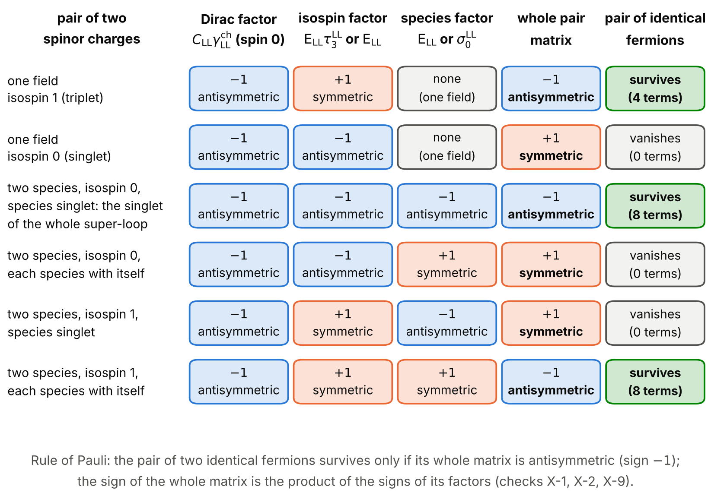
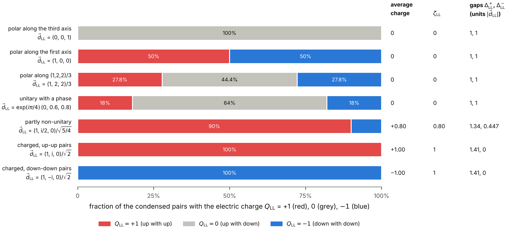
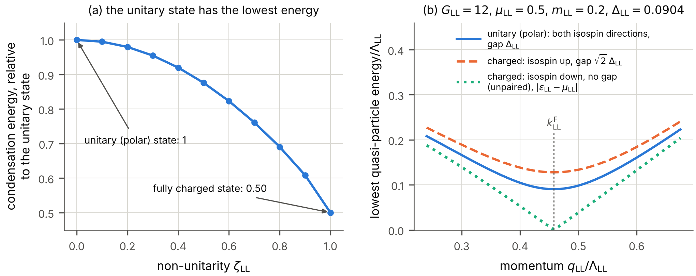

<!-- This file is generated from docs_src/X1_spin_zero_superfluid_explained.src.md by code/scripts/assemble_docs.py; edit the source. -->

# 1. The sentence, and how this document explains it

The conclusions of the manuscript of the folder Revision_SuperLoop, "The Lorentz Super-Loop of the
Bi-Octonions — Non-Associative Counterexamples to the No-Go Theorems and a Spin-Zero Spinor
Superfluid", contain the sentence

> The spin-zero superfluid of its spinor charges condenses in an isospin-triplet, unitary,
> electrically neutral state, and the pair that is a singlet of the whole super-loop requires two
> species.

The word "its" refers to the Lorentz super-loop $\mathbb L_{\rm LL}$. The sentence summarizes four
theorems and the calculations behind them, and almost every word in it is a technical term. This
document explains it completely: it defines every term, proves every claim, and works through
examples. Every number in it was computed by a program of the folder and is checked by machine
(Section 11). The reader is assumed to know the quantum mechanics of spin $\tfrac12$ (Pauli
matrices, singlet and triplet states), the Dirac equation, and the second quantization of fermions
(field operators that anticommute). Nothing about octonions or loops is assumed: Section 2 defines
everything that is needed.

The sentence makes seven statements:

| | words | the statement in plain language | sections |
|--|--------------|----------------------------------------------------------|------|
| 1 | "its spinor charges" | The particles are the spinor charges of the Lorentz super-loop. As particles they are fermions: a Dirac field with an isospin index that takes the two values up and down, with the electric charges $+\tfrac12$ (up) and $-\tfrac12$ (down). | 2 |
| 2 | "spin-zero" | The particles bind into pairs whose total spin is zero. | 3, 4 |
| 3 | "superfluid ... condenses" | At zero temperature the pairs form one coherent quantum state, a condensate, which has a lower grand potential than the gas of unpaired particles and can flow without friction. | 6 |
| 4 | "isospin-triplet" | The pairs have isospin 1. Nothing else is possible: the rule of Pauli forbids a spin-zero pair of two identical fermions to have isospin 0. | 3, 5 |
| 5 | "unitary" | The condensate pairs the two isospin directions equally: every particle, up or down, has the same energy gap. Among all condensates this one has the lowest grand potential. | 7 |
| 6 | "electrically neutral" | The condensed pairs carry no net electric charge. In the state chosen in the manuscript every pair has the charge 0, and the electric charge remains a conserved quantity. | 8 |
| 7 | "the pair that is a singlet of the whole super-loop requires two species" | The only pair that every symmetry of the super-loop leaves unchanged (spin 0 and isospin 0 together) is symmetric under the exchange of its two particles. For one kind of fermion such a pair vanishes identically; it exists only if the field comes in two kinds, called species. | 9 |

Section 10 repeats the sentence with the precise meaning of every part in one table. Section 11
lists the programs, the commands that reproduce every number and figure, and the complete reports of
the checks. Section 13 is the complete table of the symbols of the folder Revision_SuperLoop: every
symbol used here is defined there, and also in the text at its first use.

**Units.** $\hbar$ and the speed of light are 1, and the momentum cutoff $\Lambda_{\rm LL}$ of the
superfluid is 1, so that momenta, energies, masses and the chemical potential are pure numbers.

# 2. The particles: the spinor charges

## 2.1 The bi-octonions in brief

The **bi-octonions** $\mathbb B_{\rm LL}$ are the octonions with complex coefficients: the
combinations $\mathbf x=\sum_{p=0}^7\xi^{\rm LL}_p(\mathbf x)\,\mathbf e_p$ of eight units
$\mathbf e_0,\dots,\mathbf e_7$ with complex coefficients $\xi^{\rm LL}_p(\mathbf x)$. The unit
$\mathbf e_0=1$ is the number one. The units $\mathbf e_1,\mathbf e_2,\mathbf e_3$ are the quaternion
units: $\mathbf e_j^2=-1$ for $j=1,2,3$, and $\mathbf e_1\mathbf e_2=-\mathbf e_2\mathbf e_1=\mathbf e_3$
and cyclically. The unit $\mathbf e_4$ doubles the quaternions: $\mathbf e_4^2=-1$, and
$\mathbf e_5=\mathbf e_1\mathbf e_4$, $\mathbf e_6=\mathbf e_2\mathbf e_4$, $\mathbf e_7=\mathbf e_3\mathbf e_4$.
The imaginary unit $i$ of the complex coefficients commutes with every unit and is not one of them.

A **bi-quaternion** is a complex combination of $\mathbf e_0,\mathbf e_1,\mathbf e_2,\mathbf e_3$; bi-quaternions
are written with the bold letters $\mathbf a$, $\mathbf b$, $\mathbf c$, $\mathbf d$, $\mathbf b'$. Every
bi-octonion can be written as $\mathbf x=\mathbf a+\mathbf b\,\mathbf e_4$ with two bi-quaternions, and the
product of the bi-octonions is the **Cayley-Dickson product**
$$(\mathbf a+\mathbf b\,\mathbf e_4)(\mathbf c+\mathbf d\,\mathbf e_4)=(\mathbf a\mathbf c-\bar{\mathbf d}\mathbf b)+(\mathbf d\mathbf a+\mathbf b\bar{\mathbf c})\,\mathbf e_4 , \tag{2.1}$$
where the **conjugation** $\bar{\mathbf x}$ changes the signs of the coefficients of
$\mathbf e_1,\dots,\mathbf e_7$; it reverses the order of a product, $\overline{\mathbf x\mathbf y}=\bar{\mathbf y}\,\bar{\mathbf x}$.
The complex **norm** $N_{\rm LL}(\mathbf x)=\sum_p\xi^{\rm LL}_p(\mathbf x)^2$ satisfies
$\mathbf x\bar{\mathbf x}=N_{\rm LL}(\mathbf x)\,\mathbf e_0$ and is multiplicative,
$N_{\rm LL}(\mathbf x\mathbf y)=N_{\rm LL}(\mathbf x)\,N_{\rm LL}(\mathbf y)$. Its **polarization** is the
symmetric bilinear form
$$N_{\rm LL}(\mathbf x,\mathbf y)=\sum_{p=0}^7\xi^{\rm LL}_p(\mathbf x)\,\xi^{\rm LL}_p(\mathbf y)=N_{\rm LL}(\mathbf y,\mathbf x),\qquad N_{\rm LL}(\mathbf x,\mathbf x)=N_{\rm LL}(\mathbf x). \tag{2.2}$$

The product is **not associative**. Example: $(\mathbf e_1\mathbf e_2)\mathbf e_4=\mathbf e_3\mathbf e_4=\mathbf e_7$,
whereas $\mathbf e_2\mathbf e_4=\mathbf e_6$ and, by Eq. (2.1) with $\mathbf a=\mathbf e_1$ and
$\mathbf d=\mathbf e_2$, $\mathbf e_1\mathbf e_6=(\mathbf e_2\mathbf e_1)\,\mathbf e_4=-\mathbf e_7$. So
$(\mathbf e_1\mathbf e_2)\mathbf e_4=-\mathbf e_1(\mathbf e_2\mathbf e_4)$ (check X-8).

The **Lorentz super-loop** $\mathbb L_{\rm LL}=\{\mathbf w\in\mathbb B_{\rm LL}:N_{\rm LL}(\mathbf w)=1\}$ is
the set of the unit bi-octonions with this product. Because the norm is multiplicative, the product
of two unit bi-octonions is again a unit bi-octonion (check X-8 verifies the multiplicativity on 200
random pairs); $\mathbf e_0$ is the unit element, and $\bar{\mathbf w}$ is the inverse of $\mathbf w$. It is
not a group, because the product is not associative. It is a **Moufang loop**: a set with a product, a
unit element and inverses, in which associativity is replaced by the weaker Moufang identities. It
contains the unit bi-quaternions, which form the group $SL(2,\mathbb C)$, the double cover of the
Lorentz group (Section 2.2).

## 2.2 The 2×2 matrix of a bi-quaternion

A bi-quaternion is the same thing as a complex $2\times2$ matrix. Define
$M_{\rm LL}(\mathbf e_0)=\sigma^{\rm LL}_0$ (the $2\times2$ unit matrix) and $M_{\rm LL}(\mathbf e_j)=-i\sigma^{\rm LL}_j$,
with the Pauli matrices
$$\sigma^{\rm LL}_1=\begin{pmatrix}0&1\\1&0\end{pmatrix},\qquad\sigma^{\rm LL}_2=\begin{pmatrix}0&-i\\i&0\end{pmatrix},\qquad\sigma^{\rm LL}_3=\begin{pmatrix}1&0\\0&-1\end{pmatrix},$$
and extend $M_{\rm LL}$ complex-linearly. Then $M_{\rm LL}(\mathbf b\mathbf b')=M_{\rm LL}(\mathbf b)\,M_{\rm LL}(\mathbf b')$
and $\det M_{\rm LL}(\mathbf b)=N_{\rm LL}(\mathbf b)$ (check X-8 verifies both on 200 random pairs), and every
complex $2\times2$ matrix is $M_{\rm LL}(\mathbf b)$ for exactly one $\mathbf b$, because $\sigma^{\rm LL}_0$ and
the three Pauli matrices are a basis of the $2\times2$ matrices. The unit bi-quaternions, written
$\mathbf g$, are therefore exactly the complex $2\times2$ matrices of determinant 1: the group
$SL(2,\mathbb C)$.

One more matrix is used throughout, the real antisymmetric matrix
$$\mathsf E_{\rm LL}=i\sigma^{\rm LL}_2=\begin{pmatrix}0&1\\-1&0\end{pmatrix},\qquad\mathsf E_{\rm LL}^T=-\mathsf E_{\rm LL}=\mathsf E_{\rm LL}^{-1}.$$
For two columns of two entries each, the number (first column)$^T\,\mathsf E_{\rm LL}\,$(second
column) is the determinant of the $2\times2$ matrix whose columns they are. The entries of
$M_{\rm LL}(\mathbf b)^T\mathsf E_{\rm LL}M_{\rm LL}(\mathbf b)$ are such numbers for the columns of
$M_{\rm LL}(\mathbf b)$, so that, for every bi-quaternion $\mathbf b$,
$$M_{\rm LL}(\mathbf b)^T\,\mathsf E_{\rm LL}\,M_{\rm LL}(\mathbf b)=\det M_{\rm LL}(\mathbf b)\;\mathsf E_{\rm LL}=N_{\rm LL}(\mathbf b)\,\mathsf E_{\rm LL}. \tag{2.3}$$
For a unit bi-quaternion the right side is $\mathsf E_{\rm LL}$: **the antisymmetric form defined by
$\mathsf E_{\rm LL}$ is invariant under $SL(2,\mathbb C)$**. This one identity is behind every "singlet" of
this document.

## 2.3 The spinor charges and the symmetries of the super-loop

The **spinor charges** are the bi-octonions $\mathbf b\,\mathbf e_4$, with $\mathbf b$ any bi-quaternion:
four complex, or eight real, dimensions. The symmetries that matter here are the maps
$$\varphi^{\rm LL}_{\mathbf g,\mathbf v}:\ \mathbf a+\mathbf b\,\mathbf e_4\ \longmapsto\ \mathbf g\mathbf a\bar{\mathbf g}+(\mathbf v\mathbf b\bar{\mathbf g})\,\mathbf e_4 , \tag{2.4}$$
where $\mathbf g$ is a unit bi-quaternion (a **Lorentz transformation**, an element of $SL(2,\mathbb C)$)
and $\mathbf v$ is a unit quaternion with real coefficients (an **isospin rotation**; these form the
group $SU(2)_{\rm v}$). Each of these maps preserves the product,
$\varphi^{\rm LL}_{\mathbf g,\mathbf v}(\mathbf x\mathbf y)=\varphi^{\rm LL}_{\mathbf g,\mathbf v}(\mathbf x)\,\varphi^{\rm LL}_{\mathbf g,\mathbf v}(\mathbf y)$
(it is an **automorphism**; check X-8 verifies this on 200 random pairs of bi-octonions). Their
infinitesimal forms are the Lorentz generators, the rotations $J^j_{\rm LL}=\tfrac12\mathbf e_j$ and the
boosts $K^j_{\rm LL}=\tfrac12i\,\mathbf e_j$, and the three isospin generators $T^\iota_{\rm LL}$ with
$\iota=1,2,3$; the isospin index $\iota$ labels a direction in an internal space, not in space. In this
document **a symmetry of the whole super-loop** means a Lorentz transformation together with an
isospin rotation, Eq. (2.4), and **a singlet of the whole super-loop** is an object that every such
map leaves unchanged.

In terms of the matrix of $\mathbf b$, the spinor charge transforms as
$M_{\rm LL}(\mathbf b)\mapsto M_{\rm LL}(\mathbf v)\,M_{\rm LL}(\mathbf b)\,M_{\rm LL}(\bar{\mathbf g})$: the isospin
rotation acts from the left and mixes the two rows; the Lorentz transformation acts from the right
and mixes the two columns, inside each row. It is convenient to transpose, so that the isospin index
becomes the column index: the **Weyl isodoublet** of the spinor charge is the $2\times2$ matrix
$$\psi'_{\rm LL}=\mathsf E_{\rm LL}^{-1}M_{\rm LL}(\mathbf b)^T . \tag{2.5}$$
Its first column is called **isospin up**, its second column **isospin down**. A Lorentz generator
$\mathbf u$ changes $\mathbf b$ into $-\mathbf b\mathbf u$, and an isospin generator $\mathbf t$ changes $\mathbf b$
into $\mathbf t\mathbf b$. For the rotation $\mathbf u=J^j_{\rm LL}$, with $M_{\rm LL}(\mathbf u)=-\tfrac i2\sigma^{\rm LL}_j$,
the matrix $M_{\rm LL}(\mathbf b)$ changes by $\tfrac i2M_{\rm LL}(\mathbf b)\,\sigma^{\rm LL}_j$, and therefore
$\psi'_{\rm LL}$ changes by
$$\tfrac i2\,\mathsf E_{\rm LL}^{-1}(\sigma^{\rm LL}_j)^TM_{\rm LL}(\mathbf b)^T=\tfrac i2\,\big(\mathsf E_{\rm LL}^{-1}(\sigma^{\rm LL}_j)^T\mathsf E_{\rm LL}\big)\,\psi'_{\rm LL}=-\tfrac i2\,\sigma^{\rm LL}_j\,\psi'_{\rm LL},$$
because $\mathsf E_{\rm LL}^{-1}(\sigma^{\rm LL}_j)^T\mathsf E_{\rm LL}=-\sigma^{\rm LL}_j$ for $j=1,2,3$. The boosts
and the isospin generators are treated in the same way. The result:

* on each column, a rotation acts as $-\tfrac i2\sigma^{\rm LL}_j$ and a boost as $+\tfrac12\sigma^{\rm LL}_j$:
  each column is a **Weyl spinor**, a two-component spinor of the Lorentz group of the kind that
  describes a particle of spin $\tfrac12$ of one chirality;
* the isospin generators $T^\iota_{\rm LL}$ act on the column index as $\tfrac12\tau^{\rm LL}_\iota$, where
  $\tau^{\rm LL}_1$, $\tau^{\rm LL}_2$, $\tau^{\rm LL}_3$ are the Pauli matrices acting on the isospin index:
  the two columns form an **isospin doublet**;
* the **electric charge** is $Q_{\rm LL}=T^3_{\rm LL}$: it is $+\tfrac12$ on the up column and $-\tfrac12$
  on the down column.

A rotation by the angle $2\pi$ about any axis multiplies a spinor charge by
$\exp(-i\pi\sigma^{\rm LL}_j)=-1$: the **spinor number** of the spinor charges is $-1$. In one sentence:
**the spinor charges are a Weyl spinor that is an isospin doublet with the electric charges
$\pm\tfrac12$.**

## 2.4 From the algebra to particles: the field of the spinor charges

To speak of a superfluid, the spinor charges are treated as the quantum states of particles, which a
quantum field creates and annihilates. That field is the **Dirac isodoublet** $\Psi_{\rm LL}$: eight
complex components, four Dirac components times two isospin components (up, down). In the chiral
basis the Dirac matrices are
$$\gamma^0_{\rm LL}=\begin{pmatrix}0&\sigma^{\rm LL}_0\\\sigma^{\rm LL}_0&0\end{pmatrix},\qquad\gamma^j_{\rm LL}=\begin{pmatrix}0&\sigma^{\rm LL}_j\\-\sigma^{\rm LL}_j&0\end{pmatrix},\qquad\gamma^{\rm ch}_{\rm LL}=i\gamma^0_{\rm LL}\gamma^1_{\rm LL}\gamma^2_{\rm LL}\gamma^3_{\rm LL}=\mathrm{diag}(-1,-1,1,1),$$
and the charge-conjugation matrix is $C_{\rm LL}=i\gamma^2_{\rm LL}\gamma^0_{\rm LL}$. The half with the
**chirality** $\gamma^{\rm ch}_{\rm LL}=+1$ (the lower two Dirac components) is built from the spinor
charges, on which a boost acts as $+\tfrac12\sigma^{\rm LL}_j$; the other half (the upper two
components, on which a boost acts as $-\tfrac12\sigma^{\rm LL}_j$) is supplied by the complex-conjugate
super-loop. Both halves are needed for a mass and for a Lorentz-invariant Hamiltonian. The
Hamiltonian matrix of a plane wave of momentum $\vec q_{\rm LL}$ is
$\mathsf h_{\rm LL}(\vec q_{\rm LL})=\sum_j\alpha^j_{\rm LL}q^j_{\rm LL}+\beta_{\rm LL}m_{\rm LL}$, with
$\alpha^j_{\rm LL}=\gamma^0_{\rm LL}\gamma^j_{\rm LL}$, $\beta_{\rm LL}=\gamma^0_{\rm LL}$, the mass $m_{\rm LL}$ of the
spinor charges, and the unit matrix on the isospin index; its eigenvalues are $\pm\varepsilon_{\rm LL}$,
with $\varepsilon_{\rm LL}=(q_{\rm LL}^2+m_{\rm LL}^2)^{1/2}$.

**The particles are fermions.** The components of $\Psi_{\rm LL}$ have the spinor number $-1$. By the
spin-statistics theorem of relativistic quantum field theory, a field of half-integer spin must be
quantized with anticommutators: **any two components of $\Psi_{\rm LL}$ anticommute, and the square of
any component is zero.** Electrons, quarks and nucleons are fermions for the same reason. This one
fact decides most of the sentence.

# 3. Pairs of identical fermions: the rule of Pauli as a rule of signs

## 3.1 A pair is a quadratic expression in the field

Two particles are annihilated together by an operator that is quadratic in the field,
$\Psi^T_{\rm LL}\mathsf K\Psi_{\rm LL}$: a sum over all entries of an $8\times8$ **pair matrix**
$\mathsf K$, each entry multiplied by the component of $\Psi_{\rm LL}$ that labels its row and by the
component that labels its column. The pair matrix is the wavefunction of the pair in the internal
labels (Dirac and isospin): it says with which amplitude a given internal state of one particle goes
with a given internal state of the other. For two particles of opposite momenta, that is, a pair at
rest, the pair operator is
$$\sum_{\vec q_{\rm LL}}\Psi_{\rm LL}(\vec q_{\rm LL})^T\,\mathsf K\,\Psi_{\rm LL}(-\vec q_{\rm LL}),$$
where $\Psi_{\rm LL}(\vec q_{\rm LL})$ annihilates a particle of momentum $\vec q_{\rm LL}$.

## 3.2 Only the antisymmetric part of the pair matrix survives

*Example.* Let only the entries of $\mathsf K$ in the rows and columns 1 and 2 be different from zero,
and write $(\Psi_{\rm LL})_1$ and $(\Psi_{\rm LL})_2$ for the first two components of the field, and
$\mathsf K_{12}$ for the entry in row 1 and column 2. Then
$$\begin{aligned}\Psi^T_{\rm LL}\mathsf K\Psi_{\rm LL}&=\mathsf K_{11}(\Psi_{\rm LL})_1^2+\mathsf K_{12}(\Psi_{\rm LL})_1(\Psi_{\rm LL})_2+\mathsf K_{21}(\Psi_{\rm LL})_2(\Psi_{\rm LL})_1+\mathsf K_{22}(\Psi_{\rm LL})_2^2\\&=(\mathsf K_{12}-\mathsf K_{21})\,(\Psi_{\rm LL})_1(\Psi_{\rm LL})_2 ,\end{aligned}$$
because $(\Psi_{\rm LL})_1^2=(\Psi_{\rm LL})_2^2=0$ and $(\Psi_{\rm LL})_2(\Psi_{\rm LL})_1=-(\Psi_{\rm LL})_1(\Psi_{\rm LL})_2$.
If $\mathsf K$ is symmetric, $\mathsf K_{12}=\mathsf K_{21}$, the pair is **identically zero**: it annihilates
nothing, and its Hermitian conjugate creates nothing.

*The general statement.* Every term of $\Psi^T_{\rm LL}\mathsf K\Psi_{\rm LL}$ is an entry of $\mathsf K$
times two components. Exchanging the two components in every term changes the sign of every term
and makes every entry multiply its two components in the order of the transposed matrix. Hence
$$\Psi^T_{\rm LL}\mathsf K\Psi_{\rm LL}=-\Psi^T_{\rm LL}\mathsf K^T\Psi_{\rm LL}=\Psi^T_{\rm LL}\,\tfrac12\big(\mathsf K-\mathsf K^T\big)\,\Psi_{\rm LL}: \tag{3.1}$$
only the antisymmetric part of the pair matrix contributes. For the pair at rest the same argument
reads
$$\begin{aligned}\sum_{\vec q_{\rm LL}}\Psi_{\rm LL}(\vec q_{\rm LL})^T\mathsf K\,\Psi_{\rm LL}(-\vec q_{\rm LL})&=-\sum_{\vec q_{\rm LL}}\Psi_{\rm LL}(-\vec q_{\rm LL})^T\mathsf K^T\Psi_{\rm LL}(\vec q_{\rm LL})\\&=-\sum_{\vec q_{\rm LL}}\Psi_{\rm LL}(\vec q_{\rm LL})^T\mathsf K^T\Psi_{\rm LL}(-\vec q_{\rm LL});\end{aligned}$$
the first step exchanges the anticommuting factors, the second renames the summation variable
$\vec q_{\rm LL}\to-\vec q_{\rm LL}$. Here the **s-wave** enters: the pair matrix does not depend on the
direction of the momentum. (The interaction of Section 6 is a contact interaction; it acts only in
the s-wave, the state of zero relative orbital angular momentum, whose spatial wavefunction is
unchanged when the positions of the two particles are exchanged.) If the pair matrix were an odd
function of the momentum, a p-wave as in superfluid helium 3, the same two steps would keep the
symmetric part instead.

**The rule of Pauli for a pair in an s-wave: a pair of one kind of fermion exists only if its pair
matrix is antisymmetric.** The number of independent terms that survive is the number of unordered
pairs of different components whose coefficient in $\tfrac12(\mathsf K-\mathsf K^T)$ is not zero; the
program counts it for every pair matrix of this document (check X-2).

## 3.3 The sign of a Kronecker product

The pair matrices of this document are Kronecker products of a Dirac factor ($4\times4$), an isospin
factor ($2\times2$) and, in Section 9, a species factor ($2\times2$). The transpose of a Kronecker
product is the Kronecker product of the transposed factors. If each factor is symmetric (exchange
sign $+1$) or antisymmetric (exchange sign $-1$), the product therefore has the product of the signs.
For example (the signs of the two factors are derived in Sections 4 and 5),
$$\big(C_{\rm LL}\gamma^{\rm ch}_{\rm LL}\otimes\mathsf E_{\rm LL}\tau^{\rm LL}_3\big)^T=\big(C_{\rm LL}\gamma^{\rm ch}_{\rm LL}\big)^T\otimes\big(\mathsf E_{\rm LL}\tau^{\rm LL}_3\big)^T=(-1)(+1)\;C_{\rm LL}\gamma^{\rm ch}_{\rm LL}\otimes\mathsf E_{\rm LL}\tau^{\rm LL}_3 .$$
With this, the rule of Pauli becomes a **rule of signs**:
$$(\text{sign of the Dirac factor})\times(\text{sign of the isospin factor})\times(\text{sign of the species factor, if any})=-1. \tag{3.2}$$
The program verifies the multiplication of the signs for all 24 products of the factors used here
(check X-1). Figure 1 of Section 5 does this bookkeeping for the pairs of the sentence.

## 3.4 The same rule in atoms and nuclei

*Example 1: the ground state of helium.* The two electrons of the helium atom occupy the same 1s
orbital, so their spatial wavefunction is symmetric. The whole wavefunction of two electrons must be
antisymmetric, so the spin part must be antisymmetric: the singlet
$(\lvert\uparrow\downarrow\rangle-\lvert\downarrow\uparrow\rangle)/\sqrt2$, of total spin 0. The ground state of
helium is indeed a spin singlet, and no spin-triplet state with both electrons in the 1s orbital
exists. In the excited configuration 1s2s the two orbitals are different; the spatial part can then
be antisymmetric, and the spin triplet is allowed (orthohelium). A second label, here the orbital,
can carry the antisymmetry: this is the idea of Section 9.

*Example 2: two nucleons.* A proton and a neutron are the two states of one particle with spin
$\tfrac12$ and isospin $\tfrac12$ (proton: isospin up; neutron: isospin down). Two nucleons in an
s-wave must have an antisymmetric product of the spin part and the isospin part. That leaves two
possibilities: spin 0 with isospin 1 (the spin-singlet s-wave channel, written ¹S₀ by nuclear
physicists: the three pairs proton-proton, proton-neutron, neutron-neutron), and spin 1 with isospin 0
(the deuteron). Spin 0 with isospin 0, and spin 1 with isospin 1, are forbidden. The ¹S₀ pairs are
exactly "spin-zero isospin-triplet" pairs; the condensate of neutron-neutron pairs in this channel
makes the crust of a neutron star superfluid, and the pairing of like nucleons in atomic nuclei is of
the same kind.

The program counts the two-particle states of this nucleon-like problem (check X-10). One kind of
particle has $2\times2=4$ internal states (spin up or down, isospin up or down); two particles have 16,
of which 6 are antisymmetric (the number of ways of choosing 2 of 4 different states). With two
species a third two-valued label is added: 8 internal states, 64 two-particle states, 28 of them
antisymmetric. The rows below sort the states by the total spin, the total isospin and, for two
species, the total "species spin" (0: the antisymmetric species combination
$(\lvert12\rangle-\lvert21\rangle)/\sqrt2$, the species singlet; 1: the three symmetric combinations, the
species triplet):

| total spin | total isospin | species | states | antisymmetric | symmetric | allowed in an s-wave |
|-------|--------|------------------|------|----------|---------|----------|
| 0 | 0 | one kind | 1 | 0 | 1 | no |
| 0 | 1 | one kind | 3 | 3 | 0 | yes |
| 1 | 0 | one kind | 3 | 3 | 0 | yes |
| 1 | 1 | one kind | 9 | 0 | 9 | no |
| 0 | 0 | two species, 0 (singlet) | 1 | 1 | 0 | yes |
| 0 | 0 | two species, 1 (triplet) | 3 | 0 | 3 | no |
| 0 | 1 | two species, 0 (singlet) | 3 | 0 | 3 | no |
| 0 | 1 | two species, 1 (triplet) | 9 | 9 | 0 | yes |
| 1 | 0 | two species, 0 (singlet) | 3 | 0 | 3 | no |
| 1 | 0 | two species, 1 (triplet) | 9 | 9 | 0 | yes |
| 1 | 1 | two species, 0 (singlet) | 9 | 9 | 0 | yes |
| 1 | 1 | two species, 1 (triplet) | 27 | 0 | 27 | no |

With one kind of particle, spin 0 with isospin 0 is forbidden; with two species it is allowed, in the
species singlet. **This table is the whole sentence in miniature:** the second row (spin 0, isospin 1,
one kind) is the superfluid of the first half of the sentence, and the fifth row (spin 0, isospin 0,
species singlet) is the pair of the second half.

# 4. "Spin-zero": the Dirac factor of the pair

## 4.1 Two Weyl spinors: the invariant pair is the singlet

Take two Weyl spinors, that is, two columns of two entries. A Lorentz transformation multiplies both
by the same $2\times2$ matrix of determinant 1 (on the columns of $\psi'_{\rm LL}$ this matrix is
$\mathsf E_{\rm LL}^{-1}M_{\rm LL}(\bar{\mathbf g})^T\mathsf E_{\rm LL}$, of determinant $N_{\rm LL}(\mathbf g)=1$). By
Eq. (2.3), the number (first spinor)$^T\,\mathsf E_{\rm LL}\,$(second spinor) does not change: it is a
Lorentz scalar, a pair of **spin 0**. It pairs the first entry (spin up) of one spinor with the second
entry (spin down) of the other, minus the reverse: it is the spin singlet
$(\lvert\uparrow\downarrow\rangle-\lvert\downarrow\uparrow\rangle)/\sqrt2$, and it changes sign when the two
spinors are exchanged, because $\mathsf E_{\rm LL}^T=-\mathsf E_{\rm LL}$. The same follows infinitesimally:
the rotations act as $-\tfrac i2\sigma^{\rm LL}_j$, the boosts as $+\tfrac12\sigma^{\rm LL}_j$, and the pair is
invariant because
$$(\sigma^{\rm LL}_j)^T\mathsf E_{\rm LL}+\mathsf E_{\rm LL}\,\sigma^{\rm LL}_j=0\qquad(j=1,2,3).$$
The symmetric $2\times2$ matrices, spanned by the three matrices $\mathsf E_{\rm LL}\sigma^{\rm LL}_j$, give
instead three numbers that turn into each other under rotations, like the components of a vector: a
pair of spin 1. So, exactly as for two electrons: **spin 0 means an antisymmetric spin factor, spin 1
a symmetric one.**

## 4.2 Dirac spinors: the two spin-zero pair matrices

A Dirac spinor consists of two Weyl spinors: the upper two components (chirality $-1$) and the lower
two (chirality $+1$). A Lorentz-invariant pair joins upper with upper by $\mathsf E_{\rm LL}$ and lower
with lower by $\mathsf E_{\rm LL}$ (joining upper with lower gives a four-vector, not a scalar). There are
therefore two independent spin-zero pair matrices,
$$C_{\rm LL}=\begin{pmatrix}\mathsf E_{\rm LL}&0\\0&-\mathsf E_{\rm LL}\end{pmatrix},\qquad C_{\rm LL}\gamma^{\rm ch}_{\rm LL}=-\begin{pmatrix}\mathsf E_{\rm LL}&0\\0&\mathsf E_{\rm LL}\end{pmatrix}, \tag{4.1}$$
and **both are antisymmetric** (exchange sign $-1$). Under parity, which exchanges the two
chiralities, the pair $\Psi^T_{\rm LL}C_{\rm LL}\gamma^{\rm ch}_{\rm LL}\Psi_{\rm LL}$ is unchanged (a scalar,
written $0^+$) and $\Psi^T_{\rm LL}C_{\rm LL}\Psi_{\rm LL}$ changes sign (a pseudoscalar, $0^-$). A picture:
a particle with momentum $\vec q_{\rm LL}$ and its partner with momentum $-\vec q_{\rm LL}$, of the same
chirality, have opposite spin projections on the direction of $\vec q_{\rm LL}$; their total spin is 0.
The program verifies the Lorentz invariance of all eight spin-zero pair matrices under the three
rotations and the three boosts of the Dirac field (check X-3).

**"Spin-zero" therefore means: the Dirac factor of the pair matrix is $C_{\rm LL}\gamma^{\rm ch}_{\rm LL}$
or $C_{\rm LL}$, and it is antisymmetric.**

# 5. "Isospin-triplet": the isospin factor of the pair

## 5.1 The four isospin matrices

The isospin factor of a pair matrix is a $2\times2$ matrix whose rows belong to the isospin of one
particle (up, down) and whose columns to the isospin of the other. A basis of all $2\times2$ matrices
is
$$\mathsf E_{\rm LL}\tau^{\rm LL}_1=\begin{pmatrix}1&0\\0&-1\end{pmatrix},\quad\mathsf E_{\rm LL}\tau^{\rm LL}_2=\begin{pmatrix}i&0\\0&i\end{pmatrix},\quad\mathsf E_{\rm LL}\tau^{\rm LL}_3=\begin{pmatrix}0&-1\\-1&0\end{pmatrix},\quad\mathsf E_{\rm LL}=\begin{pmatrix}0&1\\-1&0\end{pmatrix}. \tag{5.1}$$
The first three are **symmetric** (exchange sign $+1$). Under an isospin rotation they turn into each
other like the three components of a vector: they form the **isospin triplet**, isospin 1. The
fourth, $\mathsf E_{\rm LL}$, is **antisymmetric** (exchange sign $-1$) and does not change at all under an
isospin rotation, by Eq. (2.3) with $\mathbf b=\mathbf v$: it is the **isospin singlet**, isospin 0. (This is
the same algebra as for spin in Section 4.1, with the isospin in place of the spin.) The program
identifies the isospin of each matrix with the Casimir operator
$(T_{\rm LL})^2=\sum_\iota(T^\iota_{\rm LL})^2$, whose eigenvalue is $1\cdot(1+1)=2$ for isospin 1 and 0 for
isospin 0: it finds 2 for the three symmetric matrices and 0 for $\mathsf E_{\rm LL}$ (check X-3).

## 5.2 The rule of Pauli forces the triplet

The Dirac factor of a spin-zero pair has the sign $-1$ (Section 4). By the rule of signs (3.2), the
isospin factor of a pair of one kind of fermion must then have the sign $+1$: it must be symmetric,
**an isospin triplet**. The isospin-singlet pairs $C_{\rm LL}\gamma^{\rm ch}_{\rm LL}\otimes\mathsf E_{\rm LL}$
and $C_{\rm LL}\otimes\mathsf E_{\rm LL}$ have the sign $(-1)(-1)=+1$ and vanish identically: of their terms,
none survives (check X-2). The spin-zero pairs of the spinor charges are therefore spanned by the six
pair matrices
$$\mathsf K^\iota_{\rm LL}=C_{\rm LL}\gamma^{\rm ch}_{\rm LL}\otimes\mathsf E_{\rm LL}\tau^{\rm LL}_\iota\quad(0^+),\qquad\mathsf K'^\iota_{\rm LL}=C_{\rm LL}\otimes\mathsf E_{\rm LL}\tau^{\rm LL}_\iota\quad(0^-),\qquad\iota=1,2,3. \tag{5.2}$$
This explains the first adjective of the sentence: **every spin-zero pair of the spinor charges is an
isospin triplet, so the spin-zero superfluid cannot be anything else.**

## 5.3 The electric charges of the pairs

The combinations of the triplet with a definite electric charge have the isospin factors
$$\mathsf E_{\rm LL}\tau^{\rm LL}_1-i\,\mathsf E_{\rm LL}\tau^{\rm LL}_2=\begin{pmatrix}2&0\\0&0\end{pmatrix},\qquad\mathsf E_{\rm LL}\tau^{\rm LL}_3=\begin{pmatrix}0&-1\\-1&0\end{pmatrix},\qquad\mathsf E_{\rm LL}\tau^{\rm LL}_1+i\,\mathsf E_{\rm LL}\tau^{\rm LL}_2=\begin{pmatrix}0&0\\0&-2\end{pmatrix}.$$
So $\mathsf K^1_{\rm LL}-i\,\mathsf K^2_{\rm LL}$ joins an up particle with an up particle: the pair has the
charge $\tfrac12+\tfrac12=+1$. $\mathsf K^3_{\rm LL}$ joins up with down symmetrically, the isospin state
$(\lvert\uparrow\downarrow\rangle+\lvert\downarrow\uparrow\rangle)/\sqrt2$, of charge 0.
$\mathsf K^1_{\rm LL}+i\,\mathsf K^2_{\rm LL}$ joins down with down: charge $-1$. (The forbidden singlet
$\mathsf E_{\rm LL}$ would also have the charge 0: up with down, but antisymmetric.) The program finds each
charge as the number $Q_{\rm LL}(\mathsf K)$ for which the generator of $Q_{\rm LL}$ on the field,
transposed and multiplied by $\mathsf K$, plus $\mathsf K$ multiplied by the generator, equals
$Q_{\rm LL}(\mathsf K)\,\mathsf K$ (check X-4).

All pair matrices of this document, with their signs, the number of their terms that survive and the
charges of the pairs (data file `explanations/data/ex_pair_matrices.csv`; checks X-1 to X-4 and X-9):

| pair matrix | spin and parity | isospin | species | exchange signs of the Dirac, isospin and species factors | sign of the whole matrix | terms that survive | charge of the pair |
|-------------------------------|------|---------|------------|-------------|-------|-------|-----------|
| $C_{\rm LL}\gamma^{\rm ch}_{\rm LL}\otimes \mathsf E_{\rm LL}\tau^{\rm LL}_1$ | 0$^+$ | 1 (triplet) | one field | $-1$, $+1$, none | $-1$ | 4 | mixture of $+1$ and $-1$ |
| $C_{\rm LL}\gamma^{\rm ch}_{\rm LL}\otimes \mathsf E_{\rm LL}\tau^{\rm LL}_2$ | 0$^+$ | 1 (triplet) | one field | $-1$, $+1$, none | $-1$ | 4 | mixture of $+1$ and $-1$ |
| $C_{\rm LL}\gamma^{\rm ch}_{\rm LL}\otimes \mathsf E_{\rm LL}\tau^{\rm LL}_3$ | 0$^+$ | 1 (triplet) | one field | $-1$, $+1$, none | $-1$ | 4 | 0 |
| $C_{\rm LL}\gamma^{\rm ch}_{\rm LL}\otimes \mathsf E_{\rm LL}$ | 0$^+$ | 0 (singlet) | one field | $-1$, $-1$, none | $+1$ | 0 | 0 |
| $C_{\rm LL}\otimes \mathsf E_{\rm LL}\tau^{\rm LL}_1$ | 0$^-$ | 1 (triplet) | one field | $-1$, $+1$, none | $-1$ | 4 | mixture of $+1$ and $-1$ |
| $C_{\rm LL}\otimes \mathsf E_{\rm LL}\tau^{\rm LL}_2$ | 0$^-$ | 1 (triplet) | one field | $-1$, $+1$, none | $-1$ | 4 | mixture of $+1$ and $-1$ |
| $C_{\rm LL}\otimes \mathsf E_{\rm LL}\tau^{\rm LL}_3$ | 0$^-$ | 1 (triplet) | one field | $-1$, $+1$, none | $-1$ | 4 | 0 |
| $C_{\rm LL}\otimes \mathsf E_{\rm LL}$ | 0$^-$ | 0 (singlet) | one field | $-1$, $-1$, none | $+1$ | 0 | 0 |
| $\mathsf K^1_{\rm LL}-i\,\mathsf K^2_{\rm LL}$ | 0$^+$ | 1 (triplet) | one field | $-1$, $+1$, none | $-1$ | 2 | $+1$ |
| $\mathsf K^3_{\rm LL}$ | 0$^+$ | 1 (triplet) | one field | $-1$, $+1$, none | $-1$ | 4 | 0 |
| $\mathsf K^1_{\rm LL}+i\,\mathsf K^2_{\rm LL}$ | 0$^+$ | 1 (triplet) | one field | $-1$, $+1$, none | $-1$ | 2 | $-1$ |
| $C_{\rm LL}\gamma^{\rm ch}_{\rm LL}\otimes \mathsf E_{\rm LL}\otimes \mathsf E_{\rm LL}=\mathsf K^{\rm s}_{\rm LL}$ | 0$^+$ | 0 (singlet) | two species, species singlet | $-1$, $-1$, $-1$ | $-1$ | 8 | 0 |
| $C_{\rm LL}\gamma^{\rm ch}_{\rm LL}\otimes \mathsf E_{\rm LL}\tau^{\rm LL}_3\otimes \mathsf E_{\rm LL}$ | 0$^+$ | 1 (triplet) | two species, species singlet | $-1$, $+1$, $-1$ | $+1$ | 0 | 0 |
| $C_{\rm LL}\gamma^{\rm ch}_{\rm LL}\otimes \mathsf E_{\rm LL}\otimes \sigma^{\rm LL}_0$ | 0$^+$ | 0 (singlet) | two species, each with itself | $-1$, $-1$, $+1$ | $+1$ | 0 | 0 |
| $C_{\rm LL}\gamma^{\rm ch}_{\rm LL}\otimes \mathsf E_{\rm LL}\tau^{\rm LL}_3\otimes \sigma^{\rm LL}_0$ | 0$^+$ | 1 (triplet) | two species, each with itself | $-1$, $+1$, $+1$ | $-1$ | 8 | 0 |

{width=100%}

**Figure 1.** The rule of Pauli as a bookkeeping of signs. Each row is a pair of two spinor charges in
an s-wave. The columns give the exchange sign ($+1$ symmetric, $-1$ antisymmetric) of the Dirac factor
(here always $C_{\rm LL}\gamma^{\rm ch}_{\rm LL}$, spin 0), of the isospin factor
($\mathsf E_{\rm LL}\tau^{\rm LL}_3$, isospin 1, or $\mathsf E_{\rm LL}$, isospin 0), of the species factor (none
for one field; $\mathsf E_{\rm LL}$, the species singlet, or $\sigma^{\rm LL}_0$, each species paired with
itself), and of the whole pair matrix, which is the product of the three. Blue: sign $-1$; orange:
sign $+1$; grey: no species factor. Identical fermions need the sign $-1$ for the whole matrix; the last
column states whether the pair survives and how many independent terms it keeps. For one field only
the isospin triplet survives (first row). The singlet of the whole super-loop, spin 0 and isospin 0,
survives only with two species in the species singlet (third row). Data:
`explanations/data/ex_pair_matrices.csv`; checks X-1, X-2, X-9; drawn by
`explanations/code/make_explain_figures.py`.

## 5.4 Comparison with the nucleons

The ¹S₀ pairs of nucleons and the spin-zero pairs of the spinor charges have the same structure:
spin 0, isospin 1, three charge states. The difference is the electric charge of the members of the
doublet. For nucleons the charge is the isospin projection plus one half of the baryon number (proton
1, neutron 0), so the three pairs have the charges 2, 1, 0 in units of the proton charge. For the spinor charges the charge
is $Q_{\rm LL}=T^3_{\rm LL}$ alone (up $+\tfrac12$, down $-\tfrac12$), so the three pairs have the charges
$+1$, 0, $-1$, and the pair with the charge 0 is the up-down pair.

# 6. "Superfluid ... condenses": what forms, and why

## 6.1 The Hamiltonian

The manuscript studies free Dirac particles of mass $m_{\rm LL}$ at the chemical potential
$\mu_{\rm LL}$, with an attractive contact interaction in the scalar spin-zero channels,
$$\mathcal H^{\rm sf}_{\rm LL}=\sum_{\vec q_{\rm LL}}\Psi^\dagger_{\rm LL}\big(\mathsf h_{\rm LL}-\mu_{\rm LL}\big)\Psi_{\rm LL}-\tfrac14G_{\rm LL}\sum_\iota\big(\Pi^\iota_{\rm LL}\big)^\dagger\Pi^\iota_{\rm LL}, \tag{6.1}$$
with the pair operators of the three scalar channels
$$\Pi^\iota_{\rm LL}=\sum_{\vec q_{\rm LL}}\Psi_{\rm LL}(\vec q_{\rm LL})^T\,\mathsf K^\iota_{\rm LL}\,\Psi_{\rm LL}(-\vec q_{\rm LL}), \tag{6.2}$$
which annihilate two spinor charges of opposite momenta. All momentum sums run over
$q_{\rm LL}<\Lambda_{\rm LL}$. The **chemical potential** $\mu_{\rm LL}$ is the energy needed to add one
particle; for $\mu_{\rm LL}>m_{\rm LL}$ the normal state is a filled Fermi sea of particles up to the
**Fermi momentum** $k^{\rm F}_{\rm LL}=(\mu_{\rm LL}^2-m_{\rm LL}^2)^{1/2}$. The **coupling** $G_{\rm LL}>0$
makes the interaction attractive. The sum over $\iota$ is the scalar product of two isospin vectors,
so the interaction is isospin invariant: it attracts the up-up, up-down and down-down pairs equally.

## 6.2 The order parameter

The **order parameter** is the complex isospin vector $\vec d_{\rm LL}=(d^1_{\rm LL},d^2_{\rm LL},d^3_{\rm LL})$,
$$d^\iota_{\rm LL}=-\tfrac12G_{\rm LL}\,\langle\Pi^\iota_{\rm LL}\rangle , \tag{6.3}$$
the expectation value of the pair operators in the ground state, times $-\tfrac12G_{\rm LL}$. In the
normal state it is zero: the ground state of a fixed number of particles gives zero for an operator
that removes two particles. A ground state with $\vec d_{\rm LL}\neq0$ is a coherent superposition of
states with different numbers of pairs, in which a macroscopic number of pairs share one pair
wavefunction: a **condensate** of pairs. Because the three pair matrices $\mathsf K^\iota_{\rm LL}$
transform under isospin rotations like the components of a vector, so does $\vec d_{\rm LL}$. Under the
transformation $\Psi_{\rm LL}\to e^{i\theta_{\rm LL}}\Psi_{\rm LL}$ generated by the **fermion number**
$F_{\rm LL}$, the pair operators change by $e^{2i\theta_{\rm LL}}$, and so does $\vec d_{\rm LL}$.

## 6.3 Mean field, and the wavefunction of the condensed pairs

In the **mean-field approximation** each product of pair operators in Eq. (6.1) is replaced by
$$-\tfrac14G_{\rm LL}\big[\langle\Pi^\iota_{\rm LL}\rangle^*\,\Pi^\iota_{\rm LL}+(\Pi^\iota_{\rm LL})^\dagger\langle\Pi^\iota_{\rm LL}\rangle-\lvert\langle\Pi^\iota_{\rm LL}\rangle\rvert^2\big]=\tfrac12d^{\iota*}_{\rm LL}\Pi^\iota_{\rm LL}+\tfrac12d^\iota_{\rm LL}(\Pi^\iota_{\rm LL})^\dagger+\frac{\lvert d^\iota_{\rm LL}\rvert^2}{G_{\rm LL}} ,$$
which neglects only the fluctuations of the pair operators about their mean values. The term
$$\tfrac12\sum_\iota d^\iota_{\rm LL}(\Pi^\iota_{\rm LL})^\dagger=\tfrac12\sum_{\vec q_{\rm LL}}\Psi^\dagger_{\rm LL}(\vec q_{\rm LL})\,\mathsf P_{\rm LL}\,\Psi^\dagger_{\rm LL}(-\vec q_{\rm LL})^T,\qquad\mathsf P_{\rm LL}=\sum_\iota d^\iota_{\rm LL}(\mathsf K^\iota_{\rm LL})^\dagger ,$$
creates pairs with the pair matrix $\mathsf P_{\rm LL}$. Because
$(\mathsf K^\iota_{\rm LL})^\dagger=(C_{\rm LL}\gamma^{\rm ch}_{\rm LL})^\dagger\otimes(\mathsf E_{\rm LL}\tau^{\rm LL}_\iota)^\dagger$,
$$\mathsf P_{\rm LL}=\big(C_{\rm LL}\gamma^{\rm ch}_{\rm LL}\big)^\dagger\otimes\mathsf D_{\rm LL},\qquad\mathsf D_{\rm LL}=\sum_\iota d^\iota_{\rm LL}\big(\mathsf E_{\rm LL}\tau^{\rm LL}_\iota\big)^\dagger=\begin{pmatrix}d^1_{\rm LL}-i\,d^2_{\rm LL}&-d^3_{\rm LL}\\-d^3_{\rm LL}&-d^1_{\rm LL}-i\,d^2_{\rm LL}\end{pmatrix}. \tag{6.4}$$
In the ground state of the mean-field Hamiltonian the pairs are created with this matrix: for one
pair of momenta the ground state is a superposition of "no pair" and "one pair", and the ratio of the
two amplitudes is a negative number times the coefficient of the pair term. **The condensed pairs therefore have the spin factor
$(C_{\rm LL}\gamma^{\rm ch}_{\rm LL})^\dagger$ (spin 0) and the isospin wavefunction $\mathsf D_{\rm LL}$**: the
entry of $\mathsf D_{\rm LL}$ in the row of the isospin of one particle and the column of the isospin of
the other is the amplitude of that combination (check X-5 verifies that this matrix equals
$-\sum_\iota d^\iota_{\rm LL}\tau^{\rm LL}_\iota\mathsf E_{\rm LL}$, the form used to compute the pair content).

The mean-field Hamiltonian is quadratic in the field. For each momentum it is described by the
$16\times16$ **Bogoliubov-de Gennes matrix**
$$\mathsf H_{\rm LL}=\begin{pmatrix}\mathsf h_{\rm LL}(\vec q_{\rm LL})-\mu_{\rm LL}&\mathsf P_{\rm LL}\\\mathsf P_{\rm LL}^\dagger&-\big(\mathsf h_{\rm LL}(-\vec q_{\rm LL})-\mu_{\rm LL}\big)^T\end{pmatrix}$$
acting on the Nambu spinor $\mathcal N_{\rm LL}=(\Psi_{\rm LL}(\vec q_{\rm LL}),\Psi^*_{\rm LL}(-\vec q_{\rm LL}))$, which
combines the annihilation of a particle with the creation of its partner. Its positive eigenvalues
are the energies of the quasi-particles (Bogoliubov quasi-particles: superpositions of a particle and
a hole). Section 7 shows that they are
$$E^\pm_{\rm LL}=\big[(\varepsilon_{\rm LL}\pm\mu_{\rm LL})^2+\Delta_{\rm LL}^2\big]^{1/2}, \tag{6.5}$$
with the **gap** $\Delta_{\rm LL}$ in place of each of the two gaps of the state. $E^-_{\rm LL}$ is the
branch of the particles near the Fermi surface; its minimum, at $q_{\rm LL}=k^{\rm F}_{\rm LL}$, is the gap
itself: every excitation costs at least $\Delta_{\rm LL}$. $E^+_{\rm LL}$ is the antiparticle branch.

## 6.4 Condensation: the grand potential and the gap equation

The **grand potential** per volume at zero temperature, measured from the normal state, is
$$\Omega_{\rm LL}=\frac{\lvert\vec d_{\rm LL}\rvert^2}{G_{\rm LL}}-\frac12\int\!\frac{d^3q_{\rm LL}}{(2\pi)^3}\sum\big(\text{positive eigenvalues of }\mathsf H_{\rm LL}\big)-\big(\text{the same at }\vec d_{\rm LL}=0\big). \tag{6.6}$$
"**Condenses**" means: the minimum of $\Omega_{\rm LL}$ lies at $\vec d_{\rm LL}\neq0$, so that the condensate
has a lower grand potential than the normal state. For a unitary state (Section 7), with the single
gap $\Delta_{\rm LL}=\lvert\vec d_{\rm LL}\rvert$, each of the energies (6.5) occurs twice among the eight
positive eigenvalues, and setting the derivative of $\Omega_{\rm LL}$ with respect to $\Delta_{\rm LL}^2$ to
zero gives the **gap equation**
$$\frac1{G_{\rm LL}}=\int_{q_{\rm LL}<\Lambda_{\rm LL}}\frac{d^3q_{\rm LL}}{(2\pi)^3}\Big(\frac1{E^+_{\rm LL}}+\frac1{E^-_{\rm LL}}\Big). \tag{6.7}$$
There are two regimes.

* **Vacuum** ($\mu_{\rm LL}=0$). As $\Delta_{\rm LL}\to0$ the right side tends to a finite value, so a gap
  appears only above the **critical coupling**
  $$G^{\rm crit}_{\rm LL}=\frac{2\pi^2}{\Lambda_{\rm LL}(\Lambda_{\rm LL}^2+m_{\rm LL}^2)^{1/2}-m_{\rm LL}^2\ln\big[(\Lambda_{\rm LL}+(\Lambda_{\rm LL}^2+m_{\rm LL}^2)^{1/2})/m_{\rm LL}\big]},$$
  which is $2\pi^2/\Lambda_{\rm LL}^2={}19.739209$ for $m_{\rm LL}=0$ and $21.286610$ for
  $m_{\rm LL}=0.2$.
* **A Fermi sea** ($\mu_{\rm LL}>m_{\rm LL}$). The integral of $1/E^-_{\rm LL}$ diverges logarithmically as
  $\Delta_{\rm LL}\to0$, because $E^-_{\rm LL}$ vanishes at the Fermi surface. The gap equation then has a
  solution for **every** positive coupling (the instability found by Cooper). At weak coupling
  $\ln\Delta_{\rm LL}$ is a linear function of $1/G_{\rm LL}$ with the slope
  $-1/(2\nu^{\rm F}_{\rm LL})=-\pi^2/(k^{\rm F}_{\rm LL}\mu_{\rm LL})$, where
  $\nu^{\rm F}_{\rm LL}=k^{\rm F}_{\rm LL}\mu_{\rm LL}/(2\pi^2)$ is the density of states of one species and one
  spin state at the Fermi surface: the law of Bardeen, Cooper and Schrieffer. For
  $\mu_{\rm LL}=0.5$, $m_{\rm LL}=0.2$ the computed slope is $-43.0637$, against
  $-43.0745$ from the formula (ratio $0.9997$).

The example used in the rest of this document is $G_{\rm LL}=12$, $\mu_{\rm LL}=0.5$, $m_{\rm LL}=0.2$. This
coupling is below the critical coupling of the vacuum, yet the Fermi sea condenses: the gap is
$\Delta_{\rm LL}={}0.090417$ and the minimum of the grand potential is
$\Omega_{\rm LL}={}-9.720605\times10^{-5}$. (These numbers come from the program `superloop`; its report
is printed in Section 11.4.)

## 6.5 Why the condensate is a superfluid

A non-zero $\vec d_{\rm LL}$ is not unchanged by the fermion-number transformation: it is multiplied by
$e^{2i\theta_{\rm LL}}$. The condensate therefore has a definite phase and an indefinite number of
particles; the symmetry $U(1)^{\rm F}_{\rm LL}$ generated by $F_{\rm LL}$ is broken. This is the defining
property of a superfluid, as in helium 4 (the phase of a condensate of bosons), in helium 3 and in
the neutron superfluid of neutron stars (the phase of a condensate of fermion pairs). A slow twist of
the phase in space is a current of particles; it cannot decay by scattering single particles,
because every quasi-particle costs at least the gap: the current flows without friction. The
manuscript computes the mean-field ground state at zero temperature; "superfluid" names this
condensate with the broken fermion number. **A spin-zero superfluid is a superfluid whose condensed
pairs have spin 0.**

# 7. "Unitary"

## 7.1 The two gaps of a condensate

Multiplying the matrix $\mathsf D_{\rm LL}$ of Eq. (6.4) by its Hermitian conjugate gives
$$\mathsf D_{\rm LL}\mathsf D_{\rm LL}^\dagger=\lvert\vec d_{\rm LL}\rvert^2\,\sigma^{\rm LL}_0+i\sum_\iota\big(\vec d_{\rm LL}\times\vec d^{\,*}_{\rm LL}\big)^\iota\,\tau^{\rm LL}_\iota . \tag{7.1}$$
For example, its entry in the first row and column is
$\lvert d^1_{\rm LL}-i\,d^2_{\rm LL}\rvert^2+\lvert d^3_{\rm LL}\rvert^2=\lvert\vec d_{\rm LL}\rvert^2+i\,(d^1_{\rm LL}d^{2*}_{\rm LL}-d^2_{\rm LL}d^{1*}_{\rm LL})$,
and $d^1_{\rm LL}d^{2*}_{\rm LL}-d^2_{\rm LL}d^{1*}_{\rm LL}$ is the third component of
$\vec d_{\rm LL}\times\vec d^{\,*}_{\rm LL}$. The vector $i\,\vec d_{\rm LL}\times\vec d^{\,*}_{\rm LL}$ is real (it equals its
own complex conjugate), so the eigenvalues of (7.1) are $\lvert\vec d_{\rm LL}\rvert^2$ plus or minus its
length. A unitary change of basis in the space of the holes brings the Bogoliubov-de Gennes matrix to
two blocks, one for each eigenvalue, whose squares are $(\mathsf h_{\rm LL}-\mu_{\rm LL})^2$ plus that
eigenvalue; hence the energies (6.5) for the **two gaps**
$$(\Delta^\pm_{\rm LL})^2=\lvert\vec d_{\rm LL}\rvert^2\,(1\pm\zeta_{\rm LL}),\qquad\zeta_{\rm LL}=\frac{\lvert\vec d_{\rm LL}\times\vec d^{\,*}_{\rm LL}\rvert}{\lvert\vec d_{\rm LL}\rvert^2}=\Big(1-\frac{\lvert\sum_\iota(d^\iota_{\rm LL})^2\rvert^2}{\lvert\vec d_{\rm LL}\rvert^4}\Big)^{1/2}. \tag{7.2}$$
The second form of the **non-unitarity** $\zeta_{\rm LL}$ follows from the identity
$\lvert\vec d_{\rm LL}\times\vec d^{\,*}_{\rm LL}\rvert^2=\lvert\vec d_{\rm LL}\rvert^4-\lvert\sum_\iota(d^\iota_{\rm LL})^2\rvert^2$
(the identity of Binet and Cauchy for the cross product). Always $0\le\zeta_{\rm LL}\le1$. The program
verifies Eq. (7.2) for the seven examples below and for 200 random order parameters (check X-6).

**Definition.** A condensate is **unitary** if $\zeta_{\rm LL}=0$. The following statements are
equivalent:

* $\zeta_{\rm LL}=0$, that is, $\vec d_{\rm LL}\times\vec d^{\,*}_{\rm LL}=0$;
* $\mathsf D_{\rm LL}\mathsf D_{\rm LL}^\dagger=\lvert\vec d_{\rm LL}\rvert^2\sigma^{\rm LL}_0$: the gap matrix divided by
  $\lvert\vec d_{\rm LL}\rvert$ is a **unitary matrix**, which is the origin of the name (it comes from the
  theory of superfluid helium 3);
* $\vec d_{\rm LL}$ is a complex number times a real vector, $\vec d_{\rm LL}=e^{i\theta_{\rm LL}}\lvert\vec d_{\rm LL}\rvert$
  times a real unit vector (because $\lvert\sum_\iota(d^\iota_{\rm LL})^2\rvert\le\sum_\iota\lvert d^\iota_{\rm LL}\rvert^2$,
  with equality exactly when all components have the same phase up to a sign);
* both isospin directions have the same gap, $\Delta^+_{\rm LL}=\Delta^-_{\rm LL}=\lvert\vec d_{\rm LL}\rvert$: every
  particle, up or down, is paired with the same strength;
* the average isospin of a condensed pair is zero (Section 7.2).

A condensate with $\zeta_{\rm LL}>0$ is **non-unitary**: it pairs the two isospin directions unequally.
In the **fully non-unitary** case $\zeta_{\rm LL}=1$ the gaps are $\sqrt2\,\lvert\vec d_{\rm LL}\rvert$ and 0:
one isospin direction is not paired at all.

## 7.2 What the condensed pairs are made of

By Eq. (6.4) the condensed pairs have the amplitude $d^1_{\rm LL}-i\,d^2_{\rm LL}$ for up with up (charge
$+1$), $-d^3_{\rm LL}$ for up with down and the same for down with up (charge 0), and
$-d^1_{\rm LL}-i\,d^2_{\rm LL}$ for down with down (charge $-1$). The squares of these amplitudes add up to
$2\lvert\vec d_{\rm LL}\rvert^2$. The **fractions of the pairs with the charges $+1$, 0 and $-1$** are
therefore
$$\frac{\lvert d^1_{\rm LL}-i\,d^2_{\rm LL}\rvert^2}{2\lvert\vec d_{\rm LL}\rvert^2},\qquad\frac{\lvert d^3_{\rm LL}\rvert^2}{\lvert\vec d_{\rm LL}\rvert^2},\qquad\frac{\lvert d^1_{\rm LL}+i\,d^2_{\rm LL}\rvert^2}{2\lvert\vec d_{\rm LL}\rvert^2}. \tag{7.3}$$
They are probabilities: the probability that a measurement of the charge of one condensed pair gives
$+1$, 0 or $-1$. The **average charge of a pair** is the first minus the third; expanding the squares
gives
$$\frac{\lvert d^1_{\rm LL}-i\,d^2_{\rm LL}\rvert^2-\lvert d^1_{\rm LL}+i\,d^2_{\rm LL}\rvert^2}{2\lvert\vec d_{\rm LL}\rvert^2}=\frac{i\,(d^1_{\rm LL}d^{2*}_{\rm LL}-d^2_{\rm LL}d^{1*}_{\rm LL})}{\lvert\vec d_{\rm LL}\rvert^2}=\frac{i\,(\vec d_{\rm LL}\times\vec d^{\,*}_{\rm LL})^3}{\lvert\vec d_{\rm LL}\rvert^2}. \tag{7.4}$$
The charge is the third component of the isospin. Both the average isospin of a pair and the vector
$i\,\vec d_{\rm LL}\times\vec d^{\,*}_{\rm LL}/\lvert\vec d_{\rm LL}\rvert^2$ turn like vectors under isospin rotations,
and their third components agree for every $\vec d_{\rm LL}$; rotating any direction into the third,
all components agree:
$$\text{average isospin of a condensed pair}=\frac{i\,\vec d_{\rm LL}\times\vec d^{\,*}_{\rm LL}}{\lvert\vec d_{\rm LL}\rvert^2},\qquad\text{its length}=\zeta_{\rm LL}. \tag{7.5}$$
(The program computes the average isospin directly from the pair wavefunction and compares, check
X-5.) Hence **a condensate is unitary exactly when the average isospin of its pairs is zero; in
particular, the average electric charge of the pairs of a unitary condensate is zero.** At the other
extreme, $\zeta_{\rm LL}=1$ means that the average isospin has the length 1, the largest possible for
isospin 1: every pair has the isospin projection $+1$ on one axis, for example every pair is up-up.

## 7.3 Seven examples

The program computes the content of seven example condensates (data file
`explanations/data/ex_states.csv`, checks X-5 to X-7). All have $\lvert\vec d_{\rm LL}\rvert=1$, so the gaps
are in units of $\lvert\vec d_{\rm LL}\rvert$:

| example | $\vec d_{\rm LL}$ | fractions of pairs with charge $+1$, 0, $-1$ | average charge of a pair | $\zeta_{\rm LL}$ | gaps $\Delta^+_{\rm LL}$, $\Delta^-_{\rm LL}$ in units of $\lvert\vec d_{\rm LL}\rvert$ | unpaired | unbroken generator |
|------------|-----------------------|-------------|--------|-----|----------|---------|--------------------|
| polar along the third axis | $(0,0,1)$ | 0, 1, 0 | 0 | 0 | 1, 1 | none | isospin rotation about the axis (0, 0, 1): $T^3_{\rm LL}=Q_{\rm LL}$ |
| polar along the first axis | $(1,0,0)$ | 0.5, 0, 0.5 | 0 | 0 | 1, 1 | none | isospin rotation about the axis (1, 0, 0) |
| polar along (1,2,2)/3 | $(1,2,2)/3$ | 0.277778, 0.444444, 0.277778 | 0 | 0 | 1, 1 | none | isospin rotation about the axis (0.333333, 0.666667, 0.666667) |
| unitary with a phase | $\exp(i\pi/4)\,(0,0.6,0.8)$ | 0.18, 0.64, 0.18 | 0 | 0 | 1, 1 | none | isospin rotation about the axis (0, 0.6, 0.8) |
| partly non-unitary | $(1,i/2,0)/\sqrt{5/4}$ | 0.9, 0, 0.1 | 0.8 | 0.8 | 1.341641, 0.447214 | none | none |
| charged, up-up pairs | $(1,i,0)/\sqrt2$ | 1, 0, 0 | 1 | 1 | 1.414214, 0 | isospin down | $\tfrac12F_{\rm LL}-T^3_{\rm LL}$, the number of isospin-down particles |
| charged, down-down pairs | $(1,-i,0)/\sqrt2$ | 0, 0, 1 | $-1$ | 1 | 1.414214, 0 | isospin up | $\tfrac12F_{\rm LL}+T^3_{\rm LL}$, the number of isospin-up particles |

The entries can be checked by hand with Eqs. (6.4), (7.2) and (7.3):

1. *Polar along the third axis*, $\vec d_{\rm LL}=(0,0,1)$. $\mathsf D_{\rm LL}$ has only the two entries $-1$ off
   the diagonal: every pair is $(\lvert\uparrow\downarrow\rangle+\lvert\downarrow\uparrow\rangle)/\sqrt2$, of charge 0.
   Unitary, both gaps 1. This is the ground state named in the manuscript.
2. *Polar along the first axis*, $\vec d_{\rm LL}=(1,0,0)$. $\mathsf D_{\rm LL}=\mathrm{diag}(1,-1)$: every pair is
   $(\lvert\uparrow\uparrow\rangle-\lvert\downarrow\downarrow\rangle)/\sqrt2$. A measurement of the charge of one pair
   gives $+1$ or $-1$ with the probability $\tfrac12$ each; no pair has a definite charge, but the
   average is 0. Unitary, both gaps 1.
3. *Polar along $(1,2,2)/3$*. The fractions are $\lvert\tfrac13-\tfrac23i\rvert^2/2=\tfrac5{18}$,
   $(\tfrac23)^2=\tfrac49$ and $\tfrac5{18}$; the average charge is 0. Unitary.
4. *Unitary with a phase*, $\vec d_{\rm LL}=\exp(i\pi/4)\,(0,0.6,0.8)$. A common phase of all components changes
   nothing in Eqs. (7.2) to (7.5): the fractions are $0.6^2/2=0.18$, $0.8^2=0.64$ and $0.18$, the average
   charge is 0, and the state is unitary. (The common phase is the phase of the condensate of
   Section 6.5.)
5. *Partly non-unitary*, $\vec d_{\rm LL}=(1,i/2,0)/\sqrt{5/4}$. Here
   $\sum_\iota(d^\iota_{\rm LL})^2=(1-\tfrac14)\cdot\tfrac45=\tfrac35$, so $\zeta_{\rm LL}=(1-\tfrac9{25})^{1/2}=\tfrac45$.
   The fractions are $\tfrac9{10}$, 0, $\tfrac1{10}$; the average charge is $\tfrac45=\zeta_{\rm LL}$; the
   gaps are $(\tfrac95)^{1/2}$ and $(\tfrac15)^{1/2}$.
6. *Charged, up-up pairs*, $\vec d_{\rm LL}=(1,i,0)/\sqrt2$. Here $\sum_\iota(d^\iota_{\rm LL})^2=0$, so
   $\zeta_{\rm LL}=1$, and $\mathsf D_{\rm LL}$ has the single entry $\sqrt2$ in the up-up place: every pair
   consists of two up particles and has the charge $+1$. The up particles are paired with the larger
   gap $\sqrt2$; the down particles are not paired at all: their energies are those of free particles,
   $\lvert\varepsilon_{\rm LL}-\mu_{\rm LL}\rvert$, which vanish at the Fermi surface.
7. *Charged, down-down pairs*, $\vec d_{\rm LL}=(1,-i,0)/\sqrt2$: the mirror image, pairs of charge $-1$,
   the up particles unpaired.

The numbers in the table, computed in double precision, agree with these exact values.

{width=100%}

**Figure 2.** What the condensed pairs of the seven example condensates are made of. Each bar divides
the condensed pairs into those of the charge $+1$ (two isospin-up particles, red), 0 (one up and one
down, grey) and $-1$ (two isospin-down particles, blue), Eq. (7.3). To the right: the average charge of
a pair, Eq. (7.4), the non-unitarity $\zeta_{\rm LL}$, and the two gaps in units of
$\lvert\vec d_{\rm LL}\rvert$. The four unitary condensates ($\zeta_{\rm LL}=0$) have pairs of average charge
0 and one gap for both isospin directions; the charged condensates ($\zeta_{\rm LL}=1$) consist of pairs
of one charge only and leave one isospin direction without a gap. Data:
`explanations/data/ex_states.csv`; checks X-5, X-6; drawn by `explanations/code/make_explain_figures.py`.

## 7.4 Why the unitary condensate has the lowest grand potential

With the two gaps of Eq. (7.2), the eight positive eigenvalues of $\mathsf H_{\rm LL}$ are
$E^\pm_{\rm LL}(\Delta^+_{\rm LL})$ and $E^\pm_{\rm LL}(\Delta^-_{\rm LL})$, each twice, where
$E^\pm_{\rm LL}(\Delta^+_{\rm LL})$ is Eq. (6.5) with $\Delta_{\rm LL}$ replaced by $\Delta^+_{\rm LL}$. The grand
potential (6.6) is therefore
$$\begin{aligned}\Omega_{\rm LL}={}&\frac{\lvert\vec d_{\rm LL}\rvert^2}{G_{\rm LL}}-\int\!\frac{d^3q_{\rm LL}}{(2\pi)^3}\Big[E^+_{\rm LL}(\Delta^+_{\rm LL})+E^-_{\rm LL}(\Delta^+_{\rm LL})+E^+_{\rm LL}(\Delta^-_{\rm LL})+E^-_{\rm LL}(\Delta^-_{\rm LL})\Big]\\&-\big(\text{the same at }\vec d_{\rm LL}=0\big).\end{aligned} \tag{7.6}$$

Compare a non-unitary condensate with the unitary one of the same $\lvert\vec d_{\rm LL}\rvert$. The first
term is the same. For every momentum, $E^+_{\rm LL}+E^-_{\rm LL}$ as a function of the squared gap is a
sum of two square roots of linear functions of the squared gap, hence a **concave** function (its
second derivative is negative). The two squared gaps $\lvert\vec d_{\rm LL}\rvert^2(1\pm\zeta_{\rm LL})$ have the
mean $\lvert\vec d_{\rm LL}\rvert^2$. **Jensen's inequality** for a concave function (the mean of its values
at two points is at most its value at the mean of the points, with equality only if the points
coincide) gives
$$E^+_{\rm LL}(\Delta^+_{\rm LL})+E^-_{\rm LL}(\Delta^+_{\rm LL})+E^+_{\rm LL}(\Delta^-_{\rm LL})+E^-_{\rm LL}(\Delta^-_{\rm LL})\ \le\ 2\big[E^+_{\rm LL}+E^-_{\rm LL}\big]_{\Delta_{\rm LL}=\lvert\vec d_{\rm LL}\rvert},$$
with equality only for $\zeta_{\rm LL}=0$. The energies enter $\Omega_{\rm LL}$ with a minus sign, so at every
$\lvert\vec d_{\rm LL}\rvert$ the unitary condensate has the lowest grand potential, and so has its minimum
over $\lvert\vec d_{\rm LL}\rvert$. In words: **sharing the pairing equally between the up and the down
particles gains more energy than concentrating it on one of them.**

For the fully non-unitary condensate the comparison is exact. Its gaps are $\sqrt2\lvert\vec d_{\rm LL}\rvert$
and 0. The unpaired direction contributes nothing relative to the normal state; the paired direction
contributes exactly half of what a unitary condensate with the gap $\sqrt2\lvert\vec d_{\rm LL}\rvert$
contributes, and its term $\lvert\vec d_{\rm LL}\rvert^2/G_{\rm LL}$ is also half of that condensate's
$2\lvert\vec d_{\rm LL}\rvert^2/G_{\rm LL}$. So its grand potential is half that of the unitary condensate with
the gap $\sqrt2\lvert\vec d_{\rm LL}\rvert$, and **its minimum is exactly half of the unitary minimum**: it
gains only half the condensation energy. At $G_{\rm LL}=12$, $\mu_{\rm LL}=0.5$, $m_{\rm LL}=0.2$ the program
finds the minima $\Omega_{\rm LL}={}-9.720605\times10^{-5}$ for $\zeta_{\rm LL}=0$ and
$-4.860303\times10^{-5}$ for $\zeta_{\rm LL}=1$, ratio $0.500000$. Figure 3(a) shows the minimum at
fixed $\zeta_{\rm LL}$ between these two extremes: it rises monotonically.

{width=100%}

**Figure 3.** Why the unitary condensate wins ($G_{\rm LL}=12$, $\mu_{\rm LL}=0.5$, $m_{\rm LL}=0.2$,
$\Lambda_{\rm LL}=1$). (a) The minimum of the grand potential at fixed non-unitarity $\zeta_{\rm LL}$,
divided by the minimum of the unitary condensate: the condensation energy relative to that of the
unitary condensate. It falls monotonically to exactly one half at $\zeta_{\rm LL}=1$. (b) The lowest
quasi-particle energies near the Fermi momentum $k^{\rm F}_{\rm LL}$ for the same parameters. The unitary
(polar) condensate has the gap $\Delta_{\rm LL}={}0.090417$ in both isospin directions (blue,
solid). The fully charged condensate with the same $\lvert\vec d_{\rm LL}\rvert$ has the gap
$\sqrt2\Delta_{\rm LL}$ for isospin up (orange, dashed) and no gap for isospin down (green, dotted):
those particles are unpaired. Data: `data/sl_sf_omega_zeta.csv` and `data/sl_sf_dispersion.csv`,
written by the command `superfluid` of the program `superloop`; drawn by
`explanations/code/make_explain_figures.py`.

## 7.5 The same physics in helium 3

In superfluid helium 3 the atoms (fermions) form pairs of spin 1 and orbital angular momentum 1. The
spin part of their gap is a $2\times2$ matrix of exactly the form (6.4), with the spin in place of the
isospin and a complex vector of the spin space in place of $\vec d_{\rm LL}$; the words "unitary" and
"non-unitary" come from that theory. The two phases of helium 3 that exist without a magnetic field,
the B phase and the A phase, are unitary. The A₁ phase, which exists only in a magnetic field and
only in a narrow interval of temperature below the transition, contains only pairs with both spins
up: it is non-unitary, the analogue of the charged condensate of example 6. The magnetic field favors
one spin direction; without it, the unitary phases win, for the reason of Section 7.4.

## 7.6 Scalar or pseudoscalar

Both kinds of spin-zero pairs, the scalar ($0^+$) and the pseudoscalar ($0^-$) of Eq. (5.2), are isospin
triplets. The manuscript compares them at the same coupling ($G_{\rm LL}=12$, $\mu_{\rm LL}=0.5$): for
$m_{\rm LL}=0.2$ the minimum of $\Omega_{\rm LL}$ is $-9.720605\times10^{-5}$ in the scalar channel and
$-4.685258\times10^{-5}$ in the pseudoscalar channel, so the scalar condensate wins; for $m_{\rm LL}=0$
both are $-1.384064\times10^{-4}$, because a chiral rotation of the field maps one channel onto the other. For
massive spinor charges the ground state is therefore the **scalar, unitary, isospin-triplet
condensate**.

# 8. "Electrically neutral"

## 8.1 Neutral pairs

By Eq. (7.4), the pairs of every unitary condensate have the average charge 0. In the polar
condensate along the third axis, $\vec d_{\rm LL}\propto(0,0,1)$, which the manuscript names as the
ground state, more is true: every single pair consists of one up and one down particle and has the
charge exactly 0, not only on average (example 1 of Section 7.3).

## 8.2 The symmetry that survives the condensation

Four generators act on the order parameter: the three isospin generators $T^\iota_{\rm LL}$ and the
fermion number $F_{\rm LL}$ (the group $SU(2)_{\rm v}\times U(1)^{\rm F}_{\rm LL}$). Their action follows from
their action on the field: under the symmetry generated by $T^\iota_{\rm LL}$ the field changes by
$\tfrac12\tau^{\rm LL}_\iota$ on the isospin index, under $F_{\rm LL}$ by the unit matrix; the pair operators
(6.2) change accordingly, and so does their expectation value $\vec d_{\rm LL}$. The program derives
the result from the pair matrices (check X-7): $T^\iota_{\rm LL}$ rotates the vector $\vec d_{\rm LL}$ about
the axis $\iota$, and $F_{\rm LL}$ multiplies it by $2i$. A generator is **unbroken** if it leaves
$\vec d_{\rm LL}$ unchanged; then the transformation it generates leaves the condensate unchanged. A
generator is **broken** if it changes $\vec d_{\rm LL}$; then it maps the condensate onto a different
condensate of the same grand potential.

* *Unitary condensates*, $\vec d_{\rm LL}=e^{i\theta_{\rm LL}}\lvert\vec d_{\rm LL}\rvert$ times a real unit vector.
  A rotation of $\vec d_{\rm LL}$ leaves it unchanged only if its axis is that real vector; a
  multiplication by a phase never does. Exactly one generator is unbroken: the isospin rotation about
  the real direction of $\vec d_{\rm LL}$, the generator
  $e^{-i\theta_{\rm LL}}\sum_\iota d^\iota_{\rm LL}T^\iota_{\rm LL}/\lvert\vec d_{\rm LL}\rvert$; three of the four
  generators are broken. **For the polar condensate along the third axis the unbroken generator is
  $T^3_{\rm LL}=Q_{\rm LL}$: the electric charge remains a conserved quantity in the condensate.** This is
  the precise meaning of "electrically neutral" in the manuscript.
* *The charged condensate with up-up pairs.* Its only unbroken generator is
  $\tfrac12F_{\rm LL}-T^3_{\rm LL}$, which is 0 on an up particle and 1 on a down particle: the **number of
  down particles**, which is conserved because the down particles are not paired. The electric charge
  and the fermion number are both broken: this condensate has no definite electric charge, being a
  condensate of pairs of the charge $+1$. (For the down-down condensate the unbroken generator is
  $\tfrac12F_{\rm LL}+T^3_{\rm LL}$, the number of up particles.)
* *The partly non-unitary condensate* breaks all four generators.

These results are the column "unbroken generator" of the table of Section 7.3.

## 8.3 What neutrality means physically

If the electric charge $Q_{\rm LL}$ were coupled to an electromagnetic field (the model of the manuscript
contains none), a condensate of charged pairs would be a **superconductor**: inside it the photon would
acquire a mass, and magnetic fields would be expelled (the Meissner effect). This is what the
electrons of a metal do: their pairs have the charge of two electrons. A condensate of neutral pairs
leaves the electric charge unbroken: the photon stays massless, magnetic fields are not expelled, and
the condensate is a **superfluid**, like helium 4, helium 3, and the neutron superfluid of neutron
stars. (The neutron-neutron pairs are isospin triplets with the isospin projection $-1$, but they are
electrically neutral, because for nucleons the charge is the isospin projection plus half the baryon
number.) "Electrically neutral" thus says: **the spin-zero condensate of the spinor charges is a
superfluid, not a superconductor.**

## 8.4 How precise the word "neutral" is

The model of the manuscript is exactly invariant under isospin rotations, and an isospin rotation
maps one ground state onto another of the same grand potential. The unitary condensates therefore form
a family: $e^{i\theta_{\rm LL}}\lvert\vec d_{\rm LL}\rvert$ times any real unit vector, all with the same
grand potential. For each of them the average charge of a pair is 0 (Eq. (7.4)). Only for the
direction of the third axis is every pair neutral and the electric charge $T^3_{\rm LL}$ unbroken; for
another direction the unbroken generator is the isospin component along that direction, and the
pairs are superpositions of the charges $+1$, 0 and $-1$ with the average 0 (examples 2 to 4 of
Section 7.3). The manuscript names the polar condensate along the third axis "up to an isospin
rotation": the representative of the family that keeps the electric charge exact.

Which direction a real system would choose is decided by interactions that distinguish the third
isospin axis, which the model does not contain; the coupling of the electric charge to a photon would
be one. A simple illustration: if the coupling in the channel of charge 0 (the pair operator
$\Pi^3_{\rm LL}$) were slightly larger than in the other two channels, the quadratic term of the grand
potential would favor the third axis; if it were slightly smaller, it would favor a real direction in
the plane of the first two axes. In both cases the minimum is a unitary condensate (Section 7.4), and
in both cases the average charge of its pairs is zero.

# 9. "The pair that is a singlet of the whole super-loop requires two species"

## 9.1 What a singlet of the whole super-loop is

A **singlet of the whole super-loop** is a pair that every symmetry (2.4) leaves unchanged: it has spin
0 (unchanged by the Lorentz transformations $\mathbf g$) **and** isospin 0 (unchanged by the isospin
rotations $\mathbf v$), and hence the electric charge 0. The isospin-triplet pairs of Sections 5 to 8 are
Lorentz scalars but not isospin singlets. Among the pairs of two spinor charges there is exactly one
candidate: spin $\tfrac12$ times spin $\tfrac12$ gives spin 0 and spin 1, isospin $\tfrac12$ times isospin
$\tfrac12$ gives isospin 0 and isospin 1, and the combination with spin 0 and isospin 0 occurs once.

## 9.2 The super-loop's own pair: the product of two spinor charges

The super-loop multiplies two spinor charges. By Eq. (2.1) with $\mathbf a=\mathbf c=0$,
$$(\mathbf b\,\mathbf e_4)(\mathbf b'\mathbf e_4)=-\bar{\mathbf b}'\mathbf b , \tag{9.1}$$
a bi-quaternion. Examples: $\mathbf e_4\mathbf e_4=-\mathbf e_0$, $\mathbf e_4\mathbf e_5=\mathbf e_1$,
$\mathbf e_5\mathbf e_4=-\mathbf e_1$ (check X-8). A bi-quaternion has a **scalar part** (the coefficient of
$\mathbf e_0$) and an **imaginary part** (the coefficients of $\mathbf e_1,\mathbf e_2,\mathbf e_3$). The scalar
part of $\bar{\mathbf b}'\mathbf b$ is $N_{\rm LL}(\mathbf b',\mathbf b)$: in the product of two quaternion units,
the conjugate of a unit times the same unit is 1, and the conjugate of a unit times a different unit
is imaginary. Hence
$$\text{scalar part of }(\mathbf b\,\mathbf e_4)(\mathbf b'\mathbf e_4)=-N_{\rm LL}(\mathbf b',\mathbf b). \tag{9.2}$$

## 9.3 The scalar part is the singlet

Under a symmetry (2.4), $\mathbf b\mapsto\mathbf v\mathbf b\bar{\mathbf g}$ and $\mathbf b'\mapsto\mathbf v\mathbf b'\bar{\mathbf g}$.
Because the norm of bi-quaternions is multiplicative, so is its polarization:
$N_{\rm LL}(\mathbf v\mathbf b'\bar{\mathbf g},\mathbf v\mathbf b\bar{\mathbf g})=N_{\rm LL}(\mathbf v)\,N_{\rm LL}(\mathbf g)\,N_{\rm LL}(\mathbf b',\mathbf b)=N_{\rm LL}(\mathbf b',\mathbf b)$.
(Expand $N_{\rm LL}(\mathbf v(\mathbf b+\mathbf b'))=N_{\rm LL}(\mathbf v)N_{\rm LL}(\mathbf b+\mathbf b')$ in the
two arguments and compare the mixed terms.) **The scalar part is unchanged by every symmetry of the
super-loop: it is the singlet** — spin 0, isospin 0, charge 0. In the matrix form of Section 2.2 it is
$$N_{\rm LL}(\mathbf b',\mathbf b)=\tfrac12\,\mathrm{tr}\big(M_{\rm LL}(\mathbf b)^T\,\mathsf E_{\rm LL}\,M_{\rm LL}(\mathbf b')\,\mathsf E_{\rm LL}^T\big): \tag{9.3}$$
the first $\mathsf E_{\rm LL}$ joins the two isospin indices (the rows of the two matrices) into the
isospin singlet, the second joins the two spinor indices (the columns) into the spin singlet. (The
imaginary part of Eq. (9.1) is unchanged by the isospin rotations and turns under the Lorentz
transformations like a Lorentz generator: a pair of spin 1 and isospin 0.) The program verifies
Eq. (9.3) and the invariance on 200 random pairs of bi-quaternions (check X-8).

## 9.4 The singlet is symmetric, so one field has no such pair

$N_{\rm LL}(\mathbf b',\mathbf b)=N_{\rm LL}(\mathbf b,\mathbf b')$: the singlet is **symmetric** in the two spinor
charges. In the matrix form (9.3) this is the rule of signs again: two antisymmetric factors
$\mathsf E_{\rm LL}$, $(-1)(-1)=+1$. Now let the coefficients of $\mathbf b$ be the anticommuting components
of one fermion field, as the particles of Section 2.4 require. Then the pair of the field with
itself is
$$N_{\rm LL}(\mathbf b,\mathbf b)=\sum_{p=0}^3\xi^{\rm LL}_p(\mathbf b)\,\xi^{\rm LL}_p(\mathbf b)=0 ,$$
because the square of every anticommuting component is zero. In the language of Section 5: the
isospin-singlet pair matrix $C_{\rm LL}\gamma^{\rm ch}_{\rm LL}\otimes\mathsf E_{\rm LL}$ has the sign
$(-1)(-1)=+1$ and vanishes identically (check X-2). **One kind of fermion field has no pair that is a
singlet of the whole super-loop.** (The imaginary part of Eq. (9.1), by contrast, is antisymmetric in
the two spinor charges (check X-8), so it survives for one field: a pair of spin 1 and isospin 0, the
channel of the deuteron in the nucleon analogy of Section 3.4.)

## 9.5 Two species

Now take two copies of the field, $\Psi^{(1)}_{\rm LL}$ and $\Psi^{(2)}_{\rm LL}$, two **species**, combined
into one field of 16 components with a species index of two values. A pair matrix then has a third
factor, on the species index. The singlet of the whole super-loop becomes
$$\mathsf K^{\rm s}_{\rm LL}=C_{\rm LL}\gamma^{\rm ch}_{\rm LL}\otimes\mathsf E_{\rm LL}\otimes\mathsf E_{\rm LL} \tag{9.4}$$
(Dirac $\otimes$ isospin $\otimes$ species). The species factor $\mathsf E_{\rm LL}$ joins a particle of
species 1 with a particle of species 2, antisymmetrically, $(\lvert12\rangle-\lvert21\rangle)/\sqrt2$: a
**species singlet**. The signs are $(-1)(-1)(-1)=-1$: the matrix is antisymmetric, as fermions require,
and it keeps 8 terms (check X-9). The missing minus sign is supplied by the species. In the language of
bi-quaternions: $N_{\rm LL}(\mathbf b^{(2)},\mathbf b^{(1)})$ with the components of two different fields
is not zero, and it changes sign when the two species are exchanged.

The condensate of this pair is fully gapped: all sixteen positive eigenvalues of its
Bogoliubov-de Gennes matrix are $E^-_{\rm LL}$ (eight times) and $E^+_{\rm LL}$ (eight times) of Eq. (6.5).
At the test point of the program `superloop` (momentum $(0.13,-0.21,0.07)$, $m_{\rm LL}=0.2$,
$\mu_{\rm LL}=0.5$, gap 0.3) they are $E^-_{\rm LL}={}0.347098$ and $E^+_{\rm LL}={}0.878250$.
It breaks only the fermion number and keeps the isospin, the electric charge and the Lorentz
invariance. This is the superfluid of spin-zero pairs that are singlets in the strict sense: singlets
of the whole super-loop.

The other pairs of two species follow from the same rule of signs (table of Section 5.3, Figure 1):
the isospin triplet with each species paired with itself ($\sigma^{\rm LL}_0$ on the species index,
signs $(-1)(+1)(+1)=-1$) survives — each species forms its own triplet condensate; the isospin triplet
in the species singlet ($(-1)(+1)(-1)=+1$) and the isospin singlet with each species paired with itself
($(-1)(-1)(+1)=+1$) vanish.

## 9.6 A second label that carries the antisymmetry: examples

* *Helium.* Two electrons in the same orbital can only form the spin singlet; in two different orbitals
  (the configuration 1s2s) the spatial part can be antisymmetric and the spin triplet becomes possible
  (Section 3.4). The orbital label plays the role of the species label.
* *Nucleons.* Two nucleons in an s-wave cannot have spin 0 and isospin 0 (Section 3.4). A pair with
  these quantum numbers needs a second, distinguishable kind of particle.
* *Dense quark matter.* Quarks carry a Dirac index, a color index with three values and a flavor index.
  The most attractive pairs of quarks have spin zero (the same antisymmetric Dirac factor as here) and
  are antisymmetric in color (the color "antitriplet"). The rule of signs then requires an
  antisymmetric flavor factor: the flavor singlet of two flavors, the up and the down quark. Matter of
  a single flavor of quarks cannot form this pair; it pairs with spin 1 instead. This is the same
  bookkeeping as for the spinor charges, with color and flavor in place of isospin and species.

# 10. The sentence again, in one table

| part of the sentence | precise meaning | why | where it is computed |
|------------|-----------------------------|---------------------------|-------------------|
| "the spin-zero superfluid" | a condensate of pairs whose Dirac factor is $C_{\rm LL}\gamma^{\rm ch}_{\rm LL}$ (scalar, $0^+$); the fermion number is broken | the attractive contact interaction acts in the spin-zero s-wave channels; the scalar channel wins for massive spinor charges | checks X-3; Section 7.6 |
| "of its spinor charges" | the particles are the quanta of the Dirac isodoublet $\Psi_{\rm LL}$ built from the spinor charges $\mathbf b\,\mathbf e_4$: fermions with the charges $\pm\tfrac12$ | spinor number $-1$ and the spin-statistics theorem | Section 2; check X-8 |
| "condenses" | the minimum of $\Omega_{\rm LL}$ lies at $\vec d_{\rm LL}\neq0$ | gap equation (6.7); with a Fermi sea every attraction suffices | gap $0.090417$, $\Omega_{\rm LL}$ $-9.720605\times10^{-5}$ |
| "in an isospin-triplet ... state" | the isospin factor of every spin-zero pair matrix is symmetric: isospin 1, pairs of charge $+1$, 0, $-1$ | rule of Pauli: antisymmetric Dirac factor, so symmetric isospin factor | checks X-1 to X-4, X-10 |
| "unitary" | $\zeta_{\rm LL}=0$: $\mathsf D_{\rm LL}\mathsf D_{\rm LL}^\dagger=\lvert\vec d_{\rm LL}\rvert^2\sigma^{\rm LL}_0$; one gap for both isospin directions; average isospin of a pair 0 | concavity of $E^+_{\rm LL}+E^-_{\rm LL}$ in the squared gap (Jensen); the fully non-unitary state has half the condensation energy | checks X-5, X-6; ratio $0.500000$ |
| "electrically neutral" | the average charge of a pair is 0 in every unitary state; for $\vec d_{\rm LL}\propto(0,0,1)$ every pair has the charge 0 and $Q_{\rm LL}=T^3_{\rm LL}$ is unbroken: a superfluid, not a superconductor | Eq. (7.4); the unbroken generator of a unitary state is the isospin rotation about its real direction | checks X-5, X-7 |
| "the pair that is a singlet of the whole super-loop requires two species" | the scalar part $-N_{\rm LL}(\mathbf b',\mathbf b)$ of the product of two spinor charges (spin 0, isospin 0, charge 0) is symmetric in the two spinor charges, so it vanishes for one fermion field; with two species it is $\mathsf K^{\rm s}_{\rm LL}$, antisymmetric | antisymmetric times antisymmetric is symmetric; the species singlet supplies the missing sign | checks X-8 to X-10; energies $0.347098$, $0.878250$ |

# 11. Provenance: programs, commands, reports, data, figures

## 11.1 How to reproduce everything

From the folder Revision_SuperLoop of the repository:

```
# 1. the numbers of the superfluid (data/sl_sf_*.csv) and the report data/sl_superfluid_checks.txt
cargo run --release --manifest-path code/superloop-rs/Cargo.toml -- superfluid
# 2. the examples of this document (explanations/data/ex_*) and the checks X-1 to X-10
(cd explanations && cargo run --release --manifest-path code/explain-rs/Cargo.toml)
# 3. the three figures (explanations/figures/fig_ex_*.pdf and .png)
python3 explanations/code/make_explain_figures.py
# 4. everything of the folder, all checks and all documents, with one verdict ("ALL PASS")
bash code/scripts/check_all.sh
```

Requirements: a Rust toolchain for the edition 2021; Python 3 with NumPy and Matplotlib; for the
documents pandoc, XeLaTeX and latexmk, the DejaVu fonts and the Latin Modern Math font. The two Rust
programs use the library crate `code/spacetimes-rs` of the repository (complex numbers, Hermitian
diagonalization, the writer of data files); no crate is downloaded.

## 11.2 The program of the examples

`explanations/code/explain-rs/src/main.rs` (977 lines of commented Rust, binary
`explain_superfluid`) builds the Pauli matrices, $\mathsf E_{\rm LL}$, the chiral Dirac matrices,
$C_{\rm LL}$ and $\gamma^{\rm ch}_{\rm LL}$, the generators of the Lorentz group and of isospin on the field,
all pair matrices of Sections 4, 5 and 9, the seven example order parameters, and the bi-quaternions
with their Cayley-Dickson product, and checks every statement of this document about them:

* X-1: the exchange signs of the Dirac, isospin and species factors and the rule that the sign of a
  Kronecker product is the product of the signs (24 products);
* X-2: only the antisymmetric part of a pair matrix survives; the number of surviving terms of every
  spin-zero pair of one field (4 for each triplet, 0 for each singlet);
* X-3: Lorentz invariance of the eight spin-zero pair matrices, and their isospin from the Casimir
  operator (2 for the triplet, 0 for the singlet);
* X-4: the electric charges $+1$, 0, $-1$ of the triplet pairs (and 0 for the vanishing singlet);
* X-5: the pair wavefunction $\mathsf D_{\rm LL}$, the fractions (7.3), the average charge (7.4) and the
  average isospin (7.5) of seven examples and 200 random order parameters;
* X-6: the two gaps (7.2) and the unpaired isospin direction of the charged states;
* X-7: the action of the four generators on $\vec d_{\rm LL}$, derived from the pair matrices, and the
  unbroken generators of the examples;
* X-8: the matrix of a bi-quaternion, the non-associativity, the multiplicative norm, the
  automorphisms (2.4), the product of two spinor charges (9.1), the singlet (9.3), its symmetry and
  its invariance (200 random pairs);
* X-9: the pairs of two species, among them the singlet of the whole super-loop $\mathsf K^{\rm s}_{\rm LL}$;
* X-10: the counting of the two-particle states of Section 3.4, by the traces of projectors on the
  total spin, the total isospin, the total species spin and the exchange symmetry.

Every equality is tested with the tolerance $10^{-12}$ (every matrix entry is $0$, $\pm1$, $\pm i$, $\pm\tfrac12$
or a small integer); random numbers come from a fixed seed, so every run gives the same output. The
report of the program, verbatim (`explanations/data/ex_superfluid_checks.txt`):

```
Revision_SuperLoop, folder explanations, program `explain_superfluid`: the examples of the explanation of the sentence on the spin-zero superfluid of the spinor charges
10 of 10 checks passed

[PASS] X-1  exchange signs: the Dirac factors C_LL gamma_ch (0+) and C_LL (0-) of the spin-zero pairs are antisymmetric (in each chirality block they are eps2, the spin singlet up-down minus down-up), the isospin factors eps2 tau_1, eps2 tau_2, eps2 tau_3 are symmetric (isospin 1) and eps2 is antisymmetric (isospin 0), the species factors eps2 (antisymmetric) and sigma_0 (symmetric); gamma_ch = diag(-1,-1,1,1), C_LL = diag(eps2, -eps2), C_LL gamma_ch = -diag(eps2, eps2); and the exchange sign of each of the 24 Kronecker products of a Dirac, an isospin and possibly a species factor is the product of the signs of its factors  -- signs: Dirac [-1, -1], isospin [1, 1, 1, -1], species [-1, 1]
[PASS] X-2  the Pauli principle in numbers: for anticommuting components the pair Psi_LL^T Kch Psi_LL keeps only the antisymmetric part (Kch - Kch^T)/2 of its matrix; counting the products of two different components with a non-zero coefficient, each of the six isospin-triplet matrices (C_LL gamma_ch or C_LL times eps2 tau_iota) gives 4 terms, and each of the two isospin-singlet matrices (C_LL gamma_ch or C_LL times eps2) gives 0: the spin-zero isospin-singlet pair of one field vanishes identically  -- terms (C_LL gamma_ch with eps2 tau_1, eps2 tau_2, eps2 tau_3, eps2; then C_LL with the same): [4, 4, 4, 0, 4, 4, 4, 0]
[PASS] X-3  the eight spin-zero matrices are Lorentz invariant (generator^T Kch + Kch generator = 0 for the three rotations and the three boosts of Psi_LL), and the isospin Casimir sum_iota of the twofold change under T_LL^iota is 2 Kch = 1(1+1) Kch for the six matrices with eps2 tau_iota (isospin 1, triplet) and 0 for the two matrices with eps2 (isospin 0, singlet)
[PASS] X-4  electric charges of the pairs: the pair operator Psi_LL^T Kch Psi_LL annihilates two particles of total charge Q_LL(Kch), the number with generator^T Kch + Kch generator = Q_LL(Kch) Kch for the generator T_LL^3 = Q_LL: Kch_1 - i Kch_2 (isospin part [[2,0],[0,0]], up with up) has Q_LL(Kch) = +1, Kch_3 (isospin part [[0,-1],[-1,0]], up with down, symmetric) has 0, Kch_1 + i Kch_2 (isospin part [[0,0],[0,-2]], down with down) has -1, and the vanishing singlet C_LL gamma_ch (x) eps2 (up with down, antisymmetric) has 0  -- Q_LL(Kch) = +1, 0, -1, 0
[PASS] X-5  the pairs of seven example condensates (|dvec| = 1) and of 200 random ones: the condensed pairs have the isospin wavefunction -sum_iota d_iota tau_iota eps2 (= sum_iota d_iota eps2 tau_iota^*), which is the isospin part Dpair = sum_iota d_iota (eps2 tau_iota)^dag of the pairing block of the Bogoliubov-de Gennes matrix; the weights of its entries up-up, up-down, down-down are the fractions of pairs with the charges +1, 0, -1; the average charge of a pair, fraction(+1) - fraction(-1), equals the third component of i cross(dvec, dvec^*)/|dvec|^2, the whole vector is the average isospin of a pair, and its length is zeta: unitary states (zeta = 0) have pairs of average charge 0 and average isospin 0, the charged states (zeta = 1) consist of pairs of charge +1 only or -1 only  -- polar along the third axis: charges +1/0/-1 0/1/0, average charge 0, zeta 0; polar along the first axis: charges +1/0/-1 0.5/0/0.5, average charge 0, zeta 0; polar along (1,2,2)/3: charges +1/0/-1 0.277778/0.444444/0.277778, average charge 0, zeta 0; unitary with a phase: charges +1/0/-1 0.18/0.64/0.18, average charge 0, zeta 0; partly non-unitary: charges +1/0/-1 0.9/0/0.1, average charge 0.8, zeta 0.8; charged, up-up pairs: charges +1/0/-1 1/0/0, average charge 1, zeta 1; charged, down-down pairs: charges +1/0/-1 0/0/1, average charge -1, zeta 1
[PASS] X-6  gaps of the examples and of 200 random dvec: the eigenvalues of the 2 x 2 gap matrix times its Hermitian conjugate are |dvec|^2 (1 - zeta) and |dvec|^2 (1 + zeta), so unitary states have the single gap Delta_+ = Delta_- = |dvec| for both isospin directions, and the charged states have Delta_+ = sqrt2 |dvec| and Delta_- = 0, the gapless direction being isospin down for the up-up state and isospin up for the down-down state (those particles are not paired)  -- polar along the third axis: Delta_+ 1, Delta_- 1; polar along the first axis: Delta_+ 1, Delta_- 1; polar along (1,2,2)/3: Delta_+ 1, Delta_- 1; unitary with a phase: Delta_+ 1, Delta_- 1; partly non-unitary: Delta_+ 1.341641, Delta_- 0.447214; charged, up-up pairs: Delta_+ 1.414214, Delta_- 0 (unpaired: down); charged, down-down pairs: Delta_+ 1.414214, Delta_- 0 (unpaired: up)
[PASS] X-7  unbroken generators of SU(2)_v x U(1)_F_LL: the action of each generator on dvec is derived from its action on the pair matrices (generator^T Kch_iota + Kch_iota generator is again a combination of Kch_1, Kch_2, Kch_3; true for all 12 cases), and it is: T_LL^iota changes dvec by minus the cross product of the unit vector iota with dvec (a rotation of dvec about the axis iota), F_LL multiplies dvec by 2 i (20 random dvec); a generator is unbroken if it leaves dvec unchanged; for every unitary example exactly one generator is unbroken, the isospin rotation about the real direction of dvec (for the polar state along the third axis that is T_LL^3 = Q_LL: the electric charge is unbroken); for the charged state with up-up pairs the only unbroken generator is F_LL/2 - T_LL^3, the number of isospin-down particles (they are not paired), and for the down-down state F_LL/2 + T_LL^3; the partly non-unitary state breaks all four generators  -- polar along the third axis: isospin rotation about the axis (0, 0, 1): T_LL^3 = Q_LL; polar along the first axis: isospin rotation about the axis (1, 0, 0); polar along (1,2,2)/3: isospin rotation about the axis (0.333333, 0.666667, 0.666667); unitary with a phase: isospin rotation about the axis (0, 0.6, 0.8); partly non-unitary: none; charged, up-up pairs: F_LL/2 - T_LL^3, the number of isospin-down particles; charged, down-down pairs: F_LL/2 + T_LL^3, the number of isospin-up particles
[PASS] X-8  the singlet of the whole super-loop (200 random pairs of bi-quaternions bS, bS' with Gaussian-integer coefficients): M_LL is multiplicative and det M_LL(bS) = N_LL(bS); N_LL(bS', bS) = (1/2) tr(M_LL(bS)^T eps2 M_LL(bS') eps2^T), a contraction of the two isospin indices with eps2 (isospin 0) and of the two spinor indices with eps2 (spin 0); it is the scalar part of bS'bar bS and minus the scalar part of the bi-octonion product (bS e4)(bS' e4) (Cayley-Dickson product), which is SYMMETRIC under the exchange of the two spinor charges, while the imaginary part is antisymmetric; it is invariant under bS -> vI bS gLbar (vI = e3, gL = 1 + i e1 + e2, and random complex unit gL); examples: e4 e4 = -e0, e4 e5 = e1, e5 e4 = -e1; the product of B_LL is not associative ((e1 e2) e4 = e7 but e1 (e2 e4) = -e7), its norm is multiplicative (N_LL(x y) = N_LL(x) N_LL(y) for 200 random pairs of bi-octonions, so the unit bi-octonions are closed under the product), and varphi_(gL,vI) preserves the product (the same 200 pairs; vI = e3 and vI = (e0 + e1 + e2 + e3)/2)  -- determinant and contraction true, Cayley-Dickson product true, exchange symmetry true, examples true, non-associativity true, multiplicative norm true, automorphism true
[PASS] X-9  two species: the super-loop singlet Kch_singlet = C_LL gamma_ch (x) eps2 (x) eps2 (spin 0, isospin 0, species singlet: species Casimir 0) is antisymmetric (signs -1, -1, -1), Lorentz invariant, of charge 0, and keeps 8 terms; the same Dirac and isospin factors with the species factor sigma_0 (each species paired with itself) give a symmetric matrix and 0 terms, as for one field; the isospin triplet eps2 tau_3 with sigma_0 keeps 8 terms (each species pairs as a triplet) and with the species singlet eps2 vanishes
[PASS] X-10  the nucleon analogy (two particles of spin 1/2 and isospin 1/2 in a relative s-wave, which is symmetric under the exchange of the positions, so that the spin-isospin part must be antisymmetric): of the 16 spin-isospin states the antisymmetric ones are the 3 states of spin 0 and isospin 1 and the 3 states of spin 1 and isospin 0; spin 0 with isospin 0 (1 state) and spin 1 with isospin 1 (9 states) are symmetric and forbidden; with two species (64 states) the state of spin 0, isospin 0 and species singlet is antisymmetric and allowed (counted by the traces of the projectors on total spin, total isospin, total species spin and exchange symmetry)  -- one kind: [(0, 0, 0), (0, 1, 3), (1, 0, 3), (1, 1, 0)]; two species: [(0, 0, 0, 1), (0, 0, 1, 0), (0, 1, 0, 0), (0, 1, 1, 9), (1, 0, 0, 0), (1, 0, 1, 9), (1, 1, 0, 9), (1, 1, 1, 0)]
```

## 11.3 The data files of the examples

| file | content | columns |
|----------|------------------------------|------------------------------|
| `explanations/data/ex_pair_matrices.csv` | the spin-zero pair matrices of one field and of two species (table of Section 5.3) | `pair_matrix`, `spin_parity`, `isospin`, `species`, `exchange_sign_Dirac`, `exchange_sign_isospin`, `exchange_sign_species`, `exchange_sign_total`, `nonzero_pair_terms`, `pair_charge` |
| `explanations/data/ex_states.csv` | the seven example condensates (table of Section 7.3) | `state`, `dvec_definition`, `dvec`, `pairs_charge_plus1`, `pairs_charge_0`, `pairs_charge_minus1`, `average_pair_charge`, `average_pair_isospin`, `zeta`, `Delta_+`, `Delta_-`, `unpaired`, `stabilizer_dim`, `unbroken_generator` |
| `explanations/data/ex_two_particle_counting.csv` | the two-particle states of Section 3.4 | `total_spin`, `total_isospin`, `species_pair`, `number_of_states`, `antisymmetric_states`, `symmetric_states`, `allowed_in_s_wave` |
| `explanations/data/ex_superfluid_checks.txt` | the report of the checks X-1 to X-10 (Section 11.2) | — |

Each data file begins with lines starting with `#` that name the program that wrote it and state its
content. The plain-text names in the files are those of the table of symbols (Section 13): `dvec` is
$\vec d_{\rm LL}$, `zeta` is $\zeta_{\rm LL}$, `Delta_+` and `Delta_-` are $\Delta^+_{\rm LL}$ and
$\Delta^-_{\rm LL}$, `eps2` is $\mathsf E_{\rm LL}$, `C_LL gamma_ch` is $C_{\rm LL}\gamma^{\rm ch}_{\rm LL}$,
`(x)` is $\otimes$, `Kch_singlet` is $\mathsf K^{\rm s}_{\rm LL}$, `Dpair` is $\mathsf D_{\rm LL}$.

## 11.4 The numbers taken from the program `superloop`

The critical couplings, the slope of Bardeen, Cooper and Schrieffer, the gap at $G_{\rm LL}=12$, the
minima of $\Omega_{\rm LL}$ and the energies of the two-species singlet are computed by the command
`superfluid` of the program `superloop` (`code/superloop-rs`, file `src/superfluid.rs`). The data of
Figure 3 are its files `data/sl_sf_omega_zeta.csv` (the minimum of $\Omega_{\rm LL}$ at fixed
$\zeta_{\rm LL}$) and `data/sl_sf_dispersion.csv` (the quasi-particle energies); the gaps versus the
coupling are in `data/sl_sf_gap_vs_coupling.csv`. The test point of the two-species singlet (momentum
$(0.13,-0.21,0.07)$, $m_{\rm LL}=0.2$, $\mu_{\rm LL}=0.5$, gap 0.3) is set in the source of check S-9. Its
report, verbatim (`data/sl_superfluid_checks.txt`):

```
Revision_SuperLoop, command `superfluid`: the spin-zero spinor superfluid of the super-loop's spinor charges
11 of 11 checks passed

[PASS] S-0  field content from the bi-octonions: with the isomorphism C (x) H = M_2(C), e_j -> -i sigma_j (j = 1,2,3), the spinor charge bS, as the 2x2 matrix M_LL(bS), gives the Weyl isodoublet psi'_LL = eps2^-1 M_LL(bS)^T, whose column 1 (isospin up) and column 2 (isospin down) are Weyl spinors; on it the Lorentz derivations are D_LL(J_LL^j) = -i sigma_j/2, D_LL(K_LL^j) = +sigma_j/2 (on each column), and the isospin generators are T_LL^iota = tau_iota/2 (mixing the columns); the chiral Dirac matrices gamma_LL^p (p = 0..3) intertwine these spinor generators with the vector action V_LL of the loop's conjugations on R^(1,3)_LL (all 24 relations [gamma_LL^p, D] = sum_p' V_LL^p_p' gamma_LL^p'), the spinor charges being the gamma_ch = +1 block: Psi_LL = Dirac (x) isodoublet
[PASS] S-1  Theorem SF1 (spin-zero channels): the antisymmetric, Lorentz-invariant pair matrices on Dirac (x) isospin form a complex space of dimension 6, spanned by Kch_iota = C_LL gamma_ch (x) eps2 tau_iota (scalar 0+) and Kch'_iota = C_LL (x) eps2 tau_iota (pseudoscalar 0-), iota = 1,2,3; each is unitary and an isospin TRIPLET (Casimir 2): a spin-zero s-wave pair of spinor charges carries isospin 1 and electric charge Q_LL = +1, 0, -1  -- real nullity 12 (= 6 complex dimensions)
[PASS] S-2  electric charge of the spin-zero channels (charge of the pair operator Psi_LL^T Kch Psi_LL, which annihilates two spinor charges): Kch_3 pairs up with down, charge 0; Kch_1 - i Kch_2 and Kch_1 + i Kch_2 pair up-up and down-down, charges +1 and -1  -- Q_LL(Kch_3) = 0, Q_LL(Kch_1 - i Kch_2) = +1, Q_LL(Kch_1 + i Kch_2) = -1
[PASS] S-3  Theorem SF2 (spectra; 60 random momenta, masses, chemical potentials and order parameters dvec in C^3, double precision): in the scalar channel the 8 positive BdG energies are E^+(Delta_+), E^-(Delta_+), E^+(Delta_-), E^-(Delta_-) (each twice) with E^(+-)(Delta) = [(eps +- mu)^2 + Delta^2]^(1/2), eps = (q^2 + m^2)^(1/2), and the two gaps Delta_(+-)^2 = |dvec|^2 (1 +- zeta), zeta = |cross(dvec, dvec^*)| / |dvec|^2 (unitary states: zeta = 0; non-unitary: two gaps); in the pseudoscalar channel (unitary dvec) Etilde^(+-) = [q^2 + m^2 + mu^2 + Delta^2 +- 2 (mu^2 (q^2 + m^2) + m^2 Delta^2)^(1/2)]^(1/2), each four times  -- largest deviation 7.11e-15
[PASS] S-4  critical coupling of the scalar channel at mu = 0 (gap equation 1/G = int d^3q/(2 pi)^3 (1/E^+ + 1/E^-), momentum cutoff Lambda): G_crit = 2 pi^2/Lambda^2 = 19.7392 for m = 0, and G_crit = 2 pi^2/[Lambda (Lambda^2 + m^2)^(1/2) - m^2 ln((Lambda + (Lambda^2 + m^2)^(1/2))/m)] for m > 0 (m = 0.2: quadrature against the closed form)  -- G_crit at m = 0: 19.739209, at m = 0.2: 21.286610
[PASS] S-5  the gap of the unitary scalar state grows monotonically with the coupling (mu = 0.5, m = 0.2, 40 couplings), and at weak coupling ln Delta is linear in 1/G with the BCS slope -1/(2 nuF) = -pi^2/(kF mu), nuF = kF mu/(2 pi^2) the density of states of one species at the Fermi surface (ratio of the slopes within 5 %): a Fermi surface pairs for every G > 0  -- slope -43.0637, BCS value -43.0745, ratio 0.9997
[PASS] S-6  Theorem SF3 (the unitary state wins): at G = 12, mu = 0.5, m = 0.2 the minimum over |dvec| of Omega increases strictly with zeta from the unitary (polar) state zeta = 0 to the fully charged state zeta = 1 (concavity of E^(+-) in Delta^2): the ground state is a unitary isospin-triplet condensate  -- minimum of Omega at zeta = 0: -9.720605e-5, at zeta = 1: -4.860303e-5
[PASS] S-10  which spin-zero channel condenses: at the same coupling (G = 12, mu = 0.5) the minimum of Omega in the scalar (0+) channel lies below that of the pseudoscalar (0-) channel for m = 0.2, and the two minima coincide for m = 0 (chiral symmetry maps one channel onto the other): for massive spinor charges the scalar isospin-triplet condensate is the ground state  -- m = 0.2: -9.720605e-5 (0+) and -4.685258e-5 (0-); m = 0: -1.384064e-4 and -1.384064e-4
[PASS] S-7  symmetry breaking under SU(2)_v x U(1)_F_LL (isospin and fermion number, 4 generators): the polar state dvec = (0,0,1) keeps the rotations about the 3-axis (stabilizer of dimension 1; the electric charge Q_LL = T_LL^3 stays unbroken: a neutral superfluid), the charged state dvec = (1, i, 0) keeps one combination of T_LL^3 and F_LL (stabilizer 1; its condensed pairs Psi_LL^T (Kch_1 - i Kch_2) Psi_LL consist of two isospin-up spinor charges, charge Q_LL = +1); both break 3 generators  -- polar: broken 3, stabilizer 1, pair charge 0; charged: broken 3, stabilizer 1, pair charge +1
[PASS] S-8  the octonionic Cooper pair of two spinor-charge fields: (bS e4)(bS' e4) = -bS'bar bS splits into the scalar part -N_LL(bS', bS) (Lorentz scalar AND isospin singlet: spin 0, isospin 0, charge 0: the super-loop singlet) and the imaginary part, which lies in the Lorentz part l_LL (spin 1, isospin 0: the Malcev bracket); the scalar part is SYMMETRIC in the two fields, so it vanishes for one fermion field and needs two species (Theorem SF4)
[PASS] S-9  two-species singlet: for one field the isospin-singlet scalar C_LL gamma_ch (x) eps2 is symmetric (the pair vanishes); for two species the pair matrix Kch_singlet = C_LL gamma_ch (x) eps2 (x) eps2 (spin 0, isospin 0, species singlet: the third factor acts on the species index; antisymmetric as fermions require) gives the 16 positive BdG energies E^- (8 times) and E^+ (8 times) with E^(+-) = [(eps +- mu)^2 + Delta^2]^(1/2): a fully gapped super-loop-singlet superfluid that breaks only the fermion number and keeps isospin, electric charge and Lorentz invariance  -- E^- = 0.347098, E^+ = 0.878250
```

The numbers printed in this document are not typed by hand: `code/scripts/write_doc_tables.py` reads
them from the data files and reports, and `code/scripts/assemble_docs.py` inserts them; the tables of
Sections 3.4, 5.3 and 7.3 are written by the same script from the data files of Section 11.3.

## 11.5 The figures

| figure | file (.pdf and .png) | data | checks |
|------|--------------------|------------------------------|------|
| 1 | `explanations/figures/fig_ex_bookkeeping` | `explanations/data/ex_pair_matrices.csv` | X-1, X-2, X-9 |
| 2 | `explanations/figures/fig_ex_pairs` | `explanations/data/ex_states.csv` | X-5, X-6 |
| 3 | `explanations/figures/fig_ex_energy` | `data/sl_sf_omega_zeta.csv`, `data/sl_sf_dispersion.csv` | S-6, S-3 of `superloop` |

All three are drawn by `explanations/code/make_explain_figures.py`, which computes nothing except ratios
for display (Figure 3(a): each minimum divided by the unitary minimum). The charges of the pairs are a
polarity, so Figure 2 uses a diverging pair of colors (red for $+1$, blue for $-1$) with a neutral grey
for 0; every color is also named in the legend or the caption, so that no information is carried by
color alone.

## 11.6 Checksums

SHA-256 checksums of the data files, figures and programs of the folder explanations at the time this
document was built:

```
3c4366a5d11a44c8b8dd21d05fceb379646f55db407cc41321c5501e595fe4d8  explanations/data/ex_pair_matrices.csv
f35b57b83de79a1de0b45f6f1d73c8be77ddf5ba0f13799460fb62039572687e  explanations/data/ex_r13_bubble.csv
71bc8ac7fb68d7be2ea856bb01d377bd41daf1d79d158b421542bd6bd6ed12f6  explanations/data/ex_r13_checks.txt
50cb49b9704a94ca75ae079a7ceba2500701094c050f9e568a196f53e0ef35c0  explanations/data/ex_r13_dimensions.csv
60ee44d86bc281eec7760086a5e8daeeed8bb09addd5cb5e2751e8003fa36f81  explanations/data/ex_r13_divergent_counts.csv
3798cda1fd127c65e1f28a1a2642469dc8c8e6ceb70326c10f446244a5da76ce  explanations/data/ex_r13_orbits.csv
6c90420cdc8456ee62b29f52deaf8b5effff9b090e19a101699212a916090ef9  explanations/data/ex_r13_points.csv
d159f9c35283f947a298ad9bc73174c65b6726638ca51b6238e3b62b35648415  explanations/data/ex_r13_power_counting.csv
0cd9ab8b4b09768f58ef444cb11ad65eb16a065b33946369472e26f6bc9a859d  explanations/data/ex_states.csv
68f5badc7b9182d2226e6f8d36650eb324462eed9ddfa65e039a16f3b0b2978a  explanations/data/ex_superfluid_checks.txt
77cdbabb5afa005bc90d98735c371a595858e22e79c1a8d5c9689c9a4c9361af  explanations/data/ex_two_particle_counting.csv
5f5026bbbaea06c1bf85883730514138297454ee5fd8681d1f509d66e2347c0a  explanations/figures/fig_ex_bookkeeping.pdf
f25a98e31da53ef2c337460ff305c58f17756ec4e571390ba10d7bea58f340f7  explanations/figures/fig_ex_energy.pdf
e37d43b994421650e4528f6905c3250b0e3ee073213f843f923e98957b36c06a  explanations/figures/fig_ex_pairs.pdf
d9c38b85b085a51cfbd28f3401bd8586ae752fe3fe456dada6cd881cf0ca3d4c  explanations/figures/fig_ex_r13_bubble.pdf
2c781ae9ce85cea11e56d6dd1ffeb4cb00ed490d96079c577eadaa8cbf0bfd8b  explanations/figures/fig_ex_r13_coordinates.pdf
f3f7bb5a51514c7ba7c67ed6a7d17982701485b14db5612b542e13eb45391485  explanations/figures/fig_ex_r13_divergences.pdf
29330728056aaabaa0e638f8d441bea826f8af226c2aee8b0c183aa9bf2f80c9  explanations/figures/fig_ex_r13_lorentz.pdf
9ebe88b30c37e04d72636b771d9045fe00bf8cadb355acc808ae6247601c7bf3  explanations/code/explain-rs/src/main.rs
ea0102d48fa91faba90a2f3df9090eb71be4d01d548fec47a38a296628a06e41  explanations/code/explain-rs/Cargo.toml
d54d506b7d88a51c7152057d89a12800edff59d1a83fc3c5ab1c5f67862a808f  explanations/code/make_explain_figures.py
d8a9fe9245e9b5b4d9eff79eca49fbd9d81ceaafd966face6a9b7ea47aa35da8  explanations/code/r13-rs/src/main.rs
563167b8f4074b5576af1fda712b23ac00695b3e1866377b0213eae834902a4e  explanations/code/r13-rs/Cargo.toml
d8a96a63b09fba62c1ef5900a690cd5993fc8138068aeee7f870fd69148c2952  explanations/code/make_r13_figures.py
```

# 12. Published works on the physics used here

* W. Pauli, The connection between spin and statistics, Phys. Rev. 58, 716 (1940).
* J. Bardeen, L. N. Cooper and J. R. Schrieffer, Theory of superconductivity, Phys. Rev. 108, 1175
  (1957).
* R. Balian and N. R. Werthamer, Superconductivity with pairs in a relative p wave, Phys. Rev. 131,
  1553 (1963).
* A. J. Leggett, A theoretical description of the new phases of liquid ³He, Rev. Mod. Phys. 47, 331
  (1975).
* D. Vollhardt and P. Wölfle, The Superfluid Phases of Helium 3 (Taylor & Francis, London, 1990).
* M. E. Peskin and D. V. Schroeder, An Introduction to Quantum Field Theory (Addison-Wesley, Reading,
  1995).
* D. J. Dean and M. Hjorth-Jensen, Pairing in nuclear systems: from neutron stars to finite nuclei,
  Rev. Mod. Phys. 75, 607 (2003).
* M. G. Alford, A. Schmitt, K. Rajagopal and T. Schäfer, Color superconductivity in dense quark matter,
  Rev. Mod. Phys. 80, 1455 (2008).

# 13. The symbols

The complete table of the symbols of the folder Revision_SuperLoop. Every symbol of this document is
in it; the plain-text names are the names under which the programs, the figures and the data files
write the symbols.

**1 Indices, conventions and number sets**

| symbol | meaning | origin | plain-text names |
|-----------|-------------------------|----|----------|
| $i,j$ | index of space-like coordinates; values 1, 2, 3 (ordinary space) unless a sum is said to run over all space-like coordinates of the spacetime. In Revision\_SuperLoop only $j$ is used as an index, with the values 1, 2, 3, and with primes ($j'$, $j''$) where two or three such indices are needed: it labels the three imaginary quaternion units $\mathbf e_j$, which correspond to the three space directions of $\mathbb R^{1,3}_{\rm LL}$, the coordinates $x^j_{\rm LL}$, the momentum components $q^j_{\rm LL}$, the rotation and boost generators $J^j_{\rm LL}$, $K^j_{\rm LL}$, and the Pauli matrices $\sigma^{\rm LL}_j$ and Dirac matrices $\alpha^j_{\rm LL}$, $\gamma^j_{\rm LL}$. The letter $i$ is the imaginary unit (entry $i$); the isospin index is $\iota$ (a different letter). | taken | `j` `j'` `j''` |
| $D$ | the number of space dimensions in which the particles of matter have momentum: 7 (all space coordinates of 7+1), 4 (fields that do not depend on $x5,x6,x7$) or 3 (fields that depend on ordinary space only). $V_D=\pi^{D/2}/\Gamma_{\rm E}(D/2+1)$ is the volume and $A_D=D\,V_D$ the area of the unit ball in $D$ dimensions ($\Gamma_{\rm E}$: Euler's gamma function). In Revision\_SuperLoop $D=3$ for the four-dimensional world of the superfluid and $D=7$ for the eight-dimensional manifolds (on $4+4$ power counting sees the total dimension 8 as well); the value 4, the coordinates $x5,x6,x7$ of the eight-dimensional spacetime of the project (on which such fields do not depend), and the volume and the area of the unit ball do not occur. | taken | `D` |
| $i$ | the imaginary unit, $i^2=-1$; in $\mathbb B_{\rm LL}$ it is the imaginary unit of the complex coefficients: it commutes and associates with every bi-octonion and is not one of the units $\mathbf e_1,\dots,\mathbf e_7$ | new |  |
| $\mathbb R$, $\mathbb C$ | the real and the complex numbers (plain text: `R^8`, `C^3`, `C^8` are the real or complex vector spaces of that dimension) | new | `R` `C` `R^8` `C^3` `C^8` |
| $p$, $p'$ | a summation index over the basis of an algebra (values $0,\dots,7$, or $0,\dots,3$ for the quaternions): in Revision\_SuperLoop it labels the units $\mathbf e_p$ of $\mathbb B_{\rm LL}$, the coefficients $\xi^{\rm LL}_p(\mathbf x)$, the coordinates $x^p_{\rm LL}$ of $\mathbb R^{1,7}_{\rm LL}$ and $\mathbb R^{1,3}_{\rm LL}$ and the Dirac matrices $\gamma^p_{\rm LL}$ ($p=0,1,2,3$); $p'$ is a second index of the same kind (plain text `p1`, `p2`, `p3`: three such indices) | new | `p` `p'` `p1` `p2` `p3` |
| $\iota$, $\iota'$, $\iota''$ | the isospin index, values 1, 2, 3: it labels the isospin generators $T^\iota_{\rm LL}$, the Pauli matrices $\tau^{\rm LL}_\iota$ on the isospin index of a field, the pair channels $\mathsf K^\iota_{\rm LL}$, $\mathsf K'^\iota_{\rm LL}$, the pair operators $\Pi^\iota_{\rm LL}$ and the components $d^\iota_{\rm LL}$ of the order parameter; it is an internal direction, not a direction in space (that is $j$) | new | `iota` |
| $\epsilon^{\rm LL}_{jj'j''}$ | the Levi-Civita symbol: $+1$ if $(j,j',j'')$ is an even permutation of $(1,2,3)$, $-1$ if it is an odd one, $0$ otherwise; also with the isospin indices, $\epsilon^{\rm LL}_{\iota\iota'\iota''}$ | new | `eps3` |
| $\sigma^{\rm LL}_0$, $\sigma^{\rm LL}_j$ | the $2\times2$ unit matrix $\sigma^{\rm LL}_0$ and the Pauli matrices $\sigma^{\rm LL}_1=\begin{pmatrix}0&1\\1&0\end{pmatrix}$, $\sigma^{\rm LL}_2=\begin{pmatrix}0&-i\\i&0\end{pmatrix}$, $\sigma^{\rm LL}_3=\begin{pmatrix}1&0\\0&-1\end{pmatrix}$, acting on the two components of a Weyl spinor or on the species index | new | `sigma_0` `sigma_j` `sigma_1` `sigma_2` `sigma_3` |
| $\tau^{\rm LL}_\iota$ | the same three Pauli matrices acting on the isospin index of a field (the index of the two components up and down of an isodoublet) | new | `tau_iota` `tau_1` `tau_2` `tau_3` |
| $\mathsf E_{\rm LL}$ | the real antisymmetric $2\times2$ matrix $i\sigma^{\rm LL}_2=\begin{pmatrix}0&1\\-1&0\end{pmatrix}$, with $\mathsf E_{\rm LL}^{-1}=\mathsf E_{\rm LL}^T=-\mathsf E_{\rm LL}$; it acts on a Weyl, isospin or species index, as stated at each place | new | `eps2` |
| $\mathsf 1_4$, $\mathsf 1_8$ | the $4\times4$ and the $8\times8$ unit matrices | new |  |

**2 The bi-octonions and the super-loop**

| symbol | meaning | origin | plain-text names |
|-----------|-------------------------|----|----------|
| $\mathbb H$, $\mathbb O$ | the quaternions and the octonions: the real combinations of $\mathbf e_0,\dots,\mathbf e_3$ and of $\mathbf e_0,\dots,\mathbf e_7$; ${\rm Im}\,\mathbb H$ and ${\rm Im}\,\mathbb O$ are their imaginary parts, the real combinations of $\mathbf e_1,\mathbf e_2,\mathbf e_3$ and of $\mathbf e_1,\dots,\mathbf e_7$ (plain text `Im H`, `Im O`; `C (x) H` is $\mathbb C\otimes\mathbb H$, the bi-quaternions) | new | `H` `O` |
| $\mathbb B_{\rm LL}$ | the bi-octonions $\mathbb C\otimes\mathbb O$: the complex combinations $\mathbf x=\sum_{p=0}^7\xi^{\rm LL}_p(\mathbf x)\,\mathbf e_p$ of the eight units, with the product of the units extended bilinearly; real dimension 16 | new | `B_LL` |
| $\mathbf e_0,\dots,\mathbf e_7$; $\mathbf e_p$, $\mathbf e_j$, $\mathbf e_\iota$ | the units of $\mathbb B_{\rm LL}$, of $\mathbb O$ and of $\mathbb H$: $\mathbf e_0=1$; $\mathbf e_1,\mathbf e_2,\mathbf e_3$ the quaternion units, $\mathbf e_j^2=-1$, $\mathbf e_1\mathbf e_2=-\mathbf e_2\mathbf e_1=\mathbf e_3$ and cyclically; $\mathbf e_4$ the unit of the Cayley-Dickson doubling, $\mathbf e_4^2=-1$; $\mathbf e_5=\mathbf e_1\mathbf e_4$, $\mathbf e_6=\mathbf e_2\mathbf e_4$, $\mathbf e_7=\mathbf e_3\mathbf e_4$ ($\mathbf e_\iota$: a quaternion unit labelled by the isospin index; plain text `ie1`, ..., `ie7`: the bi-octonions $i\mathbf e_1,\dots,i\mathbf e_7$) | new | `e0` `e1` `e2` `e3` `e4` `e5` `e6` `e7` `e_p` `e_p'` `e_j` `e_iota` `e_p1` `e_p2` `e_p3` `ie1` `ie2` `ie3` `ie4` `ie5` `ie6` `ie7` |
| $\xi^{\rm LL}_p(\mathbf x)$ | the complex coefficient of the unit $\mathbf e_p$ in the bi-octonion $\mathbf x$ | new | `xi_p` `xi_0` `xi_1` `xi_2` `xi_3` |
| $\mathbf x$, $\mathbf y$, $\mathbf z$, $\mathbf w$ | elements of $\mathbb B_{\rm LL}$ (bi-octonions); $\mathbf w$ is also a point of the super-loop manifold $\mathbb L_{\rm LL}$ | new | `x` `y` `z` `w` |
| $\mathbf a$, $\mathbf b$, $\mathbf c$, $\mathbf d$; $\mathbf b'$ | bi-quaternions: elements of $\mathbb C\otimes\mathbb H$, the complex combinations of $\mathbf e_0,\mathbf e_1,\mathbf e_2,\mathbf e_3$; every bi-octonion is written $\mathbf x=\mathbf a+\mathbf b\,\mathbf e_4$ (Cayley-Dickson form), and $\mathbf b\,\mathbf e_4$, $\mathbf b'\,\mathbf e_4$ are spinor charges | new | `aH` `bS` `cH` `dS` `bS'` |
| $\bar{\mathbf x}$, $\mathbf x^*$, $\mathbf x^\dagger$ | the three conjugations (also of bi-quaternions): $\bar{\mathbf x}$ changes the signs of the coefficients of $\mathbf e_1,\dots,\mathbf e_7$ (it is complex-linear, $\overline{\mathbf x\mathbf y}=\bar{\mathbf y}\,\bar{\mathbf x}$, and $\overline{\mathbf a+\mathbf b\mathbf e_4}=\bar{\mathbf a}-\mathbf b\mathbf e_4$); $\mathbf x^*$ replaces every complex coefficient by its complex conjugate; $\mathbf x^\dagger=(\bar{\mathbf x})^*$ (plain text: `xbar`, `x^*`, `x^dag`, and likewise `aHbar`, `gL^dag`, ...) | new | `xbar` `x^*` `x^dag` `aHbar` `bSbar` `bS'bar` `cHbar` `dSbar` `gLbar` `hLbar` `rPbar` `rP'bar` `bS^*` `bS'^*` `gL^*` `gL^dag` `uL^dag` |
| $N_{\rm LL}(\mathbf x)$, $N_{\rm LL}(\mathbf x,\mathbf y)$ | the complex norm $N_{\rm LL}(\mathbf x)=\sum_p\xi^{\rm LL}_p(\mathbf x)^2$, with $\mathbf x\bar{\mathbf x}=\bar{\mathbf x}\mathbf x=N_{\rm LL}(\mathbf x)\,\mathbf e_0$, and its polarization $N_{\rm LL}(\mathbf x,\mathbf y)=\sum_p\xi^{\rm LL}_p(\mathbf x)\,\xi^{\rm LL}_p(\mathbf y)$, $N_{\rm LL}(\mathbf x,\mathbf x)=N_{\rm LL}(\mathbf x)$ (complex-valued; for bi-quaternions the determinant of the $2\times2$ matrix $M_{\rm LL}$) | new | `N_LL` |
| $[\mathbf x,\mathbf y]$; $[\mathbf x,\mathbf y,\mathbf z]$ | the commutator $\mathbf x\mathbf y-\mathbf y\mathbf x$ and the associator $(\mathbf x\mathbf y)\mathbf z-\mathbf x(\mathbf y\mathbf z)$ of bi-octonions (the same brackets of other elements are defined at their place: the bracket of an algebra $\mathcal F^{\rm A}_{\rm LL}$, $\mathcal F^{\rm B}_{\rm LL}$, $\mathcal F^{\rm C}_{\rm LL}$, and the commutator of two matrices or operators, the product in one order minus the product in the other) | new | `[x,y]` `[x,y,z]` |
| $\mathrm{Jac}_{\rm LL}$ | the Jacobiator $\mathrm{Jac}_{\rm LL}(\mathbf x,\mathbf y,\mathbf z)=[[\mathbf x,\mathbf y],\mathbf z]+[[\mathbf y,\mathbf z],\mathbf x]+[[\mathbf z,\mathbf x],\mathbf y]$ of a bracket; it vanishes identically exactly in a Lie algebra | new | `Jac` |
| $L^{\rm LL}_{\mathbf x}$, $R^{\rm LL}_{\mathbf x}$ | the left and right multiplications $\mathbf y\mapsto\mathbf x\mathbf y$ and $\mathbf y\mapsto\mathbf y\mathbf x$ by a bi-octonion, real $16\times16$ matrices (on $\mathbb O$ or $\mathbb O^{\rm s}_{\rm LL}$: $8\times8$) | new | `L_x` `L_y` `L_e1` `L_e4` `L_[e1,e4]` `L_(e_p)` `L_(e_p')` `R_x` `R_y` |
| $\mathbb L_{\rm LL}$ | the Lorentz super-loop: the unit bi-octonions, $\mathbb L_{\rm LL}=\{\mathbf w\in\mathbb B_{\rm LL}:N_{\rm LL}(\mathbf w)=1\}$, with the product of $\mathbb B_{\rm LL}$; a Moufang loop (not a group), and a manifold of real dimension 14 | new | `L_LL` |
| $\mathbf g$, $\mathbf h$ | elements of $SL(2,\mathbb C)$, i.e. unit bi-quaternions ($N_{\rm LL}(\mathbf g)=1$), a subgroup of $\mathbb L_{\rm LL}$ | new | `gL` `hL` |
| $\mathbf v$ | a unit (bi-)quaternion that rotates the isospin of the spinor charges (from the left) | new | `vI` |
| $\mathfrak m_{\rm LL}$, $\mathfrak l_{\rm LL}$, $\mathfrak s_{\rm LL}$ | the Malcev algebra of the super-loop, $\mathfrak m_{\rm LL}=\mathbb C\otimes{\rm Im}\,\mathbb O$ with the commutator (real dimension 14), its Lorentz part $\mathfrak l_{\rm LL}=\mathbb C\otimes{\rm Im}\,\mathbb H$ (6, a Lie algebra isomorphic to $\mathfrak{so}(3,1)$), and the space of spinor charges $\mathfrak s_{\rm LL}=(\mathbb C\otimes\mathbb H)\,\mathbf e_4$ (8); $\mathfrak m_{\rm LL}=\mathfrak l_{\rm LL}\oplus\mathfrak s_{\rm LL}$ | new | `m_LL` `l_LL` `s_LL` |
| $J^j_{\rm LL}$, $K^j_{\rm LL}$ | the rotation and boost generators of $\mathfrak l_{\rm LL}$, $J^j_{\rm LL}=\mathbf e_j/2$ and $K^j_{\rm LL}=i\,\mathbf e_j/2$ | new | `J_LL^j` `K_LL^j` `J_LL^j'` `K_LL^j'` `J_LL^j''` `K_LL^j''` `J_LL^3` |
| $\mathbf u$, $\mathbf u'$, $\mathbf u_1$, $\mathbf u_2$ | elements of the Lorentz part $\mathfrak l_{\rm LL}$ (Lorentz generators): imaginary bi-quaternions | new | `uL` `uL'` `uL1` `uL2` |
| $\mathbf t$, $\mathbf t'$ | elements of ${\rm Im}\,\mathbb H$ (real imaginary quaternions): isospin generators, which act on the spinor charges from the left | new | `tI` `tI'` |
| $W_{\rm LL}(\mathbf u)$ | the Weyl representation of $\mathfrak l_{\rm LL}$ on bi-quaternions, $W_{\rm LL}(\mathbf u)\mathbf b=-\mathbf b\,\mathbf u$: a Lie representation, $[W_{\rm LL}(\mathbf u_1),W_{\rm LL}(\mathbf u_2)]=W_{\rm LL}([\mathbf u_1,\mathbf u_2])$ | new | `W_LL` |
| $\rho_{\rm LL}(\mathbf u)$ | the inner action of a Lorentz element on the spinor charges, $[\mathbf u,\mathbf b\,\mathbf e_4]=(\rho_{\rm LL}(\mathbf u)\mathbf b)\,\mathbf e_4$ with $\rho_{\rm LL}=-2W_{\rm LL}$; not a representation | new | `rho_LL` |
| $\Theta_{\rm LL}$ | the twist charge: the linear map of $\mathfrak m_{\rm LL}$ that is $1$ on $\mathfrak l_{\rm LL}$ and $-2$ on $\mathfrak s_{\rm LL}$; the inner action is $[\mathbf u,\cdot\,]=D_{\rm LL}(\mathbf u)\circ\Theta_{\rm LL}$ (as a number: the eigenvalue $1$ or $-2$, or the value of $c^{\rm tw}_{\rm LL}$ in the families) | new | `Theta_LL` `Theta_LL^2` |
| $D_{\rm LL}(\mathbf u)$, $D^{\rm v}_{\rm LL}(\mathbf t)$ | the Lorentz and isospin derivations of $\mathbb B_{\rm LL}$: $D_{\rm LL}(\mathbf u)(\mathbf a+\mathbf b\mathbf e_4)=[\mathbf u,\mathbf a]+(-\mathbf b\mathbf u)\mathbf e_4$ and $D^{\rm v}_{\rm LL}(\mathbf t)(\mathbf a+\mathbf b\mathbf e_4)=(\mathbf t\mathbf b)\mathbf e_4$ (both linear in their argument) | new | `D_LL` `Dv_LL` |
| $\mathcal D_{\rm LL}$ | a derivation of $\mathbb B_{\rm LL}$: a linear map with $\mathcal D_{\rm LL}(\mathbf x\mathbf y)=(\mathcal D_{\rm LL}\mathbf x)\mathbf y+\mathbf x(\mathcal D_{\rm LL}\mathbf y)$, the infinitesimal form of an automorphism | new |  |
| $\varphi^{\rm LL}_{\mathbf g,\mathbf v}$ | the automorphism $\mathbf a+\mathbf b\mathbf e_4\mapsto\mathbf g\mathbf a\bar{\mathbf g}+(\mathbf v\mathbf b\bar{\mathbf g})\mathbf e_4$ of $\mathbb B_{\rm LL}$ ($\mathbf g$ a Lorentz transformation, $\mathbf v$ an isospin rotation) | new | `varphi` |
| $\varrho_{\rm LL}$; $\mathsf O_1$, $\mathsf O_2$, $\mathsf O_3$ | a linear map from $\mathfrak m_{\rm LL}$ to the linear operators (matrices) on a vector space that turns brackets into commutators, $\varrho_{\rm LL}([\mathbf x,\mathbf y])=\varrho_{\rm LL}(\mathbf x)\varrho_{\rm LL}(\mathbf y)-\varrho_{\rm LL}(\mathbf y)\varrho_{\rm LL}(\mathbf x)$ (Theorem R); $\mathsf O_1,\mathsf O_2,\mathsf O_3$ three such operators | new |  |
| $\mathrm{Kil}_{\rm LL}$; $\mathrm{ad}$ | the Killing form $\mathrm{Kil}_{\rm LL}(\mathbf x,\mathbf y)=\mathrm{tr}(\mathrm{ad}\,\mathbf x\,\mathrm{ad}\,\mathbf y)$ of a Lie algebra, where $\mathrm{ad}\,\mathbf x$ is the matrix of the map $\mathbf y\mapsto[\mathbf x,\mathbf y]$ | new | `Killing` `ad` |

**3 Operators on the super-loop and their eigenvalues**

| symbol | meaning | origin | plain-text names |
|-----------|-------------------------|----|----------|
| $Q_{\rm LL}$ | the electric charge, $Q_{\rm LL}=T^3_{\rm LL}$: eigenvalues $0$ on $\mathbb C\otimes\mathbb H$ and $\pm\tfrac12$ on the spinor charges | new | `Q_LL` |
| $T^\iota_{\rm LL}$, $(T_{\rm LL})^2$ | the isospin generators $T^\iota_{\rm LL}=i\,D^{\rm v}_{\rm LL}(\mathbf e_\iota/2)$, Hermitian, $[T^1_{\rm LL},T^2_{\rm LL}]=iT^3_{\rm LL}$ and cyclically, and the isospin Casimir $(T_{\rm LL})^2=\sum_\iota(T^\iota_{\rm LL})^2$ | new | `T_LL^iota` `T_LL^iota'` `T_LL^iota''` `T_LL^3` `T_LL^2` |
| $\mathrm{Cas}_{\rm LL}$ | the Casimir operator of the rotations, $\mathrm{Cas}_{\rm LL}=-\sum_jD_{\rm LL}(J^j_{\rm LL})^2$; its eigenvalue is 0 for spin 0, 3/4 for spin 1/2 and 2 for spin 1 | new | `Cas_LL` |

**4 The covariant families and their classification**

| symbol | meaning | origin | plain-text names |
|-----------|-------------------------|----|----------|
| $\mathcal F^{\rm A}_{\rm LL}$, $\mathcal F^{\rm B}_{\rm LL}$, $\mathcal F^{\rm C}_{\rm LL}$ | the three families of covariant brackets: $\mathcal F^{\rm A}_{\rm LL}$ on $\mathfrak l_{\rm LL}\oplus\mathfrak s_{\rm LL}$ (dimension 14), $\mathcal F^{\rm B}_{\rm LL}$ on $\mathfrak l_{\rm LL}\oplus\mathfrak p_{\rm LL}\oplus\mathfrak s_{\rm LL}$ (18), $\mathcal F^{\rm C}_{\rm LL}$ on $\mathfrak l_{\rm LL}\oplus\mathfrak{su}(2)\oplus\mathfrak s_{\rm LL}$ (17) | new | `F_A` `F_B` `F_C` |
| $\mathfrak p_{\rm LL}$; $\mathbf r$, $\mathbf r'$ | the translations of the family $\mathcal F^{\rm B}_{\rm LL}$: the real space of the Hermitian bi-quaternions $\mathbf r=\mathbf r^\dagger$ (dimension 4), on which $\mathfrak l_{\rm LL}$ acts by $[\mathbf u,\mathbf r]=\mathbf u\mathbf r+\mathbf r\mathbf u^\dagger$ | new | `p_LL` `rP` `rP'` |
| $c^{\rm tw}_{\rm LL}$, $c^{\rm sl}_{\rm LL}$, $c^{\rm PP}_{\rm LL}$, $c^{\rm Ps}_{\rm LL}$, $c^{\rm sP}_{\rm LL}$, $c^{\rm TT}_{\rm LL}$, $c^{\rm Ts}_{\rm LL}$, $c^{\rm sT}_{\rm LL}$ | the coefficients of the families: $[\mathbf u,\mathbf b\mathbf e_4]=c^{\rm tw}_{\rm LL}(W_{\rm LL}(\mathbf u)\mathbf b)\mathbf e_4$ (the twist), $[\mathbf b\mathbf e_4,\mathbf b'\mathbf e_4]\supset c^{\rm sl}_{\rm LL}(\bar{\mathbf b}\mathbf b'-\bar{\mathbf b}'\mathbf b)$, $[\mathbf r,\mathbf r']=c^{\rm PP}_{\rm LL}(\mathbf r\bar{\mathbf r}'-\mathbf r'\bar{\mathbf r})$, $[\mathbf r,\mathbf b\mathbf e_4]=c^{\rm Ps}_{\rm LL}(\mathbf b^*\bar{\mathbf r})\mathbf e_4$, $[\mathbf b\mathbf e_4,\mathbf b'\mathbf e_4]\supset c^{\rm sP}_{\rm LL}\,i(\bar{\mathbf b}\mathbf b'^*-\bar{\mathbf b}'\mathbf b^*)$, $[\mathbf t,\mathbf t']=c^{\rm TT}_{\rm LL}(\mathbf t\mathbf t'-\mathbf t'\mathbf t)$, $[\mathbf t,\mathbf b\mathbf e_4]=c^{\rm Ts}_{\rm LL}(\mathbf t\mathbf b)\mathbf e_4$, $[\mathbf b\mathbf e_4,\mathbf b'\mathbf e_4]\supset\mathrm{Re}[c^{\rm sT}_{\rm LL}(\mathbf b\bar{\mathbf b}'-\mathbf b'\bar{\mathbf b})]$; complex except $c^{\rm sP}_{\rm LL}$, $c^{\rm TT}_{\rm LL}$ (real); plain text `ctw_re`, `ctw_im`: real and imaginary part of $c^{\rm tw}_{\rm LL}$, and likewise | new | `c_tw` `c_sl` `c_PP` `c_Ps` `c_sP` `c_TT` `c_Ts` `c_sT` `csP` `cTT` `ctw_re` `ctw_im` `csl_re` `csl_im` `cPP_re` `cPP_im` `cPs_re` `cPs_im` `cTs_re` `cTs_im` `csT_re` `csT_im` |
| $\lambda^{\rm sc}_{\rm LL}$ | a complex number $\neq0$ by which the spinor charges are rescaled, $\mathbf b\mapsto\lambda^{\rm sc}_{\rm LL}\mathbf b$ | new | `lambda_sc` |
| $\mathcal I^{\rm Jac}_{\rm LL}$, $\mathcal I^{\rm Mal}_{\rm LL}$; $w^{\rm sat}_{\rm LL}$ | the ideals of polynomials in the real coefficients of a family generated by the Jacobi and by the Malcev identity; $w^{\rm sat}_{\rm LL}$ the auxiliary variable of the saturation (the points of the variety at which a given polynomial does not vanish are the points of the variety of the ideal enlarged by that polynomial times $w^{\rm sat}_{\rm LL}$, minus 1) | new | `w_sat` |

**5 The manifolds**

| symbol | meaning | origin | plain-text names |
|-----------|-------------------------|----|----------|
| $\mathbb R^{1,7}_{\rm LL}$, $\mathbb R^{1,3}_{\rm LL}$; $x^p_{\rm LL}$ | the Hermitian bi-octonions $\mathbf x=\mathbf x^\dagger=x^0_{\rm LL}\mathbf e_0+i\sum_{p=1}^7x^p_{\rm LL}\mathbf e_p$ (real $x^p_{\rm LL}$): the $7+1$ Minkowski space with the real norm $N_{\rm LL}(\mathbf x)=(x^0_{\rm LL})^2-\sum_p(x^p_{\rm LL})^2$; and its subspace of Hermitian bi-quaternions ($p\le3$), Minkowski space of $3+1$ dimensions | new | `R^(1,7)_LL` `R^(1,3)_LL` `x_LL^0` `x_LL^p` `x_LL^1` `x_LL^2` `x_LL^3` `x_LL^j` |
| $\mathbb O^{\rm s}_{\rm LL}$ | the split octonions inside $\mathbb B_{\rm LL}$: the real space $\mathbb H+(i\mathbb H)\mathbf e_4$ (real combinations of $\mathbf e_0,\dots,\mathbf e_3,i\mathbf e_4,\dots,i\mathbf e_7$), closed under the product, on which $N_{\rm LL}$ has signature $(4,4)$: the $4+4$ manifold (plain text `R^(4,4)`) | new | `Os` `R^(4,4)` |
| $S^7_{\rm LL}$, $S^{3,4}_{\rm LL}$ | the unit elements ($N_{\rm LL}=1$) of $\mathbb O$ (the seven-sphere) and of $\mathbb O^{\rm s}_{\rm LL}$ (the pseudo-sphere): the two real forms of $\mathbb L_{\rm LL}$, both Moufang loops | new | `S^7` `S^(3,4)` |
| $X^{\rm LL}_{\mathbf x}$ | the frame field $X^{\rm LL}_{\mathbf x}(\mathbf w)=\mathbf w\mathbf x$ on $\mathbb L_{\rm LL}$ for imaginary $\mathbf x$ (a vector field: the velocity of the curve $\mathbf w(\theta_{\rm LL})$ with $d\mathbf w/d\theta_{\rm LL}=\mathbf w\mathbf x$) | new | `X_x` `X_y` |
| $\mathsf L_{\rm LL}(\mathbf g)$ | the real $4\times4$ matrix of the Lorentz transformation $\mathbf x\mapsto\mathbf g\mathbf x\mathbf g^\dagger$ of $\mathbb R^{1,3}_{\rm LL}$ in the coordinates $x^0_{\rm LL},\dots,x^3_{\rm LL}$, for a unit bi-quaternion $\mathbf g$: its entry in row $p$ and column $p'$ ($p,p'=0,\dots,3$) is $\tfrac12\,\mathrm{Re}\,\mathrm{tr}(\sigma^{\rm LL}_pM_{\rm LL}(\mathbf g)\,\sigma^{\rm LL}_{p'}M_{\rm LL}(\mathbf g)^\dagger)$, with $\sigma^{\rm LL}_0$ the unit matrix | new | `Lmat` |
| $\chi_{\rm LL}$ | a two-component spinor (a column of two complex numbers) on which a unit bi-quaternion $\mathbf g$ acts by $\chi_{\rm LL}\mapsto M_{\rm LL}(\mathbf g)\chi_{\rm LL}$; the Hermitian matrix $\chi_{\rm LL}\chi_{\rm LL}^\dagger$ is the matrix $M_{\rm LL}(\mathbf x)$ of a point $\mathbf x$ of the future light cone of $\mathbb R^{1,3}_{\rm LL}$ | new | `chi` |
| $\theta_{\rm LL}$ | the real parameter of a one-parameter family of transformations or of a curve (an angle, a rapidity) | new | `theta` |
| $\mathcal V_{\rm LL}(\mathbf u)$ | the vector action of a Lorentz element on $\mathbb R^{1,3}_{\rm LL}$, $\mathcal V_{\rm LL}(\mathbf u)\mathbf x=\mathbf u\mathbf x+\mathbf x\mathbf u^\dagger$, a real $4\times4$ matrix with entries $\mathcal V_{\rm LL}(\mathbf u)^p{}_{p'}$ in the coordinates $x^p_{\rm LL}$ (plain text `V_LL^p_p'`) | new | `V_LL` |

**6 The spin-zero superfluid**

| symbol | meaning | origin | plain-text names |
|-----------|-------------------------|----|----------|
| $M_{\rm LL}(\mathbf b)$ | the complex $2\times2$ matrix of a bi-quaternion, $M_{\rm LL}(\mathbf e_0)=\sigma^{\rm LL}_0$, $M_{\rm LL}(\mathbf e_j)=-i\sigma^{\rm LL}_j$, extended complex-linearly; $M_{\rm LL}(\mathbf b\mathbf b')=M_{\rm LL}(\mathbf b)M_{\rm LL}(\mathbf b')$, $\det M_{\rm LL}(\mathbf b)=N_{\rm LL}(\mathbf b)$ (plain text `M_2(C)`: all complex $2\times2$ matrices) | new | `M_LL` `M_2(C)` |
| $\psi'_{\rm LL}$ | the Weyl isodoublet of a spinor charge $\mathbf b\mathbf e_4$: the $2\times2$ matrix $\psi'_{\rm LL}=\mathsf E_{\rm LL}^{-1}M_{\rm LL}(\mathbf b)^T$, whose first column (isospin up) and second column (isospin down) are Weyl spinors | new | `psi'_LL` |
| $\Psi_{\rm LL}$ | the Dirac isodoublet of the spinor charges: a field of 8 complex Grassmann components (Dirac $\otimes$ isospin), whose $\gamma^{\rm ch}_{\rm LL}=+1$ half is built from $\mathfrak s_{\rm LL}$ and whose other half from the complex-conjugate super-loop | new | `Psi_LL` `Psi_LL^T` `Psi_LL^dag` |
| $\gamma^p_{\rm LL}$, $\gamma^{\rm ch}_{\rm LL}$, $C_{\rm LL}$, $\alpha^j_{\rm LL}$, $\beta_{\rm LL}$ | the $4\times4$ Dirac matrices of $\mathbb R^{1,3}_{\rm LL}$ in the chiral basis, $\gamma^0_{\rm LL}=\begin{pmatrix}0&\sigma^{\rm LL}_0\\\sigma^{\rm LL}_0&0\end{pmatrix}$, $\gamma^j_{\rm LL}=\begin{pmatrix}0&\sigma^{\rm LL}_j\\-\sigma^{\rm LL}_j&0\end{pmatrix}$; the chirality matrix $\gamma^{\rm ch}_{\rm LL}=i\gamma^0_{\rm LL}\gamma^1_{\rm LL}\gamma^2_{\rm LL}\gamma^3_{\rm LL}=\mathrm{diag}(-1,-1,1,1)$; the charge-conjugation matrix $C_{\rm LL}=i\gamma^2_{\rm LL}\gamma^0_{\rm LL}$; $\alpha^j_{\rm LL}=\gamma^0_{\rm LL}\gamma^j_{\rm LL}$, $\beta_{\rm LL}=\gamma^0_{\rm LL}$ (on Dirac $\otimes$ isospin each acts as $\otimes\sigma^{\rm LL}_0$) | new | `gamma_LL^p` `gamma_LL^p'` `gamma_LL^0` `gamma_LL^1` `gamma_LL^2` `gamma_LL^3` `gamma_LL^j` `gamma_LL^j'` `gamma_LL^j''` `gamma_ch` `C_LL` `alpha_LL^j` `beta_LL` |
| $\mathsf K^\iota_{\rm LL}$, $\mathsf K'^\iota_{\rm LL}$, $\mathsf K^{\rm s}_{\rm LL}$ | the $8\times8$ pair matrices of the spin-zero channels: scalar $\mathsf K^\iota_{\rm LL}=C_{\rm LL}\gamma^{\rm ch}_{\rm LL}\otimes\mathsf E_{\rm LL}\tau^{\rm LL}_\iota$ ($0^+$), pseudoscalar $\mathsf K'^\iota_{\rm LL}=C_{\rm LL}\otimes\mathsf E_{\rm LL}\tau^{\rm LL}_\iota$ ($0^-$), and the $16\times16$ singlet of two species $\mathsf K^{\rm s}_{\rm LL}=C_{\rm LL}\gamma^{\rm ch}_{\rm LL}\otimes\mathsf E_{\rm LL}\otimes\mathsf E_{\rm LL}$ (the last factor on the species index); the plain-text name Kch alone, and the letter $\mathsf K$ without scripts (in Theorem SF1 and in the explanation of the folder explanations), stand for any pair matrix ($8\times8$ for one field, $16\times16$ for two species), the pair of two spinor charges being $\Psi^T_{\rm LL}\mathsf K\Psi_{\rm LL}$; $\mathsf K_{12}$ is the entry of $\mathsf K$ in row 1 and column 2 | new | `Kch` `Kch_iota` `Kch_iota'` `Kch_1` `Kch_2` `Kch_3` `Kch'_iota` `Kch_singlet` |
| $\Pi^\iota_{\rm LL}$ | the pair operators $\Pi^\iota_{\rm LL}=\sum_{\vec q_{\rm LL}}\Psi_{\rm LL}(\vec q_{\rm LL})^T\mathsf K^\iota_{\rm LL}\Psi_{\rm LL}(-\vec q_{\rm LL})$, which annihilate two spinor charges of opposite momenta | new | `Pi_iota` |
| $\vec q_{\rm LL}$, $q_{\rm LL}$, $q^j_{\rm LL}$ | the momentum of a particle in the space of $\mathbb R^{1,3}_{\rm LL}$, its length and its components | new | `q` |
| $m_{\rm LL}$, $\mu_{\rm LL}$, $\Lambda_{\rm LL}$ | the mass of the spinor charges, the chemical potential, and the momentum cutoff ($q_{\rm LL}<\Lambda_{\rm LL}$; $\Lambda_{\rm LL}=1$ sets the units, except where it varies) | new | `m` `mu` `Lambda` |
| $\varepsilon_{\rm LL}$, $E^\pm_{\rm LL}$, $\tilde E^\pm_{\rm LL}$ | the energy $\varepsilon_{\rm LL}=(q_{\rm LL}^2+m_{\rm LL}^2)^{1/2}$, the quasi-particle energies of the scalar channel $E^\pm_{\rm LL}=[(\varepsilon_{\rm LL}\pm\mu_{\rm LL})^2+\Delta_{\rm LL}^2]^{1/2}$, a function of the gap (written $E^\pm_{\rm LL}(\Delta^+_{\rm LL})$ and $E^\pm_{\rm LL}(\Delta^-_{\rm LL})$ when $\Delta_{\rm LL}$ is replaced by one of the two gaps of a general state), and those of the pseudoscalar channel, $(\tilde E^\pm_{\rm LL})^2=\varepsilon_{\rm LL}^2+\mu_{\rm LL}^2+\Delta_{\rm LL}^2\pm2[\mu_{\rm LL}^2\varepsilon_{\rm LL}^2+m_{\rm LL}^2\Delta_{\rm LL}^2]^{1/2}$ | new | `eps` `E^+` `E^-` `E^(+-)` `E_minus_polar` `E_plus_polar` `Etilde^+` `Etilde^-` `Etilde^(+-)` `Etilde_minus` `Etilde_plus` |
| $G_{\rm LL}$, $G^{\rm crit}_{\rm LL}$ | the coupling of the attractive spin-zero contact interaction (dimension mass$^{-2}$) and its critical value at $\mu_{\rm LL}=0$, above which the vacuum condenses | new | `G` `G_crit` `G_over_Gcrit_m0` `G_crit_mu0_m0` |
| $\mathcal H^{\rm sf}_{\rm LL}$ | the Hamiltonian of the superfluid, $\sum_{\vec q_{\rm LL}}\Psi^\dagger_{\rm LL}(\mathsf h_{\rm LL}-\mu_{\rm LL})\Psi_{\rm LL}-\tfrac14G_{\rm LL}\sum_\iota(\Pi^\iota_{\rm LL})^\dagger\Pi^\iota_{\rm LL}$ | new | `Hsf` |
| $\mathsf h_{\rm LL}(\vec q_{\rm LL})$ | the $8\times8$ Hamiltonian matrix of a plane wave, $\sum_j\alpha^j_{\rm LL}q^j_{\rm LL}+\beta_{\rm LL}m_{\rm LL}$ (times $\sigma^{\rm LL}_0$ on the isospin index); eigenvalues $\pm\varepsilon_{\rm LL}$ | new | `h(q)` |
| $\vec d_{\rm LL}$, $d^\iota_{\rm LL}$; $\zeta_{\rm LL}$ | the order parameter, the isospin vector $\vec d_{\rm LL}=(d^1_{\rm LL},d^2_{\rm LL},d^3_{\rm LL})\in\mathbb C^3$ with $d^\iota_{\rm LL}=-\tfrac12G_{\rm LL}\langle\Pi^\iota_{\rm LL}\rangle$, and its non-unitarity $\zeta_{\rm LL}=\lvert\vec d_{\rm LL}\times\vec d^{\,*}_{\rm LL}\rvert/\lvert\vec d_{\rm LL}\rvert^2\in[0,1]$ (plain text `cross(dvec, dvec^*)`: the cross product) | new | `dvec` `d_iota` `abs_dvec_at_min` `zeta` |
| $\Delta_{\rm LL}$, $\Delta^\pm_{\rm LL}$ | the gap: $\Delta_{\rm LL}=\lvert\vec d_{\rm LL}\rvert$ for a unitary state, and the two gaps $(\Delta^\pm_{\rm LL})^2=\lvert\vec d_{\rm LL}\rvert^2(1\pm\zeta_{\rm LL})$ of a general state | new | `Delta` `Delta_+` `Delta_-` `Delta_(+-)` |
| $\mathsf P_{\rm LL}$; $\mathsf H_{\rm LL}(\vec q_{\rm LL})$; $\mathcal N_{\rm LL}(\vec q_{\rm LL})$ | the pairing block $\mathsf P_{\rm LL}=\sum_\iota d^\iota_{\rm LL}(\mathsf K^\iota_{\rm LL})^\dagger$, the $16\times16$ Bogoliubov-de Gennes matrix $\mathsf H_{\rm LL}=\begin{pmatrix}\mathsf h_{\rm LL}(\vec q_{\rm LL})-\mu_{\rm LL}&\mathsf P_{\rm LL}\\\mathsf P_{\rm LL}^\dagger&-(\mathsf h_{\rm LL}(-\vec q_{\rm LL})-\mu_{\rm LL})^T\end{pmatrix}$ and the Nambu spinor $\mathcal N_{\rm LL}=(\Psi_{\rm LL}(\vec q_{\rm LL}),\Psi_{\rm LL}^{*}(-\vec q_{\rm LL}))$ on which it acts | new | `Ppair` `H_BdG` |
| $\mathsf D_{\rm LL}$ | the isospin part of the pairing block of the scalar channel, the $2\times2$ matrix $\mathsf D_{\rm LL}=\sum_\iota d^\iota_{\rm LL}(\mathsf E_{\rm LL}\tau^{\rm LL}_\iota)^\dagger$, so that $\mathsf P_{\rm LL}=(C_{\rm LL}\gamma^{\rm ch}_{\rm LL})^\dagger\otimes\mathsf D_{\rm LL}$; it is also the isospin wavefunction of the condensed pairs (rows and columns: isospin up, down); plain text `Dpair` (not `D_LL`, which is the Lorentz derivation) | new | `Dpair` |
| $\Omega_{\rm LL}$ | the grand potential per volume at zero temperature, measured from the normal state: $\Omega_{\rm LL}=\lvert\vec d_{\rm LL}\rvert^2/G_{\rm LL}-\tfrac12\int\!d^3q_{\rm LL}(2\pi)^{-3}\sum(\text{positive eigenvalues of }\mathsf H_{\rm LL})$ minus its value at $\vec d_{\rm LL}=0$ | new | `Omega` `Omega_min` `Omega_minus_Omega0` `Omega_at_polar_gap` |
| $k^{\rm F}_{\rm LL}$, $\nu^{\rm F}_{\rm LL}$ | the Fermi momentum $(\mu_{\rm LL}^2-m_{\rm LL}^2)^{1/2}$ and the density of states of one species and one spin state at the Fermi surface, $\nu^{\rm F}_{\rm LL}=k^{\rm F}_{\rm LL}\mu_{\rm LL}/(2\pi^2)$ | new | `kF` `nuF` |
| $F_{\rm LL}$; $U(1)^{\rm F}_{\rm LL}$; $SU(2)_{\rm v}$ | the generator of the fermion number $\Psi_{\rm LL}\to e^{i\theta_{\rm LL}}\Psi_{\rm LL}$ (it multiplies $\vec d_{\rm LL}$ by $2i$) and its group; the isospin group, which rotates the isospin index of $\Psi_{\rm LL}$ and $\vec d_{\rm LL}$ as a vector | new | `F_LL` `U(1)_F_LL` `SU(2)_v` |
| $\Psi^{(1)}_{\rm LL}$, $\Psi^{(2)}_{\rm LL}$ | two species of the field $\Psi_{\rm LL}$, combined into one field of 16 components with a species index | new |  |

**7 Power counting and renormalizability**

| symbol | meaning | origin | plain-text names |
|-----------|-------------------------|----|----------|
| $[\ \cdot\ ]$ (one argument) | the mass dimension of a field or a coupling, in units in which $\hbar$ and the speed of light are 1 (a bracket with two or three arguments is a commutator or an associator) | new | `[Psi_LL]` `[phi]` `[G]` `[g_Y]` `[lam4]` |
| $\phi_{\rm LL}$, $g^{\rm Y}_{\rm LL}$, $\lambda^{(1)}_{\rm LL}$, $\lambda^{(2)}_{\rm LL}$ | the Yukawa completion: a complex isospin-triplet pair field $\phi_{\rm LL}=(\phi^1_{\rm LL},\phi^2_{\rm LL},\phi^3_{\rm LL})$ coupled to $\Psi^T_{\rm LL}\mathsf K^\iota_{\rm LL}\Psi_{\rm LL}$ with the Yukawa coupling $g^{\rm Y}_{\rm LL}$, and the couplings $\lambda^{(1)}_{\rm LL}$, $\lambda^{(2)}_{\rm LL}$ of the quartic terms $(\phi^\dagger_{\rm LL}\phi_{\rm LL})^2$ and $\lvert\phi^T_{\rm LL}\phi_{\rm LL}\rvert^2$ (plain text `lam4`: either of them) | new | `phi` `g_Y` `lam4` `lam4_1` `lam4_2` |
| $\mathcal L^{\rm Y}_{\rm LL}$, $\mathcal L^{\rm c}_{\rm LL}$ | the Lagrangian densities of the Yukawa form and of the contact form of the field theory of the spinor charges on $\mathbb R^{1,3}_{\rm LL}$ | new | `Lagr_Y` `Lagr_c` |
| $m^\phi_{\rm LL}$ | the mass of the pair field $\phi_{\rm LL}$ in the Yukawa form | new | `m_phi` |
| $I^{\rm ren}_{\rm LL}$ | the renormalized one-loop bubble, $I^{\rm ren}_{\rm LL}(p^{\rm E}_{\rm LL})=I^{\rm bub}_{\rm LL}(p^{\rm E}_{\rm LL})-I^{\rm bub}_{\rm LL}(0)-(p^{\rm E}_{\rm LL})^2\,\partial I^{\rm bub}_{\rm LL}/\partial(p^{\rm E}_{\rm LL})^2$ (the derivative taken at $p^{\rm E}_{\rm LL}=0$): the bubble minus its mass and wave-function counterterms | new | `Iren` |
| $\deg_{\rm LL}$ | the superficial degree of divergence of a one-particle-irreducible graph: the power of the cutoff with which it grows when all its loop momenta grow together | new | `deg` |
| $n^{\rm loop}_{\rm LL}$, $n^{\rm int,F}_{\rm LL}$, $n^{\rm int,B}_{\rm LL}$, $n^{\rm ext,F}_{\rm LL}$, $n^{\rm ext,B}_{\rm LL}$, $n^{\rm v}_{\rm LL}$, $n^{\rm v,Y}_{\rm LL}$, $n^{\rm v,4}_{\rm LL}$ | the numbers of loops, of internal fermion and boson lines, of external fermion and boson lines, of vertices, of Yukawa vertices and of quartic vertices of a graph | new | `nloop` `nint_F` `nint_B` `next_F` `next_B` `nvert` `nvert_Y` `nvert_4` |
| $I^{\rm bub}_{\rm LL}$; $k^{\rm E}_{\rm LL}$, $p^{\rm E}_{\rm LL}$ | the one-loop bubble of the Yukawa completion, $I^{\rm bub}_{\rm LL}(p^{\rm E}_{\rm LL})=\int_{k^{\rm E}_{\rm LL}<\Lambda_{\rm LL}}\frac{d^4k^{\rm E}_{\rm LL}}{(2\pi)^4}\frac{k^{\rm E}_{\rm LL}\cdot(k^{\rm E}_{\rm LL}+p^{\rm E}_{\rm LL})+m_{\rm LL}^2}{[(k^{\rm E}_{\rm LL})^2+m_{\rm LL}^2][(k^{\rm E}_{\rm LL}+p^{\rm E}_{\rm LL})^2+m_{\rm LL}^2]}$, with the Euclidean loop and external four-momenta $k^{\rm E}_{\rm LL}$, $p^{\rm E}_{\rm LL}$ (and their lengths) | new | `Ibub` `Ibub_0` `Ibub_pE` `Ibub_pE_minus_Ibub_0` `kE` `pE` |

**8 Groups, Lie algebras, operations and labels**

| symbol | meaning | origin | plain-text names |
|-----------|-------------------------|----|----------|
| $SL(2,\mathbb C)$, $Spin(3,1)^+$, $SO(4,\mathbb C)$, $\mathrm G_2$, $\mathrm G_2(\mathbb C)$, $SO(1,7)$, $Spin(7)$, $Spin(7,\mathbb C)$, $SL(2,\mathbb R)$, $Spin(2,1)$, $SU(2)$, $U(1)$, $\mathbb Z_2$ | groups: the complex $2\times2$ matrices of determinant 1 (the unit bi-quaternions), equal to the connected double cover of the Lorentz group of $3+1$ dimensions; the complex orthogonal group of four dimensions; the compact exceptional group $\mathrm G_2$ (automorphisms of $\mathbb O$) and its complex form (automorphisms of $\mathbb B_{\rm LL}$); the Lorentz group of $7+1$ dimensions; the spin groups of seven dimensions (compact and complex); the real $2\times2$ matrices of determinant 1, the double cover of the Lorentz group of $2+1$ dimensions; the special unitary group of two dimensions; the phases; the group of two elements | new | `SL(2,C)` `Spin(3,1)^+` `SO(4,C)` `G2` `G2(C)` `SO(1,7)` `SO(3,1)` `Spin(7)` `Spin(7,C)` `SL(2,R)` `Spin(2,1)` `SU(2)` `U(1)` `Z2` |
| $\mathfrak{so}(3,1)$, $\mathfrak{so}(1,7)$, $\mathfrak{so}(4,1)$, $\mathfrak{so}(8)$, $\mathfrak{so}(4,4)$, $\mathfrak{so}(8,\mathbb C)$, $\mathfrak{so}(3)$, $\mathfrak{so}(4)$, $\mathfrak{so}(2,1)$, $\mathfrak{sl}(2,\mathbb R)$, $\mathfrak{sl}(2)$, $\mathfrak{su}(2)$, $\mathfrak{spin}(7)$, $\mathfrak g_2$, $\mathfrak g_2(\mathbb C)$ | Lie algebras: of the Lorentz groups of $3+1$ and $7+1$ dimensions; of the de Sitter group (signature of the Killing form: 4 positive, 6 negative); of the linear maps that preserve a definite real, a $(4,4)$ and a complex quadratic form in eight dimensions; of the rotations of three-dimensional space and of four-dimensional Euclidean space; of the Lorentz group of $2+1$ dimensions, equal to $\mathfrak{sl}(2,\mathbb R)$; $\mathfrak{sl}(2)$ the simple Lie algebra of dimension 3 over any field; $\mathfrak{su}(2)$ isospin; $\mathfrak{spin}(7)$ of dimension 21; the exceptional Lie algebra $\mathfrak g_2$ (compact, dimension 14) and its complex form (real dimension 28) | new | `so(3,1)` `so(1,7)` `so(4,1)` `so(8)` `so(4,4)` `so(8,C)` `so(3)` `so(4)` `so(2,1)` `sl(2,R)` `sl(2)` `su(2)` `spin(7)` `g2` `g2(C)` |
| $\mathrm{tr}$, $\det$, $\mathrm{diag}$, $\mathrm{Re}$, $\mathrm{Im}$ | trace, determinant, the diagonal matrix with the listed entries, real part, imaginary part (also: the imaginary part of an algebra, the span of its imaginary units); plain text `exp`, `ln`, `sqrt`, `sum`, `int`, `span`, `dim`: the exponential, natural logarithm, square root, a sum, an integral, the set of real linear combinations, a dimension | new | `tr` `det` `diag` `Re` `Im` `exp` `ln` `sqrt` `sum` `int` `span` `dim` |
| ${}^T$; $\otimes$, $\oplus$; $\circ$; $\langle\ \rangle$; h.c. | transpose; tensor product and direct sum (plain text `(x)` for $\otimes$); composition of maps; expectation value in the ground state; the Hermitian conjugate of the preceding terms | new | `(x)` `^T` `o` |
| A-1, ..., R-6; G-1, ..., G-12; LL-S1, ..., LL-H1; X-1, ..., X-10; Z-1, ..., Z-8; Theorems R, L, M, SF1, ..., SF4 | the identifiers of the machine checks (letters: A associativity, L Lorentz super-loop, Q operators and eigenvalues, C the inversion element, M Malcev classification, G Groebner bases, N manifolds, S superfluid, R renormalizability, LL-S symbols, LL-H self-containedness, X the examples of the explanation of the spin-zero superfluid in the folder explanations, Z the 3+1 manifold and the renormalizability of the Yukawa form in the folder explanations) and the labels of the theorems proved in the manuscript | new |  |
| H-grp, H-op, H-Lie, H-gr, H-dyn | the labels of the hypotheses of the no-go theorems: the symmetries form a group (H-grp), act as linear operators on the space of states (H-op), have generators that form a Lie algebra (H-Lie) or a Lie superalgebra (H-gr), and the dynamical hypotheses on the scattering matrix (H-dyn) | new |  |

**9 Test 2: the gauge-covariant field equations of the spinor field and their numerical solution**

| symbol | meaning | origin | plain-text names |
|-----------|-------------------------|----|----------|
| $\eta^{\rm LL}_{pp'}$ | the Minkowski metric of $\mathbb R^{1,3}_{\rm LL}$ in the coordinates $x^p_{\rm LL}$: $\eta^{\rm LL}_{00}=1$, $\eta^{\rm LL}_{11}=\eta^{\rm LL}_{22}=\eta^{\rm LL}_{33}=-1$ and $\eta^{\rm LL}_{pp'}=0$ for $p\neq p'$; it is its own inverse and raises and lowers the indices $p$, $p'$ | new | `eta` |
| $x_{\rm LL}$, $\vec x_{\rm LL}$; $\partial_p$ | a point of $\mathbb R^{1,3}_{\rm LL}$ given by its coordinates, $x_{\rm LL}=(x^0_{\rm LL},x^1_{\rm LL},x^2_{\rm LL},x^3_{\rm LL})$ (its Hermitian bi-quaternion is $x^0_{\rm LL}\mathbf e_0+i\sum_jx^j_{\rm LL}\mathbf e_j$), and its space part $\vec x_{\rm LL}=(x^1_{\rm LL},x^2_{\rm LL},x^3_{\rm LL})$; $x^0_{\rm LL}$ is the time; $\partial_p$ is the partial derivative with respect to $x^p_{\rm LL}$ (plain text `d_p`) | new | `x_LL` `xvec` `d_p` |
| $\mathbf f_p$ | the frame of $\mathbb R^{1,3}_{\rm LL}$: four Hermitian bi-quaternions $\mathbf f_0,\dots,\mathbf f_3$ with $N_{\rm LL}(\mathbf f_p,\mathbf f_{p'})=\eta^{\rm LL}_{pp'}$, possibly depending on the point $x_{\rm LL}$ (a vierbein); the canonical frame is $\mathbf f_0=\mathbf e_0$, $\mathbf f_j=i\,\mathbf e_j$, for which $M_{\rm LL}(\mathbf f_p)=\sigma^{\rm LL}_p$, $M_{\rm LL}(\bar{\mathbf f}_0)=\sigma^{\rm LL}_0$ and $M_{\rm LL}(\bar{\mathbf f}_j)=-\sigma^{\rm LL}_j$ | new | `f_p` `f_0` `f_j` |
| $\gamma^p_{\rm LL}[\mathbf f]$ | the Dirac matrices of a frame, the $4\times4$ matrices with the $2\times2$ blocks $\gamma^p_{\rm LL}[\mathbf f]=\begin{pmatrix}0&M_{\rm LL}(\mathbf f_p)\\M_{\rm LL}(\bar{\mathbf f}_p)&0\end{pmatrix}$; they satisfy $\gamma^p_{\rm LL}[\mathbf f]\gamma^{p'}_{\rm LL}[\mathbf f]+\gamma^{p'}_{\rm LL}[\mathbf f]\gamma^p_{\rm LL}[\mathbf f]=2N_{\rm LL}(\mathbf f_p,\mathbf f_{p'})\,\mathsf 1_4$; for the canonical frame they are the matrices $\gamma^p_{\rm LL}$ | new | `gamma_LL^p[f]` |
| $\tilde{\mathbf g}$ | for a unit bi-quaternion $\mathbf g$: $\tilde{\mathbf g}=(\mathbf g^\dagger)^{-1}$, which equals the complex conjugate $\mathbf g^*$; $M_{\rm LL}(\tilde{\mathbf g})=(M_{\rm LL}(\mathbf g)^\dagger)^{-1}$; the change of representation of the Dirac matrices by $\mathbf g$ changes the frame by $\mathbf f_p\mapsto\tilde{\mathbf g}\,\mathbf f_p\,\tilde{\mathbf g}^\dagger$ | new | `gLt` `gLt^dag` |
| $\mathsf S_{\rm LL}(\mathbf g)$ | the spinor matrix of the Lorentz transformation $\mathbf g$: the $4\times4$ matrix $\mathsf S_{\rm LL}(\mathbf g)=\mathrm{diag}(M_{\rm LL}(\tilde{\mathbf g}),M_{\rm LL}(\mathbf g))$ of $2\times2$ blocks (on the eight components of $\Psi_{\rm LL}$: $\mathsf S_{\rm LL}(\mathbf g)\otimes\sigma^{\rm LL}_0$, plain text `Sspin`); $\mathsf S_{\rm LL}(\mathbf g)^{-1}\gamma^p_{\rm LL}\mathsf S_{\rm LL}(\mathbf g)=\sum_{p'}[\mathsf L_{\rm LL}(\mathbf g)]_{pp'}\gamma^{p'}_{\rm LL}$, where $[\mathsf L_{\rm LL}(\mathbf g)]_{pp'}$ is the entry in row $p$ and column $p'$ | new | `Sspin_LL` `Sspin` |
| $\mathsf s_{\rm LL}(\mathbf u)$ | a Lorentz generator $\mathbf u$ of $\mathfrak l_{\rm LL}$ acting on the Dirac spinor: the $4\times4$ matrix $\mathsf s_{\rm LL}(\mathbf u)=\mathrm{diag}(-M_{\rm LL}(\mathbf u)^\dagger,M_{\rm LL}(\mathbf u))$, the derivative of $\mathsf S_{\rm LL}$ at the unit; $\mathsf s_{\rm LL}(J^j_{\rm LL})=\tfrac12\gamma^{j'}_{\rm LL}\gamma^{j''}_{\rm LL}$ for cyclic $(j,j',j'')$ and $\mathsf s_{\rm LL}(K^j_{\rm LL})=\tfrac12\gamma^0_{\rm LL}\gamma^j_{\rm LL}$ | new | `sgen_LL` |
| $\mathbf b^+_{\rm LL}$, $\mathbf b^-_{\rm LL}$ | the two spinor charges $\mathbf b^\pm_{\rm LL}\mathbf e_4$ of which the Dirac isodoublet is made: the upper block (chirality $-1$) of $\Psi_{\rm LL}$ is $\psi'_{\rm LL}(\mathbf b^-_{\rm LL})$ and the lower block (chirality $+1$) is $\psi'_{\rm LL}(\mathbf b^+_{\rm LL})$, where $\psi'_{\rm LL}(\mathbf y)=\mathsf E_{\rm LL}^{-1}M_{\rm LL}(\mathbf y)^T$ for a bi-quaternion $\mathbf y$; $\Psi_{\rm LL}[\mathbf b^-_{\rm LL},\mathbf b^+_{\rm LL}]$ is $\Psi_{\rm LL}$ written with them (plain text `Psi(bSm, bSp)`); under the gauge group $\mathbf b^+_{\rm LL}\mapsto\exp(i\theta^{\rm F}_{\rm LL})\,\mathbf v\,\mathbf b^+_{\rm LL}\,\bar{\mathbf g}$, the automorphism $\varphi^{\rm LL}_{\mathbf g,\mathbf v}$ on the spinor charge times a phase, and $\mathbf b^-_{\rm LL}\mapsto\exp(i\theta^{\rm F}_{\rm LL})\,\mathbf v\,\mathbf b^-_{\rm LL}\,\mathbf g^\dagger$, its complex conjugate | new | `bSp` `bSm` |
| $\theta^{\rm F}_{\rm LL}$ | the phase of a local transformation of the fermion number, $\Psi_{\rm LL}\mapsto\exp(i\theta^{\rm F}_{\rm LL})\Psi_{\rm LL}$, a real function of $x_{\rm LL}$ | new | `thF` |
| $\mathsf U_{\rm LL}$, $\mathsf R^{\rm v}_{\rm LL}(\mathsf U_{\rm LL})$ | a local isospin rotation: a matrix $\mathsf U_{\rm LL}$ of $SU(2)$, a function of $x_{\rm LL}$, that acts on the isospin index of $\Psi_{\rm LL}$ ($\mathsf U_{\rm LL}=M_{\rm LL}(\mathbf v)$ for a unit real quaternion $\mathbf v$); $\mathsf R^{\rm v}_{\rm LL}(\mathsf U_{\rm LL})$ is the real orthogonal $3\times3$ matrix with $\mathsf U_{\rm LL}\tau^{\rm LL}_\iota\mathsf U_{\rm LL}^\dagger=\sum_{\iota'}[\mathsf R^{\rm v}_{\rm LL}(\mathsf U_{\rm LL})]_{\iota'\iota}\tau^{\rm LL}_{\iota'}$, the rotation of an isospin vector | new | `U_LL` `U_LL^dag` `Rv` |
| $\mathcal U_{\rm LL}$ | a local gauge transformation of $\Psi_{\rm LL}$ by the gauge group $SL(2,\mathbb C)\times SU(2)_{\rm v}\times U(1)^{\rm F}_{\rm LL}$: $\mathcal U_{\rm LL}=\exp(i\theta^{\rm F}_{\rm LL})\,\mathsf S_{\rm LL}(\mathbf g)\otimes\mathsf U_{\rm LL}$, with $\mathbf g$, $\mathsf U_{\rm LL}$ and $\theta^{\rm F}_{\rm LL}$ functions of $x_{\rm LL}$ | new | `Ucal` |
| $A^\iota_{{\rm LL},p}$, $A^{\rm F}_{{\rm LL},p}$; $g^{\rm v}_{\rm LL}$, $g^{\rm F}_{\rm LL}$ | the gauge potentials, real fields on $\mathbb R^{1,3}_{\rm LL}$: $A^\iota_{{\rm LL},p}$ of the isospin group $SU(2)_{\rm v}$ (three fields for each direction $p$) and $A^{\rm F}_{{\rm LL},p}$ of the fermion number $U(1)^{\rm F}_{\rm LL}$; $g^{\rm v}_{\rm LL}$ and $g^{\rm F}_{\rm LL}$ are their couplings (real numbers); a constant $g^{\rm F}_{\rm LL}A^{\rm F}_{{\rm LL},0}$ acts like a chemical potential | new | `Av_LL` `Av_LL^iota` `Av_LL^iota'` `Av_LL^iota''` `AF_LL` `g_v` `g_F` |
| $\mathsf a_{{\rm LL},p}$ | the isospin potential as a Hermitian $2\times2$ matrix on the isospin index, $\mathsf a_{{\rm LL},p}=\sum_\iota A^\iota_{{\rm LL},p}\tau^{\rm LL}_\iota/2$ | new | `atau_LL` |
| $\mathbf t^{\rm A}_{{\rm LL},p}$ | the isospin potential as a real imaginary quaternion, $\mathbf t^{\rm A}_{{\rm LL},p}=\sum_\iota A^\iota_{{\rm LL},p}\mathbf e_\iota/2$ (an element of ${\rm Im}\,\mathbb H$, like $\mathbf t$), with $M_{\rm LL}(\mathbf t^{\rm A}_{{\rm LL},p})=-i\,\mathsf a_{{\rm LL},p}$; it acts on the spinor charges through the isospin derivation $D^{\rm v}_{\rm LL}$ | new | `tA` `tA_p` |
| $\mathbf u^\omega_{{\rm LL},p}$; $\omega^j_{{\rm LL},p}$, $\varpi^j_{{\rm LL},p}$ | the Lorentz connection: for each direction $p$ an element of $\mathfrak l_{\rm LL}$, $\mathbf u^\omega_{{\rm LL},p}=\sum_j(\omega^j_{{\rm LL},p}J^j_{\rm LL}+\varpi^j_{{\rm LL},p}K^j_{\rm LL})$, with the real rotation components $\omega^j_{{\rm LL},p}$ and the real boost components $\varpi^j_{{\rm LL},p}$; $\mathbf u^{\omega*}_{{\rm LL},p}$ is its complex conjugate (plain text `uLw_p^*`) | new | `uLw` `uLw_p` `uLw^*` `omega_LL` `varpi_LL` |
| $\Gamma^{\rm LL}_p$ | the spin connection, the $8\times8$ matrix $\Gamma^{\rm LL}_p=\mathsf s_{\rm LL}(\mathbf u^\omega_{{\rm LL},p})\otimes\sigma^{\rm LL}_0$ (it acts on the Dirac index and leaves the isospin index alone) | new | `Gamma_LL` |
| $\mathsf A_{{\rm LL},p}$ | the gauge matrix of the internal symmetries on the eight components of $\Psi_{\rm LL}$, $\mathsf A_{{\rm LL},p}=g^{\rm v}_{\rm LL}\sum_\iota A^\iota_{{\rm LL},p}T^\iota_{\rm LL}+g^{\rm F}_{\rm LL}A^{\rm F}_{{\rm LL},p}\mathsf 1_8$, Hermitian ($\mathsf 1_8$ because the fermion number of $\Psi_{\rm LL}$ is 1) | new | `Acal` `Acal_0` `Acal_j` `Acal_p` |
| $\nabla^{\rm LL}_p$, $\nabla^{{\rm LL}*}_p$ | the gauge-covariant derivative of $\Psi_{\rm LL}$, the $8\times8$ matrix of differential operators $\nabla^{\rm LL}_p=\partial_p+\Gamma^{\rm LL}_p-i\,\mathsf A_{{\rm LL},p}$, and the covariant derivative of a field that transforms like $\Psi^*_{\rm LL}$ (the hole component), $\nabla^{{\rm LL}*}_p=\partial_p+(\Gamma^{\rm LL}_p)^*+i\,(\mathsf A_{{\rm LL},p})^*$ | new | `nabla_LL` `nabla*_LL` |
| $\mathbf D_{\rm LL}$ | the bi-quaternion of covariant derivatives, $\mathbf D_{\rm LL}=\sum_p\mathbf f_p\nabla^{\rm LL}_p$ (bold upright like every bi-quaternion of this folder; it is not the Lorentz derivation $D_{\rm LL}(\mathbf u)$, which is italic and has an argument), with $\sum_p\gamma^p_{\rm LL}\nabla^{\rm LL}_p=\begin{pmatrix}0&M_{\rm LL}(\mathbf D_{\rm LL})\\M_{\rm LL}(\bar{\mathbf D}_{\rm LL})&0\end{pmatrix}$ | new | `Dbq_LL` |
| $\mathsf F^\iota_{{\rm LL},pp'}$, $\mathsf F^{\rm F}_{{\rm LL},pp'}$, $\mathsf R^{\rm LL}_{pp'}$ | the field strengths and the curvature: $\mathsf F^\iota_{{\rm LL},pp'}=\partial_pA^\iota_{{\rm LL},p'}-\partial_{p'}A^\iota_{{\rm LL},p}+g^{\rm v}_{\rm LL}\sum_{\iota',\iota''}\epsilon^{\rm LL}_{\iota\iota'\iota''}A^{\iota'}_{{\rm LL},p}A^{\iota''}_{{\rm LL},p'}$, $\mathsf F^{\rm F}_{{\rm LL},pp'}=\partial_pA^{\rm F}_{{\rm LL},p'}-\partial_{p'}A^{\rm F}_{{\rm LL},p}$, and the $8\times8$ curvature of the spin connection, $\mathsf R^{\rm LL}_{pp'}=\partial_p\Gamma^{\rm LL}_{p'}-\partial_{p'}\Gamma^{\rm LL}_p+\Gamma^{\rm LL}_p\Gamma^{\rm LL}_{p'}-\Gamma^{\rm LL}_{p'}\Gamma^{\rm LL}_p$; the commutator of two covariant derivatives is $\mathsf R^{\rm LL}_{pp'}-i\,g^{\rm v}_{\rm LL}\sum_\iota\mathsf F^\iota_{{\rm LL},pp'}T^\iota_{\rm LL}-i\,g^{\rm F}_{\rm LL}\mathsf F^{\rm F}_{{\rm LL},pp'}$ | new | `Fv_LL` `FF_LL` `Rc_LL` |
| $\Psi_{{\rm LL},1},\dots,\Psi_{{\rm LL},8}$; $\Psi^\pm_{\rm LL}$; $\bar\Psi_{\rm LL}$ | the eight components of $\Psi_{\rm LL}$: components 1 and 2 are the first Dirac component with isospin up and down, 3 and 4 the second, 5 and 6 the third, 7 and 8 the fourth; $\Psi^-_{\rm LL}$ (components 1 to 4, chirality $-1$) and $\Psi^+_{\rm LL}$ (components 5 to 8, chirality $+1$) are the two Weyl isodoublets; $\bar\Psi_{\rm LL}=\Psi^\dagger_{\rm LL}(\gamma^0_{\rm LL}\otimes\sigma^{\rm LL}_0)$ is the Dirac adjoint | new | `Psi_LL^+` `Psi_LL^-` |
| $\psi^{\rm p}_{\rm LL}$, $\psi^{\rm h}_{\rm LL}$ | the particle and the hole component (eight complex functions each, in the order of the components of $\Psi_{\rm LL}$) of a mode of the mean-field equations: $\psi^{\rm p}_{\rm LL}$ transforms like $\Psi_{\rm LL}$ and $\psi^{\rm h}_{\rm LL}$ like $\Psi^*_{\rm LL}$; a component is written $\psi^{\rm p}_{{\rm LL},k}$, and a numbered mode $(\psi^{\rm p}_{{\rm LL},n},\psi^{\rm h}_{{\rm LL},n})$ | new | `psi_p` `psi_h` |
| $\mathcal H^{\rm DB}_{\rm LL}$, $h^\nabla_{\rm LL}$ | the Dirac-Bogoliubov-de Gennes operator of the mean-field equations: the $2\times2$ block matrix (blocks of $8\times8$) with the upper left block $h^\nabla_{\rm LL}-i\Gamma^{\rm LL}_0-\mathsf A_{{\rm LL},0}-\mu_{\rm LL}$, the upper right block $\mathsf P_{\rm LL}$, the lower left block $\mathsf P_{\rm LL}^\dagger$ and the lower right block $-(h^\nabla_{\rm LL}-i\Gamma^{\rm LL}_0-\mathsf A_{{\rm LL},0}-\mu_{\rm LL})^*$, with the covariant Dirac Hamiltonian $h^\nabla_{\rm LL}=-i\sum_j\alpha^j_{\rm LL}\nabla^{\rm LL}_j+\beta_{\rm LL}m_{\rm LL}$ ($\alpha^j_{\rm LL}$ and $\beta_{\rm LL}$ acting on the Dirac index); on a plane wave $\exp(i\sum_jq^j_{\rm LL}x^j_{\rm LL})$ with constant fields it is a $16\times16$ matrix $\mathcal H^{\rm DB}_{\rm LL}(\vec q_{\rm LL})$ (plain text `H_DB(q)`), which without gauge fields equals $\mathsf H_{\rm LL}(\vec q_{\rm LL})$ | new | `H_DB` `h_nabla` |
| $\hat a^{\rm qp}_{{\rm LL},n}$ | the annihilation operator of the quasi-particle of a numbered mode of the mean-field equations (constant in time): $\Psi_{\rm LL}=\sum_n(\psi^{\rm p}_{{\rm LL},n}\hat a^{\rm qp}_{{\rm LL},n}+(\psi^{\rm h}_{{\rm LL},n})^*(\hat a^{\rm qp}_{{\rm LL},n})^\dagger)$; the quasi-particle vacuum is annihilated by every $\hat a^{\rm qp}_{{\rm LL},n}$ | new | `a_qp` |
| $E^{\rm qp}_{{\rm LL},n}$ | the energy of a numbered mode of the mean-field equations in a stationary state, an eigenvalue of $\mathcal H^{\rm DB}_{\rm LL}$; the mean-field ground state is the vacuum of the quasi-particles of the modes with $E^{\rm qp}_{{\rm LL},n}>0$ | new | `E_qp` |
| $\Pi^\iota_{\rm LL}(x_{\rm LL})$ | the local pair operator $\Pi^\iota_{\rm LL}(x_{\rm LL})=\Psi_{\rm LL}(x_{\rm LL})^T\mathsf K^\iota_{\rm LL}\Psi_{\rm LL}(x_{\rm LL})$, which annihilates two spinor charges at the point $x_{\rm LL}$; its integral over space, with the plane waves normalized in a box, is the operator $\Pi^\iota_{\rm LL}$ of the momenta | new | `Pi_iota(x)` |
| $\mathcal J^{{\rm F},p}_{\rm LL}$, $\mathcal J^{\iota,p}_{\rm LL}$ | the currents that are the sources of the gauge fields, $\mathcal J^{{\rm F},p}_{\rm LL}=g^{\rm F}_{\rm LL}\bar\Psi_{\rm LL}\gamma^p_{\rm LL}\Psi_{\rm LL}$ and $\mathcal J^{\iota,p}_{\rm LL}=g^{\rm v}_{\rm LL}\bar\Psi_{\rm LL}\gamma^p_{\rm LL}T^\iota_{\rm LL}\Psi_{\rm LL}$ ($\gamma^p_{\rm LL}$ acting on the Dirac index) | new | `JF_LL` `Jv_LL` |
| $\mathcal L^\nabla_{\rm LL}$ | the gauge-invariant Lagrangian density of Test 2: the contact form $\mathcal L^{\rm c}_{\rm LL}$ with the covariant derivative $\nabla^{\rm LL}_p$ in place of $\partial_p$, plus the Lagrangian density of the gauge fields | new | `Lagr_nabla` |
| $\ell^{\rm x}_{\rm LL}$, $\ell^{\rm t}_{\rm LL}$, $r^{\rm W}_{\rm LL}$ | the lattice spacing (the same in the three directions), the time step and the coefficient of the Wilson term of the lattice equations | new | `dx` `dt` `r_W` |
| $n^{\rm x}_{\rm LL}$, $n^{\rm y}_{\rm LL}$, $n^{\rm z}_{\rm LL}$; $\vec s_{\rm LL}$; $\vec\delta^j_{\rm LL}$ | the numbers of lattice sites in the directions $x^1_{\rm LL}$, $x^2_{\rm LL}$, $x^3_{\rm LL}$; a lattice site $\vec s_{\rm LL}=(s^1_{\rm LL},s^2_{\rm LL},s^3_{\rm LL})$, whose integer coordinates $s^j_{\rm LL}$ run from 0 to the number of sites of their direction minus 1, at the point $x^j_{\rm LL}=s^j_{\rm LL}\ell^{\rm x}_{\rm LL}$; and the step to the next site in the direction $j$, the unit vector $\vec\delta^j_{\rm LL}$ | new | `nx` `ny` `nz` `site` `delta_j` |
| $\mathsf U^{\rm link}_{{\rm LL},j}(\vec s_{\rm LL})$ | the link matrix of the lattice from the site $\vec s_{\rm LL}$ to the site $\vec s_{\rm LL}+\vec\delta^j_{\rm LL}$, the $2\times2$ isospin matrix $\exp(-i\ell^{\rm x}_{\rm LL}(g^{\rm v}_{\rm LL}\mathsf a_{{\rm LL},j}+g^{\rm F}_{\rm LL}A^{\rm F}_{{\rm LL},j}\sigma^{\rm LL}_0))$ of the potentials at the site: the parallel transport of the isospin and of the phase over one lattice step | new | `Ulink` `Ulink_j` |
| $\mathcal H^{\rm lat}_{\rm LL}$, $\varepsilon^{\rm lat}_{\rm LL}$, $B^{\rm H}_{\rm LL}$ | the lattice form of $\mathcal H^{\rm DB}_{\rm LL}$ (a matrix of 16 rows per site), the energy of a free particle on the lattice, and the bound on the largest eigenvalue magnitude of $\mathcal H^{\rm lat}_{\rm LL}$ from which the time step is chosen | new | `H_lat` `eps_lat` `Hbound` |
| $\mathsf G^{\rm site}_{\rm LL}$, $\mathsf X^{\rm ph}_{\rm LL}$ | the gauge transformation of the lattice equations, which acts at each site as $\exp(i\theta^{\rm F}_{\rm LL})\mathsf U_{\rm LL}$ on the isospin index of the particle component and as its complex conjugate on the hole component; and the exchange of the particle and the hole component, $\mathsf X^{\rm ph}_{\rm LL}=\begin{pmatrix}0&\mathsf 1_8\\\mathsf 1_8&0\end{pmatrix}$, with which the particle-hole symmetry reads $\mathsf X^{\rm ph}_{\rm LL}(\mathcal H^{\rm DB}_{\rm LL})^*\mathsf X^{\rm ph}_{\rm LL}=-\mathcal H^{\rm DB}_{\rm LL}$ | new | `Gsite` `Xph` |
