<!-- This file is generated from docs_src/X3_test2.src.md by code/scripts/assemble_docs.py; edit the source. -->

# 1. The test, and the state of the answers

## 1.1 The eleven items

Test 2 asks for the following. The wording is condensed here; the numbers are those of the test.

| item | what is asked | answered in | state |
|------|------------------------------------------------------------|---------|------------|
| [1] | write out, explain and discuss the field equations of a self-interacting spinor field on the $3+1$ manifold of the super-loop: a Dirac equation of that manifold, built with super-loop operators and with a gauge-covariant derivative for the gauge group $SL(2,\mathbb C)\times SU(2)_{\rm v}\times U(1)^{\rm F}_{\rm LL}$; every matrix written out; formulated completely for numerical solution | Section 2 | answered |
| [2] | analyze the field equations and give analytic solutions for at least three simple cases | Section 3 | answered |
| [3] | a Python script that guides the user in defining initial and boundary conditions, asks for the name of a file of such conditions, reads it and solves the field equations numerically | Section 4 | answered |
| [4] | a Python script that plots these numerical solutions | Section 5 | answered |
| [5] | the same solver as a pure Rust program built with cargo, with instructions for use | Section 6 | answered |
| [6] | a pure Rust program that plots the solutions of the Rust solver | Section 7 | answered |
| [7] | the construction of the superfluid boson singlet (spin-zero) state, SFBS, from the spinor field | Section 8 | answered |
| [8] | the effective field equations of the SFBS | Section 9 | answered |
| [8] | the effective potential of the SFBS, the analogue of the Mexican-hat potential of the Higgs doublet | Section 10 | answered |
| [9] | the relative minima of this potential, the spontaneous breaking of the symmetry, and the expansion of the SFBS about a minimum, called SFBSv | Section 11 | to follow |
| [10] | the kinetic Lagrangian of the SFBS | Section 12 | to follow |
| [11] | the masses of the gauge bosons that absorb the Goldstone bosons, obtained by inserting SFBSv into the kinetic Lagrangian; the diagonalization of the mass terms; the surviving symmetry group, its relation to $U(1)_{\rm em}$ and the massless photon | Section 13 | to follow |

Each item is pushed to the repository as soon as it is answered. This version of the document answers
items [1] to [8] (the effective field equations and the effective potential); the sections of the other items are added to
this same document, in this order, as they are completed.

## 1.2 How to read this document

- **Units.** $\hbar$ and the speed of light are 1.
- **Indices.** $p,p'$ run over $0,1,2,3$ (the coordinates of space-time); $j,j',j''$ over $1,2,3$ (the
  space directions); $\iota,\iota',\iota''$ over $1,2,3$ (the isospin directions, an internal space). A sum
  is always written with its sign $\sum$; nothing is summed silently.
- **Symbols.** Every symbol of the folder Revision_SuperLoop carries the suffix LL (or is a bi-octonion in bold
  upright type, a number set, a group, a Lie algebra, an operation sign, or a plain index), so that no symbol
  of this document means anything else anywhere in the project. Every symbol is defined in words where it is
  first used, and the complete table of all symbols is Appendix C.
- **Machine checks.** Every statement of this document that can be computed is checked by a program of the
  folder `test2/rust`: the statements of item [1] by `t2_fields` (checks GS-1 to GS-16), the
  analytic solutions of item [2] by `t2_analytic` (checks AS-1 to AS-10), the Python solver of
  item [3] by its self-test and by the checks of every run, and its solutions of the seven examples by
  `t2_examples_check.py` (checks EX-1 to EX-7), the Rust solver of item [5] by its self-test and the comparison EX-8, and
  the statements of items [7] and [8] (both parts) about the superfluid boson singlet state by `t2_sfbs` (checks SB-1 to
  SB-12). The reports are printed verbatim in Appendix A.
- **Explicit matrices.** Every matrix of the field equations is written out. The matrices and the long
  component equations are printed by the program itself (no entry is typed by hand), and the program
  evaluates each printed expression numerically and compares it with the matrix it describes (check GS-12).

# 2. Item [1]: the field equations of the self-interacting spinor field on the 3+1 manifold

## 2.0 The answer in brief

1. **The field.** The spinor charges of the super-loop form, together with their complex conjugates, a field
   $\Psi_{\rm LL}$ with eight components on the $3+1$ manifold $\mathbb R^{1,3}_{\rm LL}$: a Dirac spinor
   (four components) that is an isospin doublet (two components). It is a quantum field: its components are
   anticommuting operators.
2. **The gauge group.** $SL(2,\mathbb C)\times SU(2)_{\rm v}\times U(1)^{\rm F}_{\rm LL}$, all three made
   local. $SL(2,\mathbb C)$, the unit bi-quaternions of the super-loop, acts as the change of representation
   of the Dirac matrices (the frame of the manifold changes, and the spinor with it), in the sense of
   E. A. Lord (1971); $SU(2)_{\rm v}$ rotates the isospin of the spinor charges; $U(1)^{\rm F}_{\rm LL}$ is the
   phase of the fermion number.
3. **The covariant derivative.**
   $\nabla^{\rm LL}_p=\partial_p+\Gamma^{\rm LL}_p-i\,g^{\rm v}_{\rm LL}\sum_\iota A^\iota_{{\rm LL},p}T^\iota_{\rm LL}-i\,g^{\rm F}_{\rm LL}A^{\rm F}_{{\rm LL},p}$,
   with the spin connection $\Gamma^{\rm LL}_p$ built from the Lorentz generators $J^j_{\rm LL}$, $K^j_{\rm LL}$
   of the super-loop. On a spinor charge $\mathbf b\mathbf e_4$ it is a sum of super-loop derivations:
   $\nabla^{\rm LL}_p(\mathbf b\mathbf e_4)=\partial_p(\mathbf b\mathbf e_4)+D_{\rm LL}(\mathbf u^\omega_{{\rm LL},p})(\mathbf b\mathbf e_4)+g^{\rm v}_{\rm LL}D^{\rm v}_{\rm LL}(\mathbf t^{\rm A}_{{\rm LL},p})(\mathbf b\mathbf e_4)-i\,g^{\rm F}_{\rm LL}A^{\rm F}_{{\rm LL},p}\mathbf b\mathbf e_4$.
4. **The field equation.**
   $$\Big(i\sum_p\gamma^p_{\rm LL}\nabla^{\rm LL}_p-m_{\rm LL}+\mu_{\rm LL}\gamma^0_{\rm LL}\Big)\Psi_{\rm LL}+\tfrac12G_{\rm LL}\sum_\iota\gamma^0_{\rm LL}(\mathsf K^\iota_{\rm LL})^\dagger\Psi^*_{\rm LL}\,\Pi^\iota_{\rm LL}=0,\qquad\Pi^\iota_{\rm LL}=\Psi^T_{\rm LL}\mathsf K^\iota_{\rm LL}\Psi_{\rm LL},$$
   a Dirac equation whose self-interaction is the attractive spin-zero pairing of the super-loop's spinor
   charges. In super-loop form, the Dirac operator is the right multiplication of the spinor charges by the
   frame bi-quaternions: $\sum_p\gamma^p_{\rm LL}\nabla^{\rm LL}_p$ acts on the spinor charge
   $\mathbf b^+_{\rm LL}\mathbf e_4$ as $\sum_pR^{\rm LL}_{\mathbf f_p}\nabla^{\rm LL}_p$.
5. **For numerical solution.** The self-interaction has no classical (c-number) limit: for commuting numbers
   $\Psi^T_{\rm LL}\mathsf K^\iota_{\rm LL}\Psi_{\rm LL}=0$. The equations are therefore solved in the
   time-dependent mean-field approximation: sixteen linear, gauge-covariant
   Dirac-Bogoliubov-de Gennes equations for the particle and hole components of each mode, with the
   self-consistent pair field $d^\iota_{\rm LL}=-\tfrac12G_{\rm LL}\langle\Pi^\iota_{\rm LL}\rangle$. They are
   discretized on a lattice with link variables, which keeps the gauge covariance exact, a Wilson term,
   which removes the doublers, and the Runge-Kutta method of fourth order in time.

Sixteen machine checks (GS-1 to GS-16) verify every statement. The rest of this section derives these
results step by step.

## 2.1 The manifold and its coordinates

**Bi-quaternions as matrices.** A bi-quaternion is a complex combination
$\mathbf b=\sum_p\xi^{\rm LL}_p(\mathbf b)\mathbf e_p$ of the four units $\mathbf e_0=1$, $\mathbf e_1$,
$\mathbf e_2$, $\mathbf e_3$ ($\mathbf e_j^2=-1$, $\mathbf e_1\mathbf e_2=-\mathbf e_2\mathbf e_1=\mathbf e_3$ and
cyclically). The super-loop represents it by the complex $2\times2$ matrix

$$M_{\rm LL}(\mathbf e_0)=\sigma^{\rm LL}_0,\qquad M_{\rm LL}(\mathbf e_j)=-i\sigma^{\rm LL}_j,\qquad M_{\rm LL}(\mathbf b)=\xi^{\rm LL}_0\sigma^{\rm LL}_0-i\sum_j\xi^{\rm LL}_j\sigma^{\rm LL}_j,\tag{2.1}$$

where $\xi^{\rm LL}_p$ stands for $\xi^{\rm LL}_p(\mathbf b)$, and where the Pauli matrices and the matrix
$\mathsf E_{\rm LL}$ are

$$\sigma^{\rm LL}_0=\begin{pmatrix}1&0\\0&1\end{pmatrix},\quad \sigma^{\rm LL}_1=\begin{pmatrix}0&1\\1&0\end{pmatrix},\quad \sigma^{\rm LL}_2=\begin{pmatrix}0&-i\\i&0\end{pmatrix},\quad \sigma^{\rm LL}_3=\begin{pmatrix}1&0\\0&-1\end{pmatrix},\quad \mathsf E_{\rm LL}=\begin{pmatrix}0&1\\-1&0\end{pmatrix}.$$

Evaluated, (2.1) reads

$$\begin{gathered}M_{\rm LL}(\mathbf e_1)=\begin{pmatrix}0&-i\\-i&0\end{pmatrix},\qquad M_{\rm LL}(\mathbf e_2)=\begin{pmatrix}0&-1\\1&0\end{pmatrix},\qquad M_{\rm LL}(\mathbf e_3)=\begin{pmatrix}-i&0\\0&i\end{pmatrix},\\ M_{\rm LL}(\mathbf b)=\begin{pmatrix}\xi^{\rm LL}_0-i\xi^{\rm LL}_3&-i\xi^{\rm LL}_1-\xi^{\rm LL}_2\\-i\xi^{\rm LL}_1+\xi^{\rm LL}_2&\xi^{\rm LL}_0+i\xi^{\rm LL}_3\end{pmatrix}.\end{gathered}\tag{2.2}$$

The map is multiplicative, $M_{\rm LL}(\mathbf b\mathbf b')=M_{\rm LL}(\mathbf b)M_{\rm LL}(\mathbf b')$. The
conjugate $\bar{\mathbf b}$ (signs of $\xi^{\rm LL}_1,\xi^{\rm LL}_2,\xi^{\rm LL}_3$ changed) has the adjugate
matrix, $M_{\rm LL}(\bar{\mathbf b})=\det M_{\rm LL}(\mathbf b)\,M_{\rm LL}(\mathbf b)^{-1}$, and
$\det M_{\rm LL}(\mathbf b)=N_{\rm LL}(\mathbf b)=\sum_p\xi^{\rm LL}_p(\mathbf b)^2$, the complex norm. The Hermitian
conjugate $\mathbf b^\dagger=(\bar{\mathbf b})^*$ has the Hermitian conjugate matrix,
$M_{\rm LL}(\mathbf b^\dagger)=M_{\rm LL}(\mathbf b)^\dagger$. Note $\mathsf E_{\rm LL}=M_{\rm LL}(-\mathbf e_2)$.

**The manifold.** The $3+1$ manifold of the super-loop, $\mathbb R^{1,3}_{\rm LL}$, is the set of Hermitian
bi-quaternions, $\mathbf x^\dagger=\mathbf x$, that is
$\mathbf x=x^0_{\rm LL}\mathbf e_0+i\sum_jx^j_{\rm LL}\mathbf e_j$ with four real coordinates $x^p_{\rm LL}$. With
$\xi^{\rm LL}_0=x^0_{\rm LL}$ and $\xi^{\rm LL}_j=i\,x^j_{\rm LL}$, (2.2) gives

$$\begin{gathered}M_{\rm LL}(\mathbf x)=x^0_{\rm LL}\sigma^{\rm LL}_0+\sum_jx^j_{\rm LL}\sigma^{\rm LL}_j=\begin{pmatrix}x^0_{\rm LL}+x^3_{\rm LL}&x^1_{\rm LL}-i\,x^2_{\rm LL}\\x^1_{\rm LL}+i\,x^2_{\rm LL}&x^0_{\rm LL}-x^3_{\rm LL}\end{pmatrix},\\ N_{\rm LL}(\mathbf x)=\det M_{\rm LL}(\mathbf x)=(x^0_{\rm LL})^2-\sum_j(x^j_{\rm LL})^2.\end{gathered}\tag{2.3}$$

The norm is the Minkowski interval, $N_{\rm LL}(\mathbf x)=\sum_{p,p'}\eta^{\rm LL}_{pp'}x^p_{\rm LL}x^{p'}_{\rm LL}$ with
the metric $\eta^{\rm LL}_{00}=1$, $\eta^{\rm LL}_{11}=\eta^{\rm LL}_{22}=\eta^{\rm LL}_{33}=-1$, $\eta^{\rm LL}_{pp'}=0$ for
$p\neq p'$. The coordinate $x^0_{\rm LL}$ is the time. A point of the manifold is written
$x_{\rm LL}=(x^0_{\rm LL},x^1_{\rm LL},x^2_{\rm LL},x^3_{\rm LL})$, its space part
$\vec x_{\rm LL}=(x^1_{\rm LL},x^2_{\rm LL},x^3_{\rm LL})$, and $\partial_p$ is the partial derivative with
respect to $x^p_{\rm LL}$. Every field of this section is a function of $x_{\rm LL}$.

The unit bi-quaternions $\mathbf g$ ($N_{\rm LL}(\mathbf g)=1$) form the group $SL(2,\mathbb C)$ of the matrices
$M_{\rm LL}(\mathbf g)$. They act on the manifold by $\mathbf x\mapsto\mathbf g\mathbf x\mathbf g^\dagger$, which
keeps $\mathbf x$ Hermitian and keeps its norm, $N_{\rm LL}(\mathbf g\mathbf x\mathbf g^\dagger)=N_{\rm LL}(\mathbf g)N_{\rm LL}(\mathbf x)N_{\rm LL}(\mathbf g^\dagger)=N_{\rm LL}(\mathbf x)$:
a Lorentz transformation, with the real $4\times4$ matrix $\mathsf L_{\rm LL}(\mathbf g)$,
$[\mathsf L_{\rm LL}(\mathbf g)]_{pp'}=\tfrac12\mathrm{Re}\,\mathrm{tr}\big(\sigma^{\rm LL}_pM_{\rm LL}(\mathbf g)\sigma^{\rm LL}_{p'}M_{\rm LL}(\mathbf g)^\dagger\big)$
(the new coordinates are $\sum_{p'}[\mathsf L_{\rm LL}(\mathbf g)]_{pp'}x^{p'}_{\rm LL}$).

## 2.2 The spinor field

**Components.** The field $\Psi_{\rm LL}(x_{\rm LL})$ has eight components $\Psi_{{\rm LL},1},\dots,\Psi_{{\rm LL},8}$.
They carry two indices: a Dirac index with four values (because $SL(2,\mathbb C)$ has two inequivalent
two-dimensional representations, $M_{\rm LL}(\mathbf g)$ and $(M_{\rm LL}(\mathbf g)^\dagger)^{-1}$, and a Dirac
spinor carries one of each) and an isospin index with two values, up and down (because the spinor charges of the
super-loop form an isospin doublet, Section 2.4). The order of the components is

| components | Dirac index | isospin | block |
|----------------|--------------------|----------------|-----------------------------------------|
| 1, 2 | 1 | up, down | upper block $\Psi^-_{\rm LL}$, chirality $-1$ |
| 3, 4 | 2 | up, down | upper block $\Psi^-_{\rm LL}$, chirality $-1$ |
| 5, 6 | 3 | up, down | lower block $\Psi^+_{\rm LL}$, chirality $+1$ |
| 7, 8 | 4 | up, down | lower block $\Psi^+_{\rm LL}$, chirality $+1$ |

A $4\times4$ matrix that acts on the Dirac index acts on the eight components as its tensor product with
$\sigma^{\rm LL}_0$ (the component number is $2\times(\text{Dirac index}-1)+(\text{isospin index})$, with the isospin
index 1 for up and 2 for down; the matrix changes the Dirac index and leaves the isospin index alone). A $2\times2$
matrix that acts on the isospin index acts as the tensor product of $\mathsf 1_4$ with it. Where no confusion is
possible, the same letter denotes a matrix and its extension to eight components.

**A quantum field.** $\Psi_{\rm LL}$ is a quantum field: its components are operators that anticommute,
$\Psi_{{\rm LL},k}\Psi_{{\rm LL},k'}=-\Psi_{{\rm LL},k'}\Psi_{{\rm LL},k}$, and at equal times
$\Psi_{{\rm LL},k}(\vec x_{\rm LL})\Psi_{{\rm LL},k'}(\vec x'_{\rm LL})^\dagger+\Psi_{{\rm LL},k'}(\vec x'_{\rm LL})^\dagger\Psi_{{\rm LL},k}(\vec x_{\rm LL})$
equals 1 for the same component at the same point and 0 otherwise (in the sense of a delta function in
space). $\Psi^*_{\rm LL}$ is the column of the Hermitian conjugate operators $\Psi^\dagger_{{\rm LL},k}$. The
Dirac adjoint is $\bar\Psi_{\rm LL}=\Psi^\dagger_{\rm LL}(\gamma^0_{\rm LL}\otimes\sigma^{\rm LL}_0)$, with the
constant matrix $\gamma^0_{\rm LL}$ of (2.6).

## 2.3 The Dirac matrices are built from the frame of the manifold

**The frame.** A frame of $\mathbb R^{1,3}_{\rm LL}$ is a set of four Hermitian bi-quaternions
$\mathbf f_0,\mathbf f_1,\mathbf f_2,\mathbf f_3$ with $N_{\rm LL}(\mathbf f_p,\mathbf f_{p'})=\eta^{\rm LL}_{pp'}$,
where $N_{\rm LL}(\mathbf x,\mathbf y)=\sum_p\xi^{\rm LL}_p(\mathbf x)\xi^{\rm LL}_p(\mathbf y)$ is the polarization
of the norm. A frame may depend on the point $x_{\rm LL}$ (then it is a vierbein). The canonical frame is

$$\mathbf f_0=\mathbf e_0,\quad\mathbf f_j=i\,\mathbf e_j:\qquad M_{\rm LL}(\mathbf f_p)=\sigma^{\rm LL}_p,\qquad M_{\rm LL}(\bar{\mathbf f}_0)=\sigma^{\rm LL}_0,\quad M_{\rm LL}(\bar{\mathbf f}_j)=-\sigma^{\rm LL}_j.\tag{2.4}$$

**The Dirac matrices of a frame** are the $4\times4$ matrices of $2\times2$ blocks

$$\gamma^p_{\rm LL}[\mathbf f]=\begin{pmatrix}0&M_{\rm LL}(\mathbf f_p)\\M_{\rm LL}(\bar{\mathbf f}_p)&0\end{pmatrix}.\tag{2.5}$$

For the canonical frame, (2.4) and (2.5) give $\gamma^0_{\rm LL}=\begin{pmatrix}0&\sigma^{\rm LL}_0\\\sigma^{\rm LL}_0&0\end{pmatrix}$,
$\gamma^j_{\rm LL}=\begin{pmatrix}0&\sigma^{\rm LL}_j\\-\sigma^{\rm LL}_j&0\end{pmatrix}$; with the
chirality matrix $\gamma^{\rm ch}_{\rm LL}=i\gamma^0_{\rm LL}\gamma^1_{\rm LL}\gamma^2_{\rm LL}\gamma^3_{\rm LL}$ and the
charge-conjugation matrix $C_{\rm LL}=i\gamma^2_{\rm LL}\gamma^0_{\rm LL}$, evaluated:

$$\begin{aligned}\gamma^0_{\rm LL}&=\begin{pmatrix}0&0&1&0\\0&0&0&1\\1&0&0&0\\0&1&0&0\end{pmatrix},&\gamma^1_{\rm LL}&=\begin{pmatrix}0&0&0&1\\0&0&1&0\\0&-1&0&0\\-1&0&0&0\end{pmatrix},\\ \gamma^2_{\rm LL}&=\begin{pmatrix}0&0&0&-i\\0&0&i&0\\0&i&0&0\\-i&0&0&0\end{pmatrix},&\gamma^3_{\rm LL}&=\begin{pmatrix}0&0&1&0\\0&0&0&-1\\-1&0&0&0\\0&1&0&0\end{pmatrix},\\ \gamma^{\rm ch}_{\rm LL}&=\begin{pmatrix}-1&0&0&0\\0&-1&0&0\\0&0&1&0\\0&0&0&1\end{pmatrix},&\quad C_{\rm LL}&=\begin{pmatrix}0&1&0&0\\-1&0&0&0\\0&0&0&-1\\0&0&1&0\end{pmatrix}.\end{aligned}$$

The matrices of the Hamiltonian form, $\alpha^j_{\rm LL}=\gamma^0_{\rm LL}\gamma^j_{\rm LL}=\mathrm{diag}(-\sigma^{\rm LL}_j,\sigma^{\rm LL}_j)$
and $\beta_{\rm LL}=\gamma^0_{\rm LL}$, evaluated:

$$\begin{aligned}\alpha^1_{\rm LL}&=\begin{pmatrix}0&-1&0&0\\-1&0&0&0\\0&0&0&1\\0&0&1&0\end{pmatrix},&\alpha^2_{\rm LL}&=\begin{pmatrix}0&i&0&0\\-i&0&0&0\\0&0&0&-i\\0&0&i&0\end{pmatrix},\\ \alpha^3_{\rm LL}&=\begin{pmatrix}-1&0&0&0\\0&1&0&0\\0&0&1&0\\0&0&0&-1\end{pmatrix},&\beta_{\rm LL}&=\begin{pmatrix}0&0&1&0\\0&0&0&1\\1&0&0&0\\0&1&0&0\end{pmatrix}.\end{aligned}$$

**The Clifford relations follow from the norm.** For any two bi-quaternions,
$\mathbf x\bar{\mathbf y}+\mathbf y\bar{\mathbf x}=2N_{\rm LL}(\mathbf x,\mathbf y)\mathbf e_0$ and
$\bar{\mathbf x}\mathbf y+\bar{\mathbf y}\mathbf x=2N_{\rm LL}(\mathbf x,\mathbf y)\mathbf e_0$ (expand
$(\mathbf x+\mathbf y)(\overline{\mathbf x+\mathbf y})=N_{\rm LL}(\mathbf x+\mathbf y)\mathbf e_0$ and use
$\mathbf x\bar{\mathbf x}=N_{\rm LL}(\mathbf x)\mathbf e_0$). Multiplying the blocks of (2.5),

$$\gamma^p_{\rm LL}[\mathbf f]\gamma^{p'}_{\rm LL}[\mathbf f]+\gamma^{p'}_{\rm LL}[\mathbf f]\gamma^p_{\rm LL}[\mathbf f]=\begin{pmatrix}M_{\rm LL}(\mathbf f_p\bar{\mathbf f}_{p'}+\mathbf f_{p'}\bar{\mathbf f}_p)&0\\0&M_{\rm LL}(\bar{\mathbf f}_p\mathbf f_{p'}+\bar{\mathbf f}_{p'}\mathbf f_p)\end{pmatrix}=2N_{\rm LL}(\mathbf f_p,\mathbf f_{p'})\,\mathsf 1_4=2\eta^{\rm LL}_{pp'}\mathsf 1_4.\tag{2.6}$$

So the Dirac algebra of $\mathbb R^{1,3}_{\rm LL}$ is the multiplication of the frame bi-quaternions
(check GS-1). The super-loop meaning of (2.5) is made precise in Section 2.5: a block $M_{\rm LL}(\mathbf f_p)$
multiplies a spinor charge from the right by $\mathbf f_p$.

## 2.4 The gauge group, and Lord's change of representation

The equations of this section are invariant under three groups, each made local (its parameters are
functions of $x_{\rm LL}$).

**(i) $SL(2,\mathbb C)$: the Lorentz group of the super-loop.** A unit bi-quaternion $\mathbf g$ acts on the
Dirac index by the spinor matrix

$$\mathsf S_{\rm LL}(\mathbf g)=\begin{pmatrix}M_{\rm LL}(\tilde{\mathbf g})&0\\0&M_{\rm LL}(\mathbf g)\end{pmatrix},\qquad\tilde{\mathbf g}=(\mathbf g^\dagger)^{-1}=\mathbf g^*,\qquad M_{\rm LL}(\tilde{\mathbf g})=(M_{\rm LL}(\mathbf g)^\dagger)^{-1}.\tag{2.7}$$

(For a unit bi-quaternion the inverse of $\mathbf g^\dagger$ is its conjugate,
$(\mathbf g^\dagger)^{-1}=\overline{\mathbf g^\dagger}=\mathbf g^*$, the bi-quaternion with complex-conjugated
coefficients; check GS-14.) Its derivative at the unit is the action of a Lorentz generator
$\mathbf u\in\mathfrak l_{\rm LL}$ (an imaginary bi-quaternion),
$\mathsf s_{\rm LL}(\mathbf u)=\mathrm{diag}(-M_{\rm LL}(\mathbf u)^\dagger,M_{\rm LL}(\mathbf u))$. For the
rotation generators $J^j_{\rm LL}=\mathbf e_j/2$ and the boost generators $K^j_{\rm LL}=i\,\mathbf e_j/2$ of the
super-loop, evaluated:

$$\begin{aligned}M_{\rm LL}(J^1_{\rm LL})&=\begin{pmatrix}0&-\tfrac{i}{2}\\-\tfrac{i}{2}&0\end{pmatrix},&M_{\rm LL}(K^1_{\rm LL})&=\begin{pmatrix}0&\tfrac{1}{2}\\\tfrac{1}{2}&0\end{pmatrix},\\ M_{\rm LL}(J^2_{\rm LL})&=\begin{pmatrix}0&-\tfrac{1}{2}\\\tfrac{1}{2}&0\end{pmatrix},&M_{\rm LL}(K^2_{\rm LL})&=\begin{pmatrix}0&-\tfrac{i}{2}\\\tfrac{i}{2}&0\end{pmatrix},\\ M_{\rm LL}(J^3_{\rm LL})&=\begin{pmatrix}-\tfrac{i}{2}&0\\0&\tfrac{i}{2}\end{pmatrix},&M_{\rm LL}(K^3_{\rm LL})&=\begin{pmatrix}\tfrac{1}{2}&0\\0&-\tfrac{1}{2}\end{pmatrix},\end{aligned}$$

$$\begin{aligned}\mathsf s_{\rm LL}(J^1_{\rm LL})&=\begin{pmatrix}0&-\tfrac{i}{2}&0&0\\-\tfrac{i}{2}&0&0&0\\0&0&0&-\tfrac{i}{2}\\0&0&-\tfrac{i}{2}&0\end{pmatrix},&\mathsf s_{\rm LL}(K^1_{\rm LL})&=\begin{pmatrix}0&-\tfrac{1}{2}&0&0\\-\tfrac{1}{2}&0&0&0\\0&0&0&\tfrac{1}{2}\\0&0&\tfrac{1}{2}&0\end{pmatrix},\\ \mathsf s_{\rm LL}(J^2_{\rm LL})&=\begin{pmatrix}0&-\tfrac{1}{2}&0&0\\\tfrac{1}{2}&0&0&0\\0&0&0&-\tfrac{1}{2}\\0&0&\tfrac{1}{2}&0\end{pmatrix},&\mathsf s_{\rm LL}(K^2_{\rm LL})&=\begin{pmatrix}0&\tfrac{i}{2}&0&0\\-\tfrac{i}{2}&0&0&0\\0&0&0&-\tfrac{i}{2}\\0&0&\tfrac{i}{2}&0\end{pmatrix},\\ \mathsf s_{\rm LL}(J^3_{\rm LL})&=\begin{pmatrix}-\tfrac{i}{2}&0&0&0\\0&\tfrac{i}{2}&0&0\\0&0&-\tfrac{i}{2}&0\\0&0&0&\tfrac{i}{2}\end{pmatrix},&\mathsf s_{\rm LL}(K^3_{\rm LL})&=\begin{pmatrix}-\tfrac{1}{2}&0&0&0\\0&\tfrac{1}{2}&0&0\\0&0&\tfrac{1}{2}&0\\0&0&0&-\tfrac{1}{2}\end{pmatrix}.\end{aligned}$$

They are the familiar spin matrices, $\mathsf s_{\rm LL}(J^j_{\rm LL})=\tfrac12\gamma^{j'}_{\rm LL}\gamma^{j''}_{\rm LL}$
for cyclic $(j,j',j'')$ and $\mathsf s_{\rm LL}(K^j_{\rm LL})=\tfrac12\gamma^0_{\rm LL}\gamma^j_{\rm LL}$; they obey
the commutation relations of $\mathfrak{so}(3,1)$, and the Dirac matrices turn the spinor action into the
vector action $\mathcal V_{\rm LL}(\mathbf u)$ of the super-loop on the manifold,
$\gamma^p_{\rm LL}\mathsf s_{\rm LL}(\mathbf u)-\mathsf s_{\rm LL}(\mathbf u)\gamma^p_{\rm LL}=\sum_{p'}\mathcal V_{\rm LL}(\mathbf u)^p{}_{p'}\gamma^{p'}_{\rm LL}$
(check GS-2). The finite form is the Lorentz covariance of the Dirac matrices,

$$\mathsf S_{\rm LL}(\mathbf g)^{-1}\gamma^p_{\rm LL}\mathsf S_{\rm LL}(\mathbf g)=\sum_{p'}[\mathsf L_{\rm LL}(\mathbf g)]_{pp'}\gamma^{p'}_{\rm LL}.\tag{2.8}$$

*Derivation.* The upper right block of the left side is
$M_{\rm LL}(\tilde{\mathbf g})^{-1}M_{\rm LL}(\mathbf f_p)M_{\rm LL}(\mathbf g)=M_{\rm LL}(\mathbf g^\dagger\mathbf f_p\mathbf g)$,
and $\mathbf g^\dagger\mathbf f_p\mathbf g=\sum_{p'}[\mathsf L_{\rm LL}(\mathbf g^\dagger)]_{p'p}\mathbf f_{p'}=\sum_{p'}[\mathsf L_{\rm LL}(\mathbf g)]_{pp'}\mathbf f_{p'}$,
because $\mathsf L_{\rm LL}(\mathbf g^\dagger)$ is the transpose of $\mathsf L_{\rm LL}(\mathbf g)$ (cyclic property
of the trace). The lower left block is the conjugate bi-quaternion of the same sum. (Check GS-3, for 200
random $\mathbf g$.)

**Lord's change of representation.** E. A. Lord (1971) observed that the free spinor equations are invariant
under a group $SL(2,\mathbb C)$ whose transformations are changes of representation of the two-component
spinor algebra: the Pauli matrices $\sigma^{\rm LL}_p$ in the Dirac matrices may be replaced by the four Hermitian
matrices $M_{\rm LL}(\tilde{\mathbf g})\sigma^{\rm LL}_pM_{\rm LL}(\tilde{\mathbf g})^\dagger$, for any matrix
$M_{\rm LL}(\tilde{\mathbf g})$ of determinant 1, if the spinors are transformed with it; letting this matrix depend
on the point makes $SL(2,\mathbb C)$ a gauge group in the sense of Yang and Mills, which requires an auxiliary field
(here $\Gamma^{\rm LL}_p$ of Section 2.6). In the super-loop this is literally a change of the frame:

$$\mathsf S_{\rm LL}(\mathbf g)\,\gamma^p_{\rm LL}[\mathbf f]\,\mathsf S_{\rm LL}(\mathbf g)^{-1}=\gamma^p_{\rm LL}[\tilde{\mathbf g}\mathbf f\tilde{\mathbf g}^\dagger],\qquad M_{\rm LL}(\tilde{\mathbf g}\mathbf f_p\tilde{\mathbf g}^\dagger)=M_{\rm LL}(\tilde{\mathbf g})\,M_{\rm LL}(\mathbf f_p)\,M_{\rm LL}(\tilde{\mathbf g})^\dagger.\tag{2.9}$$

The frame $\tilde{\mathbf g}\mathbf f_p\tilde{\mathbf g}^\dagger$ is again a frame (Hermitian, with the same
$N_{\rm LL}$). A description by the pair (frame $\mathbf f_p$, spinor $\Psi_{\rm LL}$) and one by the pair (frame
$\tilde{\mathbf g}\mathbf f_p\tilde{\mathbf g}^\dagger$, spinor $\mathsf S_{\rm LL}(\mathbf g)\Psi_{\rm LL}$) are the
same physics: the coordinates $x^p_{\rm LL}$ are not changed, only the representation. Check GS-3 verifies
(2.9) for random Hermitian frames.

**(ii) $SU(2)_{\rm v}$: isospin.** A matrix $\mathsf U_{\rm LL}=M_{\rm LL}(\mathbf v)$ of $SU(2)$, with a unit real
quaternion $\mathbf v$, acts on the isospin index. Its generators on the eight components are
$T^\iota_{\rm LL}=\mathsf 1_4\otimes\tau^{\rm LL}_\iota/2$ ($\tau^{\rm LL}_\iota$ are the Pauli matrices on the
isospin index; $T^\iota_{\rm LL}=i\,D^{\rm v}_{\rm LL}(\mathbf e_\iota/2)$ in the super-loop), evaluated:

$$T^1_{\rm LL}=\begin{pmatrix}0&\tfrac{1}{2}&0&0&0&0&0&0\\\tfrac{1}{2}&0&0&0&0&0&0&0\\0&0&0&\tfrac{1}{2}&0&0&0&0\\0&0&\tfrac{1}{2}&0&0&0&0&0\\0&0&0&0&0&\tfrac{1}{2}&0&0\\0&0&0&0&\tfrac{1}{2}&0&0&0\\0&0&0&0&0&0&0&\tfrac{1}{2}\\0&0&0&0&0&0&\tfrac{1}{2}&0\end{pmatrix}$$

$$T^2_{\rm LL}=\begin{pmatrix}0&-\tfrac{i}{2}&0&0&0&0&0&0\\\tfrac{i}{2}&0&0&0&0&0&0&0\\0&0&0&-\tfrac{i}{2}&0&0&0&0\\0&0&\tfrac{i}{2}&0&0&0&0&0\\0&0&0&0&0&-\tfrac{i}{2}&0&0\\0&0&0&0&\tfrac{i}{2}&0&0&0\\0&0&0&0&0&0&0&-\tfrac{i}{2}\\0&0&0&0&0&0&\tfrac{i}{2}&0\end{pmatrix}$$

$$T^3_{\rm LL}=\begin{pmatrix}\tfrac{1}{2}&0&0&0&0&0&0&0\\0&-\tfrac{1}{2}&0&0&0&0&0&0\\0&0&\tfrac{1}{2}&0&0&0&0&0\\0&0&0&-\tfrac{1}{2}&0&0&0&0\\0&0&0&0&\tfrac{1}{2}&0&0&0\\0&0&0&0&0&-\tfrac{1}{2}&0&0\\0&0&0&0&0&0&\tfrac{1}{2}&0\\0&0&0&0&0&0&0&-\tfrac{1}{2}\end{pmatrix}$$

They obey $T^1_{\rm LL}T^2_{\rm LL}-T^2_{\rm LL}T^1_{\rm LL}=i\,T^3_{\rm LL}$ and cyclically, and commute with
every Lorentz generator (check GS-4). The electric charge is $Q_{\rm LL}=T^3_{\rm LL}$.

**(iii) $U(1)^{\rm F}_{\rm LL}$: fermion number.** $\Psi_{\rm LL}\mapsto\exp(i\theta^{\rm F}_{\rm LL})\Psi_{\rm LL}$
with a real phase $\theta^{\rm F}_{\rm LL}$; the fermion number of $\Psi_{\rm LL}$ is 1.

**The local gauge transformation** of the spinor field is

$$\Psi_{\rm LL}\mapsto\mathcal U_{\rm LL}\Psi_{\rm LL},\qquad\mathcal U_{\rm LL}=\exp(i\theta^{\rm F}_{\rm LL})\,\mathsf S_{\rm LL}(\mathbf g)\otimes\mathsf U_{\rm LL},\tag{2.10}$$

with $\mathbf g$, $\mathsf U_{\rm LL}$ and $\theta^{\rm F}_{\rm LL}$ functions of $x_{\rm LL}$, together with the change
of the frame $\mathbf f_p\mapsto\tilde{\mathbf g}\mathbf f_p\tilde{\mathbf g}^\dagger$ and the changes of the gauge
fields of Section 2.6. The constant matrix $\gamma^0_{\rm LL}$ of the Dirac adjoint is kept fixed: it satisfies
$\mathsf S_{\rm LL}(\mathbf g)^\dagger\gamma^0_{\rm LL}\mathsf S_{\rm LL}(\mathbf g)=\gamma^0_{\rm LL}$ (the blocks are
$M_{\rm LL}(\tilde{\mathbf g})^\dagger M_{\rm LL}(\mathbf g)=\sigma^{\rm LL}_0$ and its Hermitian conjugate), so
$\bar\Psi_{\rm LL}\mapsto\bar\Psi_{\rm LL}\,\mathcal U_{\rm LL}^{-1}$.

## 2.5 The spinor field is made of spinor charges of the super-loop

The super-loop's spinor charges are the bi-octonions $\mathbf b\mathbf e_4$ with a bi-quaternion $\mathbf b$; their
Weyl isodoublet is the $2\times2$ matrix $\psi'_{\rm LL}(\mathbf b)=\mathsf E_{\rm LL}^{-1}M_{\rm LL}(\mathbf b)^T$,
whose rows are the two Weyl components and whose columns are the two isospin values. The Dirac isodoublet is
made of two such spinor charges, $\mathbf b^+_{\rm LL}\mathbf e_4$ and $\mathbf b^-_{\rm LL}\mathbf e_4$:

$$\Psi_{\rm LL}=\Psi_{\rm LL}[\mathbf b^-_{\rm LL},\mathbf b^+_{\rm LL}]:\qquad\text{upper block }\Psi^-_{\rm LL}=\psi'_{\rm LL}(\mathbf b^-_{\rm LL}),\qquad\text{lower block }\Psi^+_{\rm LL}=\psi'_{\rm LL}(\mathbf b^+_{\rm LL}),\tag{2.11}$$

where the rows of the $2\times2$ matrices are read one after the other: components 1, 2 are the first row of
$\psi'_{\rm LL}(\mathbf b^-_{\rm LL})$, components 3, 4 its second row, components 5 to 8 the rows of
$\psi'_{\rm LL}(\mathbf b^+_{\rm LL})$. Three facts make this the super-loop form of the Dirac field (check GS-14):

**(a) A frame block is a right multiplication.** For all bi-quaternions $\mathbf x$ and $\mathbf y$,

$$M_{\rm LL}(\mathbf x)\,\psi'_{\rm LL}(\mathbf y)=\psi'_{\rm LL}(\mathbf y\bar{\mathbf x}),\qquad(\mathbf y\mathbf e_4)\,\mathbf x=(\mathbf y\bar{\mathbf x})\mathbf e_4=R^{\rm LL}_{\mathbf x}(\mathbf y\mathbf e_4).\tag{2.12}$$

*Derivation.* With (2.2) and $\mathsf E_{\rm LL}^{-1}=\begin{pmatrix}0&-1\\1&0\end{pmatrix}$, and with
$\xi^{\rm LL}_p=\xi^{\rm LL}_p(\mathbf x)$,

$$\mathsf E_{\rm LL}M_{\rm LL}(\mathbf x)\mathsf E_{\rm LL}^{-1}=\begin{pmatrix}\xi^{\rm LL}_0+i\xi^{\rm LL}_3&i\xi^{\rm LL}_1-\xi^{\rm LL}_2\\i\xi^{\rm LL}_1+\xi^{\rm LL}_2&\xi^{\rm LL}_0-i\xi^{\rm LL}_3\end{pmatrix}=M_{\rm LL}(\bar{\mathbf x})^T,$$

hence
$M_{\rm LL}(\mathbf x)\mathsf E_{\rm LL}^{-1}M_{\rm LL}(\mathbf y)^T=\mathsf E_{\rm LL}^{-1}M_{\rm LL}(\bar{\mathbf x})^TM_{\rm LL}(\mathbf y)^T=\mathsf E_{\rm LL}^{-1}M_{\rm LL}(\mathbf y\bar{\mathbf x})^T$.
The bi-octonion product of the folder, the Cayley-Dickson rule
$(\mathbf a+\mathbf b\mathbf e_4)(\mathbf c+\mathbf d\mathbf e_4)=(\mathbf a\mathbf c-\bar{\mathbf d}\mathbf b)+(\mathbf d\mathbf a+\mathbf b\bar{\mathbf c})\mathbf e_4$,
gives with $\mathbf a=0$, $\mathbf b=\mathbf y$, $\mathbf c=\mathbf x$, $\mathbf d=0$ the second equation.

**(b) The Dirac matrices exchange the two spinor charges and multiply them by the frame.** By (2.5), (2.11) and
(2.12),

$$\gamma^p_{\rm LL}[\mathbf f]\,\Psi_{\rm LL}[\mathbf b^-_{\rm LL},\mathbf b^+_{\rm LL}]=\Psi_{\rm LL}[\mathbf b^+_{\rm LL}\bar{\mathbf f}_p,\ \mathbf b^-_{\rm LL}\mathbf f_p]:\tag{2.13}$$

the upper block becomes $M_{\rm LL}(\mathbf f_p)\psi'_{\rm LL}(\mathbf b^+_{\rm LL})=\psi'_{\rm LL}(\mathbf b^+_{\rm LL}\bar{\mathbf f}_p)$,
the spinor charge $R^{\rm LL}_{\mathbf f_p}(\mathbf b^+_{\rm LL}\mathbf e_4)$, and the lower block becomes
$\psi'_{\rm LL}(\mathbf b^-_{\rm LL}\mathbf f_p)$, the spinor charge $R^{\rm LL}_{\bar{\mathbf f}_p}(\mathbf b^-_{\rm LL}\mathbf e_4)$.

**(c) The gauge group acts by the automorphisms of the super-loop.**

$$\mathcal U_{\rm LL}\Psi_{\rm LL}[\mathbf b^-_{\rm LL},\mathbf b^+_{\rm LL}]=\exp(i\theta^{\rm F}_{\rm LL})\,\Psi_{\rm LL}\big[\mathbf v\,\mathbf b^-_{\rm LL}\,\mathbf g^\dagger,\ \mathbf v\,\mathbf b^+_{\rm LL}\,\bar{\mathbf g}\big]\qquad(\mathsf U_{\rm LL}=M_{\rm LL}(\mathbf v)).\tag{2.14}$$

On the spinor charge $\mathbf b^+_{\rm LL}\mathbf e_4$ this is the automorphism
$\varphi^{\rm LL}_{\mathbf g,\mathbf v}:\mathbf a+\mathbf b\mathbf e_4\mapsto\mathbf g\mathbf a\bar{\mathbf g}+(\mathbf v\mathbf b\bar{\mathbf g})\mathbf e_4$
of the bi-octonions; on $\mathbf b^-_{\rm LL}\mathbf e_4$ it is the complex conjugate of that automorphism: if
$\mathbf b^-_{\rm LL}=\mathbf c^*$ for a spinor charge $\mathbf c\mathbf e_4$ that transforms by
$\varphi^{\rm LL}_{\mathbf g,\mathbf v}$, then $(\mathbf v\mathbf c\bar{\mathbf g})^*=\mathbf v\,\mathbf c^*\,\mathbf g^\dagger$.
So the lower block of $\Psi_{\rm LL}$ is a spinor charge of the super-loop, and the upper block the complex
conjugate of a second one. *Derivation of (2.14).* By (2.12) with $\mathbf x=\mathbf g$ and with
$\mathbf x=\tilde{\mathbf g}$ (whose conjugate is $\overline{\mathbf g^*}=\mathbf g^\dagger$), and with
$\psi'_{\rm LL}(\mathbf v\mathbf y)=\psi'_{\rm LL}(\mathbf y)M_{\rm LL}(\mathbf v)^T$, which is the action of
$\mathsf U_{\rm LL}=M_{\rm LL}(\mathbf v)$ on the isospin index (the columns).

## 2.6 The gauge fields and the gauge-covariant derivative

**The gauge fields.** Each factor of the gauge group has its gauge field:

- the isospin potentials $A^\iota_{{\rm LL},p}$ (real; three for each direction $p$) with the coupling
  $g^{\rm v}_{\rm LL}$; as a Hermitian $2\times2$ matrix on the isospin index,
  $\mathsf a_{{\rm LL},p}=\sum_\iota A^\iota_{{\rm LL},p}\tau^{\rm LL}_\iota/2$, and as an imaginary real
  quaternion, $\mathbf t^{\rm A}_{{\rm LL},p}=\sum_\iota A^\iota_{{\rm LL},p}\mathbf e_\iota/2$ (with
  $M_{\rm LL}(\mathbf t^{\rm A}_{{\rm LL},p})=-i\,\mathsf a_{{\rm LL},p}$);
- the fermion-number potential $A^{\rm F}_{{\rm LL},p}$ (real) with the coupling $g^{\rm F}_{\rm LL}$;
- the Lorentz connection: for each direction $p$ an element of $\mathfrak l_{\rm LL}$,
  $\mathbf u^\omega_{{\rm LL},p}=\sum_j(\omega^j_{{\rm LL},p}J^j_{\rm LL}+\varpi^j_{{\rm LL},p}K^j_{\rm LL})$, with real
  rotation components $\omega^j_{{\rm LL},p}$ and boost components $\varpi^j_{{\rm LL},p}$.

The internal potentials are collected in the Hermitian $8\times8$ matrix
$\mathsf A_{{\rm LL},p}=g^{\rm v}_{\rm LL}\sum_\iota A^\iota_{{\rm LL},p}T^\iota_{\rm LL}+g^{\rm F}_{\rm LL}A^{\rm F}_{{\rm LL},p}\mathsf 1_8$,
whose entries are, for a space direction $j$ and for the time direction:

$$(\mathsf A_{{\rm LL},j})_{11}=(\mathsf A_{{\rm LL},j})_{33}=(\mathsf A_{{\rm LL},j})_{55}=(\mathsf A_{{\rm LL},j})_{77}=g^{\rm F}_{\rm LL}A^{\rm F}_{{\rm LL},j}+\tfrac{1}{2}\,g^{\rm v}_{\rm LL}A^{3}_{{\rm LL},j},$$
$$(\mathsf A_{{\rm LL},j})_{12}=(\mathsf A_{{\rm LL},j})_{34}=(\mathsf A_{{\rm LL},j})_{56}=(\mathsf A_{{\rm LL},j})_{78}=\tfrac{1}{2}\,g^{\rm v}_{\rm LL}A^{1}_{{\rm LL},j}-\tfrac{i}{2}\,g^{\rm v}_{\rm LL}A^{2}_{{\rm LL},j},$$
$$(\mathsf A_{{\rm LL},j})_{21}=(\mathsf A_{{\rm LL},j})_{43}=(\mathsf A_{{\rm LL},j})_{65}=(\mathsf A_{{\rm LL},j})_{87}=\tfrac{1}{2}\,g^{\rm v}_{\rm LL}A^{1}_{{\rm LL},j}+\tfrac{i}{2}\,g^{\rm v}_{\rm LL}A^{2}_{{\rm LL},j},$$
$$(\mathsf A_{{\rm LL},j})_{22}=(\mathsf A_{{\rm LL},j})_{44}=(\mathsf A_{{\rm LL},j})_{66}=(\mathsf A_{{\rm LL},j})_{88}=g^{\rm F}_{\rm LL}A^{\rm F}_{{\rm LL},j}-\tfrac{1}{2}\,g^{\rm v}_{\rm LL}A^{3}_{{\rm LL},j},$$

$$(\mathsf A_{{\rm LL},0})_{11}=(\mathsf A_{{\rm LL},0})_{33}=(\mathsf A_{{\rm LL},0})_{55}=(\mathsf A_{{\rm LL},0})_{77}=g^{\rm F}_{\rm LL}A^{\rm F}_{{\rm LL},0}+\tfrac{1}{2}\,g^{\rm v}_{\rm LL}A^{3}_{{\rm LL},0},$$
$$(\mathsf A_{{\rm LL},0})_{12}=(\mathsf A_{{\rm LL},0})_{34}=(\mathsf A_{{\rm LL},0})_{56}=(\mathsf A_{{\rm LL},0})_{78}=\tfrac{1}{2}\,g^{\rm v}_{\rm LL}A^{1}_{{\rm LL},0}-\tfrac{i}{2}\,g^{\rm v}_{\rm LL}A^{2}_{{\rm LL},0},$$
$$(\mathsf A_{{\rm LL},0})_{21}=(\mathsf A_{{\rm LL},0})_{43}=(\mathsf A_{{\rm LL},0})_{65}=(\mathsf A_{{\rm LL},0})_{87}=\tfrac{1}{2}\,g^{\rm v}_{\rm LL}A^{1}_{{\rm LL},0}+\tfrac{i}{2}\,g^{\rm v}_{\rm LL}A^{2}_{{\rm LL},0},$$
$$(\mathsf A_{{\rm LL},0})_{22}=(\mathsf A_{{\rm LL},0})_{44}=(\mathsf A_{{\rm LL},0})_{66}=(\mathsf A_{{\rm LL},0})_{88}=g^{\rm F}_{\rm LL}A^{\rm F}_{{\rm LL},0}-\tfrac{1}{2}\,g^{\rm v}_{\rm LL}A^{3}_{{\rm LL},0},$$

(all other entries are zero; the four equal entries of each line are the four Dirac components). The Lorentz
connection acts through the spin connection $\Gamma^{\rm LL}_p=\mathsf s_{\rm LL}(\mathbf u^\omega_{{\rm LL},p})\otimes\sigma^{\rm LL}_0$,
whose two diagonal $2\times2$ blocks (on the Dirac index) are

$$\begin{aligned}-M_{\rm LL}(\mathbf u^{\omega}_{{\rm LL},p})^\dagger&=\tfrac12\begin{pmatrix}-i\,\omega^{3}_{{\rm LL},p}-\varpi^{3}_{{\rm LL},p}&-i\,\omega^{1}_{{\rm LL},p}-\varpi^{1}_{{\rm LL},p}-\omega^{2}_{{\rm LL},p}+i\,\varpi^{2}_{{\rm LL},p}\\-i\,\omega^{1}_{{\rm LL},p}-\varpi^{1}_{{\rm LL},p}+\omega^{2}_{{\rm LL},p}-i\,\varpi^{2}_{{\rm LL},p}&i\,\omega^{3}_{{\rm LL},p}+\varpi^{3}_{{\rm LL},p}\end{pmatrix},\\ M_{\rm LL}(\mathbf u^{\omega}_{{\rm LL},p})&=\tfrac12\begin{pmatrix}-i\,\omega^{3}_{{\rm LL},p}+\varpi^{3}_{{\rm LL},p}&-i\,\omega^{1}_{{\rm LL},p}+\varpi^{1}_{{\rm LL},p}-\omega^{2}_{{\rm LL},p}-i\,\varpi^{2}_{{\rm LL},p}\\-i\,\omega^{1}_{{\rm LL},p}+\varpi^{1}_{{\rm LL},p}+\omega^{2}_{{\rm LL},p}+i\,\varpi^{2}_{{\rm LL},p}&i\,\omega^{3}_{{\rm LL},p}-\varpi^{3}_{{\rm LL},p}\end{pmatrix}.\end{aligned}$$

and whose $8\times8$ entries are (all others are zero)

$$(\Gamma^{\rm LL}_p)_{11}=(\Gamma^{\rm LL}_p)_{22}=-\tfrac{i}{2}\,\omega^{3}_{{\rm LL},p}-\tfrac{1}{2}\,\varpi^{3}_{{\rm LL},p},$$
$$(\Gamma^{\rm LL}_p)_{13}=(\Gamma^{\rm LL}_p)_{24}=-\tfrac{i}{2}\,\omega^{1}_{{\rm LL},p}-\tfrac{1}{2}\,\varpi^{1}_{{\rm LL},p}-\tfrac{1}{2}\,\omega^{2}_{{\rm LL},p}+\tfrac{i}{2}\,\varpi^{2}_{{\rm LL},p},$$
$$(\Gamma^{\rm LL}_p)_{31}=(\Gamma^{\rm LL}_p)_{42}=-\tfrac{i}{2}\,\omega^{1}_{{\rm LL},p}-\tfrac{1}{2}\,\varpi^{1}_{{\rm LL},p}+\tfrac{1}{2}\,\omega^{2}_{{\rm LL},p}-\tfrac{i}{2}\,\varpi^{2}_{{\rm LL},p},$$
$$(\Gamma^{\rm LL}_p)_{33}=(\Gamma^{\rm LL}_p)_{44}=\tfrac{i}{2}\,\omega^{3}_{{\rm LL},p}+\tfrac{1}{2}\,\varpi^{3}_{{\rm LL},p},$$
$$(\Gamma^{\rm LL}_p)_{55}=(\Gamma^{\rm LL}_p)_{66}=-\tfrac{i}{2}\,\omega^{3}_{{\rm LL},p}+\tfrac{1}{2}\,\varpi^{3}_{{\rm LL},p},$$
$$(\Gamma^{\rm LL}_p)_{57}=(\Gamma^{\rm LL}_p)_{68}=-\tfrac{i}{2}\,\omega^{1}_{{\rm LL},p}+\tfrac{1}{2}\,\varpi^{1}_{{\rm LL},p}-\tfrac{1}{2}\,\omega^{2}_{{\rm LL},p}-\tfrac{i}{2}\,\varpi^{2}_{{\rm LL},p},$$
$$(\Gamma^{\rm LL}_p)_{75}=(\Gamma^{\rm LL}_p)_{86}=-\tfrac{i}{2}\,\omega^{1}_{{\rm LL},p}+\tfrac{1}{2}\,\varpi^{1}_{{\rm LL},p}+\tfrac{1}{2}\,\omega^{2}_{{\rm LL},p}+\tfrac{i}{2}\,\varpi^{2}_{{\rm LL},p},$$
$$(\Gamma^{\rm LL}_p)_{77}=(\Gamma^{\rm LL}_p)_{88}=\tfrac{i}{2}\,\omega^{3}_{{\rm LL},p}-\tfrac{1}{2}\,\varpi^{3}_{{\rm LL},p}.$$

**The covariant derivative** of the spinor field is

$$\nabla^{\rm LL}_p\Psi_{\rm LL}=\partial_p\Psi_{\rm LL}+\Gamma^{\rm LL}_p\Psi_{\rm LL}-i\,\mathsf A_{{\rm LL},p}\Psi_{\rm LL}.\tag{2.15}$$

**The transformations of the gauge fields.** Under (2.10) the gauge fields change as

$$\begin{aligned}
\mathbf f_p&\mapsto\tilde{\mathbf g}\,\mathbf f_p\,\tilde{\mathbf g}^\dagger,\\
\Gamma^{\rm LL}_p&\mapsto\mathsf S_{\rm LL}(\mathbf g)\Gamma^{\rm LL}_p\mathsf S_{\rm LL}(\mathbf g)^{-1}-(\partial_p\mathsf S_{\rm LL}(\mathbf g))\,\mathsf S_{\rm LL}(\mathbf g)^{-1},\\
\mathsf a_{{\rm LL},p}&\mapsto\mathsf U_{\rm LL}\,\mathsf a_{{\rm LL},p}\,\mathsf U_{\rm LL}^{-1}-\frac{i}{g^{\rm v}_{\rm LL}}(\partial_p\mathsf U_{\rm LL})\,\mathsf U_{\rm LL}^{-1},\\
A^{\rm F}_{{\rm LL},p}&\mapsto A^{\rm F}_{{\rm LL},p}+\frac{1}{g^{\rm F}_{\rm LL}}\partial_p\theta^{\rm F}_{\rm LL},
\end{aligned}\tag{2.16}$$

($\mathsf S_{\rm LL}$ and $\Gamma^{\rm LL}_p$ extended to eight components by $\otimes\sigma^{\rm LL}_0$). The new
$\Gamma^{\rm LL}_p$ is again of the form $\mathsf s_{\rm LL}(\mathbf u)\otimes\sigma^{\rm LL}_0$, and the new
$\mathsf a_{{\rm LL},p}$ is again Hermitian and traceless.

**The covariance.** With these laws the covariant derivative of the transformed field is the transformed
covariant derivative:

$$\nabla'^{\rm LL}_p(\mathcal U_{\rm LL}\Psi_{\rm LL})=\mathcal U_{\rm LL}\,\nabla^{\rm LL}_p\Psi_{\rm LL}.\tag{2.17}$$

*Derivation.* Write $\mathcal U_{\rm LL}=\exp(i\theta^{\rm F}_{\rm LL})\,\mathsf S\otimes\mathsf U$ with
$\mathsf S=\mathsf S_{\rm LL}(\mathbf g)$ and $\mathsf U=\mathsf U_{\rm LL}$. The product rule gives
$\partial_p(\mathcal U_{\rm LL}\Psi_{\rm LL})=\mathcal U_{\rm LL}\partial_p\Psi_{\rm LL}+(\partial_p\mathcal U_{\rm LL})\Psi_{\rm LL}$ with

$$\partial_p\mathcal U_{\rm LL}=i(\partial_p\theta^{\rm F}_{\rm LL})\,\mathcal U_{\rm LL}+\exp(i\theta^{\rm F}_{\rm LL})\big((\partial_p\mathsf S)\otimes\mathsf U+\mathsf S\otimes\partial_p\mathsf U\big).$$

The transformed connection gives
$\Gamma'^{\rm LL}_p\mathcal U_{\rm LL}=\mathcal U_{\rm LL}\Gamma^{\rm LL}_p-\exp(i\theta^{\rm F}_{\rm LL})(\partial_p\mathsf S)\otimes\mathsf U$;
the transformed isospin potential gives
$-i\,g^{\rm v}_{\rm LL}(\mathsf 1_4\otimes\mathsf a'_{{\rm LL},p})\mathcal U_{\rm LL}=-i\,g^{\rm v}_{\rm LL}\,\mathcal U_{\rm LL}(\mathsf 1_4\otimes\mathsf a_{{\rm LL},p})-\exp(i\theta^{\rm F}_{\rm LL})\,\mathsf S\otimes\partial_p\mathsf U$;
the transformed fermion-number potential gives
$-i\,g^{\rm F}_{\rm LL}A'^{\rm F}_{{\rm LL},p}\mathcal U_{\rm LL}=-i\,g^{\rm F}_{\rm LL}A^{\rm F}_{{\rm LL},p}\mathcal U_{\rm LL}-i(\partial_p\theta^{\rm F}_{\rm LL})\mathcal U_{\rm LL}$.
Adding, the three derivatives of the gauge functions cancel pairwise, and
$\nabla'^{\rm LL}_p(\mathcal U_{\rm LL}\Psi_{\rm LL})=\mathcal U_{\rm LL}(\partial_p+\Gamma^{\rm LL}_p-i\,\mathsf A_{{\rm LL},p})\Psi_{\rm LL}$.
Check GS-5 verifies (2.17) numerically with $x_{\rm LL}$-dependent $\mathbf g$, $\mathsf U_{\rm LL}$ and
$\theta^{\rm F}_{\rm LL}$.

**The covariant derivative on the spinor charges.** In the super-loop form (2.11), the covariant derivative
acts on each of the two spinor charges by the derivations of the bi-octonions (check GS-14):

$$\begin{aligned}
\nabla^{\rm LL}_p\Psi_{\rm LL}[\mathbf b^-_{\rm LL},\mathbf b^+_{\rm LL}]&=\Psi_{\rm LL}[\nabla^{\rm LL}_p\mathbf b^-_{\rm LL},\nabla^{\rm LL}_p\mathbf b^+_{\rm LL}],\\
(\nabla^{\rm LL}_p\mathbf b^+_{\rm LL})\mathbf e_4&=\partial_p(\mathbf b^+_{\rm LL}\mathbf e_4)+D_{\rm LL}(\mathbf u^\omega_{{\rm LL},p})(\mathbf b^+_{\rm LL}\mathbf e_4)\\
&\quad+g^{\rm v}_{\rm LL}D^{\rm v}_{\rm LL}(\mathbf t^{\rm A}_{{\rm LL},p})(\mathbf b^+_{\rm LL}\mathbf e_4)-i\,g^{\rm F}_{\rm LL}A^{\rm F}_{{\rm LL},p}\mathbf b^+_{\rm LL}\mathbf e_4,\\
(\nabla^{\rm LL}_p\mathbf b^-_{\rm LL})\mathbf e_4&=\partial_p(\mathbf b^-_{\rm LL}\mathbf e_4)+D_{\rm LL}(\mathbf u^{\omega*}_{{\rm LL},p})(\mathbf b^-_{\rm LL}\mathbf e_4)\\
&\quad+g^{\rm v}_{\rm LL}D^{\rm v}_{\rm LL}(\mathbf t^{\rm A}_{{\rm LL},p})(\mathbf b^-_{\rm LL}\mathbf e_4)-i\,g^{\rm F}_{\rm LL}A^{\rm F}_{{\rm LL},p}\mathbf b^-_{\rm LL}\mathbf e_4,
\end{aligned}\tag{2.18}$$

with the Lorentz derivation $D_{\rm LL}(\mathbf u)(\mathbf b\mathbf e_4)=(-\mathbf b\mathbf u)\mathbf e_4$ and the
isospin derivation $D^{\rm v}_{\rm LL}(\mathbf t)(\mathbf b\mathbf e_4)=(\mathbf t\mathbf b)\mathbf e_4$ of the
super-loop, and with the complex conjugate connection $\mathbf u^{\omega*}_{{\rm LL},p}$ on the conjugate spinor
charge. In words: the Lorentz connection multiplies the spinor charge from the right and the isospin potential
from the left, as the super-loop's own automorphisms do.

**The covariant derivative written out.** For a space direction $j$, the components of the covariant
derivatives of the particle component $\psi^{\rm p}_{\rm LL}$ and of the hole component $\psi^{\rm h}_{\rm LL}$
of Section 2.10 (which transforms like $\Psi^*_{\rm LL}$ and therefore has the covariant derivative
$\nabla^{{\rm LL}*}_j=\partial_j+(\Gamma^{\rm LL}_j)^*+i(\mathsf A_{{\rm LL},j})^*$) are

$$\begin{aligned}
(\nabla^{\rm LL}_j\psi^{\rm p}_{\rm LL})_1&=\partial_j\psi^{\rm p}_{{\rm LL},1}-\tfrac{i}{2}\,\omega^{3}_{{\rm LL},j}\psi^{\rm p}_{{\rm LL},1}-\tfrac{1}{2}\,\varpi^{3}_{{\rm LL},j}\psi^{\rm p}_{{\rm LL},1}-\tfrac{i}{2}\,\omega^{1}_{{\rm LL},j}\psi^{\rm p}_{{\rm LL},3}-\tfrac{1}{2}\,\varpi^{1}_{{\rm LL},j}\psi^{\rm p}_{{\rm LL},3}\\
&\quad -\tfrac{1}{2}\,\omega^{2}_{{\rm LL},j}\psi^{\rm p}_{{\rm LL},3}+\tfrac{i}{2}\,\varpi^{2}_{{\rm LL},j}\psi^{\rm p}_{{\rm LL},3}-i\,g^{\rm F}_{\rm LL}A^{\rm F}_{{\rm LL},j}\psi^{\rm p}_{{\rm LL},1}-\tfrac{i}{2}\,g^{\rm v}_{\rm LL}A^{3}_{{\rm LL},j}\psi^{\rm p}_{{\rm LL},1}-\tfrac{i}{2}\,g^{\rm v}_{\rm LL}A^{1}_{{\rm LL},j}\psi^{\rm p}_{{\rm LL},2}\\
&\quad -\tfrac{1}{2}\,g^{\rm v}_{\rm LL}A^{2}_{{\rm LL},j}\psi^{\rm p}_{{\rm LL},2},
\end{aligned}$$

$$\begin{aligned}
(\nabla^{\rm LL}_j\psi^{\rm p}_{\rm LL})_2&=\partial_j\psi^{\rm p}_{{\rm LL},2}-\tfrac{i}{2}\,\omega^{3}_{{\rm LL},j}\psi^{\rm p}_{{\rm LL},2}-\tfrac{1}{2}\,\varpi^{3}_{{\rm LL},j}\psi^{\rm p}_{{\rm LL},2}-\tfrac{i}{2}\,\omega^{1}_{{\rm LL},j}\psi^{\rm p}_{{\rm LL},4}-\tfrac{1}{2}\,\varpi^{1}_{{\rm LL},j}\psi^{\rm p}_{{\rm LL},4}\\
&\quad -\tfrac{1}{2}\,\omega^{2}_{{\rm LL},j}\psi^{\rm p}_{{\rm LL},4}+\tfrac{i}{2}\,\varpi^{2}_{{\rm LL},j}\psi^{\rm p}_{{\rm LL},4}-\tfrac{i}{2}\,g^{\rm v}_{\rm LL}A^{1}_{{\rm LL},j}\psi^{\rm p}_{{\rm LL},1}+\tfrac{1}{2}\,g^{\rm v}_{\rm LL}A^{2}_{{\rm LL},j}\psi^{\rm p}_{{\rm LL},1}-i\,g^{\rm F}_{\rm LL}A^{\rm F}_{{\rm LL},j}\psi^{\rm p}_{{\rm LL},2}\\
&\quad +\tfrac{i}{2}\,g^{\rm v}_{\rm LL}A^{3}_{{\rm LL},j}\psi^{\rm p}_{{\rm LL},2},
\end{aligned}$$

$$\begin{aligned}
(\nabla^{\rm LL}_j\psi^{\rm p}_{\rm LL})_3&=\partial_j\psi^{\rm p}_{{\rm LL},3}-\tfrac{i}{2}\,\omega^{1}_{{\rm LL},j}\psi^{\rm p}_{{\rm LL},1}-\tfrac{1}{2}\,\varpi^{1}_{{\rm LL},j}\psi^{\rm p}_{{\rm LL},1}+\tfrac{1}{2}\,\omega^{2}_{{\rm LL},j}\psi^{\rm p}_{{\rm LL},1}-\tfrac{i}{2}\,\varpi^{2}_{{\rm LL},j}\psi^{\rm p}_{{\rm LL},1}\\
&\quad +\tfrac{i}{2}\,\omega^{3}_{{\rm LL},j}\psi^{\rm p}_{{\rm LL},3}+\tfrac{1}{2}\,\varpi^{3}_{{\rm LL},j}\psi^{\rm p}_{{\rm LL},3}-i\,g^{\rm F}_{\rm LL}A^{\rm F}_{{\rm LL},j}\psi^{\rm p}_{{\rm LL},3}-\tfrac{i}{2}\,g^{\rm v}_{\rm LL}A^{3}_{{\rm LL},j}\psi^{\rm p}_{{\rm LL},3}-\tfrac{i}{2}\,g^{\rm v}_{\rm LL}A^{1}_{{\rm LL},j}\psi^{\rm p}_{{\rm LL},4}\\
&\quad -\tfrac{1}{2}\,g^{\rm v}_{\rm LL}A^{2}_{{\rm LL},j}\psi^{\rm p}_{{\rm LL},4},
\end{aligned}$$

$$\begin{aligned}
(\nabla^{\rm LL}_j\psi^{\rm p}_{\rm LL})_4&=\partial_j\psi^{\rm p}_{{\rm LL},4}-\tfrac{i}{2}\,\omega^{1}_{{\rm LL},j}\psi^{\rm p}_{{\rm LL},2}-\tfrac{1}{2}\,\varpi^{1}_{{\rm LL},j}\psi^{\rm p}_{{\rm LL},2}+\tfrac{1}{2}\,\omega^{2}_{{\rm LL},j}\psi^{\rm p}_{{\rm LL},2}-\tfrac{i}{2}\,\varpi^{2}_{{\rm LL},j}\psi^{\rm p}_{{\rm LL},2}\\
&\quad +\tfrac{i}{2}\,\omega^{3}_{{\rm LL},j}\psi^{\rm p}_{{\rm LL},4}+\tfrac{1}{2}\,\varpi^{3}_{{\rm LL},j}\psi^{\rm p}_{{\rm LL},4}-\tfrac{i}{2}\,g^{\rm v}_{\rm LL}A^{1}_{{\rm LL},j}\psi^{\rm p}_{{\rm LL},3}+\tfrac{1}{2}\,g^{\rm v}_{\rm LL}A^{2}_{{\rm LL},j}\psi^{\rm p}_{{\rm LL},3}-i\,g^{\rm F}_{\rm LL}A^{\rm F}_{{\rm LL},j}\psi^{\rm p}_{{\rm LL},4}\\
&\quad +\tfrac{i}{2}\,g^{\rm v}_{\rm LL}A^{3}_{{\rm LL},j}\psi^{\rm p}_{{\rm LL},4},
\end{aligned}$$

$$\begin{aligned}
(\nabla^{\rm LL}_j\psi^{\rm p}_{\rm LL})_5&=\partial_j\psi^{\rm p}_{{\rm LL},5}-\tfrac{i}{2}\,\omega^{3}_{{\rm LL},j}\psi^{\rm p}_{{\rm LL},5}+\tfrac{1}{2}\,\varpi^{3}_{{\rm LL},j}\psi^{\rm p}_{{\rm LL},5}-\tfrac{i}{2}\,\omega^{1}_{{\rm LL},j}\psi^{\rm p}_{{\rm LL},7}+\tfrac{1}{2}\,\varpi^{1}_{{\rm LL},j}\psi^{\rm p}_{{\rm LL},7}\\
&\quad -\tfrac{1}{2}\,\omega^{2}_{{\rm LL},j}\psi^{\rm p}_{{\rm LL},7}-\tfrac{i}{2}\,\varpi^{2}_{{\rm LL},j}\psi^{\rm p}_{{\rm LL},7}-i\,g^{\rm F}_{\rm LL}A^{\rm F}_{{\rm LL},j}\psi^{\rm p}_{{\rm LL},5}-\tfrac{i}{2}\,g^{\rm v}_{\rm LL}A^{3}_{{\rm LL},j}\psi^{\rm p}_{{\rm LL},5}-\tfrac{i}{2}\,g^{\rm v}_{\rm LL}A^{1}_{{\rm LL},j}\psi^{\rm p}_{{\rm LL},6}\\
&\quad -\tfrac{1}{2}\,g^{\rm v}_{\rm LL}A^{2}_{{\rm LL},j}\psi^{\rm p}_{{\rm LL},6},
\end{aligned}$$

$$\begin{aligned}
(\nabla^{\rm LL}_j\psi^{\rm p}_{\rm LL})_6&=\partial_j\psi^{\rm p}_{{\rm LL},6}-\tfrac{i}{2}\,\omega^{3}_{{\rm LL},j}\psi^{\rm p}_{{\rm LL},6}+\tfrac{1}{2}\,\varpi^{3}_{{\rm LL},j}\psi^{\rm p}_{{\rm LL},6}-\tfrac{i}{2}\,\omega^{1}_{{\rm LL},j}\psi^{\rm p}_{{\rm LL},8}+\tfrac{1}{2}\,\varpi^{1}_{{\rm LL},j}\psi^{\rm p}_{{\rm LL},8}\\
&\quad -\tfrac{1}{2}\,\omega^{2}_{{\rm LL},j}\psi^{\rm p}_{{\rm LL},8}-\tfrac{i}{2}\,\varpi^{2}_{{\rm LL},j}\psi^{\rm p}_{{\rm LL},8}-\tfrac{i}{2}\,g^{\rm v}_{\rm LL}A^{1}_{{\rm LL},j}\psi^{\rm p}_{{\rm LL},5}+\tfrac{1}{2}\,g^{\rm v}_{\rm LL}A^{2}_{{\rm LL},j}\psi^{\rm p}_{{\rm LL},5}-i\,g^{\rm F}_{\rm LL}A^{\rm F}_{{\rm LL},j}\psi^{\rm p}_{{\rm LL},6}\\
&\quad +\tfrac{i}{2}\,g^{\rm v}_{\rm LL}A^{3}_{{\rm LL},j}\psi^{\rm p}_{{\rm LL},6},
\end{aligned}$$

$$\begin{aligned}
(\nabla^{\rm LL}_j\psi^{\rm p}_{\rm LL})_7&=\partial_j\psi^{\rm p}_{{\rm LL},7}-\tfrac{i}{2}\,\omega^{1}_{{\rm LL},j}\psi^{\rm p}_{{\rm LL},5}+\tfrac{1}{2}\,\varpi^{1}_{{\rm LL},j}\psi^{\rm p}_{{\rm LL},5}+\tfrac{1}{2}\,\omega^{2}_{{\rm LL},j}\psi^{\rm p}_{{\rm LL},5}+\tfrac{i}{2}\,\varpi^{2}_{{\rm LL},j}\psi^{\rm p}_{{\rm LL},5}\\
&\quad +\tfrac{i}{2}\,\omega^{3}_{{\rm LL},j}\psi^{\rm p}_{{\rm LL},7}-\tfrac{1}{2}\,\varpi^{3}_{{\rm LL},j}\psi^{\rm p}_{{\rm LL},7}-i\,g^{\rm F}_{\rm LL}A^{\rm F}_{{\rm LL},j}\psi^{\rm p}_{{\rm LL},7}-\tfrac{i}{2}\,g^{\rm v}_{\rm LL}A^{3}_{{\rm LL},j}\psi^{\rm p}_{{\rm LL},7}-\tfrac{i}{2}\,g^{\rm v}_{\rm LL}A^{1}_{{\rm LL},j}\psi^{\rm p}_{{\rm LL},8}\\
&\quad -\tfrac{1}{2}\,g^{\rm v}_{\rm LL}A^{2}_{{\rm LL},j}\psi^{\rm p}_{{\rm LL},8},
\end{aligned}$$

$$\begin{aligned}
(\nabla^{\rm LL}_j\psi^{\rm p}_{\rm LL})_8&=\partial_j\psi^{\rm p}_{{\rm LL},8}-\tfrac{i}{2}\,\omega^{1}_{{\rm LL},j}\psi^{\rm p}_{{\rm LL},6}+\tfrac{1}{2}\,\varpi^{1}_{{\rm LL},j}\psi^{\rm p}_{{\rm LL},6}+\tfrac{1}{2}\,\omega^{2}_{{\rm LL},j}\psi^{\rm p}_{{\rm LL},6}+\tfrac{i}{2}\,\varpi^{2}_{{\rm LL},j}\psi^{\rm p}_{{\rm LL},6}\\
&\quad +\tfrac{i}{2}\,\omega^{3}_{{\rm LL},j}\psi^{\rm p}_{{\rm LL},8}-\tfrac{1}{2}\,\varpi^{3}_{{\rm LL},j}\psi^{\rm p}_{{\rm LL},8}-\tfrac{i}{2}\,g^{\rm v}_{\rm LL}A^{1}_{{\rm LL},j}\psi^{\rm p}_{{\rm LL},7}+\tfrac{1}{2}\,g^{\rm v}_{\rm LL}A^{2}_{{\rm LL},j}\psi^{\rm p}_{{\rm LL},7}-i\,g^{\rm F}_{\rm LL}A^{\rm F}_{{\rm LL},j}\psi^{\rm p}_{{\rm LL},8}\\
&\quad +\tfrac{i}{2}\,g^{\rm v}_{\rm LL}A^{3}_{{\rm LL},j}\psi^{\rm p}_{{\rm LL},8},
\end{aligned}$$

$$\begin{aligned}
(\nabla^{{\rm LL}*}_j\psi^{\rm h}_{\rm LL})_1&=\partial_j\psi^{\rm h}_{{\rm LL},1}+\tfrac{i}{2}\,\omega^{3}_{{\rm LL},j}\psi^{\rm h}_{{\rm LL},1}-\tfrac{1}{2}\,\varpi^{3}_{{\rm LL},j}\psi^{\rm h}_{{\rm LL},1}+\tfrac{i}{2}\,\omega^{1}_{{\rm LL},j}\psi^{\rm h}_{{\rm LL},3}-\tfrac{1}{2}\,\varpi^{1}_{{\rm LL},j}\psi^{\rm h}_{{\rm LL},3}\\
&\quad -\tfrac{1}{2}\,\omega^{2}_{{\rm LL},j}\psi^{\rm h}_{{\rm LL},3}-\tfrac{i}{2}\,\varpi^{2}_{{\rm LL},j}\psi^{\rm h}_{{\rm LL},3}+i\,g^{\rm F}_{\rm LL}A^{\rm F}_{{\rm LL},j}\psi^{\rm h}_{{\rm LL},1}+\tfrac{i}{2}\,g^{\rm v}_{\rm LL}A^{3}_{{\rm LL},j}\psi^{\rm h}_{{\rm LL},1}+\tfrac{i}{2}\,g^{\rm v}_{\rm LL}A^{1}_{{\rm LL},j}\psi^{\rm h}_{{\rm LL},2}\\
&\quad -\tfrac{1}{2}\,g^{\rm v}_{\rm LL}A^{2}_{{\rm LL},j}\psi^{\rm h}_{{\rm LL},2},
\end{aligned}$$

$$\begin{aligned}
(\nabla^{{\rm LL}*}_j\psi^{\rm h}_{\rm LL})_2&=\partial_j\psi^{\rm h}_{{\rm LL},2}+\tfrac{i}{2}\,\omega^{3}_{{\rm LL},j}\psi^{\rm h}_{{\rm LL},2}-\tfrac{1}{2}\,\varpi^{3}_{{\rm LL},j}\psi^{\rm h}_{{\rm LL},2}+\tfrac{i}{2}\,\omega^{1}_{{\rm LL},j}\psi^{\rm h}_{{\rm LL},4}-\tfrac{1}{2}\,\varpi^{1}_{{\rm LL},j}\psi^{\rm h}_{{\rm LL},4}\\
&\quad -\tfrac{1}{2}\,\omega^{2}_{{\rm LL},j}\psi^{\rm h}_{{\rm LL},4}-\tfrac{i}{2}\,\varpi^{2}_{{\rm LL},j}\psi^{\rm h}_{{\rm LL},4}+\tfrac{i}{2}\,g^{\rm v}_{\rm LL}A^{1}_{{\rm LL},j}\psi^{\rm h}_{{\rm LL},1}+\tfrac{1}{2}\,g^{\rm v}_{\rm LL}A^{2}_{{\rm LL},j}\psi^{\rm h}_{{\rm LL},1}+i\,g^{\rm F}_{\rm LL}A^{\rm F}_{{\rm LL},j}\psi^{\rm h}_{{\rm LL},2}\\
&\quad -\tfrac{i}{2}\,g^{\rm v}_{\rm LL}A^{3}_{{\rm LL},j}\psi^{\rm h}_{{\rm LL},2},
\end{aligned}$$

$$\begin{aligned}
(\nabla^{{\rm LL}*}_j\psi^{\rm h}_{\rm LL})_3&=\partial_j\psi^{\rm h}_{{\rm LL},3}+\tfrac{i}{2}\,\omega^{1}_{{\rm LL},j}\psi^{\rm h}_{{\rm LL},1}-\tfrac{1}{2}\,\varpi^{1}_{{\rm LL},j}\psi^{\rm h}_{{\rm LL},1}+\tfrac{1}{2}\,\omega^{2}_{{\rm LL},j}\psi^{\rm h}_{{\rm LL},1}+\tfrac{i}{2}\,\varpi^{2}_{{\rm LL},j}\psi^{\rm h}_{{\rm LL},1}\\
&\quad -\tfrac{i}{2}\,\omega^{3}_{{\rm LL},j}\psi^{\rm h}_{{\rm LL},3}+\tfrac{1}{2}\,\varpi^{3}_{{\rm LL},j}\psi^{\rm h}_{{\rm LL},3}+i\,g^{\rm F}_{\rm LL}A^{\rm F}_{{\rm LL},j}\psi^{\rm h}_{{\rm LL},3}+\tfrac{i}{2}\,g^{\rm v}_{\rm LL}A^{3}_{{\rm LL},j}\psi^{\rm h}_{{\rm LL},3}+\tfrac{i}{2}\,g^{\rm v}_{\rm LL}A^{1}_{{\rm LL},j}\psi^{\rm h}_{{\rm LL},4}\\
&\quad -\tfrac{1}{2}\,g^{\rm v}_{\rm LL}A^{2}_{{\rm LL},j}\psi^{\rm h}_{{\rm LL},4},
\end{aligned}$$

$$\begin{aligned}
(\nabla^{{\rm LL}*}_j\psi^{\rm h}_{\rm LL})_4&=\partial_j\psi^{\rm h}_{{\rm LL},4}+\tfrac{i}{2}\,\omega^{1}_{{\rm LL},j}\psi^{\rm h}_{{\rm LL},2}-\tfrac{1}{2}\,\varpi^{1}_{{\rm LL},j}\psi^{\rm h}_{{\rm LL},2}+\tfrac{1}{2}\,\omega^{2}_{{\rm LL},j}\psi^{\rm h}_{{\rm LL},2}+\tfrac{i}{2}\,\varpi^{2}_{{\rm LL},j}\psi^{\rm h}_{{\rm LL},2}\\
&\quad -\tfrac{i}{2}\,\omega^{3}_{{\rm LL},j}\psi^{\rm h}_{{\rm LL},4}+\tfrac{1}{2}\,\varpi^{3}_{{\rm LL},j}\psi^{\rm h}_{{\rm LL},4}+\tfrac{i}{2}\,g^{\rm v}_{\rm LL}A^{1}_{{\rm LL},j}\psi^{\rm h}_{{\rm LL},3}+\tfrac{1}{2}\,g^{\rm v}_{\rm LL}A^{2}_{{\rm LL},j}\psi^{\rm h}_{{\rm LL},3}+i\,g^{\rm F}_{\rm LL}A^{\rm F}_{{\rm LL},j}\psi^{\rm h}_{{\rm LL},4}\\
&\quad -\tfrac{i}{2}\,g^{\rm v}_{\rm LL}A^{3}_{{\rm LL},j}\psi^{\rm h}_{{\rm LL},4},
\end{aligned}$$

$$\begin{aligned}
(\nabla^{{\rm LL}*}_j\psi^{\rm h}_{\rm LL})_5&=\partial_j\psi^{\rm h}_{{\rm LL},5}+\tfrac{i}{2}\,\omega^{3}_{{\rm LL},j}\psi^{\rm h}_{{\rm LL},5}+\tfrac{1}{2}\,\varpi^{3}_{{\rm LL},j}\psi^{\rm h}_{{\rm LL},5}+\tfrac{i}{2}\,\omega^{1}_{{\rm LL},j}\psi^{\rm h}_{{\rm LL},7}+\tfrac{1}{2}\,\varpi^{1}_{{\rm LL},j}\psi^{\rm h}_{{\rm LL},7}\\
&\quad -\tfrac{1}{2}\,\omega^{2}_{{\rm LL},j}\psi^{\rm h}_{{\rm LL},7}+\tfrac{i}{2}\,\varpi^{2}_{{\rm LL},j}\psi^{\rm h}_{{\rm LL},7}+i\,g^{\rm F}_{\rm LL}A^{\rm F}_{{\rm LL},j}\psi^{\rm h}_{{\rm LL},5}+\tfrac{i}{2}\,g^{\rm v}_{\rm LL}A^{3}_{{\rm LL},j}\psi^{\rm h}_{{\rm LL},5}+\tfrac{i}{2}\,g^{\rm v}_{\rm LL}A^{1}_{{\rm LL},j}\psi^{\rm h}_{{\rm LL},6}\\
&\quad -\tfrac{1}{2}\,g^{\rm v}_{\rm LL}A^{2}_{{\rm LL},j}\psi^{\rm h}_{{\rm LL},6},
\end{aligned}$$

$$\begin{aligned}
(\nabla^{{\rm LL}*}_j\psi^{\rm h}_{\rm LL})_6&=\partial_j\psi^{\rm h}_{{\rm LL},6}+\tfrac{i}{2}\,\omega^{3}_{{\rm LL},j}\psi^{\rm h}_{{\rm LL},6}+\tfrac{1}{2}\,\varpi^{3}_{{\rm LL},j}\psi^{\rm h}_{{\rm LL},6}+\tfrac{i}{2}\,\omega^{1}_{{\rm LL},j}\psi^{\rm h}_{{\rm LL},8}+\tfrac{1}{2}\,\varpi^{1}_{{\rm LL},j}\psi^{\rm h}_{{\rm LL},8}\\
&\quad -\tfrac{1}{2}\,\omega^{2}_{{\rm LL},j}\psi^{\rm h}_{{\rm LL},8}+\tfrac{i}{2}\,\varpi^{2}_{{\rm LL},j}\psi^{\rm h}_{{\rm LL},8}+\tfrac{i}{2}\,g^{\rm v}_{\rm LL}A^{1}_{{\rm LL},j}\psi^{\rm h}_{{\rm LL},5}+\tfrac{1}{2}\,g^{\rm v}_{\rm LL}A^{2}_{{\rm LL},j}\psi^{\rm h}_{{\rm LL},5}+i\,g^{\rm F}_{\rm LL}A^{\rm F}_{{\rm LL},j}\psi^{\rm h}_{{\rm LL},6}\\
&\quad -\tfrac{i}{2}\,g^{\rm v}_{\rm LL}A^{3}_{{\rm LL},j}\psi^{\rm h}_{{\rm LL},6},
\end{aligned}$$

$$\begin{aligned}
(\nabla^{{\rm LL}*}_j\psi^{\rm h}_{\rm LL})_7&=\partial_j\psi^{\rm h}_{{\rm LL},7}+\tfrac{i}{2}\,\omega^{1}_{{\rm LL},j}\psi^{\rm h}_{{\rm LL},5}+\tfrac{1}{2}\,\varpi^{1}_{{\rm LL},j}\psi^{\rm h}_{{\rm LL},5}+\tfrac{1}{2}\,\omega^{2}_{{\rm LL},j}\psi^{\rm h}_{{\rm LL},5}-\tfrac{i}{2}\,\varpi^{2}_{{\rm LL},j}\psi^{\rm h}_{{\rm LL},5}\\
&\quad -\tfrac{i}{2}\,\omega^{3}_{{\rm LL},j}\psi^{\rm h}_{{\rm LL},7}-\tfrac{1}{2}\,\varpi^{3}_{{\rm LL},j}\psi^{\rm h}_{{\rm LL},7}+i\,g^{\rm F}_{\rm LL}A^{\rm F}_{{\rm LL},j}\psi^{\rm h}_{{\rm LL},7}+\tfrac{i}{2}\,g^{\rm v}_{\rm LL}A^{3}_{{\rm LL},j}\psi^{\rm h}_{{\rm LL},7}+\tfrac{i}{2}\,g^{\rm v}_{\rm LL}A^{1}_{{\rm LL},j}\psi^{\rm h}_{{\rm LL},8}\\
&\quad -\tfrac{1}{2}\,g^{\rm v}_{\rm LL}A^{2}_{{\rm LL},j}\psi^{\rm h}_{{\rm LL},8},
\end{aligned}$$

$$\begin{aligned}
(\nabla^{{\rm LL}*}_j\psi^{\rm h}_{\rm LL})_8&=\partial_j\psi^{\rm h}_{{\rm LL},8}+\tfrac{i}{2}\,\omega^{1}_{{\rm LL},j}\psi^{\rm h}_{{\rm LL},6}+\tfrac{1}{2}\,\varpi^{1}_{{\rm LL},j}\psi^{\rm h}_{{\rm LL},6}+\tfrac{1}{2}\,\omega^{2}_{{\rm LL},j}\psi^{\rm h}_{{\rm LL},6}-\tfrac{i}{2}\,\varpi^{2}_{{\rm LL},j}\psi^{\rm h}_{{\rm LL},6}\\
&\quad -\tfrac{i}{2}\,\omega^{3}_{{\rm LL},j}\psi^{\rm h}_{{\rm LL},8}-\tfrac{1}{2}\,\varpi^{3}_{{\rm LL},j}\psi^{\rm h}_{{\rm LL},8}+\tfrac{i}{2}\,g^{\rm v}_{\rm LL}A^{1}_{{\rm LL},j}\psi^{\rm h}_{{\rm LL},7}+\tfrac{1}{2}\,g^{\rm v}_{\rm LL}A^{2}_{{\rm LL},j}\psi^{\rm h}_{{\rm LL},7}+i\,g^{\rm F}_{\rm LL}A^{\rm F}_{{\rm LL},j}\psi^{\rm h}_{{\rm LL},8}\\
&\quad -\tfrac{i}{2}\,g^{\rm v}_{\rm LL}A^{3}_{{\rm LL},j}\psi^{\rm h}_{{\rm LL},8}.
\end{aligned}$$

and those of $\Psi_{\rm LL}$ itself are

$$\begin{aligned}
(\nabla^{\rm LL}_j\Psi_{\rm LL})_1&=\partial_j\Psi_{{\rm LL},1}-\tfrac{i}{2}\,\omega^{3}_{{\rm LL},j}\Psi_{{\rm LL},1}-\tfrac{1}{2}\,\varpi^{3}_{{\rm LL},j}\Psi_{{\rm LL},1}-\tfrac{i}{2}\,\omega^{1}_{{\rm LL},j}\Psi_{{\rm LL},3}-\tfrac{1}{2}\,\varpi^{1}_{{\rm LL},j}\Psi_{{\rm LL},3}\\
&\quad -\tfrac{1}{2}\,\omega^{2}_{{\rm LL},j}\Psi_{{\rm LL},3}+\tfrac{i}{2}\,\varpi^{2}_{{\rm LL},j}\Psi_{{\rm LL},3}-i\,g^{\rm F}_{\rm LL}A^{\rm F}_{{\rm LL},j}\Psi_{{\rm LL},1}-\tfrac{i}{2}\,g^{\rm v}_{\rm LL}A^{3}_{{\rm LL},j}\Psi_{{\rm LL},1}-\tfrac{i}{2}\,g^{\rm v}_{\rm LL}A^{1}_{{\rm LL},j}\Psi_{{\rm LL},2}\\
&\quad -\tfrac{1}{2}\,g^{\rm v}_{\rm LL}A^{2}_{{\rm LL},j}\Psi_{{\rm LL},2},
\end{aligned}$$

$$\begin{aligned}
(\nabla^{\rm LL}_j\Psi_{\rm LL})_2&=\partial_j\Psi_{{\rm LL},2}-\tfrac{i}{2}\,\omega^{3}_{{\rm LL},j}\Psi_{{\rm LL},2}-\tfrac{1}{2}\,\varpi^{3}_{{\rm LL},j}\Psi_{{\rm LL},2}-\tfrac{i}{2}\,\omega^{1}_{{\rm LL},j}\Psi_{{\rm LL},4}-\tfrac{1}{2}\,\varpi^{1}_{{\rm LL},j}\Psi_{{\rm LL},4}\\
&\quad -\tfrac{1}{2}\,\omega^{2}_{{\rm LL},j}\Psi_{{\rm LL},4}+\tfrac{i}{2}\,\varpi^{2}_{{\rm LL},j}\Psi_{{\rm LL},4}-\tfrac{i}{2}\,g^{\rm v}_{\rm LL}A^{1}_{{\rm LL},j}\Psi_{{\rm LL},1}+\tfrac{1}{2}\,g^{\rm v}_{\rm LL}A^{2}_{{\rm LL},j}\Psi_{{\rm LL},1}-i\,g^{\rm F}_{\rm LL}A^{\rm F}_{{\rm LL},j}\Psi_{{\rm LL},2}\\
&\quad +\tfrac{i}{2}\,g^{\rm v}_{\rm LL}A^{3}_{{\rm LL},j}\Psi_{{\rm LL},2},
\end{aligned}$$

$$\begin{aligned}
(\nabla^{\rm LL}_j\Psi_{\rm LL})_3&=\partial_j\Psi_{{\rm LL},3}-\tfrac{i}{2}\,\omega^{1}_{{\rm LL},j}\Psi_{{\rm LL},1}-\tfrac{1}{2}\,\varpi^{1}_{{\rm LL},j}\Psi_{{\rm LL},1}+\tfrac{1}{2}\,\omega^{2}_{{\rm LL},j}\Psi_{{\rm LL},1}-\tfrac{i}{2}\,\varpi^{2}_{{\rm LL},j}\Psi_{{\rm LL},1}\\
&\quad +\tfrac{i}{2}\,\omega^{3}_{{\rm LL},j}\Psi_{{\rm LL},3}+\tfrac{1}{2}\,\varpi^{3}_{{\rm LL},j}\Psi_{{\rm LL},3}-i\,g^{\rm F}_{\rm LL}A^{\rm F}_{{\rm LL},j}\Psi_{{\rm LL},3}-\tfrac{i}{2}\,g^{\rm v}_{\rm LL}A^{3}_{{\rm LL},j}\Psi_{{\rm LL},3}-\tfrac{i}{2}\,g^{\rm v}_{\rm LL}A^{1}_{{\rm LL},j}\Psi_{{\rm LL},4}\\
&\quad -\tfrac{1}{2}\,g^{\rm v}_{\rm LL}A^{2}_{{\rm LL},j}\Psi_{{\rm LL},4},
\end{aligned}$$

$$\begin{aligned}
(\nabla^{\rm LL}_j\Psi_{\rm LL})_4&=\partial_j\Psi_{{\rm LL},4}-\tfrac{i}{2}\,\omega^{1}_{{\rm LL},j}\Psi_{{\rm LL},2}-\tfrac{1}{2}\,\varpi^{1}_{{\rm LL},j}\Psi_{{\rm LL},2}+\tfrac{1}{2}\,\omega^{2}_{{\rm LL},j}\Psi_{{\rm LL},2}-\tfrac{i}{2}\,\varpi^{2}_{{\rm LL},j}\Psi_{{\rm LL},2}\\
&\quad +\tfrac{i}{2}\,\omega^{3}_{{\rm LL},j}\Psi_{{\rm LL},4}+\tfrac{1}{2}\,\varpi^{3}_{{\rm LL},j}\Psi_{{\rm LL},4}-\tfrac{i}{2}\,g^{\rm v}_{\rm LL}A^{1}_{{\rm LL},j}\Psi_{{\rm LL},3}+\tfrac{1}{2}\,g^{\rm v}_{\rm LL}A^{2}_{{\rm LL},j}\Psi_{{\rm LL},3}-i\,g^{\rm F}_{\rm LL}A^{\rm F}_{{\rm LL},j}\Psi_{{\rm LL},4}\\
&\quad +\tfrac{i}{2}\,g^{\rm v}_{\rm LL}A^{3}_{{\rm LL},j}\Psi_{{\rm LL},4},
\end{aligned}$$

$$\begin{aligned}
(\nabla^{\rm LL}_j\Psi_{\rm LL})_5&=\partial_j\Psi_{{\rm LL},5}-\tfrac{i}{2}\,\omega^{3}_{{\rm LL},j}\Psi_{{\rm LL},5}+\tfrac{1}{2}\,\varpi^{3}_{{\rm LL},j}\Psi_{{\rm LL},5}-\tfrac{i}{2}\,\omega^{1}_{{\rm LL},j}\Psi_{{\rm LL},7}+\tfrac{1}{2}\,\varpi^{1}_{{\rm LL},j}\Psi_{{\rm LL},7}\\
&\quad -\tfrac{1}{2}\,\omega^{2}_{{\rm LL},j}\Psi_{{\rm LL},7}-\tfrac{i}{2}\,\varpi^{2}_{{\rm LL},j}\Psi_{{\rm LL},7}-i\,g^{\rm F}_{\rm LL}A^{\rm F}_{{\rm LL},j}\Psi_{{\rm LL},5}-\tfrac{i}{2}\,g^{\rm v}_{\rm LL}A^{3}_{{\rm LL},j}\Psi_{{\rm LL},5}-\tfrac{i}{2}\,g^{\rm v}_{\rm LL}A^{1}_{{\rm LL},j}\Psi_{{\rm LL},6}\\
&\quad -\tfrac{1}{2}\,g^{\rm v}_{\rm LL}A^{2}_{{\rm LL},j}\Psi_{{\rm LL},6},
\end{aligned}$$

$$\begin{aligned}
(\nabla^{\rm LL}_j\Psi_{\rm LL})_6&=\partial_j\Psi_{{\rm LL},6}-\tfrac{i}{2}\,\omega^{3}_{{\rm LL},j}\Psi_{{\rm LL},6}+\tfrac{1}{2}\,\varpi^{3}_{{\rm LL},j}\Psi_{{\rm LL},6}-\tfrac{i}{2}\,\omega^{1}_{{\rm LL},j}\Psi_{{\rm LL},8}+\tfrac{1}{2}\,\varpi^{1}_{{\rm LL},j}\Psi_{{\rm LL},8}\\
&\quad -\tfrac{1}{2}\,\omega^{2}_{{\rm LL},j}\Psi_{{\rm LL},8}-\tfrac{i}{2}\,\varpi^{2}_{{\rm LL},j}\Psi_{{\rm LL},8}-\tfrac{i}{2}\,g^{\rm v}_{\rm LL}A^{1}_{{\rm LL},j}\Psi_{{\rm LL},5}+\tfrac{1}{2}\,g^{\rm v}_{\rm LL}A^{2}_{{\rm LL},j}\Psi_{{\rm LL},5}-i\,g^{\rm F}_{\rm LL}A^{\rm F}_{{\rm LL},j}\Psi_{{\rm LL},6}\\
&\quad +\tfrac{i}{2}\,g^{\rm v}_{\rm LL}A^{3}_{{\rm LL},j}\Psi_{{\rm LL},6},
\end{aligned}$$

$$\begin{aligned}
(\nabla^{\rm LL}_j\Psi_{\rm LL})_7&=\partial_j\Psi_{{\rm LL},7}-\tfrac{i}{2}\,\omega^{1}_{{\rm LL},j}\Psi_{{\rm LL},5}+\tfrac{1}{2}\,\varpi^{1}_{{\rm LL},j}\Psi_{{\rm LL},5}+\tfrac{1}{2}\,\omega^{2}_{{\rm LL},j}\Psi_{{\rm LL},5}+\tfrac{i}{2}\,\varpi^{2}_{{\rm LL},j}\Psi_{{\rm LL},5}\\
&\quad +\tfrac{i}{2}\,\omega^{3}_{{\rm LL},j}\Psi_{{\rm LL},7}-\tfrac{1}{2}\,\varpi^{3}_{{\rm LL},j}\Psi_{{\rm LL},7}-i\,g^{\rm F}_{\rm LL}A^{\rm F}_{{\rm LL},j}\Psi_{{\rm LL},7}-\tfrac{i}{2}\,g^{\rm v}_{\rm LL}A^{3}_{{\rm LL},j}\Psi_{{\rm LL},7}-\tfrac{i}{2}\,g^{\rm v}_{\rm LL}A^{1}_{{\rm LL},j}\Psi_{{\rm LL},8}\\
&\quad -\tfrac{1}{2}\,g^{\rm v}_{\rm LL}A^{2}_{{\rm LL},j}\Psi_{{\rm LL},8},
\end{aligned}$$

$$\begin{aligned}
(\nabla^{\rm LL}_j\Psi_{\rm LL})_8&=\partial_j\Psi_{{\rm LL},8}-\tfrac{i}{2}\,\omega^{1}_{{\rm LL},j}\Psi_{{\rm LL},6}+\tfrac{1}{2}\,\varpi^{1}_{{\rm LL},j}\Psi_{{\rm LL},6}+\tfrac{1}{2}\,\omega^{2}_{{\rm LL},j}\Psi_{{\rm LL},6}+\tfrac{i}{2}\,\varpi^{2}_{{\rm LL},j}\Psi_{{\rm LL},6}\\
&\quad +\tfrac{i}{2}\,\omega^{3}_{{\rm LL},j}\Psi_{{\rm LL},8}-\tfrac{1}{2}\,\varpi^{3}_{{\rm LL},j}\Psi_{{\rm LL},8}-\tfrac{i}{2}\,g^{\rm v}_{\rm LL}A^{1}_{{\rm LL},j}\Psi_{{\rm LL},7}+\tfrac{1}{2}\,g^{\rm v}_{\rm LL}A^{2}_{{\rm LL},j}\Psi_{{\rm LL},7}-i\,g^{\rm F}_{\rm LL}A^{\rm F}_{{\rm LL},j}\Psi_{{\rm LL},8}\\
&\quad +\tfrac{i}{2}\,g^{\rm v}_{\rm LL}A^{3}_{{\rm LL},j}\Psi_{{\rm LL},8}.
\end{aligned}$$

(all with the symbols of the direction $j$; for $j=1,2,3$ insert the potentials and the connection of that
direction).

## 2.7 Field strengths, curvature, and why the Lorentz connection vanishes on this manifold

**The commutator of two covariant derivatives** is a matrix, not a differential operator (check GS-6):

$$\nabla^{\rm LL}_p\nabla^{\rm LL}_{p'}-\nabla^{\rm LL}_{p'}\nabla^{\rm LL}_p=\mathsf R^{\rm LL}_{pp'}-i\,g^{\rm v}_{\rm LL}\sum_\iota\mathsf F^\iota_{{\rm LL},pp'}T^\iota_{\rm LL}-i\,g^{\rm F}_{\rm LL}\mathsf F^{\rm F}_{{\rm LL},pp'},\tag{2.19}$$

with the field strengths and the curvature

$$\begin{aligned}
\mathsf F^\iota_{{\rm LL},pp'}&=\partial_pA^\iota_{{\rm LL},p'}-\partial_{p'}A^\iota_{{\rm LL},p}+g^{\rm v}_{\rm LL}\sum_{\iota',\iota''}\epsilon^{\rm LL}_{\iota\iota'\iota''}A^{\iota'}_{{\rm LL},p}A^{\iota''}_{{\rm LL},p'},\\
\mathsf F^{\rm F}_{{\rm LL},pp'}&=\partial_pA^{\rm F}_{{\rm LL},p'}-\partial_{p'}A^{\rm F}_{{\rm LL},p},\\
\mathsf R^{\rm LL}_{pp'}&=\partial_p\Gamma^{\rm LL}_{p'}-\partial_{p'}\Gamma^{\rm LL}_p+\Gamma^{\rm LL}_p\Gamma^{\rm LL}_{p'}-\Gamma^{\rm LL}_{p'}\Gamma^{\rm LL}_p.
\end{aligned}\tag{2.20}$$

Under (2.10) they transform covariantly: $\mathsf F^{\rm F}_{{\rm LL},pp'}$ is invariant, the isovector
$(\mathsf F^1_{{\rm LL},pp'},\mathsf F^2_{{\rm LL},pp'},\mathsf F^3_{{\rm LL},pp'})$ is rotated by
$\mathsf R^{\rm v}_{\rm LL}(\mathsf U_{\rm LL})$, and
$\mathsf R^{\rm LL}_{pp'}\mapsto\mathsf S_{\rm LL}(\mathbf g)\mathsf R^{\rm LL}_{pp'}\mathsf S_{\rm LL}(\mathbf g)^{-1}$.

**The Lorentz connection is fixed by the frame.** In the theory of Lord, as in the vierbein theory of
gravitation, the spin connection is not an independent field: it is determined by the requirement that the
Dirac matrices of the frame be covariantly constant,

$$\partial_p\gamma^{p'}_{\rm LL}[\mathbf f]+\Gamma^{\rm LL}_p\gamma^{p'}_{\rm LL}[\mathbf f]-\gamma^{p'}_{\rm LL}[\mathbf f]\Gamma^{\rm LL}_p=0\qquad\text{(Cartesian coordinates } x^p_{\rm LL}).\tag{2.21}$$

This condition is gauge covariant (insert (2.9) and (2.16): the derivative of $\mathsf S_{\rm LL}(\mathbf g)$ drops
out), and it determines $\Gamma^{\rm LL}_p$ uniquely: if two connections of the form
$\mathsf s_{\rm LL}(\mathbf u)$ satisfied it, their difference would commute with all four Dirac matrices, and the
map $\mathbf u\mapsto(\mathsf s_{\rm LL}(\mathbf u)\gamma^{p'}_{\rm LL}-\gamma^{p'}_{\rm LL}\mathsf s_{\rm LL}(\mathbf u))_{p'}$
has the rank 6 on $\mathfrak l_{\rm LL}$, so the difference is zero. The manifold $\mathbb R^{1,3}_{\rm LL}$ is flat,
and its canonical frame is constant; in the canonical frame (2.21) gives $\Gamma^{\rm LL}_p=0$. Any other frame
reached from it by a local $\mathbf g$ has the connection
$-(\partial_p\mathsf S_{\rm LL}(\mathbf g))\mathsf S_{\rm LL}(\mathbf g)^{-1}$ and the curvature
$\mathsf R^{\rm LL}_{pp'}=0$ (check GS-15). Therefore:

> **On $\mathbb R^{1,3}_{\rm LL}$ the $SL(2,\mathbb C)$ gauge field is pure gauge.** The general equations of this
> section keep $\mathbf f_p$ and $\Gamma^{\rm LL}_p$ (they hold in every gauge, and they are the form that a curved
> manifold would need); for computations one may always choose the **canonical gauge**: the canonical frame
> everywhere and $\Gamma^{\rm LL}_p=0$. The internal potentials $A^\iota_{{\rm LL},p}$, $A^{\rm F}_{{\rm LL},p}$
> remain; they are physical fields with their own field strengths.

## 2.8 The Lagrangian density

**The self-interaction.** The attractive spin-zero contact interaction of the super-loop's spinor charges is
built from the local pair operators

$$\Pi^\iota_{\rm LL}(x_{\rm LL})=\Psi_{\rm LL}(x_{\rm LL})^T\mathsf K^\iota_{\rm LL}\Psi_{\rm LL}(x_{\rm LL}),\qquad\mathsf K^\iota_{\rm LL}=C_{\rm LL}\gamma^{\rm ch}_{\rm LL}\otimes\mathsf E_{\rm LL}\tau^{\rm LL}_\iota,\tag{2.22}$$

which annihilate two spinor charges at the same point in the scalar ($0^+$), isovector channel. Evaluated, the
pair matrices are

$$\mathsf K^1_{\rm LL}=\begin{pmatrix}0&0&-1&0&0&0&0&0\\0&0&0&1&0&0&0&0\\1&0&0&0&0&0&0&0\\0&-1&0&0&0&0&0&0\\0&0&0&0&0&0&-1&0\\0&0&0&0&0&0&0&1\\0&0&0&0&1&0&0&0\\0&0&0&0&0&-1&0&0\end{pmatrix}$$

$$\mathsf K^2_{\rm LL}=\begin{pmatrix}0&0&-i&0&0&0&0&0\\0&0&0&-i&0&0&0&0\\i&0&0&0&0&0&0&0\\0&i&0&0&0&0&0&0\\0&0&0&0&0&0&-i&0\\0&0&0&0&0&0&0&-i\\0&0&0&0&i&0&0&0\\0&0&0&0&0&i&0&0\end{pmatrix}$$

$$\mathsf K^3_{\rm LL}=\begin{pmatrix}0&0&0&1&0&0&0&0\\0&0&1&0&0&0&0&0\\0&-1&0&0&0&0&0&0\\-1&0&0&0&0&0&0&0\\0&0&0&0&0&0&0&1\\0&0&0&0&0&0&1&0\\0&0&0&0&0&-1&0&0\\0&0&0&0&-1&0&0&0\end{pmatrix}$$

and the pair operators, written out with the anticommutation of the components, are

$$\begin{aligned}
\Pi^1_{\rm LL}&=-2\Psi_{{\rm LL},1}\Psi_{{\rm LL},3}+2\Psi_{{\rm LL},2}\Psi_{{\rm LL},4}-2\Psi_{{\rm LL},5}\Psi_{{\rm LL},7}+2\Psi_{{\rm LL},6}\Psi_{{\rm LL},8},\\
\Pi^2_{\rm LL}&=-2i\,\Psi_{{\rm LL},1}\Psi_{{\rm LL},3}-2i\,\Psi_{{\rm LL},2}\Psi_{{\rm LL},4}-2i\,\Psi_{{\rm LL},5}\Psi_{{\rm LL},7}-2i\,\Psi_{{\rm LL},6}\Psi_{{\rm LL},8},\\
\Pi^3_{\rm LL}&=2\Psi_{{\rm LL},1}\Psi_{{\rm LL},4}+2\Psi_{{\rm LL},2}\Psi_{{\rm LL},3}+2\Psi_{{\rm LL},5}\Psi_{{\rm LL},8}+2\Psi_{{\rm LL},6}\Psi_{{\rm LL},7}.
\end{aligned}$$

The pair matrices are antisymmetric (so that the anticommuting components give a non-zero pair), Lorentz
invariant, $(\mathsf S_{\rm LL}(\mathbf g)\otimes\sigma^{\rm LL}_0)^T\mathsf K^\iota_{\rm LL}(\mathsf S_{\rm LL}(\mathbf g)\otimes\sigma^{\rm LL}_0)=\mathsf K^\iota_{\rm LL}$
(the blocks of $C_{\rm LL}\gamma^{\rm ch}_{\rm LL}=\mathrm{diag}(-\mathsf E_{\rm LL},-\mathsf E_{\rm LL})$ are kept because
$M_{\rm LL}(\mathbf g)^T\mathsf E_{\rm LL}M_{\rm LL}(\mathbf g)=\det M_{\rm LL}(\mathbf g)\,\mathsf E_{\rm LL}=\mathsf E_{\rm LL}$,
and the same with $\tilde{\mathbf g}$), and an isospin vector,
$(\mathsf 1_4\otimes\mathsf U_{\rm LL})^T\mathsf K^\iota_{\rm LL}(\mathsf 1_4\otimes\mathsf U_{\rm LL})=\sum_{\iota'}[\mathsf R^{\rm v}_{\rm LL}(\mathsf U_{\rm LL})]_{\iota\iota'}\mathsf K^{\iota'}_{\rm LL}$
(check GS-4). Under (2.10), therefore,

$$\Pi^\iota_{\rm LL}\mapsto\exp(2i\theta^{\rm F}_{\rm LL})\sum_{\iota'}[\mathsf R^{\rm v}_{\rm LL}(\mathsf U_{\rm LL})]_{\iota\iota'}\Pi^{\iota'}_{\rm LL},\tag{2.23}$$

and $\sum_\iota\Pi^\iota_{\rm LL}(x_{\rm LL})^\dagger\Pi^\iota_{\rm LL}(x_{\rm LL})$ is gauge invariant (the rotation is
real and orthogonal). It contains no derivative, so it needs no connection.

**The Lagrangian density** of the gauge-covariant theory is

$$\begin{aligned}
\mathcal L^\nabla_{\rm LL}={}&\bar\Psi_{\rm LL}\Big(i\sum_p\gamma^p_{\rm LL}[\mathbf f]\nabla^{\rm LL}_p-m_{\rm LL}\Big)\Psi_{\rm LL}+\mu_{\rm LL}\bar\Psi_{\rm LL}\gamma^0_{\rm LL}[\mathbf f]\Psi_{\rm LL}+\tfrac14G_{\rm LL}\sum_\iota\Pi^\iota_{\rm LL}(x_{\rm LL})^\dagger\Pi^\iota_{\rm LL}(x_{\rm LL})\\
&-\tfrac14\sum_\iota\sum_{p,p',p'',p'''}\eta^{\rm LL}_{pp''}\eta^{\rm LL}_{p'p'''}\mathsf F^\iota_{{\rm LL},pp'}\mathsf F^\iota_{{\rm LL},p''p'''}-\tfrac14\sum_{p,p',p'',p'''}\eta^{\rm LL}_{pp''}\eta^{\rm LL}_{p'p'''}\mathsf F^{\rm F}_{{\rm LL},pp'}\mathsf F^{\rm F}_{{\rm LL},p''p'''},
\end{aligned}\tag{2.24}$$

where $\gamma^p_{\rm LL}[\mathbf f]$ acts on the eight components as $\gamma^p_{\rm LL}[\mathbf f]\otimes\sigma^{\rm LL}_0$.
The terms are, in order: the gauge-covariant Dirac term; the chemical potential $\mu_{\rm LL}$, which favours
fermion number (in the canonical frame $\bar\Psi_{\rm LL}\gamma^0_{\rm LL}\Psi_{\rm LL}=\Psi^\dagger_{\rm LL}\Psi_{\rm LL}$,
the fermion-number density; $\mu_{\rm LL}$ is a constant addition to $g^{\rm F}_{\rm LL}A^{\rm F}_{{\rm LL},0}$); the
attractive pairing interaction with the coupling $G_{\rm LL}>0$ (of mass dimension $-2$); and the Yang-Mills and
Maxwell terms of the internal gauge fields. Every term is invariant under (2.10) with (2.16): the Dirac term
because $\bar\Psi_{\rm LL}\mapsto\bar\Psi_{\rm LL}\mathcal U^{-1}_{\rm LL}$, (2.9) and (2.17); the pairing term by
(2.23); the field-strength terms by their covariance. The Lorentz connection has no kinetic term: by
Section 2.7 it is fixed by the frame. Without gauge fields, in the canonical gauge, (2.24) is the contact form
$\mathcal L^{\rm c}_{\rm LL}$ of the field theory of the spinor charges, with the chemical potential.

**Why the self-interaction has no classical limit.** For commuting numbers in place of the anticommuting
components, the antisymmetry of $\mathsf K^\iota_{\rm LL}$ gives $\Psi^T_{\rm LL}\mathsf K^\iota_{\rm LL}\Psi_{\rm LL}=0$
identically (check GS-4): the pairing term vanishes for every classical spinor field. The field equation is an
equation between operators, and the pairing enters the numerical solution only through expectation values
(Section 2.10).

## 2.9 The field equations

**The spinor field.** The Euler-Lagrange equation for $\bar\Psi_{\rm LL}$ (equivalently, the Heisenberg equation
of motion with the Hamiltonian of (2.24)) is

$$\Big(i\sum_p\gamma^p_{\rm LL}[\mathbf f]\nabla^{\rm LL}_p-m_{\rm LL}+\mu_{\rm LL}\gamma^0_{\rm LL}[\mathbf f]\Big)\Psi_{\rm LL}+\tfrac12G_{\rm LL}\sum_\iota\gamma^0_{\rm LL}(\mathsf K^\iota_{\rm LL})^\dagger\Psi^*_{\rm LL}\,\Pi^\iota_{\rm LL}=0.\tag{2.25}$$

*Derivation of the interaction term.* With $(\Pi^\iota_{\rm LL})^\dagger=\Psi^\dagger_{\rm LL}(\mathsf K^\iota_{\rm LL})^\dagger\Psi^*_{\rm LL}$
and the antisymmetry of $(\mathsf K^\iota_{\rm LL})^\dagger$, the derivative of
$\tfrac14G_{\rm LL}\sum_\iota(\Pi^\iota_{\rm LL})^\dagger\Pi^\iota_{\rm LL}$ with respect to the component
$\Psi^\dagger_{{\rm LL},k}$ is $\tfrac14G_{\rm LL}\cdot2\sum_\iota((\mathsf K^\iota_{\rm LL})^\dagger\Psi^*_{\rm LL})_k\Pi^\iota_{\rm LL}$;
multiplying by $\gamma^0_{\rm LL}$ (which turns $\Psi^\dagger_{\rm LL}$ into $\bar\Psi_{\rm LL}$) gives the last term
of (2.25). The operator order $\Psi^*_{\rm LL}\,\Pi^\iota_{\rm LL}$ is the order of the Heisenberg equation: the
commutator of $\Psi_{{\rm LL},k}$ with $(\Pi^\iota_{\rm LL})^\dagger\Pi^\iota_{\rm LL}$ is
$2((\mathsf K^\iota_{\rm LL})^\dagger\Psi^*_{\rm LL})_k\Pi^\iota_{\rm LL}$, because $\Psi_{{\rm LL},k}$ commutes with
$\Pi^\iota_{\rm LL}$ (a product of two annihilators).

**Hamiltonian form.** Multiplying (2.25) by $\gamma^0_{\rm LL}$ (canonical gauge for the Dirac matrices,
$\gamma^0_{\rm LL}\gamma^0_{\rm LL}=\mathsf 1_4$, $\gamma^0_{\rm LL}\gamma^j_{\rm LL}=\alpha^j_{\rm LL}$) and writing out
$i\nabla^{\rm LL}_0=i\partial_0+i\Gamma^{\rm LL}_0+\mathsf A_{{\rm LL},0}$ gives the evolution equation

$$i\partial_0\Psi_{\rm LL}=\big(h^\nabla_{\rm LL}-i\Gamma^{\rm LL}_0-\mathsf A_{{\rm LL},0}-\mu_{\rm LL}\big)\Psi_{\rm LL}-\tfrac12G_{\rm LL}\sum_\iota(\mathsf K^\iota_{\rm LL})^\dagger\Psi^*_{\rm LL}\,\Pi^\iota_{\rm LL},\qquad h^\nabla_{\rm LL}=-i\sum_j\alpha^j_{\rm LL}\nabla^{\rm LL}_j+\beta_{\rm LL}m_{\rm LL},\tag{2.26}$$

with the covariant Dirac Hamiltonian $h^\nabla_{\rm LL}$; in $2\times2$ blocks,
$h^\nabla_{\rm LL}=\begin{pmatrix}i\sum_j\sigma^{\rm LL}_j\nabla^{\rm LL}_j&m_{\rm LL}\\m_{\rm LL}&-i\sum_j\sigma^{\rm LL}_j\nabla^{\rm LL}_j\end{pmatrix}$.
Written out component by component, with the expansions of $(\nabla^{\rm LL}_j\Psi_{\rm LL})_k$ of Section 2.6:

$$\begin{aligned}
i\partial_0\Psi_{{\rm LL},1}&=i\,(\nabla^{\rm LL}_1\Psi_{\rm LL})_3+(\nabla^{\rm LL}_2\Psi_{\rm LL})_3+i\,(\nabla^{\rm LL}_3\Psi_{\rm LL})_1+m_{\rm LL}\Psi_{{\rm LL},5}-g^{\rm F}_{\rm LL}A^{\rm F}_{{\rm LL},0}\Psi_{{\rm LL},1}\\
&\quad -\tfrac{1}{2}\,g^{\rm v}_{\rm LL}A^{3}_{{\rm LL},0}\Psi_{{\rm LL},1}-\tfrac{1}{2}\,g^{\rm v}_{\rm LL}A^{1}_{{\rm LL},0}\Psi_{{\rm LL},2}+\tfrac{i}{2}\,g^{\rm v}_{\rm LL}A^{2}_{{\rm LL},0}\Psi_{{\rm LL},2}-\tfrac{1}{2}\,\omega^{3}_{{\rm LL},0}\Psi_{{\rm LL},1}+\tfrac{i}{2}\,\varpi^{3}_{{\rm LL},0}\Psi_{{\rm LL},1}\\
&\quad -\tfrac{1}{2}\,\omega^{1}_{{\rm LL},0}\Psi_{{\rm LL},3}+\tfrac{i}{2}\,\varpi^{1}_{{\rm LL},0}\Psi_{{\rm LL},3}+\tfrac{i}{2}\,\omega^{2}_{{\rm LL},0}\Psi_{{\rm LL},3}+\tfrac{1}{2}\,\varpi^{2}_{{\rm LL},0}\Psi_{{\rm LL},3}-\mu_{\rm LL}\Psi_{{\rm LL},1}\\
&\quad -\tfrac{1}{2}\,G_{\rm LL}\Psi^*_{{\rm LL},3}\Pi^1_{\rm LL}+\tfrac{i}{2}\,G_{\rm LL}\Psi^*_{{\rm LL},3}\Pi^2_{\rm LL}+\tfrac{1}{2}\,G_{\rm LL}\Psi^*_{{\rm LL},4}\Pi^3_{\rm LL},
\end{aligned}$$

$$\begin{aligned}
i\partial_0\Psi_{{\rm LL},2}&=i\,(\nabla^{\rm LL}_1\Psi_{\rm LL})_4+(\nabla^{\rm LL}_2\Psi_{\rm LL})_4+i\,(\nabla^{\rm LL}_3\Psi_{\rm LL})_2+m_{\rm LL}\Psi_{{\rm LL},6}-\tfrac{1}{2}\,g^{\rm v}_{\rm LL}A^{1}_{{\rm LL},0}\Psi_{{\rm LL},1}\\
&\quad -\tfrac{i}{2}\,g^{\rm v}_{\rm LL}A^{2}_{{\rm LL},0}\Psi_{{\rm LL},1}-g^{\rm F}_{\rm LL}A^{\rm F}_{{\rm LL},0}\Psi_{{\rm LL},2}+\tfrac{1}{2}\,g^{\rm v}_{\rm LL}A^{3}_{{\rm LL},0}\Psi_{{\rm LL},2}-\tfrac{1}{2}\,\omega^{3}_{{\rm LL},0}\Psi_{{\rm LL},2}+\tfrac{i}{2}\,\varpi^{3}_{{\rm LL},0}\Psi_{{\rm LL},2}\\
&\quad -\tfrac{1}{2}\,\omega^{1}_{{\rm LL},0}\Psi_{{\rm LL},4}+\tfrac{i}{2}\,\varpi^{1}_{{\rm LL},0}\Psi_{{\rm LL},4}+\tfrac{i}{2}\,\omega^{2}_{{\rm LL},0}\Psi_{{\rm LL},4}+\tfrac{1}{2}\,\varpi^{2}_{{\rm LL},0}\Psi_{{\rm LL},4}-\mu_{\rm LL}\Psi_{{\rm LL},2}\\
&\quad +\tfrac{1}{2}\,G_{\rm LL}\Psi^*_{{\rm LL},4}\Pi^1_{\rm LL}+\tfrac{i}{2}\,G_{\rm LL}\Psi^*_{{\rm LL},4}\Pi^2_{\rm LL}+\tfrac{1}{2}\,G_{\rm LL}\Psi^*_{{\rm LL},3}\Pi^3_{\rm LL},
\end{aligned}$$

$$\begin{aligned}
i\partial_0\Psi_{{\rm LL},3}&=i\,(\nabla^{\rm LL}_1\Psi_{\rm LL})_1-(\nabla^{\rm LL}_2\Psi_{\rm LL})_1-i\,(\nabla^{\rm LL}_3\Psi_{\rm LL})_3+m_{\rm LL}\Psi_{{\rm LL},7}-g^{\rm F}_{\rm LL}A^{\rm F}_{{\rm LL},0}\Psi_{{\rm LL},3}\\
&\quad -\tfrac{1}{2}\,g^{\rm v}_{\rm LL}A^{3}_{{\rm LL},0}\Psi_{{\rm LL},3}-\tfrac{1}{2}\,g^{\rm v}_{\rm LL}A^{1}_{{\rm LL},0}\Psi_{{\rm LL},4}+\tfrac{i}{2}\,g^{\rm v}_{\rm LL}A^{2}_{{\rm LL},0}\Psi_{{\rm LL},4}-\tfrac{1}{2}\,\omega^{1}_{{\rm LL},0}\Psi_{{\rm LL},1}+\tfrac{i}{2}\,\varpi^{1}_{{\rm LL},0}\Psi_{{\rm LL},1}\\
&\quad -\tfrac{i}{2}\,\omega^{2}_{{\rm LL},0}\Psi_{{\rm LL},1}-\tfrac{1}{2}\,\varpi^{2}_{{\rm LL},0}\Psi_{{\rm LL},1}+\tfrac{1}{2}\,\omega^{3}_{{\rm LL},0}\Psi_{{\rm LL},3}-\tfrac{i}{2}\,\varpi^{3}_{{\rm LL},0}\Psi_{{\rm LL},3}-\mu_{\rm LL}\Psi_{{\rm LL},3}\\
&\quad +\tfrac{1}{2}\,G_{\rm LL}\Psi^*_{{\rm LL},1}\Pi^1_{\rm LL}-\tfrac{i}{2}\,G_{\rm LL}\Psi^*_{{\rm LL},1}\Pi^2_{\rm LL}-\tfrac{1}{2}\,G_{\rm LL}\Psi^*_{{\rm LL},2}\Pi^3_{\rm LL},
\end{aligned}$$

$$\begin{aligned}
i\partial_0\Psi_{{\rm LL},4}&=i\,(\nabla^{\rm LL}_1\Psi_{\rm LL})_2-(\nabla^{\rm LL}_2\Psi_{\rm LL})_2-i\,(\nabla^{\rm LL}_3\Psi_{\rm LL})_4+m_{\rm LL}\Psi_{{\rm LL},8}-\tfrac{1}{2}\,g^{\rm v}_{\rm LL}A^{1}_{{\rm LL},0}\Psi_{{\rm LL},3}\\
&\quad -\tfrac{i}{2}\,g^{\rm v}_{\rm LL}A^{2}_{{\rm LL},0}\Psi_{{\rm LL},3}-g^{\rm F}_{\rm LL}A^{\rm F}_{{\rm LL},0}\Psi_{{\rm LL},4}+\tfrac{1}{2}\,g^{\rm v}_{\rm LL}A^{3}_{{\rm LL},0}\Psi_{{\rm LL},4}-\tfrac{1}{2}\,\omega^{1}_{{\rm LL},0}\Psi_{{\rm LL},2}+\tfrac{i}{2}\,\varpi^{1}_{{\rm LL},0}\Psi_{{\rm LL},2}\\
&\quad -\tfrac{i}{2}\,\omega^{2}_{{\rm LL},0}\Psi_{{\rm LL},2}-\tfrac{1}{2}\,\varpi^{2}_{{\rm LL},0}\Psi_{{\rm LL},2}+\tfrac{1}{2}\,\omega^{3}_{{\rm LL},0}\Psi_{{\rm LL},4}-\tfrac{i}{2}\,\varpi^{3}_{{\rm LL},0}\Psi_{{\rm LL},4}-\mu_{\rm LL}\Psi_{{\rm LL},4}\\
&\quad -\tfrac{1}{2}\,G_{\rm LL}\Psi^*_{{\rm LL},2}\Pi^1_{\rm LL}-\tfrac{i}{2}\,G_{\rm LL}\Psi^*_{{\rm LL},2}\Pi^2_{\rm LL}-\tfrac{1}{2}\,G_{\rm LL}\Psi^*_{{\rm LL},1}\Pi^3_{\rm LL},
\end{aligned}$$

$$\begin{aligned}
i\partial_0\Psi_{{\rm LL},5}&=-i\,(\nabla^{\rm LL}_1\Psi_{\rm LL})_7-(\nabla^{\rm LL}_2\Psi_{\rm LL})_7-i\,(\nabla^{\rm LL}_3\Psi_{\rm LL})_5+m_{\rm LL}\Psi_{{\rm LL},1}-g^{\rm F}_{\rm LL}A^{\rm F}_{{\rm LL},0}\Psi_{{\rm LL},5}\\
&\quad -\tfrac{1}{2}\,g^{\rm v}_{\rm LL}A^{3}_{{\rm LL},0}\Psi_{{\rm LL},5}-\tfrac{1}{2}\,g^{\rm v}_{\rm LL}A^{1}_{{\rm LL},0}\Psi_{{\rm LL},6}+\tfrac{i}{2}\,g^{\rm v}_{\rm LL}A^{2}_{{\rm LL},0}\Psi_{{\rm LL},6}-\tfrac{1}{2}\,\omega^{3}_{{\rm LL},0}\Psi_{{\rm LL},5}-\tfrac{i}{2}\,\varpi^{3}_{{\rm LL},0}\Psi_{{\rm LL},5}\\
&\quad -\tfrac{1}{2}\,\omega^{1}_{{\rm LL},0}\Psi_{{\rm LL},7}-\tfrac{i}{2}\,\varpi^{1}_{{\rm LL},0}\Psi_{{\rm LL},7}+\tfrac{i}{2}\,\omega^{2}_{{\rm LL},0}\Psi_{{\rm LL},7}-\tfrac{1}{2}\,\varpi^{2}_{{\rm LL},0}\Psi_{{\rm LL},7}-\mu_{\rm LL}\Psi_{{\rm LL},5}\\
&\quad -\tfrac{1}{2}\,G_{\rm LL}\Psi^*_{{\rm LL},7}\Pi^1_{\rm LL}+\tfrac{i}{2}\,G_{\rm LL}\Psi^*_{{\rm LL},7}\Pi^2_{\rm LL}+\tfrac{1}{2}\,G_{\rm LL}\Psi^*_{{\rm LL},8}\Pi^3_{\rm LL},
\end{aligned}$$

$$\begin{aligned}
i\partial_0\Psi_{{\rm LL},6}&=-i\,(\nabla^{\rm LL}_1\Psi_{\rm LL})_8-(\nabla^{\rm LL}_2\Psi_{\rm LL})_8-i\,(\nabla^{\rm LL}_3\Psi_{\rm LL})_6+m_{\rm LL}\Psi_{{\rm LL},2}-\tfrac{1}{2}\,g^{\rm v}_{\rm LL}A^{1}_{{\rm LL},0}\Psi_{{\rm LL},5}\\
&\quad -\tfrac{i}{2}\,g^{\rm v}_{\rm LL}A^{2}_{{\rm LL},0}\Psi_{{\rm LL},5}-g^{\rm F}_{\rm LL}A^{\rm F}_{{\rm LL},0}\Psi_{{\rm LL},6}+\tfrac{1}{2}\,g^{\rm v}_{\rm LL}A^{3}_{{\rm LL},0}\Psi_{{\rm LL},6}-\tfrac{1}{2}\,\omega^{3}_{{\rm LL},0}\Psi_{{\rm LL},6}-\tfrac{i}{2}\,\varpi^{3}_{{\rm LL},0}\Psi_{{\rm LL},6}\\
&\quad -\tfrac{1}{2}\,\omega^{1}_{{\rm LL},0}\Psi_{{\rm LL},8}-\tfrac{i}{2}\,\varpi^{1}_{{\rm LL},0}\Psi_{{\rm LL},8}+\tfrac{i}{2}\,\omega^{2}_{{\rm LL},0}\Psi_{{\rm LL},8}-\tfrac{1}{2}\,\varpi^{2}_{{\rm LL},0}\Psi_{{\rm LL},8}-\mu_{\rm LL}\Psi_{{\rm LL},6}\\
&\quad +\tfrac{1}{2}\,G_{\rm LL}\Psi^*_{{\rm LL},8}\Pi^1_{\rm LL}+\tfrac{i}{2}\,G_{\rm LL}\Psi^*_{{\rm LL},8}\Pi^2_{\rm LL}+\tfrac{1}{2}\,G_{\rm LL}\Psi^*_{{\rm LL},7}\Pi^3_{\rm LL},
\end{aligned}$$

$$\begin{aligned}
i\partial_0\Psi_{{\rm LL},7}&=-i\,(\nabla^{\rm LL}_1\Psi_{\rm LL})_5+(\nabla^{\rm LL}_2\Psi_{\rm LL})_5+i\,(\nabla^{\rm LL}_3\Psi_{\rm LL})_7+m_{\rm LL}\Psi_{{\rm LL},3}-g^{\rm F}_{\rm LL}A^{\rm F}_{{\rm LL},0}\Psi_{{\rm LL},7}\\
&\quad -\tfrac{1}{2}\,g^{\rm v}_{\rm LL}A^{3}_{{\rm LL},0}\Psi_{{\rm LL},7}-\tfrac{1}{2}\,g^{\rm v}_{\rm LL}A^{1}_{{\rm LL},0}\Psi_{{\rm LL},8}+\tfrac{i}{2}\,g^{\rm v}_{\rm LL}A^{2}_{{\rm LL},0}\Psi_{{\rm LL},8}-\tfrac{1}{2}\,\omega^{1}_{{\rm LL},0}\Psi_{{\rm LL},5}-\tfrac{i}{2}\,\varpi^{1}_{{\rm LL},0}\Psi_{{\rm LL},5}\\
&\quad -\tfrac{i}{2}\,\omega^{2}_{{\rm LL},0}\Psi_{{\rm LL},5}+\tfrac{1}{2}\,\varpi^{2}_{{\rm LL},0}\Psi_{{\rm LL},5}+\tfrac{1}{2}\,\omega^{3}_{{\rm LL},0}\Psi_{{\rm LL},7}+\tfrac{i}{2}\,\varpi^{3}_{{\rm LL},0}\Psi_{{\rm LL},7}-\mu_{\rm LL}\Psi_{{\rm LL},7}\\
&\quad +\tfrac{1}{2}\,G_{\rm LL}\Psi^*_{{\rm LL},5}\Pi^1_{\rm LL}-\tfrac{i}{2}\,G_{\rm LL}\Psi^*_{{\rm LL},5}\Pi^2_{\rm LL}-\tfrac{1}{2}\,G_{\rm LL}\Psi^*_{{\rm LL},6}\Pi^3_{\rm LL},
\end{aligned}$$

$$\begin{aligned}
i\partial_0\Psi_{{\rm LL},8}&=-i\,(\nabla^{\rm LL}_1\Psi_{\rm LL})_6+(\nabla^{\rm LL}_2\Psi_{\rm LL})_6+i\,(\nabla^{\rm LL}_3\Psi_{\rm LL})_8+m_{\rm LL}\Psi_{{\rm LL},4}-\tfrac{1}{2}\,g^{\rm v}_{\rm LL}A^{1}_{{\rm LL},0}\Psi_{{\rm LL},7}\\
&\quad -\tfrac{i}{2}\,g^{\rm v}_{\rm LL}A^{2}_{{\rm LL},0}\Psi_{{\rm LL},7}-g^{\rm F}_{\rm LL}A^{\rm F}_{{\rm LL},0}\Psi_{{\rm LL},8}+\tfrac{1}{2}\,g^{\rm v}_{\rm LL}A^{3}_{{\rm LL},0}\Psi_{{\rm LL},8}-\tfrac{1}{2}\,\omega^{1}_{{\rm LL},0}\Psi_{{\rm LL},6}-\tfrac{i}{2}\,\varpi^{1}_{{\rm LL},0}\Psi_{{\rm LL},6}\\
&\quad -\tfrac{i}{2}\,\omega^{2}_{{\rm LL},0}\Psi_{{\rm LL},6}+\tfrac{1}{2}\,\varpi^{2}_{{\rm LL},0}\Psi_{{\rm LL},6}+\tfrac{1}{2}\,\omega^{3}_{{\rm LL},0}\Psi_{{\rm LL},8}+\tfrac{i}{2}\,\varpi^{3}_{{\rm LL},0}\Psi_{{\rm LL},8}-\mu_{\rm LL}\Psi_{{\rm LL},8}\\
&\quad -\tfrac{1}{2}\,G_{\rm LL}\Psi^*_{{\rm LL},6}\Pi^1_{\rm LL}-\tfrac{i}{2}\,G_{\rm LL}\Psi^*_{{\rm LL},6}\Pi^2_{\rm LL}-\tfrac{1}{2}\,G_{\rm LL}\Psi^*_{{\rm LL},5}\Pi^3_{\rm LL}.
\end{aligned}$$

**The super-loop (Weyl) form of the Dirac operator.** With the bi-quaternion of covariant derivatives
$\mathbf D_{\rm LL}=\sum_p\mathbf f_p\nabla^{\rm LL}_p$ (its coefficients are operators), (2.5) gives
$\sum_p\gamma^p_{\rm LL}\nabla^{\rm LL}_p=\begin{pmatrix}0&M_{\rm LL}(\mathbf D_{\rm LL})\\M_{\rm LL}(\bar{\mathbf D}_{\rm LL})&0\end{pmatrix}$,
with, in the canonical frame,

$$M_{\rm LL}(\mathbf D_{\rm LL})=\begin{pmatrix}\nabla^{\rm LL}_0+\nabla^{\rm LL}_3&\nabla^{\rm LL}_1-i\,\nabla^{\rm LL}_2\\\nabla^{\rm LL}_1+i\,\nabla^{\rm LL}_2&\nabla^{\rm LL}_0-\nabla^{\rm LL}_3\end{pmatrix},\qquad M_{\rm LL}(\bar{\mathbf D}_{\rm LL})=\begin{pmatrix}\nabla^{\rm LL}_0-\nabla^{\rm LL}_3&-\nabla^{\rm LL}_1+i\,\nabla^{\rm LL}_2\\-\nabla^{\rm LL}_1-i\,\nabla^{\rm LL}_2&\nabla^{\rm LL}_0+\nabla^{\rm LL}_3\end{pmatrix}.$$

The free equation without self-interaction thus splits into the two Weyl equations
$i\,M_{\rm LL}(\mathbf D_{\rm LL})\Psi^+_{\rm LL}=m_{\rm LL}\Psi^-_{\rm LL}-\mu_{\rm LL}\Psi^+_{\rm LL}$ and
$i\,M_{\rm LL}(\bar{\mathbf D}_{\rm LL})\Psi^-_{\rm LL}=m_{\rm LL}\Psi^+_{\rm LL}-\mu_{\rm LL}\Psi^-_{\rm LL}$, coupled by
the mass; and the second-order operator is
$(\sum_p\gamma^p_{\rm LL}\nabla^{\rm LL}_p)^2=\sum_{p,p'}\eta^{\rm LL}_{pp'}\nabla^{\rm LL}_p\nabla^{\rm LL}_{p'}+\tfrac14\sum_{p,p'}(\gamma^p_{\rm LL}\gamma^{p'}_{\rm LL}-\gamma^{p'}_{\rm LL}\gamma^p_{\rm LL})(\nabla^{\rm LL}_p\nabla^{\rm LL}_{p'}-\nabla^{\rm LL}_{p'}\nabla^{\rm LL}_p)$,
whose second term is the coupling of the spin to the field strengths (2.19) (check GS-7). In terms of the spinor
charges of (2.11), (2.13) and (2.18) turn the Dirac operator into right multiplications by the frame:

$$\sum_p\gamma^p_{\rm LL}\nabla^{\rm LL}_p\Psi_{\rm LL}[\mathbf b^-_{\rm LL},\mathbf b^+_{\rm LL}]=\Psi_{\rm LL}\Big[\sum_p(\nabla^{\rm LL}_p\mathbf b^+_{\rm LL})\bar{\mathbf f}_p,\ \sum_p(\nabla^{\rm LL}_p\mathbf b^-_{\rm LL})\mathbf f_p\Big],\tag{2.27}$$

so that the free Dirac equation $(i\sum_p\gamma^p_{\rm LL}\nabla^{\rm LL}_p-m_{\rm LL})\Psi_{\rm LL}=0$ reads in the bi-octonions

$$i\sum_pR^{\rm LL}_{\mathbf f_p}\big(\nabla^{\rm LL}_p(\mathbf b^+_{\rm LL}\mathbf e_4)\big)=m_{\rm LL}\,\mathbf b^-_{\rm LL}\mathbf e_4,\qquad i\sum_pR^{\rm LL}_{\bar{\mathbf f}_p}\big(\nabla^{\rm LL}_p(\mathbf b^-_{\rm LL}\mathbf e_4)\big)=m_{\rm LL}\,\mathbf b^+_{\rm LL}\mathbf e_4:\tag{2.28}$$

the Dirac operator of the $3+1$ manifold is the right multiplication of the super-loop's spinor charges by the
frame bi-quaternions, applied to their covariant derivatives (check GS-14). The mass couples the spinor charge
$\mathbf b^+_{\rm LL}\mathbf e_4$ to the conjugate charge $\mathbf b^-_{\rm LL}\mathbf e_4$.

**The gauge fields.** Varying (2.24) with respect to the internal potentials gives the Yang-Mills and Maxwell
equations with the currents of the spinor field as sources:

$$\begin{aligned}
\sum_p\Big(\partial_p\mathsf F^{\iota,p'p}_{\rm LL}+g^{\rm v}_{\rm LL}\sum_{\iota',\iota''}\epsilon^{\rm LL}_{\iota\iota'\iota''}A^{\iota'}_{{\rm LL},p}\mathsf F^{\iota'',p'p}_{\rm LL}\Big)&=\mathcal J^{\iota,p'}_{\rm LL},&\mathcal J^{\iota,p'}_{\rm LL}&=g^{\rm v}_{\rm LL}\bar\Psi_{\rm LL}\gamma^{p'}_{\rm LL}[\mathbf f]T^\iota_{\rm LL}\Psi_{\rm LL},\\
\sum_p\partial_p\mathsf F^{{\rm F},p'p}_{\rm LL}&=\mathcal J^{{\rm F},p'}_{\rm LL},&\mathcal J^{{\rm F},p'}_{\rm LL}&=g^{\rm F}_{\rm LL}\bar\Psi_{\rm LL}\gamma^{p'}_{\rm LL}[\mathbf f]\Psi_{\rm LL},
\end{aligned}\tag{2.29}$$

where the indices of the field strengths are raised with the metric,
$\mathsf F^{\iota,p'p}_{\rm LL}=\sum_{p'',p'''}\eta^{\rm LL}_{p'p''}\eta^{\rm LL}_{pp'''}\mathsf F^\iota_{{\rm LL},p''p'''}$
(the same for $\mathsf F^{\rm F}_{{\rm LL}}$; numerically $\eta^{\rm LL}$ is its own inverse). *Derivation.* The
potentials enter the Dirac term as $\sum_p\bar\Psi_{\rm LL}\gamma^p_{\rm LL}\mathsf A_{{\rm LL},p}\Psi_{\rm LL}=\sum_p(A^{\rm F}_{{\rm LL},p}\mathcal J^{{\rm F},p}_{\rm LL}+\sum_\iota A^\iota_{{\rm LL},p}\mathcal J^{\iota,p}_{\rm LL})$,
and the derivative of the field-strength terms with respect to the derivative $\partial_p$ of a potential of the
direction $p'$ is minus the field strength with the raised indices $p,p'$; the non-abelian term of $\mathsf F^\iota$ gives the second term on the left. The left side
of the first equation is the covariant divergence of the isovector field strength.

**Conservation laws.** The gauge invariance under $U(1)^{\rm F}_{\rm LL}$ implies that the fermion-number current
is conserved, $\sum_p\partial_p\mathcal J^{{\rm F},p}_{\rm LL}=0$, for solutions of (2.25): the pairing term
changes the number of spinor charges in pairs, and it is invariant under the phase. (This also follows from
(2.29), since $\mathsf F^{{\rm F},p'p}_{\rm LL}$ is antisymmetric.)

**What is solved numerically.** In this answer the internal gauge fields are prescribed (external) fields: the
solvers of items [3] and [5] take $A^\iota_{{\rm LL},p}$ and $A^{\rm F}_{{\rm LL},p}$ as given functions of
$x_{\rm LL}$ (constant, a magnetic field, or a pulse). Equations (2.29) are the field equations that the gauge
fields obey when they are dynamical; their back-reaction is not part of the solvers.

## 2.10 The mean-field (Dirac-Bogoliubov-de Gennes) equations

**The approximation.** Because the self-interaction has no classical limit, the numerical solution uses the
time-dependent mean-field approximation of Bogoliubov and de Gennes (also called time-dependent
Hartree-Fock-Bogoliubov): the pair operator is replaced by its expectation value in the state,
$\Pi^\iota_{\rm LL}\to\langle\Pi^\iota_{\rm LL}\rangle$, and the order parameter (pair field)

$$d^\iota_{\rm LL}(x_{\rm LL})=-\tfrac12G_{\rm LL}\langle\Pi^\iota_{\rm LL}(x_{\rm LL})\rangle\tag{2.30}$$

is introduced. In (2.26) the interaction term becomes
$-\tfrac12G_{\rm LL}\sum_\iota(\mathsf K^\iota_{\rm LL})^\dagger\Psi^*_{\rm LL}\langle\Pi^\iota_{\rm LL}\rangle=\mathsf P_{\rm LL}\Psi^*_{\rm LL}$,
with the pairing block $\mathsf P_{\rm LL}=\sum_\iota d^\iota_{\rm LL}(\mathsf K^\iota_{\rm LL})^\dagger$. Evaluated, it has the
same $4\times4$ matrix in the rows and columns 1 to 4 and in the rows and columns 5 to 8, and zeros elsewhere
(it pairs within each Weyl block); in the order of the components this is the tensor product

$$\mathsf P_{\rm LL}=\sigma^{\rm LL}_0\otimes\begin{pmatrix}0&0&d^{1}_{\rm LL}-i\,d^{2}_{\rm LL}&-d^{3}_{\rm LL}\\0&0&-d^{3}_{\rm LL}&-d^{1}_{\rm LL}-i\,d^{2}_{\rm LL}\\-d^{1}_{\rm LL}+i\,d^{2}_{\rm LL}&d^{3}_{\rm LL}&0&0\\d^{3}_{\rm LL}&d^{1}_{\rm LL}+i\,d^{2}_{\rm LL}&0&0\end{pmatrix}$$

The equation is now linear in $\Psi_{\rm LL}$ and $\Psi^*_{\rm LL}$:
$i\partial_0\Psi_{\rm LL}=(h^\nabla_{\rm LL}-i\Gamma^{\rm LL}_0-\mathsf A_{{\rm LL},0}-\mu_{\rm LL})\Psi_{\rm LL}+\mathsf P_{\rm LL}\Psi^*_{\rm LL}$.
Its Hermitian conjugate is an equation for $\Psi^*_{\rm LL}$. Expanding the field in modes,
$\Psi_{\rm LL}=\sum_n\big(\psi^{\rm p}_{{\rm LL},n}\hat a^{\rm qp}_{{\rm LL},n}+(\psi^{\rm h}_{{\rm LL},n})^*(\hat a^{\rm qp}_{{\rm LL},n})^\dagger\big)$
with the constant annihilation operators $\hat a^{\rm qp}_{{\rm LL},n}$ of the quasi-particles, each mode function $(\psi^{\rm p}_{{\rm LL},n},\psi^{\rm h}_{{\rm LL},n})$ satisfies the
**Dirac-Bogoliubov-de Gennes equations**

$$i\partial_0\begin{pmatrix}\psi^{\rm p}_{\rm LL}\\\psi^{\rm h}_{\rm LL}\end{pmatrix}=\mathcal H^{\rm DB}_{\rm LL}\begin{pmatrix}\psi^{\rm p}_{\rm LL}\\\psi^{\rm h}_{\rm LL}\end{pmatrix},\qquad\mathcal H^{\rm DB}_{\rm LL}=\begin{pmatrix}h^\nabla_{\rm LL}-i\Gamma^{\rm LL}_0-\mathsf A_{{\rm LL},0}-\mu_{\rm LL}&\mathsf P_{\rm LL}\\\mathsf P_{\rm LL}^\dagger&-\big(h^\nabla_{\rm LL}-i\Gamma^{\rm LL}_0-\mathsf A_{{\rm LL},0}-\mu_{\rm LL}\big)^*\end{pmatrix}.\tag{2.31}$$

*Derivation of the hole row.* The coefficient of $(\hat a^{\rm qp}_{{\rm LL},n})^\dagger$ in the equation for
$\Psi_{\rm LL}$ is
$i\partial_0(\psi^{\rm h}_{{\rm LL},n})^*=(h^\nabla_{\rm LL}-i\Gamma^{\rm LL}_0-\mathsf A_{{\rm LL},0}-\mu_{\rm LL})(\psi^{\rm h}_{{\rm LL},n})^*+\mathsf P_{\rm LL}(\psi^{\rm p}_{{\rm LL},n})^*$;
its complex conjugate is
$i\partial_0\psi^{\rm h}_{{\rm LL},n}=-(h^\nabla_{\rm LL}-i\Gamma^{\rm LL}_0-\mathsf A_{{\rm LL},0}-\mu_{\rm LL})^*\psi^{\rm h}_{{\rm LL},n}-\mathsf P_{\rm LL}^*\psi^{\rm p}_{{\rm LL},n}$,
and $-\mathsf P_{\rm LL}^*=\mathsf P_{\rm LL}^\dagger$ because $\mathsf P_{\rm LL}$ is antisymmetric. The conjugate operator
$(h^\nabla_{\rm LL})^*$ contains $\nabla^{{\rm LL}*}_j=\partial_j+(\Gamma^{\rm LL}_j)^*+i(\mathsf A_{{\rm LL},j})^*$: the
hole carries the opposite charges.

**Self-consistency.** In the quasi-particle vacuum,
$\langle\hat a^{\rm qp}_{{\rm LL},n}(\hat a^{\rm qp}_{{\rm LL},n})^\dagger\rangle=1$ and
$\langle(\hat a^{\rm qp}_{{\rm LL},n})^\dagger\hat a^{\rm qp}_{{\rm LL},n}\rangle=0$, so
$\langle\Pi^\iota_{\rm LL}\rangle=\sum_n(\psi^{\rm p}_{{\rm LL},n})^T\mathsf K^\iota_{\rm LL}(\psi^{\rm h}_{{\rm LL},n})^*$ and

$$d^\iota_{\rm LL}(x_{\rm LL})=-\tfrac12G_{\rm LL}\sum_n\psi^{\rm p}_{{\rm LL},n}(x_{\rm LL})^T\,\mathsf K^\iota_{\rm LL}\,\psi^{\rm h}_{{\rm LL},n}(x_{\rm LL})^*,\tag{2.32}$$

the sum running over the modes of the state (in a stationary state: the modes with $E^{\rm qp}_{{\rm LL},n}>0$),
each normalized to $\int d^3\vec x_{\rm LL}\,(\lvert\psi^{\rm p}_{{\rm LL},n}\rvert^2+\lvert\psi^{\rm h}_{{\rm LL},n}\rvert^2)=1$.
Equations (2.31) and (2.32) together are the time-dependent mean-field theory: (2.31) moves the modes in the
current pair field, and (2.32) computes the pair field from the modes. The fermion-number density is
$\langle\Psi^\dagger_{\rm LL}\Psi_{\rm LL}\rangle=\sum_n\lvert\psi^{\rm h}_{{\rm LL},n}\rvert^2$ (measured from the
filled Dirac sea, the value without pairing and at $\mu_{\rm LL}=0$ is to be subtracted).

**The normalization is that of the superfluid of the spinor charges.** For a uniform polar state
$d^\iota_{\rm LL}=(0,0,\Delta_{\rm LL})$ without gauge fields, the plane-wave modes
$\exp(i\vec q_{\rm LL}\cdot\vec x_{\rm LL})$ of (2.31) have the energies
$\pm E^\pm_{\rm LL}=\pm[(\varepsilon_{\rm LL}\pm\mu_{\rm LL})^2+\Delta_{\rm LL}^2]^{1/2}$, each fourfold (check GS-8), and
the sum over the eight positive modes of each momentum in (2.32) equals
$-2\Delta_{\rm LL}(1/E^+_{\rm LL}+1/E^-_{\rm LL})$ (check GS-9). With
$\sum_n\to\int d^3q_{\rm LL}/(2\pi)^3$, (2.32) becomes
$\Delta_{\rm LL}=G_{\rm LL}\Delta_{\rm LL}\int\frac{d^3q_{\rm LL}}{(2\pi)^3}\big(\frac1{E^+_{\rm LL}}+\frac1{E^-_{\rm LL}}\big)$, which
is the gap equation of the superfluid,

$$\frac1{G_{\rm LL}}=\int_{q_{\rm LL}<\Lambda_{\rm LL}}\frac{d^3q_{\rm LL}}{(2\pi)^3}\Big(\frac1{E^+_{\rm LL}}+\frac1{E^-_{\rm LL}}\Big).\tag{2.33}$$

So the mean-field equations of this section reproduce the spin-zero superfluid of the spinor charges in its
uniform ground state; items [2] and [7] to [9] use this.

**Symmetries of the mean-field equations.**

- *Hermiticity:* $\mathcal H^{\rm DB}_{\rm LL}$ is Hermitian, so each mode keeps its norm, and two modes stay
  orthogonal.
- *Particle-hole symmetry:* $\mathsf X^{\rm ph}_{\rm LL}(\mathcal H^{\rm DB}_{\rm LL})^*\mathsf X^{\rm ph}_{\rm LL}=-\mathcal H^{\rm DB}_{\rm LL}$,
  with $\mathsf X^{\rm ph}_{\rm LL}$ the exchange of the particle and hole components (check GS-8): with every
  stationary mode $(\psi^{\rm p}_{{\rm LL},n},\psi^{\rm h}_{{\rm LL},n})$ of energy $E^{\rm qp}_{{\rm LL},n}$,
  $((\psi^{\rm h}_{{\rm LL},n})^*,(\psi^{\rm p}_{{\rm LL},n})^*)$ is a mode of energy $-E^{\rm qp}_{{\rm LL},n}$; the
  spectrum is symmetric, and only half of it is independent.
- *Gauge covariance:* (2.31) is covariant under (2.10) with
  $\psi^{\rm p}_{\rm LL}\mapsto\mathcal U_{\rm LL}\psi^{\rm p}_{\rm LL}$,
  $\psi^{\rm h}_{\rm LL}\mapsto\mathcal U^*_{\rm LL}\psi^{\rm h}_{\rm LL}$ and
  $d^\iota_{\rm LL}\mapsto\exp(2i\theta^{\rm F}_{\rm LL})\sum_{\iota'}[\mathsf R^{\rm v}_{\rm LL}(\mathsf U_{\rm LL})]_{\iota\iota'}d^{\iota'}_{\rm LL}$
  (from (2.23)).

**The sixteen equations written out.** In terms of the expansions of $(\nabla^{\rm LL}_j\psi^{\rm p}_{\rm LL})_k$
and $(\nabla^{{\rm LL}*}_j\psi^{\rm h}_{\rm LL})_k$ of Section 2.6, the equations (2.31) are

$$\begin{aligned}
i\partial_0\psi^{\rm p}_{{\rm LL},1}&=i\,(\nabla^{\rm LL}_1\psi^{\rm p}_{\rm LL})_3+(\nabla^{\rm LL}_2\psi^{\rm p}_{\rm LL})_3+i\,(\nabla^{\rm LL}_3\psi^{\rm p}_{\rm LL})_1+m_{\rm LL}\psi^{\rm p}_{{\rm LL},5}-g^{\rm F}_{\rm LL}A^{\rm F}_{{\rm LL},0}\psi^{\rm p}_{{\rm LL},1}\\
&\quad -\tfrac{1}{2}\,g^{\rm v}_{\rm LL}A^{3}_{{\rm LL},0}\psi^{\rm p}_{{\rm LL},1}-\tfrac{1}{2}\,g^{\rm v}_{\rm LL}A^{1}_{{\rm LL},0}\psi^{\rm p}_{{\rm LL},2}+\tfrac{i}{2}\,g^{\rm v}_{\rm LL}A^{2}_{{\rm LL},0}\psi^{\rm p}_{{\rm LL},2}-\tfrac{1}{2}\,\omega^{3}_{{\rm LL},0}\psi^{\rm p}_{{\rm LL},1}+\tfrac{i}{2}\,\varpi^{3}_{{\rm LL},0}\psi^{\rm p}_{{\rm LL},1}\\
&\quad -\tfrac{1}{2}\,\omega^{1}_{{\rm LL},0}\psi^{\rm p}_{{\rm LL},3}+\tfrac{i}{2}\,\varpi^{1}_{{\rm LL},0}\psi^{\rm p}_{{\rm LL},3}+\tfrac{i}{2}\,\omega^{2}_{{\rm LL},0}\psi^{\rm p}_{{\rm LL},3}+\tfrac{1}{2}\,\varpi^{2}_{{\rm LL},0}\psi^{\rm p}_{{\rm LL},3}-\mu_{\rm LL}\psi^{\rm p}_{{\rm LL},1}\\
&\quad +d^{1}_{\rm LL}\psi^{\rm h}_{{\rm LL},3}-i\,d^{2}_{\rm LL}\psi^{\rm h}_{{\rm LL},3}-d^{3}_{\rm LL}\psi^{\rm h}_{{\rm LL},4},
\end{aligned}$$

$$\begin{aligned}
i\partial_0\psi^{\rm p}_{{\rm LL},2}&=i\,(\nabla^{\rm LL}_1\psi^{\rm p}_{\rm LL})_4+(\nabla^{\rm LL}_2\psi^{\rm p}_{\rm LL})_4+i\,(\nabla^{\rm LL}_3\psi^{\rm p}_{\rm LL})_2+m_{\rm LL}\psi^{\rm p}_{{\rm LL},6}-\tfrac{1}{2}\,g^{\rm v}_{\rm LL}A^{1}_{{\rm LL},0}\psi^{\rm p}_{{\rm LL},1}\\
&\quad -\tfrac{i}{2}\,g^{\rm v}_{\rm LL}A^{2}_{{\rm LL},0}\psi^{\rm p}_{{\rm LL},1}-g^{\rm F}_{\rm LL}A^{\rm F}_{{\rm LL},0}\psi^{\rm p}_{{\rm LL},2}+\tfrac{1}{2}\,g^{\rm v}_{\rm LL}A^{3}_{{\rm LL},0}\psi^{\rm p}_{{\rm LL},2}-\tfrac{1}{2}\,\omega^{3}_{{\rm LL},0}\psi^{\rm p}_{{\rm LL},2}+\tfrac{i}{2}\,\varpi^{3}_{{\rm LL},0}\psi^{\rm p}_{{\rm LL},2}\\
&\quad -\tfrac{1}{2}\,\omega^{1}_{{\rm LL},0}\psi^{\rm p}_{{\rm LL},4}+\tfrac{i}{2}\,\varpi^{1}_{{\rm LL},0}\psi^{\rm p}_{{\rm LL},4}+\tfrac{i}{2}\,\omega^{2}_{{\rm LL},0}\psi^{\rm p}_{{\rm LL},4}+\tfrac{1}{2}\,\varpi^{2}_{{\rm LL},0}\psi^{\rm p}_{{\rm LL},4}-\mu_{\rm LL}\psi^{\rm p}_{{\rm LL},2}\\
&\quad -d^{3}_{\rm LL}\psi^{\rm h}_{{\rm LL},3}-d^{1}_{\rm LL}\psi^{\rm h}_{{\rm LL},4}-i\,d^{2}_{\rm LL}\psi^{\rm h}_{{\rm LL},4},
\end{aligned}$$

$$\begin{aligned}
i\partial_0\psi^{\rm p}_{{\rm LL},3}&=i\,(\nabla^{\rm LL}_1\psi^{\rm p}_{\rm LL})_1-(\nabla^{\rm LL}_2\psi^{\rm p}_{\rm LL})_1-i\,(\nabla^{\rm LL}_3\psi^{\rm p}_{\rm LL})_3+m_{\rm LL}\psi^{\rm p}_{{\rm LL},7}-g^{\rm F}_{\rm LL}A^{\rm F}_{{\rm LL},0}\psi^{\rm p}_{{\rm LL},3}\\
&\quad -\tfrac{1}{2}\,g^{\rm v}_{\rm LL}A^{3}_{{\rm LL},0}\psi^{\rm p}_{{\rm LL},3}-\tfrac{1}{2}\,g^{\rm v}_{\rm LL}A^{1}_{{\rm LL},0}\psi^{\rm p}_{{\rm LL},4}+\tfrac{i}{2}\,g^{\rm v}_{\rm LL}A^{2}_{{\rm LL},0}\psi^{\rm p}_{{\rm LL},4}-\tfrac{1}{2}\,\omega^{1}_{{\rm LL},0}\psi^{\rm p}_{{\rm LL},1}+\tfrac{i}{2}\,\varpi^{1}_{{\rm LL},0}\psi^{\rm p}_{{\rm LL},1}\\
&\quad -\tfrac{i}{2}\,\omega^{2}_{{\rm LL},0}\psi^{\rm p}_{{\rm LL},1}-\tfrac{1}{2}\,\varpi^{2}_{{\rm LL},0}\psi^{\rm p}_{{\rm LL},1}+\tfrac{1}{2}\,\omega^{3}_{{\rm LL},0}\psi^{\rm p}_{{\rm LL},3}-\tfrac{i}{2}\,\varpi^{3}_{{\rm LL},0}\psi^{\rm p}_{{\rm LL},3}-\mu_{\rm LL}\psi^{\rm p}_{{\rm LL},3}\\
&\quad -d^{1}_{\rm LL}\psi^{\rm h}_{{\rm LL},1}+i\,d^{2}_{\rm LL}\psi^{\rm h}_{{\rm LL},1}+d^{3}_{\rm LL}\psi^{\rm h}_{{\rm LL},2},
\end{aligned}$$

$$\begin{aligned}
i\partial_0\psi^{\rm p}_{{\rm LL},4}&=i\,(\nabla^{\rm LL}_1\psi^{\rm p}_{\rm LL})_2-(\nabla^{\rm LL}_2\psi^{\rm p}_{\rm LL})_2-i\,(\nabla^{\rm LL}_3\psi^{\rm p}_{\rm LL})_4+m_{\rm LL}\psi^{\rm p}_{{\rm LL},8}-\tfrac{1}{2}\,g^{\rm v}_{\rm LL}A^{1}_{{\rm LL},0}\psi^{\rm p}_{{\rm LL},3}\\
&\quad -\tfrac{i}{2}\,g^{\rm v}_{\rm LL}A^{2}_{{\rm LL},0}\psi^{\rm p}_{{\rm LL},3}-g^{\rm F}_{\rm LL}A^{\rm F}_{{\rm LL},0}\psi^{\rm p}_{{\rm LL},4}+\tfrac{1}{2}\,g^{\rm v}_{\rm LL}A^{3}_{{\rm LL},0}\psi^{\rm p}_{{\rm LL},4}-\tfrac{1}{2}\,\omega^{1}_{{\rm LL},0}\psi^{\rm p}_{{\rm LL},2}+\tfrac{i}{2}\,\varpi^{1}_{{\rm LL},0}\psi^{\rm p}_{{\rm LL},2}\\
&\quad -\tfrac{i}{2}\,\omega^{2}_{{\rm LL},0}\psi^{\rm p}_{{\rm LL},2}-\tfrac{1}{2}\,\varpi^{2}_{{\rm LL},0}\psi^{\rm p}_{{\rm LL},2}+\tfrac{1}{2}\,\omega^{3}_{{\rm LL},0}\psi^{\rm p}_{{\rm LL},4}-\tfrac{i}{2}\,\varpi^{3}_{{\rm LL},0}\psi^{\rm p}_{{\rm LL},4}-\mu_{\rm LL}\psi^{\rm p}_{{\rm LL},4}\\
&\quad +d^{3}_{\rm LL}\psi^{\rm h}_{{\rm LL},1}+d^{1}_{\rm LL}\psi^{\rm h}_{{\rm LL},2}+i\,d^{2}_{\rm LL}\psi^{\rm h}_{{\rm LL},2},
\end{aligned}$$

$$\begin{aligned}
i\partial_0\psi^{\rm p}_{{\rm LL},5}&=-i\,(\nabla^{\rm LL}_1\psi^{\rm p}_{\rm LL})_7-(\nabla^{\rm LL}_2\psi^{\rm p}_{\rm LL})_7-i\,(\nabla^{\rm LL}_3\psi^{\rm p}_{\rm LL})_5+m_{\rm LL}\psi^{\rm p}_{{\rm LL},1}-g^{\rm F}_{\rm LL}A^{\rm F}_{{\rm LL},0}\psi^{\rm p}_{{\rm LL},5}\\
&\quad -\tfrac{1}{2}\,g^{\rm v}_{\rm LL}A^{3}_{{\rm LL},0}\psi^{\rm p}_{{\rm LL},5}-\tfrac{1}{2}\,g^{\rm v}_{\rm LL}A^{1}_{{\rm LL},0}\psi^{\rm p}_{{\rm LL},6}+\tfrac{i}{2}\,g^{\rm v}_{\rm LL}A^{2}_{{\rm LL},0}\psi^{\rm p}_{{\rm LL},6}-\tfrac{1}{2}\,\omega^{3}_{{\rm LL},0}\psi^{\rm p}_{{\rm LL},5}-\tfrac{i}{2}\,\varpi^{3}_{{\rm LL},0}\psi^{\rm p}_{{\rm LL},5}\\
&\quad -\tfrac{1}{2}\,\omega^{1}_{{\rm LL},0}\psi^{\rm p}_{{\rm LL},7}-\tfrac{i}{2}\,\varpi^{1}_{{\rm LL},0}\psi^{\rm p}_{{\rm LL},7}+\tfrac{i}{2}\,\omega^{2}_{{\rm LL},0}\psi^{\rm p}_{{\rm LL},7}-\tfrac{1}{2}\,\varpi^{2}_{{\rm LL},0}\psi^{\rm p}_{{\rm LL},7}-\mu_{\rm LL}\psi^{\rm p}_{{\rm LL},5}\\
&\quad +d^{1}_{\rm LL}\psi^{\rm h}_{{\rm LL},7}-i\,d^{2}_{\rm LL}\psi^{\rm h}_{{\rm LL},7}-d^{3}_{\rm LL}\psi^{\rm h}_{{\rm LL},8},
\end{aligned}$$

$$\begin{aligned}
i\partial_0\psi^{\rm p}_{{\rm LL},6}&=-i\,(\nabla^{\rm LL}_1\psi^{\rm p}_{\rm LL})_8-(\nabla^{\rm LL}_2\psi^{\rm p}_{\rm LL})_8-i\,(\nabla^{\rm LL}_3\psi^{\rm p}_{\rm LL})_6+m_{\rm LL}\psi^{\rm p}_{{\rm LL},2}-\tfrac{1}{2}\,g^{\rm v}_{\rm LL}A^{1}_{{\rm LL},0}\psi^{\rm p}_{{\rm LL},5}\\
&\quad -\tfrac{i}{2}\,g^{\rm v}_{\rm LL}A^{2}_{{\rm LL},0}\psi^{\rm p}_{{\rm LL},5}-g^{\rm F}_{\rm LL}A^{\rm F}_{{\rm LL},0}\psi^{\rm p}_{{\rm LL},6}+\tfrac{1}{2}\,g^{\rm v}_{\rm LL}A^{3}_{{\rm LL},0}\psi^{\rm p}_{{\rm LL},6}-\tfrac{1}{2}\,\omega^{3}_{{\rm LL},0}\psi^{\rm p}_{{\rm LL},6}-\tfrac{i}{2}\,\varpi^{3}_{{\rm LL},0}\psi^{\rm p}_{{\rm LL},6}\\
&\quad -\tfrac{1}{2}\,\omega^{1}_{{\rm LL},0}\psi^{\rm p}_{{\rm LL},8}-\tfrac{i}{2}\,\varpi^{1}_{{\rm LL},0}\psi^{\rm p}_{{\rm LL},8}+\tfrac{i}{2}\,\omega^{2}_{{\rm LL},0}\psi^{\rm p}_{{\rm LL},8}-\tfrac{1}{2}\,\varpi^{2}_{{\rm LL},0}\psi^{\rm p}_{{\rm LL},8}-\mu_{\rm LL}\psi^{\rm p}_{{\rm LL},6}\\
&\quad -d^{3}_{\rm LL}\psi^{\rm h}_{{\rm LL},7}-d^{1}_{\rm LL}\psi^{\rm h}_{{\rm LL},8}-i\,d^{2}_{\rm LL}\psi^{\rm h}_{{\rm LL},8},
\end{aligned}$$

$$\begin{aligned}
i\partial_0\psi^{\rm p}_{{\rm LL},7}&=-i\,(\nabla^{\rm LL}_1\psi^{\rm p}_{\rm LL})_5+(\nabla^{\rm LL}_2\psi^{\rm p}_{\rm LL})_5+i\,(\nabla^{\rm LL}_3\psi^{\rm p}_{\rm LL})_7+m_{\rm LL}\psi^{\rm p}_{{\rm LL},3}-g^{\rm F}_{\rm LL}A^{\rm F}_{{\rm LL},0}\psi^{\rm p}_{{\rm LL},7}\\
&\quad -\tfrac{1}{2}\,g^{\rm v}_{\rm LL}A^{3}_{{\rm LL},0}\psi^{\rm p}_{{\rm LL},7}-\tfrac{1}{2}\,g^{\rm v}_{\rm LL}A^{1}_{{\rm LL},0}\psi^{\rm p}_{{\rm LL},8}+\tfrac{i}{2}\,g^{\rm v}_{\rm LL}A^{2}_{{\rm LL},0}\psi^{\rm p}_{{\rm LL},8}-\tfrac{1}{2}\,\omega^{1}_{{\rm LL},0}\psi^{\rm p}_{{\rm LL},5}-\tfrac{i}{2}\,\varpi^{1}_{{\rm LL},0}\psi^{\rm p}_{{\rm LL},5}\\
&\quad -\tfrac{i}{2}\,\omega^{2}_{{\rm LL},0}\psi^{\rm p}_{{\rm LL},5}+\tfrac{1}{2}\,\varpi^{2}_{{\rm LL},0}\psi^{\rm p}_{{\rm LL},5}+\tfrac{1}{2}\,\omega^{3}_{{\rm LL},0}\psi^{\rm p}_{{\rm LL},7}+\tfrac{i}{2}\,\varpi^{3}_{{\rm LL},0}\psi^{\rm p}_{{\rm LL},7}-\mu_{\rm LL}\psi^{\rm p}_{{\rm LL},7}\\
&\quad -d^{1}_{\rm LL}\psi^{\rm h}_{{\rm LL},5}+i\,d^{2}_{\rm LL}\psi^{\rm h}_{{\rm LL},5}+d^{3}_{\rm LL}\psi^{\rm h}_{{\rm LL},6},
\end{aligned}$$

$$\begin{aligned}
i\partial_0\psi^{\rm p}_{{\rm LL},8}&=-i\,(\nabla^{\rm LL}_1\psi^{\rm p}_{\rm LL})_6+(\nabla^{\rm LL}_2\psi^{\rm p}_{\rm LL})_6+i\,(\nabla^{\rm LL}_3\psi^{\rm p}_{\rm LL})_8+m_{\rm LL}\psi^{\rm p}_{{\rm LL},4}-\tfrac{1}{2}\,g^{\rm v}_{\rm LL}A^{1}_{{\rm LL},0}\psi^{\rm p}_{{\rm LL},7}\\
&\quad -\tfrac{i}{2}\,g^{\rm v}_{\rm LL}A^{2}_{{\rm LL},0}\psi^{\rm p}_{{\rm LL},7}-g^{\rm F}_{\rm LL}A^{\rm F}_{{\rm LL},0}\psi^{\rm p}_{{\rm LL},8}+\tfrac{1}{2}\,g^{\rm v}_{\rm LL}A^{3}_{{\rm LL},0}\psi^{\rm p}_{{\rm LL},8}-\tfrac{1}{2}\,\omega^{1}_{{\rm LL},0}\psi^{\rm p}_{{\rm LL},6}-\tfrac{i}{2}\,\varpi^{1}_{{\rm LL},0}\psi^{\rm p}_{{\rm LL},6}\\
&\quad -\tfrac{i}{2}\,\omega^{2}_{{\rm LL},0}\psi^{\rm p}_{{\rm LL},6}+\tfrac{1}{2}\,\varpi^{2}_{{\rm LL},0}\psi^{\rm p}_{{\rm LL},6}+\tfrac{1}{2}\,\omega^{3}_{{\rm LL},0}\psi^{\rm p}_{{\rm LL},8}+\tfrac{i}{2}\,\varpi^{3}_{{\rm LL},0}\psi^{\rm p}_{{\rm LL},8}-\mu_{\rm LL}\psi^{\rm p}_{{\rm LL},8}\\
&\quad +d^{3}_{\rm LL}\psi^{\rm h}_{{\rm LL},5}+d^{1}_{\rm LL}\psi^{\rm h}_{{\rm LL},6}+i\,d^{2}_{\rm LL}\psi^{\rm h}_{{\rm LL},6},
\end{aligned}$$

$$\begin{aligned}
i\partial_0\psi^{\rm h}_{{\rm LL},1}&=i\,(\nabla^{{\rm LL}*}_1\psi^{\rm h}_{\rm LL})_3-(\nabla^{{\rm LL}*}_2\psi^{\rm h}_{\rm LL})_3+i\,(\nabla^{{\rm LL}*}_3\psi^{\rm h}_{\rm LL})_1-m_{\rm LL}\psi^{\rm h}_{{\rm LL},5}+g^{\rm F}_{\rm LL}A^{\rm F}_{{\rm LL},0}\psi^{\rm h}_{{\rm LL},1}\\
&\quad +\tfrac{1}{2}\,g^{\rm v}_{\rm LL}A^{3}_{{\rm LL},0}\psi^{\rm h}_{{\rm LL},1}+\tfrac{1}{2}\,g^{\rm v}_{\rm LL}A^{1}_{{\rm LL},0}\psi^{\rm h}_{{\rm LL},2}+\tfrac{i}{2}\,g^{\rm v}_{\rm LL}A^{2}_{{\rm LL},0}\psi^{\rm h}_{{\rm LL},2}+\tfrac{1}{2}\,\omega^{3}_{{\rm LL},0}\psi^{\rm h}_{{\rm LL},1}+\tfrac{i}{2}\,\varpi^{3}_{{\rm LL},0}\psi^{\rm h}_{{\rm LL},1}\\
&\quad +\tfrac{1}{2}\,\omega^{1}_{{\rm LL},0}\psi^{\rm h}_{{\rm LL},3}+\tfrac{i}{2}\,\varpi^{1}_{{\rm LL},0}\psi^{\rm h}_{{\rm LL},3}+\tfrac{i}{2}\,\omega^{2}_{{\rm LL},0}\psi^{\rm h}_{{\rm LL},3}-\tfrac{1}{2}\,\varpi^{2}_{{\rm LL},0}\psi^{\rm h}_{{\rm LL},3}+\mu_{\rm LL}\psi^{\rm h}_{{\rm LL},1}\\
&\quad -(d^{1}_{\rm LL})^*\psi^{\rm p}_{{\rm LL},3}-i\,(d^{2}_{\rm LL})^*\psi^{\rm p}_{{\rm LL},3}+(d^{3}_{\rm LL})^*\psi^{\rm p}_{{\rm LL},4},
\end{aligned}$$

$$\begin{aligned}
i\partial_0\psi^{\rm h}_{{\rm LL},2}&=i\,(\nabla^{{\rm LL}*}_1\psi^{\rm h}_{\rm LL})_4-(\nabla^{{\rm LL}*}_2\psi^{\rm h}_{\rm LL})_4+i\,(\nabla^{{\rm LL}*}_3\psi^{\rm h}_{\rm LL})_2-m_{\rm LL}\psi^{\rm h}_{{\rm LL},6}+\tfrac{1}{2}\,g^{\rm v}_{\rm LL}A^{1}_{{\rm LL},0}\psi^{\rm h}_{{\rm LL},1}\\
&\quad -\tfrac{i}{2}\,g^{\rm v}_{\rm LL}A^{2}_{{\rm LL},0}\psi^{\rm h}_{{\rm LL},1}+g^{\rm F}_{\rm LL}A^{\rm F}_{{\rm LL},0}\psi^{\rm h}_{{\rm LL},2}-\tfrac{1}{2}\,g^{\rm v}_{\rm LL}A^{3}_{{\rm LL},0}\psi^{\rm h}_{{\rm LL},2}+\tfrac{1}{2}\,\omega^{3}_{{\rm LL},0}\psi^{\rm h}_{{\rm LL},2}+\tfrac{i}{2}\,\varpi^{3}_{{\rm LL},0}\psi^{\rm h}_{{\rm LL},2}\\
&\quad +\tfrac{1}{2}\,\omega^{1}_{{\rm LL},0}\psi^{\rm h}_{{\rm LL},4}+\tfrac{i}{2}\,\varpi^{1}_{{\rm LL},0}\psi^{\rm h}_{{\rm LL},4}+\tfrac{i}{2}\,\omega^{2}_{{\rm LL},0}\psi^{\rm h}_{{\rm LL},4}-\tfrac{1}{2}\,\varpi^{2}_{{\rm LL},0}\psi^{\rm h}_{{\rm LL},4}+\mu_{\rm LL}\psi^{\rm h}_{{\rm LL},2}\\
&\quad +(d^{3}_{\rm LL})^*\psi^{\rm p}_{{\rm LL},3}+(d^{1}_{\rm LL})^*\psi^{\rm p}_{{\rm LL},4}-i\,(d^{2}_{\rm LL})^*\psi^{\rm p}_{{\rm LL},4},
\end{aligned}$$

$$\begin{aligned}
i\partial_0\psi^{\rm h}_{{\rm LL},3}&=i\,(\nabla^{{\rm LL}*}_1\psi^{\rm h}_{\rm LL})_1+(\nabla^{{\rm LL}*}_2\psi^{\rm h}_{\rm LL})_1-i\,(\nabla^{{\rm LL}*}_3\psi^{\rm h}_{\rm LL})_3-m_{\rm LL}\psi^{\rm h}_{{\rm LL},7}+g^{\rm F}_{\rm LL}A^{\rm F}_{{\rm LL},0}\psi^{\rm h}_{{\rm LL},3}\\
&\quad +\tfrac{1}{2}\,g^{\rm v}_{\rm LL}A^{3}_{{\rm LL},0}\psi^{\rm h}_{{\rm LL},3}+\tfrac{1}{2}\,g^{\rm v}_{\rm LL}A^{1}_{{\rm LL},0}\psi^{\rm h}_{{\rm LL},4}+\tfrac{i}{2}\,g^{\rm v}_{\rm LL}A^{2}_{{\rm LL},0}\psi^{\rm h}_{{\rm LL},4}+\tfrac{1}{2}\,\omega^{1}_{{\rm LL},0}\psi^{\rm h}_{{\rm LL},1}+\tfrac{i}{2}\,\varpi^{1}_{{\rm LL},0}\psi^{\rm h}_{{\rm LL},1}\\
&\quad -\tfrac{i}{2}\,\omega^{2}_{{\rm LL},0}\psi^{\rm h}_{{\rm LL},1}+\tfrac{1}{2}\,\varpi^{2}_{{\rm LL},0}\psi^{\rm h}_{{\rm LL},1}-\tfrac{1}{2}\,\omega^{3}_{{\rm LL},0}\psi^{\rm h}_{{\rm LL},3}-\tfrac{i}{2}\,\varpi^{3}_{{\rm LL},0}\psi^{\rm h}_{{\rm LL},3}+\mu_{\rm LL}\psi^{\rm h}_{{\rm LL},3}\\
&\quad +(d^{1}_{\rm LL})^*\psi^{\rm p}_{{\rm LL},1}+i\,(d^{2}_{\rm LL})^*\psi^{\rm p}_{{\rm LL},1}-(d^{3}_{\rm LL})^*\psi^{\rm p}_{{\rm LL},2},
\end{aligned}$$

$$\begin{aligned}
i\partial_0\psi^{\rm h}_{{\rm LL},4}&=i\,(\nabla^{{\rm LL}*}_1\psi^{\rm h}_{\rm LL})_2+(\nabla^{{\rm LL}*}_2\psi^{\rm h}_{\rm LL})_2-i\,(\nabla^{{\rm LL}*}_3\psi^{\rm h}_{\rm LL})_4-m_{\rm LL}\psi^{\rm h}_{{\rm LL},8}+\tfrac{1}{2}\,g^{\rm v}_{\rm LL}A^{1}_{{\rm LL},0}\psi^{\rm h}_{{\rm LL},3}\\
&\quad -\tfrac{i}{2}\,g^{\rm v}_{\rm LL}A^{2}_{{\rm LL},0}\psi^{\rm h}_{{\rm LL},3}+g^{\rm F}_{\rm LL}A^{\rm F}_{{\rm LL},0}\psi^{\rm h}_{{\rm LL},4}-\tfrac{1}{2}\,g^{\rm v}_{\rm LL}A^{3}_{{\rm LL},0}\psi^{\rm h}_{{\rm LL},4}+\tfrac{1}{2}\,\omega^{1}_{{\rm LL},0}\psi^{\rm h}_{{\rm LL},2}+\tfrac{i}{2}\,\varpi^{1}_{{\rm LL},0}\psi^{\rm h}_{{\rm LL},2}\\
&\quad -\tfrac{i}{2}\,\omega^{2}_{{\rm LL},0}\psi^{\rm h}_{{\rm LL},2}+\tfrac{1}{2}\,\varpi^{2}_{{\rm LL},0}\psi^{\rm h}_{{\rm LL},2}-\tfrac{1}{2}\,\omega^{3}_{{\rm LL},0}\psi^{\rm h}_{{\rm LL},4}-\tfrac{i}{2}\,\varpi^{3}_{{\rm LL},0}\psi^{\rm h}_{{\rm LL},4}+\mu_{\rm LL}\psi^{\rm h}_{{\rm LL},4}\\
&\quad -(d^{3}_{\rm LL})^*\psi^{\rm p}_{{\rm LL},1}-(d^{1}_{\rm LL})^*\psi^{\rm p}_{{\rm LL},2}+i\,(d^{2}_{\rm LL})^*\psi^{\rm p}_{{\rm LL},2},
\end{aligned}$$

$$\begin{aligned}
i\partial_0\psi^{\rm h}_{{\rm LL},5}&=-i\,(\nabla^{{\rm LL}*}_1\psi^{\rm h}_{\rm LL})_7+(\nabla^{{\rm LL}*}_2\psi^{\rm h}_{\rm LL})_7-i\,(\nabla^{{\rm LL}*}_3\psi^{\rm h}_{\rm LL})_5-m_{\rm LL}\psi^{\rm h}_{{\rm LL},1}+g^{\rm F}_{\rm LL}A^{\rm F}_{{\rm LL},0}\psi^{\rm h}_{{\rm LL},5}\\
&\quad +\tfrac{1}{2}\,g^{\rm v}_{\rm LL}A^{3}_{{\rm LL},0}\psi^{\rm h}_{{\rm LL},5}+\tfrac{1}{2}\,g^{\rm v}_{\rm LL}A^{1}_{{\rm LL},0}\psi^{\rm h}_{{\rm LL},6}+\tfrac{i}{2}\,g^{\rm v}_{\rm LL}A^{2}_{{\rm LL},0}\psi^{\rm h}_{{\rm LL},6}+\tfrac{1}{2}\,\omega^{3}_{{\rm LL},0}\psi^{\rm h}_{{\rm LL},5}-\tfrac{i}{2}\,\varpi^{3}_{{\rm LL},0}\psi^{\rm h}_{{\rm LL},5}\\
&\quad +\tfrac{1}{2}\,\omega^{1}_{{\rm LL},0}\psi^{\rm h}_{{\rm LL},7}-\tfrac{i}{2}\,\varpi^{1}_{{\rm LL},0}\psi^{\rm h}_{{\rm LL},7}+\tfrac{i}{2}\,\omega^{2}_{{\rm LL},0}\psi^{\rm h}_{{\rm LL},7}+\tfrac{1}{2}\,\varpi^{2}_{{\rm LL},0}\psi^{\rm h}_{{\rm LL},7}+\mu_{\rm LL}\psi^{\rm h}_{{\rm LL},5}\\
&\quad -(d^{1}_{\rm LL})^*\psi^{\rm p}_{{\rm LL},7}-i\,(d^{2}_{\rm LL})^*\psi^{\rm p}_{{\rm LL},7}+(d^{3}_{\rm LL})^*\psi^{\rm p}_{{\rm LL},8},
\end{aligned}$$

$$\begin{aligned}
i\partial_0\psi^{\rm h}_{{\rm LL},6}&=-i\,(\nabla^{{\rm LL}*}_1\psi^{\rm h}_{\rm LL})_8+(\nabla^{{\rm LL}*}_2\psi^{\rm h}_{\rm LL})_8-i\,(\nabla^{{\rm LL}*}_3\psi^{\rm h}_{\rm LL})_6-m_{\rm LL}\psi^{\rm h}_{{\rm LL},2}+\tfrac{1}{2}\,g^{\rm v}_{\rm LL}A^{1}_{{\rm LL},0}\psi^{\rm h}_{{\rm LL},5}\\
&\quad -\tfrac{i}{2}\,g^{\rm v}_{\rm LL}A^{2}_{{\rm LL},0}\psi^{\rm h}_{{\rm LL},5}+g^{\rm F}_{\rm LL}A^{\rm F}_{{\rm LL},0}\psi^{\rm h}_{{\rm LL},6}-\tfrac{1}{2}\,g^{\rm v}_{\rm LL}A^{3}_{{\rm LL},0}\psi^{\rm h}_{{\rm LL},6}+\tfrac{1}{2}\,\omega^{3}_{{\rm LL},0}\psi^{\rm h}_{{\rm LL},6}-\tfrac{i}{2}\,\varpi^{3}_{{\rm LL},0}\psi^{\rm h}_{{\rm LL},6}\\
&\quad +\tfrac{1}{2}\,\omega^{1}_{{\rm LL},0}\psi^{\rm h}_{{\rm LL},8}-\tfrac{i}{2}\,\varpi^{1}_{{\rm LL},0}\psi^{\rm h}_{{\rm LL},8}+\tfrac{i}{2}\,\omega^{2}_{{\rm LL},0}\psi^{\rm h}_{{\rm LL},8}+\tfrac{1}{2}\,\varpi^{2}_{{\rm LL},0}\psi^{\rm h}_{{\rm LL},8}+\mu_{\rm LL}\psi^{\rm h}_{{\rm LL},6}\\
&\quad +(d^{3}_{\rm LL})^*\psi^{\rm p}_{{\rm LL},7}+(d^{1}_{\rm LL})^*\psi^{\rm p}_{{\rm LL},8}-i\,(d^{2}_{\rm LL})^*\psi^{\rm p}_{{\rm LL},8},
\end{aligned}$$

$$\begin{aligned}
i\partial_0\psi^{\rm h}_{{\rm LL},7}&=-i\,(\nabla^{{\rm LL}*}_1\psi^{\rm h}_{\rm LL})_5-(\nabla^{{\rm LL}*}_2\psi^{\rm h}_{\rm LL})_5+i\,(\nabla^{{\rm LL}*}_3\psi^{\rm h}_{\rm LL})_7-m_{\rm LL}\psi^{\rm h}_{{\rm LL},3}+g^{\rm F}_{\rm LL}A^{\rm F}_{{\rm LL},0}\psi^{\rm h}_{{\rm LL},7}\\
&\quad +\tfrac{1}{2}\,g^{\rm v}_{\rm LL}A^{3}_{{\rm LL},0}\psi^{\rm h}_{{\rm LL},7}+\tfrac{1}{2}\,g^{\rm v}_{\rm LL}A^{1}_{{\rm LL},0}\psi^{\rm h}_{{\rm LL},8}+\tfrac{i}{2}\,g^{\rm v}_{\rm LL}A^{2}_{{\rm LL},0}\psi^{\rm h}_{{\rm LL},8}+\tfrac{1}{2}\,\omega^{1}_{{\rm LL},0}\psi^{\rm h}_{{\rm LL},5}-\tfrac{i}{2}\,\varpi^{1}_{{\rm LL},0}\psi^{\rm h}_{{\rm LL},5}\\
&\quad -\tfrac{i}{2}\,\omega^{2}_{{\rm LL},0}\psi^{\rm h}_{{\rm LL},5}-\tfrac{1}{2}\,\varpi^{2}_{{\rm LL},0}\psi^{\rm h}_{{\rm LL},5}-\tfrac{1}{2}\,\omega^{3}_{{\rm LL},0}\psi^{\rm h}_{{\rm LL},7}+\tfrac{i}{2}\,\varpi^{3}_{{\rm LL},0}\psi^{\rm h}_{{\rm LL},7}+\mu_{\rm LL}\psi^{\rm h}_{{\rm LL},7}\\
&\quad +(d^{1}_{\rm LL})^*\psi^{\rm p}_{{\rm LL},5}+i\,(d^{2}_{\rm LL})^*\psi^{\rm p}_{{\rm LL},5}-(d^{3}_{\rm LL})^*\psi^{\rm p}_{{\rm LL},6},
\end{aligned}$$

$$\begin{aligned}
i\partial_0\psi^{\rm h}_{{\rm LL},8}&=-i\,(\nabla^{{\rm LL}*}_1\psi^{\rm h}_{\rm LL})_6-(\nabla^{{\rm LL}*}_2\psi^{\rm h}_{\rm LL})_6+i\,(\nabla^{{\rm LL}*}_3\psi^{\rm h}_{\rm LL})_8-m_{\rm LL}\psi^{\rm h}_{{\rm LL},4}+\tfrac{1}{2}\,g^{\rm v}_{\rm LL}A^{1}_{{\rm LL},0}\psi^{\rm h}_{{\rm LL},7}\\
&\quad -\tfrac{i}{2}\,g^{\rm v}_{\rm LL}A^{2}_{{\rm LL},0}\psi^{\rm h}_{{\rm LL},7}+g^{\rm F}_{\rm LL}A^{\rm F}_{{\rm LL},0}\psi^{\rm h}_{{\rm LL},8}-\tfrac{1}{2}\,g^{\rm v}_{\rm LL}A^{3}_{{\rm LL},0}\psi^{\rm h}_{{\rm LL},8}+\tfrac{1}{2}\,\omega^{1}_{{\rm LL},0}\psi^{\rm h}_{{\rm LL},6}-\tfrac{i}{2}\,\varpi^{1}_{{\rm LL},0}\psi^{\rm h}_{{\rm LL},6}\\
&\quad -\tfrac{i}{2}\,\omega^{2}_{{\rm LL},0}\psi^{\rm h}_{{\rm LL},6}-\tfrac{1}{2}\,\varpi^{2}_{{\rm LL},0}\psi^{\rm h}_{{\rm LL},6}-\tfrac{1}{2}\,\omega^{3}_{{\rm LL},0}\psi^{\rm h}_{{\rm LL},8}+\tfrac{i}{2}\,\varpi^{3}_{{\rm LL},0}\psi^{\rm h}_{{\rm LL},8}+\mu_{\rm LL}\psi^{\rm h}_{{\rm LL},8}\\
&\quad -(d^{3}_{\rm LL})^*\psi^{\rm p}_{{\rm LL},5}-(d^{1}_{\rm LL})^*\psi^{\rm p}_{{\rm LL},6}+i\,(d^{2}_{\rm LL})^*\psi^{\rm p}_{{\rm LL},6}.
\end{aligned}$$

Each of these sixteen expressions was evaluated numerically for a plane wave with constant fields and compared
with the $16\times16$ matrix of (2.31) (check GS-12).

## 2.11 Formulation for numerical solution

**The unknowns.** A set of mode functions $(\psi^{\rm p}_{{\rm LL},n},\psi^{\rm h}_{{\rm LL},n})$, sixteen complex
functions of $x_{\rm LL}$ for each mode, and the pair field $d^\iota_{\rm LL}(x_{\rm LL})$. Two uses are
distinguished:

- *a prescribed pair field* ($d^\iota_{\rm LL}$ given: zero, uniform, or a kink): then (2.31) is a linear
  equation for each mode separately, and one mode (for example a wave packet) can be followed;
- *the self-consistent pair field*: all modes of the state are evolved together, and (2.32) is evaluated after
  every step; the initial state is the stationary self-consistent ground state, found by diagonalizing
  $\mathcal H^{\rm DB}_{\rm LL}$ and iterating (2.32) to a fixed point, possibly followed by a perturbation (for
  example a pulse of a gauge field).

**The lattice.** Space is replaced by a lattice of $n^{\rm x}_{\rm LL}\times n^{\rm y}_{\rm LL}\times n^{\rm z}_{\rm LL}$
sites $\vec s_{\rm LL}$ with the spacing $\ell^{\rm x}_{\rm LL}$, at the points
$x^j_{\rm LL}=s^j_{\rm LL}\ell^{\rm x}_{\rm LL}$; a direction with one site is absent (one- and two-dimensional
problems). The computation is done in the canonical gauge ($\Gamma^{\rm LL}_p=0$, Section 2.7). The gauge
potentials of the space directions are carried by the **link matrices** from the site $\vec s_{\rm LL}$ to the
site $\vec s_{\rm LL}+\vec\delta^j_{\rm LL}$,

$$\begin{aligned}\mathsf U^{\rm link}_{{\rm LL},j}(\vec s_{\rm LL})&=\exp\big(-i\ell^{\rm x}_{\rm LL}(g^{\rm v}_{\rm LL}\mathsf a_{{\rm LL},j}+g^{\rm F}_{\rm LL}A^{\rm F}_{{\rm LL},j}\sigma^{\rm LL}_0)\big)\\&=\exp(-i\ell^{\rm x}_{\rm LL}g^{\rm F}_{\rm LL}A^{\rm F}_{{\rm LL},j})\Big(\cos\theta_{\rm LL}\,\sigma^{\rm LL}_0-i\sin\theta_{\rm LL}\,\frac{\sum_\iota A^\iota_{{\rm LL},j}\tau^{\rm LL}_\iota}{\big(\sum_{\iota'}(A^{\iota'}_{{\rm LL},j})^2\big)^{1/2}}\Big),\end{aligned}\tag{2.34}$$

with the potentials taken at the site and the angle
$\theta_{\rm LL}=\tfrac12\ell^{\rm x}_{\rm LL}g^{\rm v}_{\rm LL}\big(\sum_\iota(A^\iota_{{\rm LL},j})^2\big)^{1/2}$ (the closed form
of the exponential of an $SU(2)$ generator, because $(\sum_\iota A^\iota_{{\rm LL},j}\tau^{\rm LL}_\iota)^2=\sum_\iota(A^\iota_{{\rm LL},j})^2\sigma^{\rm LL}_0$).
The links act on the isospin index. The covariant derivative of a field $\psi^{\rm p}_{\rm LL}$ at the site
$\vec s_{\rm LL}$ is replaced by the **covariant central difference**

$$\nabla^{\rm LL}_j\psi^{\rm p}_{\rm LL}\to\frac{\mathsf U^{\rm link}_{{\rm LL},j}(\vec s_{\rm LL})\,\psi^{\rm p}_{\rm LL}(\vec s_{\rm LL}+\vec\delta^j_{\rm LL})-\mathsf U^{\rm link}_{{\rm LL},j}(\vec s_{\rm LL}-\vec\delta^j_{\rm LL})^\dagger\,\psi^{\rm p}_{\rm LL}(\vec s_{\rm LL}-\vec\delta^j_{\rm LL})}{2\ell^{\rm x}_{\rm LL}},\tag{2.35}$$

which tends to $\nabla^{\rm LL}_j\psi^{\rm p}_{\rm LL}$ as $\ell^{\rm x}_{\rm LL}\to0$ (expand the links and the field to
first order in $\ell^{\rm x}_{\rm LL}$: the link gives $-i\ell^{\rm x}_{\rm LL}\mathsf A_{{\rm LL},j}$, the field
$\ell^{\rm x}_{\rm LL}\partial_j$). The particle row of the **lattice operator** $\mathcal H^{\rm lat}_{\rm LL}$,
acting on a mode $(\psi^{\rm p}_{\rm LL},\psi^{\rm h}_{\rm LL})$ given on all sites, is

$$\begin{aligned}
\big(\mathcal H^{\rm lat}_{\rm LL}(\psi^{\rm p}_{\rm LL},\psi^{\rm h}_{\rm LL})\big)^{\rm p}(\vec s_{\rm LL})={}&\sum_j\frac{-i\alpha^j_{\rm LL}}{2\ell^{\rm x}_{\rm LL}}\Big(\mathsf U^{\rm link}_{{\rm LL},j}(\vec s_{\rm LL})\psi^{\rm p}_{\rm LL}(\vec s_{\rm LL}+\vec\delta^j_{\rm LL})\\
&\qquad-\mathsf U^{\rm link}_{{\rm LL},j}(\vec s_{\rm LL}-\vec\delta^j_{\rm LL})^\dagger\psi^{\rm p}_{\rm LL}(\vec s_{\rm LL}-\vec\delta^j_{\rm LL})\Big)\\
&-\sum_j\frac{r^{\rm W}_{\rm LL}\beta_{\rm LL}}{2\ell^{\rm x}_{\rm LL}}\Big(\mathsf U^{\rm link}_{{\rm LL},j}(\vec s_{\rm LL})\psi^{\rm p}_{\rm LL}(\vec s_{\rm LL}+\vec\delta^j_{\rm LL})\\
&\qquad+\mathsf U^{\rm link}_{{\rm LL},j}(\vec s_{\rm LL}-\vec\delta^j_{\rm LL})^\dagger\psi^{\rm p}_{\rm LL}(\vec s_{\rm LL}-\vec\delta^j_{\rm LL})-2\psi^{\rm p}_{\rm LL}(\vec s_{\rm LL})\Big)\\
&+m_{\rm LL}\beta_{\rm LL}\psi^{\rm p}_{\rm LL}(\vec s_{\rm LL})-(\mathsf A_{{\rm LL},0}+\mu_{\rm LL})\psi^{\rm p}_{\rm LL}(\vec s_{\rm LL})+\mathsf P_{\rm LL}(\vec s_{\rm LL})\psi^{\rm h}_{\rm LL}(\vec s_{\rm LL}),
\end{aligned}\tag{2.36}$$

and its hole row is $\mathsf P^\dagger_{\rm LL}\psi^{\rm p}_{\rm LL}$ minus the complex conjugate of the first five
lines of (2.36), without the term $\mathsf P_{\rm LL}\psi^{\rm h}_{\rm LL}$, evaluated with $(\psi^{\rm h}_{\rm LL})^*$ in place of $\psi^{\rm p}_{\rm LL}$ (the lattice form of
$-(h^\nabla_{\rm LL}-\mathsf A_{{\rm LL},0}-\mu_{\rm LL})^*\psi^{\rm h}_{\rm LL}$).
The second term in the square bracket is the **Wilson term** with the coefficient $r^{\rm W}_{\rm LL}$: it is a
covariant second difference times $\ell^{\rm x}_{\rm LL}$, so it vanishes in the continuum limit, and it gives the
unphysical solutions near the edge of the range of momenta a large mass (below). **Boundary conditions:** in each
direction either periodic (the neighbour of the last site is the first) or Dirichlet (the field vanishes outside
the lattice: a missing neighbour contributes zero).

**Properties of the lattice operator** (checks GS-10 and GS-16):

- it is Hermitian and particle-hole symmetric, like $\mathcal H^{\rm DB}_{\rm LL}$;
- it is *exactly* gauge covariant on the lattice: a site-dependent phase and isospin rotation acts on the
  particle component at each site by $\exp(i\theta^{\rm F}_{\rm LL})\mathsf U_{\rm LL}$ (the values at that site),
  on the hole component by the complex conjugate matrix, on the links by
  $\mathsf U^{\rm link}_{{\rm LL},j}(\vec s_{\rm LL})\mapsto\exp(i\theta^{\rm F}_{\rm LL})\mathsf U_{\rm LL}\,\mathsf U^{\rm link}_{{\rm LL},j}(\vec s_{\rm LL})\,\big(\exp(i\theta^{\rm F}_{\rm LL})\mathsf U_{\rm LL}\big)^\dagger_{\vec s_{\rm LL}+\vec\delta^j_{\rm LL}}$
  (the last factor taken at the neighbouring site), on $\mathsf A_{{\rm LL},0}$ by conjugation, and on
  $d^\iota_{\rm LL}$ as in (2.23); this is the matrix $\mathsf G^{\rm site}_{\rm LL}$ of all sites, and the operator
  becomes $\mathsf G^{\rm site}_{\rm LL}\mathcal H^{\rm lat}_{\rm LL}(\mathsf G^{\rm site}_{\rm LL})^\dagger$: the
  discretization does not break the gauge symmetry;
- for free particles it has the energies $\pm\varepsilon^{\rm lat}_{\rm LL}(\vec q_{\rm LL})$, each eightfold, with

$$\varepsilon^{\rm lat}_{\rm LL}(\vec q_{\rm LL})^2=\sum_j\frac{\sin^2(q^j_{\rm LL}\ell^{\rm x}_{\rm LL})}{(\ell^{\rm x}_{\rm LL})^2}+\Big(m_{\rm LL}+\frac{r^{\rm W}_{\rm LL}}{\ell^{\rm x}_{\rm LL}}\sum_j\big(1-\cos(q^j_{\rm LL}\ell^{\rm x}_{\rm LL})\big)\Big)^2.\tag{2.37}$$

Figure 1 shows (2.37) along one direction. Without the Wilson term, $\sin(q^j_{\rm LL}\ell^{\rm x}_{\rm LL})$ vanishes
also at $q^j_{\rm LL}\ell^{\rm x}_{\rm LL}=\pm\pi$, and the lattice has a second light particle there for every
direction (the doubler); with $r^{\rm W}_{\rm LL}=1$ its energy is lifted to
$m_{\rm LL}+2r^{\rm W}_{\rm LL}/\ell^{\rm x}_{\rm LL}$, out of the low-energy physics. Near $\vec q_{\rm LL}=0$ the lattice
energy approaches the continuum energy $\varepsilon_{\rm LL}=(\lvert\vec q_{\rm LL}\rvert^2+m_{\rm LL}^2)^{1/2}$ (Figure
1(b)); for an accuracy of one per cent the momenta of the solution must satisfy
$\lvert q^j_{\rm LL}\rvert\ell^{\rm x}_{\rm LL}\lesssim0.2$ (with $r^{\rm W}_{\rm LL}=1$ the deviation is of first order in
$\ell^{\rm x}_{\rm LL}$, from the Wilson term).

{width=100%}

**Figure 1.** The energy of a free particle on the lattice, $\varepsilon^{\rm lat}_{\rm LL}$ of (2.37), along the
direction $x^1_{\rm LL}$ for $m_{\rm LL}=0.4$ and $\ell^{\rm x}_{\rm LL}=0.5$. (a) Over the whole range of momenta,
for the Wilson coefficients $r^{\rm W}_{\rm LL}=0$ (orange) and $r^{\rm W}_{\rm LL}=1$ (blue), with the continuum
energy $\varepsilon_{\rm LL}$ (grey, dashed). The circles are the eigenvalues of the lattice operator of the
solvers on the plane waves of a periodic chain of 24 sites, computed by the routine that the solvers use (check
GS-16); they lie on the curves. (b) The relative deviation from the continuum,
$(\varepsilon^{\rm lat}_{\rm LL}-\varepsilon_{\rm LL})/\varepsilon_{\rm LL}$, for the inner half of the momenta. Data:
`test2/data/t2_dispersion_curves.csv`, `test2/data/t2_dispersion_lattice.csv`.

**Time stepping.** The equations (2.31) on the lattice are a large system of ordinary differential equations in
the time $x^0_{\rm LL}$,
$i\partial_0(\psi^{\rm p}_{\rm LL},\psi^{\rm h}_{\rm LL})=\mathcal H^{\rm lat}_{\rm LL}(\psi^{\rm p}_{\rm LL},\psi^{\rm h}_{\rm LL})$.
They are integrated with the classical Runge-Kutta method of fourth order (RK4) and the time step
$\ell^{\rm t}_{\rm LL}$. For an eigencomponent with the energy $E^{\rm qp}_{{\rm LL},n}$ (an eigenvalue of
$\mathcal H^{\rm lat}_{\rm LL}$), one step multiplies by
$1-iE^{\rm qp}_{{\rm LL},n}\ell^{\rm t}_{\rm LL}-\tfrac12(E^{\rm qp}_{{\rm LL},n}\ell^{\rm t}_{\rm LL})^2+\tfrac{i}{6}(E^{\rm qp}_{{\rm LL},n}\ell^{\rm t}_{\rm LL})^3+\tfrac1{24}(E^{\rm qp}_{{\rm LL},n}\ell^{\rm t}_{\rm LL})^4$
instead of $\exp(-iE^{\rm qp}_{{\rm LL},n}\ell^{\rm t}_{\rm LL})$. Its modulus does not exceed 1 for
$\lvert E^{\rm qp}_{{\rm LL},n}\rvert\ell^{\rm t}_{\rm LL}\le2\sqrt2$ (stability) and is smaller than 1 by about
$(E^{\rm qp}_{{\rm LL},n}\ell^{\rm t}_{\rm LL})^6/144$ per step (Figure 2; check GS-13); the phase error per step is
about $(E^{\rm qp}_{{\rm LL},n}\ell^{\rm t}_{\rm LL})^5/120$. The energies of the lattice operator are bounded by

$$B^{\rm H}_{\rm LL}=\sum_{j\ \text{active}}\frac{1+2r^{\rm W}_{\rm LL}}{\ell^{\rm x}_{\rm LL}}+m_{\rm LL}+\lvert\mu_{\rm LL}\rvert+\max_{\vec s_{\rm LL}}\lVert\mathsf A_{{\rm LL},0}\rVert+\max_{\vec s_{\rm LL}}\sum_\iota\lvert d^\iota_{\rm LL}\rvert\tag{2.38}$$

(the sum over the directions with more than one site; $\lVert\cdot\rVert$ the Frobenius norm of the $2\times2$ isospin
block), so $\ell^{\rm t}_{\rm LL}\le2.5/B^{\rm H}_{\rm LL}$ is always stable; the solvers use this bound, and a
smaller step where accuracy for the high energies matters. The links and $\mathsf A_{{\rm LL},0}$ of time-dependent
gauge fields are evaluated at the times of the four stages of each step.

{width=100%}

**Figure 2.** (a) The modulus of the factor of one RK4 step for an eigencomponent with the energy
$E^{\rm qp}_{{\rm LL},n}$, as a function of $\lvert E^{\rm qp}_{{\rm LL},n}\rvert\ell^{\rm t}_{\rm LL}$, with the exact value 1
(grey, dashed), the stability limit $2\sqrt2$ (red) and the largest value $2.5$ that the solvers allow (green).
(b) The loss of modulus per step on logarithmic scales, with the asymptote
$(\lvert E^{\rm qp}_{{\rm LL},n}\rvert\ell^{\rm t}_{\rm LL})^6/144$ (orange, dashed). Data: `test2/data/t2_rk4_stability.csv`.

**The stationary ground state.** For the self-consistent use the initial modes are the eigenvectors of
$\mathcal H^{\rm lat}_{\rm LL}$ with positive energy, normalized to
$\sum_{\vec s_{\rm LL}}(\ell^{\rm x}_{\rm LL})^{n^{\rm act}_{\rm LL}}(\lvert\psi^{\rm p}_{\rm LL}\rvert^2+\lvert\psi^{\rm h}_{\rm LL}\rvert^2)=1$,
where $n^{\rm act}_{\rm LL}$ is the number of directions with more than one site (3 for a three-dimensional lattice; in
problems of fewer dimensions the densities are per unit length or area of the absent directions, Section 4.3).
They are computed by a Hermitian eigensolver (in the Rust programs the one of the library `t2core`: Householder
reduction to a real tridiagonal matrix and the implicit QL algorithm, check GS-11; in the Python program the routine
`eigh` of NumPy), and (2.32) is iterated until $d^\iota_{\rm LL}$ no longer changes (with the Anderson acceleration of
Section 4.3). The self-consistent evolution of all modes uses the implicit midpoint rule instead of RK4, because it
keeps the modes orthonormal and the fermion number constant exactly (Section 4.3). This is practical for small lattices (the matrix has $16\,n^{\rm x}_{\rm LL}n^{\rm y}_{\rm LL}n^{\rm z}_{\rm LL}$
rows), which is the scale of the solvers of items [3] and [5].

**What the user must specify** (the solvers of items [3] and [5] ask for exactly these): the lattice
($n^{\rm x}_{\rm LL}$, $n^{\rm y}_{\rm LL}$, $n^{\rm z}_{\rm LL}$, $\ell^{\rm x}_{\rm LL}$, $r^{\rm W}_{\rm LL}$); the boundary
condition of each direction; the parameters $m_{\rm LL}$, $\mu_{\rm LL}$, $G_{\rm LL}$, $g^{\rm v}_{\rm LL}$,
$g^{\rm F}_{\rm LL}$; the gauge potentials as functions of position (constant, given on every site, or the Landau gauge of
a constant magnetic field) and of time (a uniform pulse); the pair field (prescribed or
self-consistent); the initial modes (a wave packet, a plane wave, an eigenmode, or values read from a file); the
time step and the duration; and what is written out.

**Diagnostics.** The norm of every mode (conserved by (2.31); RK4 loses about
$(E^{\rm qp}_{{\rm LL},n}\ell^{\rm t}_{\rm LL})^6/144$ per step), the orthogonality of the modes, the fermion-number
density, the pair field $\lvert\vec d_{\rm LL}\rvert$, and, for time-independent fields, the energy (the sum over the
modes of the expectation value of $\mathcal H^{\rm lat}_{\rm LL}$).

## 2.12 Discussion

- **What is specific to the super-loop.** Every ingredient comes from the super-loop: the manifold is its
  Hermitian bi-quaternions; the Dirac matrices are its frame multiplications (2.5), (2.13); the Lorentz gauge
  group is its group of unit bi-quaternions acting as Lord's change of representation (2.9); the field is made of
  its spinor charges (2.11), on which the gauge group acts by its automorphisms (2.14); the covariant derivative
  is built from its derivations $D_{\rm LL}$ and $D^{\rm v}_{\rm LL}$ (2.18); the isospin generators are
  $T^\iota_{\rm LL}=i\,D^{\rm v}_{\rm LL}(\mathbf e_\iota/2)$; and the self-interaction is its spin-zero pair channel
  $\mathsf K^\iota_{\rm LL}$. The non-associativity of the bi-octonions does not enter the equations of the $3+1$
  manifold: all products in (2.11) to (2.18) involve one spinor charge and bi-quaternions, for which the
  Cayley-Dickson rule is associative.
- **The covariant derivative is in every field equation.** The spinor equation (2.25), its Hamiltonian form
  (2.26), the super-loop form (2.28), the mean-field equations (2.31) and their lattice form (2.35), (2.36) all
  contain the derivatives only through $\nabla^{\rm LL}_p$ (or its lattice form, the links); the gauge-field
  equations (2.29) contain the covariant divergence.
- **The Lorentz gauge field is pure gauge on this flat manifold** (Section 2.7). This is the content of Lord's
  observation in the flat case: the gauge freedom of the frame is real, but on Minkowski space it carries no field
  strength. A curved manifold would give $\Gamma^{\rm LL}_p$ a curvature, and Lord's argument then leads to
  general relativity; that is beyond the $3+1$ manifold of the super-loop.
- **Limits of the formulation.** The mean-field approximation neglects the fluctuations of the pair field (they are
  the subject of items [8] to [11]); the internal gauge fields are external in the solvers; the lattice
  computation of the self-consistent ground state is limited to small lattices. Each of these is a choice of the
  numerical method, not of the field equations (2.25) and (2.29), which are exact.

# 3. Item [2]: analysis of the field equations, and analytic solutions

## 3.0 The answer in brief

Item [2] asks for an analysis of the field equations of Section 2 and for analytic solutions of at least three
simple cases. Section 3.1 analyzes the equations: which quantities they conserve, why the fermion number is
conserved only when the pair field is self-consistent, what the gauge covariance implies for constant
potentials, how plane waves turn the equations into matrix equations, and what the square of the covariant
Dirac Hamiltonian is (it gives the Pauli equation of slow spinor charges, with the gyromagnetic factor 2 for both
kinds of charge). Sections 3.2 to 3.5 then solve four cases exactly:

| case | fields | analytic solution | checks |
|------|------------------------------|----------------------------------------------|---------|
| A | constant gauge potentials, no pair field | plane waves whose momentum is shifted by the space components of the potential and whose energy is shifted by its time component (3.7); a constant isospin potential turns the isospin (3.8) | AS-1, AS-2 |
| B | uniform pair field $d^\iota_{\rm LL}=(0,0,\Delta_{\rm LL})$ (the polar superfluid) | the Bogoliubov modes and their energies $\pm E^\pm_{\rm LL}$ (3.13), (3.14); the particle-hole oscillation of an injected particle (3.16); the gap equation (2.33) in closed form (3.17) and its weak-coupling limit (3.20); the uniform state as an exact self-consistent solution on the lattice (3.21) | AS-3 to AS-6 |
| C | a domain wall (kink) of the pair field | bound states at exactly $\pm m_{\rm LL}$ (3.24); the square of the operator (3.25) and the complete spectrum of the bound states (3.28); the bound states on the lattice and the first-order effect of the Wilson term (3.29) | AS-7 to AS-9 |
| D | constant magnetic fields | Landau levels (3.32) | AS-10 |

Every analytic solution is checked twice by the program `t2_analytic` (folder `test2/rust`; checks AS-1 to
AS-10, report in Appendix A): against the continuum equations (2.31), and against the
lattice operator (2.36), which is the operator that the solvers of items [3] and [5] integrate. The
time-dependent solutions are compared with the RK4 integration of the lattice equations. These solutions are
therefore also test problems with known answers for the solvers. Figures 3 to 6 show them. All four cases are
computed in the canonical gauge $\Gamma^{\rm LL}_p=0$ of Section 2.7; the gauge transformation (2.10) carries each
solution into any other gauge.

## 3.1 Analysis of the field equations

**The equations.** In the canonical gauge the mean-field equations (2.31) are

$$i\partial_0\psi^{\rm p}_{\rm LL}=\big(h^\nabla_{\rm LL}-\mathsf A_{{\rm LL},0}-\mu_{\rm LL}\big)\psi^{\rm p}_{\rm LL}+\mathsf P_{\rm LL}\psi^{\rm h}_{\rm LL},\qquad i\partial_0\psi^{\rm h}_{\rm LL}=\mathsf P^\dagger_{\rm LL}\psi^{\rm p}_{\rm LL}-\big(h^\nabla_{\rm LL}-\mathsf A_{{\rm LL},0}-\mu_{\rm LL}\big)^*\psi^{\rm h}_{\rm LL},\tag{3.1}$$

with the covariant Dirac Hamiltonian $h^\nabla_{\rm LL}=-i\sum_j\alpha^j_{\rm LL}\nabla^{\rm LL}_j+\beta_{\rm LL}m_{\rm LL}$, the
covariant derivative $\nabla^{\rm LL}_j=\partial_j-i\mathsf A_{{\rm LL},j}$, the $2\times2$ isospin matrices of the
potentials $\mathsf A_{{\rm LL},p}=g^{\rm v}_{\rm LL}\sum_\iota A^\iota_{{\rm LL},p}T^\iota_{\rm LL}+g^{\rm F}_{\rm LL}A^{\rm F}_{{\rm LL},p}$,
and the pairing block $\mathsf P_{\rm LL}=\sum_\iota d^\iota_{\rm LL}(\mathsf K^\iota_{\rm LL})^\dagger$. The matrices
$\alpha^j_{\rm LL}=\mathrm{diag}(-\sigma^{\rm LL}_j,\sigma^{\rm LL}_j)$ and $\beta_{\rm LL}=\gamma^0_{\rm LL}$ act on the Dirac
index, $\mathsf A_{{\rm LL},p}$ on the isospin index. Two kinds of problems are distinguished. If the gauge fields and
the pair field are given (prescribed), (3.1) is linear in each mode: sums of solutions are solutions, and each
mode can be studied by itself. If $d^\iota_{\rm LL}$ is computed from the modes by (2.32), the system is nonlinear.
Cases A, C and D below have prescribed fields; the uniform pair field of case B is also an exact self-consistent
solution (Section 3.3).

**Each mode keeps its norm.** Multiply the first equation of (3.1) from the left by $(\psi^{\rm p}_{\rm LL})^\dagger$,
the second by $(\psi^{\rm h}_{\rm LL})^\dagger$, and add to each the complex conjugate of the equation multiplied in
the same way. The terms with $\beta_{\rm LL}m_{\rm LL}$, $\mathsf A_{{\rm LL},0}$ and $\mu_{\rm LL}$ drop out, because
these are Hermitian matrices; the potentials in $\nabla^{\rm LL}_j$ drop out for the same reason (they act on the
isospin index and commute with $\alpha^j_{\rm LL}$); the remaining derivative terms combine into divergences. What
remains is

$$\begin{aligned}\partial_0\lvert\psi^{\rm p}_{\rm LL}\rvert^2+\sum_j\partial_j\big((\psi^{\rm p}_{\rm LL})^\dagger\alpha^j_{\rm LL}\psi^{\rm p}_{\rm LL}\big)&=2\,\mathrm{Im}\big((\psi^{\rm p}_{\rm LL})^\dagger\mathsf P_{\rm LL}\psi^{\rm h}_{\rm LL}\big),\\\partial_0\lvert\psi^{\rm h}_{\rm LL}\rvert^2+\sum_j\partial_j\big((\psi^{\rm h}_{\rm LL})^\dagger(\alpha^j_{\rm LL})^*\psi^{\rm h}_{\rm LL}\big)&=-2\,\mathrm{Im}\big((\psi^{\rm p}_{\rm LL})^\dagger\mathsf P_{\rm LL}\psi^{\rm h}_{\rm LL}\big).\end{aligned}\tag{3.2}$$

Added, the right sides cancel: the density $\lvert\psi^{\rm p}_{\rm LL}\rvert^2+\lvert\psi^{\rm h}_{\rm LL}\rvert^2$ of each
mode obeys a continuity equation, and the norm $\int d^3\vec x_{\rm LL}(\lvert\psi^{\rm p}_{\rm LL}\rvert^2+\lvert\psi^{\rm h}_{\rm LL}\rvert^2)$
of each mode is constant (for modes that vanish at infinity or are periodic). This is the statement that
$\mathcal H^{\rm DB}_{\rm LL}$ is Hermitian, written locally. Separately, the particle part and the hole part of a
mode are not conserved: the pair field converts the one into the other (case B, (3.16)).

**The fermion number is conserved when, and only when, the pair field is self-consistent.** The density of the
fermion number in the state is $\sum_n\lvert\psi^{\rm h}_{{\rm LL},n}\rvert^2$ and its current
$\sum_n(\psi^{\rm h}_{{\rm LL},n})^\dagger(\alpha^j_{\rm LL})^*\psi^{\rm h}_{{\rm LL},n}$ (Section 2.10; the sums run over
the modes of the state). By the second equation (3.2), summed over the modes, the source of the fermion number
is $-2\,\mathrm{Im}\sum_n(\psi^{\rm p}_{{\rm LL},n})^\dagger\mathsf P_{\rm LL}\psi^{\rm h}_{{\rm LL},n}$. The pair
matrices are antisymmetric (check GS-4), so $(\mathsf K^\iota_{\rm LL})^\dagger=-(\mathsf K^\iota_{\rm LL})^*$ and
$(\psi^{\rm p}_{{\rm LL},n})^\dagger(\mathsf K^\iota_{\rm LL})^\dagger\psi^{\rm h}_{{\rm LL},n}=-\big((\psi^{\rm p}_{{\rm LL},n})^T\mathsf K^\iota_{\rm LL}(\psi^{\rm h}_{{\rm LL},n})^*\big)^*$.
If the pair field obeys (2.32), the sum over the modes of the bracket is $-2d^\iota_{\rm LL}/G_{\rm LL}$, and

$$\sum_n(\psi^{\rm p}_{{\rm LL},n})^\dagger\mathsf P_{\rm LL}\psi^{\rm h}_{{\rm LL},n}=\sum_\iota d^\iota_{\rm LL}\,\frac{2(d^\iota_{\rm LL})^*}{G_{\rm LL}}=\frac2{G_{\rm LL}}\sum_\iota\lvert d^\iota_{\rm LL}\rvert^2,\tag{3.3}$$

which is real: the source vanishes at every point. With a self-consistent pair field the fermion number is
exactly conserved, as the invariance under the phase group $U(1)^{\rm F}_{\rm LL}$ requires; with a prescribed pair
field it is not. The total fermion number is therefore a check of the self-consistent solvers.

**Constant potentials are pure gauge.** The gauge transformation (2.10) acts on the modes by
$\psi^{\rm p}_{\rm LL}\mapsto\exp(i\theta^{\rm F}_{\rm LL})\mathsf U_{\rm LL}\psi^{\rm p}_{\rm LL}$ and on the potentials by
$A^{\rm F}_{{\rm LL},p}\mapsto A^{\rm F}_{{\rm LL},p}+\partial_p\theta^{\rm F}_{\rm LL}/g^{\rm F}_{\rm LL}$ and
$\mathsf a_{{\rm LL},p}\mapsto\mathsf U_{\rm LL}\mathsf a_{{\rm LL},p}\mathsf U^{-1}_{\rm LL}-(i/g^{\rm v}_{\rm LL})(\partial_p\mathsf U_{\rm LL})\mathsf U^{-1}_{\rm LL}$
(check GS-5). Applied to zero potentials with
$\theta^{\rm F}_{\rm LL}=g^{\rm F}_{\rm LL}\sum_pA^{\rm F}_{{\rm LL},p}x^p_{\rm LL}$ and
$\mathsf U_{\rm LL}=\exp\big(\tfrac i2g^{\rm v}_{\rm LL}\sum_pA^3_{{\rm LL},p}x^p_{\rm LL}\,\tau^{\rm LL}_3\big)$ for constant numbers
$A^{\rm F}_{{\rm LL},p}$, $A^3_{{\rm LL},p}$, it gives exactly these constant potentials: $\partial_p\theta^{\rm F}_{\rm LL}/g^{\rm F}_{\rm LL}=A^{\rm F}_{{\rm LL},p}$
and $-(i/g^{\rm v}_{\rm LL})(\partial_p\mathsf U_{\rm LL})\mathsf U^{-1}_{\rm LL}=\tfrac12A^3_{{\rm LL},p}\tau^{\rm LL}_3$. Constant potentials
of one isospin direction have zero field strength (the commutator term of $\mathsf F^\iota_{{\rm LL},pp'}$ needs two
different isospin directions). In infinite space, therefore, the solutions with such potentials are the free
solutions multiplied by $\exp(i\theta^{\rm F}_{\rm LL})\mathsf U_{\rm LL}$, and nothing observable changes. On a periodic
lattice of $n^{\rm x}_{\rm LL}$ sites, of the circumference $n^{\rm x}_{\rm LL}\ell^{\rm x}_{\rm LL}$, the gauge function must be
periodic; this fails unless $\exp(i\mathsf A_{{\rm LL},1}n^{\rm x}_{\rm LL}\ell^{\rm x}_{\rm LL})$ is the unit matrix. This matrix
is the gauge-invariant product of the link matrices around the ring (the holonomy, or Wilson loop): if it is not
the unit matrix, the ring encloses a magnetic flux that no gauge transformation removes, and the energies of the
allowed momenta are shifted (the Aharonov-Bohm effect, case A).

**Plane waves.** If all fields are independent of the position (constant potentials, a uniform pair field),
(3.1) has the solutions $\exp(i\sum_jq^j_{\rm LL}x^j_{\rm LL}-iE^{\rm qp}_{{\rm LL},n}x^0_{\rm LL})$ times a constant
16-component vector, which must be an eigenvector of the $16\times16$ matrix $\mathcal H^{\rm DB}_{\rm LL}(\vec q_{\rm LL})$
with the eigenvalue $E^{\rm qp}_{{\rm LL},n}$ (check GS-8). The field equations become matrix algebra. On the
lattice the same holds with $\sin(q^j_{\rm LL}\ell^{\rm x}_{\rm LL})/\ell^{\rm x}_{\rm LL}$ in place of $q^j_{\rm LL}$ and the
Wilson term added to the mass, (2.37); on a periodic lattice the momenta are the integer multiples of
$2\pi/(n^{\rm x}_{\rm LL}\ell^{\rm x}_{\rm LL})$.

**The square of the covariant Dirac Hamiltonian.** The Dirac matrices satisfy
$\alpha^j_{\rm LL}\alpha^{j'}_{\rm LL}+\alpha^{j'}_{\rm LL}\alpha^j_{\rm LL}=2$ for $j=j'$ and $0$ for $j\ne j'$,
$\alpha^j_{\rm LL}\beta_{\rm LL}+\beta_{\rm LL}\alpha^j_{\rm LL}=0$, $\beta_{\rm LL}^2=\mathsf 1_4$, and, for the three cyclic
triples $(j,j',j'')=(1,2,3),(2,3,1),(3,1,2)$,
$\alpha^j_{\rm LL}\alpha^{j'}_{\rm LL}=-\gamma^j_{\rm LL}\gamma^{j'}_{\rm LL}=-2\,\mathsf s_{\rm LL}(J^{j''}_{\rm LL})$ (check GS-2:
$\mathsf s_{\rm LL}(J^{j''}_{\rm LL})=\gamma^j_{\rm LL}\gamma^{j'}_{\rm LL}/2=\mathrm{diag}(-i\sigma^{\rm LL}_{j''},-i\sigma^{\rm LL}_{j''})/2$).
In the square of $h^\nabla_{\rm LL}$ the terms with $\alpha^j_{\rm LL}\beta_{\rm LL}$ cancel, the terms with $j=j'$ give
$\sum_j(-i\nabla^{\rm LL}_j)^2$, and the terms with $j\ne j'$ combine into commutators,
$-\sum_{\rm cyclic}\alpha^j_{\rm LL}\alpha^{j'}_{\rm LL}[\nabla^{\rm LL}_j,\nabla^{\rm LL}_{j'}]$. With the commutator of two
covariant derivatives, $[\nabla^{\rm LL}_j,\nabla^{\rm LL}_{j'}]=-i\big(g^{\rm v}_{\rm LL}\sum_\iota\mathsf F^\iota_{{\rm LL},jj'}T^\iota_{\rm LL}+g^{\rm F}_{\rm LL}\mathsf F^{\rm F}_{{\rm LL},jj'}\big)$
(check GS-6, canonical gauge), this is

$$(h^\nabla_{\rm LL})^2=m_{\rm LL}^2+\sum_j(-i\nabla^{\rm LL}_j)^2-2\sum_{(j,j',j'')\ \text{cyclic}}i\,\mathsf s_{\rm LL}(J^{j''}_{\rm LL})\Big(g^{\rm v}_{\rm LL}\sum_\iota\mathsf F^\iota_{{\rm LL},jj'}T^\iota_{\rm LL}+g^{\rm F}_{\rm LL}\mathsf F^{\rm F}_{{\rm LL},jj'}\Big),\tag{3.4}$$

where $i\,\mathsf s_{\rm LL}(J^{j''}_{\rm LL})=\tfrac12\mathrm{diag}(\sigma^{\rm LL}_{j''},\sigma^{\rm LL}_{j''})$ is the spin of the
spinor charge along $x^{j''}_{\rm LL}$; the field strengths with $(j,j')=(1,2)$, $(2,3)$, $(3,1)$ are the magnetic fields
along $x^3_{\rm LL}$, $x^1_{\rm LL}$, $x^2_{\rm LL}$. Equation (3.4) is exact. On the states of positive
energy, $h^\nabla_{\rm LL}$ is the positive square root of (3.4); for slow spinor charges in static magnetic fields
(the last two terms of (3.4) small compared with $m_{\rm LL}^2$) the expansion of the square root gives

$$h^\nabla_{\rm LL}\approx m_{\rm LL}+\frac1{2m_{\rm LL}}\sum_j(-i\nabla^{\rm LL}_j)^2-\frac1{m_{\rm LL}}\sum_{(j,j',j'')\ \text{cyclic}}i\,\mathsf s_{\rm LL}(J^{j''}_{\rm LL})\Big(g^{\rm v}_{\rm LL}\sum_\iota\mathsf F^\iota_{{\rm LL},jj'}T^\iota_{\rm LL}+g^{\rm F}_{\rm LL}\mathsf F^{\rm F}_{{\rm LL},jj'}\Big):\tag{3.5}$$

the rest energy, the kinetic energy of the covariant momentum $-i\nabla^{\rm LL}_j$, and the energy of a magnetic
moment, which is the charge divided by $2m_{\rm LL}$, times 2, times the spin. The factor 2 (the gyromagnetic factor
of Dirac particles) holds for the phase charge $g^{\rm F}_{\rm LL}$ and for the isospin charges $g^{\rm v}_{\rm LL}T^\iota_{\rm LL}$
alike. With the potential energy $-\mathsf A_{{\rm LL},0}$ added, (3.5) is the Pauli equation of the spinor charges.
Case D uses (3.4) without approximation.

**Particle-hole symmetry.** Every spectrum below is symmetric about zero: with each mode of energy
$E^{\rm qp}_{{\rm LL},n}$ the exchanged mode of Section 2.10 has the energy $-E^{\rm qp}_{{\rm LL},n}$ (check GS-8).

## 3.2 Case A: free spinor charges in constant gauge potentials

**The fields.** No pair field ($d^\iota_{\rm LL}=0$). Constant potentials of the phase group and of the third
isospin direction, $A^{\rm F}_{{\rm LL},p}$ and $A^3_{{\rm LL},p}$, with $A^1_{{\rm LL},p}=A^2_{{\rm LL},p}=0$. Then
$T^3_{\rm LL}$ is diagonal and the isospin matrices of the potentials are

$$\mathsf A_{{\rm LL},p}=\begin{pmatrix}\mathsf A^\uparrow_{{\rm LL},p}&0\\0&\mathsf A^\downarrow_{{\rm LL},p}\end{pmatrix},\qquad\mathsf A^\uparrow_{{\rm LL},p}=g^{\rm F}_{\rm LL}A^{\rm F}_{{\rm LL},p}+\tfrac12g^{\rm v}_{\rm LL}A^3_{{\rm LL},p},\qquad\mathsf A^\downarrow_{{\rm LL},p}=g^{\rm F}_{\rm LL}A^{\rm F}_{{\rm LL},p}-\tfrac12g^{\rm v}_{\rm LL}A^3_{{\rm LL},p}.\tag{3.6}$$

$\mathsf A^\uparrow_{{\rm LL},p}$ acts on the isospin-up components (the charge $Q_{\rm LL}=T^3_{\rm LL}=+\tfrac12$),
$\mathsf A^\downarrow_{{\rm LL},p}$ on the isospin-down components ($Q_{\rm LL}=-\tfrac12$). The field strengths vanish.

**The solution.** Try a particle of isospin up,
$\psi^{\rm p}_{\rm LL}=\exp\big(i\sum_jq^j_{\rm LL}x^j_{\rm LL}-iE^{\rm qp}_{{\rm LL},n}x^0_{\rm LL}\big)\chi^{\rm pw}_{\rm LL}$, where
$\chi^{\rm pw}_{\rm LL}$ is a constant 4-component Dirac spinor times the isospin vector $(1,0)^T$, and
$\psi^{\rm h}_{\rm LL}=0$. The covariant derivative gives
$\nabla^{\rm LL}_j\psi^{\rm p}_{\rm LL}=i(q^j_{\rm LL}-\mathsf A^\uparrow_{{\rm LL},j})\psi^{\rm p}_{\rm LL}$, and (3.1) becomes the
eigenvalue problem
$E^{\rm qp}_{{\rm LL},n}\chi^{\rm pw}_{\rm LL}=\big(\sum_j\alpha^j_{\rm LL}(q^j_{\rm LL}-\mathsf A^\uparrow_{{\rm LL},j})+\beta_{\rm LL}m_{\rm LL}-\mathsf A^\uparrow_{{\rm LL},0}-\mu_{\rm LL}\big)\chi^{\rm pw}_{\rm LL}$.
By the anticommutation relations of Section 3.1 the matrix $\sum_j\alpha^j_{\rm LL}(q^j_{\rm LL}-\mathsf A^\uparrow_{{\rm LL},j})+\beta_{\rm LL}m_{\rm LL}$
squares to $\sum_j(q^j_{\rm LL}-\mathsf A^\uparrow_{{\rm LL},j})^2+m_{\rm LL}^2$ times the unit matrix, so its eigenvalues are the
two square roots, each twice. The hole (with $\psi^{\rm p}_{\rm LL}=0$) is treated in the same way with the operator
$-(h^\nabla_{\rm LL}-\mathsf A_{{\rm LL},0}-\mu_{\rm LL})^*$, in which the charges have the opposite sign. The energies are

$$\begin{aligned}\text{particles: }E^{\rm qp}_{{\rm LL},n}&=\pm\Big(\sum_j(q^j_{\rm LL}-\mathsf A^\uparrow_{{\rm LL},j})^2+m_{\rm LL}^2\Big)^{1/2}-\mathsf A^\uparrow_{{\rm LL},0}-\mu_{\rm LL},\\\text{holes: }E^{\rm qp}_{{\rm LL},n}&=\mp\Big(\sum_j(q^j_{\rm LL}+\mathsf A^\uparrow_{{\rm LL},j})^2+m_{\rm LL}^2\Big)^{1/2}+\mathsf A^\uparrow_{{\rm LL},0}+\mu_{\rm LL},\end{aligned}\tag{3.7}$$

each twice, and the same with $\mathsf A^\downarrow_{{\rm LL},p}$ for isospin down. On the lattice the square roots are
replaced by $\varepsilon^{\rm lat}_{\rm LL}$ of (2.37) at the shifted momenta. This is exact on the lattice: the link
$\mathsf U^{\rm link}_{{\rm LL},1}=\exp(-i\ell^{\rm x}_{\rm LL}\mathsf A_{{\rm LL},1})$ multiplies the plane wave at the next site,
$\exp(iq^1_{\rm LL}(x^1_{\rm LL}+\ell^{\rm x}_{\rm LL}))$, by $\exp(-i\ell^{\rm x}_{\rm LL}\mathsf A^\uparrow_{{\rm LL},1})$, which shifts the
momentum in the covariant difference (2.35) by exactly $\mathsf A^\uparrow_{{\rm LL},1}$.

**What it shows.** The space components of the potential shift the momentum: the plane wave labelled by the
momentum $q^j_{\rm LL}$ (the canonical momentum) moves with the kinetic momentum
$q^j_{\rm LL}-\mathsf A^\uparrow_{{\rm LL},j}$, and the bottom of the band lies at $q^1_{\rm LL}=\mathsf A^\uparrow_{{\rm LL},1}$
(minimal coupling). The time component shifts the energy, exactly as a change of the chemical potential would:
$\mathsf A^\uparrow_{{\rm LL},0}+\mu_{\rm LL}$ enters as a whole. In infinite space both shifts are pure gauge (Section
3.1). On the ring of check AS-1 ($n^{\rm x}_{\rm LL}=32$, $\ell^{\rm x}_{\rm LL}=0.5$, circumference 16) the holonomy
$\exp(i\cdot16\,\mathsf A^\uparrow_{{\rm LL},1})$ with $\mathsf A^\uparrow_{{\rm LL},1}=0.55$ is not 1, and the energies at the
allowed momenta are truly shifted. Figure 3(a) shows (3.7) for both isospin components and the eigenvalues of
the lattice operator of the solvers on the plane waves of the ring; they agree to $10^{-14}$ (check AS-1).

**The isospin turns in a constant isospin potential.** Now let only $A^1_{{\rm LL},0}$ be non-zero (and constant):
$\mathsf A_{{\rm LL},0}=\tfrac12g^{\rm v}_{\rm LL}A^1_{{\rm LL},0}\tau^{\rm LL}_1$. This matrix acts on the isospin index and
commutes with $h^\nabla_{\rm LL}$, so the evolution operator of the particle row factorizes,
$\exp\big(-i(h^\nabla_{\rm LL}-\mathsf A_{{\rm LL},0}-\mu_{\rm LL})x^0_{\rm LL}\big)=\exp\big(-i(h^\nabla_{\rm LL}-\mu_{\rm LL})x^0_{\rm LL}\big)\exp(i\mathsf A_{{\rm LL},0}x^0_{\rm LL})$,
and $\exp(i\mathsf A_{{\rm LL},0}x^0_{\rm LL})=\cos(\omega^{\rm pr}_{\rm LL}x^0_{\rm LL}/2)\,\sigma^{\rm LL}_0+i\sin(\omega^{\rm pr}_{\rm LL}x^0_{\rm LL}/2)\,\tau^{\rm LL}_1$
with $\omega^{\rm pr}_{\rm LL}=g^{\rm v}_{\rm LL}A^1_{{\rm LL},0}$ (because $(\tau^{\rm LL}_1)^2=\sigma^{\rm LL}_0$). A particle that starts
as a plane wave of positive energy $\varepsilon_{\rm LL}$ with isospin up,
$\chi^{\rm pw}_{\rm LL}=(\text{Dirac spinor})\otimes(1,0)^T$, therefore evolves as

$$\begin{aligned}\psi^{\rm p}_{\rm LL}(x_{\rm LL})&=\exp\Big(i\sum_jq^j_{\rm LL}x^j_{\rm LL}-i(\varepsilon_{\rm LL}-\mu_{\rm LL})x^0_{\rm LL}\Big)\,(\text{Dirac spinor})\otimes\begin{pmatrix}\cos(\omega^{\rm pr}_{\rm LL}x^0_{\rm LL}/2)\\i\sin(\omega^{\rm pr}_{\rm LL}x^0_{\rm LL}/2)\end{pmatrix},\\P^\uparrow_{\rm LL}(x^0_{\rm LL})&=\cos^2(\omega^{\rm pr}_{\rm LL}x^0_{\rm LL}/2).\end{aligned}\tag{3.8}$$

The isospin turns about the direction of the potential (here $\tau^{\rm LL}_1$) with the angular frequency
$\omega^{\rm pr}_{\rm LL}$, and the probability $P^\uparrow_{\rm LL}$ of isospin up oscillates. In the same way, for a
potential of any isospin direction,

$$\omega^{\rm pr}_{\rm LL}=g^{\rm v}_{\rm LL}\Big(\sum_\iota(A^\iota_{{\rm LL},0})^2\Big)^{1/2}.\tag{3.9}$$

*Meaning.* This potential has zero field strength, and the rotation (3.8) is exactly the gauge transformation
$\mathsf U_{\rm LL}=\exp(i\mathsf A_{{\rm LL},0}x^0_{\rm LL})$ that removes it: in the gauge in which
$\mathsf A_{{\rm LL},0}=0$, the isospin of the same particle stays up. The isospin direction of a single mode is
therefore not gauge invariant; only its direction relative to other isospin-carrying objects is (for example
relative to a pair field $d^\iota_{\rm LL}$, which the gauge transformation turns as well). The potential acts as an
isospin chemical potential: the energies of the isospin states along $\tau^{\rm LL}_1$ are
$\varepsilon_{\rm LL}-\mu_{\rm LL}\mp\omega^{\rm pr}_{\rm LL}/2$. For the solvers this is a sharp test of the isospin structure of
the potential term: the RK4 integration of the lattice equations reproduces (3.8) with the relative deviation
$9\times10^{-10}$, the size of the RK4 phase error (Figure 3(b), check AS-2).

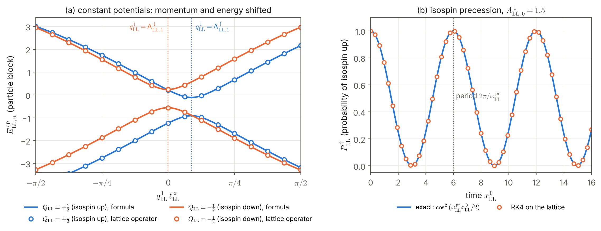{width=100%}

**Figure 3.** Case A. (a) The energies of the particle block for plane waves in the constant potentials
$A^3_{{\rm LL},1}=0.8$, $A^{\rm F}_{{\rm LL},1}=0.6$, $A^3_{{\rm LL},0}=0.5$, $A^{\rm F}_{{\rm LL},0}=0.3$
($g^{\rm v}_{\rm LL}=0.7$, $g^{\rm F}_{\rm LL}=0.45$, $m_{\rm LL}=0.4$, $\mu_{\rm LL}=0.2$, $\ell^{\rm x}_{\rm LL}=0.5$,
$r^{\rm W}_{\rm LL}=1$): the curves are (3.7) with $\varepsilon^{\rm lat}_{\rm LL}$ for isospin up (blue) and down (orange); the
circles are the eigenvalues of the lattice operator of the solvers on the plane waves of a ring of 32 sites; the
dotted lines mark the band bottoms at $q^1_{\rm LL}=\mathsf A^\uparrow_{{\rm LL},1}=0.55$ and
$\mathsf A^\downarrow_{{\rm LL},1}=-0.01$. (b) The probability of isospin up of a particle in the constant isospin potential
$A^1_{{\rm LL},0}=1.5$: the exact solution (3.8) (line) and the RK4 integration of the lattice equations (circles, every
second value shown), with $\ell^{\rm t}_{\rm LL}=0.004$. Data: `test2/data/t2_A_dispersion_curves.csv`,
`t2_A_dispersion_lattice.csv`, `t2_A_precession.csv`.

## 3.3 Case B: the uniform polar superfluid

**The fields.** No gauge fields; a uniform pair field along the third isospin direction,
$d^\iota_{\rm LL}=(0,0,\Delta_{\rm LL})$ with a real $\Delta_{\rm LL}>0$ (the polar state). Then
$\mathsf P_{\rm LL}=\Delta_{\rm LL}(\mathsf K^3_{\rm LL})^\dagger$ and $\mathsf P^\dagger_{\rm LL}=\Delta_{\rm LL}\mathsf K^3_{\rm LL}$. The
pair matrix (Section 2.8) is
$\mathsf K^3_{\rm LL}=C_{\rm LL}\gamma^{\rm ch}_{\rm LL}\otimes\mathsf E_{\rm LL}\tau^{\rm LL}_3$ with
$C_{\rm LL}\gamma^{\rm ch}_{\rm LL}=\mathrm{diag}(-\mathsf E_{\rm LL},-\mathsf E_{\rm LL})$ and $\mathsf E_{\rm LL}\tau^{\rm LL}_3=-\tau^{\rm LL}_1$, so

$$\mathsf K^3_{\rm LL}=\begin{pmatrix}0&1&0&0\\-1&0&0&0\\0&0&0&1\\0&0&-1&0\end{pmatrix}\otimes\tau^{\rm LL}_1,\qquad(\mathsf K^3_{\rm LL})^T=(\mathsf K^3_{\rm LL})^\dagger=-\mathsf K^3_{\rm LL},\qquad(\mathsf K^3_{\rm LL})^2=-\mathsf 1_8.\tag{3.10}$$

It is real and unitary.

**The key identity.** For the plane-wave Hamiltonian $\mathsf h_{\rm LL}(\vec q_{\rm LL})=\sum_j\alpha^j_{\rm LL}q^j_{\rm LL}+\beta_{\rm LL}m_{\rm LL}$,

$$\mathsf K^3_{\rm LL}\,\mathsf h_{\rm LL}(\vec q_{\rm LL})=\mathsf h_{\rm LL}(-\vec q_{\rm LL})^*\,\mathsf K^3_{\rm LL}.\tag{3.11}$$

*Proof.* With $\alpha^j_{\rm LL}=\mathrm{diag}(-\sigma^{\rm LL}_j,\sigma^{\rm LL}_j)$, the Dirac factor of $\mathsf K^3_{\rm LL}$, which is
$\mathrm{diag}(\mathsf E_{\rm LL},\mathsf E_{\rm LL})$, and the relation
$\mathsf E_{\rm LL}\sigma^{\rm LL}_j=-(\sigma^{\rm LL}_j)^*\mathsf E_{\rm LL}$ (for $j=1,3$ the Pauli matrix is real and anticommutes
with $\mathsf E_{\rm LL}=i\sigma^{\rm LL}_2$; for $j=2$ it commutes with it and is imaginary), one finds
$\mathsf K^3_{\rm LL}\alpha^j_{\rm LL}=-(\alpha^j_{\rm LL})^*\mathsf K^3_{\rm LL}$. The matrix $\beta_{\rm LL}$ is real and exchanges the two
Weyl blocks, whose Dirac factors are equal, so $\mathsf K^3_{\rm LL}\beta_{\rm LL}=\beta_{\rm LL}\mathsf K^3_{\rm LL}$. Inserted in
$\mathsf h_{\rm LL}$, these give (3.11). It holds on the lattice as well, with $\sin(q^j_{\rm LL}\ell^{\rm x}_{\rm LL})/\ell^{\rm x}_{\rm LL}$
(odd in $q^j_{\rm LL}$) and the Wilson term (even). $\square$

**The Bogoliubov modes.** On plane waves, $\mathcal H^{\rm DB}_{\rm LL}(\vec q_{\rm LL})$ has the blocks
$\mathsf h_{\rm LL}(\vec q_{\rm LL})-\mu_{\rm LL}$, $\Delta_{\rm LL}(\mathsf K^3_{\rm LL})^\dagger$, $\Delta_{\rm LL}\mathsf K^3_{\rm LL}$ and
$-(\mathsf h_{\rm LL}(-\vec q_{\rm LL})^*-\mu_{\rm LL})$ (Section 2.10, check GS-8). Let $\chi^{\rm pw}_{\rm LL}$ be a normalized
eigenvector of $\mathsf h_{\rm LL}(\vec q_{\rm LL})$ with the eigenvalue $+\varepsilon_{\rm LL}$ or $-\varepsilon_{\rm LL}$
($\varepsilon_{\rm LL}=(q_{\rm LL}^2+m_{\rm LL}^2)^{1/2}$). By (3.11), $\mathsf K^3_{\rm LL}\chi^{\rm pw}_{\rm LL}$ is an eigenvector of
$\mathsf h_{\rm LL}(-\vec q_{\rm LL})^*$ with the same eigenvalue, and since
$(\mathsf K^3_{\rm LL})^\dagger\mathsf K^3_{\rm LL}=\mathsf 1_8$ the operator maps the two vectors
$(\chi^{\rm pw}_{\rm LL},0)$ and $(0,\mathsf K^3_{\rm LL}\chi^{\rm pw}_{\rm LL})$ into their span, with the matrix

$$\begin{pmatrix}\pm\varepsilon_{\rm LL}-\mu_{\rm LL}&\Delta_{\rm LL}\\\Delta_{\rm LL}&-(\pm\varepsilon_{\rm LL}-\mu_{\rm LL})\end{pmatrix}.\tag{3.12}$$

Its square is $\big((\pm\varepsilon_{\rm LL}-\mu_{\rm LL})^2+\Delta_{\rm LL}^2\big)$ times the unit matrix; its eigenvalues are therefore

$$E^{\rm qp}_{{\rm LL},n}=\pm E^-_{\rm LL}\ \text{(from }+\varepsilon_{\rm LL}),\qquad E^{\rm qp}_{{\rm LL},n}=\pm E^+_{\rm LL}\ \text{(from }-\varepsilon_{\rm LL}),\qquad E^\pm_{\rm LL}=\big((\varepsilon_{\rm LL}\pm\mu_{\rm LL})^2+\Delta_{\rm LL}^2\big)^{1/2},\tag{3.13}$$

each four times (the eigenvalue $+\varepsilon_{\rm LL}$ of the $8\times8$ matrix $\mathsf h_{\rm LL}$ has four eigenvectors, as
has $-\varepsilon_{\rm LL}$), and the eigenvector of the positive eigenvalue is

$$\big(\cos\vartheta^{\rm B}_{\rm LL}\,\chi^{\rm pw}_{\rm LL},\ \sin\vartheta^{\rm B}_{\rm LL}\,\mathsf K^3_{\rm LL}\chi^{\rm pw}_{\rm LL}\big),\qquad\cos^2\vartheta^{\rm B}_{\rm LL}=\tfrac12\Big(1+\frac{\pm\varepsilon_{\rm LL}-\mu_{\rm LL}}{E^\mp_{\rm LL}}\Big),\quad\sin^2\vartheta^{\rm B}_{\rm LL}=\tfrac12\Big(1-\frac{\pm\varepsilon_{\rm LL}-\mu_{\rm LL}}{E^\mp_{\rm LL}}\Big)\tag{3.14}$$

(insert it in (3.12): the first row gives
$\tan\vartheta^{\rm B}_{\rm LL}=(E^\mp_{\rm LL}-(\pm\varepsilon_{\rm LL}-\mu_{\rm LL}))/\Delta_{\rm LL}$, the second
$\tan\vartheta^{\rm B}_{\rm LL}=\Delta_{\rm LL}/(E^\mp_{\rm LL}+(\pm\varepsilon_{\rm LL}-\mu_{\rm LL}))$, and the two agree because
$(E^\mp_{\rm LL})^2-(\pm\varepsilon_{\rm LL}-\mu_{\rm LL})^2=\Delta_{\rm LL}^2$). These are the quasi-particles of the superfluid: a
superposition of a particle and a hole, with the weights $\cos^2\vartheta^{\rm B}_{\rm LL}$ and $\sin^2\vartheta^{\rm B}_{\rm LL}$.
The branch $E^-_{\rm LL}$ has its minimum $\Delta_{\rm LL}$ at the Fermi momentum $k^{\rm F}_{\rm LL}$, where
$\varepsilon_{\rm LL}=\mu_{\rm LL}$: $\Delta_{\rm LL}$ is the energy gap of the superfluid. The branch $E^+_{\rm LL}$ belongs to the
states of negative energy (the antiparticles) and is always above $\mu_{\rm LL}+m_{\rm LL}$. Check AS-3 verifies (3.11)
to (3.14) for 50 random momenta, chemical potentials and gaps, and the spectrum (3.13), with
$\varepsilon^{\rm lat}_{\rm LL}$ in place of $\varepsilon_{\rm LL}$, for the lattice operator of the solvers on the plane waves of a
ring (Figure 4(a)).

**A particle injected into the superfluid oscillates into a hole.** Start with the particle
$(\chi^{\rm pw}_{\rm LL},0)$ of positive energy $\varepsilon_{\rm LL}$. Its evolution stays in the plane of (3.12), where the
matrix (3.12) with the upper sign squares to $(E^-_{\rm LL})^2$ times the unit matrix; its exponential is therefore

$$\exp\Big(-ix^0_{\rm LL}\begin{pmatrix}\varepsilon_{\rm LL}-\mu_{\rm LL}&\Delta_{\rm LL}\\\Delta_{\rm LL}&\mu_{\rm LL}-\varepsilon_{\rm LL}\end{pmatrix}\Big)=\cos(E^-_{\rm LL}x^0_{\rm LL})\begin{pmatrix}1&0\\0&1\end{pmatrix}-\frac{i\sin(E^-_{\rm LL}x^0_{\rm LL})}{E^-_{\rm LL}}\begin{pmatrix}\varepsilon_{\rm LL}-\mu_{\rm LL}&\Delta_{\rm LL}\\\Delta_{\rm LL}&\mu_{\rm LL}-\varepsilon_{\rm LL}\end{pmatrix},$$

and

$$\psi^{\rm p}_{\rm LL}=\Big(\cos(E^-_{\rm LL}x^0_{\rm LL})-i\,\frac{\varepsilon_{\rm LL}-\mu_{\rm LL}}{E^-_{\rm LL}}\sin(E^-_{\rm LL}x^0_{\rm LL})\Big)\chi^{\rm pw}_{\rm LL},\qquad\psi^{\rm h}_{\rm LL}=-i\,\frac{\Delta_{\rm LL}}{E^-_{\rm LL}}\sin(E^-_{\rm LL}x^0_{\rm LL})\,\mathsf K^3_{\rm LL}\chi^{\rm pw}_{\rm LL}\tag{3.15}$$

(both times the plane wave). The probability of the hole is

$$P^{\rm h}_{\rm LL}(x^0_{\rm LL})=\Big(\frac{\Delta_{\rm LL}}{E^-_{\rm LL}}\Big)^2\sin^2(E^-_{\rm LL}x^0_{\rm LL}).\tag{3.16}$$

A bare particle is not a stationary state of the superfluid: the pair field converts it into a hole and back, with
the angular frequency $2E^-_{\rm LL}$ and the largest hole probability $(\Delta_{\rm LL}/E^-_{\rm LL})^2$, which is 1 at the
Fermi surface and small far from it (the Rabi oscillation of a two-state system). This is the non-conservation of
the particle content of a mode found in (3.2). In the self-consistent state the fermion number is nevertheless
conserved, (3.3). Figure 4(b) and check AS-4: the RK4 integration of the lattice equations agrees with (3.15) to
$5\times10^{-10}$, the predicted size of the RK4 phase error.

**The gap equation in closed form.** For massless spinor charges ($m_{\rm LL}=0$, $\varepsilon_{\rm LL}=q_{\rm LL}$) the
integral of (2.33) can be done. With $d^3q_{\rm LL}/(2\pi)^3=q_{\rm LL}^2\,dq_{\rm LL}/(2\pi^2)$ for an integrand that depends
only on $q_{\rm LL}$, one needs antiderivatives of $q_{\rm LL}^2/E^\pm_{\rm LL}$. They are

$$\frac{d}{dq_{\rm LL}}\Big[\tfrac12(q_{\rm LL}\mp3\mu_{\rm LL})E^\pm_{\rm LL}+(\mu_{\rm LL}^2-\tfrac12\Delta_{\rm LL}^2)\,\mathrm{arsinh}\frac{q_{\rm LL}\pm\mu_{\rm LL}}{\Delta_{\rm LL}}\Big]=\frac{q_{\rm LL}^2}{E^\pm_{\rm LL}},$$

as one verifies by differentiating: the derivative of the bracket, multiplied by $E^\pm_{\rm LL}$, is
$\tfrac12(E^\pm_{\rm LL})^2+\tfrac12(q_{\rm LL}\mp3\mu_{\rm LL})(q_{\rm LL}\pm\mu_{\rm LL})+\mu_{\rm LL}^2-\tfrac12\Delta_{\rm LL}^2=q_{\rm LL}^2$. At
$q_{\rm LL}=0$ the two brackets cancel each other ($E^+_{\rm LL}=E^-_{\rm LL}$ there, and $\mathrm{arsinh}$ is odd), so

$$\begin{aligned}\frac1{G_{\rm LL}}=\frac1{4\pi^2}\Big[&(\Lambda_{\rm LL}-3\mu_{\rm LL})E^+_{\rm LL}(\Lambda_{\rm LL})+(\Lambda_{\rm LL}+3\mu_{\rm LL})E^-_{\rm LL}(\Lambda_{\rm LL})\\&+(2\mu_{\rm LL}^2-\Delta_{\rm LL}^2)\Big(\mathrm{arsinh}\frac{\Lambda_{\rm LL}+\mu_{\rm LL}}{\Delta_{\rm LL}}+\mathrm{arsinh}\frac{\Lambda_{\rm LL}-\mu_{\rm LL}}{\Delta_{\rm LL}}\Big)\Big],\end{aligned}\tag{3.17}$$

with $E^\pm_{\rm LL}(\Lambda_{\rm LL})=((\Lambda_{\rm LL}\pm\mu_{\rm LL})^2+\Delta_{\rm LL}^2)^{1/2}$. At $\mu_{\rm LL}=0$,

$$\frac1{G_{\rm LL}}=\frac1{2\pi^2}\Big[\Lambda_{\rm LL}(\Lambda_{\rm LL}^2+\Delta_{\rm LL}^2)^{1/2}-\Delta_{\rm LL}^2\,\mathrm{arsinh}\frac{\Lambda_{\rm LL}}{\Delta_{\rm LL}}\Big],\qquad G^{\rm crit}_{\rm LL}=\frac{2\pi^2}{\Lambda_{\rm LL}^2}.\tag{3.18}$$

The right side of (3.18) decreases from $\Lambda_{\rm LL}^2/(2\pi^2)$ as $\Delta_{\rm LL}$ grows (the integrand of (2.33) decreases
with $\Delta_{\rm LL}$), so at $\mu_{\rm LL}=0$ a gap exists only for $G_{\rm LL}>G^{\rm crit}_{\rm LL}$: below the critical coupling the
vacuum stays normal, above it the vacuum itself condenses. Near the critical coupling, the expansions
$\Lambda_{\rm LL}(\Lambda_{\rm LL}^2+\Delta_{\rm LL}^2)^{1/2}\approx\Lambda_{\rm LL}^2+\tfrac12\Delta_{\rm LL}^2$ and
$\mathrm{arsinh}(\Lambda_{\rm LL}/\Delta_{\rm LL})\approx\ln(2\Lambda_{\rm LL}/\Delta_{\rm LL})$ give

$$\Delta_{\rm LL}^2\Big(\ln\frac{2\Lambda_{\rm LL}}{\Delta_{\rm LL}}-\frac12\Big)\approx2\pi^2\Big(\frac1{G^{\rm crit}_{\rm LL}}-\frac1{G_{\rm LL}}\Big):\tag{3.19}$$

the gap grows continuously from zero. For $\mu_{\rm LL}>0$ the situation is different: as $\Delta_{\rm LL}\to0$ the arsinh terms
of (3.17) grow like $\ln(1/\Delta_{\rm LL})$ with the coefficient $2\mu_{\rm LL}^2$ (the Fermi surface), so a solution exists for
every attractive coupling. With $E^\pm_{\rm LL}(\Lambda_{\rm LL})\to\Lambda_{\rm LL}\pm\mu_{\rm LL}$ and
$\mathrm{arsinh}((\Lambda_{\rm LL}\pm\mu_{\rm LL})/\Delta_{\rm LL})\to\ln(2(\Lambda_{\rm LL}\pm\mu_{\rm LL})/\Delta_{\rm LL})$, (3.17) becomes
$1/G_{\rm LL}=(\Lambda_{\rm LL}^2-3\mu_{\rm LL}^2+\mu_{\rm LL}^2\ln(4(\Lambda_{\rm LL}^2-\mu_{\rm LL}^2)/\Delta_{\rm LL}^2))/(2\pi^2)$, whose solution is the
weak-coupling (BCS) gap

$$\begin{aligned}\Delta_{\rm LL}&=2(\Lambda_{\rm LL}^2-\mu_{\rm LL}^2)^{1/2}\exp(-\tfrac32)\exp\Big(-\frac{\pi^2}{\mu_{\rm LL}^2}\Big(\frac1{G_{\rm LL}}-\frac1{G^{\rm crit}_{\rm LL}}\Big)\Big)\\&=2(\Lambda_{\rm LL}^2-\mu_{\rm LL}^2)^{1/2}\exp(-\tfrac32)\exp\Big(-\frac1{2\nu^{\rm F}_{\rm LL}}\Big(\frac1{G_{\rm LL}}-\frac1{G^{\rm crit}_{\rm LL}}\Big)\Big),\end{aligned}\tag{3.20}$$

with the density of states $\nu^{\rm F}_{\rm LL}=\mu_{\rm LL}^2/(2\pi^2)$ of massless charges at the Fermi surface
($k^{\rm F}_{\rm LL}=\mu_{\rm LL}$): exponentially small, as in the theory of Bardeen, Cooper and Schrieffer. The neglected terms
of (3.17) are of the order $\Delta_{\rm LL}^2\ln(\Lambda_{\rm LL}/\Delta_{\rm LL})$ (from the factor $2\mu_{\rm LL}^2-\Delta_{\rm LL}^2$); carried
through the solution, they make the relative error of (3.20) equal to
$-(\Delta_{\rm LL}^2/(2\mu_{\rm LL}^2))\ln(\Lambda_{\rm LL}/\Delta_{\rm LL})$ to leading order. Check AS-5 verifies (3.17) against numerical quadrature
(to $2\times10^{-15}$), $G^{\rm crit}_{\rm LL}$, the solutions of (3.17) by bisection, and (3.20) together with its error term;
Figure 4(c) shows $\Delta_{\rm LL}$ as a function of $G_{\rm LL}$ for three chemical potentials.

**The uniform state is an exact self-consistent solution on the lattice.** On a periodic chain of
$n^{\rm x}_{\rm LL}$ sites (one active direction), the eigenvectors of the lattice operator are unit vectors; the mode
functions of the normalization of (2.32) are these components divided by $(\ell^{\rm x}_{\rm LL})^{1/2}$. Summed over the
positive-energy modes, the pair expectation of (2.32) at each site is
$-2\Delta_{\rm LL}(n^{\rm x}_{\rm LL}\ell^{\rm x}_{\rm LL})^{-1}\sum_{q^1_{\rm LL}}(1/E^+_{\rm LL}+1/E^-_{\rm LL})$ for $\iota=3$ and 0 for
$\iota=1,2$ (the lattice form of check GS-9; the sum runs over the $n^{\rm x}_{\rm LL}$ allowed momenta, with
$\varepsilon^{\rm lat}_{\rm LL}$ in $E^\pm_{\rm LL}$). The self-consistency condition (2.32) therefore returns the same pair field
$d^\iota_{\rm LL}=(0,0,\Delta_{\rm LL})$ on every site exactly when

$$\frac1{G_{\rm LL}}=\frac1{n^{\rm x}_{\rm LL}\ell^{\rm x}_{\rm LL}}\sum_{q^1_{\rm LL}}\Big(\frac1{E^+_{\rm LL}}+\frac1{E^-_{\rm LL}}\Big),\tag{3.21}$$

the gap equation of the lattice chain (the integral $\int dq^1_{\rm LL}/(2\pi)$ of a one-dimensional problem replaced by
the sum over the allowed momenta divided by the circumference). Check AS-6 computes the pair expectation with the
routine of the solvers from the 128 positive-energy eigenvectors of a chain of 16 sites ($\mu_{\rm LL}=0.6$,
$\Delta_{\rm LL}=0.3$) and finds (3.21) and the fixed point to $10^{-15}$: a known fixed point for the self-consistent
solvers of items [3] and [5].

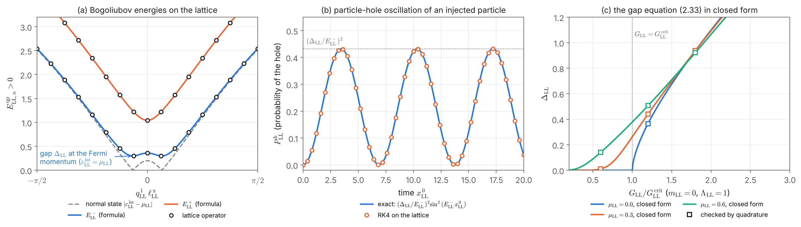{width=100%}

**Figure 4.** Case B, the uniform polar superfluid. (a) The positive energies on the lattice
($m_{\rm LL}=0.4$, $\mu_{\rm LL}=0.6$, $\Delta_{\rm LL}=0.3$, $\ell^{\rm x}_{\rm LL}=0.5$, $r^{\rm W}_{\rm LL}=1$): $E^-_{\rm LL}$ (blue) and
$E^+_{\rm LL}$ (orange) from (3.13) with $\varepsilon^{\rm lat}_{\rm LL}$, the normal-state energy
$\lvert\varepsilon^{\rm lat}_{\rm LL}-\mu_{\rm LL}\rvert$ (grey, dashed), and the eigenvalues of the lattice operator of the solvers
on the plane waves of a ring of 32 sites (circles); the gap $\Delta_{\rm LL}$ opens at the Fermi momentum. (b) The
probability of the hole of a particle injected at the momentum $2\pi/(16\ell^{\rm x}_{\rm LL})$: (3.16) (line) and the RK4
integration of the lattice equations (circles, every second value), $\ell^{\rm t}_{\rm LL}=0.02$. (c) The gap as a function
of the coupling for massless charges ($\Lambda_{\rm LL}=1$) at $\mu_{\rm LL}=0$, $0.3$ and $0.6$: the solutions of the closed
form (3.17) (lines) and their check by numerical quadrature (squares). At $\mu_{\rm LL}=0$ the gap appears at
$G^{\rm crit}_{\rm LL}$; at $\mu_{\rm LL}>0$ it is non-zero for every coupling, exponentially small at weak coupling (3.20). Data:
`test2/data/t2_B_bogoliubov_curves.csv`, `t2_B_bogoliubov_lattice.csv`, `t2_B_rabi.csv`, `t2_B_gap.csv`.

## 3.4 Case C: a domain wall of the pair field

**The fields.** No gauge fields, $\mu_{\rm LL}=0$, and a real pair field along the third isospin direction that
depends on $x^1_{\rm LL}$ and changes sign:

$$d^\iota_{\rm LL}=(0,0,\Delta_{\rm LL}(x^1_{\rm LL})),\qquad\Delta_{\rm LL}(x^1_{\rm LL})=\Delta^\infty_{\rm LL}\tanh(x^1_{\rm LL}/\ell^{\rm K}_{\rm LL}).\tag{3.22}$$

Two superfluid domains with opposite signs of the order parameter (a phase difference $\pi$) meet at a wall of the
width $\ell^{\rm K}_{\rm LL}$ (a kink). The fields do not depend on $x^2_{\rm LL}$, $x^3_{\rm LL}$, and the modes are taken as plane
waves $\exp(i(q^2_{\rm LL}x^2_{\rm LL}+q^3_{\rm LL}x^3_{\rm LL}))$ along the wall; first $q^2_{\rm LL}=q^3_{\rm LL}=0$.

**Four matrix facts.** With (3.10) and $\alpha^1_{\rm LL}=\mathrm{diag}(-\sigma^{\rm LL}_1,\sigma^{\rm LL}_1)$:

$$\big((\mathsf K^3_{\rm LL})^\dagger\big)^2=-\mathsf 1_8,\qquad\alpha^1_{\rm LL}(\mathsf K^3_{\rm LL})^\dagger\alpha^1_{\rm LL}=-(\mathsf K^3_{\rm LL})^\dagger,\qquad\beta_{\rm LL}(\mathsf K^3_{\rm LL})^\dagger\alpha^1_{\rm LL}=-(\mathsf K^3_{\rm LL})^\dagger\alpha^1_{\rm LL}\beta_{\rm LL},\qquad\alpha^1_{\rm LL},\ \beta_{\rm LL}\ \text{real}.\tag{3.23}$$

The second follows from $\sigma^{\rm LL}_1\mathsf E_{\rm LL}\sigma^{\rm LL}_1=-\mathsf E_{\rm LL}$, the third from the second and
$\alpha^1_{\rm LL}\beta_{\rm LL}=-\beta_{\rm LL}\alpha^1_{\rm LL}$, $\beta_{\rm LL}(\mathsf K^3_{\rm LL})^\dagger=(\mathsf K^3_{\rm LL})^\dagger\beta_{\rm LL}$.

**The bound states.** Let $\varphi^{\rm K}_{\rm LL}$ solve $d\varphi^{\rm K}_{\rm LL}/dx^1_{\rm LL}=-\Delta_{\rm LL}\varphi^{\rm K}_{\rm LL}$, that
is $\varphi^{\rm K}_{\rm LL}(x^1_{\rm LL})=\cosh(x^1_{\rm LL}/\ell^{\rm K}_{\rm LL})^{-\Delta^\infty_{\rm LL}\ell^{\rm K}_{\rm LL}}$ for the kink
(3.22), and let $\chi^{\rm K}_{\rm LL}$ be a constant 8-component spinor with $\beta_{\rm LL}\chi^{\rm K}_{\rm LL}=\pm\chi^{\rm K}_{\rm LL}$. Then

$$\psi^{\rm p}_{\rm LL}=\varphi^{\rm K}_{\rm LL}\chi^{\rm K}_{\rm LL},\qquad\psi^{\rm h}_{\rm LL}=i(\mathsf K^3_{\rm LL})^\dagger\alpha^1_{\rm LL}\varphi^{\rm K}_{\rm LL}\chi^{\rm K}_{\rm LL},\qquad E^{\rm qp}_{{\rm LL},n}=\pm m_{\rm LL}\tag{3.24}$$

is a stationary solution of (3.1). *Proof.* Particle row:
$-i\alpha^1_{\rm LL}\partial_1\psi^{\rm p}_{\rm LL}+\beta_{\rm LL}m_{\rm LL}\psi^{\rm p}_{\rm LL}+\Delta_{\rm LL}(\mathsf K^3_{\rm LL})^\dagger\psi^{\rm h}_{\rm LL}
=i\Delta_{\rm LL}\varphi^{\rm K}_{\rm LL}\alpha^1_{\rm LL}\chi^{\rm K}_{\rm LL}\pm m_{\rm LL}\varphi^{\rm K}_{\rm LL}\chi^{\rm K}_{\rm LL}+i\Delta_{\rm LL}\varphi^{\rm K}_{\rm LL}\big((\mathsf K^3_{\rm LL})^\dagger\big)^2\alpha^1_{\rm LL}\chi^{\rm K}_{\rm LL}=\pm m_{\rm LL}\psi^{\rm p}_{\rm LL}$
by the first fact. Hole row (with $\mathsf P^\dagger_{\rm LL}=\Delta_{\rm LL}\mathsf K^3_{\rm LL}=-\Delta_{\rm LL}(\mathsf K^3_{\rm LL})^\dagger$ and
the real matrices): $\Delta_{\rm LL}\mathsf K^3_{\rm LL}\psi^{\rm p}_{\rm LL}-(i\alpha^1_{\rm LL}\partial_1+\beta_{\rm LL}m_{\rm LL})\psi^{\rm h}_{\rm LL}
=-\Delta_{\rm LL}\varphi^{\rm K}_{\rm LL}(\mathsf K^3_{\rm LL})^\dagger\chi^{\rm K}_{\rm LL}-\Delta_{\rm LL}\varphi^{\rm K}_{\rm LL}\alpha^1_{\rm LL}(\mathsf K^3_{\rm LL})^\dagger\alpha^1_{\rm LL}\chi^{\rm K}_{\rm LL}-im_{\rm LL}\varphi^{\rm K}_{\rm LL}\beta_{\rm LL}(\mathsf K^3_{\rm LL})^\dagger\alpha^1_{\rm LL}\chi^{\rm K}_{\rm LL}$;
the first two terms cancel by the second fact, and the third is
$im_{\rm LL}\varphi^{\rm K}_{\rm LL}(\mathsf K^3_{\rm LL})^\dagger\alpha^1_{\rm LL}\beta_{\rm LL}\chi^{\rm K}_{\rm LL}=\pm m_{\rm LL}\psi^{\rm h}_{\rm LL}$ by
the third. $\square$

The profile decays like $\exp(-\Delta^\infty_{\rm LL}\lvert x^1_{\rm LL}\rvert)$ on both sides, because $\Delta_{\rm LL}$ has opposite
signs on the two sides; the state is bound to the wall. The eigenspaces $\beta_{\rm LL}=+1$ and $\beta_{\rm LL}=-1$ of the
8-component spinors are four-dimensional each, so every wall carries four bound states at $+m_{\rm LL}$ and four at
$-m_{\rm LL}$ (for massless charges, eight zero modes). Their energy does not depend on the shape of the profile, only on
the change of sign; this is the mechanism of Jackiw and Rebbi, here for the pair field of the spinor charges (and
the relativistic counterpart of the bound states of a superconductor with a phase jump $\pi$). For an antikink,
$\Delta_{\rm LL}=-\Delta^\infty_{\rm LL}\tanh(x^1_{\rm LL}/\ell^{\rm K}_{\rm LL})$, the bound states are
$\psi^{\rm p}_{\rm LL}=\varphi^{\rm K}_{\rm LL}\chi^{\rm K}_{\rm LL}$, $\psi^{\rm h}_{\rm LL}=-i(\mathsf K^3_{\rm LL})^\dagger\alpha^1_{\rm LL}\varphi^{\rm K}_{\rm LL}\chi^{\rm K}_{\rm LL}$
with the same profile and the same energies, by the same steps with $\Delta_{\rm LL}$ replaced by $-\Delta_{\rm LL}$. Check AS-7
verifies (3.23) and (3.24) at 50 random points with random spinors.

**The square of the operator, and all bound states.** With the plane wave
$\exp(i(q^2_{\rm LL}x^2_{\rm LL}+q^3_{\rm LL}x^3_{\rm LL}))$ along the wall, the particle block of $\mathcal H^{\rm DB}_{\rm LL}$ is the
operator $-i\alpha^1_{\rm LL}\partial_1+\alpha^2_{\rm LL}q^2_{\rm LL}+\alpha^3_{\rm LL}q^3_{\rm LL}+\beta_{\rm LL}m_{\rm LL}$ and the hole block is
$-(i(\alpha^1_{\rm LL})^*\partial_1-(\alpha^2_{\rm LL})^*q^2_{\rm LL}-(\alpha^3_{\rm LL})^*q^3_{\rm LL}+\beta_{\rm LL}m_{\rm LL})$. By the relation
$\alpha^j_{\rm LL}(\mathsf K^3_{\rm LL})^\dagger=-(\mathsf K^3_{\rm LL})^\dagger(\alpha^j_{\rm LL})^*$ (all $j$; it is (3.11) in another
form) the particle block times $(\mathsf K^3_{\rm LL})^\dagger$ equals $(\mathsf K^3_{\rm LL})^\dagger$ times the hole operator
without its minus sign, so in the off-diagonal blocks of $(\mathcal H^{\rm DB}_{\rm LL})^2$ everything cancels except the
derivative of $\Delta_{\rm LL}$, which comes from $\partial_1$ acting on the factor $\Delta_{\rm LL}$. The diagonal blocks are the
squares of the particle and hole operators plus $\Delta_{\rm LL}^2(\mathsf K^3_{\rm LL})^\dagger\mathsf K^3_{\rm LL}=\Delta_{\rm LL}^2\mathsf 1_8$.
The result is

$$(\mathcal H^{\rm DB}_{\rm LL})^2=-\frac{d^2}{d(x^1_{\rm LL})^2}+(q^2_{\rm LL})^2+(q^3_{\rm LL})^2+m_{\rm LL}^2+\Delta_{\rm LL}^2+\frac{d\Delta_{\rm LL}}{dx^1_{\rm LL}}\,\mathsf Q^{\rm K}_{\rm LL},\qquad\mathsf Q^{\rm K}_{\rm LL}=\begin{pmatrix}0&-i\alpha^1_{\rm LL}(\mathsf K^3_{\rm LL})^\dagger\\-i\alpha^1_{\rm LL}\mathsf K^3_{\rm LL}&0\end{pmatrix},\tag{3.25}$$

where the scalar terms multiply the $16\times16$ unit matrix. The constant matrix $\mathsf Q^{\rm K}_{\rm LL}$ is Hermitian, its
square is the unit matrix, and its trace is 0: it has the eigenvalue $-1$ on an eight-dimensional subspace and $+1$ on
another. On these subspaces (3.25) is $m_{\rm LL}^2+(q^2_{\rm LL})^2+(q^3_{\rm LL})^2$ plus one of the two scalar operators

$$\begin{aligned}\Big(-\frac{d}{dx^1_{\rm LL}}+\Delta_{\rm LL}\Big)\Big(\frac{d}{dx^1_{\rm LL}}+\Delta_{\rm LL}\Big)&=-\frac{d^2}{d(x^1_{\rm LL})^2}+\Delta_{\rm LL}^2-\frac{d\Delta_{\rm LL}}{dx^1_{\rm LL}}\qquad(\mathsf Q^{\rm K}_{\rm LL}=-1),\\\Big(\frac{d}{dx^1_{\rm LL}}+\Delta_{\rm LL}\Big)\Big(-\frac{d}{dx^1_{\rm LL}}+\Delta_{\rm LL}\Big)&=-\frac{d^2}{d(x^1_{\rm LL})^2}+\Delta_{\rm LL}^2+\frac{d\Delta_{\rm LL}}{dx^1_{\rm LL}}\qquad(\mathsf Q^{\rm K}_{\rm LL}=+1).\end{aligned}\tag{3.26}$$

The two operators are products of the same first-order operator and its adjoint in the two orders. Such products
have the same non-zero eigenvalues (if one of them maps a function to a multiple of itself, applying the first-order
factor gives an eigenfunction of the other with the same eigenvalue). They differ only in the zero eigenvalue:
$(d/dx^1_{\rm LL}+\Delta_{\rm LL})\varphi^{\rm K}_{\rm LL}=0$ with the normalizable profile $\varphi^{\rm K}_{\rm LL}$, while the
solutions of the first-order equation with $-d/dx^1_{\rm LL}+\Delta_{\rm LL}$ in place of $d/dx^1_{\rm LL}+\Delta_{\rm LL}$ are the
multiples of $1/\varphi^{\rm K}_{\rm LL}$, which grow on both sides. So the sector
$\mathsf Q^{\rm K}_{\rm LL}=-1$ has exactly one bound state more than the sector $\mathsf Q^{\rm K}_{\rm LL}=+1$: the state (3.24), with
$(E^{\rm qp}_{{\rm LL},n})^2=m_{\rm LL}^2+(q^2_{\rm LL})^2+(q^3_{\rm LL})^2$. For any profile with a sign change this pairing fixes
the one unpaired level (an index theorem); its energy

$$E^{\rm qp}_{{\rm LL},n}=\pm\big(m_{\rm LL}^2+(q^2_{\rm LL})^2+(q^3_{\rm LL})^2\big)^{1/2}\tag{3.27}$$

is that of a free Dirac particle of the mass $m_{\rm LL}$ moving in the two dimensions of the wall: the wall carries a
$(2+1)$-dimensional spinor field.

For the kink (3.22), $\Delta_{\rm LL}^2\mp d\Delta_{\rm LL}/dx^1_{\rm LL}=(\Delta^\infty_{\rm LL})^2-\Delta^\infty_{\rm LL}(\Delta^\infty_{\rm LL}\pm1/\ell^{\rm K}_{\rm LL})\cosh(x^1_{\rm LL}/\ell^{\rm K}_{\rm LL})^{-2}$
(use $\tanh^2=1-\cosh^{-2}$ and $d\tanh(x^1_{\rm LL}/\ell^{\rm K}_{\rm LL})/dx^1_{\rm LL}=\cosh(x^1_{\rm LL}/\ell^{\rm K}_{\rm LL})^{-2}/\ell^{\rm K}_{\rm LL}$):
so the operator of the sector $\mathsf Q^{\rm K}_{\rm LL}=-1$ is $(\Delta^\infty_{\rm LL})^2$ plus the well
$-d^2/d(x^1_{\rm LL})^2-\Delta^\infty_{\rm LL}(\Delta^\infty_{\rm LL}+1/\ell^{\rm K}_{\rm LL})\cosh(x^1_{\rm LL}/\ell^{\rm K}_{\rm LL})^{-2}$ (a well of the
Pöschl-Teller form, with the parameter $\Delta^\infty_{\rm LL}$), and the operator of the sector $+1$ is $(\Delta^\infty_{\rm LL})^2$
plus the same kind of well with the parameter $\Delta^\infty_{\rm LL}-1/\ell^{\rm K}_{\rm LL}$, because
$(\Delta^\infty_{\rm LL}-1/\ell^{\rm K}_{\rm LL})(\Delta^\infty_{\rm LL}-1/\ell^{\rm K}_{\rm LL}+1/\ell^{\rm K}_{\rm LL})=\Delta^\infty_{\rm LL}(\Delta^\infty_{\rm LL}-1/\ell^{\rm K}_{\rm LL})$.
By the pairing argument above, the well with the parameter $\Delta^\infty_{\rm LL}$ has one bound state more than the well
with the parameter $\Delta^\infty_{\rm LL}-1/\ell^{\rm K}_{\rm LL}$: the state $\cosh(x^1_{\rm LL}/\ell^{\rm K}_{\rm LL})^{-\Delta^\infty_{\rm LL}\ell^{\rm K}_{\rm LL}}$,
with the eigenvalue $-(\Delta^\infty_{\rm LL})^2$ of the well; all its other bound states are those of the well with the
smaller parameter. Applying this repeatedly, as long as the parameter stays positive, gives the eigenvalues
$-(\Delta^\infty_{\rm LL}-k^{\rm K}_{\rm LL}/\ell^{\rm K}_{\rm LL})^2$ of the well with the parameter $\Delta^\infty_{\rm LL}$, for the integers
$0\le k^{\rm K}_{\rm LL}<\Delta^\infty_{\rm LL}\ell^{\rm K}_{\rm LL}$, and those with $1\le k^{\rm K}_{\rm LL}<\Delta^\infty_{\rm LL}\ell^{\rm K}_{\rm LL}$ for the
sector $+1$. Adding $(\Delta^\infty_{\rm LL})^2+m_{\rm LL}^2+(q^2_{\rm LL})^2+(q^3_{\rm LL})^2$, the bound states of the wall are

$$E^{\rm qp}_{{\rm LL},n}=\pm\Big(m_{\rm LL}^2+(q^2_{\rm LL})^2+(q^3_{\rm LL})^2+\frac{2k^{\rm K}_{\rm LL}\Delta^\infty_{\rm LL}}{\ell^{\rm K}_{\rm LL}}-\frac{(k^{\rm K}_{\rm LL})^2}{(\ell^{\rm K}_{\rm LL})^2}\Big)^{1/2},\qquad k^{\rm K}_{\rm LL}=0,1,2,\dots,\ k^{\rm K}_{\rm LL}<\Delta^\infty_{\rm LL}\ell^{\rm K}_{\rm LL},\tag{3.28}$$

four times each sign for $k^{\rm K}_{\rm LL}=0$ (the sector $\mathsf Q^{\rm K}_{\rm LL}=-1$ only) and eight times each sign for
$k^{\rm K}_{\rm LL}\ge1$ (both sectors); the continuum begins at
$m_{\rm LL}^2+(q^2_{\rm LL})^2+(q^3_{\rm LL})^2+(\Delta^\infty_{\rm LL})^2$. In particular, for $\Delta^\infty_{\rm LL}\ell^{\rm K}_{\rm LL}\le1$ the states
(3.24) are the only bound states. Check AS-8 verifies (3.25) by applying the operator twice to a Gaussian times a
random 16-component vector (with exact derivatives, for 50 random kinks, points and momenta), the properties of
$\mathsf Q^{\rm K}_{\rm LL}$, and the bound states of the two scalar operators (3.26) by finite differences for
$\Delta^\infty_{\rm LL}\ell^{\rm K}_{\rm LL}=1$ and $2.5$ (one and zero, and three and two bound states).

**On the lattice: sixteen bound states, and the first-order effect of the Wilson term.** A periodic lattice needs
a second wall; the checks use a ring of length 24 with a kink at $x^1_{\rm LL}=6$ and an antikink at $x^1_{\rm LL}=18$,
$\Delta_{\rm LL}=\tanh(x^1_{\rm LL}-6)\tanh(18-x^1_{\rm LL})$ ($\Delta^\infty_{\rm LL}=\ell^{\rm K}_{\rm LL}=1$, so by (3.28) only the states
(3.24) are bound), $m_{\rm LL}=0.4$, $r^{\rm W}_{\rm LL}=1$. On 60 sites ($\ell^{\rm x}_{\rm LL}=0.4$) the lattice operator has exactly
16 eigenvalues inside the gap of the continuum, eight near $+m_{\rm LL}$ and eight near $-m_{\rm LL}$ (four per wall and sign),
and their density sits on the two walls with the profile $(\varphi^{\rm K}_{\rm LL})^2$ (Figure 5(a) to (c)). They lie slightly
above $m_{\rm LL}$ in magnitude, by the Wilson term. To see by how much, insert the analytic state (3.24) on the lattice, with
the spinor $\chi^{\rm K}_{\rm LL}$ whose components 1 and 5 are $1/\sqrt2$ and whose other components are zero
($\beta_{\rm LL}\chi^{\rm K}_{\rm LL}=\chi^{\rm K}_{\rm LL}$, because $\beta_{\rm LL}$ exchanges the Dirac components 1 and 3, which are the
components 1 and 5 of the field), and compute its Rayleigh quotient $E^{\rm R}_{\rm LL}$. In
$(\mathcal H^{\rm lat}_{\rm LL}-m_{\rm LL})$ applied to the state, the mass terms cancel as in the proof of (3.24); the terms
with $\alpha^1_{\rm LL}$ and the pair field contribute nothing to the Rayleigh quotient, because
$(\chi^{\rm K}_{\rm LL})^\dagger\alpha^1_{\rm LL}\chi^{\rm K}_{\rm LL}=0$ for an eigenvector of $\beta_{\rm LL}$ (which anticommutes with
$\alpha^1_{\rm LL}$); the Wilson terms of the particle and of the hole part add. With a summation by parts on the ring,

$$\begin{aligned}E^{\rm R}_{\rm LL}&=m_{\rm LL}+\frac{r^{\rm W}_{\rm LL}}{2\ell^{\rm x}_{\rm LL}}\,\frac{\sum_{s^1_{\rm LL}}\big(\varphi^{\rm K}_{\rm LL}((s^1_{\rm LL}+1)\ell^{\rm x}_{\rm LL})-\varphi^{\rm K}_{\rm LL}(s^1_{\rm LL}\ell^{\rm x}_{\rm LL})\big)^2}{\sum_{s^1_{\rm LL}}\varphi^{\rm K}_{\rm LL}(s^1_{\rm LL}\ell^{\rm x}_{\rm LL})^2}\\&\longrightarrow\ m_{\rm LL}+\frac{r^{\rm W}_{\rm LL}\ell^{\rm x}_{\rm LL}}2\,\frac{\int(d\varphi^{\rm K}_{\rm LL}/dx^1_{\rm LL})^2dx^1_{\rm LL}}{\int(\varphi^{\rm K}_{\rm LL})^2dx^1_{\rm LL}}=m_{\rm LL}+\frac{r^{\rm W}_{\rm LL}\ell^{\rm x}_{\rm LL}}6\end{aligned}\tag{3.29}$$

(the sums run over the sites of the ring; the last step uses $\varphi^{\rm K}_{\rm LL}=1/\cosh(x^1_{\rm LL})$, for which
$\int\cosh(x^1_{\rm LL})^{-2}dx^1_{\rm LL}=2$ and $\int\cosh(x^1_{\rm LL})^{-2}\tanh(x^1_{\rm LL})^2dx^1_{\rm LL}=2/3$). The Wilson term shifts the bound states at first order in the lattice
spacing, by $r^{\rm W}_{\rm LL}\ell^{\rm x}_{\rm LL}/6$; this is the price for removing the doublers (Section 2.11). Check AS-9 verifies
the lattice formula (3.29) exactly (to $4\times10^{-15}$) for $\ell^{\rm x}_{\rm LL}=0.4,0.2,0.1,0.05$, the convergence of
$(E^{\rm R}_{\rm LL}-m_{\rm LL})/(r^{\rm W}_{\rm LL}\ell^{\rm x}_{\rm LL})$ to $1/6$ (0.16662 at $\ell^{\rm x}_{\rm LL}=0.05$, with an error that falls by a
factor 4 per halving), and the agreement of the eigenvalues and densities of the dense spectrum with the analytic
state within the second-order bounds of perturbation theory. These bounds say: an eigenvalue lies within the square
of the relative residual of a trial state, divided by the distance of its Rayleigh quotient from the rest of the
spectrum, of that Rayleigh quotient (Kato and Temple); and the eigenvector differs from the trial state by at most the
relative residual divided by that distance (Davis and Kahan). Here the relative residual is 0.118 and the distance
0.614; the eigenvalues differ from $E^{\rm R}_{\rm LL}=0.4654$ by at most 0.003 (bound 0.023), and the densities agree to
$1.1\times10^{-3}$ in the Bhattacharyya coefficient (bound $1.8\times10^{-2}$).

{width=100%}

**Figure 5.** Case C, a domain wall of the pair field, on a ring of length 24 with a kink at $x^1_{\rm LL}=6$ and an
antikink at $x^1_{\rm LL}=18$ ($m_{\rm LL}=0.4$, $\mu_{\rm LL}=0$, $r^{\rm W}_{\rm LL}=1$). (a) The pair field. (b) The summed density of
the eight eigenvectors of the lattice operator with energies near $+m_{\rm LL}$ ($\ell^{\rm x}_{\rm LL}=0.4$, circles) and the
analytic density, proportional to $(\varphi^{\rm K}_{\rm LL})^2$ of the two walls (line), both normalized to the integral 1.
(c) The spectrum of the ring near zero energy: the 16 bound states (orange) lie inside the gap of the continuum
states (grey), near $\pm m_{\rm LL}$ (dashed). (d) The convergence of the analytic bound state: the shift
$E^{\rm R}_{\rm LL}-m_{\rm LL}$ of its Rayleigh quotient (blue) follows $r^{\rm W}_{\rm LL}\ell^{\rm x}_{\rm LL}/6$ (grey, dashed), and its
residual (orange) falls in proportion to $\ell^{\rm x}_{\rm LL}$. Data: `test2/data/t2_C_kink_profile.csv`,
`t2_C_kink_spectrum.csv`, `t2_C_kink_convergence.csv`.

## 3.5 Case D: Landau levels in constant magnetic fields

**The fields.** No pair field, $\mu_{\rm LL}=0$, and constant magnetic fields along $x^3_{\rm LL}$ of the phase group and of
the third isospin direction, $\mathsf F^{\rm F}_{{\rm LL},12}$ and $\mathsf F^3_{{\rm LL},12}$, in the Landau gauge
$A^{\rm F}_{{\rm LL},2}=\mathsf F^{\rm F}_{{\rm LL},12}x^1_{\rm LL}$, $A^3_{{\rm LL},2}=\mathsf F^3_{{\rm LL},12}x^1_{\rm LL}$ (all other potentials zero;
then $\partial_1A^{\rm F}_{{\rm LL},2}$ and $\partial_1A^3_{{\rm LL},2}$ are the fields, and the commutator term of
$\mathsf F^3_{{\rm LL},12}$ vanishes because $A^\iota_{{\rm LL},1}=0$). On the isospin-up component the potential is
$\mathsf A^\uparrow_{{\rm LL},2}=B^\uparrow_{\rm LL}x^1_{\rm LL}$, on the isospin-down component $B^\downarrow_{\rm LL}x^1_{\rm LL}$, with

$$B^\uparrow_{\rm LL}=g^{\rm F}_{\rm LL}\mathsf F^{\rm F}_{{\rm LL},12}+\tfrac12g^{\rm v}_{\rm LL}\mathsf F^3_{{\rm LL},12},\qquad B^\downarrow_{\rm LL}=g^{\rm F}_{\rm LL}\mathsf F^{\rm F}_{{\rm LL},12}-\tfrac12g^{\rm v}_{\rm LL}\mathsf F^3_{{\rm LL},12}:\tag{3.30}$$

the two isospin components feel different magnetic fields.

**The solution.** By (3.4), on the isospin-up component and on
$\exp(i(q^2_{\rm LL}x^2_{\rm LL}+q^3_{\rm LL}x^3_{\rm LL}))$ times a function of $x^1_{\rm LL}$,

$$(h^\nabla_{\rm LL})^2=m_{\rm LL}^2+(q^3_{\rm LL})^2+\Big(-\frac{d^2}{d(x^1_{\rm LL})^2}+(B^\uparrow_{\rm LL})^2\big(x^1_{\rm LL}-q^2_{\rm LL}/B^\uparrow_{\rm LL}\big)^2\Big)-2B^\uparrow_{\rm LL}\,i\,\mathsf s_{\rm LL}(J^3_{\rm LL}).\tag{3.31}$$

The bracket is a harmonic oscillator centred at $x^1_{\rm LL}=q^2_{\rm LL}/B^\uparrow_{\rm LL}$, with the eigenvalues
$\lvert B^\uparrow_{\rm LL}\rvert$ times $1,3,5,\dots$; the spin $i\,\mathsf s_{\rm LL}(J^3_{\rm LL})$ has the eigenvalues $\pm\tfrac12$ and
commutes with the bracket. The sum of the oscillator energy and the spin energy $\mp B^\uparrow_{\rm LL}$ is
$2n^{\rm L}_{\rm LL}\lvert B^\uparrow_{\rm LL}\rvert$, where the level $n^{\rm L}_{\rm LL}=0$ arises only from the lowest oscillator state
with the spin parallel to $B^\uparrow_{\rm LL}$, and each level $n^{\rm L}_{\rm LL}\ge1$ from two combinations (the oscillator
state number $n^{\rm L}_{\rm LL}$ with the parallel spin and $n^{\rm L}_{\rm LL}-1$ with the antiparallel spin). So

$$E^{\rm qp}_{{\rm LL},n}=\pm\big(m_{\rm LL}^2+(q^3_{\rm LL})^2+2n^{\rm L}_{\rm LL}\lvert B^\uparrow_{\rm LL}\rvert\big)^{1/2},\qquad n^{\rm L}_{\rm LL}=0,1,2,\dots,\tag{3.32}$$

for each $q^2_{\rm LL}$ (the position of the centre: the levels are degenerate, with $\lvert B^\uparrow_{\rm LL}\rvert/(2\pi)$ states
per unit area of the plane $x^1_{\rm LL}$, $x^2_{\rm LL}$), and the same with $B^\downarrow_{\rm LL}$ for isospin down. At
$q^3_{\rm LL}=0$ the level $n^{\rm L}_{\rm LL}=0$ has the energies $+m_{\rm LL}$ and $-m_{\rm LL}$ once each, and every level
$n^{\rm L}_{\rm LL}\ge1$ has each of its two energies twice. The level $n^{\rm L}_{\rm LL}=0$ does not depend on the field: the
spin energy cancels the zero-point energy of the oscillator exactly, because the gyromagnetic factor is 2 (3.5). For
slow charges (3.32) gives $m_{\rm LL}+(q^3_{\rm LL})^2/(2m_{\rm LL})+n^{\rm L}_{\rm LL}\lvert B^\uparrow_{\rm LL}\rvert/m_{\rm LL}$, equally
spaced levels with the cyclotron frequency $\lvert B^\uparrow_{\rm LL}\rvert/m_{\rm LL}$. Check AS-10 diagonalizes
$h^\nabla_{\rm LL}$ at $q^2_{\rm LL}=q^3_{\rm LL}=0$ in a basis of 120 oscillator states for both isospin components
($\mathsf F^{\rm F}_{{\rm LL},12}=1.2$, $\mathsf F^3_{{\rm LL},12}=1.0$, so $B^\uparrow_{\rm LL}=0.89$ and $B^\downarrow_{\rm LL}=0.19$) and finds
(3.32) with these multiplicities to $10^{-14}$ for $n^{\rm L}_{\rm LL}=0$ to 10. (The exact eigenstates of the level
$n^{\rm L}_{\rm LL}$ contain the oscillator states $n^{\rm L}_{\rm LL}-1$ and $n^{\rm L}_{\rm LL}$ only, so the truncated basis represents
them exactly; the truncation creates spurious states on the highest oscillator states, which the check recognizes
by their weight there and discards.)

{width=80%}

**Figure 6.** Case D, the Landau levels (3.32) at $q^3_{\rm LL}=0$ for isospin up ($B^\uparrow_{\rm LL}=0.89$, blue) and down
($B^\downarrow_{\rm LL}=0.19$, orange), $m_{\rm LL}=0.4$: the formula (lines) and the eigenvalues of the oscillator-basis
diagonalization (circles; each level $n^{\rm L}_{\rm LL}\ge1$ is a pair of coinciding eigenvalues). Data:
`test2/data/t2_D_landau.csv`.

## 3.6 Discussion

- **What each case tests.** Case A tests the covariant derivative: the space potentials enter as a shift of the
  momentum, the time potential as a shift of the energy, the isospin potential as a rotation, all exactly as
  minimal coupling requires. Case B tests the pair field and the self-consistency: the Bogoliubov spectrum, the
  particle-hole conversion, the gap equation, and an exact fixed point of the lattice mean-field equations. Case C
  tests a non-uniform pair field and the lattice discretization: the bound states are fixed by the topology of the
  wall, and the lattice reproduces them up to the Wilson shift $r^{\rm W}_{\rm LL}\ell^{\rm x}_{\rm LL}/6$. Case D tests the field
  strengths: the magnetic moment of the spinor charges has the gyromagnetic factor 2 for both the phase and the
  isospin charges.
- **What is gauge invariant.** The spectra are (including their shifts by holonomies on a ring), as are the field
  strengths and $\lvert d^\iota_{\rm LL}\rvert$. The isospin direction of a single mode and the phase of the pair field are not:
  the precession (3.8) disappears in another gauge.
- **Test problems for the solvers of items [3] and [5].** The time-dependent solutions (3.8) and (3.15) test the
  RK4 time stepping with gauge potentials and with a pair field; (3.21) is a fixed point of the self-consistent
  iteration; the bound states (3.24), (3.29) test non-uniform pair fields; the fermion number (3.3) is conserved in
  every self-consistent evolution.
- **Limits.** The cases are uniform or depend on one coordinate. General fields, several walls at short distance,
  time-dependent gauge fields and the self-consistent dynamics of the pair field need the numerical solution of
  items [3] to [6].

# 4. Item [3]: a Python program that solves the field equations

## 4.0 The answer in brief

1. **The program.** `test2/python/t2_solve.py` (Python 3 with NumPy and SciPy, about 1750 commented lines) solves the
   mean-field field equations (2.31), (2.32) of the self-interacting spinor field on the lattice of Section 2.11,
   with the gauge-covariant central difference (2.35) (the link matrices (2.34)), the Wilson term, constant or
   site-dependent gauge potentials, constant magnetic fields, a pulse of a gauge field in time, and a prescribed or
   self-consistent pair field. Its lattice operator is the operator (2.36) of Section 2.11, built as a sparse matrix;
   a self-test compares it with an independent site-by-site implementation.
2. **Guidance and input.** Started without arguments, the program explains how to define the initial and the boundary
   conditions, offers ready examples, and asks for the name of an input file. The input file is a plain text file of
   lines `key = value`; every key is listed in Section 4.2 (the table is written by the program itself). The program
   checks every value and stops with a precise message if a key is unknown, misspelt, given twice, or out of range.
3. **Four tasks.** `evolve` (the time evolution of one mode in prescribed fields, by RK4), `spectrum` (all eigenvalues
   and the bound states), `ground_state` (the self-consistent pair field, by Anderson-accelerated iteration) and
   `quench` (the self-consistent evolution of all modes after a change of the coupling, by the implicit midpoint rule,
   which conserves the orthonormality of the modes and the fermion number exactly).
4. **Seven examples** (folder `test2/examples`), each with a known answer: a free wave packet (it moves with the group
   velocity of (2.37)); a packet in a magnetic field (a bounded orbit); a particle hitting a superfluid region (Andreev
   reflection into a hole); the bound states of a kink and an antikink (Section 3.4); the self-consistent uniform
   superfluid (the gap equation (3.21)); a self-consistent kink; and a quench of the coupling (the amplitude mode of the
   pair field, the analogue of the Higgs boson). All checks of the program (4 in the
   self-test, 3 to 5 per example) and all 10 independent checks EX-1 to EX-7 of the program
   `t2_examples_check.py` pass. The numerical results are plotted by the program of item [4] (Section 5).

## 4.1 How to use the program

**Requirements.** Python 3.8 or later with NumPy and SciPy (`python3 -m pip install numpy scipy`). The program runs
from any folder; the commands below are given from the folder Revision_SuperLoop of the repository.

**Step by step.**

```
# 1. read the guide: what is solved, how the initial and boundary conditions are defined, and every key
python3 test2/python/t2_solve.py --guide
# 2. list the examples, and write one of them as a commented input file to start from
python3 test2/python/t2_solve.py --examples
python3 test2/python/t2_solve.py --example andreev my_problem.t2in
# 3. edit my_problem.t2in with any text editor, then solve it
python3 test2/python/t2_solve.py my_problem.t2in
# 4. or start the program without arguments: it prints a short guide and asks for the name of the input file
python3 test2/python/t2_solve.py
# 5. optional: check the lattice operator of the program (self-test)
python3 test2/python/t2_solve.py --selftest
```

In the dialogue of step 4 the program answers `?` with the complete guide, `examples` with the list of examples,
`example NAME` by writing that example as `NAME.t2in`, and a file name by solving that file; `q` ends it. The output
files are named after the input file (`my_problem_summary.txt` and so on) and are written into the folder of the input
file, unless the key `output` or the option `--out BASE` (for example `--out results/run1`) names another base.

**How to define the boundary conditions.** The key `sites` gives the numbers of sites
$n^{\rm x}_{\rm LL}$, $n^{\rm y}_{\rm LL}$, $n^{\rm z}_{\rm LL}$ along $x^1_{\rm LL}$, $x^2_{\rm LL}$, $x^3_{\rm LL}$, and
`spacing` the spacing $\ell^{\rm x}_{\rm LL}$; the coordinates $x^j_{\rm LL}$ of the sites are the multiples of
$\ell^{\rm x}_{\rm LL}$ from 0 to $\ell^{\rm x}_{\rm LL}$ times the number of sites of that direction minus 1. A direction with one site is absent: the fields do not depend on
that coordinate (one- and two-dimensional problems). The key `boundary` gives three words, one per direction:
`periodic` (the last site is the neighbour of the first; the lattice is a ring or a torus, and a constant potential acts
through its holonomy) or `wall` (the field vanishes beyond the last site: a hard wall, the Dirichlet condition of Section
2.11).

**How to define the initial conditions.** For the task `evolve` the key `initial` chooses the initial mode: `packet` (a
Gaussian wave packet, defined by `packet_center`, `packet_width`, `packet_momentum`, `packet_branch`, `packet_spin`,
`packet_isospin` and `packet_part`; Section 4.3), `eigenmode` (an eigenvector of the lattice operator, chosen by its
number in the ascending list) or `file` (all $16\,n^{\rm x}_{\rm LL}n^{\rm y}_{\rm LL}n^{\rm z}_{\rm LL}$ complex components
from a file, one line `re im` each, in the order of the components of Section 2.11). For `ground_state` and `quench` the
initial condition is the initial guess of the pair field, given by the key `pair`; the quench starts from the converged
ground state.

**How to define the fields.** Constant potentials with `potential_0` to `potential_3` (each four numbers
$A^1_{{\rm LL},p}$, $A^2_{{\rm LL},p}$, $A^3_{{\rm LL},p}$, $A^{\rm F}_{{\rm LL},p}$); potentials that depend on the site from
a file (`gauge_file`: one line per site with 16 numbers, the four potentials of $p=0,1,2,3$ in this order); constant
magnetic fields along $x^3_{\rm LL}$ with `magnetic` ($\mathsf F^{\rm F}_{{\rm LL},12}$ and $\mathsf F^3_{{\rm LL},12}$, in the
Landau gauge of Section 3.5, centred on the lattice); and a uniform pulse in time of the four potentials of one index $p$
(`pulse_direction`, `pulse_potential`, `pulse_time`). All contributions are added, and the links (2.34) of a site use
the potentials at that site. The pair field is chosen by `pair`: `none`, `uniform`, `kink`, `kink_antikink`, `step`,
`random` or `file`, with its isospin direction, amplitude, phase, width and the positions of its walls (Section 4.2).

## 4.2 The input file

The file is plain text. Each line holds one entry `key = value`; the character `#` starts a comment; empty lines are
ignored; the order of the keys is free. The first entry must be `format = t2in 1`. A key that the program does not know
is an error (with a suggestion of the key that was probably meant), so that a misspelt key cannot be ignored silently.
A key that is not given takes its default. The table lists every key; it is written by the program from the very
table that it uses to read the file (`python3 test2/python/t2_solve.py --keys-md FILE`), so that it cannot differ from
the program.

| key | value | default | meaning |
|-------------|--------|--------|--------------------------------|
| `format` | text | required | the format of the file; must be 't2in 1' |
| `title` | text | (see text) | a free title of the problem |
| `task` | one of: evolve, spectrum, ground_state, quench | required | what to solve (see the guide) |
| `output` | text | (see text) | the base name of the output files, relative to the folder of the input file (default: the name of the input file without its extension) |
| `sites` | three integers | required | the numbers of lattice sites n_x n_y n_z along x^1, x^2, x^3; 1 means that the fields do not depend on that coordinate |
| `spacing` | positive number | required | the lattice spacing dx (the same in all directions) |
| `boundary` | three words, each: periodic, wall | periodic periodic periodic | the boundary condition of each direction: periodic (a ring) or wall (the field vanishes beyond the last site: Dirichlet) |
| `wilson` | number >= 0 | 1.0 | the coefficient r_W of the Wilson term (removes the doublers; 1 is standard) |
| `mass` | number | 0.4 | the mass m of the spinor charges |
| `mu` | number | 0.0 | the chemical potential mu |
| `g_v` | number | 0.7 | the isospin coupling g_v |
| `g_F` | number | 0.45 | the coupling g_F of the phase group |
| `potential_0` | four numbers | 0 0 0 0 | the constant potentials A^1_0 A^2_0 A^3_0 A^F_0 (time direction) |
| `potential_1` | four numbers | 0 0 0 0 | the constant potentials A^1_1 A^2_1 A^3_1 A^F_1 (direction x^1) |
| `potential_2` | four numbers | 0 0 0 0 | the constant potentials A^1_2 A^2_2 A^3_2 A^F_2 (direction x^2) |
| `potential_3` | four numbers | 0 0 0 0 | the constant potentials A^1_3 A^2_3 A^3_3 A^F_3 (direction x^3) |
| `magnetic` | two numbers | 0 0 | constant magnetic fields along x^3: F^F_12 (phase group) and F^3_12 (third isospin direction), in the Landau gauge A_2 = F (x^1 - centre); needs n_x > 1, n_y > 1 and a wall in direction 1 |
| `gauge_file` | text | (see text) | a file with potentials that depend on the site (added to the constant ones): one line per site, in the order of the sites, with 16 numbers A^1_p A^2_p A^3_p A^F_p for p = 0, 1, 2, 3 |
| `pulse_direction` | 0, 1, 2 or 3 | 1 | the index p (0, 1, 2 or 3) of the potential A_p that carries the pulse |
| `pulse_potential` | four numbers | 0 0 0 0 | the amplitudes A^1 A^2 A^3 A^F of a uniform pulse of the potential A_p (all zero: no pulse) |
| `pulse_time` | three numbers | 5 1 0 | the centre t_c, the duration t_w and the angular frequency w_p of the pulse: A_p(x^0) = amplitudes exp(-(x^0 - t_c)^2/(2 t_w^2)) cos(w_p (x^0 - t_c)) |
| `pair` | one of: none, uniform, kink, kink_antikink, step, random, file | none | the profile of the pair field d^iota: prescribed (evolve, spectrum) or the initial guess (ground_state, quench) |
| `pair_direction` | 1, 2 or 3 | 3 | the isospin direction iota of the pair field (1, 2 or 3) |
| `pair_amplitude` | number | 0.0 | the gap Delta (uniform, step) or Delta_inf (kinks) |
| `pair_phase` | number | 0.0 | the phase of the pair field, in radians |
| `pair_width` | positive number | 1.0 | the width ell_K of a kink or of a step |
| `pair_position` | numbers | (see text) | the positions along x^1 of the walls (kink: one value, default the centre; kink_antikink: two values, default 1/4 and 3/4 of the length; step: one value, default the centre) |
| `pair_seed` | integer | 1 | the seed of the random pair field (pair = random) |
| `pair_file` | text | (see text) | a file with the pair field (pair = file): one line per site, in the order of the sites, with d1_re d1_im d2_re d2_im d3_re d3_im |
| `time_step` | positive number | required for evolve, quench | the time step dt (evolve, quench) |
| `steps` | positive integer | required for evolve, quench | the number of time steps (evolve, quench) |
| `output_every` | positive integer | 0 | write the fields on the sites every this many steps (0: about 50 outputs); the time series is written at every step |
| `initial` | one of: packet, eigenmode, file | packet | the initial mode of the task evolve |
| `packet_center` | three numbers | (see text) | the centre of the Gaussian packet (x^1 x^2 x^3; default the centre of the lattice) |
| `packet_width` | positive number | 2.0 | the width of the packet (standard deviation of the density) |
| `packet_momentum` | three numbers | 0 0 0 | the momentum q of the packet |
| `packet_branch` | one of: positive, negative | positive | the sign of the energy +-eps_lat(q) of the free lattice operator (without mu) of the packet |
| `packet_spin` | one of: up, down | up | the spin along x^3 of the reference spinor |
| `packet_isospin` | one of: up, down | up | the isospin component |
| `packet_part` | one of: particle, hole | particle | particle part or hole part of the mode |
| `eigenmode_index` | integer | 0 | the number (ascending, from 0) of the eigenvector used as initial mode (initial = eigenmode) |
| `initial_file` | text | (see text) | a file with the initial mode (initial = file): 16 x (number of sites) lines 're im' in the order of the components |
| `spectrum_window` | two numbers | -1 1 | the energy window of the eigenvectors whose densities are written (spectrum) |
| `spectrum_max_states` | positive integer | 32 | at most this many eigenvectors of the window are written (spectrum), summed over each group of degenerate eigenvalues |
| `coupling` | positive number | required for ground_state, quench | the coupling G of the self-consistency condition (ground_state, quench) |
| `pair_constraint` | one of: none, line | none | line: the self-consistent iteration keeps the pair field a real multiple of exp(i pair_phase) along pair_direction (for walls of the pair field, which are unstable without it) |
| `mixing` | number in (0, 1] | 0.5 | the damping factor beta of the Anderson iteration (ground_state, quench) |
| `tolerance` | positive number | 1e-10 | the iteration stops when the largest change of d^iota is below this |
| `max_iterations` | positive integer | 400 | the largest number of iterations |
| `quench_coupling` | positive number | required for quench | the coupling after x^0 = 0 (quench) |

In the table, `dx` is $\ell^{\rm x}_{\rm LL}$, `dt` is $\ell^{\rm t}_{\rm LL}$, `r_W` is $r^{\rm W}_{\rm LL}$, `m` is
$m_{\rm LL}$, `mu` is $\mu_{\rm LL}$, `g_v` and `g_F` are $g^{\rm v}_{\rm LL}$ and $g^{\rm F}_{\rm LL}$, `G` is $G_{\rm LL}$,
`Delta` and `Delta_inf` are $\Delta_{\rm LL}$ and $\Delta^\infty_{\rm LL}$, `ell_K` is $\ell^{\rm K}_{\rm LL}$, `d^iota` is
$d^\iota_{\rm LL}$, `A^1_p` to `A^F_p` are $A^1_{{\rm LL},p}$ to $A^{\rm F}_{{\rm LL},p}$, `F^F_12` and `F^3_12` are
$\mathsf F^{\rm F}_{{\rm LL},12}$ and $\mathsf F^3_{{\rm LL},12}$, `eps_lat(q)` is $\varepsilon^{\rm lat}_{\rm LL}(\vec q_{\rm LL})$,
`Hbound` is $B^{\rm H}_{\rm LL}$, and `x^0`, `x^1` are $x^0_{\rm LL}$, $x^1_{\rm LL}$. The pulse adds to the potential of
the direction `pulse_direction` the four amplitudes of `pulse_potential` times the factor
`exp(-(x^0 - t_c)^2/(2 t_w^2)) cos(w_p (x^0 - t_c))`, where `t_c`, `t_w`, `w_p` are the three numbers of `pulse_time` (the
centre, the duration and the angular frequency of the pulse), uniformly on all sites.

## 4.3 What the program computes

**The lattice operator.** The program builds $\mathcal H^{\rm lat}_{\rm LL}$ of (2.36) as a sparse matrix from $8\times8$
blocks: on each site the block $(m_{\rm LL}+r^{\rm W}_{\rm LL}n^{\rm act}_{\rm LL}/\ell^{\rm x}_{\rm LL})\beta_{\rm LL}\otimes\sigma^{\rm LL}_0-\mathsf 1_4\otimes(\mathsf A_{{\rm LL},0}+\mu_{\rm LL}\sigma^{\rm LL}_0)$
(the mass, the diagonal part of the Wilson term, the potential and the chemical potential), where $n^{\rm act}_{\rm LL}$
is the number of active directions (the directions with more than one site); for each active direction $j$ the block
$(-i\alpha^j_{\rm LL}-r^{\rm W}_{\rm LL}\beta_{\rm LL})/(2\ell^{\rm x}_{\rm LL})\otimes\mathsf U^{\rm link}_{{\rm LL},j}(\vec s_{\rm LL})$
from the site $\vec s_{\rm LL}$ to its forward neighbour and the block
$(i\alpha^j_{\rm LL}-r^{\rm W}_{\rm LL}\beta_{\rm LL})/(2\ell^{\rm x}_{\rm LL})\otimes\mathsf U^{\rm link}_{{\rm LL},j}(\vec s_{\rm LL}-\vec\delta^j_{\rm LL})^\dagger$
to its backward neighbour (a missing neighbour at a wall gives no block). These blocks act on the particle components; the
hole components receive the complex conjugate blocks with the opposite sign, and the pair field the blocks
$\mathsf P_{\rm LL}=\sum_\iota d^\iota_{\rm LL}(\mathsf K^\iota_{\rm LL})^\dagger$ and $\mathsf P^\dagger_{\rm LL}$ on each site. This is
(2.36) term by term. The self-test applies the matrix to five random vectors on a lattice of $3\times4\times2$ sites
with random links, potentials and pair field, periodic and wall directions, and compares with a direct site-by-site
evaluation of (2.36): the largest difference is $7\times10^{-15}$. It also checks that the matrix is Hermitian, that the
closed form (2.34) of the links equals the exponential of the generator computed by the general matrix exponential
of SciPy (to $2\times10^{-16}$), and that the 256 eigenvalues of a ring of 16 sites in constant potentials are the
energies of case A, check AS-1 (to $1.4\times10^{-14}$).

**The normalization in fewer than three dimensions.** A problem with $n^{\rm act}_{\rm LL}$ active directions describes
fields that do not depend on the other coordinates; the densities are then per unit length (or area) of the absent
directions. The eigenvectors of the program are unit vectors; the mode functions of (2.32) are these divided by
$(\ell^{\rm x}_{\rm LL})^{n^{\rm act}_{\rm LL}/2}$, so that $\sum_{\vec s_{\rm LL}}(\ell^{\rm x}_{\rm LL})^{n^{\rm act}_{\rm LL}}(\lvert\psi^{\rm p}_{\rm LL}\rvert^2+\lvert\psi^{\rm h}_{\rm LL}\rvert^2)=1$,
and the self-consistency condition reads

$$d^\iota_{\rm LL}(\vec s_{\rm LL})=-\frac{G_{\rm LL}}{2(\ell^{\rm x}_{\rm LL})^{n^{\rm act}_{\rm LL}}}\sum_n\psi^{\rm p}_{{\rm LL},n}(\vec s_{\rm LL})^T\,\mathsf K^\iota_{\rm LL}\,\psi^{\rm h}_{{\rm LL},n}(\vec s_{\rm LL})^*\tag{4.1}$$

with the unit vectors on the right (the sum over the modes of the state). For $n^{\rm act}_{\rm LL}=3$ this is (2.32); for one
active direction it is the condition that leads to the gap equation (3.21) of a chain, whose coupling $G_{\rm LL}$ has the
dimension of a length.

**Task `evolve`.** One mode is advanced with the Runge-Kutta method of fourth order of Section 2.11. If a pulse is given,
the links and $\mathsf A_{{\rm LL},0}$ are recomputed at the times of the stages (the start, the middle and the end of each
step). The program requires $\ell^{\rm t}_{\rm LL}B^{\rm H}_{\rm LL}\le2.5$ (with (2.38)) and checks after the run that the norm
of the mode changed by less than the number of steps times $(\ell^{\rm t}_{\rm LL}B^{\rm H}_{\rm LL})^6/144$ (the bound of the loss
per step of Section 2.11), and, for
time-independent fields, that the energy $\langle\mathcal H^{\rm lat}_{\rm LL}\rangle$ of the mode is conserved within that bound
times $B^{\rm H}_{\rm LL}$.

**The wave packet.** The initial packet of `initial = packet` is

$$\begin{pmatrix}\psi^{\rm p}_{\rm LL}(\vec s_{\rm LL})\\\psi^{\rm h}_{\rm LL}(\vec s_{\rm LL})\end{pmatrix}\propto\exp\Big(-\sum_j\frac{(x^j_{\rm LL}-x^{{\rm c},j}_{\rm LL})^2}{4(w^{\rm pk}_{\rm LL})^2}+i\sum_jq^{{\rm pk},j}_{\rm LL}(x^j_{\rm LL}-x^{{\rm c},j}_{\rm LL})\Big)\begin{pmatrix}\chi^{\rm pk}_{\rm LL}\\0\end{pmatrix}\tag{4.2}$$

for a particle (and with the two parts exchanged for a hole), the sums over the active directions, with the distance to
the centre $\vec x^{\rm c}_{\rm LL}$ taken across the boundary of a periodic direction where that is shorter, normalized to 1.
The width $w^{\rm pk}_{\rm LL}$ is the standard deviation of the density, and $\vec q^{\rm pk}_{\rm LL}$ the central momentum.
The spinor $\chi^{\rm pk}_{\rm LL}$ is the projection $\mathsf Z^+_{\rm LL}(\vec q^{\rm pk}_{\rm LL})$ (for the branch
$s^{\rm br}_{\rm LL}=+1$) or $\mathsf Z^-_{\rm LL}(\vec q^{\rm pk}_{\rm LL})$ (for $s^{\rm br}_{\rm LL}=-1$) of a reference Dirac spinor with spin up (components $(1,0,1,0)/\sqrt2$) or down
($(0,1,0,1)/\sqrt2$) along $x^3_{\rm LL}$, normalized, times the chosen isospin component. The projectors

$$\begin{aligned}\mathsf Z^\pm_{\rm LL}(\vec q_{\rm LL})&=\tfrac12\Big(\mathsf 1_4\pm\frac{\mathsf h^{\rm lat}_{\rm LL}(\vec q_{\rm LL})}{\varepsilon^{\rm lat}_{\rm LL}(\vec q_{\rm LL})}\Big),\\\mathsf h^{\rm lat}_{\rm LL}(\vec q_{\rm LL})&=\sum_j\alpha^j_{\rm LL}\frac{\sin(q^j_{\rm LL}\ell^{\rm x}_{\rm LL})}{\ell^{\rm x}_{\rm LL}}+\beta_{\rm LL}\Big(m_{\rm LL}+\frac{r^{\rm W}_{\rm LL}}{\ell^{\rm x}_{\rm LL}}\sum_j\big(1-\cos(q^j_{\rm LL}\ell^{\rm x}_{\rm LL})\big)\Big),\end{aligned}\tag{4.3}$$

project on the eigenvalues $\pm\varepsilon^{\rm lat}_{\rm LL}$ of the free lattice operator on plane waves, because
$\mathsf h^{\rm lat}_{\rm LL}(\vec q_{\rm LL})^2=\varepsilon^{\rm lat}_{\rm LL}(\vec q_{\rm LL})^2\mathsf 1_4$ (the $\alpha^j_{\rm LL}$ and
$\beta_{\rm LL}$ anticommute and square to $\mathsf 1_4$; this is (2.37)). For the hole part $\mathsf h^{\rm lat}_{\rm LL}(\vec q_{\rm LL})$
is replaced by $-\mathsf h^{\rm lat}_{\rm LL}(-\vec q_{\rm LL})^*$, the hole block of (2.36) on plane waves. A packet built only
with the spinor at the central momentum still contains a small admixture of the other branch at the other momenta of the
packet, and the interference of the two branches makes its centre oscillate (Zitterbewegung; with the example of Section
4.4 the oscillation changes the apparent velocity by 0.2 per cent). Therefore, when every active direction is periodic,
the program transforms (4.2) to the allowed momenta of the lattice by the discrete Fourier transform, applies the
projector of the chosen branch, $\mathsf Z^+_{\rm LL}(\vec q_{\rm LL})$ or $\mathsf Z^-_{\rm LL}(\vec q_{\rm LL})$, at every momentum
$\vec q_{\rm LL}$, and transforms back: the packet then
contains the chosen branch only, and its centre moves exactly uniformly in the absence of fields. With a wall the plane
waves are not the modes, and the program keeps (4.2) as it is.

**Task `spectrum`.** The matrix is diagonalized completely (NumPy's routine `eigh`, which calls the Hermitian
eigensolver of LAPACK); the program checks the particle-hole symmetry of the spectrum (Section 2.10) and writes the
densities of the eigenvectors in an energy window. The dense diagonalization limits the size to
$16\,n^{\rm x}_{\rm LL}n^{\rm y}_{\rm LL}n^{\rm z}_{\rm LL}\le6000$.

**Task `ground_state`: the self-consistent iteration.** Let $\mathcal M^{\rm sc}_{\rm LL}$ be the map that takes a pair field
to the right side of (4.1), evaluated with the positive-energy eigenvectors of $\mathcal H^{\rm lat}_{\rm LL}$ for that pair
field. The self-consistent ground state is a fixed point of $\mathcal M^{\rm sc}_{\rm LL}$. Simple iteration with linear
mixing converges slowly when the map is close to marginal: the uniform example of Section 4.4 needs 117 iterations. The
program uses the Anderson method instead. The iterate $y^{\rm A}_{\rm LL}(n^{\rm it}_{\rm LL})$ is the real vector of the real
and imaginary parts of all $d^\iota_{\rm LL}$ on all sites ($n^{\rm it}_{\rm LL}$ counts the iterations), its residual is
$r^{\rm A}_{\rm LL}(n^{\rm it}_{\rm LL})=\mathcal M^{\rm sc}_{\rm LL}(y^{\rm A}_{\rm LL}(n^{\rm it}_{\rm LL}))-y^{\rm A}_{\rm LL}(n^{\rm it}_{\rm LL})$,
and $Y^{\rm A}_{\rm LL}$, $R^{\rm A}_{\rm LL}$ are the matrices whose columns are the differences of the last (up to seven)
successive iterates and residuals. The next iterate is

$$y^{\rm A}_{\rm LL}(n^{\rm it}_{\rm LL}+1)=y^{\rm A}_{\rm LL}(n^{\rm it}_{\rm LL})+a^{\rm A}_{\rm LL}\,r^{\rm A}_{\rm LL}(n^{\rm it}_{\rm LL})-\big(Y^{\rm A}_{\rm LL}+a^{\rm A}_{\rm LL}R^{\rm A}_{\rm LL}\big)c^{\rm A}_{\rm LL},\qquad c^{\rm A}_{\rm LL}=\mathrm{argmin}\,\big\lVert r^{\rm A}_{\rm LL}(n^{\rm it}_{\rm LL})-R^{\rm A}_{\rm LL}c^{\rm A}_{\rm LL}\big\rVert,\tag{4.4}$$

with the damping factor $a^{\rm A}_{\rm LL}$ (the key `mixing`). The minimizing coefficients $c^{\rm A}_{\rm LL}$ solve the normal
equations $(R^{\rm A}_{\rm LL})^TR^{\rm A}_{\rm LL}c^{\rm A}_{\rm LL}=(R^{\rm A}_{\rm LL})^Tr^{\rm A}_{\rm LL}(n^{\rm it}_{\rm LL})$, with
$10^{-12}$ times the trace of the matrix added to its diagonal against rounding. The combination
$y^{\rm A}_{\rm LL}-Y^{\rm A}_{\rm LL}c^{\rm A}_{\rm LL}$ is the point of the span of the recent iterates whose linearly predicted residual
is smallest; (4.4) is a secant (quasi-Newton) method, and it converges in 12 iterations where the linear mixing needs 117.
The iteration stops when the largest component of the residual is below `tolerance`; the program then checks the full
condition (4.1) once more, for all three isospin components and their real and imaginary parts, and computes the energy
per site

$$\frac1{n^{\rm x}_{\rm LL}n^{\rm y}_{\rm LL}n^{\rm z}_{\rm LL}}\Big(-\frac12\sum_{E^{\rm qp}_{{\rm LL},n}>0}E^{\rm qp}_{{\rm LL},n}+\frac{(\ell^{\rm x}_{\rm LL})^{n^{\rm act}_{\rm LL}}}{G_{\rm LL}}\sum_{\vec s_{\rm LL}}\sum_\iota\lvert d^\iota_{\rm LL}\rvert^2\Big)\tag{4.5}$$

minus the same quantity of the normal state (all $d^\iota_{\rm LL}=0$).

**A wall of the pair field is unstable, and the constraint `pair_constraint = line`.** A kink of a real pair field along
one isospin direction is a stationary point of the iteration: for $d^\iota_{\rm LL}=(0,0,\Delta_{\rm LL}(x^1_{\rm LL}))$ with real
$\Delta_{\rm LL}$, the program finds that the right side of (4.1) has vanishing components $\iota=1,2$ and a real component 3 (to
$5\times10^{-16}$ and $3\times10^{-15}$). The reason for the first: such a state is invariant under the isospin rotations about
the third axis, which rotate the components 1 and 2 into each other, so their expectation values vanish. But the stationary
point is unstable. Started from a kink, the iteration without the constraint (linear mixing, 400 iterations in a test run)
drifts away from it: the rounding errors grow, $\lvert\vec d_{\rm LL}\rvert$ becomes nearly constant (about 0.599 away from the
walls, also at the centre, where the kink had its zero), and the component 3 changes sign smoothly because the pair field rotates out of the third isospin direction and
back. The order parameter of the polar state can turn continuously from $+\Delta_{\rm LL}$ to $-\Delta_{\rm LL}$ through
complex values or through the other isospin directions, so the sign change does not need a zero of
$\lvert\vec d_{\rm LL}\rvert$, and a zero costs condensation energy. (The space of polar order parameters,
$\exp(i\theta^{\rm F}_{\rm LL})$ times a unit isospin vector, is connected; a kink, which joins $+\Delta_{\rm LL}$ to
$-\Delta_{\rm LL}$ through zero, is not protected by topology.) The kink of Section 3.4 is therefore stable only where the
pair field is held real along one isospin direction, for example by an external field that fixes its phase and direction. The
option `pair_constraint = line` imposes exactly this: after each application of $\mathcal M^{\rm sc}_{\rm LL}$ only the real
multiple of $\exp(i\,\text{pair\_phase})$ along `pair_direction` is kept. Because the map leaves this set invariant (as just
shown), a fixed point found with the constraint is a fixed point of the full map; the program verifies this by the full
check of (4.1).

**Task `quench`: the self-consistent evolution.** All positive-energy modes of the ground state at the coupling
$G_{\rm LL}$ form the columns of the matrix $\mathsf W^{\rm m}_{\rm LL}$, and at $x^0_{\rm LL}=0$ the coupling is changed to
$G'_{\rm LL}$. The pair field follows from the modes by (4.1) with $G'_{\rm LL}$ at every moment, so the evolution
$i\partial_0\mathsf W^{\rm m}_{\rm LL}=\mathcal H^{\rm lat}_{\rm LL}[\mathsf W^{\rm m}_{\rm LL}]\mathsf W^{\rm m}_{\rm LL}$ is non-linear
(the brackets indicate the dependence of the operator on the modes through the pair field). The program integrates it with
the **implicit midpoint rule**

$$\mathsf W^{\rm m}_{\rm LL}(x^0_{\rm LL}+\ell^{\rm t}_{\rm LL})=\mathsf W^{\rm m}_{\rm LL}(x^0_{\rm LL})-i\ell^{\rm t}_{\rm LL}\,\mathcal H^{\rm lat}_{\rm LL}[\bar{\mathsf W}^{\rm m}_{\rm LL}]\,\bar{\mathsf W}^{\rm m}_{\rm LL},\qquad\bar{\mathsf W}^{\rm m}_{\rm LL}=\tfrac12\big(\mathsf W^{\rm m}_{\rm LL}(x^0_{\rm LL})+\mathsf W^{\rm m}_{\rm LL}(x^0_{\rm LL}+\ell^{\rm t}_{\rm LL})\big),\tag{4.6}$$

with the gauge fields at the middle of the step. Two exact properties make it the right method:

- *The modes stay orthonormal (the Pauli principle).* Write $\mathsf W_0$, $\mathsf W_1$ for the matrices of the modes at the
  start and at the end of a step and $\bar{\mathsf W}^{\rm m}_{\rm LL}=(\mathsf W_0+\mathsf W_1)/2$ (here the subscripts 0 and 1
  only distinguish the two times). The algebraic identity
  $\mathsf W_1^\dagger\mathsf W_1-\mathsf W_0^\dagger\mathsf W_0=(\bar{\mathsf W}^{\rm m}_{\rm LL})^\dagger(\mathsf W_1-\mathsf W_0)+(\mathsf W_1-\mathsf W_0)^\dagger\bar{\mathsf W}^{\rm m}_{\rm LL}$
  and (4.6) give
  $-i\ell^{\rm t}_{\rm LL}(\bar{\mathsf W}^{\rm m}_{\rm LL})^\dagger\mathcal H^{\rm lat}_{\rm LL}\bar{\mathsf W}^{\rm m}_{\rm LL}+i\ell^{\rm t}_{\rm LL}(\bar{\mathsf W}^{\rm m}_{\rm LL})^\dagger\mathcal H^{\rm lat}_{\rm LL}\bar{\mathsf W}^{\rm m}_{\rm LL}=0$,
  because $\mathcal H^{\rm lat}_{\rm LL}$ is Hermitian, whatever pair field it contains. So
  $\mathsf W^\dagger\mathsf W$ is the same at the end as at the start of every step.
- *The fermion number is constant.* Let $N^{\rm F}_{\rm LL}$ be the sum over the modes and the sites of $\lvert\psi^{\rm h}_{\rm LL}\rvert^2$
  (the fermion number (2.32) counts the hole components). By the same identity restricted to the hole components, its
  change in one step is $2\ell^{\rm t}_{\rm LL}$ times the imaginary part of the sum over the modes and sites of the hole part of
  the midpoint modes (the columns of $\bar{\mathsf W}^{\rm m}_{\rm LL}$), conjugated and transposed, times the hole row of (2.36)
  applied to the midpoint modes. The diagonal block contributes a real number (it is Hermitian), and the pair term contributes
  the complex conjugate of $\sum_n(\psi^{\rm p}_{{\rm LL},n})^\dagger\mathsf P_{\rm LL}\psi^{\rm h}_{{\rm LL},n}$, evaluated with the
  midpoint modes. With the pair field computed from the same midpoint modes
  by (4.1), this sum is $(2(\ell^{\rm x}_{\rm LL})^{n^{\rm act}_{\rm LL}}/G'_{\rm LL})\sum_\iota\lvert d^\iota_{\rm LL}\rvert^2$ on each site,
  real, as in (3.3) (the antisymmetry of $\mathsf K^\iota_{\rm LL}$ turns it into $-\sum_\iota d^\iota_{\rm LL}$ times the complex
  conjugate of the pair expectation). Hence $N^{\rm F}_{\rm LL}$ does not change at all.

The explicit RK4 does not have these properties: it would change both by about $(E^{\rm qp}_{{\rm LL},n}\ell^{\rm t}_{\rm LL})^6/144$
per step for the modes of the highest energies, in the example about $10^{-4}$ over the run. The rule (4.6) is implicit: the
program solves it by the fixed-point iteration that inserts the latest estimate of $\mathsf W^{\rm m}_{\rm LL}(x^0_{\rm LL}+\ell^{\rm t}_{\rm LL})$
into the right side, starting from the explicit Euler step. One pass changes the error by a factor of about
$\ell^{\rm t}_{\rm LL}B^{\rm H}_{\rm LL}/2$, so the program requires $\ell^{\rm t}_{\rm LL}B^{\rm H}_{\rm LL}\le1$ (with $B^{\rm H}_{\rm LL}$ evaluated with
the pair field enlarged by one half) and iterates until the largest change is below $10^{-14}$. Orthonormality and
$N^{\rm F}_{\rm LL}$ are then conserved to the rounding errors. The mean-field energy
$E^{\rm MF}_{\rm LL}=\sum_n\langle\mathcal H^{\rm lat}_{\rm LL}\rangle_{\mathsf P_{\rm LL}=0}+(2(\ell^{\rm x}_{\rm LL})^{n^{\rm act}_{\rm LL}}/G'_{\rm LL})\sum_{\vec s_{\rm LL}}\sum_\iota\lvert d^\iota_{\rm LL}\rvert^2$
(the sum over the modes of the expectation values of the operator without the pair field, plus the condensation term) is
the conserved energy of the exact evolution in time-independent fields. The rule (4.6) conserves it only to second order in
$\ell^{\rm t}_{\rm LL}$, without drift, because it is a symplectic method; the program reports its largest change.

**The output files.** For an input file `NAME.t2in` the program writes `NAME_summary.txt` (the problem, the checks with
PASS or FAIL, and the results), `NAME_series.csv` (quantities against the time, written at every step, or against the
iteration), `NAME_fields.csv` (fields on the sites at the output times, or the densities of selected eigenvectors), and for
some tasks `NAME_spectrum.csv` and `NAME_iterations.csv`. Every data file states its content in a line `# content:` and
its parameters in lines `# name: value`; the columns are listed in Appendix A.3. The program ends with the exit status 0
if every check passes.

## 4.4 The seven examples and what they show

The examples are in `test2/examples` (written by `--example NAME`); their outputs, with the prefix `t2_py_`, are in
`test2/data`. All use $g^{\rm v}_{\rm LL}=0.7$, $g^{\rm F}_{\rm LL}=0.45$ and $r^{\rm W}_{\rm LL}=1$. The program
`test2/python/t2_examples_check.py` compares each solution with a prediction that the solver does not compute itself (checks
EX-1 to EX-7; the report is printed in Appendix A). The figures of all examples are drawn by the program of item [4]
(Section 5).

| example | task, lattice | fields | what is predicted | result |
|----------|----------|----------|--------------------------|------------------|
| `packet_free` | evolve, ring of 128 sites, $\ell^{\rm x}_{\rm LL}=0.5$ | none; $m_{\rm LL}=0.4$ | the centre moves uniformly with the group velocity of (2.37), averaged over the momenta of the packet | velocity 0.964138 against 0.964059 (EX-1) |
| `cyclotron` | evolve, $40\times40$ sites, walls | $\mathsf F^{\rm F}_{{\rm LL},12}=0.4$ | a bounded orbit made of the Landau levels (3.32) | orbit within the lattice, energy conserved (EX-2) |
| `andreev` | evolve, 240 sites, walls | step of the pair field, $\Delta_{\rm LL}=0.6$, $\mu_{\rm LL}=1$ | total reflection below the gap, mostly as a hole | hole probability 0.978 (EX-3) |
| `kink_spectrum` | spectrum, ring of 60 sites, $\ell^{\rm x}_{\rm LL}=0.4$ | kink and antikink, $\Delta^\infty_{\rm LL}=\ell^{\rm K}_{\rm LL}=1$ | 16 bound states at $\pm E^{\rm R}_{\rm LL}$ of (3.29) | $\pm0.46232$ against $\pm0.46544$, within the bound 0.023 (EX-4) |
| `ground_state` | ground_state, ring of 32 sites | $m_{\rm LL}=0.4$, $\mu_{\rm LL}=0.6$, $G_{\rm LL}=0.46$ | the root of the gap equation (3.21) | $\Delta_{\rm LL}=0.4042817351$ to $3\times10^{-13}$ (EX-5) |
| `kink_ground_state` | ground_state, 40 sites, walls | $m_{\rm LL}=\mu_{\rm LL}=0$, $G_{\rm LL}=0.48$, constrained | the Wilson shift of the bound states | 0.03404 against 0.03321 (EX-6) |
| `quench` | quench, ring of 24 sites | $m_{\rm LL}=\mu_{\rm LL}=0$, $G_{\rm LL}=0.45\to0.455$ | the frequency of the amplitude mode, (4.11) | 1.18449 against 1.18991 (EX-7) |

**`packet_free` (EX-1).** The packet (4.2) with $\vec q^{\rm pk}_{\rm LL}=(0.8,0,0)$, $w^{\rm pk}_{\rm LL}=3$, contains the positive
branch only. Its centre must move with the mean group velocity
$\bar v^{\rm g}_{\rm LL}=\sum_{q^1_{\rm LL}}\exp\big(-2(w^{\rm pk}_{\rm LL})^2(q^1_{\rm LL}-q^{{\rm pk},1}_{\rm LL})^2\big)v^{\rm g}_{\rm LL}(q^1_{\rm LL})\big/\sum_{q^1_{\rm LL}}\exp\big(-2(w^{\rm pk}_{\rm LL})^2(q^1_{\rm LL}-q^{{\rm pk},1}_{\rm LL})^2\big)$
(the squared modulus of the Fourier transform of the envelope of (4.2) is the Gaussian weight), with the group velocity

$$v^{\rm g}_{\rm LL}(q^1_{\rm LL})=\frac{d\varepsilon^{\rm lat}_{\rm LL}}{dq^1_{\rm LL}}=\frac1{\varepsilon^{\rm lat}_{\rm LL}}\Big(\frac{\sin(q^1_{\rm LL}\ell^{\rm x}_{\rm LL})\cos(q^1_{\rm LL}\ell^{\rm x}_{\rm LL})}{\ell^{\rm x}_{\rm LL}}+r^{\rm W}_{\rm LL}\sin(q^1_{\rm LL}\ell^{\rm x}_{\rm LL})\Big(m_{\rm LL}+\frac{r^{\rm W}_{\rm LL}}{\ell^{\rm x}_{\rm LL}}\big(1-\cos(q^1_{\rm LL}\ell^{\rm x}_{\rm LL})\big)\Big)\Big)\tag{4.7}$$

(the derivative of (2.37)), the sums over the 128 allowed momenta. The fitted velocity 0.964138 agrees with 0.964059 to
$8\times10^{-5}$; the remaining difference comes from the small variation of the spinor of the packet across its momenta,
which the Gaussian weight ignores. The solver's own check, with the exact weights of the projected packet, agrees to
$4\times10^{-7}$. The group velocity at the central momentum alone, 0.97555, would be wrong by 1.2 per cent: a packet moves
with the average over its momenta.

**`cyclotron` (EX-2).** In the field $\mathsf F^{\rm F}_{{\rm LL},12}=0.4$ the isospin-up component feels
$B^\uparrow_{\rm LL}=g^{\rm F}_{\rm LL}\mathsf F^{\rm F}_{{\rm LL},12}=0.18$ (3.30). The magnetic length
$\ell^{\rm B}_{\rm LL}=\lvert B^\uparrow_{\rm LL}\rvert^{-1/2}=2.36$ is larger than the width 1.5 of the packet, and its energy 0.807
corresponds to the Landau index $((0.807)^2-m_{\rm LL}^2)/(2B^\uparrow_{\rm LL})=1.36$: the packet is a superposition of the lowest
Landau levels $n^{\rm L}_{\rm LL}=0,1,2,3$ of (3.32) (energies 0.400, 0.721, 0.938, 1.114), not a classical particle. Its centre
therefore does not run on a circle of the classical radius but oscillates with the differences of these energies ($2\pi$
divided by the differences of neighbouring levels gives the periods 19.6, 29.0 and 35.8; the centre returns closest to its
start after 31.1). What the example shows exactly: the orbit is bounded by the field (the centre stays more than 2 away from
the walls), and the norm and the energy are conserved to $3\times10^{-7}$ and $4\times10^{-7}$, the RK4 errors. The quantitative
test of the magnetic field remains check AS-10 of Section 3.5.

**`andreev` (EX-3).** The pair field rises from 0 to $\Delta_{\rm LL}=0.6$ around $x^1_{\rm LL}=60$ (a step of width 1); at
$\mu_{\rm LL}=1$ a particle of momentum 0.917 has the energy $\varepsilon^{\rm lat}_{\rm LL}-\mu_{\rm LL}=0.0736$, deep inside the gap.
It cannot enter the superfluid as a quasi-particle (there are no states inside the gap); in the superfluid region the pair
field converts it into a hole, which runs back (the reflection is a retro-reflection: the hole of energy
$-\varepsilon^{\rm lat}_{\rm LL}+\mu_{\rm LL}$ near the Fermi momentum has the opposite group velocity). The run shows exactly this: the
centre turns at $x^1_{\rm LL}=57.5$, a coherence length $1/\Delta_{\rm LL}$ before the interface, returns with the velocity $-0.86$,
and leaves the hole probability $P^{\rm h}_{\rm LL}=0.978$; the remaining 0.022 is normal reflection as a particle, which is not
small because $\Delta_{\rm LL}/\mu_{\rm LL}=0.6$ is not small. Less than $10^{-5}$ is left inside the superfluid (the part of the packet
with energies above the gap, more than four standard deviations of its energy distribution away). This is the Andreev
reflection of the spinor charges, the process by which a current of single charges is converted into a current of pairs.

**`kink_spectrum` (EX-4).** The configuration of Section 3.4: exactly 16 eigenvalues lie inside the gap, eight at $+0.46232$
and eight at $-0.46232$, against the Rayleigh quotient $E^{\rm R}_{\rm LL}=0.465441$ of (3.29) on this lattice; the difference
0.0031 lies within the Kato-Temple bound 0.023 of check AS-9.

**`ground_state` (EX-5).** With $m_{\rm LL}=0.4$, $\mu_{\rm LL}=0.6$, $G_{\rm LL}=0.46$ on a ring of 32 sites, the Anderson iteration
converges in 12 iterations to a uniform polar pair field $\lvert\vec d_{\rm LL}\rvert=0.4042817351$, which is the root of the gap
equation (3.21) found by bisection in the checking program, to $3\times10^{-13}$; the smallest quasi-particle energy is the
minimum of $E^-_{\rm LL}$ over the allowed momenta, to $4\times10^{-13}$.

**`kink_ground_state` (EX-6).** Massless charges at $\mu_{\rm LL}=0$ between two walls, with the constraint
`pair_constraint = line`: the iteration converges in 29 iterations to a kink of $d^3_{\rm LL}$ through zero at the centre. In the
continuum the mean-field equations of massless charges at $\mu_{\rm LL}=0$ have the same structure as the Gross-Neveu model
(the squared operator (3.25) with $m_{\rm LL}=0$), whose self-consistent kink is $\Delta_{\rm LL}\tanh(\Delta_{\rm LL}x^1_{\rm LL})$ with the
uniform gap $\Delta_{\rm LL}$ (Dashen, Hasslacher and Neveu). The computed profile is close to it but steeper by up to 0.054 in
the inner half: the Wilson term, of first order in $\ell^{\rm x}_{\rm LL}$, breaks the structure at $\ell^{\rm x}_{\rm LL}\Delta_{\rm LL}=0.3$,
and near the walls the pair field rises to 0.75. The bound states are a sharper test. By (3.24) the kink carries four bound
states at each sign, at zero energy for massless charges; on the lattice the Wilson term shifts them, by (3.29) with
$m_{\rm LL}=0$, to the Rayleigh quotient
$(r^{\rm W}_{\rm LL}/(2\ell^{\rm x}_{\rm LL}))\sum_{\vec s_{\rm LL}}\big(\varphi^{\rm K}_{\rm LL}(\vec s_{\rm LL}+\vec\delta^1_{\rm LL})-\varphi^{\rm K}_{\rm LL}(\vec s_{\rm LL})\big)^2\big/\sum_{\vec s_{\rm LL}}\varphi^{\rm K}_{\rm LL}(\vec s_{\rm LL})^2$,
where $\varphi^{\rm K}_{\rm LL}$ solves $d\varphi^{\rm K}_{\rm LL}/dx^1_{\rm LL}=-\Delta_{\rm LL}(x^1_{\rm LL})\varphi^{\rm K}_{\rm LL}$ for the computed profile
(integrated by the trapezoidal rule; the sums run over the sites, with the neighbour missing at the last site). The program finds the eight bound
states at $\pm0.03404$ against the predicted 0.03321, a difference of 2.5 per cent, as expected from the next order (relative
size $r^{\rm W}_{\rm LL}\ell^{\rm x}_{\rm LL}\Delta_{\rm LL}=0.3$, squared 0.09; the allowed difference is 25 per cent).

**`quench` (EX-7): the amplitude mode.** The ground state of a ring of 24 sites ($m_{\rm LL}=\mu_{\rm LL}=0$) at $G_{\rm LL}=0.45$ has
$\Delta_{\rm LL}=0.484762$. At $x^0_{\rm LL}=0$ the coupling becomes $G'_{\rm LL}=0.455$; the modes have not changed yet, so (4.1)
multiplies the pair field by $G'_{\rm LL}/G_{\rm LL}$, to 0.490148. Then the pair field oscillates between 0.4902 and 0.5093 about the
mean $\bar\Delta_{\rm LL}=0.500877$, while $N^{\rm F}_{\rm LL}=96$ stays constant (the largest change is $2\times10^{-11}$) and the modes
stay orthonormal to $1.2\times10^{-12}$. The prediction of the frequency follows from the linearized self-consistent equations.
At $m_{\rm LL}=\mu_{\rm LL}=0$ the uniform evolution never leaves the planes of (3.12): for each allowed momentum and each branch
$s^{\rm br}_{\rm LL}\varepsilon^{\rm lat}_{\rm LL}$ ($s^{\rm br}_{\rm LL}=\pm1$), each of the four degenerate modes has the particle part
$u^{\rm Bl}_{\rm LL}\chi^{\rm pw}_{\rm LL}$ and the hole part $v^{\rm Bl}_{\rm LL}\mathsf K^3_{\rm LL}\chi^{\rm pw}_{\rm LL}$ (times the plane wave),
with two complex coefficients that obey
$i\partial_0(u^{\rm Bl}_{\rm LL},v^{\rm Bl}_{\rm LL})^T=(h^{\rm Bl}_{{\rm LL},1}\sigma^{\rm LL}_1+h^{\rm Bl}_{{\rm LL},2}\sigma^{\rm LL}_2+h^{\rm Bl}_{{\rm LL},3}\sigma^{\rm LL}_3)(u^{\rm Bl}_{\rm LL},v^{\rm Bl}_{\rm LL})^T$,
where, by (3.12) with a complex pair field,

$$\vec h^{\rm Bl}_{\rm LL}=\big(\mathrm{Re}\,d^3_{\rm LL},\,-\mathrm{Im}\,d^3_{\rm LL},\,s^{\rm br}_{\rm LL}\varepsilon^{\rm lat}_{\rm LL}\big).\tag{4.8}$$

The Bloch vector $\vec b^{\rm Bl}_{\rm LL}$, whose components are the expectation values of $\sigma^{\rm LL}_1$, $\sigma^{\rm LL}_2$,
$\sigma^{\rm LL}_3$ in the state $(u^{\rm Bl}_{\rm LL},v^{\rm Bl}_{\rm LL})$, then precesses,
$\partial_0\vec b^{\rm Bl}_{\rm LL}=2\vec h^{\rm Bl}_{\rm LL}\times\vec b^{\rm Bl}_{\rm LL}$ (the derivative of the expectation value of a Pauli
matrix is $i$ times the expectation value of its commutator with the matrix of the equation, and
$[\sigma^{\rm LL}_1,\sigma^{\rm LL}_2]=2i\sigma^{\rm LL}_3$ with its cyclic permutations). The contribution of the mode to the pair
expectation of (4.1) is $u^{\rm Bl}_{\rm LL}(v^{\rm Bl}_{\rm LL})^*$ times
$(\chi^{\rm pw}_{\rm LL})^T\mathsf K^3_{\rm LL}(\mathsf K^3_{\rm LL})^*(\chi^{\rm pw}_{\rm LL})^*=-1$ (by (3.10)), divided by $n^{\rm x}_{\rm LL}$ (the
plane wave has the weight $1/n^{\rm x}_{\rm LL}$ on each site), and
$u^{\rm Bl}_{\rm LL}(v^{\rm Bl}_{\rm LL})^*=(b^{\rm Bl}_{{\rm LL},1}-i\,b^{\rm Bl}_{{\rm LL},2})/2$. With the four degenerate modes, (4.1) becomes

$$d^3_{\rm LL}=\frac{G'_{\rm LL}}{n^{\rm x}_{\rm LL}\ell^{\rm x}_{\rm LL}}\sum_{q^1_{\rm LL}}\sum_{s^{\rm br}_{\rm LL}=\pm1}\big(b^{\rm Bl}_{{\rm LL},1}-i\,b^{\rm Bl}_{{\rm LL},2}\big),\tag{4.9}$$

and in the ground state $\vec b^{\rm Bl}_{\rm LL}=\vec h^{\rm Bl}_{\rm LL}/E^\pm_{\rm LL}$ (the positive-energy eigenvector, with
$E^+_{\rm LL}=E^-_{\rm LL}=((\varepsilon^{\rm lat}_{\rm LL})^2+\Delta_{\rm LL}^2)^{1/2}$ at $\mu_{\rm LL}=0$), so that (4.9) is the gap
equation (3.21). Now let the gap be
$\Delta_{\rm LL}+\Delta^{\rm fl}_{\rm LL}(x^0_{\rm LL})$ with a small real deviation (the amplitude channel; the phase channel decouples
because the spectrum is symmetric under $s^{\rm br}_{\rm LL}\to-s^{\rm br}_{\rm LL}$), and the Bloch vector
$\vec h^{\rm Bl}_{\rm LL}/E^\pm_{\rm LL}+\vec b^{\rm fl}_{\rm LL}(x^0_{\rm LL})$. To first order, with the time dependence
$\exp(-i\omega^{\rm H}_{\rm LL}x^0_{\rm LL})$ of all deviations, the three components of the precession equation give

$$b^{\rm fl}_{{\rm LL},1}=-\frac{2i\,s^{\rm br}_{\rm LL}\varepsilon^{\rm lat}_{\rm LL}}{\omega^{\rm H}_{\rm LL}}\,b^{\rm fl}_{{\rm LL},2},\qquad b^{\rm fl}_{{\rm LL},3}=\frac{2i\Delta_{\rm LL}}{\omega^{\rm H}_{\rm LL}}\,b^{\rm fl}_{{\rm LL},2},\qquad b^{\rm fl}_{{\rm LL},2}=\frac{2i\,\omega^{\rm H}_{\rm LL}s^{\rm br}_{\rm LL}\varepsilon^{\rm lat}_{\rm LL}\Delta^{\rm fl}_{\rm LL}}{E^\pm_{\rm LL}\big(4(E^\pm_{\rm LL})^2-(\omega^{\rm H}_{\rm LL})^2\big)},\tag{4.10}$$

hence $b^{\rm fl}_{{\rm LL},1}=4(\varepsilon^{\rm lat}_{\rm LL})^2\Delta^{\rm fl}_{\rm LL}/\big(E^\pm_{\rm LL}(4(E^\pm_{\rm LL})^2-(\omega^{\rm H}_{\rm LL})^2)\big)$.
(The first and third follow from the first and third components of the equation, which do not contain $\Delta^{\rm fl}_{\rm LL}$;
the second component contains the term $-2\Delta^{\rm fl}_{\rm LL}s^{\rm br}_{\rm LL}\varepsilon^{\rm lat}_{\rm LL}/E^\pm_{\rm LL}$ from the change of
$\vec h^{\rm Bl}_{\rm LL}$, and inserting the first two gives the third relation.) Inserting $b^{\rm fl}_{{\rm LL},1}$ into the
linearized (4.9) and subtracting the gap equation (3.21), the momenta with $\varepsilon^{\rm lat}_{\rm LL}=0$ (here
$q^1_{\rm LL}=0$, where $E^\pm_{\rm LL}=\Delta_{\rm LL}$) drop out of the first and contribute $2/\Delta_{\rm LL}$ to the second; the result is

$$\Big(\frac{(\omega^{\rm H}_{\rm LL})^2}4-\Delta_{\rm LL}^2\Big)\sum_{q^1_{\rm LL}\neq0}\frac1{E^\pm_{\rm LL}\big((E^\pm_{\rm LL})^2-(\omega^{\rm H}_{\rm LL})^2/4\big)}=\frac1{\Delta_{\rm LL}}.\tag{4.11}$$

Its left side is zero at $\omega^{\rm H}_{\rm LL}=2\Delta_{\rm LL}$ and tends to $+\infty$ as $\omega^{\rm H}_{\rm LL}$ approaches twice the smallest
$E^\pm_{\rm LL}$ with $q^1_{\rm LL}\neq0$ from below, so (4.11) has exactly one root between these two values: the amplitude mode,
the oscillation of $\lvert\vec d_{\rm LL}\rvert$ (in an infinite system the root moves to $2\Delta_{\rm LL}$, the edge of the
continuum of pair breaking). With $\Delta_{\rm LL}=\bar\Delta_{\rm LL}$, (4.11) gives 1.18991; the least-squares fit of a sinusoid to the
computed $\lvert\vec d_{\rm LL}\rvert$ gives 1.18449, a difference of 0.46 per cent (the allowed difference is 1 per cent; the terms of
second order in the amplitude, relative $(0.0096/0.50)^2$, and the weaker modes at the other roots of the full linear problem
make up the difference). This is the amplitude (Higgs) mode of the superfluid of the spinor charges; item [11] obtains its mass
from the effective theory of the pair field.

## 4.5 Discussion

- **What the program does and does not do.** It solves the mean-field equations exactly as formulated in Section 2.11, with
  the gauge-covariant lattice derivative in every equation, for any lattice that fits in memory (the tasks `evolve` use
  sparse matrices: the $40\times40$ example has 25600 complex unknowns and runs in 2 seconds); the self-consistent tasks
  diagonalize dense matrices and are limited to about 375 sites. The gauge fields are external (prescribed); their own field
  equations (2.29) are not solved.
- **Why the checks are trustworthy.** Every example has an answer that the program does not compute: a dispersion formula,
  a gap equation solved by a different method, the analytic bound states of Section 3.4, a perturbative formula for the
  Wilson shift, and the linearized self-consistent equations. Conservation laws are checked in every run, and their tolerances
  come from the error formulas of the methods, not from experience.
- **A finding.** The free self-consistent iteration shows that a wall of the pair field is unstable; Section 3.4 holds for a
  pair field that is held real along one isospin direction, and the option `pair_constraint = line` reproduces that
  situation. This is a property of the polar superfluid of the spinor charges, not of the numerical method.
- **The Rust program of item [5]** solves the same input files and writes the same output files; the two are compared number
  by number (Section 6).

# 5. Item [4]: a Python program that plots the numerical solutions

## 5.0 The answer in brief

The program `test2/python/t2_plot.py` (Python 3 with NumPy and Matplotlib, about 550 commented lines) draws the solution
of any input file solved by the Python solver of item [3] or by the Rust solver of item [5] (they write the same files).
It asks for the base name of a solution (or takes it from the command line), reads the task from the data files, and draws
one figure with the panels that fit the task, as .pdf and .png. For the seven examples of Section 4.4 it also draws the
predictions of the checks EX-1 to EX-7 (dashed or dotted lines), so that every figure shows the computed solution next to
what it is compared with. Figures 7 to 13 are its output for the seven examples.

## 5.1 How to use the program

```
# draw one solution: the files test2/data/t2_py_andreev_* give test2/data/t2_py_andreev_plot.pdf and .png
python3 test2/python/t2_plot.py test2/data/t2_py_andreev
# choose the name of the figure
python3 test2/python/t2_plot.py test2/data/t2_py_andreev --out my_figures/andreev
# without the predictions of the examples, or with a window on the screen as well
python3 test2/python/t2_plot.py test2/data/t2_py_andreev --no-predictions
python3 test2/python/t2_plot.py test2/data/t2_py_andreev --show
# without arguments the program lists the solutions in the current folder and asks for a base name
python3 test2/python/t2_plot.py
```

The base name is the name of the output files without the endings `_summary.txt`, `_series.csv`, `_fields.csv`,
`_spectrum.csv` and `_iterations.csv` (a name with one of these endings is accepted as well). For a problem of one's own,
the usual sequence is: write an input file (Section 4.1), solve it with `t2_solve.py`, and draw it with `t2_plot.py` with
the same base name. The program needs only the data files; it never runs the solver.

## 5.2 What the figures show

The panels depend on the task of the solution (the line `# task:` of its data files):

- **`evolve`, one active direction** (four panels): (a) the density of the mode, the sum of the squared moduli of its 16
  components on each site, as a colour map over the position $x^1_{\rm LL}$ and the time $x^0_{\rm LL}$, with the path of its
  centre (orange) and the position of a step or wall of the pair field (red, dotted); (b) the densities of the particle part
  (solid) and of the hole part (dashed) at four times, from light to dark; (c) the probabilities $P^{\rm h}_{\rm LL}$ of the hole
  part and $P^\uparrow_{\rm LL}$ of the particle part with isospin up; (d) the changes of the norm and of the energy
  $\langle\mathcal H^{\rm lat}_{\rm LL}\rangle$ since the start, on a logarithmic scale, which show the size of the errors of the
  time stepping.
- **`evolve`, two active directions** (six panels): (a) to (d) the density at four times as colour maps over the plane
  $x^1_{\rm LL}$, $x^2_{\rm LL}$, with the path of the centre up to that time; (e) the whole path; (f) the conservation of the norm
  and of the energy.
- **`spectrum`** (two panels): (a) all eigenvalues in ascending order, the energy window shaded and the eigenvalues in it
  marked; (b) the pair field and the summed density of the eigenvectors of positive energy in the window, normalized to the
  integral 1.
- **`ground_state`** (three panels): (a) the initial guess and the self-consistent pair field (the modulus
  $\lvert\vec d_{\rm LL}\rvert$, and for walls of the pair field also the component $\mathrm{Re}\,d^3_{\rm LL}$); (b) the largest
  component of the residual against the number of the Anderson iteration (logarithmic); (c) the eigenvalues near zero in the
  self-consistent field.
- **`quench`** (three panels): (a) the mean of $\lvert\vec d_{\rm LL}\rvert$ over the sites against the time, with its mean after
  the quench; (b) the changes of $N^{\rm F}_{\rm LL}$, of the orthonormality of the modes and of $E^{\rm MF}_{\rm LL}$ (relative)
  since the start (logarithmic; a change that is exactly zero is drawn at $10^{-17}$); (c) the pair field on the sites at four
  times.

The design follows four rules: one colour per quantity, the same in every figure (blue for the main computed quantity, orange
for the second, aqua for the third, grey for reference values, black dashed lines for predictions); colour maps of one hue
from white (zero) to dark blue (the largest value), so that the density can be read from the lightness alone; a logarithmic
scale wherever errors are shown, because their size, not their shape, is the information; and a legend in every panel with
more than one curve, placed where it covers no data.

## 5.3 The figures of the seven examples

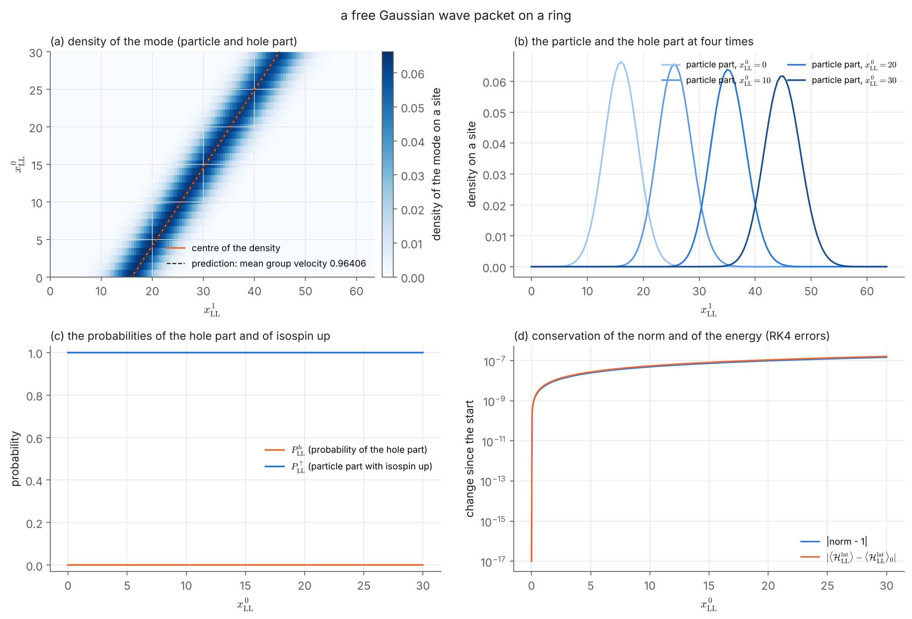{width=100%}

**Figure 7.** The free wave packet (example `packet_free`, check EX-1). (a) The packet moves through the ring without
changing its shape much; its centre (orange) lies on the dashed line of the predicted mean group velocity 0.96406, the
average of (4.7) over the momenta of the packet; the two lines cannot be told apart (the difference is $8\times10^{-5}$ of the
velocity). (b) The density at four times: the packet broadens slowly by dispersion. (c) It stays a particle with isospin up
($P^{\rm h}_{\rm LL}=0$, $P^\uparrow_{\rm LL}=1$): without fields nothing turns it. (d) The norm and the energy change by less than
$2\times10^{-7}$, the size of the RK4 error for the energies of the packet. Data: `test2/data/t2_py_packet_free_*`.

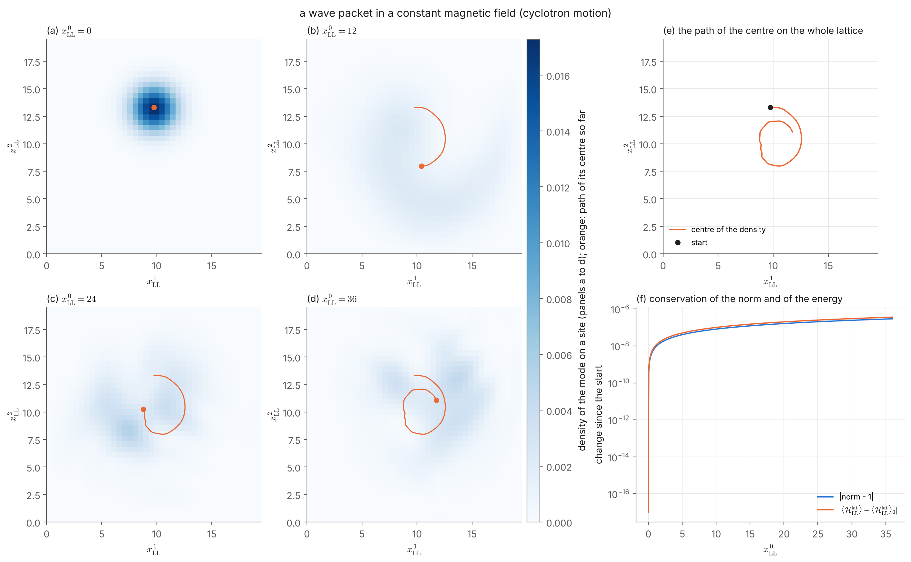{width=100%}

**Figure 8.** The packet in the magnetic field $\mathsf F^{\rm F}_{{\rm LL},12}=0.4$ (example `cyclotron`, check EX-2). (a) to (d)
The density at four times and the path of the centre so far: the packet turns, spreads around a ring, and part of it comes back;
it is a superposition of the Landau levels 0 to 3 of (3.32), whose energy differences set the turning (Section 4.4). (e) The
path of the centre: bounded, far from the walls. (f) The norm and the energy are conserved to $4\times10^{-7}$. Data:
`test2/data/t2_py_cyclotron_*`.

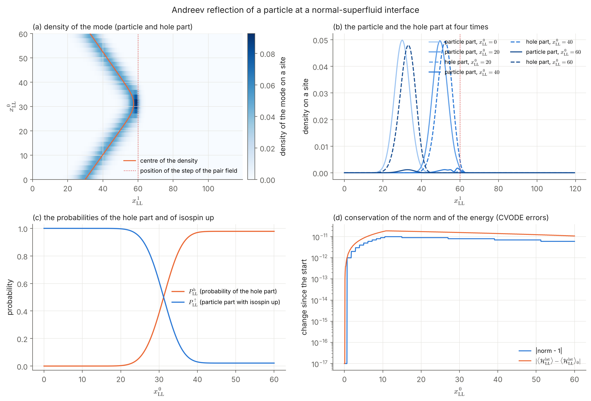{width=100%}

**Figure 9.** Andreev reflection (example `andreev`, check EX-3). (a) A particle of energy 0.074, inside the gap 0.6 of the
superfluid region to the right of the dotted line, runs to the right, turns before the interface and runs back. (b) At the times
20 and 40 the incoming particle part (solid) and the outgoing hole part (dashed); at 60 only the hole part is left, with a small
reflected particle part. (c) The conversion: $P^{\rm h}_{\rm LL}$ rises from 0 to 0.978 while the packet is at the interface, and the
particle part with isospin up falls to 0.022. (d) The errors of the time stepping stay below $3\times10^{-9}$. Data:
`test2/data/t2_py_andreev_*`.

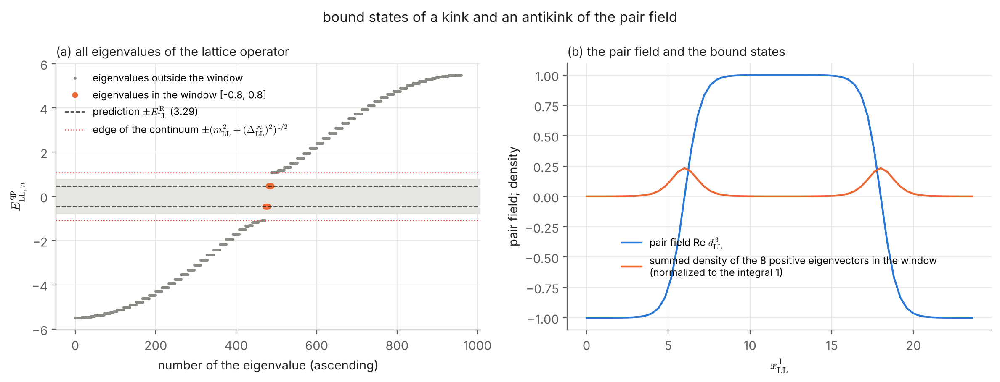{width=100%}

**Figure 10.** The kink and the antikink of the pair field on a ring (example `kink_spectrum`, check EX-4). (a) All 960
eigenvalues; inside the gap of the continuum (dotted, $\pm(m_{\rm LL}^2+(\Delta^\infty_{\rm LL})^2)^{1/2}$) lie exactly 16, on the
predicted energies $\pm E^{\rm R}_{\rm LL}$ of (3.29) (dashed) within the bound of perturbation theory. (b) The pair field and the
summed density of the eight bound states of positive energy: they sit on the two walls. Data:
`test2/data/t2_py_kink_spectrum_*`.

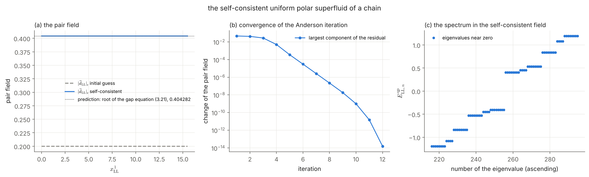{width=100%}

**Figure 11.** The self-consistent uniform superfluid (example `ground_state`, check EX-5). (a) From the guess 0.2 (grey, dashed)
the iteration reaches the uniform $\lvert\vec d_{\rm LL}\rvert$ (blue) on the root of the lattice gap equation (3.21) (dotted). (b) The
Anderson iteration converges in 12 steps to $10^{-14}$. (c) The eigenvalues near zero: the gap opens around zero energy. Data:
`test2/data/t2_py_ground_state_*`.

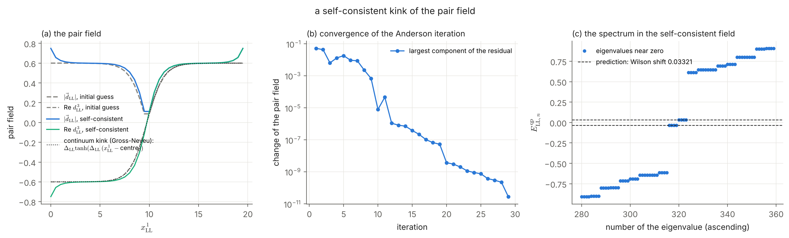{width=100%}

**Figure 12.** The self-consistent kink between two walls (example `kink_ground_state`, check EX-6). (a) The guess (grey, dashed),
the self-consistent $\mathrm{Re}\,d^3_{\rm LL}$ (aqua) and $\lvert\vec d_{\rm LL}\rvert$ (blue), and the continuum kink of the
Gross-Neveu model with the uniform gap of the same coupling (dotted): the lattice kink is slightly steeper (the Wilson term), and
the pair field rises near the hard walls. (b) The convergence of the constrained Anderson iteration. (c) The eight bound states,
four at each sign, at the energies $\pm0.034$, next to the predicted first-order Wilson shift (dashed); the continuum begins at
0.61. Data: `test2/data/t2_py_kink_ground_state_*`.

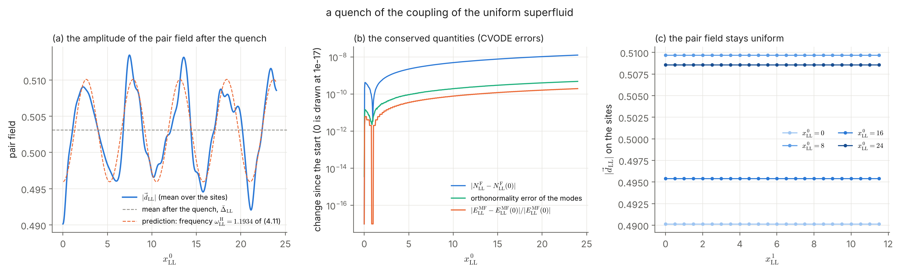{width=100%}

**Figure 13.** The quench of the coupling from 0.45 to 0.455 (example `quench`, check EX-7). (a) The amplitude of the pair field
jumps at $x^0_{\rm LL}=0$ (by the factor $G'_{\rm LL}/G_{\rm LL}$) and then oscillates about its mean (grey); the dashed curve is a
sinusoid with the predicted frequency $\omega^{\rm H}_{\rm LL}$ of (4.11) (amplitude and phase fitted): the dominant oscillation
follows it, and weaker modes at other frequencies are visible as well. (b) The fermion number changes by at most $2.4\times10^{-11}$
and the orthonormality of the modes by $1.2\times10^{-12}$ (rounding errors), while $E^{\rm MF}_{\rm LL}$ varies by a few parts in $10^{6}$
without drift (the second-order error of the midpoint rule). (c) The pair field stays uniform on all 24 sites. Data:
`test2/data/t2_py_quench_*`.

## 5.4 Discussion

- **What the plots prove.** Each figure puts the computed solution next to an independent prediction drawn from a different
  formula: the mean group velocity, the energies of the bound states, the root of the gap equation, the continuum kink and the
  Wilson shift, the frequency of the amplitude mode. Agreement is visible at a glance, and the numbers are in the reports of
  Appendix A.
- **What the plots show beyond the checks.** The time scale of the Andreev conversion (the packet stays near the interface for
  a time of order $1/\Delta_{\rm LL}$), the spreading of the packet in the magnetic field into its Landau levels, the rise of the
  pair field near hard walls, and the weaker modes in the quench, which the single-frequency check does not test.
- **Limits.** The program draws one solution at a time and chooses its panels by the task. For three active directions it draws
  the density summed over $x^3_{\rm LL}$ in the plane of the first two coordinates (the full fields are in the data files); the
  profiles of the self-consistent pair field are drawn along $x^1_{\rm LL}$.

# 6. Item [5]: a Rust program that solves the field equations

## 6.0 The answer in brief

The program `t2_solve` is the member `t2solve` of the Cargo workspace `test2/rust` (pure Rust: the standard library and the
library `t2core` of the workspace, no downloaded crate; about 2700 commented lines in three files). It is built with
`cargo build --release` and does everything the Python solver of item [3] does, in the same way: it guides the user (a short
guide at the start, the complete guide with `--guide`, seven examples written on request), asks for the name of the input
file, reads the same input files (format `t2in 1`, the 50 keys of Section 4.2, with the same checks and the same error
messages), solves the four tasks with the same methods (RK4 for `evolve`, the dense eigensolver for `spectrum`, Anderson
acceleration for `ground_state`, the implicit midpoint rule for `quench`), checks every run in the same way, and writes the
same output files with the same columns. Its self-test compares its sparse lattice operator with the operator `Lattice::apply`
of `t2core`, which was written independently for items [1] and [2] (5 checks). For the seven
examples, the Rust and the Python solutions agree number by number: the solutions, spectra and time series to $10^{-9}$, which
is rounding (check EX-8), and the checks EX-1 to EX-7 pass for the Rust solutions as well
(11 checks in all).

## 6.1 Installing Rust and building the program

**Step 1: install the Rust toolchain** (once per computer). On macOS or Linux, in a terminal:

```
curl --proto '=https' --tlsv1.2 -sSf https://sh.rustup.rs | sh
# answer 1 (the default installation), then open a new terminal window, or type:
source "$HOME/.cargo/env"
# check: both commands print a version number
rustc --version
cargo --version
```

On Windows the installer `rustup-init.exe` from the web page of the Rust project does the same; the commands below are then
typed in PowerShell (with `\` in the paths, and `t2_solve.exe` for the program).

**Step 2: build.** From the folder Revision_SuperLoop of the repository:

```
cd test2/rust
cargo build --release
```

Cargo compiles the library `t2core` and the three programs of the workspace (`t2_fields`, `t2_analytic`, `t2_solve`) with
full optimization; the first build takes about a minute, later builds only recompile what changed. No network access is
needed, because the workspace uses no external crate. The program is then the file `test2/rust/target/release/t2_solve`.

**Step 3: check the build** (from the folder Revision_SuperLoop):

```
./test2/rust/target/release/t2_solve --selftest
```

It prints five lines `[PASS] ...` and `self-test: ALL PASS` (with the folder `test2/examples` as a further argument it also
compares its examples with the input files of that folder).

## 6.2 Using the program

The commands are those of the Python solver, with `./test2/rust/target/release/t2_solve` in place of
`python3 test2/python/t2_solve.py` (all from the folder Revision_SuperLoop):

```
# the complete guide: what is solved, the boundary and initial conditions, every key
./test2/rust/target/release/t2_solve --guide
# the examples, and one of them written as an input file to start from
./test2/rust/target/release/t2_solve --examples
./test2/rust/target/release/t2_solve --example andreev my_problem.t2in
# solve an input file (the output files are named after it, in its folder)
./test2/rust/target/release/t2_solve my_problem.t2in
# the same with another name for the output files
./test2/rust/target/release/t2_solve my_problem.t2in --out results/run1
# without arguments: a short guide, then the question for the name of the input file
./test2/rust/target/release/t2_solve
# plot a solution with the Python plotter of item [4], or with the Rust plotter of item [6] (Section 7)
python3 test2/python/t2_plot.py my_problem
./test2/rust/target/release/t2_plot my_problem
```

In the dialogue the program answers `?` with the complete guide, `examples` with the list of examples, `example NAME` by
writing the example as `NAME.t2in`, and a file name by solving that file; `q` (or an empty line) ends it. An input file written
for one solver runs unchanged with the other, and both write the files `NAME_summary.txt`, `NAME_series.csv`,
`NAME_fields.csv` and, for some tasks, `NAME_spectrum.csv` and `NAME_iterations.csv` (Sections 4.3 and A.3). The exit status
is 0 when every check of the run passes, 1 when a check fails, and 2 when the input is wrong.

**What the messages mean, and what to do.**

| message | meaning | what to do |
|------------------------|------------------------------|------------------------------|
| `unknown key 'pair_widht' (did you mean pair_width?)` | a misspelt key | correct the name |
| `the task 'quench' needs the key 'quench_coupling'` | a key that the task requires is missing | add it (Section 4.2) |
| `dt Hbound = 3.1 exceeds 2.5: choose time_step below 0.4` | the time step is too long for RK4 to be stable | use a smaller `time_step` |
| `dt Hbound = 1.3 exceeds 1: ...` (quench) | the fixed-point iteration of the implicit midpoint rule would not converge | use a smaller `time_step` |
| `... must not exceed 6000` | the dense diagonalization of `spectrum`, `ground_state` and `quench` is limited to 375 sites | use fewer sites |
| `a magnetic field needs 'wall' in direction 1` | the Landau gauge grows along $x^1_{\rm LL}$ | make direction 1 a wall |
| `[FAIL] the self-consistent ... converged` | the iteration did not reach `tolerance` | raise `max_iterations`, lower `mixing`, or start from a better `pair` |

## 6.3 How the program is built

Three source files in `test2/rust/t2solve/src`:

- `input.rs`: the table of the 50 keys (name, kind, default, meaning), the keys that each task requires, and the seven examples,
  all copied from the Python solver (the self-test checks that the examples written by both programs are identical), the
  reading and checking of an input file, and the guide;
- `ops.rs`: the lattice and the coordinates of the sites; the gauge potentials of each site (constant, from the gauge file,
  the Landau gauge, the pulse) and from them the link matrices (2.34) and the potential matrices, with the closed forms
  `link` and `potential` of `t2core`; the pair field of the key `pair` (the random field with the generator SplitMix64 of
  `t2core`, which the Python solver reproduces exactly); the sparse lattice operator (2.36) in compressed rows, assembled
  from the same $8\times8$ blocks as in Section 4.3 (blocks between the same pair of sites are added); the pair expectation
  of (4.1); the wave packet (4.2) with the projection on its branch through the discrete Fourier transform along each periodic
  direction; the exact mean velocity of a free packet; the centre of a density; the root of the gap equation (3.21); the
  frequency fit; and a small linear solver for the Anderson step;
- `main.rs`: the four tasks, the summary and the data files, the self-test, the dialogue and the command line.

The methods are those of Section 4.3, step by step: RK4 with the stages at the times $x^0_{\rm LL}$,
$x^0_{\rm LL}+\ell^{\rm t}_{\rm LL}/2$ and $x^0_{\rm LL}+\ell^{\rm t}_{\rm LL}$; the Anderson iteration (4.4) with the memory 6, the
normal equations with the regularization $10^{-12}$ times their trace, and Gaussian elimination with partial pivoting; the
implicit midpoint rule (4.6) with the explicit Euler start and the stopping change $10^{-14}$. The dense eigenproblems are solved
by the eigensolver of `t2core` (Householder reduction and the implicit QL algorithm, check GS-11 of item [1]). Two things
necessarily differ from the Python solver, and neither changes a result:

- *The eigenvectors inside a degenerate eigenspace.* Two eigensolvers choose different bases of an eigenspace of a repeated
  eigenvalue (for example the four bound states of each wall at the same energy). Every quantity that the solvers compute from
  eigenvectors is independent of that choice: the pair expectation of (4.1) and the fermion number are sums over all occupied
  modes (unchanged by a unitary mixing of them), the self-consistent evolution (4.6) acts on each mode separately and computes
  the pair field from the sum, and the task `spectrum` writes the densities summed over each group of degenerate eigenvalues.
  (The only exception is `initial = eigenmode` with a degenerate eigenvalue, whose initial mode depends on the eigensolver; the
  guide says so.)
- *The arithmetic.* The sums are formed in a different order, so the last digits differ by rounding; in the time stepping and in
  the iterations these differences are carried along but not amplified much.

## 6.4 The results, and the comparison with the Python solver

The program solves the seven examples of Section 4.4; all checks of its runs pass, and the program `t2_examples_check.py`, applied
to its outputs (prefix `t2_rs_` in `test2/data`), confirms EX-1 to EX-7 with the same numbers as for the Python solutions (Appendix
A.2d). The check **EX-8** compares the 18 output files of the two solvers column by column:

| quantities | largest difference | origin |
|------------------------------|----------|------------------------------|
| densities, pair fields, spectra (all examples) | $10^{-14}$ or less | rounding in the operator and the eigensolvers |
| time series of `evolve` (norm, energy, probabilities, centre) | $10^{-11}$ | rounding, carried through 600 to 1200 RK4 steps |
| time series of `quench` ($\lvert\vec d_{\rm LL}\rvert$, $N^{\rm F}_{\rm LL}$, $E^{\rm MF}_{\rm LL}$, orthonormality) | $10^{-9}$ (in $E^{\rm MF}_{\rm LL}\approx491$, relative $2\times10^{-12}$) | rounding, carried through 600 steps of (4.6) |
| histories of the Anderson iteration | $2\times10^{-7}$ (the same numbers of iterations) | rounding, amplified by the least-squares step near convergence |

The allowed differences are $10^{-7}$ for the solutions and $10^{-5}$ for the iteration histories: the intermediate iterates of
the Anderson method depend on rounding through its least-squares step, whose matrix becomes nearly singular when the residuals
become small, but the fixed point, which is what the iteration computes, agrees to $10^{-15}$ (the self-consistent pair fields of
the files `_fields.csv`). The two programs were written independently in the sense that matters: the Rust program assembles the
operator from the formulas of (2.36) and is checked against `Lattice::apply` of `t2core`, while the Python program assembles it in
NumPy and is checked against its own site-by-site loop; their agreement to $10^{-14}$ on the same problems tests both.

Computing times on one processor core (the computer that built this document), in seconds:

| example | Python | Rust |
|------|------|------|
| `packet_free` | 0.10 | 0.06 |
| `andreev` | 0.33 | 0.27 |
| `cyclotron` | 1.6 | 1.4 |
| `kink_spectrum` | 0.9 | 2.7 |
| `ground_state` | 1.7 | 5.0 |
| `kink_ground_state` | 7.4 | 24 |
| `quench` (time stepping) | 50 | 25 |

The Rust program is faster where the work is its own loops (the time stepping), and slower for the dense eigenproblems, where
NumPy calls the optimized LAPACK library; the eigensolver of `t2core` is a plain implementation of the textbook method.

## 6.5 Discussion

- **Why a second solver.** Two programs in two languages, with two eigensolvers and two independent checks of the lattice
  operator, that agree to rounding on every example, make an error in the formulation or in the code very unlikely: an error would
  have to be made in the same way twice.
- **What the Rust program adds.** It runs without Python and without any library outside the repository, and it is the faster of
  the two for long time evolutions.
- **Limits.** The same as those of the Python solver (Section 4.5): external gauge fields, and the dense diagonalization of the
  self-consistent tasks (here also its speed).

# 7. Item [6]: a Rust program that plots the Rust solutions

## 7.0 The answer in brief

The program `t2_plot` is the member `t2plot` of the Cargo workspace `test2/rust` (pure Rust, about 1200 commented lines in two
files; no external crate). It reads the output files of a solution of the Rust solver of item [5] (or of the Python solver,
which writes the same files), chooses the panels by the task, as the Python plotter of item [4] does, and writes the figure as
Scalable Vector Graphics (`.svg`), a text format of lines, shapes and labels that every web browser displays and that can be
enlarged without loss. For the seven examples it draws the predictions of the checks EX-1 to EX-7, computed by the program itself
in Rust from the formulas of this document: the mean group velocity of (4.7), the Rayleigh quotient (3.29) of the bound states,
the root of the gap equation (3.21), the continuum kink and the first-order Wilson shift, and the frequency of the amplitude mode
(4.11). Figures 14 to 20 are its output for the seven Rust solutions (converted to PDF and PNG for this document).

## 7.1 Building and using the program

It is built together with the solver (Section 6.1):

```
cd test2/rust && cargo build --release && cd ../..
```

and used from the folder Revision_SuperLoop:

```
# solve an example with the Rust solver, then plot it: writes t2_rs_andreev_plot.svg next to the data
./test2/rust/target/release/t2_solve test2/examples/andreev.t2in --out t2_rs_andreev
./test2/rust/target/release/t2_plot t2_rs_andreev
# choose the name of the figure, or leave out the predictions of the examples
./test2/rust/target/release/t2_plot t2_rs_andreev --out my_figures/andreev
./test2/rust/target/release/t2_plot t2_rs_andreev --no-predictions
# without arguments: the program lists the solutions in the current folder and asks for a base name
./test2/rust/target/release/t2_plot
# open the figure in a web browser (macOS; on Linux: xdg-open)
open t2_rs_andreev_plot.svg
# optional: PDF and PNG files (needs the program rsvg-convert of the librsvg package)
rsvg-convert -f pdf -o andreev.pdf t2_rs_andreev_plot.svg
rsvg-convert -f png -z 1.6 -o andreev.png t2_rs_andreev_plot.svg
```

## 7.2 How the program is built

- `svg.rs`, a small plotting library: a figure is a set of panels; a panel maps its data ranges (linear, or logarithmic for the
  errors) to pixels, chooses tick values that are multiples of 1, 2, 2.5 or 5 times a power of ten, and collects its contents as
  SVG elements: lines (broken where a value is missing or, on a logarithmic axis, not positive), dots, horizontal and vertical
  reference lines, shaded bands, colour maps of one hue from white to dark blue, and a legend with a white background placed
  where it covers no data. Labels use a small markup, `x^{1}_{LL}` for $x^1_{\rm LL}$, which becomes raised and lowered text.
  The colours are those of the Python plotter (Section 5.2).
- `main.rs`: the reading of the data files (the lines `# key: value` and the columns), the four kinds of figure, the predictions
  of the examples, the dialogue and the command line. The predictions use the dispersion (2.37) through the function `eps_lat`
  of `t2core`, the group velocity (4.7), bisection for (3.21) and (4.11), and a least-squares fit for the sinusoid with the
  predicted frequency. For the bound states of the kink and the antikink (EX-4) it uses the profile
  $\cosh(x^1_{\rm LL}/\ell^{\rm K}_{\rm LL})^{-\Delta^\infty_{\rm LL}\ell^{\rm K}_{\rm LL}}$ of each wall from the parameters in the
  summary; for the self-consistent kink (EX-6), the zero mode of the computed profile.

The figures of the Rust program show the same content as Figures 7 to 13 of the Python program, drawn from the Rust solutions;
the numbers in their legends (the predictions) are computed independently of the Python checks and agree with them to the digits
shown.

## 7.3 The figures of the Rust solutions

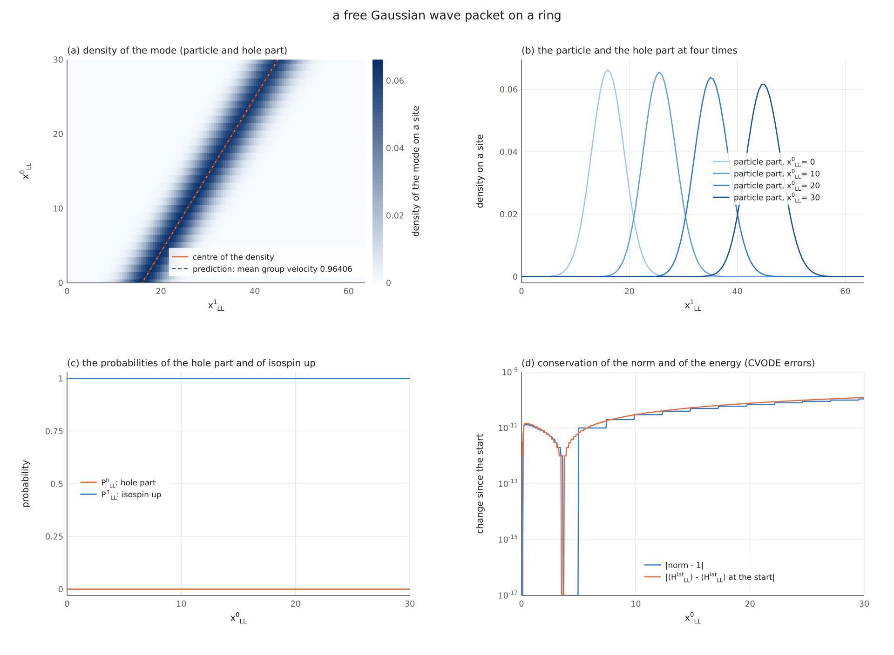{width=100%}

**Figure 14.** The free wave packet, Rust solution (example `packet_free`): (a) the density in space and time with its centre and
the predicted motion with the mean group velocity (dashed); (b) the density at four times; (c) the probabilities of the hole part
and of isospin up; (d) the changes of norm and energy. Data: `test2/data/t2_rs_packet_free_*`.

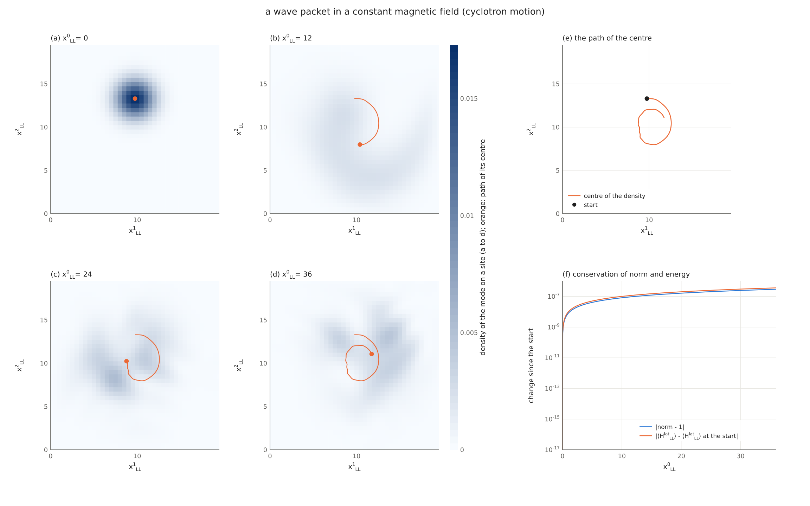{width=100%}

**Figure 15.** The packet in the magnetic field, Rust solution (example `cyclotron`): (a) to (d) the density at four times with the
path of its centre; (e) the whole path; (f) the conservation of norm and energy. Data: `test2/data/t2_rs_cyclotron_*`.

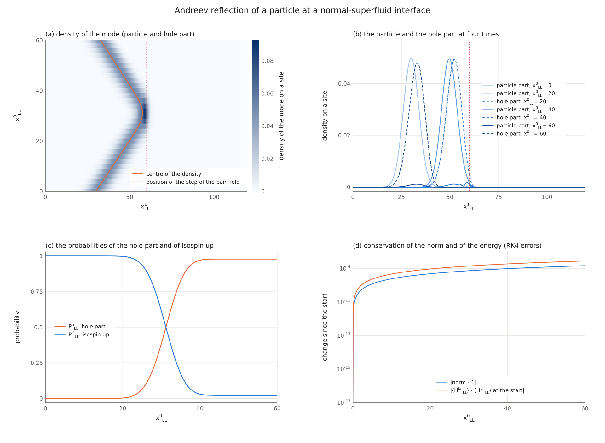{width=100%}

**Figure 16.** Andreev reflection, Rust solution (example `andreev`): (a) the density in space and time, the step of the pair field
(dotted); (b) the particle part (solid) and the hole part (dashed) at four times; (c) the conversion of the particle into a hole;
(d) the errors of the time stepping. Data: `test2/data/t2_rs_andreev_*`.

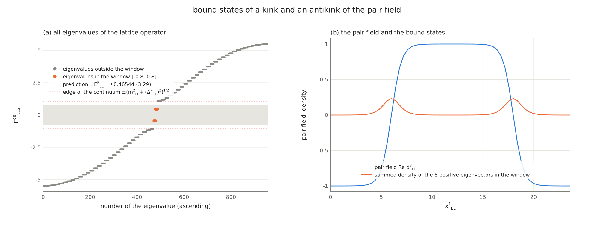{width=100%}

**Figure 17.** The kink and the antikink, Rust solution (example `kink_spectrum`): (a) all eigenvalues, the 16 bound states in the
window, the predicted energies $\pm E^{\rm R}_{\rm LL}$ (dashed) and the edges of the continuum (dotted); (b) the pair field and the
summed density of the bound states of positive energy. Data: `test2/data/t2_rs_kink_spectrum_*`.

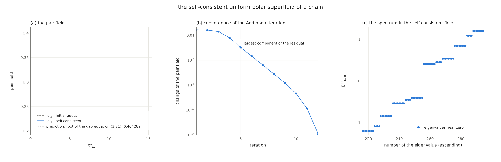{width=100%}

**Figure 18.** The self-consistent uniform superfluid, Rust solution (example `ground_state`): (a) the guess, the self-consistent
pair field and the root of (3.21) (dotted); (b) the convergence of the Anderson iteration; (c) the spectrum near zero. Data:
`test2/data/t2_rs_ground_state_*`.

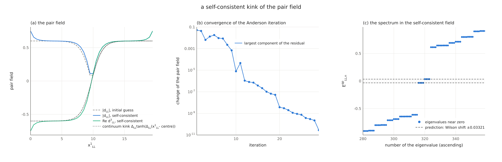{width=100%}

**Figure 19.** The self-consistent kink, Rust solution (example `kink_ground_state`): (a) the guess, the self-consistent pair field
and the continuum kink (dotted); (b) the convergence; (c) the eight bound states and the predicted Wilson shift (dashed). Data:
`test2/data/t2_rs_kink_ground_state_*`.

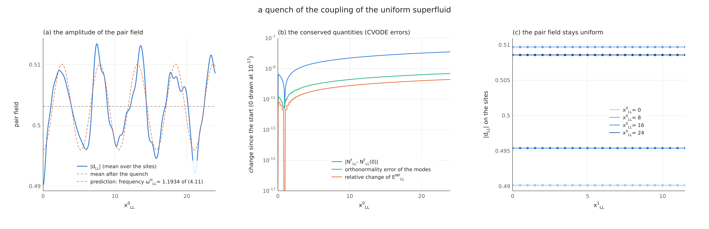{width=100%}

**Figure 20.** The quench, Rust solution (example `quench`): (a) the amplitude of the pair field with a sinusoid of the predicted
frequency of (4.11) (dashed; amplitude and phase fitted); (b) the conserved quantities; (c) the pair field on the sites at four
times. Data: `test2/data/t2_rs_quench_*`.

## 7.4 Discussion

- **Agreement.** Figures 14 to 20 and Figures 7 to 13 show the same solutions to rounding (check EX-8), drawn by two independent
  programs, with predictions computed twice, in Python by `t2_examples_check.py` and in Rust by `t2_plot`.
- **Why SVG.** A plotting program without external libraries cannot produce pixel images with good text without implementing a
  font renderer; SVG leaves the rendering to the browser (or to `rsvg-convert`), keeps the figures sharp at every size, and is
  plain text that can be inspected and edited.
- **Limits.** As for the Python plotter (Section 5.4): one solution per figure, panels chosen by the task, three-dimensional
  densities summed over $x^3_{\rm LL}$.

# 8. Item [7]: the construction of the superfluid boson singlet state (SFBS) from the spinor field

## 8.0 The answer in brief

1. **Two spinor charges at one point.** The simplest boson that the spinor field can form is a pair of two of its
   spinor charges at the same point: the operator $\Psi^T_{\rm LL}\mathsf K^{\rm g}_{\rm LL}\Psi_{\rm LL}$ with an
   $8\times8$ pair matrix $\mathsf K^{\rm g}_{\rm LL}$. Because the components anticommute, only antisymmetric pair
   matrices count; there are 28 independent ones.
2. **Spin zero.** The pair is a Lorentz scalar (spin $S^{\rm sp}_{\rm LL}=0$) exactly when its pair matrix lies in a
   six-dimensional space, spanned by $\mathsf K^\iota_{\rm LL}$ (scalar, parity $+$) and $\mathsf K'^\iota_{\rm LL}$
   (pseudoscalar, parity $-$), $\iota=1,2,3$ (Section 8.2, check SB-1). In each Weyl block the pair matrix contains the
   antisymmetric matrix $\mathsf E_{\rm LL}$: the two spins form the **spin singlet** $\uparrow\downarrow-\downarrow\uparrow$.
   The Pauli principle then forces the isospin factor to be symmetric: the pair is an **isospin triplet**
   ($I^{\rm v}_{\rm LL}=1$).
3. **The SFBS.** The attractive interaction of (2.24) acts in the scalar channel. The superfluid boson singlet is
   therefore the triplet of composite scalar fields $\Pi^\iota_{\rm LL}=\Psi^T_{\rm LL}\mathsf K^\iota_{\rm LL}\Psi_{\rm LL}$:
   spin 0, parity $+$, isospin 1, fermion number 2, electric charges $+1$, $0$, $-1$ (Sections 8.3 and 8.4, check SB-2).
   "Singlet" means spin singlet; a pair that is also an isospin singlet is forbidden for one field by the Pauli principle.
4. **Super-loop form.** In terms of the bi-quaternions $\mathbf b^\pm_{\rm LL}$ of the two spinor charges of which
   $\Psi_{\rm LL}$ is made, the SFBS is $\Pi^\iota_{\rm LL}=-2i\big({\rm Im}_\iota(\mathbf b^-_{\rm LL}\bar{\mathbf b}^-_{\rm LL})+{\rm Im}_\iota(\mathbf b^+_{\rm LL}\bar{\mathbf b}^+_{\rm LL})\big)$:
   the imaginary part of the product of each spinor charge's bi-quaternion with its own conjugate, which the
   super-loop's automorphisms rotate as an isospin vector and leave unchanged under Lorentz transformations
   (Section 8.5, check SB-3).
5. **A composite boson.** The pair operators commute with each other, and on one lattice site
   $[\hat\Pi^3_{\rm LL},(\hat\Pi^3_{\rm LL})^\dagger]=16-4\hat n^{\rm F}_{\rm LL}$: a boson whose constituents block each
   other by the Pauli principle when the site fills up (Section 8.6, check SB-4).
6. **The SFBS state.** The mean-field ground state of the attractive interaction is a coherent state of these pairs,
   built from the Dirac sea by adding pairs of particles and pairs of antiparticles with the weights
   $t^{\rm p}_{\rm LL}=\Delta_{\rm LL}/(E^-_{\rm LL}+\varepsilon_{\rm LL}-\mu_{\rm LL})$ and
   $t^{\rm a}_{\rm LL}=\Delta_{\rm LL}/(E^+_{\rm LL}+\varepsilon_{\rm LL}+\mu_{\rm LL})$ (Section 8.7). The exact many-body
   computation in the Fock space of one pair of momenta (65536 states) confirms that this state is the ground state
   (check SB-5, Figure 21). Its pair field $d^\iota_{\rm LL}=-\tfrac12G_{\rm LL}\langle\Pi^\iota_{\rm LL}\rangle$ is the
   order parameter of the superfluid; the effective field theory of this field is the subject of items [8] to [11].

The program `t2_sfbs` (member `t2sfbs` of the workspace `test2/rust`, Appendix A.2f) verifies every statement of this
section (checks SB-1 to SB-5) and prints the explicit matrices that the section shows.

## 8.1 Two spinor charges at one point

**The pair operator.** Let $\mathsf K^{\rm g}_{\rm LL}$ be a complex $8\times8$ matrix, the pair matrix. The operator

$$\Psi_{\rm LL}(x_{\rm LL})^T\mathsf K^{\rm g}_{\rm LL}\Psi_{\rm LL}(x_{\rm LL})=\sum_{k,k'}(\mathsf K^{\rm g}_{\rm LL})_{kk'}\Psi_{{\rm LL},k}(x_{\rm LL})\Psi_{{\rm LL},k'}(x_{\rm LL})\tag{8.1}$$

(the sums run over the eight components) is a product of two annihilation operators: it removes two spinor charges at
the point $x_{\rm LL}$, and its Hermitian conjugate creates two. Because
$\Psi_{{\rm LL},k}\Psi_{{\rm LL},k'}=-\Psi_{{\rm LL},k'}\Psi_{{\rm LL},k}$, the symmetric part of the pair matrix drops out:
exchanging the summation indices in (8.1) gives
$\sum_{k,k'}(\mathsf K^{\rm g}_{\rm LL})_{kk'}\Psi_{{\rm LL},k}\Psi_{{\rm LL},k'}=-\sum_{k,k'}(\mathsf K^{\rm g}_{\rm LL})_{k'k}\Psi_{{\rm LL},k}\Psi_{{\rm LL},k'}$,
so (8.1) equals $\Psi^T_{\rm LL}\tfrac12(\mathsf K^{\rm g}_{\rm LL}-(\mathsf K^{\rm g}_{\rm LL})^T)\Psi_{\rm LL}$. From now on every
pair matrix is antisymmetric, $(\mathsf K^{\rm g}_{\rm LL})^T=-\mathsf K^{\rm g}_{\rm LL}$. The antisymmetric $8\times8$ matrices form
a complex vector space of dimension $8\cdot7/2=28$: there are 28 independent pairs of two spinor charges at one point.
This is the Pauli principle for two fermions in the same place: a pair state must be antisymmetric under the exchange of
the two charges.

**How the gauge group acts on a pair.** Under the gauge transformation (2.10), $\Psi_{\rm LL}\mapsto\mathcal U_{\rm LL}\Psi_{\rm LL}$, the
pair (8.1) becomes $\Psi^T_{\rm LL}\,\mathcal U^T_{\rm LL}\mathsf K^{\rm g}_{\rm LL}\mathcal U_{\rm LL}\,\Psi_{\rm LL}$: the pair matrix changes to
$\mathcal U^T_{\rm LL}\mathsf K^{\rm g}_{\rm LL}\mathcal U_{\rm LL}$. For a transformation close to the unit, generated by one of the
generators of Section 2.4 (for example an isospin rotation by a small angle about the direction $\iota$, which changes
$\Psi_{\rm LL}$ by that angle times $iT^\iota_{\rm LL}\Psi_{\rm LL}$), the pair matrix changes by the same small number times $i$ times

$$(T^\iota_{\rm LL})^T\mathsf K^{\rm g}_{\rm LL}+\mathsf K^{\rm g}_{\rm LL}T^\iota_{\rm LL}\tag{8.2}$$

(to first order): the transposed generator acts on the first charge of the pair and the generator on the second, and the
two actions add. The same rule holds for every generator: for the Lorentz generators with $\mathsf s_{\rm LL}(\mathbf u)\otimes\sigma^{\rm LL}_0$
in place of $T^\iota_{\rm LL}$, and for the fermion number with $\mathsf 1_8$.

## 8.2 Spin zero: the Lorentz-invariant pairs

**The condition.** A pair has spin zero when it does not change under Lorentz transformations, that is, under the
$SL(2,\mathbb C)$ part of (2.10): $(\mathsf S_{\rm LL}(\mathbf g)\otimes\sigma^{\rm LL}_0)^T\mathsf K^{\rm g}_{\rm LL}(\mathsf S_{\rm LL}(\mathbf g)\otimes\sigma^{\rm LL}_0)=\mathsf K^{\rm g}_{\rm LL}$
for every unit bi-quaternion $\mathbf g$. Near the unit, $\mathsf S_{\rm LL}(\mathbf g)=\mathsf 1_4+\mathsf s_{\rm LL}(\mathbf u)$ with the
generators of Section 2.4, and the condition becomes

$$(\mathsf s_{\rm LL}(\mathbf u)\otimes\sigma^{\rm LL}_0)^T\mathsf K^{\rm g}_{\rm LL}+\mathsf K^{\rm g}_{\rm LL}(\mathsf s_{\rm LL}(\mathbf u)\otimes\sigma^{\rm LL}_0)=0\quad\text{for }\mathbf u=J^1_{\rm LL},J^2_{\rm LL},J^3_{\rm LL},K^1_{\rm LL},K^2_{\rm LL},K^3_{\rm LL}.\tag{8.3}$$

(For a connected group such as $SL(2,\mathbb C)$ the infinitesimal condition for its generators implies the condition for
all its elements.)

**Theorem 8.1 (the spin-zero pairs; Theorem SF1 of the manuscript).** The antisymmetric solutions of (8.3) form a complex
vector space of dimension 6, spanned by the three scalar pair matrices
$\mathsf K^\iota_{\rm LL}=C_{\rm LL}\gamma^{\rm ch}_{\rm LL}\otimes\mathsf E_{\rm LL}\tau^{\rm LL}_\iota$ of (2.22) and the three pseudoscalar
pair matrices $\mathsf K'^\iota_{\rm LL}=C_{\rm LL}\otimes\mathsf E_{\rm LL}\tau^{\rm LL}_\iota$. Every solution pairs each Weyl block
with itself:

$$\mathsf K^{\rm g}_{\rm LL}=\begin{pmatrix}\mathsf E_{\rm LL}\otimes\mathsf V^-_{\rm LL}&0\\0&\mathsf E_{\rm LL}\otimes\mathsf V^+_{\rm LL}\end{pmatrix}\tag{8.4}$$

(blocks of $4\times4$: the rows and columns 1 to 4 belong to $\Psi^-_{\rm LL}$, 5 to 8 to $\Psi^+_{\rm LL}$; in each block the
first factor acts on the Weyl index and the second on the isospin index), with two **symmetric** complex $2\times2$
isospin matrices $\mathsf V^\pm_{\rm LL}$.

*Proof.* Write $\mathsf K^{\rm g}_{\rm LL}$ in the four $4\times4$ blocks of the two Weyl spinors, and write each block as a sum of
four terms (Weyl factor)$\otimes$(isospin factor), with the four $2\times2$ isospin matrices that have a single entry 1 as the
isospin factors. Since $\mathsf S_{\rm LL}(\mathbf g)=\mathrm{diag}(M_{\rm LL}(\tilde{\mathbf g}),M_{\rm LL}(\mathbf g))$ by (2.7) acts on the Weyl index
only, the finite form of (8.3) splits into one condition for each Weyl factor $\mathsf B^{\rm W}_{\rm LL}$ (a complex $2\times2$
matrix) of each block:

$$\begin{aligned}M_{\rm LL}(\tilde{\mathbf g})^T\mathsf B^{\rm W}_{\rm LL}M_{\rm LL}(\tilde{\mathbf g})&=\mathsf B^{\rm W}_{\rm LL}\quad\text{(upper left block)},\\M_{\rm LL}(\tilde{\mathbf g})^T\mathsf B^{\rm W}_{\rm LL}M_{\rm LL}(\mathbf g)&=\mathsf B^{\rm W}_{\rm LL}\quad\text{(upper right block)},\\M_{\rm LL}(\mathbf g)^T\mathsf B^{\rm W}_{\rm LL}M_{\rm LL}(\mathbf g)&=\mathsf B^{\rm W}_{\rm LL}\quad\text{(lower right block)},\end{aligned}$$

for every unit bi-quaternion $\mathbf g$ (the lower left block is minus the transpose of the upper right one). Four
particular Lorentz transformations decide everything: the rotation by $\pi/2$ about $x^3_{\rm LL}$, the rotation by $\pi/2$ about
$x^2_{\rm LL}$, and the boost along $x^3_{\rm LL}$ with the rapidity $\ln2$, which by (2.1) and Section 2.4 have

$$M_{\rm LL}(\mathbf g)=\begin{pmatrix}\exp(-i\pi/4)&0\\0&\exp(i\pi/4)\end{pmatrix},\qquad M_{\rm LL}(\mathbf g)=\frac1{\sqrt2}\begin{pmatrix}1&-1\\1&1\end{pmatrix},\qquad M_{\rm LL}(\mathbf g)=\begin{pmatrix}\sqrt2&0\\0&1/\sqrt2\end{pmatrix},$$

together with the unit bi-quaternion $\mathbf g=\mathbf e_0+\tfrac i2\mathbf e_1-\tfrac12\mathbf e_2$, for which (2.2) gives
$M_{\rm LL}(\mathbf g)=\begin{pmatrix}1&1\\0&1\end{pmatrix}$ (a null rotation). For the rotations
$M_{\rm LL}(\tilde{\mathbf g})=M_{\rm LL}(\mathbf g)$ (unitary matrices), for the boost $M_{\rm LL}(\tilde{\mathbf g})=M_{\rm LL}(\mathbf g)^{-1}$.

(a) *The diagonal blocks.* The identity
$M_{\rm LL}(\mathbf g)^T\mathsf E_{\rm LL}M_{\rm LL}(\mathbf g)=\det(M_{\rm LL}(\mathbf g))\,\mathsf E_{\rm LL}$, which holds for every complex
$2\times2$ matrix in place of $M_{\rm LL}(\mathbf g)$ (multiply out with $\mathsf E_{\rm LL}=\begin{pmatrix}0&1\\-1&0\end{pmatrix}$), and the
same identity for $M_{\rm LL}(\tilde{\mathbf g})$ show that $\mathsf B^{\rm W}_{\rm LL}=\mathsf E_{\rm LL}$ satisfies both diagonal conditions
for every $\mathbf g$ (the determinant is 1). Conversely, the boost multiplies the entry $(\mathsf B^{\rm W}_{\rm LL})_{11}$ by 2 and the
entry $(\mathsf B^{\rm W}_{\rm LL})_{22}$ by $\tfrac12$ (in both diagonal conditions), so both vanish; and the null rotation turns
$\begin{pmatrix}0&(\mathsf B^{\rm W}_{\rm LL})_{12}\\(\mathsf B^{\rm W}_{\rm LL})_{21}&0\end{pmatrix}$ into
$\begin{pmatrix}0&(\mathsf B^{\rm W}_{\rm LL})_{12}\\(\mathsf B^{\rm W}_{\rm LL})_{21}&(\mathsf B^{\rm W}_{\rm LL})_{12}+(\mathsf B^{\rm W}_{\rm LL})_{21}\end{pmatrix}$, so
$(\mathsf B^{\rm W}_{\rm LL})_{21}=-(\mathsf B^{\rm W}_{\rm LL})_{12}$: the Weyl factor is a multiple of $\mathsf E_{\rm LL}$.

(b) *The blocks between the two Weyl spinors.* For the two rotations the upper right condition is the same as a diagonal
one. The rotation about $x^3_{\rm LL}$ multiplies $(\mathsf B^{\rm W}_{\rm LL})_{11}$ by $\exp(-i\pi/2)=-i$ and $(\mathsf B^{\rm W}_{\rm LL})_{22}$
by $i$, so both vanish. The rotation about $x^2_{\rm LL}$ leaves $\mathsf E_{\rm LL}$ unchanged (its determinant is 1) but turns
$\sigma^{\rm LL}_1$ into $\sigma^{\rm LL}_3$ (multiply out), so the symmetric part of
$\begin{pmatrix}0&(\mathsf B^{\rm W}_{\rm LL})_{12}\\(\mathsf B^{\rm W}_{\rm LL})_{21}&0\end{pmatrix}$, which is a multiple of $\sigma^{\rm LL}_1$, must vanish: the
Weyl factor is a multiple of $\mathsf E_{\rm LL}$. Finally the boost turns $\mathsf E_{\rm LL}$ into
$\mathrm{diag}(1/\sqrt2,\sqrt2)\,\mathsf E_{\rm LL}\,\mathrm{diag}(\sqrt2,1/\sqrt2)=\begin{pmatrix}0&\tfrac12\\-2&0\end{pmatrix}\neq\mathsf E_{\rm LL}$, so the
multiple is zero. The blocks between the two Weyl spinors vanish: a Lorentz-invariant pair never joins a left-handed with a
right-handed charge.

(c) *Antisymmetry.* With the diagonal blocks $\mathsf E_{\rm LL}\otimes\mathsf V^\pm_{\rm LL}$, the transposed block is
$\mathsf E^T_{\rm LL}\otimes(\mathsf V^\pm_{\rm LL})^T=-\mathsf E_{\rm LL}\otimes(\mathsf V^\pm_{\rm LL})^T$, and antisymmetry requires
$(\mathsf V^\pm_{\rm LL})^T=\mathsf V^\pm_{\rm LL}$. The symmetric complex $2\times2$ matrices form a space of dimension 3, with the basis

$$\mathsf E_{\rm LL}\tau^{\rm LL}_1=\begin{pmatrix}1&0\\0&-1\end{pmatrix},\qquad\mathsf E_{\rm LL}\tau^{\rm LL}_2=\begin{pmatrix}i&0\\0&i\end{pmatrix},\qquad\mathsf E_{\rm LL}\tau^{\rm LL}_3=\begin{pmatrix}0&-1\\-1&0\end{pmatrix},\tag{8.5}$$

while the fourth $2\times2$ matrix, $\mathsf E_{\rm LL}$ itself, is antisymmetric. So $\mathsf V^-_{\rm LL}$ and $\mathsf V^+_{\rm LL}$ have three
free coefficients each: six in all. With $C_{\rm LL}\gamma^{\rm ch}_{\rm LL}=\mathrm{diag}(-\mathsf E_{\rm LL},-\mathsf E_{\rm LL})$ and
$C_{\rm LL}=\mathrm{diag}(\mathsf E_{\rm LL},-\mathsf E_{\rm LL})$ (Section 2.3), $\mathsf K^\iota_{\rm LL}$ is (8.4) with
$\mathsf V^-_{\rm LL}=\mathsf V^+_{\rm LL}=-\mathsf E_{\rm LL}\tau^{\rm LL}_\iota$ and $\mathsf K'^\iota_{\rm LL}$ is (8.4) with
$\mathsf V^-_{\rm LL}=-\mathsf V^+_{\rm LL}=\mathsf E_{\rm LL}\tau^{\rm LL}_\iota$; these six matrices span the solutions. $\square$

Check SB-1 computes the solution space of (8.3) directly: on the 28 antisymmetric matrices the six conditions (8.3) leave
exactly a six-dimensional space, which coincides with the span of $\mathsf K^\iota_{\rm LL}$ and $\mathsf K'^\iota_{\rm LL}$ (difference of
the two projectors $1.8\times10^{-15}$); the six matrices are mutually orthogonal, $\mathrm{tr}((\mathsf K^\iota_{\rm LL})^\dagger\mathsf K^{\iota'}_{\rm LL})$
is 8 for $\iota=\iota'$ and 0 otherwise. The scalar matrices are written out in Section 2.8; the pseudoscalar ones are

$$\begin{aligned}\mathsf K'^1_{\rm LL}&=\begin{pmatrix}0&0&1&0&0&0&0&0\\0&0&0&-1&0&0&0&0\\-1&0&0&0&0&0&0&0\\0&1&0&0&0&0&0&0\\0&0&0&0&0&0&-1&0\\0&0&0&0&0&0&0&1\\0&0&0&0&1&0&0&0\\0&0&0&0&0&-1&0&0\end{pmatrix},\\ \mathsf K'^2_{\rm LL}&=\begin{pmatrix}0&0&i&0&0&0&0&0\\0&0&0&i&0&0&0&0\\-i&0&0&0&0&0&0&0\\0&-i&0&0&0&0&0&0\\0&0&0&0&0&0&-i&0\\0&0&0&0&0&0&0&-i\\0&0&0&0&i&0&0&0\\0&0&0&0&0&i&0&0\end{pmatrix},\\ \mathsf K'^3_{\rm LL}&=\begin{pmatrix}0&0&0&-1&0&0&0&0\\0&0&-1&0&0&0&0&0\\0&1&0&0&0&0&0&0\\1&0&0&0&0&0&0&0\\0&0&0&0&0&0&0&1\\0&0&0&0&0&0&1&0\\0&0&0&0&0&-1&0&0\\0&0&0&0&-1&0&0&0\end{pmatrix}.\end{aligned}$$

**Why "singlet": the spin of the pair.** In each Weyl block the pair matrix (8.4) has the factor $\mathsf E_{\rm LL}$ on the Weyl
index. The first Weyl component has the spin $+\tfrac12$ along $x^3_{\rm LL}$ and the second the spin $-\tfrac12$ (the rotation
generators act on a Weyl block as $\sigma^{\rm LL}_j/2$, Section 3.1). The entries $(\mathsf E_{\rm LL})_{12}=1$ and
$(\mathsf E_{\rm LL})_{21}=-1$ therefore combine "first charge with spin up, second with spin down" with the weight $+1$ and the
reverse with the weight $-1$: the pair is $\uparrow\downarrow-\downarrow\uparrow$, the **spin singlet** of two spin-$\tfrac12$ particles,
$S^{\rm sp}_{\rm LL}=0$. (The written-out pair operators of Section 8.4 show it directly: every term joins the Dirac index 1
with the Dirac index 2, or 3 with 4, that is, spin up with spin down in the same Weyl block.) The total spin acts on the pair matrix of a Weyl block as
$\mathsf E_{\rm LL}\mapsto(\sigma^{\rm LL}_j/2)^T\mathsf E_{\rm LL}+\mathsf E_{\rm LL}\sigma^{\rm LL}_j/2$, which vanishes for $j=1,2,3$ (check SB-2):
no rotation changes the pair. Boosts do not change it either, because $M_{\rm LL}(\mathbf g)^T\mathsf E_{\rm LL}M_{\rm LL}(\mathbf g)=\mathsf E_{\rm LL}$
for every unit bi-quaternion $\mathbf g$ (step (a)): the pair is a Lorentz scalar, a particle of spin zero.

**The isospin of the pair.** The isospin factors (8.5) are the symmetric $2\times2$ matrices. Written as states of two
isospin-$\tfrac12$ charges they are $\uparrow\uparrow$, $\downarrow\downarrow$ and $\uparrow\downarrow+\downarrow\uparrow$ (in combinations): the symmetric
states, the **isospin triplet**, $I^{\rm v}_{\rm LL}=1$. Check SB-2 computes the isospin Casimir of the pairs: the sum over
$\iota'$ of the action of $T^{\iota'}_{\rm LL}$ applied twice to $\mathsf K^\iota_{\rm LL}$ gives $2\,\mathsf K^\iota_{\rm LL}=I^{\rm v}_{\rm LL}(I^{\rm v}_{\rm LL}+1)\mathsf K^\iota_{\rm LL}$ with
$I^{\rm v}_{\rm LL}=1$, and the spin Casimir gives 0.

**The Pauli principle decides.** Two charges at the same point are in a relative s-wave (symmetric in space). The
whole pair state must be antisymmetric. The spin singlet is antisymmetric, so the isospin part must be symmetric: spin 0
goes with isospin 1. A pair that is a singlet in spin *and* in isospin would be symmetric and vanishes identically for
one field; such a complete singlet of the super-loop needs two different species of spinor fields (Theorem SF4 of the
manuscript). The word *singlet* in "superfluid boson singlet" therefore means the **spin singlet**; the boson carries
isospin 1.

| pair matrix | spin $S^{\rm sp}_{\rm LL}$ | parity | isospin $I^{\rm v}_{\rm LL}$ | fermion number | electric charges | present in (2.24) |
|----------------|------|------|------|------|------------|------|
| $\mathsf K^\iota_{\rm LL}=C_{\rm LL}\gamma^{\rm ch}_{\rm LL}\otimes\mathsf E_{\rm LL}\tau^{\rm LL}_\iota$ | 0 | $+$ | 1 | 2 | $+1$, $0$, $-1$ | yes: the SFBS |
| $\mathsf K'^\iota_{\rm LL}=C_{\rm LL}\otimes\mathsf E_{\rm LL}\tau^{\rm LL}_\iota$ | 0 | $-$ | 1 | 2 | $+1$, $0$, $-1$ | no |

## 8.3 Parity: the interaction selects the scalar channel

The parity transformation reflects space and exchanges the two Weyl blocks:
$\Psi_{\rm LL}(x^0_{\rm LL},\vec x_{\rm LL})\mapsto(\gamma^0_{\rm LL}\otimes\sigma^{\rm LL}_0)\Psi_{\rm LL}(x^0_{\rm LL},-\vec x_{\rm LL})$. A pair matrix
changes to $(\gamma^0_{\rm LL}\otimes\sigma^{\rm LL}_0)^T\mathsf K^{\rm g}_{\rm LL}(\gamma^0_{\rm LL}\otimes\sigma^{\rm LL}_0)$. Since $\gamma^0_{\rm LL}$ exchanges the
two blocks, it exchanges $\mathsf V^-_{\rm LL}$ and $\mathsf V^+_{\rm LL}$ in (8.4): the scalar matrices ($\mathsf V^-_{\rm LL}=\mathsf V^+_{\rm LL}$)
stay unchanged, parity $+1$, and the pseudoscalar matrices ($\mathsf V^-_{\rm LL}=-\mathsf V^+_{\rm LL}$) change sign, parity $-1$
(check SB-2). The self-interaction of (2.24) is $\tfrac14G_{\rm LL}\sum_\iota(\Pi^\iota_{\rm LL})^\dagger\Pi^\iota_{\rm LL}$ with
$\Pi^\iota_{\rm LL}=\Psi^T_{\rm LL}\mathsf K^\iota_{\rm LL}\Psi_{\rm LL}$: the spinor charges attract each other in the scalar channel and
only there. The bosons that this attraction binds and condenses are the scalar pairs.

**Definition.** The **superfluid boson singlet (SFBS)** of the spinor field is the isospin triplet of composite scalar
fields

$$\Pi^\iota_{\rm LL}(x_{\rm LL})=\Psi_{\rm LL}(x_{\rm LL})^T\mathsf K^\iota_{\rm LL}\Psi_{\rm LL}(x_{\rm LL}),\qquad\iota=1,2,3,\tag{8.6}$$

with spin 0, parity $+$, isospin 1 and fermion number 2; its condensate, the expectation value of (8.6) in the ground
state, is the order parameter $d^\iota_{\rm LL}=-\tfrac12G_{\rm LL}\langle\Pi^\iota_{\rm LL}\rangle$ of (2.30), and the **SFBS state** is
the ground state in which this condensate is not zero (Section 8.7). Written out with the components (Section 2.8),
$\Pi^1_{\rm LL}=-2\Psi_{{\rm LL},1}\Psi_{{\rm LL},3}+2\Psi_{{\rm LL},2}\Psi_{{\rm LL},4}-2\Psi_{{\rm LL},5}\Psi_{{\rm LL},7}+2\Psi_{{\rm LL},6}\Psi_{{\rm LL},8}$,
and similarly for $\iota=2,3$.

## 8.4 The charges of the SFBS

**Electric charge.** The electric charge is $Q_{\rm LL}=T^3_{\rm LL}$ (Section 2.4): $+\tfrac12$ on the isospin-up components
(the odd components 1, 3, 5, 7) and $-\tfrac12$ on the isospin-down components (2, 4, 6, 8). The total charge operator
is $\int d^3\vec x_{\rm LL}\,\Psi^\dagger_{\rm LL}T^3_{\rm LL}\Psi_{\rm LL}$; from the anticommutation relations its commutator with a
component is $-\sum_{k'}(T^3_{\rm LL})_{kk'}\Psi_{{\rm LL},k'}$, and with a pair (8.1) it is
$-\Psi^T_{\rm LL}((T^3_{\rm LL})^T\mathsf K^{\rm g}_{\rm LL}+\mathsf K^{\rm g}_{\rm LL}T^3_{\rm LL})\Psi_{\rm LL}$, the action (8.2) of the charge. A pair
whose matrix satisfies $(T^3_{\rm LL})^T\mathsf K^{\rm g}_{\rm LL}+\mathsf K^{\rm g}_{\rm LL}T^3_{\rm LL}=+\mathsf K^{\rm g}_{\rm LL}$, $=0$ or
$=-\mathsf K^{\rm g}_{\rm LL}$ therefore removes the electric charge $+1$, $0$ or $-1$. The combinations

$$\mathsf K^{(+1)}_{\rm LL}=\frac{\mathsf K^1_{\rm LL}-i\mathsf K^2_{\rm LL}}{\sqrt2},\qquad\mathsf K^{(0)}_{\rm LL}=\mathsf K^3_{\rm LL},\qquad\mathsf K^{(-1)}_{\rm LL}=\frac{\mathsf K^1_{\rm LL}+i\mathsf K^2_{\rm LL}}{\sqrt2}\tag{8.7}$$

have the charges $+1$, $0$, $-1$ (check SB-2; the derivation: on the isospin factor,
$\tfrac12(\tau^{\rm LL}_3\mathsf E_{\rm LL}\tau^{\rm LL}_\iota+\mathsf E_{\rm LL}\tau^{\rm LL}_\iota\tau^{\rm LL}_3)=\tfrac12\mathsf E_{\rm LL}(\tau^{\rm LL}_\iota\tau^{\rm LL}_3-\tau^{\rm LL}_3\tau^{\rm LL}_\iota)$,
because $\tau^{\rm LL}_3$ anticommutes with $\mathsf E_{\rm LL}$; this is $-i\mathsf E_{\rm LL}\tau^{\rm LL}_2$ for $\iota=1$, $+i\mathsf E_{\rm LL}\tau^{\rm LL}_1$ for
$\iota=2$ and 0 for $\iota=3$, so the generator maps $\mathsf K^1_{\rm LL}\mapsto-i\mathsf K^2_{\rm LL}$, $\mathsf K^2_{\rm LL}\mapsto i\mathsf K^1_{\rm LL}$,
$\mathsf K^3_{\rm LL}\mapsto0$, and (8.7) are its eigenvectors). Evaluated:

$$\begin{aligned}\sqrt2\,\mathsf K^{(+1)}_{\rm LL}=\mathsf K^1_{\rm LL}-i\mathsf K^2_{\rm LL}&=\begin{pmatrix}0&0&-2&0&0&0&0&0\\0&0&0&0&0&0&0&0\\2&0&0&0&0&0&0&0\\0&0&0&0&0&0&0&0\\0&0&0&0&0&0&-2&0\\0&0&0&0&0&0&0&0\\0&0&0&0&2&0&0&0\\0&0&0&0&0&0&0&0\end{pmatrix},\\ \sqrt2\,\mathsf K^{(-1)}_{\rm LL}=\mathsf K^1_{\rm LL}+i\mathsf K^2_{\rm LL}&=\begin{pmatrix}0&0&0&0&0&0&0&0\\0&0&0&2&0&0&0&0\\0&0&0&0&0&0&0&0\\0&-2&0&0&0&0&0&0\\0&0&0&0&0&0&0&0\\0&0&0&0&0&0&0&2\\0&0&0&0&0&0&0&0\\0&0&0&0&0&-2&0&0\end{pmatrix},\\ \mathsf K^{(0)}_{\rm LL}=\mathsf K^3_{\rm LL}&=\begin{pmatrix}0&0&0&1&0&0&0&0\\0&0&1&0&0&0&0&0\\0&-1&0&0&0&0&0&0\\-1&0&0&0&0&0&0&0\\0&0&0&0&0&0&0&1\\0&0&0&0&0&0&1&0\\0&0&0&0&0&-1&0&0\\0&0&0&0&-1&0&0&0\end{pmatrix}.\end{aligned}$$

and the corresponding pair operators $\Pi^{(q)}_{\rm LL}=\Psi^T_{\rm LL}\mathsf K^{(q)}_{\rm LL}\Psi_{\rm LL}$ are

$$\begin{aligned}
\sqrt2\,\Pi^{(+1)}_{\rm LL}&=-4\Psi_{{\rm LL},1}\Psi_{{\rm LL},3}-4\Psi_{{\rm LL},5}\Psi_{{\rm LL},7},\\
\sqrt2\,\Pi^{(-1)}_{\rm LL}&=4\Psi_{{\rm LL},2}\Psi_{{\rm LL},4}+4\Psi_{{\rm LL},6}\Psi_{{\rm LL},8},\\
\Pi^{(0)}_{\rm LL}&=2\Psi_{{\rm LL},1}\Psi_{{\rm LL},4}+2\Psi_{{\rm LL},2}\Psi_{{\rm LL},3}+2\Psi_{{\rm LL},5}\Psi_{{\rm LL},8}+2\Psi_{{\rm LL},6}\Psi_{{\rm LL},7}.
\end{aligned}$$

They show the charges directly: $\Pi^{(+1)}_{\rm LL}$ annihilates two isospin-up charges (components 1 and 3, or 5 and 7),
$\Pi^{(-1)}_{\rm LL}$ two isospin-down charges, and $\Pi^{(0)}_{\rm LL}$ one up and one down charge. In every term both charges
belong to the same Weyl block, and within the block they have opposite spin projections (Dirac indices 1 and 2, or
3 and 4): the spin singlet of Section 8.2.

**Fermion number.** The generator of $U(1)^{\rm F}_{\rm LL}$ is $\mathsf 1_8$, and
$\mathsf 1_8^T\mathsf K^\iota_{\rm LL}+\mathsf K^\iota_{\rm LL}\mathsf 1_8=2\,\mathsf K^\iota_{\rm LL}$: the SFBS carries the fermion number 2 (it is a pair).

**The transformation law.** Collecting the results: under (2.10) the SFBS transforms as (2.23),
$\Pi^\iota_{\rm LL}\mapsto\exp(2i\theta^{\rm F}_{\rm LL})\sum_{\iota'}[\mathsf R^{\rm v}_{\rm LL}(\mathsf U_{\rm LL})]_{\iota\iota'}\Pi^{\iota'}_{\rm LL}$: it
does not feel the Lorentz part of the gauge group at all (a Lorentz scalar needs no spin connection), it is rotated
by the isospin group as a vector, and it carries twice the phase of a spinor charge.

## 8.5 The super-loop form of the SFBS

By (2.11) the Dirac field is made of two spinor charges of the super-loop: the upper block is
$\Psi^-_{\rm LL}=\psi'_{\rm LL}(\mathbf b^-_{\rm LL})$, the lower block $\Psi^+_{\rm LL}=\psi'_{\rm LL}(\mathbf b^+_{\rm LL})$, with
$\psi'_{\rm LL}(\mathbf b)=\mathsf E^{-1}_{\rm LL}M_{\rm LL}(\mathbf b)^T$ (rows: Weyl index; columns: isospin). For the quantum field the
four coefficients $\xi^{\rm LL}_p(\mathbf b^\pm_{\rm LL})$ of each bi-quaternion are anticommuting operators.

**Theorem 8.2 (the SFBS in the super-loop).** As bilinear expressions in the anticommuting coefficients,

$$\Pi^\iota_{\rm LL}=-2i\Big({\rm Im}_\iota\big(\mathbf b^-_{\rm LL}\bar{\mathbf b}^-_{\rm LL}\big)+{\rm Im}_\iota\big(\mathbf b^+_{\rm LL}\bar{\mathbf b}^+_{\rm LL}\big)\Big),\tag{8.8}$$

where ${\rm Im}_\iota(\mathbf x)$ is the coefficient of $\mathbf e_\iota$ in the bi-quaternion $\mathbf x$. With
$\xi^{\rm LL}_p=\xi^{\rm LL}_p(\mathbf b)$ and $(\iota,\iota',\iota'')$ cyclic, the product of a bi-quaternion with its own conjugate is

$$\mathbf b\bar{\mathbf b}=-2\sum_\iota\big(\xi^{\rm LL}_0\xi^{\rm LL}_\iota+\xi^{\rm LL}_{\iota'}\xi^{\rm LL}_{\iota''}\big)\mathbf e_\iota,\tag{8.9}$$

purely imaginary: its scalar part $N_{\rm LL}(\mathbf b,\mathbf b)=\sum_p\xi^{\rm LL}_p\xi^{\rm LL}_p$ vanishes, because the square of an
anticommuting operator is zero.

*Proof.* (i) In one Weyl block the pair matrix is $(-\mathsf E_{\rm LL})\otimes(\mathsf E_{\rm LL}\tau^{\rm LL}_\iota)$, so the block contributes
$\sum_{a,a',k,k'}(\psi'_{\rm LL}(\mathbf b))_{ak}(-\mathsf E_{\rm LL})_{aa'}(\mathsf E_{\rm LL}\tau^{\rm LL}_\iota)_{kk'}(\psi'_{\rm LL}(\mathbf b))_{a'k'}=\mathrm{tr}\big((\psi'_{\rm LL}(\mathbf b)^T(-\mathsf E_{\rm LL})\psi'_{\rm LL}(\mathbf b))(\mathsf E_{\rm LL}\tau^{\rm LL}_\iota)^T\big)$,
where the first index of $\psi'_{\rm LL}(\mathbf b)$ is the Weyl index and the second the isospin index (the sums run over both
values of each); the order of the two anticommuting factors is kept. (ii) With $\mathsf E^{-1}_{\rm LL}=-\mathsf E_{\rm LL}$ and
$(\mathsf E^{-1}_{\rm LL})^T=\mathsf E_{\rm LL}$,
$\psi'_{\rm LL}(\mathbf b)^T(-\mathsf E_{\rm LL})\psi'_{\rm LL}(\mathbf b)=M_{\rm LL}(\mathbf b)\mathsf E_{\rm LL}(-\mathsf E_{\rm LL})(-\mathsf E_{\rm LL})M_{\rm LL}(\mathbf b)^T=-M_{\rm LL}(\mathbf b)\mathsf E_{\rm LL}M_{\rm LL}(\mathbf b)^T$,
using $\mathsf E_{\rm LL}^2=-\sigma^{\rm LL}_0$. (iii) The relation $\mathsf E_{\rm LL}M_{\rm LL}(\mathbf x)\mathsf E^{-1}_{\rm LL}=M_{\rm LL}(\bar{\mathbf x})^T$ of
the derivation of (2.12), applied to $\mathbf x=\bar{\mathbf b}$, gives $M_{\rm LL}(\mathbf b)^T=\mathsf E_{\rm LL}M_{\rm LL}(\bar{\mathbf b})\mathsf E^{-1}_{\rm LL}$,
hence $M_{\rm LL}(\mathbf b)\mathsf E_{\rm LL}M_{\rm LL}(\mathbf b)^T=-M_{\rm LL}(\mathbf b\bar{\mathbf b})\mathsf E^{-1}_{\rm LL}=M_{\rm LL}(\mathbf b\bar{\mathbf b})\mathsf E_{\rm LL}$
($M_{\rm LL}$ is multiplicative, and the steps are linear in each factor, so they hold with anticommuting coefficients as
long as the order of the factors is kept). (iv) The block is therefore
$-\mathrm{tr}\big(M_{\rm LL}(\mathbf b\bar{\mathbf b})\mathsf E_{\rm LL}(\tau^{\rm LL}_\iota)^T\mathsf E^T_{\rm LL}\big)=\mathrm{tr}\big(M_{\rm LL}(\mathbf b\bar{\mathbf b})\mathsf E_{\rm LL}(\tau^{\rm LL}_\iota)^T\mathsf E_{\rm LL}\big)$,
and $\mathsf E_{\rm LL}(\tau^{\rm LL}_\iota)^T\mathsf E_{\rm LL}=\tau^{\rm LL}_\iota$ (because $\mathsf E_{\rm LL}\tau^{\rm LL}_\iota\mathsf E^{-1}_{\rm LL}=-(\tau^{\rm LL}_\iota)^T$),
so the block is $\mathrm{tr}(M_{\rm LL}(\mathbf b\bar{\mathbf b})\tau^{\rm LL}_\iota)$. (v) By (2.1),
$M_{\rm LL}(\mathbf b\bar{\mathbf b})=\xi^{\rm LL}_0(\mathbf b\bar{\mathbf b})\sigma^{\rm LL}_0-i\sum_j\xi^{\rm LL}_j(\mathbf b\bar{\mathbf b})\sigma^{\rm LL}_j$, and
$\mathrm{tr}(\sigma^{\rm LL}_j\tau^{\rm LL}_\iota)$ is 2 for $j=\iota$ and 0 otherwise ($\mathrm{tr}\,\tau^{\rm LL}_\iota=0$): the block is
$-2i\,{\rm Im}_\iota(\mathbf b\bar{\mathbf b})$. Both Weyl blocks of $C_{\rm LL}\gamma^{\rm ch}_{\rm LL}$ are $-\mathsf E_{\rm LL}$, which gives (8.8).
(vi) For (8.9) multiply out $\mathbf b\bar{\mathbf b}=(\xi^{\rm LL}_0+\sum_j\xi^{\rm LL}_j\mathbf e_j)(\xi^{\rm LL}_0-\sum_{j'}\xi^{\rm LL}_{j'}\mathbf e_{j'})$ with
$\mathbf e_j\mathbf e_j=-1$ and $\mathbf e_1\mathbf e_2=-\mathbf e_2\mathbf e_1=\mathbf e_3$ (cyclically), keeping the order of the coefficients:
$\xi^{\rm LL}_0\xi^{\rm LL}_0=0$; the mixed terms give $-\xi^{\rm LL}_0\xi^{\rm LL}_j+\xi^{\rm LL}_j\xi^{\rm LL}_0=-2\xi^{\rm LL}_0\xi^{\rm LL}_j$ in front of
$\mathbf e_j$; the products of two imaginary units give $\sum_j\xi^{\rm LL}_j\xi^{\rm LL}_j=0$ and, in front of $\mathbf e_\iota$,
$-(\xi^{\rm LL}_{\iota'}\xi^{\rm LL}_{\iota''}-\xi^{\rm LL}_{\iota''}\xi^{\rm LL}_{\iota'})=-2\xi^{\rm LL}_{\iota'}\xi^{\rm LL}_{\iota''}$. $\square$

Check SB-3 verifies (8.8) and (8.9) as identities between the coefficient matrices of the bilinear forms (the matrix of
$\Pi^\iota_{\rm LL}$ in the eight coefficients of $\mathbf b^-_{\rm LL}$ and $\mathbf b^+_{\rm LL}$ against the matrix of the right side): they agree
exactly. Written out, (8.8) and (8.9) give
$\Pi^\iota_{\rm LL}=4i\sum_{\mathbf b=\mathbf b^-_{\rm LL},\mathbf b^+_{\rm LL}}\big(\xi^{\rm LL}_0(\mathbf b)\xi^{\rm LL}_\iota(\mathbf b)+\xi^{\rm LL}_{\iota'}(\mathbf b)\xi^{\rm LL}_{\iota''}(\mathbf b)\big)$.

**What the super-loop form shows.** The product $\mathbf b\bar{\mathbf b}$ is a product of the super-loop: by (2.12), the spinor
charge $\mathbf b\mathbf e_4$ multiplied from the right by its own bi-quaternion is $(\mathbf b\mathbf e_4)\mathbf b=(\mathbf b\bar{\mathbf b})\mathbf e_4$. The
automorphisms (2.14) act on the spinor charges as $\mathbf b^+_{\rm LL}\mapsto\mathbf v\mathbf b^+_{\rm LL}\bar{\mathbf g}$ and
$\mathbf b^-_{\rm LL}\mapsto\mathbf v\mathbf b^-_{\rm LL}\mathbf g^\dagger$, and so

$$\mathbf b^+_{\rm LL}\bar{\mathbf b}^+_{\rm LL}\mapsto\mathbf v\mathbf b^+_{\rm LL}\bar{\mathbf g}\mathbf g\bar{\mathbf b}^+_{\rm LL}\bar{\mathbf v}=\mathbf v(\mathbf b^+_{\rm LL}\bar{\mathbf b}^+_{\rm LL})\bar{\mathbf v},\qquad\mathbf b^-_{\rm LL}\bar{\mathbf b}^-_{\rm LL}\mapsto\mathbf v\mathbf b^-_{\rm LL}\mathbf g^\dagger\overline{\mathbf g^\dagger}\bar{\mathbf b}^-_{\rm LL}\bar{\mathbf v}=\mathbf v(\mathbf b^-_{\rm LL}\bar{\mathbf b}^-_{\rm LL})\bar{\mathbf v},\tag{8.10}$$

because $\bar{\mathbf g}\mathbf g=N_{\rm LL}(\mathbf g)=1$ and $\mathbf g^\dagger\overline{\mathbf g^\dagger}=N_{\rm LL}(\mathbf g)^*=1$: the Lorentz part of the
automorphism cancels (spin zero), and the isospin part acts by $\mathbf x\mapsto\mathbf v\mathbf x\bar{\mathbf v}$, which rotates the imaginary
part of $\mathbf x$ as a vector (isospin 1). A phase $\exp(i\theta^{\rm F}_{\rm LL})$ of the spinor charges multiplies the product by
$\exp(2i\theta^{\rm F}_{\rm LL})$ (fermion number 2). Check SB-3 confirms (8.10) for 200 random bi-quaternions and transformations. The
contrast with the product of two spinor charges in the loop, $(\mathbf b\mathbf e_4)(\mathbf b'\mathbf e_4)=-\bar{\mathbf b}'\mathbf b$ (Theorem SF4 of the
manuscript), is instructive: there the conjugate stands on the left, the Lorentz transformation acts on the
imaginary part (spin 1) and only the scalar part is a Lorentz scalar, and that scalar part is the complete singlet,
which vanishes for one field. In $\mathbf b\bar{\mathbf b}$ the conjugate stands on the right, the Lorentz transformations cancel, and
the imaginary part is the spin-zero isospin vector: the SFBS.

## 8.6 The SFBS is a composite boson

On the lattice of Section 2.11 (cells of the volume $(\ell^{\rm x}_{\rm LL})^3$), the operators
$\hat c_{{\rm LL},k}(\vec s_{\rm LL})=(\ell^{\rm x}_{\rm LL})^{3/2}\Psi_{{\rm LL},k}(\vec s_{\rm LL})$ of a site obey the canonical anticommutation
relations: $\hat c_{{\rm LL},k}\hat c^\dagger_{{\rm LL},k'}+\hat c^\dagger_{{\rm LL},k'}\hat c_{{\rm LL},k}$ is 1 for the same component on the same site and 0
otherwise, and two annihilation operators anticommute. The SFBS of a site is
$\hat\Pi^\iota_{\rm LL}(\vec s_{\rm LL})=\sum_{k,k'}(\mathsf K^\iota_{\rm LL})_{kk'}\hat c_{{\rm LL},k}\hat c_{{\rm LL},k'}$; the number of spinor charges on
the site is $\hat n^{\rm F}_{\rm LL}=\sum_k\hat c^\dagger_{{\rm LL},k}\hat c_{{\rm LL},k}$ and its isospin
$\hat n^\iota_{\rm LL}=\sum_{k,k'}\hat c^\dagger_{{\rm LL},k}(T^\iota_{\rm LL})_{kk'}\hat c_{{\rm LL},k'}$ (all on the same site).

**Pairs commute.** A pair operator is a product of two anticommuting operators. Moving one pair past another
changes the sign four times: pair operators at different sites, and the three pair operators of one site, commute with
each other. This is the defining property of Bose fields.

**The commutator with the conjugate pair.** For two antisymmetric pair matrices $\mathsf K^{\rm g}_{\rm LL}$ and $\mathsf K^{\rm g'}_{\rm LL}$
on one site,

$$\begin{aligned}&\Big[\sum_{k,k'}(\mathsf K^{\rm g}_{\rm LL})_{kk'}\hat c_{{\rm LL},k}\hat c_{{\rm LL},k'},\ \Big(\sum_{k,k'}(\mathsf K^{\rm g'}_{\rm LL})_{kk'}\hat c_{{\rm LL},k}\hat c_{{\rm LL},k'}\Big)^\dagger\Big]\\&\qquad=2\,\mathrm{tr}\big(\mathsf K^{\rm g}_{\rm LL}(\mathsf K^{\rm g'}_{\rm LL})^\dagger\big)-4\sum_{k,k'}\big(\mathsf K^{\rm g}_{\rm LL}(\mathsf K^{\rm g'}_{\rm LL})^\dagger\big)_{k'k}\hat c^\dagger_{{\rm LL},k}\hat c_{{\rm LL},k'}.\end{aligned}\tag{8.11}$$

*Derivation.* (i) Moving the creation operator $\hat c^\dagger_{{\rm LL},k''}$ from the right of $\hat c_{{\rm LL},k}\hat c_{{\rm LL},k'}$ to
its left changes the sign at each of the two factors; in addition, where it passes a factor of its own component, the
anticommutator 1 of the two leaves the other factor behind. For the pair of an antisymmetric matrix the two kinds of
leftover terms are equal, and

$$\Big[\sum_{k,k'}(\mathsf K^{\rm g}_{\rm LL})_{kk'}\hat c_{{\rm LL},k}\hat c_{{\rm LL},k'},\ \hat c^\dagger_{{\rm LL},k''}\Big]=-2\sum_{k'}(\mathsf K^{\rm g}_{\rm LL})_{k''k'}\hat c_{{\rm LL},k'}.$$

(ii) The conjugate pair is $\sum_{k'',k'''}((\mathsf K^{\rm g'}_{\rm LL})^\dagger)_{k''k'''}\hat c^\dagger_{{\rm LL},k''}\hat c^\dagger_{{\rm LL},k'''}$. The
commutator with a product of two creation operators is the commutator with the first, times the second, plus the
first times the commutator with the second; step (i) turns each into a sum. (iii) In the first sum an annihilation
operator stands to the left of a creation operator; reordering them with the anticommutation relations gives minus the
reordered product and, for equal components, the number 1. These numbers add up to the trace in (8.11). (iv) The operator
terms of both sums, collected with $(\mathsf K^{\rm g}_{\rm LL})^T=-\mathsf K^{\rm g}_{\rm LL}$ and $((\mathsf K^{\rm g'}_{\rm LL})^\dagger)^T=-(\mathsf K^{\rm g'}_{\rm LL})^*$,
are equal, each $-2\sum_{k,k'}(\mathsf K^{\rm g}_{\rm LL}(\mathsf K^{\rm g'}_{\rm LL})^\dagger)_{k'k}\hat c^\dagger_{{\rm LL},k}\hat c_{{\rm LL},k'}$; together they are
the last term of (8.11).

**For the SFBS.** With $\mathsf K^\iota_{\rm LL}(\mathsf K^{\iota'}_{\rm LL})^\dagger=\mathsf 1_4\otimes(\tau^{\rm LL}_{\iota'}\tau^{\rm LL}_\iota)^T$ (from
$C_{\rm LL}\gamma^{\rm ch}_{\rm LL}(C_{\rm LL}\gamma^{\rm ch}_{\rm LL})^\dagger=\mathsf 1_4$ and
$\mathsf E_{\rm LL}\tau^{\rm LL}_\iota\tau^{\rm LL}_{\iota'}\mathsf E^{-1}_{\rm LL}=(\tau^{\rm LL}_{\iota'}\tau^{\rm LL}_\iota)^T$) and
$\tau^{\rm LL}_{\iota'}\tau^{\rm LL}_\iota=\sigma^{\rm LL}_0$ for $\iota=\iota'$ and $i\sum_{\iota''}\epsilon^{\rm LL}_{\iota'\iota\iota''}\tau^{\rm LL}_{\iota''}$ otherwise,
(8.11) becomes

$$\big[\hat\Pi^\iota_{\rm LL},(\hat\Pi^\iota_{\rm LL})^\dagger\big]=16-4\,\hat n^{\rm F}_{\rm LL},\qquad\big[\hat\Pi^\iota_{\rm LL},(\hat\Pi^{\iota'}_{\rm LL})^\dagger\big]=8i\sum_{\iota''}\epsilon^{\rm LL}_{\iota\iota'\iota''}\hat n^{\iota''}_{\rm LL}\quad(\iota\neq\iota'),\tag{8.12}$$

together with $[\hat n^{\rm F}_{\rm LL},\hat\Pi^\iota_{\rm LL}]=-2\hat\Pi^\iota_{\rm LL}$ (the pair removes two charges). Check SB-4 verifies (8.11) and
(8.12) as operator identities on all 256 states of one site (eight fermion modes, built with the Jordan-Wigner
representation): the deviations are exactly zero.

**Meaning.** For the normalized pair operator $\tfrac14\hat\Pi^\iota_{\rm LL}$, (8.12) reads
$[\tfrac14\hat\Pi^\iota_{\rm LL},\tfrac14(\hat\Pi^\iota_{\rm LL})^\dagger]=1-\hat n^{\rm F}_{\rm LL}/4$. A canonical Bose operator would give 1. The
SFBS is a boson as long as the site holds few spinor charges, and the correction $-\hat n^{\rm F}_{\rm LL}/4$ is the Pauli
principle: the charges already present block the states into which a new pair would go. A site has eight states; with
eight charges it is full, and the commutator is $16-32=-16$. Figure 21(c) shows the 256 eigenvalues of the commutator:
on the states with a given number of charges on the site it has the single value $16-4\hat n^{\rm F}_{\rm LL}$. The effective field theory of items [8] to [11] treats the
SFBS as a Bose field; this is accurate when the pairs are dilute on the scale of the pair size.

## 8.7 The SFBS state: a coherent state of pairs

**The many-body problem of one pair of momenta.** In a uniform polar state, $d^\iota_{\rm LL}=(0,0,\Delta_{\rm LL})$ without gauge
fields, the mean-field Hamiltonian couples the spinor charges of the momentum $\vec q_{\rm LL}$ only to those of
$-\vec q_{\rm LL}$. With the annihilation operators $\Psi_{\rm LL}(\vec q_{\rm LL})$ of the plane waves in a box (canonical
anticommutation relations; the eight components as a column), the part of the mean-field Hamiltonian of one pair of
momenta is

$$\begin{aligned}\hat H^{\rm q}_{\rm LL}={}&\Psi_{\rm LL}(\vec q_{\rm LL})^\dagger(\mathsf h_{\rm LL}(\vec q_{\rm LL})-\mu_{\rm LL})\Psi_{\rm LL}(\vec q_{\rm LL})+\Psi_{\rm LL}(-\vec q_{\rm LL})^\dagger(\mathsf h_{\rm LL}(-\vec q_{\rm LL})-\mu_{\rm LL})\Psi_{\rm LL}(-\vec q_{\rm LL})\\&+\Big(\Psi_{\rm LL}(\vec q_{\rm LL})^\dagger\mathsf P_{\rm LL}\Psi_{\rm LL}(-\vec q_{\rm LL})^*+\text{h.c.}\Big),\end{aligned}\tag{8.13}$$

with $\mathsf P_{\rm LL}=\Delta_{\rm LL}(\mathsf K^3_{\rm LL})^\dagger$ (Section 2.10; h.c. is the Hermitian conjugate of the preceding term) and the
plane-wave Hamiltonian $\mathsf h_{\rm LL}(\vec q_{\rm LL})$, whose Dirac part is

$$\sum_j\alpha^j_{\rm LL}q^j_{\rm LL}+\beta_{\rm LL}m_{\rm LL}=\begin{pmatrix}-q^3_{\rm LL}&-q^1_{\rm LL}+i\,q^2_{\rm LL}&m_{\rm LL}&0\\-q^1_{\rm LL}-i\,q^2_{\rm LL}&q^3_{\rm LL}&0&m_{\rm LL}\\m_{\rm LL}&0&q^3_{\rm LL}&q^1_{\rm LL}-i\,q^2_{\rm LL}\\0&m_{\rm LL}&q^1_{\rm LL}+i\,q^2_{\rm LL}&-q^3_{\rm LL}\end{pmatrix}.$$

(on the eight components it acts as this matrix $\otimes\sigma^{\rm LL}_0$). It has the eigenvalues $\pm\varepsilon_{\rm LL}$, four times each;
the projectors on the two eigenspaces are $\mathsf Y^\pm_{\rm LL}(\vec q_{\rm LL})=\tfrac12(\mathsf 1_8\pm\mathsf h_{\rm LL}(\vec q_{\rm LL})/\varepsilon_{\rm LL})$. Let
$\chi^{\rm pw}_{{\rm LL},1},\dots,\chi^{\rm pw}_{{\rm LL},8}$ be orthonormal eigenvectors, the first four with the energy $-\varepsilon_{\rm LL}$
and the last four with $+\varepsilon_{\rm LL}$. By the key identity (3.11), $\mathsf K^3_{\rm LL}\mathsf h_{\rm LL}(\vec q_{\rm LL})=\mathsf h_{\rm LL}(-\vec q_{\rm LL})^*\mathsf K^3_{\rm LL}$, the
**partner** vectors $(\mathsf K^3_{\rm LL}\chi^{\rm pw}_{{\rm LL},n})^*$ are orthonormal eigenvectors of $\mathsf h_{\rm LL}(-\vec q_{\rm LL})$ with the same
energies. The operator $\Psi_{\rm LL}(\vec q_{\rm LL})^\dagger\chi^{\rm pw}_{{\rm LL},n}=\sum_k(\chi^{\rm pw}_{{\rm LL},n})_k\Psi_{{\rm LL},k}(\vec q_{\rm LL})^\dagger$ creates a
spinor charge in the state $\chi^{\rm pw}_{{\rm LL},n}$ of the momentum $\vec q_{\rm LL}$.

**The Dirac sea.** The normal state $\lvert\Phi^{\rm N}_{\rm LL}\rangle$ has the four states of energy $-\varepsilon_{\rm LL}$ of each of the two momenta
filled and the states of energy $+\varepsilon_{\rm LL}$ empty: the Dirac vacuum of these 16 modes. (At $\mu_{\rm LL}>m_{\rm LL}$ the normal
ground state also fills the positive-energy states below the Fermi momentum; the construction below starts from the Dirac
sea in every case and produces the Fermi sea itself through the weights.)

**The pair operators.** The SFBS pair of the momenta $\vec q_{\rm LL}$, $-\vec q_{\rm LL}$, restricted to positive energies, is created by
(the sums over the last four and over the first four eigenvectors)

$$\begin{aligned}\hat B^{\rm p}_{\rm LL}(\vec q_{\rm LL})^\dagger&=\sum_{n=5}^8\big(\Psi_{\rm LL}(\vec q_{\rm LL})^\dagger\chi^{\rm pw}_{{\rm LL},n}\big)\big(\Psi_{\rm LL}(-\vec q_{\rm LL})^\dagger(\mathsf K^3_{\rm LL}\chi^{\rm pw}_{{\rm LL},n})^*\big)\\&=\sum_{k,k'}\big(\mathsf Y^+_{\rm LL}(\vec q_{\rm LL})(\mathsf K^3_{\rm LL})^\dagger\big)_{kk'}\Psi_{{\rm LL},k}(\vec q_{\rm LL})^\dagger\Psi_{{\rm LL},k'}(-\vec q_{\rm LL})^\dagger,\end{aligned}\tag{8.14}$$

(the second form follows from $\sum_{n=5}^8\chi^{\rm pw}_{{\rm LL},n}(\chi^{\rm pw}_{{\rm LL},n})^\dagger=\mathsf Y^+_{\rm LL}(\vec q_{\rm LL})$ and the reality of
$\mathsf K^3_{\rm LL}$; it does not depend on the choice of the eigenvectors), the projection on positive energies of the
conjugate of the SFBS pair operator $\Psi_{\rm LL}(\vec q_{\rm LL})^T\mathsf K^3_{\rm LL}\Psi_{\rm LL}(-\vec q_{\rm LL})$. In the same way the antiparticle
pair, the removal of two charges from the negative-energy states, is created by
$\hat B^{\rm a}_{\rm LL}(\vec q_{\rm LL})^\dagger=\sum_{n=1}^4\big((\chi^{\rm pw}_{{\rm LL},n})^\dagger\Psi_{\rm LL}(\vec q_{\rm LL})\big)\big(((\mathsf K^3_{\rm LL}\chi^{\rm pw}_{{\rm LL},n})^*)^\dagger\Psi_{\rm LL}(-\vec q_{\rm LL})\big)$.
Each term of these sums creates two charges (or two vacancies) in partner states; the four terms commute, and each
squares to zero.

**Theorem 8.3 (the SFBS state).** The ground state of (8.13) is the coherent pair state

$$\lvert\Phi^{\rm SF}_{\rm LL}\rangle\propto\prod_{n=5}^8\big(1-t^{\rm p}_{\rm LL}(\ldots)_n\big)\prod_{n=1}^4\big(1+t^{\rm a}_{\rm LL}(\ldots)_n\big)\lvert\Phi^{\rm N}_{\rm LL}\rangle=\exp\big(-t^{\rm p}_{\rm LL}\hat B^{\rm p}_{\rm LL}(\vec q_{\rm LL})^\dagger+t^{\rm a}_{\rm LL}\hat B^{\rm a}_{\rm LL}(\vec q_{\rm LL})^\dagger\big)\lvert\Phi^{\rm N}_{\rm LL}\rangle,\tag{8.15}$$

where $(\ldots)_n$ is the term of $\hat B^{\rm p}_{\rm LL}(\vec q_{\rm LL})^\dagger$ or of $\hat B^{\rm a}_{\rm LL}(\vec q_{\rm LL})^\dagger$ that belongs to the
eigenvector $\chi^{\rm pw}_{{\rm LL},n}$, and

$$t^{\rm p}_{\rm LL}=\frac{\Delta_{\rm LL}}{E^-_{\rm LL}+\varepsilon_{\rm LL}-\mu_{\rm LL}},\qquad t^{\rm a}_{\rm LL}=\frac{\Delta_{\rm LL}}{E^+_{\rm LL}+\varepsilon_{\rm LL}+\mu_{\rm LL}}.\tag{8.16}$$

Its energy is $-8\mu_{\rm LL}-4(E^+_{\rm LL}+E^-_{\rm LL})$, and its pair amplitude is
$\langle\Psi_{\rm LL}(\vec q_{\rm LL})^T\mathsf K^3_{\rm LL}\Psi_{\rm LL}(-\vec q_{\rm LL})\rangle=-2\Delta_{\rm LL}(1/E^+_{\rm LL}+1/E^-_{\rm LL})$.

*Proof.* (i) *Equality of the two forms.* The terms of the exponents commute with each other and each squares to zero, so
the exponential of a number times their sum is the product of the exponentials of the single terms, and the exponential
of a number times a single term is 1 plus that number times the term. (ii) *The quasi-particles.*
By Section 3.3, the positive-energy Bogoliubov mode built on $\chi^{\rm pw}_{{\rm LL},n}$ is
$(\cos\vartheta^{\rm B}_{\rm LL}\chi^{\rm pw}_{{\rm LL},n},\sin\vartheta^{\rm B}_{\rm LL}\mathsf K^3_{\rm LL}\chi^{\rm pw}_{{\rm LL},n})$ in the Nambu basis
$(\Psi_{\rm LL}(\vec q_{\rm LL}),\Psi_{\rm LL}(-\vec q_{\rm LL})^*)$, and its quasi-particle annihilation operator is
$\cos\vartheta^{\rm B}_{\rm LL}\,(\chi^{\rm pw}_{{\rm LL},n})^\dagger\Psi_{\rm LL}(\vec q_{\rm LL})+\sin\vartheta^{\rm B}_{\rm LL}\,\Psi_{\rm LL}(-\vec q_{\rm LL})^\dagger(\mathsf K^3_{\rm LL}\chi^{\rm pw}_{{\rm LL},n})^*$:
for the last four eigenvectors it removes a particle from the state $\chi^{\rm pw}_{{\rm LL},n}$ and adds one to its partner state.
Let $\hat f_{\rm LL}$ remove a charge from $\chi^{\rm pw}_{{\rm LL},n}$ and $\hat f'_{\rm LL}$ remove one from its partner state; the
quasi-particle operator is $\cos\vartheta^{\rm B}_{\rm LL}\hat f_{\rm LL}+\sin\vartheta^{\rm B}_{\rm LL}\hat f'^\dagger_{\rm LL}$, and both states are empty in the
Dirac sea. Applied to $(1-t^{\rm p}_{\rm LL}\hat f^\dagger_{\rm LL}\hat f'^\dagger_{\rm LL})$ times a state in which both are empty, it gives
$(\sin\vartheta^{\rm B}_{\rm LL}-t^{\rm p}_{\rm LL}\cos\vartheta^{\rm B}_{\rm LL})\hat f'^\dagger_{\rm LL}$ times that state (because
$\hat f_{\rm LL}\hat f^\dagger_{\rm LL}\hat f'^\dagger_{\rm LL}=\hat f'^\dagger_{\rm LL}$ on such a state), which vanishes exactly when
$t^{\rm p}_{\rm LL}=\tan\vartheta^{\rm B}_{\rm LL}$. For the branch $E^-_{\rm LL}$,
$\tan\vartheta^{\rm B}_{\rm LL}=(E^-_{\rm LL}-(\varepsilon_{\rm LL}-\mu_{\rm LL}))/\Delta_{\rm LL}=\Delta_{\rm LL}/(E^-_{\rm LL}+\varepsilon_{\rm LL}-\mu_{\rm LL})$ (Section 3.3, using
$(E^-_{\rm LL})^2-(\varepsilon_{\rm LL}-\mu_{\rm LL})^2=\Delta_{\rm LL}^2$), which is (8.16). (iii) For the first four eigenvectors both states are
filled in the Dirac sea; the quasi-particle operator of the mode (branch $E^+_{\rm LL}$) is again
$\cos\vartheta^{\rm B}_{\rm LL}\hat f_{\rm LL}+\sin\vartheta^{\rm B}_{\rm LL}\hat f'^\dagger_{\rm LL}$, and applied to $(1+t^{\rm a}_{\rm LL}\hat f_{\rm LL}\hat f'_{\rm LL})$ times a
state in which both are filled it gives $(\cos\vartheta^{\rm B}_{\rm LL}-t^{\rm a}_{\rm LL}\sin\vartheta^{\rm B}_{\rm LL})\hat f_{\rm LL}$ times that state,
which vanishes exactly when $t^{\rm a}_{\rm LL}=\cot\vartheta^{\rm B}_{\rm LL}=\Delta_{\rm LL}/(E^+_{\rm LL}+\varepsilon_{\rm LL}+\mu_{\rm LL})$, which is (8.16). (iv) The eight modes of the momentum
$-\vec q_{\rm LL}$ give the remaining eight annihilation operators, with the roles of the two members of each pair exchanged,
and the same conditions. (v) A state annihilated by all sixteen quasi-particle annihilation operators is the
quasi-particle vacuum, the ground state of (8.13), with the energy $\tfrac12\mathrm{tr}$ of the one-particle part minus half
the sum of the 16 positive Bogoliubov energies, $-8\mu_{\rm LL}-\tfrac12(8E^+_{\rm LL}+8E^-_{\rm LL})$. (vi) The pair amplitude is the sum
over the eight positive modes of $(\cos\vartheta^{\rm B}_{\rm LL}\chi^{\rm pw}_{{\rm LL},n})^T\mathsf K^3_{\rm LL}(\sin\vartheta^{\rm B}_{\rm LL}\mathsf K^3_{\rm LL}\chi^{\rm pw}_{{\rm LL},n})^*=-\cos\vartheta^{\rm B}_{\rm LL}\sin\vartheta^{\rm B}_{\rm LL}$
($(\mathsf K^3_{\rm LL})^2=-\mathsf 1_8$, $\mathsf K^3_{\rm LL}$ real), with $\cos\vartheta^{\rm B}_{\rm LL}\sin\vartheta^{\rm B}_{\rm LL}=\Delta_{\rm LL}/(2E^\mp_{\rm LL})$ on the
two branches. $\square$

**The check in the many-body space.** Check SB-5 builds (8.13) as an operator on the Fock space of the 16 modes of one
pair of momenta (65536 states), for the condensed vacuum ($\mu_{\rm LL}=0$, $G_{\rm LL}=22.5$, $\Delta_{\rm LL}=0.2094933$) and for
the superfluid with a Fermi sea ($\mu_{\rm LL}=0.5$, $G_{\rm LL}=12$, $\Delta_{\rm LL}=0.0904166$), both with $m_{\rm LL}=0.2$ and
$\Lambda_{\rm LL}=1$ (the gaps from the gap equation (2.33)), at six momenta each. It constructs (8.15) from the Dirac sea and finds:
$\hat H^{\rm q}_{\rm LL}\lvert\Phi^{\rm SF}_{\rm LL}\rangle$ equals the predicted energy times $\lvert\Phi^{\rm SF}_{\rm LL}\rangle$ to $2\times10^{-15}$; the
sixteen quasi-particle operators of the numerically diagonalized $32\times32$ Bogoliubov matrix annihilate
$\lvert\Phi^{\rm SF}_{\rm LL}\rangle$ to $1.3\times10^{-15}$; the pair amplitude agrees to $10^{-13}$. An independent computation that knows
nothing of (8.15) (the Lanczos method for the lowest eigenvalue of $\hat H^{\rm q}_{\rm LL}$, from a random start vector, 120 steps)
finds the same energy and a state whose overlap with $\lvert\Phi^{\rm SF}_{\rm LL}\rangle$ is 1 to $2\times10^{-14}$; the weights read off
from it agree with (8.16) to $5\times10^{-12}$ (Figure 21(a), (b), circles).

**What the SFBS state looks like.** The occupation of a positive-energy state is
$(t^{\rm p}_{\rm LL})^2/(1+(t^{\rm p}_{\rm LL})^2)=\sin^2\vartheta^{\rm B}_{\rm LL}$ and the vacancy of a negative-energy state is
$(t^{\rm a}_{\rm LL})^2/(1+(t^{\rm a}_{\rm LL})^2)$. In the condensed vacuum ($\mu_{\rm LL}=0$) the two weights are equal,
$t^{\rm p}_{\rm LL}=t^{\rm a}_{\rm LL}=\Delta_{\rm LL}/(E^\pm_{\rm LL}+\varepsilon_{\rm LL})$: the Dirac vacuum itself is filled with SFBS pairs of
particles and of antiparticles in equal numbers (0.42 at small momenta, Figure 21(a)), so the vacuum carries no fermion
number but a pair condensate. With a Fermi sea the particle pairs dominate: $t^{\rm p}_{\rm LL}$ is large below the Fermi momentum
$k^{\rm F}_{\rm LL}$, where the states are nearly filled, passes 1 at $k^{\rm F}_{\rm LL}$, and is small above it; the occupation falls from 1
to 0 across the Fermi surface over a width of the order of $\Delta_{\rm LL}$ (Figure 21(b)), the familiar picture of Bardeen, Cooper
and Schrieffer, whose ground state is the special case of (8.15) without antiparticles. In both cases the state is a
superposition of states with different numbers of pairs; it is the product over all pairs of momenta of the factors
(8.15), and its pair amplitude, summed over the momenta, gives
$\langle\Pi^3_{\rm LL}\rangle=-2\Delta_{\rm LL}\int\!d^3q_{\rm LL}(2\pi)^{-3}(1/E^+_{\rm LL}+1/E^-_{\rm LL})$, so that the pair field
$d^3_{\rm LL}=-\tfrac12G_{\rm LL}\langle\Pi^3_{\rm LL}\rangle$ is again $\Delta_{\rm LL}$ exactly when the gap equation (2.33) holds. A coherent
state of a boson field is the field-theoretic form of a condensate: the SFBS state is the Bose condensate of the SFBS.

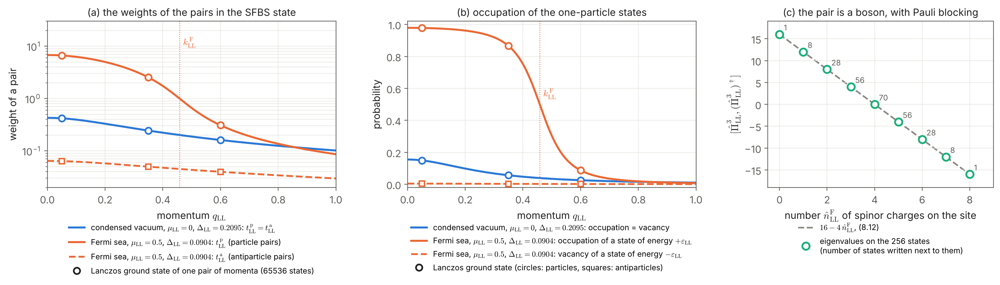{width=100%}

**Figure 21.** The SFBS state ($m_{\rm LL}=0.2$, $\Lambda_{\rm LL}=1$). (a) The weights (8.16) of the particle pairs ($t^{\rm p}_{\rm LL}$,
solid) and of the antiparticle pairs ($t^{\rm a}_{\rm LL}$, dashed) as functions of the momentum, for the condensed vacuum
($\mu_{\rm LL}=0$, $G_{\rm LL}=22.5$; the two weights coincide) and for the superfluid with a Fermi sea ($\mu_{\rm LL}=0.5$,
$G_{\rm LL}=12$), on a logarithmic scale; the circles and squares are the weights of the ground states found by the
Lanczos method in the Fock space of one pair of momenta (65536 states), which know nothing of (8.16). The dotted line marks
the Fermi momentum. (b) The occupation of a state of energy $+\varepsilon_{\rm LL}$ and the vacancy of a state of energy $-\varepsilon_{\rm LL}$ in
the same states. (c) The commutator $[\hat\Pi^3_{\rm LL},(\hat\Pi^3_{\rm LL})^\dagger]$ of one lattice site on its 256 states, against the
number $\hat n^{\rm F}_{\rm LL}$ of spinor charges on the site (the number of states with each value is written next to the circle); all
values lie on the line $16-4\hat n^{\rm F}_{\rm LL}$ of (8.12). Data: `test2/data/t2_sfbs_pair_weights.csv`, `t2_sfbs_pair_weights_fock.csv`,
`t2_sfbs_site_commutator.csv`.

## 8.8 Discussion

- **What was constructed.** From the spinor field alone: the pair operators (8.1); the selection of the spin-zero pairs
  (Theorem 8.1), which forces isospin 1 by the Pauli principle; the selection of the scalar channel by the interaction and
  by parity; the charges $+1$, $0$, $-1$ and the fermion number 2; the super-loop form (8.8), in which the SFBS is the
  imaginary part of the product of a spinor charge's bi-quaternion with its conjugate; the Bose character (8.12); and
  the SFBS state (8.15), proved to be the mean-field ground state and checked in the exact many-body space of one pair of
  momenta.
- **Which singlet.** The SFBS is a singlet of the Lorentz group (spin zero). It cannot also be an isospin singlet: for one
  field that pair vanishes. Because the SFBS is an isospin triplet with electric charges, its condensate can break the
  isospin group and leave the electric charge unbroken, which is what items [9] to [11] work out. (A complete singlet of
  the super-loop would need a second species; its condensate would break only $U(1)^{\rm F}_{\rm LL}$ and leave all isospin
  gauge fields massless.)
- **Which state condenses.** Among the condensates $d^\iota_{\rm LL}$ the polar state (a real isospin vector up to a phase)
  has the lowest energy (Theorem SF3 of the manuscript; derived in item [9]); in it only the neutral pair
  $\Pi^{(0)}_{\rm LL}$ (one up and one down charge) condenses when the vector points along the third isospin direction. This
  is why (8.13) uses $d^\iota_{\rm LL}=(0,0,\Delta_{\rm LL})$; any other polar direction follows by an isospin rotation.
- **Limits.** The construction of the state uses the mean-field approximation of Section 2.10 (exact for the
  Hamiltonian (8.13), an approximation for the full interaction), one species of spinor field, and a uniform condensate
  without gauge fields. Its fluctuations, the gauge fields and the effective field theory of the SFBS follow in
  items [8] to [11].

# 9. Item [8]: the effective field equations of the SFBS

## 9.0 The answer in brief

1. **The field of the SFBS.** The attractive interaction of (2.24) can be rewritten exactly with an auxiliary complex
   isovector field $\vec d_{\rm LL}=(d^1_{\rm LL},d^2_{\rm LL},d^3_{\rm LL})$, the Hubbard-Stratonovich field (9.1), (9.2). Its
   own field equation, $d^\iota_{\rm LL}=-\tfrac12G_{\rm LL}\Pi^\iota_{\rm LL}$ (9.3), makes it the SFBS (8.6) multiplied by
   $-\tfrac12G_{\rm LL}$, and its expectation value is the order parameter (2.30). It transforms as the SFBS: twice the phase of a
   spinor charge, a vector of the isospin group, a scalar of the Lorentz group (9.4).
2. **Its gauge-covariant derivative** is (9.5),
   $\nabla^{\rm B}_{{\rm LL},p}\vec d_{\rm LL}=\partial_p\vec d_{\rm LL}-2i\,g^{\rm F}_{\rm LL}A^{\rm F}_{{\rm LL},p}\vec d_{\rm LL}+g^{\rm v}_{\rm LL}\mathcal A^{\rm v}_{{\rm LL},p}\vec d_{\rm LL}$:
   the fermion number 2 doubles the coupling to $A^{\rm F}_{{\rm LL},p}$, the isospin potential acts by the $3\times3$ matrix
   $\mathcal A^{\rm v}_{{\rm LL},p}$ of the vector representation, and the Lorentz connection drops out (spin zero). It is inherited
   from the covariant derivative (2.15) of the spinor field by the Leibniz rule (Theorem 9.1); it is gauge covariant (9.8),
   and its commutator gives the field strengths (9.9) (check SB-6).
3. **The effective Lagrangian.** Integrating out the spinor field gives the effective action of the SFBS. For a constant field
   its value is minus the effective potential $\Omega_{\rm LL}(\vec d_{\rm LL})$ (9.11) (worked out in Section 10), and its expansion
   in derivatives is (9.12),
   $\mathcal L^{\rm B}_{\rm LL}=Z^{\rm t}_{\rm LL}\sum_\iota\lvert(\nabla^{\rm B}_{{\rm LL},0}\vec d_{\rm LL})^\iota\rvert^2-Z^{\rm s}_{\rm LL}\sum_j\sum_\iota\lvert(\nabla^{\rm B}_{{\rm LL},j}\vec d_{\rm LL})^\iota\rvert^2-\Omega_{\rm LL}(\vec d_{\rm LL})$:
   the Lagrangian of a charged scalar field, the analogue of the Higgs field.
4. **The coefficients** follow from the pair susceptibility $\chi^{\rm pr}_{\rm LL}(\omega^{\rm B}_{\rm LL},k^{\rm B}_{\rm LL})$ of the
   vacuum, derived in closed form (9.14) to (9.16) and checked against the exact second-order energies of the Bogoliubov matrices
   (check SB-7). In the normal vacuum ($m_{\rm LL}=0.2$, $\Lambda_{\rm LL}=1$): $\chi^{\rm pr}_{\rm LL}(0,0)=1/G^{\rm crit}_{\rm LL}$
   with $G^{\rm crit}_{\rm LL}=21.28661$, and $Z^{\rm t}_{\rm LL}(0)=0.0337363$, $Z^{\rm s}_{\rm LL}(0)=0.0377169$ (9.17) to (9.19).
5. **The effective field equations** (9.23), written out in components and in first-order form for numerical solution (9.25),
   together with the Yang-Mills and Maxwell equations (9.26) whose sources are now the currents (9.27) of the SFBS (check SB-9);
   the currents are conserved.
6. **The SFBS boson.** In the normal vacuum the effective field equation is a Klein-Gordon equation (9.28). For
   $G^{\rm bd}_{\rm LL}<G_{\rm LL}<G^{\rm crit}_{\rm LL}$ ($17.746<G_{\rm LL}<21.287$) the SFBS is a bound boson with a mass
   $M^{\rm B}_{\rm LL}$ below the threshold $2m_{\rm LL}$ of two free spinor charges (check SB-8); the exact time evolution of the
   mean-field equations of Section 2.10 confirms its frequency to $8\times10^{-8}$ (check SB-10, Figure 22). For
   $G_{\rm LL}>G^{\rm crit}_{\rm LL}$ its squared mass is negative: the normal vacuum is unstable and the SFBS condenses. This is the
   subject of Sections 10 and 11.

The program `t2_sfbs` (Appendix A.2f) verifies every statement of this section (checks SB-6 to SB-10) and prints the explicit
matrices and component equations that the section shows.

## 9.1 The field of the SFBS

**The functional integral.** The quantum theory of the Lagrangian density (2.24) can be written as a functional integral: the
weight $\exp(i\int d^4x_{\rm LL}\,\mathcal L^\nabla_{\rm LL})$, with $d^4x_{\rm LL}=dx^0_{\rm LL}\,dx^1_{\rm LL}\,dx^2_{\rm LL}\,dx^3_{\rm LL}$,
is integrated over all configurations of the spinor field, whose components are then anticommuting numbers (Grassmann
numbers) instead of operators. In this form the pair fields $\Pi^\iota_{\rm LL}(x_{\rm LL})$ and their conjugates
$(\Pi^\iota_{\rm LL})^\dagger=\Psi^\dagger_{\rm LL}(\mathsf K^\iota_{\rm LL})^\dagger\Psi^*_{\rm LL}$ are products of two anticommuting
numbers; such products commute with everything, and the pairing term $\tfrac14G_{\rm LL}\sum_\iota(\Pi^\iota_{\rm LL})^\dagger\Pi^\iota_{\rm LL}$
is an ordinary product without a question of operator order.

**The Hubbard-Stratonovich identity.** For one point $x_{\rm LL}$ and one isospin direction $\iota$, completing the square gives,
for every complex number $d^\iota_{\rm LL}$,

$$-\frac{\lvert d^\iota_{\rm LL}\rvert^2}{G_{\rm LL}}-\frac12\big((d^\iota_{\rm LL})^*\Pi^\iota_{\rm LL}+d^\iota_{\rm LL}(\Pi^\iota_{\rm LL})^\dagger\big)=-\frac1{G_{\rm LL}}\Big(d^\iota_{\rm LL}+\frac{G_{\rm LL}}2\Pi^\iota_{\rm LL}\Big)^*\Big(d^\iota_{\rm LL}+\frac{G_{\rm LL}}2\Pi^\iota_{\rm LL}\Big)+\frac{G_{\rm LL}}4(\Pi^\iota_{\rm LL})^\dagger\Pi^\iota_{\rm LL}$$

(multiply out the product: its cross terms are the second term on the left, and its last term, $(G_{\rm LL}/4)(\Pi^\iota_{\rm LL})^\dagger\Pi^\iota_{\rm LL}$,
cancels the last term on the right; here $(\Pi^\iota_{\rm LL})^*$ stands for $(\Pi^\iota_{\rm LL})^\dagger$). Multiply by $i$, exponentiate and
integrate over the complex plane of $d^\iota_{\rm LL}$ (that is, over its real and imaginary parts, with the usual small damping factor
$\exp(-0^+\lvert d^\iota_{\rm LL}\rvert^2)$ that makes the oscillating Gaussian integral converge). The shift of the variable of
integration by $-(G_{\rm LL}/2)\Pi^\iota_{\rm LL}$ does not change the integral of $\exp(-i\lvert d^\iota_{\rm LL}\rvert^2/G_{\rm LL})$,
which is the product of two Fresnel integrals, $\int\exp(-i({\rm Re}\,d^\iota_{\rm LL})^2/G_{\rm LL})\,{\rm d}({\rm Re}\,d^\iota_{\rm LL})=(\pi G_{\rm LL})^{1/2}\exp(-i\pi/4)$
and the same for the imaginary part, together $-i\pi G_{\rm LL}$. Therefore

$$\exp\Big(\frac i4G_{\rm LL}(\Pi^\iota_{\rm LL})^\dagger\Pi^\iota_{\rm LL}\Big)=\frac{i}{\pi G_{\rm LL}}\int_{\mathbb C}\exp\Big(i\Big[-\frac{\lvert d^\iota_{\rm LL}\rvert^2}{G_{\rm LL}}-\frac12\big((d^\iota_{\rm LL})^*\Pi^\iota_{\rm LL}+d^\iota_{\rm LL}(\Pi^\iota_{\rm LL})^\dagger\big)\Big]\Big)\,{\rm d}({\rm Re}\,d^\iota_{\rm LL})\,{\rm d}({\rm Im}\,d^\iota_{\rm LL}).\tag{9.1}$$

Applied at every point and for $\iota=1,2,3$, (9.1) turns the functional integral of (2.24) into a functional integral over the spinor
field and three new complex fields $d^\iota_{\rm LL}(x_{\rm LL})$, with the Lagrangian density

$$\begin{aligned}\mathcal L^{\rm HS}_{\rm LL}={}&\bar\Psi_{\rm LL}\Big(i\sum_p\gamma^p_{\rm LL}[\mathbf f]\nabla^{\rm LL}_p-m_{\rm LL}\Big)\Psi_{\rm LL}+\mu_{\rm LL}\bar\Psi_{\rm LL}\gamma^0_{\rm LL}[\mathbf f]\Psi_{\rm LL}\\&-\sum_\iota\frac{\lvert d^\iota_{\rm LL}\rvert^2}{G_{\rm LL}}-\frac12\sum_\iota\big((d^\iota_{\rm LL})^*\Pi^\iota_{\rm LL}+d^\iota_{\rm LL}(\Pi^\iota_{\rm LL})^\dagger\big)\\&-\tfrac14\sum_\iota\sum_{p,p',p'',p'''}\eta^{\rm LL}_{pp''}\eta^{\rm LL}_{p'p'''}\mathsf F^\iota_{{\rm LL},pp'}\mathsf F^\iota_{{\rm LL},p''p'''}-\tfrac14\sum_{p,p',p'',p'''}\eta^{\rm LL}_{pp''}\eta^{\rm LL}_{p'p'''}\mathsf F^{\rm F}_{{\rm LL},pp'}\mathsf F^{\rm F}_{{\rm LL},p''p'''}\end{aligned}\tag{9.2}$$

(the constant factors $i/(\pi G_{\rm LL})$ of all points multiply the integral by a number that cancels in every expectation value).
The four-fermion term is gone: the spinor field now enters quadratically, coupled to the field $\vec d_{\rm LL}$. Since
$[\Psi_{\rm LL}]=\tfrac32$ and $[G_{\rm LL}]=-2$, the field $\vec d_{\rm LL}$ has the mass dimension 1, the dimension of a
boson field in $3+1$ dimensions.

**The field equation of $\vec d_{\rm LL}$.** The field $\vec d_{\rm LL}$ appears in (9.2) without derivatives. Its Euler-Lagrange
equation, the derivative of (9.2) with respect to $(d^\iota_{\rm LL})^*$ set to zero, is $-d^\iota_{\rm LL}/G_{\rm LL}-\tfrac12\Pi^\iota_{\rm LL}=0$:

$$d^\iota_{\rm LL}(x_{\rm LL})=-\tfrac12G_{\rm LL}\,\Pi^\iota_{\rm LL}(x_{\rm LL}),\qquad\iota=1,2,3.\tag{9.3}$$

Inserted in (9.2), (9.3) gives back (2.24): it is the centre of the completed square. So $\vec d_{\rm LL}$ is the SFBS itself, the
composite field (8.6), multiplied by $-\tfrac12G_{\rm LL}$. Its expectation value is the pair field (2.30), the order parameter of
the SFBS state, and the mean-field theory of Section 2.10 is the approximation in which this field is replaced by its expectation
value. In (9.2) the field has no dynamics of its own; its dynamics come from the spinor field to which it is coupled, and they are
found by integrating that field out (Section 9.3). This is how the SFBS acquires a field theory of its own.

**The transformation law.** The Lagrangian (9.2) is invariant under the gauge transformations (2.10), (2.16) if $\vec d_{\rm LL}$
transforms like the SFBS (2.23),

$$\vec d_{\rm LL}\mapsto\exp(2i\theta^{\rm F}_{\rm LL})\,\mathsf R^{\rm v}_{\rm LL}(\mathsf U_{\rm LL})\,\vec d_{\rm LL},\tag{9.4}$$

because the rotation $\mathsf R^{\rm v}_{\rm LL}(\mathsf U_{\rm LL})$ is real and orthogonal and the phases cancel: $\sum_\iota\lvert d^\iota_{\rm LL}\rvert^2$
and $\sum_\iota(d^\iota_{\rm LL})^*\Pi^\iota_{\rm LL}$ are invariant. The field $\vec d_{\rm LL}$ is a Lorentz scalar, an isospin vector,
and it carries the fermion number 2.

## 9.2 The gauge-covariant derivative of the SFBS

**Definition.** For a complex isovector field $\vec d_{\rm LL}(x_{\rm LL})$ with the transformation law (9.4), the gauge-covariant
derivative is

$$\nabla^{\rm B}_{{\rm LL},p}\vec d_{\rm LL}=\partial_p\vec d_{\rm LL}-2i\,g^{\rm F}_{\rm LL}A^{\rm F}_{{\rm LL},p}\vec d_{\rm LL}+g^{\rm v}_{\rm LL}\mathcal A^{\rm v}_{{\rm LL},p}\vec d_{\rm LL},\qquad(\mathcal A^{\rm v}_{{\rm LL},p})_{\iota\iota''}=\sum_{\iota'}\epsilon^{\rm LL}_{\iota\iota'\iota''}A^{\iota'}_{{\rm LL},p},\tag{9.5}$$

where $\mathcal A^{\rm v}_{{\rm LL},p}$ is the isospin potential of the direction $p$ in the vector representation of the isospin group:
the real antisymmetric $3\times3$ matrix (rows $\iota$, columns $\iota''$)

$$\mathcal A^{\rm v}_{{\rm LL},p}=\begin{pmatrix}0&-A^3_{{\rm LL},p}&A^2_{{\rm LL},p}\\A^3_{{\rm LL},p}&0&-A^1_{{\rm LL},p}\\-A^2_{{\rm LL},p}&A^1_{{\rm LL},p}&0\end{pmatrix}$$

Applied to $\vec d_{\rm LL}$, it is the cross product $\mathcal A^{\rm v}_{{\rm LL},p}\vec d_{\rm LL}=\vec A^{\rm v}_{{\rm LL},p}\times\vec d_{\rm LL}$
with the isospin potential written as the vector $\vec A^{\rm v}_{{\rm LL},p}=(A^1_{{\rm LL},p},A^2_{{\rm LL},p},A^3_{{\rm LL},p})$ (the
component $\iota$ of $\vec A^{\rm v}_{{\rm LL},p}\times\vec d_{\rm LL}$ is $\sum_{\iota',\iota''}\epsilon^{\rm LL}_{\iota\iota'\iota''}A^{\iota'}_{{\rm LL},p}d^{\iota''}_{\rm LL}$).
The three components of (9.5) are

$$\begin{aligned}(\nabla^{\rm B}_{{\rm LL},p}\vec d_{\rm LL})^1&=\partial_pd^1_{\rm LL}-2i\,g^{\rm F}_{\rm LL}A^{\rm F}_{{\rm LL},p}d^1_{\rm LL}+g^{\rm v}_{\rm LL}A^2_{{\rm LL},p}d^3_{\rm LL}-g^{\rm v}_{\rm LL}A^3_{{\rm LL},p}d^2_{\rm LL}\\
(\nabla^{\rm B}_{{\rm LL},p}\vec d_{\rm LL})^2&=\partial_pd^2_{\rm LL}-2i\,g^{\rm F}_{\rm LL}A^{\rm F}_{{\rm LL},p}d^2_{\rm LL}-g^{\rm v}_{\rm LL}A^1_{{\rm LL},p}d^3_{\rm LL}+g^{\rm v}_{\rm LL}A^3_{{\rm LL},p}d^1_{\rm LL}\\
(\nabla^{\rm B}_{{\rm LL},p}\vec d_{\rm LL})^3&=\partial_pd^3_{\rm LL}-2i\,g^{\rm F}_{\rm LL}A^{\rm F}_{{\rm LL},p}d^3_{\rm LL}+g^{\rm v}_{\rm LL}A^1_{{\rm LL},p}d^2_{\rm LL}-g^{\rm v}_{\rm LL}A^2_{{\rm LL},p}d^1_{\rm LL}\end{aligned}$$

Compared with the covariant derivative (2.15) of the spinor field: the coupling to the fermion-number potential is doubled (the SFBS
carries the fermion number 2), the isospin potential acts by the vector representation instead of the doublet representation
$\tau^{\rm LL}_\iota/2$, and there is no Lorentz connection (the SFBS is a Lorentz scalar).

**Theorem 9.1 (the Leibniz rule).** Let $\Psi^{\rm a}_{\rm LL}$ and $\Psi^{\rm b}_{\rm LL}$ be two eight-component fields that transform
like $\Psi_{\rm LL}$ under (2.10). Then the isovector of their pair, with the components
$(\Psi^{\rm a}_{\rm LL})^T\mathsf K^\iota_{\rm LL}\Psi^{\rm b}_{\rm LL}$ ($\iota=1,2,3$), has the covariant derivative

$$\Big(\nabla^{\rm B}_{{\rm LL},p}\big((\Psi^{\rm a}_{\rm LL})^T\mathsf K^{\iota'}_{\rm LL}\Psi^{\rm b}_{\rm LL}\big)_{\iota'=1,2,3}\Big)^\iota=(\nabla^{\rm LL}_p\Psi^{\rm a}_{\rm LL})^T\mathsf K^\iota_{\rm LL}\Psi^{\rm b}_{\rm LL}+(\Psi^{\rm a}_{\rm LL})^T\mathsf K^\iota_{\rm LL}\nabla^{\rm LL}_p\Psi^{\rm b}_{\rm LL}.\tag{9.6}$$

The same holds for the quantum field with the order of the factors kept: $\nabla^{\rm B}_{{\rm LL},p}$ applied to $(\Pi^1_{\rm LL},\Pi^2_{\rm LL},\Pi^3_{\rm LL})$
gives $(\nabla^{\rm LL}_p\Psi_{\rm LL})^T\mathsf K^\iota_{\rm LL}\Psi_{\rm LL}+\Psi^T_{\rm LL}\mathsf K^\iota_{\rm LL}\nabla^{\rm LL}_p\Psi_{\rm LL}$ in the
component $\iota$, and by (9.3) the covariant derivative of the SFBS field is the one inherited from its two constituents.

*Proof.* (i) The ordinary derivative obeys the product rule:
$\partial_p((\Psi^{\rm a}_{\rm LL})^T\mathsf K^\iota_{\rm LL}\Psi^{\rm b}_{\rm LL})=(\partial_p\Psi^{\rm a}_{\rm LL})^T\mathsf K^\iota_{\rm LL}\Psi^{\rm b}_{\rm LL}+(\Psi^{\rm a}_{\rm LL})^T\mathsf K^\iota_{\rm LL}\partial_p\Psi^{\rm b}_{\rm LL}$.
(ii) By (2.15), $\nabla^{\rm LL}_p-\partial_p=\Gamma^{\rm LL}_p-i\,\mathsf A_{{\rm LL},p}$. The right side of (9.6) therefore exceeds the derivative of
step (i) by $(\Psi^{\rm a}_{\rm LL})^T\big((\Gamma^{\rm LL}_p-i\mathsf A_{{\rm LL},p})^T\mathsf K^\iota_{\rm LL}+\mathsf K^\iota_{\rm LL}(\Gamma^{\rm LL}_p-i\mathsf A_{{\rm LL},p})\big)\Psi^{\rm b}_{\rm LL}$.
(iii) The Lorentz connection is $\Gamma^{\rm LL}_p=\mathsf s_{\rm LL}(\mathbf u^\omega_{{\rm LL},p})\otimes\sigma^{\rm LL}_0$ with $\mathbf u^\omega_{{\rm LL},p}$
a real combination of the six generators $J^j_{\rm LL}$, $K^j_{\rm LL}$ (Section 2.6). The pair matrices satisfy the condition (8.3)
for each generator (Theorem 8.1), hence $(\Gamma^{\rm LL}_p)^T\mathsf K^\iota_{\rm LL}+\mathsf K^\iota_{\rm LL}\Gamma^{\rm LL}_p=0$: the Lorentz
connection drops out. (iv) The internal potentials are $\mathsf A_{{\rm LL},p}=g^{\rm v}_{\rm LL}\sum_{\iota'}A^{\iota'}_{{\rm LL},p}T^{\iota'}_{\rm LL}+g^{\rm F}_{\rm LL}A^{\rm F}_{{\rm LL},p}\mathsf 1_8$.
The unit matrix gives $\mathsf 1_8^T\mathsf K^\iota_{\rm LL}+\mathsf K^\iota_{\rm LL}\mathsf 1_8=2\mathsf K^\iota_{\rm LL}$, and with the factor $-i$ the
term $-2i\,g^{\rm F}_{\rm LL}A^{\rm F}_{{\rm LL},p}(\Psi^{\rm a}_{\rm LL})^T\mathsf K^\iota_{\rm LL}\Psi^{\rm b}_{\rm LL}$. For the isospin generators,

$$(T^{\iota'}_{\rm LL})^T\mathsf K^\iota_{\rm LL}+\mathsf K^\iota_{\rm LL}T^{\iota'}_{\rm LL}=i\sum_{\iota''}\epsilon^{\rm LL}_{\iota\iota'\iota''}\mathsf K^{\iota''}_{\rm LL}.\tag{9.7}$$

To derive (9.7): $T^{\iota'}_{\rm LL}=\mathsf 1_4\otimes\tau^{\rm LL}_{\iota'}/2$ acts on the isospin index only, and
$\mathsf K^\iota_{\rm LL}=C_{\rm LL}\gamma^{\rm ch}_{\rm LL}\otimes\mathsf E_{\rm LL}\tau^{\rm LL}_\iota$, so the left side of (9.7) is
$C_{\rm LL}\gamma^{\rm ch}_{\rm LL}\otimes\tfrac12\big((\tau^{\rm LL}_{\iota'})^T\mathsf E_{\rm LL}\tau^{\rm LL}_\iota+\mathsf E_{\rm LL}\tau^{\rm LL}_\iota\tau^{\rm LL}_{\iota'}\big)$.
The relation $\mathsf E_{\rm LL}\tau^{\rm LL}_{\iota'}\mathsf E^{-1}_{\rm LL}=-(\tau^{\rm LL}_{\iota'})^T$ (used in step (iv) of the proof of Theorem 8.2) gives
$(\tau^{\rm LL}_{\iota'})^T\mathsf E_{\rm LL}=-\mathsf E_{\rm LL}\tau^{\rm LL}_{\iota'}$, so the bracket is
$\tfrac12\mathsf E_{\rm LL}(\tau^{\rm LL}_\iota\tau^{\rm LL}_{\iota'}-\tau^{\rm LL}_{\iota'}\tau^{\rm LL}_\iota)=i\sum_{\iota''}\epsilon^{\rm LL}_{\iota\iota'\iota''}\mathsf E_{\rm LL}\tau^{\rm LL}_{\iota''}$,
by the commutation relations $\tau^{\rm LL}_\iota\tau^{\rm LL}_{\iota'}-\tau^{\rm LL}_{\iota'}\tau^{\rm LL}_\iota=2i\sum_{\iota''}\epsilon^{\rm LL}_{\iota\iota'\iota''}\tau^{\rm LL}_{\iota''}$ of
the Pauli matrices. With the factor $-i\,g^{\rm v}_{\rm LL}A^{\iota'}_{{\rm LL},p}$ and the sum over $\iota'$, the isospin potentials contribute
$-i\,g^{\rm v}_{\rm LL}\sum_{\iota'}A^{\iota'}_{{\rm LL},p}\cdot i\sum_{\iota''}\epsilon^{\rm LL}_{\iota\iota'\iota''}(\Psi^{\rm a}_{\rm LL})^T\mathsf K^{\iota''}_{\rm LL}\Psi^{\rm b}_{\rm LL}=g^{\rm v}_{\rm LL}\sum_{\iota''}(\mathcal A^{\rm v}_{{\rm LL},p})_{\iota\iota''}(\Psi^{\rm a}_{\rm LL})^T\mathsf K^{\iota''}_{\rm LL}\Psi^{\rm b}_{\rm LL}$.
(v) Adding (i) to (iv) gives the definition (9.5) applied to the isovector of the pair. $\square$

Check SB-6 verifies (9.6) for 50 random fields $\Psi^{\rm a}_{\rm LL}$, $\Psi^{\rm b}_{\rm LL}$ (linear functions of one coordinate), random
potentials and random Lorentz connections; the largest deviation is $2.0\times10^{-15}$.

**Covariance.** Under (2.10) with the transformed potentials (2.16), and with $\nabla'^{\rm B}_{{\rm LL},p}$ denoting (9.5) with the
transformed potentials,

$$\nabla'^{\rm B}_{{\rm LL},p}\big(\exp(2i\theta^{\rm F}_{\rm LL})\mathsf R^{\rm v}_{\rm LL}(\mathsf U_{\rm LL})\vec d_{\rm LL}\big)=\exp(2i\theta^{\rm F}_{\rm LL})\mathsf R^{\rm v}_{\rm LL}(\mathsf U_{\rm LL})\,\nabla^{\rm B}_{{\rm LL},p}\vec d_{\rm LL}.\tag{9.8}$$

*Proof.* First let $\vec d_{\rm LL}$ be the isovector of a pair, $d^\iota_{\rm LL}=(\Psi^{\rm a}_{\rm LL})^T\mathsf K^\iota_{\rm LL}\Psi^{\rm b}_{\rm LL}$. The
transformed isovector is the pair of the transformed fields $\mathcal U_{\rm LL}\Psi^{\rm a}_{\rm LL}$ and $\mathcal U_{\rm LL}\Psi^{\rm b}_{\rm LL}$
(Section 2.8: $\mathcal U^T_{\rm LL}\mathsf K^\iota_{\rm LL}\mathcal U_{\rm LL}=\exp(2i\theta^{\rm F}_{\rm LL})\sum_{\iota'}[\mathsf R^{\rm v}_{\rm LL}(\mathsf U_{\rm LL})]_{\iota\iota'}\mathsf K^{\iota'}_{\rm LL}$,
because the pair matrices are Lorentz invariant and an isospin vector). By Theorem 9.1 with the transformed fields and potentials, the left
side of (9.8) is the sum of the two pairs formed with $\nabla'^{\rm LL}_p(\mathcal U_{\rm LL}\Psi^{\rm a}_{\rm LL})=\mathcal U_{\rm LL}\nabla^{\rm LL}_p\Psi^{\rm a}_{\rm LL}$
and $\nabla'^{\rm LL}_p(\mathcal U_{\rm LL}\Psi^{\rm b}_{\rm LL})=\mathcal U_{\rm LL}\nabla^{\rm LL}_p\Psi^{\rm b}_{\rm LL}$ (by (2.17)); by the same
transformation property of the pair matrices this is $\exp(2i\theta^{\rm F}_{\rm LL})\mathsf R^{\rm v}_{\rm LL}(\mathsf U_{\rm LL})$ times the
right side of (9.6), which is the right side of (9.8). For a general field: at a point, both sides of (9.8) depend only, and linearly,
on the value of $\vec d_{\rm LL}$ and of its four derivatives $\partial_p\vec d_{\rm LL}$ there; and every such set of values is the
value of a pair: take for $\Psi^{\rm a}_{\rm LL}$ the constant column whose components 1 and 4 are 1 and whose other components are 0
(its three rows $(\Psi^{\rm a}_{\rm LL})^T\mathsf K^\iota_{\rm LL}$ are linearly independent, as one reads off from the matrices of Section
2.8), and for $\Psi^{\rm b}_{\rm LL}$ a column that is a linear function of the coordinates. $\square$

Check SB-6 verifies (9.8) directly, with the transformation law (2.16) of the potentials, for 50 random local transformations
($\theta^{\rm F}_{\rm LL}$ and the three angles of $\mathsf U_{\rm LL}$ linear in one coordinate) and fields quadratic in that coordinate,
with the derivatives by central differences: the largest deviation is $7\times10^{-10}$, the size of the error of the differences.

**The commutator of two covariant derivatives.** For every field $\vec d_{\rm LL}$,

$$\nabla^{\rm B}_{{\rm LL},p}\nabla^{\rm B}_{{\rm LL},p'}\vec d_{\rm LL}-\nabla^{\rm B}_{{\rm LL},p'}\nabla^{\rm B}_{{\rm LL},p}\vec d_{\rm LL}=-2i\,g^{\rm F}_{\rm LL}\mathsf F^{\rm F}_{{\rm LL},pp'}\vec d_{\rm LL}+g^{\rm v}_{\rm LL}\big(\mathsf F^1_{{\rm LL},pp'},\mathsf F^2_{{\rm LL},pp'},\mathsf F^3_{{\rm LL},pp'}\big)\times\vec d_{\rm LL},\tag{9.9}$$

with the field strengths (2.20). *Derivation.* With $\mathcal A^{\rm v}_{{\rm LL},p}\vec d_{\rm LL}=\vec A^{\rm v}_{{\rm LL},p}\times\vec d_{\rm LL}$,
expanding (9.5) twice gives
$\nabla^{\rm B}_{{\rm LL},p}\nabla^{\rm B}_{{\rm LL},p'}\vec d_{\rm LL}=\partial_p\partial_{p'}\vec d_{\rm LL}-2ig^{\rm F}_{\rm LL}\big((\partial_pA^{\rm F}_{{\rm LL},p'})\vec d_{\rm LL}+A^{\rm F}_{{\rm LL},p'}\partial_p\vec d_{\rm LL}+A^{\rm F}_{{\rm LL},p}\partial_{p'}\vec d_{\rm LL}\big)+g^{\rm v}_{\rm LL}\big((\partial_p\vec A^{\rm v}_{{\rm LL},p'})\times\vec d_{\rm LL}+\vec A^{\rm v}_{{\rm LL},p'}\times\partial_p\vec d_{\rm LL}+\vec A^{\rm v}_{{\rm LL},p}\times\partial_{p'}\vec d_{\rm LL}\big)$
$-4(g^{\rm F}_{\rm LL})^2A^{\rm F}_{{\rm LL},p}A^{\rm F}_{{\rm LL},p'}\vec d_{\rm LL}-2ig^{\rm F}_{\rm LL}g^{\rm v}_{\rm LL}\big(A^{\rm F}_{{\rm LL},p}\vec A^{\rm v}_{{\rm LL},p'}+A^{\rm F}_{{\rm LL},p'}\vec A^{\rm v}_{{\rm LL},p}\big)\times\vec d_{\rm LL}+(g^{\rm v}_{\rm LL})^2\vec A^{\rm v}_{{\rm LL},p}\times(\vec A^{\rm v}_{{\rm LL},p'}\times\vec d_{\rm LL})$.
In the difference with $p$ and $p'$ exchanged, every term that is symmetric in $p,p'$ cancels; what remains is
$-2ig^{\rm F}_{\rm LL}(\partial_pA^{\rm F}_{{\rm LL},p'}-\partial_{p'}A^{\rm F}_{{\rm LL},p})\vec d_{\rm LL}+g^{\rm v}_{\rm LL}(\partial_p\vec A^{\rm v}_{{\rm LL},p'}-\partial_{p'}\vec A^{\rm v}_{{\rm LL},p})\times\vec d_{\rm LL}+(g^{\rm v}_{\rm LL})^2\big(\vec A^{\rm v}_{{\rm LL},p}\times(\vec A^{\rm v}_{{\rm LL},p'}\times\vec d_{\rm LL})-\vec A^{\rm v}_{{\rm LL},p'}\times(\vec A^{\rm v}_{{\rm LL},p}\times\vec d_{\rm LL})\big)$,
and the Jacobi identity of the cross product turns the last bracket into $(\vec A^{\rm v}_{{\rm LL},p}\times\vec A^{\rm v}_{{\rm LL},p'})\times\vec d_{\rm LL}$, whose component
$\iota$ of $\vec A^{\rm v}_{{\rm LL},p}\times\vec A^{\rm v}_{{\rm LL},p'}$ is $\sum_{\iota',\iota''}\epsilon^{\rm LL}_{\iota\iota'\iota''}A^{\iota'}_{{\rm LL},p}A^{\iota''}_{{\rm LL},p'}$, the
non-abelian term of $\mathsf F^\iota_{{\rm LL},pp'}$ in (2.20). Collecting gives (9.9). The SFBS feels the field strength of
$U(1)^{\rm F}_{\rm LL}$ with twice the charge of a spinor charge and the isospin field strength in the vector representation, and no
curvature (spin zero). Check SB-6 verifies (9.9) for all 16 pairs $(p,p')$ with potentials linear in the coordinates and fields quadratic
in them (largest deviation $9\times10^{-16}$).

## 9.3 The effective action and the effective Lagrangian of the SFBS

**Integrating out the spinor field.** In (9.2) the spinor field enters quadratically. For fixed fields $\vec d_{\rm LL}(x_{\rm LL})$ and
fixed gauge fields, the functional integral over the spinor field is therefore a Gaussian integral of anticommuting numbers. Its value
defines the effective action $\mathcal S^{\rm B}_{\rm LL}[\vec d_{\rm LL}]$ of the SFBS (at the given gauge fields, on which it also depends):

$$\exp\big(i\,\mathcal S^{\rm B}_{\rm LL}[\vec d_{\rm LL}]\big)=\int\big(\text{over the configurations of }\Psi_{\rm LL}\text{ and }\bar\Psi_{\rm LL}\big)\,\exp\Big(i\int d^4x_{\rm LL}\,\mathcal L^{\rm HS}_{\rm LL}\Big).\tag{9.10}$$

The complete theory is the remaining functional integral over $\vec d_{\rm LL}$ with the weight $\exp(i\mathcal S^{\rm B}_{\rm LL})$. Its stationary
point is the mean-field theory of Section 2.10: the derivative of $\mathcal S^{\rm B}_{\rm LL}$ with respect to $(d^\iota_{\rm LL}(x_{\rm LL}))^*$
is $-d^\iota_{\rm LL}/G_{\rm LL}-\tfrac12\langle\Pi^\iota_{\rm LL}(x_{\rm LL})\rangle$, the expectation value taken in the Gaussian theory of the
spinor field in the background $\vec d_{\rm LL}$, and it vanishes exactly when (2.30) holds. The **effective field equations of the SFBS**
are these stationarity conditions; this section and Section 9.5 bring them into the form of local differential equations for slowly
varying fields. (The fluctuations of $\vec d_{\rm LL}$ about the stationary point, the loops of the SFBS, are not part of the mean-field
theory and are not included.)

**Three properties of the effective action.**

(a) *Gauge invariance.* $\mathcal S^{\rm B}_{\rm LL}$ does not change when $\vec d_{\rm LL}$ transforms by (9.4) and the gauge fields by
(2.16): the Lagrangian (9.2) is invariant, and the change of the integration variables $\Psi_{\rm LL}\mapsto\mathcal U_{\rm LL}\Psi_{\rm LL}$,
$\bar\Psi_{\rm LL}\mapsto\bar\Psi_{\rm LL}\mathcal U^{-1}_{\rm LL}$ has a Jacobian 1 for the isospin and fermion-number transformations, because they
act on both Weyl blocks in the same way (a transformation of this kind has no anomaly). The derivative expansion below is required to
keep this invariance; a regularization of the momentum integrals that respects it is assumed.

(b) *Constant fields.* For a constant $\vec d_{\rm LL}$ without gauge fields, the action is time independent, and over a long duration the
Gaussian integral is dominated by the ground state of the corresponding quadratic Hamiltonian, whose weight is $\exp(-i\times$ ground-state
energy $\times$ duration$)$. That ground state is the quasi-particle vacuum of the mean-field Hamiltonian of Section 2.10, with the energy
per volume $\sum_\iota\lvert d^\iota_{\rm LL}\rvert^2/G_{\rm LL}$ plus half the trace of the one-particle part minus half the sum of the
positive Bogoliubov energies (step (v) of the proof of Theorem 8.3). Measured from its value at $\vec d_{\rm LL}=0$ (the normal state),
this energy per volume is the effective potential

$$\begin{aligned}\Omega_{\rm LL}(\vec d_{\rm LL})={}&\frac{\lvert\vec d_{\rm LL}\rvert^2}{G_{\rm LL}}-\frac12\int_{q_{\rm LL}<\Lambda_{\rm LL}}\frac{d^3q_{\rm LL}}{(2\pi)^3}\Big[\sum\big(\text{positive eigenvalues of }\mathsf H_{\rm LL}(\vec q_{\rm LL})\big)\\&-\sum\big(\text{the same at }\vec d_{\rm LL}=0\big)\Big],\end{aligned}\tag{9.11}$$

with $\lvert\vec d_{\rm LL}\rvert^2=\sum_\iota\lvert d^\iota_{\rm LL}\rvert^2$ and the $16\times16$ Bogoliubov matrix of a plane wave (the
matrix (2.31) for the momentum $\vec q_{\rm LL}$ without gauge fields)
$\mathsf H_{\rm LL}(\vec q_{\rm LL})=\begin{pmatrix}\mathsf h_{\rm LL}(\vec q_{\rm LL})-\mu_{\rm LL}&\mathsf P_{\rm LL}\\\mathsf P^\dagger_{\rm LL}&-(\mathsf h_{\rm LL}(-\vec q_{\rm LL})-\mu_{\rm LL})^*\end{pmatrix}$,
$\mathsf P_{\rm LL}=\sum_\iota d^\iota_{\rm LL}(\mathsf K^\iota_{\rm LL})^\dagger$. Hence $\mathcal S^{\rm B}_{\rm LL}=-\Omega_{\rm LL}(\vec d_{\rm LL})\times$
(duration) $\times$ (volume), up to a constant. (The factor $\tfrac12$ compensates the double counting of the Nambu form, in which
every mode appears once as a particle and once as a hole.) For the polar field $\vec d_{\rm LL}=(0,0,\Delta_{\rm LL})$ the positive
eigenvalues are $E^+_{\rm LL}$ and $E^-_{\rm LL}$, four times each (3.13), so that
$\Omega_{\rm LL}=\Delta_{\rm LL}^2/G_{\rm LL}-2\int\!d^3q_{\rm LL}(2\pi)^{-3}\big(E^+_{\rm LL}+E^-_{\rm LL}-\lvert\varepsilon_{\rm LL}+\mu_{\rm LL}\rvert-\lvert\varepsilon_{\rm LL}-\mu_{\rm LL}\rvert\big)$;
its derivative with respect to $\Delta_{\rm LL}^2$ is $1/G_{\rm LL}-\int\!d^3q_{\rm LL}(2\pi)^{-3}(1/E^+_{\rm LL}+1/E^-_{\rm LL})$, which vanishes
exactly when the gap equation (2.33) holds: the uniform mean-field states are the stationary points of $\Omega_{\rm LL}$. Section 10 works
out $\Omega_{\rm LL}$ completely.

(c) *Slowly varying fields: the derivative expansion.* When $\vec d_{\rm LL}$ and the gauge fields change slowly on the scale of the size
of a pair, $\mathcal S^{\rm B}_{\rm LL}$ is the integral of a local Lagrangian density that depends on the field and its derivatives at the
same point. By (a) the derivatives can enter only through the covariant derivative (9.5) (and the field strengths); the momentum cutoff
$q_{\rm LL}<\Lambda_{\rm LL}$ is invariant under rotations of space, so the three space directions enter only through sums over $j$; at
$\mu_{\rm LL}=0$ the theory is invariant under the exchange of particles and antiparticles (charge conjugation), so the action is even in
the frequency and contains no term with a single time derivative. To second order in the derivatives, the effective Lagrangian of the
SFBS is therefore

$$\mathcal L^{\rm B}_{\rm LL}=Z^{\rm t}_{\rm LL}\sum_\iota\big\lvert(\nabla^{\rm B}_{{\rm LL},0}\vec d_{\rm LL})^\iota\big\rvert^2-Z^{\rm s}_{\rm LL}\sum_j\sum_\iota\big\lvert(\nabla^{\rm B}_{{\rm LL},j}\vec d_{\rm LL})^\iota\big\rvert^2-\Omega_{\rm LL}(\vec d_{\rm LL}),\tag{9.12}$$

with two positive numbers, the stiffness coefficients $Z^{\rm t}_{\rm LL}$ (of the time derivatives) and $Z^{\rm s}_{\rm LL}$ (of the space
derivatives). They depend on the vacuum about which the expansion is made, which is written as the argument: $Z^{\rm t}_{\rm LL}(0)$,
$Z^{\rm s}_{\rm LL}(0)$ in the normal vacuum (this section) and $Z^{\rm t}_{\rm LL}(\Delta_{\rm LL})$, $Z^{\rm s}_{\rm LL}(\Delta_{\rm LL})$ in a
condensed vacuum of gap $\Delta_{\rm LL}$ (Section 12). In the normal vacuum, to second order in $\vec d_{\rm LL}$, (9.12) is the most general
form allowed by (a) and by the invariances just listed, so that it is exact there to second order in the field and in the derivatives;
about a condensed vacuum, (9.12) with constant coefficients is the Ginzburg-Landau form of the derivative expansion, examined in Section
12. Lorentz invariance would require $Z^{\rm t}_{\rm LL}=Z^{\rm s}_{\rm LL}$; the momentum cutoff, which is imposed in one frame, breaks it,
and the two coefficients differ (9.19). (For $0<\lvert\mu_{\rm LL}\rvert<m_{\rm LL}$ a term of first order in the time derivative,
$-\tfrac12(\partial\chi^{\rm pr}_{\rm LL}(0,0)/\partial\mu_{\rm LL})\,{\rm Im}\big(\sum_\iota(d^\iota_{\rm LL})^*(\nabla^{\rm B}_{{\rm LL},0}\vec d_{\rm LL})^\iota\big)$,
is added, with the susceptibility (9.14) below; it vanishes at $\mu_{\rm LL}=0$. From here on $\mu_{\rm LL}=0$: the vacuum of the theory.)

## 9.4 The coefficients in the normal vacuum: the pair susceptibility

**Definition.** In the normal vacuum ($\vec d_{\rm LL}=0$, no gauge fields) the part of the effective action of second order in the field is
diagonal in the frequency and the wave number (the vacuum is uniform and stationary) and in the isospin index (it is invariant under
isospin rotations, which rotate the three components of $\vec d_{\rm LL}$ into each other, and under the phase of $U(1)^{\rm F}_{\rm LL}$,
which forbids products of two $d^\iota_{\rm LL}$ without conjugation). For the plane wave
$\vec d_{\rm LL}(x_{\rm LL})=\vec d_{\rm LL}\exp(-i\omega^{\rm B}_{\rm LL}x^0_{\rm LL}+i\vec k^{\rm B}_{\rm LL}\cdot\vec x_{\rm LL})$, with a constant
complex amplitude $\vec d_{\rm LL}$, the frequency $\omega^{\rm B}_{\rm LL}$ and the wave vector $\vec k^{\rm B}_{\rm LL}$ (length $k^{\rm B}_{\rm LL}$),
it therefore has the form

$$\frac{\mathcal S^{\rm B}_{\rm LL}}{(\text{duration})\times(\text{volume})}=\Big(\chi^{\rm pr}_{\rm LL}(\omega^{\rm B}_{\rm LL},k^{\rm B}_{\rm LL})-\frac1{G_{\rm LL}}\Big)\lvert\vec d_{\rm LL}\rvert^2+\big(\text{terms of fourth order in }\vec d_{\rm LL}\big),\tag{9.13}$$

which defines the **pair susceptibility** $\chi^{\rm pr}_{\rm LL}$ of the vacuum: the response of the spinor field to a pair field. The term
$-1/G_{\rm LL}$ is the explicit $-\lvert\vec d_{\rm LL}\rvert^2/G_{\rm LL}$ of (9.2); $\chi^{\rm pr}_{\rm LL}$ comes from the spinor field.

**The static susceptibility.** For $\omega^{\rm B}_{\rm LL}=0$, (9.13) is minus the energy per volume of the static field
$\vec d_{\rm LL}\exp(i\vec k^{\rm B}_{\rm LL}\cdot\vec x_{\rm LL})$, by property (b). By the isospin invariance one component suffices: take
$\vec d_{\rm LL}=(0,0,d^3_{\rm LL})$. The pair field with the wave vector $\vec k^{\rm B}_{\rm LL}$ joins a spinor charge of momentum
$\vec q_{\rm LL}+\vec k^{\rm B}_{\rm LL}/2$ to one of momentum $\vec k^{\rm B}_{\rm LL}/2-\vec q_{\rm LL}$ (the total momentum of the
pair is $\vec k^{\rm B}_{\rm LL}$, and $\vec q_{\rm LL}$ is the relative momentum). For each $\vec q_{\rm LL}$ the Bogoliubov matrix is therefore
the $16\times16$ matrix

$$\mathsf H^{\rm mod}_{\rm LL}(\vec q_{\rm LL})=\begin{pmatrix}\mathsf h_{\rm LL}(\vec q_{\rm LL}+\vec k^{\rm B}_{\rm LL}/2)-\mu_{\rm LL}&d^3_{\rm LL}(\mathsf K^3_{\rm LL})^\dagger\\(d^3_{\rm LL})^*\mathsf K^3_{\rm LL}&-\big(\mathsf h_{\rm LL}(\vec k^{\rm B}_{\rm LL}/2-\vec q_{\rm LL})^*-\mu_{\rm LL}\big)\end{pmatrix},$$

acting on the Nambu pair $(\Psi_{\rm LL}(\vec q_{\rm LL}+\vec k^{\rm B}_{\rm LL}/2),\Psi_{\rm LL}(\vec k^{\rm B}_{\rm LL}/2-\vec q_{\rm LL})^*)$, and the
energy per volume is (9.11) with $\mathsf H^{\rm mod}_{\rm LL}$ in place of $\mathsf H_{\rm LL}$. The cutoff restricts the relative momentum,
$q_{\rm LL}<\Lambda_{\rm LL}$, as in the gap equation (2.33), of which this is the natural continuation to pairs that move.

*The second-order energy.* Write $\varepsilon_{\rm LL}(\vec q_{\rm LL})=(q_{\rm LL}^2+m_{\rm LL}^2)^{1/2}$ for the energy of the momentum given as
argument, and abbreviate $\varepsilon_{\rm LL}(\vec q_{\rm LL}+\vec k^{\rm B}_{\rm LL}/2)$ and $\varepsilon_{\rm LL}(\vec q_{\rm LL}-\vec k^{\rm B}_{\rm LL}/2)$
(which equals $\varepsilon_{\rm LL}(\vec k^{\rm B}_{\rm LL}/2-\vec q_{\rm LL})$) as $\varepsilon_{\rm LL}(+)$ and $\varepsilon_{\rm LL}(-)$. Let
$\lvert\mu_{\rm LL}\rvert<m_{\rm LL}$, so that no level crosses zero. Without the pair field the upper block has the eigenvalues
$\pm\varepsilon_{\rm LL}(+)-\mu_{\rm LL}$, with the projectors $\mathsf Y^\pm_{\rm LL}(\vec q_{\rm LL}+\vec k^{\rm B}_{\rm LL}/2)$ of Section 8.7; by the
key identity (3.11), $\mathsf h_{\rm LL}(\vec k^{\rm B}_{\rm LL}/2-\vec q_{\rm LL})^*=\mathsf K^3_{\rm LL}\mathsf h_{\rm LL}(\vec q_{\rm LL}-\vec k^{\rm B}_{\rm LL}/2)(\mathsf K^3_{\rm LL})^\dagger$,
so the lower block has the eigenvalues $-(\pm\varepsilon_{\rm LL}(-)-\mu_{\rm LL})$ with the projectors
$\mathsf K^3_{\rm LL}\mathsf Y^\pm_{\rm LL}(\vec q_{\rm LL}-\vec k^{\rm B}_{\rm LL}/2)(\mathsf K^3_{\rm LL})^\dagger$. The positive eigenvalues are
$\varepsilon_{\rm LL}(+)-\mu_{\rm LL}$ (upper block) and $\varepsilon_{\rm LL}(-)+\mu_{\rm LL}$ (lower block); the negative ones
$-\varepsilon_{\rm LL}(+)-\mu_{\rm LL}$ and $\mu_{\rm LL}-\varepsilon_{\rm LL}(-)$. The pair field couples only the two blocks. In second-order
perturbation theory an eigenvalue moves by the sum, over the eigenvalues of the other block, of the squared coupling divided by the
difference of the two eigenvalues; in the sum of the positive eigenvalues the contributions of two positive eigenvalues cancel in pairs
(equal and opposite), and only the couplings between a positive and a negative eigenvalue remain. With
$d^3_{\rm LL}(\mathsf K^3_{\rm LL})^\dagger\mathsf K^3_{\rm LL}=d^3_{\rm LL}\mathsf 1_8$ (the matrix $\mathsf K^3_{\rm LL}$ is unitary), the squared couplings summed
over the degenerate eigenvectors are $\lvert d^3_{\rm LL}\rvert^2{\rm tr}\big(\mathsf Y^\pm_{\rm LL}(\vec q_{\rm LL}+\vec k^{\rm B}_{\rm LL}/2)\mathsf Y^\pm_{\rm LL}(\vec q_{\rm LL}-\vec k^{\rm B}_{\rm LL}/2)\big)$,
and the sum of the positive eigenvalues grows by
$\lvert d^3_{\rm LL}\rvert^2M^{\rm pr}_{\rm LL}\big(1/(\varepsilon_{\rm LL}(+)+\varepsilon_{\rm LL}(-)-2\mu_{\rm LL})+1/(\varepsilon_{\rm LL}(+)+\varepsilon_{\rm LL}(-)+2\mu_{\rm LL})\big)$
(the first term from the upper positive and the lower negative eigenvalue, the second from the lower positive and the upper negative one),
with the **pair matrix element**

$$M^{\rm pr}_{\rm LL}(\vec q_{\rm LL},\vec k^{\rm B}_{\rm LL})={\rm tr}\big(\mathsf Y^+_{\rm LL}(\vec q_{\rm LL}+\tfrac12\vec k^{\rm B}_{\rm LL})\mathsf Y^+_{\rm LL}(\vec q_{\rm LL}-\tfrac12\vec k^{\rm B}_{\rm LL})\big)=2\Big(1+\frac{q_{\rm LL}^2-(k^{\rm B}_{\rm LL})^2/4+m_{\rm LL}^2}{\varepsilon_{\rm LL}(+)\,\varepsilon_{\rm LL}(-)}\Big).\tag{9.14}$$

The trace is evaluated with $\mathsf Y^\pm_{\rm LL}(\vec q_{\rm LL})=\tfrac12(\mathsf 1_8\pm\mathsf h_{\rm LL}(\vec q_{\rm LL})/\varepsilon_{\rm LL})$:
${\rm tr}\,\mathsf h_{\rm LL}=0$, and ${\rm tr}(\mathsf h_{\rm LL}(\vec q_{\rm LL})\mathsf h_{\rm LL}(\vec q'_{\rm LL}))=8(\vec q_{\rm LL}\cdot\vec q'_{\rm LL}+m_{\rm LL}^2)$
(the matrices $\alpha^j_{\rm LL}$ and $\beta_{\rm LL}$ anticommute with each other and square to the unit matrix, on eight components), with
$(\vec q_{\rm LL}+\vec k^{\rm B}_{\rm LL}/2)\cdot(\vec q_{\rm LL}-\vec k^{\rm B}_{\rm LL}/2)=q_{\rm LL}^2-(k^{\rm B}_{\rm LL})^2/4$; the trace of
$\mathsf Y^-_{\rm LL}\mathsf Y^-_{\rm LL}$ is the same. (Here $\vec q'_{\rm LL}$ denotes a second momentum.) Halving the integral of this growth, as in (9.11),
gives the energy $(1/G_{\rm LL}-\chi^{\rm pr}_{\rm LL}(0,k^{\rm B}_{\rm LL}))\lvert d^3_{\rm LL}\rvert^2$ per volume, with the static susceptibility

$$\begin{aligned}\chi^{\rm pr}_{\rm LL}(0,k^{\rm B}_{\rm LL})={}&\frac12\int_{q_{\rm LL}<\Lambda_{\rm LL}}\frac{d^3q_{\rm LL}}{(2\pi)^3}M^{\rm pr}_{\rm LL}\Big(\frac1{\varepsilon_{\rm LL}(+)+\varepsilon_{\rm LL}(-)-2\mu_{\rm LL}}\\&+\frac1{\varepsilon_{\rm LL}(+)+\varepsilon_{\rm LL}(-)+2\mu_{\rm LL}}\Big)\qquad(\lvert\mu_{\rm LL}\rvert<m_{\rm LL}).\end{aligned}\tag{9.15}$$

**The frequency.** A pair field that rotates with the frequency $\omega^{\rm B}_{\rm LL}$ is gauge-equivalent to a static one at a shifted
chemical potential. Apply the gauge transformation (2.10) with $\theta^{\rm F}_{\rm LL}=\omega^{\rm B}_{\rm LL}x^0_{\rm LL}/2$ (and no isospin or
Lorentz part): by (9.4) the field $\vec d_{\rm LL}\exp(-i\omega^{\rm B}_{\rm LL}x^0_{\rm LL}+i\vec k^{\rm B}_{\rm LL}\cdot\vec x_{\rm LL})$ becomes the static
field $\vec d_{\rm LL}\exp(i\vec k^{\rm B}_{\rm LL}\cdot\vec x_{\rm LL})$, and by (2.16) $g^{\rm F}_{\rm LL}A^{\rm F}_{{\rm LL},0}$ grows by
$\omega^{\rm B}_{\rm LL}/2$. The chemical potential enters (2.24) only in the combination $\mu_{\rm LL}+g^{\rm F}_{\rm LL}A^{\rm F}_{{\rm LL},0}$
(Section 2.8), so the transformed problem is the static one at the chemical potential $\mu_{\rm LL}+\omega^{\rm B}_{\rm LL}/2$. The effective
action is gauge invariant (property (a)), and the normal vacuum, with all negative-energy states filled, remains the ground state of the
transformed problem as long as $\lvert\mu_{\rm LL}+\omega^{\rm B}_{\rm LL}/2\rvert<m_{\rm LL}$. At $\mu_{\rm LL}=0$, therefore,
$\chi^{\rm pr}_{\rm LL}(\omega^{\rm B}_{\rm LL},k^{\rm B}_{\rm LL})$ is (9.15) with $\mu_{\rm LL}$ replaced by $\omega^{\rm B}_{\rm LL}/2$:

$$\chi^{\rm pr}_{\rm LL}(\omega^{\rm B}_{\rm LL},k^{\rm B}_{\rm LL})=\int_{q_{\rm LL}<\Lambda_{\rm LL}}\frac{d^3q_{\rm LL}}{(2\pi)^3}\,\frac{M^{\rm pr}_{\rm LL}(\vec q_{\rm LL},\vec k^{\rm B}_{\rm LL})\,\big(\varepsilon_{\rm LL}(+)+\varepsilon_{\rm LL}(-)\big)}{\big(\varepsilon_{\rm LL}(+)+\varepsilon_{\rm LL}(-)\big)^2-(\omega^{\rm B}_{\rm LL})^2}\qquad(\lvert\omega^{\rm B}_{\rm LL}\rvert<2m_{\rm LL}).\tag{9.16}$$

The denominator vanishes where the frequency equals the energy $\varepsilon_{\rm LL}(+)+\varepsilon_{\rm LL}(-)$ of two free spinor charges with the
total momentum $\vec k^{\rm B}_{\rm LL}$; the lowest such energy, $2(m_{\rm LL}^2+(k^{\rm B}_{\rm LL})^2/4)^{1/2}$, is the **two-particle threshold**.
Check SB-7 compares (9.16) with the exact second-order change of the sum of the positive eigenvalues of $\mathsf H^{\rm mod}_{\rm LL}$ at the
chemical potential $\omega^{\rm B}_{\rm LL}/2$ (computed with the pair fields $10^{-3}$ and $2\times10^{-3}$ and extrapolated to zero, on the same
quadrature nodes) at six points $(\omega^{\rm B}_{\rm LL},k^{\rm B}_{\rm LL})$: the largest relative deviation is $1.3\times10^{-8}$ (Figure 22(a),
circles).

**Closed forms in the normal vacuum.** At $\mu_{\rm LL}=0$, with $\varepsilon_{\rm LL}(\Lambda_{\rm LL})=(\Lambda_{\rm LL}^2+m_{\rm LL}^2)^{1/2}$ and
$\int\!d^3q_{\rm LL}(2\pi)^{-3}=(2\pi^2)^{-1}\int_0^{\Lambda_{\rm LL}}q_{\rm LL}^2\,dq_{\rm LL}$ for integrands that depend only on $q_{\rm LL}$:

(i) *At $\omega^{\rm B}_{\rm LL}=0$, $k^{\rm B}_{\rm LL}=0$*, where $\varepsilon_{\rm LL}(\pm)=\varepsilon_{\rm LL}$ and $M^{\rm pr}_{\rm LL}=4$:

$$\chi^{\rm pr}_{\rm LL}(0,0)=\int\frac{d^3q_{\rm LL}}{(2\pi)^3}\frac2{\varepsilon_{\rm LL}}=\frac{\Lambda_{\rm LL}\varepsilon_{\rm LL}(\Lambda_{\rm LL})-m_{\rm LL}^2\,\mathrm{arsinh}(\Lambda_{\rm LL}/m_{\rm LL})}{2\pi^2}=\frac1{G^{\rm crit}_{\rm LL}},\tag{9.17}$$

using $\int_0^{\Lambda_{\rm LL}}q_{\rm LL}^2(q_{\rm LL}^2+m_{\rm LL}^2)^{-1/2}dq_{\rm LL}=\tfrac12(\Lambda_{\rm LL}\varepsilon_{\rm LL}(\Lambda_{\rm LL})-m_{\rm LL}^2\,\mathrm{arsinh}(\Lambda_{\rm LL}/m_{\rm LL}))$.
This is the right side of the gap equation (2.33) at $\mu_{\rm LL}=0$ and $\Delta_{\rm LL}\to0$, that is $1/G^{\rm crit}_{\rm LL}$: the
critical coupling of the vacuum (Section 3.3, here with $m_{\rm LL}>0$). For $m_{\rm LL}=0.2$, $\Lambda_{\rm LL}=1$: $G^{\rm crit}_{\rm LL}=21.286610$.

(ii) *The frequency dependence at $k^{\rm B}_{\rm LL}=0$*:
$\chi^{\rm pr}_{\rm LL}(\omega^{\rm B}_{\rm LL},0)=\int8\varepsilon_{\rm LL}/(4\varepsilon_{\rm LL}^2-(\omega^{\rm B}_{\rm LL})^2)=\int(2/\varepsilon_{\rm LL})\big(1+(\omega^{\rm B}_{\rm LL})^2/(4\varepsilon_{\rm LL}^2)+(\omega^{\rm B}_{\rm LL})^4/(16\varepsilon_{\rm LL}^4)+\dots\big)$
(the integrals over $d^3q_{\rm LL}(2\pi)^{-3}$), so the coefficient of $(\omega^{\rm B}_{\rm LL})^2$ is

$$Z^{\rm t}_{\rm LL}(0)=\int\frac{d^3q_{\rm LL}}{(2\pi)^3}\frac1{2\varepsilon_{\rm LL}^3}=\frac{\mathrm{arsinh}(\Lambda_{\rm LL}/m_{\rm LL})-\Lambda_{\rm LL}/\varepsilon_{\rm LL}(\Lambda_{\rm LL})}{4\pi^2},\tag{9.18}$$

using $\int_0^{\Lambda_{\rm LL}}q_{\rm LL}^2(q_{\rm LL}^2+m_{\rm LL}^2)^{-3/2}dq_{\rm LL}=\mathrm{arsinh}(\Lambda_{\rm LL}/m_{\rm LL})-\Lambda_{\rm LL}/\varepsilon_{\rm LL}(\Lambda_{\rm LL})$
(differentiate the right side). The next coefficient is $\int1/(8\varepsilon_{\rm LL}^5)=\Lambda_{\rm LL}^3/(48\pi^2m_{\rm LL}^2\varepsilon_{\rm LL}(\Lambda_{\rm LL})^3)$,
using $\int_0^{\Lambda_{\rm LL}}q_{\rm LL}^2(q_{\rm LL}^2+m_{\rm LL}^2)^{-5/2}dq_{\rm LL}=\Lambda_{\rm LL}^3/(3m_{\rm LL}^2\varepsilon_{\rm LL}(\Lambda_{\rm LL})^3)$.

(iii) *The wave-number dependence at $\omega^{\rm B}_{\rm LL}=0$.* With $\varepsilon_{\rm LL}(\pm)^2=\varepsilon_{\rm LL}^2\pm\vec q_{\rm LL}\cdot\vec k^{\rm B}_{\rm LL}+(k^{\rm B}_{\rm LL})^2/4$,
the expansion to second order in $\vec k^{\rm B}_{\rm LL}$ gives
$\varepsilon_{\rm LL}(+)+\varepsilon_{\rm LL}(-)=2\varepsilon_{\rm LL}+(k^{\rm B}_{\rm LL})^2/(4\varepsilon_{\rm LL})-(\vec q_{\rm LL}\cdot\vec k^{\rm B}_{\rm LL})^2/(4\varepsilon_{\rm LL}^3)$,
$\varepsilon_{\rm LL}(+)\varepsilon_{\rm LL}(-)=((\varepsilon_{\rm LL}^2+(k^{\rm B}_{\rm LL})^2/4)^2-(\vec q_{\rm LL}\cdot\vec k^{\rm B}_{\rm LL})^2)^{1/2}=\varepsilon_{\rm LL}^2+(k^{\rm B}_{\rm LL})^2/4-(\vec q_{\rm LL}\cdot\vec k^{\rm B}_{\rm LL})^2/(2\varepsilon_{\rm LL}^2)$,
hence, with $q_{\rm LL}^2+m_{\rm LL}^2=\varepsilon_{\rm LL}^2$ in (9.14),
$M^{\rm pr}_{\rm LL}=4-(k^{\rm B}_{\rm LL})^2/\varepsilon_{\rm LL}^2+(\vec q_{\rm LL}\cdot\vec k^{\rm B}_{\rm LL})^2/\varepsilon_{\rm LL}^4$ and
$M^{\rm pr}_{\rm LL}/(\varepsilon_{\rm LL}(+)+\varepsilon_{\rm LL}(-))=2/\varepsilon_{\rm LL}-3(k^{\rm B}_{\rm LL})^2/(4\varepsilon_{\rm LL}^3)+3(\vec q_{\rm LL}\cdot\vec k^{\rm B}_{\rm LL})^2/(4\varepsilon_{\rm LL}^5)$,
all up to terms of fourth order. Averaged over the directions of $\vec q_{\rm LL}$, $(\vec q_{\rm LL}\cdot\vec k^{\rm B}_{\rm LL})^2$ becomes
$q_{\rm LL}^2(k^{\rm B}_{\rm LL})^2/3$. So $\chi^{\rm pr}_{\rm LL}(0,k^{\rm B}_{\rm LL})=1/G^{\rm crit}_{\rm LL}-Z^{\rm s}_{\rm LL}(0)(k^{\rm B}_{\rm LL})^2+\dots$
with $Z^{\rm s}_{\rm LL}(0)=\int(3/(4\varepsilon_{\rm LL}^3)-q_{\rm LL}^2/(4\varepsilon_{\rm LL}^5))$. The identity
$d(q_{\rm LL}^3/\varepsilon_{\rm LL}^3)/dq_{\rm LL}=3q_{\rm LL}^2/\varepsilon_{\rm LL}^3-3q_{\rm LL}^4/\varepsilon_{\rm LL}^5$ turns the radial integrand
$\tfrac34q_{\rm LL}^2/\varepsilon_{\rm LL}^3-\tfrac14q_{\rm LL}^4/\varepsilon_{\rm LL}^5$ into $\tfrac12q_{\rm LL}^2/\varepsilon_{\rm LL}^3+\tfrac1{12}d(q_{\rm LL}^3/\varepsilon_{\rm LL}^3)/dq_{\rm LL}$, and

$$Z^{\rm s}_{\rm LL}(0)=Z^{\rm t}_{\rm LL}(0)+\frac{\Lambda_{\rm LL}^3}{24\pi^2\varepsilon_{\rm LL}(\Lambda_{\rm LL})^3}.\tag{9.19}$$

The second term comes from the edge of the momentum integral: it is the breaking of Lorentz invariance by the cutoff. It does not vanish
for $\Lambda_{\rm LL}\to\infty$ (it tends to $1/(24\pi^2)$), but $Z^{\rm t}_{\rm LL}(0)$ grows like $\ln(2\Lambda_{\rm LL}/m_{\rm LL})/(4\pi^2)$, so the
relative difference falls like $1/\ln(\Lambda_{\rm LL}/m_{\rm LL})$. For $m_{\rm LL}=0.2$, $\Lambda_{\rm LL}=1$: $Z^{\rm t}_{\rm LL}(0)=0.0337363$,
$Z^{\rm s}_{\rm LL}(0)=0.0377169$, $Z^{\rm s}_{\rm LL}(0)/Z^{\rm t}_{\rm LL}(0)=1.11799$.

(iv) *At the threshold*, $\omega^{\rm B}_{\rm LL}=2m_{\rm LL}$, $k^{\rm B}_{\rm LL}=0$: $4\varepsilon_{\rm LL}^2-4m_{\rm LL}^2=4q_{\rm LL}^2$, and the factor
$q_{\rm LL}^2$ of the volume element cancels the zero of the denominator:
$\chi^{\rm pr}_{\rm LL}(2m_{\rm LL},0)=\int2\varepsilon_{\rm LL}/q_{\rm LL}^2=\pi^{-2}\int_0^{\Lambda_{\rm LL}}\varepsilon_{\rm LL}\,dq_{\rm LL}$, finite:

$$\chi^{\rm pr}_{\rm LL}(2m_{\rm LL},0)=\frac{\Lambda_{\rm LL}\varepsilon_{\rm LL}(\Lambda_{\rm LL})+m_{\rm LL}^2\,\mathrm{arsinh}(\Lambda_{\rm LL}/m_{\rm LL})}{2\pi^2}=\frac1{G^{\rm bd}_{\rm LL}},\tag{9.20}$$

which defines the **binding coupling** $G^{\rm bd}_{\rm LL}$ ($=17.746276$ for $m_{\rm LL}=0.2$, $\Lambda_{\rm LL}=1$), using
$\int_0^{\Lambda_{\rm LL}}(q_{\rm LL}^2+m_{\rm LL}^2)^{1/2}dq_{\rm LL}=\tfrac12(\Lambda_{\rm LL}\varepsilon_{\rm LL}(\Lambda_{\rm LL})+m_{\rm LL}^2\,\mathrm{arsinh}(\Lambda_{\rm LL}/m_{\rm LL}))$.

Check SB-7 confirms (9.17) to $1.3\times10^{-15}$ and the coefficients (9.18) and (9.19) against numerical second derivatives of (9.16) to
$1.6\times10^{-7}$ (relative); check SB-8 confirms (9.20) to $6\times10^{-11}$.

**The derivative expansion.** To second order in the frequency and the wave number,

$$\chi^{\rm pr}_{\rm LL}(\omega^{\rm B}_{\rm LL},k^{\rm B}_{\rm LL})=\frac1{G^{\rm crit}_{\rm LL}}+Z^{\rm t}_{\rm LL}(0)(\omega^{\rm B}_{\rm LL})^2-Z^{\rm s}_{\rm LL}(0)(k^{\rm B}_{\rm LL})^2+\dots\tag{9.21}$$

For the plane wave of (9.13), $\sum_\iota\lvert(\partial_0\vec d_{\rm LL})^\iota\rvert^2=(\omega^{\rm B}_{\rm LL})^2\lvert\vec d_{\rm LL}\rvert^2$ and
$\sum_j\sum_\iota\lvert(\partial_j\vec d_{\rm LL})^\iota\rvert^2=(k^{\rm B}_{\rm LL})^2\lvert\vec d_{\rm LL}\rvert^2$, and the effective potential of
second order is $\Omega_{\rm LL}=(1/G_{\rm LL}-\chi^{\rm pr}_{\rm LL}(0,0))\lvert\vec d_{\rm LL}\rvert^2=a^{\rm GL}_{\rm LL}\lvert\vec d_{\rm LL}\rvert^2$
with the **Ginzburg-Landau coefficient**

$$a^{\rm GL}_{\rm LL}=\frac1{G_{\rm LL}}-\frac1{G^{\rm crit}_{\rm LL}}.\tag{9.22}$$

So (9.12) reproduces (9.13) to second order exactly when its coefficients in the normal vacuum are $Z^{\rm t}_{\rm LL}(0)$ and
$Z^{\rm s}_{\rm LL}(0)$ of (9.18) and (9.19). Figure 22(a) shows (9.16) against the frequency and against the wave number, with (9.21).

## 9.5 The effective field equations

**The equation of the SFBS.** The Euler-Lagrange equation of (9.12) for $(d^\iota_{\rm LL})^*$ (treated as independent of $d^\iota_{\rm LL}$) is
$\partial\mathcal L^{\rm B}_{\rm LL}/\partial(d^\iota_{\rm LL})^*-\sum_p\partial_p\big(\partial\mathcal L^{\rm B}_{\rm LL}/\partial(\partial_p(d^\iota_{\rm LL})^*)\big)=0$.
With $(\nabla^{\rm B}_{{\rm LL},p}\vec d_{\rm LL})^*=\partial_p\vec d^{\,*}_{\rm LL}+2ig^{\rm F}_{\rm LL}A^{\rm F}_{{\rm LL},p}\vec d^{\,*}_{\rm LL}+g^{\rm v}_{\rm LL}\mathcal A^{\rm v}_{{\rm LL},p}\vec d^{\,*}_{\rm LL}$
(the potentials are real), the derivative with respect to $\partial_0(d^\iota_{\rm LL})^*$ is $Z^{\rm t}_{\rm LL}(\nabla^{\rm B}_{{\rm LL},0}\vec d_{\rm LL})^\iota$
and that with respect to $\partial_j(d^\iota_{\rm LL})^*$ is $-Z^{\rm s}_{\rm LL}(\nabla^{\rm B}_{{\rm LL},j}\vec d_{\rm LL})^\iota$, and the derivative with respect to $(d^\iota_{\rm LL})^*$ at fixed derivatives is,
for each direction $p$, the same coefficient ($Z^{\rm t}_{\rm LL}$ or $-Z^{\rm s}_{\rm LL}$) times $2ig^{\rm F}_{\rm LL}A^{\rm F}_{{\rm LL},p}(\nabla^{\rm B}_{{\rm LL},p}\vec d_{\rm LL})^\iota+g^{\rm v}_{\rm LL}\sum_{\iota'}(\nabla^{\rm B}_{{\rm LL},p}\vec d_{\rm LL})^{\iota'}(\mathcal A^{\rm v}_{{\rm LL},p})_{\iota'\iota}$,
minus $\partial\Omega_{\rm LL}/\partial(d^\iota_{\rm LL})^*$. Since $\mathcal A^{\rm v}_{{\rm LL},p}$ is antisymmetric, $(\mathcal A^{\rm v}_{{\rm LL},p})_{\iota'\iota}=-(\mathcal A^{\rm v}_{{\rm LL},p})_{\iota\iota'}$,
and the two pieces combine into the covariant derivative of the vector $\nabla^{\rm B}_{{\rm LL},p}\vec d_{\rm LL}$. The **effective field equation
of the SFBS** is

$$Z^{\rm t}_{\rm LL}\nabla^{\rm B}_{{\rm LL},0}\nabla^{\rm B}_{{\rm LL},0}\vec d_{\rm LL}-Z^{\rm s}_{\rm LL}\sum_j\nabla^{\rm B}_{{\rm LL},j}\nabla^{\rm B}_{{\rm LL},j}\vec d_{\rm LL}+\frac{\partial\Omega_{\rm LL}}{\partial\vec d^{\,*}_{\rm LL}}=0,\tag{9.23}$$

where $\partial\Omega_{\rm LL}/\partial\vec d^{\,*}_{\rm LL}$ is the column of the three derivatives $\partial\Omega_{\rm LL}/\partial(d^\iota_{\rm LL})^*$. Written out with the components of the first covariant derivative (the
second covariant derivative applies the rule (9.5) to the vector $\nabla^{\rm B}_{{\rm LL},p}\vec d_{\rm LL}$):

$$\begin{aligned}&Z^{\rm t}_{\rm LL}\big[\partial_0(\nabla^{\rm B}_{{\rm LL},0}\vec d_{\rm LL})^1-2i\,g^{\rm F}_{\rm LL}A^{\rm F}_{{\rm LL},0}(\nabla^{\rm B}_{{\rm LL},0}\vec d_{\rm LL})^1\\
&\quad +g^{\rm v}_{\rm LL}A^2_{{\rm LL},0}(\nabla^{\rm B}_{{\rm LL},0}\vec d_{\rm LL})^3-g^{\rm v}_{\rm LL}A^3_{{\rm LL},0}(\nabla^{\rm B}_{{\rm LL},0}\vec d_{\rm LL})^2\big]\\
&\quad-Z^{\rm s}_{\rm LL}\sum_j\big[\partial_j(\nabla^{\rm B}_{{\rm LL},j}\vec d_{\rm LL})^1-2i\,g^{\rm F}_{\rm LL}A^{\rm F}_{{\rm LL},j}(\nabla^{\rm B}_{{\rm LL},j}\vec d_{\rm LL})^1\\
&\quad +g^{\rm v}_{\rm LL}A^2_{{\rm LL},j}(\nabla^{\rm B}_{{\rm LL},j}\vec d_{\rm LL})^3-g^{\rm v}_{\rm LL}A^3_{{\rm LL},j}(\nabla^{\rm B}_{{\rm LL},j}\vec d_{\rm LL})^2\big]\\
&\quad+\frac{\partial\Omega_{\rm LL}}{\partial(d^1_{\rm LL})^*}=0\\[4pt]
&Z^{\rm t}_{\rm LL}\big[\partial_0(\nabla^{\rm B}_{{\rm LL},0}\vec d_{\rm LL})^2-2i\,g^{\rm F}_{\rm LL}A^{\rm F}_{{\rm LL},0}(\nabla^{\rm B}_{{\rm LL},0}\vec d_{\rm LL})^2\\
&\quad -g^{\rm v}_{\rm LL}A^1_{{\rm LL},0}(\nabla^{\rm B}_{{\rm LL},0}\vec d_{\rm LL})^3+g^{\rm v}_{\rm LL}A^3_{{\rm LL},0}(\nabla^{\rm B}_{{\rm LL},0}\vec d_{\rm LL})^1\big]\\
&\quad-Z^{\rm s}_{\rm LL}\sum_j\big[\partial_j(\nabla^{\rm B}_{{\rm LL},j}\vec d_{\rm LL})^2-2i\,g^{\rm F}_{\rm LL}A^{\rm F}_{{\rm LL},j}(\nabla^{\rm B}_{{\rm LL},j}\vec d_{\rm LL})^2\\
&\quad -g^{\rm v}_{\rm LL}A^1_{{\rm LL},j}(\nabla^{\rm B}_{{\rm LL},j}\vec d_{\rm LL})^3+g^{\rm v}_{\rm LL}A^3_{{\rm LL},j}(\nabla^{\rm B}_{{\rm LL},j}\vec d_{\rm LL})^1\big]\\
&\quad+\frac{\partial\Omega_{\rm LL}}{\partial(d^2_{\rm LL})^*}=0\\[4pt]
&Z^{\rm t}_{\rm LL}\big[\partial_0(\nabla^{\rm B}_{{\rm LL},0}\vec d_{\rm LL})^3-2i\,g^{\rm F}_{\rm LL}A^{\rm F}_{{\rm LL},0}(\nabla^{\rm B}_{{\rm LL},0}\vec d_{\rm LL})^3\\
&\quad +g^{\rm v}_{\rm LL}A^1_{{\rm LL},0}(\nabla^{\rm B}_{{\rm LL},0}\vec d_{\rm LL})^2-g^{\rm v}_{\rm LL}A^2_{{\rm LL},0}(\nabla^{\rm B}_{{\rm LL},0}\vec d_{\rm LL})^1\big]\\
&\quad-Z^{\rm s}_{\rm LL}\sum_j\big[\partial_j(\nabla^{\rm B}_{{\rm LL},j}\vec d_{\rm LL})^3-2i\,g^{\rm F}_{\rm LL}A^{\rm F}_{{\rm LL},j}(\nabla^{\rm B}_{{\rm LL},j}\vec d_{\rm LL})^3\\
&\quad +g^{\rm v}_{\rm LL}A^1_{{\rm LL},j}(\nabla^{\rm B}_{{\rm LL},j}\vec d_{\rm LL})^2-g^{\rm v}_{\rm LL}A^2_{{\rm LL},j}(\nabla^{\rm B}_{{\rm LL},j}\vec d_{\rm LL})^1\big]\\
&\quad+\frac{\partial\Omega_{\rm LL}}{\partial(d^3_{\rm LL})^*}=0\end{aligned}$$

with $(\nabla^{\rm B}_{{\rm LL},p}\vec d_{\rm LL})^\iota$ from the components of (9.5) above. The effective potential depends on $\vec d_{\rm LL}$
only through the two invariants of the group $U(1)^{\rm F}_{\rm LL}\times SU(2)_{\rm v}$ acting by (9.4): $\lvert\vec d_{\rm LL}\rvert^2$ and
$\lvert\vec d_{\rm LL}\cdot\vec d_{\rm LL}\rvert^2$, with $\vec d_{\rm LL}\cdot\vec d_{\rm LL}=(d^1_{\rm LL})^2+(d^2_{\rm LL})^2+(d^3_{\rm LL})^2$ (Section 10
proves this). Its derivatives are therefore

$$\frac{\partial\Omega_{\rm LL}}{\partial(d^\iota_{\rm LL})^*}=\frac{\partial\Omega_{\rm LL}}{\partial\lvert\vec d_{\rm LL}\rvert^2}\,d^\iota_{\rm LL}+2\frac{\partial\Omega_{\rm LL}}{\partial\lvert\vec d_{\rm LL}\cdot\vec d_{\rm LL}\rvert^2}\,(\vec d_{\rm LL}\cdot\vec d_{\rm LL})\,(d^\iota_{\rm LL})^*,\qquad\iota=1,2,3,\tag{9.24}$$

because $\partial\lvert\vec d_{\rm LL}\rvert^2/\partial(d^\iota_{\rm LL})^*=d^\iota_{\rm LL}$ and
$\partial\big((\vec d_{\rm LL}\cdot\vec d_{\rm LL})(\vec d^{\,*}_{\rm LL}\cdot\vec d^{\,*}_{\rm LL})\big)/\partial(d^\iota_{\rm LL})^*=2(\vec d_{\rm LL}\cdot\vec d_{\rm LL})(d^\iota_{\rm LL})^*$.
In the normal vacuum, to first order in the field, $\partial\Omega_{\rm LL}/\partial(d^\iota_{\rm LL})^*=a^{\rm GL}_{\rm LL}d^\iota_{\rm LL}$.

**First-order form for numerical solution.** With the canonical momentum of the SFBS,
$\vec P^{\rm B}_{\rm LL}=\partial\mathcal L^{\rm B}_{\rm LL}/\partial(\partial_0\vec d^{\,*}_{\rm LL})=Z^{\rm t}_{\rm LL}\nabla^{\rm B}_{{\rm LL},0}\vec d_{\rm LL}$,
(9.23) becomes a system of first order in time, ready for a time-stepping method:

$$\begin{aligned}\partial_0\vec d_{\rm LL}&=\frac{\vec P^{\rm B}_{\rm LL}}{Z^{\rm t}_{\rm LL}}+2i\,g^{\rm F}_{\rm LL}A^{\rm F}_{{\rm LL},0}\vec d_{\rm LL}-g^{\rm v}_{\rm LL}\mathcal A^{\rm v}_{{\rm LL},0}\vec d_{\rm LL},\\\partial_0\vec P^{\rm B}_{\rm LL}&=2i\,g^{\rm F}_{\rm LL}A^{\rm F}_{{\rm LL},0}\vec P^{\rm B}_{\rm LL}-g^{\rm v}_{\rm LL}\mathcal A^{\rm v}_{{\rm LL},0}\vec P^{\rm B}_{\rm LL}+Z^{\rm s}_{\rm LL}\sum_j\nabla^{\rm B}_{{\rm LL},j}\nabla^{\rm B}_{{\rm LL},j}\vec d_{\rm LL}-\frac{\partial\Omega_{\rm LL}}{\partial\vec d^{\,*}_{\rm LL}}.\end{aligned}\tag{9.25}$$

*Derivation.* The first line is the definition of $\vec P^{\rm B}_{\rm LL}$ solved for $\partial_0\vec d_{\rm LL}$ with (9.5). The second line is (9.23)
with $Z^{\rm t}_{\rm LL}\nabla^{\rm B}_{{\rm LL},0}\nabla^{\rm B}_{{\rm LL},0}\vec d_{\rm LL}=\nabla^{\rm B}_{{\rm LL},0}\vec P^{\rm B}_{\rm LL}$ and (9.5) applied to
$\vec P^{\rm B}_{\rm LL}$. The unknowns are six complex fields, the three components of $\vec d_{\rm LL}$ and of $\vec P^{\rm B}_{\rm LL}$; given them at one
time (and the gauge fields), the right sides involve only space derivatives at that time.

**The gauge fields.** The effective Lagrangian (9.12) replaces the spinor field as the source of the gauge fields. Adding the Yang-Mills and
Maxwell terms of (9.2) and varying with respect to the potentials gives, in the same way as (2.29) (the derivative of the field-strength
terms with respect to $\partial_p$ of a potential of the direction $p'$ is minus the field strength with the raised indices $p,p'$, and the
non-abelian term gives the second term on the left),

$$\begin{aligned}\sum_p\Big(\partial_p\mathsf F^{\iota,p'p}_{\rm LL}+g^{\rm v}_{\rm LL}\sum_{\iota',\iota''}\epsilon^{\rm LL}_{\iota\iota'\iota''}A^{\iota'}_{{\rm LL},p}\mathsf F^{\iota'',p'p}_{\rm LL}\Big)&=\mathcal J^{\iota,p'}_{{\rm B},{\rm LL}},\\\sum_p\partial_p\mathsf F^{{\rm F},p'p}_{\rm LL}&=\mathcal J^{{\rm F},p'}_{{\rm B},{\rm LL}},\end{aligned}\tag{9.26}$$

with the **currents of the SFBS**, $\mathcal J^{\iota,p}_{{\rm B},{\rm LL}}=\partial\mathcal L^{\rm B}_{\rm LL}/\partial A^\iota_{{\rm LL},p}$ and
$\mathcal J^{{\rm F},p}_{{\rm B},{\rm LL}}=\partial\mathcal L^{\rm B}_{\rm LL}/\partial A^{\rm F}_{{\rm LL},p}$:

$$\begin{aligned}\mathcal J^{\iota,0}_{{\rm B},{\rm LL}}&=2Z^{\rm t}_{\rm LL}g^{\rm v}_{\rm LL}\,{\rm Re}\big(\vec d^{\,*}_{\rm LL}\times\nabla^{\rm B}_{{\rm LL},0}\vec d_{\rm LL}\big)^\iota,&\mathcal J^{\iota,j}_{{\rm B},{\rm LL}}&=-2Z^{\rm s}_{\rm LL}g^{\rm v}_{\rm LL}\,{\rm Re}\big(\vec d^{\,*}_{\rm LL}\times\nabla^{\rm B}_{{\rm LL},j}\vec d_{\rm LL}\big)^\iota,\\\mathcal J^{{\rm F},0}_{{\rm B},{\rm LL}}&=-4Z^{\rm t}_{\rm LL}g^{\rm F}_{\rm LL}\,{\rm Im}\big(\vec d^{\,*}_{\rm LL}\cdot\nabla^{\rm B}_{{\rm LL},0}\vec d_{\rm LL}\big),&\mathcal J^{{\rm F},j}_{{\rm B},{\rm LL}}&=4Z^{\rm s}_{\rm LL}g^{\rm F}_{\rm LL}\,{\rm Im}\big(\vec d^{\,*}_{\rm LL}\cdot\nabla^{\rm B}_{{\rm LL},j}\vec d_{\rm LL}\big).\end{aligned}\tag{9.27}$$

*Derivation.* The potentials enter (9.12) only through the covariant derivatives. For the time term,
$Z^{\rm t}_{\rm LL}\sum_\iota\lvert(\nabla^{\rm B}_{{\rm LL},0}\vec d_{\rm LL})^\iota\rvert^2$, the derivative with respect to $A^{\rm F}_{{\rm LL},0}$ is
$2Z^{\rm t}_{\rm LL}\,{\rm Re}\big((\nabla^{\rm B}_{{\rm LL},0}\vec d_{\rm LL})^*\cdot(-2ig^{\rm F}_{\rm LL}\vec d_{\rm LL})\big)=-4Z^{\rm t}_{\rm LL}g^{\rm F}_{\rm LL}{\rm Im}(\vec d^{\,*}_{\rm LL}\cdot\nabla^{\rm B}_{{\rm LL},0}\vec d_{\rm LL})$
(the real part of $-i$ times a number is its imaginary part, and the imaginary part of the conjugate is minus the imaginary part). The derivative of
$g^{\rm v}_{\rm LL}\mathcal A^{\rm v}_{{\rm LL},0}\vec d_{\rm LL}$ with respect to $A^\iota_{{\rm LL},0}$ is the column with the components
$g^{\rm v}_{\rm LL}\sum_{\iota''}\epsilon^{\rm LL}_{\iota'\iota\iota''}d^{\iota''}_{\rm LL}$ ($\iota'=1,2,3$), so the derivative of the time term with respect to
$A^\iota_{{\rm LL},0}$ is $2Z^{\rm t}_{\rm LL}g^{\rm v}_{\rm LL}{\rm Re}\big(\sum_{\iota',\iota''}\epsilon^{\rm LL}_{\iota'\iota\iota''}((\nabla^{\rm B}_{{\rm LL},0}\vec d_{\rm LL})^{\iota'})^*d^{\iota''}_{\rm LL}\big)$;
with $\epsilon^{\rm LL}_{\iota'\iota\iota''}=\epsilon^{\rm LL}_{\iota\iota''\iota'}$ this is $2Z^{\rm t}_{\rm LL}g^{\rm v}_{\rm LL}{\rm Re}\big(\vec d_{\rm LL}\times(\nabla^{\rm B}_{{\rm LL},0}\vec d_{\rm LL})^*\big)^\iota$,
and since a number and its conjugate have the same real part, $2Z^{\rm t}_{\rm LL}g^{\rm v}_{\rm LL}{\rm Re}\big(\vec d^{\,*}_{\rm LL}\times\nabla^{\rm B}_{{\rm LL},0}\vec d_{\rm LL}\big)^\iota$.
The space terms, $-Z^{\rm s}_{\rm LL}\sum_\iota\lvert(\nabla^{\rm B}_{{\rm LL},j}\vec d_{\rm LL})^\iota\rvert^2$, give the same with $-Z^{\rm s}_{\rm LL}$ in place of
$Z^{\rm t}_{\rm LL}$ and $j$ in place of 0. Written out, with $(\iota,\iota',\iota'')$ a cyclic permutation of $(1,2,3)$:
$\mathcal J^{\iota,0}_{{\rm B},{\rm LL}}=2Z^{\rm t}_{\rm LL}g^{\rm v}_{\rm LL}{\rm Re}\big((d^{\iota'}_{\rm LL})^*(\nabla^{\rm B}_{{\rm LL},0}\vec d_{\rm LL})^{\iota''}-(d^{\iota''}_{\rm LL})^*(\nabla^{\rm B}_{{\rm LL},0}\vec d_{\rm LL})^{\iota'}\big)$
and $\mathcal J^{{\rm F},0}_{{\rm B},{\rm LL}}=-4Z^{\rm t}_{\rm LL}g^{\rm F}_{\rm LL}{\rm Im}\big(\sum_\iota(d^\iota_{\rm LL})^*(\nabla^{\rm B}_{{\rm LL},0}\vec d_{\rm LL})^\iota\big)$, and
the same with $j$ and $-Z^{\rm s}_{\rm LL}$. Check SB-9 compares (9.27) with numerical derivatives of (9.12) for 50 random fields, derivatives and
potentials: largest deviation $1.0\times10^{-9}$. For a uniform condensate that rotates as $\exp(-i\omega^{\rm B}_{\rm LL}x^0_{\rm LL})$ without
gauge fields, $\mathcal J^{{\rm F},0}_{{\rm B},{\rm LL}}=4Z^{\rm t}_{\rm LL}g^{\rm F}_{\rm LL}\omega^{\rm B}_{\rm LL}\lvert\vec d_{\rm LL}\rvert^2$: the density
of fermion number carried by the SFBS, $4Z^{\rm t}_{\rm LL}\omega^{\rm B}_{\rm LL}\lvert\vec d_{\rm LL}\rvert^2$, two units per boson.

**Conservation laws.** From the invariance of (9.12) under (9.4) with (2.16): the fermion-number current of the SFBS is conserved,
$\sum_p\partial_p\mathcal J^{{\rm F},p}_{{\rm B},{\rm LL}}=0$, and the isovector current is covariantly conserved,
$\sum_p\big(\partial_p\mathcal J^{\iota,p}_{{\rm B},{\rm LL}}+g^{\rm v}_{\rm LL}\sum_{\iota',\iota''}\epsilon^{\rm LL}_{\iota\iota'\iota''}A^{\iota'}_{{\rm LL},p}\mathcal J^{\iota'',p}_{{\rm B},{\rm LL}}\big)=0$,
for every solution of (9.23). *Derivation* (for $U(1)^{\rm F}_{\rm LL}$; the isospin case is the same with the generators of (9.5)). For a phase
$\theta^{\rm F}_{\rm LL}(x_{\rm LL})$ close to zero, (9.4) and (2.16) change $\vec d_{\rm LL}$ by $2i\theta^{\rm F}_{\rm LL}\vec d_{\rm LL}$ and
$A^{\rm F}_{{\rm LL},p}$ by $\partial_p\theta^{\rm F}_{\rm LL}/g^{\rm F}_{\rm LL}$, and $\mathcal L^{\rm B}_{\rm LL}$ does not change. The terms of this
statement proportional to $\theta^{\rm F}_{\rm LL}$ vanish by themselves (a constant phase is a symmetry without changing the potential); the terms
proportional to $\partial_p\theta^{\rm F}_{\rm LL}$ give the identity
$\mathcal J^{{\rm F},p}_{{\rm B},{\rm LL}}=-2ig^{\rm F}_{\rm LL}\sum_\iota\big(d^\iota_{\rm LL}\,\partial\mathcal L^{\rm B}_{\rm LL}/\partial(\partial_pd^\iota_{\rm LL})-(d^\iota_{\rm LL})^*\,\partial\mathcal L^{\rm B}_{\rm LL}/\partial(\partial_p(d^\iota_{\rm LL})^*)\big)$.
Take the divergence, and replace $\sum_p\partial_p\big(\partial\mathcal L^{\rm B}_{\rm LL}/\partial(\partial_pd^\iota_{\rm LL})\big)$ by $\partial\mathcal L^{\rm B}_{\rm LL}/\partial d^\iota_{\rm LL}$
and the conjugate term likewise (the field equation and its conjugate): the result is a multiple of the coefficient of $\theta^{\rm F}_{\rm LL}$ in
the statement above, which vanishes. The
left sides of (9.26) satisfy the same laws identically (the field strengths are antisymmetric), so (9.23) and (9.26) are consistent.

## 9.6 The SFBS boson of the normal vacuum

**The Klein-Gordon equation.** In the normal vacuum without gauge fields, (9.23) to first order in the field, with the coefficients of
Section 9.4 and $\partial\Omega_{\rm LL}/\partial(d^\iota_{\rm LL})^*=a^{\rm GL}_{\rm LL}d^\iota_{\rm LL}$, is a Klein-Gordon equation for each component:

$$Z^{\rm t}_{\rm LL}(0)\,\partial_0\partial_0d^\iota_{\rm LL}-Z^{\rm s}_{\rm LL}(0)\sum_j\partial_j\partial_jd^\iota_{\rm LL}+a^{\rm GL}_{\rm LL}d^\iota_{\rm LL}=0,\qquad(\omega^{\rm B}_{\rm LL})^2=\frac{a^{\rm GL}_{\rm LL}+Z^{\rm s}_{\rm LL}(0)(k^{\rm B}_{\rm LL})^2}{Z^{\rm t}_{\rm LL}(0)}\tag{9.28}$$

(the second form for the plane waves $\exp(-i\omega^{\rm B}_{\rm LL}x^0_{\rm LL}+i\vec k^{\rm B}_{\rm LL}\cdot\vec x_{\rm LL})$). Three regimes follow.

- $G_{\rm LL}<G^{\rm crit}_{\rm LL}$, $a^{\rm GL}_{\rm LL}>0$: the SFBS is a boson of the mass $(a^{\rm GL}_{\rm LL}/Z^{\rm t}_{\rm LL}(0))^{1/2}$ (the
  Ginzburg-Landau mass; valid for couplings close to $G^{\rm crit}_{\rm LL}$, where this mass is small, the exact statement being (9.29)
  below), an isospin triplet (with the electric charges $+1$, $0$, $-1$ for the combinations of (8.7)); the group velocity of the
  Klein-Gordon form tends to $(Z^{\rm s}_{\rm LL}(0)/Z^{\rm t}_{\rm LL}(0))^{1/2}=1.0574$ at large wave numbers.
- $G_{\rm LL}=G^{\rm crit}_{\rm LL}$: the boson is massless.
- $G_{\rm LL}>G^{\rm crit}_{\rm LL}$, $a^{\rm GL}_{\rm LL}<0$: the squared mass is negative. For $(k^{\rm B}_{\rm LL})^2<-a^{\rm GL}_{\rm LL}/Z^{\rm s}_{\rm LL}(0)$ the
  frequency is imaginary, and a small pair field grows like
  $\exp\big(((-a^{\rm GL}_{\rm LL}-Z^{\rm s}_{\rm LL}(0)(k^{\rm B}_{\rm LL})^2)/Z^{\rm t}_{\rm LL}(0))^{1/2}x^0_{\rm LL}\big)$: the normal vacuum is unstable, and the SFBS
  condenses until the terms of fourth order of $\Omega_{\rm LL}$ stop the growth. This is the analogue of the negative squared mass of the Higgs
  field; Sections 10 and 11 find the condensed vacuum.

**The exact pole.** Beyond the derivative expansion, a plane wave solves the stationarity condition of the quadratic action (9.13) exactly when

$$\chi^{\rm pr}_{\rm LL}(\omega^{\rm B}_{\rm LL},k^{\rm B}_{\rm LL})=\frac1{G_{\rm LL}}:\tag{9.29}$$

the pole of the propagator of the SFBS. At $k^{\rm B}_{\rm LL}=0$ the integrand of (9.16), $8\varepsilon_{\rm LL}/(4\varepsilon_{\rm LL}^2-(\omega^{\rm B}_{\rm LL})^2)$,
grows with $\omega^{\rm B}_{\rm LL}$ on $[0,2m_{\rm LL})$, so $\chi^{\rm pr}_{\rm LL}(\omega^{\rm B}_{\rm LL},0)$ grows from $1/G^{\rm crit}_{\rm LL}$ (9.17) to
$1/G^{\rm bd}_{\rm LL}$ (9.20). Hence (9.29) has exactly one solution $\omega^{\rm B}_{\rm LL}=M^{\rm B}_{\rm LL}$ below the threshold $2m_{\rm LL}$ if and
only if $G^{\rm bd}_{\rm LL}<G_{\rm LL}<G^{\rm crit}_{\rm LL}$: the SFBS is then a **bound state** of two spinor charges, with the mass
$M^{\rm B}_{\rm LL}<2m_{\rm LL}$ and the binding energy $2m_{\rm LL}-M^{\rm B}_{\rm LL}$. Its mass falls from $2m_{\rm LL}$ at $G^{\rm bd}_{\rm LL}$ to 0 at
$G^{\rm crit}_{\rm LL}$. For $G_{\rm LL}<G^{\rm bd}_{\rm LL}$ the attraction is too weak to bind two spinor charges: there is no SFBS particle below the
threshold, only unbound pairs. Check SB-8 finds the pole by bisection of (9.16): $M^{\rm B}_{\rm LL}=0.4000$ at $G_{\rm LL}=G^{\rm bd}_{\rm LL}(1+10^{-6})$
and $1.2\times10^{-4}$ at $G_{\rm LL}=G^{\rm crit}_{\rm LL}(1-10^{-8})$, decreasing in between; $M^{\rm B}_{\rm LL}=0.135923$ at $G_{\rm LL}=21$ and
$0.279252$ at $G_{\rm LL}=20$; and at $G_{\rm LL}=20$ the Bogoliubov matrices give $\chi^{\rm pr}_{\rm LL}(M^{\rm B}_{\rm LL},0)G_{\rm LL}=1$ to
$1.4\times10^{-10}$. The Ginzburg-Landau mass approaches the pole as $G_{\rm LL}\to G^{\rm crit}_{\rm LL}$: inserting the next term of (ii) of Section
9.4 into (9.29) gives the relative error $\Lambda_{\rm LL}^3a^{\rm GL}_{\rm LL}/(96\pi^2m_{\rm LL}^2\varepsilon_{\rm LL}(\Lambda_{\rm LL})^3Z^{\rm t}_{\rm LL}(0)^2)$
to leading order, about $1.03(1-G_{\rm LL}/G^{\rm crit}_{\rm LL})$ for $m_{\rm LL}=0.2$; check SB-8 finds $1.0\times10^{-2}$, $1.0\times10^{-3}$ and
$1.0\times10^{-4}$ at $1-G_{\rm LL}/G^{\rm crit}_{\rm LL}=10^{-2}$, $10^{-3}$, $10^{-4}$. At $G_{\rm LL}=21$ the Ginzburg-Landau mass, 0.137859, is 1.4%
too high; at $G_{\rm LL}=20$, 0.299300, 7.2% too high (Figure 22(b)).

**The dispersion relation** (Figure 22(c)): the pole (9.29) at the wave number $k^{\rm B}_{\rm LL}$ lies below the threshold
$2(m_{\rm LL}^2+(k^{\rm B}_{\rm LL})^2/4)^{1/2}$ at all computed wave numbers ($k^{\rm B}_{\rm LL}\le0.8$). At $G_{\rm LL}=21$ it follows the
Klein-Gordon form (9.28) closely; at $G_{\rm LL}=20$ the form is shifted upward by the error of the Ginzburg-Landau mass. At small wave numbers
$(\omega^{\rm B}_{\rm LL})^2$ grows with the slope $1.08929$ against $(k^{\rm B}_{\rm LL})^2$ at $G_{\rm LL}=20$, both from the poles and from the
derivatives of $\chi^{\rm pr}_{\rm LL}$ at the pole, $-(\partial\chi^{\rm pr}_{\rm LL}/\partial(k^{\rm B}_{\rm LL})^2)/(\partial\chi^{\rm pr}_{\rm LL}/\partial(\omega^{\rm B}_{\rm LL})^2)$
(check SB-8), against $Z^{\rm s}_{\rm LL}(0)/Z^{\rm t}_{\rm LL}(0)=1.11799$ of the Ginzburg-Landau form. A Lorentz-invariant theory would give the slope 1
exactly; the excess is the breaking of Lorentz invariance by the momentum cutoff, (9.19). It is not small here: at $G_{\rm LL}=21$ the slope of
$\omega^{\rm B}_{\rm LL}$ against $k^{\rm B}_{\rm LL}$ (the group velocity) reaches 1.024 near $k^{\rm B}_{\rm LL}=0.75$, above the speed of light, while at
$G_{\rm LL}=20$ it reaches 0.970 at $k^{\rm B}_{\rm LL}=0.8$. The regularized model is a low-energy model; its statements about frequencies and wave numbers comparable to
the cutoff are not physical.

**The microscopic check.** The effective field equation is a statement about the mean-field dynamics of the spinor field. Check SB-10 tests it
directly against the time-dependent mean-field equations (2.31), (2.32), without any expansion. For a uniform pair field along the third
isospin direction, $\vec d_{\rm LL}=(0,0,d^3_{\rm LL}(x^0_{\rm LL}))$, without gauge fields, each positive-energy mode stays in the plane (3.12) of its
eigenvector $\chi^{\rm pw}_{\rm LL}$ of $\mathsf h_{\rm LL}(\vec q_{\rm LL})$, $(\psi^{\rm p}_{\rm LL},\psi^{\rm h}_{\rm LL})=(u^{\rm pl}_{{\rm LL},\pm}\chi^{\rm pw}_{\rm LL},v^{\rm pl}_{{\rm LL},\pm}\mathsf K^3_{\rm LL}\chi^{\rm pw}_{\rm LL})$
times the plane wave, where the sign $\pm$ is that of the energy $\pm\varepsilon_{\rm LL}$ of $\chi^{\rm pw}_{\rm LL}$ and
$\lvert u^{\rm pl}_{{\rm LL},\pm}\rvert^2+\lvert v^{\rm pl}_{{\rm LL},\pm}\rvert^2=1$. By (3.12) with the complex $d^3_{\rm LL}$ in place of $\Delta_{\rm LL}$
(upper right) and $(d^3_{\rm LL})^*$ (lower left), each plane evolves by a $2\times2$ matrix. In (2.32) such a mode contributes
$(u^{\rm pl}_{{\rm LL},\pm}\chi^{\rm pw}_{\rm LL})^T\mathsf K^3_{\rm LL}(v^{\rm pl}_{{\rm LL},\pm}\mathsf K^3_{\rm LL}\chi^{\rm pw}_{\rm LL})^*=u^{\rm pl}_{{\rm LL},\pm}(v^{\rm pl}_{{\rm LL},\pm})^*(\chi^{\rm pw}_{\rm LL})^T(\mathsf K^3_{\rm LL})^2(\chi^{\rm pw}_{\rm LL})^*=-u^{\rm pl}_{{\rm LL},\pm}(v^{\rm pl}_{{\rm LL},\pm})^*$
($\mathsf K^3_{\rm LL}$ is real, $(\mathsf K^3_{\rm LL})^2=-\mathsf 1_8$, and $\chi^{\rm pw}_{\rm LL}$ is normalized); the sum over the modes becomes
$\int\!d^3q_{\rm LL}(2\pi)^{-3}$ times the sum over the eight eigenvectors, as in (2.33), and the four eigenvectors of each energy evolve
alike. So

$$\begin{aligned}i\partial_0\begin{pmatrix}u^{\rm pl}_{{\rm LL},\pm}\\v^{\rm pl}_{{\rm LL},\pm}\end{pmatrix}&=\begin{pmatrix}\pm\varepsilon_{\rm LL}-\mu_{\rm LL}&d^3_{\rm LL}\\(d^3_{\rm LL})^*&-(\pm\varepsilon_{\rm LL}-\mu_{\rm LL})\end{pmatrix}\begin{pmatrix}u^{\rm pl}_{{\rm LL},\pm}\\v^{\rm pl}_{{\rm LL},\pm}\end{pmatrix},\\d^3_{\rm LL}&=2G_{\rm LL}\int\frac{d^3q_{\rm LL}}{(2\pi)^3}\big(u^{\rm pl}_{{\rm LL},+}(v^{\rm pl}_{{\rm LL},+})^*+u^{\rm pl}_{{\rm LL},-}(v^{\rm pl}_{{\rm LL},-})^*\big).\end{aligned}\tag{9.30}$$

These equations conserve the mean-field energy per volume, $4\int\!d^3q_{\rm LL}(2\pi)^{-3}\sum_\pm(\pm\varepsilon_{\rm LL}-\mu_{\rm LL})\lvert v^{\rm pl}_{{\rm LL},\pm}\rvert^2-\lvert d^3_{\rm LL}\rvert^2/G_{\rm LL}$
($\lvert v^{\rm pl}_{{\rm LL},\pm}\rvert^2$ is the occupation of the state of energy $\pm\varepsilon_{\rm LL}$): by (9.30) the time derivative of its first
term is $8\int\sum_\pm(\pm\varepsilon_{\rm LL}-\mu_{\rm LL}){\rm Im}\big((d^3_{\rm LL})^*u^{\rm pl}_{{\rm LL},\pm}(v^{\rm pl}_{{\rm LL},\pm})^*\big)$, and that of
$\lvert d^3_{\rm LL}\rvert^2/G_{\rm LL}$ is the same. The program solves (9.30) at $\mu_{\rm LL}=0$, $G_{\rm LL}=20$ on 320 radial nodes (Gauss-Legendre) with
the classical Runge-Kutta method of the fourth order (time step 0.02, up to $x^0_{\rm LL}=1500$), starting from the positive-energy eigenvectors (3.14)
of the plane matrices with the small gap $10^{-5}$ in place of $\Delta_{\rm LL}$. The pair field oscillates (Figure 22(d)); its spectral line below
the threshold $2m_{\rm LL}$ lies at the frequency 0.279251576, and the pole (9.29) on the same nodes is $M^{\rm B}_{\rm LL}=0.279251554$: relative
deviation $8\times10^{-8}$, the accuracy with which a line is located in a record of finite length. The line carries 0.908 of the initial pair field; the rest belongs to unbound pairs
(frequencies above $2m_{\rm LL}$), which dephase. The energy is conserved to $1.5\times10^{-8}$ of its scale (the error of the time stepping), and the
pair field stays real. The reason is a mirror symmetry of $\mu_{\rm LL}=0$: when $d^3_{\rm LL}$ is real, the pair
$(v^{\rm pl}_{{\rm LL},-},u^{\rm pl}_{{\rm LL},-})$ obeys the equation of $(u^{\rm pl}_{{\rm LL},+},v^{\rm pl}_{{\rm LL},+})$ and starts equal to it, so that the
integrand of $d^3_{\rm LL}$ is $u^{\rm pl}_{{\rm LL},+}(v^{\rm pl}_{{\rm LL},+})^*$ plus its conjugate, a real number; this real solution
satisfies (9.30) and the initial values, so it is the solution.
The SFBS boson predicted by the effective field equation is the oscillation of the microscopic mean-field dynamics.

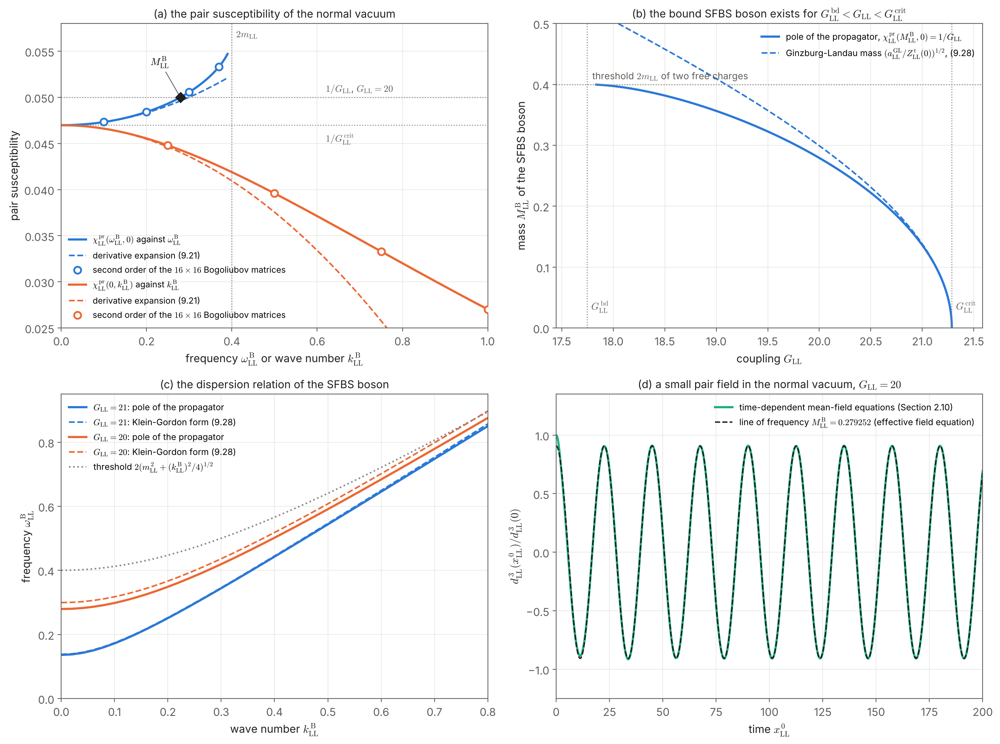{width=100%}

**Figure 22.** The effective field theory of the SFBS in the normal vacuum ($m_{\rm LL}=0.2$, $\Lambda_{\rm LL}=1$, $\mu_{\rm LL}=0$). (a) The pair
susceptibility (9.16) against the frequency at $k^{\rm B}_{\rm LL}=0$ (blue) and against the wave number at $\omega^{\rm B}_{\rm LL}=0$ (orange), with the
derivative expansion (9.21) (dashed) and the values from the exact second-order energies of the $16\times16$ Bogoliubov matrices (circles); the
frequency curve rises from $1/G^{\rm crit}_{\rm LL}$ toward $1/G^{\rm bd}_{\rm LL}$ at the threshold $2m_{\rm LL}$, and its crossing with $1/G_{\rm LL}$ is the
mass of the SFBS boson (diamond, $G_{\rm LL}=20$). (b) The mass $M^{\rm B}_{\rm LL}$ of the SFBS boson against the coupling: the pole (9.29) (solid) and the
Ginzburg-Landau mass $(a^{\rm GL}_{\rm LL}/Z^{\rm t}_{\rm LL}(0))^{1/2}$ of (9.28) (dashed); the bound state exists between $G^{\rm bd}_{\rm LL}$ and
$G^{\rm crit}_{\rm LL}$. (c) The dispersion relation at $G_{\rm LL}=21$ (blue) and $G_{\rm LL}=20$ (orange): the pole (solid), the Klein-Gordon form (9.28)
(dashed) and the two-particle threshold (dotted). (d) The time evolution of a small uniform pair field by the mean-field equations (9.30) (green)
and the line of the frequency $M^{\rm B}_{\rm LL}$ of the effective field equation, with amplitude and phase fitted on the last two thirds of the run
(black, dashed). Data: `test2/data/t2_sfbs_susceptibility.csv`, `t2_sfbs_boson_mass.csv`, `t2_sfbs_boson_dispersion.csv`, `t2_sfbs_tdbdg_normal.csv`.

## 9.7 Discussion

- **What was derived.** The SFBS has a field of its own, $\vec d_{\rm LL}$, introduced exactly (9.1); its gauge-covariant derivative is inherited
  from the spinor field (Theorem 9.1); integrating out the spinor field gives its effective action, whose derivative expansion (9.12) is the
  Lagrangian of a charged scalar field, and whose field equations are (9.23) with the gauge-field equations (9.26). Nothing in (9.12) is
  postulated: the potential is the vacuum energy (9.11), and the coefficients are response functions of the spinor field, (9.17) to (9.20).
- **The analogy with the Higgs field.** Like the Higgs field, $\vec d_{\rm LL}$ is a Lorentz scalar with gauge charges and a coefficient of
  $\lvert\vec d_{\rm LL}\rvert^2$, $a^{\rm GL}_{\rm LL}$, whose sign decides between a symmetric vacuum and a condensate. The differences: $\vec d_{\rm LL}$ is
  an isospin triplet with fermion number 2 (the Higgs field of the electroweak theory is a doublet), it is composite, and its parameters are
  computed rather than chosen.
- **Approximations.** (1) The field $\vec d_{\rm LL}$ is treated at its stationary point, the mean-field approximation of Section 2.10. (2) The
  derivative expansion holds for frequencies and wave numbers small compared with the scale of pair breaking, $2m_{\rm LL}$ in the normal vacuum:
  near $G^{\rm crit}_{\rm LL}$, where the boson is light, it is accurate; at $G_{\rm LL}=20$ its mass is 7% off (Figure 22(b)). (3) About a condensed
  vacuum the coefficients change (Section 12). (4) The cutoff breaks Lorentz invariance, $Z^{\rm s}_{\rm LL}\neq Z^{\rm t}_{\rm LL}$; with a covariant
  regularization the two would be equal.
- **What follows.** For $G_{\rm LL}>G^{\rm crit}_{\rm LL}$ the coefficient $a^{\rm GL}_{\rm LL}$ is negative and the normal vacuum is unstable. The effective
  potential $\Omega_{\rm LL}(\vec d_{\rm LL})$ beyond second order, the Mexican hat of the SFBS, is the subject of Section 10.

# 10. Item [8]: the effective potential of the SFBS

## 10.0 The answer in brief

1. **Two invariants.** The effective potential $\Omega_{\rm LL}(\vec d_{\rm LL})$ of (9.11) is invariant under the phase and the isospin
   rotations (9.4). Every pair field is a phase and a rotation away from the normal form (10.1), fixed by two numbers, the two gaps
   $\Delta^+_{\rm LL}\ge\Delta^-_{\rm LL}\ge0$ with $(\Delta^\pm_{\rm LL})^2=\lvert\vec d_{\rm LL}\rvert^2(1\pm\zeta_{\rm LL})$; equivalently,
   $\Omega_{\rm LL}$ depends only on $\lvert\vec d_{\rm LL}\rvert^2$ and $\lvert\vec d_{\rm LL}\cdot\vec d_{\rm LL}\rvert^2$ (Theorem 10.1).
2. **Two sectors.** In the normal form the isospin part of the pairing block is diagonal in the basis of the eigenvectors of
   $\tau^{\rm LL}_1$: the $16\times16$ Bogoliubov matrix splits into two decoupled sectors with the gaps $\Delta^+_{\rm LL}$ and
   $\Delta^-_{\rm LL}$ (10.5) (check SB-11), and

   $\Omega_{\rm LL}(\vec d_{\rm LL})=\lvert\vec d_{\rm LL}\rvert^2/G_{\rm LL}-W^{\rm g}_{\rm LL}((\Delta^+_{\rm LL})^2)-W^{\rm g}_{\rm LL}((\Delta^-_{\rm LL})^2)$ (10.6),
   with the condensation function $W^{\rm g}_{\rm LL}$, increasing and strictly concave in the squared gap (10.7).
3. **The Ginzburg-Landau form** (10.8): $\Omega_{\rm LL}=a^{\rm GL}_{\rm LL}\lvert\vec d_{\rm LL}\rvert^2+b^{\rm GL}_{\rm LL}(2\lvert\vec d_{\rm LL}\rvert^4-\lvert\vec d_{\rm LL}\cdot\vec d_{\rm LL}\rvert^2)+\dots$,
   with $a^{\rm GL}_{\rm LL}=1/G_{\rm LL}-1/G^{\rm crit}_{\rm LL}$ and, at $\mu_{\rm LL}=0$, $b^{\rm GL}_{\rm LL}=Z^{\rm t}_{\rm LL}(0)>0$: the analogue of the
   potential of the Higgs doublet, with a quartic term that prefers the unitary (polar) fields.
4. **The closed form at $\mu_{\rm LL}=0$** (10.9), its stationarity condition, which is the gap equation in closed form (10.10), the
   massless form with its logarithm (10.11), and the next term of the expansion (10.12) (check SB-12).
5. **The Mexican hat.** For $G_{\rm LL}>G^{\rm crit}_{\rm LL}$ the potential has a maximum at $\vec d_{\rm LL}=0$ and, on every complex line of
   polar fields, a circle of minima of radius $\Delta^{\rm vac}_{\rm LL}$ (0.2094933 at $G_{\rm LL}=22.5$), Figure 23. The minima and the breaking
   of the symmetry are item [9] (Section 11).

## 10.1 The invariants of the pair field

**Invariance.** Under (9.4) the pairing block of the Bogoliubov matrix changes by a unitary similarity transformation (the one of the
transformation (2.10) of the spinor field, applied to the particle and the hole parts), so the eigenvalues of
$\mathsf H_{\rm LL}(\vec q_{\rm LL})$ and $\lvert\vec d_{\rm LL}\rvert^2$ do not change: $\Omega_{\rm LL}$ is invariant under the phase and the isospin
rotations (check SB-11, $4\times10^{-13}$).

**Theorem 10.1 (the normal form).** For every $\vec d_{\rm LL}\in\mathbb C^3$ there are a phase $\theta^{\rm F}_{\rm LL}$ and an isospin rotation
$\mathsf U_{\rm LL}$ such that

$$\exp(2i\theta^{\rm F}_{\rm LL})\,\mathsf R^{\rm v}_{\rm LL}(\mathsf U_{\rm LL})\,\vec d_{\rm LL}=\Big(0,\ \frac i2\big(\Delta^+_{\rm LL}-\Delta^-_{\rm LL}\big),\ \frac12\big(\Delta^+_{\rm LL}+\Delta^-_{\rm LL}\big)\Big),\tag{10.1}$$

with the two gaps $\Delta^\pm_{\rm LL}\ge0$, $(\Delta^\pm_{\rm LL})^2=\lvert\vec d_{\rm LL}\rvert^2(1\pm\zeta_{\rm LL})$, and the non-unitarity
$\zeta_{\rm LL}=\lvert\vec d_{\rm LL}\times\vec d^{\,*}_{\rm LL}\rvert/\lvert\vec d_{\rm LL}\rvert^2\in[0,1]$. The two gaps are fixed by the two invariants

$$\lvert\vec d_{\rm LL}\rvert^2=\tfrac12\big((\Delta^+_{\rm LL})^2+(\Delta^-_{\rm LL})^2\big),\qquad\lvert\vec d_{\rm LL}\cdot\vec d_{\rm LL}\rvert=\Delta^+_{\rm LL}\Delta^-_{\rm LL},\qquad\zeta_{\rm LL}^2=1-\frac{\lvert\vec d_{\rm LL}\cdot\vec d_{\rm LL}\rvert^2}{\lvert\vec d_{\rm LL}\rvert^4},\tag{10.2}$$

where $\vec d_{\rm LL}\cdot\vec d_{\rm LL}=(d^1_{\rm LL})^2+(d^2_{\rm LL})^2+(d^3_{\rm LL})^2$ (no complex conjugation). Hence $\Omega_{\rm LL}$ is a function of
$\lvert\vec d_{\rm LL}\rvert^2$ and $\lvert\vec d_{\rm LL}\cdot\vec d_{\rm LL}\rvert^2$ only.

*Proof.* Write $\vec d_{\rm LL}={\rm Re}\,\vec d_{\rm LL}+i\,{\rm Im}\,\vec d_{\rm LL}$ with two real vectors. (i) A phase $\exp(2i\theta^{\rm F}_{\rm LL})$
multiplies $\vec d_{\rm LL}\cdot\vec d_{\rm LL}$ by $\exp(4i\theta^{\rm F}_{\rm LL})$; choose it so that $\vec d_{\rm LL}\cdot\vec d_{\rm LL}$ becomes real and not
negative. Since $\vec d_{\rm LL}\cdot\vec d_{\rm LL}=\lvert{\rm Re}\,\vec d_{\rm LL}\rvert^2-\lvert{\rm Im}\,\vec d_{\rm LL}\rvert^2+2i\,{\rm Re}\,\vec d_{\rm LL}\cdot{\rm Im}\,\vec d_{\rm LL}$,
the new real and imaginary parts are orthogonal, and the real part is the longer one. (ii) As $\mathsf U_{\rm LL}$ runs over $SU(2)$,
$\mathsf R^{\rm v}_{\rm LL}(\mathsf U_{\rm LL})$ runs over all rotations of the isospin space; choose one that turns the real part into the third and the
imaginary part into the second direction. The field is now $(0,i\lvert{\rm Im}\,\vec d_{\rm LL}\rvert,\lvert{\rm Re}\,\vec d_{\rm LL}\rvert)$, and
$\lvert\vec d_{\rm LL}\cdot\vec d_{\rm LL}\rvert=\lvert{\rm Re}\,\vec d_{\rm LL}\rvert^2-\lvert{\rm Im}\,\vec d_{\rm LL}\rvert^2$. (iii) The modulus and $\vec d_{\rm LL}\times\vec d^{\,*}_{\rm LL}$
do not change (up to a rotation) under (9.4), and for orthogonal real and imaginary parts
$\vec d_{\rm LL}\times\vec d^{\,*}_{\rm LL}=-2i\,{\rm Re}\,\vec d_{\rm LL}\times{\rm Im}\,\vec d_{\rm LL}$ has the modulus $2\lvert{\rm Re}\,\vec d_{\rm LL}\rvert\lvert{\rm Im}\,\vec d_{\rm LL}\rvert$.
So $\lvert\vec d_{\rm LL}\rvert^2(1\pm\zeta_{\rm LL})=(\lvert{\rm Re}\,\vec d_{\rm LL}\rvert\pm\lvert{\rm Im}\,\vec d_{\rm LL}\rvert)^2$, that is
$\lvert{\rm Re}\,\vec d_{\rm LL}\rvert=(\Delta^+_{\rm LL}+\Delta^-_{\rm LL})/2$ and $\lvert{\rm Im}\,\vec d_{\rm LL}\rvert=(\Delta^+_{\rm LL}-\Delta^-_{\rm LL})/2$, which is (10.1);
(10.2) follows by squaring and multiplying. $\square$

Two kinds of field are distinguished by $\zeta_{\rm LL}$. The **unitary** or **polar** fields, $\zeta_{\rm LL}=0$: $\vec d_{\rm LL}\times\vec d^{\,*}_{\rm LL}=0$, the field
is a real vector times a phase, and $\Delta^+_{\rm LL}=\Delta^-_{\rm LL}=\lvert\vec d_{\rm LL}\rvert$. The **maximally non-unitary** fields,
$\zeta_{\rm LL}=1$: $\vec d_{\rm LL}\cdot\vec d_{\rm LL}=0$ (for example $(1,i,0)$ times a number), and $\Delta^-_{\rm LL}=0$.

## 10.2 The two sectors and the effective potential

**The isospin part of the pairing block.** The pairing block of (9.11) is
$\mathsf P_{\rm LL}=\sum_\iota d^\iota_{\rm LL}(\mathsf K^\iota_{\rm LL})^\dagger=(C_{\rm LL}\gamma^{\rm ch}_{\rm LL})^\dagger\otimes\mathsf D_{\rm LL}$ with the $2\times2$ isospin matrix
$\mathsf D_{\rm LL}=\sum_\iota d^\iota_{\rm LL}(\mathsf E_{\rm LL}\tau^{\rm LL}_\iota)^\dagger$, evaluated with (8.5):

$$\mathsf D_{\rm LL}=\begin{pmatrix}d^1_{\rm LL}-i\,d^2_{\rm LL}&-d^3_{\rm LL}\\-d^3_{\rm LL}&-d^1_{\rm LL}-i\,d^2_{\rm LL}\end{pmatrix}$$

(check SB-11 compares $(C_{\rm LL}\gamma^{\rm ch}_{\rm LL})^\dagger\otimes\mathsf D_{\rm LL}$ with $\mathsf P_{\rm LL}$: equal). For the normal form (10.1) it is

$$\mathsf D_{\rm LL}=\frac12\begin{pmatrix}\Delta^+_{\rm LL}-\Delta^-_{\rm LL}&-(\Delta^+_{\rm LL}+\Delta^-_{\rm LL})\\-(\Delta^+_{\rm LL}+\Delta^-_{\rm LL})&\Delta^+_{\rm LL}-\Delta^-_{\rm LL}\end{pmatrix},\tag{10.3}$$

with the eigenvector $(1,1)/\sqrt2$ of the eigenvalue $-\Delta^-_{\rm LL}$ and the eigenvector $(1,-1)/\sqrt2$ of the eigenvalue $+\Delta^+_{\rm LL}$
(multiply out); these are the eigenvectors of $\tau^{\rm LL}_1$ with the eigenvalues $+1$ and $-1$, the same for every momentum.

**The two sectors.** In the basis of these two eigenvectors on the isospin index, $\mathsf D_{\rm LL}$ is diagonal, and so is the normal part
$\mathsf h_{\rm LL}(\vec q_{\rm LL})-\mu_{\rm LL}$, which acts as the unit matrix on the isospin index. The $16\times16$ matrix
$\mathsf H_{\rm LL}(\vec q_{\rm LL})$ therefore splits into two decoupled $8\times8$ matrices, the **sectors** $\tau^{\rm LL}_1=+1$ and
$\tau^{\rm LL}_1=-1$, each with the Dirac pairing block $(C_{\rm LL}\gamma^{\rm ch}_{\rm LL})^\dagger$ times a number, the gap of the sector,
$-\Delta^-_{\rm LL}$ or $\Delta^+_{\rm LL}$:

$$\begin{aligned}\tau^{\rm LL}_1=+1:&\quad\begin{pmatrix}\sum_j\alpha^j_{\rm LL}q^j_{\rm LL}+\beta_{\rm LL}m_{\rm LL}-\mu_{\rm LL}&-\Delta^-_{\rm LL}(C_{\rm LL}\gamma^{\rm ch}_{\rm LL})^\dagger\\-\Delta^-_{\rm LL}C_{\rm LL}\gamma^{\rm ch}_{\rm LL}&\sum_j(\alpha^j_{\rm LL})^*q^j_{\rm LL}-\beta_{\rm LL}m_{\rm LL}+\mu_{\rm LL}\end{pmatrix},\\\tau^{\rm LL}_1=-1:&\quad\begin{pmatrix}\sum_j\alpha^j_{\rm LL}q^j_{\rm LL}+\beta_{\rm LL}m_{\rm LL}-\mu_{\rm LL}&\Delta^+_{\rm LL}(C_{\rm LL}\gamma^{\rm ch}_{\rm LL})^\dagger\\\Delta^+_{\rm LL}C_{\rm LL}\gamma^{\rm ch}_{\rm LL}&\sum_j(\alpha^j_{\rm LL})^*q^j_{\rm LL}-\beta_{\rm LL}m_{\rm LL}+\mu_{\rm LL}\end{pmatrix},\end{aligned}\tag{10.4}$$

with the $4\times4$ Dirac matrices $\alpha^j_{\rm LL}$, $\beta_{\rm LL}$ (the Dirac part of $\mathsf h_{\rm LL}(\vec q_{\rm LL})$ is written out in Section 8.7; the lower
right blocks are $-(\mathsf h_{\rm LL}(-\vec q_{\rm LL})^*-\mu_{\rm LL})$ restricted to one isospin component, $\beta_{\rm LL}$ being real). Each sector is the polar
problem of Section 3.3 for one isospin component, with its own gap; the sign of the gap does not matter, because the unitary matrix that changes the
sign of the hole part turns the gap $-\Delta^-_{\rm LL}$ into $+\Delta^-_{\rm LL}$ without changing the diagonal blocks. In the polar case
$\Delta^+_{\rm LL}=\Delta^-_{\rm LL}=\Delta_{\rm LL}$ the two sectors therefore have the same eigenvalues, and together they have $\pm E^\pm_{\rm LL}$ four times each
(3.13); so each sector has $\pm E^\pm_{\rm LL}$ twice, computed with its own gap. For a general field, therefore, the 16 eigenvalues of
$\mathsf H_{\rm LL}(\vec q_{\rm LL})$ are

$$\pm E^+_{\rm LL}(\Delta^+_{\rm LL}),\quad\pm E^-_{\rm LL}(\Delta^+_{\rm LL}),\quad\pm E^+_{\rm LL}(\Delta^-_{\rm LL}),\quad\pm E^-_{\rm LL}(\Delta^-_{\rm LL}),\qquad\text{each twice},\tag{10.5}$$

with $E^\pm_{\rm LL}(\Delta^+_{\rm LL})=((\varepsilon_{\rm LL}\pm\mu_{\rm LL})^2+(\Delta^+_{\rm LL})^2)^{1/2}$ and the same with $\Delta^-_{\rm LL}$ (the argument names the gap
that replaces $\Delta_{\rm LL}$ in $E^\pm_{\rm LL}$). Check SB-11 compares (10.5) with the numerically computed eigenvalues for 30 random fields, momenta and chemical potentials (0, 0.35 and
0.6): largest deviation $2.7\times10^{-15}$; the sum of the positive eigenvalues does not depend on the direction of $\vec q_{\rm LL}$ ($4\times10^{-15}$).

**The effective potential.** Inserting (10.5) in (9.11): the positive eigenvalues sum to
$2(E^+_{\rm LL}(\Delta^+_{\rm LL})+E^-_{\rm LL}(\Delta^+_{\rm LL})+E^+_{\rm LL}(\Delta^-_{\rm LL})+E^-_{\rm LL}(\Delta^-_{\rm LL}))$, and to
$4(\lvert\varepsilon_{\rm LL}+\mu_{\rm LL}\rvert+\lvert\varepsilon_{\rm LL}-\mu_{\rm LL}\rvert)$ at $\vec d_{\rm LL}=0$ (where $E^\pm_{\rm LL}=\lvert\varepsilon_{\rm LL}\pm\mu_{\rm LL}\rvert$).
Half the difference, integrated, gives

$$\begin{aligned}\Omega_{\rm LL}(\vec d_{\rm LL})&=\frac{\lvert\vec d_{\rm LL}\rvert^2}{G_{\rm LL}}-W^{\rm g}_{\rm LL}\big((\Delta^+_{\rm LL})^2\big)-W^{\rm g}_{\rm LL}\big((\Delta^-_{\rm LL})^2\big),\\W^{\rm g}_{\rm LL}(\Delta_{\rm LL}^2)&=\int_{q_{\rm LL}<\Lambda_{\rm LL}}\frac{d^3q_{\rm LL}}{(2\pi)^3}\big(E^+_{\rm LL}+E^-_{\rm LL}-\lvert\varepsilon_{\rm LL}+\mu_{\rm LL}\rvert-\lvert\varepsilon_{\rm LL}-\mu_{\rm LL}\rvert\big),\end{aligned}\tag{10.6}$$

the **condensation function** $W^{\rm g}_{\rm LL}$ of one sector (its argument is the squared gap, which enters $E^\pm_{\rm LL}$). Check SB-11 compares
(10.6) with the direct integral of the eigenvalues of $\mathsf H_{\rm LL}(\vec q_{\rm LL})$ for three random fields at $\mu_{\rm LL}=0$ and three with a Fermi
sea ($\mu_{\rm LL}=0.5$), $G_{\rm LL}=22.5$: largest relative deviation $3.2\times10^{-13}$.

**The condensation function is increasing and strictly concave.** With $\partial E^\pm_{\rm LL}/\partial(\Delta_{\rm LL}^2)=1/(2E^\pm_{\rm LL})$,

$$\frac{\partial W^{\rm g}_{\rm LL}}{\partial(\Delta_{\rm LL}^2)}=\frac12\int\frac{d^3q_{\rm LL}}{(2\pi)^3}\Big(\frac1{E^+_{\rm LL}}+\frac1{E^-_{\rm LL}}\Big)>0,\qquad\frac{\partial^2W^{\rm g}_{\rm LL}}{\partial(\Delta_{\rm LL}^2)^2}=-\frac14\int\frac{d^3q_{\rm LL}}{(2\pi)^3}\Big(\frac1{(E^+_{\rm LL})^3}+\frac1{(E^-_{\rm LL})^3}\Big)<0,\tag{10.7}$$

for every chemical potential. The first form, set equal to $1/(2G_{\rm LL})$, is the gap equation (2.33) of one sector. Check SB-12 confirms the
concavity numerically on a grid of 49 squared gaps at $\mu_{\rm LL}=0$ and $\mu_{\rm LL}=0.5$ (all second differences negative). The meaning:
a non-unitary field moves gap from one sector to the other at fixed $\lvert\vec d_{\rm LL}\rvert^2$ (the sum $(\Delta^+_{\rm LL})^2+(\Delta^-_{\rm LL})^2$ is fixed),
and a concave function gains less from the larger gap than it loses from the smaller one; Section 11 turns this into the statement that the
minima are polar.

## 10.3 The Ginzburg-Landau form

At $\mu_{\rm LL}=0$ and $m_{\rm LL}>0$ the integrand of $W^{\rm g}_{\rm LL}$ is an analytic function of $\Delta_{\rm LL}^2$, and its Taylor series begins
with the first derivative at zero gap times $\Delta_{\rm LL}^2$ plus half the second derivative times $\Delta_{\rm LL}^4$. By (10.7) with
$E^\pm_{\rm LL}=\varepsilon_{\rm LL}$ the first derivative at zero gap is $\int\!d^3q_{\rm LL}(2\pi)^{-3}/\varepsilon_{\rm LL}=1/(2G^{\rm crit}_{\rm LL})$ by (9.17), and
the second is $-\tfrac12\int\!d^3q_{\rm LL}(2\pi)^{-3}/\varepsilon_{\rm LL}^3=-Z^{\rm t}_{\rm LL}(0)$ by (9.18). With $(\Delta^+_{\rm LL})^2+(\Delta^-_{\rm LL})^2=2\lvert\vec d_{\rm LL}\rvert^2$ and
$(\Delta^+_{\rm LL})^4+(\Delta^-_{\rm LL})^4=2\lvert\vec d_{\rm LL}\rvert^4(1+\zeta_{\rm LL}^2)=4\lvert\vec d_{\rm LL}\rvert^4-2\lvert\vec d_{\rm LL}\cdot\vec d_{\rm LL}\rvert^2$ (by (10.2)),
(10.6) becomes the **Ginzburg-Landau form**

$$\begin{aligned}\Omega^{\rm GL}_{\rm LL}(\vec d_{\rm LL})&=a^{\rm GL}_{\rm LL}\lvert\vec d_{\rm LL}\rvert^2+b^{\rm GL}_{\rm LL}\big(2\lvert\vec d_{\rm LL}\rvert^4-\lvert\vec d_{\rm LL}\cdot\vec d_{\rm LL}\rvert^2\big),\\a^{\rm GL}_{\rm LL}&=\frac1{G_{\rm LL}}-\frac1{G^{\rm crit}_{\rm LL}},\qquad b^{\rm GL}_{\rm LL}=Z^{\rm t}_{\rm LL}(0)=\frac{\mathrm{arsinh}(\Lambda_{\rm LL}/m_{\rm LL})-\Lambda_{\rm LL}/\varepsilon_{\rm LL}(\Lambda_{\rm LL})}{4\pi^2},\end{aligned}\tag{10.8}$$

with $\Omega_{\rm LL}-\Omega^{\rm GL}_{\rm LL}$ of the order $\lvert\vec d_{\rm LL}\rvert^6$ (the next term is (10.12)). At $\mu_{\rm LL}=0$ the quartic coefficient equals the stiffness of
the time derivatives of Section 9.4: both are $\tfrac12\int1/\varepsilon_{\rm LL}^3$. For $m_{\rm LL}=0.2$, $\Lambda_{\rm LL}=1$: $b^{\rm GL}_{\rm LL}=0.0337363$.

**The analogy with the Higgs potential.** The potential of the Higgs doublet of the electroweak theory is a coefficient times the squared modulus of
the field plus a positive coefficient times its fourth power; when the first coefficient is negative, the minima form a sphere and the potential
has the shape of a Mexican hat. (10.8) has the same two terms, with two differences. First, the coefficient $a^{\rm GL}_{\rm LL}$ is computed: it is
negative exactly when the attraction exceeds the critical coupling, $G_{\rm LL}>G^{\rm crit}_{\rm LL}$. Second, the quartic term depends on the orientation
of the field: at fixed $\lvert\vec d_{\rm LL}\rvert$, $2\lvert\vec d_{\rm LL}\rvert^4-\lvert\vec d_{\rm LL}\cdot\vec d_{\rm LL}\rvert^2=\lvert\vec d_{\rm LL}\rvert^4(1+\zeta_{\rm LL}^2)$ is
smallest for $\zeta_{\rm LL}=0$, so the quartic term prefers the polar fields; for them $\Omega^{\rm GL}_{\rm LL}=a^{\rm GL}_{\rm LL}\lvert\vec d_{\rm LL}\rvert^2+b^{\rm GL}_{\rm LL}\lvert\vec d_{\rm LL}\rvert^4$,
whose minima for $a^{\rm GL}_{\rm LL}<0$ lie at $\lvert\vec d_{\rm LL}\rvert^2=-a^{\rm GL}_{\rm LL}/(2b^{\rm GL}_{\rm LL})$ with the depth
$-(a^{\rm GL}_{\rm LL})^2/(4b^{\rm GL}_{\rm LL})$. At $G_{\rm LL}=22.5$: $a^{\rm GL}_{\rm LL}=-0.00253345$, the radius 0.193772 and the depth $-4.7563\times10^{-5}$;
the exact values (Section 10.4) are 0.2094933 and $-5.2884\times10^{-5}$.

## 10.4 The closed form at $\mu_{\rm LL}=0$

**The function $\Xi_{\rm LL}$.** At $\mu_{\rm LL}=0$, $E^+_{\rm LL}=E^-_{\rm LL}=(q_{\rm LL}^2+m_{\rm LL}^2+\Delta_{\rm LL}^2)^{1/2}$ and
$\lvert\varepsilon_{\rm LL}\pm\mu_{\rm LL}\rvert=\varepsilon_{\rm LL}$, so the integrand of (10.6) is $2(q_{\rm LL}^2+m_{\rm LL}^2+\Delta_{\rm LL}^2)^{1/2}-2(q_{\rm LL}^2+m_{\rm LL}^2)^{1/2}$.
The spinor charges paired with the gap $\Delta_{\rm LL}$ behave as free charges of the **quasi-particle mass**
$M^{\rm q}_{\rm LL}=(m_{\rm LL}^2+\Delta_{\rm LL}^2)^{1/2}$ (the smallest quasi-particle energy, at $q_{\rm LL}=0$), and

$$\begin{aligned}W^{\rm g}_{\rm LL}(\Delta_{\rm LL}^2)&=\Xi_{\rm LL}(m_{\rm LL}^2+\Delta_{\rm LL}^2)-\Xi_{\rm LL}(m_{\rm LL}^2),\\\Xi_{\rm LL}((M^{\rm q}_{\rm LL})^2)&=2\int_{q_{\rm LL}<\Lambda_{\rm LL}}\frac{d^3q_{\rm LL}}{(2\pi)^3}\big(q_{\rm LL}^2+(M^{\rm q}_{\rm LL})^2\big)^{1/2}\\&=\frac{\Lambda_{\rm LL}\big(2\Lambda_{\rm LL}^2+(M^{\rm q}_{\rm LL})^2\big)\big(\Lambda_{\rm LL}^2+(M^{\rm q}_{\rm LL})^2\big)^{1/2}-(M^{\rm q}_{\rm LL})^4\,\mathrm{arsinh}(\Lambda_{\rm LL}/M^{\rm q}_{\rm LL})}{8\pi^2},\end{aligned}\tag{10.9}$$

using $\int_0^{\Lambda_{\rm LL}}q_{\rm LL}^2(q_{\rm LL}^2+(M^{\rm q}_{\rm LL})^2)^{1/2}dq_{\rm LL}=\tfrac18\big(\Lambda_{\rm LL}(2\Lambda_{\rm LL}^2+(M^{\rm q}_{\rm LL})^2)(\Lambda_{\rm LL}^2+(M^{\rm q}_{\rm LL})^2)^{1/2}-(M^{\rm q}_{\rm LL})^4\mathrm{arsinh}(\Lambda_{\rm LL}/M^{\rm q}_{\rm LL})\big)$
(differentiate the right side with respect to $\Lambda_{\rm LL}$ to verify). Its first, second and third derivatives with respect to the argument $(M^{\rm q}_{\rm LL})^2$, written
$\Xi^{(1)}_{\rm LL}$, $\Xi^{(2)}_{\rm LL}$, $\Xi^{(3)}_{\rm LL}$, are the integrals of $(q_{\rm LL}^2+(M^{\rm q}_{\rm LL})^2)^{-1/2}$, of $-\tfrac12(q_{\rm LL}^2+(M^{\rm q}_{\rm LL})^2)^{-3/2}$ and of
$\tfrac34(q_{\rm LL}^2+(M^{\rm q}_{\rm LL})^2)^{-5/2}$ over $d^3q_{\rm LL}(2\pi)^{-3}$:

$$\begin{aligned}\Xi^{(1)}_{\rm LL}&=\frac{\Lambda_{\rm LL}(\Lambda_{\rm LL}^2+(M^{\rm q}_{\rm LL})^2)^{1/2}-(M^{\rm q}_{\rm LL})^2\,\mathrm{arsinh}(\Lambda_{\rm LL}/M^{\rm q}_{\rm LL})}{4\pi^2},\\\Xi^{(2)}_{\rm LL}&=-\frac{\mathrm{arsinh}(\Lambda_{\rm LL}/M^{\rm q}_{\rm LL})-\Lambda_{\rm LL}(\Lambda_{\rm LL}^2+(M^{\rm q}_{\rm LL})^2)^{-1/2}}{4\pi^2},\\\Xi^{(3)}_{\rm LL}&=\frac{\Lambda_{\rm LL}^3}{8\pi^2(M^{\rm q}_{\rm LL})^2(\Lambda_{\rm LL}^2+(M^{\rm q}_{\rm LL})^2)^{3/2}}\end{aligned}$$

(the antiderivatives of $q_{\rm LL}^2(q_{\rm LL}^2+(M^{\rm q}_{\rm LL})^2)^{-1/2}$, $q_{\rm LL}^2(q_{\rm LL}^2+(M^{\rm q}_{\rm LL})^2)^{-3/2}$ and
$q_{\rm LL}^2(q_{\rm LL}^2+(M^{\rm q}_{\rm LL})^2)^{-5/2}$ are those of Section 9.4 with $M^{\rm q}_{\rm LL}$ in place of $m_{\rm LL}$). Check SB-12: (10.9) against
quadrature to $1.3\times10^{-15}$, the derivatives against numerical derivatives to $8\times10^{-8}$, and $W^{\rm g}_{\rm LL}$ of (10.6) against (10.9) to
$2\times10^{-14}$.

**The polar potential and the gap equation.** Along the polar fields ($\zeta_{\rm LL}=0$, $\lvert\vec d_{\rm LL}\rvert=\Delta_{\rm LL}$),
$\Omega_{\rm LL}=\Delta_{\rm LL}^2/G_{\rm LL}-2(\Xi_{\rm LL}(m_{\rm LL}^2+\Delta_{\rm LL}^2)-\Xi_{\rm LL}(m_{\rm LL}^2))$, and its derivative with respect to $\Delta_{\rm LL}^2$
vanishes exactly when

$$\frac1{G_{\rm LL}}=2\,\Xi^{(1)}_{\rm LL}=\frac{\Lambda_{\rm LL}(\Lambda_{\rm LL}^2+(M^{\rm q}_{\rm LL})^2)^{1/2}-(M^{\rm q}_{\rm LL})^2\,\mathrm{arsinh}(\Lambda_{\rm LL}/M^{\rm q}_{\rm LL})}{2\pi^2},\qquad(M^{\rm q}_{\rm LL})^2=m_{\rm LL}^2+\Delta_{\rm LL}^2:\tag{10.10}$$

the gap equation (2.33) at $\mu_{\rm LL}=0$ in closed form (for $m_{\rm LL}=0$ it is (3.18)). The right side decreases as $\Delta_{\rm LL}$ grows (its
derivative is $2\Xi^{(2)}_{\rm LL}<0$) from $1/G^{\rm crit}_{\rm LL}$ at $\Delta_{\rm LL}=0$, so for $G_{\rm LL}>G^{\rm crit}_{\rm LL}$ it has exactly one solution, the
**gap of the condensed vacuum** $\Delta^{\rm vac}_{\rm LL}$, and for $G_{\rm LL}\le G^{\rm crit}_{\rm LL}$ none. For $m_{\rm LL}=0.2$, $\Lambda_{\rm LL}=1$,
$G_{\rm LL}=22.5$: $\Delta^{\rm vac}_{\rm LL}=0.2094933$, $M^{\rm q}_{\rm LL}=0.2896333$, and the depth of the minimum is
$\Omega_{\rm LL}=-5.2884\times10^{-5}$ (check SB-12: the derivative vanishes there to $7\times10^{-18}$). The coefficients of (10.8) are
$a^{\rm GL}_{\rm LL}=1/G_{\rm LL}-2\Xi^{(1)}_{\rm LL}(m_{\rm LL}^2)$ and $b^{\rm GL}_{\rm LL}=-\Xi^{(2)}_{\rm LL}(m_{\rm LL}^2)$, by the expansion of (10.9); SB-12 confirms
$b^{\rm GL}_{\rm LL}=Z^{\rm t}_{\rm LL}(0)$ exactly.

**Massless spinor charges.** For $m_{\rm LL}=0$ the expansion is not analytic: $b^{\rm GL}_{\rm LL}$ grows like $\ln(\Lambda_{\rm LL}/m_{\rm LL})/(4\pi^2)$ as
$m_{\rm LL}\to0$. With $\Lambda_{\rm LL}(2\Lambda_{\rm LL}^2+\Delta_{\rm LL}^2)(\Lambda_{\rm LL}^2+\Delta_{\rm LL}^2)^{1/2}=2\Lambda_{\rm LL}^4+2\Lambda_{\rm LL}^2\Delta_{\rm LL}^2+\Delta_{\rm LL}^4/4$
plus terms of the order $\Delta_{\rm LL}^6$, and $\mathrm{arsinh}(\Lambda_{\rm LL}/\Delta_{\rm LL})=\ln(2\Lambda_{\rm LL}/\Delta_{\rm LL})$ plus terms of the order
$\Delta_{\rm LL}^2$, the polar potential is, up to terms of the order $\Delta_{\rm LL}^6$,

$$\Omega_{\rm LL}=\Delta_{\rm LL}^2\Big(\frac1{G_{\rm LL}}-\frac{\Lambda_{\rm LL}^2}{2\pi^2}\Big)+\frac{\Delta_{\rm LL}^4}{4\pi^2}\Big(\ln\frac{2\Lambda_{\rm LL}}{\Delta_{\rm LL}}-\frac14\Big)\qquad(m_{\rm LL}=0):\tag{10.11}$$

a quartic term with a logarithm, as in the effective potential of Coleman and Weinberg. Its derivative with respect to $\Delta_{\rm LL}^2$ set to zero is
(3.19). Check SB-12: the remainder divided by $\Delta_{\rm LL}^4$ falls by the factor 4 each time $\Delta_{\rm LL}$ is halved ($1.0\times10^{-5}$, $2.5\times10^{-6}$,
$6.3\times10^{-7}$ at $\Delta_{\rm LL}=0.04$, 0.02, 0.01), as a remainder of the order $\Delta_{\rm LL}^6$ must.

**The next term.** The term of third order of the expansion of (10.9),
$-\tfrac16\Xi^{(3)}_{\rm LL}(m_{\rm LL}^2)\big((\Delta^+_{\rm LL})^6+(\Delta^-_{\rm LL})^6\big)$ with $(\Delta^+_{\rm LL})^6+(\Delta^-_{\rm LL})^6=\lvert\vec d_{\rm LL}\rvert^6(2+6\zeta_{\rm LL}^2)$, is

$$\Omega_{\rm LL}-\Omega^{\rm GL}_{\rm LL}=-\frac{\Lambda_{\rm LL}^3(1+3\zeta_{\rm LL}^2)}{24\pi^2m_{\rm LL}^2\varepsilon_{\rm LL}(\Lambda_{\rm LL})^3}\lvert\vec d_{\rm LL}\rvert^6\qquad\text{(up to terms of the order }\lvert\vec d_{\rm LL}\rvert^8).\tag{10.12}$$

Its coefficient is $-0.099513$ for polar fields and $-0.207067$ for $\zeta_{\rm LL}=0.6$ ($m_{\rm LL}=0.2$, $\Lambda_{\rm LL}=1$); check SB-12 finds the ratio of the
remainder to $\lvert\vec d_{\rm LL}\rvert^6$ to be $-0.098477$, $-0.099251$, $-0.099437$ (polar) and $-0.203610$, $-0.206127$, $-0.206771$ ($\zeta_{\rm LL}=0.6$)
at $\lvert\vec d_{\rm LL}\rvert=0.04$, 0.02, 0.01, converging to these values. The negative sixth-order term is why the Ginzburg-Landau form
underestimates the depth and the radius of the minimum.

## 10.5 The Mexican hat

Figure 23 shows the potential. (a) Along the polar fields, $\Omega_{\rm LL}$ (10.6) and its Ginzburg-Landau form (10.8) for four couplings: below the
critical coupling ($G_{\rm LL}=18$) the minimum is at $\vec d_{\rm LL}=0$, the normal vacuum, and the curve rises like $a^{\rm GL}_{\rm LL}\Delta_{\rm LL}^2$; at
$G_{\rm LL}=G^{\rm crit}_{\rm LL}$ the quadratic term vanishes and the curve starts like $b^{\rm GL}_{\rm LL}\Delta_{\rm LL}^4$; above it ($G_{\rm LL}=22.5$, 24)
$\vec d_{\rm LL}=0$ is a maximum and the minimum moves out, to $\Delta^{\rm vac}_{\rm LL}=0.2094933$ and 0.328268. (b) The Mexican hat itself: $\Omega_{\rm LL}$ on
the complex plane of the polar component $d^3_{\rm LL}$ ($d^1_{\rm LL}=d^2_{\rm LL}=0$) at $G_{\rm LL}=22.5$, with a quarter cut away to show the profile. It
depends only on $\lvert d^3_{\rm LL}\rvert$, because the phase of $d^3_{\rm LL}$ is a transformation (9.4) of $U(1)^{\rm F}_{\rm LL}$; the minima form the
circle $\lvert d^3_{\rm LL}\rvert=\Delta^{\rm vac}_{\rm LL}$. The same picture holds on the complex line of every polar direction, because the isospin
rotations turn one polar direction into any other. (c) At fixed $\lvert\vec d_{\rm LL}\rvert$, $\Omega_{\rm LL}$ grows with the non-unitarity
$\zeta_{\rm LL}$: in every cross-section of the six-dimensional space of fields, the polar fields are the lowest. (d) The radius of the circle of minima
against the coupling: the solution of (10.10) and the Ginzburg-Landau radius $(-a^{\rm GL}_{\rm LL}/(2b^{\rm GL}_{\rm LL}))^{1/2}$, which agree near
$G^{\rm crit}_{\rm LL}$, where both grow like $(G_{\rm LL}-G^{\rm crit}_{\rm LL})^{1/2}$, and separate at stronger coupling.

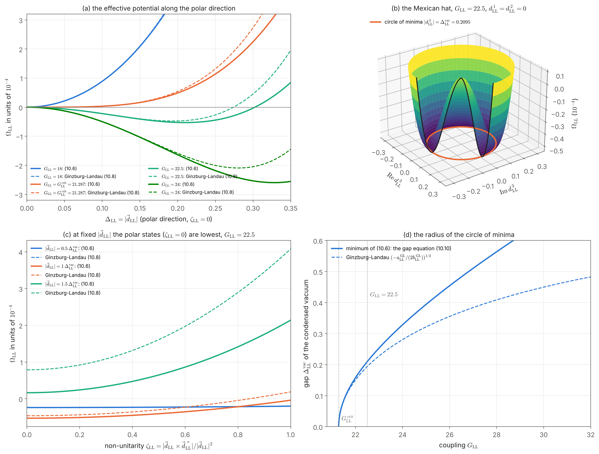{width=100%}

**Figure 23.** The effective potential of the SFBS at $\mu_{\rm LL}=0$ ($m_{\rm LL}=0.2$, $\Lambda_{\rm LL}=1$; in units of $10^{-4}$). (a) Along the polar fields
($\lvert\vec d_{\rm LL}\rvert=\Delta_{\rm LL}$, $\zeta_{\rm LL}=0$) for $G_{\rm LL}=18$, $G^{\rm crit}_{\rm LL}=21.287$, 22.5 and 24: (10.6) (solid) and the
Ginzburg-Landau form (10.8) (dashed). (b) The Mexican hat: $\Omega_{\rm LL}$ on the complex plane of $d^3_{\rm LL}$ ($d^1_{\rm LL}=d^2_{\rm LL}=0$) at
$G_{\rm LL}=22.5$, three quarters drawn; black: the profile along the two edges of the cut; orange: the circle of minima. (c) $\Omega_{\rm LL}$ at fixed
$\lvert\vec d_{\rm LL}\rvert=0.5$, 1 and 1.5 times $\Delta^{\rm vac}_{\rm LL}$ against the non-unitarity $\zeta_{\rm LL}$, $G_{\rm LL}=22.5$: (10.6) (solid) and (10.8)
(dashed). (d) The gap $\Delta^{\rm vac}_{\rm LL}$ of the condensed vacuum against the coupling: the solution of (10.10) (solid) and the Ginzburg-Landau value
(dashed). Data: `test2/data/t2_sfbs_potential_polar.csv`, `t2_sfbs_potential_hat.csv`, `t2_sfbs_potential_zeta.csv`, `t2_sfbs_vacuum_gap.csv`.

## 10.6 Discussion

- **What the potential is.** $\Omega_{\rm LL}(\vec d_{\rm LL})$ is the energy per volume of the vacuum of the spinor field in a uniform pair field,
  measured from the normal vacuum, plus the cost $\lvert\vec d_{\rm LL}\rvert^2/G_{\rm LL}$ of the field itself; by (9.11) it is the potential term of
  the effective Lagrangian (9.12). It is computed exactly in the mean-field sense: (10.6) for every field and chemical potential, (10.9) in closed
  form at $\mu_{\rm LL}=0$.
- **Its structure.** The two invariants of the field are the two gaps of the two sectors (10.5); the potential is the sum of the condensation
  energies of the sectors, and the concavity (10.7) of the condensation function makes the polar fields lowest at fixed modulus.
- **The Mexican hat** appears for $G_{\rm LL}>G^{\rm crit}_{\rm LL}$, when the attraction is strong enough to condense the vacuum itself (at
  $\mu_{\rm LL}>m_{\rm LL}$, with a Fermi sea, the first derivative of $W^{\rm g}_{\rm LL}$ at zero gap diverges logarithmically and the condensate exists
  for every coupling, Section 3.3). Its parameters are not free: $a^{\rm GL}_{\rm LL}$ and $b^{\rm GL}_{\rm LL}$ follow from $G_{\rm LL}$, $m_{\rm LL}$ and
  $\Lambda_{\rm LL}$.
- **Limits.** The potential is that of the mean-field approximation: the fluctuations of $\vec d_{\rm LL}$ itself (the loops of the SFBS) would add
  corrections, which are not computed here. The minima, the breaking of the symmetry, and the expansion about a minimum follow in Section 11.

# Appendix A. Provenance: programs, commands, reports, data, figures

## A.1 How to reproduce everything

From the folder Revision_SuperLoop of the repository:

```
# 1. the checks GS-1 to GS-16 of item [1], the explicit matrices and equations, the data of Figures 1 and 2
cd test2/rust && cargo build --release && ./target/release/t2_fields && cd ../..
# 2. the checks AS-1 to AS-10 of item [2] (the analytic solutions) and the data of Figures 3 to 6
cd test2/rust && cargo build --release && ./target/release/t2_analytic && cd ../..
# 3. Figures 1 to 6 (test2/figures/fig_t2_*.pdf and .png)
python3 test2/python/make_t2_figures.py
# 4. item [3]: the self-test of the Python solver, the seven examples, the table of the keys, the checks EX-1 to EX-7
python3 test2/python/t2_solve.py --selftest test2/data/t2_py_selftest_checks.txt
for e in packet_free cyclotron andreev kink_spectrum ground_state kink_ground_state quench; do
  python3 test2/python/t2_solve.py test2/examples/$e.t2in --out test2/data/t2_py_$e; done
python3 test2/python/t2_solve.py --keys-md test2/data/t2_py_fragments.md
python3 test2/python/t2_examples_check.py test2/data/t2_py
# 5. item [4]: Figures 7 to 13, the plots of the seven solutions (test2/figures/fig_t2_py_*.pdf and .png)
for e in packet_free cyclotron andreev kink_spectrum ground_state kink_ground_state quench; do
  python3 test2/python/t2_plot.py test2/data/t2_py_$e --out test2/figures/fig_t2_py_$e; done
# 6. item [5]: the Rust solver (build, self-test, the seven examples) and the comparison with the Python solutions (EX-8)
cd test2/rust && cargo build --release && cd ../..
./test2/rust/target/release/t2_solve --selftest test2/data/t2_rs_selftest_checks.txt test2/examples
for e in packet_free cyclotron andreev kink_spectrum ground_state kink_ground_state quench; do
  ./test2/rust/target/release/t2_solve test2/examples/$e.t2in --out test2/data/t2_rs_$e; done
python3 test2/python/t2_examples_check.py test2/data/t2_rs test2/data/t2_py
# 7. item [6]: Figures 14 to 20, the plots of the Rust solutions (SVG, converted to PDF and PNG with rsvg-convert)
for e in packet_free cyclotron andreev kink_spectrum ground_state kink_ground_state quench; do
  ./test2/rust/target/release/t2_plot test2/data/t2_rs_$e --out test2/figures/fig_t2_rs_$e
  rsvg-convert -f pdf -o test2/figures/fig_t2_rs_$e.pdf test2/figures/fig_t2_rs_$e.svg
  rsvg-convert -f png -z 1.6 -o test2/figures/fig_t2_rs_$e.png test2/figures/fig_t2_rs_$e.svg; done
# 8. items [7] to [11]: the checks SB-1 to SB-12 of the superfluid boson singlet state, its explicit matrices and the data of Figures 21 to 23
cd test2/rust && cargo build --release && ./target/release/t2_sfbs && cd ../..
# 9. Figures 21 to 23 (test2/figures/fig_t2_sfbs_*.pdf and .png)
python3 test2/python/make_t2_sfbs_figures.py
# 10. everything of the folder Revision_SuperLoop, all checks and all documents, with one verdict ("ALL PASS")
bash code/scripts/check_all.sh
```

The program `t2_fields` runs in about 20 seconds, `t2_analytic` in about 5 seconds, the seven examples of item [3]
together in about 70 seconds (the quench 50 seconds), the Rust solver of item [5] in about 60 seconds, `t2_sfbs` in about
30 seconds (most of it the Lanczos computations of check SB-5 in the Fock space of 65536 states and the $16\times16$ Bogoliubov
matrices of checks SB-7, SB-8 and SB-11), all on one processor core.

Requirements: a Rust toolchain (edition 2021); Python 3 with NumPy, SciPy and Matplotlib; rsvg-convert (librsvg) for the
conversion of the SVG figures of item [6]; for the documents pandoc
(2.11 or later), XeLaTeX and latexmk, the DejaVu fonts and the Latin Modern Math font. The Rust programs of the
folder test2 use no external crate.

## A.2 The programs of items [1] and [2]

The Cargo workspace `test2/rust` has six members (the fourth, `t2solve`, is the solver of item [5], Appendix A.2d; the fifth, `t2plot`, the plotter of item [6], Appendix A.2e; the sixth, `t2sfbs`, the checks of items [7] to [11], Appendix A.2f):

- `t2core` (library): complex numbers and matrices, the Hermitian eigensolver, the super-loop operators as matrices
  (`model.rs`: $M_{\rm LL}$, the frame, the Dirac matrices, $\mathsf S_{\rm LL}$, $\mathsf s_{\rm LL}$,
  $T^\iota_{\rm LL}$, $\mathsf K^\iota_{\rm LL}$, $\mathsf P_{\rm LL}$, $\psi'_{\rm LL}$, the Cayley-Dickson product),
  the lattice operator (`lattice.rs`) and exact symbolic linear forms for printing formulas (`sym.rs`);
- `t2fields` (program `t2_fields`): the checks GS-1 to GS-16, the explicit matrices and
  component equations of Section 2 (written into `test2/data/t2_fragments.md`, from which this document takes them),
  and the data of Figures 1 and 2;
- `t2analytic` (program `t2_analytic`): the checks AS-1 to AS-10 of the analytic solutions of
  Section 3 and the data of Figures 3 to 6. It applies the lattice operator of `t2core` (`lattice.rs`), the routine
  that the solvers use, to the analytic solutions, so that every analytic solution is also a test of that code. For
  item [2] the library received the RK4 step of the lattice equations (`Lattice::rk4_step`), the matrix of the free
  lattice operator on a plane wave (`h_lat_plane`), and a faster form of the Hermitian eigensolver (the same method;
  check GS-11 still passes).

Together they have 10830 lines of commented Rust in 17 files. Arithmetic:
double precision; each check names its tolerance; random numbers from a fixed seed, so that every run gives the
same output.

The report, verbatim (`test2/data/t2_fields_checks.txt`). It writes the symbols with their plain-text names from
the table of Appendix C, for example: `gamma_LL^p`, `alpha_LL^j`, `beta_LL`, `gamma_ch`, `C_LL`, `eps2` for the
Dirac matrices and $\mathsf E_{\rm LL}$; `f_p`, `gL`, `gLt`, `gLbar`, `gL^dag` for $\mathbf f_p$, $\mathbf g$,
$\tilde{\mathbf g}$, $\bar{\mathbf g}$, $\mathbf g^\dagger$; `Sspin_LL`, `sgen_LL`, `Lmat` for $\mathsf S_{\rm LL}$,
$\mathsf s_{\rm LL}$, $\mathsf L_{\rm LL}$; `Av_LL`, `AF_LL`, `atau_LL`, `tA`, `uLw`, `omega_LL`, `varpi_LL` for the
gauge fields; `Acal`, `Gamma_LL`, `nabla_LL`, `Dbq_LL` for $\mathsf A_{{\rm LL},p}$, $\Gamma^{\rm LL}_p$,
$\nabla^{\rm LL}_p$, $\mathbf D_{\rm LL}$; `Fv_LL`, `FF_LL`, `Rc_LL` for the field strengths and the curvature;
`Ucal`, `U_LL`, `Rv`, `thF` for the gauge transformations; `bSp`, `bSm`, `psi'_LL` for the spinor charges of
(2.11); `Kch_iota`, `Ppair`, `dvec`, `d_iota`, `Pi_iota(x)` for the pairing; `psi_p`, `psi_h`, `H_DB`, `Xph`,
`Gsite`, `H_lat`, `Ulink_j`, `eps_lat`, `Hbound`, `dx`, `dt`, `r_W` for the mean-field and lattice equations.

```
Revision_SuperLoop, folder test2, program `t2_fields`: the gauge-covariant field equations of the self-interacting spinor field Psi_LL on R^(1,3)_LL (Test 2, item 1)
16 of 16 checks passed

[PASS] GS-1  the Dirac matrices are built from the frame of R^(1,3)_LL: gamma_LL^p = [[0, M_LL(f_p)], [M_LL(conj f_p), 0]] with the canonical frame f_0 = e0, f_j = i e_j (M_LL(f_p) = sigma_p; M_LL(conj f_0) = sigma_0, M_LL(conj f_j) = -sigma_j); they satisfy {gamma_LL^p, gamma_LL^p'} = 2 diag(1,-1,-1,-1)[p][p'] times the 4 x 4 unit matrix; gamma_ch = i gamma_LL^0 gamma_LL^1 gamma_LL^2 gamma_LL^3 = diag(-1,-1,1,1), C_LL = i gamma_LL^2 gamma_LL^0 = diag(eps2, -eps2), alpha_LL^j = gamma_LL^0 gamma_LL^j = diag(-sigma_j, sigma_j), and eps2 = i sigma_2 = M_LL(-e2) (tolerance 1e-12)  -- largest deviation of the Clifford relations 0.0e0
[PASS] GS-2  the Lorentz generators of the super-loop act on the Dirac spinor as sgen_LL(uL) = diag(-M_LL(uL)^dag, M_LL(uL)): sgen_LL(J_LL^j) = diag(-i sigma_j/2, -i sigma_j/2) = gamma_LL^j' gamma_LL^j''/2 ((j, j', j'') cyclic) and sgen_LL(K_LL^j) = diag(-sigma_j/2, sigma_j/2) = gamma_LL^0 gamma_LL^j/2 (the lower block carries the spinor charges); they satisfy the 27 relations of so(3,1), and [gamma_LL^p, sgen_LL(uL)] = sum_p' V_LL(uL)[p][p'] gamma_LL^p' for the six generators (24 relations: the Dirac matrices intertwine the spinor action with the vector action of the super-loop; tolerance 1e-12)  -- 27 commutation relations, 24 intertwining relations
[PASS] GS-3  the gauge group SL(2,C) as a change of representation: for 200 random unit bi-quaternions gL (random M_LL(gL) in SL(2,C) as in Z-3) the spinor matrix Sspin_LL(gL) = diag((M_LL(gL)^dag)^-1, M_LL(gL)) satisfies Sspin_LL(gL)^-1 gamma_LL^p Sspin_LL(gL) = sum_p' Lmat(gL)[p][p'] gamma_LL^p' (the Dirac equation is Lorentz covariant), and for random Hermitian frames f_p: Sspin_LL(gL) gamma_LL^p[f] Sspin_LL(gL)^-1 = gamma_LL^p[gLt f gLt^dag] with the unit bi-quaternion gLt = (gL^dag)^-1, M_LL(gLt) = (M_LL(gL)^dag)^-1 (Lord's change of representation: the frame matrices M_LL(f_p) change with M_LL(gLt), the upper block of the spinor with M_LL(gLt) and the lower block with (M_LL(gLt)^dag)^-1 = M_LL(gL)); tolerance 1e-10  -- largest deviations 5.8e-14 and 6.6e-14
[PASS] GS-4  isospin T_LL^iota = (4 x 4 unit matrix) (x) tau_iota/2 obeys [T_LL^iota, T_LL^iota'] = i sum_iota'' eps3 T_LL^iota'' and commutes with the Lorentz generators; Q_LL = T_LL^3; the pair matrices Kch_iota = (C_LL gamma_ch) (x) (eps2 tau_iota) are antisymmetric, Lorentz invariant (Sspin^T Kch_iota Sspin = Kch_iota for Sspin = Sspin_LL(gL) (x) (2 x 2 unit matrix), 100 random gL), an isospin vector ((1 (x) U_LL)^T Kch_iota (1 (x) U_LL) = sum_iota' Rv(U_LL)[iota][iota'] Kch_iota' with the rotation Rv(U_LL) of U_LL tau U_LL^dag, 100 random U_LL in SU(2)) and carry the fermion number 2; for a c-number (commuting) spinor, Psi_LL^T Kch_iota Psi_LL = 0 identically (100 random spinors): the pairing self-interaction has no classical (c-number) limit (tolerance 1e-10)  -- largest deviation 5.2e-15; largest |Psi^T Kch_iota Psi| of a c-number spinor 3.0e-16
[PASS] GS-5  gauge covariance of the covariant derivative nabla_LL_p = d_p + Gamma_LL_p - i Acal_p, Acal_p = g_v Av_LL^iota_p T_LL^iota + g_F AF_LL_p (Gamma_LL_p = sgen_LL(uLw_p) (x) (2 x 2 unit matrix) with the Lorentz connection uLw_p = sum_j (omega_LL^j_p J_LL^j + varpi_LL^j_p K_LL^j), an element of l_LL for each p): for fields linear in the coordinates, a spinor of three plane waves and a gauge transformation Ucal(x) = exp(i thF(x)) Sspin_LL(gL(x)) (x) U_LL(x) with an x-dependent unit bi-quaternion gL(x), U_LL(x) in SU(2) and phase thF(x), the transformed fields AF_LL' = AF_LL + (d thF)/g_F, atau_LL' = U_LL atau_LL U_LL^-1 - (i/g_v) (d U_LL) U_LL^-1 for the 2 x 2 matrix atau_LL_p = sum_iota Av_LL^iota_p tau_iota/2 (Hermitian again), Gamma_LL' = Sspin_LL(gL) Gamma_LL Sspin_LL(gL)^-1 - (d Sspin_LL(gL)) Sspin_LL(gL)^-1 give nabla_LL_p' (Ucal Psi_LL) = Ucal nabla_LL_p Psi_LL at 20 random points for p = 0..3 (derivatives of the gauge functions by central differences with the step 1e-5; relative tolerance 1e-7)  -- largest relative deviation 1.4e-10
[PASS] GS-6  the commutator of two covariant derivatives is the curvature of the gauge group: [nabla_LL_p, nabla_LL_p'] Psi_LL = (Rc_LL_pp' - i g_v Fv_LL^iota_pp' T_LL^iota - i g_F FF_LL_pp') Psi_LL with Rc_LL_pp' = d_p Gamma_LL_p' - d_p' Gamma_LL_p + [Gamma_LL_p, Gamma_LL_p'], Fv_LL^iota_pp' = d_p Av_LL^iota_p' - d_p' Av_LL^iota_p + g_v sum eps3 Av_LL^iota'_p Av_LL^iota''_p', FF_LL_pp' = d_p AF_LL_p' - d_p' AF_LL_p (fields linear in the coordinates; 20 random points, all 12 ordered pairs p != p'; the outer derivative by central differences with the step 1e-4; relative tolerance 1e-6)  -- largest relative deviation 2.1e-9
[PASS] GS-7  the super-loop form of the Dirac operator: gamma_LL^p nabla_LL_p has the Weyl blocks M_LL(Dbq_LL) = sum_p (M_LL(f_p) (x) (2 x 2 unit matrix)) nabla_LL_p (acting on the lower block, the spinor charges) and M_LL(conj Dbq_LL) = sum_p (M_LL(conj f_p) (x) (2 x 2 unit matrix)) nabla_LL_p (acting on the upper block), and no diagonal blocks; (gamma_LL^p nabla_LL_p)^2 = diag(1,-1,-1,-1)[p][p'] nabla_LL_p nabla_LL_p' + (1/4) [gamma_LL^p, gamma_LL^p'] [nabla_LL_p, nabla_LL_p']; for a free plane wave M_LL(Dbq_LL) M_LL(conj Dbq_LL) = -N_LL(k) sigma_0 (50 random momenta and constant non-abelian gauge fields; tolerance 1e-12)  -- largest deviation 1.6e-15
[PASS] GS-8  the Dirac-Bogoliubov-de Gennes operator H_DB on a plane wave exp(i q.x) with constant gauge fields, H_DB(q) = [[h(q - Acal) - Acal_0 - mu, Ppair], [Ppair^dag, -(h(-q - Acal) - Acal_0 - mu)^*]] (h(k) = sum_j alpha_LL^j k_j + beta_LL m for a matrix-valued k_j, here k_j = q_j - Acal_j and k_j = -q_j - Acal_j, Acal_j = g_v Av_LL^iota_j T_LL^iota + g_F AF_LL_j, Acal_0 likewise, Ppair = sum_iota d_iota Kch_iota^dag), is Hermitian and particle-hole symmetric, Xph conj(H_DB(q)) Xph = -H_DB(-q) with Xph the exchange of the particle and hole blocks (50 random momenta, gauge fields and order parameters); for the polar order parameter dvec = (0, 0, Delta) without gauge fields its spectrum is +-E^(+-) (E^(+-) = ((eps +- mu)^2 + Delta^2)^(1/2)), each four times (30 random momenta; m = 0.4, mu = 0.3; tolerance 1e-10)  -- largest deviations 0.0e0 and 6.7e-15
[PASS] GS-9  the self-consistency of the mean field: for the polar order parameter dvec = (0, 0, Delta) the sum over the eight positive-energy eigenvectors (psi_p, psi_h) of H_DB(q) (without gauge fields H_DB(q) = H_BdG(q)) of psi_p^T Kch_3 conj(psi_h) equals -2 Delta (1/E^+ + 1/E^-) at every momentum (30 random momenta); hence d_iota = -(G/2) <Psi_LL^T Kch_iota Psi_LL>, with the expectation value the sum over the positive modes integrated with d^3q/(2 pi)^3, is the gap equation 1/G = int d^3q/(2 pi)^3 (1/E^+ + 1/E^-) of the manuscript: the mode-sum form of the mean-field equations used by the solvers has the right normalization (tolerance 1e-10)  -- largest deviation 1.7e-15
[PASS] GS-10  the lattice Dirac-Bogoliubov-de Gennes operator H_lat (covariant central differences with the links Ulink_j = exp(-i dx (g_v Av_LL^iota_j tau_iota/2 + g_F AF_LL_j)), Wilson term r_W, Dirichlet or periodic boundaries): on a 3 x 2 x 4 lattice (dx = 0.7, r_W = 1, periodic in x and z, Dirichlet in y) with random links, potentials and order parameters it is Hermitian, particle-hole symmetric (Xph conj(H_lat) Xph = -H_lat), and exactly gauge covariant: H_lat[Ulink', Acal_0', dvec'] = Gsite H_lat[Ulink, Acal_0, dvec] Gsite^dag for random site transformations Gsite = diag(exp(i thF) U_LL, conj(exp(i thF) U_LL)) with Ulink_j(site) -> Gsite(site) Ulink_j(site) Gsite(site + delta_j)^dag, Acal_0 -> Gsite Acal_0 Gsite^dag, dvec -> exp(2 i thF) Rv(U_LL) dvec; on a free periodic one-dimensional lattice (12 sites, dx = 0.5) the spectrum is +-eps_lat(q), eps_lat^2 = sum_j sin^2(q_j dx)/dx^2 + (m + (r_W/dx) sum_j (1 - cos q_j dx))^2, each eight times; the Wilson term lifts the doubler at q = pi/dx to m + 2 r_W/dx; the spectral radius of H_lat stays below the bound Hbound used for the time step, Hbound = (number of active directions) (1 + 2 r_W)/dx + m + |mu| + max ||Acal_0|| + max sum_iota |d_iota| (tolerance 1e-10)  -- Hermiticity 0.0e0, particle-hole 0.0e0, gauge covariance 1.8e-13, dispersion 1.4e-14; spectral radius 8.4349 <= bound 17.5474
[PASS] GS-11  the Hermitian eigensolver of t2core (Householder reduction to a real tridiagonal matrix and the implicit QL algorithm), used by the solvers for the self-consistent ground state: for random Hermitian matrices of the dimensions 7, 64 and 200 the eigenvectors are orthonormal and reproduce the matrix, V diag(E) V^dag = H (relative tolerance 1e-11)  -- largest relative residual 6.0e-14
[PASS] GS-12  the printed formulas agree with the matrices that they describe: the explicit entries of Ppair (symbolic d_iota), of the blocks of sgen_LL(uLw_p) and of the 8 x 8 matrix Gamma_LL_p (symbolic omega_LL^j_p, varpi_LL^j_p), the expansions of the covariant derivatives (nabla_LL_j psi_p)_k, (nabla*_LL_j psi_h)_k and (nabla_LL_j Psi_LL)_k with the spin connection and the gauge potentials, the sixteen component equations of the Dirac-Bogoliubov-de Gennes system (with Gamma_LL_0 and Acal_0), the three pair operators Pi_iota(x) and the eight component equations of the exact operator equation; each is evaluated for numbers assigned to its symbols (a plane wave exp(i q.x) with constant fields for the first ones; independent random numbers for the components, the conjugate components and the pair operators of the exact equation) and compared with the 8 x 8 and 16 x 16 matrix computation (tolerance 1e-12)  -- largest deviations 0.0e0, 4.0e-16, 3.4e-16, 0.0e0, 5.0e-16
[PASS] GS-13  time stepping: one step of the classical Runge-Kutta method (RK4) multiplies the component of an eigenvector with the energy E by 1 - i x - x^2/2 + i x^3/6 + x^4/24 with x = E dt; its modulus is at most 1 for |x| <= 2 sqrt(2) and exceeds 1 beyond (x = 2.9); with the bound Hbound of GS-10 the time step dt <= 2.5/Hbound is therefore stable, and the modulus decreases per step by about x^6/144 (its square is 1 - x^6/72 + x^8/576; at x = 0.1 the decrease is 6.9e-9)  -- modulus at x = 2.5: 0.508186; at 2.9: 1.193063; loss at x = 0.1: 6.9e-9
[PASS] GS-14  the super-loop form of the Dirac isodoublet and of its field equations; psi'_LL(y) = eps2^-1 M_LL(y)^T is the Weyl isodoublet of a spinor charge y e4 (rows: Weyl index, columns: isospin): (a) M_LL(x) psi'_LL(y) = psi'_LL(y conj x) for all bi-quaternions x and y, and the bi-octonion product (the Cayley-Dickson rule of the folder) gives (y e4) x = (y conj x) e4 = R_x (y e4): a 2 x 2 frame matrix acting on a Weyl isodoublet is the right multiplication of the spinor charge by a bi-quaternion (50 random pairs); (b) writing Psi_LL = Psi(bSm, bSp) with the upper block psi'_LL(bSm) and the lower block psi'_LL(bSp) of two spinor charges bSm e4 and bSp e4, the Dirac matrices of a Hermitian frame act as gamma_LL^p[f] Psi(bSm, bSp) = Psi(bSp conj f_p, bSm f_p) (the canonical frame and 19 random Hermitian frames); (c) the gauge transformation exp(i thF) Sspin_LL(gL) (x) M_LL(vI) maps Psi(bSm, bSp) to exp(i thF) Psi(vI bSm gL^dag, vI bSp gLbar): on bSp e4 it is the automorphism varphi of the super-loop, on bSm e4 its complex conjugate, and gLt = (gL^dag)^-1 is the complex conjugate gL^* of gL (50 random gL in SL(2,C), unit real quaternions vI and phases thF); (d) the covariant derivative is nabla_LL_p Psi(bSm, bSp) = Psi(nabla_p bSm, nabla_p bSp) with nabla_p (bSp e4) = d_p (bSp e4) + D_LL(uLw_p)(bSp e4) + g_v Dv_LL(tA_p)(bSp e4) - i g_F AF_LL_p bSp e4 (tA_p = sum_iota Av_LL^iota_p e_iota/2), and the same for bSm with the complex conjugate uLw_p^* in place of uLw_p: the gauge fields act through the derivations of B_LL (30 random points with random spinor charges, derivatives and fields); (e) hence gamma_LL^p nabla_LL_p Psi(bSm, bSp) = Psi(sum_p (nabla_p bSp) conj f_p, sum_p (nabla_p bSm) f_p): the Dirac operator is the right multiplication by the frame, sum_p R_(f_p) nabla_p on bSp e4 and sum_p R_(conj f_p) nabla_p on bSm e4 (canonical frame; tolerance 1e-12)  -- largest deviations 3.2e-16, 4.1e-16, 3.1e-15, 8.8e-16, 2.1e-15
[PASS] GS-15  the Lorentz connection is fixed by the frame: for an x-dependent Lorentz transformation gL(x) with M_LL(gL(x)) = exp(sum_p x_LL^p M_LL(uL_p) + M_LL(uL)) (five random Lorentz generators), the frame f_p[x] = gLt(x) f_p gLt(x)^dag, whose Dirac matrices are gamma_LL^p'[f] = Sspin_LL(gL) gamma_LL^p' Sspin_LL(gL)^-1 (GS-3), and the connection Gamma_LL_p = -(d_p Sspin_LL(gL)) Sspin_LL(gL)^-1, the gauge transform of the canonical gauge (canonical frame, Gamma_LL_p = 0), satisfy at 20 random points: Gamma_LL_p = sgen_LL(uL) for an element uL of l_LL (block diagonal, upper block = -(lower block)^dag, lower block traceless), the Dirac matrices are covariantly constant, d_p gamma_LL^p'[f] + [Gamma_LL_p, gamma_LL^p'[f]] = 0, and the curvature Rc_LL_pp' vanishes (derivatives by central differences with the step 1e-4; tolerance 1e-6); the 24 commutators [sgen_LL(J_LL^j), gamma_LL^p'] and [sgen_LL(K_LL^j), gamma_LL^p'] have the rank 6 over the real numbers (the smallest eigenvalue of their Gram matrix exceeds 1e-6), so that covariant constancy determines the connection uniquely from the frame: on the flat manifold the Lorentz connection is not an independent field, and in the canonical frame it is zero  -- largest deviations 1.0e-9, 3.6e-8, 8.0e-9; smallest Gram eigenvalue 8.000
[PASS] GS-16  the lattice operator of the solvers on plane waves: on a periodic chain of 24 sites along x_LL^1 (dx = 0.5, m = 0.4, mu = 0, no gauge fields, no pairing) the operator H_lat, applied by the routine of the solvers to exp(i q x_LL^1) times any of the 16 unit vectors, gives again a plane wave of the same momentum, and the 16 x 16 matrix of these images has the eigenvalues -eps_lat(q) (eightfold) and +eps_lat(q) (eightfold) at all 24 allowed momenta q = 2 pi k/(24 dx), for the Wilson coefficients r_W = 0 and r_W = 1 (tolerance 1e-12); these are the points of Figure 1, whose curves are the formula eps_lat  -- largest deviation 1.4e-14
```

The report of item [2], verbatim (`test2/data/t2_analytic_checks.txt`). Besides the names above it uses:
`Acal_up_p`, `Acal_down_p` (with `p` = 0 or 1) for $\mathsf A^\uparrow_{{\rm LL},p}$, $\mathsf A^\downarrow_{{\rm LL},p}$;
`Av_LL^3_1`, `AF_LL_1`, `Av_LL^1_0` for $A^3_{{\rm LL},1}$, $A^{\rm F}_{{\rm LL},1}$, $A^1_{{\rm LL},0}$;
`FF_LL_12`, `Fv_LL^3_12` for $\mathsf F^{\rm F}_{{\rm LL},12}$, $\mathsf F^3_{{\rm LL},12}$; `Q_LL` for the charge
$Q_{\rm LL}=T^3_{\rm LL}$ of an isospin component; `x_LL^0`, `x_LL^1` for $x^0_{\rm LL}$, $x^1_{\rm LL}$; `h(q)` for
$\mathsf h_{\rm LL}(\vec q_{\rm LL})$; `Kch_3` for $\mathsf K^3_{\rm LL}$; `E^+`, `E^-` for $E^\pm_{\rm LL}$; `omega_pr`,
`P_up`, `P_hole` for $\omega^{\rm pr}_{\rm LL}$, $P^\uparrow_{\rm LL}$, $P^{\rm h}_{\rm LL}$; `chi_pw`, `theta_B` for
$\chi^{\rm pw}_{\rm LL}$, $\vartheta^{\rm B}_{\rm LL}$; `Delta_inf`, `ell_K`, `phi_K`, `chi_K`, `k_K`, `Qmat_K` for
$\Delta^\infty_{\rm LL}$, $\ell^{\rm K}_{\rm LL}$, $\varphi^{\rm K}_{\rm LL}$, $\chi^{\rm K}_{\rm LL}$, $k^{\rm K}_{\rm LL}$,
$\mathsf Q^{\rm K}_{\rm LL}$; `E_R` for $E^{\rm R}_{\rm LL}$; `B_up`, `B_down`, `n_L` for $B^\uparrow_{\rm LL}$,
$B^\downarrow_{\rm LL}$, $n^{\rm L}_{\rm LL}$; `G`, `G_crit`, `Lambda` for $G_{\rm LL}$, $G^{\rm crit}_{\rm LL}$,
$\Lambda_{\rm LL}$; and `p_1`, `p_2`, `p_3` for the momentum operators $-i\partial_1$, $-i\partial_2$, $-i\partial_3$.

```
Revision_SuperLoop, folder test2, program `t2_analytic`: analytic solutions of the gauge-covariant field equations of the spinor field Psi_LL on R^(1,3)_LL, checked against their lattice form (Test 2, item 2)
10 of 10 checks passed

[PASS] AS-1  free spinor charges in constant gauge potentials (case A): on a periodic chain of 32 sites along x_LL^1 (dx = 0.5, r_W = 1, m = 0.4, mu = 0.2, g_v = 0.7, g_F = 0.45) with the constant potentials Av_LL^3_1 = 0.8 and AF_LL_1 = 0.6 (in the links) and Av_LL^3_0 = 0.5 and AF_LL_0 = 0.3 (in the potential matrix), and no pair field, the 16 eigenvalues of the lattice operator on the plane wave of each allowed momentum q are, for each isospin component (Q_LL = +1/2 with Acal_up_p = g_F AF_LL_p + g_v Av_LL^3_p/2, Q_LL = -1/2 with Acal_down_p = g_F AF_LL_p - g_v Av_LL^3_p/2), +-eps_lat(q - Acal_1) - Acal_0 - mu (particles) and -(+-eps_lat(q + Acal_1) - Acal_0 - mu) (holes), each twice: the potential of the space direction shifts the momentum (minimal coupling q -> q - Acal_1) and the potential of the time direction shifts the energy; the particle block does not mix the two isospin components, and its restriction to each component has the eigenvalues +-eps_lat(q - Acal_1) - Acal_0 - mu (tolerance 1e-12)  -- largest deviation 9.8e-15; Acal_up_1 = 0.5500, Acal_down_1 = -0.0100, Acal_up_0 = 0.3100, Acal_down_0 = -0.0400
[PASS] AS-2  isospin precession in a constant isospin potential (case A): in the potential Av_LL^1_0 = 1.5 (along tau_1, no other field) the positive-energy lattice plane wave chi_pw (x) (isospin up) evolves as exp(-i (eps_lat - mu) x_LL^0) chi_pw (x) (cos(omega_pr x_LL^0/2), i sin(omega_pr x_LL^0/2)) with omega_pr = g_v Av_LL^1_0, so that P_up = cos^2(omega_pr x_LL^0/2); the RK4 integration of the lattice equations (periodic chain of 16 sites, dx = 0.5, r_W = 1, m = 0.4, mu = 0.2, momentum 2 pi 2/(16 dx), dt = 0.004, 4000 steps) agrees with this exact solution at every 40th step (relative deviation of the whole state, tolerance 1e-8; the expected size, the summed RK4 phase error N (E dt)^5/120 for the largest energy E, is stated)  -- largest relative deviation 8.7e-10 (expected about 1.2e-9); omega_pr = 1.0500, eps_lat = 1.723884
[PASS] AS-3  the Bogoliubov modes of the uniform polar superfluid dvec = (0, 0, Delta) (case B): Kch_3 h(q) = conj(h(-q)) Kch_3, so that for an eigenvector chi_pw of h(q) with the energy +eps or -eps the hole vector Kch_3 chi_pw is an eigenvector of conj(h(-q)) with the same energy; Ppair = Delta Kch_3^dag couples (chi_pw, 0) only to (0, Kch_3 chi_pw), and (cos theta_B chi_pw, sin theta_B Kch_3 chi_pw) with cos^2 theta_B = (1 + (+-eps - mu)/E)/2, sin^2 theta_B = (1 - (+-eps - mu)/E)/2, E = ((+-eps - mu)^2 + Delta^2)^(1/2), is an eigenvector of H_BdG(q) with the energy E, which is E^- for the positive branch +eps and E^+ for the negative branch -eps (50 random momenta, chemical potentials and gaps, m = 0.4; tolerance 1e-12); on the lattice (periodic chain of 32 sites, dx = 0.5, r_W = 1, m = 0.4, mu = 0.6, Delta = 0.3) the 16 eigenvalues of the lattice operator on the plane wave of each allowed momentum are +-E^- and +-E^+ with eps_lat in place of eps, each four times (tolerance 1e-12)  -- largest deviations 6.7e-15 (continuum), 1.2e-14 (lattice)
[PASS] AS-4  the particle-hole (Rabi) oscillation of a particle injected into the uniform polar superfluid (case B): on a periodic chain of 16 sites (dx = 0.5, r_W = 1, m = 0.4, mu = 0.6) with the pair field dvec = (0, 0, 0.3), the positive-energy lattice plane wave chi_pw of isospin up at the momentum 2 pi/(16 dx) evolves as (cos(E^- x_LL^0) - i ((eps_lat - mu)/E^-) sin(E^- x_LL^0)) (chi_pw, 0) - i (Delta/E^-) sin(E^- x_LL^0) (0, Kch_3 chi_pw), with E^- = ((eps_lat - mu)^2 + Delta^2)^(1/2): the probability of the hole is P_hole = (Delta/E^-)^2 sin^2(E^- x_LL^0); the RK4 integration of the lattice equations (dt = 0.02, 1000 steps) agrees with this exact solution at every 10th step (relative deviation of the whole state, tolerance 1e-8; the expected size N (E dt)^5/120 is stated)  -- largest relative deviation 5.3e-10 (expected about 5.3e-10); eps_lat = 0.943799, E^- = 0.456287, largest P_hole = (Delta/E^-)^2 = 0.432281
[PASS] AS-5  the gap equation (2.33) in closed form for massless spinor charges (case B): int_(q<Lambda) d^3q/(2 pi)^3 (1/E^+ + 1/E^-) with E^(+-) = ((q +- mu)^2 + Delta^2)^(1/2) equals (1/(4 pi^2)) [(Lambda - 3 mu) E^+(Lambda) + (Lambda + 3 mu) E^-(Lambda) + (2 mu^2 - Delta^2) (asinh((Lambda + mu)/Delta) + asinh((Lambda - mu)/Delta))] for six pairs (mu, Delta) (relative deviation from composite Gauss-Legendre quadrature with 32 nodes per panel, tolerance 1e-10); its limit Delta -> 0 at mu = 0 is Lambda^2/(2 pi^2), so that G_crit = 2 pi^2/Lambda^2 (tolerance 1e-8); the gaps Delta(G) found from the closed form by bisection satisfy G int(...) = 1 with the integral computed by quadrature (12 couplings, tolerance 1e-9); and for mu > 0 and weak coupling (G < G_crit) the gap approaches the BCS form Delta = 2 (Lambda^2 - mu^2)^(1/2) exp(-3/2) exp(-(pi^2/mu^2) (1/G - 1/G_crit)), the relative deviation being smaller than twice the size (Delta^2/(2 mu^2)) ln(1/Delta) of the leading correction (mu = 0.3, G/G_crit = 0.3, 0.4, 0.5); Lambda = 1  -- largest deviations 1.8e-15, 0.0e0, 2.2e-15; Delta at G = 1.5 G_crit, mu = 0: 0.675339; weak coupling at mu = 0.3, G/G_crit = 0.3, 0.4, 0.5: Delta = 9.985e-7 (-7.6e-11, scale 7.7e-11), 1.023e-4 (-5.3e-7, scale 5.3e-7), 1.646e-3 (-9.5e-5, scale 9.6e-5)
[PASS] AS-6  the uniform polar state is an exact self-consistent solution of the lattice mean-field equations (case B): on a periodic chain of 16 sites (dx = 0.5, r_W = 1, m = 0.4, mu = 0.6) with dvec = (0, 0, 0.3), the sum over the 128 positive-energy eigenvectors w of the lattice operator (unit vectors) of w_p^T Kch_iota conj(w_h), computed at every site by the routine of the solvers, is 0 for iota = 1, 2 and -2 Delta (1/16) sum_q (1/E^+ + 1/E^-) (eps_lat in place of eps, the 16 allowed momenta) for iota = 3 (tolerance 1e-12); with Pi_iota = dx^(-1) times this sum (the continuum normalization of a chain) and the coupling G given by the lattice gap equation 1/G = (1/(16 dx)) sum_q (1/E^+ + 1/E^-), the self-consistency condition d_iota = -(G/2) Pi_iota gives back dvec = (0, 0, Delta) on every site (tolerance 1e-12): a fixed point that the self-consistent solvers must reproduce  -- 128 positive modes; largest deviations 2.6e-15 (mode sum), 1.1e-15 (new dvec); G = 0.432159
[PASS] AS-7  the bound states of a domain wall (kink) of the pair field (case C), in the continuum: the 8 x 8 matrices (Dirac (x) isospin) satisfy (Kch_3^dag)^2 = -1, (Kch_3^dag)^dag = -Kch_3^dag, alpha_LL^1 Kch_3^dag alpha_LL^1 = -Kch_3^dag and beta_LL Kch_3^dag alpha_LL^1 = -Kch_3^dag alpha_LL^1 beta_LL, and alpha_LL^1 and beta_LL are real (tolerance 1e-13); for the kink dvec = (0, 0, Delta(x_LL^1)) with Delta(x_LL^1) = Delta_inf tanh(x_LL^1/ell_K) (Delta_inf = 1, ell_K = 1) and mu = 0, the mode psi_p = phi_K chi_K, psi_h = i Kch_3^dag alpha_LL^1 phi_K chi_K with phi_K = cosh(x_LL^1/ell_K)^(-Delta_inf ell_K) (so that d phi_K/d x_LL^1 = -Delta phi_K) and a constant chi_K with beta_LL chi_K = +chi_K or -chi_K satisfies the sixteen component equations with the energy +m or -m at 50 random points (m = 0.4, random chi_K; tolerance 1e-12)  -- deviations of the identities 0.0e0, of the equations 8.3e-17
[PASS] AS-8  the square of the operator and the complete spectrum of the bound states of a wall (case C): with mu = 0, no gauge fields, dvec = (0, 0, Delta(x_LL^1)) real and the plane wave exp(i (q^2 x_LL^2 + q^3 x_LL^3)) along the wall, H_DB^2 = (-d^2/d(x_LL^1)^2 + (q^2)^2 + (q^3)^2 + m^2 + Delta^2) 1_16 + (d Delta/d x_LL^1) Qmat_K with the constant matrix Qmat_K = [[0, -i alpha_LL^1 Kch_3^dag], [-i alpha_LL^1 Kch_3, 0]], which is Hermitian, squares to the unit matrix and has the trace 0 (tolerance 1e-13), because alpha_LL^j Kch_3^dag = -Kch_3^dag conj(alpha_LL^j) for j = 1, 2, 3 (tolerance 1e-13); the identity is checked by applying H_DB twice to a Gaussian times a random 16-component vector, with exact derivatives, for 50 random kinks Delta = Delta_inf tanh(x_LL^1/ell_K), points and momenta (m = 0.4; tolerance 1e-11); the bound states of the two scalar operators -d^2/d(x_LL^1)^2 + Delta^2 - d Delta/d x_LL^1 (the eigenvalue -1 of Qmat_K) and -d^2/d(x_LL^1)^2 + Delta^2 + d Delta/d x_LL^1 (the eigenvalue +1) are those of Poeschl-Teller wells, Delta_inf^2 - (Delta_inf - k_K/ell_K)^2 for the integers k_K with 0 <= k_K < Delta_inf ell_K (eigenvalue -1) and 1 <= k_K < Delta_inf ell_K (eigenvalue +1): finite differences with 4000 and 8001 points on (-20, 20), extrapolated, give exactly these bound states, and no others below the threshold Delta_inf^2, for Delta_inf ell_K = 1 and 2.5 (ell_K = 1; tolerance 1e-6); hence the bound states of the wall have the energies +-(m^2 + (q^2)^2 + (q^3)^2 + 2 k_K Delta_inf/ell_K - k_K^2/ell_K^2)^(1/2)  -- deviations: Qmat_K 0.0e0, relation 0.0e0, square 9.9e-16, bound states 9.2e-9; Delta_inf ell_K = 1, Qmat_K = -1: 1 bound states; Delta_inf ell_K = 1, Qmat_K = +1: 0 bound states; Delta_inf ell_K = 2.5, Qmat_K = -1: 3 bound states; Delta_inf ell_K = 2.5, Qmat_K = +1: 2 bound states
[PASS] AS-9  the bound states of the domain wall on the lattice (case C): on a ring of length 24 (60 sites, dx = 0.4, r_W = 1, m = 0.4, mu = 0) with the kink-antikink profile Delta(x_LL^1) = tanh(x_LL^1 - 6) tanh(18 - x_LL^1), the lattice operator has exactly 16 eigenvalues inside 0.8 times the continuum threshold (m^2 + Delta_inf^2)^(1/2), eight positive and eight negative (four per wall and sign); with the relative residual r of the analytic bound state at dx = 0.4 and the distance delta from its Rayleigh quotient E_R to the nearest eigenvalue outside the cluster of the eight positive bound states, these eigenvalues lie within r^2/delta of +-E_R (the Kato-Temple bound), and the summed density of the eight states near +m agrees with the analytic density of the bound states of the two walls to second order, 1 - (Bhattacharyya coefficient of the two normalized densities) < (1/2) (r/delta)^2 (the Davis-Kahan bound); for the analytic bound state of the kink (chi_K with the components 1 and 5 equal to 1/sqrt 2 and the others zero, beta_LL chi_K = chi_K) on rings with dx = 0.4, 0.2, 0.1, 0.05 the Rayleigh quotient E_R equals the exact lattice formula m + (r_W/(2 dx)) sum (phi_K(s+1) - phi_K(s))^2 / sum phi_K(s)^2 (tolerance 1e-12), (E_R - m)/(r_W dx) tends to 1/6 (within 1 per cent at dx = 0.05, the difference decreasing by a factor between 3.5 and 4.5 at each halving of dx: the Wilson term shifts the bound state at first order in dx, by r_W dx/6, with a correction of order dx^3), and the relative residual decreases at least by the factor 0.6 at each halving of dx  -- 16 bound states (8 positive); largest | |E| - E_R | = 0.00312 (bound r^2/delta = 0.02260, delta = 0.6139); 1 - Bhattacharyya coefficient = 1.12e-3 (bound 1.84e-2); E_R = 0.465443, 0.433178, 0.416647, 0.408331; (E_R - m)/dx = 0.16361, 0.16589, 0.16647, 0.16662; residuals 1.18e-1, 5.94e-2, 2.98e-2, 1.49e-2; deviation from the lattice formula 3.8e-15
[PASS] AS-10  Landau levels (case D): for one isospin component (Q_LL = +1/2 or -1/2) in the constant magnetic fields FF_LL_12 = 1.2 of U(1)_F and Fv_LL^3_12 = 1.0 of the third isospin direction (Landau gauge AF_LL_2 = FF_LL_12 x_LL^1, Av_LL^3_2 = Fv_LL^3_12 x_LL^1; g_v = 0.7, g_F = 0.45), the component feels the magnetic field B_up = g_F FF_LL_12 + g_v Fv_LL^3_12/2 or B_down = g_F FF_LL_12 - g_v Fv_LL^3_12/2; the Dirac Hamiltonian alpha_LL^1 p_1 + alpha_LL^2 (p_2 - B_up x_LL^1) + beta_LL m at p_2 = p_3 = 0 (and the same with B_down), with the momentum operators p_j = -i d_j, diagonalized in a basis of 120 oscillator states of the frequency |B_up| (or |B_down|) (the states with a weight above 1e-8 on the ten highest oscillator states are artefacts of the truncation and are discarded), has the energies +m and -m once each and +-(m^2 + 2 n_L |B_up|)^(1/2) (or with |B_down|) twice each for n_L = 1 to 10, and no other energy below the level 10 (m = 0.4; tolerance 1e-10)  -- largest deviation 1.2e-14; B_up = 0.890, B_down = 0.190; 84 discarded truncation states
```

## A.2b The program of item [3]

`test2/python/t2_solve.py` (the solver, Section 4) and `test2/python/t2_examples_check.py` (the checks EX-1 to EX-7 of the
examples, and the comparison of two sets of outputs used in item [5]); the seven input files `test2/examples/*.t2in`.
Python 3 with NumPy and SciPy; double precision; the only random numbers (in the self-test) come from a fixed seed, so
that every run gives the same output.

The reports use, besides the names listed in A.2: `N_F` and `E_MF` for $N^{\rm F}_{\rm LL}$ and $E^{\rm MF}_{\rm LL}$; `D`
(in "active directions D") for $n^{\rm act}_{\rm LL}$; `G` for $G_{\rm LL}$ (and the coupling after a quench for
$G'_{\rm LL}$); `m`, `mu`, `g_v`, `g_F` for $m_{\rm LL}$, $\mu_{\rm LL}$, $g^{\rm v}_{\rm LL}$, $g^{\rm F}_{\rm LL}$; `d^iota`
and `|d|` for $d^\iota_{\rm LL}$ and $\lvert\vec d_{\rm LL}\rvert$; `Pi` for the pair expectation of (4.1); `W` for
$\mathsf W^{\rm m}_{\rm LL}$; `E_GS` for the energy per site (4.5) measured from the normal state; `E_R` for $E^{\rm R}_{\rm LL}$;
`B_up` for $B^\uparrow_{\rm LL}$; `xi` for the coherence length $1/\Delta_{\rm LL}$ (in units in which the velocity at the
Fermi surface is about 1); `Delta_0` for the uniform gap $\Delta_{\rm LL}$ of the periodic chain; `w` for
$\omega^{\rm H}_{\rm LL}$; and `q`, `k` for momenta $q^1_{\rm LL}$. In the lines `gauge fields:` the four lists are the constant
potentials $(A^1_{{\rm LL},p},A^2_{{\rm LL},p},A^3_{{\rm LL},p},A^{\rm F}_{{\rm LL},p})$ for $p=0,1,2,3$.

The self-test, verbatim (`test2/data/t2_py_selftest_checks.txt`):

```
Revision_SuperLoop, folder test2, program `t2_solve.py` (Test 2, item 3): the self-test of the lattice operator of the Python solver
4 of 4 checks passed
self-test of t2_solve.py
[PASS] the sparse lattice operator equals the site-by-site implementation (3 x 4 x 2 sites, random links, potentials and pair field, periodic and wall directions): largest deviation 7.2e-15
[PASS] it is Hermitian: largest deviation 0.0e+00
[PASS] the closed form of the links equals the matrix exponential exp(-i dx (g_v a.tau/2 + g_F b)) (20 random potentials): largest deviation 2.2e-16
[PASS] plane waves in constant potentials: the 256 eigenvalues of a ring of 16 sites are the energies of check AS-1 (largest deviation 1.4e-14)
self-test: ALL PASS
```

The summary of the example `packet_free`, verbatim (`test2/data/t2_py_packet_free_summary.txt`):

```
Revision_SuperLoop, folder test2, program `t2_solve.py` (Test 2, item 3): a free Gaussian wave packet on a ring
4 of 4 checks passed
input file: packet_free.t2in
task: evolve
lattice: sites 128 1 1, dx = 0.5, boundary periodic periodic periodic, r_W = 1, active directions D = 1, number of sites 128, dimension of H_lat 2048
parameters: m = 0.4, mu = 0, g_v = 0.7, g_F = 0.45
pair field: none, direction 3, amplitude 0, phase 0, width 1, positions []
gauge fields: potentials [[0.0, 0.0, 0.0, 0.0], [0.0, 0.0, 0.0, 0.0], [0.0, 0.0, 0.0, 0.0], [0.0, 0.0, 0.0, 0.0]], magnetic [0.0, 0.0], gauge file none, pulse none
time stepping: RK4, dt = 0.05, steps = 600, output every 20 steps, Hbound = 6.4, dt Hbound = 0.32 (RK4 is stable below 2.83; required <= 2.5)
initial mode: Gaussian packet, centre [16.0, 0.0, 0.0], width 3, momentum [0.8, 0.0, 0.0], branch positive, spin up, isospin up, particle; eps_lat(q) = 0.9580263345
results: energy <w|H_lat|w> at x^0 = 0: 0.960712721889; final norm 0.999999850169; final P_hole = 0; final P_up = 1; final centre of the density (44.9241, 0, 0); computing time 0.10 s
output files: t2_py_packet_free_summary.txt, t2_py_packet_free_series.csv, t2_py_packet_free_fields.csv
checks:
[PASS] the lattice operator H_lat is Hermitian (largest deviation 0.0e+00)
[PASS] the norm of the mode is conserved: largest change 1.50e-07 (the bound of the RK4 loss, steps (Hbound dt)^6/144, is 4.5e-03)
[PASS] the energy <w|H_lat|w> = 0.9607127219 is conserved (static fields): largest change 1.66e-07 (bound 2.9e-02)
[PASS] the free packet moves with its mean group velocity: expected ['0.96413786', '0.00000000', '0.00000000'] (the group velocity at the central momentum is ['0.97555149', '0.00000000', '0.00000000']), measured ['0.96413827', '0.00000000', '0.00000000']; deviation 4.11e-07 (allowed: 1e-5 of the velocity)
```

The summary of the example `cyclotron`, verbatim (`test2/data/t2_py_cyclotron_summary.txt`):

```
Revision_SuperLoop, folder test2, program `t2_solve.py` (Test 2, item 3): a wave packet in a constant magnetic field (cyclotron motion)
3 of 3 checks passed
input file: cyclotron.t2in
task: evolve
lattice: sites 40 40 1, dx = 0.5, boundary wall wall periodic, r_W = 1, active directions D = 2, number of sites 1600, dimension of H_lat 25600
parameters: m = 0.4, mu = 0, g_v = 0.7, g_F = 0.45
pair field: none, direction 3, amplitude 0, phase 0, width 1, positions []
gauge fields: potentials [[0.0, 0.0, 0.0, 0.0], [0.0, 0.0, 0.0, 0.0], [0.0, 0.0, 0.0, 0.0], [0.0, 0.0, 0.0, 0.0]], magnetic [0.4, 0.0], gauge file none, pulse none
time stepping: RK4, dt = 0.05, steps = 720, output every 80 steps, Hbound = 12.4, dt Hbound = 0.62 (RK4 is stable below 2.83; required <= 2.5)
initial mode: Gaussian packet, centre [9.75, 13.3, 0.0], width 1.5, momentum [0.6, 0.0, 0.0], branch positive, spin up, isospin up, particle; eps_lat(q) = 0.7673133026
results: energy <w|H_lat|w> at x^0 = 0: 0.806852665402; final norm 0.999999705447; final P_hole = 0; final P_up = 1; final centre of the density (11.7485, 11.0718, 0); computing time 1.53 s
output files: t2_py_cyclotron_summary.txt, t2_py_cyclotron_series.csv, t2_py_cyclotron_fields.csv
checks:
[PASS] the lattice operator H_lat is Hermitian (largest deviation 0.0e+00)
[PASS] the norm of the mode is conserved: largest change 2.95e-07 (the bound of the RK4 loss, steps (Hbound dt)^6/144, is 2.8e-01)
[PASS] the energy <w|H_lat|w> = 0.8068526654 is conserved (static fields): largest change 3.62e-07 (bound 3.5e+00)
```

The summary of the example `andreev`, verbatim (`test2/data/t2_py_andreev_summary.txt`):

```
Revision_SuperLoop, folder test2, program `t2_solve.py` (Test 2, item 3): Andreev reflection of a particle at a normal-superfluid interface
3 of 3 checks passed
input file: andreev.t2in
task: evolve
lattice: sites 240 1 1, dx = 0.5, boundary wall periodic periodic, r_W = 1, active directions D = 1, number of sites 240, dimension of H_lat 3840
parameters: m = 0.4, mu = 1, g_v = 0.7, g_F = 0.45
pair field: step, direction 3, amplitude 0.6, phase 0, width 1, positions [60.0]
gauge fields: potentials [[0.0, 0.0, 0.0, 0.0], [0.0, 0.0, 0.0, 0.0], [0.0, 0.0, 0.0, 0.0], [0.0, 0.0, 0.0, 0.0]], magnetic [0.0, 0.0], gauge file none, pulse none
time stepping: RK4, dt = 0.05, steps = 1200, output every 40 steps, Hbound = 8, dt Hbound = 0.4 (RK4 is stable below 2.83; required <= 2.5)
initial mode: Gaussian packet, centre [30.0, 0.0, 0.0], width 4, momentum [0.917, 0.0, 0.0], branch positive, spin up, isospin up, particle; eps_lat(q) = 1.073085668
results: energy <w|H_lat|w> at x^0 = 0: 0.073638881768; final norm 0.999999998539; final P_hole = 0.978457; final P_up = 0.0215426; final centre of the density (32.6924, 0, 0); computing time 0.34 s
output files: t2_py_andreev_summary.txt, t2_py_andreev_series.csv, t2_py_andreev_fields.csv
checks:
[PASS] the lattice operator H_lat is Hermitian (largest deviation 0.0e+00)
[PASS] the norm of the mode is conserved: largest change 1.46e-09 (the bound of the RK4 loss, steps (Hbound dt)^6/144, is 3.4e-02)
[PASS] the energy <w|H_lat|w> = 0.07363888177 is conserved (static fields): largest change 2.80e-09 (bound 2.7e-01)
```

The summary of the example `kink_spectrum`, verbatim (`test2/data/t2_py_kink_spectrum_summary.txt`):

```
Revision_SuperLoop, folder test2, program `t2_solve.py` (Test 2, item 3): bound states of a kink and an antikink of the pair field
2 of 2 checks passed
input file: kink_spectrum.t2in
task: spectrum
lattice: sites 60 1 1, dx = 0.4, boundary periodic periodic periodic, r_W = 1, active directions D = 1, number of sites 60, dimension of H_lat 960
parameters: m = 0.4, mu = 0, g_v = 0.7, g_F = 0.45
pair field: kink_antikink, direction 3, amplitude 1, phase 0, width 1, positions [6.0, 18.0]
gauge fields: potentials [[0.0, 0.0, 0.0, 0.0], [0.0, 0.0, 0.0, 0.0], [0.0, 0.0, 0.0, 0.0], [0.0, 0.0, 0.0, 0.0]], magnetic [0.0, 0.0], gauge file none, pulse none
results: 960 eigenvalues from -5.489974972 to 5.489974972; 16 eigenvalues in the window [-0.8, 0.8]: -0.4623236563 -0.4623236563 -0.4623236563 -0.4623236563 -0.4623236563 -0.4623236563 -0.4623236563 -0.4623236563 0.4623236563 0.4623236563 0.4623236563 0.4623236563 0.4623236563 0.4623236563 0.4623236563 0.4623236563; computing time 0.83 s
output files: t2_py_kink_spectrum_summary.txt, t2_py_kink_spectrum_series.csv, t2_py_kink_spectrum_fields.csv, t2_py_kink_spectrum_spectrum.csv
checks:
[PASS] the lattice operator H_lat is Hermitian (largest deviation 0.0e+00)
[PASS] the spectrum is symmetric about zero (particle-hole symmetry; largest |E_n + E_(N-1-n)| = 3.6e-14)
```

The summary of the example `ground_state`, verbatim (`test2/data/t2_py_ground_state_summary.txt`):

```
Revision_SuperLoop, folder test2, program `t2_solve.py` (Test 2, item 3): the self-consistent uniform polar superfluid of a chain
5 of 5 checks passed
input file: ground_state.t2in
task: ground_state
lattice: sites 32 1 1, dx = 0.5, boundary periodic periodic periodic, r_W = 1, active directions D = 1, number of sites 32, dimension of H_lat 512
parameters: m = 0.4, mu = 0.6, g_v = 0.7, g_F = 0.45
pair field: uniform, direction 3, amplitude 0.2, phase 0, width 1, positions []
gauge fields: potentials [[0.0, 0.0, 0.0, 0.0], [0.0, 0.0, 0.0, 0.0], [0.0, 0.0, 0.0, 0.0], [0.0, 0.0, 0.0, 0.0]], magnetic [0.0, 0.0], gauge file none, pulse none
self-consistency: G = 0.46, initial pair field 'uniform' (direction 3, amplitude 0.2)
ground state at G = 0.46: E_GS per site (measured from the normal state) = -0.0342224808033; number of eigenvalues with |E_qp| < 1e-9: 0; computing time 1.57 s
results: |d| from 0.4042817351 to 0.4042817351, mean 0.4042817351; lowest positive E_qp = 0.4044936525
output files: t2_py_ground_state_summary.txt, t2_py_ground_state_series.csv, t2_py_ground_state_fields.csv, t2_py_ground_state_spectrum.csv, t2_py_ground_state_iterations.csv
checks:
[PASS] the lattice operator H_lat is Hermitian (largest deviation 0.0e+00)
[PASS] the self-consistent (Anderson) iteration converged: 12 iterations, last change of d^iota 1.53e-14 (tolerance 1e-11, damping 0.6)
[PASS] the result satisfies the full self-consistency condition d = -(G/2) Pi/dx^D (all three isospin components, real and imaginary parts): largest residual 1.10e-14
[PASS] the spectrum is symmetric about zero (particle-hole symmetry; largest deviation 4.9e-15)
[PASS] the converged pair field is uniform and equals the root 0.40428173511 of the lattice gap equation (3.21), 1/G = (1/(n_x dx)) sum_q (1/E^+ + 1/E^-) (largest deviation 3.5e-14)
```

The summary of the example `kink_ground_state`, verbatim (`test2/data/t2_py_kink_ground_state_summary.txt`):

```
Revision_SuperLoop, folder test2, program `t2_solve.py` (Test 2, item 3): a self-consistent kink of the pair field
4 of 4 checks passed
input file: kink_ground_state.t2in
task: ground_state
lattice: sites 40 1 1, dx = 0.5, boundary wall periodic periodic, r_W = 1, active directions D = 1, number of sites 40, dimension of H_lat 640
parameters: m = 0, mu = 0, g_v = 0.7, g_F = 0.45
pair field: kink, direction 3, amplitude 0.6, phase 0, width 1.7, positions []
gauge fields: potentials [[0.0, 0.0, 0.0, 0.0], [0.0, 0.0, 0.0, 0.0], [0.0, 0.0, 0.0, 0.0], [0.0, 0.0, 0.0, 0.0]], magnetic [0.0, 0.0], gauge file none, pulse none
self-consistency: G = 0.48, initial pair field 'kink' (direction 3, amplitude 0.6)
ground state at G = 0.48: E_GS per site (measured from the normal state) = -0.0430721678874; number of eigenvalues with |E_qp| < 1e-9: 0; computing time 6.89 s
results: |d| from 0.1119642986 to 0.7489855539, mean 0.5552027876; lowest positive E_qp = 0.0340394461
output files: t2_py_kink_ground_state_summary.txt, t2_py_kink_ground_state_series.csv, t2_py_kink_ground_state_fields.csv, t2_py_kink_ground_state_spectrum.csv, t2_py_kink_ground_state_iterations.csv
checks:
[PASS] the lattice operator H_lat is Hermitian (largest deviation 0.0e+00)
[PASS] the self-consistent (Anderson) iteration converged: 29 iterations, last change of d^iota 2.80e-11 (tolerance 1e-10, damping 0.5, constrained to the line of pair_direction)
[PASS] the result satisfies the full self-consistency condition d = -(G/2) Pi/dx^D (all three isospin components, real and imaginary parts): largest residual 1.58e-11
[PASS] the spectrum is symmetric about zero (particle-hole symmetry; largest deviation 1.3e-14)
```

The summary of the example `quench`, verbatim (`test2/data/t2_py_quench_summary.txt`):

```
Revision_SuperLoop, folder test2, program `t2_solve.py` (Test 2, item 3): a quench of the coupling of the uniform superfluid
5 of 5 checks passed
input file: quench.t2in
task: quench
lattice: sites 24 1 1, dx = 0.5, boundary periodic periodic periodic, r_W = 1, active directions D = 1, number of sites 24, dimension of H_lat 384
parameters: m = 0, mu = 0, g_v = 0.7, g_F = 0.45
pair field: uniform, direction 3, amplitude 0.5, phase 0, width 1, positions []
gauge fields: potentials [[0.0, 0.0, 0.0, 0.0], [0.0, 0.0, 0.0, 0.0], [0.0, 0.0, 0.0, 0.0], [0.0, 0.0, 0.0, 0.0]], magnetic [0.0, 0.0], gauge file none, pulse none
quench: the ground state at G = 0.45 is evolved with G = 0.455 after x^0 = 0
ground state at G = 0.45: E_GS per site (measured from the normal state) = -0.0519384107906; number of eigenvalues with |E_qp| < 1e-9: 0; computing time 0.36 s
time stepping: implicit midpoint rule, dt = 0.04, steps = 600, output every 25 steps, 192 modes; Hbound (with the pair field allowed to grow by one half) = 6.72714, dt Hbound = 0.2691 (required <= 1)
the fixed-point iteration of the implicit midpoint rule needed at most 12 and on average 12.00 passes per step (stopping when the largest change is below 1e-14)
the conserved mean-field functional E_MF = 490.857953373 changes by at most 1.921e-03 (the implicit midpoint rule keeps it to second order in dt, without drift)
results: |d| at x^0 = 0: 0.4901479109; mean of |d| over the run after the quench 0.5008765642; smallest and largest |d| after the quench 0.4902123304 and 0.5093358906; computing time 46.58 s
the amplitude of the pair field oscillates with the angular frequency 1.184485 (least-squares fit of a + b cos(w x^0) + c sin(w x^0) to |d| for x^0 > 0, w scanned from 0.2 to 6 in steps of 0.001 and refined by a parabola; fitted amplitude 0.00586681); twice the mean of |d| after the quench is 1.001753
output files: t2_py_quench_summary.txt, t2_py_quench_series.csv, t2_py_quench_fields.csv, t2_py_quench_spectrum.csv, t2_py_quench_iterations.csv
checks:
[PASS] the lattice operator H_lat is Hermitian (largest deviation 0.0e+00)
[PASS] the self-consistent (Anderson) iteration converged: 8 iterations, last change of d^iota 1.62e-14 (tolerance 1e-12, damping 0.6)
[PASS] the result satisfies the full self-consistency condition d = -(G/2) Pi/dx^D (all three isospin components, real and imaginary parts): largest residual 1.14e-14
[PASS] the fermion number N_F = 96 is conserved by the self-consistent evolution: largest change 2.41e-11
[PASS] the modes stay orthonormal (the Pauli principle): largest |W^dag W - 1| = 1.18e-12
```

The checks EX-1 to EX-7 of the examples, verbatim (`test2/data/t2_py_examples_checks.txt`):

```
Revision_SuperLoop, folder test2, program `t2_examples_check.py` (Test 2, items 3 and 5): checks of the solutions of the seven examples by the Python solver against independent predictions
10 of 10 checks passed
EX-1 packet_free: fitted velocity 0.96413792; group velocity of (2.37) averaged over the Gaussian distribution of momenta 0.96405883; at the central momentum 0.97555149; largest deviation of the centre from the straight line 1.34e-05
EX-2 cyclotron: B_up = 0.1800, magnetic length 2.3570, energy 0.806853, mean Landau index (E^2 - m^2)/(2 B_up) = 1.364; Landau levels (3.32) ['0.4000', '0.7211', '0.9381', '1.1136', '1.2649', '1.4000']; the centre returns closest to its start at x^0 = 31.10 (distance 1.280); the spacings 2 pi/(E_(n+1) - E_n) of the neighbouring levels are ['19.57', '28.96', '35.81']; the centre stays within x^1 in [8.75, 12.56], x^2 in [7.98, 13.30]
EX-3 andreev: energy of the packet 0.073639, gap 0.600; the centre turns at x^0 = 31.15 (x^1 = 57.520) and then moves with -0.8606; final hole probability (Andreev reflection) 0.978457, particle probability (normal reflection) 0.021543; probability beyond x_s + 4 xi at the end 6.83e-06
EX-4 kink_spectrum: 16 eigenvalues with |E| < 0.9 (m^2 + Delta_inf^2)^(1/2) = 0.9693: -0.46232 -0.46232 -0.46232 -0.46232 -0.46232 -0.46232 -0.46232 -0.46232 0.46232 0.46232 0.46232 0.46232 0.46232 0.46232 0.46232 0.46232; the Rayleigh quotient (3.29) of the analytic bound state on this lattice is E_R = 0.465441
EX-5 ground_state: |d| = 0.404281735110 on all sites (spread 0.0e+00); root of (3.21) 0.404281735110; smallest quasi-particle energy 0.4044936525, predicted min_q E^-(q) = 0.4044936525
EX-6 kink_ground_state: the 12 smallest |E| are 0.03404 0.03404 0.03404 0.03404 0.03404 0.03404 0.03404 0.03404 0.61324 0.61324 0.61324 0.61324; the first-order Wilson shift of (3.29) for the computed profile is 0.033215; the uniform gap of the periodic chain at the same G is Delta_0 = 0.598960; largest deviation of the profile from Delta_0 tanh(Delta_0 (x - x_c)) in the inner half 0.0538
EX-7 quench: Delta before 0.484762 (root of (3.21) at G = 0.45), Delta of the ground state at the new coupling 0.503114; |d| jumps to 0.490148 at x^0 = 0 (the factor G'/G) and oscillates about the mean 0.500877 with the amplitude 0.00587 and the fitted angular frequency 1.18449; amplitude mode of the linearized equations at the mean: 1.18991 (between 2 Delta = 1.00175 and 2 E_1 = 1.44703)
checks:
[PASS] EX-1 the free packet moves uniformly with the averaged group velocity of the lattice dispersion (2.37): relative deviation 8.2e-05 (allowed 1e-3: the spinor of the packet varies slightly across its momenta)
[PASS] EX-2 norm and energy of the packet in the magnetic field are conserved (largest changes 2.9e-07, 3.6e-07)
[PASS] EX-2 the orbit is bounded by the magnetic field and stays away from the walls (more than 2 from each wall)
[PASS] EX-3 below the gap (|E| = 0.0736 < 0.60) the packet is reflected: it moves back (velocity -0.8606), and only 6.8e-06 of it is found inside the superfluid region (allowed 1e-4: the components of the packet with energies above the gap, more than four standard deviations of its energy distribution away, pass the interface)
[PASS] EX-3 the reflection is mainly Andreev reflection: the reflected packet is a hole with probability 0.9785
[PASS] EX-4 exactly 16 bound states (8 at positive, 8 at negative energy), within 0.0031 of +-E_R (the Kato-Temple bound 0.023 of check AS-9)
[PASS] EX-5 the self-consistent pair field is the root of the lattice gap equation (3.21) (deviation 2.6e-13), and the gap of the spectrum is min_q E^-(q) (deviation 4.0e-13)
[PASS] EX-6 the self-consistent kink carries 8 bound states (four at each sign, as (3.28) gives for one wall) at the energy 0.03404, within 2.5 per cent of the first-order Wilson shift 0.03321 (the next order is of relative size r_W dx Delta_0 = 0.30; allowed 25 per cent)
[PASS] EX-7 the pair field oscillates with the frequency of the amplitude (Higgs) mode of the linearized equations: relative deviation 4.56e-03 (allowed 1e-2: terms of second order in the amplitude and the weaker modes)
[PASS] EX-7 the fermion number is constant along the whole evolution (largest change 2.4e-11)
```

## A.2c The program of item [4]

`test2/python/t2_plot.py` reads the data files of a solution and draws one figure (Section 5); for the seven examples it imports
`t2_examples_check.py` for the predictions (the mean group velocity of EX-1, the Rayleigh quotient of EX-4, the root of the gap
equation of EX-5, the continuum kink and the Wilson shift of EX-6, and the frequency of (4.11) of EX-7). It writes no report: its
output is Figures 7 to 13.

## A.2d The program of item [5]

The member `t2solve` of the Cargo workspace `test2/rust` (`Cargo.toml`; `src/input.rs`, `src/ops.rs`, `src/main.rs`), binary
`t2_solve`; it uses only the standard library and `t2core`. Its reports use the plain names of A.2 and A.2b. The self-test,
verbatim (`test2/data/t2_rs_selftest_checks.txt`):

```
Revision_SuperLoop, folder test2, program `t2_solve` (Test 2, item 5): the self-test of the lattice operator of the Rust solver
5 of 5 checks passed
self-test of t2_solve
[PASS] the sparse lattice operator equals the site-by-site operator Lattice::apply of t2core (3 x 4 x 2 sites, random links, potentials and pair field, periodic and wall directions): largest deviation 3.0e-15
[PASS] it is Hermitian: largest deviation 0.0e+00
[PASS] the closed form of the links equals the matrix exponential exp(-i dx (g_v a.tau/2 + g_F b)) (20 random potentials): largest deviation 6.5e-16
[PASS] plane waves in constant potentials: the 256 eigenvalues of a ring of 16 sites are the energies of check AS-1 (largest deviation 2.2e-14)
[PASS] the 7 examples of this program are identical to the input files of the folder test2/examples (7 of 7)
self-test: ALL PASS
```

The summary of the example `packet_free` solved by the Rust program, verbatim (`test2/data/t2_rs_packet_free_summary.txt`):

```
Revision_SuperLoop, folder test2, program `t2_solve` (Test 2, item 5): a free Gaussian wave packet on a ring
4 of 4 checks passed
input file: packet_free.t2in
task: evolve
lattice: sites 128 1 1, dx = 0.5, boundary periodic periodic periodic, r_W = 1, active directions D = 1, number of sites 128, dimension of H_lat 2048
parameters: m = 0.4, mu = 0, g_v = 0.7, g_F = 0.45
pair field: none, direction 3, amplitude 0, phase 0, width 1, positions []
gauge fields: potentials [[0.0, 0.0, 0.0, 0.0], [0.0, 0.0, 0.0, 0.0], [0.0, 0.0, 0.0, 0.0], [0.0, 0.0, 0.0, 0.0]], magnetic [0.0, 0.0], gauge file none, pulse none
time stepping: RK4, dt = 0.05, steps = 600, output every 20 steps, Hbound = 6.4, dt Hbound = 0.32 (RK4 is stable below 2.83; required <= 2.5)
initial mode: Gaussian packet, centre [16.0, 0.0, 0.0], width 3, momentum [0.8, 0.0, 0.0], branch positive, spin up, isospin up, particle; eps_lat(q) = 0.9580263345
results: energy <w|H_lat|w> at x^0 = 0: 0.960712721889; final norm 0.999999850169; final P_hole = 0; final P_up = 1; final centre of the density (44.9241, 0, 0); computing time 0.05 s
output files: t2_rs_packet_free_summary.txt, t2_rs_packet_free_series.csv, t2_rs_packet_free_fields.csv
checks:
[PASS] the lattice operator H_lat is Hermitian (largest deviation 0.0e+00)
[PASS] the norm of the mode is conserved: largest change 1.50e-07 (the bound of the RK4 loss, steps (Hbound dt)^6/144, is 4.5e-03)
[PASS] the energy <w|H_lat|w> = 0.9607127219 is conserved (static fields): largest change 1.66e-07 (bound 2.9e-02)
[PASS] the free packet moves with its mean group velocity: expected [0.96413786, 0.00000000, 0.00000000] (the group velocity at the central momentum is [0.97555149, 0.00000000, 0.00000000]), measured [0.96413827, 0.00000000, 0.00000000]; deviation 4.11e-07 (allowed: 1e-05 of the velocity)
```

The summary of the example `cyclotron` solved by the Rust program, verbatim (`test2/data/t2_rs_cyclotron_summary.txt`):

```
Revision_SuperLoop, folder test2, program `t2_solve` (Test 2, item 5): a wave packet in a constant magnetic field (cyclotron motion)
3 of 3 checks passed
input file: cyclotron.t2in
task: evolve
lattice: sites 40 40 1, dx = 0.5, boundary wall wall periodic, r_W = 1, active directions D = 2, number of sites 1600, dimension of H_lat 25600
parameters: m = 0.4, mu = 0, g_v = 0.7, g_F = 0.45
pair field: none, direction 3, amplitude 0, phase 0, width 1, positions []
gauge fields: potentials [[0.0, 0.0, 0.0, 0.0], [0.0, 0.0, 0.0, 0.0], [0.0, 0.0, 0.0, 0.0], [0.0, 0.0, 0.0, 0.0]], magnetic [0.4, 0.0], gauge file none, pulse none
time stepping: RK4, dt = 0.05, steps = 720, output every 80 steps, Hbound = 12.4, dt Hbound = 0.62 (RK4 is stable below 2.83; required <= 2.5)
initial mode: Gaussian packet, centre [9.75, 13.3, 0.0], width 1.5, momentum [0.6, 0.0, 0.0], branch positive, spin up, isospin up, particle; eps_lat(q) = 0.7673133026
results: energy <w|H_lat|w> at x^0 = 0: 0.806852665402; final norm 0.999999705447; final P_hole = 0; final P_up = 1; final centre of the density (11.7485, 11.0718, 0); computing time 1.27 s
output files: t2_rs_cyclotron_summary.txt, t2_rs_cyclotron_series.csv, t2_rs_cyclotron_fields.csv
checks:
[PASS] the lattice operator H_lat is Hermitian (largest deviation 0.0e+00)
[PASS] the norm of the mode is conserved: largest change 2.95e-07 (the bound of the RK4 loss, steps (Hbound dt)^6/144, is 2.8e-01)
[PASS] the energy <w|H_lat|w> = 0.8068526654 is conserved (static fields): largest change 3.62e-07 (bound 3.5e+00)
```

The summary of the example `andreev` solved by the Rust program, verbatim (`test2/data/t2_rs_andreev_summary.txt`):

```
Revision_SuperLoop, folder test2, program `t2_solve` (Test 2, item 5): Andreev reflection of a particle at a normal-superfluid interface
3 of 3 checks passed
input file: andreev.t2in
task: evolve
lattice: sites 240 1 1, dx = 0.5, boundary wall periodic periodic, r_W = 1, active directions D = 1, number of sites 240, dimension of H_lat 3840
parameters: m = 0.4, mu = 1, g_v = 0.7, g_F = 0.45
pair field: step, direction 3, amplitude 0.6, phase 0, width 1, positions [60.0]
gauge fields: potentials [[0.0, 0.0, 0.0, 0.0], [0.0, 0.0, 0.0, 0.0], [0.0, 0.0, 0.0, 0.0], [0.0, 0.0, 0.0, 0.0]], magnetic [0.0, 0.0], gauge file none, pulse none
time stepping: RK4, dt = 0.05, steps = 1200, output every 40 steps, Hbound = 8, dt Hbound = 0.4 (RK4 is stable below 2.83; required <= 2.5)
initial mode: Gaussian packet, centre [30.0, 0.0, 0.0], width 4, momentum [0.917, 0.0, 0.0], branch positive, spin up, isospin up, particle; eps_lat(q) = 1.073085668
results: energy <w|H_lat|w> at x^0 = 0: 0.073638881768; final norm 0.999999998539; final P_hole = 0.978457; final P_up = 0.0215426; final centre of the density (32.6924, 0, 0); computing time 0.24 s
output files: t2_rs_andreev_summary.txt, t2_rs_andreev_series.csv, t2_rs_andreev_fields.csv
checks:
[PASS] the lattice operator H_lat is Hermitian (largest deviation 0.0e+00)
[PASS] the norm of the mode is conserved: largest change 1.46e-09 (the bound of the RK4 loss, steps (Hbound dt)^6/144, is 3.4e-02)
[PASS] the energy <w|H_lat|w> = 0.07363888177 is conserved (static fields): largest change 2.80e-09 (bound 2.7e-01)
```

The summary of the example `kink_spectrum` solved by the Rust program, verbatim (`test2/data/t2_rs_kink_spectrum_summary.txt`):

```
Revision_SuperLoop, folder test2, program `t2_solve` (Test 2, item 5): bound states of a kink and an antikink of the pair field
2 of 2 checks passed
input file: kink_spectrum.t2in
task: spectrum
lattice: sites 60 1 1, dx = 0.4, boundary periodic periodic periodic, r_W = 1, active directions D = 1, number of sites 60, dimension of H_lat 960
parameters: m = 0.4, mu = 0, g_v = 0.7, g_F = 0.45
pair field: kink_antikink, direction 3, amplitude 1, phase 0, width 1, positions [6.0, 18.0]
gauge fields: potentials [[0.0, 0.0, 0.0, 0.0], [0.0, 0.0, 0.0, 0.0], [0.0, 0.0, 0.0, 0.0], [0.0, 0.0, 0.0, 0.0]], magnetic [0.0, 0.0], gauge file none, pulse none
results: 960 eigenvalues from -5.489974972 to 5.489974972; 16 eigenvalues in the window [-0.8, 0.8]: -0.4623236563 -0.4623236563 -0.4623236563 -0.4623236563 -0.4623236563 -0.4623236563 -0.4623236563 -0.4623236563 0.4623236563 0.4623236563 0.4623236563 0.4623236563 0.4623236563 0.4623236563 0.4623236563 0.4623236563; computing time 2.80 s
output files: t2_rs_kink_spectrum_summary.txt, t2_rs_kink_spectrum_series.csv, t2_rs_kink_spectrum_fields.csv, t2_rs_kink_spectrum_spectrum.csv
checks:
[PASS] the lattice operator H_lat is Hermitian (largest deviation 0.0e+00)
[PASS] the spectrum is symmetric about zero (particle-hole symmetry; largest |E_n + E_(N-1-n)| = 4.1e-14)
```

The summary of the example `ground_state` solved by the Rust program, verbatim (`test2/data/t2_rs_ground_state_summary.txt`):

```
Revision_SuperLoop, folder test2, program `t2_solve` (Test 2, item 5): the self-consistent uniform polar superfluid of a chain
5 of 5 checks passed
input file: ground_state.t2in
task: ground_state
lattice: sites 32 1 1, dx = 0.5, boundary periodic periodic periodic, r_W = 1, active directions D = 1, number of sites 32, dimension of H_lat 512
parameters: m = 0.4, mu = 0.6, g_v = 0.7, g_F = 0.45
pair field: uniform, direction 3, amplitude 0.2, phase 0, width 1, positions []
gauge fields: potentials [[0.0, 0.0, 0.0, 0.0], [0.0, 0.0, 0.0, 0.0], [0.0, 0.0, 0.0, 0.0], [0.0, 0.0, 0.0, 0.0]], magnetic [0.0, 0.0], gauge file none, pulse none
self-consistency: G = 0.46, initial pair field 'uniform' (direction 3, amplitude 0.2)
ground state at G = 0.46: E_GS per site (measured from the normal state) = -0.0342224808033; number of eigenvalues with |E_qp| < 1e-09: 0; computing time 4.84 s
results: |d| from 0.4042817351 to 0.4042817351, mean 0.4042817351; lowest positive E_qp = 0.4044936525
output files: t2_rs_ground_state_summary.txt, t2_rs_ground_state_series.csv, t2_rs_ground_state_fields.csv, t2_rs_ground_state_spectrum.csv, t2_rs_ground_state_iterations.csv
checks:
[PASS] the lattice operator H_lat is Hermitian (largest deviation 0.0e+00)
[PASS] the self-consistent (Anderson) iteration converged: 12 iterations, last change of d^iota 1.31e-14 (tolerance 1e-11, damping 0.6)
[PASS] the result satisfies the full self-consistency condition d = -(G/2) Pi/dx^D (all three isospin components, real and imaginary parts): largest residual 1.04e-14
[PASS] the spectrum is symmetric about zero (particle-hole symmetry; largest deviation 3.4e-14)
[PASS] the converged pair field is uniform and equals the root 0.40428173511 of the lattice gap equation (3.21), 1/G = (1/(n_x dx)) sum_q (1/E^+ + 1/E^-) (largest deviation 3.0e-14)
```

The summary of the example `kink_ground_state` solved by the Rust program, verbatim (`test2/data/t2_rs_kink_ground_state_summary.txt`):

```
Revision_SuperLoop, folder test2, program `t2_solve` (Test 2, item 5): a self-consistent kink of the pair field
4 of 4 checks passed
input file: kink_ground_state.t2in
task: ground_state
lattice: sites 40 1 1, dx = 0.5, boundary wall periodic periodic, r_W = 1, active directions D = 1, number of sites 40, dimension of H_lat 640
parameters: m = 0, mu = 0, g_v = 0.7, g_F = 0.45
pair field: kink, direction 3, amplitude 0.6, phase 0, width 1.7, positions []
gauge fields: potentials [[0.0, 0.0, 0.0, 0.0], [0.0, 0.0, 0.0, 0.0], [0.0, 0.0, 0.0, 0.0], [0.0, 0.0, 0.0, 0.0]], magnetic [0.0, 0.0], gauge file none, pulse none
self-consistency: G = 0.48, initial pair field 'kink' (direction 3, amplitude 0.6)
ground state at G = 0.48: E_GS per site (measured from the normal state) = -0.0430721678874; number of eigenvalues with |E_qp| < 1e-09: 0; computing time 23.49 s
results: |d| from 0.1119642986 to 0.7489855539, mean 0.5552027876; lowest positive E_qp = 0.0340394461
output files: t2_rs_kink_ground_state_summary.txt, t2_rs_kink_ground_state_series.csv, t2_rs_kink_ground_state_fields.csv, t2_rs_kink_ground_state_spectrum.csv, t2_rs_kink_ground_state_iterations.csv
checks:
[PASS] the lattice operator H_lat is Hermitian (largest deviation 0.0e+00)
[PASS] the self-consistent (Anderson) iteration converged: 29 iterations, last change of d^iota 2.79e-11 (tolerance 1e-10, damping 0.5, constrained to the line of pair_direction)
[PASS] the result satisfies the full self-consistency condition d = -(G/2) Pi/dx^D (all three isospin components, real and imaginary parts): largest residual 1.58e-11
[PASS] the spectrum is symmetric about zero (particle-hole symmetry; largest deviation 2.3e-14)
```

The summary of the example `quench` solved by the Rust program, verbatim (`test2/data/t2_rs_quench_summary.txt`):

```
Revision_SuperLoop, folder test2, program `t2_solve` (Test 2, item 5): a quench of the coupling of the uniform superfluid
5 of 5 checks passed
input file: quench.t2in
task: quench
lattice: sites 24 1 1, dx = 0.5, boundary periodic periodic periodic, r_W = 1, active directions D = 1, number of sites 24, dimension of H_lat 384
parameters: m = 0, mu = 0, g_v = 0.7, g_F = 0.45
pair field: uniform, direction 3, amplitude 0.5, phase 0, width 1, positions []
gauge fields: potentials [[0.0, 0.0, 0.0, 0.0], [0.0, 0.0, 0.0, 0.0], [0.0, 0.0, 0.0, 0.0], [0.0, 0.0, 0.0, 0.0]], magnetic [0.0, 0.0], gauge file none, pulse none
quench: the ground state at G = 0.45 is evolved with G = 0.455 after x^0 = 0
ground state at G = 0.45: E_GS per site (measured from the normal state) = -0.0519384107907; number of eigenvalues with |E_qp| < 1e-09: 0; computing time 1.33 s
time stepping: implicit midpoint rule, dt = 0.04, steps = 600, output every 25 steps, 192 modes; Hbound (with the pair field allowed to grow by one half) = 6.72714, dt Hbound = 0.2691 (required <= 1)
the fixed-point iteration of the implicit midpoint rule needed at most 12 and on average 12.00 passes per step (stopping when the largest change is below 1e-14)
the conserved mean-field functional E_MF = 490.857953373 changes by at most 1.921e-03 (the implicit midpoint rule keeps it to second order in dt, without drift)
results: |d| at x^0 = 0: 0.4901479109; mean of |d| over the run after the quench 0.5008765642; smallest and largest |d| after the quench 0.4902123304 and 0.5093358906; computing time 23.44 s
the amplitude of the pair field oscillates with the angular frequency 1.184485 (least-squares fit of a + b cos(w x^0) + c sin(w x^0) to |d| for x^0 > 0, w scanned from 0.2 to 6 in steps of 0.001 and refined by a parabola; fitted amplitude 0.00586681); twice the mean of |d| after the quench is 1.001753
output files: t2_rs_quench_summary.txt, t2_rs_quench_series.csv, t2_rs_quench_fields.csv, t2_rs_quench_spectrum.csv, t2_rs_quench_iterations.csv
checks:
[PASS] the lattice operator H_lat is Hermitian (largest deviation 0.0e+00)
[PASS] the self-consistent (Anderson) iteration converged: 8 iterations, last change of d^iota 1.51e-14 (tolerance 1e-12, damping 0.6)
[PASS] the result satisfies the full self-consistency condition d = -(G/2) Pi/dx^D (all three isospin components, real and imaginary parts): largest residual 8.72e-15
[PASS] the fermion number N_F = 96 is conserved by the self-consistent evolution: largest change 2.44e-11
[PASS] the modes stay orthonormal (the Pauli principle): largest |W^dag W - 1| = 1.19e-12
```

The checks EX-1 to EX-7 of the Rust solutions and the comparison EX-8 with the Python solutions, verbatim
(`test2/data/t2_rs_examples_checks.txt`):

```
Revision_SuperLoop, folder test2, program `t2_examples_check.py` (Test 2, items 3 and 5): checks of the solutions of the seven examples by the Rust solver against independent predictions
11 of 11 checks passed
EX-1 packet_free: fitted velocity 0.96413792; group velocity of (2.37) averaged over the Gaussian distribution of momenta 0.96405883; at the central momentum 0.97555149; largest deviation of the centre from the straight line 1.34e-05
EX-2 cyclotron: B_up = 0.1800, magnetic length 2.3570, energy 0.806853, mean Landau index (E^2 - m^2)/(2 B_up) = 1.364; Landau levels (3.32) ['0.4000', '0.7211', '0.9381', '1.1136', '1.2649', '1.4000']; the centre returns closest to its start at x^0 = 31.10 (distance 1.280); the spacings 2 pi/(E_(n+1) - E_n) of the neighbouring levels are ['19.57', '28.96', '35.81']; the centre stays within x^1 in [8.75, 12.56], x^2 in [7.98, 13.30]
EX-3 andreev: energy of the packet 0.073639, gap 0.600; the centre turns at x^0 = 31.15 (x^1 = 57.520) and then moves with -0.8606; final hole probability (Andreev reflection) 0.978457, particle probability (normal reflection) 0.021543; probability beyond x_s + 4 xi at the end 6.83e-06
EX-4 kink_spectrum: 16 eigenvalues with |E| < 0.9 (m^2 + Delta_inf^2)^(1/2) = 0.9693: -0.46232 -0.46232 -0.46232 -0.46232 -0.46232 -0.46232 -0.46232 -0.46232 0.46232 0.46232 0.46232 0.46232 0.46232 0.46232 0.46232 0.46232; the Rayleigh quotient (3.29) of the analytic bound state on this lattice is E_R = 0.465441
EX-5 ground_state: |d| = 0.404281735110 on all sites (spread 0.0e+00); root of (3.21) 0.404281735110; smallest quasi-particle energy 0.4044936525, predicted min_q E^-(q) = 0.4044936525
EX-6 kink_ground_state: the 12 smallest |E| are 0.03404 0.03404 0.03404 0.03404 0.03404 0.03404 0.03404 0.03404 0.61324 0.61324 0.61324 0.61324; the first-order Wilson shift of (3.29) for the computed profile is 0.033215; the uniform gap of the periodic chain at the same G is Delta_0 = 0.598960; largest deviation of the profile from Delta_0 tanh(Delta_0 (x - x_c)) in the inner half 0.0538
EX-7 quench: Delta before 0.484762 (root of (3.21) at G = 0.45), Delta of the ground state at the new coupling 0.503114; |d| jumps to 0.490148 at x^0 = 0 (the factor G'/G) and oscillates about the mean 0.500877 with the amplitude 0.00587 and the fitted angular frequency 1.18449; amplitude mode of the linearized equations at the mean: 1.18991 (between 2 Delta = 1.00175 and 2 E_1 = 1.44703)
EX-8 packet_free_series.csv: largest difference 0.00e+00 (column )
EX-8 packet_free_fields.csv: largest difference 1.00e-15 (column density_p)
EX-8 cyclotron_series.csv: largest difference 1.00e-11 (column x_mean_1)
EX-8 cyclotron_fields.csv: largest difference 1.00e-14 (column density_p)
EX-8 andreev_series.csv: largest difference 1.00e-12 (column norm)
EX-8 andreev_fields.csv: largest difference 1.00e-16 (column density_p)
EX-8 kink_spectrum_series.csv: largest difference 0.00e+00 (column )
EX-8 kink_spectrum_fields.csv: largest difference 1.00e-16 (column density_p)
EX-8 kink_spectrum_spectrum.csv: largest difference 0.00e+00 (column )
EX-8 ground_state_series.csv: largest difference 1.84e-07 (column abs_d_mean); an iteration history
EX-8 ground_state_fields.csv: largest difference 1.28e-15 (column d1_re)
EX-8 ground_state_spectrum.csv: largest difference 0.00e+00 (column )
EX-8 kink_ground_state_series.csv: largest difference 2.01e-12 (column change); an iteration history
EX-8 kink_ground_state_fields.csv: largest difference 0.00e+00 (column )
EX-8 kink_ground_state_spectrum.csv: largest difference 0.00e+00 (column )
EX-8 quench_series.csv: largest difference 1.00e-09 (column E_MF)
EX-8 quench_fields.csv: largest difference 7.28e-15 (column d2_re)
EX-8 quench_spectrum.csv: largest difference 0.00e+00 (column )
checks:
[PASS] EX-1 the free packet moves uniformly with the averaged group velocity of the lattice dispersion (2.37): relative deviation 8.2e-05 (allowed 1e-3: the spinor of the packet varies slightly across its momenta)
[PASS] EX-2 norm and energy of the packet in the magnetic field are conserved (largest changes 2.9e-07, 3.6e-07)
[PASS] EX-2 the orbit is bounded by the magnetic field and stays away from the walls (more than 2 from each wall)
[PASS] EX-3 below the gap (|E| = 0.0736 < 0.60) the packet is reflected: it moves back (velocity -0.8606), and only 6.8e-06 of it is found inside the superfluid region (allowed 1e-4: the components of the packet with energies above the gap, more than four standard deviations of its energy distribution away, pass the interface)
[PASS] EX-3 the reflection is mainly Andreev reflection: the reflected packet is a hole with probability 0.9785
[PASS] EX-4 exactly 16 bound states (8 at positive, 8 at negative energy), within 0.0031 of +-E_R (the Kato-Temple bound 0.023 of check AS-9)
[PASS] EX-5 the self-consistent pair field is the root of the lattice gap equation (3.21) (deviation 2.6e-13), and the gap of the spectrum is min_q E^-(q) (deviation 4.0e-13)
[PASS] EX-6 the self-consistent kink carries 8 bound states (four at each sign, as (3.28) gives for one wall) at the energy 0.03404, within 2.5 per cent of the first-order Wilson shift 0.03321 (the next order is of relative size r_W dx Delta_0 = 0.30; allowed 25 per cent)
[PASS] EX-7 the pair field oscillates with the frequency of the amplitude (Higgs) mode of the linearized equations: relative deviation 4.56e-03 (allowed 1e-2: terms of second order in the amplitude and the weaker modes)
[PASS] EX-7 the fermion number is constant along the whole evolution (largest change 2.4e-11)
[PASS] EX-8 the two solvers give the same numbers in all 18 output files: the solutions, spectra and time series agree to 1.0e-09 (allowed 1e-7: rounding errors, amplified by the time stepping), and the histories of the self-consistent iterations (the same number of iterations) to 1.8e-07 (allowed 1e-5: the intermediate iterates of the Anderson method depend on rounding through its least-squares step, whose matrix becomes ill-conditioned as the residuals shrink; the fixed point does not)
```

## A.2e The program of item [6]

The member `t2plot` of the Cargo workspace `test2/rust` (`Cargo.toml`; `src/svg.rs`, the plotting library; `src/main.rs`, the
figures and the predictions), binary `t2_plot`; it uses only the standard library and `t2core` (the function `eps_lat`). It writes
no report: its output is Figures 14 to 20 (the `.svg` files; the `.pdf` and `.png` versions are made from them by `rsvg-convert`).

## A.2f The program of items [7] to [11]

The member `t2sfbs` of the Cargo workspace `test2/rust` (`Cargo.toml`; `src/main.rs`, the checks and the output;
`src/fock.rs`, a fermionic Fock space of up to 20 modes in the Jordan-Wigner representation, with the Lanczos method for
the lowest eigenvalue; `src/quad.rs`, Gauss-Legendre quadrature), binary `t2_sfbs`; it uses only the standard library and
`t2core` (the matrices of `model.rs`, the eigensolver, the exact printing of `sym.rs`). It writes the report
`test2/data/t2_sfbs_checks.txt`, the explicit matrices of the sections of items [7] to [11]
(`test2/data/t2_sfbs_fragments.md`, from which this document takes them) and the data files `test2/data/t2_sfbs_*.csv` of the
figures, drawn by `test2/python/make_t2_sfbs_figures.py`.

The report uses, besides the names listed in A.2: `Kch'_iota`, `Kch'_1`, `Kch'_2`, `Kch'_3` for $\mathsf K'^\iota_{\rm LL}$;
`Kgen`, `Kgen'` for $\mathsf K^{\rm g}_{\rm LL}$, $\mathsf K^{\rm g'}_{\rm LL}$; `K(+1)`, `K(0)`, `K(-1)` for $\mathsf K^{(+1)}_{\rm LL}$,
$\mathsf K^{(0)}_{\rm LL}$, $\mathsf K^{(-1)}_{\rm LL}$; `S` and `G(X)` for a Lorentz generator $\mathsf s_{\rm LL}(\mathbf u)\otimes\sigma^{\rm LL}_0$ and
for the action (8.2) of a generator on a pair matrix; `S_j` and `T_iota` for the spin generators $i\mathsf s_{\rm LL}(J^j_{\rm LL})$ and
the isospin generators $T^\iota_{\rm LL}$; `gamma0` for $\gamma^0_{\rm LL}\otimes\sigma^{\rm LL}_0$; `xi_p` for $\xi^{\rm LL}_p$;
`Im_iota(b conj(b))` for ${\rm Im}_\iota(\mathbf b\bar{\mathbf b})$; `c_site`, `Pi_site^iota`, `n_F_site`, `n_iota_site` for
$\hat c_{{\rm LL},k}$, $\hat\Pi^\iota_{\rm LL}$, $\hat n^{\rm F}_{\rm LL}$, $\hat n^\iota_{\rm LL}$; `eps(iota, iota', iota'')` for
$\epsilon^{\rm LL}_{\iota\iota'\iota''}$; `SF` and `Dirac sea` for $\lvert\Phi^{\rm SF}_{\rm LL}\rangle$ and $\lvert\Phi^{\rm N}_{\rm LL}\rangle$;
`chi_n`, `w_n` for the eigenvectors $\chi^{\rm pw}_{{\rm LL},n}$ of energy $+\varepsilon_{\rm LL}$ and their partners
$(\mathsf K^3_{\rm LL}\chi^{\rm pw}_{{\rm LL},n})^*$, and `chi'_n`, `w'_n` for those of energy $-\varepsilon_{\rm LL}$; `b^dag(..)`, `b(..)` for the
creation and annihilation of a charge in a state; `t_p`, `t_a` for $t^{\rm p}_{\rm LL}$, $t^{\rm a}_{\rm LL}$; `H` and `E_0` for
$\hat H^{\rm q}_{\rm LL}$ and its ground-state energy; `gamma_n` for the quasi-particle annihilation operators; `Pi_3` for the pair
operator of the two momenta. For item [8] (checks SB-6 to SB-10) the report uses in addition: `nablaB_p` for
$\nabla^{\rm B}_{{\rm LL},p}$; `d`, `d^*` and `d^3` for $\vec d_{\rm LL}$, $\vec d^{\,*}_{\rm LL}$ and $d^3_{\rm LL}$; `d_p` for $\partial_p$;
`g_F`, `g_v` for $g^{\rm F}_{\rm LL}$, $g^{\rm v}_{\rm LL}$; `AF_LL_p`, `Av_LL_p` and `Av_LL^iota_p` for $A^{\rm F}_{{\rm LL},p}$,
$\vec A^{\rm v}_{{\rm LL},p}$ and $A^\iota_{{\rm LL},p}$; `x` and `.` for the cross and the dot product of isovectors; `Psi_a`, `Psi_b` for
$\Psi^{\rm a}_{\rm LL}$, $\Psi^{\rm b}_{\rm LL}$; `nabla_LL_p` for $\nabla^{\rm LL}_p$; `thF`, `U`, `Rv(U)` for $\theta^{\rm F}_{\rm LL}$,
$\mathsf U_{\rm LL}$, $\mathsf R^{\rm v}_{\rm LL}(\mathsf U_{\rm LL})$; `FF_LL_pp'` for $\mathsf F^{\rm F}_{{\rm LL},pp'}$ and `Fv_LL_pp'` for the isovector
$(\mathsf F^1_{{\rm LL},pp'},\mathsf F^2_{{\rm LL},pp'},\mathsf F^3_{{\rm LL},pp'})$; `chi_pr(omega, k)`, `chi` for
$\chi^{\rm pr}_{\rm LL}(\omega^{\rm B}_{\rm LL},k^{\rm B}_{\rm LL})$; `omega`, `k`, `q` for $\omega^{\rm B}_{\rm LL}$, $k^{\rm B}_{\rm LL}$, $\vec q_{\rm LL}$;
`M_pr`, `eps(+)`, `eps(-)`, `eps(+-)` for $M^{\rm pr}_{\rm LL}$ and $\varepsilon_{\rm LL}(\pm)$; `eps_Lambda` for
$\varepsilon_{\rm LL}(\Lambda_{\rm LL})$; `G_bind` for $G^{\rm bd}_{\rm LL}$; `Z_t0`, `Z_s0` for $Z^{\rm t}_{\rm LL}(0)$, $Z^{\rm s}_{\rm LL}(0)$;
`Z_t`, `Z_s` and `Z` for $Z^{\rm t}_{\rm LL}$, $Z^{\rm s}_{\rm LL}$ and their signed value ($Z^{\rm t}_{\rm LL}$ for the time direction,
$-Z^{\rm s}_{\rm LL}$ for the space directions); `L_B` for $\mathcal L^{\rm B}_{\rm LL}$; `M_B` and `M_B(k)` for $M^{\rm B}_{\rm LL}$ and the pole
at the wave number $k^{\rm B}_{\rm LL}$; `chi_Bogoliubov` for the susceptibility from the Bogoliubov matrices; `Re`, `Im` for the real and
imaginary parts; `x_LL^0` for the time $x^0_{\rm LL}$; `eps` for $\varepsilon_{\rm LL}$. For the second part of item [8] (checks SB-11 and
SB-12): `H_BdG(q)` for $\mathsf H_{\rm LL}(\vec q_{\rm LL})$; `E^+(Delta^+)` and the like for $E^\pm_{\rm LL}(\Delta^\pm_{\rm LL})$; `Delta^+-`,
`Delta^+`, `Delta^-` for $\Delta^\pm_{\rm LL}$; `zeta` for $\zeta_{\rm LL}$; `W_g` for $W^{\rm g}_{\rm LL}$; `Omega` for $\Omega_{\rm LL}$; `Xi`, `Xi''` for
$\Xi_{\rm LL}$ and $\Xi^{(2)}_{\rm LL}$; `M` for $M^{\rm q}_{\rm LL}$; `Ppair`, `Dpair`, `C gamma_ch` for $\mathsf P_{\rm LL}$, $\mathsf D_{\rm LL}$,
$C_{\rm LL}\gamma^{\rm ch}_{\rm LL}$; `a_GL`, `b_GL` for $a^{\rm GL}_{\rm LL}$, $b^{\rm GL}_{\rm LL}$; `d.d` for $\vec d_{\rm LL}\cdot\vec d_{\rm LL}$; `Delta_vac` for
$\Delta^{\rm vac}_{\rm LL}$; `Delta` for $\Delta_{\rm LL}$.

```
Revision_SuperLoop, folder test2, program `t2_sfbs`: the superfluid boson singlet state (SFBS) of the spinor field Psi_LL, its effective field theory and the Higgs mechanism (Test 2, items 7 to 11)
12 of 12 checks passed

[PASS] SB-1  spin-zero pairs: the antisymmetric 8 x 8 matrices Kgen with S^T Kgen + Kgen S = 0 for the six Lorentz generators S form a space of complex dimension 6, which is the span of Kch_1, Kch_2, Kch_3 (scalar) and Kch'_1, Kch'_2, Kch'_3 (pseudoscalar), mutually orthogonal (tr(Kgen^dag Kgen') = 8 or 0); their blocks between the two Weyl blocks vanish; the isospin singlets (C gamma_ch) (x) eps2 and C (x) eps2 are symmetric and give no pair (tol 1e-10)  -- dimension of the solution space 6 (eigenvalues of the Gram matrix below 1e-12 of the largest; the next is 3.000), |P_null - P_span| = 1.8e-15, largest mixed-block entry 0, largest residual 0.0e0, Gram deviation 0.0e0, antisymmetric part of the singlets 0
[PASS] SB-2  quantum numbers of the pairs: the spin Casimir sum_j G(S_j)^2 Kgen vanishes (spin 0) and the isospin Casimir sum_iota G(T_iota)^2 Kgen = 2 Kgen (isospin 1) for all six pair matrices, with G(X) Kgen = X^T Kgen + Kgen X; G(T_3) K(q) = q K(q) for K(+1) = (Kch_1 - i Kch_2)/sqrt2, K(0) = Kch_3, K(-1) = (Kch_1 + i Kch_2)/sqrt2; G(1_8) Kgen = 2 Kgen (fermion number 2); gamma0^T Kch_iota gamma0 = Kch_iota and gamma0^T Kch'_iota gamma0 = -Kch'_iota (parity); sigma_j^T eps2 + eps2 sigma_j = 0 (tol 1e-14)  -- spin Casimir 0.0e0, isospin Casimir - 2: 0.0e0, charges 0.0e0, fermion number 0.0e0, parity 0.0e0, singlet 0
[PASS] SB-3  super-loop form: as bilinear forms of the anticommuting coefficients xi_p of the two spinor charges, the pair Pi_iota (the pair matrix Kch_iota between the transposed field and the field) equals -2i (Im_iota(bSm conj(bSm)) + Im_iota(bSp conj(bSp))) for iota = 1, 2, 3, and the scalar part (the norm form of b with itself) of b conj(b) is symmetric (it vanishes for anticommuting coefficients); for 200 random commuting b, unit bi-quaternions g and unit real quaternions v, (v b conj(g)) conj(v b conj(g)) = v (b conj(b)) conj(v) = (v b g^dag) conj(v b g^dag) (tol 1e-14 and 1e-11)  -- largest deviation of the pair forms 0.0e0, antisymmetric part of the norm form 0, largest deviation of the transformation law 9.1e-15
[PASS] SB-4  the pairs are bosons: on one lattice site (8 modes c_site, 256 states, the Jordan-Wigner representation) the site pair operators Pi_site^iota satisfy [Pi_site^iota, Pi_site^iota'] = 0, [n_F_site, Pi_site^iota] = -2 Pi_site^iota, [Pi_site^iota, (Pi_site^iota')^dag] = 2 tr(Kch_iota Kch_iota'^dag) - 4 (c_site^dag (Kch_iota Kch_iota'^dag)^T c_site), which is 16 - 4 n_F_site for iota = iota' and 8 i sum_iota'' eps(iota, iota', iota'') n_iota''_site otherwise, with n_iota_site = c_site^dag T_LL^iota c_site; [Pi_site^3, (Pi_site^3)^dag] is diagonal (tol 1e-12)  -- largest deviations 0.0e0, 0.0e0, 0.0e0, 0.0e0; off-diagonal part of [Pi_3, Pi_3^dag] 0.0e0
[PASS] SB-5  the SFBS state of one pair of momenta (q, -q) (16 modes, 65536 states; vacuum mu = 0 and Fermi sea mu = 0.5, six momenta each): the coherent pair state prod_n (1 - t_p b^dag(chi_n) b^dag(w_n)) prod_n (1 + t_a b(chi'_n) b(w'_n)) |Dirac sea>, w = (Kch_3 chi)^*, t_p = Delta/(E^- + eps - mu), t_a = Delta/(E^+ + eps + mu), satisfies H|SF> = E_0|SF> with E_0 = -8 mu - 4 (E^+ + E^-), equal to the BdG value; it is annihilated by the sixteen quasi-particle operators of the 32 x 32 BdG matrix; <Pi_3> = -4 Delta (1/E^+ + 1/E^-); the Lanczos ground state (120 steps) has the energy E_0, overlap 1 with |SF> and the weights t_p, t_a (tol 1e-11, 1e-11, 1e-12, 1e-12, 1e-9, 1e-8, 1e-6)  -- largest |H SF - E_0 SF| 2.1e-15, largest |gamma_n SF| 1.3e-15, |E_0 - E_0(BdG)| 3.6e-15, |<Pi_3> - prediction| 1.1e-13, |E_Lanczos - E_0| 2.0e-14, |1 - overlap| 1.7e-14, weights from Lanczos 4.6e-12; gaps Delta = 0.2094933033 (vacuum, G = 22.5) and 0.0904165695 (Fermi sea, G = 12)
[PASS] SB-6  the gauge-covariant derivative of the SFBS, nablaB_p d = d_p d - 2i g_F AF_LL_p d + g_v (Av_LL_p x d): for 50 random linear test fields Psi_a, Psi_b, potentials and Lorentz connections, nablaB_p (Psi_a^T Kch_iota Psi_b) = (nabla_LL_p Psi_a)^T Kch_iota Psi_b + Psi_a^T Kch_iota (nabla_LL_p Psi_b) (tol 1e-13); for 50 random local transformations exp(i thF) U and quadratic fields, the covariant derivative of the transformed field with the transformed potentials equals exp(2i thF) Rv(U) times the covariant derivative (central differences, tol 1e-8); for 50 random linear potentials, [nablaB_p, nablaB_p'] d = -2i g_F FF_LL_pp' d + g_v Fv_LL_pp' x d for all 16 pairs (p, p') (tol 1e-13)  -- largest deviations: Leibniz rule 2.0e-15, covariance 7.2e-10, commutator 9.3e-16
[PASS] SB-7  the pair susceptibility of the normal vacuum (m = 0.2, mu = 0, Lambda = 1), chi_pr(omega, k) = int d^3q/(2 pi)^3 M_pr (eps(+) + eps(-))/((eps(+) + eps(-))^2 - omega^2), M_pr = 2 (1 + (q^2 - k^2/4 + m^2)/(eps(+) eps(-))), eps(+-) = (|q +- k/2|^2 + m^2)^(1/2): against the second-order change of the sum of the positive Bogoliubov energies of the 16 x 16 matrices with the pair field d exp(i k x^3) at the chemical potential omega/2 (d = 1e-3 and 2e-3, Richardson extrapolation) at six points (omega, k) (relative tol 1e-7); chi_pr(0, 0) = 1/G_crit (tol 1e-10); the coefficient of omega^2 is Z_t0 = (arsinh(Lambda/m) - Lambda/eps_Lambda)/(4 pi^2) and minus the coefficient of k^2 is Z_s0 = Z_t0 + Lambda^3/(24 pi^2 eps_Lambda^3) (numerical second derivatives with Richardson extrapolation, relative tol 1e-6)  -- largest relative deviation formula/Bogoliubov 1.3e-8; |chi_pr(0,0) G_crit - 1| 1.3e-15; Z_t0 = 0.0337363488 (numerical 0.0337363435), Z_s0 = 0.0377168614 (numerical 0.0377168561); points: (0, 0): 0.0469778895 against 0.0469778895; (0, 0.3): 0.0439209814 against 0.0439209814; (0, 0.8): 0.0320087175 against 0.0320087175; (0.25, 0): 0.0493227198 against 0.0493227198; (0.3, 0.4): 0.0441983091 against 0.0441983091; (0.38, 0.1): 0.0530975008 against 0.0530975001
[PASS] SB-8  the SFBS boson of the normal vacuum (m = 0.2, mu = 0, Lambda = 1): chi_pr(2m, 0) by quadrature equals 1/G_bind = (Lambda eps_Lambda + m^2 arsinh(Lambda/m))/(2 pi^2) (tol 1e-8); for G_bind < G < G_crit the propagator has one pole M_B in (0, 2m), decreasing with G, with M_B -> 2m at G_bind and M_B -> 0 at G_crit; the Ginzburg-Landau mass ((1/G - 1/G_crit)/Z_t0)^(1/2) approaches it as G -> G_crit (relative errors decreasing, below 2e-3 at 1 - G/G_crit = 1e-4); at G = 20 the Bogoliubov matrices give chi(M_B, 0) = 1/G (tol 1e-6), and the small-k slope of M_B(k)^2 from the poles equals -(dchi_pr/dk^2)/(dchi_pr/domega^2) at the pole (relative tol 1e-4; the Ginzburg-Landau value Z_s0/Z_t0 is reported for comparison)  -- G_bind = 17.746276, G_crit = 21.286610; |chi_pr(2m,0) G_bind - 1| 6.3e-11; M_B at G_bind(1 + 1e-6): 0.400000; at G_crit(1 - 1e-8): 1.180e-4; relative error of the GL mass at 1 - G/G_crit = 1e-2, 1e-3, 1e-4: 1.0e-2, 1.0e-3, 1.0e-4; at G = 20: M_B = 0.27925155, |chi_Bogoliubov(M_B) G - 1| 1.4e-10, slope of omega^2 against k^2 1.089291 (from the poles) and 1.089291 (from the derivatives at the pole), Ginzburg-Landau Z_s0/Z_t0 = 1.117989
[PASS] SB-9  the currents of the SFBS: for 50 random fields, derivatives and potentials, the derivatives of L_B = Z_t |nablaB_0 d|^2 - Z_s sum_j |nablaB_j d|^2 with respect to Av_LL^iota_p and AF_LL_p (central differences) equal 2 Z g_v Re[(d^* x nablaB_p d)^iota] and -4 Z g_F Im(d^* . nablaB_p d), with Z = Z_t for p = 0 and -Z_s for p = 1, 2, 3 (tol 1e-7)  -- largest deviation 1.0e-9
[PASS] SB-10  the microscopic check of the effective field equation in the normal vacuum (m = 0.2, mu = 0, Lambda = 1, G = 20): the time-dependent mean-field equations of Section 2.10 for a uniform polar pair field (the modes of the planes (3.12) on 320 radial nodes, RK4 with the step 0.02 up to x_LL^0 = 1500), started from the trial gap 1e-5, give a pair field d^3(x_LL^0) whose spectral line below the two-particle threshold 2m lies at the pole M_B of the SFBS propagator, chi_pr(M_B, 0) = 1/G, computed with the same nodes (relative tol 1e-6); that pole equals the one of SB-8 (relative tol 1e-9); the pair field stays real (tol 1e-12 of d^3(0)); the mean-field energy per volume, which the equations conserve, changes by less than 1e-6 of the scale sum 4 |+-eps - mu| (the RK4 truncation error)  -- line of d^3(x_LL^0) at 0.279251576, pole M_B 0.279251554 (same nodes; relative deviation 8.0e-8), M_B of SB-8 0.279251554 (relative deviation 3.6e-15); largest change of the mean-field energy 1.5e-8; largest imaginary part 0.0e0; fitted line amplitude 0.9079 of d^3(0)
[PASS] SB-11  the structure of the effective potential (m = 0.2, Lambda = 1): for 30 random pair fields d, momenta q and mu = 0, 0.35, 0.6, the 16 eigenvalues of the Bogoliubov matrix H_BdG(q) are +-E^+(Delta^+), +-E^-(Delta^+), +-E^+(Delta^-), +-E^-(Delta^-), each twice, with (Delta^+-)^2 = |d|^2 (1 +- zeta) (tol 1e-12); Omega(d) = |d|^2/G - W_g((Delta^+)^2) - W_g((Delta^-)^2) equals |d|^2/G - (1/2) int [sum of the positive eigenvalues of H_BdG(q) - the same at d = 0] for three random d at mu = 0 and at mu = 0.5 (Fermi sea), G = 22.5 (relative tol 1e-10); Omega is unchanged by exp(2i thF) Rv(U) (relative tol 1e-12); the sum of the positive eigenvalues does not depend on the direction of q (tol 1e-12); the printed Dpair satisfies Ppair = (C gamma_ch)^dag (x) Dpair  -- largest deviations: eigenvalues 2.7e-15, Omega 3.2e-13 (mu = 0: -0.000001243274 against -0.000001243274; mu = 0: 0.000107674640 against 0.000107674640; mu = 0: 0.000086464703 against 0.000086464703; mu = 0.5: -0.002018634708 against -0.002018634708; mu = 0.5: -0.001621342054 against -0.001621342054; mu = 0.5: -0.001209330507 against -0.001209330507), invariance 4.3e-13, direction of q 3.6e-15, Dpair 0.0e0
[PASS] SB-12  the effective potential at mu = 0 (m = 0.2, Lambda = 1): Xi(M^2) = (Lambda (2 Lambda^2 + M^2) (Lambda^2 + M^2)^(1/2) - M^4 arsinh(Lambda/M))/(8 pi^2) equals 2 int d^3q/(2 pi)^3 (q^2 + M^2)^(1/2) by quadrature (relative tol 1e-12); its first and second derivatives in closed form equal numerical derivatives (relative tol 1e-7); W_g(Delta^2) = Xi(m^2 + Delta^2) - Xi(m^2) (relative tol 1e-11); W_g is strictly concave in Delta^2 on a grid of 49 values (second differences negative) at mu = 0 and with a Fermi sea (mu = 0.5); b_GL = -Xi''(m^2) = Z_t0 (tol 1e-15); the remainder of the Ginzburg-Landau form a_GL |d|^2 + b_GL (2 |d|^4 - |d.d|^2) divided by |d|^6 converges as |d| -> 0 (|d| = 0.04, 0.02, 0.01; polar and zeta = 0.6); for m = 0 the remainder of Delta^2 (1/G - Lambda^2/(2 pi^2)) + Delta^4 (ln(2 Lambda/Delta) - 1/4)/(4 pi^2) divided by Delta^4 falls at least by the factor 0.3 when Delta is halved; 1/G - 2 Xi'(m^2 + Delta_vac^2) = 0 at the gap of G = 22.5 (tol 1e-14)  -- largest deviations: Xi 1.3e-15, derivatives 7.7e-8, W_g 2.2e-14; largest second difference of W_g -5.2e-8 (negative: concave); b_GL = 0.0337363488 (Z_t0 - b_GL = 0.0e0); remainder/|d|^6 at |d| = 0.04, 0.02, 0.01: polar -0.098477, -0.099251, -0.099437, zeta = 0.6 -0.203610, -0.206127, -0.206771; massless remainder/Delta^4 at Delta = 0.04, 0.02, 0.01: 1.0e-5, 2.5e-6, 6.3e-7; stationarity at Delta_vac = 0.2094933033: 6.9e-18
```

## A.3 Data files and figures

| file | content | columns |
|--------------------|----------------------------------------|--------------------|
| `test2/data/t2_fields_checks.txt` | the report of the checks GS-1 to GS-16 | — |
| `test2/data/t2_fragments.md` | the explicit matrices and component equations of Section 2, in LaTeX | — |
| `test2/data/t2_dispersion_curves.csv` | the lattice energy (2.37) and the continuum energy (Figure 1) | `r_W`, `q`, `eps`, `eps_lat` |
| `test2/data/t2_dispersion_lattice.csv` | the eigenvalues of the lattice operator on plane waves (Figure 1, circles) | `r_W`, `q`, `eps_lat` |
| `test2/data/t2_rk4_stability.csv` | the modulus of the RK4 factor (Figure 2) | `E_times_dt`, `rk4_modulus` |
| `test2/data/t2_analytic_checks.txt` | the report of the checks AS-1 to AS-10 | — |
| `test2/data/t2_A_dispersion_curves.csv` | the energies (3.7) on the lattice for both isospin components (Figure 3(a), curves) | `q`, `Q_LL`, `branch`, `E_qp` |
| `test2/data/t2_A_dispersion_lattice.csv` | the eigenvalues of the lattice operator on plane waves with constant potentials (Figure 3(a), circles) | `q`, `Q_LL`, `E_qp` |
| `test2/data/t2_A_precession.csv` | the probability of isospin up, RK4 and exact (3.8) (Figure 3(b)) | `x_LL^0`, `P_up_rk4`, `P_up_exact` |
| `test2/data/t2_B_bogoliubov_curves.csv` | the energies (3.13) on the lattice (Figure 4(a), curves) | `q`, `eps_lat`, `E_minus_polar`, `E_plus_polar` |
| `test2/data/t2_B_bogoliubov_lattice.csv` | the positive eigenvalues of the lattice operator with the uniform pair field (Figure 4(a), circles) | `q`, `E_qp` |
| `test2/data/t2_B_rabi.csv` | the probability of the hole, RK4 and exact (3.16) (Figure 4(b)) | `x_LL^0`, `P_hole_rk4`, `P_hole_exact` |
| `test2/data/t2_B_gap.csv` | the gap from the closed form (3.17) and its check by quadrature (Figure 4(c)) | `mu`, `G_over_Gcrit_m0`, `Delta`, `source` |
| `test2/data/t2_C_kink_profile.csv` | the pair field of the ring and the densities of the bound states (Figure 5(a), (b)) | `x_LL^1`, `Delta`, `density_lattice`, `density_exact` |
| `test2/data/t2_C_kink_spectrum.csv` | all eigenvalues of the lattice operator of the ring (Figure 5(c)) | `index`, `E_qp` |
| `test2/data/t2_C_kink_convergence.csv` | the Rayleigh quotient (3.29) and the residual of the analytic bound state (Figure 5(d)) | `dx`, `E_R`, `relative_residual` |
| `test2/data/t2_D_landau.csv` | the Landau levels (3.32), formula and oscillator basis (Figure 6) | `Q_LL`, `n_L`, `E_qp`, `source` |
| `test2/examples/<example>.t2in` | the input files of the seven examples of Section 4.4 | — |
| `test2/data/t2_py_<example>_summary.txt` | the summary of the solution of an example by `t2_solve.py` (Appendix A.2b) | — |
| `test2/data/t2_py_selftest_checks.txt`, `t2_py_examples_checks.txt` | the self-test of `t2_solve.py`, the checks EX-1 to EX-7 | — |
| `test2/data/t2_py_fragments.md` | the table of the keys of the input file (Section 4.2), written by `t2_solve.py --keys-md` | — |
| `t2_py_packet_free_series.csv`, `t2_py_cyclotron_series.csv`, `t2_py_andreev_series.csv` | task `evolve`: the mode at every step | `x_LL^0`, `norm`, `E_expect`, `P_hole`, `P_up`, `x_mean_1`, `x_mean_2`, `x_mean_3` |
| `t2_py_packet_free_fields.csv`, `t2_py_cyclotron_fields.csv`, `t2_py_andreev_fields.csv` | task `evolve`: the densities on the sites at the output times | `x_LL^0`, `x_LL^1`, `x_LL^2`, `x_LL^3`, `density_p`, `density_h`, `density_up` |
| `t2_py_kink_spectrum_spectrum.csv`, and the files `_spectrum.csv` of the self-consistent examples | all eigenvalues | `index`, `E_qp` |
| `t2_py_kink_spectrum_fields.csv` | the densities of the eigenvectors in the energy window | `index`, `E_qp`, `x_LL^1`, `x_LL^2`, `x_LL^3`, `density_p`, `density_h` |
| `t2_py_kink_spectrum_series.csv` | the prescribed pair field on the sites | `x_LL^1`, `x_LL^2`, `x_LL^3`, `d1_re`, `d1_im`, `d2_re`, `d2_im`, `d3_re`, `d3_im`, `abs_d` |
| `t2_py_ground_state_*`, `t2_py_kink_ground_state_*`: `_iterations.csv` and `_series.csv` | the Anderson iteration | `iteration`, `change`, `abs_d_mean`, `E_GS` |
| `t2_py_ground_state_fields.csv`, `t2_py_kink_ground_state_fields.csv` | the initial guess and the self-consistent pair field | `stage`, `x_LL^1`, `x_LL^2`, `x_LL^3`, `d1_re`, `d1_im`, `d2_re`, `d2_im`, `d3_re`, `d3_im`, `abs_d` |
| `t2_py_quench_iterations.csv` | the iteration of the initial ground state | `iteration`, `change`, `abs_d_mean`, `E_GS` |
| `t2_py_quench_series.csv` | the quench at every step | `x_LL^0`, `abs_d_mean`, `abs_d_site0`, `N_F`, `N_F_change`, `E_MF`, `ortho_error` |
| `t2_py_quench_fields.csv` | the pair field on the sites at the output times | `x_LL^0`, `x_LL^1`, `x_LL^2`, `x_LL^3`, `d1_re`, `d1_im`, `d2_re`, `d2_im`, `d3_re`, `d3_im`, `abs_d` |
| `test2/data/t2_rs_*` | the same files written by the Rust solver of item [5] for the seven examples, with the same columns; `t2_rs_selftest_checks.txt` and `t2_rs_examples_checks.txt` its self-test and the checks EX-1 to EX-8 | as the files `t2_py_*` |
| `test2/data/t2_sfbs_checks.txt` | the report of the checks SB-1 to SB-12 of `t2_sfbs` (items [7] to [11]) | — |
| `test2/data/t2_sfbs_fragments.md` | the explicit matrices and expressions of the sections of items [7] to [11], in LaTeX | — |
| `test2/data/t2_sfbs_pair_weights.csv` | the predicted weights (8.16) and occupations of the SFBS state (Figure 21(a), (b), lines) | `state`, `mu`, `Delta`, `q`, `t_p`, `t_a`, `occupation_particles`, `occupation_antiparticles` |
| `test2/data/t2_sfbs_pair_weights_fock.csv` | the same quantities of the Lanczos ground states in the Fock space of one pair of momenta (Figure 21(a), (b), circles) | `state`, `mu`, `Delta`, `q`, `t_p`, `t_a`, `occupation_particles`, `occupation_antiparticles`, `source` |
| `test2/data/t2_sfbs_site_commutator.csv` | the commutator of the pair operator of one site with its conjugate on the 256 states of the site (Figure 21(c)) | `n_F_site`, `commutator_33` |
| `test2/data/t2_sfbs_susceptibility.csv` | the pair susceptibility (9.16) of the normal vacuum against the frequency and the wave number, its derivative expansion (9.21), and the values from the Bogoliubov matrices (Figure 22(a)) | `variable`, `omega_B`, `k_B`, `chi_pr`, `chi_pr_GL`, `source` |
| `test2/data/t2_sfbs_boson_mass.csv` | the mass of the SFBS boson of the normal vacuum (the pole (9.29)) and its Ginzburg-Landau value against the coupling (Figure 22(b)) | `G`, `M_B`, `M_B_GL` |
| `test2/data/t2_sfbs_boson_dispersion.csv` | the dispersion relation of the SFBS boson at $G_{\rm LL}=21$ and 20: the pole, the Klein-Gordon form (9.28) and the two-particle threshold (Figure 22(c)) | `G`, `k_B`, `omega_B`, `omega_B_KG`, `threshold` |
| `test2/data/t2_sfbs_tdbdg_normal.csv` | the uniform mean-field evolution (9.30) of a small pair field in the normal vacuum and the fitted line of the frequency $M^{\rm B}_{\rm LL}$ (Figure 22(d)) | `x_LL^0`, `d_over_d0`, `line_MB` |
| `test2/data/t2_sfbs_potential_polar.csv` | the effective potential (10.6) along the polar fields at $\mu_{\rm LL}=0$ for four couplings, with the Ginzburg-Landau form (10.8) (Figure 23(a)) | `G`, `Delta`, `Omega`, `Omega_GL` |
| `test2/data/t2_sfbs_potential_hat.csv` | the effective potential on the complex plane of $d^3_{\rm LL}$ at $G_{\rm LL}=22.5$, on a polar grid over three quarters of the plane (Figure 23(b)) | `d3_re`, `d3_im`, `Omega` |
| `test2/data/t2_sfbs_potential_zeta.csv` | the effective potential at fixed $\lvert\vec d_{\rm LL}\rvert$ against the non-unitarity (Figure 23(c)) | `abs_d`, `zeta`, `Omega`, `Omega_GL` |
| `test2/data/t2_sfbs_vacuum_gap.csv` | the gap of the condensed vacuum from (10.10) and its Ginzburg-Landau value against the coupling, with $a^{\rm GL}_{\rm LL}$ and the depth of the minimum (Figure 23(d)) | `G`, `a_GL`, `Delta_vac`, `Delta_vac_GL`, `Omega_min` |

In the columns, `r_W`, `q`, `eps`, `eps_lat` are $r^{\rm W}_{\rm LL}$, $q^1_{\rm LL}$, $\varepsilon_{\rm LL}$,
$\varepsilon^{\rm lat}_{\rm LL}$; `E_times_dt` is $\lvert E^{\rm qp}_{{\rm LL},n}\rvert\ell^{\rm t}_{\rm LL}$ and `rk4_modulus` the modulus of
the factor of one step. In the files of item [2], `Q_LL` is the charge $Q_{\rm LL}=\pm\tfrac12$ of an isospin component,
`E_qp` an energy $E^{\rm qp}_{{\rm LL},n}$, `E_minus_polar` and `E_plus_polar` are $E^-_{\rm LL}$ and $E^+_{\rm LL}$, `mu`,
`Delta` and `dx` are $\mu_{\rm LL}$, $\Delta_{\rm LL}$ and $\ell^{\rm x}_{\rm LL}$, `G_over_Gcrit_m0` is
$G_{\rm LL}/G^{\rm crit}_{\rm LL}$ for $m_{\rm LL}=0$, `E_R` is $E^{\rm R}_{\rm LL}$, `n_L` is $n^{\rm L}_{\rm LL}$, and `P_up_rk4`,
`P_up_exact`, `P_hole_rk4`, `P_hole_exact` are $P^\uparrow_{\rm LL}$ and $P^{\rm h}_{\rm LL}$ from the RK4 integration and from
the exact solution; `branch` (positive or negative energy), `source` (the origin of a value), `index` (the number of an
eigenvalue in ascending order), `density_lattice`, `density_exact` (densities normalized to the integral 1) and
`relative_residual` are descriptive words. Figures 7 to 13 are drawn by `test2/python/t2_plot.py` (item [4]) from the
data files named in the table; besides the data it draws only the predictions of the checks EX-1 to EX-7, computed by the
functions of `t2_examples_check.py`. In the files of item [3], `norm` is the squared norm of the mode, `E_expect` its
energy $\langle\mathcal H^{\rm lat}_{\rm LL}\rangle$, `x_mean_1` to `x_mean_3` the centre of its density (Section 4.3),
`density_p`, `density_h`, `density_up` the densities of the particle part, of the hole part and of the particle part with
isospin up on a site, `d1_re` to `d3_im` the real and imaginary parts of $d^1_{\rm LL}$, $d^2_{\rm LL}$, $d^3_{\rm LL}$,
`abs_d` the modulus $\lvert\vec d_{\rm LL}\rvert$ on a site, `abs_d_mean` its mean over the sites and `abs_d_site0` its value on the
first site, `stage` the guess (`initial`) or the result (`final`), `multiplicity` the number of equal eigenvalues in a group, `change` the largest component of the residual of the
Anderson iteration, `E_GS` the energy (4.5) per site measured from the normal state, `N_F` and `E_MF` are $N^{\rm F}_{\rm LL}$ and
$E^{\rm MF}_{\rm LL}$, `N_F_change` the change of $N^{\rm F}_{\rm LL}$ since $x^0_{\rm LL}=0$ in full precision, and `ortho_error` the largest modulus of the entries of
$(\mathsf W^{\rm m}_{\rm LL})^\dagger\mathsf W^{\rm m}_{\rm LL}-\mathsf 1$. In the files of item [7], `state` names the state (`vacuum`:
$\mu_{\rm LL}=0$; `Fermi_sea`: $\mu_{\rm LL}=0.5$), `t_p` and `t_a` are $t^{\rm p}_{\rm LL}$ and $t^{\rm a}_{\rm LL}$,
`occupation_particles` is the probability that a state of energy $+\varepsilon_{\rm LL}$ is occupied and `occupation_antiparticles` the
probability that a state of energy $-\varepsilon_{\rm LL}$ is empty, `n_F_site` is $\hat n^{\rm F}_{\rm LL}$ and `commutator_33` an
eigenvalue of $[\hat\Pi^3_{\rm LL},(\hat\Pi^3_{\rm LL})^\dagger]$. In the files of item [8], `variable` names the variable of a row
(`omega`: the frequency $\omega^{\rm B}_{\rm LL}$ at $k^{\rm B}_{\rm LL}=0$; `k`: the wave number $k^{\rm B}_{\rm LL}$ at $\omega^{\rm B}_{\rm LL}=0$),
`omega_B`, `k_B` and `chi_pr` are $\omega^{\rm B}_{\rm LL}$, $k^{\rm B}_{\rm LL}$ and $\chi^{\rm pr}_{\rm LL}$, `chi_pr_GL` is the right side of (9.21),
`M_B` is $M^{\rm B}_{\rm LL}$ and `M_B_GL` the Ginzburg-Landau mass $(a^{\rm GL}_{\rm LL}/Z^{\rm t}_{\rm LL}(0))^{1/2}$, `omega_B_KG` the frequency of the
Klein-Gordon form (9.28), `threshold` the two-particle threshold $2(m_{\rm LL}^2+(k^{\rm B}_{\rm LL})^2/4)^{1/2}$, `d_over_d0` the pair field
$d^3_{\rm LL}(x^0_{\rm LL})/d^3_{\rm LL}(0)$ of (9.30), and `line_MB` the fitted oscillation of the frequency $M^{\rm B}_{\rm LL}$; in the files of the second part of item [8], `Omega` and `Omega_GL`
are $\Omega_{\rm LL}$ and $\Omega^{\rm GL}_{\rm LL}$, `Delta` the modulus of a polar field, `d3_re`, `d3_im` the real and imaginary parts of
$d^3_{\rm LL}$, `abs_d` the modulus $\lvert\vec d_{\rm LL}\rvert$, `zeta` the non-unitarity $\zeta_{\rm LL}$, `a_GL` the coefficient $a^{\rm GL}_{\rm LL}$,
`Delta_vac` and `Delta_vac_GL` the gap $\Delta^{\rm vac}_{\rm LL}$ and its Ginzburg-Landau value, and `Omega_min` the value of $\Omega_{\rm LL}$ at the
minimum. Every data file states
its content in a line `# content:` and its parameters in lines `# name: value`.

| figure | file (.pdf and .png) | data | checks |
|------|--------------------|------------------------------|------|
| 1 | `test2/figures/fig_t2_lattice_dispersion` | `t2_dispersion_curves.csv`, `t2_dispersion_lattice.csv` | GS-10, GS-16 |
| 2 | `test2/figures/fig_t2_rk4_stability` | `t2_rk4_stability.csv` | GS-13 |
| 3 | `test2/figures/fig_t2_case_A` | `t2_A_dispersion_curves.csv`, `t2_A_dispersion_lattice.csv`, `t2_A_precession.csv` | AS-1, AS-2 |
| 4 | `test2/figures/fig_t2_case_B` | `t2_B_bogoliubov_curves.csv`, `t2_B_bogoliubov_lattice.csv`, `t2_B_rabi.csv`, `t2_B_gap.csv` | AS-3 to AS-5 |
| 5 | `test2/figures/fig_t2_case_C` | `t2_C_kink_profile.csv`, `t2_C_kink_spectrum.csv`, `t2_C_kink_convergence.csv` | AS-9 |
| 6 | `test2/figures/fig_t2_case_D` | `t2_D_landau.csv` | AS-10 |
| 7 | `test2/figures/fig_t2_py_packet_free` | `t2_py_packet_free_series.csv`, `_fields.csv` | EX-1 |
| 8 | `test2/figures/fig_t2_py_cyclotron` | `t2_py_cyclotron_series.csv`, `_fields.csv` | EX-2 |
| 9 | `test2/figures/fig_t2_py_andreev` | `t2_py_andreev_series.csv`, `_fields.csv` | EX-3 |
| 10 | `test2/figures/fig_t2_py_kink_spectrum` | `t2_py_kink_spectrum_spectrum.csv`, `_fields.csv`, `_series.csv` | EX-4 |
| 11 | `test2/figures/fig_t2_py_ground_state` | `t2_py_ground_state_fields.csv`, `_iterations.csv`, `_spectrum.csv` | EX-5 |
| 12 | `test2/figures/fig_t2_py_kink_ground_state` | `t2_py_kink_ground_state_fields.csv`, `_iterations.csv`, `_spectrum.csv` | EX-6 |
| 13 | `test2/figures/fig_t2_py_quench` | `t2_py_quench_series.csv`, `_fields.csv` | EX-7 |
| 14 to 20 | `test2/figures/fig_t2_rs_<example>` (.svg, .pdf, .png) | the files `t2_rs_<example>_*` | EX-1 to EX-7 |
| 21 | `test2/figures/fig_t2_sfbs_state` | `t2_sfbs_pair_weights.csv`, `t2_sfbs_pair_weights_fock.csv`, `t2_sfbs_site_commutator.csv` | SB-4, SB-5 |
| 22 | `test2/figures/fig_t2_sfbs_effective` | `t2_sfbs_susceptibility.csv`, `t2_sfbs_boson_mass.csv`, `t2_sfbs_boson_dispersion.csv`, `t2_sfbs_tdbdg_normal.csv` | SB-7, SB-8, SB-10 |
| 23 | `test2/figures/fig_t2_sfbs_potential` | `t2_sfbs_potential_polar.csv`, `t2_sfbs_potential_hat.csv`, `t2_sfbs_potential_zeta.csv`, `t2_sfbs_vacuum_gap.csv` | SB-11, SB-12 |

Figures 21 to 23 are drawn by `test2/python/make_t2_sfbs_figures.py` from the data files of `t2_sfbs`; besides the data it draws only
the line $16-4\hat n^{\rm F}_{\rm LL}$ of (8.12), and it marks the Fermi momentum, in Figure 22 the reference values $1/G_{\rm LL}$,
$1/G^{\rm crit}_{\rm LL}$, $2m_{\rm LL}$, $G^{\rm bd}_{\rm LL}$ and $G^{\rm crit}_{\rm LL}$, and in Figure 23 the circle of the radius
$\Delta^{\rm vac}_{\rm LL}$ (all taken from the parameter lines of the data files). Figures 1 to 6 are drawn by `test2/python/make_t2_figures.py` from the data files; the script computes only reference
lines (the value 1, $2\sqrt2$, 2.5, the asymptote, the mass and the doubler energy; in Figure 5 the energies
$\pm m_{\rm LL}$ and the line $r^{\rm W}_{\rm LL}\ell^{\rm x}_{\rm LL}/6$), the relative deviation of Figure 1(b) from two columns of a
data file, the normal-state energy $\lvert\varepsilon^{\rm lat}_{\rm LL}-\mu_{\rm LL}\rvert$ of Figure 4(a) from a column and a
parameter of its data file, and the differences $E^{\rm R}_{\rm LL}-m_{\rm LL}$ of Figure 5(d).

## A.4 Checksums

SHA-256 checksums of the sources and data of items [1] to [8] at the time this document was built:

```
7395451a500227941f7838de7813e70861319a52eb50d0ece350d66865982d74  test2/rust/Cargo.toml
26e7cc6bb7ac393f83bfaa222eeb0f2e0639f3ab878fbbd9e6e67d20c1376f68  test2/rust/t2core/src/lib.rs
8c412f5703dc49c7ba51fb86ff9a4fd4bcc3ce4667a11216884a4e2e2b6a43a3  test2/rust/t2core/src/c64.rs
ace63b498d0e0fcbca02f1b659aa6249343f1b9ef9b16a113349bb9023915447  test2/rust/t2core/src/cmat.rs
aecd9e01a40e211133cc8ff2c4697ec62e0370b46e0d7ea2d31fb19613a9eeb4  test2/rust/t2core/src/model.rs
046298ecaff5d17bcfe0c0747c34b4447ebef19291330757ee4058d5424b1ae7  test2/rust/t2core/src/lattice.rs
790b8758ce9bf919ffd93eb7f3afdaf66b4b4abb640a1fbf205146feeae6a8c7  test2/rust/t2core/src/sym.rs
4a7beee875494e11a5778aa9bd94fca841bc5ab0abff6a3666a6ad25e72ac731  test2/rust/t2core/src/rng.rs
d7ed53e0635b63e4f84d23a7280bf8d3581086a6a64dd3df7cb6632f49063939  test2/rust/t2fields/src/main.rs
07301293d98ebfb58113f2407d6677304711c0a2995a4d9f83b028fb227d4e24  test2/rust/t2analytic/Cargo.toml
60fa560f18e32b1db49681e7e9c00948d98f3c1a7278b8694e4451f1d0627911  test2/rust/t2analytic/src/main.rs
30b62675c8c89144f95760920625033ab1ce462fd5fd4249c2e4d7c1e0a51bb3  test2/rust/t2sfbs/Cargo.toml
a7991375cd9c4d47b30f99460e3e521a3e5abbd11b2ebc3443027816579683e1  test2/rust/t2sfbs/src/main.rs
b1d2fc57c1d4122cb4b5b16782beb76ebc386b1a2b7911266b1045f4e6fc59dc  test2/rust/t2sfbs/src/fock.rs
6a2bc352f80a89d7f0d946c7b94a6fda87ab3169bc8dcfb305a635d84b6e88e3  test2/rust/t2sfbs/src/quad.rs
da378942c216e993813c19e7972da420aa0af223a713bc6dabd48df1baf10805  test2/python/make_t2_sfbs_figures.py
7da285930b891926ea08d1b4c096248d7f5782cded03de8d2599079aba4e3a54  test2/data/t2_sfbs_checks.txt
954221e804323f3eb4663555634e4498d1c54f51f23462cbdc374e8b1caa7531  test2/data/t2_sfbs_fragments.md
2dd935d4220a76ee62e3f3e2c329f163d4a7c17a21620637760ff9fadbc15a0f  test2/data/t2_sfbs_pair_weights.csv
1ee13d9464557018752e83fc9c0dd869d8630c26b2e2e4026b9dfefd011638f0  test2/data/t2_sfbs_pair_weights_fock.csv
c8b69837705fac4e9223c728f61ab22c96cc2bc1ec1a990e90ca241b894be2fc  test2/data/t2_sfbs_site_commutator.csv
f0fe971aa0ad5764cb126e0a5bbcb345200236416ab2ac2458aed086d26d5dc5  test2/data/t2_sfbs_susceptibility.csv
ce04981e7b350c9f1479a3974e4cc3f762d41ef0ab21b04469fb0b68125f8f51  test2/data/t2_sfbs_boson_mass.csv
278ae09618a5db88957ab88a37ffcc65c4f22b166091e806ece85a696c02452c  test2/data/t2_sfbs_boson_dispersion.csv
5c14977df0b2096cff1dc8fc77a83feb4ebe6aaae38061cd650754c47fe1f28e  test2/data/t2_sfbs_tdbdg_normal.csv
e152334a3dea7279aa6a494ba70cba7664db60b22b70792f093f8438899ce760  test2/data/t2_sfbs_potential_polar.csv
5e8937d107bec2b7559dfd4bf5e06aa82ef0ec57035a52609c3ee291c356aa19  test2/data/t2_sfbs_potential_hat.csv
035bbc7a39b829f592b030ed74a7a4ab4325283c1078af5ee255a9081c138c57  test2/data/t2_sfbs_potential_zeta.csv
8617e8f3765e9fdccc6c2e4aa13caf149d390eeebd0d2726adae7bfd5a79946d  test2/data/t2_sfbs_vacuum_gap.csv
c007640a15263f598651fcb021109d8af045c23141f5b036d452366554acfef7  test2/python/make_t2_figures.py
033ddabf96d8a2e2e6fbf4d9bbd95ca32ea102b15c003848e9ee52ce8aabe0a7  test2/data/t2_fields_checks.txt
8c4df29029536ec9c488a68fa2cc2d5551a177f1911c22a461a7aa19f635e1ae  test2/data/t2_fragments.md
2f2849f03bb13b8475272648b8ec80617437c28a51afed9b7c2c11fabac2db01  test2/data/t2_dispersion_curves.csv
5e95b089a62bbb22de0736a71128c6aea361a085aecd83569447cca0462d89d7  test2/data/t2_dispersion_lattice.csv
64544a7caeba4e37eae7f0754093f0e822d222e23ef07ce8663cb4b0e73e402c  test2/data/t2_rk4_stability.csv
4b8cdc50cbcd70e68def51311558297f5f3fad980b846939a12bd6c2f098805d  test2/data/t2_analytic_checks.txt
ed67470fb5696057de7cf56923a448ab75096bd8e8348f831b623bdae1454387  test2/data/t2_A_dispersion_curves.csv
f3fd8c86f4de649f9557c1f480dcd5888731b485d268b703a0cdcbbdb28b2012  test2/data/t2_A_dispersion_lattice.csv
5c8e3224bb813bf87b28416980c84daf147026bc83b16de983f32a49c6c87831  test2/data/t2_A_precession.csv
a8a4cb5923ffee2cf36ad8ed132824f07645ca8aec7ddbf88fd8a698a14fdb15  test2/data/t2_B_bogoliubov_curves.csv
754453d46e0f75d1a03d7fbdb8e3f37cc90bd7dfe9e02698b3a7cfb0d4352642  test2/data/t2_B_bogoliubov_lattice.csv
2a4d00e9a87d64a90df1201a6426e21699c1f0bd9d0b47bbd05c27b7e645e96d  test2/data/t2_B_rabi.csv
0aff01e5c71a7dcf96932db9f0d659398b0e4d281d22915c5a6a24eb8e44579c  test2/data/t2_B_gap.csv
3b31d1bbf11118eb94937d9bcbc6e49d3181da21f55e2ce6b771e4729914952c  test2/data/t2_C_kink_profile.csv
63bd0c80b2167679f19a09c1ef62d17ae5a4fea2db847144be6456cab57e6274  test2/data/t2_C_kink_spectrum.csv
b5f2161f1379f6c81c4b088a0df01f620d7b8dd9e9b4df6e99e4b3114bf5f228  test2/data/t2_C_kink_convergence.csv
834025e98e3df909b7f24d21a8175021b69bb4dc65a99014b38254a62b823052  test2/data/t2_D_landau.csv
df46b1948029d70725adc695d0df8c43d8773b641a2cda837b598e99888f2142  test2/python/t2_solve.py
b7dac6c55364ce1e7cedb7caf601be1698c3882308e6d6cd781950491d355845  test2/python/t2_examples_check.py
3da53b816c44297a7054bf77d9102f5954d21eb792c50050782cf19aef5f2a60  test2/python/t2_plot.py
adb6223ae6c17289309d8669399bb4660e9839e72953a04f5d63e3a67705e6e4  test2/rust/t2solve/Cargo.toml
a91fdc749be01b904f4fe83fb7cf31ba3e10031c77bb48f9ef9d85c5f2b64b17  test2/rust/t2solve/src/input.rs
c1a70b2a3f7bf425464593606e7581c9ac5e7b9ca27527affdf3f4fe7774bcb5  test2/rust/t2solve/src/ops.rs
0f78441e9b1323db1859ff83c7ff1378a1dd2577e10160d40963767131adb760  test2/rust/t2solve/src/main.rs
1752f728bbace8dc36110d4455450108f3536010bf72fe6d1caf4ab62be76e0a  test2/rust/t2plot/Cargo.toml
7911eac5078a9d453c5eeb625fa927e4ba6ee55e57d020d06f32002d10ecfda7  test2/rust/t2plot/src/svg.rs
844e0b5a1787c371f37c3b2dd9cbaf31ebe42cb568cf63ac3ecd122eb96a57cc  test2/rust/t2plot/src/main.rs
38cd49ba650c9f94687ecd849d28c32151f20f1ce77e72182ee010b9d4a7ecb5  test2/data/t2_rs_andreev_fields.csv
75046efc5af959ef475d7cda76ac2e9753130b36a942904d2f64af9332bc6631  test2/data/t2_rs_andreev_series.csv
c29f0d048de79880359df471ea8287e5e84bd9133c74c7a77c2ee8e347531720  test2/data/t2_rs_andreev_summary.txt
04a8e62cbfd2fff9644da9accac1714440590c927bce60139d590e2ef6ea516f  test2/data/t2_rs_cyclotron_fields.csv
970742322a9f43a0e61a077fb39609032b7955a5ab8a555777b06d9d8ed1f267  test2/data/t2_rs_cyclotron_series.csv
2083186406e986b0c754f77c85d8fb08b165b9d4a266f3f274cdf6d1d9068250  test2/data/t2_rs_cyclotron_summary.txt
b17782e98ff2d24e7c784e045dff43a0a023ac0d1373b40cf758bb53cc027413  test2/data/t2_rs_examples_checks.txt
4af9aca2902d550082d9040f9ba0f788503010bd9a1635743e4e5c8e436a6081  test2/data/t2_rs_ground_state_fields.csv
5600d8cead9f2c297e84910df83397b903feccf77b2f60e9bc3960fad207c05e  test2/data/t2_rs_ground_state_iterations.csv
8059ddb396c0cc90b4b75627ce04144db8f5921208268e046b4ff5ec28718642  test2/data/t2_rs_ground_state_series.csv
08ca4f334aa91e29939c225abb148881818c376b50e5712090ce917d0509d7e0  test2/data/t2_rs_ground_state_spectrum.csv
c79192cc429f9926632076de8562865b6dd333e4fdd92059fbaacaaac7e9b7f6  test2/data/t2_rs_ground_state_summary.txt
e9733585ece915da77428e05d346a0b8912e10f804cccfaab0e4d3b33f65b5cb  test2/data/t2_rs_kink_ground_state_fields.csv
8adfa332cbf6ee0548241c712cba691ceecbfb8cfec2fc9c5d5bbc843fe091b3  test2/data/t2_rs_kink_ground_state_iterations.csv
e66b4bf33e348772e022d4d9eed1eca3bf88f82e30ca722c9ab1b998dbc2d73b  test2/data/t2_rs_kink_ground_state_series.csv
72db22d2e9e76347c4b93d0ae718558ac782b1b48c30eca7124c78421ba22a6d  test2/data/t2_rs_kink_ground_state_spectrum.csv
7527e83489e2dbb7eb592c3c61b9f24bab9e74b9f88f6fcbc0f58a1eadc99c3c  test2/data/t2_rs_kink_ground_state_summary.txt
9867541d67f16e32c59cd4d99c5857e52511fa128f5c8d91b462d592db184faa  test2/data/t2_rs_kink_spectrum_fields.csv
027f653b04b5c3a26e0668f198373cee275f47fd4892b849b13a0b0db605e375  test2/data/t2_rs_kink_spectrum_series.csv
5c20876704a3c42eaca1cdbef98a4ec0077a31329ebe06d50ea67963f363dd5c  test2/data/t2_rs_kink_spectrum_spectrum.csv
b2041ec90e69b9ace2eb2e7a303648fa975a0f4a27c2c8edae31f376dadbf4dc  test2/data/t2_rs_kink_spectrum_summary.txt
7add614bbf4b78e0760c9c037398b19077ae5945b77c8ffe062c6a33b38604ef  test2/data/t2_rs_packet_free_fields.csv
f4018aff09f8dfbcffc97de41876aec54cbf3acf4d9058be49e5814f4a87792e  test2/data/t2_rs_packet_free_series.csv
afdfda4f8e51ca6fdfb787b43d84484066b54c26c6575a400c9b86dec1e9cb9e  test2/data/t2_rs_packet_free_summary.txt
e5da7d79a6a9ebd00be90b5ecdd919891c0d00166ab2aba0a2cd46fd73ca3bc7  test2/data/t2_rs_quench_fields.csv
fedf30fa15f587b6da6e0f5ba98ecaa4bc924e20e68920b4ba797c215de66ea7  test2/data/t2_rs_quench_iterations.csv
9af01479530a8e6c0a8c1bfce0f89acf66569dc4a97957983c63733b741b8ab3  test2/data/t2_rs_quench_series.csv
9b391bb8c06355e07562835d407212cedc8ed83ab0960786bf803be010c25f4f  test2/data/t2_rs_quench_spectrum.csv
f84293b69dfa2665ed51506f9ff17a4dca0c15b4212c85a2b3f59d0646cd63c0  test2/data/t2_rs_quench_summary.txt
cbaf79f05f214d82eea76f2f4857a611e2ea8612bfe3fd4c93bc14a79b9646b2  test2/examples/packet_free.t2in
6d25a57a1e3e944fc69ca061f7a712a6b5456c5a1635e9aae16603dfd09d7d2a  test2/examples/cyclotron.t2in
6898e720c6ed17512407d884cd189d2c588e2edd4eeacf6836eea41dc3ff03d8  test2/examples/andreev.t2in
db17d3e736a379ffef1d250131431ad808ecd59e5e03eb2af7020f9fdd62900d  test2/examples/kink_spectrum.t2in
372be547ed3b90614243fe6377f3bef00c86db45ffbbb7b2044e4e1b324b29ad  test2/examples/ground_state.t2in
01439d1ab389d377af5c6da0d5484b3d53804df405d5c7f51efbde2513e13359  test2/examples/kink_ground_state.t2in
40e4e6205936b3b8fb26274bf49ca4eabf72cff4ce23bacd639220da7393beac  test2/examples/quench.t2in
cd1107ddc2782ed03146cacd37fbb96b441114fcaad1ac73f5d465bf0f6a8d54  test2/data/t2_py_andreev_fields.csv
c83fbceb6cdd0573b2456c5a57bfb5593f6da6c3c3c1665242dc5e502de4214f  test2/data/t2_py_andreev_series.csv
e1827f22356ded9bee8b93d27d95f9cd7d300a957797464bef15ef57accce54e  test2/data/t2_py_andreev_summary.txt
24da15309d10d8ad365eb20020b1736d99df4be6d91f069f8f3d3c25bf2def63  test2/data/t2_py_cyclotron_fields.csv
94d23809e68eaffd91856aaae37831221665e535f290852490ec22b14b16c35a  test2/data/t2_py_cyclotron_series.csv
70a690e8f91cf4fa9269b40d6c6f5451d881153842989ce7ba27dd8726e718d6  test2/data/t2_py_cyclotron_summary.txt
5e12b6d2ff68774d18c9a0974d17c77ed1aef422bd2e0f1ae46867d8379a3370  test2/data/t2_py_examples_checks.txt
8b6393611ecac9ff8356a01c27eb65d4ee43391cc062c57137926b16fe930b76  test2/data/t2_py_fragments.md
9d4b29b04b3ff0676a9f9c3c6f78c79b956718e123b24ae2c1db4534dc00c83c  test2/data/t2_py_ground_state_fields.csv
880af932345b388ced88215c6d1e40249f7e6ec1d44f99752509c6589ac8598a  test2/data/t2_py_ground_state_iterations.csv
1f67870777717eb2699170da2fcdd939ad4c30fad6ebe44fae99d1b2049becb8  test2/data/t2_py_ground_state_series.csv
85c66e6bd698089ae41947061567c62ca9fd65cbebd2ec209e64bd143e97617b  test2/data/t2_py_ground_state_spectrum.csv
a69a8bafbee637aff18997ea647fc8085848c18ecdf9544e05a843c6f7fa9531  test2/data/t2_py_ground_state_summary.txt
a444457b6ccef8cc17a8bfa306bfd8a7470d5e08bc209d2da890362a6b84b5da  test2/data/t2_py_kink_ground_state_fields.csv
fd8278836575842aef92a703ae238a0bc750dbc75d314360fad40b92b382c490  test2/data/t2_py_kink_ground_state_iterations.csv
3585ffa2e04091411515e8a87087f87752eaa37b8035aacad7219d0a860fe3b8  test2/data/t2_py_kink_ground_state_series.csv
9236d8326b7fa87012b3294c4a317624d81122c56bcc2cd96e6dafa41cc1e827  test2/data/t2_py_kink_ground_state_spectrum.csv
6e49bd4cd2d35184f3119b641e864c03539804e616517f3e45958e12a3e17406  test2/data/t2_py_kink_ground_state_summary.txt
adbf2770790ced9e216b615bbb3eb431572cf1585a617eae074145f6630a3d17  test2/data/t2_py_kink_spectrum_fields.csv
59782576f999b3eb87dd8a148c832689f21a430826ad4364291fd21288330ee4  test2/data/t2_py_kink_spectrum_series.csv
2940378aec823ec8982f3441f64e8daa6b3552ff71b6bd68e9d2bc2290c63674  test2/data/t2_py_kink_spectrum_spectrum.csv
5f812f725d789896b034db60279c8aec36fc4e541821b857f939aedc4c37ac39  test2/data/t2_py_kink_spectrum_summary.txt
5d1ee70ca2be6ae05ca36f4a221976a8e22fb1c7efd9ad493f9474d516afa7f5  test2/data/t2_py_packet_free_fields.csv
815fb1893240734931c0191364ec2d4dc61168cf852f4072355717e8ee3e20d6  test2/data/t2_py_packet_free_series.csv
25d5111526dd7b74cc2ed15036659c3b9bc0dd0c58743ba1784575e98f1b7f15  test2/data/t2_py_packet_free_summary.txt
7639a1b4be2d4d1eb73ba6e751e22b8afc847ca8a0e072c9bc1a1815cde4f4f3  test2/data/t2_py_quench_fields.csv
5470f40e63a043a54379e9988a4cb7ede587ddc706ff7ebac4db9ac91d05f2f1  test2/data/t2_py_quench_iterations.csv
b8121988fb419aaa9a714db949924caeec7fba1b94d3b1bd2b03435264f98747  test2/data/t2_py_quench_series.csv
2233cd5c04499b0e33c4379dd6f7e05a6763fb7c0003f2ab06fecf67e6068784  test2/data/t2_py_quench_spectrum.csv
71a28c33502cc757daca5ab984cffd6e07003e2899f046531cd9d1d0c4e7c812  test2/data/t2_py_quench_summary.txt
f348c21507ffcdacc86d5afcda73d40eb776963c730523db163c03bc4f049612  test2/data/t2_py_selftest_checks.txt
```

# Appendix B. Published works on the methods used here

* E. A. Lord, General relativity from gauge invariance, Proc. Camb. Phil. Soc. 69, 423 (1971).
* C. N. Yang and R. L. Mills, Conservation of isotopic spin and isotopic gauge invariance, Phys. Rev. 96, 191
  (1954).
* N. N. Bogoliubov, On a new method in the theory of superconductivity, Nuovo Cimento 7, 794 (1958).
* P. G. de Gennes, Superconductivity of Metals and Alloys (Benjamin, New York, 1966).
* K. G. Wilson, Confinement of quarks, Phys. Rev. D 10, 2445 (1974).
* Y. Nambu and G. Jona-Lasinio, Dynamical model of elementary particles based on an analogy with
  superconductivity. I, Phys. Rev. 122, 345 (1961).
* M. E. Peskin and D. V. Schroeder, An Introduction to Quantum Field Theory (Addison-Wesley, Reading, 1995).
* W. Pauli, Zur Quantenmechanik des magnetischen Elektrons, Z. Phys. 43, 601 (1927).
* L. Landau, Diamagnetismus der Metalle, Z. Phys. 64, 629 (1930).
* G. Pöschl and E. Teller, Bemerkungen zur Quantenmechanik des anharmonischen Oszillators, Z. Phys. 83, 143
  (1933).
* I. I. Rabi, Space quantization in a gyrating magnetic field, Phys. Rev. 51, 652 (1937).
* J. Bardeen, L. N. Cooper and J. R. Schrieffer, Theory of superconductivity, Phys. Rev. 108, 1175 (1957).
* Y. Aharonov and D. Bohm, Significance of electromagnetic potentials in the quantum theory, Phys. Rev. 115, 485
  (1959).
* R. Jackiw and C. Rebbi, Solitons with fermion number 1/2, Phys. Rev. D 13, 3398 (1976).
* G. Temple, The theory of Rayleigh's principle as applied to continuous systems, Proc. R. Soc. Lond. A 119, 276
  (1928); T. Kato, On the upper and lower bounds of eigenvalues, J. Phys. Soc. Jpn. 4, 334 (1949).
* C. Davis and W. M. Kahan, The rotation of eigenvectors by a perturbation. III, SIAM J. Numer. Anal. 7, 1 (1970).
* L. F. Richardson, The approximate arithmetical solution by finite differences of physical problems involving
  differential equations, with an application to the stresses in a masonry dam, Phil. Trans. R. Soc. Lond. A 210,
  307 (1911).
* J. H. Wilkinson, The Algebraic Eigenvalue Problem (Clarendon Press, Oxford, 1965).
* D. G. Anderson, Iterative procedures for nonlinear integral equations, J. ACM 12, 547 (1965); H. F. Walker and
  P. Ni, Anderson acceleration for fixed-point iterations, SIAM J. Numer. Anal. 49, 1715 (2011).
* E. Hairer, C. Lubich and G. Wanner, Geometric Numerical Integration, 2nd ed. (Springer, Berlin, 2006).
* A. F. Andreev, The thermal conductivity of the intermediate state in superconductors, Sov. Phys. JETP 19, 1228
  (1964).
* D. J. Gross and A. Neveu, Dynamical symmetry breaking in asymptotically free field theories, Phys. Rev. D 10, 3235
  (1974); R. F. Dashen, B. Hasslacher and A. Neveu, Semiclassical bound states in an asymptotically free theory,
  Phys. Rev. D 12, 2443 (1975).
* P. W. Anderson, Random-phase approximation in the theory of superconductivity, Phys. Rev. 112, 1900 (1958).
* A. F. Volkov and Sh. M. Kogan, Collisionless relaxation of the energy gap in superconductors, Sov. Phys. JETP 38,
  1018 (1974).
* P. Jordan and E. Wigner, Über das Paulische Äquivalenzverbot, Z. Phys. 47, 631 (1928).
* C. Lanczos, An iteration method for the solution of the eigenvalue problem of linear differential and integral
  operators, J. Res. Natl. Bur. Stand. 45, 255 (1950).
* D. J. Thouless, Stability conditions and nuclear rotations in the Hartree-Fock theory, Nucl. Phys. 21, 225 (1960).
* R. L. Stratonovich, On a method of calculating quantum distribution functions, Sov. Phys. Dokl. 2, 416 (1957); J. Hubbard,
  Calculation of partition functions, Phys. Rev. Lett. 3, 77 (1959).
* V. L. Ginzburg and L. D. Landau, On the theory of superconductivity, Zh. Eksp. Teor. Fiz. 20, 1064 (1950).
* L. P. Gor'kov, Microscopic derivation of the Ginzburg-Landau equations in the theory of superconductivity, Sov. Phys. JETP 9,
  1364 (1959).
* S. Coleman and E. Weinberg, Radiative corrections as the origin of spontaneous symmetry breaking, Phys. Rev. D 7, 1888 (1973).

These works are cited for the general methods and results only (the gauge principle, the mean-field equations of a
superfluid, the lattice with link variables and the Wilson term, the Pauli equation, the Landau levels, the wells of
Pöschl and Teller, the Rabi oscillation, the theory of Bardeen, Cooper and Schrieffer, the Aharonov-Bohm effect, the
bound states of Jackiw and Rebbi, the bounds of perturbation theory, Richardson extrapolation and the Sturm-sequence
bisection for tridiagonal matrices; for item [3] the Anderson acceleration of fixed-point iterations, the implicit
midpoint rule and its conservation of quadratic invariants, Andreev reflection, the self-consistent kink of the
Gross-Neveu model, the pseudo-spin description of the superfluid and the oscillation of the gap after a sudden change; for
item [7] the representation of fermion operators by matrices on the states of a few modes, the Lanczos method, and the
form of a quasi-particle vacuum as the exponential of a pair operator; for item [8] the Hubbard-Stratonovich identity, the
Ginzburg-Landau form of an effective theory and its derivation from the microscopic theory, and the logarithm in the quartic term of an
effective potential). Everything this document uses from them is stated, and where it is a result,
derived or checked, in it.

# Appendix C. The symbols

The complete table of the symbols of the folder Revision_SuperLoop. Every symbol of this document is in it. The
plain-text names are the names under which the programs, the figures and the data files write the symbols.

**1 Indices, conventions and number sets**

| symbol | meaning | origin | plain-text names |
|-----------|-------------------------|----|----------|
| $i,j$ | index of space-like coordinates; values 1, 2, 3 (ordinary space) unless a sum is said to run over all space-like coordinates of the spacetime. In Revision\_SuperLoop only $j$ is used as an index, with the values 1, 2, 3, and with primes ($j'$, $j''$) where two or three such indices are needed: it labels the three imaginary quaternion units $\mathbf e_j$, which correspond to the three space directions of $\mathbb R^{1,3}_{\rm LL}$, the coordinates $x^j_{\rm LL}$, the momentum components $q^j_{\rm LL}$, the rotation and boost generators $J^j_{\rm LL}$, $K^j_{\rm LL}$, and the Pauli matrices $\sigma^{\rm LL}_j$ and Dirac matrices $\alpha^j_{\rm LL}$, $\gamma^j_{\rm LL}$. The letter $i$ is the imaginary unit (entry $i$); the isospin index is $\iota$ (a different letter). | taken | `j` `j'` `j''` |
| $D$ | the number of space dimensions in which the particles of matter have momentum: 7 (all space coordinates of 7+1), 4 (fields that do not depend on $x5,x6,x7$) or 3 (fields that depend on ordinary space only). $V_D=\pi^{D/2}/\Gamma_{\rm E}(D/2+1)$ is the volume and $A_D=D\,V_D$ the area of the unit ball in $D$ dimensions ($\Gamma_{\rm E}$: Euler's gamma function). In Revision\_SuperLoop $D=3$ for the four-dimensional world of the superfluid and $D=7$ for the eight-dimensional manifolds (on $4+4$ power counting sees the total dimension 8 as well); the value 4, the coordinates $x5,x6,x7$ of the eight-dimensional spacetime of the project (on which such fields do not depend), and the volume and the area of the unit ball do not occur. | taken | `D` |
| $i$ | the imaginary unit, $i^2=-1$; in $\mathbb B_{\rm LL}$ it is the imaginary unit of the complex coefficients: it commutes and associates with every bi-octonion and is not one of the units $\mathbf e_1,\dots,\mathbf e_7$ | new |  |
| $\mathbb R$, $\mathbb C$ | the real and the complex numbers (plain text: `R^8`, `C^3`, `C^8` are the real or complex vector spaces of that dimension) | new | `R` `C` `R^8` `C^3` `C^8` |
| $p$, $p'$ | a summation index over the basis of an algebra (values $0,\dots,7$, or $0,\dots,3$ for the quaternions): in Revision\_SuperLoop it labels the units $\mathbf e_p$ of $\mathbb B_{\rm LL}$, the coefficients $\xi^{\rm LL}_p(\mathbf x)$, the coordinates $x^p_{\rm LL}$ of $\mathbb R^{1,7}_{\rm LL}$ and $\mathbb R^{1,3}_{\rm LL}$ and the Dirac matrices $\gamma^p_{\rm LL}$ ($p=0,1,2,3$); $p'$ is a second index of the same kind (plain text `p1`, `p2`, `p3`: three such indices) | new | `p` `p'` `p1` `p2` `p3` |
| $\iota$, $\iota'$, $\iota''$ | the isospin index, values 1, 2, 3: it labels the isospin generators $T^\iota_{\rm LL}$, the Pauli matrices $\tau^{\rm LL}_\iota$ on the isospin index of a field, the pair channels $\mathsf K^\iota_{\rm LL}$, $\mathsf K'^\iota_{\rm LL}$, the pair operators $\Pi^\iota_{\rm LL}$ and the components $d^\iota_{\rm LL}$ of the order parameter; it is an internal direction, not a direction in space (that is $j$) | new | `iota` |
| $\epsilon^{\rm LL}_{jj'j''}$ | the Levi-Civita symbol: $+1$ if $(j,j',j'')$ is an even permutation of $(1,2,3)$, $-1$ if it is an odd one, $0$ otherwise; also with the isospin indices, $\epsilon^{\rm LL}_{\iota\iota'\iota''}$ | new | `eps3` |
| $\sigma^{\rm LL}_0$, $\sigma^{\rm LL}_j$ | the $2\times2$ unit matrix $\sigma^{\rm LL}_0$ and the Pauli matrices $\sigma^{\rm LL}_1=\begin{pmatrix}0&1\\1&0\end{pmatrix}$, $\sigma^{\rm LL}_2=\begin{pmatrix}0&-i\\i&0\end{pmatrix}$, $\sigma^{\rm LL}_3=\begin{pmatrix}1&0\\0&-1\end{pmatrix}$, acting on the two components of a Weyl spinor or on the species index | new | `sigma_0` `sigma_j` `sigma_1` `sigma_2` `sigma_3` |
| $\tau^{\rm LL}_\iota$ | the same three Pauli matrices acting on the isospin index of a field (the index of the two components up and down of an isodoublet) | new | `tau_iota` `tau_1` `tau_2` `tau_3` |
| $\mathsf E_{\rm LL}$ | the real antisymmetric $2\times2$ matrix $i\sigma^{\rm LL}_2=\begin{pmatrix}0&1\\-1&0\end{pmatrix}$, with $\mathsf E_{\rm LL}^{-1}=\mathsf E_{\rm LL}^T=-\mathsf E_{\rm LL}$; it acts on a Weyl, isospin or species index, as stated at each place | new | `eps2` |
| $\mathsf 1_4$, $\mathsf 1_8$ | the $4\times4$ and the $8\times8$ unit matrices | new |  |

**2 The bi-octonions and the super-loop**

| symbol | meaning | origin | plain-text names |
|-----------|-------------------------|----|----------|
| $\mathbb H$, $\mathbb O$ | the quaternions and the octonions: the real combinations of $\mathbf e_0,\dots,\mathbf e_3$ and of $\mathbf e_0,\dots,\mathbf e_7$; ${\rm Im}\,\mathbb H$ and ${\rm Im}\,\mathbb O$ are their imaginary parts, the real combinations of $\mathbf e_1,\mathbf e_2,\mathbf e_3$ and of $\mathbf e_1,\dots,\mathbf e_7$ (plain text `Im H`, `Im O`; `C (x) H` is $\mathbb C\otimes\mathbb H$, the bi-quaternions) | new | `H` `O` |
| $\mathbb B_{\rm LL}$ | the bi-octonions $\mathbb C\otimes\mathbb O$: the complex combinations $\mathbf x=\sum_{p=0}^7\xi^{\rm LL}_p(\mathbf x)\,\mathbf e_p$ of the eight units, with the product of the units extended bilinearly; real dimension 16 | new | `B_LL` |
| $\mathbf e_0,\dots,\mathbf e_7$; $\mathbf e_p$, $\mathbf e_j$, $\mathbf e_\iota$ | the units of $\mathbb B_{\rm LL}$, of $\mathbb O$ and of $\mathbb H$: $\mathbf e_0=1$; $\mathbf e_1,\mathbf e_2,\mathbf e_3$ the quaternion units, $\mathbf e_j^2=-1$, $\mathbf e_1\mathbf e_2=-\mathbf e_2\mathbf e_1=\mathbf e_3$ and cyclically; $\mathbf e_4$ the unit of the Cayley-Dickson doubling, $\mathbf e_4^2=-1$; $\mathbf e_5=\mathbf e_1\mathbf e_4$, $\mathbf e_6=\mathbf e_2\mathbf e_4$, $\mathbf e_7=\mathbf e_3\mathbf e_4$ ($\mathbf e_\iota$: a quaternion unit labelled by the isospin index; plain text `ie1`, ..., `ie7`: the bi-octonions $i\mathbf e_1,\dots,i\mathbf e_7$) | new | `e0` `e1` `e2` `e3` `e4` `e5` `e6` `e7` `e_p` `e_p'` `e_j` `e_iota` `e_p1` `e_p2` `e_p3` `ie1` `ie2` `ie3` `ie4` `ie5` `ie6` `ie7` |
| $\xi^{\rm LL}_p(\mathbf x)$ | the complex coefficient of the unit $\mathbf e_p$ in the bi-octonion $\mathbf x$ | new | `xi_p` `xi_0` `xi_1` `xi_2` `xi_3` |
| $\mathbf x$, $\mathbf y$, $\mathbf z$, $\mathbf w$ | elements of $\mathbb B_{\rm LL}$ (bi-octonions); $\mathbf w$ is also a point of the super-loop manifold $\mathbb L_{\rm LL}$ | new | `x` `y` `z` `w` |
| $\mathbf a$, $\mathbf b$, $\mathbf c$, $\mathbf d$; $\mathbf b'$ | bi-quaternions: elements of $\mathbb C\otimes\mathbb H$, the complex combinations of $\mathbf e_0,\mathbf e_1,\mathbf e_2,\mathbf e_3$; every bi-octonion is written $\mathbf x=\mathbf a+\mathbf b\,\mathbf e_4$ (Cayley-Dickson form), and $\mathbf b\,\mathbf e_4$, $\mathbf b'\,\mathbf e_4$ are spinor charges | new | `aH` `bS` `cH` `dS` `bS'` |
| $\bar{\mathbf x}$, $\mathbf x^*$, $\mathbf x^\dagger$ | the three conjugations (also of bi-quaternions): $\bar{\mathbf x}$ changes the signs of the coefficients of $\mathbf e_1,\dots,\mathbf e_7$ (it is complex-linear, $\overline{\mathbf x\mathbf y}=\bar{\mathbf y}\,\bar{\mathbf x}$, and $\overline{\mathbf a+\mathbf b\mathbf e_4}=\bar{\mathbf a}-\mathbf b\mathbf e_4$); $\mathbf x^*$ replaces every complex coefficient by its complex conjugate; $\mathbf x^\dagger=(\bar{\mathbf x})^*$ (plain text: `xbar`, `x^*`, `x^dag`, and likewise `aHbar`, `gL^dag`, ...) | new | `xbar` `x^*` `x^dag` `aHbar` `bSbar` `bS'bar` `cHbar` `dSbar` `gLbar` `hLbar` `rPbar` `rP'bar` `bS^*` `bS'^*` `gL^*` `gL^dag` `uL^dag` |
| $N_{\rm LL}(\mathbf x)$, $N_{\rm LL}(\mathbf x,\mathbf y)$ | the complex norm $N_{\rm LL}(\mathbf x)=\sum_p\xi^{\rm LL}_p(\mathbf x)^2$, with $\mathbf x\bar{\mathbf x}=\bar{\mathbf x}\mathbf x=N_{\rm LL}(\mathbf x)\,\mathbf e_0$, and its polarization $N_{\rm LL}(\mathbf x,\mathbf y)=\sum_p\xi^{\rm LL}_p(\mathbf x)\,\xi^{\rm LL}_p(\mathbf y)$, $N_{\rm LL}(\mathbf x,\mathbf x)=N_{\rm LL}(\mathbf x)$ (complex-valued; for bi-quaternions the determinant of the $2\times2$ matrix $M_{\rm LL}$) | new | `N_LL` |
| $[\mathbf x,\mathbf y]$; $[\mathbf x,\mathbf y,\mathbf z]$ | the commutator $\mathbf x\mathbf y-\mathbf y\mathbf x$ and the associator $(\mathbf x\mathbf y)\mathbf z-\mathbf x(\mathbf y\mathbf z)$ of bi-octonions (the same brackets of other elements are defined at their place: the bracket of an algebra $\mathcal F^{\rm A}_{\rm LL}$, $\mathcal F^{\rm B}_{\rm LL}$, $\mathcal F^{\rm C}_{\rm LL}$, and the commutator of two matrices or operators, the product in one order minus the product in the other) | new | `[x,y]` `[x,y,z]` |
| $\mathrm{Jac}_{\rm LL}$ | the Jacobiator $\mathrm{Jac}_{\rm LL}(\mathbf x,\mathbf y,\mathbf z)=[[\mathbf x,\mathbf y],\mathbf z]+[[\mathbf y,\mathbf z],\mathbf x]+[[\mathbf z,\mathbf x],\mathbf y]$ of a bracket; it vanishes identically exactly in a Lie algebra | new | `Jac` |
| $L^{\rm LL}_{\mathbf x}$, $R^{\rm LL}_{\mathbf x}$ | the left and right multiplications $\mathbf y\mapsto\mathbf x\mathbf y$ and $\mathbf y\mapsto\mathbf y\mathbf x$ by a bi-octonion, real $16\times16$ matrices (on $\mathbb O$ or $\mathbb O^{\rm s}_{\rm LL}$: $8\times8$) | new | `L_x` `L_y` `L_e1` `L_e4` `L_[e1,e4]` `L_(e_p)` `L_(e_p')` `R_x` `R_y` |
| $\mathbb L_{\rm LL}$ | the Lorentz super-loop: the unit bi-octonions, $\mathbb L_{\rm LL}=\{\mathbf w\in\mathbb B_{\rm LL}:N_{\rm LL}(\mathbf w)=1\}$, with the product of $\mathbb B_{\rm LL}$; a Moufang loop (not a group), and a manifold of real dimension 14 | new | `L_LL` |
| $\mathbf g$, $\mathbf h$ | elements of $SL(2,\mathbb C)$, i.e. unit bi-quaternions ($N_{\rm LL}(\mathbf g)=1$), a subgroup of $\mathbb L_{\rm LL}$ | new | `gL` `hL` |
| $\mathbf v$ | a unit (bi-)quaternion that rotates the isospin of the spinor charges (from the left) | new | `vI` |
| $\mathfrak m_{\rm LL}$, $\mathfrak l_{\rm LL}$, $\mathfrak s_{\rm LL}$ | the Malcev algebra of the super-loop, $\mathfrak m_{\rm LL}=\mathbb C\otimes{\rm Im}\,\mathbb O$ with the commutator (real dimension 14), its Lorentz part $\mathfrak l_{\rm LL}=\mathbb C\otimes{\rm Im}\,\mathbb H$ (6, a Lie algebra isomorphic to $\mathfrak{so}(3,1)$), and the space of spinor charges $\mathfrak s_{\rm LL}=(\mathbb C\otimes\mathbb H)\,\mathbf e_4$ (8); $\mathfrak m_{\rm LL}=\mathfrak l_{\rm LL}\oplus\mathfrak s_{\rm LL}$ | new | `m_LL` `l_LL` `s_LL` |
| $J^j_{\rm LL}$, $K^j_{\rm LL}$ | the rotation and boost generators of $\mathfrak l_{\rm LL}$, $J^j_{\rm LL}=\mathbf e_j/2$ and $K^j_{\rm LL}=i\,\mathbf e_j/2$ | new | `J_LL^j` `K_LL^j` `J_LL^j'` `K_LL^j'` `J_LL^j''` `K_LL^j''` `J_LL^3` |
| $\mathbf u$, $\mathbf u'$, $\mathbf u_1$, $\mathbf u_2$ | elements of the Lorentz part $\mathfrak l_{\rm LL}$ (Lorentz generators): imaginary bi-quaternions | new | `uL` `uL'` `uL1` `uL2` |
| $\mathbf t$, $\mathbf t'$ | elements of ${\rm Im}\,\mathbb H$ (real imaginary quaternions): isospin generators, which act on the spinor charges from the left | new | `tI` `tI'` |
| $W_{\rm LL}(\mathbf u)$ | the Weyl representation of $\mathfrak l_{\rm LL}$ on bi-quaternions, $W_{\rm LL}(\mathbf u)\mathbf b=-\mathbf b\,\mathbf u$: a Lie representation, $[W_{\rm LL}(\mathbf u_1),W_{\rm LL}(\mathbf u_2)]=W_{\rm LL}([\mathbf u_1,\mathbf u_2])$ | new | `W_LL` |
| $\rho_{\rm LL}(\mathbf u)$ | the inner action of a Lorentz element on the spinor charges, $[\mathbf u,\mathbf b\,\mathbf e_4]=(\rho_{\rm LL}(\mathbf u)\mathbf b)\,\mathbf e_4$ with $\rho_{\rm LL}=-2W_{\rm LL}$; not a representation | new | `rho_LL` |
| $\Theta_{\rm LL}$ | the twist charge: the linear map of $\mathfrak m_{\rm LL}$ that is $1$ on $\mathfrak l_{\rm LL}$ and $-2$ on $\mathfrak s_{\rm LL}$; the inner action is $[\mathbf u,\cdot\,]=D_{\rm LL}(\mathbf u)\circ\Theta_{\rm LL}$ (as a number: the eigenvalue $1$ or $-2$, or the value of $c^{\rm tw}_{\rm LL}$ in the families) | new | `Theta_LL` `Theta_LL^2` |
| $D_{\rm LL}(\mathbf u)$, $D^{\rm v}_{\rm LL}(\mathbf t)$ | the Lorentz and isospin derivations of $\mathbb B_{\rm LL}$: $D_{\rm LL}(\mathbf u)(\mathbf a+\mathbf b\mathbf e_4)=[\mathbf u,\mathbf a]+(-\mathbf b\mathbf u)\mathbf e_4$ and $D^{\rm v}_{\rm LL}(\mathbf t)(\mathbf a+\mathbf b\mathbf e_4)=(\mathbf t\mathbf b)\mathbf e_4$ (both linear in their argument) | new | `D_LL` `Dv_LL` |
| $\mathcal D_{\rm LL}$ | a derivation of $\mathbb B_{\rm LL}$: a linear map with $\mathcal D_{\rm LL}(\mathbf x\mathbf y)=(\mathcal D_{\rm LL}\mathbf x)\mathbf y+\mathbf x(\mathcal D_{\rm LL}\mathbf y)$, the infinitesimal form of an automorphism | new |  |
| $\varphi^{\rm LL}_{\mathbf g,\mathbf v}$ | the automorphism $\mathbf a+\mathbf b\mathbf e_4\mapsto\mathbf g\mathbf a\bar{\mathbf g}+(\mathbf v\mathbf b\bar{\mathbf g})\mathbf e_4$ of $\mathbb B_{\rm LL}$ ($\mathbf g$ a Lorentz transformation, $\mathbf v$ an isospin rotation) | new | `varphi` |
| $\varrho_{\rm LL}$; $\mathsf O_1$, $\mathsf O_2$, $\mathsf O_3$ | a linear map from $\mathfrak m_{\rm LL}$ to the linear operators (matrices) on a vector space that turns brackets into commutators, $\varrho_{\rm LL}([\mathbf x,\mathbf y])=\varrho_{\rm LL}(\mathbf x)\varrho_{\rm LL}(\mathbf y)-\varrho_{\rm LL}(\mathbf y)\varrho_{\rm LL}(\mathbf x)$ (Theorem R); $\mathsf O_1,\mathsf O_2,\mathsf O_3$ three such operators | new |  |
| $\mathrm{Kil}_{\rm LL}$; $\mathrm{ad}$ | the Killing form $\mathrm{Kil}_{\rm LL}(\mathbf x,\mathbf y)=\mathrm{tr}(\mathrm{ad}\,\mathbf x\,\mathrm{ad}\,\mathbf y)$ of a Lie algebra, where $\mathrm{ad}\,\mathbf x$ is the matrix of the map $\mathbf y\mapsto[\mathbf x,\mathbf y]$ | new | `Killing` `ad` |

**3 Operators on the super-loop and their eigenvalues**

| symbol | meaning | origin | plain-text names |
|-----------|-------------------------|----|----------|
| $Q_{\rm LL}$ | the electric charge, $Q_{\rm LL}=T^3_{\rm LL}$: eigenvalues $0$ on $\mathbb C\otimes\mathbb H$ and $\pm\tfrac12$ on the spinor charges | new | `Q_LL` |
| $T^\iota_{\rm LL}$, $(T_{\rm LL})^2$ | the isospin generators $T^\iota_{\rm LL}=i\,D^{\rm v}_{\rm LL}(\mathbf e_\iota/2)$, Hermitian, $[T^1_{\rm LL},T^2_{\rm LL}]=iT^3_{\rm LL}$ and cyclically, and the isospin Casimir $(T_{\rm LL})^2=\sum_\iota(T^\iota_{\rm LL})^2$ | new | `T_LL^iota` `T_LL^iota'` `T_LL^iota''` `T_LL^3` `T_LL^2` |
| $\mathrm{Cas}_{\rm LL}$ | the Casimir operator of the rotations, $\mathrm{Cas}_{\rm LL}=-\sum_jD_{\rm LL}(J^j_{\rm LL})^2$; its eigenvalue is 0 for spin 0, 3/4 for spin 1/2 and 2 for spin 1 | new | `Cas_LL` |

**4 The covariant families and their classification**

| symbol | meaning | origin | plain-text names |
|-----------|-------------------------|----|----------|
| $\mathcal F^{\rm A}_{\rm LL}$, $\mathcal F^{\rm B}_{\rm LL}$, $\mathcal F^{\rm C}_{\rm LL}$ | the three families of covariant brackets: $\mathcal F^{\rm A}_{\rm LL}$ on $\mathfrak l_{\rm LL}\oplus\mathfrak s_{\rm LL}$ (dimension 14), $\mathcal F^{\rm B}_{\rm LL}$ on $\mathfrak l_{\rm LL}\oplus\mathfrak p_{\rm LL}\oplus\mathfrak s_{\rm LL}$ (18), $\mathcal F^{\rm C}_{\rm LL}$ on $\mathfrak l_{\rm LL}\oplus\mathfrak{su}(2)\oplus\mathfrak s_{\rm LL}$ (17) | new | `F_A` `F_B` `F_C` |
| $\mathfrak p_{\rm LL}$; $\mathbf r$, $\mathbf r'$ | the translations of the family $\mathcal F^{\rm B}_{\rm LL}$: the real space of the Hermitian bi-quaternions $\mathbf r=\mathbf r^\dagger$ (dimension 4), on which $\mathfrak l_{\rm LL}$ acts by $[\mathbf u,\mathbf r]=\mathbf u\mathbf r+\mathbf r\mathbf u^\dagger$ | new | `p_LL` `rP` `rP'` |
| $c^{\rm tw}_{\rm LL}$, $c^{\rm sl}_{\rm LL}$, $c^{\rm PP}_{\rm LL}$, $c^{\rm Ps}_{\rm LL}$, $c^{\rm sP}_{\rm LL}$, $c^{\rm TT}_{\rm LL}$, $c^{\rm Ts}_{\rm LL}$, $c^{\rm sT}_{\rm LL}$ | the coefficients of the families: $[\mathbf u,\mathbf b\mathbf e_4]=c^{\rm tw}_{\rm LL}(W_{\rm LL}(\mathbf u)\mathbf b)\mathbf e_4$ (the twist), $[\mathbf b\mathbf e_4,\mathbf b'\mathbf e_4]\supset c^{\rm sl}_{\rm LL}(\bar{\mathbf b}\mathbf b'-\bar{\mathbf b}'\mathbf b)$, $[\mathbf r,\mathbf r']=c^{\rm PP}_{\rm LL}(\mathbf r\bar{\mathbf r}'-\mathbf r'\bar{\mathbf r})$, $[\mathbf r,\mathbf b\mathbf e_4]=c^{\rm Ps}_{\rm LL}(\mathbf b^*\bar{\mathbf r})\mathbf e_4$, $[\mathbf b\mathbf e_4,\mathbf b'\mathbf e_4]\supset c^{\rm sP}_{\rm LL}\,i(\bar{\mathbf b}\mathbf b'^*-\bar{\mathbf b}'\mathbf b^*)$, $[\mathbf t,\mathbf t']=c^{\rm TT}_{\rm LL}(\mathbf t\mathbf t'-\mathbf t'\mathbf t)$, $[\mathbf t,\mathbf b\mathbf e_4]=c^{\rm Ts}_{\rm LL}(\mathbf t\mathbf b)\mathbf e_4$, $[\mathbf b\mathbf e_4,\mathbf b'\mathbf e_4]\supset\mathrm{Re}[c^{\rm sT}_{\rm LL}(\mathbf b\bar{\mathbf b}'-\mathbf b'\bar{\mathbf b})]$; complex except $c^{\rm sP}_{\rm LL}$, $c^{\rm TT}_{\rm LL}$ (real); plain text `ctw_re`, `ctw_im`: real and imaginary part of $c^{\rm tw}_{\rm LL}$, and likewise | new | `c_tw` `c_sl` `c_PP` `c_Ps` `c_sP` `c_TT` `c_Ts` `c_sT` `csP` `cTT` `ctw_re` `ctw_im` `csl_re` `csl_im` `cPP_re` `cPP_im` `cPs_re` `cPs_im` `cTs_re` `cTs_im` `csT_re` `csT_im` |
| $\lambda^{\rm sc}_{\rm LL}$ | a complex number $\neq0$ by which the spinor charges are rescaled, $\mathbf b\mapsto\lambda^{\rm sc}_{\rm LL}\mathbf b$ | new | `lambda_sc` |
| $\mathcal I^{\rm Jac}_{\rm LL}$, $\mathcal I^{\rm Mal}_{\rm LL}$; $w^{\rm sat}_{\rm LL}$ | the ideals of polynomials in the real coefficients of a family generated by the Jacobi and by the Malcev identity; $w^{\rm sat}_{\rm LL}$ the auxiliary variable of the saturation (the points of the variety at which a given polynomial does not vanish are the points of the variety of the ideal enlarged by that polynomial times $w^{\rm sat}_{\rm LL}$, minus 1) | new | `w_sat` |

**5 The manifolds**

| symbol | meaning | origin | plain-text names |
|-----------|-------------------------|----|----------|
| $\mathbb R^{1,7}_{\rm LL}$, $\mathbb R^{1,3}_{\rm LL}$; $x^p_{\rm LL}$ | the Hermitian bi-octonions $\mathbf x=\mathbf x^\dagger=x^0_{\rm LL}\mathbf e_0+i\sum_{p=1}^7x^p_{\rm LL}\mathbf e_p$ (real $x^p_{\rm LL}$): the $7+1$ Minkowski space with the real norm $N_{\rm LL}(\mathbf x)=(x^0_{\rm LL})^2-\sum_p(x^p_{\rm LL})^2$; and its subspace of Hermitian bi-quaternions ($p\le3$), Minkowski space of $3+1$ dimensions | new | `R^(1,7)_LL` `R^(1,3)_LL` `x_LL^0` `x_LL^p` `x_LL^1` `x_LL^2` `x_LL^3` `x_LL^j` |
| $\mathbb O^{\rm s}_{\rm LL}$ | the split octonions inside $\mathbb B_{\rm LL}$: the real space $\mathbb H+(i\mathbb H)\mathbf e_4$ (real combinations of $\mathbf e_0,\dots,\mathbf e_3,i\mathbf e_4,\dots,i\mathbf e_7$), closed under the product, on which $N_{\rm LL}$ has signature $(4,4)$: the $4+4$ manifold (plain text `R^(4,4)`) | new | `Os` `R^(4,4)` |
| $S^7_{\rm LL}$, $S^{3,4}_{\rm LL}$ | the unit elements ($N_{\rm LL}=1$) of $\mathbb O$ (the seven-sphere) and of $\mathbb O^{\rm s}_{\rm LL}$ (the pseudo-sphere): the two real forms of $\mathbb L_{\rm LL}$, both Moufang loops | new | `S^7` `S^(3,4)` |
| $X^{\rm LL}_{\mathbf x}$ | the frame field $X^{\rm LL}_{\mathbf x}(\mathbf w)=\mathbf w\mathbf x$ on $\mathbb L_{\rm LL}$ for imaginary $\mathbf x$ (a vector field: the velocity of the curve $\mathbf w(\theta_{\rm LL})$ with $d\mathbf w/d\theta_{\rm LL}=\mathbf w\mathbf x$) | new | `X_x` `X_y` |
| $\mathsf L_{\rm LL}(\mathbf g)$ | the real $4\times4$ matrix of the Lorentz transformation $\mathbf x\mapsto\mathbf g\mathbf x\mathbf g^\dagger$ of $\mathbb R^{1,3}_{\rm LL}$ in the coordinates $x^0_{\rm LL},\dots,x^3_{\rm LL}$, for a unit bi-quaternion $\mathbf g$: its entry in row $p$ and column $p'$ ($p,p'=0,\dots,3$) is $\tfrac12\,\mathrm{Re}\,\mathrm{tr}(\sigma^{\rm LL}_pM_{\rm LL}(\mathbf g)\,\sigma^{\rm LL}_{p'}M_{\rm LL}(\mathbf g)^\dagger)$, with $\sigma^{\rm LL}_0$ the unit matrix | new | `Lmat` |
| $\chi_{\rm LL}$ | a two-component spinor (a column of two complex numbers) on which a unit bi-quaternion $\mathbf g$ acts by $\chi_{\rm LL}\mapsto M_{\rm LL}(\mathbf g)\chi_{\rm LL}$; the Hermitian matrix $\chi_{\rm LL}\chi_{\rm LL}^\dagger$ is the matrix $M_{\rm LL}(\mathbf x)$ of a point $\mathbf x$ of the future light cone of $\mathbb R^{1,3}_{\rm LL}$ | new | `chi` |
| $\theta_{\rm LL}$ | the real parameter of a one-parameter family of transformations or of a curve (an angle, a rapidity) | new | `theta` |
| $\mathcal V_{\rm LL}(\mathbf u)$ | the vector action of a Lorentz element on $\mathbb R^{1,3}_{\rm LL}$, $\mathcal V_{\rm LL}(\mathbf u)\mathbf x=\mathbf u\mathbf x+\mathbf x\mathbf u^\dagger$, a real $4\times4$ matrix with entries $\mathcal V_{\rm LL}(\mathbf u)^p{}_{p'}$ in the coordinates $x^p_{\rm LL}$ (plain text `V_LL^p_p'`) | new | `V_LL` |

**6 The spin-zero superfluid**

| symbol | meaning | origin | plain-text names |
|-----------|-------------------------|----|----------|
| $M_{\rm LL}(\mathbf b)$ | the complex $2\times2$ matrix of a bi-quaternion, $M_{\rm LL}(\mathbf e_0)=\sigma^{\rm LL}_0$, $M_{\rm LL}(\mathbf e_j)=-i\sigma^{\rm LL}_j$, extended complex-linearly; $M_{\rm LL}(\mathbf b\mathbf b')=M_{\rm LL}(\mathbf b)M_{\rm LL}(\mathbf b')$, $\det M_{\rm LL}(\mathbf b)=N_{\rm LL}(\mathbf b)$ (plain text `M_2(C)`: all complex $2\times2$ matrices) | new | `M_LL` `M_2(C)` |
| $\psi'_{\rm LL}$ | the Weyl isodoublet of a spinor charge $\mathbf b\mathbf e_4$: the $2\times2$ matrix $\psi'_{\rm LL}=\mathsf E_{\rm LL}^{-1}M_{\rm LL}(\mathbf b)^T$, whose first column (isospin up) and second column (isospin down) are Weyl spinors | new | `psi'_LL` |
| $\Psi_{\rm LL}$ | the Dirac isodoublet of the spinor charges: a field of 8 complex Grassmann components (Dirac $\otimes$ isospin), whose $\gamma^{\rm ch}_{\rm LL}=+1$ half is built from $\mathfrak s_{\rm LL}$ and whose other half from the complex-conjugate super-loop | new | `Psi_LL` `Psi_LL^T` `Psi_LL^dag` |
| $\gamma^p_{\rm LL}$, $\gamma^{\rm ch}_{\rm LL}$, $C_{\rm LL}$, $\alpha^j_{\rm LL}$, $\beta_{\rm LL}$ | the $4\times4$ Dirac matrices of $\mathbb R^{1,3}_{\rm LL}$ in the chiral basis, $\gamma^0_{\rm LL}=\begin{pmatrix}0&\sigma^{\rm LL}_0\\\sigma^{\rm LL}_0&0\end{pmatrix}$, $\gamma^j_{\rm LL}=\begin{pmatrix}0&\sigma^{\rm LL}_j\\-\sigma^{\rm LL}_j&0\end{pmatrix}$; the chirality matrix $\gamma^{\rm ch}_{\rm LL}=i\gamma^0_{\rm LL}\gamma^1_{\rm LL}\gamma^2_{\rm LL}\gamma^3_{\rm LL}=\mathrm{diag}(-1,-1,1,1)$; the charge-conjugation matrix $C_{\rm LL}=i\gamma^2_{\rm LL}\gamma^0_{\rm LL}$; $\alpha^j_{\rm LL}=\gamma^0_{\rm LL}\gamma^j_{\rm LL}$, $\beta_{\rm LL}=\gamma^0_{\rm LL}$ (on Dirac $\otimes$ isospin each acts as $\otimes\sigma^{\rm LL}_0$) | new | `gamma_LL^p` `gamma_LL^p'` `gamma_LL^0` `gamma_LL^1` `gamma_LL^2` `gamma_LL^3` `gamma_LL^j` `gamma_LL^j'` `gamma_LL^j''` `gamma_ch` `C_LL` `alpha_LL^j` `alpha_LL^1` `alpha_LL^2` `alpha_LL^3` `beta_LL` |
| $\mathsf K^\iota_{\rm LL}$, $\mathsf K'^\iota_{\rm LL}$, $\mathsf K^{\rm s}_{\rm LL}$ | the $8\times8$ pair matrices of the spin-zero channels: scalar $\mathsf K^\iota_{\rm LL}=C_{\rm LL}\gamma^{\rm ch}_{\rm LL}\otimes\mathsf E_{\rm LL}\tau^{\rm LL}_\iota$ ($0^+$), pseudoscalar $\mathsf K'^\iota_{\rm LL}=C_{\rm LL}\otimes\mathsf E_{\rm LL}\tau^{\rm LL}_\iota$ ($0^-$), and the $16\times16$ singlet of two species $\mathsf K^{\rm s}_{\rm LL}=C_{\rm LL}\gamma^{\rm ch}_{\rm LL}\otimes\mathsf E_{\rm LL}\otimes\mathsf E_{\rm LL}$ (the last factor on the species index); the plain-text name Kch alone, and the letter $\mathsf K$ without scripts (in Theorem SF1 and in the explanation of the folder explanations), stand for any pair matrix ($8\times8$ for one field, $16\times16$ for two species), the pair of two spinor charges being $\Psi^T_{\rm LL}\mathsf K\Psi_{\rm LL}$; $\mathsf K_{12}$ is the entry of $\mathsf K$ in row 1 and column 2 | new | `Kch` `Kch_iota` `Kch_iota'` `Kch_1` `Kch_2` `Kch_3` `Kch'_iota` `Kch'_1` `Kch'_2` `Kch'_3` `Kch_singlet` |
| $\Pi^\iota_{\rm LL}$ | the pair operators $\Pi^\iota_{\rm LL}=\sum_{\vec q_{\rm LL}}\Psi_{\rm LL}(\vec q_{\rm LL})^T\mathsf K^\iota_{\rm LL}\Psi_{\rm LL}(-\vec q_{\rm LL})$, which annihilate two spinor charges of opposite momenta | new | `Pi_iota` |
| $\vec q_{\rm LL}$, $q_{\rm LL}$, $q^j_{\rm LL}$ | the momentum of a particle in the space of $\mathbb R^{1,3}_{\rm LL}$, its length and its components | new | `q` |
| $m_{\rm LL}$, $\mu_{\rm LL}$, $\Lambda_{\rm LL}$ | the mass of the spinor charges, the chemical potential, and the momentum cutoff ($q_{\rm LL}<\Lambda_{\rm LL}$; $\Lambda_{\rm LL}=1$ sets the units, except where it varies) | new | `m` `mu` `Lambda` |
| $\varepsilon_{\rm LL}$, $E^\pm_{\rm LL}$, $\tilde E^\pm_{\rm LL}$ | the energy $\varepsilon_{\rm LL}=(q_{\rm LL}^2+m_{\rm LL}^2)^{1/2}$, the quasi-particle energies of the scalar channel $E^\pm_{\rm LL}=[(\varepsilon_{\rm LL}\pm\mu_{\rm LL})^2+\Delta_{\rm LL}^2]^{1/2}$, a function of the gap (written $E^\pm_{\rm LL}(\Delta^+_{\rm LL})$ and $E^\pm_{\rm LL}(\Delta^-_{\rm LL})$ when $\Delta_{\rm LL}$ is replaced by one of the two gaps of a general state), and those of the pseudoscalar channel, $(\tilde E^\pm_{\rm LL})^2=\varepsilon_{\rm LL}^2+\mu_{\rm LL}^2+\Delta_{\rm LL}^2\pm2[\mu_{\rm LL}^2\varepsilon_{\rm LL}^2+m_{\rm LL}^2\Delta_{\rm LL}^2]^{1/2}$ | new | `eps` `E^+` `E^-` `E^(+-)` `E_minus_polar` `E_plus_polar` `Etilde^+` `Etilde^-` `Etilde^(+-)` `Etilde_minus` `Etilde_plus` |
| $G_{\rm LL}$, $G^{\rm crit}_{\rm LL}$ | the coupling of the attractive spin-zero contact interaction (dimension mass$^{-2}$) and its critical value at $\mu_{\rm LL}=0$, above which the vacuum condenses | new | `G` `G_crit` `G_over_Gcrit_m0` `G_crit_mu0_m0` |
| $\mathcal H^{\rm sf}_{\rm LL}$ | the Hamiltonian of the superfluid, $\sum_{\vec q_{\rm LL}}\Psi^\dagger_{\rm LL}(\mathsf h_{\rm LL}-\mu_{\rm LL})\Psi_{\rm LL}-\tfrac14G_{\rm LL}\sum_\iota(\Pi^\iota_{\rm LL})^\dagger\Pi^\iota_{\rm LL}$ | new | `Hsf` |
| $\mathsf h_{\rm LL}(\vec q_{\rm LL})$ | the $8\times8$ Hamiltonian matrix of a plane wave, $\sum_j\alpha^j_{\rm LL}q^j_{\rm LL}+\beta_{\rm LL}m_{\rm LL}$ (times $\sigma^{\rm LL}_0$ on the isospin index); eigenvalues $\pm\varepsilon_{\rm LL}$ | new | `h(q)` |
| $\vec d_{\rm LL}$, $d^\iota_{\rm LL}$; $\zeta_{\rm LL}$ | the order parameter, the isospin vector $\vec d_{\rm LL}=(d^1_{\rm LL},d^2_{\rm LL},d^3_{\rm LL})\in\mathbb C^3$ with $d^\iota_{\rm LL}=-\tfrac12G_{\rm LL}\langle\Pi^\iota_{\rm LL}\rangle$, and its non-unitarity $\zeta_{\rm LL}=\lvert\vec d_{\rm LL}\times\vec d^{\,*}_{\rm LL}\rvert/\lvert\vec d_{\rm LL}\rvert^2\in[0,1]$ (plain text `cross(dvec, dvec^*)`: the cross product) | new | `dvec` `d_iota` `abs_dvec_at_min` `zeta` |
| $\Delta_{\rm LL}$, $\Delta^\pm_{\rm LL}$ | the gap: $\Delta_{\rm LL}=\lvert\vec d_{\rm LL}\rvert$ for a unitary state, and the two gaps $(\Delta^\pm_{\rm LL})^2=\lvert\vec d_{\rm LL}\rvert^2(1\pm\zeta_{\rm LL})$ of a general state | new | `Delta` `Delta_+` `Delta_-` `Delta_(+-)` |
| $\mathsf P_{\rm LL}$; $\mathsf H_{\rm LL}(\vec q_{\rm LL})$; $\mathcal N_{\rm LL}(\vec q_{\rm LL})$ | the pairing block $\mathsf P_{\rm LL}=\sum_\iota d^\iota_{\rm LL}(\mathsf K^\iota_{\rm LL})^\dagger$, the $16\times16$ Bogoliubov-de Gennes matrix $\mathsf H_{\rm LL}=\begin{pmatrix}\mathsf h_{\rm LL}(\vec q_{\rm LL})-\mu_{\rm LL}&\mathsf P_{\rm LL}\\\mathsf P_{\rm LL}^\dagger&-(\mathsf h_{\rm LL}(-\vec q_{\rm LL})-\mu_{\rm LL})^T\end{pmatrix}$ and the Nambu spinor $\mathcal N_{\rm LL}=(\Psi_{\rm LL}(\vec q_{\rm LL}),\Psi_{\rm LL}^{*}(-\vec q_{\rm LL}))$ on which it acts | new | `Ppair` `H_BdG` |
| $\mathsf D_{\rm LL}$ | the isospin part of the pairing block of the scalar channel, the $2\times2$ matrix $\mathsf D_{\rm LL}=\sum_\iota d^\iota_{\rm LL}(\mathsf E_{\rm LL}\tau^{\rm LL}_\iota)^\dagger$, so that $\mathsf P_{\rm LL}=(C_{\rm LL}\gamma^{\rm ch}_{\rm LL})^\dagger\otimes\mathsf D_{\rm LL}$; it is also the isospin wavefunction of the condensed pairs (rows and columns: isospin up, down); plain text `Dpair` (not `D_LL`, which is the Lorentz derivation) | new | `Dpair` |
| $\Omega_{\rm LL}$ | the grand potential per volume at zero temperature, measured from the normal state: $\Omega_{\rm LL}=\lvert\vec d_{\rm LL}\rvert^2/G_{\rm LL}-\tfrac12\int\!d^3q_{\rm LL}(2\pi)^{-3}\sum(\text{positive eigenvalues of }\mathsf H_{\rm LL})$ minus its value at $\vec d_{\rm LL}=0$ | new | `Omega` `Omega_min` `Omega_minus_Omega0` `Omega_at_polar_gap` |
| $k^{\rm F}_{\rm LL}$, $\nu^{\rm F}_{\rm LL}$ | the Fermi momentum $(\mu_{\rm LL}^2-m_{\rm LL}^2)^{1/2}$ and the density of states of one species and one spin state at the Fermi surface, $\nu^{\rm F}_{\rm LL}=k^{\rm F}_{\rm LL}\mu_{\rm LL}/(2\pi^2)$ | new | `kF` `nuF` |
| $F_{\rm LL}$; $U(1)^{\rm F}_{\rm LL}$; $SU(2)_{\rm v}$ | the generator of the fermion number $\Psi_{\rm LL}\to e^{i\theta_{\rm LL}}\Psi_{\rm LL}$ (it multiplies $\vec d_{\rm LL}$ by $2i$) and its group; the isospin group, which rotates the isospin index of $\Psi_{\rm LL}$ and $\vec d_{\rm LL}$ as a vector | new | `F_LL` `U(1)_F_LL` `SU(2)_v` |
| $\Psi^{(1)}_{\rm LL}$, $\Psi^{(2)}_{\rm LL}$ | two species of the field $\Psi_{\rm LL}$, combined into one field of 16 components with a species index | new |  |

**7 Power counting and renormalizability**

| symbol | meaning | origin | plain-text names |
|-----------|-------------------------|----|----------|
| $[\ \cdot\ ]$ (one argument) | the mass dimension of a field or a coupling, in units in which $\hbar$ and the speed of light are 1 (a bracket with two or three arguments is a commutator or an associator) | new | `[Psi_LL]` `[phi]` `[G]` `[g_Y]` `[lam4]` |
| $\phi_{\rm LL}$, $g^{\rm Y}_{\rm LL}$, $\lambda^{(1)}_{\rm LL}$, $\lambda^{(2)}_{\rm LL}$ | the Yukawa completion: a complex isospin-triplet pair field $\phi_{\rm LL}=(\phi^1_{\rm LL},\phi^2_{\rm LL},\phi^3_{\rm LL})$ coupled to $\Psi^T_{\rm LL}\mathsf K^\iota_{\rm LL}\Psi_{\rm LL}$ with the Yukawa coupling $g^{\rm Y}_{\rm LL}$, and the couplings $\lambda^{(1)}_{\rm LL}$, $\lambda^{(2)}_{\rm LL}$ of the quartic terms $(\phi^\dagger_{\rm LL}\phi_{\rm LL})^2$ and $\lvert\phi^T_{\rm LL}\phi_{\rm LL}\rvert^2$ (plain text `lam4`: either of them) | new | `phi` `g_Y` `lam4` `lam4_1` `lam4_2` |
| $\mathcal L^{\rm Y}_{\rm LL}$, $\mathcal L^{\rm c}_{\rm LL}$ | the Lagrangian densities of the Yukawa form and of the contact form of the field theory of the spinor charges on $\mathbb R^{1,3}_{\rm LL}$ | new | `Lagr_Y` `Lagr_c` |
| $m^\phi_{\rm LL}$ | the mass of the pair field $\phi_{\rm LL}$ in the Yukawa form | new | `m_phi` |
| $I^{\rm ren}_{\rm LL}$ | the renormalized one-loop bubble, $I^{\rm ren}_{\rm LL}(p^{\rm E}_{\rm LL})=I^{\rm bub}_{\rm LL}(p^{\rm E}_{\rm LL})-I^{\rm bub}_{\rm LL}(0)-(p^{\rm E}_{\rm LL})^2\,\partial I^{\rm bub}_{\rm LL}/\partial(p^{\rm E}_{\rm LL})^2$ (the derivative taken at $p^{\rm E}_{\rm LL}=0$): the bubble minus its mass and wave-function counterterms | new | `Iren` |
| $\deg_{\rm LL}$ | the superficial degree of divergence of a one-particle-irreducible graph: the power of the cutoff with which it grows when all its loop momenta grow together | new | `deg` |
| $n^{\rm loop}_{\rm LL}$, $n^{\rm int,F}_{\rm LL}$, $n^{\rm int,B}_{\rm LL}$, $n^{\rm ext,F}_{\rm LL}$, $n^{\rm ext,B}_{\rm LL}$, $n^{\rm v}_{\rm LL}$, $n^{\rm v,Y}_{\rm LL}$, $n^{\rm v,4}_{\rm LL}$ | the numbers of loops, of internal fermion and boson lines, of external fermion and boson lines, of vertices, of Yukawa vertices and of quartic vertices of a graph | new | `nloop` `nint_F` `nint_B` `next_F` `next_B` `nvert` `nvert_Y` `nvert_4` |
| $I^{\rm bub}_{\rm LL}$; $k^{\rm E}_{\rm LL}$, $p^{\rm E}_{\rm LL}$ | the one-loop bubble of the Yukawa completion, $I^{\rm bub}_{\rm LL}(p^{\rm E}_{\rm LL})=\int_{k^{\rm E}_{\rm LL}<\Lambda_{\rm LL}}\frac{d^4k^{\rm E}_{\rm LL}}{(2\pi)^4}\frac{k^{\rm E}_{\rm LL}\cdot(k^{\rm E}_{\rm LL}+p^{\rm E}_{\rm LL})+m_{\rm LL}^2}{[(k^{\rm E}_{\rm LL})^2+m_{\rm LL}^2][(k^{\rm E}_{\rm LL}+p^{\rm E}_{\rm LL})^2+m_{\rm LL}^2]}$, with the Euclidean loop and external four-momenta $k^{\rm E}_{\rm LL}$, $p^{\rm E}_{\rm LL}$ (and their lengths) | new | `Ibub` `Ibub_0` `Ibub_pE` `Ibub_pE_minus_Ibub_0` `kE` `pE` |

**8 Groups, Lie algebras, operations and labels**

| symbol | meaning | origin | plain-text names |
|-----------|-------------------------|----|----------|
| $SL(2,\mathbb C)$, $Spin(3,1)^+$, $SO(4,\mathbb C)$, $\mathrm G_2$, $\mathrm G_2(\mathbb C)$, $SO(1,7)$, $Spin(7)$, $Spin(7,\mathbb C)$, $SL(2,\mathbb R)$, $Spin(2,1)$, $SU(2)$, $U(1)$, $\mathbb Z_2$ | groups: the complex $2\times2$ matrices of determinant 1 (the unit bi-quaternions), equal to the connected double cover of the Lorentz group of $3+1$ dimensions; the complex orthogonal group of four dimensions; the compact exceptional group $\mathrm G_2$ (automorphisms of $\mathbb O$) and its complex form (automorphisms of $\mathbb B_{\rm LL}$); the Lorentz group of $7+1$ dimensions; the spin groups of seven dimensions (compact and complex); the real $2\times2$ matrices of determinant 1, the double cover of the Lorentz group of $2+1$ dimensions; the special unitary group of two dimensions; the phases; the group of two elements | new | `SL(2,C)` `Spin(3,1)^+` `SO(4,C)` `G2` `G2(C)` `SO(1,7)` `SO(3,1)` `Spin(7)` `Spin(7,C)` `SL(2,R)` `Spin(2,1)` `SU(2)` `U(1)` `Z2` |
| $\mathfrak{so}(3,1)$, $\mathfrak{so}(1,7)$, $\mathfrak{so}(4,1)$, $\mathfrak{so}(8)$, $\mathfrak{so}(4,4)$, $\mathfrak{so}(8,\mathbb C)$, $\mathfrak{so}(3)$, $\mathfrak{so}(4)$, $\mathfrak{so}(2,1)$, $\mathfrak{sl}(2,\mathbb R)$, $\mathfrak{sl}(2)$, $\mathfrak{su}(2)$, $\mathfrak{spin}(7)$, $\mathfrak g_2$, $\mathfrak g_2(\mathbb C)$ | Lie algebras: of the Lorentz groups of $3+1$ and $7+1$ dimensions; of the de Sitter group (signature of the Killing form: 4 positive, 6 negative); of the linear maps that preserve a definite real, a $(4,4)$ and a complex quadratic form in eight dimensions; of the rotations of three-dimensional space and of four-dimensional Euclidean space; of the Lorentz group of $2+1$ dimensions, equal to $\mathfrak{sl}(2,\mathbb R)$; $\mathfrak{sl}(2)$ the simple Lie algebra of dimension 3 over any field; $\mathfrak{su}(2)$ isospin; $\mathfrak{spin}(7)$ of dimension 21; the exceptional Lie algebra $\mathfrak g_2$ (compact, dimension 14) and its complex form (real dimension 28) | new | `so(3,1)` `so(1,7)` `so(4,1)` `so(8)` `so(4,4)` `so(8,C)` `so(3)` `so(4)` `so(2,1)` `sl(2,R)` `sl(2)` `su(2)` `spin(7)` `g2` `g2(C)` |
| $\mathrm{tr}$, $\det$, $\mathrm{diag}$, $\mathrm{Re}$, $\mathrm{Im}$ | trace, determinant, the diagonal matrix with the listed entries, real part, imaginary part (also: the imaginary part of an algebra, the span of its imaginary units); plain text `exp`, `ln`, `sqrt`, `sum`, `int`, `span`, `dim`: the exponential, natural logarithm, square root, a sum, an integral, the set of real linear combinations, a dimension | new | `tr` `det` `diag` `Re` `Im` `exp` `ln` `sqrt` `sum` `int` `span` `dim` |
| ${}^T$; $\otimes$, $\oplus$; $\circ$; $\langle\ \rangle$; h.c. | transpose; tensor product and direct sum (plain text `(x)` for $\otimes$); composition of maps; expectation value in the ground state; the Hermitian conjugate of the preceding terms | new | `(x)` `^T` `o` |
| A-1, ..., R-6; G-1, ..., G-12; LL-S1, ..., LL-H1; X-1, ..., X-10; Z-1, ..., Z-8; Theorems R, L, M, SF1, ..., SF4 | the identifiers of the machine checks (letters: A associativity, L Lorentz super-loop, Q operators and eigenvalues, C the inversion element, M Malcev classification, G Groebner bases, N manifolds, S superfluid, R renormalizability, LL-S symbols, LL-H self-containedness, X the examples of the explanation of the spin-zero superfluid in the folder explanations, Z the 3+1 manifold and the renormalizability of the Yukawa form in the folder explanations) and the labels of the theorems proved in the manuscript | new |  |
| H-grp, H-op, H-Lie, H-gr, H-dyn | the labels of the hypotheses of the no-go theorems: the symmetries form a group (H-grp), act as linear operators on the space of states (H-op), have generators that form a Lie algebra (H-Lie) or a Lie superalgebra (H-gr), and the dynamical hypotheses on the scattering matrix (H-dyn) | new |  |

**9 Test 2: the gauge-covariant field equations of the spinor field and their solutions**

| symbol | meaning | origin | plain-text names |
|-----------|-------------------------|----|----------|
| $\eta^{\rm LL}_{pp'}$ | the Minkowski metric of $\mathbb R^{1,3}_{\rm LL}$ in the coordinates $x^p_{\rm LL}$: $\eta^{\rm LL}_{00}=1$, $\eta^{\rm LL}_{11}=\eta^{\rm LL}_{22}=\eta^{\rm LL}_{33}=-1$ and $\eta^{\rm LL}_{pp'}=0$ for $p\neq p'$; it is its own inverse and raises and lowers the indices $p$, $p'$ | new | `eta` |
| $x_{\rm LL}$, $\vec x_{\rm LL}$; $\partial_p$ | a point of $\mathbb R^{1,3}_{\rm LL}$ given by its coordinates, $x_{\rm LL}=(x^0_{\rm LL},x^1_{\rm LL},x^2_{\rm LL},x^3_{\rm LL})$ (its Hermitian bi-quaternion is $x^0_{\rm LL}\mathbf e_0+i\sum_jx^j_{\rm LL}\mathbf e_j$), and its space part $\vec x_{\rm LL}=(x^1_{\rm LL},x^2_{\rm LL},x^3_{\rm LL})$; $x^0_{\rm LL}$ is the time; $\partial_p$ is the partial derivative with respect to $x^p_{\rm LL}$ (plain text `d_p`) | new | `x_LL` `xvec` `d_p` |
| $\mathbf f_p$ | the frame of $\mathbb R^{1,3}_{\rm LL}$: four Hermitian bi-quaternions $\mathbf f_0,\dots,\mathbf f_3$ with $N_{\rm LL}(\mathbf f_p,\mathbf f_{p'})=\eta^{\rm LL}_{pp'}$, possibly depending on the point $x_{\rm LL}$ (a vierbein); the canonical frame is $\mathbf f_0=\mathbf e_0$, $\mathbf f_j=i\,\mathbf e_j$, for which $M_{\rm LL}(\mathbf f_p)=\sigma^{\rm LL}_p$, $M_{\rm LL}(\bar{\mathbf f}_0)=\sigma^{\rm LL}_0$ and $M_{\rm LL}(\bar{\mathbf f}_j)=-\sigma^{\rm LL}_j$ | new | `f_p` `f_0` `f_j` |
| $\gamma^p_{\rm LL}[\mathbf f]$ | the Dirac matrices of a frame, the $4\times4$ matrices with the $2\times2$ blocks $\gamma^p_{\rm LL}[\mathbf f]=\begin{pmatrix}0&M_{\rm LL}(\mathbf f_p)\\M_{\rm LL}(\bar{\mathbf f}_p)&0\end{pmatrix}$; they satisfy $\gamma^p_{\rm LL}[\mathbf f]\gamma^{p'}_{\rm LL}[\mathbf f]+\gamma^{p'}_{\rm LL}[\mathbf f]\gamma^p_{\rm LL}[\mathbf f]=2N_{\rm LL}(\mathbf f_p,\mathbf f_{p'})\,\mathsf 1_4$; for the canonical frame they are the matrices $\gamma^p_{\rm LL}$ | new | `gamma_LL^p[f]` |
| $\tilde{\mathbf g}$ | for a unit bi-quaternion $\mathbf g$: $\tilde{\mathbf g}=(\mathbf g^\dagger)^{-1}$, which equals the complex conjugate $\mathbf g^*$; $M_{\rm LL}(\tilde{\mathbf g})=(M_{\rm LL}(\mathbf g)^\dagger)^{-1}$; the change of representation of the Dirac matrices by $\mathbf g$ changes the frame by $\mathbf f_p\mapsto\tilde{\mathbf g}\,\mathbf f_p\,\tilde{\mathbf g}^\dagger$ | new | `gLt` `gLt^dag` |
| $\mathsf S_{\rm LL}(\mathbf g)$ | the spinor matrix of the Lorentz transformation $\mathbf g$: the $4\times4$ matrix $\mathsf S_{\rm LL}(\mathbf g)=\mathrm{diag}(M_{\rm LL}(\tilde{\mathbf g}),M_{\rm LL}(\mathbf g))$ of $2\times2$ blocks (on the eight components of $\Psi_{\rm LL}$: $\mathsf S_{\rm LL}(\mathbf g)\otimes\sigma^{\rm LL}_0$, plain text `Sspin`); $\mathsf S_{\rm LL}(\mathbf g)^{-1}\gamma^p_{\rm LL}\mathsf S_{\rm LL}(\mathbf g)=\sum_{p'}[\mathsf L_{\rm LL}(\mathbf g)]_{pp'}\gamma^{p'}_{\rm LL}$, where $[\mathsf L_{\rm LL}(\mathbf g)]_{pp'}$ is the entry in row $p$ and column $p'$ | new | `Sspin_LL` `Sspin` |
| $\mathsf s_{\rm LL}(\mathbf u)$ | a Lorentz generator $\mathbf u$ of $\mathfrak l_{\rm LL}$ acting on the Dirac spinor: the $4\times4$ matrix $\mathsf s_{\rm LL}(\mathbf u)=\mathrm{diag}(-M_{\rm LL}(\mathbf u)^\dagger,M_{\rm LL}(\mathbf u))$, the derivative of $\mathsf S_{\rm LL}$ at the unit; $\mathsf s_{\rm LL}(J^j_{\rm LL})=\tfrac12\gamma^{j'}_{\rm LL}\gamma^{j''}_{\rm LL}$ for cyclic $(j,j',j'')$ and $\mathsf s_{\rm LL}(K^j_{\rm LL})=\tfrac12\gamma^0_{\rm LL}\gamma^j_{\rm LL}$ | new | `sgen_LL` |
| $\mathbf b^+_{\rm LL}$, $\mathbf b^-_{\rm LL}$ | the two spinor charges $\mathbf b^\pm_{\rm LL}\mathbf e_4$ of which the Dirac isodoublet is made: the upper block (chirality $-1$) of $\Psi_{\rm LL}$ is $\psi'_{\rm LL}(\mathbf b^-_{\rm LL})$ and the lower block (chirality $+1$) is $\psi'_{\rm LL}(\mathbf b^+_{\rm LL})$, where $\psi'_{\rm LL}(\mathbf y)=\mathsf E_{\rm LL}^{-1}M_{\rm LL}(\mathbf y)^T$ for a bi-quaternion $\mathbf y$; $\Psi_{\rm LL}[\mathbf b^-_{\rm LL},\mathbf b^+_{\rm LL}]$ is $\Psi_{\rm LL}$ written with them (plain text `Psi(bSm, bSp)`); under the gauge group $\mathbf b^+_{\rm LL}\mapsto\exp(i\theta^{\rm F}_{\rm LL})\,\mathbf v\,\mathbf b^+_{\rm LL}\,\bar{\mathbf g}$, the automorphism $\varphi^{\rm LL}_{\mathbf g,\mathbf v}$ on the spinor charge times a phase, and $\mathbf b^-_{\rm LL}\mapsto\exp(i\theta^{\rm F}_{\rm LL})\,\mathbf v\,\mathbf b^-_{\rm LL}\,\mathbf g^\dagger$, its complex conjugate | new | `bSp` `bSm` |
| $\theta^{\rm F}_{\rm LL}$ | the phase of a local transformation of the fermion number, $\Psi_{\rm LL}\mapsto\exp(i\theta^{\rm F}_{\rm LL})\Psi_{\rm LL}$, a real function of $x_{\rm LL}$ | new | `thF` |
| $\mathsf U_{\rm LL}$, $\mathsf R^{\rm v}_{\rm LL}(\mathsf U_{\rm LL})$ | a local isospin rotation: a matrix $\mathsf U_{\rm LL}$ of $SU(2)$, a function of $x_{\rm LL}$, that acts on the isospin index of $\Psi_{\rm LL}$ ($\mathsf U_{\rm LL}=M_{\rm LL}(\mathbf v)$ for a unit real quaternion $\mathbf v$); $\mathsf R^{\rm v}_{\rm LL}(\mathsf U_{\rm LL})$ is the real orthogonal $3\times3$ matrix with $\mathsf U_{\rm LL}\tau^{\rm LL}_\iota\mathsf U_{\rm LL}^\dagger=\sum_{\iota'}[\mathsf R^{\rm v}_{\rm LL}(\mathsf U_{\rm LL})]_{\iota'\iota}\tau^{\rm LL}_{\iota'}$, the rotation of an isospin vector | new | `U_LL` `U_LL^dag` `Rv` |
| $\mathcal U_{\rm LL}$ | a local gauge transformation of $\Psi_{\rm LL}$ by the gauge group $SL(2,\mathbb C)\times SU(2)_{\rm v}\times U(1)^{\rm F}_{\rm LL}$: $\mathcal U_{\rm LL}=\exp(i\theta^{\rm F}_{\rm LL})\,\mathsf S_{\rm LL}(\mathbf g)\otimes\mathsf U_{\rm LL}$, with $\mathbf g$, $\mathsf U_{\rm LL}$ and $\theta^{\rm F}_{\rm LL}$ functions of $x_{\rm LL}$ | new | `Ucal` |
| $A^\iota_{{\rm LL},p}$, $A^{\rm F}_{{\rm LL},p}$; $g^{\rm v}_{\rm LL}$, $g^{\rm F}_{\rm LL}$ | the gauge potentials, real fields on $\mathbb R^{1,3}_{\rm LL}$: $A^\iota_{{\rm LL},p}$ of the isospin group $SU(2)_{\rm v}$ (three fields for each direction $p$) and $A^{\rm F}_{{\rm LL},p}$ of the fermion number $U(1)^{\rm F}_{\rm LL}$; $g^{\rm v}_{\rm LL}$ and $g^{\rm F}_{\rm LL}$ are their couplings (real numbers); a constant $g^{\rm F}_{\rm LL}A^{\rm F}_{{\rm LL},0}$ acts like a chemical potential | new | `Av_LL` `Av_LL^iota` `Av_LL^iota'` `Av_LL^iota''` `AF_LL` `g_v` `g_F` |
| $\mathsf a_{{\rm LL},p}$ | the isospin potential as a Hermitian $2\times2$ matrix on the isospin index, $\mathsf a_{{\rm LL},p}=\sum_\iota A^\iota_{{\rm LL},p}\tau^{\rm LL}_\iota/2$ | new | `atau_LL` |
| $\mathbf t^{\rm A}_{{\rm LL},p}$ | the isospin potential as a real imaginary quaternion, $\mathbf t^{\rm A}_{{\rm LL},p}=\sum_\iota A^\iota_{{\rm LL},p}\mathbf e_\iota/2$ (an element of ${\rm Im}\,\mathbb H$, like $\mathbf t$), with $M_{\rm LL}(\mathbf t^{\rm A}_{{\rm LL},p})=-i\,\mathsf a_{{\rm LL},p}$; it acts on the spinor charges through the isospin derivation $D^{\rm v}_{\rm LL}$ | new | `tA` `tA_p` |
| $\mathbf u^\omega_{{\rm LL},p}$; $\omega^j_{{\rm LL},p}$, $\varpi^j_{{\rm LL},p}$ | the Lorentz connection: for each direction $p$ an element of $\mathfrak l_{\rm LL}$, $\mathbf u^\omega_{{\rm LL},p}=\sum_j(\omega^j_{{\rm LL},p}J^j_{\rm LL}+\varpi^j_{{\rm LL},p}K^j_{\rm LL})$, with the real rotation components $\omega^j_{{\rm LL},p}$ and the real boost components $\varpi^j_{{\rm LL},p}$; $\mathbf u^{\omega*}_{{\rm LL},p}$ is its complex conjugate (plain text `uLw_p^*`) | new | `uLw` `uLw_p` `uLw^*` `omega_LL` `varpi_LL` |
| $\Gamma^{\rm LL}_p$ | the spin connection, the $8\times8$ matrix $\Gamma^{\rm LL}_p=\mathsf s_{\rm LL}(\mathbf u^\omega_{{\rm LL},p})\otimes\sigma^{\rm LL}_0$ (it acts on the Dirac index and leaves the isospin index alone) | new | `Gamma_LL` |
| $\mathsf A_{{\rm LL},p}$ | the gauge matrix of the internal symmetries on the eight components of $\Psi_{\rm LL}$, $\mathsf A_{{\rm LL},p}=g^{\rm v}_{\rm LL}\sum_\iota A^\iota_{{\rm LL},p}T^\iota_{\rm LL}+g^{\rm F}_{\rm LL}A^{\rm F}_{{\rm LL},p}\mathsf 1_8$, Hermitian ($\mathsf 1_8$ because the fermion number of $\Psi_{\rm LL}$ is 1) | new | `Acal` `Acal_0` `Acal_j` `Acal_p` |
| $\nabla^{\rm LL}_p$, $\nabla^{{\rm LL}*}_p$ | the gauge-covariant derivative of $\Psi_{\rm LL}$, the $8\times8$ matrix of differential operators $\nabla^{\rm LL}_p=\partial_p+\Gamma^{\rm LL}_p-i\,\mathsf A_{{\rm LL},p}$, and the covariant derivative of a field that transforms like $\Psi^*_{\rm LL}$ (the hole component), $\nabla^{{\rm LL}*}_p=\partial_p+(\Gamma^{\rm LL}_p)^*+i\,(\mathsf A_{{\rm LL},p})^*$ | new | `nabla_LL` `nabla*_LL` |
| $\mathbf D_{\rm LL}$ | the bi-quaternion of covariant derivatives, $\mathbf D_{\rm LL}=\sum_p\mathbf f_p\nabla^{\rm LL}_p$ (bold upright like every bi-quaternion of this folder; it is not the Lorentz derivation $D_{\rm LL}(\mathbf u)$, which is italic and has an argument), with $\sum_p\gamma^p_{\rm LL}\nabla^{\rm LL}_p=\begin{pmatrix}0&M_{\rm LL}(\mathbf D_{\rm LL})\\M_{\rm LL}(\bar{\mathbf D}_{\rm LL})&0\end{pmatrix}$ | new | `Dbq_LL` |
| $\mathsf F^\iota_{{\rm LL},pp'}$, $\mathsf F^{\rm F}_{{\rm LL},pp'}$, $\mathsf R^{\rm LL}_{pp'}$ | the field strengths and the curvature: $\mathsf F^\iota_{{\rm LL},pp'}=\partial_pA^\iota_{{\rm LL},p'}-\partial_{p'}A^\iota_{{\rm LL},p}+g^{\rm v}_{\rm LL}\sum_{\iota',\iota''}\epsilon^{\rm LL}_{\iota\iota'\iota''}A^{\iota'}_{{\rm LL},p}A^{\iota''}_{{\rm LL},p'}$, $\mathsf F^{\rm F}_{{\rm LL},pp'}=\partial_pA^{\rm F}_{{\rm LL},p'}-\partial_{p'}A^{\rm F}_{{\rm LL},p}$, and the $8\times8$ curvature of the spin connection, $\mathsf R^{\rm LL}_{pp'}=\partial_p\Gamma^{\rm LL}_{p'}-\partial_{p'}\Gamma^{\rm LL}_p+\Gamma^{\rm LL}_p\Gamma^{\rm LL}_{p'}-\Gamma^{\rm LL}_{p'}\Gamma^{\rm LL}_p$; the commutator of two covariant derivatives is $\mathsf R^{\rm LL}_{pp'}-i\,g^{\rm v}_{\rm LL}\sum_\iota\mathsf F^\iota_{{\rm LL},pp'}T^\iota_{\rm LL}-i\,g^{\rm F}_{\rm LL}\mathsf F^{\rm F}_{{\rm LL},pp'}$ | new | `Fv_LL` `FF_LL` `Rc_LL` |
| $\Psi_{{\rm LL},1},\dots,\Psi_{{\rm LL},8}$; $\Psi^\pm_{\rm LL}$; $\bar\Psi_{\rm LL}$ | the eight components of $\Psi_{\rm LL}$: components 1 and 2 are the first Dirac component with isospin up and down, 3 and 4 the second, 5 and 6 the third, 7 and 8 the fourth; $\Psi^-_{\rm LL}$ (components 1 to 4, chirality $-1$) and $\Psi^+_{\rm LL}$ (components 5 to 8, chirality $+1$) are the two Weyl isodoublets; $\bar\Psi_{\rm LL}=\Psi^\dagger_{\rm LL}(\gamma^0_{\rm LL}\otimes\sigma^{\rm LL}_0)$ is the Dirac adjoint | new | `Psi_LL^+` `Psi_LL^-` |
| $\psi^{\rm p}_{\rm LL}$, $\psi^{\rm h}_{\rm LL}$ | the particle and the hole component (eight complex functions each, in the order of the components of $\Psi_{\rm LL}$) of a mode of the mean-field equations: $\psi^{\rm p}_{\rm LL}$ transforms like $\Psi_{\rm LL}$ and $\psi^{\rm h}_{\rm LL}$ like $\Psi^*_{\rm LL}$; a component is written $\psi^{\rm p}_{{\rm LL},k}$, and a numbered mode $(\psi^{\rm p}_{{\rm LL},n},\psi^{\rm h}_{{\rm LL},n})$ | new | `psi_p` `psi_h` |
| $\mathcal H^{\rm DB}_{\rm LL}$, $h^\nabla_{\rm LL}$ | the Dirac-Bogoliubov-de Gennes operator of the mean-field equations: the $2\times2$ block matrix (blocks of $8\times8$) with the upper left block $h^\nabla_{\rm LL}-i\Gamma^{\rm LL}_0-\mathsf A_{{\rm LL},0}-\mu_{\rm LL}$, the upper right block $\mathsf P_{\rm LL}$, the lower left block $\mathsf P_{\rm LL}^\dagger$ and the lower right block $-(h^\nabla_{\rm LL}-i\Gamma^{\rm LL}_0-\mathsf A_{{\rm LL},0}-\mu_{\rm LL})^*$, with the covariant Dirac Hamiltonian $h^\nabla_{\rm LL}=-i\sum_j\alpha^j_{\rm LL}\nabla^{\rm LL}_j+\beta_{\rm LL}m_{\rm LL}$ ($\alpha^j_{\rm LL}$ and $\beta_{\rm LL}$ acting on the Dirac index); on a plane wave $\exp(i\sum_jq^j_{\rm LL}x^j_{\rm LL})$ with constant fields it is a $16\times16$ matrix $\mathcal H^{\rm DB}_{\rm LL}(\vec q_{\rm LL})$ (plain text `H_DB(q)`), which without gauge fields equals $\mathsf H_{\rm LL}(\vec q_{\rm LL})$ | new | `H_DB` `h_nabla` |
| $\hat a^{\rm qp}_{{\rm LL},n}$ | the annihilation operator of the quasi-particle of a numbered mode of the mean-field equations (constant in time): $\Psi_{\rm LL}=\sum_n(\psi^{\rm p}_{{\rm LL},n}\hat a^{\rm qp}_{{\rm LL},n}+(\psi^{\rm h}_{{\rm LL},n})^*(\hat a^{\rm qp}_{{\rm LL},n})^\dagger)$; the quasi-particle vacuum is annihilated by every $\hat a^{\rm qp}_{{\rm LL},n}$ | new | `a_qp` |
| $E^{\rm qp}_{{\rm LL},n}$ | the energy of a numbered mode of the mean-field equations in a stationary state, an eigenvalue of $\mathcal H^{\rm DB}_{\rm LL}$; the mean-field ground state is the vacuum of the quasi-particles of the modes with $E^{\rm qp}_{{\rm LL},n}>0$ | new | `E_qp` |
| $\Pi^\iota_{\rm LL}(x_{\rm LL})$ | the local pair operator $\Pi^\iota_{\rm LL}(x_{\rm LL})=\Psi_{\rm LL}(x_{\rm LL})^T\mathsf K^\iota_{\rm LL}\Psi_{\rm LL}(x_{\rm LL})$, which annihilates two spinor charges at the point $x_{\rm LL}$; its integral over space, with the plane waves normalized in a box, is the operator $\Pi^\iota_{\rm LL}$ of the momenta | new | `Pi_iota(x)` |
| $\mathcal J^{{\rm F},p}_{\rm LL}$, $\mathcal J^{\iota,p}_{\rm LL}$ | the currents that are the sources of the gauge fields, $\mathcal J^{{\rm F},p}_{\rm LL}=g^{\rm F}_{\rm LL}\bar\Psi_{\rm LL}\gamma^p_{\rm LL}\Psi_{\rm LL}$ and $\mathcal J^{\iota,p}_{\rm LL}=g^{\rm v}_{\rm LL}\bar\Psi_{\rm LL}\gamma^p_{\rm LL}T^\iota_{\rm LL}\Psi_{\rm LL}$ ($\gamma^p_{\rm LL}$ acting on the Dirac index) | new | `JF_LL` `Jv_LL` |
| $\mathcal L^\nabla_{\rm LL}$ | the gauge-invariant Lagrangian density of Test 2: the contact form $\mathcal L^{\rm c}_{\rm LL}$ with the covariant derivative $\nabla^{\rm LL}_p$ in place of $\partial_p$, plus the Lagrangian density of the gauge fields | new | `Lagr_nabla` |
| $\ell^{\rm x}_{\rm LL}$, $\ell^{\rm t}_{\rm LL}$, $r^{\rm W}_{\rm LL}$ | the lattice spacing (the same in the three directions), the time step and the coefficient of the Wilson term of the lattice equations | new | `dx` `dt` `r_W` |
| $n^{\rm x}_{\rm LL}$, $n^{\rm y}_{\rm LL}$, $n^{\rm z}_{\rm LL}$; $\vec s_{\rm LL}$; $\vec\delta^j_{\rm LL}$ | the numbers of lattice sites in the directions $x^1_{\rm LL}$, $x^2_{\rm LL}$, $x^3_{\rm LL}$; a lattice site $\vec s_{\rm LL}=(s^1_{\rm LL},s^2_{\rm LL},s^3_{\rm LL})$, whose integer coordinates $s^j_{\rm LL}$ run from 0 to the number of sites of their direction minus 1, at the point $x^j_{\rm LL}=s^j_{\rm LL}\ell^{\rm x}_{\rm LL}$; and the step to the next site in the direction $j$, the unit vector $\vec\delta^j_{\rm LL}$ | new | `nx` `ny` `nz` `site` `delta_j` |
| $\mathsf U^{\rm link}_{{\rm LL},j}(\vec s_{\rm LL})$ | the link matrix of the lattice from the site $\vec s_{\rm LL}$ to the site $\vec s_{\rm LL}+\vec\delta^j_{\rm LL}$, the $2\times2$ isospin matrix $\exp(-i\ell^{\rm x}_{\rm LL}(g^{\rm v}_{\rm LL}\mathsf a_{{\rm LL},j}+g^{\rm F}_{\rm LL}A^{\rm F}_{{\rm LL},j}\sigma^{\rm LL}_0))$ of the potentials at the site: the parallel transport of the isospin and of the phase over one lattice step | new | `Ulink` `Ulink_j` |
| $\mathcal H^{\rm lat}_{\rm LL}$, $\varepsilon^{\rm lat}_{\rm LL}$, $B^{\rm H}_{\rm LL}$ | the lattice form of $\mathcal H^{\rm DB}_{\rm LL}$ (a matrix of 16 rows per site), the energy of a free particle on the lattice, and the bound on the largest eigenvalue magnitude of $\mathcal H^{\rm lat}_{\rm LL}$ from which the time step is chosen | new | `H_lat` `eps_lat` `Hbound` |
| $\mathsf G^{\rm site}_{\rm LL}$, $\mathsf X^{\rm ph}_{\rm LL}$ | the gauge transformation of the lattice equations, which acts at each site as $\exp(i\theta^{\rm F}_{\rm LL})\mathsf U_{\rm LL}$ on the isospin index of the particle component and as its complex conjugate on the hole component; and the exchange of the particle and the hole component, $\mathsf X^{\rm ph}_{\rm LL}=\begin{pmatrix}0&\mathsf 1_8\\\mathsf 1_8&0\end{pmatrix}$, with which the particle-hole symmetry reads $\mathsf X^{\rm ph}_{\rm LL}(\mathcal H^{\rm DB}_{\rm LL})^*\mathsf X^{\rm ph}_{\rm LL}=-\mathcal H^{\rm DB}_{\rm LL}$ | new | `Gsite` `Xph` |
| $\mathsf A^\uparrow_{{\rm LL},p}$, $\mathsf A^\downarrow_{{\rm LL},p}$ | the two eigenvalues of $\mathsf A_{{\rm LL},p}$ when the isospin potentials point along the third isospin direction ($A^1_{{\rm LL},p}=A^2_{{\rm LL},p}=0$): $\mathsf A^\uparrow_{{\rm LL},p}=g^{\rm F}_{\rm LL}A^{\rm F}_{{\rm LL},p}+\tfrac12g^{\rm v}_{\rm LL}A^3_{{\rm LL},p}$ on the isospin-up components ($Q_{\rm LL}=+\tfrac12$) and $\mathsf A^\downarrow_{{\rm LL},p}=g^{\rm F}_{\rm LL}A^{\rm F}_{{\rm LL},p}-\tfrac12g^{\rm v}_{\rm LL}A^3_{{\rm LL},p}$ on the isospin-down components ($Q_{\rm LL}=-\tfrac12$); constant potentials of a space direction shift the momentum of a component, those of the time direction its energy | new | `Acal_up` `Acal_down` `Acal_up_0` `Acal_up_1` `Acal_down_0` `Acal_down_1` |
| $\omega^{\rm pr}_{\rm LL}$ | the angular frequency with which the isospin of a mode turns in a constant isospin potential of the time direction, $\omega^{\rm pr}_{\rm LL}=g^{\rm v}_{\rm LL}\big(\sum_\iota(A^\iota_{{\rm LL},0})^2\big)^{1/2}$; the axis of the rotation is the direction of the potential in isospin space | new | `omega_pr` |
| $P^\uparrow_{\rm LL}$, $P^{\rm h}_{\rm LL}$ | the probability of isospin up of a mode, the fraction of its norm $\int d^3\vec x_{\rm LL}(\lvert\psi^{\rm p}_{\rm LL}\rvert^2+\lvert\psi^{\rm h}_{\rm LL}\rvert^2)$ that lies in the isospin-up components, and the probability of the hole, the fraction that lies in $\psi^{\rm h}_{\rm LL}$; both are functions of the time $x^0_{\rm LL}$ (in the data files the suffix `_rk4` marks the values of the integration of the lattice equations and `_exact` those of the exact solution) | new | `P_up` `P_up_rk4` `P_up_exact` `P_hole` `P_hole_rk4` `P_hole_exact` |
| $\chi^{\rm pw}_{\rm LL}$, $\vartheta^{\rm B}_{\rm LL}$ | the constant 8-component spinor (Dirac index and isospin) of a plane-wave solution, a normalized eigenvector of $\mathsf h_{\rm LL}(\vec q_{\rm LL})$ or of its lattice form; and the Bogoliubov angle of a plane-wave mode of the uniform polar superfluid, $\cos^2\vartheta^{\rm B}_{\rm LL}=\tfrac12\big(1+(\pm\varepsilon_{\rm LL}-\mu_{\rm LL})/E^\mp_{\rm LL}\big)$ for an eigenvector of the energy $\pm\varepsilon_{\rm LL}$, which divides the mode into its particle part $\cos\vartheta^{\rm B}_{\rm LL}\,\chi^{\rm pw}_{\rm LL}$ and its hole part $\sin\vartheta^{\rm B}_{\rm LL}\,\mathsf K^3_{\rm LL}\chi^{\rm pw}_{\rm LL}$ | new | `chi_pw` `theta_B` |
| $\Delta^\infty_{\rm LL}$, $\ell^{\rm K}_{\rm LL}$ | the value of the gap far from a domain wall (kink) of the pair field, and the width of the wall: the kink $d^\iota_{\rm LL}=(0,0,\Delta_{\rm LL}(x^1_{\rm LL}))$ with $\Delta_{\rm LL}(x^1_{\rm LL})=\Delta^\infty_{\rm LL}\tanh(x^1_{\rm LL}/\ell^{\rm K}_{\rm LL})$ changes the sign of the pair field at $x^1_{\rm LL}=0$ | new | `Delta_inf` `ell_K` |
| $\varphi^{\rm K}_{\rm LL}$, $\chi^{\rm K}_{\rm LL}$ | the profile and the constant spinor of a bound state of a kink of the pair field: $\varphi^{\rm K}_{\rm LL}(x^1_{\rm LL})$ solves $d\varphi^{\rm K}_{\rm LL}/dx^1_{\rm LL}=-\Delta_{\rm LL}(x^1_{\rm LL})\varphi^{\rm K}_{\rm LL}$, so that $\varphi^{\rm K}_{\rm LL}=\cosh(x^1_{\rm LL}/\ell^{\rm K}_{\rm LL})^{-\Delta^\infty_{\rm LL}\ell^{\rm K}_{\rm LL}}$ for the kink of the width $\ell^{\rm K}_{\rm LL}$; $\chi^{\rm K}_{\rm LL}$ is a constant 8-component spinor with $\beta_{\rm LL}\chi^{\rm K}_{\rm LL}=\pm\chi^{\rm K}_{\rm LL}$; the bound state is $(\psi^{\rm p}_{\rm LL},\psi^{\rm h}_{\rm LL})=(\varphi^{\rm K}_{\rm LL}\chi^{\rm K}_{\rm LL},\,i(\mathsf K^3_{\rm LL})^\dagger\alpha^1_{\rm LL}\varphi^{\rm K}_{\rm LL}\chi^{\rm K}_{\rm LL})$, with the energy $\pm m_{\rm LL}$ | new | `phi_K` `chi_K` |
| $\mathsf Q^{\rm K}_{\rm LL}$; $k^{\rm K}_{\rm LL}$ | the constant Hermitian $16\times16$ matrix $\mathsf Q^{\rm K}_{\rm LL}=\begin{pmatrix}0&-i\alpha^1_{\rm LL}(\mathsf K^3_{\rm LL})^\dagger\\-i\alpha^1_{\rm LL}\mathsf K^3_{\rm LL}&0\end{pmatrix}$ (blocks of $8\times8$), with $(\mathsf Q^{\rm K}_{\rm LL})^2$ the unit matrix and the trace 0, through which the square of the Dirac-Bogoliubov-de Gennes operator of a wall of the pair field depends on the slope of the gap: $(\mathcal H^{\rm DB}_{\rm LL})^2=\big(-d^2/d(x^1_{\rm LL})^2+(q^2_{\rm LL})^2+(q^3_{\rm LL})^2+m_{\rm LL}^2+\Delta_{\rm LL}^2\big)+(d\Delta_{\rm LL}/dx^1_{\rm LL})\,\mathsf Q^{\rm K}_{\rm LL}$; and the number $k^{\rm K}_{\rm LL}=0,1,2,\dots$ of a bound state of a kink, below $\Delta^\infty_{\rm LL}\ell^{\rm K}_{\rm LL}$ | new | `Qmat_K` `k_K` |
| $E^{\rm R}_{\rm LL}$ | the Rayleigh quotient of a trial mode on the lattice: the expectation value of $\mathcal H^{\rm lat}_{\rm LL}$ in the mode divided by the norm of the mode; it approximates the eigenvalue nearest to it with an error of second order in the residual of the mode | new | `E_R` |
| $B^\uparrow_{\rm LL}$, $B^\downarrow_{\rm LL}$; $n^{\rm L}_{\rm LL}$ | the magnetic fields that the isospin-up and the isospin-down components feel in the constant field strengths $\mathsf F^{\rm F}_{{\rm LL},12}$ (of the phase group) and $\mathsf F^3_{{\rm LL},12}$ (of the third isospin direction), $B^\uparrow_{\rm LL}=g^{\rm F}_{\rm LL}\mathsf F^{\rm F}_{{\rm LL},12}+\tfrac12g^{\rm v}_{\rm LL}\mathsf F^3_{{\rm LL},12}$ and $B^\downarrow_{\rm LL}=g^{\rm F}_{\rm LL}\mathsf F^{\rm F}_{{\rm LL},12}-\tfrac12g^{\rm v}_{\rm LL}\mathsf F^3_{{\rm LL},12}$ (the fields point along $x^3_{\rm LL}$); and the number $n^{\rm L}_{\rm LL}=0,1,2,\dots$ of a Landau level, of the energies $\pm\big(m_{\rm LL}^2+(q^3_{\rm LL})^2+2n^{\rm L}_{\rm LL}\lvert B^\uparrow_{\rm LL}\rvert\big)^{1/2}$ for isospin up and likewise with $B^\downarrow_{\rm LL}$ for isospin down | new | `B_up` `B_down` `n_L` |
| $n^{\rm act}_{\rm LL}$ | the number of active directions of a lattice problem, the directions with more than one site (1, 2 or 3); the mode functions of a problem with $n^{\rm act}_{\rm LL}$ active directions are normalized to $\sum_{\vec s_{\rm LL}}(\ell^{\rm x}_{\rm LL})^{n^{\rm act}_{\rm LL}}(\lvert\psi^{\rm p}_{\rm LL}\rvert^2+\lvert\psi^{\rm h}_{\rm LL}\rvert^2)=1$ | new | `n_act` |
| $N^{\rm F}_{\rm LL}$, $E^{\rm MF}_{\rm LL}$ | the fermion number of a self-consistent lattice state, the sum over its modes and over the sites of the squared hole components $\lvert\psi^{\rm h}_{\rm LL}\rvert^2$ (conserved by the self-consistent evolution), and the mean-field energy functional, the sum over the modes of the expectation values of $\mathcal H^{\rm lat}_{\rm LL}$ without the pair field plus $2(\ell^{\rm x}_{\rm LL})^{n^{\rm act}_{\rm LL}}/G_{\rm LL}$ times the sum over the sites of $\sum_\iota\lvert d^\iota_{\rm LL}\rvert^2$ (conserved in time-independent gauge fields) | new | `N_F` `E_MF` |
| $\mathsf W^{\rm m}_{\rm LL}$ | the matrix whose columns are the modes of a self-consistent lattice state (unit vectors with 16 components per site); the self-consistent evolution moves all columns together | new | `W_modes` |
| $\mathcal M^{\rm sc}_{\rm LL}$; $y^{\rm A}_{\rm LL}$, $r^{\rm A}_{\rm LL}$, $Y^{\rm A}_{\rm LL}$, $R^{\rm A}_{\rm LL}$, $c^{\rm A}_{\rm LL}$, $a^{\rm A}_{\rm LL}$; $n^{\rm it}_{\rm LL}$ | the self-consistency map, which takes a pair field to $-\tfrac12G_{\rm LL}$ times the pair expectation of the positive-energy eigenvectors of $\mathcal H^{\rm lat}_{\rm LL}$ with that pair field, divided by $(\ell^{\rm x}_{\rm LL})^{n^{\rm act}_{\rm LL}}$; the quantities of the Anderson iteration for its fixed point: the iterate (the real and imaginary parts of all $d^\iota_{\rm LL}$ on all sites, as one real vector), its residual (the map applied to the iterate, minus the iterate), the matrices whose columns are the differences of successive iterates and of successive residuals, the coefficients of the least-squares combination, the damping factor, and the number of the iteration | new | `M_sc` `y_A` `r_A` `Y_A` `R_A` `c_A` `a_A` `n_it` |
| $\vec x^{\rm c}_{\rm LL}$, $w^{\rm pk}_{\rm LL}$, $\vec q^{\rm pk}_{\rm LL}$, $\chi^{\rm pk}_{\rm LL}$, $s^{\rm br}_{\rm LL}$, $\mathsf Z^\pm_{\rm LL}(\vec q_{\rm LL})$ | the Gaussian wave packet of the solvers: its centre, its width (the standard deviation of its density), its central momentum, its 8-component spinor (the projection of a reference spinor of definite spin and isospin on the chosen branch at the central momentum), the sign $\pm1$ of the chosen branch $\pm\varepsilon^{\rm lat}_{\rm LL}$, and the projectors $\tfrac12(\mathsf 1_4\pm\mathsf h^{\rm lat}_{\rm LL}(\vec q_{\rm LL})/\varepsilon^{\rm lat}_{\rm LL}(\vec q_{\rm LL}))$ on the two branches of the free lattice operator at the momentum $\vec q_{\rm LL}$ | new | `x_c` `w_pk` `q_pk` `chi_pk` `s_br` `Zproj` |
| $\mathsf h^{\rm lat}_{\rm LL}(\vec q_{\rm LL})$ | the $4\times4$ matrix of the free lattice operator (without isospin) on the plane wave $\exp(i\vec q_{\rm LL}\cdot\vec x_{\rm LL})$: $\sum_j\alpha^j_{\rm LL}\sin(q^j_{\rm LL}\ell^{\rm x}_{\rm LL})/\ell^{\rm x}_{\rm LL}+\beta_{\rm LL}\big(m_{\rm LL}+(r^{\rm W}_{\rm LL}/\ell^{\rm x}_{\rm LL})\sum_j(1-\cos(q^j_{\rm LL}\ell^{\rm x}_{\rm LL}))\big)$, the sums over the active directions; its square is $\varepsilon^{\rm lat}_{\rm LL}(\vec q_{\rm LL})^2$ times $\mathsf 1_4$ | new | `h_lat_q` |
| $\vec v^{\rm g}_{\rm LL}$, $\bar v^{\rm g}_{\rm LL}$ | the group velocity, the gradient of $\varepsilon^{\rm lat}_{\rm LL}$ with respect to $\vec q_{\rm LL}$, and its mean over the distribution of momenta of a wave packet | new | `v_g` `v_g_mean` |
| $\ell^{\rm B}_{\rm LL}$ | the magnetic length $\lvert B^\uparrow_{\rm LL}\rvert^{-1/2}$ of the isospin-up component in a constant magnetic field | new | `l_B` |
| $G'_{\rm LL}$; $\bar\Delta_{\rm LL}$; $\omega^{\rm H}_{\rm LL}$ | the coupling after a quench (the coupling is changed from $G_{\rm LL}$ to $G'_{\rm LL}$ at $x^0_{\rm LL}=0$); the mean over the time of the gap $\lvert\vec d_{\rm LL}\rvert$ after the quench; and the angular frequency of the amplitude oscillation of the pair field (the amplitude mode, the analogue of the Higgs boson) | new | `G_quench` `Delta_mean` `omega_H` |
| $u^{\rm Bl}_{\rm LL}$, $v^{\rm Bl}_{\rm LL}$; $\vec b^{\rm Bl}_{\rm LL}$, $\vec h^{\rm Bl}_{\rm LL}$; $\vec b^{\rm fl}_{\rm LL}$, $\Delta^{\rm fl}_{\rm LL}$ | the two complex coefficients of a state of the plane (3.12) (of the particle vector and of the hole vector that span it); the Bloch vector of that state, the expectation values of $\sigma^{\rm LL}_1$, $\sigma^{\rm LL}_2$, $\sigma^{\rm LL}_3$ in it, and the vector of the coefficients of the $2\times2$ matrix (3.12) in the Pauli matrices, about which it precesses; their small deviations from the ground state in the linearized equations: the deviation of the Bloch vector and of the gap | new | `u_Bl` `v_Bl` `b_Bl` `h_Bl` `b_fl` `Delta_fl` |
| $\mathsf K^{\rm g}_{\rm LL}$, $\mathsf K^{\rm g'}_{\rm LL}$ | two general pair matrices: complex $8\times8$ matrices with which $\Psi^T_{\rm LL}\mathsf K^{\rm g}_{\rm LL}\Psi_{\rm LL}=\sum_{k,k'}(\mathsf K^{\rm g}_{\rm LL})_{kk'}\Psi_{{\rm LL},k}\Psi_{{\rm LL},k'}$ annihilates two spinor charges at one point; only the antisymmetric part of a pair matrix contributes, because the components of $\Psi_{\rm LL}$ anticommute | new | `Kgen` `Kgen'` |
| $\mathsf V^\pm_{\rm LL}$; $\mathsf B^{\rm W}_{\rm LL}$ | the isospin factors of the two Weyl blocks of a Lorentz-invariant pair matrix, which is $\mathrm{diag}(\mathsf E_{\rm LL}\otimes\mathsf V^-_{\rm LL},\mathsf E_{\rm LL}\otimes\mathsf V^+_{\rm LL})$ with two symmetric complex $2\times2$ matrices $\mathsf V^\pm_{\rm LL}$ on the isospin index; and a complex $2\times2$ matrix on the Weyl index, the Weyl factor of a term of a $4\times4$ block of a pair matrix (in the proof that the Lorentz-invariant pairs have this form) | new | `Vblock` `BW` |
| $\mathsf K^{(+1)}_{\rm LL}$, $\mathsf K^{(0)}_{\rm LL}$, $\mathsf K^{(-1)}_{\rm LL}$; $\Pi^{(+1)}_{\rm LL}$, $\Pi^{(0)}_{\rm LL}$, $\Pi^{(-1)}_{\rm LL}$ | the scalar pair matrices of definite electric charge, $\mathsf K^{(\pm1)}_{\rm LL}=(\mathsf K^1_{\rm LL}\mp i\mathsf K^2_{\rm LL})/\sqrt2$ and $\mathsf K^{(0)}_{\rm LL}=\mathsf K^3_{\rm LL}$, and the pair operators $\Pi^{(+1)}_{\rm LL}$, $\Pi^{(0)}_{\rm LL}$, $\Pi^{(-1)}_{\rm LL}$ made with them, which annihilate a pair of the electric charge $+1$ (two isospin-up charges), $0$ (one isospin-up and one isospin-down charge) and $-1$ (two isospin-down charges) | new | `K(+1)` `K(0)` `K(-1)` `Pi(+1)` `Pi(0)` `Pi(-1)` |
| $S^{\rm sp}_{\rm LL}$, $I^{\rm v}_{\rm LL}$ | the spin and the isospin of a state of two spinor charges: the sums of the squares of the three total spin generators and of the three total isospin generators have the eigenvalues $S^{\rm sp}_{\rm LL}(S^{\rm sp}_{\rm LL}+1)$ and $I^{\rm v}_{\rm LL}(I^{\rm v}_{\rm LL}+1)$; the superfluid boson singlet has $S^{\rm sp}_{\rm LL}=0$ (spin singlet) and $I^{\rm v}_{\rm LL}=1$ (isospin triplet) | new | `S_sp` `I_v` |
| $\hat c_{{\rm LL},k}(\vec s_{\rm LL})$; $\hat\Pi^\iota_{\rm LL}(\vec s_{\rm LL})$, $\hat n^{\rm F}_{\rm LL}(\vec s_{\rm LL})$, $\hat n^\iota_{\rm LL}(\vec s_{\rm LL})$ | operators of one lattice site $\vec s_{\rm LL}$ (a cell of the volume $(\ell^{\rm x}_{\rm LL})^3$): the annihilation operators $\hat c_{{\rm LL},k}(\vec s_{\rm LL})=(\ell^{\rm x}_{\rm LL})^{3/2}\Psi_{{\rm LL},k}(\vec s_{\rm LL})$ of the eight components, which obey the canonical anticommutation relations; the pair operator of the site $\hat\Pi^\iota_{\rm LL}=\sum_{k,k'}(\mathsf K^\iota_{\rm LL})_{kk'}\hat c_{{\rm LL},k}\hat c_{{\rm LL},k'}$; the number of spinor charges on the site $\hat n^{\rm F}_{\rm LL}=\sum_k\hat c^\dagger_{{\rm LL},k}\hat c_{{\rm LL},k}$; and the isospin of the site $\hat n^\iota_{\rm LL}=\sum_{k,k'}\hat c^\dagger_{{\rm LL},k}(T^\iota_{\rm LL})_{kk'}\hat c_{{\rm LL},k'}$ | new | `c_site` `Pi_site` `n_F_site` `n_iota_site` |
| $\hat H^{\rm q}_{\rm LL}$; $\lvert\Phi^{\rm SF}_{\rm LL}\rangle$, $\lvert\Phi^{\rm N}_{\rm LL}\rangle$ | the part of the mean-field Hamiltonian of the uniform polar state that belongs to one pair of momenta $\vec q_{\rm LL}$, $-\vec q_{\rm LL}$ (an operator on 16 fermion modes); the superfluid boson singlet state, its ground state, a coherent state of pairs; and the normal state from which it is built, the Dirac sea of these modes (every state of energy $-\varepsilon_{\rm LL}$ filled, every state of energy $+\varepsilon_{\rm LL}$ empty) | new | `H_q` `SF_state` `Dirac_sea` |
| $\hat B^{\rm p}_{\rm LL}(\vec q_{\rm LL})$, $\hat B^{\rm a}_{\rm LL}(\vec q_{\rm LL})$; $t^{\rm p}_{\rm LL}$, $t^{\rm a}_{\rm LL}$ | the pair operators of the momenta $\vec q_{\rm LL}$ and $-\vec q_{\rm LL}$ in the scalar isospin channel of $\mathsf K^3_{\rm LL}$: $\hat B^{\rm p}_{\rm LL}(\vec q_{\rm LL})^\dagger$ creates a pair of spinor charges of positive energy (particles), $\hat B^{\rm a}_{\rm LL}(\vec q_{\rm LL})^\dagger$ removes a pair from the states of negative energy (creates a pair of antiparticles); and their weights $t^{\rm p}_{\rm LL}=\Delta_{\rm LL}/(E^-_{\rm LL}+\varepsilon_{\rm LL}-\mu_{\rm LL})$ and $t^{\rm a}_{\rm LL}=\Delta_{\rm LL}/(E^+_{\rm LL}+\varepsilon_{\rm LL}+\mu_{\rm LL})$ in the superfluid boson singlet state | new | `B_p` `B_a` `t_p` `t_a` |
| $\mathsf Y^\pm_{\rm LL}(\vec q_{\rm LL})$; $\hat f_{\rm LL}$, $\hat f'_{\rm LL}$ | the projectors $\tfrac12(\mathsf 1_8\pm\mathsf h_{\rm LL}(\vec q_{\rm LL})/\varepsilon_{\rm LL})$ on the states of energy $\pm\varepsilon_{\rm LL}$ of the plane-wave Hamiltonian (rank 4 each); and the annihilation operators of a spinor charge in an eigenstate of $\mathsf h_{\rm LL}(\vec q_{\rm LL})$ and in its partner state of the momentum $-\vec q_{\rm LL}$ (the complex conjugate of $\mathsf K^3_{\rm LL}$ times the eigenvector) | new | `Yproj` `f_state` `f_partner` |
| $\mathcal L^{\rm HS}_{\rm LL}$ | the Lagrangian density of Test 2 after the Hubbard-Stratonovich identity: the Lagrangian $\mathcal L^\nabla_{\rm LL}$ with its pairing term replaced by $-\sum_\iota\lvert d^\iota_{\rm LL}\rvert^2/G_{\rm LL}-\tfrac12\sum_\iota\big((d^\iota_{\rm LL})^*\Pi^\iota_{\rm LL}+d^\iota_{\rm LL}(\Pi^\iota_{\rm LL})^\dagger\big)$, in which $\vec d_{\rm LL}$ is an independent complex isovector field | new | `Lagr_HS` |
| $\nabla^{\rm B}_{{\rm LL},p}$ | the gauge-covariant derivative of the SFBS field, $\nabla^{\rm B}_{{\rm LL},p}\vec d_{\rm LL}=\partial_p\vec d_{\rm LL}-2i\,g^{\rm F}_{\rm LL}A^{\rm F}_{{\rm LL},p}\vec d_{\rm LL}+g^{\rm v}_{\rm LL}\mathcal A^{\rm v}_{{\rm LL},p}\vec d_{\rm LL}$ (fermion number 2, isospin vector, Lorentz scalar) | new | `nablaB` `nablaB_p` |
| $\mathcal A^{\rm v}_{{\rm LL},p}$, $\vec A^{\rm v}_{{\rm LL},p}$ | the isospin potential of the direction $p$ in the vector representation: the vector $\vec A^{\rm v}_{{\rm LL},p}=(A^1_{{\rm LL},p},A^2_{{\rm LL},p},A^3_{{\rm LL},p})$ and the real antisymmetric $3\times3$ matrix with the entries $(\mathcal A^{\rm v}_{{\rm LL},p})_{\iota\iota''}=\sum_{\iota'}\epsilon^{\rm LL}_{\iota\iota'\iota''}A^{\iota'}_{{\rm LL},p}$, so that $\mathcal A^{\rm v}_{{\rm LL},p}\vec d_{\rm LL}=\vec A^{\rm v}_{{\rm LL},p}\times\vec d_{\rm LL}$ | new | `Avec_matrix` `Avec_p` |
| $\Psi^{\rm a}_{\rm LL}$, $\Psi^{\rm b}_{\rm LL}$ | two arbitrary eight-component fields that transform like $\Psi_{\rm LL}$; used in the Leibniz rule of the covariant derivative of the SFBS | new | `Psi_a` `Psi_b` |
| $\mathcal S^{\rm B}_{\rm LL}$ | the effective action of the SFBS: $\exp(i\mathcal S^{\rm B}_{\rm LL})$ is the functional integral over the spinor field of $\exp(i\int d^4x_{\rm LL}\,\mathcal L^{\rm HS}_{\rm LL})$ at given $\vec d_{\rm LL}$ and given gauge fields | new | `S_B` |
| $\mathcal L^{\rm B}_{\rm LL}$; $Z^{\rm t}_{\rm LL}$, $Z^{\rm s}_{\rm LL}$ | the effective Lagrangian density of the SFBS to second order in the derivatives, $Z^{\rm t}_{\rm LL}\sum_\iota\lvert(\nabla^{\rm B}_{{\rm LL},0}\vec d_{\rm LL})^\iota\rvert^2-Z^{\rm s}_{\rm LL}\sum_j\sum_\iota\lvert(\nabla^{\rm B}_{{\rm LL},j}\vec d_{\rm LL})^\iota\rvert^2-\Omega_{\rm LL}(\vec d_{\rm LL})$, and its stiffness coefficients of the time derivatives and of the space derivatives; they depend on the vacuum about which the expansion is made, written as the argument: $Z^{\rm t}_{\rm LL}(0)$, $Z^{\rm s}_{\rm LL}(0)$ in the normal vacuum (plain text `Z_t0`, `Z_s0`) | new | `Lagr_B` `Z_t` `Z_s` `Z_t0` `Z_s0` |
| $\chi^{\rm pr}_{\rm LL}(\omega^{\rm B}_{\rm LL},k^{\rm B}_{\rm LL})$ | the pair susceptibility of the vacuum: the coefficient of $\lvert\vec d_{\rm LL}\rvert^2$ that the spinor field contributes to the effective action, per duration and volume, of a plane wave of the SFBS field with the frequency $\omega^{\rm B}_{\rm LL}$ and the wave number $k^{\rm B}_{\rm LL}$ (plain text `chi_pr_GL`: its derivative expansion to second order) | new | `chi_pr` `chi_pr_GL` |
| $\omega^{\rm B}_{\rm LL}$, $\vec k^{\rm B}_{\rm LL}$, $k^{\rm B}_{\rm LL}$ | the frequency, the wave vector and the wave number of a plane wave of the SFBS field (plain text `omega_B_KG`: the frequency of the Klein-Gordon form of the effective field equation) | new | `omega_B` `k_B` `omega_B_KG` |
| $M^{\rm pr}_{\rm LL}(\vec q_{\rm LL},\vec k^{\rm B}_{\rm LL})$; $\varepsilon_{\rm LL}(+)$, $\varepsilon_{\rm LL}(-)$ | the pair matrix element ${\rm tr}\big(\mathsf Y^+_{\rm LL}(\vec q_{\rm LL}+\vec k^{\rm B}_{\rm LL}/2)\mathsf Y^+_{\rm LL}(\vec q_{\rm LL}-\vec k^{\rm B}_{\rm LL}/2)\big)$ of two spinor charges with the relative momentum $\vec q_{\rm LL}$ and the total momentum $\vec k^{\rm B}_{\rm LL}$, and the energies $\varepsilon_{\rm LL}(\pm)=(\lvert\vec q_{\rm LL}\pm\vec k^{\rm B}_{\rm LL}/2\rvert^2+m_{\rm LL}^2)^{1/2}$ of the two charges | new | `M_pr` `eps(+)` `eps(-)` |
| $\mathsf H^{\rm mod}_{\rm LL}(\vec q_{\rm LL})$ | the $16\times16$ Bogoliubov matrix of the static pair field $(0,0,d^3_{\rm LL}\exp(i\vec k^{\rm B}_{\rm LL}\cdot\vec x_{\rm LL}))$ for the relative momentum $\vec q_{\rm LL}$, acting on the Nambu pair $(\Psi_{\rm LL}(\vec q_{\rm LL}+\vec k^{\rm B}_{\rm LL}/2),\Psi_{\rm LL}(\vec k^{\rm B}_{\rm LL}/2-\vec q_{\rm LL})^*)$ | new | `H_mod` |
| $G^{\rm bd}_{\rm LL}$ | the binding coupling, $1/G^{\rm bd}_{\rm LL}=\chi^{\rm pr}_{\rm LL}(2m_{\rm LL},0)$: for $G^{\rm bd}_{\rm LL}<G_{\rm LL}<G^{\rm crit}_{\rm LL}$ the SFBS of the normal vacuum is a bound state of two spinor charges | new | `G_bind` |
| $M^{\rm B}_{\rm LL}$ | the mass of the SFBS boson of the normal vacuum: the frequency $\omega^{\rm B}_{\rm LL}$ below the threshold $2m_{\rm LL}$ with $\chi^{\rm pr}_{\rm LL}(\omega^{\rm B}_{\rm LL},0)=1/G_{\rm LL}$ (plain text `M_B_GL`: the Ginzburg-Landau mass $(a^{\rm GL}_{\rm LL}/Z^{\rm t}_{\rm LL}(0))^{1/2}$; `line_MB`: a fitted oscillation with this frequency) | new | `M_B` `M_B_GL` `line_MB` |
| $a^{\rm GL}_{\rm LL}$ | the Ginzburg-Landau coefficient of $\lvert\vec d_{\rm LL}\rvert^2$ in the effective potential of the normal vacuum, $1/G_{\rm LL}-1/G^{\rm crit}_{\rm LL}$ | new | `a_GL` |
| $\vec P^{\rm B}_{\rm LL}$ | the canonical momentum of the SFBS field, $\vec P^{\rm B}_{\rm LL}=Z^{\rm t}_{\rm LL}\nabla^{\rm B}_{{\rm LL},0}\vec d_{\rm LL}$, the derivative of $\mathcal L^{\rm B}_{\rm LL}$ with respect to $\partial_0\vec d^{\,*}_{\rm LL}$ | new | `P_B` |
| $\mathcal J^{\iota,p}_{{\rm B},{\rm LL}}$, $\mathcal J^{{\rm F},p}_{{\rm B},{\rm LL}}$ | the currents of the SFBS: the derivatives of $\mathcal L^{\rm B}_{\rm LL}$ with respect to $A^\iota_{{\rm LL},p}$ and $A^{\rm F}_{{\rm LL},p}$, the sources of the gauge fields in the effective theory | new | `Jv_B` `JF_B` |
| $u^{\rm pl}_{{\rm LL},\pm}$, $v^{\rm pl}_{{\rm LL},\pm}$ | the two components of a mode of the uniform polar mean-field dynamics in the plane spanned by $(\chi^{\rm pw}_{\rm LL},0)$ and $(0,\mathsf K^3_{\rm LL}\chi^{\rm pw}_{\rm LL})$, for an eigenvector $\chi^{\rm pw}_{\rm LL}$ of the energy $\pm\varepsilon_{\rm LL}$; functions of the time, with $\lvert u^{\rm pl}_{{\rm LL},\pm}\rvert^2+\lvert v^{\rm pl}_{{\rm LL},\pm}\rvert^2=1$ | new | `u_pl` `v_pl` |
| $W^{\rm g}_{\rm LL}(\Delta_{\rm LL}^2)$ | the condensation function of one sector, $W^{\rm g}_{\rm LL}(\Delta_{\rm LL}^2)=\int\!d^3q_{\rm LL}(2\pi)^{-3}\big(E^+_{\rm LL}+E^-_{\rm LL}-\lvert\varepsilon_{\rm LL}+\mu_{\rm LL}\rvert-\lvert\varepsilon_{\rm LL}-\mu_{\rm LL}\rvert\big)$ with the gap $\Delta_{\rm LL}$ in $E^\pm_{\rm LL}$; increasing and strictly concave in $\Delta_{\rm LL}^2$; the effective potential is $\lvert\vec d_{\rm LL}\rvert^2/G_{\rm LL}-W^{\rm g}_{\rm LL}((\Delta^+_{\rm LL})^2)-W^{\rm g}_{\rm LL}((\Delta^-_{\rm LL})^2)$ | new | `W_g` |
| $\Xi_{\rm LL}((M^{\rm q}_{\rm LL})^2)$; $\Xi^{(1)}_{\rm LL}$, $\Xi^{(2)}_{\rm LL}$, $\Xi^{(3)}_{\rm LL}$ | the function $\Xi_{\rm LL}((M^{\rm q}_{\rm LL})^2)=2\int_{q_{\rm LL}<\Lambda_{\rm LL}}d^3q_{\rm LL}(2\pi)^{-3}(q_{\rm LL}^2+(M^{\rm q}_{\rm LL})^2)^{1/2}$, which gives the condensation function at $\mu_{\rm LL}=0$ in closed form, and its first, second and third derivatives with respect to its argument | new | `Xi` `Xi''` `Xi_1` `Xi_2` `Xi_3` |
| $M^{\rm q}_{\rm LL}$ | the quasi-particle mass of the condensed vacuum at $\mu_{\rm LL}=0$, $(m_{\rm LL}^2+\Delta_{\rm LL}^2)^{1/2}$: the smallest quasi-particle energy, at zero momentum | new | `M_q` |
| $\Omega^{\rm GL}_{\rm LL}(\vec d_{\rm LL})$; $b^{\rm GL}_{\rm LL}$ | the Ginzburg-Landau form of the effective potential, $a^{\rm GL}_{\rm LL}\lvert\vec d_{\rm LL}\rvert^2+b^{\rm GL}_{\rm LL}(2\lvert\vec d_{\rm LL}\rvert^4-\lvert\vec d_{\rm LL}\cdot\vec d_{\rm LL}\rvert^2)$, and its quartic coefficient, at $\mu_{\rm LL}=0$ equal to $Z^{\rm t}_{\rm LL}(0)$ | new | `Omega_GL` `b_GL` |
| $\Delta^{\rm vac}_{\rm LL}$ | the gap of the condensed vacuum: the radius of the circle of minima of the effective potential at $\mu_{\rm LL}=0$ for $G_{\rm LL}>G^{\rm crit}_{\rm LL}$, the solution of the gap equation (plain text `Delta_vac_GL`: its Ginzburg-Landau value $(-a^{\rm GL}_{\rm LL}/(2b^{\rm GL}_{\rm LL}))^{1/2}$) | new | `Delta_vac` `Delta_vac_GL` |
