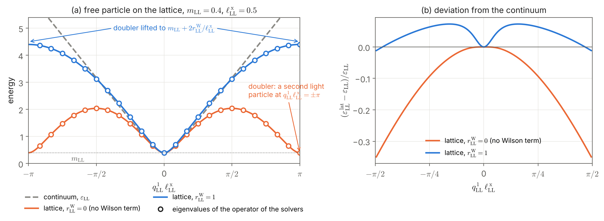
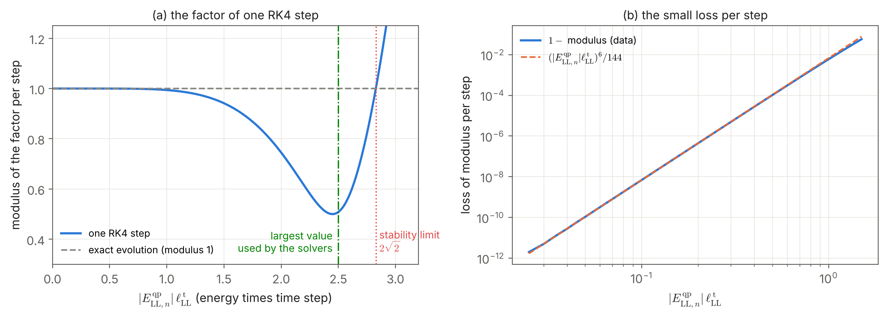

<!-- This file is generated from docs_src/X3_test2.src.md by code/scripts/assemble_docs.py; edit the source. -->

# 1. The test, and the state of the answers

## 1.1 The eleven items

Test 2 asks for the following. The wording is condensed here; the numbers are those of the test.

| item | what is asked | answered in | state |
|------|------------------------------------------------------------|---------|------------|
| [1] | write out, explain and discuss the field equations of a self-interacting spinor field on the $3+1$ manifold of the super-loop: a Dirac equation of that manifold, built with super-loop operators and with a gauge-covariant derivative for the gauge group $SL(2,\mathbb C)\times SU(2)_{\rm v}\times U(1)^{\rm F}_{\rm LL}$; every matrix written out; formulated completely for numerical solution | Section 2 | answered |
| [2] | analyze the field equations and give analytic solutions for at least three simple cases | Section 3 | to follow |
| [3] | a Python script that guides the user in defining initial and boundary conditions, asks for the name of a file of such conditions, reads it and solves the field equations numerically | Section 4 | to follow |
| [4] | a Python script that plots these numerical solutions | Section 5 | to follow |
| [5] | the same solver as a pure Rust program built with cargo, with instructions for use | Section 6 | to follow |
| [6] | a pure Rust program that plots the solutions of the Rust solver | Section 7 | to follow |
| [7] | the construction of the superfluid boson singlet (spin-zero) state, SFBS, from the spinor field | Section 8 | to follow |
| [8] | the effective field equations of the SFBS | Section 9 | to follow |
| [8] | the effective potential of the SFBS, the analogue of the Mexican-hat potential of the Higgs doublet | Section 10 | to follow |
| [9] | the relative minima of this potential, the spontaneous breaking of the symmetry, and the expansion of the SFBS about a minimum, called SFBSv | Section 11 | to follow |
| [10] | the kinetic Lagrangian of the SFBS | Section 12 | to follow |
| [11] | the masses of the gauge bosons that absorb the Goldstone bosons, obtained by inserting SFBSv into the kinetic Lagrangian; the diagonalization of the mass terms; the surviving symmetry group, its relation to $U(1)_{\rm em}$ and the massless photon | Section 13 | to follow |

Each item is pushed to the repository as soon as it is answered. This version of the document answers
item [1]; the sections of the other items are added to this same document, in this order, as they are
completed.

## 1.2 How to read this document

- **Units.** $\hbar$ and the speed of light are 1.
- **Indices.** $p,p'$ run over $0,1,2,3$ (the coordinates of space-time); $j,j',j''$ over $1,2,3$ (the
  space directions); $\iota,\iota',\iota''$ over $1,2,3$ (the isospin directions, an internal space). A sum
  is always written with its sign $\sum$; nothing is summed silently.
- **Symbols.** Every symbol of the folder Revision_SuperLoop carries the suffix LL (or is a bi-octonion in bold
  upright type, a number set, a group, a Lie algebra, an operation sign, or a plain index), so that no symbol
  of this document means anything else anywhere in the project. Every symbol is defined in words where it is
  first used, and the complete table of all symbols is Appendix C.
- **Machine checks.** Every statement of this document that can be computed is checked by the program
  `t2_fields` (folder `test2/rust`); the checks are numbered GS-1 to GS-16, and the report is
  printed verbatim in Appendix A.
- **Explicit matrices.** Every matrix of the field equations is written out. The matrices and the long
  component equations are printed by the program itself (no entry is typed by hand), and the program
  evaluates each printed expression numerically and compares it with the matrix it describes (check GS-12).

# 2. Item [1]: the field equations of the self-interacting spinor field on the 3+1 manifold

## 2.0 The answer in brief

1. **The field.** The spinor charges of the super-loop form, together with their complex conjugates, a field
   $\Psi_{\rm LL}$ with eight components on the $3+1$ manifold $\mathbb R^{1,3}_{\rm LL}$: a Dirac spinor
   (four components) that is an isospin doublet (two components). It is a quantum field: its components are
   anticommuting operators.
2. **The gauge group.** $SL(2,\mathbb C)\times SU(2)_{\rm v}\times U(1)^{\rm F}_{\rm LL}$, all three made
   local. $SL(2,\mathbb C)$, the unit bi-quaternions of the super-loop, acts as the change of representation
   of the Dirac matrices (the frame of the manifold changes, and the spinor with it), in the sense of
   E. A. Lord (1971); $SU(2)_{\rm v}$ rotates the isospin of the spinor charges; $U(1)^{\rm F}_{\rm LL}$ is the
   phase of the fermion number.
3. **The covariant derivative.**
   $\nabla^{\rm LL}_p=\partial_p+\Gamma^{\rm LL}_p-i\,g^{\rm v}_{\rm LL}\sum_\iota A^\iota_{{\rm LL},p}T^\iota_{\rm LL}-i\,g^{\rm F}_{\rm LL}A^{\rm F}_{{\rm LL},p}$,
   with the spin connection $\Gamma^{\rm LL}_p$ built from the Lorentz generators $J^j_{\rm LL}$, $K^j_{\rm LL}$
   of the super-loop. On a spinor charge $\mathbf b\mathbf e_4$ it is a sum of super-loop derivations:
   $\nabla^{\rm LL}_p(\mathbf b\mathbf e_4)=\partial_p(\mathbf b\mathbf e_4)+D_{\rm LL}(\mathbf u^\omega_{{\rm LL},p})(\mathbf b\mathbf e_4)+g^{\rm v}_{\rm LL}D^{\rm v}_{\rm LL}(\mathbf t^{\rm A}_{{\rm LL},p})(\mathbf b\mathbf e_4)-i\,g^{\rm F}_{\rm LL}A^{\rm F}_{{\rm LL},p}\mathbf b\mathbf e_4$.
4. **The field equation.**
   $$\Big(i\sum_p\gamma^p_{\rm LL}\nabla^{\rm LL}_p-m_{\rm LL}+\mu_{\rm LL}\gamma^0_{\rm LL}\Big)\Psi_{\rm LL}+\tfrac12G_{\rm LL}\sum_\iota\gamma^0_{\rm LL}(\mathsf K^\iota_{\rm LL})^\dagger\Psi^*_{\rm LL}\,\Pi^\iota_{\rm LL}=0,\qquad\Pi^\iota_{\rm LL}=\Psi^T_{\rm LL}\mathsf K^\iota_{\rm LL}\Psi_{\rm LL},$$
   a Dirac equation whose self-interaction is the attractive spin-zero pairing of the super-loop's spinor
   charges. In super-loop form, the Dirac operator is the right multiplication of the spinor charges by the
   frame bi-quaternions: $\sum_p\gamma^p_{\rm LL}\nabla^{\rm LL}_p$ acts on the spinor charge
   $\mathbf b^+_{\rm LL}\mathbf e_4$ as $\sum_pR^{\rm LL}_{\mathbf f_p}\nabla^{\rm LL}_p$.
5. **For numerical solution.** The self-interaction has no classical (c-number) limit: for commuting numbers
   $\Psi^T_{\rm LL}\mathsf K^\iota_{\rm LL}\Psi_{\rm LL}=0$. The equations are therefore solved in the
   time-dependent mean-field approximation: sixteen linear, gauge-covariant
   Dirac-Bogoliubov-de Gennes equations for the particle and hole components of each mode, with the
   self-consistent pair field $d^\iota_{\rm LL}=-\tfrac12G_{\rm LL}\langle\Pi^\iota_{\rm LL}\rangle$. They are
   discretized on a lattice with link variables, which keeps the gauge covariance exact, a Wilson term,
   which removes the doublers, and the Runge-Kutta method of fourth order in time.

Sixteen machine checks (GS-1 to GS-16) verify every statement. The rest of this section derives these
results step by step.

## 2.1 The manifold and its coordinates

**Bi-quaternions as matrices.** A bi-quaternion is a complex combination
$\mathbf b=\sum_p\xi^{\rm LL}_p(\mathbf b)\mathbf e_p$ of the four units $\mathbf e_0=1$, $\mathbf e_1$,
$\mathbf e_2$, $\mathbf e_3$ ($\mathbf e_j^2=-1$, $\mathbf e_1\mathbf e_2=-\mathbf e_2\mathbf e_1=\mathbf e_3$ and
cyclically). The super-loop represents it by the complex $2\times2$ matrix

$$M_{\rm LL}(\mathbf e_0)=\sigma^{\rm LL}_0,\qquad M_{\rm LL}(\mathbf e_j)=-i\sigma^{\rm LL}_j,\qquad M_{\rm LL}(\mathbf b)=\xi^{\rm LL}_0\sigma^{\rm LL}_0-i\sum_j\xi^{\rm LL}_j\sigma^{\rm LL}_j,\tag{2.1}$$

where $\xi^{\rm LL}_p$ stands for $\xi^{\rm LL}_p(\mathbf b)$, and where the Pauli matrices and the matrix
$\mathsf E_{\rm LL}$ are

$$\sigma^{\rm LL}_0=\begin{pmatrix}1&0\\0&1\end{pmatrix},\quad \sigma^{\rm LL}_1=\begin{pmatrix}0&1\\1&0\end{pmatrix},\quad \sigma^{\rm LL}_2=\begin{pmatrix}0&-i\\i&0\end{pmatrix},\quad \sigma^{\rm LL}_3=\begin{pmatrix}1&0\\0&-1\end{pmatrix},\quad \mathsf E_{\rm LL}=\begin{pmatrix}0&1\\-1&0\end{pmatrix}.$$

Evaluated, (2.1) reads

$$\begin{gathered}M_{\rm LL}(\mathbf e_1)=\begin{pmatrix}0&-i\\-i&0\end{pmatrix},\qquad M_{\rm LL}(\mathbf e_2)=\begin{pmatrix}0&-1\\1&0\end{pmatrix},\qquad M_{\rm LL}(\mathbf e_3)=\begin{pmatrix}-i&0\\0&i\end{pmatrix},\\ M_{\rm LL}(\mathbf b)=\begin{pmatrix}\xi^{\rm LL}_0-i\xi^{\rm LL}_3&-i\xi^{\rm LL}_1-\xi^{\rm LL}_2\\-i\xi^{\rm LL}_1+\xi^{\rm LL}_2&\xi^{\rm LL}_0+i\xi^{\rm LL}_3\end{pmatrix}.\end{gathered}\tag{2.2}$$

The map is multiplicative, $M_{\rm LL}(\mathbf b\mathbf b')=M_{\rm LL}(\mathbf b)M_{\rm LL}(\mathbf b')$. The
conjugate $\bar{\mathbf b}$ (signs of $\xi^{\rm LL}_1,\xi^{\rm LL}_2,\xi^{\rm LL}_3$ changed) has the adjugate
matrix, $M_{\rm LL}(\bar{\mathbf b})=\det M_{\rm LL}(\mathbf b)\,M_{\rm LL}(\mathbf b)^{-1}$, and
$\det M_{\rm LL}(\mathbf b)=N_{\rm LL}(\mathbf b)=\sum_p\xi^{\rm LL}_p(\mathbf b)^2$, the complex norm. The Hermitian
conjugate $\mathbf b^\dagger=(\bar{\mathbf b})^*$ has the Hermitian conjugate matrix,
$M_{\rm LL}(\mathbf b^\dagger)=M_{\rm LL}(\mathbf b)^\dagger$. Note $\mathsf E_{\rm LL}=M_{\rm LL}(-\mathbf e_2)$.

**The manifold.** The $3+1$ manifold of the super-loop, $\mathbb R^{1,3}_{\rm LL}$, is the set of Hermitian
bi-quaternions, $\mathbf x^\dagger=\mathbf x$, that is
$\mathbf x=x^0_{\rm LL}\mathbf e_0+i\sum_jx^j_{\rm LL}\mathbf e_j$ with four real coordinates $x^p_{\rm LL}$. With
$\xi^{\rm LL}_0=x^0_{\rm LL}$ and $\xi^{\rm LL}_j=i\,x^j_{\rm LL}$, (2.2) gives

$$\begin{gathered}M_{\rm LL}(\mathbf x)=x^0_{\rm LL}\sigma^{\rm LL}_0+\sum_jx^j_{\rm LL}\sigma^{\rm LL}_j=\begin{pmatrix}x^0_{\rm LL}+x^3_{\rm LL}&x^1_{\rm LL}-i\,x^2_{\rm LL}\\x^1_{\rm LL}+i\,x^2_{\rm LL}&x^0_{\rm LL}-x^3_{\rm LL}\end{pmatrix},\\ N_{\rm LL}(\mathbf x)=\det M_{\rm LL}(\mathbf x)=(x^0_{\rm LL})^2-\sum_j(x^j_{\rm LL})^2.\end{gathered}\tag{2.3}$$

The norm is the Minkowski interval, $N_{\rm LL}(\mathbf x)=\sum_{p,p'}\eta^{\rm LL}_{pp'}x^p_{\rm LL}x^{p'}_{\rm LL}$ with
the metric $\eta^{\rm LL}_{00}=1$, $\eta^{\rm LL}_{11}=\eta^{\rm LL}_{22}=\eta^{\rm LL}_{33}=-1$, $\eta^{\rm LL}_{pp'}=0$ for
$p\neq p'$. The coordinate $x^0_{\rm LL}$ is the time. A point of the manifold is written
$x_{\rm LL}=(x^0_{\rm LL},x^1_{\rm LL},x^2_{\rm LL},x^3_{\rm LL})$, its space part
$\vec x_{\rm LL}=(x^1_{\rm LL},x^2_{\rm LL},x^3_{\rm LL})$, and $\partial_p$ is the partial derivative with
respect to $x^p_{\rm LL}$. Every field of this section is a function of $x_{\rm LL}$.

The unit bi-quaternions $\mathbf g$ ($N_{\rm LL}(\mathbf g)=1$) form the group $SL(2,\mathbb C)$ of the matrices
$M_{\rm LL}(\mathbf g)$. They act on the manifold by $\mathbf x\mapsto\mathbf g\mathbf x\mathbf g^\dagger$, which
keeps $\mathbf x$ Hermitian and keeps its norm, $N_{\rm LL}(\mathbf g\mathbf x\mathbf g^\dagger)=N_{\rm LL}(\mathbf g)N_{\rm LL}(\mathbf x)N_{\rm LL}(\mathbf g^\dagger)=N_{\rm LL}(\mathbf x)$:
a Lorentz transformation, with the real $4\times4$ matrix $\mathsf L_{\rm LL}(\mathbf g)$,
$[\mathsf L_{\rm LL}(\mathbf g)]_{pp'}=\tfrac12\mathrm{Re}\,\mathrm{tr}\big(\sigma^{\rm LL}_pM_{\rm LL}(\mathbf g)\sigma^{\rm LL}_{p'}M_{\rm LL}(\mathbf g)^\dagger\big)$
(the new coordinates are $\sum_{p'}[\mathsf L_{\rm LL}(\mathbf g)]_{pp'}x^{p'}_{\rm LL}$).

## 2.2 The spinor field

**Components.** The field $\Psi_{\rm LL}(x_{\rm LL})$ has eight components $\Psi_{{\rm LL},1},\dots,\Psi_{{\rm LL},8}$.
They carry two indices: a Dirac index with four values (because $SL(2,\mathbb C)$ has two inequivalent
two-dimensional representations, $M_{\rm LL}(\mathbf g)$ and $(M_{\rm LL}(\mathbf g)^\dagger)^{-1}$, and a Dirac
spinor carries one of each) and an isospin index with two values, up and down (because the spinor charges of the
super-loop form an isospin doublet, Section 2.4). The order of the components is

| components | Dirac index | isospin | block |
|----------------|--------------------|----------------|-----------------------------------------|
| 1, 2 | 1 | up, down | upper block $\Psi^-_{\rm LL}$, chirality $-1$ |
| 3, 4 | 2 | up, down | upper block $\Psi^-_{\rm LL}$, chirality $-1$ |
| 5, 6 | 3 | up, down | lower block $\Psi^+_{\rm LL}$, chirality $+1$ |
| 7, 8 | 4 | up, down | lower block $\Psi^+_{\rm LL}$, chirality $+1$ |

A $4\times4$ matrix that acts on the Dirac index acts on the eight components as its tensor product with
$\sigma^{\rm LL}_0$ (the component number is $2\times(\text{Dirac index}-1)+(\text{isospin index})$, with the isospin
index 1 for up and 2 for down; the matrix changes the Dirac index and leaves the isospin index alone). A $2\times2$
matrix that acts on the isospin index acts as the tensor product of $\mathsf 1_4$ with it. Where no confusion is
possible, the same letter denotes a matrix and its extension to eight components.

**A quantum field.** $\Psi_{\rm LL}$ is a quantum field: its components are operators that anticommute,
$\Psi_{{\rm LL},k}\Psi_{{\rm LL},k'}=-\Psi_{{\rm LL},k'}\Psi_{{\rm LL},k}$, and at equal times
$\Psi_{{\rm LL},k}(\vec x_{\rm LL})\Psi_{{\rm LL},k'}(\vec x'_{\rm LL})^\dagger+\Psi_{{\rm LL},k'}(\vec x'_{\rm LL})^\dagger\Psi_{{\rm LL},k}(\vec x_{\rm LL})$
equals 1 for the same component at the same point and 0 otherwise (in the sense of a delta function in
space). $\Psi^*_{\rm LL}$ is the column of the Hermitian conjugate operators $\Psi^\dagger_{{\rm LL},k}$. The
Dirac adjoint is $\bar\Psi_{\rm LL}=\Psi^\dagger_{\rm LL}(\gamma^0_{\rm LL}\otimes\sigma^{\rm LL}_0)$, with the
constant matrix $\gamma^0_{\rm LL}$ of (2.6).

## 2.3 The Dirac matrices are built from the frame of the manifold

**The frame.** A frame of $\mathbb R^{1,3}_{\rm LL}$ is a set of four Hermitian bi-quaternions
$\mathbf f_0,\mathbf f_1,\mathbf f_2,\mathbf f_3$ with $N_{\rm LL}(\mathbf f_p,\mathbf f_{p'})=\eta^{\rm LL}_{pp'}$,
where $N_{\rm LL}(\mathbf x,\mathbf y)=\sum_p\xi^{\rm LL}_p(\mathbf x)\xi^{\rm LL}_p(\mathbf y)$ is the polarization
of the norm. A frame may depend on the point $x_{\rm LL}$ (then it is a vierbein). The canonical frame is

$$\mathbf f_0=\mathbf e_0,\quad\mathbf f_j=i\,\mathbf e_j:\qquad M_{\rm LL}(\mathbf f_p)=\sigma^{\rm LL}_p,\qquad M_{\rm LL}(\bar{\mathbf f}_0)=\sigma^{\rm LL}_0,\quad M_{\rm LL}(\bar{\mathbf f}_j)=-\sigma^{\rm LL}_j.\tag{2.4}$$

**The Dirac matrices of a frame** are the $4\times4$ matrices of $2\times2$ blocks

$$\gamma^p_{\rm LL}[\mathbf f]=\begin{pmatrix}0&M_{\rm LL}(\mathbf f_p)\\M_{\rm LL}(\bar{\mathbf f}_p)&0\end{pmatrix}.\tag{2.5}$$

For the canonical frame, (2.4) and (2.5) give $\gamma^0_{\rm LL}=\begin{pmatrix}0&\sigma^{\rm LL}_0\\\sigma^{\rm LL}_0&0\end{pmatrix}$,
$\gamma^j_{\rm LL}=\begin{pmatrix}0&\sigma^{\rm LL}_j\\-\sigma^{\rm LL}_j&0\end{pmatrix}$; with the
chirality matrix $\gamma^{\rm ch}_{\rm LL}=i\gamma^0_{\rm LL}\gamma^1_{\rm LL}\gamma^2_{\rm LL}\gamma^3_{\rm LL}$ and the
charge-conjugation matrix $C_{\rm LL}=i\gamma^2_{\rm LL}\gamma^0_{\rm LL}$, evaluated:

$$\begin{aligned}\gamma^0_{\rm LL}&=\begin{pmatrix}0&0&1&0\\0&0&0&1\\1&0&0&0\\0&1&0&0\end{pmatrix},&\gamma^1_{\rm LL}&=\begin{pmatrix}0&0&0&1\\0&0&1&0\\0&-1&0&0\\-1&0&0&0\end{pmatrix},\\ \gamma^2_{\rm LL}&=\begin{pmatrix}0&0&0&-i\\0&0&i&0\\0&i&0&0\\-i&0&0&0\end{pmatrix},&\gamma^3_{\rm LL}&=\begin{pmatrix}0&0&1&0\\0&0&0&-1\\-1&0&0&0\\0&1&0&0\end{pmatrix},\\ \gamma^{\rm ch}_{\rm LL}&=\begin{pmatrix}-1&0&0&0\\0&-1&0&0\\0&0&1&0\\0&0&0&1\end{pmatrix},&\quad C_{\rm LL}&=\begin{pmatrix}0&1&0&0\\-1&0&0&0\\0&0&0&-1\\0&0&1&0\end{pmatrix}.\end{aligned}$$

The matrices of the Hamiltonian form, $\alpha^j_{\rm LL}=\gamma^0_{\rm LL}\gamma^j_{\rm LL}=\mathrm{diag}(-\sigma^{\rm LL}_j,\sigma^{\rm LL}_j)$
and $\beta_{\rm LL}=\gamma^0_{\rm LL}$, evaluated:

$$\begin{aligned}\alpha^1_{\rm LL}&=\begin{pmatrix}0&-1&0&0\\-1&0&0&0\\0&0&0&1\\0&0&1&0\end{pmatrix},&\alpha^2_{\rm LL}&=\begin{pmatrix}0&i&0&0\\-i&0&0&0\\0&0&0&-i\\0&0&i&0\end{pmatrix},\\ \alpha^3_{\rm LL}&=\begin{pmatrix}-1&0&0&0\\0&1&0&0\\0&0&1&0\\0&0&0&-1\end{pmatrix},&\beta_{\rm LL}&=\begin{pmatrix}0&0&1&0\\0&0&0&1\\1&0&0&0\\0&1&0&0\end{pmatrix}.\end{aligned}$$

**The Clifford relations follow from the norm.** For any two bi-quaternions,
$\mathbf x\bar{\mathbf y}+\mathbf y\bar{\mathbf x}=2N_{\rm LL}(\mathbf x,\mathbf y)\mathbf e_0$ and
$\bar{\mathbf x}\mathbf y+\bar{\mathbf y}\mathbf x=2N_{\rm LL}(\mathbf x,\mathbf y)\mathbf e_0$ (expand
$(\mathbf x+\mathbf y)(\overline{\mathbf x+\mathbf y})=N_{\rm LL}(\mathbf x+\mathbf y)\mathbf e_0$ and use
$\mathbf x\bar{\mathbf x}=N_{\rm LL}(\mathbf x)\mathbf e_0$). Multiplying the blocks of (2.5),

$$\gamma^p_{\rm LL}[\mathbf f]\gamma^{p'}_{\rm LL}[\mathbf f]+\gamma^{p'}_{\rm LL}[\mathbf f]\gamma^p_{\rm LL}[\mathbf f]=\begin{pmatrix}M_{\rm LL}(\mathbf f_p\bar{\mathbf f}_{p'}+\mathbf f_{p'}\bar{\mathbf f}_p)&0\\0&M_{\rm LL}(\bar{\mathbf f}_p\mathbf f_{p'}+\bar{\mathbf f}_{p'}\mathbf f_p)\end{pmatrix}=2N_{\rm LL}(\mathbf f_p,\mathbf f_{p'})\,\mathsf 1_4=2\eta^{\rm LL}_{pp'}\mathsf 1_4.\tag{2.6}$$

So the Dirac algebra of $\mathbb R^{1,3}_{\rm LL}$ is the multiplication of the frame bi-quaternions
(check GS-1). The super-loop meaning of (2.5) is made precise in Section 2.5: a block $M_{\rm LL}(\mathbf f_p)$
multiplies a spinor charge from the right by $\mathbf f_p$.

## 2.4 The gauge group, and Lord's change of representation

The equations of this section are invariant under three groups, each made local (its parameters are
functions of $x_{\rm LL}$).

**(i) $SL(2,\mathbb C)$: the Lorentz group of the super-loop.** A unit bi-quaternion $\mathbf g$ acts on the
Dirac index by the spinor matrix

$$\mathsf S_{\rm LL}(\mathbf g)=\begin{pmatrix}M_{\rm LL}(\tilde{\mathbf g})&0\\0&M_{\rm LL}(\mathbf g)\end{pmatrix},\qquad\tilde{\mathbf g}=(\mathbf g^\dagger)^{-1}=\mathbf g^*,\qquad M_{\rm LL}(\tilde{\mathbf g})=(M_{\rm LL}(\mathbf g)^\dagger)^{-1}.\tag{2.7}$$

(For a unit bi-quaternion the inverse of $\mathbf g^\dagger$ is its conjugate,
$(\mathbf g^\dagger)^{-1}=\overline{\mathbf g^\dagger}=\mathbf g^*$, the bi-quaternion with complex-conjugated
coefficients; check GS-14.) Its derivative at the unit is the action of a Lorentz generator
$\mathbf u\in\mathfrak l_{\rm LL}$ (an imaginary bi-quaternion),
$\mathsf s_{\rm LL}(\mathbf u)=\mathrm{diag}(-M_{\rm LL}(\mathbf u)^\dagger,M_{\rm LL}(\mathbf u))$. For the
rotation generators $J^j_{\rm LL}=\mathbf e_j/2$ and the boost generators $K^j_{\rm LL}=i\,\mathbf e_j/2$ of the
super-loop, evaluated:

$$\begin{aligned}M_{\rm LL}(J^1_{\rm LL})&=\begin{pmatrix}0&-\tfrac{i}{2}\\-\tfrac{i}{2}&0\end{pmatrix},&M_{\rm LL}(K^1_{\rm LL})&=\begin{pmatrix}0&\tfrac{1}{2}\\\tfrac{1}{2}&0\end{pmatrix},\\ M_{\rm LL}(J^2_{\rm LL})&=\begin{pmatrix}0&-\tfrac{1}{2}\\\tfrac{1}{2}&0\end{pmatrix},&M_{\rm LL}(K^2_{\rm LL})&=\begin{pmatrix}0&-\tfrac{i}{2}\\\tfrac{i}{2}&0\end{pmatrix},\\ M_{\rm LL}(J^3_{\rm LL})&=\begin{pmatrix}-\tfrac{i}{2}&0\\0&\tfrac{i}{2}\end{pmatrix},&M_{\rm LL}(K^3_{\rm LL})&=\begin{pmatrix}\tfrac{1}{2}&0\\0&-\tfrac{1}{2}\end{pmatrix},\end{aligned}$$

$$\begin{aligned}\mathsf s_{\rm LL}(J^1_{\rm LL})&=\begin{pmatrix}0&-\tfrac{i}{2}&0&0\\-\tfrac{i}{2}&0&0&0\\0&0&0&-\tfrac{i}{2}\\0&0&-\tfrac{i}{2}&0\end{pmatrix},&\mathsf s_{\rm LL}(K^1_{\rm LL})&=\begin{pmatrix}0&-\tfrac{1}{2}&0&0\\-\tfrac{1}{2}&0&0&0\\0&0&0&\tfrac{1}{2}\\0&0&\tfrac{1}{2}&0\end{pmatrix},\\ \mathsf s_{\rm LL}(J^2_{\rm LL})&=\begin{pmatrix}0&-\tfrac{1}{2}&0&0\\\tfrac{1}{2}&0&0&0\\0&0&0&-\tfrac{1}{2}\\0&0&\tfrac{1}{2}&0\end{pmatrix},&\mathsf s_{\rm LL}(K^2_{\rm LL})&=\begin{pmatrix}0&\tfrac{i}{2}&0&0\\-\tfrac{i}{2}&0&0&0\\0&0&0&-\tfrac{i}{2}\\0&0&\tfrac{i}{2}&0\end{pmatrix},\\ \mathsf s_{\rm LL}(J^3_{\rm LL})&=\begin{pmatrix}-\tfrac{i}{2}&0&0&0\\0&\tfrac{i}{2}&0&0\\0&0&-\tfrac{i}{2}&0\\0&0&0&\tfrac{i}{2}\end{pmatrix},&\mathsf s_{\rm LL}(K^3_{\rm LL})&=\begin{pmatrix}-\tfrac{1}{2}&0&0&0\\0&\tfrac{1}{2}&0&0\\0&0&\tfrac{1}{2}&0\\0&0&0&-\tfrac{1}{2}\end{pmatrix}.\end{aligned}$$

They are the familiar spin matrices, $\mathsf s_{\rm LL}(J^j_{\rm LL})=\tfrac12\gamma^{j'}_{\rm LL}\gamma^{j''}_{\rm LL}$
for cyclic $(j,j',j'')$ and $\mathsf s_{\rm LL}(K^j_{\rm LL})=\tfrac12\gamma^0_{\rm LL}\gamma^j_{\rm LL}$; they obey
the commutation relations of $\mathfrak{so}(3,1)$, and the Dirac matrices turn the spinor action into the
vector action $\mathcal V_{\rm LL}(\mathbf u)$ of the super-loop on the manifold,
$\gamma^p_{\rm LL}\mathsf s_{\rm LL}(\mathbf u)-\mathsf s_{\rm LL}(\mathbf u)\gamma^p_{\rm LL}=\sum_{p'}\mathcal V_{\rm LL}(\mathbf u)^p{}_{p'}\gamma^{p'}_{\rm LL}$
(check GS-2). The finite form is the Lorentz covariance of the Dirac matrices,

$$\mathsf S_{\rm LL}(\mathbf g)^{-1}\gamma^p_{\rm LL}\mathsf S_{\rm LL}(\mathbf g)=\sum_{p'}[\mathsf L_{\rm LL}(\mathbf g)]_{pp'}\gamma^{p'}_{\rm LL}.\tag{2.8}$$

*Derivation.* The upper right block of the left side is
$M_{\rm LL}(\tilde{\mathbf g})^{-1}M_{\rm LL}(\mathbf f_p)M_{\rm LL}(\mathbf g)=M_{\rm LL}(\mathbf g^\dagger\mathbf f_p\mathbf g)$,
and $\mathbf g^\dagger\mathbf f_p\mathbf g=\sum_{p'}[\mathsf L_{\rm LL}(\mathbf g^\dagger)]_{p'p}\mathbf f_{p'}=\sum_{p'}[\mathsf L_{\rm LL}(\mathbf g)]_{pp'}\mathbf f_{p'}$,
because $\mathsf L_{\rm LL}(\mathbf g^\dagger)$ is the transpose of $\mathsf L_{\rm LL}(\mathbf g)$ (cyclic property
of the trace). The lower left block is the conjugate bi-quaternion of the same sum. (Check GS-3, for 200
random $\mathbf g$.)

**Lord's change of representation.** E. A. Lord (1971) observed that the free spinor equations are invariant
under a group $SL(2,\mathbb C)$ whose transformations are changes of representation of the two-component
spinor algebra: the Pauli matrices $\sigma^{\rm LL}_p$ in the Dirac matrices may be replaced by the four Hermitian
matrices $M_{\rm LL}(\tilde{\mathbf g})\sigma^{\rm LL}_pM_{\rm LL}(\tilde{\mathbf g})^\dagger$, for any matrix
$M_{\rm LL}(\tilde{\mathbf g})$ of determinant 1, if the spinors are transformed with it; letting this matrix depend
on the point makes $SL(2,\mathbb C)$ a gauge group in the sense of Yang and Mills, which requires an auxiliary field
(here $\Gamma^{\rm LL}_p$ of Section 2.6). In the super-loop this is literally a change of the frame:

$$\mathsf S_{\rm LL}(\mathbf g)\,\gamma^p_{\rm LL}[\mathbf f]\,\mathsf S_{\rm LL}(\mathbf g)^{-1}=\gamma^p_{\rm LL}[\tilde{\mathbf g}\mathbf f\tilde{\mathbf g}^\dagger],\qquad M_{\rm LL}(\tilde{\mathbf g}\mathbf f_p\tilde{\mathbf g}^\dagger)=M_{\rm LL}(\tilde{\mathbf g})\,M_{\rm LL}(\mathbf f_p)\,M_{\rm LL}(\tilde{\mathbf g})^\dagger.\tag{2.9}$$

The frame $\tilde{\mathbf g}\mathbf f_p\tilde{\mathbf g}^\dagger$ is again a frame (Hermitian, with the same
$N_{\rm LL}$). A description by the pair (frame $\mathbf f_p$, spinor $\Psi_{\rm LL}$) and one by the pair (frame
$\tilde{\mathbf g}\mathbf f_p\tilde{\mathbf g}^\dagger$, spinor $\mathsf S_{\rm LL}(\mathbf g)\Psi_{\rm LL}$) are the
same physics: the coordinates $x^p_{\rm LL}$ are not changed, only the representation. Check GS-3 verifies
(2.9) for random Hermitian frames.

**(ii) $SU(2)_{\rm v}$: isospin.** A matrix $\mathsf U_{\rm LL}=M_{\rm LL}(\mathbf v)$ of $SU(2)$, with a unit real
quaternion $\mathbf v$, acts on the isospin index. Its generators on the eight components are
$T^\iota_{\rm LL}=\mathsf 1_4\otimes\tau^{\rm LL}_\iota/2$ ($\tau^{\rm LL}_\iota$ are the Pauli matrices on the
isospin index; $T^\iota_{\rm LL}=i\,D^{\rm v}_{\rm LL}(\mathbf e_\iota/2)$ in the super-loop), evaluated:

$$T^1_{\rm LL}=\begin{pmatrix}0&\tfrac{1}{2}&0&0&0&0&0&0\\\tfrac{1}{2}&0&0&0&0&0&0&0\\0&0&0&\tfrac{1}{2}&0&0&0&0\\0&0&\tfrac{1}{2}&0&0&0&0&0\\0&0&0&0&0&\tfrac{1}{2}&0&0\\0&0&0&0&\tfrac{1}{2}&0&0&0\\0&0&0&0&0&0&0&\tfrac{1}{2}\\0&0&0&0&0&0&\tfrac{1}{2}&0\end{pmatrix}$$

$$T^2_{\rm LL}=\begin{pmatrix}0&-\tfrac{i}{2}&0&0&0&0&0&0\\\tfrac{i}{2}&0&0&0&0&0&0&0\\0&0&0&-\tfrac{i}{2}&0&0&0&0\\0&0&\tfrac{i}{2}&0&0&0&0&0\\0&0&0&0&0&-\tfrac{i}{2}&0&0\\0&0&0&0&\tfrac{i}{2}&0&0&0\\0&0&0&0&0&0&0&-\tfrac{i}{2}\\0&0&0&0&0&0&\tfrac{i}{2}&0\end{pmatrix}$$

$$T^3_{\rm LL}=\begin{pmatrix}\tfrac{1}{2}&0&0&0&0&0&0&0\\0&-\tfrac{1}{2}&0&0&0&0&0&0\\0&0&\tfrac{1}{2}&0&0&0&0&0\\0&0&0&-\tfrac{1}{2}&0&0&0&0\\0&0&0&0&\tfrac{1}{2}&0&0&0\\0&0&0&0&0&-\tfrac{1}{2}&0&0\\0&0&0&0&0&0&\tfrac{1}{2}&0\\0&0&0&0&0&0&0&-\tfrac{1}{2}\end{pmatrix}$$

They obey $T^1_{\rm LL}T^2_{\rm LL}-T^2_{\rm LL}T^1_{\rm LL}=i\,T^3_{\rm LL}$ and cyclically, and commute with
every Lorentz generator (check GS-4). The electric charge is $Q_{\rm LL}=T^3_{\rm LL}$.

**(iii) $U(1)^{\rm F}_{\rm LL}$: fermion number.** $\Psi_{\rm LL}\mapsto\exp(i\theta^{\rm F}_{\rm LL})\Psi_{\rm LL}$
with a real phase $\theta^{\rm F}_{\rm LL}$; the fermion number of $\Psi_{\rm LL}$ is 1.

**The local gauge transformation** of the spinor field is

$$\Psi_{\rm LL}\mapsto\mathcal U_{\rm LL}\Psi_{\rm LL},\qquad\mathcal U_{\rm LL}=\exp(i\theta^{\rm F}_{\rm LL})\,\mathsf S_{\rm LL}(\mathbf g)\otimes\mathsf U_{\rm LL},\tag{2.10}$$

with $\mathbf g$, $\mathsf U_{\rm LL}$ and $\theta^{\rm F}_{\rm LL}$ functions of $x_{\rm LL}$, together with the change
of the frame $\mathbf f_p\mapsto\tilde{\mathbf g}\mathbf f_p\tilde{\mathbf g}^\dagger$ and the changes of the gauge
fields of Section 2.6. The constant matrix $\gamma^0_{\rm LL}$ of the Dirac adjoint is kept fixed: it satisfies
$\mathsf S_{\rm LL}(\mathbf g)^\dagger\gamma^0_{\rm LL}\mathsf S_{\rm LL}(\mathbf g)=\gamma^0_{\rm LL}$ (the blocks are
$M_{\rm LL}(\tilde{\mathbf g})^\dagger M_{\rm LL}(\mathbf g)=\sigma^{\rm LL}_0$ and its Hermitian conjugate), so
$\bar\Psi_{\rm LL}\mapsto\bar\Psi_{\rm LL}\,\mathcal U_{\rm LL}^{-1}$.

## 2.5 The spinor field is made of spinor charges of the super-loop

The super-loop's spinor charges are the bi-octonions $\mathbf b\mathbf e_4$ with a bi-quaternion $\mathbf b$; their
Weyl isodoublet is the $2\times2$ matrix $\psi'_{\rm LL}(\mathbf b)=\mathsf E_{\rm LL}^{-1}M_{\rm LL}(\mathbf b)^T$,
whose rows are the two Weyl components and whose columns are the two isospin values. The Dirac isodoublet is
made of two such spinor charges, $\mathbf b^+_{\rm LL}\mathbf e_4$ and $\mathbf b^-_{\rm LL}\mathbf e_4$:

$$\Psi_{\rm LL}=\Psi_{\rm LL}[\mathbf b^-_{\rm LL},\mathbf b^+_{\rm LL}]:\qquad\text{upper block }\Psi^-_{\rm LL}=\psi'_{\rm LL}(\mathbf b^-_{\rm LL}),\qquad\text{lower block }\Psi^+_{\rm LL}=\psi'_{\rm LL}(\mathbf b^+_{\rm LL}),\tag{2.11}$$

where the rows of the $2\times2$ matrices are read one after the other: components 1, 2 are the first row of
$\psi'_{\rm LL}(\mathbf b^-_{\rm LL})$, components 3, 4 its second row, components 5 to 8 the rows of
$\psi'_{\rm LL}(\mathbf b^+_{\rm LL})$. Three facts make this the super-loop form of the Dirac field (check GS-14):

**(a) A frame block is a right multiplication.** For all bi-quaternions $\mathbf x$ and $\mathbf y$,

$$M_{\rm LL}(\mathbf x)\,\psi'_{\rm LL}(\mathbf y)=\psi'_{\rm LL}(\mathbf y\bar{\mathbf x}),\qquad(\mathbf y\mathbf e_4)\,\mathbf x=(\mathbf y\bar{\mathbf x})\mathbf e_4=R^{\rm LL}_{\mathbf x}(\mathbf y\mathbf e_4).\tag{2.12}$$

*Derivation.* With (2.2) and $\mathsf E_{\rm LL}^{-1}=\begin{pmatrix}0&-1\\1&0\end{pmatrix}$, and with
$\xi^{\rm LL}_p=\xi^{\rm LL}_p(\mathbf x)$,

$$\mathsf E_{\rm LL}M_{\rm LL}(\mathbf x)\mathsf E_{\rm LL}^{-1}=\begin{pmatrix}\xi^{\rm LL}_0+i\xi^{\rm LL}_3&i\xi^{\rm LL}_1-\xi^{\rm LL}_2\\i\xi^{\rm LL}_1+\xi^{\rm LL}_2&\xi^{\rm LL}_0-i\xi^{\rm LL}_3\end{pmatrix}=M_{\rm LL}(\bar{\mathbf x})^T,$$

hence
$M_{\rm LL}(\mathbf x)\mathsf E_{\rm LL}^{-1}M_{\rm LL}(\mathbf y)^T=\mathsf E_{\rm LL}^{-1}M_{\rm LL}(\bar{\mathbf x})^TM_{\rm LL}(\mathbf y)^T=\mathsf E_{\rm LL}^{-1}M_{\rm LL}(\mathbf y\bar{\mathbf x})^T$.
The bi-octonion product of the folder, the Cayley-Dickson rule
$(\mathbf a+\mathbf b\mathbf e_4)(\mathbf c+\mathbf d\mathbf e_4)=(\mathbf a\mathbf c-\bar{\mathbf d}\mathbf b)+(\mathbf d\mathbf a+\mathbf b\bar{\mathbf c})\mathbf e_4$,
gives with $\mathbf a=0$, $\mathbf b=\mathbf y$, $\mathbf c=\mathbf x$, $\mathbf d=0$ the second equation.

**(b) The Dirac matrices exchange the two spinor charges and multiply them by the frame.** By (2.5), (2.11) and
(2.12),

$$\gamma^p_{\rm LL}[\mathbf f]\,\Psi_{\rm LL}[\mathbf b^-_{\rm LL},\mathbf b^+_{\rm LL}]=\Psi_{\rm LL}[\mathbf b^+_{\rm LL}\bar{\mathbf f}_p,\ \mathbf b^-_{\rm LL}\mathbf f_p]:\tag{2.13}$$

the upper block becomes $M_{\rm LL}(\mathbf f_p)\psi'_{\rm LL}(\mathbf b^+_{\rm LL})=\psi'_{\rm LL}(\mathbf b^+_{\rm LL}\bar{\mathbf f}_p)$,
the spinor charge $R^{\rm LL}_{\mathbf f_p}(\mathbf b^+_{\rm LL}\mathbf e_4)$, and the lower block becomes
$\psi'_{\rm LL}(\mathbf b^-_{\rm LL}\mathbf f_p)$, the spinor charge $R^{\rm LL}_{\bar{\mathbf f}_p}(\mathbf b^-_{\rm LL}\mathbf e_4)$.

**(c) The gauge group acts by the automorphisms of the super-loop.**

$$\mathcal U_{\rm LL}\Psi_{\rm LL}[\mathbf b^-_{\rm LL},\mathbf b^+_{\rm LL}]=\exp(i\theta^{\rm F}_{\rm LL})\,\Psi_{\rm LL}\big[\mathbf v\,\mathbf b^-_{\rm LL}\,\mathbf g^\dagger,\ \mathbf v\,\mathbf b^+_{\rm LL}\,\bar{\mathbf g}\big]\qquad(\mathsf U_{\rm LL}=M_{\rm LL}(\mathbf v)).\tag{2.14}$$

On the spinor charge $\mathbf b^+_{\rm LL}\mathbf e_4$ this is the automorphism
$\varphi^{\rm LL}_{\mathbf g,\mathbf v}:\mathbf a+\mathbf b\mathbf e_4\mapsto\mathbf g\mathbf a\bar{\mathbf g}+(\mathbf v\mathbf b\bar{\mathbf g})\mathbf e_4$
of the bi-octonions; on $\mathbf b^-_{\rm LL}\mathbf e_4$ it is the complex conjugate of that automorphism: if
$\mathbf b^-_{\rm LL}=\mathbf c^*$ for a spinor charge $\mathbf c\mathbf e_4$ that transforms by
$\varphi^{\rm LL}_{\mathbf g,\mathbf v}$, then $(\mathbf v\mathbf c\bar{\mathbf g})^*=\mathbf v\,\mathbf c^*\,\mathbf g^\dagger$.
So the lower block of $\Psi_{\rm LL}$ is a spinor charge of the super-loop, and the upper block the complex
conjugate of a second one. *Derivation of (2.14).* By (2.12) with $\mathbf x=\mathbf g$ and with
$\mathbf x=\tilde{\mathbf g}$ (whose conjugate is $\overline{\mathbf g^*}=\mathbf g^\dagger$), and with
$\psi'_{\rm LL}(\mathbf v\mathbf y)=\psi'_{\rm LL}(\mathbf y)M_{\rm LL}(\mathbf v)^T$, which is the action of
$\mathsf U_{\rm LL}=M_{\rm LL}(\mathbf v)$ on the isospin index (the columns).

## 2.6 The gauge fields and the gauge-covariant derivative

**The gauge fields.** Each factor of the gauge group has its gauge field:

- the isospin potentials $A^\iota_{{\rm LL},p}$ (real; three for each direction $p$) with the coupling
  $g^{\rm v}_{\rm LL}$; as a Hermitian $2\times2$ matrix on the isospin index,
  $\mathsf a_{{\rm LL},p}=\sum_\iota A^\iota_{{\rm LL},p}\tau^{\rm LL}_\iota/2$, and as an imaginary real
  quaternion, $\mathbf t^{\rm A}_{{\rm LL},p}=\sum_\iota A^\iota_{{\rm LL},p}\mathbf e_\iota/2$ (with
  $M_{\rm LL}(\mathbf t^{\rm A}_{{\rm LL},p})=-i\,\mathsf a_{{\rm LL},p}$);
- the fermion-number potential $A^{\rm F}_{{\rm LL},p}$ (real) with the coupling $g^{\rm F}_{\rm LL}$;
- the Lorentz connection: for each direction $p$ an element of $\mathfrak l_{\rm LL}$,
  $\mathbf u^\omega_{{\rm LL},p}=\sum_j(\omega^j_{{\rm LL},p}J^j_{\rm LL}+\varpi^j_{{\rm LL},p}K^j_{\rm LL})$, with real
  rotation components $\omega^j_{{\rm LL},p}$ and boost components $\varpi^j_{{\rm LL},p}$.

The internal potentials are collected in the Hermitian $8\times8$ matrix
$\mathsf A_{{\rm LL},p}=g^{\rm v}_{\rm LL}\sum_\iota A^\iota_{{\rm LL},p}T^\iota_{\rm LL}+g^{\rm F}_{\rm LL}A^{\rm F}_{{\rm LL},p}\mathsf 1_8$,
whose entries are, for a space direction $j$ and for the time direction:

$$(\mathsf A_{{\rm LL},j})_{11}=(\mathsf A_{{\rm LL},j})_{33}=(\mathsf A_{{\rm LL},j})_{55}=(\mathsf A_{{\rm LL},j})_{77}=g^{\rm F}_{\rm LL}A^{\rm F}_{{\rm LL},j}+\tfrac{1}{2}\,g^{\rm v}_{\rm LL}A^{3}_{{\rm LL},j},$$
$$(\mathsf A_{{\rm LL},j})_{12}=(\mathsf A_{{\rm LL},j})_{34}=(\mathsf A_{{\rm LL},j})_{56}=(\mathsf A_{{\rm LL},j})_{78}=\tfrac{1}{2}\,g^{\rm v}_{\rm LL}A^{1}_{{\rm LL},j}-\tfrac{i}{2}\,g^{\rm v}_{\rm LL}A^{2}_{{\rm LL},j},$$
$$(\mathsf A_{{\rm LL},j})_{21}=(\mathsf A_{{\rm LL},j})_{43}=(\mathsf A_{{\rm LL},j})_{65}=(\mathsf A_{{\rm LL},j})_{87}=\tfrac{1}{2}\,g^{\rm v}_{\rm LL}A^{1}_{{\rm LL},j}+\tfrac{i}{2}\,g^{\rm v}_{\rm LL}A^{2}_{{\rm LL},j},$$
$$(\mathsf A_{{\rm LL},j})_{22}=(\mathsf A_{{\rm LL},j})_{44}=(\mathsf A_{{\rm LL},j})_{66}=(\mathsf A_{{\rm LL},j})_{88}=g^{\rm F}_{\rm LL}A^{\rm F}_{{\rm LL},j}-\tfrac{1}{2}\,g^{\rm v}_{\rm LL}A^{3}_{{\rm LL},j},$$

$$(\mathsf A_{{\rm LL},0})_{11}=(\mathsf A_{{\rm LL},0})_{33}=(\mathsf A_{{\rm LL},0})_{55}=(\mathsf A_{{\rm LL},0})_{77}=g^{\rm F}_{\rm LL}A^{\rm F}_{{\rm LL},0}+\tfrac{1}{2}\,g^{\rm v}_{\rm LL}A^{3}_{{\rm LL},0},$$
$$(\mathsf A_{{\rm LL},0})_{12}=(\mathsf A_{{\rm LL},0})_{34}=(\mathsf A_{{\rm LL},0})_{56}=(\mathsf A_{{\rm LL},0})_{78}=\tfrac{1}{2}\,g^{\rm v}_{\rm LL}A^{1}_{{\rm LL},0}-\tfrac{i}{2}\,g^{\rm v}_{\rm LL}A^{2}_{{\rm LL},0},$$
$$(\mathsf A_{{\rm LL},0})_{21}=(\mathsf A_{{\rm LL},0})_{43}=(\mathsf A_{{\rm LL},0})_{65}=(\mathsf A_{{\rm LL},0})_{87}=\tfrac{1}{2}\,g^{\rm v}_{\rm LL}A^{1}_{{\rm LL},0}+\tfrac{i}{2}\,g^{\rm v}_{\rm LL}A^{2}_{{\rm LL},0},$$
$$(\mathsf A_{{\rm LL},0})_{22}=(\mathsf A_{{\rm LL},0})_{44}=(\mathsf A_{{\rm LL},0})_{66}=(\mathsf A_{{\rm LL},0})_{88}=g^{\rm F}_{\rm LL}A^{\rm F}_{{\rm LL},0}-\tfrac{1}{2}\,g^{\rm v}_{\rm LL}A^{3}_{{\rm LL},0},$$

(all other entries are zero; the four equal entries of each line are the four Dirac components). The Lorentz
connection acts through the spin connection $\Gamma^{\rm LL}_p=\mathsf s_{\rm LL}(\mathbf u^\omega_{{\rm LL},p})\otimes\sigma^{\rm LL}_0$,
whose two diagonal $2\times2$ blocks (on the Dirac index) are

$$\begin{aligned}-M_{\rm LL}(\mathbf u^{\omega}_{{\rm LL},p})^\dagger&=\tfrac12\begin{pmatrix}-i\,\omega^{3}_{{\rm LL},p}-\varpi^{3}_{{\rm LL},p}&-i\,\omega^{1}_{{\rm LL},p}-\varpi^{1}_{{\rm LL},p}-\omega^{2}_{{\rm LL},p}+i\,\varpi^{2}_{{\rm LL},p}\\-i\,\omega^{1}_{{\rm LL},p}-\varpi^{1}_{{\rm LL},p}+\omega^{2}_{{\rm LL},p}-i\,\varpi^{2}_{{\rm LL},p}&i\,\omega^{3}_{{\rm LL},p}+\varpi^{3}_{{\rm LL},p}\end{pmatrix},\\ M_{\rm LL}(\mathbf u^{\omega}_{{\rm LL},p})&=\tfrac12\begin{pmatrix}-i\,\omega^{3}_{{\rm LL},p}+\varpi^{3}_{{\rm LL},p}&-i\,\omega^{1}_{{\rm LL},p}+\varpi^{1}_{{\rm LL},p}-\omega^{2}_{{\rm LL},p}-i\,\varpi^{2}_{{\rm LL},p}\\-i\,\omega^{1}_{{\rm LL},p}+\varpi^{1}_{{\rm LL},p}+\omega^{2}_{{\rm LL},p}+i\,\varpi^{2}_{{\rm LL},p}&i\,\omega^{3}_{{\rm LL},p}-\varpi^{3}_{{\rm LL},p}\end{pmatrix}.\end{aligned}$$

and whose $8\times8$ entries are (all others are zero)

$$(\Gamma^{\rm LL}_p)_{11}=(\Gamma^{\rm LL}_p)_{22}=-\tfrac{i}{2}\,\omega^{3}_{{\rm LL},p}-\tfrac{1}{2}\,\varpi^{3}_{{\rm LL},p},$$
$$(\Gamma^{\rm LL}_p)_{13}=(\Gamma^{\rm LL}_p)_{24}=-\tfrac{i}{2}\,\omega^{1}_{{\rm LL},p}-\tfrac{1}{2}\,\varpi^{1}_{{\rm LL},p}-\tfrac{1}{2}\,\omega^{2}_{{\rm LL},p}+\tfrac{i}{2}\,\varpi^{2}_{{\rm LL},p},$$
$$(\Gamma^{\rm LL}_p)_{31}=(\Gamma^{\rm LL}_p)_{42}=-\tfrac{i}{2}\,\omega^{1}_{{\rm LL},p}-\tfrac{1}{2}\,\varpi^{1}_{{\rm LL},p}+\tfrac{1}{2}\,\omega^{2}_{{\rm LL},p}-\tfrac{i}{2}\,\varpi^{2}_{{\rm LL},p},$$
$$(\Gamma^{\rm LL}_p)_{33}=(\Gamma^{\rm LL}_p)_{44}=\tfrac{i}{2}\,\omega^{3}_{{\rm LL},p}+\tfrac{1}{2}\,\varpi^{3}_{{\rm LL},p},$$
$$(\Gamma^{\rm LL}_p)_{55}=(\Gamma^{\rm LL}_p)_{66}=-\tfrac{i}{2}\,\omega^{3}_{{\rm LL},p}+\tfrac{1}{2}\,\varpi^{3}_{{\rm LL},p},$$
$$(\Gamma^{\rm LL}_p)_{57}=(\Gamma^{\rm LL}_p)_{68}=-\tfrac{i}{2}\,\omega^{1}_{{\rm LL},p}+\tfrac{1}{2}\,\varpi^{1}_{{\rm LL},p}-\tfrac{1}{2}\,\omega^{2}_{{\rm LL},p}-\tfrac{i}{2}\,\varpi^{2}_{{\rm LL},p},$$
$$(\Gamma^{\rm LL}_p)_{75}=(\Gamma^{\rm LL}_p)_{86}=-\tfrac{i}{2}\,\omega^{1}_{{\rm LL},p}+\tfrac{1}{2}\,\varpi^{1}_{{\rm LL},p}+\tfrac{1}{2}\,\omega^{2}_{{\rm LL},p}+\tfrac{i}{2}\,\varpi^{2}_{{\rm LL},p},$$
$$(\Gamma^{\rm LL}_p)_{77}=(\Gamma^{\rm LL}_p)_{88}=\tfrac{i}{2}\,\omega^{3}_{{\rm LL},p}-\tfrac{1}{2}\,\varpi^{3}_{{\rm LL},p}.$$

**The covariant derivative** of the spinor field is

$$\nabla^{\rm LL}_p\Psi_{\rm LL}=\partial_p\Psi_{\rm LL}+\Gamma^{\rm LL}_p\Psi_{\rm LL}-i\,\mathsf A_{{\rm LL},p}\Psi_{\rm LL}.\tag{2.15}$$

**The transformations of the gauge fields.** Under (2.10) the gauge fields change as

$$\begin{aligned}
\mathbf f_p&\mapsto\tilde{\mathbf g}\,\mathbf f_p\,\tilde{\mathbf g}^\dagger,\\
\Gamma^{\rm LL}_p&\mapsto\mathsf S_{\rm LL}(\mathbf g)\Gamma^{\rm LL}_p\mathsf S_{\rm LL}(\mathbf g)^{-1}-(\partial_p\mathsf S_{\rm LL}(\mathbf g))\,\mathsf S_{\rm LL}(\mathbf g)^{-1},\\
\mathsf a_{{\rm LL},p}&\mapsto\mathsf U_{\rm LL}\,\mathsf a_{{\rm LL},p}\,\mathsf U_{\rm LL}^{-1}-\frac{i}{g^{\rm v}_{\rm LL}}(\partial_p\mathsf U_{\rm LL})\,\mathsf U_{\rm LL}^{-1},\\
A^{\rm F}_{{\rm LL},p}&\mapsto A^{\rm F}_{{\rm LL},p}+\frac{1}{g^{\rm F}_{\rm LL}}\partial_p\theta^{\rm F}_{\rm LL},
\end{aligned}\tag{2.16}$$

($\mathsf S_{\rm LL}$ and $\Gamma^{\rm LL}_p$ extended to eight components by $\otimes\sigma^{\rm LL}_0$). The new
$\Gamma^{\rm LL}_p$ is again of the form $\mathsf s_{\rm LL}(\mathbf u)\otimes\sigma^{\rm LL}_0$, and the new
$\mathsf a_{{\rm LL},p}$ is again Hermitian and traceless.

**The covariance.** With these laws the covariant derivative of the transformed field is the transformed
covariant derivative:

$$\nabla'^{\rm LL}_p(\mathcal U_{\rm LL}\Psi_{\rm LL})=\mathcal U_{\rm LL}\,\nabla^{\rm LL}_p\Psi_{\rm LL}.\tag{2.17}$$

*Derivation.* Write $\mathcal U_{\rm LL}=\exp(i\theta^{\rm F}_{\rm LL})\,\mathsf S\otimes\mathsf U$ with
$\mathsf S=\mathsf S_{\rm LL}(\mathbf g)$ and $\mathsf U=\mathsf U_{\rm LL}$. The product rule gives
$\partial_p(\mathcal U_{\rm LL}\Psi_{\rm LL})=\mathcal U_{\rm LL}\partial_p\Psi_{\rm LL}+(\partial_p\mathcal U_{\rm LL})\Psi_{\rm LL}$ with

$$\partial_p\mathcal U_{\rm LL}=i(\partial_p\theta^{\rm F}_{\rm LL})\,\mathcal U_{\rm LL}+\exp(i\theta^{\rm F}_{\rm LL})\big((\partial_p\mathsf S)\otimes\mathsf U+\mathsf S\otimes\partial_p\mathsf U\big).$$

The transformed connection gives
$\Gamma'^{\rm LL}_p\mathcal U_{\rm LL}=\mathcal U_{\rm LL}\Gamma^{\rm LL}_p-\exp(i\theta^{\rm F}_{\rm LL})(\partial_p\mathsf S)\otimes\mathsf U$;
the transformed isospin potential gives
$-i\,g^{\rm v}_{\rm LL}(\mathsf 1_4\otimes\mathsf a'_{{\rm LL},p})\mathcal U_{\rm LL}=-i\,g^{\rm v}_{\rm LL}\,\mathcal U_{\rm LL}(\mathsf 1_4\otimes\mathsf a_{{\rm LL},p})-\exp(i\theta^{\rm F}_{\rm LL})\,\mathsf S\otimes\partial_p\mathsf U$;
the transformed fermion-number potential gives
$-i\,g^{\rm F}_{\rm LL}A'^{\rm F}_{{\rm LL},p}\mathcal U_{\rm LL}=-i\,g^{\rm F}_{\rm LL}A^{\rm F}_{{\rm LL},p}\mathcal U_{\rm LL}-i(\partial_p\theta^{\rm F}_{\rm LL})\mathcal U_{\rm LL}$.
Adding, the three derivatives of the gauge functions cancel pairwise, and
$\nabla'^{\rm LL}_p(\mathcal U_{\rm LL}\Psi_{\rm LL})=\mathcal U_{\rm LL}(\partial_p+\Gamma^{\rm LL}_p-i\,\mathsf A_{{\rm LL},p})\Psi_{\rm LL}$.
Check GS-5 verifies (2.17) numerically with $x_{\rm LL}$-dependent $\mathbf g$, $\mathsf U_{\rm LL}$ and
$\theta^{\rm F}_{\rm LL}$.

**The covariant derivative on the spinor charges.** In the super-loop form (2.11), the covariant derivative
acts on each of the two spinor charges by the derivations of the bi-octonions (check GS-14):

$$\begin{aligned}
\nabla^{\rm LL}_p\Psi_{\rm LL}[\mathbf b^-_{\rm LL},\mathbf b^+_{\rm LL}]&=\Psi_{\rm LL}[\nabla^{\rm LL}_p\mathbf b^-_{\rm LL},\nabla^{\rm LL}_p\mathbf b^+_{\rm LL}],\\
(\nabla^{\rm LL}_p\mathbf b^+_{\rm LL})\mathbf e_4&=\partial_p(\mathbf b^+_{\rm LL}\mathbf e_4)+D_{\rm LL}(\mathbf u^\omega_{{\rm LL},p})(\mathbf b^+_{\rm LL}\mathbf e_4)\\
&\quad+g^{\rm v}_{\rm LL}D^{\rm v}_{\rm LL}(\mathbf t^{\rm A}_{{\rm LL},p})(\mathbf b^+_{\rm LL}\mathbf e_4)-i\,g^{\rm F}_{\rm LL}A^{\rm F}_{{\rm LL},p}\mathbf b^+_{\rm LL}\mathbf e_4,\\
(\nabla^{\rm LL}_p\mathbf b^-_{\rm LL})\mathbf e_4&=\partial_p(\mathbf b^-_{\rm LL}\mathbf e_4)+D_{\rm LL}(\mathbf u^{\omega*}_{{\rm LL},p})(\mathbf b^-_{\rm LL}\mathbf e_4)\\
&\quad+g^{\rm v}_{\rm LL}D^{\rm v}_{\rm LL}(\mathbf t^{\rm A}_{{\rm LL},p})(\mathbf b^-_{\rm LL}\mathbf e_4)-i\,g^{\rm F}_{\rm LL}A^{\rm F}_{{\rm LL},p}\mathbf b^-_{\rm LL}\mathbf e_4,
\end{aligned}\tag{2.18}$$

with the Lorentz derivation $D_{\rm LL}(\mathbf u)(\mathbf b\mathbf e_4)=(-\mathbf b\mathbf u)\mathbf e_4$ and the
isospin derivation $D^{\rm v}_{\rm LL}(\mathbf t)(\mathbf b\mathbf e_4)=(\mathbf t\mathbf b)\mathbf e_4$ of the
super-loop, and with the complex conjugate connection $\mathbf u^{\omega*}_{{\rm LL},p}$ on the conjugate spinor
charge. In words: the Lorentz connection multiplies the spinor charge from the right and the isospin potential
from the left, as the super-loop's own automorphisms do.

**The covariant derivative written out.** For a space direction $j$, the components of the covariant
derivatives of the particle component $\psi^{\rm p}_{\rm LL}$ and of the hole component $\psi^{\rm h}_{\rm LL}$
of Section 2.10 (which transforms like $\Psi^*_{\rm LL}$ and therefore has the covariant derivative
$\nabla^{{\rm LL}*}_j=\partial_j+(\Gamma^{\rm LL}_j)^*+i(\mathsf A_{{\rm LL},j})^*$) are

$$\begin{aligned}
(\nabla^{\rm LL}_j\psi^{\rm p}_{\rm LL})_1&=\partial_j\psi^{\rm p}_{{\rm LL},1}-\tfrac{i}{2}\,\omega^{3}_{{\rm LL},j}\psi^{\rm p}_{{\rm LL},1}-\tfrac{1}{2}\,\varpi^{3}_{{\rm LL},j}\psi^{\rm p}_{{\rm LL},1}-\tfrac{i}{2}\,\omega^{1}_{{\rm LL},j}\psi^{\rm p}_{{\rm LL},3}-\tfrac{1}{2}\,\varpi^{1}_{{\rm LL},j}\psi^{\rm p}_{{\rm LL},3}\\
&\quad -\tfrac{1}{2}\,\omega^{2}_{{\rm LL},j}\psi^{\rm p}_{{\rm LL},3}+\tfrac{i}{2}\,\varpi^{2}_{{\rm LL},j}\psi^{\rm p}_{{\rm LL},3}-i\,g^{\rm F}_{\rm LL}A^{\rm F}_{{\rm LL},j}\psi^{\rm p}_{{\rm LL},1}-\tfrac{i}{2}\,g^{\rm v}_{\rm LL}A^{3}_{{\rm LL},j}\psi^{\rm p}_{{\rm LL},1}-\tfrac{i}{2}\,g^{\rm v}_{\rm LL}A^{1}_{{\rm LL},j}\psi^{\rm p}_{{\rm LL},2}\\
&\quad -\tfrac{1}{2}\,g^{\rm v}_{\rm LL}A^{2}_{{\rm LL},j}\psi^{\rm p}_{{\rm LL},2},
\end{aligned}$$

$$\begin{aligned}
(\nabla^{\rm LL}_j\psi^{\rm p}_{\rm LL})_2&=\partial_j\psi^{\rm p}_{{\rm LL},2}-\tfrac{i}{2}\,\omega^{3}_{{\rm LL},j}\psi^{\rm p}_{{\rm LL},2}-\tfrac{1}{2}\,\varpi^{3}_{{\rm LL},j}\psi^{\rm p}_{{\rm LL},2}-\tfrac{i}{2}\,\omega^{1}_{{\rm LL},j}\psi^{\rm p}_{{\rm LL},4}-\tfrac{1}{2}\,\varpi^{1}_{{\rm LL},j}\psi^{\rm p}_{{\rm LL},4}\\
&\quad -\tfrac{1}{2}\,\omega^{2}_{{\rm LL},j}\psi^{\rm p}_{{\rm LL},4}+\tfrac{i}{2}\,\varpi^{2}_{{\rm LL},j}\psi^{\rm p}_{{\rm LL},4}-\tfrac{i}{2}\,g^{\rm v}_{\rm LL}A^{1}_{{\rm LL},j}\psi^{\rm p}_{{\rm LL},1}+\tfrac{1}{2}\,g^{\rm v}_{\rm LL}A^{2}_{{\rm LL},j}\psi^{\rm p}_{{\rm LL},1}-i\,g^{\rm F}_{\rm LL}A^{\rm F}_{{\rm LL},j}\psi^{\rm p}_{{\rm LL},2}\\
&\quad +\tfrac{i}{2}\,g^{\rm v}_{\rm LL}A^{3}_{{\rm LL},j}\psi^{\rm p}_{{\rm LL},2},
\end{aligned}$$

$$\begin{aligned}
(\nabla^{\rm LL}_j\psi^{\rm p}_{\rm LL})_3&=\partial_j\psi^{\rm p}_{{\rm LL},3}-\tfrac{i}{2}\,\omega^{1}_{{\rm LL},j}\psi^{\rm p}_{{\rm LL},1}-\tfrac{1}{2}\,\varpi^{1}_{{\rm LL},j}\psi^{\rm p}_{{\rm LL},1}+\tfrac{1}{2}\,\omega^{2}_{{\rm LL},j}\psi^{\rm p}_{{\rm LL},1}-\tfrac{i}{2}\,\varpi^{2}_{{\rm LL},j}\psi^{\rm p}_{{\rm LL},1}\\
&\quad +\tfrac{i}{2}\,\omega^{3}_{{\rm LL},j}\psi^{\rm p}_{{\rm LL},3}+\tfrac{1}{2}\,\varpi^{3}_{{\rm LL},j}\psi^{\rm p}_{{\rm LL},3}-i\,g^{\rm F}_{\rm LL}A^{\rm F}_{{\rm LL},j}\psi^{\rm p}_{{\rm LL},3}-\tfrac{i}{2}\,g^{\rm v}_{\rm LL}A^{3}_{{\rm LL},j}\psi^{\rm p}_{{\rm LL},3}-\tfrac{i}{2}\,g^{\rm v}_{\rm LL}A^{1}_{{\rm LL},j}\psi^{\rm p}_{{\rm LL},4}\\
&\quad -\tfrac{1}{2}\,g^{\rm v}_{\rm LL}A^{2}_{{\rm LL},j}\psi^{\rm p}_{{\rm LL},4},
\end{aligned}$$

$$\begin{aligned}
(\nabla^{\rm LL}_j\psi^{\rm p}_{\rm LL})_4&=\partial_j\psi^{\rm p}_{{\rm LL},4}-\tfrac{i}{2}\,\omega^{1}_{{\rm LL},j}\psi^{\rm p}_{{\rm LL},2}-\tfrac{1}{2}\,\varpi^{1}_{{\rm LL},j}\psi^{\rm p}_{{\rm LL},2}+\tfrac{1}{2}\,\omega^{2}_{{\rm LL},j}\psi^{\rm p}_{{\rm LL},2}-\tfrac{i}{2}\,\varpi^{2}_{{\rm LL},j}\psi^{\rm p}_{{\rm LL},2}\\
&\quad +\tfrac{i}{2}\,\omega^{3}_{{\rm LL},j}\psi^{\rm p}_{{\rm LL},4}+\tfrac{1}{2}\,\varpi^{3}_{{\rm LL},j}\psi^{\rm p}_{{\rm LL},4}-\tfrac{i}{2}\,g^{\rm v}_{\rm LL}A^{1}_{{\rm LL},j}\psi^{\rm p}_{{\rm LL},3}+\tfrac{1}{2}\,g^{\rm v}_{\rm LL}A^{2}_{{\rm LL},j}\psi^{\rm p}_{{\rm LL},3}-i\,g^{\rm F}_{\rm LL}A^{\rm F}_{{\rm LL},j}\psi^{\rm p}_{{\rm LL},4}\\
&\quad +\tfrac{i}{2}\,g^{\rm v}_{\rm LL}A^{3}_{{\rm LL},j}\psi^{\rm p}_{{\rm LL},4},
\end{aligned}$$

$$\begin{aligned}
(\nabla^{\rm LL}_j\psi^{\rm p}_{\rm LL})_5&=\partial_j\psi^{\rm p}_{{\rm LL},5}-\tfrac{i}{2}\,\omega^{3}_{{\rm LL},j}\psi^{\rm p}_{{\rm LL},5}+\tfrac{1}{2}\,\varpi^{3}_{{\rm LL},j}\psi^{\rm p}_{{\rm LL},5}-\tfrac{i}{2}\,\omega^{1}_{{\rm LL},j}\psi^{\rm p}_{{\rm LL},7}+\tfrac{1}{2}\,\varpi^{1}_{{\rm LL},j}\psi^{\rm p}_{{\rm LL},7}\\
&\quad -\tfrac{1}{2}\,\omega^{2}_{{\rm LL},j}\psi^{\rm p}_{{\rm LL},7}-\tfrac{i}{2}\,\varpi^{2}_{{\rm LL},j}\psi^{\rm p}_{{\rm LL},7}-i\,g^{\rm F}_{\rm LL}A^{\rm F}_{{\rm LL},j}\psi^{\rm p}_{{\rm LL},5}-\tfrac{i}{2}\,g^{\rm v}_{\rm LL}A^{3}_{{\rm LL},j}\psi^{\rm p}_{{\rm LL},5}-\tfrac{i}{2}\,g^{\rm v}_{\rm LL}A^{1}_{{\rm LL},j}\psi^{\rm p}_{{\rm LL},6}\\
&\quad -\tfrac{1}{2}\,g^{\rm v}_{\rm LL}A^{2}_{{\rm LL},j}\psi^{\rm p}_{{\rm LL},6},
\end{aligned}$$

$$\begin{aligned}
(\nabla^{\rm LL}_j\psi^{\rm p}_{\rm LL})_6&=\partial_j\psi^{\rm p}_{{\rm LL},6}-\tfrac{i}{2}\,\omega^{3}_{{\rm LL},j}\psi^{\rm p}_{{\rm LL},6}+\tfrac{1}{2}\,\varpi^{3}_{{\rm LL},j}\psi^{\rm p}_{{\rm LL},6}-\tfrac{i}{2}\,\omega^{1}_{{\rm LL},j}\psi^{\rm p}_{{\rm LL},8}+\tfrac{1}{2}\,\varpi^{1}_{{\rm LL},j}\psi^{\rm p}_{{\rm LL},8}\\
&\quad -\tfrac{1}{2}\,\omega^{2}_{{\rm LL},j}\psi^{\rm p}_{{\rm LL},8}-\tfrac{i}{2}\,\varpi^{2}_{{\rm LL},j}\psi^{\rm p}_{{\rm LL},8}-\tfrac{i}{2}\,g^{\rm v}_{\rm LL}A^{1}_{{\rm LL},j}\psi^{\rm p}_{{\rm LL},5}+\tfrac{1}{2}\,g^{\rm v}_{\rm LL}A^{2}_{{\rm LL},j}\psi^{\rm p}_{{\rm LL},5}-i\,g^{\rm F}_{\rm LL}A^{\rm F}_{{\rm LL},j}\psi^{\rm p}_{{\rm LL},6}\\
&\quad +\tfrac{i}{2}\,g^{\rm v}_{\rm LL}A^{3}_{{\rm LL},j}\psi^{\rm p}_{{\rm LL},6},
\end{aligned}$$

$$\begin{aligned}
(\nabla^{\rm LL}_j\psi^{\rm p}_{\rm LL})_7&=\partial_j\psi^{\rm p}_{{\rm LL},7}-\tfrac{i}{2}\,\omega^{1}_{{\rm LL},j}\psi^{\rm p}_{{\rm LL},5}+\tfrac{1}{2}\,\varpi^{1}_{{\rm LL},j}\psi^{\rm p}_{{\rm LL},5}+\tfrac{1}{2}\,\omega^{2}_{{\rm LL},j}\psi^{\rm p}_{{\rm LL},5}+\tfrac{i}{2}\,\varpi^{2}_{{\rm LL},j}\psi^{\rm p}_{{\rm LL},5}\\
&\quad +\tfrac{i}{2}\,\omega^{3}_{{\rm LL},j}\psi^{\rm p}_{{\rm LL},7}-\tfrac{1}{2}\,\varpi^{3}_{{\rm LL},j}\psi^{\rm p}_{{\rm LL},7}-i\,g^{\rm F}_{\rm LL}A^{\rm F}_{{\rm LL},j}\psi^{\rm p}_{{\rm LL},7}-\tfrac{i}{2}\,g^{\rm v}_{\rm LL}A^{3}_{{\rm LL},j}\psi^{\rm p}_{{\rm LL},7}-\tfrac{i}{2}\,g^{\rm v}_{\rm LL}A^{1}_{{\rm LL},j}\psi^{\rm p}_{{\rm LL},8}\\
&\quad -\tfrac{1}{2}\,g^{\rm v}_{\rm LL}A^{2}_{{\rm LL},j}\psi^{\rm p}_{{\rm LL},8},
\end{aligned}$$

$$\begin{aligned}
(\nabla^{\rm LL}_j\psi^{\rm p}_{\rm LL})_8&=\partial_j\psi^{\rm p}_{{\rm LL},8}-\tfrac{i}{2}\,\omega^{1}_{{\rm LL},j}\psi^{\rm p}_{{\rm LL},6}+\tfrac{1}{2}\,\varpi^{1}_{{\rm LL},j}\psi^{\rm p}_{{\rm LL},6}+\tfrac{1}{2}\,\omega^{2}_{{\rm LL},j}\psi^{\rm p}_{{\rm LL},6}+\tfrac{i}{2}\,\varpi^{2}_{{\rm LL},j}\psi^{\rm p}_{{\rm LL},6}\\
&\quad +\tfrac{i}{2}\,\omega^{3}_{{\rm LL},j}\psi^{\rm p}_{{\rm LL},8}-\tfrac{1}{2}\,\varpi^{3}_{{\rm LL},j}\psi^{\rm p}_{{\rm LL},8}-\tfrac{i}{2}\,g^{\rm v}_{\rm LL}A^{1}_{{\rm LL},j}\psi^{\rm p}_{{\rm LL},7}+\tfrac{1}{2}\,g^{\rm v}_{\rm LL}A^{2}_{{\rm LL},j}\psi^{\rm p}_{{\rm LL},7}-i\,g^{\rm F}_{\rm LL}A^{\rm F}_{{\rm LL},j}\psi^{\rm p}_{{\rm LL},8}\\
&\quad +\tfrac{i}{2}\,g^{\rm v}_{\rm LL}A^{3}_{{\rm LL},j}\psi^{\rm p}_{{\rm LL},8},
\end{aligned}$$

$$\begin{aligned}
(\nabla^{{\rm LL}*}_j\psi^{\rm h}_{\rm LL})_1&=\partial_j\psi^{\rm h}_{{\rm LL},1}+\tfrac{i}{2}\,\omega^{3}_{{\rm LL},j}\psi^{\rm h}_{{\rm LL},1}-\tfrac{1}{2}\,\varpi^{3}_{{\rm LL},j}\psi^{\rm h}_{{\rm LL},1}+\tfrac{i}{2}\,\omega^{1}_{{\rm LL},j}\psi^{\rm h}_{{\rm LL},3}-\tfrac{1}{2}\,\varpi^{1}_{{\rm LL},j}\psi^{\rm h}_{{\rm LL},3}\\
&\quad -\tfrac{1}{2}\,\omega^{2}_{{\rm LL},j}\psi^{\rm h}_{{\rm LL},3}-\tfrac{i}{2}\,\varpi^{2}_{{\rm LL},j}\psi^{\rm h}_{{\rm LL},3}+i\,g^{\rm F}_{\rm LL}A^{\rm F}_{{\rm LL},j}\psi^{\rm h}_{{\rm LL},1}+\tfrac{i}{2}\,g^{\rm v}_{\rm LL}A^{3}_{{\rm LL},j}\psi^{\rm h}_{{\rm LL},1}+\tfrac{i}{2}\,g^{\rm v}_{\rm LL}A^{1}_{{\rm LL},j}\psi^{\rm h}_{{\rm LL},2}\\
&\quad -\tfrac{1}{2}\,g^{\rm v}_{\rm LL}A^{2}_{{\rm LL},j}\psi^{\rm h}_{{\rm LL},2},
\end{aligned}$$

$$\begin{aligned}
(\nabla^{{\rm LL}*}_j\psi^{\rm h}_{\rm LL})_2&=\partial_j\psi^{\rm h}_{{\rm LL},2}+\tfrac{i}{2}\,\omega^{3}_{{\rm LL},j}\psi^{\rm h}_{{\rm LL},2}-\tfrac{1}{2}\,\varpi^{3}_{{\rm LL},j}\psi^{\rm h}_{{\rm LL},2}+\tfrac{i}{2}\,\omega^{1}_{{\rm LL},j}\psi^{\rm h}_{{\rm LL},4}-\tfrac{1}{2}\,\varpi^{1}_{{\rm LL},j}\psi^{\rm h}_{{\rm LL},4}\\
&\quad -\tfrac{1}{2}\,\omega^{2}_{{\rm LL},j}\psi^{\rm h}_{{\rm LL},4}-\tfrac{i}{2}\,\varpi^{2}_{{\rm LL},j}\psi^{\rm h}_{{\rm LL},4}+\tfrac{i}{2}\,g^{\rm v}_{\rm LL}A^{1}_{{\rm LL},j}\psi^{\rm h}_{{\rm LL},1}+\tfrac{1}{2}\,g^{\rm v}_{\rm LL}A^{2}_{{\rm LL},j}\psi^{\rm h}_{{\rm LL},1}+i\,g^{\rm F}_{\rm LL}A^{\rm F}_{{\rm LL},j}\psi^{\rm h}_{{\rm LL},2}\\
&\quad -\tfrac{i}{2}\,g^{\rm v}_{\rm LL}A^{3}_{{\rm LL},j}\psi^{\rm h}_{{\rm LL},2},
\end{aligned}$$

$$\begin{aligned}
(\nabla^{{\rm LL}*}_j\psi^{\rm h}_{\rm LL})_3&=\partial_j\psi^{\rm h}_{{\rm LL},3}+\tfrac{i}{2}\,\omega^{1}_{{\rm LL},j}\psi^{\rm h}_{{\rm LL},1}-\tfrac{1}{2}\,\varpi^{1}_{{\rm LL},j}\psi^{\rm h}_{{\rm LL},1}+\tfrac{1}{2}\,\omega^{2}_{{\rm LL},j}\psi^{\rm h}_{{\rm LL},1}+\tfrac{i}{2}\,\varpi^{2}_{{\rm LL},j}\psi^{\rm h}_{{\rm LL},1}\\
&\quad -\tfrac{i}{2}\,\omega^{3}_{{\rm LL},j}\psi^{\rm h}_{{\rm LL},3}+\tfrac{1}{2}\,\varpi^{3}_{{\rm LL},j}\psi^{\rm h}_{{\rm LL},3}+i\,g^{\rm F}_{\rm LL}A^{\rm F}_{{\rm LL},j}\psi^{\rm h}_{{\rm LL},3}+\tfrac{i}{2}\,g^{\rm v}_{\rm LL}A^{3}_{{\rm LL},j}\psi^{\rm h}_{{\rm LL},3}+\tfrac{i}{2}\,g^{\rm v}_{\rm LL}A^{1}_{{\rm LL},j}\psi^{\rm h}_{{\rm LL},4}\\
&\quad -\tfrac{1}{2}\,g^{\rm v}_{\rm LL}A^{2}_{{\rm LL},j}\psi^{\rm h}_{{\rm LL},4},
\end{aligned}$$

$$\begin{aligned}
(\nabla^{{\rm LL}*}_j\psi^{\rm h}_{\rm LL})_4&=\partial_j\psi^{\rm h}_{{\rm LL},4}+\tfrac{i}{2}\,\omega^{1}_{{\rm LL},j}\psi^{\rm h}_{{\rm LL},2}-\tfrac{1}{2}\,\varpi^{1}_{{\rm LL},j}\psi^{\rm h}_{{\rm LL},2}+\tfrac{1}{2}\,\omega^{2}_{{\rm LL},j}\psi^{\rm h}_{{\rm LL},2}+\tfrac{i}{2}\,\varpi^{2}_{{\rm LL},j}\psi^{\rm h}_{{\rm LL},2}\\
&\quad -\tfrac{i}{2}\,\omega^{3}_{{\rm LL},j}\psi^{\rm h}_{{\rm LL},4}+\tfrac{1}{2}\,\varpi^{3}_{{\rm LL},j}\psi^{\rm h}_{{\rm LL},4}+\tfrac{i}{2}\,g^{\rm v}_{\rm LL}A^{1}_{{\rm LL},j}\psi^{\rm h}_{{\rm LL},3}+\tfrac{1}{2}\,g^{\rm v}_{\rm LL}A^{2}_{{\rm LL},j}\psi^{\rm h}_{{\rm LL},3}+i\,g^{\rm F}_{\rm LL}A^{\rm F}_{{\rm LL},j}\psi^{\rm h}_{{\rm LL},4}\\
&\quad -\tfrac{i}{2}\,g^{\rm v}_{\rm LL}A^{3}_{{\rm LL},j}\psi^{\rm h}_{{\rm LL},4},
\end{aligned}$$

$$\begin{aligned}
(\nabla^{{\rm LL}*}_j\psi^{\rm h}_{\rm LL})_5&=\partial_j\psi^{\rm h}_{{\rm LL},5}+\tfrac{i}{2}\,\omega^{3}_{{\rm LL},j}\psi^{\rm h}_{{\rm LL},5}+\tfrac{1}{2}\,\varpi^{3}_{{\rm LL},j}\psi^{\rm h}_{{\rm LL},5}+\tfrac{i}{2}\,\omega^{1}_{{\rm LL},j}\psi^{\rm h}_{{\rm LL},7}+\tfrac{1}{2}\,\varpi^{1}_{{\rm LL},j}\psi^{\rm h}_{{\rm LL},7}\\
&\quad -\tfrac{1}{2}\,\omega^{2}_{{\rm LL},j}\psi^{\rm h}_{{\rm LL},7}+\tfrac{i}{2}\,\varpi^{2}_{{\rm LL},j}\psi^{\rm h}_{{\rm LL},7}+i\,g^{\rm F}_{\rm LL}A^{\rm F}_{{\rm LL},j}\psi^{\rm h}_{{\rm LL},5}+\tfrac{i}{2}\,g^{\rm v}_{\rm LL}A^{3}_{{\rm LL},j}\psi^{\rm h}_{{\rm LL},5}+\tfrac{i}{2}\,g^{\rm v}_{\rm LL}A^{1}_{{\rm LL},j}\psi^{\rm h}_{{\rm LL},6}\\
&\quad -\tfrac{1}{2}\,g^{\rm v}_{\rm LL}A^{2}_{{\rm LL},j}\psi^{\rm h}_{{\rm LL},6},
\end{aligned}$$

$$\begin{aligned}
(\nabla^{{\rm LL}*}_j\psi^{\rm h}_{\rm LL})_6&=\partial_j\psi^{\rm h}_{{\rm LL},6}+\tfrac{i}{2}\,\omega^{3}_{{\rm LL},j}\psi^{\rm h}_{{\rm LL},6}+\tfrac{1}{2}\,\varpi^{3}_{{\rm LL},j}\psi^{\rm h}_{{\rm LL},6}+\tfrac{i}{2}\,\omega^{1}_{{\rm LL},j}\psi^{\rm h}_{{\rm LL},8}+\tfrac{1}{2}\,\varpi^{1}_{{\rm LL},j}\psi^{\rm h}_{{\rm LL},8}\\
&\quad -\tfrac{1}{2}\,\omega^{2}_{{\rm LL},j}\psi^{\rm h}_{{\rm LL},8}+\tfrac{i}{2}\,\varpi^{2}_{{\rm LL},j}\psi^{\rm h}_{{\rm LL},8}+\tfrac{i}{2}\,g^{\rm v}_{\rm LL}A^{1}_{{\rm LL},j}\psi^{\rm h}_{{\rm LL},5}+\tfrac{1}{2}\,g^{\rm v}_{\rm LL}A^{2}_{{\rm LL},j}\psi^{\rm h}_{{\rm LL},5}+i\,g^{\rm F}_{\rm LL}A^{\rm F}_{{\rm LL},j}\psi^{\rm h}_{{\rm LL},6}\\
&\quad -\tfrac{i}{2}\,g^{\rm v}_{\rm LL}A^{3}_{{\rm LL},j}\psi^{\rm h}_{{\rm LL},6},
\end{aligned}$$

$$\begin{aligned}
(\nabla^{{\rm LL}*}_j\psi^{\rm h}_{\rm LL})_7&=\partial_j\psi^{\rm h}_{{\rm LL},7}+\tfrac{i}{2}\,\omega^{1}_{{\rm LL},j}\psi^{\rm h}_{{\rm LL},5}+\tfrac{1}{2}\,\varpi^{1}_{{\rm LL},j}\psi^{\rm h}_{{\rm LL},5}+\tfrac{1}{2}\,\omega^{2}_{{\rm LL},j}\psi^{\rm h}_{{\rm LL},5}-\tfrac{i}{2}\,\varpi^{2}_{{\rm LL},j}\psi^{\rm h}_{{\rm LL},5}\\
&\quad -\tfrac{i}{2}\,\omega^{3}_{{\rm LL},j}\psi^{\rm h}_{{\rm LL},7}-\tfrac{1}{2}\,\varpi^{3}_{{\rm LL},j}\psi^{\rm h}_{{\rm LL},7}+i\,g^{\rm F}_{\rm LL}A^{\rm F}_{{\rm LL},j}\psi^{\rm h}_{{\rm LL},7}+\tfrac{i}{2}\,g^{\rm v}_{\rm LL}A^{3}_{{\rm LL},j}\psi^{\rm h}_{{\rm LL},7}+\tfrac{i}{2}\,g^{\rm v}_{\rm LL}A^{1}_{{\rm LL},j}\psi^{\rm h}_{{\rm LL},8}\\
&\quad -\tfrac{1}{2}\,g^{\rm v}_{\rm LL}A^{2}_{{\rm LL},j}\psi^{\rm h}_{{\rm LL},8},
\end{aligned}$$

$$\begin{aligned}
(\nabla^{{\rm LL}*}_j\psi^{\rm h}_{\rm LL})_8&=\partial_j\psi^{\rm h}_{{\rm LL},8}+\tfrac{i}{2}\,\omega^{1}_{{\rm LL},j}\psi^{\rm h}_{{\rm LL},6}+\tfrac{1}{2}\,\varpi^{1}_{{\rm LL},j}\psi^{\rm h}_{{\rm LL},6}+\tfrac{1}{2}\,\omega^{2}_{{\rm LL},j}\psi^{\rm h}_{{\rm LL},6}-\tfrac{i}{2}\,\varpi^{2}_{{\rm LL},j}\psi^{\rm h}_{{\rm LL},6}\\
&\quad -\tfrac{i}{2}\,\omega^{3}_{{\rm LL},j}\psi^{\rm h}_{{\rm LL},8}-\tfrac{1}{2}\,\varpi^{3}_{{\rm LL},j}\psi^{\rm h}_{{\rm LL},8}+\tfrac{i}{2}\,g^{\rm v}_{\rm LL}A^{1}_{{\rm LL},j}\psi^{\rm h}_{{\rm LL},7}+\tfrac{1}{2}\,g^{\rm v}_{\rm LL}A^{2}_{{\rm LL},j}\psi^{\rm h}_{{\rm LL},7}+i\,g^{\rm F}_{\rm LL}A^{\rm F}_{{\rm LL},j}\psi^{\rm h}_{{\rm LL},8}\\
&\quad -\tfrac{i}{2}\,g^{\rm v}_{\rm LL}A^{3}_{{\rm LL},j}\psi^{\rm h}_{{\rm LL},8}.
\end{aligned}$$

and those of $\Psi_{\rm LL}$ itself are

$$\begin{aligned}
(\nabla^{\rm LL}_j\Psi_{\rm LL})_1&=\partial_j\Psi_{{\rm LL},1}-\tfrac{i}{2}\,\omega^{3}_{{\rm LL},j}\Psi_{{\rm LL},1}-\tfrac{1}{2}\,\varpi^{3}_{{\rm LL},j}\Psi_{{\rm LL},1}-\tfrac{i}{2}\,\omega^{1}_{{\rm LL},j}\Psi_{{\rm LL},3}-\tfrac{1}{2}\,\varpi^{1}_{{\rm LL},j}\Psi_{{\rm LL},3}\\
&\quad -\tfrac{1}{2}\,\omega^{2}_{{\rm LL},j}\Psi_{{\rm LL},3}+\tfrac{i}{2}\,\varpi^{2}_{{\rm LL},j}\Psi_{{\rm LL},3}-i\,g^{\rm F}_{\rm LL}A^{\rm F}_{{\rm LL},j}\Psi_{{\rm LL},1}-\tfrac{i}{2}\,g^{\rm v}_{\rm LL}A^{3}_{{\rm LL},j}\Psi_{{\rm LL},1}-\tfrac{i}{2}\,g^{\rm v}_{\rm LL}A^{1}_{{\rm LL},j}\Psi_{{\rm LL},2}\\
&\quad -\tfrac{1}{2}\,g^{\rm v}_{\rm LL}A^{2}_{{\rm LL},j}\Psi_{{\rm LL},2},
\end{aligned}$$

$$\begin{aligned}
(\nabla^{\rm LL}_j\Psi_{\rm LL})_2&=\partial_j\Psi_{{\rm LL},2}-\tfrac{i}{2}\,\omega^{3}_{{\rm LL},j}\Psi_{{\rm LL},2}-\tfrac{1}{2}\,\varpi^{3}_{{\rm LL},j}\Psi_{{\rm LL},2}-\tfrac{i}{2}\,\omega^{1}_{{\rm LL},j}\Psi_{{\rm LL},4}-\tfrac{1}{2}\,\varpi^{1}_{{\rm LL},j}\Psi_{{\rm LL},4}\\
&\quad -\tfrac{1}{2}\,\omega^{2}_{{\rm LL},j}\Psi_{{\rm LL},4}+\tfrac{i}{2}\,\varpi^{2}_{{\rm LL},j}\Psi_{{\rm LL},4}-\tfrac{i}{2}\,g^{\rm v}_{\rm LL}A^{1}_{{\rm LL},j}\Psi_{{\rm LL},1}+\tfrac{1}{2}\,g^{\rm v}_{\rm LL}A^{2}_{{\rm LL},j}\Psi_{{\rm LL},1}-i\,g^{\rm F}_{\rm LL}A^{\rm F}_{{\rm LL},j}\Psi_{{\rm LL},2}\\
&\quad +\tfrac{i}{2}\,g^{\rm v}_{\rm LL}A^{3}_{{\rm LL},j}\Psi_{{\rm LL},2},
\end{aligned}$$

$$\begin{aligned}
(\nabla^{\rm LL}_j\Psi_{\rm LL})_3&=\partial_j\Psi_{{\rm LL},3}-\tfrac{i}{2}\,\omega^{1}_{{\rm LL},j}\Psi_{{\rm LL},1}-\tfrac{1}{2}\,\varpi^{1}_{{\rm LL},j}\Psi_{{\rm LL},1}+\tfrac{1}{2}\,\omega^{2}_{{\rm LL},j}\Psi_{{\rm LL},1}-\tfrac{i}{2}\,\varpi^{2}_{{\rm LL},j}\Psi_{{\rm LL},1}\\
&\quad +\tfrac{i}{2}\,\omega^{3}_{{\rm LL},j}\Psi_{{\rm LL},3}+\tfrac{1}{2}\,\varpi^{3}_{{\rm LL},j}\Psi_{{\rm LL},3}-i\,g^{\rm F}_{\rm LL}A^{\rm F}_{{\rm LL},j}\Psi_{{\rm LL},3}-\tfrac{i}{2}\,g^{\rm v}_{\rm LL}A^{3}_{{\rm LL},j}\Psi_{{\rm LL},3}-\tfrac{i}{2}\,g^{\rm v}_{\rm LL}A^{1}_{{\rm LL},j}\Psi_{{\rm LL},4}\\
&\quad -\tfrac{1}{2}\,g^{\rm v}_{\rm LL}A^{2}_{{\rm LL},j}\Psi_{{\rm LL},4},
\end{aligned}$$

$$\begin{aligned}
(\nabla^{\rm LL}_j\Psi_{\rm LL})_4&=\partial_j\Psi_{{\rm LL},4}-\tfrac{i}{2}\,\omega^{1}_{{\rm LL},j}\Psi_{{\rm LL},2}-\tfrac{1}{2}\,\varpi^{1}_{{\rm LL},j}\Psi_{{\rm LL},2}+\tfrac{1}{2}\,\omega^{2}_{{\rm LL},j}\Psi_{{\rm LL},2}-\tfrac{i}{2}\,\varpi^{2}_{{\rm LL},j}\Psi_{{\rm LL},2}\\
&\quad +\tfrac{i}{2}\,\omega^{3}_{{\rm LL},j}\Psi_{{\rm LL},4}+\tfrac{1}{2}\,\varpi^{3}_{{\rm LL},j}\Psi_{{\rm LL},4}-\tfrac{i}{2}\,g^{\rm v}_{\rm LL}A^{1}_{{\rm LL},j}\Psi_{{\rm LL},3}+\tfrac{1}{2}\,g^{\rm v}_{\rm LL}A^{2}_{{\rm LL},j}\Psi_{{\rm LL},3}-i\,g^{\rm F}_{\rm LL}A^{\rm F}_{{\rm LL},j}\Psi_{{\rm LL},4}\\
&\quad +\tfrac{i}{2}\,g^{\rm v}_{\rm LL}A^{3}_{{\rm LL},j}\Psi_{{\rm LL},4},
\end{aligned}$$

$$\begin{aligned}
(\nabla^{\rm LL}_j\Psi_{\rm LL})_5&=\partial_j\Psi_{{\rm LL},5}-\tfrac{i}{2}\,\omega^{3}_{{\rm LL},j}\Psi_{{\rm LL},5}+\tfrac{1}{2}\,\varpi^{3}_{{\rm LL},j}\Psi_{{\rm LL},5}-\tfrac{i}{2}\,\omega^{1}_{{\rm LL},j}\Psi_{{\rm LL},7}+\tfrac{1}{2}\,\varpi^{1}_{{\rm LL},j}\Psi_{{\rm LL},7}\\
&\quad -\tfrac{1}{2}\,\omega^{2}_{{\rm LL},j}\Psi_{{\rm LL},7}-\tfrac{i}{2}\,\varpi^{2}_{{\rm LL},j}\Psi_{{\rm LL},7}-i\,g^{\rm F}_{\rm LL}A^{\rm F}_{{\rm LL},j}\Psi_{{\rm LL},5}-\tfrac{i}{2}\,g^{\rm v}_{\rm LL}A^{3}_{{\rm LL},j}\Psi_{{\rm LL},5}-\tfrac{i}{2}\,g^{\rm v}_{\rm LL}A^{1}_{{\rm LL},j}\Psi_{{\rm LL},6}\\
&\quad -\tfrac{1}{2}\,g^{\rm v}_{\rm LL}A^{2}_{{\rm LL},j}\Psi_{{\rm LL},6},
\end{aligned}$$

$$\begin{aligned}
(\nabla^{\rm LL}_j\Psi_{\rm LL})_6&=\partial_j\Psi_{{\rm LL},6}-\tfrac{i}{2}\,\omega^{3}_{{\rm LL},j}\Psi_{{\rm LL},6}+\tfrac{1}{2}\,\varpi^{3}_{{\rm LL},j}\Psi_{{\rm LL},6}-\tfrac{i}{2}\,\omega^{1}_{{\rm LL},j}\Psi_{{\rm LL},8}+\tfrac{1}{2}\,\varpi^{1}_{{\rm LL},j}\Psi_{{\rm LL},8}\\
&\quad -\tfrac{1}{2}\,\omega^{2}_{{\rm LL},j}\Psi_{{\rm LL},8}-\tfrac{i}{2}\,\varpi^{2}_{{\rm LL},j}\Psi_{{\rm LL},8}-\tfrac{i}{2}\,g^{\rm v}_{\rm LL}A^{1}_{{\rm LL},j}\Psi_{{\rm LL},5}+\tfrac{1}{2}\,g^{\rm v}_{\rm LL}A^{2}_{{\rm LL},j}\Psi_{{\rm LL},5}-i\,g^{\rm F}_{\rm LL}A^{\rm F}_{{\rm LL},j}\Psi_{{\rm LL},6}\\
&\quad +\tfrac{i}{2}\,g^{\rm v}_{\rm LL}A^{3}_{{\rm LL},j}\Psi_{{\rm LL},6},
\end{aligned}$$

$$\begin{aligned}
(\nabla^{\rm LL}_j\Psi_{\rm LL})_7&=\partial_j\Psi_{{\rm LL},7}-\tfrac{i}{2}\,\omega^{1}_{{\rm LL},j}\Psi_{{\rm LL},5}+\tfrac{1}{2}\,\varpi^{1}_{{\rm LL},j}\Psi_{{\rm LL},5}+\tfrac{1}{2}\,\omega^{2}_{{\rm LL},j}\Psi_{{\rm LL},5}+\tfrac{i}{2}\,\varpi^{2}_{{\rm LL},j}\Psi_{{\rm LL},5}\\
&\quad +\tfrac{i}{2}\,\omega^{3}_{{\rm LL},j}\Psi_{{\rm LL},7}-\tfrac{1}{2}\,\varpi^{3}_{{\rm LL},j}\Psi_{{\rm LL},7}-i\,g^{\rm F}_{\rm LL}A^{\rm F}_{{\rm LL},j}\Psi_{{\rm LL},7}-\tfrac{i}{2}\,g^{\rm v}_{\rm LL}A^{3}_{{\rm LL},j}\Psi_{{\rm LL},7}-\tfrac{i}{2}\,g^{\rm v}_{\rm LL}A^{1}_{{\rm LL},j}\Psi_{{\rm LL},8}\\
&\quad -\tfrac{1}{2}\,g^{\rm v}_{\rm LL}A^{2}_{{\rm LL},j}\Psi_{{\rm LL},8},
\end{aligned}$$

$$\begin{aligned}
(\nabla^{\rm LL}_j\Psi_{\rm LL})_8&=\partial_j\Psi_{{\rm LL},8}-\tfrac{i}{2}\,\omega^{1}_{{\rm LL},j}\Psi_{{\rm LL},6}+\tfrac{1}{2}\,\varpi^{1}_{{\rm LL},j}\Psi_{{\rm LL},6}+\tfrac{1}{2}\,\omega^{2}_{{\rm LL},j}\Psi_{{\rm LL},6}+\tfrac{i}{2}\,\varpi^{2}_{{\rm LL},j}\Psi_{{\rm LL},6}\\
&\quad +\tfrac{i}{2}\,\omega^{3}_{{\rm LL},j}\Psi_{{\rm LL},8}-\tfrac{1}{2}\,\varpi^{3}_{{\rm LL},j}\Psi_{{\rm LL},8}-\tfrac{i}{2}\,g^{\rm v}_{\rm LL}A^{1}_{{\rm LL},j}\Psi_{{\rm LL},7}+\tfrac{1}{2}\,g^{\rm v}_{\rm LL}A^{2}_{{\rm LL},j}\Psi_{{\rm LL},7}-i\,g^{\rm F}_{\rm LL}A^{\rm F}_{{\rm LL},j}\Psi_{{\rm LL},8}\\
&\quad +\tfrac{i}{2}\,g^{\rm v}_{\rm LL}A^{3}_{{\rm LL},j}\Psi_{{\rm LL},8}.
\end{aligned}$$

(all with the symbols of the direction $j$; for $j=1,2,3$ insert the potentials and the connection of that
direction).

## 2.7 Field strengths, curvature, and why the Lorentz connection vanishes on this manifold

**The commutator of two covariant derivatives** is a matrix, not a differential operator (check GS-6):

$$\nabla^{\rm LL}_p\nabla^{\rm LL}_{p'}-\nabla^{\rm LL}_{p'}\nabla^{\rm LL}_p=\mathsf R^{\rm LL}_{pp'}-i\,g^{\rm v}_{\rm LL}\sum_\iota\mathsf F^\iota_{{\rm LL},pp'}T^\iota_{\rm LL}-i\,g^{\rm F}_{\rm LL}\mathsf F^{\rm F}_{{\rm LL},pp'},\tag{2.19}$$

with the field strengths and the curvature

$$\begin{aligned}
\mathsf F^\iota_{{\rm LL},pp'}&=\partial_pA^\iota_{{\rm LL},p'}-\partial_{p'}A^\iota_{{\rm LL},p}+g^{\rm v}_{\rm LL}\sum_{\iota',\iota''}\epsilon^{\rm LL}_{\iota\iota'\iota''}A^{\iota'}_{{\rm LL},p}A^{\iota''}_{{\rm LL},p'},\\
\mathsf F^{\rm F}_{{\rm LL},pp'}&=\partial_pA^{\rm F}_{{\rm LL},p'}-\partial_{p'}A^{\rm F}_{{\rm LL},p},\\
\mathsf R^{\rm LL}_{pp'}&=\partial_p\Gamma^{\rm LL}_{p'}-\partial_{p'}\Gamma^{\rm LL}_p+\Gamma^{\rm LL}_p\Gamma^{\rm LL}_{p'}-\Gamma^{\rm LL}_{p'}\Gamma^{\rm LL}_p.
\end{aligned}\tag{2.20}$$

Under (2.10) they transform covariantly: $\mathsf F^{\rm F}_{{\rm LL},pp'}$ is invariant, the isovector
$(\mathsf F^1_{{\rm LL},pp'},\mathsf F^2_{{\rm LL},pp'},\mathsf F^3_{{\rm LL},pp'})$ is rotated by
$\mathsf R^{\rm v}_{\rm LL}(\mathsf U_{\rm LL})$, and
$\mathsf R^{\rm LL}_{pp'}\mapsto\mathsf S_{\rm LL}(\mathbf g)\mathsf R^{\rm LL}_{pp'}\mathsf S_{\rm LL}(\mathbf g)^{-1}$.

**The Lorentz connection is fixed by the frame.** In the theory of Lord, as in the vierbein theory of
gravitation, the spin connection is not an independent field: it is determined by the requirement that the
Dirac matrices of the frame be covariantly constant,

$$\partial_p\gamma^{p'}_{\rm LL}[\mathbf f]+\Gamma^{\rm LL}_p\gamma^{p'}_{\rm LL}[\mathbf f]-\gamma^{p'}_{\rm LL}[\mathbf f]\Gamma^{\rm LL}_p=0\qquad\text{(Cartesian coordinates } x^p_{\rm LL}).\tag{2.21}$$

This condition is gauge covariant (insert (2.9) and (2.16): the derivative of $\mathsf S_{\rm LL}(\mathbf g)$ drops
out), and it determines $\Gamma^{\rm LL}_p$ uniquely: if two connections of the form
$\mathsf s_{\rm LL}(\mathbf u)$ satisfied it, their difference would commute with all four Dirac matrices, and the
map $\mathbf u\mapsto(\mathsf s_{\rm LL}(\mathbf u)\gamma^{p'}_{\rm LL}-\gamma^{p'}_{\rm LL}\mathsf s_{\rm LL}(\mathbf u))_{p'}$
has the rank 6 on $\mathfrak l_{\rm LL}$, so the difference is zero. The manifold $\mathbb R^{1,3}_{\rm LL}$ is flat,
and its canonical frame is constant; in the canonical frame (2.21) gives $\Gamma^{\rm LL}_p=0$. Any other frame
reached from it by a local $\mathbf g$ has the connection
$-(\partial_p\mathsf S_{\rm LL}(\mathbf g))\mathsf S_{\rm LL}(\mathbf g)^{-1}$ and the curvature
$\mathsf R^{\rm LL}_{pp'}=0$ (check GS-15). Therefore:

> **On $\mathbb R^{1,3}_{\rm LL}$ the $SL(2,\mathbb C)$ gauge field is pure gauge.** The general equations of this
> section keep $\mathbf f_p$ and $\Gamma^{\rm LL}_p$ (they hold in every gauge, and they are the form that a curved
> manifold would need); for computations one may always choose the **canonical gauge**: the canonical frame
> everywhere and $\Gamma^{\rm LL}_p=0$. The internal potentials $A^\iota_{{\rm LL},p}$, $A^{\rm F}_{{\rm LL},p}$
> remain; they are physical fields with their own field strengths.

## 2.8 The Lagrangian density

**The self-interaction.** The attractive spin-zero contact interaction of the super-loop's spinor charges is
built from the local pair operators

$$\Pi^\iota_{\rm LL}(x_{\rm LL})=\Psi_{\rm LL}(x_{\rm LL})^T\mathsf K^\iota_{\rm LL}\Psi_{\rm LL}(x_{\rm LL}),\qquad\mathsf K^\iota_{\rm LL}=C_{\rm LL}\gamma^{\rm ch}_{\rm LL}\otimes\mathsf E_{\rm LL}\tau^{\rm LL}_\iota,\tag{2.22}$$

which annihilate two spinor charges at the same point in the scalar ($0^+$), isovector channel. Evaluated, the
pair matrices are

$$\mathsf K^1_{\rm LL}=\begin{pmatrix}0&0&-1&0&0&0&0&0\\0&0&0&1&0&0&0&0\\1&0&0&0&0&0&0&0\\0&-1&0&0&0&0&0&0\\0&0&0&0&0&0&-1&0\\0&0&0&0&0&0&0&1\\0&0&0&0&1&0&0&0\\0&0&0&0&0&-1&0&0\end{pmatrix}$$

$$\mathsf K^2_{\rm LL}=\begin{pmatrix}0&0&-i&0&0&0&0&0\\0&0&0&-i&0&0&0&0\\i&0&0&0&0&0&0&0\\0&i&0&0&0&0&0&0\\0&0&0&0&0&0&-i&0\\0&0&0&0&0&0&0&-i\\0&0&0&0&i&0&0&0\\0&0&0&0&0&i&0&0\end{pmatrix}$$

$$\mathsf K^3_{\rm LL}=\begin{pmatrix}0&0&0&1&0&0&0&0\\0&0&1&0&0&0&0&0\\0&-1&0&0&0&0&0&0\\-1&0&0&0&0&0&0&0\\0&0&0&0&0&0&0&1\\0&0&0&0&0&0&1&0\\0&0&0&0&0&-1&0&0\\0&0&0&0&-1&0&0&0\end{pmatrix}$$

and the pair operators, written out with the anticommutation of the components, are

$$\begin{aligned}
\Pi^1_{\rm LL}&=-2\Psi_{{\rm LL},1}\Psi_{{\rm LL},3}+2\Psi_{{\rm LL},2}\Psi_{{\rm LL},4}-2\Psi_{{\rm LL},5}\Psi_{{\rm LL},7}+2\Psi_{{\rm LL},6}\Psi_{{\rm LL},8},\\
\Pi^2_{\rm LL}&=-2i\,\Psi_{{\rm LL},1}\Psi_{{\rm LL},3}-2i\,\Psi_{{\rm LL},2}\Psi_{{\rm LL},4}-2i\,\Psi_{{\rm LL},5}\Psi_{{\rm LL},7}-2i\,\Psi_{{\rm LL},6}\Psi_{{\rm LL},8},\\
\Pi^3_{\rm LL}&=2\Psi_{{\rm LL},1}\Psi_{{\rm LL},4}+2\Psi_{{\rm LL},2}\Psi_{{\rm LL},3}+2\Psi_{{\rm LL},5}\Psi_{{\rm LL},8}+2\Psi_{{\rm LL},6}\Psi_{{\rm LL},7}.
\end{aligned}$$

The pair matrices are antisymmetric (so that the anticommuting components give a non-zero pair), Lorentz
invariant, $(\mathsf S_{\rm LL}(\mathbf g)\otimes\sigma^{\rm LL}_0)^T\mathsf K^\iota_{\rm LL}(\mathsf S_{\rm LL}(\mathbf g)\otimes\sigma^{\rm LL}_0)=\mathsf K^\iota_{\rm LL}$
(the blocks of $C_{\rm LL}\gamma^{\rm ch}_{\rm LL}=\mathrm{diag}(-\mathsf E_{\rm LL},-\mathsf E_{\rm LL})$ are kept because
$M_{\rm LL}(\mathbf g)^T\mathsf E_{\rm LL}M_{\rm LL}(\mathbf g)=\det M_{\rm LL}(\mathbf g)\,\mathsf E_{\rm LL}=\mathsf E_{\rm LL}$,
and the same with $\tilde{\mathbf g}$), and an isospin vector,
$(\mathsf 1_4\otimes\mathsf U_{\rm LL})^T\mathsf K^\iota_{\rm LL}(\mathsf 1_4\otimes\mathsf U_{\rm LL})=\sum_{\iota'}[\mathsf R^{\rm v}_{\rm LL}(\mathsf U_{\rm LL})]_{\iota\iota'}\mathsf K^{\iota'}_{\rm LL}$
(check GS-4). Under (2.10), therefore,

$$\Pi^\iota_{\rm LL}\mapsto\exp(2i\theta^{\rm F}_{\rm LL})\sum_{\iota'}[\mathsf R^{\rm v}_{\rm LL}(\mathsf U_{\rm LL})]_{\iota\iota'}\Pi^{\iota'}_{\rm LL},\tag{2.23}$$

and $\sum_\iota\Pi^\iota_{\rm LL}(x_{\rm LL})^\dagger\Pi^\iota_{\rm LL}(x_{\rm LL})$ is gauge invariant (the rotation is
real and orthogonal). It contains no derivative, so it needs no connection.

**The Lagrangian density** of the gauge-covariant theory is

$$\begin{aligned}
\mathcal L^\nabla_{\rm LL}={}&\bar\Psi_{\rm LL}\Big(i\sum_p\gamma^p_{\rm LL}[\mathbf f]\nabla^{\rm LL}_p-m_{\rm LL}\Big)\Psi_{\rm LL}+\mu_{\rm LL}\bar\Psi_{\rm LL}\gamma^0_{\rm LL}[\mathbf f]\Psi_{\rm LL}+\tfrac14G_{\rm LL}\sum_\iota\Pi^\iota_{\rm LL}(x_{\rm LL})^\dagger\Pi^\iota_{\rm LL}(x_{\rm LL})\\
&-\tfrac14\sum_\iota\sum_{p,p',p'',p'''}\eta^{\rm LL}_{pp''}\eta^{\rm LL}_{p'p'''}\mathsf F^\iota_{{\rm LL},pp'}\mathsf F^\iota_{{\rm LL},p''p'''}-\tfrac14\sum_{p,p',p'',p'''}\eta^{\rm LL}_{pp''}\eta^{\rm LL}_{p'p'''}\mathsf F^{\rm F}_{{\rm LL},pp'}\mathsf F^{\rm F}_{{\rm LL},p''p'''},
\end{aligned}\tag{2.24}$$

where $\gamma^p_{\rm LL}[\mathbf f]$ acts on the eight components as $\gamma^p_{\rm LL}[\mathbf f]\otimes\sigma^{\rm LL}_0$.
The terms are, in order: the gauge-covariant Dirac term; the chemical potential $\mu_{\rm LL}$, which favours
fermion number (in the canonical frame $\bar\Psi_{\rm LL}\gamma^0_{\rm LL}\Psi_{\rm LL}=\Psi^\dagger_{\rm LL}\Psi_{\rm LL}$,
the fermion-number density; $\mu_{\rm LL}$ is a constant addition to $g^{\rm F}_{\rm LL}A^{\rm F}_{{\rm LL},0}$); the
attractive pairing interaction with the coupling $G_{\rm LL}>0$ (of mass dimension $-2$); and the Yang-Mills and
Maxwell terms of the internal gauge fields. Every term is invariant under (2.10) with (2.16): the Dirac term
because $\bar\Psi_{\rm LL}\mapsto\bar\Psi_{\rm LL}\mathcal U^{-1}_{\rm LL}$, (2.9) and (2.17); the pairing term by
(2.23); the field-strength terms by their covariance. The Lorentz connection has no kinetic term: by
Section 2.7 it is fixed by the frame. Without gauge fields, in the canonical gauge, (2.24) is the contact form
$\mathcal L^{\rm c}_{\rm LL}$ of the field theory of the spinor charges, with the chemical potential.

**Why the self-interaction has no classical limit.** For commuting numbers in place of the anticommuting
components, the antisymmetry of $\mathsf K^\iota_{\rm LL}$ gives $\Psi^T_{\rm LL}\mathsf K^\iota_{\rm LL}\Psi_{\rm LL}=0$
identically (check GS-4): the pairing term vanishes for every classical spinor field. The field equation is an
equation between operators, and the pairing enters the numerical solution only through expectation values
(Section 2.10).

## 2.9 The field equations

**The spinor field.** The Euler-Lagrange equation for $\bar\Psi_{\rm LL}$ (equivalently, the Heisenberg equation
of motion with the Hamiltonian of (2.24)) is

$$\Big(i\sum_p\gamma^p_{\rm LL}[\mathbf f]\nabla^{\rm LL}_p-m_{\rm LL}+\mu_{\rm LL}\gamma^0_{\rm LL}[\mathbf f]\Big)\Psi_{\rm LL}+\tfrac12G_{\rm LL}\sum_\iota\gamma^0_{\rm LL}(\mathsf K^\iota_{\rm LL})^\dagger\Psi^*_{\rm LL}\,\Pi^\iota_{\rm LL}=0.\tag{2.25}$$

*Derivation of the interaction term.* With $(\Pi^\iota_{\rm LL})^\dagger=\Psi^\dagger_{\rm LL}(\mathsf K^\iota_{\rm LL})^\dagger\Psi^*_{\rm LL}$
and the antisymmetry of $(\mathsf K^\iota_{\rm LL})^\dagger$, the derivative of
$\tfrac14G_{\rm LL}\sum_\iota(\Pi^\iota_{\rm LL})^\dagger\Pi^\iota_{\rm LL}$ with respect to the component
$\Psi^\dagger_{{\rm LL},k}$ is $\tfrac14G_{\rm LL}\cdot2\sum_\iota((\mathsf K^\iota_{\rm LL})^\dagger\Psi^*_{\rm LL})_k\Pi^\iota_{\rm LL}$;
multiplying by $\gamma^0_{\rm LL}$ (which turns $\Psi^\dagger_{\rm LL}$ into $\bar\Psi_{\rm LL}$) gives the last term
of (2.25). The operator order $\Psi^*_{\rm LL}\,\Pi^\iota_{\rm LL}$ is the order of the Heisenberg equation: the
commutator of $\Psi_{{\rm LL},k}$ with $(\Pi^\iota_{\rm LL})^\dagger\Pi^\iota_{\rm LL}$ is
$2((\mathsf K^\iota_{\rm LL})^\dagger\Psi^*_{\rm LL})_k\Pi^\iota_{\rm LL}$, because $\Psi_{{\rm LL},k}$ commutes with
$\Pi^\iota_{\rm LL}$ (a product of two annihilators).

**Hamiltonian form.** Multiplying (2.25) by $\gamma^0_{\rm LL}$ (canonical gauge for the Dirac matrices,
$\gamma^0_{\rm LL}\gamma^0_{\rm LL}=\mathsf 1_4$, $\gamma^0_{\rm LL}\gamma^j_{\rm LL}=\alpha^j_{\rm LL}$) and writing out
$i\nabla^{\rm LL}_0=i\partial_0+i\Gamma^{\rm LL}_0+\mathsf A_{{\rm LL},0}$ gives the evolution equation

$$i\partial_0\Psi_{\rm LL}=\big(h^\nabla_{\rm LL}-i\Gamma^{\rm LL}_0-\mathsf A_{{\rm LL},0}-\mu_{\rm LL}\big)\Psi_{\rm LL}-\tfrac12G_{\rm LL}\sum_\iota(\mathsf K^\iota_{\rm LL})^\dagger\Psi^*_{\rm LL}\,\Pi^\iota_{\rm LL},\qquad h^\nabla_{\rm LL}=-i\sum_j\alpha^j_{\rm LL}\nabla^{\rm LL}_j+\beta_{\rm LL}m_{\rm LL},\tag{2.26}$$

with the covariant Dirac Hamiltonian $h^\nabla_{\rm LL}$; in $2\times2$ blocks,
$h^\nabla_{\rm LL}=\begin{pmatrix}i\sum_j\sigma^{\rm LL}_j\nabla^{\rm LL}_j&m_{\rm LL}\\m_{\rm LL}&-i\sum_j\sigma^{\rm LL}_j\nabla^{\rm LL}_j\end{pmatrix}$.
Written out component by component, with the expansions of $(\nabla^{\rm LL}_j\Psi_{\rm LL})_k$ of Section 2.6:

$$\begin{aligned}
i\partial_0\Psi_{{\rm LL},1}&=i\,(\nabla^{\rm LL}_1\Psi_{\rm LL})_3+(\nabla^{\rm LL}_2\Psi_{\rm LL})_3+i\,(\nabla^{\rm LL}_3\Psi_{\rm LL})_1+m_{\rm LL}\Psi_{{\rm LL},5}-g^{\rm F}_{\rm LL}A^{\rm F}_{{\rm LL},0}\Psi_{{\rm LL},1}\\
&\quad -\tfrac{1}{2}\,g^{\rm v}_{\rm LL}A^{3}_{{\rm LL},0}\Psi_{{\rm LL},1}-\tfrac{1}{2}\,g^{\rm v}_{\rm LL}A^{1}_{{\rm LL},0}\Psi_{{\rm LL},2}+\tfrac{i}{2}\,g^{\rm v}_{\rm LL}A^{2}_{{\rm LL},0}\Psi_{{\rm LL},2}-\tfrac{1}{2}\,\omega^{3}_{{\rm LL},0}\Psi_{{\rm LL},1}+\tfrac{i}{2}\,\varpi^{3}_{{\rm LL},0}\Psi_{{\rm LL},1}\\
&\quad -\tfrac{1}{2}\,\omega^{1}_{{\rm LL},0}\Psi_{{\rm LL},3}+\tfrac{i}{2}\,\varpi^{1}_{{\rm LL},0}\Psi_{{\rm LL},3}+\tfrac{i}{2}\,\omega^{2}_{{\rm LL},0}\Psi_{{\rm LL},3}+\tfrac{1}{2}\,\varpi^{2}_{{\rm LL},0}\Psi_{{\rm LL},3}-\mu_{\rm LL}\Psi_{{\rm LL},1}\\
&\quad -\tfrac{1}{2}\,G_{\rm LL}\Psi^*_{{\rm LL},3}\Pi^1_{\rm LL}+\tfrac{i}{2}\,G_{\rm LL}\Psi^*_{{\rm LL},3}\Pi^2_{\rm LL}+\tfrac{1}{2}\,G_{\rm LL}\Psi^*_{{\rm LL},4}\Pi^3_{\rm LL},
\end{aligned}$$

$$\begin{aligned}
i\partial_0\Psi_{{\rm LL},2}&=i\,(\nabla^{\rm LL}_1\Psi_{\rm LL})_4+(\nabla^{\rm LL}_2\Psi_{\rm LL})_4+i\,(\nabla^{\rm LL}_3\Psi_{\rm LL})_2+m_{\rm LL}\Psi_{{\rm LL},6}-\tfrac{1}{2}\,g^{\rm v}_{\rm LL}A^{1}_{{\rm LL},0}\Psi_{{\rm LL},1}\\
&\quad -\tfrac{i}{2}\,g^{\rm v}_{\rm LL}A^{2}_{{\rm LL},0}\Psi_{{\rm LL},1}-g^{\rm F}_{\rm LL}A^{\rm F}_{{\rm LL},0}\Psi_{{\rm LL},2}+\tfrac{1}{2}\,g^{\rm v}_{\rm LL}A^{3}_{{\rm LL},0}\Psi_{{\rm LL},2}-\tfrac{1}{2}\,\omega^{3}_{{\rm LL},0}\Psi_{{\rm LL},2}+\tfrac{i}{2}\,\varpi^{3}_{{\rm LL},0}\Psi_{{\rm LL},2}\\
&\quad -\tfrac{1}{2}\,\omega^{1}_{{\rm LL},0}\Psi_{{\rm LL},4}+\tfrac{i}{2}\,\varpi^{1}_{{\rm LL},0}\Psi_{{\rm LL},4}+\tfrac{i}{2}\,\omega^{2}_{{\rm LL},0}\Psi_{{\rm LL},4}+\tfrac{1}{2}\,\varpi^{2}_{{\rm LL},0}\Psi_{{\rm LL},4}-\mu_{\rm LL}\Psi_{{\rm LL},2}\\
&\quad +\tfrac{1}{2}\,G_{\rm LL}\Psi^*_{{\rm LL},4}\Pi^1_{\rm LL}+\tfrac{i}{2}\,G_{\rm LL}\Psi^*_{{\rm LL},4}\Pi^2_{\rm LL}+\tfrac{1}{2}\,G_{\rm LL}\Psi^*_{{\rm LL},3}\Pi^3_{\rm LL},
\end{aligned}$$

$$\begin{aligned}
i\partial_0\Psi_{{\rm LL},3}&=i\,(\nabla^{\rm LL}_1\Psi_{\rm LL})_1-(\nabla^{\rm LL}_2\Psi_{\rm LL})_1-i\,(\nabla^{\rm LL}_3\Psi_{\rm LL})_3+m_{\rm LL}\Psi_{{\rm LL},7}-g^{\rm F}_{\rm LL}A^{\rm F}_{{\rm LL},0}\Psi_{{\rm LL},3}\\
&\quad -\tfrac{1}{2}\,g^{\rm v}_{\rm LL}A^{3}_{{\rm LL},0}\Psi_{{\rm LL},3}-\tfrac{1}{2}\,g^{\rm v}_{\rm LL}A^{1}_{{\rm LL},0}\Psi_{{\rm LL},4}+\tfrac{i}{2}\,g^{\rm v}_{\rm LL}A^{2}_{{\rm LL},0}\Psi_{{\rm LL},4}-\tfrac{1}{2}\,\omega^{1}_{{\rm LL},0}\Psi_{{\rm LL},1}+\tfrac{i}{2}\,\varpi^{1}_{{\rm LL},0}\Psi_{{\rm LL},1}\\
&\quad -\tfrac{i}{2}\,\omega^{2}_{{\rm LL},0}\Psi_{{\rm LL},1}-\tfrac{1}{2}\,\varpi^{2}_{{\rm LL},0}\Psi_{{\rm LL},1}+\tfrac{1}{2}\,\omega^{3}_{{\rm LL},0}\Psi_{{\rm LL},3}-\tfrac{i}{2}\,\varpi^{3}_{{\rm LL},0}\Psi_{{\rm LL},3}-\mu_{\rm LL}\Psi_{{\rm LL},3}\\
&\quad +\tfrac{1}{2}\,G_{\rm LL}\Psi^*_{{\rm LL},1}\Pi^1_{\rm LL}-\tfrac{i}{2}\,G_{\rm LL}\Psi^*_{{\rm LL},1}\Pi^2_{\rm LL}-\tfrac{1}{2}\,G_{\rm LL}\Psi^*_{{\rm LL},2}\Pi^3_{\rm LL},
\end{aligned}$$

$$\begin{aligned}
i\partial_0\Psi_{{\rm LL},4}&=i\,(\nabla^{\rm LL}_1\Psi_{\rm LL})_2-(\nabla^{\rm LL}_2\Psi_{\rm LL})_2-i\,(\nabla^{\rm LL}_3\Psi_{\rm LL})_4+m_{\rm LL}\Psi_{{\rm LL},8}-\tfrac{1}{2}\,g^{\rm v}_{\rm LL}A^{1}_{{\rm LL},0}\Psi_{{\rm LL},3}\\
&\quad -\tfrac{i}{2}\,g^{\rm v}_{\rm LL}A^{2}_{{\rm LL},0}\Psi_{{\rm LL},3}-g^{\rm F}_{\rm LL}A^{\rm F}_{{\rm LL},0}\Psi_{{\rm LL},4}+\tfrac{1}{2}\,g^{\rm v}_{\rm LL}A^{3}_{{\rm LL},0}\Psi_{{\rm LL},4}-\tfrac{1}{2}\,\omega^{1}_{{\rm LL},0}\Psi_{{\rm LL},2}+\tfrac{i}{2}\,\varpi^{1}_{{\rm LL},0}\Psi_{{\rm LL},2}\\
&\quad -\tfrac{i}{2}\,\omega^{2}_{{\rm LL},0}\Psi_{{\rm LL},2}-\tfrac{1}{2}\,\varpi^{2}_{{\rm LL},0}\Psi_{{\rm LL},2}+\tfrac{1}{2}\,\omega^{3}_{{\rm LL},0}\Psi_{{\rm LL},4}-\tfrac{i}{2}\,\varpi^{3}_{{\rm LL},0}\Psi_{{\rm LL},4}-\mu_{\rm LL}\Psi_{{\rm LL},4}\\
&\quad -\tfrac{1}{2}\,G_{\rm LL}\Psi^*_{{\rm LL},2}\Pi^1_{\rm LL}-\tfrac{i}{2}\,G_{\rm LL}\Psi^*_{{\rm LL},2}\Pi^2_{\rm LL}-\tfrac{1}{2}\,G_{\rm LL}\Psi^*_{{\rm LL},1}\Pi^3_{\rm LL},
\end{aligned}$$

$$\begin{aligned}
i\partial_0\Psi_{{\rm LL},5}&=-i\,(\nabla^{\rm LL}_1\Psi_{\rm LL})_7-(\nabla^{\rm LL}_2\Psi_{\rm LL})_7-i\,(\nabla^{\rm LL}_3\Psi_{\rm LL})_5+m_{\rm LL}\Psi_{{\rm LL},1}-g^{\rm F}_{\rm LL}A^{\rm F}_{{\rm LL},0}\Psi_{{\rm LL},5}\\
&\quad -\tfrac{1}{2}\,g^{\rm v}_{\rm LL}A^{3}_{{\rm LL},0}\Psi_{{\rm LL},5}-\tfrac{1}{2}\,g^{\rm v}_{\rm LL}A^{1}_{{\rm LL},0}\Psi_{{\rm LL},6}+\tfrac{i}{2}\,g^{\rm v}_{\rm LL}A^{2}_{{\rm LL},0}\Psi_{{\rm LL},6}-\tfrac{1}{2}\,\omega^{3}_{{\rm LL},0}\Psi_{{\rm LL},5}-\tfrac{i}{2}\,\varpi^{3}_{{\rm LL},0}\Psi_{{\rm LL},5}\\
&\quad -\tfrac{1}{2}\,\omega^{1}_{{\rm LL},0}\Psi_{{\rm LL},7}-\tfrac{i}{2}\,\varpi^{1}_{{\rm LL},0}\Psi_{{\rm LL},7}+\tfrac{i}{2}\,\omega^{2}_{{\rm LL},0}\Psi_{{\rm LL},7}-\tfrac{1}{2}\,\varpi^{2}_{{\rm LL},0}\Psi_{{\rm LL},7}-\mu_{\rm LL}\Psi_{{\rm LL},5}\\
&\quad -\tfrac{1}{2}\,G_{\rm LL}\Psi^*_{{\rm LL},7}\Pi^1_{\rm LL}+\tfrac{i}{2}\,G_{\rm LL}\Psi^*_{{\rm LL},7}\Pi^2_{\rm LL}+\tfrac{1}{2}\,G_{\rm LL}\Psi^*_{{\rm LL},8}\Pi^3_{\rm LL},
\end{aligned}$$

$$\begin{aligned}
i\partial_0\Psi_{{\rm LL},6}&=-i\,(\nabla^{\rm LL}_1\Psi_{\rm LL})_8-(\nabla^{\rm LL}_2\Psi_{\rm LL})_8-i\,(\nabla^{\rm LL}_3\Psi_{\rm LL})_6+m_{\rm LL}\Psi_{{\rm LL},2}-\tfrac{1}{2}\,g^{\rm v}_{\rm LL}A^{1}_{{\rm LL},0}\Psi_{{\rm LL},5}\\
&\quad -\tfrac{i}{2}\,g^{\rm v}_{\rm LL}A^{2}_{{\rm LL},0}\Psi_{{\rm LL},5}-g^{\rm F}_{\rm LL}A^{\rm F}_{{\rm LL},0}\Psi_{{\rm LL},6}+\tfrac{1}{2}\,g^{\rm v}_{\rm LL}A^{3}_{{\rm LL},0}\Psi_{{\rm LL},6}-\tfrac{1}{2}\,\omega^{3}_{{\rm LL},0}\Psi_{{\rm LL},6}-\tfrac{i}{2}\,\varpi^{3}_{{\rm LL},0}\Psi_{{\rm LL},6}\\
&\quad -\tfrac{1}{2}\,\omega^{1}_{{\rm LL},0}\Psi_{{\rm LL},8}-\tfrac{i}{2}\,\varpi^{1}_{{\rm LL},0}\Psi_{{\rm LL},8}+\tfrac{i}{2}\,\omega^{2}_{{\rm LL},0}\Psi_{{\rm LL},8}-\tfrac{1}{2}\,\varpi^{2}_{{\rm LL},0}\Psi_{{\rm LL},8}-\mu_{\rm LL}\Psi_{{\rm LL},6}\\
&\quad +\tfrac{1}{2}\,G_{\rm LL}\Psi^*_{{\rm LL},8}\Pi^1_{\rm LL}+\tfrac{i}{2}\,G_{\rm LL}\Psi^*_{{\rm LL},8}\Pi^2_{\rm LL}+\tfrac{1}{2}\,G_{\rm LL}\Psi^*_{{\rm LL},7}\Pi^3_{\rm LL},
\end{aligned}$$

$$\begin{aligned}
i\partial_0\Psi_{{\rm LL},7}&=-i\,(\nabla^{\rm LL}_1\Psi_{\rm LL})_5+(\nabla^{\rm LL}_2\Psi_{\rm LL})_5+i\,(\nabla^{\rm LL}_3\Psi_{\rm LL})_7+m_{\rm LL}\Psi_{{\rm LL},3}-g^{\rm F}_{\rm LL}A^{\rm F}_{{\rm LL},0}\Psi_{{\rm LL},7}\\
&\quad -\tfrac{1}{2}\,g^{\rm v}_{\rm LL}A^{3}_{{\rm LL},0}\Psi_{{\rm LL},7}-\tfrac{1}{2}\,g^{\rm v}_{\rm LL}A^{1}_{{\rm LL},0}\Psi_{{\rm LL},8}+\tfrac{i}{2}\,g^{\rm v}_{\rm LL}A^{2}_{{\rm LL},0}\Psi_{{\rm LL},8}-\tfrac{1}{2}\,\omega^{1}_{{\rm LL},0}\Psi_{{\rm LL},5}-\tfrac{i}{2}\,\varpi^{1}_{{\rm LL},0}\Psi_{{\rm LL},5}\\
&\quad -\tfrac{i}{2}\,\omega^{2}_{{\rm LL},0}\Psi_{{\rm LL},5}+\tfrac{1}{2}\,\varpi^{2}_{{\rm LL},0}\Psi_{{\rm LL},5}+\tfrac{1}{2}\,\omega^{3}_{{\rm LL},0}\Psi_{{\rm LL},7}+\tfrac{i}{2}\,\varpi^{3}_{{\rm LL},0}\Psi_{{\rm LL},7}-\mu_{\rm LL}\Psi_{{\rm LL},7}\\
&\quad +\tfrac{1}{2}\,G_{\rm LL}\Psi^*_{{\rm LL},5}\Pi^1_{\rm LL}-\tfrac{i}{2}\,G_{\rm LL}\Psi^*_{{\rm LL},5}\Pi^2_{\rm LL}-\tfrac{1}{2}\,G_{\rm LL}\Psi^*_{{\rm LL},6}\Pi^3_{\rm LL},
\end{aligned}$$

$$\begin{aligned}
i\partial_0\Psi_{{\rm LL},8}&=-i\,(\nabla^{\rm LL}_1\Psi_{\rm LL})_6+(\nabla^{\rm LL}_2\Psi_{\rm LL})_6+i\,(\nabla^{\rm LL}_3\Psi_{\rm LL})_8+m_{\rm LL}\Psi_{{\rm LL},4}-\tfrac{1}{2}\,g^{\rm v}_{\rm LL}A^{1}_{{\rm LL},0}\Psi_{{\rm LL},7}\\
&\quad -\tfrac{i}{2}\,g^{\rm v}_{\rm LL}A^{2}_{{\rm LL},0}\Psi_{{\rm LL},7}-g^{\rm F}_{\rm LL}A^{\rm F}_{{\rm LL},0}\Psi_{{\rm LL},8}+\tfrac{1}{2}\,g^{\rm v}_{\rm LL}A^{3}_{{\rm LL},0}\Psi_{{\rm LL},8}-\tfrac{1}{2}\,\omega^{1}_{{\rm LL},0}\Psi_{{\rm LL},6}-\tfrac{i}{2}\,\varpi^{1}_{{\rm LL},0}\Psi_{{\rm LL},6}\\
&\quad -\tfrac{i}{2}\,\omega^{2}_{{\rm LL},0}\Psi_{{\rm LL},6}+\tfrac{1}{2}\,\varpi^{2}_{{\rm LL},0}\Psi_{{\rm LL},6}+\tfrac{1}{2}\,\omega^{3}_{{\rm LL},0}\Psi_{{\rm LL},8}+\tfrac{i}{2}\,\varpi^{3}_{{\rm LL},0}\Psi_{{\rm LL},8}-\mu_{\rm LL}\Psi_{{\rm LL},8}\\
&\quad -\tfrac{1}{2}\,G_{\rm LL}\Psi^*_{{\rm LL},6}\Pi^1_{\rm LL}-\tfrac{i}{2}\,G_{\rm LL}\Psi^*_{{\rm LL},6}\Pi^2_{\rm LL}-\tfrac{1}{2}\,G_{\rm LL}\Psi^*_{{\rm LL},5}\Pi^3_{\rm LL}.
\end{aligned}$$

**The super-loop (Weyl) form of the Dirac operator.** With the bi-quaternion of covariant derivatives
$\mathbf D_{\rm LL}=\sum_p\mathbf f_p\nabla^{\rm LL}_p$ (its coefficients are operators), (2.5) gives
$\sum_p\gamma^p_{\rm LL}\nabla^{\rm LL}_p=\begin{pmatrix}0&M_{\rm LL}(\mathbf D_{\rm LL})\\M_{\rm LL}(\bar{\mathbf D}_{\rm LL})&0\end{pmatrix}$,
with, in the canonical frame,

$$M_{\rm LL}(\mathbf D_{\rm LL})=\begin{pmatrix}\nabla^{\rm LL}_0+\nabla^{\rm LL}_3&\nabla^{\rm LL}_1-i\,\nabla^{\rm LL}_2\\\nabla^{\rm LL}_1+i\,\nabla^{\rm LL}_2&\nabla^{\rm LL}_0-\nabla^{\rm LL}_3\end{pmatrix},\qquad M_{\rm LL}(\bar{\mathbf D}_{\rm LL})=\begin{pmatrix}\nabla^{\rm LL}_0-\nabla^{\rm LL}_3&-\nabla^{\rm LL}_1+i\,\nabla^{\rm LL}_2\\-\nabla^{\rm LL}_1-i\,\nabla^{\rm LL}_2&\nabla^{\rm LL}_0+\nabla^{\rm LL}_3\end{pmatrix}.$$

The free equation without self-interaction thus splits into the two Weyl equations
$i\,M_{\rm LL}(\mathbf D_{\rm LL})\Psi^+_{\rm LL}=m_{\rm LL}\Psi^-_{\rm LL}-\mu_{\rm LL}\Psi^+_{\rm LL}$ and
$i\,M_{\rm LL}(\bar{\mathbf D}_{\rm LL})\Psi^-_{\rm LL}=m_{\rm LL}\Psi^+_{\rm LL}-\mu_{\rm LL}\Psi^-_{\rm LL}$, coupled by
the mass; and the second-order operator is
$(\sum_p\gamma^p_{\rm LL}\nabla^{\rm LL}_p)^2=\sum_{p,p'}\eta^{\rm LL}_{pp'}\nabla^{\rm LL}_p\nabla^{\rm LL}_{p'}+\tfrac14\sum_{p,p'}(\gamma^p_{\rm LL}\gamma^{p'}_{\rm LL}-\gamma^{p'}_{\rm LL}\gamma^p_{\rm LL})(\nabla^{\rm LL}_p\nabla^{\rm LL}_{p'}-\nabla^{\rm LL}_{p'}\nabla^{\rm LL}_p)$,
whose second term is the coupling of the spin to the field strengths (2.19) (check GS-7). In terms of the spinor
charges of (2.11), (2.13) and (2.18) turn the Dirac operator into right multiplications by the frame:

$$\sum_p\gamma^p_{\rm LL}\nabla^{\rm LL}_p\Psi_{\rm LL}[\mathbf b^-_{\rm LL},\mathbf b^+_{\rm LL}]=\Psi_{\rm LL}\Big[\sum_p(\nabla^{\rm LL}_p\mathbf b^+_{\rm LL})\bar{\mathbf f}_p,\ \sum_p(\nabla^{\rm LL}_p\mathbf b^-_{\rm LL})\mathbf f_p\Big],\tag{2.27}$$

so that the free Dirac equation $(i\sum_p\gamma^p_{\rm LL}\nabla^{\rm LL}_p-m_{\rm LL})\Psi_{\rm LL}=0$ reads in the bi-octonions

$$i\sum_pR^{\rm LL}_{\mathbf f_p}\big(\nabla^{\rm LL}_p(\mathbf b^+_{\rm LL}\mathbf e_4)\big)=m_{\rm LL}\,\mathbf b^-_{\rm LL}\mathbf e_4,\qquad i\sum_pR^{\rm LL}_{\bar{\mathbf f}_p}\big(\nabla^{\rm LL}_p(\mathbf b^-_{\rm LL}\mathbf e_4)\big)=m_{\rm LL}\,\mathbf b^+_{\rm LL}\mathbf e_4:\tag{2.28}$$

the Dirac operator of the $3+1$ manifold is the right multiplication of the super-loop's spinor charges by the
frame bi-quaternions, applied to their covariant derivatives (check GS-14). The mass couples the spinor charge
$\mathbf b^+_{\rm LL}\mathbf e_4$ to the conjugate charge $\mathbf b^-_{\rm LL}\mathbf e_4$.

**The gauge fields.** Varying (2.24) with respect to the internal potentials gives the Yang-Mills and Maxwell
equations with the currents of the spinor field as sources:

$$\begin{aligned}
\sum_p\Big(\partial_p\mathsf F^{\iota,p'p}_{\rm LL}+g^{\rm v}_{\rm LL}\sum_{\iota',\iota''}\epsilon^{\rm LL}_{\iota\iota'\iota''}A^{\iota'}_{{\rm LL},p}\mathsf F^{\iota'',p'p}_{\rm LL}\Big)&=\mathcal J^{\iota,p'}_{\rm LL},&\mathcal J^{\iota,p'}_{\rm LL}&=g^{\rm v}_{\rm LL}\bar\Psi_{\rm LL}\gamma^{p'}_{\rm LL}[\mathbf f]T^\iota_{\rm LL}\Psi_{\rm LL},\\
\sum_p\partial_p\mathsf F^{{\rm F},p'p}_{\rm LL}&=\mathcal J^{{\rm F},p'}_{\rm LL},&\mathcal J^{{\rm F},p'}_{\rm LL}&=g^{\rm F}_{\rm LL}\bar\Psi_{\rm LL}\gamma^{p'}_{\rm LL}[\mathbf f]\Psi_{\rm LL},
\end{aligned}\tag{2.29}$$

where the indices of the field strengths are raised with the metric,
$\mathsf F^{\iota,p'p}_{\rm LL}=\sum_{p'',p'''}\eta^{\rm LL}_{p'p''}\eta^{\rm LL}_{pp'''}\mathsf F^\iota_{{\rm LL},p''p'''}$
(the same for $\mathsf F^{\rm F}_{{\rm LL}}$; numerically $\eta^{\rm LL}$ is its own inverse). *Derivation.* The
potentials enter the Dirac term as $\sum_p\bar\Psi_{\rm LL}\gamma^p_{\rm LL}\mathsf A_{{\rm LL},p}\Psi_{\rm LL}=\sum_p(A^{\rm F}_{{\rm LL},p}\mathcal J^{{\rm F},p}_{\rm LL}+\sum_\iota A^\iota_{{\rm LL},p}\mathcal J^{\iota,p}_{\rm LL})$,
and the derivative of the field-strength terms with respect to the derivative $\partial_p$ of a potential of the
direction $p'$ is minus the field strength with the raised indices $p,p'$; the non-abelian term of $\mathsf F^\iota$ gives the second term on the left. The left side
of the first equation is the covariant divergence of the isovector field strength.

**Conservation laws.** The gauge invariance under $U(1)^{\rm F}_{\rm LL}$ implies that the fermion-number current
is conserved, $\sum_p\partial_p\mathcal J^{{\rm F},p}_{\rm LL}=0$, for solutions of (2.25): the pairing term
changes the number of spinor charges in pairs, and it is invariant under the phase. (This also follows from
(2.29), since $\mathsf F^{{\rm F},p'p}_{\rm LL}$ is antisymmetric.)

**What is solved numerically.** In this answer the internal gauge fields are prescribed (external) fields: the
solvers of items [3] and [5] take $A^\iota_{{\rm LL},p}$ and $A^{\rm F}_{{\rm LL},p}$ as given functions of
$x_{\rm LL}$ (constant, a magnetic field, or a pulse). Equations (2.29) are the field equations that the gauge
fields obey when they are dynamical; their back-reaction is not part of the solvers.

## 2.10 The mean-field (Dirac-Bogoliubov-de Gennes) equations

**The approximation.** Because the self-interaction has no classical limit, the numerical solution uses the
time-dependent mean-field approximation of Bogoliubov and de Gennes (also called time-dependent
Hartree-Fock-Bogoliubov): the pair operator is replaced by its expectation value in the state,
$\Pi^\iota_{\rm LL}\to\langle\Pi^\iota_{\rm LL}\rangle$, and the order parameter (pair field)

$$d^\iota_{\rm LL}(x_{\rm LL})=-\tfrac12G_{\rm LL}\langle\Pi^\iota_{\rm LL}(x_{\rm LL})\rangle\tag{2.30}$$

is introduced. In (2.26) the interaction term becomes
$-\tfrac12G_{\rm LL}\sum_\iota(\mathsf K^\iota_{\rm LL})^\dagger\Psi^*_{\rm LL}\langle\Pi^\iota_{\rm LL}\rangle=\mathsf P_{\rm LL}\Psi^*_{\rm LL}$,
with the pairing block $\mathsf P_{\rm LL}=\sum_\iota d^\iota_{\rm LL}(\mathsf K^\iota_{\rm LL})^\dagger$. Evaluated, it has the
same $4\times4$ matrix in the rows and columns 1 to 4 and in the rows and columns 5 to 8, and zeros elsewhere
(it pairs within each Weyl block); in the order of the components this is the tensor product

$$\mathsf P_{\rm LL}=\sigma^{\rm LL}_0\otimes\begin{pmatrix}0&0&d^{1}_{\rm LL}-i\,d^{2}_{\rm LL}&-d^{3}_{\rm LL}\\0&0&-d^{3}_{\rm LL}&-d^{1}_{\rm LL}-i\,d^{2}_{\rm LL}\\-d^{1}_{\rm LL}+i\,d^{2}_{\rm LL}&d^{3}_{\rm LL}&0&0\\d^{3}_{\rm LL}&d^{1}_{\rm LL}+i\,d^{2}_{\rm LL}&0&0\end{pmatrix}$$

The equation is now linear in $\Psi_{\rm LL}$ and $\Psi^*_{\rm LL}$:
$i\partial_0\Psi_{\rm LL}=(h^\nabla_{\rm LL}-i\Gamma^{\rm LL}_0-\mathsf A_{{\rm LL},0}-\mu_{\rm LL})\Psi_{\rm LL}+\mathsf P_{\rm LL}\Psi^*_{\rm LL}$.
Its Hermitian conjugate is an equation for $\Psi^*_{\rm LL}$. Expanding the field in modes,
$\Psi_{\rm LL}=\sum_n\big(\psi^{\rm p}_{{\rm LL},n}\hat a^{\rm qp}_{{\rm LL},n}+(\psi^{\rm h}_{{\rm LL},n})^*(\hat a^{\rm qp}_{{\rm LL},n})^\dagger\big)$
with the constant annihilation operators $\hat a^{\rm qp}_{{\rm LL},n}$ of the quasi-particles, each mode function $(\psi^{\rm p}_{{\rm LL},n},\psi^{\rm h}_{{\rm LL},n})$ satisfies the
**Dirac-Bogoliubov-de Gennes equations**

$$i\partial_0\begin{pmatrix}\psi^{\rm p}_{\rm LL}\\\psi^{\rm h}_{\rm LL}\end{pmatrix}=\mathcal H^{\rm DB}_{\rm LL}\begin{pmatrix}\psi^{\rm p}_{\rm LL}\\\psi^{\rm h}_{\rm LL}\end{pmatrix},\qquad\mathcal H^{\rm DB}_{\rm LL}=\begin{pmatrix}h^\nabla_{\rm LL}-i\Gamma^{\rm LL}_0-\mathsf A_{{\rm LL},0}-\mu_{\rm LL}&\mathsf P_{\rm LL}\\\mathsf P_{\rm LL}^\dagger&-\big(h^\nabla_{\rm LL}-i\Gamma^{\rm LL}_0-\mathsf A_{{\rm LL},0}-\mu_{\rm LL}\big)^*\end{pmatrix}.\tag{2.31}$$

*Derivation of the hole row.* The coefficient of $(\hat a^{\rm qp}_{{\rm LL},n})^\dagger$ in the equation for
$\Psi_{\rm LL}$ is
$i\partial_0(\psi^{\rm h}_{{\rm LL},n})^*=(h^\nabla_{\rm LL}-i\Gamma^{\rm LL}_0-\mathsf A_{{\rm LL},0}-\mu_{\rm LL})(\psi^{\rm h}_{{\rm LL},n})^*+\mathsf P_{\rm LL}(\psi^{\rm p}_{{\rm LL},n})^*$;
its complex conjugate is
$i\partial_0\psi^{\rm h}_{{\rm LL},n}=-(h^\nabla_{\rm LL}-i\Gamma^{\rm LL}_0-\mathsf A_{{\rm LL},0}-\mu_{\rm LL})^*\psi^{\rm h}_{{\rm LL},n}-\mathsf P_{\rm LL}^*\psi^{\rm p}_{{\rm LL},n}$,
and $-\mathsf P_{\rm LL}^*=\mathsf P_{\rm LL}^\dagger$ because $\mathsf P_{\rm LL}$ is antisymmetric. The conjugate operator
$(h^\nabla_{\rm LL})^*$ contains $\nabla^{{\rm LL}*}_j=\partial_j+(\Gamma^{\rm LL}_j)^*+i(\mathsf A_{{\rm LL},j})^*$: the
hole carries the opposite charges.

**Self-consistency.** In the quasi-particle vacuum,
$\langle\hat a^{\rm qp}_{{\rm LL},n}(\hat a^{\rm qp}_{{\rm LL},n})^\dagger\rangle=1$ and
$\langle(\hat a^{\rm qp}_{{\rm LL},n})^\dagger\hat a^{\rm qp}_{{\rm LL},n}\rangle=0$, so
$\langle\Pi^\iota_{\rm LL}\rangle=\sum_n(\psi^{\rm p}_{{\rm LL},n})^T\mathsf K^\iota_{\rm LL}(\psi^{\rm h}_{{\rm LL},n})^*$ and

$$d^\iota_{\rm LL}(x_{\rm LL})=-\tfrac12G_{\rm LL}\sum_n\psi^{\rm p}_{{\rm LL},n}(x_{\rm LL})^T\,\mathsf K^\iota_{\rm LL}\,\psi^{\rm h}_{{\rm LL},n}(x_{\rm LL})^*,\tag{2.32}$$

the sum running over the modes of the state (in a stationary state: the modes with $E^{\rm qp}_{{\rm LL},n}>0$),
each normalized to $\int d^3\vec x_{\rm LL}\,(\lvert\psi^{\rm p}_{{\rm LL},n}\rvert^2+\lvert\psi^{\rm h}_{{\rm LL},n}\rvert^2)=1$.
Equations (2.31) and (2.32) together are the time-dependent mean-field theory: (2.31) moves the modes in the
current pair field, and (2.32) computes the pair field from the modes. The fermion-number density is
$\langle\Psi^\dagger_{\rm LL}\Psi_{\rm LL}\rangle=\sum_n\lvert\psi^{\rm h}_{{\rm LL},n}\rvert^2$ (measured from the
filled Dirac sea, the value without pairing and at $\mu_{\rm LL}=0$ is to be subtracted).

**The normalization is that of the superfluid of the spinor charges.** For a uniform polar state
$d^\iota_{\rm LL}=(0,0,\Delta_{\rm LL})$ without gauge fields, the plane-wave modes
$\exp(i\vec q_{\rm LL}\cdot\vec x_{\rm LL})$ of (2.31) have the energies
$\pm E^\pm_{\rm LL}=\pm[(\varepsilon_{\rm LL}\pm\mu_{\rm LL})^2+\Delta_{\rm LL}^2]^{1/2}$, each fourfold (check GS-8), and
the sum over the eight positive modes of each momentum in (2.32) equals
$-2\Delta_{\rm LL}(1/E^+_{\rm LL}+1/E^-_{\rm LL})$ (check GS-9). With
$\sum_n\to\int d^3q_{\rm LL}/(2\pi)^3$, (2.32) becomes
$\Delta_{\rm LL}=G_{\rm LL}\Delta_{\rm LL}\int\frac{d^3q_{\rm LL}}{(2\pi)^3}\big(\frac1{E^+_{\rm LL}}+\frac1{E^-_{\rm LL}}\big)$, which
is the gap equation of the superfluid,

$$\frac1{G_{\rm LL}}=\int_{q_{\rm LL}<\Lambda_{\rm LL}}\frac{d^3q_{\rm LL}}{(2\pi)^3}\Big(\frac1{E^+_{\rm LL}}+\frac1{E^-_{\rm LL}}\Big).\tag{2.33}$$

So the mean-field equations of this section reproduce the spin-zero superfluid of the spinor charges in its
uniform ground state; items [2] and [7] to [9] use this.

**Symmetries of the mean-field equations.**

- *Hermiticity:* $\mathcal H^{\rm DB}_{\rm LL}$ is Hermitian, so each mode keeps its norm, and two modes stay
  orthogonal.
- *Particle-hole symmetry:* $\mathsf X^{\rm ph}_{\rm LL}(\mathcal H^{\rm DB}_{\rm LL})^*\mathsf X^{\rm ph}_{\rm LL}=-\mathcal H^{\rm DB}_{\rm LL}$,
  with $\mathsf X^{\rm ph}_{\rm LL}$ the exchange of the particle and hole components (check GS-8): with every
  stationary mode $(\psi^{\rm p}_{{\rm LL},n},\psi^{\rm h}_{{\rm LL},n})$ of energy $E^{\rm qp}_{{\rm LL},n}$,
  $((\psi^{\rm h}_{{\rm LL},n})^*,(\psi^{\rm p}_{{\rm LL},n})^*)$ is a mode of energy $-E^{\rm qp}_{{\rm LL},n}$; the
  spectrum is symmetric, and only half of it is independent.
- *Gauge covariance:* (2.31) is covariant under (2.10) with
  $\psi^{\rm p}_{\rm LL}\mapsto\mathcal U_{\rm LL}\psi^{\rm p}_{\rm LL}$,
  $\psi^{\rm h}_{\rm LL}\mapsto\mathcal U^*_{\rm LL}\psi^{\rm h}_{\rm LL}$ and
  $d^\iota_{\rm LL}\mapsto\exp(2i\theta^{\rm F}_{\rm LL})\sum_{\iota'}[\mathsf R^{\rm v}_{\rm LL}(\mathsf U_{\rm LL})]_{\iota\iota'}d^{\iota'}_{\rm LL}$
  (from (2.23)).

**The sixteen equations written out.** In terms of the expansions of $(\nabla^{\rm LL}_j\psi^{\rm p}_{\rm LL})_k$
and $(\nabla^{{\rm LL}*}_j\psi^{\rm h}_{\rm LL})_k$ of Section 2.6, the equations (2.31) are

$$\begin{aligned}
i\partial_0\psi^{\rm p}_{{\rm LL},1}&=i\,(\nabla^{\rm LL}_1\psi^{\rm p}_{\rm LL})_3+(\nabla^{\rm LL}_2\psi^{\rm p}_{\rm LL})_3+i\,(\nabla^{\rm LL}_3\psi^{\rm p}_{\rm LL})_1+m_{\rm LL}\psi^{\rm p}_{{\rm LL},5}-g^{\rm F}_{\rm LL}A^{\rm F}_{{\rm LL},0}\psi^{\rm p}_{{\rm LL},1}\\
&\quad -\tfrac{1}{2}\,g^{\rm v}_{\rm LL}A^{3}_{{\rm LL},0}\psi^{\rm p}_{{\rm LL},1}-\tfrac{1}{2}\,g^{\rm v}_{\rm LL}A^{1}_{{\rm LL},0}\psi^{\rm p}_{{\rm LL},2}+\tfrac{i}{2}\,g^{\rm v}_{\rm LL}A^{2}_{{\rm LL},0}\psi^{\rm p}_{{\rm LL},2}-\tfrac{1}{2}\,\omega^{3}_{{\rm LL},0}\psi^{\rm p}_{{\rm LL},1}+\tfrac{i}{2}\,\varpi^{3}_{{\rm LL},0}\psi^{\rm p}_{{\rm LL},1}\\
&\quad -\tfrac{1}{2}\,\omega^{1}_{{\rm LL},0}\psi^{\rm p}_{{\rm LL},3}+\tfrac{i}{2}\,\varpi^{1}_{{\rm LL},0}\psi^{\rm p}_{{\rm LL},3}+\tfrac{i}{2}\,\omega^{2}_{{\rm LL},0}\psi^{\rm p}_{{\rm LL},3}+\tfrac{1}{2}\,\varpi^{2}_{{\rm LL},0}\psi^{\rm p}_{{\rm LL},3}-\mu_{\rm LL}\psi^{\rm p}_{{\rm LL},1}\\
&\quad +d^{1}_{\rm LL}\psi^{\rm h}_{{\rm LL},3}-i\,d^{2}_{\rm LL}\psi^{\rm h}_{{\rm LL},3}-d^{3}_{\rm LL}\psi^{\rm h}_{{\rm LL},4},
\end{aligned}$$

$$\begin{aligned}
i\partial_0\psi^{\rm p}_{{\rm LL},2}&=i\,(\nabla^{\rm LL}_1\psi^{\rm p}_{\rm LL})_4+(\nabla^{\rm LL}_2\psi^{\rm p}_{\rm LL})_4+i\,(\nabla^{\rm LL}_3\psi^{\rm p}_{\rm LL})_2+m_{\rm LL}\psi^{\rm p}_{{\rm LL},6}-\tfrac{1}{2}\,g^{\rm v}_{\rm LL}A^{1}_{{\rm LL},0}\psi^{\rm p}_{{\rm LL},1}\\
&\quad -\tfrac{i}{2}\,g^{\rm v}_{\rm LL}A^{2}_{{\rm LL},0}\psi^{\rm p}_{{\rm LL},1}-g^{\rm F}_{\rm LL}A^{\rm F}_{{\rm LL},0}\psi^{\rm p}_{{\rm LL},2}+\tfrac{1}{2}\,g^{\rm v}_{\rm LL}A^{3}_{{\rm LL},0}\psi^{\rm p}_{{\rm LL},2}-\tfrac{1}{2}\,\omega^{3}_{{\rm LL},0}\psi^{\rm p}_{{\rm LL},2}+\tfrac{i}{2}\,\varpi^{3}_{{\rm LL},0}\psi^{\rm p}_{{\rm LL},2}\\
&\quad -\tfrac{1}{2}\,\omega^{1}_{{\rm LL},0}\psi^{\rm p}_{{\rm LL},4}+\tfrac{i}{2}\,\varpi^{1}_{{\rm LL},0}\psi^{\rm p}_{{\rm LL},4}+\tfrac{i}{2}\,\omega^{2}_{{\rm LL},0}\psi^{\rm p}_{{\rm LL},4}+\tfrac{1}{2}\,\varpi^{2}_{{\rm LL},0}\psi^{\rm p}_{{\rm LL},4}-\mu_{\rm LL}\psi^{\rm p}_{{\rm LL},2}\\
&\quad -d^{3}_{\rm LL}\psi^{\rm h}_{{\rm LL},3}-d^{1}_{\rm LL}\psi^{\rm h}_{{\rm LL},4}-i\,d^{2}_{\rm LL}\psi^{\rm h}_{{\rm LL},4},
\end{aligned}$$

$$\begin{aligned}
i\partial_0\psi^{\rm p}_{{\rm LL},3}&=i\,(\nabla^{\rm LL}_1\psi^{\rm p}_{\rm LL})_1-(\nabla^{\rm LL}_2\psi^{\rm p}_{\rm LL})_1-i\,(\nabla^{\rm LL}_3\psi^{\rm p}_{\rm LL})_3+m_{\rm LL}\psi^{\rm p}_{{\rm LL},7}-g^{\rm F}_{\rm LL}A^{\rm F}_{{\rm LL},0}\psi^{\rm p}_{{\rm LL},3}\\
&\quad -\tfrac{1}{2}\,g^{\rm v}_{\rm LL}A^{3}_{{\rm LL},0}\psi^{\rm p}_{{\rm LL},3}-\tfrac{1}{2}\,g^{\rm v}_{\rm LL}A^{1}_{{\rm LL},0}\psi^{\rm p}_{{\rm LL},4}+\tfrac{i}{2}\,g^{\rm v}_{\rm LL}A^{2}_{{\rm LL},0}\psi^{\rm p}_{{\rm LL},4}-\tfrac{1}{2}\,\omega^{1}_{{\rm LL},0}\psi^{\rm p}_{{\rm LL},1}+\tfrac{i}{2}\,\varpi^{1}_{{\rm LL},0}\psi^{\rm p}_{{\rm LL},1}\\
&\quad -\tfrac{i}{2}\,\omega^{2}_{{\rm LL},0}\psi^{\rm p}_{{\rm LL},1}-\tfrac{1}{2}\,\varpi^{2}_{{\rm LL},0}\psi^{\rm p}_{{\rm LL},1}+\tfrac{1}{2}\,\omega^{3}_{{\rm LL},0}\psi^{\rm p}_{{\rm LL},3}-\tfrac{i}{2}\,\varpi^{3}_{{\rm LL},0}\psi^{\rm p}_{{\rm LL},3}-\mu_{\rm LL}\psi^{\rm p}_{{\rm LL},3}\\
&\quad -d^{1}_{\rm LL}\psi^{\rm h}_{{\rm LL},1}+i\,d^{2}_{\rm LL}\psi^{\rm h}_{{\rm LL},1}+d^{3}_{\rm LL}\psi^{\rm h}_{{\rm LL},2},
\end{aligned}$$

$$\begin{aligned}
i\partial_0\psi^{\rm p}_{{\rm LL},4}&=i\,(\nabla^{\rm LL}_1\psi^{\rm p}_{\rm LL})_2-(\nabla^{\rm LL}_2\psi^{\rm p}_{\rm LL})_2-i\,(\nabla^{\rm LL}_3\psi^{\rm p}_{\rm LL})_4+m_{\rm LL}\psi^{\rm p}_{{\rm LL},8}-\tfrac{1}{2}\,g^{\rm v}_{\rm LL}A^{1}_{{\rm LL},0}\psi^{\rm p}_{{\rm LL},3}\\
&\quad -\tfrac{i}{2}\,g^{\rm v}_{\rm LL}A^{2}_{{\rm LL},0}\psi^{\rm p}_{{\rm LL},3}-g^{\rm F}_{\rm LL}A^{\rm F}_{{\rm LL},0}\psi^{\rm p}_{{\rm LL},4}+\tfrac{1}{2}\,g^{\rm v}_{\rm LL}A^{3}_{{\rm LL},0}\psi^{\rm p}_{{\rm LL},4}-\tfrac{1}{2}\,\omega^{1}_{{\rm LL},0}\psi^{\rm p}_{{\rm LL},2}+\tfrac{i}{2}\,\varpi^{1}_{{\rm LL},0}\psi^{\rm p}_{{\rm LL},2}\\
&\quad -\tfrac{i}{2}\,\omega^{2}_{{\rm LL},0}\psi^{\rm p}_{{\rm LL},2}-\tfrac{1}{2}\,\varpi^{2}_{{\rm LL},0}\psi^{\rm p}_{{\rm LL},2}+\tfrac{1}{2}\,\omega^{3}_{{\rm LL},0}\psi^{\rm p}_{{\rm LL},4}-\tfrac{i}{2}\,\varpi^{3}_{{\rm LL},0}\psi^{\rm p}_{{\rm LL},4}-\mu_{\rm LL}\psi^{\rm p}_{{\rm LL},4}\\
&\quad +d^{3}_{\rm LL}\psi^{\rm h}_{{\rm LL},1}+d^{1}_{\rm LL}\psi^{\rm h}_{{\rm LL},2}+i\,d^{2}_{\rm LL}\psi^{\rm h}_{{\rm LL},2},
\end{aligned}$$

$$\begin{aligned}
i\partial_0\psi^{\rm p}_{{\rm LL},5}&=-i\,(\nabla^{\rm LL}_1\psi^{\rm p}_{\rm LL})_7-(\nabla^{\rm LL}_2\psi^{\rm p}_{\rm LL})_7-i\,(\nabla^{\rm LL}_3\psi^{\rm p}_{\rm LL})_5+m_{\rm LL}\psi^{\rm p}_{{\rm LL},1}-g^{\rm F}_{\rm LL}A^{\rm F}_{{\rm LL},0}\psi^{\rm p}_{{\rm LL},5}\\
&\quad -\tfrac{1}{2}\,g^{\rm v}_{\rm LL}A^{3}_{{\rm LL},0}\psi^{\rm p}_{{\rm LL},5}-\tfrac{1}{2}\,g^{\rm v}_{\rm LL}A^{1}_{{\rm LL},0}\psi^{\rm p}_{{\rm LL},6}+\tfrac{i}{2}\,g^{\rm v}_{\rm LL}A^{2}_{{\rm LL},0}\psi^{\rm p}_{{\rm LL},6}-\tfrac{1}{2}\,\omega^{3}_{{\rm LL},0}\psi^{\rm p}_{{\rm LL},5}-\tfrac{i}{2}\,\varpi^{3}_{{\rm LL},0}\psi^{\rm p}_{{\rm LL},5}\\
&\quad -\tfrac{1}{2}\,\omega^{1}_{{\rm LL},0}\psi^{\rm p}_{{\rm LL},7}-\tfrac{i}{2}\,\varpi^{1}_{{\rm LL},0}\psi^{\rm p}_{{\rm LL},7}+\tfrac{i}{2}\,\omega^{2}_{{\rm LL},0}\psi^{\rm p}_{{\rm LL},7}-\tfrac{1}{2}\,\varpi^{2}_{{\rm LL},0}\psi^{\rm p}_{{\rm LL},7}-\mu_{\rm LL}\psi^{\rm p}_{{\rm LL},5}\\
&\quad +d^{1}_{\rm LL}\psi^{\rm h}_{{\rm LL},7}-i\,d^{2}_{\rm LL}\psi^{\rm h}_{{\rm LL},7}-d^{3}_{\rm LL}\psi^{\rm h}_{{\rm LL},8},
\end{aligned}$$

$$\begin{aligned}
i\partial_0\psi^{\rm p}_{{\rm LL},6}&=-i\,(\nabla^{\rm LL}_1\psi^{\rm p}_{\rm LL})_8-(\nabla^{\rm LL}_2\psi^{\rm p}_{\rm LL})_8-i\,(\nabla^{\rm LL}_3\psi^{\rm p}_{\rm LL})_6+m_{\rm LL}\psi^{\rm p}_{{\rm LL},2}-\tfrac{1}{2}\,g^{\rm v}_{\rm LL}A^{1}_{{\rm LL},0}\psi^{\rm p}_{{\rm LL},5}\\
&\quad -\tfrac{i}{2}\,g^{\rm v}_{\rm LL}A^{2}_{{\rm LL},0}\psi^{\rm p}_{{\rm LL},5}-g^{\rm F}_{\rm LL}A^{\rm F}_{{\rm LL},0}\psi^{\rm p}_{{\rm LL},6}+\tfrac{1}{2}\,g^{\rm v}_{\rm LL}A^{3}_{{\rm LL},0}\psi^{\rm p}_{{\rm LL},6}-\tfrac{1}{2}\,\omega^{3}_{{\rm LL},0}\psi^{\rm p}_{{\rm LL},6}-\tfrac{i}{2}\,\varpi^{3}_{{\rm LL},0}\psi^{\rm p}_{{\rm LL},6}\\
&\quad -\tfrac{1}{2}\,\omega^{1}_{{\rm LL},0}\psi^{\rm p}_{{\rm LL},8}-\tfrac{i}{2}\,\varpi^{1}_{{\rm LL},0}\psi^{\rm p}_{{\rm LL},8}+\tfrac{i}{2}\,\omega^{2}_{{\rm LL},0}\psi^{\rm p}_{{\rm LL},8}-\tfrac{1}{2}\,\varpi^{2}_{{\rm LL},0}\psi^{\rm p}_{{\rm LL},8}-\mu_{\rm LL}\psi^{\rm p}_{{\rm LL},6}\\
&\quad -d^{3}_{\rm LL}\psi^{\rm h}_{{\rm LL},7}-d^{1}_{\rm LL}\psi^{\rm h}_{{\rm LL},8}-i\,d^{2}_{\rm LL}\psi^{\rm h}_{{\rm LL},8},
\end{aligned}$$

$$\begin{aligned}
i\partial_0\psi^{\rm p}_{{\rm LL},7}&=-i\,(\nabla^{\rm LL}_1\psi^{\rm p}_{\rm LL})_5+(\nabla^{\rm LL}_2\psi^{\rm p}_{\rm LL})_5+i\,(\nabla^{\rm LL}_3\psi^{\rm p}_{\rm LL})_7+m_{\rm LL}\psi^{\rm p}_{{\rm LL},3}-g^{\rm F}_{\rm LL}A^{\rm F}_{{\rm LL},0}\psi^{\rm p}_{{\rm LL},7}\\
&\quad -\tfrac{1}{2}\,g^{\rm v}_{\rm LL}A^{3}_{{\rm LL},0}\psi^{\rm p}_{{\rm LL},7}-\tfrac{1}{2}\,g^{\rm v}_{\rm LL}A^{1}_{{\rm LL},0}\psi^{\rm p}_{{\rm LL},8}+\tfrac{i}{2}\,g^{\rm v}_{\rm LL}A^{2}_{{\rm LL},0}\psi^{\rm p}_{{\rm LL},8}-\tfrac{1}{2}\,\omega^{1}_{{\rm LL},0}\psi^{\rm p}_{{\rm LL},5}-\tfrac{i}{2}\,\varpi^{1}_{{\rm LL},0}\psi^{\rm p}_{{\rm LL},5}\\
&\quad -\tfrac{i}{2}\,\omega^{2}_{{\rm LL},0}\psi^{\rm p}_{{\rm LL},5}+\tfrac{1}{2}\,\varpi^{2}_{{\rm LL},0}\psi^{\rm p}_{{\rm LL},5}+\tfrac{1}{2}\,\omega^{3}_{{\rm LL},0}\psi^{\rm p}_{{\rm LL},7}+\tfrac{i}{2}\,\varpi^{3}_{{\rm LL},0}\psi^{\rm p}_{{\rm LL},7}-\mu_{\rm LL}\psi^{\rm p}_{{\rm LL},7}\\
&\quad -d^{1}_{\rm LL}\psi^{\rm h}_{{\rm LL},5}+i\,d^{2}_{\rm LL}\psi^{\rm h}_{{\rm LL},5}+d^{3}_{\rm LL}\psi^{\rm h}_{{\rm LL},6},
\end{aligned}$$

$$\begin{aligned}
i\partial_0\psi^{\rm p}_{{\rm LL},8}&=-i\,(\nabla^{\rm LL}_1\psi^{\rm p}_{\rm LL})_6+(\nabla^{\rm LL}_2\psi^{\rm p}_{\rm LL})_6+i\,(\nabla^{\rm LL}_3\psi^{\rm p}_{\rm LL})_8+m_{\rm LL}\psi^{\rm p}_{{\rm LL},4}-\tfrac{1}{2}\,g^{\rm v}_{\rm LL}A^{1}_{{\rm LL},0}\psi^{\rm p}_{{\rm LL},7}\\
&\quad -\tfrac{i}{2}\,g^{\rm v}_{\rm LL}A^{2}_{{\rm LL},0}\psi^{\rm p}_{{\rm LL},7}-g^{\rm F}_{\rm LL}A^{\rm F}_{{\rm LL},0}\psi^{\rm p}_{{\rm LL},8}+\tfrac{1}{2}\,g^{\rm v}_{\rm LL}A^{3}_{{\rm LL},0}\psi^{\rm p}_{{\rm LL},8}-\tfrac{1}{2}\,\omega^{1}_{{\rm LL},0}\psi^{\rm p}_{{\rm LL},6}-\tfrac{i}{2}\,\varpi^{1}_{{\rm LL},0}\psi^{\rm p}_{{\rm LL},6}\\
&\quad -\tfrac{i}{2}\,\omega^{2}_{{\rm LL},0}\psi^{\rm p}_{{\rm LL},6}+\tfrac{1}{2}\,\varpi^{2}_{{\rm LL},0}\psi^{\rm p}_{{\rm LL},6}+\tfrac{1}{2}\,\omega^{3}_{{\rm LL},0}\psi^{\rm p}_{{\rm LL},8}+\tfrac{i}{2}\,\varpi^{3}_{{\rm LL},0}\psi^{\rm p}_{{\rm LL},8}-\mu_{\rm LL}\psi^{\rm p}_{{\rm LL},8}\\
&\quad +d^{3}_{\rm LL}\psi^{\rm h}_{{\rm LL},5}+d^{1}_{\rm LL}\psi^{\rm h}_{{\rm LL},6}+i\,d^{2}_{\rm LL}\psi^{\rm h}_{{\rm LL},6},
\end{aligned}$$

$$\begin{aligned}
i\partial_0\psi^{\rm h}_{{\rm LL},1}&=i\,(\nabla^{{\rm LL}*}_1\psi^{\rm h}_{\rm LL})_3-(\nabla^{{\rm LL}*}_2\psi^{\rm h}_{\rm LL})_3+i\,(\nabla^{{\rm LL}*}_3\psi^{\rm h}_{\rm LL})_1-m_{\rm LL}\psi^{\rm h}_{{\rm LL},5}+g^{\rm F}_{\rm LL}A^{\rm F}_{{\rm LL},0}\psi^{\rm h}_{{\rm LL},1}\\
&\quad +\tfrac{1}{2}\,g^{\rm v}_{\rm LL}A^{3}_{{\rm LL},0}\psi^{\rm h}_{{\rm LL},1}+\tfrac{1}{2}\,g^{\rm v}_{\rm LL}A^{1}_{{\rm LL},0}\psi^{\rm h}_{{\rm LL},2}+\tfrac{i}{2}\,g^{\rm v}_{\rm LL}A^{2}_{{\rm LL},0}\psi^{\rm h}_{{\rm LL},2}+\tfrac{1}{2}\,\omega^{3}_{{\rm LL},0}\psi^{\rm h}_{{\rm LL},1}+\tfrac{i}{2}\,\varpi^{3}_{{\rm LL},0}\psi^{\rm h}_{{\rm LL},1}\\
&\quad +\tfrac{1}{2}\,\omega^{1}_{{\rm LL},0}\psi^{\rm h}_{{\rm LL},3}+\tfrac{i}{2}\,\varpi^{1}_{{\rm LL},0}\psi^{\rm h}_{{\rm LL},3}+\tfrac{i}{2}\,\omega^{2}_{{\rm LL},0}\psi^{\rm h}_{{\rm LL},3}-\tfrac{1}{2}\,\varpi^{2}_{{\rm LL},0}\psi^{\rm h}_{{\rm LL},3}+\mu_{\rm LL}\psi^{\rm h}_{{\rm LL},1}\\
&\quad -(d^{1}_{\rm LL})^*\psi^{\rm p}_{{\rm LL},3}-i\,(d^{2}_{\rm LL})^*\psi^{\rm p}_{{\rm LL},3}+(d^{3}_{\rm LL})^*\psi^{\rm p}_{{\rm LL},4},
\end{aligned}$$

$$\begin{aligned}
i\partial_0\psi^{\rm h}_{{\rm LL},2}&=i\,(\nabla^{{\rm LL}*}_1\psi^{\rm h}_{\rm LL})_4-(\nabla^{{\rm LL}*}_2\psi^{\rm h}_{\rm LL})_4+i\,(\nabla^{{\rm LL}*}_3\psi^{\rm h}_{\rm LL})_2-m_{\rm LL}\psi^{\rm h}_{{\rm LL},6}+\tfrac{1}{2}\,g^{\rm v}_{\rm LL}A^{1}_{{\rm LL},0}\psi^{\rm h}_{{\rm LL},1}\\
&\quad -\tfrac{i}{2}\,g^{\rm v}_{\rm LL}A^{2}_{{\rm LL},0}\psi^{\rm h}_{{\rm LL},1}+g^{\rm F}_{\rm LL}A^{\rm F}_{{\rm LL},0}\psi^{\rm h}_{{\rm LL},2}-\tfrac{1}{2}\,g^{\rm v}_{\rm LL}A^{3}_{{\rm LL},0}\psi^{\rm h}_{{\rm LL},2}+\tfrac{1}{2}\,\omega^{3}_{{\rm LL},0}\psi^{\rm h}_{{\rm LL},2}+\tfrac{i}{2}\,\varpi^{3}_{{\rm LL},0}\psi^{\rm h}_{{\rm LL},2}\\
&\quad +\tfrac{1}{2}\,\omega^{1}_{{\rm LL},0}\psi^{\rm h}_{{\rm LL},4}+\tfrac{i}{2}\,\varpi^{1}_{{\rm LL},0}\psi^{\rm h}_{{\rm LL},4}+\tfrac{i}{2}\,\omega^{2}_{{\rm LL},0}\psi^{\rm h}_{{\rm LL},4}-\tfrac{1}{2}\,\varpi^{2}_{{\rm LL},0}\psi^{\rm h}_{{\rm LL},4}+\mu_{\rm LL}\psi^{\rm h}_{{\rm LL},2}\\
&\quad +(d^{3}_{\rm LL})^*\psi^{\rm p}_{{\rm LL},3}+(d^{1}_{\rm LL})^*\psi^{\rm p}_{{\rm LL},4}-i\,(d^{2}_{\rm LL})^*\psi^{\rm p}_{{\rm LL},4},
\end{aligned}$$

$$\begin{aligned}
i\partial_0\psi^{\rm h}_{{\rm LL},3}&=i\,(\nabla^{{\rm LL}*}_1\psi^{\rm h}_{\rm LL})_1+(\nabla^{{\rm LL}*}_2\psi^{\rm h}_{\rm LL})_1-i\,(\nabla^{{\rm LL}*}_3\psi^{\rm h}_{\rm LL})_3-m_{\rm LL}\psi^{\rm h}_{{\rm LL},7}+g^{\rm F}_{\rm LL}A^{\rm F}_{{\rm LL},0}\psi^{\rm h}_{{\rm LL},3}\\
&\quad +\tfrac{1}{2}\,g^{\rm v}_{\rm LL}A^{3}_{{\rm LL},0}\psi^{\rm h}_{{\rm LL},3}+\tfrac{1}{2}\,g^{\rm v}_{\rm LL}A^{1}_{{\rm LL},0}\psi^{\rm h}_{{\rm LL},4}+\tfrac{i}{2}\,g^{\rm v}_{\rm LL}A^{2}_{{\rm LL},0}\psi^{\rm h}_{{\rm LL},4}+\tfrac{1}{2}\,\omega^{1}_{{\rm LL},0}\psi^{\rm h}_{{\rm LL},1}+\tfrac{i}{2}\,\varpi^{1}_{{\rm LL},0}\psi^{\rm h}_{{\rm LL},1}\\
&\quad -\tfrac{i}{2}\,\omega^{2}_{{\rm LL},0}\psi^{\rm h}_{{\rm LL},1}+\tfrac{1}{2}\,\varpi^{2}_{{\rm LL},0}\psi^{\rm h}_{{\rm LL},1}-\tfrac{1}{2}\,\omega^{3}_{{\rm LL},0}\psi^{\rm h}_{{\rm LL},3}-\tfrac{i}{2}\,\varpi^{3}_{{\rm LL},0}\psi^{\rm h}_{{\rm LL},3}+\mu_{\rm LL}\psi^{\rm h}_{{\rm LL},3}\\
&\quad +(d^{1}_{\rm LL})^*\psi^{\rm p}_{{\rm LL},1}+i\,(d^{2}_{\rm LL})^*\psi^{\rm p}_{{\rm LL},1}-(d^{3}_{\rm LL})^*\psi^{\rm p}_{{\rm LL},2},
\end{aligned}$$

$$\begin{aligned}
i\partial_0\psi^{\rm h}_{{\rm LL},4}&=i\,(\nabla^{{\rm LL}*}_1\psi^{\rm h}_{\rm LL})_2+(\nabla^{{\rm LL}*}_2\psi^{\rm h}_{\rm LL})_2-i\,(\nabla^{{\rm LL}*}_3\psi^{\rm h}_{\rm LL})_4-m_{\rm LL}\psi^{\rm h}_{{\rm LL},8}+\tfrac{1}{2}\,g^{\rm v}_{\rm LL}A^{1}_{{\rm LL},0}\psi^{\rm h}_{{\rm LL},3}\\
&\quad -\tfrac{i}{2}\,g^{\rm v}_{\rm LL}A^{2}_{{\rm LL},0}\psi^{\rm h}_{{\rm LL},3}+g^{\rm F}_{\rm LL}A^{\rm F}_{{\rm LL},0}\psi^{\rm h}_{{\rm LL},4}-\tfrac{1}{2}\,g^{\rm v}_{\rm LL}A^{3}_{{\rm LL},0}\psi^{\rm h}_{{\rm LL},4}+\tfrac{1}{2}\,\omega^{1}_{{\rm LL},0}\psi^{\rm h}_{{\rm LL},2}+\tfrac{i}{2}\,\varpi^{1}_{{\rm LL},0}\psi^{\rm h}_{{\rm LL},2}\\
&\quad -\tfrac{i}{2}\,\omega^{2}_{{\rm LL},0}\psi^{\rm h}_{{\rm LL},2}+\tfrac{1}{2}\,\varpi^{2}_{{\rm LL},0}\psi^{\rm h}_{{\rm LL},2}-\tfrac{1}{2}\,\omega^{3}_{{\rm LL},0}\psi^{\rm h}_{{\rm LL},4}-\tfrac{i}{2}\,\varpi^{3}_{{\rm LL},0}\psi^{\rm h}_{{\rm LL},4}+\mu_{\rm LL}\psi^{\rm h}_{{\rm LL},4}\\
&\quad -(d^{3}_{\rm LL})^*\psi^{\rm p}_{{\rm LL},1}-(d^{1}_{\rm LL})^*\psi^{\rm p}_{{\rm LL},2}+i\,(d^{2}_{\rm LL})^*\psi^{\rm p}_{{\rm LL},2},
\end{aligned}$$

$$\begin{aligned}
i\partial_0\psi^{\rm h}_{{\rm LL},5}&=-i\,(\nabla^{{\rm LL}*}_1\psi^{\rm h}_{\rm LL})_7+(\nabla^{{\rm LL}*}_2\psi^{\rm h}_{\rm LL})_7-i\,(\nabla^{{\rm LL}*}_3\psi^{\rm h}_{\rm LL})_5-m_{\rm LL}\psi^{\rm h}_{{\rm LL},1}+g^{\rm F}_{\rm LL}A^{\rm F}_{{\rm LL},0}\psi^{\rm h}_{{\rm LL},5}\\
&\quad +\tfrac{1}{2}\,g^{\rm v}_{\rm LL}A^{3}_{{\rm LL},0}\psi^{\rm h}_{{\rm LL},5}+\tfrac{1}{2}\,g^{\rm v}_{\rm LL}A^{1}_{{\rm LL},0}\psi^{\rm h}_{{\rm LL},6}+\tfrac{i}{2}\,g^{\rm v}_{\rm LL}A^{2}_{{\rm LL},0}\psi^{\rm h}_{{\rm LL},6}+\tfrac{1}{2}\,\omega^{3}_{{\rm LL},0}\psi^{\rm h}_{{\rm LL},5}-\tfrac{i}{2}\,\varpi^{3}_{{\rm LL},0}\psi^{\rm h}_{{\rm LL},5}\\
&\quad +\tfrac{1}{2}\,\omega^{1}_{{\rm LL},0}\psi^{\rm h}_{{\rm LL},7}-\tfrac{i}{2}\,\varpi^{1}_{{\rm LL},0}\psi^{\rm h}_{{\rm LL},7}+\tfrac{i}{2}\,\omega^{2}_{{\rm LL},0}\psi^{\rm h}_{{\rm LL},7}+\tfrac{1}{2}\,\varpi^{2}_{{\rm LL},0}\psi^{\rm h}_{{\rm LL},7}+\mu_{\rm LL}\psi^{\rm h}_{{\rm LL},5}\\
&\quad -(d^{1}_{\rm LL})^*\psi^{\rm p}_{{\rm LL},7}-i\,(d^{2}_{\rm LL})^*\psi^{\rm p}_{{\rm LL},7}+(d^{3}_{\rm LL})^*\psi^{\rm p}_{{\rm LL},8},
\end{aligned}$$

$$\begin{aligned}
i\partial_0\psi^{\rm h}_{{\rm LL},6}&=-i\,(\nabla^{{\rm LL}*}_1\psi^{\rm h}_{\rm LL})_8+(\nabla^{{\rm LL}*}_2\psi^{\rm h}_{\rm LL})_8-i\,(\nabla^{{\rm LL}*}_3\psi^{\rm h}_{\rm LL})_6-m_{\rm LL}\psi^{\rm h}_{{\rm LL},2}+\tfrac{1}{2}\,g^{\rm v}_{\rm LL}A^{1}_{{\rm LL},0}\psi^{\rm h}_{{\rm LL},5}\\
&\quad -\tfrac{i}{2}\,g^{\rm v}_{\rm LL}A^{2}_{{\rm LL},0}\psi^{\rm h}_{{\rm LL},5}+g^{\rm F}_{\rm LL}A^{\rm F}_{{\rm LL},0}\psi^{\rm h}_{{\rm LL},6}-\tfrac{1}{2}\,g^{\rm v}_{\rm LL}A^{3}_{{\rm LL},0}\psi^{\rm h}_{{\rm LL},6}+\tfrac{1}{2}\,\omega^{3}_{{\rm LL},0}\psi^{\rm h}_{{\rm LL},6}-\tfrac{i}{2}\,\varpi^{3}_{{\rm LL},0}\psi^{\rm h}_{{\rm LL},6}\\
&\quad +\tfrac{1}{2}\,\omega^{1}_{{\rm LL},0}\psi^{\rm h}_{{\rm LL},8}-\tfrac{i}{2}\,\varpi^{1}_{{\rm LL},0}\psi^{\rm h}_{{\rm LL},8}+\tfrac{i}{2}\,\omega^{2}_{{\rm LL},0}\psi^{\rm h}_{{\rm LL},8}+\tfrac{1}{2}\,\varpi^{2}_{{\rm LL},0}\psi^{\rm h}_{{\rm LL},8}+\mu_{\rm LL}\psi^{\rm h}_{{\rm LL},6}\\
&\quad +(d^{3}_{\rm LL})^*\psi^{\rm p}_{{\rm LL},7}+(d^{1}_{\rm LL})^*\psi^{\rm p}_{{\rm LL},8}-i\,(d^{2}_{\rm LL})^*\psi^{\rm p}_{{\rm LL},8},
\end{aligned}$$

$$\begin{aligned}
i\partial_0\psi^{\rm h}_{{\rm LL},7}&=-i\,(\nabla^{{\rm LL}*}_1\psi^{\rm h}_{\rm LL})_5-(\nabla^{{\rm LL}*}_2\psi^{\rm h}_{\rm LL})_5+i\,(\nabla^{{\rm LL}*}_3\psi^{\rm h}_{\rm LL})_7-m_{\rm LL}\psi^{\rm h}_{{\rm LL},3}+g^{\rm F}_{\rm LL}A^{\rm F}_{{\rm LL},0}\psi^{\rm h}_{{\rm LL},7}\\
&\quad +\tfrac{1}{2}\,g^{\rm v}_{\rm LL}A^{3}_{{\rm LL},0}\psi^{\rm h}_{{\rm LL},7}+\tfrac{1}{2}\,g^{\rm v}_{\rm LL}A^{1}_{{\rm LL},0}\psi^{\rm h}_{{\rm LL},8}+\tfrac{i}{2}\,g^{\rm v}_{\rm LL}A^{2}_{{\rm LL},0}\psi^{\rm h}_{{\rm LL},8}+\tfrac{1}{2}\,\omega^{1}_{{\rm LL},0}\psi^{\rm h}_{{\rm LL},5}-\tfrac{i}{2}\,\varpi^{1}_{{\rm LL},0}\psi^{\rm h}_{{\rm LL},5}\\
&\quad -\tfrac{i}{2}\,\omega^{2}_{{\rm LL},0}\psi^{\rm h}_{{\rm LL},5}-\tfrac{1}{2}\,\varpi^{2}_{{\rm LL},0}\psi^{\rm h}_{{\rm LL},5}-\tfrac{1}{2}\,\omega^{3}_{{\rm LL},0}\psi^{\rm h}_{{\rm LL},7}+\tfrac{i}{2}\,\varpi^{3}_{{\rm LL},0}\psi^{\rm h}_{{\rm LL},7}+\mu_{\rm LL}\psi^{\rm h}_{{\rm LL},7}\\
&\quad +(d^{1}_{\rm LL})^*\psi^{\rm p}_{{\rm LL},5}+i\,(d^{2}_{\rm LL})^*\psi^{\rm p}_{{\rm LL},5}-(d^{3}_{\rm LL})^*\psi^{\rm p}_{{\rm LL},6},
\end{aligned}$$

$$\begin{aligned}
i\partial_0\psi^{\rm h}_{{\rm LL},8}&=-i\,(\nabla^{{\rm LL}*}_1\psi^{\rm h}_{\rm LL})_6-(\nabla^{{\rm LL}*}_2\psi^{\rm h}_{\rm LL})_6+i\,(\nabla^{{\rm LL}*}_3\psi^{\rm h}_{\rm LL})_8-m_{\rm LL}\psi^{\rm h}_{{\rm LL},4}+\tfrac{1}{2}\,g^{\rm v}_{\rm LL}A^{1}_{{\rm LL},0}\psi^{\rm h}_{{\rm LL},7}\\
&\quad -\tfrac{i}{2}\,g^{\rm v}_{\rm LL}A^{2}_{{\rm LL},0}\psi^{\rm h}_{{\rm LL},7}+g^{\rm F}_{\rm LL}A^{\rm F}_{{\rm LL},0}\psi^{\rm h}_{{\rm LL},8}-\tfrac{1}{2}\,g^{\rm v}_{\rm LL}A^{3}_{{\rm LL},0}\psi^{\rm h}_{{\rm LL},8}+\tfrac{1}{2}\,\omega^{1}_{{\rm LL},0}\psi^{\rm h}_{{\rm LL},6}-\tfrac{i}{2}\,\varpi^{1}_{{\rm LL},0}\psi^{\rm h}_{{\rm LL},6}\\
&\quad -\tfrac{i}{2}\,\omega^{2}_{{\rm LL},0}\psi^{\rm h}_{{\rm LL},6}-\tfrac{1}{2}\,\varpi^{2}_{{\rm LL},0}\psi^{\rm h}_{{\rm LL},6}-\tfrac{1}{2}\,\omega^{3}_{{\rm LL},0}\psi^{\rm h}_{{\rm LL},8}+\tfrac{i}{2}\,\varpi^{3}_{{\rm LL},0}\psi^{\rm h}_{{\rm LL},8}+\mu_{\rm LL}\psi^{\rm h}_{{\rm LL},8}\\
&\quad -(d^{3}_{\rm LL})^*\psi^{\rm p}_{{\rm LL},5}-(d^{1}_{\rm LL})^*\psi^{\rm p}_{{\rm LL},6}+i\,(d^{2}_{\rm LL})^*\psi^{\rm p}_{{\rm LL},6}.
\end{aligned}$$

Each of these sixteen expressions was evaluated numerically for a plane wave with constant fields and compared
with the $16\times16$ matrix of (2.31) (check GS-12).

## 2.11 Formulation for numerical solution

**The unknowns.** A set of mode functions $(\psi^{\rm p}_{{\rm LL},n},\psi^{\rm h}_{{\rm LL},n})$, sixteen complex
functions of $x_{\rm LL}$ for each mode, and the pair field $d^\iota_{\rm LL}(x_{\rm LL})$. Two uses are
distinguished:

- *a prescribed pair field* ($d^\iota_{\rm LL}$ given: zero, uniform, or a kink): then (2.31) is a linear
  equation for each mode separately, and one mode (for example a wave packet) can be followed;
- *the self-consistent pair field*: all modes of the state are evolved together, and (2.32) is evaluated after
  every step; the initial state is the stationary self-consistent ground state, found by diagonalizing
  $\mathcal H^{\rm DB}_{\rm LL}$ and iterating (2.32) to a fixed point, possibly followed by a perturbation (for
  example a pulse of a gauge field).

**The lattice.** Space is replaced by a lattice of $n^{\rm x}_{\rm LL}\times n^{\rm y}_{\rm LL}\times n^{\rm z}_{\rm LL}$
sites $\vec s_{\rm LL}$ with the spacing $\ell^{\rm x}_{\rm LL}$, at the points
$x^j_{\rm LL}=s^j_{\rm LL}\ell^{\rm x}_{\rm LL}$; a direction with one site is absent (one- and two-dimensional
problems). The computation is done in the canonical gauge ($\Gamma^{\rm LL}_p=0$, Section 2.7). The gauge
potentials of the space directions are carried by the **link matrices** from the site $\vec s_{\rm LL}$ to the
site $\vec s_{\rm LL}+\vec\delta^j_{\rm LL}$,

$$\begin{aligned}\mathsf U^{\rm link}_{{\rm LL},j}(\vec s_{\rm LL})&=\exp\big(-i\ell^{\rm x}_{\rm LL}(g^{\rm v}_{\rm LL}\mathsf a_{{\rm LL},j}+g^{\rm F}_{\rm LL}A^{\rm F}_{{\rm LL},j}\sigma^{\rm LL}_0)\big)\\&=\exp(-i\ell^{\rm x}_{\rm LL}g^{\rm F}_{\rm LL}A^{\rm F}_{{\rm LL},j})\Big(\cos\theta_{\rm LL}\,\sigma^{\rm LL}_0-i\sin\theta_{\rm LL}\,\frac{\sum_\iota A^\iota_{{\rm LL},j}\tau^{\rm LL}_\iota}{\big(\sum_{\iota'}(A^{\iota'}_{{\rm LL},j})^2\big)^{1/2}}\Big),\end{aligned}\tag{2.34}$$

with the potentials taken at the site and the angle
$\theta_{\rm LL}=\tfrac12\ell^{\rm x}_{\rm LL}g^{\rm v}_{\rm LL}\big(\sum_\iota(A^\iota_{{\rm LL},j})^2\big)^{1/2}$ (the closed form
of the exponential of an $SU(2)$ generator, because $(\sum_\iota A^\iota_{{\rm LL},j}\tau^{\rm LL}_\iota)^2=\sum_\iota(A^\iota_{{\rm LL},j})^2\sigma^{\rm LL}_0$).
The links act on the isospin index. The covariant derivative of a field $\psi^{\rm p}_{\rm LL}$ at the site
$\vec s_{\rm LL}$ is replaced by the **covariant central difference**

$$\nabla^{\rm LL}_j\psi^{\rm p}_{\rm LL}\to\frac{\mathsf U^{\rm link}_{{\rm LL},j}(\vec s_{\rm LL})\,\psi^{\rm p}_{\rm LL}(\vec s_{\rm LL}+\vec\delta^j_{\rm LL})-\mathsf U^{\rm link}_{{\rm LL},j}(\vec s_{\rm LL}-\vec\delta^j_{\rm LL})^\dagger\,\psi^{\rm p}_{\rm LL}(\vec s_{\rm LL}-\vec\delta^j_{\rm LL})}{2\ell^{\rm x}_{\rm LL}},\tag{2.35}$$

which tends to $\nabla^{\rm LL}_j\psi^{\rm p}_{\rm LL}$ as $\ell^{\rm x}_{\rm LL}\to0$ (expand the links and the field to
first order in $\ell^{\rm x}_{\rm LL}$: the link gives $-i\ell^{\rm x}_{\rm LL}\mathsf A_{{\rm LL},j}$, the field
$\ell^{\rm x}_{\rm LL}\partial_j$). The particle row of the **lattice operator** $\mathcal H^{\rm lat}_{\rm LL}$,
acting on a mode $(\psi^{\rm p}_{\rm LL},\psi^{\rm h}_{\rm LL})$ given on all sites, is

$$\begin{aligned}
\big(\mathcal H^{\rm lat}_{\rm LL}(\psi^{\rm p}_{\rm LL},\psi^{\rm h}_{\rm LL})\big)^{\rm p}(\vec s_{\rm LL})={}&\sum_j\frac{-i\alpha^j_{\rm LL}}{2\ell^{\rm x}_{\rm LL}}\Big(\mathsf U^{\rm link}_{{\rm LL},j}(\vec s_{\rm LL})\psi^{\rm p}_{\rm LL}(\vec s_{\rm LL}+\vec\delta^j_{\rm LL})\\
&\qquad-\mathsf U^{\rm link}_{{\rm LL},j}(\vec s_{\rm LL}-\vec\delta^j_{\rm LL})^\dagger\psi^{\rm p}_{\rm LL}(\vec s_{\rm LL}-\vec\delta^j_{\rm LL})\Big)\\
&-\sum_j\frac{r^{\rm W}_{\rm LL}\beta_{\rm LL}}{2\ell^{\rm x}_{\rm LL}}\Big(\mathsf U^{\rm link}_{{\rm LL},j}(\vec s_{\rm LL})\psi^{\rm p}_{\rm LL}(\vec s_{\rm LL}+\vec\delta^j_{\rm LL})\\
&\qquad+\mathsf U^{\rm link}_{{\rm LL},j}(\vec s_{\rm LL}-\vec\delta^j_{\rm LL})^\dagger\psi^{\rm p}_{\rm LL}(\vec s_{\rm LL}-\vec\delta^j_{\rm LL})-2\psi^{\rm p}_{\rm LL}(\vec s_{\rm LL})\Big)\\
&+m_{\rm LL}\beta_{\rm LL}\psi^{\rm p}_{\rm LL}(\vec s_{\rm LL})-(\mathsf A_{{\rm LL},0}+\mu_{\rm LL})\psi^{\rm p}_{\rm LL}(\vec s_{\rm LL})+\mathsf P_{\rm LL}(\vec s_{\rm LL})\psi^{\rm h}_{\rm LL}(\vec s_{\rm LL}),
\end{aligned}\tag{2.36}$$

and its hole row is $\mathsf P^\dagger_{\rm LL}\psi^{\rm p}_{\rm LL}$ minus the complex conjugate of the first five
lines of (2.36), without the term $\mathsf P_{\rm LL}\psi^{\rm h}_{\rm LL}$, evaluated with $(\psi^{\rm h}_{\rm LL})^*$ in place of $\psi^{\rm p}_{\rm LL}$ (the lattice form of
$-(h^\nabla_{\rm LL}-\mathsf A_{{\rm LL},0}-\mu_{\rm LL})^*\psi^{\rm h}_{\rm LL}$).
The second term in the square bracket is the **Wilson term** with the coefficient $r^{\rm W}_{\rm LL}$: it is a
covariant second difference times $\ell^{\rm x}_{\rm LL}$, so it vanishes in the continuum limit, and it gives the
unphysical solutions near the edge of the range of momenta a large mass (below). **Boundary conditions:** in each
direction either periodic (the neighbour of the last site is the first) or Dirichlet (the field vanishes outside
the lattice: a missing neighbour contributes zero).

**Properties of the lattice operator** (checks GS-10 and GS-16):

- it is Hermitian and particle-hole symmetric, like $\mathcal H^{\rm DB}_{\rm LL}$;
- it is *exactly* gauge covariant on the lattice: a site-dependent phase and isospin rotation acts on the
  particle component at each site by $\exp(i\theta^{\rm F}_{\rm LL})\mathsf U_{\rm LL}$ (the values at that site),
  on the hole component by the complex conjugate matrix, on the links by
  $\mathsf U^{\rm link}_{{\rm LL},j}(\vec s_{\rm LL})\mapsto\exp(i\theta^{\rm F}_{\rm LL})\mathsf U_{\rm LL}\,\mathsf U^{\rm link}_{{\rm LL},j}(\vec s_{\rm LL})\,\big(\exp(i\theta^{\rm F}_{\rm LL})\mathsf U_{\rm LL}\big)^\dagger_{\vec s_{\rm LL}+\vec\delta^j_{\rm LL}}$
  (the last factor taken at the neighbouring site), on $\mathsf A_{{\rm LL},0}$ by conjugation, and on
  $d^\iota_{\rm LL}$ as in (2.23); this is the matrix $\mathsf G^{\rm site}_{\rm LL}$ of all sites, and the operator
  becomes $\mathsf G^{\rm site}_{\rm LL}\mathcal H^{\rm lat}_{\rm LL}(\mathsf G^{\rm site}_{\rm LL})^\dagger$: the
  discretization does not break the gauge symmetry;
- for free particles it has the energies $\pm\varepsilon^{\rm lat}_{\rm LL}(\vec q_{\rm LL})$, each eightfold, with

$$\varepsilon^{\rm lat}_{\rm LL}(\vec q_{\rm LL})^2=\sum_j\frac{\sin^2(q^j_{\rm LL}\ell^{\rm x}_{\rm LL})}{(\ell^{\rm x}_{\rm LL})^2}+\Big(m_{\rm LL}+\frac{r^{\rm W}_{\rm LL}}{\ell^{\rm x}_{\rm LL}}\sum_j\big(1-\cos(q^j_{\rm LL}\ell^{\rm x}_{\rm LL})\big)\Big)^2.\tag{2.37}$$

Figure 1 shows (2.37) along one direction. Without the Wilson term, $\sin(q^j_{\rm LL}\ell^{\rm x}_{\rm LL})$ vanishes
also at $q^j_{\rm LL}\ell^{\rm x}_{\rm LL}=\pm\pi$, and the lattice has a second light particle there for every
direction (the doubler); with $r^{\rm W}_{\rm LL}=1$ its energy is lifted to
$m_{\rm LL}+2r^{\rm W}_{\rm LL}/\ell^{\rm x}_{\rm LL}$, out of the low-energy physics. Near $\vec q_{\rm LL}=0$ the lattice
energy approaches the continuum energy $\varepsilon_{\rm LL}=(\lvert\vec q_{\rm LL}\rvert^2+m_{\rm LL}^2)^{1/2}$ (Figure
1(b)); for an accuracy of one per cent the momenta of the solution must satisfy
$\lvert q^j_{\rm LL}\rvert\ell^{\rm x}_{\rm LL}\lesssim0.2$ (with $r^{\rm W}_{\rm LL}=1$ the deviation is of first order in
$\ell^{\rm x}_{\rm LL}$, from the Wilson term).

{width=100%}

**Figure 1.** The energy of a free particle on the lattice, $\varepsilon^{\rm lat}_{\rm LL}$ of (2.37), along the
direction $x^1_{\rm LL}$ for $m_{\rm LL}=0.4$ and $\ell^{\rm x}_{\rm LL}=0.5$. (a) Over the whole range of momenta,
for the Wilson coefficients $r^{\rm W}_{\rm LL}=0$ (orange) and $r^{\rm W}_{\rm LL}=1$ (blue), with the continuum
energy $\varepsilon_{\rm LL}$ (grey, dashed). The circles are the eigenvalues of the lattice operator of the
solvers on the plane waves of a periodic chain of 24 sites, computed by the routine that the solvers use (check
GS-16); they lie on the curves. (b) The relative deviation from the continuum,
$(\varepsilon^{\rm lat}_{\rm LL}-\varepsilon_{\rm LL})/\varepsilon_{\rm LL}$, for the inner half of the momenta. Data:
`test2/data/t2_dispersion_curves.csv`, `test2/data/t2_dispersion_lattice.csv`.

**Time stepping.** The equations (2.31) on the lattice are a large system of ordinary differential equations in
the time $x^0_{\rm LL}$,
$i\partial_0(\psi^{\rm p}_{\rm LL},\psi^{\rm h}_{\rm LL})=\mathcal H^{\rm lat}_{\rm LL}(\psi^{\rm p}_{\rm LL},\psi^{\rm h}_{\rm LL})$.
They are integrated with the classical Runge-Kutta method of fourth order (RK4) and the time step
$\ell^{\rm t}_{\rm LL}$. For an eigencomponent with the energy $E^{\rm qp}_{{\rm LL},n}$ (an eigenvalue of
$\mathcal H^{\rm lat}_{\rm LL}$), one step multiplies by
$1-iE^{\rm qp}_{{\rm LL},n}\ell^{\rm t}_{\rm LL}-\tfrac12(E^{\rm qp}_{{\rm LL},n}\ell^{\rm t}_{\rm LL})^2+\tfrac{i}{6}(E^{\rm qp}_{{\rm LL},n}\ell^{\rm t}_{\rm LL})^3+\tfrac1{24}(E^{\rm qp}_{{\rm LL},n}\ell^{\rm t}_{\rm LL})^4$
instead of $\exp(-iE^{\rm qp}_{{\rm LL},n}\ell^{\rm t}_{\rm LL})$. Its modulus does not exceed 1 for
$\lvert E^{\rm qp}_{{\rm LL},n}\rvert\ell^{\rm t}_{\rm LL}\le2\sqrt2$ (stability) and is smaller than 1 by about
$(E^{\rm qp}_{{\rm LL},n}\ell^{\rm t}_{\rm LL})^6/144$ per step (Figure 2; check GS-13); the phase error per step is
about $(E^{\rm qp}_{{\rm LL},n}\ell^{\rm t}_{\rm LL})^5/120$. The energies of the lattice operator are bounded by

$$B^{\rm H}_{\rm LL}=\sum_{j\ \text{active}}\frac{1+2r^{\rm W}_{\rm LL}}{\ell^{\rm x}_{\rm LL}}+m_{\rm LL}+\lvert\mu_{\rm LL}\rvert+\max_{\vec s_{\rm LL}}\lVert\mathsf A_{{\rm LL},0}\rVert+\max_{\vec s_{\rm LL}}\sum_\iota\lvert d^\iota_{\rm LL}\rvert\tag{2.38}$$

(the sum over the directions with more than one site; $\lVert\cdot\rVert$ the Frobenius norm of the $2\times2$ isospin
block), so $\ell^{\rm t}_{\rm LL}\le2.5/B^{\rm H}_{\rm LL}$ is always stable; the solvers use this bound, and a
smaller step where accuracy for the high energies matters. The links and $\mathsf A_{{\rm LL},0}$ of time-dependent
gauge fields are evaluated at the times of the four stages of each step.

{width=100%}

**Figure 2.** (a) The modulus of the factor of one RK4 step for an eigencomponent with the energy
$E^{\rm qp}_{{\rm LL},n}$, as a function of $\lvert E^{\rm qp}_{{\rm LL},n}\rvert\ell^{\rm t}_{\rm LL}$, with the exact value 1
(grey, dashed), the stability limit $2\sqrt2$ (red) and the largest value $2.5$ that the solvers allow (green).
(b) The loss of modulus per step on logarithmic scales, with the asymptote
$(\lvert E^{\rm qp}_{{\rm LL},n}\rvert\ell^{\rm t}_{\rm LL})^6/144$ (orange, dashed). Data: `test2/data/t2_rk4_stability.csv`.

**The stationary ground state.** For the self-consistent use the initial modes are the eigenvectors of
$\mathcal H^{\rm lat}_{\rm LL}$ with positive energy, normalized to
$\sum_{\vec s_{\rm LL}}(\ell^{\rm x}_{\rm LL})^3(\lvert\psi^{\rm p}_{\rm LL}\rvert^2+\lvert\psi^{\rm h}_{\rm LL}\rvert^2)=1$.
They are computed by the Hermitian eigensolver of the library `t2core` (Householder reduction to a real tridiagonal
matrix and the implicit QL algorithm; check GS-11), and (2.32) is iterated until $d^\iota_{\rm LL}$ no longer
changes. This is practical for small lattices (the matrix has $16\,n^{\rm x}_{\rm LL}n^{\rm y}_{\rm LL}n^{\rm z}_{\rm LL}$
rows), which is the scale of the solvers of items [3] and [5].

**What the user must specify** (the solvers of items [3] and [5] ask for exactly these): the lattice
($n^{\rm x}_{\rm LL}$, $n^{\rm y}_{\rm LL}$, $n^{\rm z}_{\rm LL}$, $\ell^{\rm x}_{\rm LL}$, $r^{\rm W}_{\rm LL}$); the boundary
condition of each direction; the parameters $m_{\rm LL}$, $\mu_{\rm LL}$, $G_{\rm LL}$, $g^{\rm v}_{\rm LL}$,
$g^{\rm F}_{\rm LL}$; the gauge potentials as functions of position and time; the pair field (prescribed or
self-consistent); the initial modes (a wave packet, a plane wave, an eigenmode, or values read from a file); the
time step and the duration; and what is written out.

**Diagnostics.** The norm of every mode (conserved by (2.31); RK4 loses about
$(E^{\rm qp}_{{\rm LL},n}\ell^{\rm t}_{\rm LL})^6/144$ per step), the orthogonality of the modes, the fermion-number
density, the pair field $\lvert\vec d_{\rm LL}\rvert$, and, for time-independent fields, the energy (the sum over the
modes of the expectation value of $\mathcal H^{\rm lat}_{\rm LL}$).

## 2.12 Discussion

- **What is specific to the super-loop.** Every ingredient comes from the super-loop: the manifold is its
  Hermitian bi-quaternions; the Dirac matrices are its frame multiplications (2.5), (2.13); the Lorentz gauge
  group is its group of unit bi-quaternions acting as Lord's change of representation (2.9); the field is made of
  its spinor charges (2.11), on which the gauge group acts by its automorphisms (2.14); the covariant derivative
  is built from its derivations $D_{\rm LL}$ and $D^{\rm v}_{\rm LL}$ (2.18); the isospin generators are
  $T^\iota_{\rm LL}=i\,D^{\rm v}_{\rm LL}(\mathbf e_\iota/2)$; and the self-interaction is its spin-zero pair channel
  $\mathsf K^\iota_{\rm LL}$. The non-associativity of the bi-octonions does not enter the equations of the $3+1$
  manifold: all products in (2.11) to (2.18) involve one spinor charge and bi-quaternions, for which the
  Cayley-Dickson rule is associative.
- **The covariant derivative is in every field equation.** The spinor equation (2.25), its Hamiltonian form
  (2.26), the super-loop form (2.28), the mean-field equations (2.31) and their lattice form (2.35), (2.36) all
  contain the derivatives only through $\nabla^{\rm LL}_p$ (or its lattice form, the links); the gauge-field
  equations (2.29) contain the covariant divergence.
- **The Lorentz gauge field is pure gauge on this flat manifold** (Section 2.7). This is the content of Lord's
  observation in the flat case: the gauge freedom of the frame is real, but on Minkowski space it carries no field
  strength. A curved manifold would give $\Gamma^{\rm LL}_p$ a curvature, and Lord's argument then leads to
  general relativity; that is beyond the $3+1$ manifold of the super-loop.
- **Limits of the formulation.** The mean-field approximation neglects the fluctuations of the pair field (they are
  the subject of items [8] to [11]); the internal gauge fields are external in the solvers; the lattice
  computation of the self-consistent ground state is limited to small lattices. Each of these is a choice of the
  numerical method, not of the field equations (2.25) and (2.29), which are exact.

# Appendix A. Provenance: programs, commands, reports, data, figures

## A.1 How to reproduce everything

From the folder Revision_SuperLoop of the repository:

```
# 1. the checks GS-1 to GS-16 of item [1], the explicit matrices and equations, the data of Figures 1 and 2
cd test2/rust && cargo build --release && ./target/release/t2_fields && cd ../..
# 2. Figures 1 and 2 (test2/figures/fig_t2_*.pdf and .png)
python3 test2/python/make_t2_figures.py
# 3. everything of the folder Revision_SuperLoop, all checks and all documents, with one verdict ("ALL PASS")
bash code/scripts/check_all.sh
```

Requirements: a Rust toolchain (edition 2021); Python 3 with NumPy and Matplotlib; for the documents pandoc
(2.11 or later), XeLaTeX and latexmk, the DejaVu fonts and the Latin Modern Math font. The Rust programs of the
folder test2 use no external crate.

## A.2 The programs of item [1]

The Cargo workspace `test2/rust` has two members:

- `t2core` (library): complex numbers and matrices, the Hermitian eigensolver, the super-loop operators as matrices
  (`model.rs`: $M_{\rm LL}$, the frame, the Dirac matrices, $\mathsf S_{\rm LL}$, $\mathsf s_{\rm LL}$,
  $T^\iota_{\rm LL}$, $\mathsf K^\iota_{\rm LL}$, $\mathsf P_{\rm LL}$, $\psi'_{\rm LL}$, the Cayley-Dickson product),
  the lattice operator (`lattice.rs`) and exact symbolic linear forms for printing formulas (`sym.rs`);
- `t2fields` (program `t2_fields`): the checks GS-1 to GS-16, the explicit matrices and component equations of this
  section (written into `test2/data/t2_fragments.md`, from which this document takes them), and the data of
  Figures 1 and 2.

Together they have 3216 lines of commented Rust in 8 files. Arithmetic:
double precision; each check names its tolerance; random numbers from a fixed seed, so that every run gives the
same output.

The report, verbatim (`test2/data/t2_fields_checks.txt`). It writes the symbols with their plain-text names from
the table of Appendix C, for example: `gamma_LL^p`, `alpha_LL^j`, `beta_LL`, `gamma_ch`, `C_LL`, `eps2` for the
Dirac matrices and $\mathsf E_{\rm LL}$; `f_p`, `gL`, `gLt`, `gLbar`, `gL^dag` for $\mathbf f_p$, $\mathbf g$,
$\tilde{\mathbf g}$, $\bar{\mathbf g}$, $\mathbf g^\dagger$; `Sspin_LL`, `sgen_LL`, `Lmat` for $\mathsf S_{\rm LL}$,
$\mathsf s_{\rm LL}$, $\mathsf L_{\rm LL}$; `Av_LL`, `AF_LL`, `atau_LL`, `tA`, `uLw`, `omega_LL`, `varpi_LL` for the
gauge fields; `Acal`, `Gamma_LL`, `nabla_LL`, `Dbq_LL` for $\mathsf A_{{\rm LL},p}$, $\Gamma^{\rm LL}_p$,
$\nabla^{\rm LL}_p$, $\mathbf D_{\rm LL}$; `Fv_LL`, `FF_LL`, `Rc_LL` for the field strengths and the curvature;
`Ucal`, `U_LL`, `Rv`, `thF` for the gauge transformations; `bSp`, `bSm`, `psi'_LL` for the spinor charges of
(2.11); `Kch_iota`, `Ppair`, `dvec`, `d_iota`, `Pi_iota(x)` for the pairing; `psi_p`, `psi_h`, `H_DB`, `Xph`,
`Gsite`, `H_lat`, `Ulink_j`, `eps_lat`, `Hbound`, `dx`, `dt`, `r_W` for the mean-field and lattice equations.

```
Revision_SuperLoop, folder test2, program `t2_fields`: the gauge-covariant field equations of the self-interacting spinor field Psi_LL on R^(1,3)_LL (Test 2, item 1)
16 of 16 checks passed

[PASS] GS-1  the Dirac matrices are built from the frame of R^(1,3)_LL: gamma_LL^p = [[0, M_LL(f_p)], [M_LL(conj f_p), 0]] with the canonical frame f_0 = e0, f_j = i e_j (M_LL(f_p) = sigma_p; M_LL(conj f_0) = sigma_0, M_LL(conj f_j) = -sigma_j); they satisfy {gamma_LL^p, gamma_LL^p'} = 2 diag(1,-1,-1,-1)[p][p'] times the 4 x 4 unit matrix; gamma_ch = i gamma_LL^0 gamma_LL^1 gamma_LL^2 gamma_LL^3 = diag(-1,-1,1,1), C_LL = i gamma_LL^2 gamma_LL^0 = diag(eps2, -eps2), alpha_LL^j = gamma_LL^0 gamma_LL^j = diag(-sigma_j, sigma_j), and eps2 = i sigma_2 = M_LL(-e2) (tolerance 1e-12)  -- largest deviation of the Clifford relations 0.0e0
[PASS] GS-2  the Lorentz generators of the super-loop act on the Dirac spinor as sgen_LL(uL) = diag(-M_LL(uL)^dag, M_LL(uL)): sgen_LL(J_LL^j) = diag(-i sigma_j/2, -i sigma_j/2) = gamma_LL^j' gamma_LL^j''/2 ((j, j', j'') cyclic) and sgen_LL(K_LL^j) = diag(-sigma_j/2, sigma_j/2) = gamma_LL^0 gamma_LL^j/2 (the lower block carries the spinor charges); they satisfy the 27 relations of so(3,1), and [gamma_LL^p, sgen_LL(uL)] = sum_p' V_LL(uL)[p][p'] gamma_LL^p' for the six generators (24 relations: the Dirac matrices intertwine the spinor action with the vector action of the super-loop; tolerance 1e-12)  -- 27 commutation relations, 24 intertwining relations
[PASS] GS-3  the gauge group SL(2,C) as a change of representation: for 200 random unit bi-quaternions gL (random M_LL(gL) in SL(2,C) as in Z-3) the spinor matrix Sspin_LL(gL) = diag((M_LL(gL)^dag)^-1, M_LL(gL)) satisfies Sspin_LL(gL)^-1 gamma_LL^p Sspin_LL(gL) = sum_p' Lmat(gL)[p][p'] gamma_LL^p' (the Dirac equation is Lorentz covariant), and for random Hermitian frames f_p: Sspin_LL(gL) gamma_LL^p[f] Sspin_LL(gL)^-1 = gamma_LL^p[gLt f gLt^dag] with the unit bi-quaternion gLt = (gL^dag)^-1, M_LL(gLt) = (M_LL(gL)^dag)^-1 (Lord's change of representation: the frame matrices M_LL(f_p) change with M_LL(gLt), the upper block of the spinor with M_LL(gLt) and the lower block with (M_LL(gLt)^dag)^-1 = M_LL(gL)); tolerance 1e-10  -- largest deviations 5.8e-14 and 6.6e-14
[PASS] GS-4  isospin T_LL^iota = (4 x 4 unit matrix) (x) tau_iota/2 obeys [T_LL^iota, T_LL^iota'] = i sum_iota'' eps3 T_LL^iota'' and commutes with the Lorentz generators; Q_LL = T_LL^3; the pair matrices Kch_iota = (C_LL gamma_ch) (x) (eps2 tau_iota) are antisymmetric, Lorentz invariant (Sspin^T Kch_iota Sspin = Kch_iota for Sspin = Sspin_LL(gL) (x) (2 x 2 unit matrix), 100 random gL), an isospin vector ((1 (x) U_LL)^T Kch_iota (1 (x) U_LL) = sum_iota' Rv(U_LL)[iota][iota'] Kch_iota' with the rotation Rv(U_LL) of U_LL tau U_LL^dag, 100 random U_LL in SU(2)) and carry the fermion number 2; for a c-number (commuting) spinor, Psi_LL^T Kch_iota Psi_LL = 0 identically (100 random spinors): the pairing self-interaction has no classical (c-number) limit (tolerance 1e-10)  -- largest deviation 5.2e-15; largest |Psi^T Kch_iota Psi| of a c-number spinor 3.0e-16
[PASS] GS-5  gauge covariance of the covariant derivative nabla_LL_p = d_p + Gamma_LL_p - i Acal_p, Acal_p = g_v Av_LL^iota_p T_LL^iota + g_F AF_LL_p (Gamma_LL_p = sgen_LL(uLw_p) (x) (2 x 2 unit matrix) with the Lorentz connection uLw_p = sum_j (omega_LL^j_p J_LL^j + varpi_LL^j_p K_LL^j), an element of l_LL for each p): for fields linear in the coordinates, a spinor of three plane waves and a gauge transformation Ucal(x) = exp(i thF(x)) Sspin_LL(gL(x)) (x) U_LL(x) with an x-dependent unit bi-quaternion gL(x), U_LL(x) in SU(2) and phase thF(x), the transformed fields AF_LL' = AF_LL + (d thF)/g_F, atau_LL' = U_LL atau_LL U_LL^-1 - (i/g_v) (d U_LL) U_LL^-1 for the 2 x 2 matrix atau_LL_p = sum_iota Av_LL^iota_p tau_iota/2 (Hermitian again), Gamma_LL' = Sspin_LL(gL) Gamma_LL Sspin_LL(gL)^-1 - (d Sspin_LL(gL)) Sspin_LL(gL)^-1 give nabla_LL_p' (Ucal Psi_LL) = Ucal nabla_LL_p Psi_LL at 20 random points for p = 0..3 (derivatives of the gauge functions by central differences with the step 1e-5; relative tolerance 1e-7)  -- largest relative deviation 1.4e-10
[PASS] GS-6  the commutator of two covariant derivatives is the curvature of the gauge group: [nabla_LL_p, nabla_LL_p'] Psi_LL = (Rc_LL_pp' - i g_v Fv_LL^iota_pp' T_LL^iota - i g_F FF_LL_pp') Psi_LL with Rc_LL_pp' = d_p Gamma_LL_p' - d_p' Gamma_LL_p + [Gamma_LL_p, Gamma_LL_p'], Fv_LL^iota_pp' = d_p Av_LL^iota_p' - d_p' Av_LL^iota_p + g_v sum eps3 Av_LL^iota'_p Av_LL^iota''_p', FF_LL_pp' = d_p AF_LL_p' - d_p' AF_LL_p (fields linear in the coordinates; 20 random points, all 12 ordered pairs p != p'; the outer derivative by central differences with the step 1e-4; relative tolerance 1e-6)  -- largest relative deviation 2.1e-9
[PASS] GS-7  the super-loop form of the Dirac operator: gamma_LL^p nabla_LL_p has the Weyl blocks M_LL(Dbq_LL) = sum_p (M_LL(f_p) (x) (2 x 2 unit matrix)) nabla_LL_p (acting on the lower block, the spinor charges) and M_LL(conj Dbq_LL) = sum_p (M_LL(conj f_p) (x) (2 x 2 unit matrix)) nabla_LL_p (acting on the upper block), and no diagonal blocks; (gamma_LL^p nabla_LL_p)^2 = diag(1,-1,-1,-1)[p][p'] nabla_LL_p nabla_LL_p' + (1/4) [gamma_LL^p, gamma_LL^p'] [nabla_LL_p, nabla_LL_p']; for a free plane wave M_LL(Dbq_LL) M_LL(conj Dbq_LL) = -N_LL(k) sigma_0 (50 random momenta and constant non-abelian gauge fields; tolerance 1e-12)  -- largest deviation 1.6e-15
[PASS] GS-8  the Dirac-Bogoliubov-de Gennes operator H_DB on a plane wave exp(i q.x) with constant gauge fields, H_DB(q) = [[h(q - Acal) - Acal_0 - mu, Ppair], [Ppair^dag, -(h(-q - Acal) - Acal_0 - mu)^*]] (h(k) = sum_j alpha_LL^j k_j + beta_LL m for a matrix-valued k_j, here k_j = q_j - Acal_j and k_j = -q_j - Acal_j, Acal_j = g_v Av_LL^iota_j T_LL^iota + g_F AF_LL_j, Acal_0 likewise, Ppair = sum_iota d_iota Kch_iota^dag), is Hermitian and particle-hole symmetric, Xph conj(H_DB(q)) Xph = -H_DB(-q) with Xph the exchange of the particle and hole blocks (50 random momenta, gauge fields and order parameters); for the polar order parameter dvec = (0, 0, Delta) without gauge fields its spectrum is +-E^(+-) (E^(+-) = ((eps +- mu)^2 + Delta^2)^(1/2)), each four times (30 random momenta; m = 0.4, mu = 0.3; tolerance 1e-10)  -- largest deviations 0.0e0 and 6.7e-15
[PASS] GS-9  the self-consistency of the mean field: for the polar order parameter dvec = (0, 0, Delta) the sum over the eight positive-energy eigenvectors (psi_p, psi_h) of H_DB(q) (without gauge fields H_DB(q) = H_BdG(q)) of psi_p^T Kch_3 conj(psi_h) equals -2 Delta (1/E^+ + 1/E^-) at every momentum (30 random momenta); hence d_iota = -(G/2) <Psi_LL^T Kch_iota Psi_LL>, with the expectation value the sum over the positive modes integrated with d^3q/(2 pi)^3, is the gap equation 1/G = int d^3q/(2 pi)^3 (1/E^+ + 1/E^-) of the manuscript: the mode-sum form of the mean-field equations used by the solvers has the right normalization (tolerance 1e-10)  -- largest deviation 1.4e-15
[PASS] GS-10  the lattice Dirac-Bogoliubov-de Gennes operator H_lat (covariant central differences with the links Ulink_j = exp(-i dx (g_v Av_LL^iota_j tau_iota/2 + g_F AF_LL_j)), Wilson term r_W, Dirichlet or periodic boundaries): on a 3 x 2 x 4 lattice (dx = 0.7, r_W = 1, periodic in x and z, Dirichlet in y) with random links, potentials and order parameters it is Hermitian, particle-hole symmetric (Xph conj(H_lat) Xph = -H_lat), and exactly gauge covariant: H_lat[Ulink', Acal_0', dvec'] = Gsite H_lat[Ulink, Acal_0, dvec] Gsite^dag for random site transformations Gsite = diag(exp(i thF) U_LL, conj(exp(i thF) U_LL)) with Ulink_j(site) -> Gsite(site) Ulink_j(site) Gsite(site + delta_j)^dag, Acal_0 -> Gsite Acal_0 Gsite^dag, dvec -> exp(2 i thF) Rv(U_LL) dvec; on a free periodic one-dimensional lattice (12 sites, dx = 0.5) the spectrum is +-eps_lat(q), eps_lat^2 = sum_j sin^2(q_j dx)/dx^2 + (m + (r_W/dx) sum_j (1 - cos q_j dx))^2, each eight times; the Wilson term lifts the doubler at q = pi/dx to m + 2 r_W/dx; the spectral radius of H_lat stays below the bound Hbound used for the time step, Hbound = (number of active directions) (1 + 2 r_W)/dx + m + |mu| + max ||Acal_0|| + max sum_iota |d_iota| (tolerance 1e-10)  -- Hermiticity 0.0e0, particle-hole 0.0e0, gauge covariance 1.8e-13, dispersion 1.4e-14; spectral radius 8.4349 <= bound 17.5474
[PASS] GS-11  the Hermitian eigensolver of t2core (Householder reduction to a real tridiagonal matrix and the implicit QL algorithm), used by the solvers for the self-consistent ground state: for random Hermitian matrices of the dimensions 7, 64 and 200 the eigenvectors are orthonormal and reproduce the matrix, V diag(E) V^dag = H (relative tolerance 1e-11)  -- largest relative residual 5.8e-14
[PASS] GS-12  the printed formulas agree with the matrices that they describe: the explicit entries of Ppair (symbolic d_iota), of the blocks of sgen_LL(uLw_p) and of the 8 x 8 matrix Gamma_LL_p (symbolic omega_LL^j_p, varpi_LL^j_p), the expansions of the covariant derivatives (nabla_LL_j psi_p)_k, (nabla*_LL_j psi_h)_k and (nabla_LL_j Psi_LL)_k with the spin connection and the gauge potentials, the sixteen component equations of the Dirac-Bogoliubov-de Gennes system (with Gamma_LL_0 and Acal_0), the three pair operators Pi_iota(x) and the eight component equations of the exact operator equation; each is evaluated for numbers assigned to its symbols (a plane wave exp(i q.x) with constant fields for the first ones; independent random numbers for the components, the conjugate components and the pair operators of the exact equation) and compared with the 8 x 8 and 16 x 16 matrix computation (tolerance 1e-12)  -- largest deviations 0.0e0, 4.0e-16, 3.4e-16, 0.0e0, 5.0e-16
[PASS] GS-13  time stepping: one step of the classical Runge-Kutta method (RK4) multiplies the component of an eigenvector with the energy E by 1 - i x - x^2/2 + i x^3/6 + x^4/24 with x = E dt; its modulus is at most 1 for |x| <= 2 sqrt(2) and exceeds 1 beyond (x = 2.9); with the bound Hbound of GS-10 the time step dt <= 2.5/Hbound is therefore stable, and the modulus decreases per step by about x^6/144 (its square is 1 - x^6/72 + x^8/576; at x = 0.1 the decrease is 6.9e-9)  -- modulus at x = 2.5: 0.508186; at 2.9: 1.193063; loss at x = 0.1: 6.9e-9
[PASS] GS-14  the super-loop form of the Dirac isodoublet and of its field equations; psi'_LL(y) = eps2^-1 M_LL(y)^T is the Weyl isodoublet of a spinor charge y e4 (rows: Weyl index, columns: isospin): (a) M_LL(x) psi'_LL(y) = psi'_LL(y conj x) for all bi-quaternions x and y, and the bi-octonion product (the Cayley-Dickson rule of the folder) gives (y e4) x = (y conj x) e4 = R_x (y e4): a 2 x 2 frame matrix acting on a Weyl isodoublet is the right multiplication of the spinor charge by a bi-quaternion (50 random pairs); (b) writing Psi_LL = Psi(bSm, bSp) with the upper block psi'_LL(bSm) and the lower block psi'_LL(bSp) of two spinor charges bSm e4 and bSp e4, the Dirac matrices of a Hermitian frame act as gamma_LL^p[f] Psi(bSm, bSp) = Psi(bSp conj f_p, bSm f_p) (the canonical frame and 19 random Hermitian frames); (c) the gauge transformation exp(i thF) Sspin_LL(gL) (x) M_LL(vI) maps Psi(bSm, bSp) to exp(i thF) Psi(vI bSm gL^dag, vI bSp gLbar): on bSp e4 it is the automorphism varphi of the super-loop, on bSm e4 its complex conjugate, and gLt = (gL^dag)^-1 is the complex conjugate gL^* of gL (50 random gL in SL(2,C), unit real quaternions vI and phases thF); (d) the covariant derivative is nabla_LL_p Psi(bSm, bSp) = Psi(nabla_p bSm, nabla_p bSp) with nabla_p (bSp e4) = d_p (bSp e4) + D_LL(uLw_p)(bSp e4) + g_v Dv_LL(tA_p)(bSp e4) - i g_F AF_LL_p bSp e4 (tA_p = sum_iota Av_LL^iota_p e_iota/2), and the same for bSm with the complex conjugate uLw_p^* in place of uLw_p: the gauge fields act through the derivations of B_LL (30 random points with random spinor charges, derivatives and fields); (e) hence gamma_LL^p nabla_LL_p Psi(bSm, bSp) = Psi(sum_p (nabla_p bSp) conj f_p, sum_p (nabla_p bSm) f_p): the Dirac operator is the right multiplication by the frame, sum_p R_(f_p) nabla_p on bSp e4 and sum_p R_(conj f_p) nabla_p on bSm e4 (canonical frame; tolerance 1e-12)  -- largest deviations 3.2e-16, 4.1e-16, 3.1e-15, 8.8e-16, 2.1e-15
[PASS] GS-15  the Lorentz connection is fixed by the frame: for an x-dependent Lorentz transformation gL(x) with M_LL(gL(x)) = exp(sum_p x_LL^p M_LL(uL_p) + M_LL(uL)) (five random Lorentz generators), the frame f_p[x] = gLt(x) f_p gLt(x)^dag, whose Dirac matrices are gamma_LL^p'[f] = Sspin_LL(gL) gamma_LL^p' Sspin_LL(gL)^-1 (GS-3), and the connection Gamma_LL_p = -(d_p Sspin_LL(gL)) Sspin_LL(gL)^-1, the gauge transform of the canonical gauge (canonical frame, Gamma_LL_p = 0), satisfy at 20 random points: Gamma_LL_p = sgen_LL(uL) for an element uL of l_LL (block diagonal, upper block = -(lower block)^dag, lower block traceless), the Dirac matrices are covariantly constant, d_p gamma_LL^p'[f] + [Gamma_LL_p, gamma_LL^p'[f]] = 0, and the curvature Rc_LL_pp' vanishes (derivatives by central differences with the step 1e-4; tolerance 1e-6); the 24 commutators [sgen_LL(J_LL^j), gamma_LL^p'] and [sgen_LL(K_LL^j), gamma_LL^p'] have the rank 6 over the real numbers (the smallest eigenvalue of their Gram matrix exceeds 1e-6), so that covariant constancy determines the connection uniquely from the frame: on the flat manifold the Lorentz connection is not an independent field, and in the canonical frame it is zero  -- largest deviations 1.0e-9, 3.6e-8, 8.0e-9; smallest Gram eigenvalue 8.000
[PASS] GS-16  the lattice operator of the solvers on plane waves: on a periodic chain of 24 sites along x_LL^1 (dx = 0.5, m = 0.4, mu = 0, no gauge fields, no pairing) the operator H_lat, applied by the routine of the solvers to exp(i q x_LL^1) times any of the 16 unit vectors, gives again a plane wave of the same momentum, and the 16 x 16 matrix of these images has the eigenvalues -eps_lat(q) (eightfold) and +eps_lat(q) (eightfold) at all 24 allowed momenta q = 2 pi k/(24 dx), for the Wilson coefficients r_W = 0 and r_W = 1 (tolerance 1e-12); these are the points of Figure 1, whose curves are the formula eps_lat  -- largest deviation 1.4e-14
```

## A.3 Data files and figures

| file | content | columns |
|--------------------|----------------------------------------|--------------------|
| `test2/data/t2_fields_checks.txt` | the report of the checks GS-1 to GS-16 | — |
| `test2/data/t2_fragments.md` | the explicit matrices and component equations of Section 2, in LaTeX | — |
| `test2/data/t2_dispersion_curves.csv` | the lattice energy (2.37) and the continuum energy (Figure 1) | `r_W`, `q`, `eps`, `eps_lat` |
| `test2/data/t2_dispersion_lattice.csv` | the eigenvalues of the lattice operator on plane waves (Figure 1, circles) | `r_W`, `q`, `eps_lat` |
| `test2/data/t2_rk4_stability.csv` | the modulus of the RK4 factor (Figure 2) | `E_times_dt`, `rk4_modulus` |

In the columns, `r_W`, `q`, `eps`, `eps_lat` are $r^{\rm W}_{\rm LL}$, $q^1_{\rm LL}$, $\varepsilon_{\rm LL}$,
$\varepsilon^{\rm lat}_{\rm LL}$; `E_times_dt` is $\lvert E^{\rm qp}_{{\rm LL},n}\rvert\ell^{\rm t}_{\rm LL}$ and `rk4_modulus` the modulus of
the factor of one step. Every data file states its content in a line `# content:` and its parameters in lines
`# m:` and `# dx:`.

| figure | file (.pdf and .png) | data | checks |
|------|--------------------|------------------------------|------|
| 1 | `test2/figures/fig_t2_lattice_dispersion` | `t2_dispersion_curves.csv`, `t2_dispersion_lattice.csv` | GS-10, GS-16 |
| 2 | `test2/figures/fig_t2_rk4_stability` | `t2_rk4_stability.csv` | GS-13 |

The figures are drawn by `test2/python/make_t2_figures.py` from the data files; the script computes only reference
lines (the value 1, $2\sqrt2$, 2.5, the asymptote, the mass and the doubler energy) and the relative deviation of
Figure 1(b) from two columns of a data file.

## A.4 Checksums

SHA-256 checksums of the sources and data of item [1] at the time this document was built:

```
0aa968ace54f91c9af5685b1a1cd661bd462095377f381542a1eff90a5c1fb46  test2/rust/Cargo.toml
26e7cc6bb7ac393f83bfaa222eeb0f2e0639f3ab878fbbd9e6e67d20c1376f68  test2/rust/t2core/src/lib.rs
8c412f5703dc49c7ba51fb86ff9a4fd4bcc3ce4667a11216884a4e2e2b6a43a3  test2/rust/t2core/src/c64.rs
d0e23cdf8b762d96bbf94d22029ffa64344517c1233e1bbfe9fa90857814a39e  test2/rust/t2core/src/cmat.rs
aecd9e01a40e211133cc8ff2c4697ec62e0370b46e0d7ea2d31fb19613a9eeb4  test2/rust/t2core/src/model.rs
fa54684430bc9e238070618057e5ca132a008c06ad5c6dfbd8277788e75252ce  test2/rust/t2core/src/lattice.rs
790b8758ce9bf919ffd93eb7f3afdaf66b4b4abb640a1fbf205146feeae6a8c7  test2/rust/t2core/src/sym.rs
4a7beee875494e11a5778aa9bd94fca841bc5ab0abff6a3666a6ad25e72ac731  test2/rust/t2core/src/rng.rs
d7ed53e0635b63e4f84d23a7280bf8d3581086a6a64dd3df7cb6632f49063939  test2/rust/t2fields/src/main.rs
8edc1c8e30e52ecb37a63b22dc573647029243f6fffeb796fd7c9d54fccd24b9  test2/python/make_t2_figures.py
ed94a97c9b448f13d603154b574177c0c505323a470f53ea8001aa199aa3edb3  test2/data/t2_fields_checks.txt
8c4df29029536ec9c488a68fa2cc2d5551a177f1911c22a461a7aa19f635e1ae  test2/data/t2_fragments.md
2f2849f03bb13b8475272648b8ec80617437c28a51afed9b7c2c11fabac2db01  test2/data/t2_dispersion_curves.csv
5e95b089a62bbb22de0736a71128c6aea361a085aecd83569447cca0462d89d7  test2/data/t2_dispersion_lattice.csv
64544a7caeba4e37eae7f0754093f0e822d222e23ef07ce8663cb4b0e73e402c  test2/data/t2_rk4_stability.csv
```

# Appendix B. Published works on the methods used here

* E. A. Lord, General relativity from gauge invariance, Proc. Camb. Phil. Soc. 69, 423 (1971).
* C. N. Yang and R. L. Mills, Conservation of isotopic spin and isotopic gauge invariance, Phys. Rev. 96, 191
  (1954).
* N. N. Bogoliubov, On a new method in the theory of superconductivity, Nuovo Cimento 7, 794 (1958).
* P. G. de Gennes, Superconductivity of Metals and Alloys (Benjamin, New York, 1966).
* K. G. Wilson, Confinement of quarks, Phys. Rev. D 10, 2445 (1974).
* Y. Nambu and G. Jona-Lasinio, Dynamical model of elementary particles based on an analogy with
  superconductivity. I, Phys. Rev. 122, 345 (1961).
* M. E. Peskin and D. V. Schroeder, An Introduction to Quantum Field Theory (Addison-Wesley, Reading, 1995).

These works are cited for the general methods only (the gauge principle, the mean-field equations of a
superfluid, the lattice with link variables and the Wilson term). Everything this document uses from them is
stated in it.

# Appendix C. The symbols

The complete table of the symbols of the folder Revision_SuperLoop. Every symbol of this document is in it. The
plain-text names are the names under which the programs, the figures and the data files write the symbols.

**1 Indices, conventions and number sets**

| symbol | meaning | origin | plain-text names |
|-----------|-------------------------|----|----------|
| $i,j$ | index of space-like coordinates; values 1, 2, 3 (ordinary space) unless a sum is said to run over all space-like coordinates of the spacetime. In Revision\_SuperLoop only $j$ is used as an index, with the values 1, 2, 3, and with primes ($j'$, $j''$) where two or three such indices are needed: it labels the three imaginary quaternion units $\mathbf e_j$, which correspond to the three space directions of $\mathbb R^{1,3}_{\rm LL}$, the coordinates $x^j_{\rm LL}$, the momentum components $q^j_{\rm LL}$, the rotation and boost generators $J^j_{\rm LL}$, $K^j_{\rm LL}$, and the Pauli matrices $\sigma^{\rm LL}_j$ and Dirac matrices $\alpha^j_{\rm LL}$, $\gamma^j_{\rm LL}$. The letter $i$ is the imaginary unit (entry $i$); the isospin index is $\iota$ (a different letter). | taken | `j` `j'` `j''` |
| $D$ | the number of space dimensions in which the particles of matter have momentum: 7 (all space coordinates of 7+1), 4 (fields that do not depend on $x5,x6,x7$) or 3 (fields that depend on ordinary space only). $V_D=\pi^{D/2}/\Gamma_{\rm E}(D/2+1)$ is the volume and $A_D=D\,V_D$ the area of the unit ball in $D$ dimensions ($\Gamma_{\rm E}$: Euler's gamma function). In Revision\_SuperLoop $D=3$ for the four-dimensional world of the superfluid and $D=7$ for the eight-dimensional manifolds (on $4+4$ power counting sees the total dimension 8 as well); the value 4, the coordinates $x5,x6,x7$ of the eight-dimensional spacetime of the project (on which such fields do not depend), and the volume and the area of the unit ball do not occur. | taken | `D` |
| $i$ | the imaginary unit, $i^2=-1$; in $\mathbb B_{\rm LL}$ it is the imaginary unit of the complex coefficients: it commutes and associates with every bi-octonion and is not one of the units $\mathbf e_1,\dots,\mathbf e_7$ | new |  |
| $\mathbb R$, $\mathbb C$ | the real and the complex numbers (plain text: `R^8`, `C^3`, `C^8` are the real or complex vector spaces of that dimension) | new | `R` `C` `R^8` `C^3` `C^8` |
| $p$, $p'$ | a summation index over the basis of an algebra (values $0,\dots,7$, or $0,\dots,3$ for the quaternions): in Revision\_SuperLoop it labels the units $\mathbf e_p$ of $\mathbb B_{\rm LL}$, the coefficients $\xi^{\rm LL}_p(\mathbf x)$, the coordinates $x^p_{\rm LL}$ of $\mathbb R^{1,7}_{\rm LL}$ and $\mathbb R^{1,3}_{\rm LL}$ and the Dirac matrices $\gamma^p_{\rm LL}$ ($p=0,1,2,3$); $p'$ is a second index of the same kind (plain text `p1`, `p2`, `p3`: three such indices) | new | `p` `p'` `p1` `p2` `p3` |
| $\iota$, $\iota'$, $\iota''$ | the isospin index, values 1, 2, 3: it labels the isospin generators $T^\iota_{\rm LL}$, the Pauli matrices $\tau^{\rm LL}_\iota$ on the isospin index of a field, the pair channels $\mathsf K^\iota_{\rm LL}$, $\mathsf K'^\iota_{\rm LL}$, the pair operators $\Pi^\iota_{\rm LL}$ and the components $d^\iota_{\rm LL}$ of the order parameter; it is an internal direction, not a direction in space (that is $j$) | new | `iota` |
| $\epsilon^{\rm LL}_{jj'j''}$ | the Levi-Civita symbol: $+1$ if $(j,j',j'')$ is an even permutation of $(1,2,3)$, $-1$ if it is an odd one, $0$ otherwise; also with the isospin indices, $\epsilon^{\rm LL}_{\iota\iota'\iota''}$ | new | `eps3` |
| $\sigma^{\rm LL}_0$, $\sigma^{\rm LL}_j$ | the $2\times2$ unit matrix $\sigma^{\rm LL}_0$ and the Pauli matrices $\sigma^{\rm LL}_1=\begin{pmatrix}0&1\\1&0\end{pmatrix}$, $\sigma^{\rm LL}_2=\begin{pmatrix}0&-i\\i&0\end{pmatrix}$, $\sigma^{\rm LL}_3=\begin{pmatrix}1&0\\0&-1\end{pmatrix}$, acting on the two components of a Weyl spinor or on the species index | new | `sigma_0` `sigma_j` `sigma_1` `sigma_2` `sigma_3` |
| $\tau^{\rm LL}_\iota$ | the same three Pauli matrices acting on the isospin index of a field (the index of the two components up and down of an isodoublet) | new | `tau_iota` `tau_1` `tau_2` `tau_3` |
| $\mathsf E_{\rm LL}$ | the real antisymmetric $2\times2$ matrix $i\sigma^{\rm LL}_2=\begin{pmatrix}0&1\\-1&0\end{pmatrix}$, with $\mathsf E_{\rm LL}^{-1}=\mathsf E_{\rm LL}^T=-\mathsf E_{\rm LL}$; it acts on a Weyl, isospin or species index, as stated at each place | new | `eps2` |
| $\mathsf 1_4$, $\mathsf 1_8$ | the $4\times4$ and the $8\times8$ unit matrices | new |  |

**2 The bi-octonions and the super-loop**

| symbol | meaning | origin | plain-text names |
|-----------|-------------------------|----|----------|
| $\mathbb H$, $\mathbb O$ | the quaternions and the octonions: the real combinations of $\mathbf e_0,\dots,\mathbf e_3$ and of $\mathbf e_0,\dots,\mathbf e_7$; ${\rm Im}\,\mathbb H$ and ${\rm Im}\,\mathbb O$ are their imaginary parts, the real combinations of $\mathbf e_1,\mathbf e_2,\mathbf e_3$ and of $\mathbf e_1,\dots,\mathbf e_7$ (plain text `Im H`, `Im O`; `C (x) H` is $\mathbb C\otimes\mathbb H$, the bi-quaternions) | new | `H` `O` |
| $\mathbb B_{\rm LL}$ | the bi-octonions $\mathbb C\otimes\mathbb O$: the complex combinations $\mathbf x=\sum_{p=0}^7\xi^{\rm LL}_p(\mathbf x)\,\mathbf e_p$ of the eight units, with the product of the units extended bilinearly; real dimension 16 | new | `B_LL` |
| $\mathbf e_0,\dots,\mathbf e_7$; $\mathbf e_p$, $\mathbf e_j$, $\mathbf e_\iota$ | the units of $\mathbb B_{\rm LL}$, of $\mathbb O$ and of $\mathbb H$: $\mathbf e_0=1$; $\mathbf e_1,\mathbf e_2,\mathbf e_3$ the quaternion units, $\mathbf e_j^2=-1$, $\mathbf e_1\mathbf e_2=-\mathbf e_2\mathbf e_1=\mathbf e_3$ and cyclically; $\mathbf e_4$ the unit of the Cayley-Dickson doubling, $\mathbf e_4^2=-1$; $\mathbf e_5=\mathbf e_1\mathbf e_4$, $\mathbf e_6=\mathbf e_2\mathbf e_4$, $\mathbf e_7=\mathbf e_3\mathbf e_4$ ($\mathbf e_\iota$: a quaternion unit labelled by the isospin index; plain text `ie1`, ..., `ie7`: the bi-octonions $i\mathbf e_1,\dots,i\mathbf e_7$) | new | `e0` `e1` `e2` `e3` `e4` `e5` `e6` `e7` `e_p` `e_p'` `e_j` `e_iota` `e_p1` `e_p2` `e_p3` `ie1` `ie2` `ie3` `ie4` `ie5` `ie6` `ie7` |
| $\xi^{\rm LL}_p(\mathbf x)$ | the complex coefficient of the unit $\mathbf e_p$ in the bi-octonion $\mathbf x$ | new | `xi_p` `xi_0` `xi_1` `xi_2` `xi_3` |
| $\mathbf x$, $\mathbf y$, $\mathbf z$, $\mathbf w$ | elements of $\mathbb B_{\rm LL}$ (bi-octonions); $\mathbf w$ is also a point of the super-loop manifold $\mathbb L_{\rm LL}$ | new | `x` `y` `z` `w` |
| $\mathbf a$, $\mathbf b$, $\mathbf c$, $\mathbf d$; $\mathbf b'$ | bi-quaternions: elements of $\mathbb C\otimes\mathbb H$, the complex combinations of $\mathbf e_0,\mathbf e_1,\mathbf e_2,\mathbf e_3$; every bi-octonion is written $\mathbf x=\mathbf a+\mathbf b\,\mathbf e_4$ (Cayley-Dickson form), and $\mathbf b\,\mathbf e_4$, $\mathbf b'\,\mathbf e_4$ are spinor charges | new | `aH` `bS` `cH` `dS` `bS'` |
| $\bar{\mathbf x}$, $\mathbf x^*$, $\mathbf x^\dagger$ | the three conjugations (also of bi-quaternions): $\bar{\mathbf x}$ changes the signs of the coefficients of $\mathbf e_1,\dots,\mathbf e_7$ (it is complex-linear, $\overline{\mathbf x\mathbf y}=\bar{\mathbf y}\,\bar{\mathbf x}$, and $\overline{\mathbf a+\mathbf b\mathbf e_4}=\bar{\mathbf a}-\mathbf b\mathbf e_4$); $\mathbf x^*$ replaces every complex coefficient by its complex conjugate; $\mathbf x^\dagger=(\bar{\mathbf x})^*$ (plain text: `xbar`, `x^*`, `x^dag`, and likewise `aHbar`, `gL^dag`, ...) | new | `xbar` `x^*` `x^dag` `aHbar` `bSbar` `bS'bar` `cHbar` `dSbar` `gLbar` `hLbar` `rPbar` `rP'bar` `bS^*` `bS'^*` `gL^*` `gL^dag` `uL^dag` |
| $N_{\rm LL}(\mathbf x)$, $N_{\rm LL}(\mathbf x,\mathbf y)$ | the complex norm $N_{\rm LL}(\mathbf x)=\sum_p\xi^{\rm LL}_p(\mathbf x)^2$, with $\mathbf x\bar{\mathbf x}=\bar{\mathbf x}\mathbf x=N_{\rm LL}(\mathbf x)\,\mathbf e_0$, and its polarization $N_{\rm LL}(\mathbf x,\mathbf y)=\sum_p\xi^{\rm LL}_p(\mathbf x)\,\xi^{\rm LL}_p(\mathbf y)$, $N_{\rm LL}(\mathbf x,\mathbf x)=N_{\rm LL}(\mathbf x)$ (complex-valued; for bi-quaternions the determinant of the $2\times2$ matrix $M_{\rm LL}$) | new | `N_LL` |
| $[\mathbf x,\mathbf y]$; $[\mathbf x,\mathbf y,\mathbf z]$ | the commutator $\mathbf x\mathbf y-\mathbf y\mathbf x$ and the associator $(\mathbf x\mathbf y)\mathbf z-\mathbf x(\mathbf y\mathbf z)$ of bi-octonions (the same brackets of other elements are defined at their place: the bracket of an algebra $\mathcal F^{\rm A}_{\rm LL}$, $\mathcal F^{\rm B}_{\rm LL}$, $\mathcal F^{\rm C}_{\rm LL}$, and the commutator of two matrices or operators, the product in one order minus the product in the other) | new | `[x,y]` `[x,y,z]` |
| $\mathrm{Jac}_{\rm LL}$ | the Jacobiator $\mathrm{Jac}_{\rm LL}(\mathbf x,\mathbf y,\mathbf z)=[[\mathbf x,\mathbf y],\mathbf z]+[[\mathbf y,\mathbf z],\mathbf x]+[[\mathbf z,\mathbf x],\mathbf y]$ of a bracket; it vanishes identically exactly in a Lie algebra | new | `Jac` |
| $L^{\rm LL}_{\mathbf x}$, $R^{\rm LL}_{\mathbf x}$ | the left and right multiplications $\mathbf y\mapsto\mathbf x\mathbf y$ and $\mathbf y\mapsto\mathbf y\mathbf x$ by a bi-octonion, real $16\times16$ matrices (on $\mathbb O$ or $\mathbb O^{\rm s}_{\rm LL}$: $8\times8$) | new | `L_x` `L_y` `L_e1` `L_e4` `L_[e1,e4]` `L_(e_p)` `L_(e_p')` `R_x` `R_y` |
| $\mathbb L_{\rm LL}$ | the Lorentz super-loop: the unit bi-octonions, $\mathbb L_{\rm LL}=\{\mathbf w\in\mathbb B_{\rm LL}:N_{\rm LL}(\mathbf w)=1\}$, with the product of $\mathbb B_{\rm LL}$; a Moufang loop (not a group), and a manifold of real dimension 14 | new | `L_LL` |
| $\mathbf g$, $\mathbf h$ | elements of $SL(2,\mathbb C)$, i.e. unit bi-quaternions ($N_{\rm LL}(\mathbf g)=1$), a subgroup of $\mathbb L_{\rm LL}$ | new | `gL` `hL` |
| $\mathbf v$ | a unit (bi-)quaternion that rotates the isospin of the spinor charges (from the left) | new | `vI` |
| $\mathfrak m_{\rm LL}$, $\mathfrak l_{\rm LL}$, $\mathfrak s_{\rm LL}$ | the Malcev algebra of the super-loop, $\mathfrak m_{\rm LL}=\mathbb C\otimes{\rm Im}\,\mathbb O$ with the commutator (real dimension 14), its Lorentz part $\mathfrak l_{\rm LL}=\mathbb C\otimes{\rm Im}\,\mathbb H$ (6, a Lie algebra isomorphic to $\mathfrak{so}(3,1)$), and the space of spinor charges $\mathfrak s_{\rm LL}=(\mathbb C\otimes\mathbb H)\,\mathbf e_4$ (8); $\mathfrak m_{\rm LL}=\mathfrak l_{\rm LL}\oplus\mathfrak s_{\rm LL}$ | new | `m_LL` `l_LL` `s_LL` |
| $J^j_{\rm LL}$, $K^j_{\rm LL}$ | the rotation and boost generators of $\mathfrak l_{\rm LL}$, $J^j_{\rm LL}=\mathbf e_j/2$ and $K^j_{\rm LL}=i\,\mathbf e_j/2$ | new | `J_LL^j` `K_LL^j` `J_LL^j'` `K_LL^j'` `J_LL^j''` `K_LL^j''` `J_LL^3` |
| $\mathbf u$, $\mathbf u'$, $\mathbf u_1$, $\mathbf u_2$ | elements of the Lorentz part $\mathfrak l_{\rm LL}$ (Lorentz generators): imaginary bi-quaternions | new | `uL` `uL'` `uL1` `uL2` |
| $\mathbf t$, $\mathbf t'$ | elements of ${\rm Im}\,\mathbb H$ (real imaginary quaternions): isospin generators, which act on the spinor charges from the left | new | `tI` `tI'` |
| $W_{\rm LL}(\mathbf u)$ | the Weyl representation of $\mathfrak l_{\rm LL}$ on bi-quaternions, $W_{\rm LL}(\mathbf u)\mathbf b=-\mathbf b\,\mathbf u$: a Lie representation, $[W_{\rm LL}(\mathbf u_1),W_{\rm LL}(\mathbf u_2)]=W_{\rm LL}([\mathbf u_1,\mathbf u_2])$ | new | `W_LL` |
| $\rho_{\rm LL}(\mathbf u)$ | the inner action of a Lorentz element on the spinor charges, $[\mathbf u,\mathbf b\,\mathbf e_4]=(\rho_{\rm LL}(\mathbf u)\mathbf b)\,\mathbf e_4$ with $\rho_{\rm LL}=-2W_{\rm LL}$; not a representation | new | `rho_LL` |
| $\Theta_{\rm LL}$ | the twist charge: the linear map of $\mathfrak m_{\rm LL}$ that is $1$ on $\mathfrak l_{\rm LL}$ and $-2$ on $\mathfrak s_{\rm LL}$; the inner action is $[\mathbf u,\cdot\,]=D_{\rm LL}(\mathbf u)\circ\Theta_{\rm LL}$ (as a number: the eigenvalue $1$ or $-2$, or the value of $c^{\rm tw}_{\rm LL}$ in the families) | new | `Theta_LL` `Theta_LL^2` |
| $D_{\rm LL}(\mathbf u)$, $D^{\rm v}_{\rm LL}(\mathbf t)$ | the Lorentz and isospin derivations of $\mathbb B_{\rm LL}$: $D_{\rm LL}(\mathbf u)(\mathbf a+\mathbf b\mathbf e_4)=[\mathbf u,\mathbf a]+(-\mathbf b\mathbf u)\mathbf e_4$ and $D^{\rm v}_{\rm LL}(\mathbf t)(\mathbf a+\mathbf b\mathbf e_4)=(\mathbf t\mathbf b)\mathbf e_4$ (both linear in their argument) | new | `D_LL` `Dv_LL` |
| $\mathcal D_{\rm LL}$ | a derivation of $\mathbb B_{\rm LL}$: a linear map with $\mathcal D_{\rm LL}(\mathbf x\mathbf y)=(\mathcal D_{\rm LL}\mathbf x)\mathbf y+\mathbf x(\mathcal D_{\rm LL}\mathbf y)$, the infinitesimal form of an automorphism | new |  |
| $\varphi^{\rm LL}_{\mathbf g,\mathbf v}$ | the automorphism $\mathbf a+\mathbf b\mathbf e_4\mapsto\mathbf g\mathbf a\bar{\mathbf g}+(\mathbf v\mathbf b\bar{\mathbf g})\mathbf e_4$ of $\mathbb B_{\rm LL}$ ($\mathbf g$ a Lorentz transformation, $\mathbf v$ an isospin rotation) | new | `varphi` |
| $\varrho_{\rm LL}$; $\mathsf O_1$, $\mathsf O_2$, $\mathsf O_3$ | a linear map from $\mathfrak m_{\rm LL}$ to the linear operators (matrices) on a vector space that turns brackets into commutators, $\varrho_{\rm LL}([\mathbf x,\mathbf y])=\varrho_{\rm LL}(\mathbf x)\varrho_{\rm LL}(\mathbf y)-\varrho_{\rm LL}(\mathbf y)\varrho_{\rm LL}(\mathbf x)$ (Theorem R); $\mathsf O_1,\mathsf O_2,\mathsf O_3$ three such operators | new |  |
| $\mathrm{Kil}_{\rm LL}$; $\mathrm{ad}$ | the Killing form $\mathrm{Kil}_{\rm LL}(\mathbf x,\mathbf y)=\mathrm{tr}(\mathrm{ad}\,\mathbf x\,\mathrm{ad}\,\mathbf y)$ of a Lie algebra, where $\mathrm{ad}\,\mathbf x$ is the matrix of the map $\mathbf y\mapsto[\mathbf x,\mathbf y]$ | new | `Killing` `ad` |

**3 Operators on the super-loop and their eigenvalues**

| symbol | meaning | origin | plain-text names |
|-----------|-------------------------|----|----------|
| $Q_{\rm LL}$ | the electric charge, $Q_{\rm LL}=T^3_{\rm LL}$: eigenvalues $0$ on $\mathbb C\otimes\mathbb H$ and $\pm\tfrac12$ on the spinor charges | new | `Q_LL` |
| $T^\iota_{\rm LL}$, $(T_{\rm LL})^2$ | the isospin generators $T^\iota_{\rm LL}=i\,D^{\rm v}_{\rm LL}(\mathbf e_\iota/2)$, Hermitian, $[T^1_{\rm LL},T^2_{\rm LL}]=iT^3_{\rm LL}$ and cyclically, and the isospin Casimir $(T_{\rm LL})^2=\sum_\iota(T^\iota_{\rm LL})^2$ | new | `T_LL^iota` `T_LL^iota'` `T_LL^iota''` `T_LL^3` `T_LL^2` |
| $\mathrm{Cas}_{\rm LL}$ | the Casimir operator of the rotations, $\mathrm{Cas}_{\rm LL}=-\sum_jD_{\rm LL}(J^j_{\rm LL})^2$; its eigenvalue is 0 for spin 0, 3/4 for spin 1/2 and 2 for spin 1 | new | `Cas_LL` |

**4 The covariant families and their classification**

| symbol | meaning | origin | plain-text names |
|-----------|-------------------------|----|----------|
| $\mathcal F^{\rm A}_{\rm LL}$, $\mathcal F^{\rm B}_{\rm LL}$, $\mathcal F^{\rm C}_{\rm LL}$ | the three families of covariant brackets: $\mathcal F^{\rm A}_{\rm LL}$ on $\mathfrak l_{\rm LL}\oplus\mathfrak s_{\rm LL}$ (dimension 14), $\mathcal F^{\rm B}_{\rm LL}$ on $\mathfrak l_{\rm LL}\oplus\mathfrak p_{\rm LL}\oplus\mathfrak s_{\rm LL}$ (18), $\mathcal F^{\rm C}_{\rm LL}$ on $\mathfrak l_{\rm LL}\oplus\mathfrak{su}(2)\oplus\mathfrak s_{\rm LL}$ (17) | new | `F_A` `F_B` `F_C` |
| $\mathfrak p_{\rm LL}$; $\mathbf r$, $\mathbf r'$ | the translations of the family $\mathcal F^{\rm B}_{\rm LL}$: the real space of the Hermitian bi-quaternions $\mathbf r=\mathbf r^\dagger$ (dimension 4), on which $\mathfrak l_{\rm LL}$ acts by $[\mathbf u,\mathbf r]=\mathbf u\mathbf r+\mathbf r\mathbf u^\dagger$ | new | `p_LL` `rP` `rP'` |
| $c^{\rm tw}_{\rm LL}$, $c^{\rm sl}_{\rm LL}$, $c^{\rm PP}_{\rm LL}$, $c^{\rm Ps}_{\rm LL}$, $c^{\rm sP}_{\rm LL}$, $c^{\rm TT}_{\rm LL}$, $c^{\rm Ts}_{\rm LL}$, $c^{\rm sT}_{\rm LL}$ | the coefficients of the families: $[\mathbf u,\mathbf b\mathbf e_4]=c^{\rm tw}_{\rm LL}(W_{\rm LL}(\mathbf u)\mathbf b)\mathbf e_4$ (the twist), $[\mathbf b\mathbf e_4,\mathbf b'\mathbf e_4]\supset c^{\rm sl}_{\rm LL}(\bar{\mathbf b}\mathbf b'-\bar{\mathbf b}'\mathbf b)$, $[\mathbf r,\mathbf r']=c^{\rm PP}_{\rm LL}(\mathbf r\bar{\mathbf r}'-\mathbf r'\bar{\mathbf r})$, $[\mathbf r,\mathbf b\mathbf e_4]=c^{\rm Ps}_{\rm LL}(\mathbf b^*\bar{\mathbf r})\mathbf e_4$, $[\mathbf b\mathbf e_4,\mathbf b'\mathbf e_4]\supset c^{\rm sP}_{\rm LL}\,i(\bar{\mathbf b}\mathbf b'^*-\bar{\mathbf b}'\mathbf b^*)$, $[\mathbf t,\mathbf t']=c^{\rm TT}_{\rm LL}(\mathbf t\mathbf t'-\mathbf t'\mathbf t)$, $[\mathbf t,\mathbf b\mathbf e_4]=c^{\rm Ts}_{\rm LL}(\mathbf t\mathbf b)\mathbf e_4$, $[\mathbf b\mathbf e_4,\mathbf b'\mathbf e_4]\supset\mathrm{Re}[c^{\rm sT}_{\rm LL}(\mathbf b\bar{\mathbf b}'-\mathbf b'\bar{\mathbf b})]$; complex except $c^{\rm sP}_{\rm LL}$, $c^{\rm TT}_{\rm LL}$ (real); plain text `ctw_re`, `ctw_im`: real and imaginary part of $c^{\rm tw}_{\rm LL}$, and likewise | new | `c_tw` `c_sl` `c_PP` `c_Ps` `c_sP` `c_TT` `c_Ts` `c_sT` `csP` `cTT` `ctw_re` `ctw_im` `csl_re` `csl_im` `cPP_re` `cPP_im` `cPs_re` `cPs_im` `cTs_re` `cTs_im` `csT_re` `csT_im` |
| $\lambda^{\rm sc}_{\rm LL}$ | a complex number $\neq0$ by which the spinor charges are rescaled, $\mathbf b\mapsto\lambda^{\rm sc}_{\rm LL}\mathbf b$ | new | `lambda_sc` |
| $\mathcal I^{\rm Jac}_{\rm LL}$, $\mathcal I^{\rm Mal}_{\rm LL}$; $w^{\rm sat}_{\rm LL}$ | the ideals of polynomials in the real coefficients of a family generated by the Jacobi and by the Malcev identity; $w^{\rm sat}_{\rm LL}$ the auxiliary variable of the saturation (the points of the variety at which a given polynomial does not vanish are the points of the variety of the ideal enlarged by that polynomial times $w^{\rm sat}_{\rm LL}$, minus 1) | new | `w_sat` |

**5 The manifolds**

| symbol | meaning | origin | plain-text names |
|-----------|-------------------------|----|----------|
| $\mathbb R^{1,7}_{\rm LL}$, $\mathbb R^{1,3}_{\rm LL}$; $x^p_{\rm LL}$ | the Hermitian bi-octonions $\mathbf x=\mathbf x^\dagger=x^0_{\rm LL}\mathbf e_0+i\sum_{p=1}^7x^p_{\rm LL}\mathbf e_p$ (real $x^p_{\rm LL}$): the $7+1$ Minkowski space with the real norm $N_{\rm LL}(\mathbf x)=(x^0_{\rm LL})^2-\sum_p(x^p_{\rm LL})^2$; and its subspace of Hermitian bi-quaternions ($p\le3$), Minkowski space of $3+1$ dimensions | new | `R^(1,7)_LL` `R^(1,3)_LL` `x_LL^0` `x_LL^p` `x_LL^1` `x_LL^2` `x_LL^3` `x_LL^j` |
| $\mathbb O^{\rm s}_{\rm LL}$ | the split octonions inside $\mathbb B_{\rm LL}$: the real space $\mathbb H+(i\mathbb H)\mathbf e_4$ (real combinations of $\mathbf e_0,\dots,\mathbf e_3,i\mathbf e_4,\dots,i\mathbf e_7$), closed under the product, on which $N_{\rm LL}$ has signature $(4,4)$: the $4+4$ manifold (plain text `R^(4,4)`) | new | `Os` `R^(4,4)` |
| $S^7_{\rm LL}$, $S^{3,4}_{\rm LL}$ | the unit elements ($N_{\rm LL}=1$) of $\mathbb O$ (the seven-sphere) and of $\mathbb O^{\rm s}_{\rm LL}$ (the pseudo-sphere): the two real forms of $\mathbb L_{\rm LL}$, both Moufang loops | new | `S^7` `S^(3,4)` |
| $X^{\rm LL}_{\mathbf x}$ | the frame field $X^{\rm LL}_{\mathbf x}(\mathbf w)=\mathbf w\mathbf x$ on $\mathbb L_{\rm LL}$ for imaginary $\mathbf x$ (a vector field: the velocity of the curve $\mathbf w(\theta_{\rm LL})$ with $d\mathbf w/d\theta_{\rm LL}=\mathbf w\mathbf x$) | new | `X_x` `X_y` |
| $\mathsf L_{\rm LL}(\mathbf g)$ | the real $4\times4$ matrix of the Lorentz transformation $\mathbf x\mapsto\mathbf g\mathbf x\mathbf g^\dagger$ of $\mathbb R^{1,3}_{\rm LL}$ in the coordinates $x^0_{\rm LL},\dots,x^3_{\rm LL}$, for a unit bi-quaternion $\mathbf g$: its entry in row $p$ and column $p'$ ($p,p'=0,\dots,3$) is $\tfrac12\,\mathrm{Re}\,\mathrm{tr}(\sigma^{\rm LL}_pM_{\rm LL}(\mathbf g)\,\sigma^{\rm LL}_{p'}M_{\rm LL}(\mathbf g)^\dagger)$, with $\sigma^{\rm LL}_0$ the unit matrix | new | `Lmat` |
| $\chi_{\rm LL}$ | a two-component spinor (a column of two complex numbers) on which a unit bi-quaternion $\mathbf g$ acts by $\chi_{\rm LL}\mapsto M_{\rm LL}(\mathbf g)\chi_{\rm LL}$; the Hermitian matrix $\chi_{\rm LL}\chi_{\rm LL}^\dagger$ is the matrix $M_{\rm LL}(\mathbf x)$ of a point $\mathbf x$ of the future light cone of $\mathbb R^{1,3}_{\rm LL}$ | new | `chi` |
| $\theta_{\rm LL}$ | the real parameter of a one-parameter family of transformations or of a curve (an angle, a rapidity) | new | `theta` |
| $\mathcal V_{\rm LL}(\mathbf u)$ | the vector action of a Lorentz element on $\mathbb R^{1,3}_{\rm LL}$, $\mathcal V_{\rm LL}(\mathbf u)\mathbf x=\mathbf u\mathbf x+\mathbf x\mathbf u^\dagger$, a real $4\times4$ matrix with entries $\mathcal V_{\rm LL}(\mathbf u)^p{}_{p'}$ in the coordinates $x^p_{\rm LL}$ (plain text `V_LL^p_p'`) | new | `V_LL` |

**6 The spin-zero superfluid**

| symbol | meaning | origin | plain-text names |
|-----------|-------------------------|----|----------|
| $M_{\rm LL}(\mathbf b)$ | the complex $2\times2$ matrix of a bi-quaternion, $M_{\rm LL}(\mathbf e_0)=\sigma^{\rm LL}_0$, $M_{\rm LL}(\mathbf e_j)=-i\sigma^{\rm LL}_j$, extended complex-linearly; $M_{\rm LL}(\mathbf b\mathbf b')=M_{\rm LL}(\mathbf b)M_{\rm LL}(\mathbf b')$, $\det M_{\rm LL}(\mathbf b)=N_{\rm LL}(\mathbf b)$ (plain text `M_2(C)`: all complex $2\times2$ matrices) | new | `M_LL` `M_2(C)` |
| $\psi'_{\rm LL}$ | the Weyl isodoublet of a spinor charge $\mathbf b\mathbf e_4$: the $2\times2$ matrix $\psi'_{\rm LL}=\mathsf E_{\rm LL}^{-1}M_{\rm LL}(\mathbf b)^T$, whose first column (isospin up) and second column (isospin down) are Weyl spinors | new | `psi'_LL` |
| $\Psi_{\rm LL}$ | the Dirac isodoublet of the spinor charges: a field of 8 complex Grassmann components (Dirac $\otimes$ isospin), whose $\gamma^{\rm ch}_{\rm LL}=+1$ half is built from $\mathfrak s_{\rm LL}$ and whose other half from the complex-conjugate super-loop | new | `Psi_LL` `Psi_LL^T` `Psi_LL^dag` |
| $\gamma^p_{\rm LL}$, $\gamma^{\rm ch}_{\rm LL}$, $C_{\rm LL}$, $\alpha^j_{\rm LL}$, $\beta_{\rm LL}$ | the $4\times4$ Dirac matrices of $\mathbb R^{1,3}_{\rm LL}$ in the chiral basis, $\gamma^0_{\rm LL}=\begin{pmatrix}0&\sigma^{\rm LL}_0\\\sigma^{\rm LL}_0&0\end{pmatrix}$, $\gamma^j_{\rm LL}=\begin{pmatrix}0&\sigma^{\rm LL}_j\\-\sigma^{\rm LL}_j&0\end{pmatrix}$; the chirality matrix $\gamma^{\rm ch}_{\rm LL}=i\gamma^0_{\rm LL}\gamma^1_{\rm LL}\gamma^2_{\rm LL}\gamma^3_{\rm LL}=\mathrm{diag}(-1,-1,1,1)$; the charge-conjugation matrix $C_{\rm LL}=i\gamma^2_{\rm LL}\gamma^0_{\rm LL}$; $\alpha^j_{\rm LL}=\gamma^0_{\rm LL}\gamma^j_{\rm LL}$, $\beta_{\rm LL}=\gamma^0_{\rm LL}$ (on Dirac $\otimes$ isospin each acts as $\otimes\sigma^{\rm LL}_0$) | new | `gamma_LL^p` `gamma_LL^p'` `gamma_LL^0` `gamma_LL^1` `gamma_LL^2` `gamma_LL^3` `gamma_LL^j` `gamma_LL^j'` `gamma_LL^j''` `gamma_ch` `C_LL` `alpha_LL^j` `beta_LL` |
| $\mathsf K^\iota_{\rm LL}$, $\mathsf K'^\iota_{\rm LL}$, $\mathsf K^{\rm s}_{\rm LL}$ | the $8\times8$ pair matrices of the spin-zero channels: scalar $\mathsf K^\iota_{\rm LL}=C_{\rm LL}\gamma^{\rm ch}_{\rm LL}\otimes\mathsf E_{\rm LL}\tau^{\rm LL}_\iota$ ($0^+$), pseudoscalar $\mathsf K'^\iota_{\rm LL}=C_{\rm LL}\otimes\mathsf E_{\rm LL}\tau^{\rm LL}_\iota$ ($0^-$), and the $16\times16$ singlet of two species $\mathsf K^{\rm s}_{\rm LL}=C_{\rm LL}\gamma^{\rm ch}_{\rm LL}\otimes\mathsf E_{\rm LL}\otimes\mathsf E_{\rm LL}$ (the last factor on the species index); the plain-text name Kch alone, and the letter $\mathsf K$ without scripts (in Theorem SF1 and in the explanation of the folder explanations), stand for any pair matrix ($8\times8$ for one field, $16\times16$ for two species), the pair of two spinor charges being $\Psi^T_{\rm LL}\mathsf K\Psi_{\rm LL}$; $\mathsf K_{12}$ is the entry of $\mathsf K$ in row 1 and column 2 | new | `Kch` `Kch_iota` `Kch_iota'` `Kch_1` `Kch_2` `Kch_3` `Kch'_iota` `Kch_singlet` |
| $\Pi^\iota_{\rm LL}$ | the pair operators $\Pi^\iota_{\rm LL}=\sum_{\vec q_{\rm LL}}\Psi_{\rm LL}(\vec q_{\rm LL})^T\mathsf K^\iota_{\rm LL}\Psi_{\rm LL}(-\vec q_{\rm LL})$, which annihilate two spinor charges of opposite momenta | new | `Pi_iota` |
| $\vec q_{\rm LL}$, $q_{\rm LL}$, $q^j_{\rm LL}$ | the momentum of a particle in the space of $\mathbb R^{1,3}_{\rm LL}$, its length and its components | new | `q` |
| $m_{\rm LL}$, $\mu_{\rm LL}$, $\Lambda_{\rm LL}$ | the mass of the spinor charges, the chemical potential, and the momentum cutoff ($q_{\rm LL}<\Lambda_{\rm LL}$; $\Lambda_{\rm LL}=1$ sets the units, except where it varies) | new | `m` `mu` `Lambda` |
| $\varepsilon_{\rm LL}$, $E^\pm_{\rm LL}$, $\tilde E^\pm_{\rm LL}$ | the energy $\varepsilon_{\rm LL}=(q_{\rm LL}^2+m_{\rm LL}^2)^{1/2}$, the quasi-particle energies of the scalar channel $E^\pm_{\rm LL}=[(\varepsilon_{\rm LL}\pm\mu_{\rm LL})^2+\Delta_{\rm LL}^2]^{1/2}$, a function of the gap (written $E^\pm_{\rm LL}(\Delta^+_{\rm LL})$ and $E^\pm_{\rm LL}(\Delta^-_{\rm LL})$ when $\Delta_{\rm LL}$ is replaced by one of the two gaps of a general state), and those of the pseudoscalar channel, $(\tilde E^\pm_{\rm LL})^2=\varepsilon_{\rm LL}^2+\mu_{\rm LL}^2+\Delta_{\rm LL}^2\pm2[\mu_{\rm LL}^2\varepsilon_{\rm LL}^2+m_{\rm LL}^2\Delta_{\rm LL}^2]^{1/2}$ | new | `eps` `E^+` `E^-` `E^(+-)` `E_minus_polar` `E_plus_polar` `Etilde^+` `Etilde^-` `Etilde^(+-)` `Etilde_minus` `Etilde_plus` |
| $G_{\rm LL}$, $G^{\rm crit}_{\rm LL}$ | the coupling of the attractive spin-zero contact interaction (dimension mass$^{-2}$) and its critical value at $\mu_{\rm LL}=0$, above which the vacuum condenses | new | `G` `G_crit` `G_over_Gcrit_m0` `G_crit_mu0_m0` |
| $\mathcal H^{\rm sf}_{\rm LL}$ | the Hamiltonian of the superfluid, $\sum_{\vec q_{\rm LL}}\Psi^\dagger_{\rm LL}(\mathsf h_{\rm LL}-\mu_{\rm LL})\Psi_{\rm LL}-\tfrac14G_{\rm LL}\sum_\iota(\Pi^\iota_{\rm LL})^\dagger\Pi^\iota_{\rm LL}$ | new | `Hsf` |
| $\mathsf h_{\rm LL}(\vec q_{\rm LL})$ | the $8\times8$ Hamiltonian matrix of a plane wave, $\sum_j\alpha^j_{\rm LL}q^j_{\rm LL}+\beta_{\rm LL}m_{\rm LL}$ (times $\sigma^{\rm LL}_0$ on the isospin index); eigenvalues $\pm\varepsilon_{\rm LL}$ | new | `h(q)` |
| $\vec d_{\rm LL}$, $d^\iota_{\rm LL}$; $\zeta_{\rm LL}$ | the order parameter, the isospin vector $\vec d_{\rm LL}=(d^1_{\rm LL},d^2_{\rm LL},d^3_{\rm LL})\in\mathbb C^3$ with $d^\iota_{\rm LL}=-\tfrac12G_{\rm LL}\langle\Pi^\iota_{\rm LL}\rangle$, and its non-unitarity $\zeta_{\rm LL}=\lvert\vec d_{\rm LL}\times\vec d^{\,*}_{\rm LL}\rvert/\lvert\vec d_{\rm LL}\rvert^2\in[0,1]$ (plain text `cross(dvec, dvec^*)`: the cross product) | new | `dvec` `d_iota` `abs_dvec_at_min` `zeta` |
| $\Delta_{\rm LL}$, $\Delta^\pm_{\rm LL}$ | the gap: $\Delta_{\rm LL}=\lvert\vec d_{\rm LL}\rvert$ for a unitary state, and the two gaps $(\Delta^\pm_{\rm LL})^2=\lvert\vec d_{\rm LL}\rvert^2(1\pm\zeta_{\rm LL})$ of a general state | new | `Delta` `Delta_+` `Delta_-` `Delta_(+-)` |
| $\mathsf P_{\rm LL}$; $\mathsf H_{\rm LL}(\vec q_{\rm LL})$; $\mathcal N_{\rm LL}(\vec q_{\rm LL})$ | the pairing block $\mathsf P_{\rm LL}=\sum_\iota d^\iota_{\rm LL}(\mathsf K^\iota_{\rm LL})^\dagger$, the $16\times16$ Bogoliubov-de Gennes matrix $\mathsf H_{\rm LL}=\begin{pmatrix}\mathsf h_{\rm LL}(\vec q_{\rm LL})-\mu_{\rm LL}&\mathsf P_{\rm LL}\\\mathsf P_{\rm LL}^\dagger&-(\mathsf h_{\rm LL}(-\vec q_{\rm LL})-\mu_{\rm LL})^T\end{pmatrix}$ and the Nambu spinor $\mathcal N_{\rm LL}=(\Psi_{\rm LL}(\vec q_{\rm LL}),\Psi_{\rm LL}^{*}(-\vec q_{\rm LL}))$ on which it acts | new | `Ppair` `H_BdG` |
| $\mathsf D_{\rm LL}$ | the isospin part of the pairing block of the scalar channel, the $2\times2$ matrix $\mathsf D_{\rm LL}=\sum_\iota d^\iota_{\rm LL}(\mathsf E_{\rm LL}\tau^{\rm LL}_\iota)^\dagger$, so that $\mathsf P_{\rm LL}=(C_{\rm LL}\gamma^{\rm ch}_{\rm LL})^\dagger\otimes\mathsf D_{\rm LL}$; it is also the isospin wavefunction of the condensed pairs (rows and columns: isospin up, down); plain text `Dpair` (not `D_LL`, which is the Lorentz derivation) | new | `Dpair` |
| $\Omega_{\rm LL}$ | the grand potential per volume at zero temperature, measured from the normal state: $\Omega_{\rm LL}=\lvert\vec d_{\rm LL}\rvert^2/G_{\rm LL}-\tfrac12\int\!d^3q_{\rm LL}(2\pi)^{-3}\sum(\text{positive eigenvalues of }\mathsf H_{\rm LL})$ minus its value at $\vec d_{\rm LL}=0$ | new | `Omega` `Omega_min` `Omega_minus_Omega0` `Omega_at_polar_gap` |
| $k^{\rm F}_{\rm LL}$, $\nu^{\rm F}_{\rm LL}$ | the Fermi momentum $(\mu_{\rm LL}^2-m_{\rm LL}^2)^{1/2}$ and the density of states of one species and one spin state at the Fermi surface, $\nu^{\rm F}_{\rm LL}=k^{\rm F}_{\rm LL}\mu_{\rm LL}/(2\pi^2)$ | new | `kF` `nuF` |
| $F_{\rm LL}$; $U(1)^{\rm F}_{\rm LL}$; $SU(2)_{\rm v}$ | the generator of the fermion number $\Psi_{\rm LL}\to e^{i\theta_{\rm LL}}\Psi_{\rm LL}$ (it multiplies $\vec d_{\rm LL}$ by $2i$) and its group; the isospin group, which rotates the isospin index of $\Psi_{\rm LL}$ and $\vec d_{\rm LL}$ as a vector | new | `F_LL` `U(1)_F_LL` `SU(2)_v` |
| $\Psi^{(1)}_{\rm LL}$, $\Psi^{(2)}_{\rm LL}$ | two species of the field $\Psi_{\rm LL}$, combined into one field of 16 components with a species index | new |  |

**7 Power counting and renormalizability**

| symbol | meaning | origin | plain-text names |
|-----------|-------------------------|----|----------|
| $[\ \cdot\ ]$ (one argument) | the mass dimension of a field or a coupling, in units in which $\hbar$ and the speed of light are 1 (a bracket with two or three arguments is a commutator or an associator) | new | `[Psi_LL]` `[phi]` `[G]` `[g_Y]` `[lam4]` |
| $\phi_{\rm LL}$, $g^{\rm Y}_{\rm LL}$, $\lambda^{(1)}_{\rm LL}$, $\lambda^{(2)}_{\rm LL}$ | the Yukawa completion: a complex isospin-triplet pair field $\phi_{\rm LL}=(\phi^1_{\rm LL},\phi^2_{\rm LL},\phi^3_{\rm LL})$ coupled to $\Psi^T_{\rm LL}\mathsf K^\iota_{\rm LL}\Psi_{\rm LL}$ with the Yukawa coupling $g^{\rm Y}_{\rm LL}$, and the couplings $\lambda^{(1)}_{\rm LL}$, $\lambda^{(2)}_{\rm LL}$ of the quartic terms $(\phi^\dagger_{\rm LL}\phi_{\rm LL})^2$ and $\lvert\phi^T_{\rm LL}\phi_{\rm LL}\rvert^2$ (plain text `lam4`: either of them) | new | `phi` `g_Y` `lam4` `lam4_1` `lam4_2` |
| $\mathcal L^{\rm Y}_{\rm LL}$, $\mathcal L^{\rm c}_{\rm LL}$ | the Lagrangian densities of the Yukawa form and of the contact form of the field theory of the spinor charges on $\mathbb R^{1,3}_{\rm LL}$ | new | `Lagr_Y` `Lagr_c` |
| $m^\phi_{\rm LL}$ | the mass of the pair field $\phi_{\rm LL}$ in the Yukawa form | new | `m_phi` |
| $I^{\rm ren}_{\rm LL}$ | the renormalized one-loop bubble, $I^{\rm ren}_{\rm LL}(p^{\rm E}_{\rm LL})=I^{\rm bub}_{\rm LL}(p^{\rm E}_{\rm LL})-I^{\rm bub}_{\rm LL}(0)-(p^{\rm E}_{\rm LL})^2\,\partial I^{\rm bub}_{\rm LL}/\partial(p^{\rm E}_{\rm LL})^2$ (the derivative taken at $p^{\rm E}_{\rm LL}=0$): the bubble minus its mass and wave-function counterterms | new | `Iren` |
| $\deg_{\rm LL}$ | the superficial degree of divergence of a one-particle-irreducible graph: the power of the cutoff with which it grows when all its loop momenta grow together | new | `deg` |
| $n^{\rm loop}_{\rm LL}$, $n^{\rm int,F}_{\rm LL}$, $n^{\rm int,B}_{\rm LL}$, $n^{\rm ext,F}_{\rm LL}$, $n^{\rm ext,B}_{\rm LL}$, $n^{\rm v}_{\rm LL}$, $n^{\rm v,Y}_{\rm LL}$, $n^{\rm v,4}_{\rm LL}$ | the numbers of loops, of internal fermion and boson lines, of external fermion and boson lines, of vertices, of Yukawa vertices and of quartic vertices of a graph | new | `nloop` `nint_F` `nint_B` `next_F` `next_B` `nvert` `nvert_Y` `nvert_4` |
| $I^{\rm bub}_{\rm LL}$; $k^{\rm E}_{\rm LL}$, $p^{\rm E}_{\rm LL}$ | the one-loop bubble of the Yukawa completion, $I^{\rm bub}_{\rm LL}(p^{\rm E}_{\rm LL})=\int_{k^{\rm E}_{\rm LL}<\Lambda_{\rm LL}}\frac{d^4k^{\rm E}_{\rm LL}}{(2\pi)^4}\frac{k^{\rm E}_{\rm LL}\cdot(k^{\rm E}_{\rm LL}+p^{\rm E}_{\rm LL})+m_{\rm LL}^2}{[(k^{\rm E}_{\rm LL})^2+m_{\rm LL}^2][(k^{\rm E}_{\rm LL}+p^{\rm E}_{\rm LL})^2+m_{\rm LL}^2]}$, with the Euclidean loop and external four-momenta $k^{\rm E}_{\rm LL}$, $p^{\rm E}_{\rm LL}$ (and their lengths) | new | `Ibub` `Ibub_0` `Ibub_pE` `Ibub_pE_minus_Ibub_0` `kE` `pE` |

**8 Groups, Lie algebras, operations and labels**

| symbol | meaning | origin | plain-text names |
|-----------|-------------------------|----|----------|
| $SL(2,\mathbb C)$, $Spin(3,1)^+$, $SO(4,\mathbb C)$, $\mathrm G_2$, $\mathrm G_2(\mathbb C)$, $SO(1,7)$, $Spin(7)$, $Spin(7,\mathbb C)$, $SL(2,\mathbb R)$, $Spin(2,1)$, $SU(2)$, $U(1)$, $\mathbb Z_2$ | groups: the complex $2\times2$ matrices of determinant 1 (the unit bi-quaternions), equal to the connected double cover of the Lorentz group of $3+1$ dimensions; the complex orthogonal group of four dimensions; the compact exceptional group $\mathrm G_2$ (automorphisms of $\mathbb O$) and its complex form (automorphisms of $\mathbb B_{\rm LL}$); the Lorentz group of $7+1$ dimensions; the spin groups of seven dimensions (compact and complex); the real $2\times2$ matrices of determinant 1, the double cover of the Lorentz group of $2+1$ dimensions; the special unitary group of two dimensions; the phases; the group of two elements | new | `SL(2,C)` `Spin(3,1)^+` `SO(4,C)` `G2` `G2(C)` `SO(1,7)` `SO(3,1)` `Spin(7)` `Spin(7,C)` `SL(2,R)` `Spin(2,1)` `SU(2)` `U(1)` `Z2` |
| $\mathfrak{so}(3,1)$, $\mathfrak{so}(1,7)$, $\mathfrak{so}(4,1)$, $\mathfrak{so}(8)$, $\mathfrak{so}(4,4)$, $\mathfrak{so}(8,\mathbb C)$, $\mathfrak{so}(3)$, $\mathfrak{so}(4)$, $\mathfrak{so}(2,1)$, $\mathfrak{sl}(2,\mathbb R)$, $\mathfrak{sl}(2)$, $\mathfrak{su}(2)$, $\mathfrak{spin}(7)$, $\mathfrak g_2$, $\mathfrak g_2(\mathbb C)$ | Lie algebras: of the Lorentz groups of $3+1$ and $7+1$ dimensions; of the de Sitter group (signature of the Killing form: 4 positive, 6 negative); of the linear maps that preserve a definite real, a $(4,4)$ and a complex quadratic form in eight dimensions; of the rotations of three-dimensional space and of four-dimensional Euclidean space; of the Lorentz group of $2+1$ dimensions, equal to $\mathfrak{sl}(2,\mathbb R)$; $\mathfrak{sl}(2)$ the simple Lie algebra of dimension 3 over any field; $\mathfrak{su}(2)$ isospin; $\mathfrak{spin}(7)$ of dimension 21; the exceptional Lie algebra $\mathfrak g_2$ (compact, dimension 14) and its complex form (real dimension 28) | new | `so(3,1)` `so(1,7)` `so(4,1)` `so(8)` `so(4,4)` `so(8,C)` `so(3)` `so(4)` `so(2,1)` `sl(2,R)` `sl(2)` `su(2)` `spin(7)` `g2` `g2(C)` |
| $\mathrm{tr}$, $\det$, $\mathrm{diag}$, $\mathrm{Re}$, $\mathrm{Im}$ | trace, determinant, the diagonal matrix with the listed entries, real part, imaginary part (also: the imaginary part of an algebra, the span of its imaginary units); plain text `exp`, `ln`, `sqrt`, `sum`, `int`, `span`, `dim`: the exponential, natural logarithm, square root, a sum, an integral, the set of real linear combinations, a dimension | new | `tr` `det` `diag` `Re` `Im` `exp` `ln` `sqrt` `sum` `int` `span` `dim` |
| ${}^T$; $\otimes$, $\oplus$; $\circ$; $\langle\ \rangle$; h.c. | transpose; tensor product and direct sum (plain text `(x)` for $\otimes$); composition of maps; expectation value in the ground state; the Hermitian conjugate of the preceding terms | new | `(x)` `^T` `o` |
| A-1, ..., R-6; G-1, ..., G-12; LL-S1, ..., LL-H1; X-1, ..., X-10; Z-1, ..., Z-8; Theorems R, L, M, SF1, ..., SF4 | the identifiers of the machine checks (letters: A associativity, L Lorentz super-loop, Q operators and eigenvalues, C the inversion element, M Malcev classification, G Groebner bases, N manifolds, S superfluid, R renormalizability, LL-S symbols, LL-H self-containedness, X the examples of the explanation of the spin-zero superfluid in the folder explanations, Z the 3+1 manifold and the renormalizability of the Yukawa form in the folder explanations) and the labels of the theorems proved in the manuscript | new |  |
| H-grp, H-op, H-Lie, H-gr, H-dyn | the labels of the hypotheses of the no-go theorems: the symmetries form a group (H-grp), act as linear operators on the space of states (H-op), have generators that form a Lie algebra (H-Lie) or a Lie superalgebra (H-gr), and the dynamical hypotheses on the scattering matrix (H-dyn) | new |  |

**9 Test 2: the gauge-covariant field equations of the spinor field and their numerical solution**

| symbol | meaning | origin | plain-text names |
|-----------|-------------------------|----|----------|
| $\eta^{\rm LL}_{pp'}$ | the Minkowski metric of $\mathbb R^{1,3}_{\rm LL}$ in the coordinates $x^p_{\rm LL}$: $\eta^{\rm LL}_{00}=1$, $\eta^{\rm LL}_{11}=\eta^{\rm LL}_{22}=\eta^{\rm LL}_{33}=-1$ and $\eta^{\rm LL}_{pp'}=0$ for $p\neq p'$; it is its own inverse and raises and lowers the indices $p$, $p'$ | new | `eta` |
| $x_{\rm LL}$, $\vec x_{\rm LL}$; $\partial_p$ | a point of $\mathbb R^{1,3}_{\rm LL}$ given by its coordinates, $x_{\rm LL}=(x^0_{\rm LL},x^1_{\rm LL},x^2_{\rm LL},x^3_{\rm LL})$ (its Hermitian bi-quaternion is $x^0_{\rm LL}\mathbf e_0+i\sum_jx^j_{\rm LL}\mathbf e_j$), and its space part $\vec x_{\rm LL}=(x^1_{\rm LL},x^2_{\rm LL},x^3_{\rm LL})$; $x^0_{\rm LL}$ is the time; $\partial_p$ is the partial derivative with respect to $x^p_{\rm LL}$ (plain text `d_p`) | new | `x_LL` `xvec` `d_p` |
| $\mathbf f_p$ | the frame of $\mathbb R^{1,3}_{\rm LL}$: four Hermitian bi-quaternions $\mathbf f_0,\dots,\mathbf f_3$ with $N_{\rm LL}(\mathbf f_p,\mathbf f_{p'})=\eta^{\rm LL}_{pp'}$, possibly depending on the point $x_{\rm LL}$ (a vierbein); the canonical frame is $\mathbf f_0=\mathbf e_0$, $\mathbf f_j=i\,\mathbf e_j$, for which $M_{\rm LL}(\mathbf f_p)=\sigma^{\rm LL}_p$, $M_{\rm LL}(\bar{\mathbf f}_0)=\sigma^{\rm LL}_0$ and $M_{\rm LL}(\bar{\mathbf f}_j)=-\sigma^{\rm LL}_j$ | new | `f_p` `f_0` `f_j` |
| $\gamma^p_{\rm LL}[\mathbf f]$ | the Dirac matrices of a frame, the $4\times4$ matrices with the $2\times2$ blocks $\gamma^p_{\rm LL}[\mathbf f]=\begin{pmatrix}0&M_{\rm LL}(\mathbf f_p)\\M_{\rm LL}(\bar{\mathbf f}_p)&0\end{pmatrix}$; they satisfy $\gamma^p_{\rm LL}[\mathbf f]\gamma^{p'}_{\rm LL}[\mathbf f]+\gamma^{p'}_{\rm LL}[\mathbf f]\gamma^p_{\rm LL}[\mathbf f]=2N_{\rm LL}(\mathbf f_p,\mathbf f_{p'})\,\mathsf 1_4$; for the canonical frame they are the matrices $\gamma^p_{\rm LL}$ | new | `gamma_LL^p[f]` |
| $\tilde{\mathbf g}$ | for a unit bi-quaternion $\mathbf g$: $\tilde{\mathbf g}=(\mathbf g^\dagger)^{-1}$, which equals the complex conjugate $\mathbf g^*$; $M_{\rm LL}(\tilde{\mathbf g})=(M_{\rm LL}(\mathbf g)^\dagger)^{-1}$; the change of representation of the Dirac matrices by $\mathbf g$ changes the frame by $\mathbf f_p\mapsto\tilde{\mathbf g}\,\mathbf f_p\,\tilde{\mathbf g}^\dagger$ | new | `gLt` `gLt^dag` |
| $\mathsf S_{\rm LL}(\mathbf g)$ | the spinor matrix of the Lorentz transformation $\mathbf g$: the $4\times4$ matrix $\mathsf S_{\rm LL}(\mathbf g)=\mathrm{diag}(M_{\rm LL}(\tilde{\mathbf g}),M_{\rm LL}(\mathbf g))$ of $2\times2$ blocks (on the eight components of $\Psi_{\rm LL}$: $\mathsf S_{\rm LL}(\mathbf g)\otimes\sigma^{\rm LL}_0$, plain text `Sspin`); $\mathsf S_{\rm LL}(\mathbf g)^{-1}\gamma^p_{\rm LL}\mathsf S_{\rm LL}(\mathbf g)=\sum_{p'}[\mathsf L_{\rm LL}(\mathbf g)]_{pp'}\gamma^{p'}_{\rm LL}$, where $[\mathsf L_{\rm LL}(\mathbf g)]_{pp'}$ is the entry in row $p$ and column $p'$ | new | `Sspin_LL` `Sspin` |
| $\mathsf s_{\rm LL}(\mathbf u)$ | a Lorentz generator $\mathbf u$ of $\mathfrak l_{\rm LL}$ acting on the Dirac spinor: the $4\times4$ matrix $\mathsf s_{\rm LL}(\mathbf u)=\mathrm{diag}(-M_{\rm LL}(\mathbf u)^\dagger,M_{\rm LL}(\mathbf u))$, the derivative of $\mathsf S_{\rm LL}$ at the unit; $\mathsf s_{\rm LL}(J^j_{\rm LL})=\tfrac12\gamma^{j'}_{\rm LL}\gamma^{j''}_{\rm LL}$ for cyclic $(j,j',j'')$ and $\mathsf s_{\rm LL}(K^j_{\rm LL})=\tfrac12\gamma^0_{\rm LL}\gamma^j_{\rm LL}$ | new | `sgen_LL` |
| $\mathbf b^+_{\rm LL}$, $\mathbf b^-_{\rm LL}$ | the two spinor charges $\mathbf b^\pm_{\rm LL}\mathbf e_4$ of which the Dirac isodoublet is made: the upper block (chirality $-1$) of $\Psi_{\rm LL}$ is $\psi'_{\rm LL}(\mathbf b^-_{\rm LL})$ and the lower block (chirality $+1$) is $\psi'_{\rm LL}(\mathbf b^+_{\rm LL})$, where $\psi'_{\rm LL}(\mathbf y)=\mathsf E_{\rm LL}^{-1}M_{\rm LL}(\mathbf y)^T$ for a bi-quaternion $\mathbf y$; $\Psi_{\rm LL}[\mathbf b^-_{\rm LL},\mathbf b^+_{\rm LL}]$ is $\Psi_{\rm LL}$ written with them (plain text `Psi(bSm, bSp)`); under the gauge group $\mathbf b^+_{\rm LL}\mapsto\exp(i\theta^{\rm F}_{\rm LL})\,\mathbf v\,\mathbf b^+_{\rm LL}\,\bar{\mathbf g}$, the automorphism $\varphi^{\rm LL}_{\mathbf g,\mathbf v}$ on the spinor charge times a phase, and $\mathbf b^-_{\rm LL}\mapsto\exp(i\theta^{\rm F}_{\rm LL})\,\mathbf v\,\mathbf b^-_{\rm LL}\,\mathbf g^\dagger$, its complex conjugate | new | `bSp` `bSm` |
| $\theta^{\rm F}_{\rm LL}$ | the phase of a local transformation of the fermion number, $\Psi_{\rm LL}\mapsto\exp(i\theta^{\rm F}_{\rm LL})\Psi_{\rm LL}$, a real function of $x_{\rm LL}$ | new | `thF` |
| $\mathsf U_{\rm LL}$, $\mathsf R^{\rm v}_{\rm LL}(\mathsf U_{\rm LL})$ | a local isospin rotation: a matrix $\mathsf U_{\rm LL}$ of $SU(2)$, a function of $x_{\rm LL}$, that acts on the isospin index of $\Psi_{\rm LL}$ ($\mathsf U_{\rm LL}=M_{\rm LL}(\mathbf v)$ for a unit real quaternion $\mathbf v$); $\mathsf R^{\rm v}_{\rm LL}(\mathsf U_{\rm LL})$ is the real orthogonal $3\times3$ matrix with $\mathsf U_{\rm LL}\tau^{\rm LL}_\iota\mathsf U_{\rm LL}^\dagger=\sum_{\iota'}[\mathsf R^{\rm v}_{\rm LL}(\mathsf U_{\rm LL})]_{\iota'\iota}\tau^{\rm LL}_{\iota'}$, the rotation of an isospin vector | new | `U_LL` `U_LL^dag` `Rv` |
| $\mathcal U_{\rm LL}$ | a local gauge transformation of $\Psi_{\rm LL}$ by the gauge group $SL(2,\mathbb C)\times SU(2)_{\rm v}\times U(1)^{\rm F}_{\rm LL}$: $\mathcal U_{\rm LL}=\exp(i\theta^{\rm F}_{\rm LL})\,\mathsf S_{\rm LL}(\mathbf g)\otimes\mathsf U_{\rm LL}$, with $\mathbf g$, $\mathsf U_{\rm LL}$ and $\theta^{\rm F}_{\rm LL}$ functions of $x_{\rm LL}$ | new | `Ucal` |
| $A^\iota_{{\rm LL},p}$, $A^{\rm F}_{{\rm LL},p}$; $g^{\rm v}_{\rm LL}$, $g^{\rm F}_{\rm LL}$ | the gauge potentials, real fields on $\mathbb R^{1,3}_{\rm LL}$: $A^\iota_{{\rm LL},p}$ of the isospin group $SU(2)_{\rm v}$ (three fields for each direction $p$) and $A^{\rm F}_{{\rm LL},p}$ of the fermion number $U(1)^{\rm F}_{\rm LL}$; $g^{\rm v}_{\rm LL}$ and $g^{\rm F}_{\rm LL}$ are their couplings (real numbers); a constant $g^{\rm F}_{\rm LL}A^{\rm F}_{{\rm LL},0}$ acts like a chemical potential | new | `Av_LL` `Av_LL^iota` `Av_LL^iota'` `Av_LL^iota''` `AF_LL` `g_v` `g_F` |
| $\mathsf a_{{\rm LL},p}$ | the isospin potential as a Hermitian $2\times2$ matrix on the isospin index, $\mathsf a_{{\rm LL},p}=\sum_\iota A^\iota_{{\rm LL},p}\tau^{\rm LL}_\iota/2$ | new | `atau_LL` |
| $\mathbf t^{\rm A}_{{\rm LL},p}$ | the isospin potential as a real imaginary quaternion, $\mathbf t^{\rm A}_{{\rm LL},p}=\sum_\iota A^\iota_{{\rm LL},p}\mathbf e_\iota/2$ (an element of ${\rm Im}\,\mathbb H$, like $\mathbf t$), with $M_{\rm LL}(\mathbf t^{\rm A}_{{\rm LL},p})=-i\,\mathsf a_{{\rm LL},p}$; it acts on the spinor charges through the isospin derivation $D^{\rm v}_{\rm LL}$ | new | `tA` `tA_p` |
| $\mathbf u^\omega_{{\rm LL},p}$; $\omega^j_{{\rm LL},p}$, $\varpi^j_{{\rm LL},p}$ | the Lorentz connection: for each direction $p$ an element of $\mathfrak l_{\rm LL}$, $\mathbf u^\omega_{{\rm LL},p}=\sum_j(\omega^j_{{\rm LL},p}J^j_{\rm LL}+\varpi^j_{{\rm LL},p}K^j_{\rm LL})$, with the real rotation components $\omega^j_{{\rm LL},p}$ and the real boost components $\varpi^j_{{\rm LL},p}$; $\mathbf u^{\omega*}_{{\rm LL},p}$ is its complex conjugate (plain text `uLw_p^*`) | new | `uLw` `uLw_p` `uLw^*` `omega_LL` `varpi_LL` |
| $\Gamma^{\rm LL}_p$ | the spin connection, the $8\times8$ matrix $\Gamma^{\rm LL}_p=\mathsf s_{\rm LL}(\mathbf u^\omega_{{\rm LL},p})\otimes\sigma^{\rm LL}_0$ (it acts on the Dirac index and leaves the isospin index alone) | new | `Gamma_LL` |
| $\mathsf A_{{\rm LL},p}$ | the gauge matrix of the internal symmetries on the eight components of $\Psi_{\rm LL}$, $\mathsf A_{{\rm LL},p}=g^{\rm v}_{\rm LL}\sum_\iota A^\iota_{{\rm LL},p}T^\iota_{\rm LL}+g^{\rm F}_{\rm LL}A^{\rm F}_{{\rm LL},p}\mathsf 1_8$, Hermitian ($\mathsf 1_8$ because the fermion number of $\Psi_{\rm LL}$ is 1) | new | `Acal` `Acal_0` `Acal_j` `Acal_p` |
| $\nabla^{\rm LL}_p$, $\nabla^{{\rm LL}*}_p$ | the gauge-covariant derivative of $\Psi_{\rm LL}$, the $8\times8$ matrix of differential operators $\nabla^{\rm LL}_p=\partial_p+\Gamma^{\rm LL}_p-i\,\mathsf A_{{\rm LL},p}$, and the covariant derivative of a field that transforms like $\Psi^*_{\rm LL}$ (the hole component), $\nabla^{{\rm LL}*}_p=\partial_p+(\Gamma^{\rm LL}_p)^*+i\,(\mathsf A_{{\rm LL},p})^*$ | new | `nabla_LL` `nabla*_LL` |
| $\mathbf D_{\rm LL}$ | the bi-quaternion of covariant derivatives, $\mathbf D_{\rm LL}=\sum_p\mathbf f_p\nabla^{\rm LL}_p$ (bold upright like every bi-quaternion of this folder; it is not the Lorentz derivation $D_{\rm LL}(\mathbf u)$, which is italic and has an argument), with $\sum_p\gamma^p_{\rm LL}\nabla^{\rm LL}_p=\begin{pmatrix}0&M_{\rm LL}(\mathbf D_{\rm LL})\\M_{\rm LL}(\bar{\mathbf D}_{\rm LL})&0\end{pmatrix}$ | new | `Dbq_LL` |
| $\mathsf F^\iota_{{\rm LL},pp'}$, $\mathsf F^{\rm F}_{{\rm LL},pp'}$, $\mathsf R^{\rm LL}_{pp'}$ | the field strengths and the curvature: $\mathsf F^\iota_{{\rm LL},pp'}=\partial_pA^\iota_{{\rm LL},p'}-\partial_{p'}A^\iota_{{\rm LL},p}+g^{\rm v}_{\rm LL}\sum_{\iota',\iota''}\epsilon^{\rm LL}_{\iota\iota'\iota''}A^{\iota'}_{{\rm LL},p}A^{\iota''}_{{\rm LL},p'}$, $\mathsf F^{\rm F}_{{\rm LL},pp'}=\partial_pA^{\rm F}_{{\rm LL},p'}-\partial_{p'}A^{\rm F}_{{\rm LL},p}$, and the $8\times8$ curvature of the spin connection, $\mathsf R^{\rm LL}_{pp'}=\partial_p\Gamma^{\rm LL}_{p'}-\partial_{p'}\Gamma^{\rm LL}_p+\Gamma^{\rm LL}_p\Gamma^{\rm LL}_{p'}-\Gamma^{\rm LL}_{p'}\Gamma^{\rm LL}_p$; the commutator of two covariant derivatives is $\mathsf R^{\rm LL}_{pp'}-i\,g^{\rm v}_{\rm LL}\sum_\iota\mathsf F^\iota_{{\rm LL},pp'}T^\iota_{\rm LL}-i\,g^{\rm F}_{\rm LL}\mathsf F^{\rm F}_{{\rm LL},pp'}$ | new | `Fv_LL` `FF_LL` `Rc_LL` |
| $\Psi_{{\rm LL},1},\dots,\Psi_{{\rm LL},8}$; $\Psi^\pm_{\rm LL}$; $\bar\Psi_{\rm LL}$ | the eight components of $\Psi_{\rm LL}$: components 1 and 2 are the first Dirac component with isospin up and down, 3 and 4 the second, 5 and 6 the third, 7 and 8 the fourth; $\Psi^-_{\rm LL}$ (components 1 to 4, chirality $-1$) and $\Psi^+_{\rm LL}$ (components 5 to 8, chirality $+1$) are the two Weyl isodoublets; $\bar\Psi_{\rm LL}=\Psi^\dagger_{\rm LL}(\gamma^0_{\rm LL}\otimes\sigma^{\rm LL}_0)$ is the Dirac adjoint | new | `Psi_LL^+` `Psi_LL^-` |
| $\psi^{\rm p}_{\rm LL}$, $\psi^{\rm h}_{\rm LL}$ | the particle and the hole component (eight complex functions each, in the order of the components of $\Psi_{\rm LL}$) of a mode of the mean-field equations: $\psi^{\rm p}_{\rm LL}$ transforms like $\Psi_{\rm LL}$ and $\psi^{\rm h}_{\rm LL}$ like $\Psi^*_{\rm LL}$; a component is written $\psi^{\rm p}_{{\rm LL},k}$, and a numbered mode $(\psi^{\rm p}_{{\rm LL},n},\psi^{\rm h}_{{\rm LL},n})$ | new | `psi_p` `psi_h` |
| $\mathcal H^{\rm DB}_{\rm LL}$, $h^\nabla_{\rm LL}$ | the Dirac-Bogoliubov-de Gennes operator of the mean-field equations: the $2\times2$ block matrix (blocks of $8\times8$) with the upper left block $h^\nabla_{\rm LL}-i\Gamma^{\rm LL}_0-\mathsf A_{{\rm LL},0}-\mu_{\rm LL}$, the upper right block $\mathsf P_{\rm LL}$, the lower left block $\mathsf P_{\rm LL}^\dagger$ and the lower right block $-(h^\nabla_{\rm LL}-i\Gamma^{\rm LL}_0-\mathsf A_{{\rm LL},0}-\mu_{\rm LL})^*$, with the covariant Dirac Hamiltonian $h^\nabla_{\rm LL}=-i\sum_j\alpha^j_{\rm LL}\nabla^{\rm LL}_j+\beta_{\rm LL}m_{\rm LL}$ ($\alpha^j_{\rm LL}$ and $\beta_{\rm LL}$ acting on the Dirac index); on a plane wave $\exp(i\sum_jq^j_{\rm LL}x^j_{\rm LL})$ with constant fields it is a $16\times16$ matrix $\mathcal H^{\rm DB}_{\rm LL}(\vec q_{\rm LL})$ (plain text `H_DB(q)`), which without gauge fields equals $\mathsf H_{\rm LL}(\vec q_{\rm LL})$ | new | `H_DB` `h_nabla` |
| $\hat a^{\rm qp}_{{\rm LL},n}$ | the annihilation operator of the quasi-particle of a numbered mode of the mean-field equations (constant in time): $\Psi_{\rm LL}=\sum_n(\psi^{\rm p}_{{\rm LL},n}\hat a^{\rm qp}_{{\rm LL},n}+(\psi^{\rm h}_{{\rm LL},n})^*(\hat a^{\rm qp}_{{\rm LL},n})^\dagger)$; the quasi-particle vacuum is annihilated by every $\hat a^{\rm qp}_{{\rm LL},n}$ | new | `a_qp` |
| $E^{\rm qp}_{{\rm LL},n}$ | the energy of a numbered mode of the mean-field equations in a stationary state, an eigenvalue of $\mathcal H^{\rm DB}_{\rm LL}$; the mean-field ground state is the vacuum of the quasi-particles of the modes with $E^{\rm qp}_{{\rm LL},n}>0$ | new | `E_qp` |
| $\Pi^\iota_{\rm LL}(x_{\rm LL})$ | the local pair operator $\Pi^\iota_{\rm LL}(x_{\rm LL})=\Psi_{\rm LL}(x_{\rm LL})^T\mathsf K^\iota_{\rm LL}\Psi_{\rm LL}(x_{\rm LL})$, which annihilates two spinor charges at the point $x_{\rm LL}$; its integral over space, with the plane waves normalized in a box, is the operator $\Pi^\iota_{\rm LL}$ of the momenta | new | `Pi_iota(x)` |
| $\mathcal J^{{\rm F},p}_{\rm LL}$, $\mathcal J^{\iota,p}_{\rm LL}$ | the currents that are the sources of the gauge fields, $\mathcal J^{{\rm F},p}_{\rm LL}=g^{\rm F}_{\rm LL}\bar\Psi_{\rm LL}\gamma^p_{\rm LL}\Psi_{\rm LL}$ and $\mathcal J^{\iota,p}_{\rm LL}=g^{\rm v}_{\rm LL}\bar\Psi_{\rm LL}\gamma^p_{\rm LL}T^\iota_{\rm LL}\Psi_{\rm LL}$ ($\gamma^p_{\rm LL}$ acting on the Dirac index) | new | `JF_LL` `Jv_LL` |
| $\mathcal L^\nabla_{\rm LL}$ | the gauge-invariant Lagrangian density of Test 2: the contact form $\mathcal L^{\rm c}_{\rm LL}$ with the covariant derivative $\nabla^{\rm LL}_p$ in place of $\partial_p$, plus the Lagrangian density of the gauge fields | new | `Lagr_nabla` |
| $\ell^{\rm x}_{\rm LL}$, $\ell^{\rm t}_{\rm LL}$, $r^{\rm W}_{\rm LL}$ | the lattice spacing (the same in the three directions), the time step and the coefficient of the Wilson term of the lattice equations | new | `dx` `dt` `r_W` |
| $n^{\rm x}_{\rm LL}$, $n^{\rm y}_{\rm LL}$, $n^{\rm z}_{\rm LL}$; $\vec s_{\rm LL}$; $\vec\delta^j_{\rm LL}$ | the numbers of lattice sites in the directions $x^1_{\rm LL}$, $x^2_{\rm LL}$, $x^3_{\rm LL}$; a lattice site $\vec s_{\rm LL}=(s^1_{\rm LL},s^2_{\rm LL},s^3_{\rm LL})$, whose integer coordinates $s^j_{\rm LL}$ run from 0 to the number of sites of their direction minus 1, at the point $x^j_{\rm LL}=s^j_{\rm LL}\ell^{\rm x}_{\rm LL}$; and the step to the next site in the direction $j$, the unit vector $\vec\delta^j_{\rm LL}$ | new | `nx` `ny` `nz` `site` `delta_j` |
| $\mathsf U^{\rm link}_{{\rm LL},j}(\vec s_{\rm LL})$ | the link matrix of the lattice from the site $\vec s_{\rm LL}$ to the site $\vec s_{\rm LL}+\vec\delta^j_{\rm LL}$, the $2\times2$ isospin matrix $\exp(-i\ell^{\rm x}_{\rm LL}(g^{\rm v}_{\rm LL}\mathsf a_{{\rm LL},j}+g^{\rm F}_{\rm LL}A^{\rm F}_{{\rm LL},j}\sigma^{\rm LL}_0))$ of the potentials at the site: the parallel transport of the isospin and of the phase over one lattice step | new | `Ulink` `Ulink_j` |
| $\mathcal H^{\rm lat}_{\rm LL}$, $\varepsilon^{\rm lat}_{\rm LL}$, $B^{\rm H}_{\rm LL}$ | the lattice form of $\mathcal H^{\rm DB}_{\rm LL}$ (a matrix of 16 rows per site), the energy of a free particle on the lattice, and the bound on the largest eigenvalue magnitude of $\mathcal H^{\rm lat}_{\rm LL}$ from which the time step is chosen | new | `H_lat` `eps_lat` `Hbound` |
| $\mathsf G^{\rm site}_{\rm LL}$, $\mathsf X^{\rm ph}_{\rm LL}$ | the gauge transformation of the lattice equations, which acts at each site as $\exp(i\theta^{\rm F}_{\rm LL})\mathsf U_{\rm LL}$ on the isospin index of the particle component and as its complex conjugate on the hole component; and the exchange of the particle and the hole component, $\mathsf X^{\rm ph}_{\rm LL}=\begin{pmatrix}0&\mathsf 1_8\\\mathsf 1_8&0\end{pmatrix}$, with which the particle-hole symmetry reads $\mathsf X^{\rm ph}_{\rm LL}(\mathcal H^{\rm DB}_{\rm LL})^*\mathsf X^{\rm ph}_{\rm LL}=-\mathcal H^{\rm DB}_{\rm LL}$ | new | `Gsite` `Xph` |
