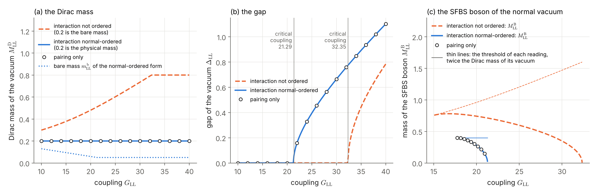
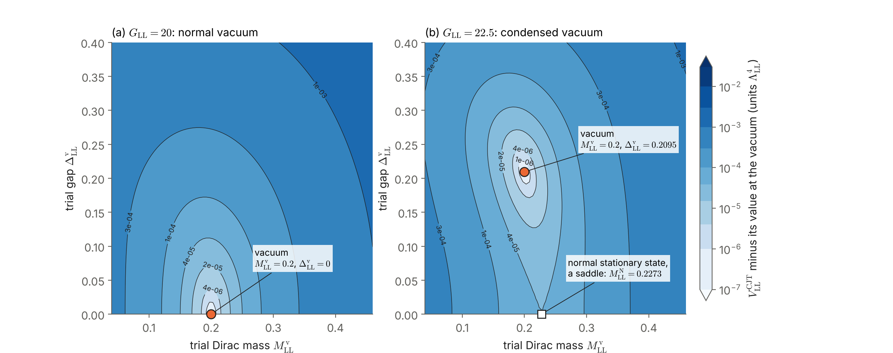
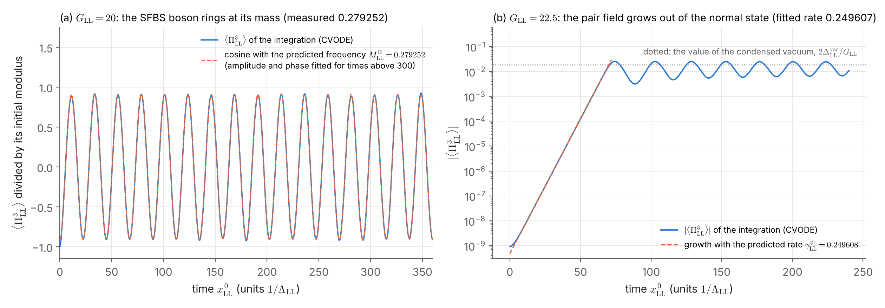
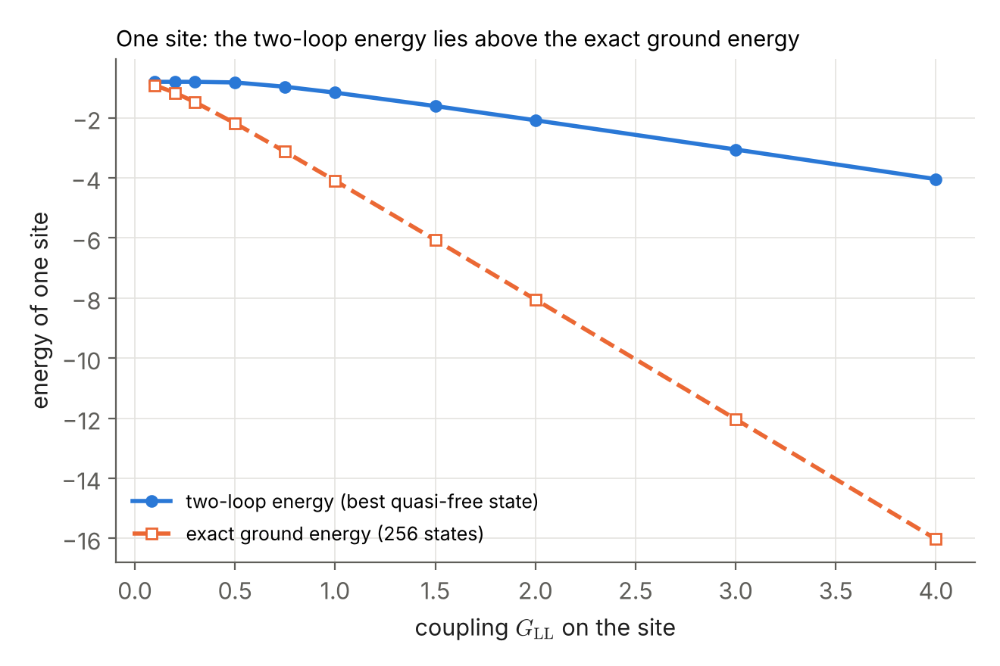
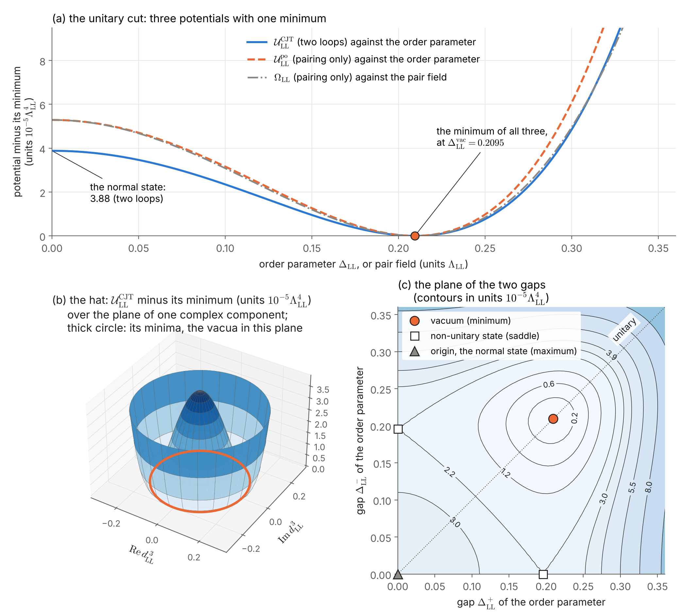

<!-- This file is generated from docs_src/X4_sfbs_cjt.src.md by code/scripts/assemble_docs.py; edit the source. -->

# 1. The task, and the result in brief

## 1.1 The task

On November 18, 2026 the author added six stages to Test 2, named D to I in this project. They ask for the superfluid
boson singlet state (SFBS, spin 0) of the spinor field to be treated by the method of J. M. Cornwall, R. Jackiw and
E. Tomboulis, Phys. Rev. D 10, 2428 (1974), called CJT below:

* **D.** apply the method of CJT to analyze, explain and discuss the creation of the SFBS from the spinor field;
* **E.** derive the effective potential of the SFBS (the analogue of the Mexican-hat potential of the Higgs doublet);
* **F.** find its relative minima and break the symmetry spontaneously;
* **G.** expand the SFBS about a minimum (the approximation SFBSv);
* **H.** derive the kinetic Lagrangian of the SFBS;
* **I.** substitute SFBSv into the kinetic Lagrangian, diagonalize the mass terms, work out the surviving symmetry
  group and prove its relation to the group of electromagnetism and the massless photon.

**This document answers stages D and E.** Stages F to I are not yet answered; they will be added to this document as
further sections, each when it is complete. On November 19, 2026 the author added: complete stage D, resolve all issues, and
invent mathematically possible fixes. The issues are the four discrepancies between the method of CJT and the earlier
treatment of the SFBS in this project that the first calculations of stage D had shown; they are stated in Section 6.3
and resolved in Section 7.

## 1.2 The result of stage D in brief

Units: the momentum cutoff $\Lambda_{\rm LL}$ is 1. The numbers are for the mass $m_{\rm LL}=0.2$ of the spinor charges,
the value used throughout Test 2.

1. **The method.** The effective action $\Gamma^{\rm CJT}_{\rm LL}$ of CJT is a functional of the propagator of the
   spinor field. Because the SFBS is a pair of two spinor charges, the propagator is taken for the Nambu spinor, which
   holds the field and its conjugate; its "pair" part is the SFBS. In the two-loop approximation, the first one that
   contains the interaction, $\Gamma^{\rm CJT}_{\rm LL}$ on a state that does not change in time equals minus the
   duration times the energy of a quasi-free state (Theorem D2), so that the approximation is a variational one. It
   contains three contractions of the interaction (Theorem D1): the pair-pair contraction, which the earlier treatment
   kept, and two equal normal contractions, which it dropped.
2. **What the normal contractions do.** They act in 64 normal channels with the coefficients of Table 1 (Theorem D3).
   On the vacuum they do two things: they shift the chemical potential by $\tfrac32G_{\rm LL}N^\Lambda_{\rm LL}$, an
   effect of the order of the factors of the interaction (Theorem D4), and they dress the Dirac mass. With the
   interaction not ordered, the condensed vacuum has the Dirac mass $4m^{\rm b}_{\rm LL}$, four times the mass
   $m^{\rm b}_{\rm LL}$ of the Lagrangian, exactly (Theorem D5).
3. **The issues.** If 0.2 is read as the mass of the Lagrangian and the interaction is not ordered, the critical
   coupling is 32.3506 instead of 21.28661, and the vacuum at the coupling 22.5 of Test 2 is
   normal, with the Dirac mass 0.539206, instead of condensed.
4. **The resolution.** The interaction is normal-ordered with respect to the normal correlations of the vacuum. This
   is the same as two counterterms, one for the chemical potential and one for the mass, fixed by two conditions: the
   vacuum is charge-symmetric at $\mu_{\rm LL}=0$, and $m_{\rm LL}$ is the Dirac mass of the vacuum (Theorem D6). The
   mass of the Lagrangian is then $m^{\rm b}_{\rm LL}=m_{\rm LL}(1-3G_{\rm LL}/(4G^{\rm crit}_{\rm LL}))$ in the normal
   vacuum and $m_{\rm LL}/4$ in the condensed one. With this reading the two-loop vacuum is the vacuum of the earlier
   treatment, with the same gap equation: $G^{\rm crit}_{\rm LL}=21.28661$, and at $G_{\rm LL}=22.5$ the gap
   $\Delta^{\rm vac}_{\rm LL}=0.2094933$. An alternative that changes the interaction instead (its axially
   symmetric completion, Theorem D8) removes the dressing of the mass altogether; it is recorded and not adopted.
5. **The creation of the SFBS.** In the normal vacuum the pair part of the propagator has a pole below the threshold
   of two spinor charges when $G^{\rm bd}_{\rm LL}<G_{\rm LL}<G^{\rm crit}_{\rm LL}$
   ($G^{\rm bd}_{\rm LL}=17.7463$): the interaction binds two spinor charges into a boson of spin 0, the
   SFBS boson, with the mass $M^{\rm B}_{\rm LL}$ given by $G_{\rm LL}\chi^{\rm pr}_{\rm LL}(M^{\rm B}_{\rm LL},0)=1$
   (Theorem D7). The normal channels do not mix with it. Its mass falls to zero at $G^{\rm crit}_{\rm LL}$; above, the
   normal state is unstable, the pair field grows exponentially, and the SFBS condenses: the superfluid.
6. **Verified in real time.** The time-dependent equations of the two-loop action were integrated by CVODE. At
   $G_{\rm LL}=20$ the pair amplitude rings with the frequency 0.279252; the predicted boson mass is
   0.279252 (relative difference 1.0e-7). At $G_{\rm LL}=22.5$ it grows with the rate
   0.249607; the predicted rate is 0.249608 (relative difference 6.2e-7).
7. **What remains different from the earlier treatment.** After the normal ordering the two treatments agree at the
   vacuum and to the first order around it. They differ at the second order: the normal stationary state above the
   critical coupling is itself dressed (Dirac mass 0.227347 at $G_{\rm LL}=22.5$), so that the condensed
   vacuum lies 3.8816e-5 below it instead of 5.2884e-5. This is a result of the fuller
   approximation, not an inconsistency; its consequences for the potential and for the masses belong to stages E to I.

Every statement above is checked by the program `t2_cjt` (checks CJ-1 to CJ-15, all passed;
Appendix A).

## 1.3 The result of stage E in brief

1. **The definition.** The field of the SFBS is the order parameter $\vec d_{\rm LL}$, a part of the propagator. Its
   effective potential $\mathcal U^{\rm CJT}_{\rm LL}(\vec d_{\rm LL})$ is the two-loop energy per volume of the state
   that is stationary in everything except its pair amplitude, which is held at the value that belongs to
   $\vec d_{\rm LL}$. Such a state is the ground state of a mean-field matrix whose pair field $\vec b_{\rm LL}$ is a
   free parameter, and $\partial\mathcal U^{\rm CJT}_{\rm LL}/\partial(d^\iota_{\rm LL})^*=(b^\iota_{\rm LL}-d^\iota_{\rm LL})/G_{\rm LL}$
   (Theorem E1).
2. **The closed form.** The potential depends on $\vec d_{\rm LL}$ only through its modulus and its non-unitarity, that
   is, through two gaps $\Delta^\pm_{\rm LL}$. In the normal form of the pair field the spinor charges split into two
   sectors with one gap each, coupled through their Dirac masses, and the potential is given in closed form by two
   coupled equations for these masses (Theorem E2).
3. **Stationary, or lowest?** A criterion decides whether such a state is a minimum at its order parameter: all
   eigenvalues of the matrix of first derivatives of the self-consistency map of the normal mean field must be below 1
   (Theorem E3). At the four pair fields examined the largest is between 0.6730 and
   0.6821. For the pairing-only functional the minimum property is proved for every order parameter;
   for the two-loop functional it is not proved that the state is the lowest of all.
4. **The Mexican hat.** At $G_{\rm LL}=22.5$ the origin, the normal state, is a maximum, 3.8816e-5 above the
   minimum; the minimum is the manifold of the unitary order parameters of the modulus
   $\Delta^{\rm vac}_{\rm LL}=0.2094933$, a circle in the plane of one complex component (Figure 5); the
   non-unitary state, in which one sector is condensed and the other is not, is a saddle 2.2146e-5 above
   the minimum.
5. **Against the potential of the earlier treatment.** That potential, $\Omega_{\rm LL}$, is a function of the pair
   field, not of the order parameter, and it is the potential of the pairing-only treatment; it exceeds the energy of
   the state with that pair field by $\lvert\vec b_{\rm LL}-\vec d_{\rm LL}\rvert^2/G_{\rm LL}$ (Theorem E4). All
   potentials have their minimum at the same $\Delta^{\rm vac}_{\rm LL}$. The two-loop hat is shallower
   (3.8816e-5 against 5.2884e-5), and its saddle lies at 0.4295 of the depth
   instead of at one half, because the two sectors are no longer independent.

## 1.4 How to read this document

The document is self-contained: every symbol is defined where it first appears, and the complete table of the symbols
of the folder is Appendix C. Theorems are numbered D1 to D8; each is followed by its proof and by the check of the
program that verifies it by machine. Section 2 states the model. Section 3 explains the method of CJT and its two-loop
approximation. Sections 4 to 6 work out what the approximation gives for the model as it stands, and state the issues.
Section 7 resolves them. Section 8 is the creation of the SFBS. Section 9 discusses the limits of the approximation.
Section 10 is stage E, the effective potential.

# 2. The model

## 2.1 The field and its matrices

The spinor field $\Psi_{\rm LL}$ has 8 complex components on the Minkowski space $\mathbb R^{1,3}_{\rm LL}$ with the
points $x_{\rm LL}=(x^0_{\rm LL},\vec x_{\rm LL})$, $x^0_{\rm LL}$ the time: a Dirac index with 4 values times an
isospin index with 2 values (up, down). The component with the Dirac index number 1 to 4 and the isospin index number
1 or 2 has the number 2 (Dirac number $-1$) $+$ isospin number; $\Psi_{{\rm LL},a}$ denotes one component, numbered by its subscript,
$\Psi^\dagger_{\rm LL}$ the row of the Hermitian conjugates, $\Psi^T_{\rm LL}$ the row of the components themselves.
A matrix written as a tensor product, Dirac matrix $\otimes$ isospin matrix, acts on these 8 components.

The Dirac matrices are those of the chiral basis,
$$\gamma^0_{\rm LL}=\begin{pmatrix}0&\sigma^{\rm LL}_0\\\sigma^{\rm LL}_0&0\end{pmatrix},\qquad
\gamma^j_{\rm LL}=\begin{pmatrix}0&\sigma^{\rm LL}_j\\-\sigma^{\rm LL}_j&0\end{pmatrix}\quad(j=1,2,3),\tag{2.1}$$
with the $2\times2$ unit matrix $\sigma^{\rm LL}_0$ and the Pauli matrices $\sigma^{\rm LL}_j$. From them:
$\beta_{\rm LL}=\gamma^0_{\rm LL}$, $\alpha^j_{\rm LL}=\gamma^0_{\rm LL}\gamma^j_{\rm LL}$, the chirality matrix
$\gamma^{\rm ch}_{\rm LL}=i\gamma^0_{\rm LL}\gamma^1_{\rm LL}\gamma^2_{\rm LL}\gamma^3_{\rm LL}$, and the
charge-conjugation matrix $C_{\rm LL}=i\gamma^2_{\rm LL}\gamma^0_{\rm LL}$, which is unitary and obeys
$C_{\rm LL}\gamma^p_{\rm LL}C_{\rm LL}^\dagger=-(\gamma^p_{\rm LL})^T$ for $p=0,1,2,3$. The Pauli matrices that act on
the isospin index are written $\tau^{\rm LL}_\iota$ ($\iota=1,2,3$), and
$\mathsf E_{\rm LL}=i\sigma^{\rm LL}_2=\begin{pmatrix}0&1\\-1&0\end{pmatrix}$. The unit matrices of 2, 4, 8 and 16
rows are $\mathsf 1_2$, $\mathsf 1_4$, $\mathsf 1_8$, $\mathsf 1_{16}$; a number added to a matrix stands for that
number times the unit matrix.

The **pair matrices** of the scalar channel are the three $8\times8$ matrices
$$\mathsf K^\iota_{\rm LL}=C_{\rm LL}\gamma^{\rm ch}_{\rm LL}\otimes\mathsf E_{\rm LL}\tau^{\rm LL}_\iota,\qquad\iota=1,2,3.\tag{2.2}$$
They are antisymmetric, $(\mathsf K^\iota_{\rm LL})^T=-\mathsf K^\iota_{\rm LL}$, and unitary; they are orthogonal to
each other in the sense $\mathrm{tr}\big(\mathsf K^\iota_{\rm LL}(\mathsf K^{\iota'}_{\rm LL})^\dagger\big)=8$ for
$\iota=\iota'$ and $0$ otherwise. The **pair operators** are
$$\Pi^\iota_{\rm LL}(x_{\rm LL})=\Psi^T_{\rm LL}\mathsf K^\iota_{\rm LL}\Psi_{\rm LL}
=\sum_{a,b}(\mathsf K^\iota_{\rm LL})_{ab}\Psi_{{\rm LL},a}\Psi_{{\rm LL},b},\tag{2.3}$$
both fields at the point $x_{\rm LL}$. $\Pi^\iota_{\rm LL}$ removes two spinor charges at one point. It is a Lorentz
scalar: in each of the two chirality blocks of the chiral basis the Dirac factor $C_{\rm LL}\gamma^{\rm ch}_{\rm LL}$
is $-\mathsf E_{\rm LL}$, the antisymmetric combination of the two spin states, so that the two spins form the
singlet (total spin 0); this is the "singlet" and the "$S^{\rm sp}_{\rm LL}=0$" (spin zero) of the name SFBS. Because the components of the field
anticommute, the isospin factor of an antisymmetric pair matrix with an antisymmetric spin factor must be symmetric:
$\mathsf E_{\rm LL}\tau^{\rm LL}_\iota$ are the three symmetric $2\times2$ matrices, and the pair is an isospin
triplet. The three operators $\Pi^\iota_{\rm LL}$ are the components of an isospin vector.

## 2.2 The Lagrangian and the Hamiltonian

The Lagrangian density of the spinor field with its attractive contact interaction, without gauge fields (they are
not needed before stage I), is
$$\mathcal L^{\rm c}_{\rm LL}=\bar\Psi_{\rm LL}\big(i\gamma^p_{\rm LL}\partial_p-m^{\rm b}_{\rm LL}\big)\Psi_{\rm LL}
+\mu^{\rm b}_{\rm LL}\Psi^\dagger_{\rm LL}\Psi_{\rm LL}
+\tfrac14G_{\rm LL}\sum_\iota(\Pi^\iota_{\rm LL})^\dagger\Pi^\iota_{\rm LL},\tag{2.4}$$
with $\bar\Psi_{\rm LL}=\Psi^\dagger_{\rm LL}\beta_{\rm LL}$, $\partial_p$ the derivative with respect to
$x^p_{\rm LL}$ (summed over $p=0,\dots,3$), the coupling $G_{\rm LL}>0$, a mass and a chemical potential. The action
is $\mathcal S^{\rm sf}_{\rm LL}=\int d^4x_{\rm LL}\,\mathcal L^{\rm c}_{\rm LL}$, and $\mathcal S^{\rm int}_{\rm LL}$
is its last term. The Hamiltonian density that belongs to (2.4) is
$$\mathcal H^{\rm sf}_{\rm LL}=\Psi^\dagger_{\rm LL}\big(\mathsf h_{\rm LL}-\mu^{\rm b}_{\rm LL}\big)\Psi_{\rm LL}
-\tfrac14G_{\rm LL}\sum_\iota(\Pi^\iota_{\rm LL})^\dagger\Pi^\iota_{\rm LL},\qquad
\mathsf h_{\rm LL}(\vec q_{\rm LL})=\sum_j\alpha^j_{\rm LL}q^j_{\rm LL}+\beta_{\rm LL}m^{\rm b}_{\rm LL},\tag{2.5}$$
where $\mathsf h_{\rm LL}(\vec q_{\rm LL})$ (times $\mathsf 1_2$ on the isospin index) is the matrix of the free
Hamiltonian on a plane wave of the momentum $\vec q_{\rm LL}$; its eigenvalues are
$\pm(q_{\rm LL}^2+(m^{\rm b}_{\rm LL})^2)^{1/2}$, four times each.

**The cutoff.** A contact interaction needs a cutoff. As everywhere in Test 2 the field contains only the plane waves
with $q_{\rm LL}<\Lambda_{\rm LL}$. The anticommutator of $\Psi_{{\rm LL},a}(\vec x_{\rm LL})$ with
$\Psi^\dagger_{{\rm LL},b}(\vec x'_{\rm LL})$ at equal times is then zero for two different components and, for one and the same component, the function
$\int_{q_{\rm LL}<\Lambda_{\rm LL}}d^3q_{\rm LL}(2\pi)^{-3}\exp\big(i\vec q_{\rm LL}\cdot(\vec x_{\rm LL}-\vec x'_{\rm LL})\big)$,
whose value at coinciding points is
$$N^\Lambda_{\rm LL}=\int_{q_{\rm LL}<\Lambda_{\rm LL}}\frac{d^3q_{\rm LL}}{(2\pi)^3}=\frac{\Lambda_{\rm LL}^3}{6\pi^2}=0.0168869\ \ (\Lambda_{\rm LL}=1),\tag{2.6}$$
the number of modes per volume and per component of the field.

**The order of the factors, and the name "bare".** The Lagrangian (2.4) treats the components of the field as
anticommuting numbers and does not say in which order the four field operators of the interaction stand in the
Hamiltonian. In (2.5) the order is fixed as written: $(\Pi^\iota_{\rm LL})^\dagger$ to the left of
$\Pi^\iota_{\rm LL}$. The mass and the chemical potential that stand in the Hamiltonian with this order, and with
nothing subtracted from the interaction, are called the **bare** mass $m^{\rm b}_{\rm LL}$ and the bare chemical
potential $\mu^{\rm b}_{\rm LL}$. The symbols $m_{\rm LL}$ and $\mu_{\rm LL}$ without the superscript are kept for the
mass of the spinor charges and for the chemical potential measured from the charge-symmetric point; Sections 5 and 7
show how they are related to the bare ones.

## 2.3 The symmetries

The Hamiltonian (2.5) is invariant under the rotations of space and under parity; under the fermion-number
transformations $\Psi_{\rm LL}\mapsto\exp(i\theta^{\rm F}_{\rm LL})\Psi_{\rm LL}$ with a constant phase (the group
$U(1)^{\rm F}_{\rm LL}$), which multiply $\Pi^\iota_{\rm LL}$ by $\exp(2i\theta^{\rm F}_{\rm LL})$: a pair carries the
fermion number 2; and under the isospin rotations $SU(2)_{\rm v}$ of the isospin index, which rotate the three
$\Pi^\iota_{\rm LL}$ as a vector. A fourth symmetry, the exchange of particles and holes, is the subject of Section 5.

## 2.4 What "the creation of the SFBS" means

Three things are meant, and Section 8 establishes each of them with the method of CJT:

1. the SFBS as an operator: the pair operators (2.3), a composite boson field made of two spinor fields at one point;
2. the SFBS as a particle: a bound state of two spinor charges that the interaction creates, seen as a pole of the
   pair part of the propagator, with a mass below the threshold of two free spinor charges;
3. the SFBS as a condensate: above a critical coupling the mass of that particle has fallen to zero, the vacuum
   without pairs is unstable, and the pair operators acquire an expectation value. Its size is measured by the
   **order parameter**
   $$d^\iota_{\rm LL}=-\tfrac12G_{\rm LL}\langle\Pi^\iota_{\rm LL}\rangle,\qquad\vec d_{\rm LL}=(d^1_{\rm LL},d^2_{\rm LL},d^3_{\rm LL})\in\mathbb C^3,\tag{2.7}$$
   whose modulus is the gap $\Delta_{\rm LL}=\lvert\vec d_{\rm LL}\rvert$ of a state with
   $\vec d_{\rm LL}\times\vec d^{\,*}_{\rm LL}=0$ (a unitary state; $\zeta_{\rm LL}=\lvert\vec d_{\rm LL}\times\vec d^{\,*}_{\rm LL}\rvert/\lvert\vec d_{\rm LL}\rvert^2$
   measures the deviation from it).

# 3. The method of Cornwall, Jackiw and Tomboulis

## 3.1 The effective action of the propagator

The usual effective action is a functional of the expectation value of a field, and its stationary points are the
possible vacua. A spinor field has no expectation value. What can condense is a product of two spinor fields, and the
expectation value of a product of two fields is a propagator. CJT therefore construct an effective action whose
argument is the propagator itself. For the present model the construction is as follows.

*The Nambu spinor.* The SFBS is a product of two fields $\Psi_{\rm LL}$ without a conjugate. To have such products
inside one propagator, the field and its conjugate are put into one column of 16 components,
$$\mathcal N_{\rm LL}(x_{\rm LL})=\begin{pmatrix}\Psi_{\rm LL}(x_{\rm LL})\\(\Psi^\dagger_{\rm LL}(x_{\rm LL}))^T\end{pmatrix},\tag{3.1}$$
the Nambu spinor; in momentum space its part of the momentum $\vec q_{\rm LL}$ is
$\mathcal N_{\rm LL}(\vec q_{\rm LL})=(\Psi_{\rm LL}(\vec q_{\rm LL}),\Psi^\dagger_{\rm LL}(-\vec q_{\rm LL})^T)$.

*The propagator.* It is the $16\times16$ matrix function of two points
$$i\,\mathcal G_{\rm LL}(x_{\rm LL},x'_{\rm LL})=\big\langle\mathrm T\,\mathcal N_{\rm LL}(x_{\rm LL})\,\mathcal N_{\rm LL}(x'_{\rm LL})^\dagger\big\rangle,\tag{3.2}$$
where $\mathrm T$ puts the factor with the later time to the left, with a minus sign if it exchanges the two. Its
two diagonal $8\times8$ blocks are the ordinary propagators of particles and of holes. Its off-diagonal blocks contain
$\langle\Psi_{\rm LL}\Psi^T_{\rm LL}\rangle$ and $\langle\Psi^{\dagger T}_{\rm LL}\Psi^\dagger_{\rm LL}\rangle$:
they vanish unless pairs have condensed, and they are the place of the SFBS in the method.

*The source and the Legendre transform.* A source $\mathcal K^{\rm src}_{\rm LL}(x_{\rm LL},x'_{\rm LL})$, a
$16\times16$ matrix function of two points, is coupled to the product of two fields: the term
$\tfrac12\int d^4x_{\rm LL}\,d^4x'_{\rm LL}\,\mathcal N_{\rm LL}(x_{\rm LL})^\dagger\mathcal K^{\rm src}_{\rm LL}(x_{\rm LL},x'_{\rm LL})\mathcal N_{\rm LL}(x'_{\rm LL})$
is added to the action. The vacuum amplitude in the presence of the source defines the generating functional by
(vacuum amplitude) $=\exp(iW^{\rm src}_{\rm LL})$. The derivative of $W^{\rm src}_{\rm LL}$ with respect to the source
is, up to a factor, the propagator in the presence of the source. The effective action
$\Gamma^{\rm CJT}_{\rm LL}[\mathcal G_{\rm LL}]$ is the Legendre transform: $W^{\rm src}_{\rm LL}$ minus the source
times this derivative (summed over the indices and integrated over the two points), with the source expressed through
the propagator. From this definition follow the two properties that are used:

* the derivative of $\Gamma^{\rm CJT}_{\rm LL}$ with respect to $\mathcal G_{\rm LL}$ is proportional to the source.
  The theory itself is the case of no source: **the propagator of the theory makes $\Gamma^{\rm CJT}_{\rm LL}$
  stationary**;
* at such a stationary point $\Gamma^{\rm CJT}_{\rm LL}=W^{\rm src}_{\rm LL}$ at vanishing source, and for a state that
  does not change in time this is **minus the duration times the energy** of the state.

*The formula of CJT.* CJT prove that the effective action is
$$\Gamma^{\rm CJT}_{\rm LL}[\mathcal G_{\rm LL}]=-\tfrac i2\,\mathrm{Tr}\ln\mathcal G_{\rm LL}^{-1}
-\tfrac i2\,\mathrm{Tr}\big((\mathcal G^{\rm fr}_{\rm LL})^{-1}\mathcal G_{\rm LL}-1\big)
+\Gamma^{\rm 2PI}_{\rm LL}[\mathcal G_{\rm LL}]+\text{constant},\tag{3.3}$$
where $\mathcal G^{\rm fr}_{\rm LL}$ is the propagator without interaction, $\mathrm{Tr}$ is the trace over the 16
components together with the integral over the points, and $\Gamma^{\rm 2PI}_{\rm LL}$ is the sum of all vacuum
graphs that stay connected when any two of their lines are cut (two-particle-irreducible graphs), drawn with the
vertices of the interaction and with the *full* propagator $\mathcal G_{\rm LL}$ as lines. The factor $\tfrac12$ in the
first two terms, compared with the formula for a Dirac field, counts every mode once although it occurs twice in the
Nambu spinor; the overall sign is the one of fermions. For a state that is the same at every point and at every time,
$\mathcal G_{\rm LL}$ depends on the difference of its two points only, and $\mathrm{Tr}$ becomes the duration times
the volume times $\int d\omega^{\rm f}_{\rm LL}(2\pi)^{-1}\int d^3q_{\rm LL}(2\pi)^{-3}\,\mathrm{tr}$, with the
frequency $\omega^{\rm f}_{\rm LL}$ conjugate to the time difference.

*Why this suits the problem.* The stationarity condition of (3.3) is an equation for the whole propagator, pair part
included. A solution with a non-zero pair part is a condensate of the SFBS; the second derivative of (3.3) at a
solution governs the small oscillations of the propagator about it, and a pole of these oscillations in the pair part
is the SFBS as a particle. No auxiliary boson field has to be introduced by hand.

## 3.2 The two-loop approximation, and Wick's theorem

$\Gamma^{\rm 2PI}_{\rm LL}$ is a series in the number of loops. Its first term has one vertex of the interaction and
two closed lines (two loops): it is the expectation value of $\mathcal S^{\rm int}_{\rm LL}$ in which the four field
operators are contracted in pairs with the propagator $\mathcal G_{\rm LL}$ in all possible ways. This is the
approximation of this document. Since the vertex joins four fields at one point and one time, only the propagator at
coinciding points and equal times enters, that is, the correlation matrices of the state: for a state that is the same
at every point,
$$(\mathsf C^{\rm n}_{\rm LL})_{ab}=\langle\Psi^\dagger_{{\rm LL},b}\Psi_{{\rm LL},a}\rangle,\qquad
(\mathsf C^{\rm p}_{\rm LL})_{ab}=\langle\Psi_{{\rm LL},a}\Psi_{{\rm LL},b}\rangle,\tag{3.4}$$
both fields at the same point and time: the normal correlation matrix (Hermitian) and the pair correlation matrix
(antisymmetric), each $8\times8$. With an argument, $\mathsf C^{\rm n}_{\rm LL}(\vec q_{\rm LL})$ and
$\mathsf C^{\rm p}_{\rm LL}(\vec q_{\rm LL})$ are their parts of one momentum,
$\mathsf C^{\rm n}_{\rm LL}=\int_{q_{\rm LL}<\Lambda_{\rm LL}}d^3q_{\rm LL}(2\pi)^{-3}\mathsf C^{\rm n}_{\rm LL}(\vec q_{\rm LL})$
and the same for $\mathsf C^{\rm p}_{\rm LL}$. The order of the operators in (3.4), the conjugate field to the left,
is the order of the interaction in (2.5).

**Theorem D1 (the three contractions).** In a state in which the expectation value of a product of four field
operators is the sum of the products of the expectation values of pairs, with the signs of Wick's theorem (a
quasi-free state),
$$\Big\langle\sum_\iota(\Pi^\iota_{\rm LL})^\dagger\Pi^\iota_{\rm LL}\Big\rangle
=\sum_\iota\lvert\langle\Pi^\iota_{\rm LL}\rangle\rvert^2
+2\sum_\iota\mathrm{tr}\big(\mathsf K^\iota_{\rm LL}\mathsf C^{\rm n}_{\rm LL}(\mathsf K^\iota_{\rm LL})^\dagger(\mathsf C^{\rm n}_{\rm LL})^T\big),
\qquad\langle\Pi^\iota_{\rm LL}\rangle=\sum_{a,b}(\mathsf K^\iota_{\rm LL})_{ab}(\mathsf C^{\rm p}_{\rm LL})_{ab}.\tag{3.5}$$

*Proof.* Write $\mathsf K$ for one of the pair matrices in this proof, with the entries $\mathsf K_{ab}$; then
$(\Pi_{\rm LL})^\dagger\Pi_{\rm LL}=\sum\mathsf K^*_{ab}\mathsf K_{a'b'}\Psi^\dagger_{{\rm LL},b}\Psi^\dagger_{{\rm LL},a}\Psi_{{\rm LL},a'}\Psi_{{\rm LL},b'}$,
summed over the four indices. Wick's theorem gives three terms for the expectation value of the four operators:
$\langle\Psi^\dagger_{{\rm LL},b}\Psi^\dagger_{{\rm LL},a}\rangle\langle\Psi_{{\rm LL},a'}\Psi_{{\rm LL},b'}\rangle$,
minus $\langle\Psi^\dagger_{{\rm LL},b}\Psi_{{\rm LL},a'}\rangle\langle\Psi^\dagger_{{\rm LL},a}\Psi_{{\rm LL},b'}\rangle$,
plus $\langle\Psi^\dagger_{{\rm LL},b}\Psi_{{\rm LL},b'}\rangle\langle\Psi^\dagger_{{\rm LL},a}\Psi_{{\rm LL},a'}\rangle$.
The first is $(\mathsf C^{\rm p}_{\rm LL})^*_{ab}(\mathsf C^{\rm p}_{\rm LL})_{a'b'}$; summed with the two pair
matrices it is $\lvert\sum\mathsf K_{ab}(\mathsf C^{\rm p}_{\rm LL})_{ab}\rvert^2$. The third is
$(\mathsf C^{\rm n}_{\rm LL})_{b'b}(\mathsf C^{\rm n}_{\rm LL})_{a'a}$; summed, it is
$\sum\mathsf K_{a'b'}(\mathsf C^{\rm n}_{\rm LL})_{b'b}(\mathsf K^\dagger)_{ba}((\mathsf C^{\rm n}_{\rm LL})^T)_{aa'}
=\mathrm{tr}(\mathsf K\mathsf C^{\rm n}_{\rm LL}\mathsf K^\dagger(\mathsf C^{\rm n}_{\rm LL})^T)$. The second is
$-(\mathsf C^{\rm n}_{\rm LL})_{a'b}(\mathsf C^{\rm n}_{\rm LL})_{b'a}$; exchanging the names of the last two
summation indices and using that the pair matrix is antisymmetric turns it into the third. $\blacksquare$

*Check CJ-1* verifies (3.5) in the Fock space of 8 fermion modes for the ground states of random quadratic
Hamiltonians with pairing (difference below $10^{-13}$), and with it the sign conventions of all that follows.

The first term of (3.5) is the **pair-pair contraction**; the second, the two equal **normal contractions**. The
earlier treatment of the SFBS in this project (a Hubbard-Stratonovich transformation that introduces the pair field
alone, followed by the mean-field evaluation) kept the first term only. The method of CJT has no such freedom: at
two loops all three contractions belong to the same graph.

## 3.3 The two-loop action is the energy of a quasi-free state

*The trial family.* Take any Hermitian $8\times8$ matrix $\mathsf N^{\rm sc}_{\rm LL}$ and any antisymmetric
$8\times8$ matrix $\mathsf P_{\rm LL}$, and form the $16\times16$ **mean-field matrix**
$$\mathsf H^{\rm var}_{\rm LL}(\vec q_{\rm LL})=\begin{pmatrix}\mathsf h_{\rm LL}(\vec q_{\rm LL})+\mathsf N^{\rm sc}_{\rm LL}-\mu^{\rm b}_{\rm LL}&\mathsf P_{\rm LL}\\
\mathsf P_{\rm LL}^\dagger&-\big(\mathsf h_{\rm LL}(-\vec q_{\rm LL})+\mathsf N^{\rm sc}_{\rm LL}-\mu^{\rm b}_{\rm LL}\big)^T\end{pmatrix}.\tag{3.6}$$
It is the matrix of the quadratic Hamiltonian
$\tfrac12\int d^3q_{\rm LL}(2\pi)^{-3}\mathcal N_{\rm LL}(\vec q_{\rm LL})^\dagger\mathsf H^{\rm var}_{\rm LL}(\vec q_{\rm LL})\mathcal N_{\rm LL}(\vec q_{\rm LL})$.
The propagator of the ground state of this Hamiltonian is
$\mathcal G_{\rm LL}(\omega^{\rm f}_{\rm LL},\vec q_{\rm LL})=(\omega^{\rm f}_{\rm LL}-\mathsf H^{\rm var}_{\rm LL}(\vec q_{\rm LL}))^{-1}$,
with the rule that the poles at positive eigenvalues lie just below the real axis and those at negative eigenvalues
just above. The ground state is quasi-free, and its **density matrix of the Nambu spinor**, the $16\times16$ matrix
$\mathsf R^{\rm Nb}_{\rm LL}(\vec q_{\rm LL})$ with the entries
$\langle\mathcal N^\dagger_{{\rm LL},b}\mathcal N_{{\rm LL},a}\rangle$, is the projector on the eigenvectors of
$\mathsf H^{\rm var}_{\rm LL}(\vec q_{\rm LL})$ with negative eigenvalues,
$$\mathsf R^{\rm Nb}_{\rm LL}=\tfrac12\big(\mathsf 1_{16}-\mathrm{sgn}\,\mathsf H^{\rm var}_{\rm LL}\big)
=\begin{pmatrix}\mathsf C^{\rm n}_{\rm LL}(\vec q_{\rm LL})&-\mathsf C^{\rm p}_{\rm LL}(\vec q_{\rm LL})\\\cdot&\cdot\end{pmatrix},\tag{3.7}$$
where $\mathrm{sgn}$ of a Hermitian matrix has the same eigenvectors and the signs of the eigenvalues as eigenvalues
(the lower blocks, marked by dots, repeat the upper ones: the lower right block is
$\mathsf 1_8-\mathsf C^{\rm n}_{\rm LL}(-\vec q_{\rm LL})^T$). These propagators, for all
$\mathsf N^{\rm sc}_{\rm LL}$ and $\mathsf P_{\rm LL}$, are the trial family.

**Theorem D2 (two loops = energy of a quasi-free state).** (a) On the trial family, the effective action (3.3) with
the two-loop term for $\Gamma^{\rm 2PI}_{\rm LL}$ is, per duration and volume and up to a constant that is the same
for the whole family, minus the functional
$$\begin{aligned}\mathcal E^{\rm var}_{\rm LL}={}&\int_{q_{\rm LL}<\Lambda_{\rm LL}}\frac{d^3q_{\rm LL}}{(2\pi)^3}\mathrm{tr}\big(\mathsf h_{\rm LL}(\vec q_{\rm LL})\mathsf C^{\rm n}_{\rm LL}(\vec q_{\rm LL})\big)
-\mu^{\rm b}_{\rm LL}\mathrm{tr}\,\mathsf C^{\rm n}_{\rm LL}\\
&-\tfrac14G_{\rm LL}\sum_\iota\lvert\langle\Pi^\iota_{\rm LL}\rangle\rvert^2
-\tfrac12G_{\rm LL}\sum_\iota\mathrm{tr}\big(\mathsf K^\iota_{\rm LL}\mathsf C^{\rm n}_{\rm LL}(\mathsf K^\iota_{\rm LL})^\dagger(\mathsf C^{\rm n}_{\rm LL})^T\big),\end{aligned}\tag{3.8}$$
and $\mathcal E^{\rm var}_{\rm LL}$ is the expectation value of the Hamiltonian density (2.5) in the trial state: the
energy per volume. (b) Every propagator that makes the two-loop action stationary, among all propagators that are the
same at every point and time, belongs to the trial family, with the mean fields
$$\mathsf N^{\rm sc}_{\rm LL}=-G_{\rm LL}\sum_\iota(\mathsf K^\iota_{\rm LL})^\dagger(\mathsf C^{\rm n}_{\rm LL})^T\mathsf K^\iota_{\rm LL},\qquad
\mathsf P_{\rm LL}=\sum_\iota d^\iota_{\rm LL}(\mathsf K^\iota_{\rm LL})^\dagger,\qquad d^\iota_{\rm LL}=-\tfrac12G_{\rm LL}\langle\Pi^\iota_{\rm LL}\rangle\tag{3.9}$$
computed from its own correlation matrices (self-consistency). (c) Consequently the two-loop approximation is
variational: for every member of the family, $\mathcal E^{\rm var}_{\rm LL}$ times the volume is not below the exact
ground energy of the Hamiltonian.

*Proof.* (a) The three terms of (3.3) are evaluated in turn. $\mathsf H^{\rm var}_{\rm LL}[0]$ denotes the matrix (3.6)
with $\mathsf N^{\rm sc}_{\rm LL}=0$ and $\mathsf P_{\rm LL}=0$, so that
$(\mathcal G^{\rm fr}_{\rm LL})^{-1}=\omega^{\rm f}_{\rm LL}-\mathsf H^{\rm var}_{\rm LL}[0]$; all statements are per
duration and volume. The frequency integrals are taken along the imaginary axis,
$\omega^{\rm f}_{\rm LL}=i\upsilon^{\rm f}_{\rm LL}$ with real $\upsilon^{\rm f}_{\rm LL}$: with the rule for the
poles stated above, turning the path of integration from the real to the imaginary axis crosses no pole. One property
of (3.6) is used throughout: because $\mathsf P_{\rm LL}$ is antisymmetric, exchanging the upper and the lower 8
components turns the transpose of $\mathsf H^{\rm var}_{\rm LL}(\vec q_{\rm LL})$ into
$-\mathsf H^{\rm var}_{\rm LL}(-\vec q_{\rm LL})$. Hence the eigenvalues at $-\vec q_{\rm LL}$ are minus those at
$\vec q_{\rm LL}$: taken over all momenta the spectrum is symmetric about zero, and the integral of the trace of
$\mathsf H^{\rm var}_{\rm LL}$ over the momenta vanishes. The modulus of a Hermitian matrix, written with bars, is the
matrix with the same eigenvectors and the moduli of the eigenvalues.

*First term.* $-\tfrac i2\int d\omega^{\rm f}_{\rm LL}(2\pi)^{-1}\mathrm{tr}\ln(\omega^{\rm f}_{\rm LL}-\mathsf H^{\rm var}_{\rm LL})
=\tfrac12\int d\upsilon^{\rm f}_{\rm LL}(2\pi)^{-1}\mathrm{tr}\ln(i\upsilon^{\rm f}_{\rm LL}-\mathsf H^{\rm var}_{\rm LL})$.
By the symmetry of the spectrum, under the integral over the momenta
$\mathrm{tr}\ln(i\upsilon^{\rm f}_{\rm LL}-\mathsf H^{\rm var}_{\rm LL})$ may be replaced by
$\tfrac12\mathrm{tr}\ln\big((\upsilon^{\rm f}_{\rm LL})^2+(\mathsf H^{\rm var}_{\rm LL})^2\big)$ plus a constant. The
elementary integral
$$\int_{-\infty}^{\infty}\frac{d\upsilon^{\rm f}_{\rm LL}}{2\pi}\Big(\mathrm{tr}\ln\big((\upsilon^{\rm f}_{\rm LL})^2+(\mathsf H^{\rm var}_{\rm LL})^2\big)-\mathrm{tr}\ln\big((\upsilon^{\rm f}_{\rm LL})^2+(\mathsf H^{\rm var}_{\rm LL}[0])^2\big)\Big)
=\mathrm{tr}\,\lvert\mathsf H^{\rm var}_{\rm LL}\rvert-\mathrm{tr}\,\lvert\mathsf H^{\rm var}_{\rm LL}[0]\rvert,$$
in which every eigenvalue contributes its modulus, then gives, up to a constant that does not depend on the mean
fields,
$$\text{first term}=\tfrac14\int_{q_{\rm LL}<\Lambda_{\rm LL}}\frac{d^3q_{\rm LL}}{(2\pi)^3}\mathrm{tr}\,\lvert\mathsf H^{\rm var}_{\rm LL}(\vec q_{\rm LL})\rvert
=-\tfrac12\int_{q_{\rm LL}<\Lambda_{\rm LL}}\frac{d^3q_{\rm LL}}{(2\pi)^3}\mathrm{tr}\big(\mathsf H^{\rm var}_{\rm LL}\mathsf R^{\rm Nb}_{\rm LL}\big),\tag{3.10}$$
where the second form uses (3.7) and the vanishing trace. This is minus the ground energy of the quadratic trial
Hamiltonian.

*Second term.* $(\mathcal G^{\rm fr}_{\rm LL})^{-1}\mathcal G_{\rm LL}-1=(\mathsf H^{\rm var}_{\rm LL}-\mathsf H^{\rm var}_{\rm LL}[0])\mathcal G_{\rm LL}$,
and $\int d\upsilon^{\rm f}_{\rm LL}(2\pi)^{-1}(i\upsilon^{\rm f}_{\rm LL}-\mathsf H^{\rm var}_{\rm LL})^{-1}=-\tfrac12\mathrm{sgn}\,\mathsf H^{\rm var}_{\rm LL}=\mathsf R^{\rm Nb}_{\rm LL}-\tfrac12$
(the part of the integrand that is odd in $\upsilon^{\rm f}_{\rm LL}$ cancels between $\pm\upsilon^{\rm f}_{\rm LL}$).
Hence
$$\text{second term}=\tfrac12\int_{q_{\rm LL}<\Lambda_{\rm LL}}\frac{d^3q_{\rm LL}}{(2\pi)^3}\mathrm{tr}\big((\mathsf H^{\rm var}_{\rm LL}-\mathsf H^{\rm var}_{\rm LL}[0])\mathsf R^{\rm Nb}_{\rm LL}\big),\tag{3.11}$$
the term with $-\tfrac12$ vanishing with the trace. The sum of (3.10) and (3.11) is
$-\tfrac12\int\mathrm{tr}(\mathsf H^{\rm var}_{\rm LL}[0]\,\mathsf R^{\rm Nb}_{\rm LL})$, and with the blocks (3.7) this is
$-\int\mathrm{tr}(\mathsf h_{\rm LL}\mathsf C^{\rm n}_{\rm LL}(\vec q_{\rm LL}))+\mu^{\rm b}_{\rm LL}\mathrm{tr}\,\mathsf C^{\rm n}_{\rm LL}$
plus the constant $-4\mu^{\rm b}_{\rm LL}N^\Lambda_{\rm LL}$: minus the first two terms of (3.8).

*Third term.* The two-loop term is the expectation value of $\mathcal S^{\rm int}_{\rm LL}$ with all contractions,
which per duration and volume is $+\tfrac14G_{\rm LL}$ times (3.5): minus the last two terms of (3.8). Altogether the
action is $-\mathcal E^{\rm var}_{\rm LL}$ plus a constant. That $\mathcal E^{\rm var}_{\rm LL}$ is the expectation
value of (2.5) is Theorem D1 for the interaction and the definition (3.4) for the rest.

(b) The two-loop term depends on the propagator only at coinciding points and equal times. Its derivative with
respect to $\mathcal G_{\rm LL}(x_{\rm LL},x'_{\rm LL})$ therefore vanishes unless the two points coincide, and the
stationarity condition of (3.3) reads $\mathcal G_{\rm LL}^{-1}=(\mathcal G^{\rm fr}_{\rm LL})^{-1}-$ (a constant
$16\times16$ matrix): the propagator of a quadratic Hamiltonian of the form (3.6). To find the constant matrix, vary
(3.8): the first-order change of $\mathcal E^{\rm var}_{\rm LL}$ under a change of the state is
$\int\mathrm{tr}\big((\mathsf h_{\rm LL}-\mu^{\rm b}_{\rm LL}+\mathsf N^{\rm sc}_{\rm LL})\,d\mathsf C^{\rm n}_{\rm LL}(\vec q_{\rm LL})\big)
+\tfrac12\sum_\iota\big((d^\iota_{\rm LL})^*\,d\langle\Pi^\iota_{\rm LL}\rangle+\text{complex conjugate}\big)$
with the mean fields (3.9) (for the normal term one uses that an expression of the form
$\mathrm{tr}\big(\mathsf K^\iota_{\rm LL}\mathsf C^{\rm n}_{\rm LL}(\mathsf K^\iota_{\rm LL})^\dagger(\mathsf C^{\rm vac}_{\rm LL})^T\big)$
is unchanged when its two Hermitian matrices are exchanged, because the pair matrix is antisymmetric), and this is
$\tfrac12\int\mathrm{tr}(\mathsf H^{\rm var}_{\rm LL}\,d\mathsf R^{\rm Nb}_{\rm LL})$ with the matrix (3.6) built from
(3.9). A change of a projector is $i$ times its commutator with an arbitrary Hermitian matrix, for every momentum; the change of the energy vanishes for all of them exactly
when $\mathsf H^{\rm var}_{\rm LL}$ commutes with $\mathsf R^{\rm Nb}_{\rm LL}$, and the lowest energy for given mean
fields is the projector (3.7).

(c) is the variational principle of Rayleigh and Ritz: the expectation value of a Hamiltonian in any state is not below
its lowest eigenvalue. $\blacksquare$

*Checks.* CJ-4 (a) verifies the frequency integrals of the proof for random matrices; CJ-4 (b) and CJ-5 verify (3.8)
against closed forms; CJ-10 constructs, on one site, the mean-field state in the Fock space and verifies that
$\mathcal E^{\rm var}_{\rm LL}$ is the expectation value of the Hamiltonian in it and lies above the exact ground
energy (Section 9.1).

*What is left out.* The graphs of $\Gamma^{\rm 2PI}_{\rm LL}$ with three and more loops: in them a pair of spinor
charges, once formed, propagates before it is absorbed again, so that they describe the effect of the SFBS boson on the
spinor charges that it is made of. The two-loop approximation is the mean-field (Hartree-Fock-Bogoliubov) theory of
the model.

# 4. The normal contractions: 64 channels

The normal term of (3.8) and the normal mean field of (3.9) are quadratic and linear in the Hermitian matrix
$\mathsf C^{\rm n}_{\rm LL}$. A Hermitian $8\times8$ matrix has 64 real parameters. A basis adapted to the symmetries
consists of the 64 **channel matrices** $\mathsf T^A_{\rm LL}$, numbered by their superscript: the tensor products of
one of the 16 Hermitian Dirac matrices of Table 1 with $\mathsf 1_2$ or with one of the $\tau^{\rm LL}_\iota$. They are
Hermitian, and the trace of the product of two of them is 8 if they are equal and 0 otherwise. The **densities** of a
state are $n^A_{\rm LL}=\langle\Psi^\dagger_{\rm LL}\mathsf T^A_{\rm LL}\Psi_{\rm LL}\rangle=\mathrm{tr}(\mathsf T^A_{\rm LL}\mathsf C^{\rm n}_{\rm LL})$,
and $\mathsf C^{\rm n}_{\rm LL}=\tfrac18\sum_An^A_{\rm LL}\mathsf T^A_{\rm LL}$.

**Theorem D3 (the channels).** For every channel
$$\sum_\iota\mathsf K^\iota_{\rm LL}\mathsf T^A_{\rm LL}(\mathsf K^\iota_{\rm LL})^\dagger=c^A_{\rm LL}(\mathsf T^A_{\rm LL})^T,\qquad
c^A_{\rm LL}=\varsigma^{\rm D}_{\rm LL}\times\begin{cases}3&\text{isospin factor }\mathsf 1_2\\1&\text{isospin factor }\tau^{\rm LL}_\iota\end{cases}\tag{4.1}$$
with the sign $\varsigma^{\rm D}_{\rm LL}=\pm1$ of the Dirac factor given in Table 1. Therefore
$$\mathsf N^{\rm sc}_{\rm LL}=-\tfrac18G_{\rm LL}\sum_Ac^A_{\rm LL}n^A_{\rm LL}\mathsf T^A_{\rm LL},\qquad
-\tfrac12G_{\rm LL}\sum_\iota\mathrm{tr}\big(\mathsf K^\iota_{\rm LL}\mathsf C^{\rm n}_{\rm LL}(\mathsf K^\iota_{\rm LL})^\dagger(\mathsf C^{\rm n}_{\rm LL})^T\big)=-\tfrac1{16}G_{\rm LL}\sum_Ac^A_{\rm LL}(n^A_{\rm LL})^2.\tag{4.2}$$
A channel with a positive coefficient is attractive (a density in it lowers the energy), one with a negative
coefficient repulsive.

| Dirac matrix | its density is the | number | $\varsigma^{\rm D}_{\rm LL}$ | $c^A_{\rm LL}$ with $\mathsf 1_2$, with $\tau^{\rm LL}_\iota$ | $c'^A_{\rm LL}$ with $\mathsf 1_2$, with $\tau^{\rm LL}_\iota$ | sum with $\mathsf 1_2$, with $\tau^{\rm LL}_\iota$ |
|----------------|--------------------------|-------|------|-------------|-------------|-------------|
| $\mathsf 1_4$ | density of the spinor charges | 1 | $+1$ | $+3$, $+1$ | $+3$, $+1$ | $6$, $2$ |
| $\beta_{\rm LL}$ | scalar density (the Dirac mass) | 1 | $+1$ | $+3$, $+1$ | $-3$, $-1$ | $0$, $0$ |
| $i\beta_{\rm LL}\gamma^{\rm ch}_{\rm LL}$ | pseudoscalar density | 1 | $-1$ | $-3$, $-1$ | $+3$, $+1$ | $0$, $0$ |
| $\gamma^{\rm ch}_{\rm LL}$ | axial charge density | 1 | $+1$ | $+3$, $+1$ | $+3$, $+1$ | $6$, $2$ |
| $\alpha^j_{\rm LL}$ | current | 3 | $-1$ | $-3$, $-1$ | $-3$, $-1$ | $-6$, $-2$ |
| $\gamma^{\rm ch}_{\rm LL}\alpha^j_{\rm LL}$ | spin density | 3 | $-1$ | $-3$, $-1$ | $-3$, $-1$ | $-6$, $-2$ |
| $i\beta_{\rm LL}\alpha^j_{\rm LL}$ | electric-type tensor | 3 | $+1$ | $+3$, $+1$ | $-3$, $-1$ | $0$, $0$ |
| $\beta_{\rm LL}\gamma^{\rm ch}_{\rm LL}\alpha^j_{\rm LL}$ | magnetic-type tensor | 3 | $-1$ | $-3$, $-1$ | $+3$, $+1$ | $0$, $0$ |

**Table 1.** The normal channels. Each row is a class of Dirac matrices (the third column gives their number); every
one of them is combined with $\mathsf 1_2$ and with the three $\tau^{\rm LL}_\iota$, which gives $16\times4=64$
channels. $\varsigma^{\rm D}_{\rm LL}$ is the sign in (4.1); $c^A_{\rm LL}$ the coefficient for the scalar pair
matrices (2.2) of the model; $c'^A_{\rm LL}$ the coefficient for the pseudoscalar pair matrices
$\mathsf K'^\iota_{\rm LL}=C_{\rm LL}\otimes\mathsf E_{\rm LL}\tau^{\rm LL}_\iota$, which do not occur in the model and
are needed only for the alternative of Section 7.4; the last column is the sum of the two (data file
`test2/data/t2_cjt_channels.csv`).

*Proof.* A pair matrix is a tensor product, so the left side of (4.1) is a Dirac factor times an isospin factor. The
isospin factor is $\sum_\iota\mathsf E_{\rm LL}\tau^{\rm LL}_\iota\,(\cdot)\,\tau^{\rm LL}_\iota\mathsf E_{\rm LL}^\dagger$
applied to $\mathsf 1_2$ or to a Pauli matrix. Since $\sum_\iota\tau^{\rm LL}_\iota\tau^{\rm LL}_\iota=3$,
$\sum_\iota\tau^{\rm LL}_\iota\tau^{\rm LL}_{\iota'}\tau^{\rm LL}_\iota=-\tau^{\rm LL}_{\iota'}$ and
$\mathsf E_{\rm LL}\tau^{\rm LL}_{\iota'}\mathsf E_{\rm LL}^\dagger=-(\tau^{\rm LL}_{\iota'})^T$, it is 3 times
$\mathsf 1_2$ in the first case and $+1$ times the transposed Pauli matrix in the second. The Dirac factor is
$C_{\rm LL}\gamma^{\rm ch}_{\rm LL}\,(\cdot)\,(C_{\rm LL}\gamma^{\rm ch}_{\rm LL})^\dagger$. Because
$\gamma^{\rm ch}_{\rm LL}$ anticommutes with every $\gamma^p_{\rm LL}$, the property of $C_{\rm LL}$ quoted in
Section 2.1 gives
$C_{\rm LL}\gamma^{\rm ch}_{\rm LL}\gamma^p_{\rm LL}(C_{\rm LL}\gamma^{\rm ch}_{\rm LL})^\dagger=+(\gamma^p_{\rm LL})^T$.
Each of the 16 matrices is a product of matrices $\gamma^p_{\rm LL}$; applying this rule to every factor, and using that the
transpose of a product is the product of the transposes in the reversed order, returns the transposed matrix with
its factors in reversed order, and
bringing them back into the original order gives the sign: $+$ for $\mathsf 1_4$ and $\beta_{\rm LL}$; $-$ for
$\alpha^j_{\rm LL}=\gamma^0_{\rm LL}\gamma^j_{\rm LL}$ (two anticommuting factors); $+$ for
$\gamma^{\rm ch}_{\rm LL}$ (four anticommuting factors: six exchanges); and for the products with
$\beta_{\rm LL}$ or $\gamma^{\rm ch}_{\rm LL}$ in the same way, with the results of the table. (For the pseudoscalar
pair matrices the rule is $C_{\rm LL}\gamma^p_{\rm LL}C_{\rm LL}^\dagger=-(\gamma^p_{\rm LL})^T$, one more sign for
every factor.) The two formulas (4.2) follow by inserting
$\mathsf C^{\rm n}_{\rm LL}=\tfrac18\sum_An^A_{\rm LL}\mathsf T^A_{\rm LL}$ into (3.9) and (3.8); for the first, (4.1)
is transposed, with $(\mathsf K^\iota_{\rm LL})^*=-(\mathsf K^\iota_{\rm LL})^\dagger$. $\blacksquare$

*Check CJ-2* computes the 64 coefficients for both sets of pair matrices from the matrices themselves and verifies
(4.2) for a random state (all differences below $10^{-12}$).

Two rows of Table 1 matter for the vacuum. The density of the spinor charges (first row, $c^A_{\rm LL}=3$) shifts the
chemical potential: Section 5. The scalar density $\langle\bar\Psi_{\rm LL}\Psi_{\rm LL}\rangle$ (second row,
$c^A_{\rm LL}=3$, attractive) is not zero in any vacuum of a massive field, and its mean field is proportional to
$\beta_{\rm LL}$: it changes the mass. The **Dirac mass** of a state is defined as the mass that its mean-field matrix
contains,
$$M^{\rm D}_{\rm LL}=m^{\rm b}_{\rm LL}+\tfrac18\mathrm{tr}\big((\beta_{\rm LL}\otimes\mathsf 1_2)\mathsf N^{\rm sc}_{\rm LL}\big)
=m^{\rm b}_{\rm LL}-\tfrac38G_{\rm LL}\langle\bar\Psi_{\rm LL}\Psi_{\rm LL}\rangle.\tag{4.3}$$

# 5. The order of the factors, the charge conjugation and the chemical potential

**Theorem D4.** (a) On one site, that is, for 8 fermion modes with the annihilation operators
$\hat c_{{\rm LL},k}$, the pair operators $\hat\Pi^\iota_{\rm LL}=\sum_{k,k'}(\mathsf K^\iota_{\rm LL})_{kk'}\hat c_{{\rm LL},k}\hat c_{{\rm LL},k'}$
and the number $\hat n^{\rm F}_{\rm LL}=\sum_k\hat c^\dagger_{{\rm LL},k}\hat c_{{\rm LL},k}$ of spinor charges,
$$\sum_\iota\big[\hat\Pi^\iota_{\rm LL},(\hat\Pi^\iota_{\rm LL})^\dagger\big]=48-12\,\hat n^{\rm F}_{\rm LL};\tag{5.1}$$
for the field with the cutoff, $\sum_\iota[\Pi^\iota_{\rm LL},(\Pi^\iota_{\rm LL})^\dagger]=48(N^\Lambda_{\rm LL})^2-12N^\Lambda_{\rm LL}\Psi^\dagger_{\rm LL}\Psi_{\rm LL}$
at one point. Any two orders of the factors of the interaction therefore differ by a multiple of the density and a
constant: by a shift of the chemical potential. (b) Let
$\mathsf U^{\rm C}_{\rm LL}=i\beta_{\rm LL}\alpha^2_{\rm LL}\otimes\mathsf 1_2$. The exchange of particles and holes
$\Psi_{{\rm LL},a}\to\sum_b(\mathsf U^{\rm C}_{\rm LL})_{ab}\Psi^\dagger_{{\rm LL},b}$ (the charge conjugation) maps the
Hamiltonian (2.5) with the bare chemical potential $\mu^{\rm b}_{\rm LL}$ to the same Hamiltonian with
$-\mu^{\rm b}_{\rm LL}-3G_{\rm LL}N^\Lambda_{\rm LL}$, plus a constant. (c) The Hamiltonian is therefore symmetric
under the charge conjugation at $\mu^{\rm b}_{\rm LL}=-\tfrac32G_{\rm LL}N^\Lambda_{\rm LL}$, and the chemical
potential measured from this point,
$$\mu_{\rm LL}=\mu^{\rm b}_{\rm LL}+\tfrac32G_{\rm LL}N^\Lambda_{\rm LL},\tag{5.2}$$
changes its sign under it. The vacuum is the ground state at $\mu_{\rm LL}=0$.

*Proof.* (a) Move the two creation operators of $(\hat\Pi^\iota_{\rm LL})^\dagger$ to the left through the two
annihilation operators of $\hat\Pi^\iota_{\rm LL}$ with the anticommutation relations. This leaves the constant
$2\,\mathrm{tr}\big(\mathsf K^\iota_{\rm LL}(\mathsf K^\iota_{\rm LL})^\dagger\big)=16$ (two terms, equal because the
pair matrix is antisymmetric) and four terms with one creation and one annihilation operator, each equal to
$-\sum_{k,k'}\hat c^\dagger_{{\rm LL},k}\big((\mathsf K^\iota_{\rm LL}(\mathsf K^\iota_{\rm LL})^\dagger)^T\big)_{kk'}\hat c_{{\rm LL},k'}=-\hat n^{\rm F}_{\rm LL}$
(the pair matrix is antisymmetric and unitary). Three pair matrices give (5.1). For the field, every anticommutator
at coinciding points contributes the factor $N^\Lambda_{\rm LL}$ of (2.6). (b) Under the exchange, for every channel
matrix of Section 4,
$\Psi^\dagger_{\rm LL}\mathsf T^A_{\rm LL}\Psi_{\rm LL}\to\mathrm{tr}(\mathsf T^A_{\rm LL})\,N^\Lambda_{\rm LL}-\Psi^\dagger_{\rm LL}\big((\mathsf U^{\rm C}_{\rm LL})^\dagger\mathsf T^A_{\rm LL}\mathsf U^{\rm C}_{\rm LL}\big)^T\Psi_{\rm LL}$,
and with the opposite sign of the second term when the matrix is multiplied by a derivative (an integration by
parts). The matrix $\mathsf U^{\rm C}_{\rm LL}$ satisfies
$(\mathsf U^{\rm C}_{\rm LL})^\dagger\alpha^j_{\rm LL}\mathsf U^{\rm C}_{\rm LL}=(\alpha^j_{\rm LL})^T$ and
$(\mathsf U^{\rm C}_{\rm LL})^\dagger\beta_{\rm LL}\mathsf U^{\rm C}_{\rm LL}=-(\beta_{\rm LL})^T$ (both sides times
$\mathsf 1_2$), so that the kinetic and the mass term are unchanged, while the density becomes $8N^\Lambda_{\rm LL}$
minus itself. The pair operators become the Hermitian conjugates of pair operators with the pair matrices
$-((\mathsf U^{\rm C}_{\rm LL})^T\mathsf K^\iota_{\rm LL}\mathsf U^{\rm C}_{\rm LL})^*$, which are
$-\mathsf K^1_{\rm LL}$, $+\mathsf K^2_{\rm LL}$, $-\mathsf K^3_{\rm LL}$; hence
$\sum_\iota(\Pi^\iota_{\rm LL})^\dagger\Pi^\iota_{\rm LL}\to\sum_\iota\Pi^\iota_{\rm LL}(\Pi^\iota_{\rm LL})^\dagger$,
which by (a) is the original sum plus $48(N^\Lambda_{\rm LL})^2-12N^\Lambda_{\rm LL}\Psi^\dagger_{\rm LL}\Psi_{\rm LL}$.
Collecting the multiples of the density: the chemical potential $\mu^{\rm b}_{\rm LL}$ becomes
$-\mu^{\rm b}_{\rm LL}-3G_{\rm LL}N^\Lambda_{\rm LL}$. (c) follows. $\blacksquare$

*Check CJ-3* verifies (5.1) as an identity of $256\times256$ matrices, finds $\mathsf U^{\rm C}_{\rm LL}$ by a search
over the 64 channel matrices (result: `(i beta alpha^2) (x) tau_0`), and verifies that the 256 eigenvalues of the Hamiltonian
of one site at the chemical potentials $\mu^{\rm b}_{\rm LL}$ and $-\mu^{\rm b}_{\rm LL}-3G_{\rm LL}$ differ by the
constant $-8\mu^{\rm b}_{\rm LL}-12G_{\rm LL}$ (three random sets of parameters, difference below $10^{-13}$).

*In the two-loop approximation* the same shift appears as the mean field of the first row of Table 1: a state with the
density $4N^\Lambda_{\rm LL}$ of the half-filled vacuum has
$\mathsf N^{\rm sc}_{\rm LL}=-\tfrac32G_{\rm LL}N^\Lambda_{\rm LL}+\dots$, which cancels against
$-\mu^{\rm b}_{\rm LL}$ in (3.6) exactly at $\mu_{\rm LL}=0$. This is the first of the issues, and (5.2) resolves it:
*the chemical potential of Test 2 is $\mu_{\rm LL}$, not $\mu^{\rm b}_{\rm LL}$.* For $G_{\rm LL}=22.5$ the bare
chemical potential of the vacuum is -0.56993.

# 6. The vacuum sector with bare parameters

## 6.1 The trial states and their energy

The vacuum is expected to be invariant under rotations, with at most a pair condensate. Its sector of trial states is:
the mean-field matrix (3.6) with the Dirac mass $M^{\rm v}_{\rm LL}$ in place of $m^{\rm b}_{\rm LL}$, no chemical
potential, and the pairing block $\Delta^{\rm v}_{\rm LL}(\mathsf K^3_{\rm LL})^\dagger$, for two real parameters
$M^{\rm v}_{\rm LL}>0$ and $\Delta^{\rm v}_{\rm LL}\ge0$ (an order parameter $(0,0,\Delta^{\rm v}_{\rm LL})$; every
unitary order parameter of this modulus is obtained from it by a symmetry transformation). Write
$$E^{\rm v}_{\rm LL}=\big(q_{\rm LL}^2+(M^{\rm v}_{\rm LL})^2+(\Delta^{\rm v}_{\rm LL})^2\big)^{1/2},\qquad
s^{\rm c}_{\rm LL}=\int_{q_{\rm LL}<\Lambda_{\rm LL}}\frac{d^3q_{\rm LL}}{(2\pi)^3}\frac{M^{\rm v}_{\rm LL}}{E^{\rm v}_{\rm LL}},\qquad
f^{\rm c}_{\rm LL}=\int_{q_{\rm LL}<\Lambda_{\rm LL}}\frac{d^3q_{\rm LL}}{(2\pi)^3}\frac{\Delta^{\rm v}_{\rm LL}}{E^{\rm v}_{\rm LL}},\tag{6.1}$$
and recall the two functions of this project, defined for a positive argument, which is written
$(M^{\rm q}_{\rm LL})^2$ in the definition:
$$\begin{aligned}\Xi_{\rm LL}\big((M^{\rm q}_{\rm LL})^2\big)&=2\int_{q_{\rm LL}<\Lambda_{\rm LL}}\frac{d^3q_{\rm LL}}{(2\pi)^3}\big(q_{\rm LL}^2+(M^{\rm q}_{\rm LL})^2\big)^{1/2},\\
\Xi^{(1)}_{\rm LL}\big((M^{\rm q}_{\rm LL})^2\big)&=\int_{q_{\rm LL}<\Lambda_{\rm LL}}\frac{d^3q_{\rm LL}}{(2\pi)^3}\big(q_{\rm LL}^2+(M^{\rm q}_{\rm LL})^2\big)^{-1/2}\\
&=\frac{\Lambda_{\rm LL}\big(\Lambda_{\rm LL}^2+(M^{\rm q}_{\rm LL})^2\big)^{1/2}-(M^{\rm q}_{\rm LL})^2\,\mathrm{arsinh}(\Lambda_{\rm LL}/M^{\rm q}_{\rm LL})}{4\pi^2}.\end{aligned}\tag{6.2}$$
The second is the derivative of the first with respect to its argument; it is positive and decreasing. With them
$s^{\rm c}_{\rm LL}=M^{\rm v}_{\rm LL}\Xi^{(1)}_{\rm LL}$ and $f^{\rm c}_{\rm LL}=\Delta^{\rm v}_{\rm LL}\Xi^{(1)}_{\rm LL}$,
both at the argument $(M^{\rm v}_{\rm LL})^2+(\Delta^{\rm v}_{\rm LL})^2$.

**Theorem D5.** (a) The trial state has the correlations
$$\mathsf C^{\rm n}_{\rm LL}=\tfrac12N^\Lambda_{\rm LL}-\tfrac12s^{\rm c}_{\rm LL}\,\beta_{\rm LL}\otimes\mathsf 1_2,\qquad
\langle\Pi^3_{\rm LL}\rangle=-4f^{\rm c}_{\rm LL},\qquad\langle\Pi^1_{\rm LL}\rangle=\langle\Pi^2_{\rm LL}\rangle=0,\tag{6.3}$$
the density $4N^\Lambda_{\rm LL}$ (half filling) and $\langle\bar\Psi_{\rm LL}\Psi_{\rm LL}\rangle=-4s^{\rm c}_{\rm LL}$.
(b) Its energy per volume (3.8) at $\mu_{\rm LL}=0$ is
$$\begin{aligned}V^{\rm CJT}_{\rm LL}={}&-2\,\Xi_{\rm LL}\big((M^{\rm v}_{\rm LL})^2+(\Delta^{\rm v}_{\rm LL})^2\big)+4(M^{\rm v}_{\rm LL}-m^{\rm b}_{\rm LL})s^{\rm c}_{\rm LL}+4\Delta^{\rm v}_{\rm LL}f^{\rm c}_{\rm LL}\\
&-3G_{\rm LL}(s^{\rm c}_{\rm LL})^2-4G_{\rm LL}(f^{\rm c}_{\rm LL})^2+3G_{\rm LL}(N^\Lambda_{\rm LL})^2.\end{aligned}\tag{6.4}$$
(c) It is stationary exactly when
$$M^{\rm v}_{\rm LL}=m^{\rm b}_{\rm LL}+\tfrac32G_{\rm LL}s^{\rm c}_{\rm LL}\qquad\text{and}\qquad\Delta^{\rm v}_{\rm LL}=2G_{\rm LL}f^{\rm c}_{\rm LL},\tag{6.5}$$
and these are the self-consistency conditions (3.9). (d) The solutions are: the **normal state**,
$\Delta^{\rm v}_{\rm LL}=0$ and $M^{\rm v}_{\rm LL}=M^{\rm N}_{\rm LL}$, the only root of
$$M^{\rm N}_{\rm LL}=m^{\rm b}_{\rm LL}+\tfrac32G_{\rm LL}M^{\rm N}_{\rm LL}\,\Xi^{(1)}_{\rm LL}\big((M^{\rm N}_{\rm LL})^2\big);\tag{6.6}$$
and, if and only if $G_{\rm LL}$ exceeds
$$G^{\rm crit,b}_{\rm LL}=\frac1{2\,\Xi^{(1)}_{\rm LL}\big(16(m^{\rm b}_{\rm LL})^2\big)},\tag{6.7}$$
the **condensed state** with
$$M^{\rm D}_{\rm LL}=4\,m^{\rm b}_{\rm LL}\ \text{exactly},\qquad 1=2G_{\rm LL}\,\Xi^{(1)}_{\rm LL}\big(16(m^{\rm b}_{\rm LL})^2+(\Delta^{\rm v}_{\rm LL})^2\big).\tag{6.8}$$
(e) At $G_{\rm LL}=G^{\rm crit,b}_{\rm LL}$ the normal state has $M^{\rm N}_{\rm LL}=4m^{\rm b}_{\rm LL}$: the
condensed state branches off continuously.

*Proof.* (a) Write $\mathsf h_{\rm LL}[M^{\rm v}_{\rm LL}]$ for the matrix (2.5) with the mass $M^{\rm v}_{\rm LL}$,
$\sum_j\alpha^j_{\rm LL}q^j_{\rm LL}+\beta_{\rm LL}M^{\rm v}_{\rm LL}$. For the trial state the matrix (3.6) has the blocks
$\mathsf h_{\rm LL}[M^{\rm v}_{\rm LL}]$,
$\Delta^{\rm v}_{\rm LL}(\mathsf K^3_{\rm LL})^\dagger$, its conjugate, and $-\mathsf h_{\rm LL}[M^{\rm v}_{\rm LL}](-\vec q_{\rm LL})^T$.
By Table 1 for the single pair matrix $\mathsf K^3_{\rm LL}$ (signs $-$ for $\alpha^j_{\rm LL}$, $+$ for
$\beta_{\rm LL}$, isospin factor $\mathsf 1_2$ unchanged),
$\mathsf K^3_{\rm LL}\mathsf h_{\rm LL}[M^{\rm v}_{\rm LL}](\vec q_{\rm LL})(\mathsf K^3_{\rm LL})^\dagger=\mathsf h_{\rm LL}[M^{\rm v}_{\rm LL}](-\vec q_{\rm LL})^T$.
With this identity the off-diagonal blocks of the square of (3.6) cancel and the diagonal ones are
$(\mathsf h_{\rm LL}[M^{\rm v}_{\rm LL}])^2+(\Delta^{\rm v}_{\rm LL})^2$: the square of the matrix is $(E^{\rm v}_{\rm LL})^2\mathsf 1_{16}$.
Its eigenvalues are $\pm E^{\rm v}_{\rm LL}$, eight times each, and (3.7) is
$\mathsf R^{\rm Nb}_{\rm LL}=\tfrac12(\mathsf 1_{16}-\mathsf H^{\rm var}_{\rm LL}/E^{\rm v}_{\rm LL})$, so that
$\mathsf C^{\rm n}_{\rm LL}(\vec q_{\rm LL})=\tfrac12(1-\mathsf h_{\rm LL}[M^{\rm v}_{\rm LL}]/E^{\rm v}_{\rm LL})$ and
$\mathsf C^{\rm p}_{\rm LL}(\vec q_{\rm LL})=\tfrac12\Delta^{\rm v}_{\rm LL}(\mathsf K^3_{\rm LL})^\dagger/E^{\rm v}_{\rm LL}$.
The integral over the directions removes the term with $\alpha^j_{\rm LL}q^j_{\rm LL}$; the pair amplitudes follow
from (3.5) with $\sum_{a,b}(\mathsf K^\iota_{\rm LL})_{ab}((\mathsf K^3_{\rm LL})^\dagger)_{ab}=-\mathrm{tr}(\mathsf K^\iota_{\rm LL}(\mathsf K^3_{\rm LL})^\dagger)$.
(b) The kinetic term is $\int\mathrm{tr}\big((\sum_j\alpha^j_{\rm LL}q^j_{\rm LL}+\beta_{\rm LL}m^{\rm b}_{\rm LL})\tfrac12(1-\mathsf h_{\rm LL}[M^{\rm v}_{\rm LL}]/E^{\rm v}_{\rm LL})\big)
=-4\int(q_{\rm LL}^2+m^{\rm b}_{\rm LL}M^{\rm v}_{\rm LL})/E^{\rm v}_{\rm LL}$, and
$q_{\rm LL}^2=(E^{\rm v}_{\rm LL})^2-(M^{\rm v}_{\rm LL})^2-(\Delta^{\rm v}_{\rm LL})^2$ turns it into the first three
terms of (6.4). The term with the chemical potential is $-4\mu^{\rm b}_{\rm LL}N^\Lambda_{\rm LL}=6G_{\rm LL}(N^\Lambda_{\rm LL})^2$
at $\mu_{\rm LL}=0$; the pair term is $-\tfrac14G_{\rm LL}(4f^{\rm c}_{\rm LL})^2$; the normal term is (4.2) with the
two non-zero densities $4N^\Lambda_{\rm LL}$ and $-4s^{\rm c}_{\rm LL}$, both with the coefficient 3:
$-3G_{\rm LL}(N^\Lambda_{\rm LL})^2-3G_{\rm LL}(s^{\rm c}_{\rm LL})^2$. (c) The derivative of $-2\,\Xi_{\rm LL}$ with
respect to $M^{\rm v}_{\rm LL}$ is $-4s^{\rm c}_{\rm LL}$ and cancels the derivative of the explicit factor
$M^{\rm v}_{\rm LL}$ in the second term; likewise for $\Delta^{\rm v}_{\rm LL}$. What remains is
$$dV^{\rm CJT}_{\rm LL}=\big(4(M^{\rm v}_{\rm LL}-m^{\rm b}_{\rm LL})-6G_{\rm LL}s^{\rm c}_{\rm LL}\big)\,ds^{\rm c}_{\rm LL}
+\big(4\Delta^{\rm v}_{\rm LL}-8G_{\rm LL}f^{\rm c}_{\rm LL}\big)\,df^{\rm c}_{\rm LL},\tag{6.9}$$
and $(s^{\rm c}_{\rm LL},f^{\rm c}_{\rm LL})$ are independent functions of the two parameters. By (4.3) and (6.3) the
Dirac mass of the trial state is $m^{\rm b}_{\rm LL}+\tfrac32G_{\rm LL}s^{\rm c}_{\rm LL}$ and its order parameter is
$2G_{\rm LL}f^{\rm c}_{\rm LL}$: (6.5) says that the state reproduces its own mean fields. (d) With
$\Delta^{\rm v}_{\rm LL}=0$ the first condition is (6.6); its left side minus its right side, divided by
$M^{\rm N}_{\rm LL}$, is increasing, which gives one root. With $\Delta^{\rm v}_{\rm LL}\ne0$ the second condition is
$1=2G_{\rm LL}\Xi^{(1)}_{\rm LL}$; inserted into the first,
$M^{\rm v}_{\rm LL}=m^{\rm b}_{\rm LL}+\tfrac34M^{\rm v}_{\rm LL}$, that is $M^{\rm v}_{\rm LL}=4m^{\rm b}_{\rm LL}$.
Since $\Xi^{(1)}_{\rm LL}$ decreases, a gap exists exactly above (6.7). (e) At the coupling (6.7),
$M^{\rm N}_{\rm LL}=4m^{\rm b}_{\rm LL}$ solves (6.6). $\blacksquare$

*Check CJ-5* verifies, for six pairs of a bare mass and a coupling, that these states reproduce their mean fields
under the general self-consistency map of the $16\times16$ matrices on a three-dimensional momentum grid (residual
below $10^{-14}$), that the Dirac mass of the condensed state is $4m^{\rm b}_{\rm LL}$ (to $10^{-15}$), that the
energies equal (6.4), and that the condensed state, where it exists, lies below the normal one. *Check CJ-4 (b)*
verifies (6.3), (6.4) and (6.9) for trial states that are not stationary.

The factor 4 has a simple origin: a condensed state obeys $1=2G_{\rm LL}\Xi^{(1)}_{\rm LL}$, and the scalar channel
carries $\tfrac34$ of that strength ($\tfrac32G_{\rm LL}$ against $2G_{\rm LL}$), so that the dressing supplies three
quarters of the Dirac mass whatever the coupling.

## 6.2 The issues

The document of Test 2 treated the SFBS with the pair-pair contraction alone and with the mass $0.2$ in the
Lagrangian. In that treatment the Dirac mass is the mass of the Lagrangian, the vacuum condenses above the critical
coupling $1/(2\,\Xi^{(1)}_{\rm LL}(m_{\rm LL}^2))=21.28661$, and at $G_{\rm LL}=22.5$ the gap is
0.2094933. If the same numbers are read as bare parameters of (2.5) and all three contractions are kept, Theorem
D5 gives instead:

1. the vacuum is at the bare chemical potential $-\tfrac32G_{\rm LL}N^\Lambda_{\rm LL}$, not at zero (Section 5);
2. the Dirac mass of the spinor charges is not 0.2: it is $M^{\rm N}_{\rm LL}$ of (6.6) in the normal vacuum
   (0.539206 at $G_{\rm LL}=22.5$) and $4\times0.2=0.8$ in a condensed one;
3. the critical coupling is $G^{\rm crit,b}_{\rm LL}=32.3506$, not 21.28661;
4. at $G_{\rm LL}=22.5$, the coupling of the condensed vacuum of Test 2, the vacuum is normal: there is no
   condensate, hence no superfluid, no Mexican hat and no Higgs mechanism at the parameters of Test 2.

Table 2 and Figure 1 show the two readings side by side. Items 2 to 4 are one issue, the dressing of the mass; item 1
is the order of the factors. Neither is an error of the earlier treatment or of the method of CJT: they are the
statement that the parameters of a Lagrangian with a contact interaction have no meaning before it is said how the
interaction is ordered, and that the two treatments had made different tacit choices.

# 7. The resolution: the normal-ordered interaction

## 7.1 The definition, and the two counterterms

In a field theory the product of fields at one point is defined by subtracting its contractions in the vacuum (normal
ordering). The earlier treatment, by dropping the normal contractions altogether, had in effect done this for all
states at once, which no operator does (Section 7.5). What can be done, and is done from here on, is to subtract the
normal contractions *of the vacuum*:

**Definition 7.1.** Let $\mathsf C^{\rm vac}_{\rm LL}$ be the normal correlation matrix of the vacuum. The Hamiltonian
with the interaction **normal-ordered with respect to the normal correlations of the vacuum** (in short: the
normal-ordered form), with the mass $m_{\rm LL}$ and the chemical potential $\mu_{\rm LL}$, is
$$\Psi^\dagger_{\rm LL}\big(\mathsf h_{\rm LL}[m_{\rm LL}]-\mu_{\rm LL}\big)\Psi_{\rm LL}-\tfrac14G_{\rm LL}\sum_\iota(\Pi^\iota_{\rm LL})^\dagger\Pi^\iota_{\rm LL}
-\Psi^\dagger_{\rm LL}\,\mathsf N^{\rm sc}_{\rm LL}[\mathsf C^{\rm vac}_{\rm LL}]\,\Psi_{\rm LL},\tag{7.1}$$
where $\mathsf h_{\rm LL}[m_{\rm LL}]$ is the matrix (2.5) with the mass $m_{\rm LL}$ and
$\mathsf N^{\rm sc}_{\rm LL}[\mathsf C^{\rm vac}_{\rm LL}]$ is the normal mean field (3.9) of the vacuum. The vacuum is
the ground state of (7.1) itself at $\mu_{\rm LL}=0$, so that the definition is a condition of self-consistency.

The pair contraction of the vacuum is *not* subtracted: it is the condensate.

**Theorem D6 (normal ordering = two counterterms).** (a) The Hamiltonian (7.1) is the Hamiltonian (2.5) with the bare
parameters
$$\mu^{\rm b}_{\rm LL}=\mu_{\rm LL}-\tfrac32G_{\rm LL}N^\Lambda_{\rm LL},\qquad m^{\rm b}_{\rm LL}=m_{\rm LL}-\tfrac32G_{\rm LL}s^{\rm vac}_{\rm LL},\tag{7.2}$$
where $s^{\rm vac}_{\rm LL}$ is the value of $s^{\rm c}_{\rm LL}$ in the vacuum,
$\langle\bar\Psi_{\rm LL}\Psi_{\rm LL}\rangle=-4s^{\rm vac}_{\rm LL}$. (b) Its two-loop energy functional is (3.8)
with $m_{\rm LL}$, $\mu_{\rm LL}$ and with $\mathsf C^{\rm n}_{\rm LL}-\mathsf C^{\rm vac}_{\rm LL}$ in the place of
$\mathsf C^{\rm n}_{\rm LL}$ in the normal term,
$$\begin{aligned}\mathcal E^{\rm no}_{\rm LL}={}&\int_{q_{\rm LL}<\Lambda_{\rm LL}}\frac{d^3q_{\rm LL}}{(2\pi)^3}\mathrm{tr}\big(\mathsf h_{\rm LL}[m_{\rm LL}]\mathsf C^{\rm n}_{\rm LL}(\vec q_{\rm LL})\big)-\mu_{\rm LL}\mathrm{tr}\,\mathsf C^{\rm n}_{\rm LL}
-\tfrac14G_{\rm LL}\sum_\iota\lvert\langle\Pi^\iota_{\rm LL}\rangle\rvert^2\\
&-\tfrac12G_{\rm LL}\sum_\iota\mathrm{tr}\big(\mathsf K^\iota_{\rm LL}(\mathsf C^{\rm n}_{\rm LL}-\mathsf C^{\rm vac}_{\rm LL})(\mathsf K^\iota_{\rm LL})^\dagger(\mathsf C^{\rm n}_{\rm LL}-\mathsf C^{\rm vac}_{\rm LL})^T\big),\end{aligned}\tag{7.3}$$
and it differs from $\mathcal E^{\rm var}_{\rm LL}$ with the bare parameters (7.2) by a constant, the normal term of the
vacuum. (c) The state of the vacuum sector with
$$M^{\rm D}_{\rm LL}=m_{\rm LL}\qquad\text{and}\qquad\Delta^{\rm v}_{\rm LL}=0\ \ \text{or}\ \ 1=2G_{\rm LL}\,\Xi^{(1)}_{\rm LL}\big(m_{\rm LL}^2+(\Delta^{\rm v}_{\rm LL})^2\big)\tag{7.4}$$
is a stationary state of the functional that is normal-ordered with respect to itself: the Dirac mass of the vacuum
is the mass $m_{\rm LL}$, and the gap obeys the gap equation of the pairing-only treatment, with the critical coupling
$$G^{\rm crit}_{\rm LL}=\frac1{2\,\Xi^{(1)}_{\rm LL}(m_{\rm LL}^2)}.\tag{7.5}$$
(d) The bare mass is
$$m^{\rm b}_{\rm LL}=m_{\rm LL}\Big(1-\frac{3G_{\rm LL}}{4G^{\rm crit}_{\rm LL}}\Big)\ \ \text{for}\ G_{\rm LL}\le G^{\rm crit}_{\rm LL},\qquad
m^{\rm b}_{\rm LL}=\tfrac14m_{\rm LL}\ \ \text{for}\ G_{\rm LL}\ge G^{\rm crit}_{\rm LL}.\tag{7.6}$$

*Proof.* (a) By (6.3) the vacuum has the densities $4N^\Lambda_{\rm LL}$ and $-4s^{\rm vac}_{\rm LL}$ and no others,
so that by (4.2) $\mathsf N^{\rm sc}_{\rm LL}[\mathsf C^{\rm vac}_{\rm LL}]=-\tfrac32G_{\rm LL}N^\Lambda_{\rm LL}+\tfrac32G_{\rm LL}s^{\rm vac}_{\rm LL}\,\beta_{\rm LL}\otimes\mathsf 1_2$;
subtracting it in (7.1) changes the chemical potential and the mass as in (7.2). (b) The term subtracted in (7.1) is
quadratic in the field; its expectation value is $-\mathrm{tr}(\mathsf N^{\rm sc}_{\rm LL}[\mathsf C^{\rm vac}_{\rm LL}]\mathsf C^{\rm n}_{\rm LL})
=+G_{\rm LL}\sum_\iota\mathrm{tr}(\mathsf K^\iota_{\rm LL}\mathsf C^{\rm vac}_{\rm LL}(\mathsf K^\iota_{\rm LL})^\dagger(\mathsf C^{\rm n}_{\rm LL})^T)$,
which is the cross term of the square in (7.3); the remaining term of the square does not depend on the state.
(c) For the trial states of Section 6.1 the normal term of (7.3) is $-3G_{\rm LL}(s^{\rm c}_{\rm LL}-s^{\rm vac}_{\rm LL})^2$,
and (6.9) becomes $\big(4(M^{\rm v}_{\rm LL}-m_{\rm LL})-6G_{\rm LL}(s^{\rm c}_{\rm LL}-s^{\rm vac}_{\rm LL})\big)ds^{\rm c}_{\rm LL}+\dots$
with the second bracket unchanged. In the state whose own $s^{\rm c}_{\rm LL}$ is subtracted the first bracket
vanishes at $M^{\rm v}_{\rm LL}=m_{\rm LL}$, and the second gives (7.4). (d) In the vacuum
$s^{\rm vac}_{\rm LL}=m_{\rm LL}\Xi^{(1)}_{\rm LL}$ at the argument $m_{\rm LL}^2+(\Delta^{\rm v}_{\rm LL})^2$, which
is $m_{\rm LL}/(2G^{\rm crit}_{\rm LL})$ in the normal vacuum and $m_{\rm LL}/(2G_{\rm LL})$ in the condensed one;
insert into (7.2). $\blacksquare$

The two counterterms are fixed by two conditions on the vacuum: it is charge-symmetric at $\mu_{\rm LL}=0$, and its
spinor charges have the Dirac mass $m_{\rm LL}$. With them **the parameters of Test 2 keep their meaning and their
values**: $m_{\rm LL}=0.2$ is the mass of the spinor charges and $\mu_{\rm LL}$ their chemical potential; what changes
is the mass written in the Lagrangian, $m^{\rm b}_{\rm LL}$ of (7.6), a number of the regularization like the cutoff:
0.0590663 at $G_{\rm LL}=20$ and 0.0500 at $G_{\rm LL}=22.5$. Statements (7.6) and (6.8) are
the same statement read in the two directions.

*Check CJ-6* verifies at $m_{\rm LL}=0.2$, $G_{\rm LL}=22.5$: the state (7.4) reproduces its mean fields under the
general self-consistency map with the bare parameters (7.2); $\mathcal E^{\rm no}_{\rm LL}-\mathcal E^{\rm var}_{\rm LL}$
is the same constant for four random states (to $10^{-16}$); $G^{\rm crit}_{\rm LL}=21.28661$ and
$\Delta^{\rm vac}_{\rm LL}=0.2094933$; and on a grid of $81\times81$ trial states no energy lies below that of
the state (7.4). *Check CJ-9* searches for lower states without any symmetry imposed: from four random starts (a
random Hermitian $\mathsf N^{\rm sc}_{\rm LL}$, a random complex order parameter) the self-consistency iteration of the
full $16\times16$ matrices converges each time to a state with the energy, the gap and the Dirac mass of (7.4)
(Table 3): the vacuum, turned by a symmetry transformation.

| start | iterations | residual | $\mathcal E^{\rm var}_{\rm LL}$ minus vacuum | $\lvert\vec d_{\rm LL}\rvert$ | $\zeta_{\rm LL}$ | $M^{\rm D}_{\rm LL}$ | reached |
|-----|---------|--------|-----------|---------|--------|---------|--------------|
| 1 | 36 | 1.2e-12 | -6.7e-16 | 0.2094933 | 1.1e-10 | 0.2000000 | the condensed vacuum |
| 2 | 51 | 1.0e-12 | -8.7e-16 | 0.2094933 | 4.6e-11 | 0.2000000 | the condensed vacuum |
| 3 | 40 | 8.7e-13 | -8.3e-17 | 0.2094933 | 6.5e-11 | 0.2000000 | the condensed vacuum |
| 4 | 39 | 5.6e-13 | 0.0e0 | 0.2094933 | 3.2e-11 | 0.2000000 | the condensed vacuum |

**Table 3.** General solutions of the two-loop equations at $m_{\rm LL}=0.2$, $G_{\rm LL}=22.5$ (normal-ordered form;
384 momenta), from random starts. Columns: the number of iterations, the largest entry of the residual of the mean
fields, the energy per volume minus that of the state (7.4), the modulus of the order parameter, its non-unitarity
$\zeta_{\rm LL}$ (Section 2.4), and the Dirac mass. All four are the condensed vacuum.

## 7.2 The vacuum against the coupling

| $G_{\rm LL}$ | not ordered: $M^{\rm D}_{\rm LL}$ | not ordered: $\Delta_{\rm LL}$ | normal-ordered: $m^{\rm b}_{\rm LL}$ | normal-ordered: $M^{\rm D}_{\rm LL}$ | normal-ordered: $\Delta_{\rm LL}$ | pairing only: $\Delta_{\rm LL}$ |
|-------|----------|----------|----------|----------|----------|----------|
| 12 | 0.3278 | 0.0000 | 0.1154 | 0.2000 | 0.0000 | 0.0000 |
| 15 | 0.3779 | 0.0000 | 0.0942 | 0.2000 | 0.0000 | 0.0000 |
| 18 | 0.4366 | 0.0000 | 0.0731 | 0.2000 | 0.0000 | 0.0000 |
| 20 | 0.4803 | 0.0000 | 0.0590 | 0.2000 | 0.0000 | 0.0000 |
| 21 | 0.5033 | 0.0000 | 0.0520 | 0.2000 | 0.0000 | 0.0000 |
| 22.5 | 0.5392 | 0.0000 | 0.0500 | 0.2000 | 0.2094 | 0.2094 |
| 25 | 0.6019 | 0.0000 | 0.0500 | 0.2000 | 0.3940 | 0.3940 |
| 30 | 0.7352 | 0.0000 | 0.0500 | 0.2000 | 0.6641 | 0.6641 |
| 33 | 0.8000 | 0.2155 | 0.0500 | 0.2000 | 0.8040 | 0.8040 |
| 36 | 0.8000 | 0.5244 | 0.0500 | 0.2000 | 0.9354 | 0.9354 |
| 40 | 0.8000 | 0.7839 | 0.0500 | 0.2000 | 1.1020 | 1.1020 |

**Table 2.** The two-loop vacuum for the mass 0.2 against the coupling. *Not ordered:* 0.2 is the bare mass of (2.5);
the Dirac mass grows with the coupling and the vacuum condenses only above 32.3506. *Normal-ordered:*
0.2 is the mass $m_{\rm LL}$ of (7.1); the bare mass follows (7.6), the Dirac mass is 0.2 at every coupling, and the
gap is that of the pairing-only treatment (last column), digit for digit (data file `test2/data/t2_cjt_vacuum.csv`).

{width=100%}

**Figure 1.** The vacuum against the coupling $G_{\rm LL}$ for the mass 0.2 ($\Lambda_{\rm LL}=1$). Dashed: the
interaction not ordered (0.2 is the bare mass). Solid: the interaction normal-ordered (0.2 is the mass of the spinor
charges). Circles: the pairing-only treatment of the document of Test 2. (a) The Dirac mass of the vacuum; the dotted
curve is the bare mass (7.6) of the normal-ordered form. (b) The gap; the vertical lines mark the two critical
couplings. (c) The mass of the SFBS boson of the normal vacuum (Section 8.1), thick curves, and the threshold of two
spinor charges, thin curves. The solid curves and the circles coincide: the normal-ordered two-loop vacuum and its
boson are those of the pairing-only treatment.

## 7.3 What the pairing-only treatment is, and what remains different

The pairing-only treatment is the functional without the normal term,
$$\mathcal E^{\rm po}_{\rm LL}=\mathcal E^{\rm no}_{\rm LL}+\tfrac12G_{\rm LL}\sum_\iota\mathrm{tr}\big(\mathsf K^\iota_{\rm LL}(\mathsf C^{\rm n}_{\rm LL}-\mathsf C^{\rm vac}_{\rm LL})(\mathsf K^\iota_{\rm LL})^\dagger(\mathsf C^{\rm n}_{\rm LL}-\mathsf C^{\rm vac}_{\rm LL})^T\big).\tag{7.7}$$
The two functionals have the same value and the same first derivatives at the vacuum, hence the same vacuum and the
same gap equation. They differ in the second order of $\mathsf C^{\rm n}_{\rm LL}-\mathsf C^{\rm vac}_{\rm LL}$, by
(4.2) in every channel with its own coefficient. Three consequences:

* **States far from the vacuum are dressed.** Above the critical coupling the normal stationary state is not the
  state with the Dirac mass $m_{\rm LL}$: by (6.6) with the bare mass (7.6) it has
  $M^{\rm N}_{\rm LL}=0.227347$ at $G_{\rm LL}=22.5$. The condensed vacuum lies 3.8816e-5
  below it (in units $\Lambda_{\rm LL}^4$); the pairing-only treatment, whose normal state keeps the mass 0.2, gives
  5.2884e-5. Figure 2 shows the energy (6.4) of the trial states: at $G_{\rm LL}=20$ a single minimum, the
  normal vacuum; at $G_{\rm LL}=22.5$ the minimum at the gap 0.2094933 and the normal stationary state as a
  saddle, displaced to the larger Dirac mass.
* **The oscillations about the condensed vacuum mix pair and normal channels.** In a condensed vacuum the fermion
  number is not conserved, and a change of the gap changes the scalar density. The masses of the massive oscillations
  therefore differ from those of the pairing-only treatment. They are derived in stages G and H.
* **The normal vacuum is not affected**: there the pair channel is separated from all normal channels by the
  conservation of the fermion number (Theorem D7).

{width=100%}

**Figure 2.** The two-loop energy per volume (6.4) of the trial states of the vacuum sector, minus its value at the
vacuum, against the trial Dirac mass and the trial gap, for $m_{\rm LL}=0.2$ in the normal-ordered form (contour lines
at the values written on them; darker is higher). (a) $G_{\rm LL}=20$, below the critical coupling: the vacuum is the
normal state. (b) $G_{\rm LL}=22.5$: the vacuum (filled circle) is condensed; the normal stationary state (open
square) is a saddle, 3.8816e-5 above the vacuum (data file `test2/data/t2_cjt_surface.csv`).

## 7.4 An alternative that changes the interaction

A second way to remove the dressing of the mass changes the model instead of its reading. The chirality rotation by a
quarter turn, $\Psi_{\rm LL}\mapsto\exp(\tfrac14i\pi\gamma^{\rm ch}_{\rm LL})\Psi_{\rm LL}$, turns every scalar pair
operator into $i$ times a pseudoscalar one, $\Pi^\iota_{\rm LL}\mapsto i\,\Pi'^\iota_{\rm LL}$ and
$\Pi'^\iota_{\rm LL}\mapsto i\,\Pi^\iota_{\rm LL}$, where
$\Pi'^\iota_{\rm LL}=\Psi^T_{\rm LL}\mathsf K'^\iota_{\rm LL}\Psi_{\rm LL}$ with
$\mathsf K'^\iota_{\rm LL}=C_{\rm LL}\otimes\mathsf E_{\rm LL}\tau^{\rm LL}_\iota$; a chirality rotation by another angle
mixes the two, with the cosine and $i$ times the sine of twice the angle as coefficients. The interaction of (2.4) is
not invariant under these rotations; the sum
$$\tfrac14G_{\rm LL}\sum_\iota\big((\Pi^\iota_{\rm LL})^\dagger\Pi^\iota_{\rm LL}+(\Pi'^\iota_{\rm LL})^\dagger\Pi'^\iota_{\rm LL}\big)\tag{7.8}$$
is, and only the mass term then breaks this symmetry.

**Theorem D8 (the axially symmetric completion).** For the interaction (7.8): (a) the coefficients of the normal
channels are the sums $c^A_{\rm LL}+c'^A_{\rm LL}$ of Table 1, which vanish for the four classes of channels that
change the chirality ($\beta_{\rm LL}$, $i\beta_{\rm LL}\gamma^{\rm ch}_{\rm LL}$, $i\beta_{\rm LL}\alpha^j_{\rm LL}$,
$\beta_{\rm LL}\gamma^{\rm ch}_{\rm LL}\alpha^j_{\rm LL}$); (b) hence no state dresses the Dirac mass:
$M^{\rm D}_{\rm LL}=m^{\rm b}_{\rm LL}$ always, and no counterterm for the mass is needed; (c) the shift of the
chemical potential is $3G_{\rm LL}N^\Lambda_{\rm LL}$ instead of $\tfrac32G_{\rm LL}N^\Lambda_{\rm LL}$; (d) the state
(7.4) with $m^{\rm b}_{\rm LL}=m_{\rm LL}$ is a stationary state, with vanishing pseudoscalar pair amplitudes.

*Proof.* (a) and (c) are Theorems D3 and D4 for the two sets of pair matrices together (the pseudoscalar pair
matrices are antisymmetric and unitary as well, so that (5.1) holds for them). (b) follows from (4.3). (d): the
correlation matrices (6.3) give no pseudoscalar amplitude because
$\mathrm{tr}(\mathsf K'^\iota_{\rm LL}(\mathsf K^3_{\rm LL})^\dagger)=0$, and the conditions (6.5) hold with the
coefficient of the first one replaced by zero. $\blacksquare$

*Check CJ-11* verifies (a) to (d) numerically, and finds from a random start with scalar and pseudoscalar pair fields
the state (7.4) again (pseudoscalar amplitude below $10^{-12}$).

This alternative is **not adopted**: it is a different interaction from the one the author specified, it has a second,
pseudoscalar, pair channel, and its oscillations would have to be worked out anew. It is recorded because it is the
form in which the pairing-only treatment of the vacuum and of its Dirac mass is exact at two loops for every state.
The choice between the two is the author's.

## 7.5 Why the normal contractions cannot be removed for all states

One may ask for an interaction whose normal contractions vanish in every state, so that the pairing-only treatment
would be the whole two-loop result. There is none. A general interaction of two particles at a point is
$\tfrac14\sum\mathsf V_{aba'b'}\Psi^\dagger_{{\rm LL},a}\Psi^\dagger_{{\rm LL},b}\Psi_{{\rm LL},b'}\Psi_{{\rm LL},a'}$
with coefficients $\mathsf V_{aba'b'}$ (a letter used in this section only) that are antisymmetric in the first two and in the last
two indices. Its normal contraction is $\tfrac12\sum\mathsf V_{aba'b'}(\mathsf C^{\rm n}_{\rm LL})_{a'a}(\mathsf C^{\rm n}_{\rm LL})_{b'b}$,
a quadratic form in $\mathsf C^{\rm n}_{\rm LL}$ whose coefficients are already symmetric under the exchange of the two
factors. It vanishes for all Hermitian matrices only if all $\mathsf V_{aba'b'}$ vanish. The normal contractions can
be subtracted at one state, the vacuum, and no more; Definition 7.1 does exactly that.

# 8. The creation of the SFBS

## 8.1 The SFBS boson: a pole of the pair part of the propagator

*The equations of motion.* The stationarity condition of the two-loop action for a propagator that depends on the
time is the time-dependent form of Theorem D2 (b): with $(\mathcal G^{\rm fr}_{\rm LL})^{-1}=i\partial_0-$ (the free
matrix), the self-energy stays a matrix (3.9) at one time, and the density matrix of the Nambu spinor obeys
$$i\,\partial_0\mathsf R^{\rm Nb}_{\rm LL}(\vec q_{\rm LL})=\big[\mathsf H^{\rm var}_{\rm LL}(\vec q_{\rm LL}),\mathsf R^{\rm Nb}_{\rm LL}(\vec q_{\rm LL})\big],\tag{8.1}$$
with the mean fields (3.9) of the state at that time (the time-dependent Hartree-Fock-Bogoliubov equations).
Equivalently every occupied vector of $\mathsf R^{\rm Nb}_{\rm LL}$ obeys $i\partial_0(\text{vector})=\mathsf H^{\rm var}_{\rm LL}(\text{vector})$.
The energy is conserved: by the proof of Theorem D2 (b), $\partial_0\mathcal E^{\rm var}_{\rm LL}=\tfrac12\int\mathrm{tr}(\mathsf H^{\rm var}_{\rm LL}\partial_0\mathsf R^{\rm Nb}_{\rm LL})
=-\tfrac i2\int\mathrm{tr}(\mathsf H^{\rm var}_{\rm LL}[\mathsf H^{\rm var}_{\rm LL},\mathsf R^{\rm Nb}_{\rm LL}])=0$.

*The pair susceptibility.* In the normal-ordered form the normal vacuum has the Dirac mass $m_{\rm LL}$, and a spinor
charge of the momentum $\vec q_{\rm LL}$ has the energy $\varepsilon_{\rm LL}=(q_{\rm LL}^2+m_{\rm LL}^2)^{1/2}$. For a
frequency $\omega^{\rm B}_{\rm LL}$ of the pair field at the wave number zero let
$$\chi^{\rm pr}_{\rm LL}(\omega^{\rm B}_{\rm LL},0)=\int_{q_{\rm LL}<\Lambda_{\rm LL}}\frac{d^3q_{\rm LL}}{(2\pi)^3}\frac{8\varepsilon_{\rm LL}}{4\varepsilon_{\rm LL}^2-(\omega^{\rm B}_{\rm LL})^2}.\tag{8.2}$$
Below the threshold $2m_{\rm LL}$ of two spinor charges the integral is, in closed form,
$$\begin{aligned}\pi^2\chi^{\rm pr}_{\rm LL}(\omega^{\rm B}_{\rm LL},0)={}&\tfrac12\Big(\Lambda_{\rm LL}\varepsilon_{\rm LL}(\Lambda_{\rm LL})+m_{\rm LL}^2\,\mathrm{arsinh}\frac{\Lambda_{\rm LL}}{m_{\rm LL}}\Big)
-\Big(m_{\rm LL}^2-\tfrac14(\omega^{\rm B}_{\rm LL})^2\Big)\mathrm{arsinh}\frac{\Lambda_{\rm LL}}{m_{\rm LL}}\\
&-\tfrac12\omega^{\rm B}_{\rm LL}\Big(m_{\rm LL}^2-\tfrac14(\omega^{\rm B}_{\rm LL})^2\Big)^{1/2}\arctan\frac{\Lambda_{\rm LL}\,\omega^{\rm B}_{\rm LL}}{2\varepsilon_{\rm LL}(\Lambda_{\rm LL})\big(m_{\rm LL}^2-\tfrac14(\omega^{\rm B}_{\rm LL})^2\big)^{1/2}},\end{aligned}\tag{8.3}$$
where $\varepsilon_{\rm LL}(\Lambda_{\rm LL})=(\Lambda_{\rm LL}^2+m_{\rm LL}^2)^{1/2}$. For an imaginary frequency
$\omega^{\rm B}_{\rm LL}=i\gamma^{\rm gr}_{\rm LL}$ the second line is replaced by
$+\tfrac12\gamma^{\rm gr}_{\rm LL}\big(m_{\rm LL}^2+\tfrac14(\gamma^{\rm gr}_{\rm LL})^2\big)^{1/2}$ times the inverse
hyperbolic tangent of
$\Lambda_{\rm LL}\gamma^{\rm gr}_{\rm LL}/\big(2\varepsilon_{\rm LL}(\Lambda_{\rm LL})(m_{\rm LL}^2+\tfrac14(\gamma^{\rm gr}_{\rm LL})^2)^{1/2}\big)$.
As a function of $(\omega^{\rm B}_{\rm LL})^2$ on the real line below $4m_{\rm LL}^2$, (8.2) increases: from 0 at
minus infinity, through its value at zero frequency, to its value at the threshold,
$$\begin{aligned}\chi^{\rm pr}_{\rm LL}(0,0)&=2\,\Xi^{(1)}_{\rm LL}(m_{\rm LL}^2)=\frac1{G^{\rm crit}_{\rm LL}},\\
\chi^{\rm pr}_{\rm LL}(2m_{\rm LL},0)&=\frac1{2\pi^2}\Big(\Lambda_{\rm LL}\varepsilon_{\rm LL}(\Lambda_{\rm LL})+m_{\rm LL}^2\,\mathrm{arsinh}\frac{\Lambda_{\rm LL}}{m_{\rm LL}}\Big)=\frac1{G^{\rm bd}_{\rm LL}}\end{aligned}\tag{8.4}$$
The second equation defines the **binding coupling** $G^{\rm bd}_{\rm LL}$; the first is the critical coupling
(7.5). For a normal state with another Dirac mass (the vacuum of the interaction that is not
ordered, or the normal stationary state above the critical coupling, both with $M^{\rm N}_{\rm LL}$ of (6.6)) that
mass stands in the place of $m_{\rm LL}$ in (8.2) to (8.4).

**Theorem D7 (the SFBS boson).** Let the vacuum be normal. A small oscillation of the pair field about it,
$d^\iota_{\rm LL}\propto\exp(-i\omega^{\rm B}_{\rm LL}x^0_{\rm LL})$ at the wave number zero, is a solution of the
linearized equations (8.1) exactly when
$$G_{\rm LL}\,\chi^{\rm pr}_{\rm LL}(\omega^{\rm B}_{\rm LL},0)=1,\tag{8.5}$$
for each of the three components $\iota$ separately, and to the first order it changes no normal mean field. Hence:
(a) for $G_{\rm LL}<G^{\rm bd}_{\rm LL}$ there is no oscillation below the threshold: two spinor charges do not bind;
(b) for $G^{\rm bd}_{\rm LL}<G_{\rm LL}<G^{\rm crit}_{\rm LL}$ there is exactly one, with a real frequency
$M^{\rm B}_{\rm LL}$ between 0 and $2m_{\rm LL}$: **a boson of spin 0 made of two spinor charges, the SFBS boson**,
with the binding energy $2m_{\rm LL}-M^{\rm B}_{\rm LL}$. It is a complex isospin vector: three components with the
fermion number $+2$ and their three antiparticles; (c) $M^{\rm B}_{\rm LL}$ decreases from $2m_{\rm LL}$ at
$G^{\rm bd}_{\rm LL}$ to 0 at $G^{\rm crit}_{\rm LL}$; (d) for $G_{\rm LL}>G^{\rm crit}_{\rm LL}$ the root is
imaginary, $\omega^{\rm B}_{\rm LL}=i\gamma^{\rm gr}_{\rm LL}$: the pair field grows as
$\exp(\gamma^{\rm gr}_{\rm LL}x^0_{\rm LL})$, the normal state is unstable, and the SFBS condenses.

*Proof.* In this proof $\mathsf h_{\rm LL}$ is the matrix (2.5) with the Dirac mass $m_{\rm LL}$ of the vacuum, so that
$(\mathsf h_{\rm LL})^2=\varepsilon_{\rm LL}^2$. In the normal vacuum the matrix (3.6) is block diagonal, with the
blocks $\mathsf h_{\rm LL}(\vec q_{\rm LL})$ and $-\mathsf h_{\rm LL}(-\vec q_{\rm LL})^T$, and by the proof of Theorem
D5 $\mathsf C^{\rm n}_{\rm LL}(\vec q_{\rm LL})=\tfrac12(1-\mathsf h_{\rm LL}/\varepsilon_{\rm LL})$ and
$\mathsf C^{\rm p}_{\rm LL}(\vec q_{\rm LL})=0$. Add a small pairing block
$\mathsf P_{\rm LL}=\sum_\iota d^\iota_{\rm LL}(\mathsf K^\iota_{\rm LL})^\dagger$. To the first order a pair
correlation matrix $\mathsf C^{\rm p}_{\rm LL}(\vec q_{\rm LL})$ appears, and nothing else: a fermion-number
transformation multiplies the pairing block and the pair correlation matrix by a phase and leaves the normal
correlation matrix unchanged, so that the normal correlation matrix, and with it every normal mean field, changes in
the second order only. By (3.7) the upper right block of (8.1) is an equation for $\mathsf C^{\rm p}_{\rm LL}$,
$$i\partial_0\mathsf C^{\rm p}_{\rm LL}(\vec q_{\rm LL})=\mathsf h_{\rm LL}(\vec q_{\rm LL})\,\mathsf C^{\rm p}_{\rm LL}(\vec q_{\rm LL})+\mathsf C^{\rm p}_{\rm LL}(\vec q_{\rm LL})\,\mathsf h_{\rm LL}(-\vec q_{\rm LL})^T
-\mathsf P_{\rm LL}\big(1-\mathsf C^{\rm n}_{\rm LL}(-\vec q_{\rm LL})^T\big)+\mathsf C^{\rm n}_{\rm LL}(\vec q_{\rm LL})\,\mathsf P_{\rm LL}.\tag{8.6}$$
The identity $\mathsf h_{\rm LL}(\vec q_{\rm LL})(\mathsf K^\iota_{\rm LL})^\dagger=(\mathsf K^\iota_{\rm LL})^\dagger\mathsf h_{\rm LL}(-\vec q_{\rm LL})^T$
(proof of Theorem D5; it holds for each $\iota$) turns the last two terms into
$-\sum_\iota d^\iota_{\rm LL}(\mathsf h_{\rm LL}/\varepsilon_{\rm LL})(\mathsf K^\iota_{\rm LL})^\dagger$. The ansatz
$$\mathsf C^{\rm p}_{\rm LL}(\vec q_{\rm LL})=-\sum_\iota\Big(u^{{\rm pr},\iota}_{\rm LL}+w^{{\rm pr},\iota}_{\rm LL}\,\frac{\mathsf h_{\rm LL}(\vec q_{\rm LL})}{\varepsilon_{\rm LL}}\Big)(\mathsf K^\iota_{\rm LL})^\dagger\tag{8.7}$$
with two functions $u^{{\rm pr},\iota}_{\rm LL}$, $w^{{\rm pr},\iota}_{\rm LL}$ of the length of the momentum and of the
time for every component closes the equation, by the same identity:
$$i\partial_0u^{{\rm pr},\iota}_{\rm LL}=2\varepsilon_{\rm LL}w^{{\rm pr},\iota}_{\rm LL},\qquad
i\partial_0w^{{\rm pr},\iota}_{\rm LL}=2\varepsilon_{\rm LL}u^{{\rm pr},\iota}_{\rm LL}+d^\iota_{\rm LL}.\tag{8.8}$$
For the time dependence $\exp(-i\omega^{\rm B}_{\rm LL}x^0_{\rm LL})$ this gives
$u^{{\rm pr},\iota}_{\rm LL}=2\varepsilon_{\rm LL}d^\iota_{\rm LL}/((\omega^{\rm B}_{\rm LL})^2-4\varepsilon_{\rm LL}^2)$.
By (3.5) and (8.7) the pair amplitude is
$\langle\Pi^\iota_{\rm LL}\rangle=8\int_{q_{\rm LL}<\Lambda_{\rm LL}}d^3q_{\rm LL}(2\pi)^{-3}u^{{\rm pr},\iota}_{\rm LL}=-2d^\iota_{\rm LL}\chi^{\rm pr}_{\rm LL}$
(the term with $w^{{\rm pr},\iota}_{\rm LL}$ has no trace), and the self-consistency
$d^\iota_{\rm LL}=-\tfrac12G_{\rm LL}\langle\Pi^\iota_{\rm LL}\rangle$ is (8.5). (a) to (d) follow from the monotony
of (8.2) in $(\omega^{\rm B}_{\rm LL})^2$ and from (8.4). The spin is 0 and the isospin 1 by Section 2.1.
$\blacksquare$

*Check CJ-7* computes the response of the six real pair operators and of the 64 normal operators to pair fields from
the eigenvectors of the $16\times16$ matrices at three frequencies: the pair-pair response is $-2\chi^{\rm pr}_{\rm LL}$
times the unit matrix, with (8.3) reproduced to $10^{-15}$, and the response of every normal operator vanishes; (8.3)
agrees with a quadrature of (8.2), also at an imaginary frequency; the root of (8.5) tends to $2m_{\rm LL}$ at
$G^{\rm bd}_{\rm LL}$ and to 0 at $G^{\rm crit}_{\rm LL}$.

For the mass 0.2 in the normal-ordered form: $G^{\rm bd}_{\rm LL}=17.7463$ and
$G^{\rm crit}_{\rm LL}=21.28661$. Table 4 gives the boson mass between them; Figure 1 (c) shows it. These are
the values of the pairing-only treatment, because (8.5) contains the Dirac mass of the vacuum and nothing else.
Without the normal ordering the same theorem holds with the Dirac mass $M^{\rm N}_{\rm LL}$ of (6.6), which depends on
the coupling, in the place of $m_{\rm LL}$; the boson is then bound from 15.036 up to 32.3506 (dashed in Figure 1 (c)).

| $G_{\rm LL}$ | $M^{\rm B}_{\rm LL}$ | $2m_{\rm LL}-M^{\rm B}_{\rm LL}$ |
|-------|----------|----------|
| 18 | 0.397362 | 0.002638 |
| 19 | 0.356465 | 0.043535 |
| 20 | 0.279252 | 0.120748 |
| 20.5 | 0.221990 | 0.178010 |
| 21 | 0.135923 | 0.264077 |
| 21.2 | 0.075108 | 0.324892 |

**Table 4.** The mass of the SFBS boson of the normal vacuum, and its binding energy, for $m_{\rm LL}=0.2$ in the
normal-ordered form (data file `test2/data/t2_cjt_boson.csv`).

## 8.2 The creation in real time

The statements of Theorem D7 are statements about the linearized equations. The full equations (8.1) were integrated
in time to see the SFBS appear. *The integration:* the occupied vectors of every momentum (8 vectors of 16 components
for each of 128 momenta along one axis; this is exact for states that are covariant under rotations: the 16 Dirac
matrices are scalars and vectors under rotations, so that the correlation matrices of such a state are polynomials of
the first degree in the direction of the momentum, and two opposite directions average them exactly) obey
$i\partial_0(\text{vector})=\mathsf H^{\rm var}_{\rm LL}(\text{vector})$ with the mean fields (3.9) of the current
state; the integrator is CVODE of the library SUNDIALS (Adams-Moulton formulas of variable order and step, relative
tolerance $10^{-13}$, absolute tolerance $10^{-15}$); it took 14481 and 5823 internal steps for the two runs.
*The initial states:* the ground state of the mean-field matrix of a normal stationary state to which the small pair
seed $\epsilon^{\rm sd}_{\rm LL}(\mathsf K^3_{\rm LL})^\dagger$ is added. Both runs use $m_{\rm LL}=0.2$ in the
normal-ordered form.

**Run 1: $G_{\rm LL}=20$, between the binding and the critical coupling; $\epsilon^{\rm sd}_{\rm LL}=10^{-4}$.** The
pair amplitude $\langle\Pi^3_{\rm LL}\rangle$ stays real and oscillates without damping (Figure 3 (a)). The frequency
of the largest line of its spectrum (Hann window over the 600 time units of the run) is 0.279252; the
root of (8.5) is $M^{\rm B}_{\rm LL}=0.279252$; the relative difference is 1.0e-7. The Dirac
mass does not move (change below $10^{-8}$, of the second order in the seed): the SFBS boson rings alone.

**Run 2: $G_{\rm LL}=22.5$, above the critical coupling; $\epsilon^{\rm sd}_{\rm LL}=10^{-8}$.** The start is the
normal stationary state (Dirac mass 0.227347). The modulus of the pair amplitude grows exponentially over
five orders of magnitude (Figure 3 (b)). The rate fitted on that stretch is 0.249607; the root of (8.5)
at an imaginary frequency, with the Dirac mass of this state in (8.2), is $\gamma^{\rm gr}_{\rm LL}=0.249608$; the relative difference is
6.2e-7. The growth ends when the amplitude reaches the size of that of the condensed vacuum,
$2\Delta^{\rm vac}_{\rm LL}/G_{\rm LL}=0.018622$: it overshoots to 0.025354 and then oscillates
about a mean of 0.013341, with a swing that decreases slowly. It does not come to rest in the vacuum, and
it cannot: the equations (8.1) conserve the energy, the initial state lies above the vacuum by the depth of Section
7.3, and that energy stays in the oscillation and in the excited spinor charges. To reach the vacuum the energy must
be carried away, by the graphs beyond two loops or by a coupling to other fields. In both runs the energy was
conserved to better than $10^{-10}$.

*Check CJ-8* contains both runs and these comparisons.

{width=100%}

**Figure 3.** The creation of the SFBS in real time, from the integration of the time-dependent equations (8.1) of
the two-loop action by CVODE ($m_{\rm LL}=0.2$, normal-ordered form). (a) $G_{\rm LL}=20$: the pair amplitude of the
normal vacuum after a small seed (solid), and a cosine with the predicted frequency $M^{\rm B}_{\rm LL}$ of (8.5)
whose amplitude and phase are fitted at late times (dashed); the two curves coincide. (b) $G_{\rm LL}=22.5$: the
modulus of the pair amplitude on a logarithmic scale (solid), the exponential with the predicted rate
$\gamma^{\rm gr}_{\rm LL}$ (dashed), and the value of the condensed vacuum (dotted) (data file
`test2/data/t2_cjt_time.csv`).

## 8.3 The creation of the SFBS, in the language of the method

1. *The operator.* The SFBS is the pair part of the propagator of the Nambu spinor at coinciding points,
   $\langle\Pi^\iota_{\rm LL}\rangle$ of (3.5), a Lorentz scalar and an isospin vector with the fermion number 2; its
   field is the order parameter (2.7), which enters the method as the pair part $\mathsf P_{\rm LL}$ of the
   self-energy (3.9). Nothing is added to the theory of the spinor field: the boson field is a part of its propagator.
2. *The particle.* The second derivative of the two-loop action at the normal vacuum, in the direction of the pair
   part, vanishes at the frequency $M^{\rm B}_{\rm LL}$ of (8.5): the pair part of the propagator has a pole there,
   below the threshold of two spinor charges, for couplings between $G^{\rm bd}_{\rm LL}$ and $G^{\rm crit}_{\rm LL}$.
   The interaction has created a boson out of two spinor charges.
3. *The condensate.* At $G^{\rm crit}_{\rm LL}$ the mass of the boson is zero. Above, the stationary propagator with
   the lowest energy has a pair part: the gap equation (7.4), a vacuum with $\vec d_{\rm LL}\ne0$ that breaks
   $U(1)^{\rm F}_{\rm LL}$ and $SU(2)_{\rm v}$. The normal state decays into it with the rate
   $\gamma^{\rm gr}_{\rm LL}$. This vacuum is the superfluid, and the oscillations of its order parameter are the
   subject of stages E to I.

# 9. Discussion of stage D

## 9.1 How good is the two-loop approximation?

Theorem D2 (c) bounds the exact ground energy from above; it does not say how close the bound is. A test in which the
exact answer is known is one site: the 8 modes of Theorem D4 with the Hamiltonian
$\sum_{k,k'}\hat c^\dagger_{{\rm LL},k}(m^{\rm b}_{\rm LL}\beta_{\rm LL}\otimes\mathsf 1_2-\mu^{\rm b}_{\rm LL})_{kk'}\hat c_{{\rm LL},k'}-\tfrac14G_{\rm LL}\sum_\iota(\hat\Pi^\iota_{\rm LL})^\dagger\hat\Pi^\iota_{\rm LL}$
at $\mu^{\rm b}_{\rm LL}=-\tfrac32G_{\rm LL}$, whose 256 eigenvalues are found by diagonalization; its lowest one is
$E^{\rm ex}_{\rm LL}$. Table 5 and Figure 4 compare it with the lowest two-loop energy.

| $G_{\rm LL}$ | exact ground energy $E^{\rm ex}_{\rm LL}$ | two-loop energy $\mathcal E^{\rm var}_{\rm LL}$ | difference | $\lvert\vec d_{\rm LL}\rvert$ of the two-loop state |
|------|-----------|-----------|-----------|-----------|
| 0.1 | -0.914847 | -0.800000 | 0.114847 | 0.000000 |
| 0.2 | -1.163806 | -0.800000 | 0.363806 | 0.000000 |
| 0.3 | -1.474923 | -0.800000 | 0.674923 | 0.000000 |
| 0.5 | -2.180214 | -0.820000 | 1.360214 | 0.600000 |
| 0.75 | -3.124245 | -0.963333 | 2.160912 | 1.268858 |
| 1 | -4.094372 | -1.160000 | 2.934372 | 1.833030 |
| 1.5 | -6.063508 | -1.606667 | 4.456841 | 2.891366 |
| 2 | -8.047791 | -2.080000 | 5.967791 | 3.919184 |
| 3 | -12.031938 | -3.053333 | 8.978604 | 5.946427 |
| 4 | -16.023974 | -4.040000 | 11.983974 | 7.959899 |

**Table 5.** One site (8 fermion modes, bare mass 0.2, charge-symmetric chemical potential): the exact ground energy,
the lowest two-loop energy found (three starts), their difference, and the modulus of the order parameter of the
two-loop state (data file `test2/data/t2_cjt_site.csv`).

{width=62%}

**Figure 4.** One site: the two-loop energy (solid, circles) and the exact ground energy (dashed, squares) against the
coupling.

Two things are verified (check CJ-10): the two-loop energy is the expectation value of the Hamiltonian in the
mean-field state constructed explicitly in the Fock space (difference below $10^{-14}$), and it is never below the
exact ground energy. A third thing is seen: on one site the bound is poor. This is expected and is not a statement
about the field theory. A single site has no continuum of momenta: its order parameter is not a classical variable,
the exact ground state is a superposition of all its directions and phases (a state of definite fermion number and
isospin), and this superposition gains an energy that no quasi-free state has. In the field theory the same
fluctuations exist; they are the graphs of three and more loops of Section 3.3, the exchange of the SFBS boson. Their
size relative to two loops is not estimated in this document. The two-loop results of this document are the
mean-field theory of the model, exact in its own terms and verified as such, and the corrections to them are open.

## 9.2 The earlier treatment and this one, side by side

| Statement | Pairing only (the document of Test 2) | Two loops, not ordered | Two loops, normal-ordered |
|-----------------------|------------------|------------------|------------------|
| contractions of the interaction kept | pair-pair | all three | all three; the normal ones of the vacuum subtracted |
| chemical potential of the vacuum | 0 | $\mu^{\rm b}_{\rm LL}=-\tfrac32G_{\rm LL}N^\Lambda_{\rm LL}$ | $\mu_{\rm LL}=0$ |
| Dirac mass of the vacuum for the mass 0.2 | 0.2 | 0.539206 at $G_{\rm LL}=22.5$; 0.8 if condensed | 0.2 |
| critical coupling | 21.28661 | 32.3506 | 21.28661 |
| vacuum at $G_{\rm LL}=22.5$ | condensed, gap 0.2094933 | normal | condensed, gap 0.2094933 |
| binding coupling | 17.7463 | 15.036 | 17.7463 |
| boson mass at $G_{\rm LL}=20$ | 0.279252 | 0.741755 (Dirac mass 0.4803) | 0.279252 |
| normal stationary state at $G_{\rm LL}=22.5$ | Dirac mass 0.2 | Dirac mass 0.539206 (the vacuum) | Dirac mass 0.227347 |
| energy of the condensed vacuum at $G_{\rm LL}=22.5$, measured from the normal stationary state | -5.2884e-5 | none | -3.8816e-5 |
| a variational bound on the energy | no | yes | yes |

**Table 6.** The three treatments. The first and the third column agree in everything that concerns the vacuum and the
normal vacuum's boson; they differ in the last three rows.

The last row deserves a remark. The pairing-only functional (7.7) is not the expectation value of a Hamiltonian in
its trial states, by Section 7.5; it is not a bound. The two-loop functional is. This is the sense in which the
method of CJT is the more complete treatment: it is the same calculation with the terms restored that make it a
variational principle.

## 9.3 What is decided here, and what is the author's to decide

Decided here, because one reading had to be chosen to continue: the parameters $m_{\rm LL}$, $\mu_{\rm LL}$,
$G_{\rm LL}$ of Test 2 are read in the normal-ordered form of Section 7.1. All numbers of Test 2 for the vacuum then
stand as they are. The author's to decide: whether to prefer the alternative of Section 7.4, which changes the
interaction; and whether the differences of Section 7.3 at the second order (the dressed normal state, the masses of
the oscillations of the condensed vacuum) are to be kept, as the method of CJT requires and as stages E to I will do
unless told otherwise, or to be suppressed for the sake of agreement with the earlier treatment, which would be the
pairing-only functional (7.7) under another name.

# 10. Stage E: the effective potential of the SFBS

## 10.1 The definition in the method

For an elementary scalar field the effective potential at a value of the field is the energy per volume of the state
of lowest energy in which the field has that expectation value. Its minima are the vacua; for the Higgs doublet it is
the Mexican hat. The SFBS is not an elementary field: its field is the order parameter (2.7),
$d^\iota_{\rm LL}=-\tfrac12G_{\rm LL}\langle\Pi^\iota_{\rm LL}\rangle$, a part of the propagator. Its effective
potential is defined in the same way, with the two-loop energy of Sections 3 and 7:
$$\mathcal U^{\rm CJT}_{\rm LL}(\vec d_{\rm LL})=\min\Big\{\mathcal E^{\rm no}_{\rm LL}\ :\ \text{quasi-free states with }-\tfrac12G_{\rm LL}\langle\Pi^\iota_{\rm LL}\rangle=d^\iota_{\rm LL}\ \text{for }\iota=1,2,3\Big\}.\tag{10.1}$$
In the language of Section 3 this is minus the two-loop effective action per duration and volume, made stationary with
respect to the whole propagator except its pair amplitude at coinciding points, which is held fixed: the Legendre
transform that belongs to a source coupled to the pair operators alone, a special case of the source of Section 3.1.
$\mathcal U^{\rm po}_{\rm LL}$ denotes the same construction with the pairing-only functional $\mathcal E^{\rm po}_{\rm LL}$
of (7.7). All states of this section are quasi-free and the same at every point of space, and the chemical potential
$\mu_{\rm LL}$ is zero throughout, as in the vacuum sector of Section 6.

Two notions are used throughout. A **constrained state** is the ground state of a mean-field matrix (3.6) whose
normal block is the normal mean field (4.2) of the state itself and whose pairing block is
$\mathsf P_{\rm LL}=\sum_\iota b^\iota_{\rm LL}(\mathsf K^\iota_{\rm LL})^\dagger$ with some vector
$\vec b_{\rm LL}\in\mathbb C^3$, the **pair field** of the state. The pair field is a free parameter; the order
parameter of the state follows from it. And for a fixed vector $\vec b_{\rm LL}\in\mathbb C^3$ the **shifted energy**
of a state with the order parameter $\vec d_{\rm LL}$ is
$$\mathcal E^{\rm sh}_{\rm LL}=\mathcal E^{\rm no}_{\rm LL}+\frac{\lvert\vec b_{\rm LL}-\vec d_{\rm LL}\rvert^2}{G_{\rm LL}}.\tag{10.2}$$

**Theorem E1 (the constrained states).** (a) A state makes $\mathcal E^{\rm no}_{\rm LL}$ stationary among the states
with a given order parameter $\vec d_{\rm LL}$ exactly when, for some $\vec b_{\rm LL}\in\mathbb C^3$, its density
matrix $\mathsf R^{\rm Nb}_{\rm LL}$ commutes at every momentum with the matrix (3.6) that is built from its own normal
mean field and from the pairing block of $\vec b_{\rm LL}$; the state of lowest energy for these mean fields is the
constrained state with the pair field $\vec b_{\rm LL}$. (b) Where the potential is built from constrained states, its
derivative is
$$\frac{\partial\,\mathcal U^{\rm CJT}_{\rm LL}}{\partial(d^\iota_{\rm LL})^*}=\frac{b^\iota_{\rm LL}-d^\iota_{\rm LL}}{G_{\rm LL}}.\tag{10.3}$$
(c) The stationary points of $\mathcal U^{\rm CJT}_{\rm LL}$ are the constrained states with
$\vec b_{\rm LL}=\vec d_{\rm LL}$: exactly the stationary states of the unconstrained problem (Theorem D2 (b)), with the
same energies. (d) For a fixed vector $\vec b_{\rm LL}$ the states that make the shifted energy (10.2) stationary,
without any constraint, are those of (a) with this $\vec b_{\rm LL}$. A constrained state that is a minimum of the
shifted energy, locally or among all states, is a minimum in the same sense of $\mathcal E^{\rm no}_{\rm LL}$ among the
states with its order parameter.

*Proof.* (a) The three complex constraints are treated with multipliers, which are written
$\tfrac12(d^\iota_{\rm LL}-b^\iota_{\rm LL})$ with three complex numbers $b^\iota_{\rm LL}$: the function
$\mathcal E^{\rm no}_{\rm LL}-\sum_\iota\big(\tfrac12(d^\iota_{\rm LL}-b^\iota_{\rm LL})^*\langle\Pi^\iota_{\rm LL}\rangle+\text{complex conjugate}\big)$
has to be stationary without constraint. By the proof of Theorem D2 (b) the first-order change of
$\mathcal E^{\rm no}_{\rm LL}$ contains the pair amplitudes in the form
$\tfrac12\sum_\iota\big((d^\iota_{\rm LL})^*\,d\langle\Pi^\iota_{\rm LL}\rangle+\text{complex conjugate}\big)$; the
multiplier terms change the factor $(d^\iota_{\rm LL})^*$ into $(b^\iota_{\rm LL})^*$ and nothing else. The change is
therefore $\tfrac12\int\mathrm{tr}(\mathsf H^{\rm var}_{\rm LL}\,d\mathsf R^{\rm Nb}_{\rm LL})$ with the pairing block
built from $\vec b_{\rm LL}$, and the rest of that proof applies unchanged. (b) When $\vec d_{\rm LL}$ changes, the
change of the constrained minimum is the change of the constraint terms at fixed multipliers:
$d\,\mathcal U^{\rm CJT}_{\rm LL}=\sum_\iota\big(\tfrac12(d^\iota_{\rm LL}-b^\iota_{\rm LL})^*\,d\langle\Pi^\iota_{\rm LL}\rangle+\text{complex conjugate}\big)$,
and $d\langle\Pi^\iota_{\rm LL}\rangle=-(2/G_{\rm LL})\,d(d^\iota_{\rm LL})$. (c) follows from (b) and (a). (d) Because
the order parameter of a state is $-\tfrac12G_{\rm LL}$ times its pair amplitudes, the first-order change of the second
term of (10.2) is $-\sum_\iota\big(\tfrac12(d^\iota_{\rm LL}-b^\iota_{\rm LL})^*\,d\langle\Pi^\iota_{\rm LL}\rangle+\text{complex conjugate}\big)$:
the multiplier terms of (a). And on the states with one and the same order parameter the two functions
$\mathcal E^{\rm sh}_{\rm LL}$ and $\mathcal E^{\rm no}_{\rm LL}$ differ by a constant. $\blacksquare$

The pair field is what stands in the mean-field matrix; the order parameter is what the state answers with. They agree
only at a stationary point. This distinction is the key to the comparison of Section 10.5.

## 10.2 The symmetry, and the normal form

The energy is invariant under the fermion-number and isospin transformations of Section 2.3, under which the order
parameter is multiplied by a phase and rotated as an isospin vector. The potential (10.1) therefore depends on
$\vec d_{\rm LL}$ only through what a phase and a rotation leave unchanged. For a complex vector of three components
these are two numbers: its modulus $\lvert\vec d_{\rm LL}\rvert$ and its non-unitarity $\zeta_{\rm LL}$ (Section 2.4),
or, equivalently, the two **gaps**
$$\Delta^\pm_{\rm LL}=\lvert\vec d_{\rm LL}\rvert\,(1\pm\zeta_{\rm LL})^{1/2},\qquad\Delta^+_{\rm LL}\ge\Delta^-_{\rm LL}\ge0.\tag{10.4}$$
Every order parameter can be turned by a phase and a rotation into the **normal form**
$$\vec d^{\rm nf}_{\rm LL}(\Delta^+_{\rm LL},\Delta^-_{\rm LL})=\big(0,\ \tfrac i2(\Delta^+_{\rm LL}-\Delta^-_{\rm LL}),\ \tfrac12(\Delta^+_{\rm LL}+\Delta^-_{\rm LL})\big)\tag{10.5}$$
(choose the phase so that the real and the imaginary part of the vector are orthogonal, then rotate the longer of the
two to the third axis and the other to the second; their lengths are
$\tfrac12(\Delta^+_{\rm LL}\pm\Delta^-_{\rm LL})$). A unitary order parameter has $\zeta_{\rm LL}=0$, equal gaps, and
the normal form $(0,0,\lvert\vec d_{\rm LL}\rvert)$. It is therefore enough to know the potential on the normal forms.
The same holds for the pair field, whose normal form is written
$\vec b_{\rm LL}=\vec d^{\rm nf}_{\rm LL}(y^+_{\rm LL},y^-_{\rm LL})$ with two gaps $y^\pm_{\rm LL}$ of the pair field;
Theorem E2 (b) below shows that a pair field of the normal form has an order parameter of the normal form.
*Check CJ-14* turns the mean fields of a constrained state by four random transformations: the energy and the two gaps
of the order parameter do not change (to $10^{-14}$).

The normal form (10.5) is linear in its two gaps, and for two vectors of this form
$$\begin{aligned}\mathrm{Re}\sum_\iota\big(\vec d^{\rm nf}_{\rm LL}(y^+_{\rm LL},y^-_{\rm LL})^\iota\big)^*\,\vec d^{\rm nf}_{\rm LL}(\Delta^+_{\rm LL},\Delta^-_{\rm LL})^\iota&=\tfrac12\big(y^+_{\rm LL}\Delta^+_{\rm LL}+y^-_{\rm LL}\Delta^-_{\rm LL}\big),\\
\lvert\vec d^{\rm nf}_{\rm LL}(\Delta^+_{\rm LL},\Delta^-_{\rm LL})\rvert^2&=\tfrac12\big((\Delta^+_{\rm LL})^2+(\Delta^-_{\rm LL})^2\big).\end{aligned}\tag{10.6}$$
With (10.6) the derivative (10.3), for a pair field and an order parameter of the normal form, reads
$$d\,\mathcal U^{\rm CJT}_{\rm LL}=\frac{(y^+_{\rm LL}-\Delta^+_{\rm LL})\,d\Delta^+_{\rm LL}+(y^-_{\rm LL}-\Delta^-_{\rm LL})\,d\Delta^-_{\rm LL}}{G_{\rm LL}}\tag{10.7}$$
(the change of the potential is $2/G_{\rm LL}$ times the real part of
$\sum_\iota(b^\iota_{\rm LL}-d^\iota_{\rm LL})^*\,d(d^\iota_{\rm LL})$).

*The two sectors.* With the pair matrices (2.2) the pairing block of a pair field of the normal form is
$(C_{\rm LL}\gamma^{\rm ch}_{\rm LL})^\dagger$ times the isospin matrix
$$\sum_\iota b^\iota_{\rm LL}(\mathsf E_{\rm LL}\tau^{\rm LL}_\iota)^\dagger=\tfrac12(y^+_{\rm LL}-y^-_{\rm LL})\,\mathsf 1_2-\tfrac12(y^+_{\rm LL}+y^-_{\rm LL})\,\tau^{\rm LL}_1,\tag{10.8}$$
which is diagonal on the two eigenstates of $\tau^{\rm LL}_1$: it is $y^+_{\rm LL}$ on the state with the eigenvalue
$-1$ and $-y^-_{\rm LL}$ on the state with the eigenvalue $+1$. The spinor charges of the first isospin state pair
among themselves with the gap $y^+_{\rm LL}$, those of the second with the gap $y^-_{\rm LL}$: two **sectors**.

## 10.3 The potential in closed form

Because the two sectors have different gaps, their scalar densities differ, and so do their Dirac masses. The trial
states are: the mean-field matrix with the pair field of the normal form, no chemical potential, and the Dirac mass
$M^{{\rm v}+}_{\rm LL}$ in the first sector, $M^{{\rm v}-}_{\rm LL}$ in the second. For each sector, as in (6.1),
$$E^{{\rm v}\pm}_{\rm LL}=\big(q_{\rm LL}^2+(M^{{\rm v}\pm}_{\rm LL})^2+(y^\pm_{\rm LL})^2\big)^{1/2},\qquad
s^{{\rm c}\pm}_{\rm LL}=\int_{q_{\rm LL}<\Lambda_{\rm LL}}\frac{d^3q_{\rm LL}}{(2\pi)^3}\frac{M^{{\rm v}\pm}_{\rm LL}}{E^{{\rm v}\pm}_{\rm LL}},\qquad
f^{{\rm c}\pm}_{\rm LL}=\int_{q_{\rm LL}<\Lambda_{\rm LL}}\frac{d^3q_{\rm LL}}{(2\pi)^3}\frac{y^\pm_{\rm LL}}{E^{{\rm v}\pm}_{\rm LL}}.\tag{10.9}$$

**Theorem E2 (two sectors).** (a) The two-loop energy per volume of the trial state at $\mu_{\rm LL}=0$ is
$$\begin{aligned}V^{\rm two}_{\rm LL}={}&\sum_\pm\Big[-\Xi_{\rm LL}\big((M^{{\rm v}\pm}_{\rm LL})^2+(y^\pm_{\rm LL})^2\big)+2(M^{{\rm v}\pm}_{\rm LL}-m^{\rm b}_{\rm LL})s^{{\rm c}\pm}_{\rm LL}+2y^\pm_{\rm LL}f^{{\rm c}\pm}_{\rm LL}\Big]\\
&-\tfrac34G_{\rm LL}\big(s^{{\rm c}+}_{\rm LL}+s^{{\rm c}-}_{\rm LL}\big)^2-\tfrac14G_{\rm LL}\big(s^{{\rm c}+}_{\rm LL}-s^{{\rm c}-}_{\rm LL}\big)^2
-2G_{\rm LL}\big((f^{{\rm c}+}_{\rm LL})^2+(f^{{\rm c}-}_{\rm LL})^2\big)+3G_{\rm LL}(N^\Lambda_{\rm LL})^2.\end{aligned}\tag{10.10}$$
(b) Its order parameter is of the normal form, with the gaps
$$\Delta^\pm_{\rm LL}=2G_{\rm LL}f^{{\rm c}\pm}_{\rm LL}.\tag{10.11}$$
(c) Its normal mean field consists of the shift of the chemical potential and of the Dirac masses
$m^{\rm b}_{\rm LL}+G_{\rm LL}s^{{\rm c}\pm}_{\rm LL}+\tfrac12G_{\rm LL}s^{{\rm c}\mp}_{\rm LL}$ of the two sectors, and of
nothing else. Hence the trial state is a constrained state exactly when
$$M^{{\rm v}+}_{\rm LL}=m^{\rm b}_{\rm LL}+G_{\rm LL}s^{{\rm c}+}_{\rm LL}+\tfrac12G_{\rm LL}s^{{\rm c}-}_{\rm LL},\qquad
M^{{\rm v}-}_{\rm LL}=m^{\rm b}_{\rm LL}+G_{\rm LL}s^{{\rm c}-}_{\rm LL}+\tfrac12G_{\rm LL}s^{{\rm c}+}_{\rm LL},\tag{10.12}$$
two coupled equations for the two masses at given gaps of the pair field. (d) For $y^+_{\rm LL}=y^-_{\rm LL}$ the two
masses are equal, $V^{\rm two}_{\rm LL}$ is $V^{\rm CJT}_{\rm LL}$ of (6.4), and (10.12) is the first equation of (6.5).

*Proof.* In a basis of the isospin index made of the two eigenstates of $\tau^{\rm LL}_1$ the mean-field matrix is the
direct sum of two matrices of 8 rows, one for each sector, and each is of the form treated in the proof of Theorem D5
with half as many components: its square is $(E^{{\rm v}\pm}_{\rm LL})^2$, and its correlation matrices are those of
that proof with the mass and the gap of the sector. (a), (b) The kinetic term and the pair amplitudes are therefore
half of the expressions of Theorem D5 for each sector; the pair term of the energy is
$-\lvert\vec d_{\rm LL}\rvert^2/G_{\rm LL}$, with the modulus of (10.6). For the normal term (4.2) the state has three
densities: the number $4N^\Lambda_{\rm LL}$ and the scalar density
$-2(s^{{\rm c}+}_{\rm LL}+s^{{\rm c}-}_{\rm LL})$, both with the coefficient 3, and the density of
$\beta_{\rm LL}\otimes\tau^{\rm LL}_1$, which is $+2(s^{{\rm c}+}_{\rm LL}-s^{{\rm c}-}_{\rm LL})$ and has the
coefficient 1 (Table 1). With the term $6G_{\rm LL}(N^\Lambda_{\rm LL})^2$ of the chemical potential this gives
(10.10). (c) By (4.2) the normal mean field is $-\tfrac32G_{\rm LL}N^\Lambda_{\rm LL}
+\tfrac34G_{\rm LL}(s^{{\rm c}+}_{\rm LL}+s^{{\rm c}-}_{\rm LL})\,\beta_{\rm LL}\otimes\mathsf 1_2
-\tfrac14G_{\rm LL}(s^{{\rm c}+}_{\rm LL}-s^{{\rm c}-}_{\rm LL})\,\beta_{\rm LL}\otimes\tau^{\rm LL}_1$, and on the
state with $\tau^{\rm LL}_1=\mp1$ the last two terms are the mass
$G_{\rm LL}s^{{\rm c}\pm}_{\rm LL}+\tfrac12G_{\rm LL}s^{{\rm c}\mp}_{\rm LL}$. (d) is read off. $\blacksquare$

*Check CJ-12* verifies (10.10), (10.11) and the statement (c) against the $16\times16$ matrices for four sets of
parameters (differences below $10^{-14}$).

**The potential.** For gaps $(y^+_{\rm LL},y^-_{\rm LL})$ of the pair field, solve (10.12) for the two masses
(Newton's method; the Jacobian is known in closed form); then
$$\mathcal U^{\rm CJT}_{\rm LL}\Big(\vec d^{\rm nf}_{\rm LL}\big(2G_{\rm LL}f^{{\rm c}+}_{\rm LL},\,2G_{\rm LL}f^{{\rm c}-}_{\rm LL}\big)\Big)=V^{\rm two}_{\rm LL}\tag{10.13}$$
gives the potential at the order parameter that belongs to this pair field: a parametric representation, in closed
form up to the solution of two equations. *Check CJ-13* verifies it: (a) for six pair fields the state reproduces its
normal mean field under the general map of the $16\times16$ matrices; (b) the derivative of the potential obeys (10.7)
(to $10^{-12}$); (c) along the unitary cut the order parameter increases strictly with the pair field, so that the
potential is a single-valued function of it. The order parameter is bounded: every $f^{{\rm c}\pm}_{\rm LL}$ is below
$N^\Lambda_{\rm LL}$, so that the gaps of the order parameter stay below
$2G_{\rm LL}N^\Lambda_{\rm LL}=0.7599$ at $G_{\rm LL}=22.5$; the potential is defined inside this range.

## 10.4 Stationary, or lowest?

Theorem E1 (a) describes the states that are stationary under the constraint; the potential (10.1) is the lowest of
them. Whether the constrained state of (10.13) is the lowest is answered here as far as it can be.

*The pairing-only functional: proved.* By (7.7), (7.3) and (4.2), $\mathcal E^{\rm po}_{\rm LL}$ consists of the
kinetic term with the mass $m_{\rm LL}$ and of the pair term $-\lvert\vec d_{\rm LL}\rvert^2/G_{\rm LL}$, and of nothing
else. In its shifted energy the pair term combines with the second term of (10.2) to
$\lvert\vec b_{\rm LL}\rvert^2/G_{\rm LL}+\tfrac12\sum_\iota\big((b^\iota_{\rm LL})^*\langle\Pi^\iota_{\rm LL}\rangle+\text{complex conjugate}\big)$,
so that the shifted energy is a constant plus the expectation value of a quadratic Hamiltonian: the one with the
matrix (3.6), the Dirac mass $m_{\rm LL}$, no normal mean field and the pairing block of $\vec b_{\rm LL}$. The
expectation value of a Hamiltonian is lowest in its ground state. By Theorem E1 (d) the constrained state of the
pairing-only treatment is therefore the state of lowest $\mathcal E^{\rm po}_{\rm LL}$ at its order parameter:
$\mathcal U^{\rm po}_{\rm LL}$ is the potential in the strict sense, for every order parameter.

*The two-loop functional: a criterion.* Here the normal term is present, a quadratic form of the 64 densities
$n^A_{\rm LL}$ with coefficients of both signs (Table 1), and the shifted energy is no longer the expectation value of
one Hamiltonian.

**Theorem E3 (a criterion for a local minimum).** Let a constrained state with the pair field $\vec b_{\rm LL}$ be
given whose mean-field matrix has no eigenvalue zero. Let $\chi^{\rm n}_{\rm LL}$ be the $64\times64$ matrix of the
derivatives of the densities $n^A_{\rm LL}$ of the ground state of (3.6) with respect to the coefficients with which
the 64 channel matrices are added to its normal block, the pairing block being kept, taken at this state (rows: the
densities; columns: the channel matrices). (a) $\chi^{\rm n}_{\rm LL}$ is real and symmetric and has no positive
eigenvalue. (b) The **self-consistency map** takes a normal block to the ground state of (3.6) with the pairing block
of $\vec b_{\rm LL}$, to the densities of this state, and to their normal mean field (4.2). The constrained state is a
fixed point of it, and in terms of the coefficients of the channel matrices its matrix of first derivatives there is
$$\mathsf J^{\rm sc}_{\rm LL}=-\tfrac18G_{\rm LL}\,\mathrm{diag}(c^A_{\rm LL})\,\chi^{\rm n}_{\rm LL},\tag{10.14}$$
with real eigenvalues. (c) Let $\mathcal E^{\rm qu}_{\rm LL}$ denote the expectation value per volume of the quadratic
Hamiltonian whose matrix is the mean-field matrix of the constrained state. For every state
$$\begin{aligned}\mathcal E^{\rm sh}_{\rm LL}[\text{state}]-\mathcal E^{\rm sh}_{\rm LL}[\text{constrained state}]={}&\mathcal E^{\rm qu}_{\rm LL}[\text{state}]-\mathcal E^{\rm qu}_{\rm LL}[\text{constrained state}]\\
&-\tfrac1{16}G_{\rm LL}\sum_Ac^A_{\rm LL}\big(n^A_{\rm LL}[\text{state}]-n^A_{\rm LL}[\text{constrained state}]\big)^2.\end{aligned}\tag{10.15}$$
(d) If all eigenvalues of $\mathsf J^{\rm sc}_{\rm LL}$ are below 1, the constrained state is a strict local minimum of
the shifted energy and therefore, by Theorem E1 (d), of $\mathcal E^{\rm no}_{\rm LL}$ among the states with its order
parameter. If an eigenvalue exceeds 1, it is not a minimum of the shifted energy.

*Proof.* (a) Adding a channel matrix with a coefficient to the normal block adds the coefficient times
$\Psi^\dagger_{\rm LL}\mathsf T^A_{\rm LL}\Psi_{\rm LL}$ to the quadratic Hamiltonian. By first-order perturbation
theory the derivative of its ground energy per volume with respect to the coefficient is the density $n^A_{\rm LL}$ of
the ground state. Hence $\chi^{\rm n}_{\rm LL}$ is the matrix of the second derivatives of the ground energy: real and
symmetric. The ground energy is the smallest of the expectation values of the Hamiltonian in all states, each of which
is a linear function of the coefficients; the smallest of a family of linear functions is concave, and the matrix of
the second derivatives of a concave function has no positive eigenvalue. (b) By (4.2) the normal mean field of a state
has the coefficients $-\tfrac18G_{\rm LL}c^A_{\rm LL}n^A_{\rm LL}$; the chain rule gives (10.14). Let
$(-\chi^{\rm n}_{\rm LL})^{1/2}$ be the symmetric matrix without negative eigenvalue whose square is
$-\chi^{\rm n}_{\rm LL}$. The eigenvalues of a product of two matrices that differ from zero do not depend on the
order of the factors, so that those of $\mathsf J^{\rm sc}_{\rm LL}$ are those of the real symmetric matrix
$(-\chi^{\rm n}_{\rm LL})^{1/2}\,\tfrac18G_{\rm LL}\mathrm{diag}(c^A_{\rm LL})\,(-\chi^{\rm n}_{\rm LL})^{1/2}$: real.
(c) By (7.3) and (4.2), $\mathcal E^{\rm no}_{\rm LL}$ is the kinetic term with the mass $m_{\rm LL}$, the pair term,
and the normal term $-\tfrac1{16}G_{\rm LL}\sum_Ac^A_{\rm LL}(\dots)^2$ of the differences between the densities of the
state and those of the vacuum. As in the pairing-only case, the pair term and the second term of (10.2) combine to a
constant plus the expectation value of the pairing block of $\vec b_{\rm LL}$. In the normal term write each
difference as the sum of two: the density of the state minus that of the constrained state, and the density of the
constrained state minus that of the vacuum. The square of the first is the last term of (10.15); the square of the
second is a constant; and the cross term is linear in the densities of the state, with the coefficients
$-\tfrac18G_{\rm LL}c^A_{\rm LL}$ times the second differences, which by (4.2) are the coefficients of the normal mean
field of the constrained state: it is the expectation value of the normal block of its mean-field matrix. Kinetic
term, pairing block and normal block together are $\mathcal E^{\rm qu}_{\rm LL}$. (d) Consider a small change of the
state, described by finitely many real parameters for every momentum. The constrained state is the ground state of the
Hamiltonian of $\mathcal E^{\rm qu}_{\rm LL}$, and no eigenvalue vanishes; to second order the first difference on the
right of (10.15) is therefore one half of a positive quadratic form of the parameters. To first order the changes of
the 64 densities are linear in the parameters. Minimising a positive quadratic form under a linear condition is
elementary: among all changes of the state with given first-order changes of the densities, the smallest value of the
first difference is one half of the quadratic form of the inverse of a positive matrix in these changes, and this
matrix is $-\chi^{\rm n}_{\rm LL}$, because the response of the ground state to a small addition to the normal block
is the same minimisation without the condition (the first-order changes of the densities lie in the range of
$\chi^{\rm n}_{\rm LL}$, on which the inverse is taken). To second order the right side of (10.15) is thus not below
one half of the quadratic form of $(-\chi^{\rm n}_{\rm LL})^{-1}-\tfrac18G_{\rm LL}\mathrm{diag}(c^A_{\rm LL})$ in the
changes of the densities, with equality for the response states. Writing the changes of the densities as
$(-\chi^{\rm n}_{\rm LL})^{1/2}$ times an arbitrary vector turns this form into that of
$\mathsf 1-(-\chi^{\rm n}_{\rm LL})^{1/2}\,\tfrac18G_{\rm LL}\mathrm{diag}(c^A_{\rm LL})\,(-\chi^{\rm n}_{\rm LL})^{1/2}$,
which is positive exactly when all eigenvalues of $\mathsf J^{\rm sc}_{\rm LL}$ are below 1, by (b); and it takes a
negative value when one of them exceeds 1. A change of the state that leaves the densities unchanged to first order
raises the first difference alone. $\blacksquare$

The eigenvalues of $\mathsf J^{\rm sc}_{\rm LL}$ have a second meaning: they are the factors by which a small deviation
from the constrained state is multiplied in one step of the iteration of the self-consistency map.

*What the program finds.* *Check CJ-13 (e)* computes $\chi^{\rm n}_{\rm LL}$ by central differences (step $10^{-4}$)
on a grid of 384 momenta, and from it the eigenvalues of $\mathsf J^{\rm sc}_{\rm LL}$, at four pair fields: the pair
field with the gaps 0.3 and 0.1 (far from every stationary point), the origin, the non-unitary stationary state of
Section 10.6, and the vacuum. The largest eigenvalues are 0.6795, 0.6730,
0.6784 and 0.6821: all below 1. (At the origin the largest eigenvalue is the element of
the scalar channel, which has the closed form
$\tfrac32G_{\rm LL}\,\partial\big(M^{\rm N}_{\rm LL}\Xi^{(1)}_{\rm LL}((M^{\rm N}_{\rm LL})^2)\big)/\partial M^{\rm N}_{\rm LL}$;
the program confirms this element to $10^{-9}$. The computed matrix $\chi^{\rm n}_{\rm LL}$ is symmetric to $10^{-11}$
and has no positive eigenvalue.) At these four pair fields the constrained state is therefore a strict local minimum of
$\mathcal E^{\rm no}_{\rm LL}$ at its order parameter. *Check CJ-13 (d)* iterates the self-consistency map at the same
four pair fields from three random Hermitian starts each, without imposed symmetry: every run converges to the state
of (10.12), and to no other. At the order parameter of the vacuum the general solutions of Table 3, which are not
constrained at all, find no state of lower energy.

*What is not proved.* That the constrained state (10.13) is the lowest of *all* states with its order parameter, for
*every* order parameter, is not proved for the two-loop functional; no counterexample was found.

## 10.5 The unitary cut, and the three potentials

For a unitary order parameter $(0,0,\Delta_{\rm LL})$ the pair field is $(0,0,y^+_{\rm LL})$ with
$y^+_{\rm LL}=y^-_{\rm LL}$, the two sectors are equal, and (10.12), (10.11), (10.13) become: the Dirac mass
$M^{\rm D}_{\rm LL}$ is the root of
$$M^{\rm D}_{\rm LL}=m^{\rm b}_{\rm LL}+\tfrac32G_{\rm LL}M^{\rm D}_{\rm LL}\,\Xi^{(1)}_{\rm LL}\big((M^{\rm D}_{\rm LL})^2+(y^+_{\rm LL})^2\big),\qquad
\Delta_{\rm LL}=2G_{\rm LL}\,y^+_{\rm LL}\,\Xi^{(1)}_{\rm LL}\big((M^{\rm D}_{\rm LL})^2+(y^+_{\rm LL})^2\big),\tag{10.16}$$
and the potential is $V^{\rm CJT}_{\rm LL}$ of (6.4) at these values. Table 7 and Figure 5 (a) show it together with
two potentials of the pairing-only treatment, which must be told apart:

* $\mathcal U^{\rm po}_{\rm LL}$, the construction (10.1) for the pairing-only functional: a function of the *order
  parameter*, like $\mathcal U^{\rm CJT}_{\rm LL}$;
* $\Omega_{\rm LL}$, the potential of the earlier treatment of the SFBS in this project. There the interaction is
  replaced, by the Hubbard-Stratonovich transformation, by a Gaussian integral over an auxiliary complex isovector
  that couples to the pair operators, and the spinor field is integrated out; what remains is a function of the
  auxiliary field, which is the *pair field* of the mean-field matrix. With the two gaps of the pair field it is
  $$\Omega_{\rm LL}(\vec b_{\rm LL})=\frac{\lvert\vec b_{\rm LL}\rvert^2}{G_{\rm LL}}-\sum_\pm\Big[\Xi_{\rm LL}\big(m_{\rm LL}^2+(y^\pm_{\rm LL})^2\big)-\Xi_{\rm LL}\big(m_{\rm LL}^2\big)\Big],\qquad\lvert\vec b_{\rm LL}\rvert^2=\tfrac12\big((y^+_{\rm LL})^2+(y^-_{\rm LL})^2\big).\tag{10.17}$$

**Theorem E4 (the two pairing-only potentials).** For every pair field, with $\vec d_{\rm LL}$ the order parameter of
the constrained state of the pairing-only treatment with that pair field,
$$\Omega_{\rm LL}(\vec b_{\rm LL})=\mathcal U^{\rm po}_{\rm LL}(\vec d_{\rm LL})-\mathcal U^{\rm po}_{\rm LL}(0)+\frac{\lvert\vec b_{\rm LL}-\vec d_{\rm LL}\rvert^2}{G_{\rm LL}}.\tag{10.18}$$
In words: $\Omega_{\rm LL}$ is the smallest shifted energy (10.2) of the pairing-only functional at the vector
$\vec b_{\rm LL}$, measured from the normal state. The two functions have the same stationary points, with the same
values there, and at every other pair field $\Omega_{\rm LL}$ is the larger of the two.

*Proof.* In the pairing-only treatment both sectors have the Dirac mass $m_{\rm LL}$, and by the proof of Theorem E2
without its normal term the energy of the state with the pair field $\vec b_{\rm LL}$ is
$\sum_\pm[-\Xi_{\rm LL}(m_{\rm LL}^2+(y^\pm_{\rm LL})^2)+2y^\pm_{\rm LL}f^{{\rm c}\pm}_{\rm LL}]-\lvert\vec d_{\rm LL}\rvert^2/G_{\rm LL}$,
with the gaps (10.11) of its order parameter. By (10.11) and (10.6) the middle term is $2/G_{\rm LL}$ times the real
scalar product of the pair field and the order parameter. Subtracting the value at vanishing pair field and comparing
with (10.17) leaves
$(\lvert\vec b_{\rm LL}\rvert^2-2\,\mathrm{Re}\sum_\iota(b^\iota_{\rm LL})^*d^\iota_{\rm LL}+\lvert\vec d_{\rm LL}\rvert^2)/G_{\rm LL}$.
By Section 10.4 the state is the lowest at its order parameter, so that its energy is $\mathcal U^{\rm po}_{\rm LL}$.
The stationary points: by (10.17) and (10.11) the derivative of $\Omega_{\rm LL}$ with respect to $y^\pm_{\rm LL}$ is
$(y^\pm_{\rm LL}-\Delta^\pm_{\rm LL})/G_{\rm LL}$, which vanishes exactly where the pair field equals the order
parameter, as does the derivative (10.7) of the other function. $\blacksquare$

*Check CJ-15* verifies (10.18) for seven pair fields, unitary and not, with the energy and the order parameter taken
from the $16\times16$ matrices (largest deviation below $10^{-14}$).

| pair field | Dirac mass $M^{\rm D}_{\rm LL}$ | order parameter $\Delta_{\rm LL}$ | $\mathcal U^{\rm CJT}_{\rm LL}$ minus its minimum | pairing only: order parameter | pairing only: energy minus its minimum | $\Omega_{\rm LL}$ of the pair field minus its minimum |
|-------|---------|---------|-----------|---------|-----------|-----------|
| 0.00 | 0.227347 | 0.000000 | 3.8816e-5 | 0.000000 | 5.2884e-5 | 5.2884e-5 |
| 0.05 | 0.225561 | 0.051889 | 3.4332e-5 | 0.052662 | 4.6445e-5 | 4.6760e-5 |
| 0.10 | 0.220378 | 0.103082 | 2.2636e-5 | 0.104244 | 3.0030e-5 | 3.0830e-5 |
| 0.15 | 0.212302 | 0.152897 | 8.7635e-6 | 0.153857 | 1.1305e-5 | 1.1966e-5 |
| 0.20 | 0.202103 | 0.200694 | 2.7793e-7 | 0.200888 | 3.4734e-7 | 3.8243e-7 |
| 0.25 | 0.190678 | 0.245926 | 6.0393e-6 | 0.244979 | 7.3143e-6 | 8.4346e-6 |
| 0.30 | 0.178890 | 0.288200 | 3.4716e-5 | 0.285966 | 4.0863e-5 | 4.9616e-5 |
| 0.40 | 0.156718 | 0.363176 | 1.8720e-4 | 0.358623 | 2.1073e-4 | 2.8683e-4 |
| 0.50 | 0.138312 | 0.425666 | 4.8710e-4 | 0.419600 | 5.3258e-4 | 8.1987e-4 |
| 0.60 | 0.123874 | 0.477090 | 9.3036e-4 | 0.470288 | 9.9887e-4 | 1.7467e-3 |

**Table 7.** The unitary cut at $m_{\rm LL}=0.2$, $G_{\rm LL}=22.5$ (normal-ordered form). For each pair field: the
Dirac mass and the order parameter of the two-loop constrained state (10.16) and its potential; the order parameter
and the potential of the pairing-only state with the same pair field; and $\Omega_{\rm LL}$ at that pair field. Each
potential is measured from its own minimum. At the pair field 0.2094933 all order parameters equal the pair
field: the common minimum (data file `test2/data/t2_cjt_potential_cut.csv`, 601 pair fields).

Three things are read off. (i) All three potentials have their minimum at the same place,
$\Delta^{\rm vac}_{\rm LL}=0.2094933$: Theorems D6 and E4. (ii) In the two-loop potential the Dirac mass changes
along the cut: it is $M^{\rm N}_{\rm LL}=0.227347$ at the origin, $m_{\rm LL}=0.2$ at the minimum, and
falls further beyond it. This is the dressing of Section 7.3, and it makes the hat shallower: the origin lies
3.8816e-5 above the minimum instead of 5.2884e-5. (iii) Near the origin
$$\mathcal U^{\rm CJT}_{\rm LL}=\mathcal U^{\rm CJT}_{\rm LL}(0)-\frac1{G_{\rm LL}}\Big(1-\frac1{2G_{\rm LL}\Xi^{(1)}_{\rm LL}((M^{\rm N}_{\rm LL})^2)}\Big)\lvert\vec d_{\rm LL}\rvert^2+\dots,\tag{10.19}$$
because for small gaps (10.11) gives $\Delta^\pm_{\rm LL}=2G_{\rm LL}\Xi^{(1)}_{\rm LL}((M^{\rm N}_{\rm LL})^2)\,y^\pm_{\rm LL}$
up to terms of the third order, and (10.7) is then integrated with the modulus of (10.6). The coefficient is negative
(-0.001713 at $G_{\rm LL}=22.5$) exactly when $2G_{\rm LL}\Xi^{(1)}_{\rm LL}((M^{\rm N}_{\rm LL})^2)>1$, which is
the condition under which the normal state is unstable (Theorem D7 (d), with the Dirac mass of the normal state);
check CJ-15 confirms the number from the computed potential.

## 10.6 The Mexican hat and its stationary points

| stationary point | $\lvert\vec d_{\rm LL}\rvert$ | $\zeta_{\rm LL}$ | Dirac masses of the two sectors | $\mathcal U^{\rm CJT}_{\rm LL}$ minus its minimum | pairing only: $\Omega_{\rm LL}$ minus its minimum | kind |
|-------------|-------|-----|-----------|----------|----------|----------|
| the vacuum (a three-dimensional manifold) | 0.209493 | 0 | 0.200000, 0.200000 | 0 | 0 | minimum |
| the non-unitary state | 0.138403 | 1 | 0.213487, 0.216859 | 2.2146e-5 | 2.6442e-5 | saddle |
| the origin (normal state) | 0 | — | 0.227347, 0.227347 | 3.8816e-5 | 5.2884e-5 | maximum |

**Table 8.** The stationary points of the effective potential at $m_{\rm LL}=0.2$, $G_{\rm LL}=22.5$ (normal-ordered
form), with the corresponding values of the pairing-only potential.

{width=100%}

**Figure 5.** The effective potential of the SFBS at $m_{\rm LL}=0.2$, $G_{\rm LL}=22.5$ (normal-ordered form), each
potential measured from its minimum, in units $10^{-5}\Lambda_{\rm LL}^4$. (a) The unitary cut: the two-loop potential
against the order parameter (solid), the pairing-only potential against the order parameter (dashed), and the potential
$\Omega_{\rm LL}$ of (10.17) against the pair field (dash-dotted). (b) The two-loop potential over the plane of one
complex component of the order parameter, the others being zero: the Mexican hat; the thick circle is the set of its
minima in this plane. (c) The two-loop potential over the plane of the two gaps of the order parameter (contour lines
at the values written on them); the diagonal is the unitary cut, and the half above it repeats the half below it
with the two sectors exchanged (data files `test2/data/t2_cjt_potential_cut.csv` and
`test2/data/t2_cjt_potential_plane.csv`).

*The maximum.* At the origin the state is the normal stationary state of Section 7.3. It is a maximum of the potential
in every direction, by (10.19); this is the instability of Theorem D7 (d).

*The minimum.* The lowest value is taken at the unitary order parameters of the modulus $\Delta^{\rm vac}_{\rm LL}$:
all vectors obtained from $(0,0,\Delta^{\rm vac}_{\rm LL})$ by a phase and an isospin rotation. In the plane of one
complex component this is the circle of Figure 5 (b), the brim of the hat; in the space $\mathbb C^3$ of all order
parameters it is a manifold of three dimensions (one phase and the two angles of a direction). It is the vacuum of
(7.4). On a grid of $61\times61$ pair fields no value of the potential lies below it (check CJ-15).

*The saddle.* A second stationary state exists off the unitary cut: the pair field with the gaps
$(y^+_{\rm LL},0)$, in which the first sector is condensed with the gap 0.195731 and the second is
normal ($\zeta_{\rm LL}=1$, $\lvert\vec d_{\rm LL}\rvert=0.138403$; only the spinor charges of one
isospin state are paired). The two sectors have different Dirac masses there, 0.213487 in the condensed
and 0.216859 in the normal one. It is a saddle of the potential: the potential falls from it towards the
vacuum and rises along its own gap (Figure 5 (c)). It lies 2.2146e-5 above the vacuum. Measured from the
origin its depth is 0.4295 of the depth of the vacuum. In the pairing-only potential (10.17) the
two sectors are independent, each contributes half of the depth, and the saddle lies at exactly one half; the two-loop
sectors are coupled through (10.12), and it does not.

## 10.7 Discussion of stage E

*The analogy with the Higgs doublet, and where it ends.* The potential of the Higgs doublet depends on one invariant,
the modulus of the doublet, and its minima form a sphere. The order parameter of the SFBS is a complex isospin vector
with two invariants; its potential distinguishes the unitary from the non-unitary directions, the minima are the
unitary ones, and the non-unitary stationary state is a saddle that has no counterpart for the doublet. Which
symmetries the vacuum keeps is the subject of stage F.

*What the potential is a function of.* The potential asked for is a function of the field of the SFBS, the order
parameter. The potential $\Omega_{\rm LL}$ of the earlier treatment is a function of the pair field. By Theorem E4 this
makes no difference for the stationary points and their energies, and it makes a difference for everything else: the
curvatures at the minimum, which are the masses of stage G, must be computed from the potential of the order parameter
together with the kinetic terms of stage H, or directly from the equations of motion (8.1); the two ways must agree,
and stage G will check it. The two-loop functional has a potential of the pair field of its own, the smallest shifted
energy (10.2) at the vector $\vec b_{\rm LL}$; where the constrained state is the minimum it equals
$\mathcal U^{\rm CJT}_{\rm LL}(\vec d_{\rm LL})+\lvert\vec b_{\rm LL}-\vec d_{\rm LL}\rvert^2/G_{\rm LL}$, the
counterpart of (10.18).

*Not convex.* The exact effective potential, the Legendre transform of the exact generating functional, is a convex
function. The potential (10.1) is the energy of states that are the same at every point of space, in the two-loop
approximation, and it has the shape of a hat. There is no contradiction: between the origin and the brim the states
of lowest energy at a given average order parameter are not the same at every point (they consist of regions with
different order parameters), and they are outside the family (10.1). For the vacuum and the small oscillations about
it this plays no role.

*The second-order differences again.* Table 8 and Figure 5 (a) are the differences announced in Section 7.3, now for
the whole potential: the same brim, a lower crown, a different saddle.

# Appendix A. Provenance

## A.1 How to reproduce everything

From the folder Revision_SuperLoop of the repository:

```
# 1. the checks CJ-1 to CJ-15, the numbers and tables of this document, the data of its figures (about one minute)
(cd test2/rust && cargo build --release) && ./test2/rust/target/release/t2_cjt
# 2. Figures 1 to 5 (test2/figures/fig_t2_cjt_*.pdf and .png)
python3 test2/python/make_t2_cjt_figures.py
# 3. everything of the folder Revision_SuperLoop, all checks and all documents, with one verdict ("ALL PASS")
bash code/scripts/check_all.sh
```

Requirements: a Rust toolchain (edition 2021); Python 3 with NumPy and Matplotlib for the figures. No crate is
downloaded: the program uses the library `t2core` of the workspace and, through it, the translation of SUNDIALS 7.8.0
into pure Rust that is kept in the folder `vendor/sundials_rs-7.8.0` of the project (the integrator CVODE).

## A.2 The program

`test2/rust/t2cjt/src/main.rs` (binary `t2_cjt`, a member of the Cargo workspace `test2/rust`) is one commented source
file. It reuses two modules of the member `t2sfbs` of the same workspace: `fock.rs`, the Fock space of a few fermion
modes (operators applied to vectors of $2^8$ components), and `quad.rs`, Gauss-Legendre quadrature. Its parts:

* *the model*: the pair matrices, the matrix $\mathsf h_{\rm LL}$, the mean fields (3.9), the two interaction terms
  of (3.8); the momentum grids (a product rule in the length, the polar angle and the azimuth; the two directions of
  one axis; one site);
* *the state*: for every momentum of a grid the matrix (3.6) is diagonalized (Householder reduction and the QL
  iteration of `t2core`), and the correlation matrices (3.4) are summed from the eigenvectors with negative
  eigenvalues, by (3.7);
* *the self-consistency*: the map from mean fields to the mean fields of their ground state, iterated with Anderson
  acceleration (depth 6, damping 0.6) until the residual is below $10^{-12}$;
* *the closed forms*: (6.2), (6.4), the roots of (6.6), (6.8), (7.4) and (8.5) by bisection (200 halvings), and (8.3);
* *the time integration*: the right side of (8.1) for the occupied vectors, given to CVODE through the interface
  `t2core::cvode`; the frequency of run 1 by the maximum of a Hann-windowed Fourier sum (scan, then golden-section
  search), the rate of run 2 by a least-squares line through the logarithm of the modulus;
* *stage E*: the closed form (10.10) of the two-sector states, the solution of the two equations (10.12) by Newton's
  method with the exact Jacobian, the constrained states and the parametric form (10.13) of the potential, the
  susceptibility of the 64 densities by central differences and the eigenvalues of the matrix (10.14), the non-unitary
  stationary state by bisection, and the pairing-only potentials (10.17) with the identity (10.18);
* *the checks* CJ-1 to CJ-15, each a function of the program, with the report below.

The figures are drawn by `test2/python/make_t2_cjt_figures.py` from the data files; that script computes nothing
except the fit of the dashed cosine of Figure 3 (a).

## A.3 The report of the checks

The file `test2/data/t2_cjt_checks.txt`, as the program wrote it. The names in it are the plain-text names of the
symbols (Appendix C): for example `C_n`, `C_p` for the correlation matrices, `N_sc` for the normal mean field, `E_var`
for the functional (3.8), `V_CJT` for (6.4), `M_trial`, `Delta_trial` for the trial parameters, `m_bare`, `mu_bare`
for the bare parameters, `Kch_iota` for the pair matrices and `Pi_iota` for the pair operators.

```text
Revision_SuperLoop, folder test2, program `t2_cjt`: the creation of the superfluid boson singlet state (SFBS) from the spinor field Psi_LL by the method of Cornwall, Jackiw and Tomboulis, in the two-loop approximation of the effective action of the propagator, and the effective potential of the SFBS (Test 2, stages D and E)
15 of 15 checks passed

[PASS] CJ-1  Wick's theorem for the interaction, in the Fock space of one site (8 fermion modes, 256 states): for the ground state of a random quadratic Hamiltonian c^dag h c + (1/2)(c^dag P c^dag^T + Hermitian conjugate) (h Hermitian, P antisymmetric, both random), <sum_iota Pi_iota^dag Pi_iota> computed directly in the Fock space equals sum_iota |<Pi_iota>|^2 + 2 sum_iota tr(Kch_iota C_n Kch_iota^dag C_n^T); and the correlation matrices C_n[a][b] = <c_b^dag c_a>, C_p[a][b] = <c_a c_b> of that ground state are the upper left block and minus the upper right block of the projector on the eigenvectors with negative eigenvalues of the matrix [[h, P], [P^dag, -h^T]] of 16 rows  -- 4 random Hamiltonians: largest |direct - Wick| = 9.4e-14; largest difference of C_n 2.0e-14, of C_p 1.7e-14 between the Fock space and the matrix of 16 rows; smallest gap above the ground state 0.001
[PASS] CJ-2  the 64 normal channels: for every matrix T = D (x) tau_b (D one of the 16 Hermitian Dirac matrices 1, beta, i beta gamma_ch, gamma_ch, alpha^j, gamma_ch alpha^j, i beta alpha^j, beta gamma_ch alpha^j; tau_0 the unit matrix), sum_iota Kch_iota T Kch_iota^dag = c_ch T^T with c_ch = sign_D times 3 for tau_0 and sign_D times 1 for tau_iota, sign_D = +1 for 1, beta, gamma_ch, i beta alpha^j and -1 for the other four classes; the same for the pseudoscalar pair matrices Kch'_iota with the signs +1 for 1, i beta gamma_ch, gamma_ch, beta gamma_ch alpha^j and -1 for the other four; the 64 matrices are Hermitian with tr(T_ch T_ch') = 8 or 0; and for a random Hermitian C_n the mean field N_sc = -G sum_iota Kch_iota^dag C_n^T Kch_iota equals -(G/8) sum_ch c_ch n_ch T_ch and the normal term of the energy equals -(G/16) sum_ch c_ch n_ch^2, with n_ch = tr(T_ch C_n)  -- largest entry of sum K T K^dag - c_ch T^T 0.0e0; largest |c_ch - expected| 0.0e0; orthogonality 0.0e0; mean field 3.4e-16; normal energy 4.4e-16
[PASS] CJ-3  the order of the factors of the interaction and the charge conjugation, on one site (256 states): sum_iota [Pi_iota, Pi_iota^dag] = 48 - 12 n_F_site for the scalar pair operators and for the pseudoscalar ones (n_F_site: the number of spinor charges on the site); there is a matrix U_C = D (x) tau_b with U_C^dag alpha^j U_C = (alpha^j)^T, U_C^dag beta U_C = -beta^T, for which -(U_C^T Kch_iota U_C)^* is a unitary combination of the Kch_iota (the exchange c_a -> sum_b U_C[a][b] c_b^dag of particles and holes keeps the kinetic term and turns sum Pi^dag Pi into sum Pi Pi^dag); and the 256 eigenvalues of the Hamiltonian of one site with the chemical potential mu equal those with the chemical potential -mu - 3 G, shifted by -8 mu - 12 G  -- commutator: largest entry of the difference 0.0e0 (scalar), 0.0e0 (pseudoscalar); U_C = (i beta alpha^2) (x) tau_0 (largest violation 0.0e0); spectra: largest difference 6.4e-14 for (m, mu, G) = (0.191, 0.505, 1.569), (m, mu, G) = (0.421, -0.624, 0.978), (m, mu, G) = (0.488, 0.022, 0.794)
[PASS] CJ-4  the terms of the effective action on the trial family: (a) for the spectra e_k, e'_k of two random particle-hole symmetric Hermitian matrices of 16 rows, (1/4) int dw/(2 pi) sum_k ln((w^2 + e_k^2)/(w^2 + e'_k^2)) = (1/4) sum_k (|e_k| - |e'_k|) (the trace-log term is minus the ground energy of the trial Hamiltonian), the spectrum is symmetric about zero, and -(1/2) sum_k sign(e_k) v_k v_k^dag = R_Nb - 1/2 with R_Nb the projector on the negative eigenvalues (the symmetric equal-time limit of the propagator); (b) for trial states of the vacuum sector with the Dirac mass M_trial and the gap Delta_trial (bare mass 0.05, G = 22.5, charge-symmetric chemical potential), the energy E_var from the matrices of 16 rows on the momentum grid equals the closed form V_CJT = -2 Xi + 4 (M_trial - m_bare) s_c + 4 Delta_trial f_c - 3 G s_c^2 - 4 G f_c^2 + 3 G N_Lambda^2, with C_n = (N_Lambda/2) - (s_c/2) beta and <Pi_3> = -4 f_c, <Pi_1> = <Pi_2> = 0; and the gradient of V_CJT is (4 (M_trial - m_bare) - 6 G s_c) grad s_c + (4 Delta_trial - 8 G f_c) grad f_c  -- (a) frequency integral 0.7041280531 against 0.7041280531 (difference 2.1e-11); symmetry of the spectrum 1.6e-15; equal-time limit 5.4e-16; (b) 4 trial states: largest |E_var - V_CJT| 3.2e-15, C_n 7.6e-17, <Pi> 3.8e-17, gradient against central differences 1.8e-12
[PASS] CJ-5  the stationary states of the vacuum sector with bare parameters, at the charge-symmetric chemical potential mu_bare = -(3/2) G N_Lambda: the normal state with the Dirac mass M_N, the root of M_N = m_bare + (3/2) G M_N Xi_1(M_N^2), and, above the critical coupling G_crit_bare = 1/(2 Xi_1(16 m_bare^2)), the condensed state with the Dirac mass M_D = 4 m_bare exactly and the gap from 1 = 2 G Xi_1(16 m_bare^2 + Delta^2), are fixed points of the general self-consistency map of the matrices of 16 rows (mean fields reproduced); both have the density 4 N_Lambda (half filling); their energies equal the closed form V_CJT; the condensed state lies below the normal one where it exists, M_N > 4 m_bare there and M_N < 4 m_bare below the critical coupling; and M_N = 4 m_bare at the critical coupling (the transition is continuous)  -- largest residual of the mean fields 5.1e-15; density - 4 N_Lambda 5.8e-16; |M_D - 4 m_bare| 5.6e-16; |E_var - V_CJT| 3.2e-15; |M_N(G_crit_bare) - 4 m_bare| 0.0e0; (m_bare, G) = (0.05, 18): normal M_N = 0.1442960, no condensed state; (m_bare, G) = (0.05, 22.5): normal M_N = 0.2273467, condensed M_D = 4 m_bare = 0.2, gap 0.2094933, E_c - E_n = -3.8816e-5; (m_bare, G) = (0.05, 30): normal M_N = 0.4566355, condensed M_D = 4 m_bare = 0.2, gap 0.6641406, E_c - E_n = -1.4993e-3; (m_bare, G) = (0.2, 15): normal M_N = 0.3779745, no condensed state; (m_bare, G) = (0.2, 22.5): normal M_N = 0.5392059, no condensed state; (m_bare, G) = (0.2, 40): normal M_N = 1.0135753, condensed M_D = 4 m_bare = 0.8, gap 0.7839054, E_c - E_n = -5.7262e-4
[PASS] CJ-6  the normal ordering of the interaction with respect to the vacuum, at the parameters of the document of Test 2 (m = 0.2, G = 22.5, Lambda = 1): (a) the state with the Dirac mass M_D = m and the gap of the pairing-only gap equation 1 = 2 G Xi_1(m^2 + Delta^2) is a stationary state of the functional with the bare parameters m_bare = m - (3/2) G s_vac = m/4 and mu_bare = -(3/2) G N_Lambda; (b) for random states the normal-ordered functional E_no, in which C_n - C_vac replaces C_n in the normal term and m, mu = 0 replace m_bare, mu_bare, differs from the bare functional E_var by the same constant, the normal term of the vacuum; (c) the critical coupling 1/(2 Xi_1(m^2)) = 21.28661 and the gap Delta_vac = 0.2094933 of the pairing-only theory are reproduced; (d) without the normal ordering (0.2 as bare mass) the vacuum at G = 22.5 is normal, with the Dirac mass M_N = 0.539206, and the critical coupling is 1/(2 Xi_1(16 m^2)) = 32.35; (e) on a grid of 81 x 81 trial states (M_trial from 0.04 to 0.46, Delta_trial from 0 to 0.4) no energy lies below that of the vacuum  -- (a) residual of the mean fields 2.4e-15; |m_bare - (m - (3/2) G s_vac)| 1.4e-17; m_bare = 0.0500000; (b) largest deviation from the constant 1.7e-16 (constant -0.0205820501); (c) G_crit = 21.2866098, Delta_vac = 0.2094933; (d) M_N = 0.5392059, G_crit_bare = 32.3505912; (e) smallest V_CJT - V_CJT(vacuum) on the grid 7.3e-8
[PASS] CJ-7  the SFBS boson of the normal vacuum (m = 0.2, G = 20, interaction normal-ordered; momentum grid along the axis): the response of the pair operators (Pi_iota + Pi_iota^dag)/2 and (Pi_iota - Pi_iota^dag)/(2 i) to fields coupled to the same six operators, computed from the eigenvectors of the matrices of 16 rows at the frequencies 0, 0.25 and 0.39, is -2 chi_pr times the unit matrix, with chi_pr = int 8 eps/(4 eps^2 - omega_B^2) in its closed form; the response of the 64 normal operators Psi_LL^dag T_ch Psi_LL to these fields vanishes (no mixing in the normal vacuum); the closed form of chi_pr agrees with a quadrature, also at an imaginary frequency; chi_pr(0) = 2 Xi_1(m^2) = 1/G_crit; the pole condition G chi_pr(M_B^2) = 1 has a root below the threshold 2 m, which tends to 2 m at the binding coupling G_bind and to 0 at the critical coupling  -- largest deviation of the diagonal from -2 chi_pr 3.1e-16; other pair entries 2.5e-18; mixing with the normal channels 0.0e0; closed form against quadrature 2.8e-17; M_B(G = 20) = 0.2792516 with |G chi_pr - 1| = 0.0e0; G_bind = 17.7462765, G_crit = 21.2866098; M_B just above G_bind 0.4000000, just below G_crit 3.7e-5
[PASS] CJ-8  the creation of the SFBS in real time: the time-dependent mean-field equations of the two-loop action, i dv/dt = H_var(q) v for the occupied vectors of every momentum with the mean fields of the current state, integrated by CVODE (Adams-Moulton formulas, rtol 1e-13, atol 1e-15; m = 0.2, interaction normal-ordered, 128 momenta along the axis). Run 1, G = 20 (between G_bind and G_crit), start: the normal vacuum with the pair seed 1e-4 Kch_3^dag in its mean-field matrix: <Pi_3> stays real and oscillates, and the frequency of the largest line of its Hann-windowed Fourier sum equals the boson mass M_B of the pole condition; the Dirac mass stays at m to the second order in the seed. Run 2, G = 22.5 (above G_crit), start: the normal stationary state with the seed 1e-8: |<Pi_3>| grows exponentially with the rate gamma_gr, the root of G chi_pr(-gamma_gr^2) = 1 for the Dirac mass of that state; the growth ends in oscillations about the condensed vacuum, in which |<Pi_3>| reaches between one half and twice the value 2 Delta_vac/G of the condensed vacuum (the equations conserve the energy, so that the state cannot come to rest in the vacuum). Both integrations conserve the energy E_var to better than 1e-9  -- run 1: frequency 0.2792516 against M_B = 0.2792516 (relative difference 1.0e-7); largest |Im <Pi_3>| 2.5e-12; largest |Dirac mass - m| 8.8e-9; change of the energy 6.2e-11; 14481 steps, 28956 evaluations of the right side. Run 2: fitted rate 0.2496075 over 186 output times against gamma_gr = 0.2496077 (relative difference 6.2e-7); largest |<Pi_3>| 0.0253535 and mean over the last third 0.0133409 against 2 Delta_vac/G = 0.0186216; change of the energy 2.8e-11; 5823 steps, 11640 evaluations
[PASS] CJ-9  general solutions of the two-loop equations without imposed symmetry (m = 0.2, G = 22.5, interaction normal-ordered; 384 momenta in a product grid): from four random starts (random Hermitian N_sc, random complex order parameter) the Anderson iteration of the self-consistency map of the full matrices of 16 rows converges; no solution has an energy below that of the vacuum of the closed form; and the solutions that reach this energy have |dvec| = Delta_vac, zeta = 0 and the Dirac mass m (they are the vacuum (0, 0, Delta_vac) turned by a symmetry transformation)  -- start 1: 36 iterations, residual 1.2e-12, E - E_vacuum = -6.661e-16, |d| = 0.2094933, zeta = 1.1e-10, M_D = 0.2000000 (the condensed vacuum); start 2: 51 iterations, residual 1.0e-12, E - E_vacuum = -8.674e-16, |d| = 0.2094933, zeta = 4.6e-11, M_D = 0.2000000 (the condensed vacuum); start 3: 40 iterations, residual 8.7e-13, E - E_vacuum = -8.327e-17, |d| = 0.2094933, zeta = 6.5e-11, M_D = 0.2000000 (the condensed vacuum); start 4: 39 iterations, residual 5.6e-13, E - E_vacuum = 0.000e0, |d| = 0.2094933, zeta = 3.2e-11, M_D = 0.2000000 (the condensed vacuum)
[PASS] CJ-10  the two-loop action is a variational energy, tested on one site (8 fermion modes, 256 states; m = 0.2, chemical potential -(3/2) G, ten couplings from 0.1 to 4): the energy E_var of the self-consistent mean-field state equals the expectation value of the Hamiltonian c^dag (m beta - mu) c - (G/4) sum_iota Pi_iota^dag Pi_iota in the ground state of the mean-field Hamiltonian, constructed in the Fock space; and it is never below the exact ground energy (the lowest eigenvalue of the 256 x 256 matrix)  -- largest |E_var - expectation value| 5.1e-15; smallest E_var - exact ground energy 0.114847; largest residual of the mean fields 9.0e-14
[PASS] CJ-11  the alternative without mass dressing, the axially symmetric completion -(G/4) sum_iota (Pi_iota^dag Pi_iota + Pi'_iota^dag Pi'_iota) of the interaction (pseudoscalar pair operators Pi'_iota of the matrices Kch'_iota): the sums of the coefficients of the scalar and of the pseudoscalar pairs vanish on the four classes of channels that flip the chirality (beta, i beta gamma_ch, i beta alpha^j, beta gamma_ch alpha^j) and equal 6 (tau_0) or 2 (tau_iota) in modulus on the other four; the mean field N_sc of a random state has no component on the flipping channels, so that no state changes the Dirac mass; at the chemical potential -3 G N_Lambda the state with the Dirac mass m = 0.2 and the gap of the pairing-only gap equation (G = 22.5) is a stationary state with vanishing pseudoscalar pair amplitudes; and a general solution from a random start with scalar and pseudoscalar pair fields reaches the energy of this state, with |dvec| = Delta_vac, the Dirac mass m and no pseudoscalar pair amplitude  -- largest sum on the flipping classes 0.0e0; largest flipping component of N_sc 6.2e-16; residual of the mean fields of the vacuum 1.0e-14; pseudoscalar amplitudes of the vacuum 6.0e-17; general solution: 71 iterations, residual 9.2e-13, E - E_vacuum = 7.88e-16, |dvec| = 0.2094933, pseudoscalar amplitude 6.7e-13, Dirac mass 0.2000000
[PASS] CJ-12  stage E, the two-sector trial states: for the pair field in its normal form, bvec = (0, (i/2)(y_+ - y_-), (1/2)(y_+ + y_-)), and a normal mean field with the Dirac mass M_trial_+ on the isospin state tau_1 = -1 and M_trial_- on tau_1 = +1 (four sets of parameters, not self-consistent; bare mass 0.05, G = 22.5), the energy E_var from the matrices of 16 rows equals the closed form V_two = sum over the two sectors of [-Xi(M^2 + y^2) + 2 (M - m_bare) s + 2 y f] - (3G/4)(s_+ + s_-)^2 - (G/4)(s_+ - s_-)^2 - 2 G (f_+^2 + f_-^2) + 3 G N_Lambda^2 with s = M Xi_1(M^2 + y^2) and f = y Xi_1(M^2 + y^2) of each sector; the order parameter of the state is again of the normal form, with the gaps 2 G f_+ and 2 G f_- in the same sectors; and its normal mean field consists of the Dirac masses m_bare + G s_+ + (G/2) s_- and m_bare + G s_- + (G/2) s_+ of the two sectors and of the shift of the chemical potential, with no other component  -- 4 sets: largest |E_var - V_two| 1.5e-15; gaps and pairing block of the order parameter 8.0e-16; normal mean field 4.6e-15; other components 3.3e-16
[PASS] CJ-13  stage E, the effective potential U_CJT(dvec) of the order parameter, the two-loop energy of the state that is stationary in everything except its pair amplitude (m = 0.2, G = 22.5, normal-ordered form): (a) for six pair fields (unitary and not) the state with the Dirac masses of the two coupled equations M_+ = m_bare + G s_+ + (G/2) s_-, M_- = m_bare + G s_- + (G/2) s_+ reproduces its normal mean field under the general map of the matrices of 16 rows, and its energy is V_two; (b) the derivative of U_CJT with respect to the order parameter is (pair field - order parameter)/G: dU_CJT = ((y_+ - Delta_+) dDelta_+ + (y_- - Delta_-) dDelta_-)/G, verified by central differences in y_+ and in y_-; (c) along the unitary cut the order parameter 2 G b Xi_1(M^2 + b^2) increases strictly with the pair field b (4001 values of b from 0 to 5) and stays below 2 G N_Lambda, so that U_CJT is a single-valued function of the order parameter on its whole range; (d) at four pair fields (the gaps 0.3 and 0.1; the origin; the non-unitary stationary state; the vacuum) the iteration of the normal mean field alone, from three random Hermitian starts each without imposed symmetry, converges to the state of the two coupled equations; (e) at the same four pair fields the Jacobian of this self-consistency map, -(G/8) c_ch chi with the static susceptibility chi of the 64 densities n_ch (by central differences, step 1e-4), has all its eigenvalues below 1, so that the constrained state is a strict local minimum of E_no + |bvec - dvec|^2/G among the quasi-free states and hence of E_no among the states with its order parameter; the element of the Jacobian in the scalar channel at the origin equals its closed form (3/2) G d(M Xi_1(M^2))/dM  -- (a) largest residual of the normal mean field and of the energy 5.2e-15; (b) largest deviation of the derivative 1.5e-12; (c) increasing: true, largest order parameter 0.7509339 against 2 G N_Lambda = 0.7599089; (d) largest difference of the normal mean field and of the energy from the two-sector state 2.6e-12, at most 22 iterations; (e) largest eigenvalue of the Jacobian at the four pair fields, in the order of (d): 0.6795 (smallest -0.6810), 0.6730 (smallest -0.7801), 0.6784 (smallest -0.7367), 0.6821 (smallest -0.6756); largest asymmetry of the susceptibility 1.7e-12, its largest positive eigenvalue 0.0e0; element of the Jacobian in the scalar channel at the origin 0.6730, difference from its closed form 1.8e-10
[PASS] CJ-14  stage E, the symmetry of the effective potential: when the mean fields of a constrained state (pair field of the gaps 0.3 and 0.1) are turned by a random fermion-number and isospin transformation U = exp(i theta) (1_4 (x) u), N_sc -> U N_sc U^dag and Ppair -> U Ppair U^T (four random transformations), the energy is unchanged, the turned state reproduces its turned normal mean field, and its order parameter has the same two gaps Delta_+ and Delta_-: U_CJT depends on dvec only through |dvec| and zeta  -- largest change of the energy 3.7e-15; of the normal mean field 3.3e-15; of the gaps of the order parameter 5.0e-16
[PASS] CJ-15  stage E, the stationary points of U_CJT (m = 0.2, G = 22.5, normal-ordered form) and the shape of the potential: the origin (the normal stationary state) is a local maximum, U_CJT there exceeds the vacuum value by 3.8816e-5; the vacuum, |dvec| = Delta_vac and zeta = 0, is the lowest point of a grid of 61 x 61 pair fields; near the origin U_CJT = U_CJT(0) - (1/G)(1 - 1/(2 G Xi_1(M_N^2))) |dvec|^2; the non-unitary state (one sector condensed, zeta = 1) is a stationary state of the general map of the matrices of 16 rows and a saddle: U_CJT decreases from it towards the vacuum and increases along its own gap; in the pairing-only potential Omega the two sectors are independent and the saddle lies at exactly half the depth of the vacuum, in U_CJT the sectors are coupled through the Dirac masses and it does not; and the identity between the two pairing-only potentials, Omega(bvec) = E_po(state with the pair field bvec) - E_po(normal state) + |bvec - dvec|^2/G, holds for seven pair fields (unitary and not), the pairing-only energy and the order parameter being taken from the matrices of 16 rows  -- U_CJT minus its vacuum value: origin 3.8816e-5, non-unitary saddle 2.2146e-5 (gap of its pair field 0.1957308, Dirac masses 0.2134875 and 0.2168594, gaps of its order parameter 0.1957308 and 0.0e0), lowest grid value 8.2e-10; residual of the saddle under the general map 2.6e-15; pairing only: Omega(vacuum) = -5.2884e-5, Omega(saddle) = -2.6442e-5; depth of the saddle below the origin as a fraction of the depth of the vacuum: 0.4295 (pairing only: 0.5); coefficient of |dvec|^2 at the origin -0.001713 against the formula -0.001713; identity of the two pairing-only potentials: largest deviation 2.8e-15, of the pairing block of the order parameter from the normal form with the gaps 2 G y Xi_1(m^2 + y^2) 1.7e-15
```

## A.4 Data files and figures

| File | Content | Used by |
|----------------------------------|--------------------------------------------------|------------|
| `test2/data/t2_cjt_checks.txt` | the report of the checks CJ-1 to CJ-15 | Appendix A.3 |
| `test2/data/t2_cjt_fragments.md` | the numbers and tables that this document inserts | the whole document |
| `test2/data/t2_cjt_channels.csv` | the coefficients of the 64 normal channels | Table 1 |
| `test2/data/t2_cjt_vacuum.csv` | the vacuum against the coupling in the three readings | Table 2, Figure 1 |
| `test2/data/t2_cjt_boson.csv` | the mass of the SFBS boson against the coupling | Table 4, Figure 1 (c) |
| `test2/data/t2_cjt_surface.csv` | the energy of the trial states of the vacuum sector | Figure 2 |
| `test2/data/t2_cjt_time.csv` | the pair amplitude against the time, two integrations | Figure 3 |
| `test2/data/t2_cjt_site.csv` | one site: exact and two-loop energy | Table 5, Figure 4 |
| `test2/data/t2_cjt_potential_cut.csv` | stage E: the three potentials along the unitary cut | Table 7, Figure 5 (a), (b) |
| `test2/data/t2_cjt_potential_plane.csv` | stage E: the effective potential in the plane of the two gaps | Figure 5 (c) |
| `test2/figures/fig_t2_cjt_vacuum.pdf`, `.png` | Figure 1 | Section 7.2 |
| `test2/figures/fig_t2_cjt_surface.pdf`, `.png` | Figure 2 | Section 7.3 |
| `test2/figures/fig_t2_cjt_creation.pdf`, `.png` | Figure 3 | Section 8.2 |
| `test2/figures/fig_t2_cjt_site.pdf`, `.png` | Figure 4 | Section 9.1 |
| `test2/figures/fig_t2_cjt_potential.pdf`, `.png` | Figure 5 | Section 10.6 |

## A.5 Checksums

SHA-256 checksums of the sources and data of the stages D and E at the time this document was built:

```
050fa0a71bf084eccd2e569177b71ef1d4c8648778a3706548f681012b5657ad  test2/rust/Cargo.toml
6b2bc9e63d812c55a3e3a688434b73fc437a92e87911cdb41fe8e37880b1b51b  test2/rust/t2cjt/Cargo.toml
0e9cfeef6267885be5cc68883223974e678de95aa454ef90dc8969614ff96b3f  test2/rust/t2cjt/src/main.rs
b1d2fc57c1d4122cb4b5b16782beb76ebc386b1a2b7911266b1045f4e6fc59dc  test2/rust/t2sfbs/src/fock.rs
6a2bc352f80a89d7f0d946c7b94a6fda87ab3169bc8dcfb305a635d84b6e88e3  test2/rust/t2sfbs/src/quad.rs
aecd9e01a40e211133cc8ff2c4697ec62e0370b46e0d7ea2d31fb19613a9eeb4  test2/rust/t2core/src/model.rs
ace63b498d0e0fcbca02f1b659aa6249343f1b9ef9b16a113349bb9023915447  test2/rust/t2core/src/cmat.rs
757a4254c88030fd7662b064d77376ea6f806f1eb41f12205d5f31d5a84fc9d9  test2/rust/t2core/src/cvode.rs
e201f8842915bd8d6563131141159757978f9849823591d3c17128b32258b831  test2/python/make_t2_cjt_figures.py
7babffb35d00c69cfaaaf60a6930060966a16d7b6fbe830560d3859ad43ee072  test2/data/t2_cjt_checks.txt
263ca123c671375c7702b9dbde957592f2ecea71ebc82b1447fb53e890d75483  test2/data/t2_cjt_channels.csv
70751084905fcc7d96c7ad3d8fece9c5a27582c0ea44538c05a72e97f4e02c15  test2/data/t2_cjt_vacuum.csv
43b3e101b1a9f6c2a63c663f29bfbb1b94dc508d867ef6d16789d4683f6254b9  test2/data/t2_cjt_boson.csv
25276e96b781260d2c1ce827a9bab49f3dde2e3eff1f47dc362755fbe3dfd491  test2/data/t2_cjt_surface.csv
0ddef228445b40144f8c7320f73a06fc777b6a6e61615449fd5db338cdf8b255  test2/data/t2_cjt_time.csv
5e4c09fe96abcc6bb29dba28857132ffe944783b85cb252bef480aaab8490c48  test2/data/t2_cjt_site.csv
6e85378c17a1f671a4ea27867a13448d921c39ea1ed574861c71c249ec4db9c2  test2/data/t2_cjt_potential_cut.csv
94452e7cfdbd1520184ce895fe25c2db5a9c8dec338c1520ff76232f96f0d7c3  test2/data/t2_cjt_potential_plane.csv
```

# Appendix B. Published works on the methods used here

* J. M. Cornwall, R. Jackiw and E. Tomboulis, Effective action for composite operators, Phys. Rev. D 10, 2428 (1974):
  the effective action of the propagator, formula (3.3).
* J. M. Luttinger and J. C. Ward, Ground-state energy of a many-fermion system. II, Phys. Rev. 118, 1417 (1960), and
  G. Baym, Self-consistent approximations in many-body systems, Phys. Rev. 127, 1391 (1962): the same functional in
  the theory of many particles.
* Y. Nambu, Quasi-particles and gauge invariance in the theory of superconductivity, Phys. Rev. 117, 648 (1960): the
  spinor (3.1) that holds a field and its conjugate.
* Y. Nambu and G. Jona-Lasinio, Dynamical model of elementary particles based on an analogy with superconductivity. I,
  Phys. Rev. 122, 345 (1961): a contact interaction of a spinor field, the dressing of its mass by the scalar
  density, and bound states as poles.
* N. N. Bogoliubov, On a new method in the theory of superconductivity, Nuovo Cimento 7, 794 (1958), and
  P. G. de Gennes, Superconductivity of Metals and Alloys (Benjamin, New York, 1966): the mean-field matrix (3.6).
* G. C. Wick, The evaluation of the collision matrix, Phys. Rev. 80, 268 (1950): Theorem D1.
* P. W. Anderson, Random-phase approximation in the theory of superconductivity, Phys. Rev. 112, 1900 (1958): the
  linearized time-dependent mean-field equations of Section 8.1.
* R. A. Barankov, L. S. Levitov and B. Z. Spivak, Collective Rabi oscillations and solitons in a time-dependent BCS
  pairing problem, Phys. Rev. Lett. 93, 160401 (2004): the growth of a pair field out of an unstable normal state and
  the oscillations in which it ends, as in run 2 of Section 8.2.
* D. G. Anderson, Iterative procedures for nonlinear integral equations, J. Assoc. Comput. Mach. 12, 547 (1965): the
  acceleration of the self-consistency iteration.
* A. C. Hindmarsh, P. N. Brown, K. E. Grant, S. L. Lee, R. Serban, D. E. Shumaker and C. S. Woodward, SUNDIALS: suite
  of nonlinear and differential/algebraic equation solvers, ACM Trans. Math. Softw. 31, 363 (2005): CVODE.

# Appendix C. The symbols

The complete table of the symbols of the folder Revision_SuperLoop. Every symbol of this document is in it. The
plain-text names are the names under which the programs, the figures and the data files write the symbols.

**1 Indices, conventions and number sets**

| symbol | meaning | origin | plain-text names |
|-----------|-------------------------|----|----------|
| $i,j$ | index of space-like coordinates; values 1, 2, 3 (ordinary space) unless a sum is said to run over all space-like coordinates of the spacetime. In Revision\_SuperLoop only $j$ is used as an index, with the values 1, 2, 3, and with primes ($j'$, $j''$) where two or three such indices are needed: it labels the three imaginary quaternion units $\mathbf e_j$, which correspond to the three space directions of $\mathbb R^{1,3}_{\rm LL}$, the coordinates $x^j_{\rm LL}$, the momentum components $q^j_{\rm LL}$, the rotation and boost generators $J^j_{\rm LL}$, $K^j_{\rm LL}$, and the Pauli matrices $\sigma^{\rm LL}_j$ and Dirac matrices $\alpha^j_{\rm LL}$, $\gamma^j_{\rm LL}$. The letter $i$ is the imaginary unit (entry $i$); the isospin index is $\iota$ (a different letter). | taken | `j` `j'` `j''` |
| $D$ | the number of space dimensions in which the particles of matter have momentum: 7 (all space coordinates of 7+1), 4 (fields that do not depend on $x5,x6,x7$) or 3 (fields that depend on ordinary space only). $V_D=\pi^{D/2}/\Gamma_{\rm E}(D/2+1)$ is the volume and $A_D=D\,V_D$ the area of the unit ball in $D$ dimensions ($\Gamma_{\rm E}$: Euler's gamma function). In Revision\_SuperLoop $D=3$ for the four-dimensional world of the superfluid and $D=7$ for the eight-dimensional manifolds (on $4+4$ power counting sees the total dimension 8 as well); the value 4, the coordinates $x5,x6,x7$ of the eight-dimensional spacetime of the project (on which such fields do not depend), and the volume and the area of the unit ball do not occur. Section 12.5 of the document of Test 2 continues $D$ away from 3, in dimensional regularization (the momentum integrals taken in $D$ space dimensions). | taken | `D` |
| $i$ | the imaginary unit, $i^2=-1$; in $\mathbb B_{\rm LL}$ it is the imaginary unit of the complex coefficients: it commutes and associates with every bi-octonion and is not one of the units $\mathbf e_1,\dots,\mathbf e_7$ | new |  |
| $\mathbb R$, $\mathbb C$ | the real and the complex numbers (plain text: `R^8`, `C^3`, `C^8` are the real or complex vector spaces of that dimension) | new | `R` `C` `R^8` `C^3` `C^8` |
| $p$, $p'$ | a summation index over the basis of an algebra (values $0,\dots,7$, or $0,\dots,3$ for the quaternions): in Revision\_SuperLoop it labels the units $\mathbf e_p$ of $\mathbb B_{\rm LL}$, the coefficients $\xi^{\rm LL}_p(\mathbf x)$, the coordinates $x^p_{\rm LL}$ of $\mathbb R^{1,7}_{\rm LL}$ and $\mathbb R^{1,3}_{\rm LL}$ and the Dirac matrices $\gamma^p_{\rm LL}$ ($p=0,1,2,3$); $p'$ is a second index of the same kind (plain text `p1`, `p2`, `p3`: three such indices) | new | `p` `p'` `p1` `p2` `p3` |
| $\iota$, $\iota'$, $\iota''$ | the isospin index, values 1, 2, 3: it labels the isospin generators $T^\iota_{\rm LL}$, the Pauli matrices $\tau^{\rm LL}_\iota$ on the isospin index of a field, the pair channels $\mathsf K^\iota_{\rm LL}$, $\mathsf K'^\iota_{\rm LL}$, the pair operators $\Pi^\iota_{\rm LL}$ and the components $d^\iota_{\rm LL}$ of the order parameter; it is an internal direction, not a direction in space (that is $j$) | new | `iota` |
| $\epsilon^{\rm LL}_{jj'j''}$ | the Levi-Civita symbol: $+1$ if $(j,j',j'')$ is an even permutation of $(1,2,3)$, $-1$ if it is an odd one, $0$ otherwise; also with the isospin indices, $\epsilon^{\rm LL}_{\iota\iota'\iota''}$ | new | `eps3` |
| $\sigma^{\rm LL}_0$, $\sigma^{\rm LL}_j$ | the $2\times2$ unit matrix $\sigma^{\rm LL}_0$ and the Pauli matrices $\sigma^{\rm LL}_1=\begin{pmatrix}0&1\\1&0\end{pmatrix}$, $\sigma^{\rm LL}_2=\begin{pmatrix}0&-i\\i&0\end{pmatrix}$, $\sigma^{\rm LL}_3=\begin{pmatrix}1&0\\0&-1\end{pmatrix}$, acting on the two components of a Weyl spinor or on the species index | new | `sigma_0` `sigma_j` `sigma_1` `sigma_2` `sigma_3` |
| $\tau^{\rm LL}_\iota$ | the same three Pauli matrices acting on the isospin index of a field (the index of the two components up and down of an isodoublet) | new | `tau_iota` `tau_1` `tau_2` `tau_3` |
| $\mathsf E_{\rm LL}$ | the real antisymmetric $2\times2$ matrix $i\sigma^{\rm LL}_2=\begin{pmatrix}0&1\\-1&0\end{pmatrix}$, with $\mathsf E_{\rm LL}^{-1}=\mathsf E_{\rm LL}^T=-\mathsf E_{\rm LL}$; it acts on a Weyl, isospin or species index, as stated at each place | new | `eps2` |
| $\mathsf 1_2$, $\mathsf 1_4$, $\mathsf 1_8$, $\mathsf 1_{16}$ | the $2\times2$, the $4\times4$, the $8\times8$ and the $16\times16$ unit matrices | new |  |

**10 Test 2, stages D to I: the SFBS by the method of Cornwall, Jackiw and Tomboulis**

| symbol | meaning | origin | plain-text names |
|-----------|-------------------------|----|----------|
| $\mathcal G_{\rm LL}$, $\mathcal G^{\rm fr}_{\rm LL}$; $\mathcal K^{\rm src}_{\rm LL}$, $W^{\rm src}_{\rm LL}$ | the propagator of the Nambu spinor, the matrix of 16 rows $i\mathcal G_{\rm LL}(x_{\rm LL},x'_{\rm LL})=\langle\mathrm T\,\mathcal N_{\rm LL}(x_{\rm LL})\mathcal N_{\rm LL}(x'_{\rm LL})^\dagger\rangle$ ($\mathrm T$ orders the two factors by their times, with a minus sign when it exchanges them; $x_{\rm LL}$ and $x'_{\rm LL}$ are two points of $\mathbb R^{1,3}_{\rm LL}$), and the same propagator at $G_{\rm LL}=0$; the source of the method of Cornwall, Jackiw and Tomboulis, a matrix function of two points that is coupled to the product of the fields at these points, and the generating functional $W^{\rm src}_{\rm LL}$ of this source, $-i$ times the logarithm of the vacuum amplitude in the presence of the source | new | `G_prop` `G_free` `K_src` `W_src` |
| $\Gamma^{\rm CJT}_{\rm LL}$, $\Gamma^{\rm 2PI}_{\rm LL}$; $\mathcal S^{\rm sf}_{\rm LL}$, $\mathcal S^{\rm int}_{\rm LL}$ | the effective action of the propagator in the method of Cornwall, Jackiw and Tomboulis, the Legendre transform of $W^{\rm src}_{\rm LL}$ with respect to the source: a functional of $\mathcal G_{\rm LL}$ that is stationary at the propagator of the theory and whose value there, for a state that does not change in time, is minus the duration times the energy; its part $\Gamma^{\rm 2PI}_{\rm LL}$, the sum of the vacuum graphs that stay connected when any two of their lines are cut, drawn with the lines $\mathcal G_{\rm LL}$ and the vertices of the interaction; the action of the spinor field, the integral of its Lagrangian density over $\mathbb R^{1,3}_{\rm LL}$, and the part of it that contains the coupling $G_{\rm LL}$ | new | `Gamma_CJT` `Gamma_2PI` `S_sf` `S_int` |
| $\omega^{\rm f}_{\rm LL}$, $\upsilon^{\rm f}_{\rm LL}$ | a frequency of the spinor field, the variable conjugate to the difference of the times of the two points of a propagator, and its value on the imaginary axis, $\omega^{\rm f}_{\rm LL}=i\upsilon^{\rm f}_{\rm LL}$ with real $\upsilon^{\rm f}_{\rm LL}$ | new | `omega_f` `upsilon_f` |
| $\mathsf C^{\rm n}_{\rm LL}$, $\mathsf C^{\rm p}_{\rm LL}$; $\mathsf C^{\rm vac}_{\rm LL}$; $\mathsf R^{\rm Nb}_{\rm LL}$ | the correlation matrices of a state that is the same at every point of space, $8\times8$ matrices with the entries $(\mathsf C^{\rm n}_{\rm LL})_{ab}=\langle\Psi^\dagger_{{\rm LL},b}\Psi_{{\rm LL},a}\rangle$ (normal; Hermitian) and $(\mathsf C^{\rm p}_{\rm LL})_{ab}=\langle\Psi_{{\rm LL},a}\Psi_{{\rm LL},b}\rangle$ (pair; antisymmetric), the two fields at the same point and time; with the argument $\vec q_{\rm LL}$ their parts of one momentum, of which they are the integrals $\int_{q_{\rm LL}<\Lambda_{\rm LL}}d^3q_{\rm LL}(2\pi)^{-3}$; the normal correlation matrix of the vacuum; and the density matrix of the Nambu spinor at one momentum, the $16\times16$ matrix with the entries $\langle\mathcal N^\dagger_{{\rm LL},b}\mathcal N_{{\rm LL},a}\rangle$, whose upper left block is $\mathsf C^{\rm n}_{\rm LL}(\vec q_{\rm LL})$ and whose upper right block is $-\mathsf C^{\rm p}_{\rm LL}(\vec q_{\rm LL})$ | new | `C_n` `C_p` `C_vac` `R_Nb` |
| $\mathsf N^{\rm sc}_{\rm LL}$; $\mathsf H^{\rm var}_{\rm LL}(\vec q_{\rm LL})$ | the normal mean field of a state, the Hermitian $8\times8$ matrix $\mathsf N^{\rm sc}_{\rm LL}=-G_{\rm LL}\sum_\iota(\mathsf K^\iota_{\rm LL})^\dagger(\mathsf C^{\rm n}_{\rm LL})^T\mathsf K^\iota_{\rm LL}$, and the mean-field matrix of the two-loop approximation, $\mathsf H^{\rm var}_{\rm LL}(\vec q_{\rm LL})=\begin{pmatrix}\mathsf h_{\rm LL}(\vec q_{\rm LL})+\mathsf N^{\rm sc}_{\rm LL}-\mu^{\rm b}_{\rm LL}&\mathsf P_{\rm LL}\\\mathsf P_{\rm LL}^\dagger&-(\mathsf h_{\rm LL}(-\vec q_{\rm LL})+\mathsf N^{\rm sc}_{\rm LL}-\mu^{\rm b}_{\rm LL})^T\end{pmatrix}$ (with the bare mass $m^{\rm b}_{\rm LL}$ in $\mathsf h_{\rm LL}$), which acts on the Nambu spinor: the matrix $\mathsf H_{\rm LL}(\vec q_{\rm LL})$ with the normal mean field added | new | `N_sc` `H_var` |
| $\mathcal E^{\rm var}_{\rm LL}$, $\mathcal E^{\rm no}_{\rm LL}$, $\mathcal E^{\rm po}_{\rm LL}$ | the energy per volume of a quasi-free state as a functional of its correlation matrices, which is minus the two-loop effective action of the propagator per duration and volume: $\mathcal E^{\rm var}_{\rm LL}$ for the Hamiltonian with the bare parameters and the interaction in the order $(\Pi^\iota_{\rm LL})^\dagger\Pi^\iota_{\rm LL}$; $\mathcal E^{\rm no}_{\rm LL}$ for the interaction normal-ordered with respect to the vacuum, in which $\mathsf C^{\rm n}_{\rm LL}-\mathsf C^{\rm vac}_{\rm LL}$ stands in the place of $\mathsf C^{\rm n}_{\rm LL}$ in the normal term; and $\mathcal E^{\rm po}_{\rm LL}$ for the pairing-only approximation, without the normal term | new | `E_var` `E_no` `E_po` |
| $N^\Lambda_{\rm LL}$ | the number of modes per volume and per component of the field below the cutoff, $N^\Lambda_{\rm LL}=\int_{q_{\rm LL}<\Lambda_{\rm LL}}d^3q_{\rm LL}(2\pi)^{-3}=\Lambda_{\rm LL}^3/(6\pi^2)$; it is the value at coinciding points of the anticommutator of a component of the field with its Hermitian conjugate | new | `N_Lambda` |
| $m^{\rm b}_{\rm LL}$, $\mu^{\rm b}_{\rm LL}$ | the bare mass and the bare chemical potential: the parameters that stand in the Hamiltonian when its interaction is written in the order $(\Pi^\iota_{\rm LL})^\dagger\Pi^\iota_{\rm LL}$ without any subtraction. For the interaction normal-ordered with respect to the vacuum, with the mass $m_{\rm LL}$ and the chemical potential $\mu_{\rm LL}$, they are $m^{\rm b}_{\rm LL}=m_{\rm LL}-\tfrac32G_{\rm LL}s^{\rm vac}_{\rm LL}$ and $\mu^{\rm b}_{\rm LL}=\mu_{\rm LL}-\tfrac32G_{\rm LL}N^\Lambda_{\rm LL}$ | new | `m_bare` `mu_bare` |
| $M^{\rm D}_{\rm LL}$, $M^{\rm N}_{\rm LL}$ | the Dirac mass of a state, the bare mass plus the coefficient of $\beta_{\rm LL}$ in its normal mean field, $M^{\rm D}_{\rm LL}=m^{\rm b}_{\rm LL}+\tfrac18\mathrm{tr}\big((\beta_{\rm LL}\otimes\mathsf 1_2)\mathsf N^{\rm sc}_{\rm LL}\big)$: the mass that stands in the energies of its quasi-particles; and the Dirac mass of the normal stationary state, the root of $M^{\rm N}_{\rm LL}=m^{\rm b}_{\rm LL}+\tfrac32G_{\rm LL}M^{\rm N}_{\rm LL}\,\Xi^{(1)}_{\rm LL}((M^{\rm N}_{\rm LL})^2)$ | new | `M_D` `M_N` |
| $M^{\rm v}_{\rm LL}$, $\Delta^{\rm v}_{\rm LL}$, $E^{\rm v}_{\rm LL}$; $s^{\rm c}_{\rm LL}$, $f^{\rm c}_{\rm LL}$, $s^{\rm vac}_{\rm LL}$ | the trial states of the vacuum sector: the ground states of the mean-field matrix with the Dirac mass $M^{\rm v}_{\rm LL}$, the pairing block $\Delta^{\rm v}_{\rm LL}(\mathsf K^3_{\rm LL})^\dagger$ and no chemical potential; their quasi-particle energy $E^{\rm v}_{\rm LL}=(q_{\rm LL}^2+(M^{\rm v}_{\rm LL})^2+(\Delta^{\rm v}_{\rm LL})^2)^{1/2}$; the two integrals $s^{\rm c}_{\rm LL}=\int_{q_{\rm LL}<\Lambda_{\rm LL}}d^3q_{\rm LL}(2\pi)^{-3}M^{\rm v}_{\rm LL}/E^{\rm v}_{\rm LL}$ and $f^{\rm c}_{\rm LL}=\int_{q_{\rm LL}<\Lambda_{\rm LL}}d^3q_{\rm LL}(2\pi)^{-3}\Delta^{\rm v}_{\rm LL}/E^{\rm v}_{\rm LL}$, which give $\langle\Psi^\dagger_{\rm LL}(\beta_{\rm LL}\otimes\mathsf 1_2)\Psi_{\rm LL}\rangle=-4s^{\rm c}_{\rm LL}$ and $\langle\Pi^3_{\rm LL}\rangle=-4f^{\rm c}_{\rm LL}$; and the value of $s^{\rm c}_{\rm LL}$ in the vacuum | new | `M_trial` `Delta_trial` `E_trial` `s_c` `f_c` `s_vac` |
| $V^{\rm CJT}_{\rm LL}(M^{\rm v}_{\rm LL},\Delta^{\rm v}_{\rm LL})$ | the two-loop energy per volume of the trial state of the vacuum sector at the charge-symmetric chemical potential, $V^{\rm CJT}_{\rm LL}=-2\,\Xi_{\rm LL}((M^{\rm v}_{\rm LL})^2+(\Delta^{\rm v}_{\rm LL})^2)+4(M^{\rm v}_{\rm LL}-m^{\rm b}_{\rm LL})s^{\rm c}_{\rm LL}+4\Delta^{\rm v}_{\rm LL}f^{\rm c}_{\rm LL}-3G_{\rm LL}(s^{\rm c}_{\rm LL})^2-4G_{\rm LL}(f^{\rm c}_{\rm LL})^2+3G_{\rm LL}(N^\Lambda_{\rm LL})^2$: minus the two-loop effective action of the propagator of that state, per duration and volume | new | `V_CJT` |
| $\mathsf T^A_{\rm LL}$, $n^A_{\rm LL}$, $c^A_{\rm LL}$, $c'^A_{\rm LL}$; $\varsigma^{\rm D}_{\rm LL}$ | the 64 normal channels, numbered by their superscript from 1 to 64: the Hermitian $8\times8$ matrices $\mathsf T^A_{\rm LL}$, each the tensor product of one of the 16 Hermitian Dirac matrices $\mathsf 1_4$, $\beta_{\rm LL}$, $i\beta_{\rm LL}\gamma^{\rm ch}_{\rm LL}$, $\gamma^{\rm ch}_{\rm LL}$, $\alpha^j_{\rm LL}$, $\gamma^{\rm ch}_{\rm LL}\alpha^j_{\rm LL}$, $i\beta_{\rm LL}\alpha^j_{\rm LL}$, $\beta_{\rm LL}\gamma^{\rm ch}_{\rm LL}\alpha^j_{\rm LL}$ with $\mathsf 1_2$ or with a Pauli matrix $\tau^{\rm LL}_\iota$ (the trace of the product of two of them is 8 if they are equal and 0 otherwise); the densities $n^A_{\rm LL}=\langle\Psi^\dagger_{\rm LL}\mathsf T^A_{\rm LL}\Psi_{\rm LL}\rangle=\mathrm{tr}(\mathsf T^A_{\rm LL}\mathsf C^{\rm n}_{\rm LL})$; the coefficients in $\sum_\iota\mathsf K^\iota_{\rm LL}\mathsf T^A_{\rm LL}(\mathsf K^\iota_{\rm LL})^\dagger=c^A_{\rm LL}(\mathsf T^A_{\rm LL})^T$ and, for the pseudoscalar pair matrices, in $\sum_\iota\mathsf K'^\iota_{\rm LL}\mathsf T^A_{\rm LL}(\mathsf K'^\iota_{\rm LL})^\dagger=c'^A_{\rm LL}(\mathsf T^A_{\rm LL})^T$; and the sign $\varsigma^{\rm D}_{\rm LL}=\pm1$ of a Dirac matrix: the product of $C_{\rm LL}\gamma^{\rm ch}_{\rm LL}$, the matrix and $(C_{\rm LL}\gamma^{\rm ch}_{\rm LL})^\dagger$ is $\varsigma^{\rm D}_{\rm LL}$ times the transpose of the matrix | new | `T_ch` `T_ch'` `n_ch` `c_ch` `c_ch'` `sign_D` |
| $G^{\rm crit,b}_{\rm LL}$ | the critical coupling of the Hamiltonian with the bare mass $m^{\rm b}_{\rm LL}$ and the interaction not ordered, $G^{\rm crit,b}_{\rm LL}=1/(2\,\Xi^{(1)}_{\rm LL}(16(m^{\rm b}_{\rm LL})^2))$, above which its two-loop vacuum is condensed | new | `G_crit_bare` |
| $\gamma^{\rm gr}_{\rm LL}$; $\epsilon^{\rm sd}_{\rm LL}$ | the rate of the exponential growth of the pair field on an unstable normal state, the positive root of $G_{\rm LL}\chi^{\rm pr}_{\rm LL}(i\gamma^{\rm gr}_{\rm LL},0)=1$ with the Dirac mass of that state in $\chi^{\rm pr}_{\rm LL}$; and the size of the pair seed that starts a time integration, the factor of $(\mathsf K^3_{\rm LL})^\dagger$ in the pairing block of the mean-field matrix whose ground state is the initial state | new | `gamma_gr` `eps_seed` |
| $u^{{\rm pr},\iota}_{\rm LL}$, $w^{{\rm pr},\iota}_{\rm LL}$ | the two functions of the length of the momentum and of the time that describe the pair correlations of a normal vacuum to the first order in a pair field: $\mathsf C^{\rm p}_{\rm LL}(\vec q_{\rm LL})=-\sum_\iota\big(u^{{\rm pr},\iota}_{\rm LL}+w^{{\rm pr},\iota}_{\rm LL}\,\mathsf h_{\rm LL}(\vec q_{\rm LL})/\varepsilon_{\rm LL}\big)(\mathsf K^\iota_{\rm LL})^\dagger$; the pair amplitude is $\langle\Pi^\iota_{\rm LL}\rangle=8\int_{q_{\rm LL}<\Lambda_{\rm LL}}d^3q_{\rm LL}(2\pi)^{-3}u^{{\rm pr},\iota}_{\rm LL}$ | new | `u_pr` `w_pr` |
| $\mathsf U^{\rm C}_{\rm LL}$ | the matrix of the charge conjugation of the model, $\mathsf U^{\rm C}_{\rm LL}=i\beta_{\rm LL}\alpha^2_{\rm LL}\otimes\mathsf 1_2$: the exchange $\Psi_{{\rm LL},a}\to\sum_b(\mathsf U^{\rm C}_{\rm LL})_{ab}\Psi^\dagger_{{\rm LL},b}$ of particles and holes leaves the kinetic and the mass term unchanged and turns $\sum_\iota(\Pi^\iota_{\rm LL})^\dagger\Pi^\iota_{\rm LL}$ into $\sum_\iota\Pi^\iota_{\rm LL}(\Pi^\iota_{\rm LL})^\dagger$ | new | `U_C` |
| $\Pi'^\iota_{\rm LL}$ | the pseudoscalar pair operators, $\Pi'^\iota_{\rm LL}=\Psi_{\rm LL}^T\mathsf K'^\iota_{\rm LL}\Psi_{\rm LL}$ (both fields at the same point); they enter only the axially symmetric completion of the interaction, an alternative that the document of stage D records and does not adopt | new | `Pi'_iota` |
| $E^{\rm ex}_{\rm LL}$ | the exact ground energy of the Hamiltonian of one site, the lowest eigenvalue of its $256\times256$ matrix in the Fock space of the 8 modes of the site | new | `E_ex` |
| $\mathcal U^{\rm CJT}_{\rm LL}(\vec d_{\rm LL})$, $\mathcal U^{\rm po}_{\rm LL}(\vec d_{\rm LL})$ | the effective potential of the SFBS in the method of Cornwall, Jackiw and Tomboulis at two loops: the smallest energy per volume $\mathcal E^{\rm no}_{\rm LL}$ among the quasi-free states with the order parameter $\vec d_{\rm LL}$ (the two-loop effective action, per duration and volume and with the opposite sign, made stationary in everything except the pair amplitude); a function of $\lvert\vec d_{\rm LL}\rvert$ and $\zeta_{\rm LL}$ only; and the same for the pairing-only functional $\mathcal E^{\rm po}_{\rm LL}$ | new | `U_CJT` `U_po` |
| $\vec b_{\rm LL}$, $b^\iota_{\rm LL}$ | the pair field of a constrained state: the complex isovector in the pairing block $\mathsf P_{\rm LL}=\sum_\iota b^\iota_{\rm LL}(\mathsf K^\iota_{\rm LL})^\dagger$ of the mean-field matrix whose ground state has a prescribed order parameter $\vec d_{\rm LL}$. The derivative of the effective potential is $\partial\mathcal U^{\rm CJT}_{\rm LL}/\partial(d^\iota_{\rm LL})^*=(b^\iota_{\rm LL}-d^\iota_{\rm LL})/G_{\rm LL}$, and $\vec b_{\rm LL}=\vec d_{\rm LL}$ at its stationary points. In its normal form $\vec b_{\rm LL}=\vec d^{\rm nf}_{\rm LL}(y^+_{\rm LL},y^-_{\rm LL})$, with the two gaps $y^+_{\rm LL}$, $y^-_{\rm LL}$ of the pair field | new | `bvec` `b_iota` |
| $M^{{\rm v}\pm}_{\rm LL}$, $E^{{\rm v}\pm}_{\rm LL}$, $s^{{\rm c}\pm}_{\rm LL}$, $f^{{\rm c}\pm}_{\rm LL}$ | the quantities of the two sectors of a trial state whose pair field has the two gaps $y^+_{\rm LL}$ and $y^-_{\rm LL}$ (upper sign: the isospin state with the eigenvalue $-1$ of $\tau^{\rm LL}_1$, which has the gap $y^+_{\rm LL}$; lower sign: the eigenvalue $+1$, with the gap $y^-_{\rm LL}$): the Dirac masses $M^{{\rm v}\pm}_{\rm LL}$, the quasi-particle energies $E^{{\rm v}\pm}_{\rm LL}=(q_{\rm LL}^2+(M^{{\rm v}\pm}_{\rm LL})^2+(y^\pm_{\rm LL})^2)^{1/2}$, and the integrals $s^{{\rm c}\pm}_{\rm LL}=\int_{q_{\rm LL}<\Lambda_{\rm LL}}d^3q_{\rm LL}(2\pi)^{-3}M^{{\rm v}\pm}_{\rm LL}/E^{{\rm v}\pm}_{\rm LL}$ and $f^{{\rm c}\pm}_{\rm LL}=\int_{q_{\rm LL}<\Lambda_{\rm LL}}d^3q_{\rm LL}(2\pi)^{-3}y^\pm_{\rm LL}/E^{{\rm v}\pm}_{\rm LL}$ | new | `M_trial_+` `M_trial_-` `M_+` `M_-` `s_+` `s_-` `f_+` `f_-` |
| $V^{\rm two}_{\rm LL}$ | the two-loop energy per volume of the two-sector trial state at the charge-symmetric chemical potential, $V^{\rm two}_{\rm LL}=\sum_\pm\big[-\Xi_{\rm LL}((M^{{\rm v}\pm}_{\rm LL})^2+(y^\pm_{\rm LL})^2)+2(M^{{\rm v}\pm}_{\rm LL}-m^{\rm b}_{\rm LL})s^{{\rm c}\pm}_{\rm LL}+2y^\pm_{\rm LL}f^{{\rm c}\pm}_{\rm LL}\big]-\tfrac34G_{\rm LL}(s^{{\rm c}+}_{\rm LL}+s^{{\rm c}-}_{\rm LL})^2-\tfrac14G_{\rm LL}(s^{{\rm c}+}_{\rm LL}-s^{{\rm c}-}_{\rm LL})^2-2G_{\rm LL}\big((f^{{\rm c}+}_{\rm LL})^2+(f^{{\rm c}-}_{\rm LL})^2\big)+3G_{\rm LL}(N^\Lambda_{\rm LL})^2$; for equal sectors it is $V^{\rm CJT}_{\rm LL}$ | new | `V_two` |
| $\mathcal E^{\rm sh}_{\rm LL}$, $\mathcal E^{\rm qu}_{\rm LL}$ | for a fixed vector $\vec b_{\rm LL}\in\mathbb C^3$: the shifted energy $\mathcal E^{\rm sh}_{\rm LL}=\mathcal E^{\rm no}_{\rm LL}+\lvert\vec b_{\rm LL}-\vec d_{\rm LL}\rvert^2/G_{\rm LL}$ of a quasi-free state with the order parameter $\vec d_{\rm LL}$; its stationary states are the constrained states with the pair field $\vec b_{\rm LL}$, and a constrained state that is a minimum of it is a minimum of $\mathcal E^{\rm no}_{\rm LL}$ among the states with its order parameter. And the expectation value per volume, in a quasi-free state, of the quadratic Hamiltonian whose matrix is the mean-field matrix of a given constrained state | new | `E_sh` `E_qu` |
| $\chi^{\rm n}_{\rm LL}$, $\mathsf J^{\rm sc}_{\rm LL}$ | at a constrained state: the $64\times64$ matrix of the derivatives of the densities $n^A_{\rm LL}$ of the ground state of the mean-field matrix with respect to the coefficients with which the 64 channel matrices $\mathsf T^A_{\rm LL}$ are added to its normal block, the pairing block being kept (the static susceptibility of the normal densities; real, symmetric, without positive eigenvalue); and the matrix of first derivatives $\mathsf J^{\rm sc}_{\rm LL}=-\tfrac18G_{\rm LL}\,\mathrm{diag}(c^A_{\rm LL})\,\chi^{\rm n}_{\rm LL}$ of the self-consistency map of the normal mean field at the fixed pair field (normal block, ground state, densities, normal mean field). If all its eigenvalues are below 1 the constrained state is a strict local minimum of the shifted energy | new | `chi_n` `J_sc` |

**2 The bi-octonions and the super-loop**

| symbol | meaning | origin | plain-text names |
|-----------|-------------------------|----|----------|
| $\mathbb H$, $\mathbb O$ | the quaternions and the octonions: the real combinations of $\mathbf e_0,\dots,\mathbf e_3$ and of $\mathbf e_0,\dots,\mathbf e_7$; ${\rm Im}\,\mathbb H$ and ${\rm Im}\,\mathbb O$ are their imaginary parts, the real combinations of $\mathbf e_1,\mathbf e_2,\mathbf e_3$ and of $\mathbf e_1,\dots,\mathbf e_7$ (plain text `Im H`, `Im O`; `C (x) H` is $\mathbb C\otimes\mathbb H$, the bi-quaternions) | new | `H` `O` |
| $\mathbb B_{\rm LL}$ | the bi-octonions $\mathbb C\otimes\mathbb O$: the complex combinations $\mathbf x=\sum_{p=0}^7\xi^{\rm LL}_p(\mathbf x)\,\mathbf e_p$ of the eight units, with the product of the units extended bilinearly; real dimension 16 | new | `B_LL` |
| $\mathbf e_0,\dots,\mathbf e_7$; $\mathbf e_p$, $\mathbf e_j$, $\mathbf e_\iota$ | the units of $\mathbb B_{\rm LL}$, of $\mathbb O$ and of $\mathbb H$: $\mathbf e_0=1$; $\mathbf e_1,\mathbf e_2,\mathbf e_3$ the quaternion units, $\mathbf e_j^2=-1$, $\mathbf e_1\mathbf e_2=-\mathbf e_2\mathbf e_1=\mathbf e_3$ and cyclically; $\mathbf e_4$ the unit of the Cayley-Dickson doubling, $\mathbf e_4^2=-1$; $\mathbf e_5=\mathbf e_1\mathbf e_4$, $\mathbf e_6=\mathbf e_2\mathbf e_4$, $\mathbf e_7=\mathbf e_3\mathbf e_4$ ($\mathbf e_\iota$: a quaternion unit labelled by the isospin index; plain text `ie1`, ..., `ie7`: the bi-octonions $i\mathbf e_1,\dots,i\mathbf e_7$) | new | `e0` `e1` `e2` `e3` `e4` `e5` `e6` `e7` `e_p` `e_p'` `e_j` `e_iota` `e_p1` `e_p2` `e_p3` `ie1` `ie2` `ie3` `ie4` `ie5` `ie6` `ie7` |
| $\xi^{\rm LL}_p(\mathbf x)$ | the complex coefficient of the unit $\mathbf e_p$ in the bi-octonion $\mathbf x$ | new | `xi_p` `xi_0` `xi_1` `xi_2` `xi_3` |
| $\mathbf x$, $\mathbf y$, $\mathbf z$, $\mathbf w$ | elements of $\mathbb B_{\rm LL}$ (bi-octonions); $\mathbf w$ is also a point of the super-loop manifold $\mathbb L_{\rm LL}$ | new | `x` `y` `z` `w` |
| $\mathbf a$, $\mathbf b$, $\mathbf c$, $\mathbf d$; $\mathbf b'$ | bi-quaternions: elements of $\mathbb C\otimes\mathbb H$, the complex combinations of $\mathbf e_0,\mathbf e_1,\mathbf e_2,\mathbf e_3$; every bi-octonion is written $\mathbf x=\mathbf a+\mathbf b\,\mathbf e_4$ (Cayley-Dickson form), and $\mathbf b\,\mathbf e_4$, $\mathbf b'\,\mathbf e_4$ are spinor charges | new | `aH` `bS` `cH` `dS` `bS'` |
| $\bar{\mathbf x}$, $\mathbf x^*$, $\mathbf x^\dagger$ | the three conjugations (also of bi-quaternions): $\bar{\mathbf x}$ changes the signs of the coefficients of $\mathbf e_1,\dots,\mathbf e_7$ (it is complex-linear, $\overline{\mathbf x\mathbf y}=\bar{\mathbf y}\,\bar{\mathbf x}$, and $\overline{\mathbf a+\mathbf b\mathbf e_4}=\bar{\mathbf a}-\mathbf b\mathbf e_4$); $\mathbf x^*$ replaces every complex coefficient by its complex conjugate; $\mathbf x^\dagger=(\bar{\mathbf x})^*$ (plain text: `xbar`, `x^*`, `x^dag`, and likewise `aHbar`, `gL^dag`, ...) | new | `xbar` `x^*` `x^dag` `aHbar` `bSbar` `bS'bar` `cHbar` `dSbar` `gLbar` `hLbar` `rPbar` `rP'bar` `bS^*` `bS'^*` `gL^*` `gL^dag` `uL^dag` |
| $N_{\rm LL}(\mathbf x)$, $N_{\rm LL}(\mathbf x,\mathbf y)$ | the complex norm $N_{\rm LL}(\mathbf x)=\sum_p\xi^{\rm LL}_p(\mathbf x)^2$, with $\mathbf x\bar{\mathbf x}=\bar{\mathbf x}\mathbf x=N_{\rm LL}(\mathbf x)\,\mathbf e_0$, and its polarization $N_{\rm LL}(\mathbf x,\mathbf y)=\sum_p\xi^{\rm LL}_p(\mathbf x)\,\xi^{\rm LL}_p(\mathbf y)$, $N_{\rm LL}(\mathbf x,\mathbf x)=N_{\rm LL}(\mathbf x)$ (complex-valued; for bi-quaternions the determinant of the $2\times2$ matrix $M_{\rm LL}$) | new | `N_LL` |
| $[\mathbf x,\mathbf y]$; $[\mathbf x,\mathbf y,\mathbf z]$ | the commutator $\mathbf x\mathbf y-\mathbf y\mathbf x$ and the associator $(\mathbf x\mathbf y)\mathbf z-\mathbf x(\mathbf y\mathbf z)$ of bi-octonions (the same brackets of other elements are defined at their place: the bracket of an algebra $\mathcal F^{\rm A}_{\rm LL}$, $\mathcal F^{\rm B}_{\rm LL}$, $\mathcal F^{\rm C}_{\rm LL}$, and the commutator of two matrices or operators, the product in one order minus the product in the other) | new | `[x,y]` `[x,y,z]` |
| $\mathrm{Jac}_{\rm LL}$ | the Jacobiator $\mathrm{Jac}_{\rm LL}(\mathbf x,\mathbf y,\mathbf z)=[[\mathbf x,\mathbf y],\mathbf z]+[[\mathbf y,\mathbf z],\mathbf x]+[[\mathbf z,\mathbf x],\mathbf y]$ of a bracket; it vanishes identically exactly in a Lie algebra | new | `Jac` |
| $L^{\rm LL}_{\mathbf x}$, $R^{\rm LL}_{\mathbf x}$ | the left and right multiplications $\mathbf y\mapsto\mathbf x\mathbf y$ and $\mathbf y\mapsto\mathbf y\mathbf x$ by a bi-octonion, real $16\times16$ matrices (on $\mathbb O$ or $\mathbb O^{\rm s}_{\rm LL}$: $8\times8$) | new | `L_x` `L_y` `L_e1` `L_e4` `L_[e1,e4]` `L_(e_p)` `L_(e_p')` `R_x` `R_y` |
| $\mathbb L_{\rm LL}$ | the Lorentz super-loop: the unit bi-octonions, $\mathbb L_{\rm LL}=\{\mathbf w\in\mathbb B_{\rm LL}:N_{\rm LL}(\mathbf w)=1\}$, with the product of $\mathbb B_{\rm LL}$; a Moufang loop (not a group), and a manifold of real dimension 14 | new | `L_LL` |
| $\mathbf g$, $\mathbf h$ | elements of $SL(2,\mathbb C)$, i.e. unit bi-quaternions ($N_{\rm LL}(\mathbf g)=1$), a subgroup of $\mathbb L_{\rm LL}$ | new | `gL` `hL` |
| $\mathbf v$ | a unit (bi-)quaternion that rotates the isospin of the spinor charges (from the left) | new | `vI` |
| $\mathfrak m_{\rm LL}$, $\mathfrak l_{\rm LL}$, $\mathfrak s_{\rm LL}$ | the Malcev algebra of the super-loop, $\mathfrak m_{\rm LL}=\mathbb C\otimes{\rm Im}\,\mathbb O$ with the commutator (real dimension 14), its Lorentz part $\mathfrak l_{\rm LL}=\mathbb C\otimes{\rm Im}\,\mathbb H$ (6, a Lie algebra isomorphic to $\mathfrak{so}(3,1)$), and the space of spinor charges $\mathfrak s_{\rm LL}=(\mathbb C\otimes\mathbb H)\,\mathbf e_4$ (8); $\mathfrak m_{\rm LL}=\mathfrak l_{\rm LL}\oplus\mathfrak s_{\rm LL}$ | new | `m_LL` `l_LL` `s_LL` |
| $J^j_{\rm LL}$, $K^j_{\rm LL}$ | the rotation and boost generators of $\mathfrak l_{\rm LL}$, $J^j_{\rm LL}=\mathbf e_j/2$ and $K^j_{\rm LL}=i\,\mathbf e_j/2$ | new | `J_LL^j` `K_LL^j` `J_LL^j'` `K_LL^j'` `J_LL^j''` `K_LL^j''` `J_LL^3` |
| $\mathbf u$, $\mathbf u'$, $\mathbf u_1$, $\mathbf u_2$ | elements of the Lorentz part $\mathfrak l_{\rm LL}$ (Lorentz generators): imaginary bi-quaternions | new | `uL` `uL'` `uL1` `uL2` |
| $\mathbf t$, $\mathbf t'$ | elements of ${\rm Im}\,\mathbb H$ (real imaginary quaternions): isospin generators, which act on the spinor charges from the left | new | `tI` `tI'` |
| $W_{\rm LL}(\mathbf u)$ | the Weyl representation of $\mathfrak l_{\rm LL}$ on bi-quaternions, $W_{\rm LL}(\mathbf u)\mathbf b=-\mathbf b\,\mathbf u$: a Lie representation, $[W_{\rm LL}(\mathbf u_1),W_{\rm LL}(\mathbf u_2)]=W_{\rm LL}([\mathbf u_1,\mathbf u_2])$ | new | `W_LL` |
| $\rho_{\rm LL}(\mathbf u)$ | the inner action of a Lorentz element on the spinor charges, $[\mathbf u,\mathbf b\,\mathbf e_4]=(\rho_{\rm LL}(\mathbf u)\mathbf b)\,\mathbf e_4$ with $\rho_{\rm LL}=-2W_{\rm LL}$; not a representation | new | `rho_LL` |
| $\Theta_{\rm LL}$ | the twist charge: the linear map of $\mathfrak m_{\rm LL}$ that is $1$ on $\mathfrak l_{\rm LL}$ and $-2$ on $\mathfrak s_{\rm LL}$; the inner action is $[\mathbf u,\cdot\,]=D_{\rm LL}(\mathbf u)\circ\Theta_{\rm LL}$ (as a number: the eigenvalue $1$ or $-2$, or the value of $c^{\rm tw}_{\rm LL}$ in the families) | new | `Theta_LL` `Theta_LL^2` |
| $D_{\rm LL}(\mathbf u)$, $D^{\rm v}_{\rm LL}(\mathbf t)$ | the Lorentz and isospin derivations of $\mathbb B_{\rm LL}$: $D_{\rm LL}(\mathbf u)(\mathbf a+\mathbf b\mathbf e_4)=[\mathbf u,\mathbf a]+(-\mathbf b\mathbf u)\mathbf e_4$ and $D^{\rm v}_{\rm LL}(\mathbf t)(\mathbf a+\mathbf b\mathbf e_4)=(\mathbf t\mathbf b)\mathbf e_4$ (both linear in their argument) | new | `D_LL` `Dv_LL` |
| $\mathcal D_{\rm LL}$ | a derivation of $\mathbb B_{\rm LL}$: a linear map with $\mathcal D_{\rm LL}(\mathbf x\mathbf y)=(\mathcal D_{\rm LL}\mathbf x)\mathbf y+\mathbf x(\mathcal D_{\rm LL}\mathbf y)$, the infinitesimal form of an automorphism | new |  |
| $\varphi^{\rm LL}_{\mathbf g,\mathbf v}$ | the automorphism $\mathbf a+\mathbf b\mathbf e_4\mapsto\mathbf g\mathbf a\bar{\mathbf g}+(\mathbf v\mathbf b\bar{\mathbf g})\mathbf e_4$ of $\mathbb B_{\rm LL}$ ($\mathbf g$ a Lorentz transformation, $\mathbf v$ an isospin rotation) | new | `varphi` |
| $\varrho_{\rm LL}$; $\mathsf O_1$, $\mathsf O_2$, $\mathsf O_3$ | a linear map from $\mathfrak m_{\rm LL}$ to the linear operators (matrices) on a vector space that turns brackets into commutators, $\varrho_{\rm LL}([\mathbf x,\mathbf y])=\varrho_{\rm LL}(\mathbf x)\varrho_{\rm LL}(\mathbf y)-\varrho_{\rm LL}(\mathbf y)\varrho_{\rm LL}(\mathbf x)$ (Theorem R); $\mathsf O_1,\mathsf O_2,\mathsf O_3$ three such operators | new |  |
| $\mathrm{Kil}_{\rm LL}$; $\mathrm{ad}$ | the Killing form $\mathrm{Kil}_{\rm LL}(\mathbf x,\mathbf y)=\mathrm{tr}(\mathrm{ad}\,\mathbf x\,\mathrm{ad}\,\mathbf y)$ of a Lie algebra, where $\mathrm{ad}\,\mathbf x$ is the matrix of the map $\mathbf y\mapsto[\mathbf x,\mathbf y]$ | new | `Killing` `ad` |

**3 Operators on the super-loop and their eigenvalues**

| symbol | meaning | origin | plain-text names |
|-----------|-------------------------|----|----------|
| $Q_{\rm LL}$ | the electric charge, $Q_{\rm LL}=T^3_{\rm LL}$: eigenvalues $0$ on $\mathbb C\otimes\mathbb H$ and $\pm\tfrac12$ on the spinor charges | new | `Q_LL` |
| $T^\iota_{\rm LL}$, $(T_{\rm LL})^2$ | the isospin generators $T^\iota_{\rm LL}=i\,D^{\rm v}_{\rm LL}(\mathbf e_\iota/2)$, Hermitian, $[T^1_{\rm LL},T^2_{\rm LL}]=iT^3_{\rm LL}$ and cyclically, and the isospin Casimir $(T_{\rm LL})^2=\sum_\iota(T^\iota_{\rm LL})^2$ | new | `T_LL^iota` `T_LL^iota'` `T_LL^iota''` `T_LL^3` `T_LL^2` |
| $\mathrm{Cas}_{\rm LL}$ | the Casimir operator of the rotations, $\mathrm{Cas}_{\rm LL}=-\sum_jD_{\rm LL}(J^j_{\rm LL})^2$; its eigenvalue is 0 for spin 0, 3/4 for spin 1/2 and 2 for spin 1 | new | `Cas_LL` |

**4 The covariant families and their classification**

| symbol | meaning | origin | plain-text names |
|-----------|-------------------------|----|----------|
| $\mathcal F^{\rm A}_{\rm LL}$, $\mathcal F^{\rm B}_{\rm LL}$, $\mathcal F^{\rm C}_{\rm LL}$ | the three families of covariant brackets: $\mathcal F^{\rm A}_{\rm LL}$ on $\mathfrak l_{\rm LL}\oplus\mathfrak s_{\rm LL}$ (dimension 14), $\mathcal F^{\rm B}_{\rm LL}$ on $\mathfrak l_{\rm LL}\oplus\mathfrak p_{\rm LL}\oplus\mathfrak s_{\rm LL}$ (18), $\mathcal F^{\rm C}_{\rm LL}$ on $\mathfrak l_{\rm LL}\oplus\mathfrak{su}(2)\oplus\mathfrak s_{\rm LL}$ (17) | new | `F_A` `F_B` `F_C` |
| $\mathfrak p_{\rm LL}$; $\mathbf r$, $\mathbf r'$ | the translations of the family $\mathcal F^{\rm B}_{\rm LL}$: the real space of the Hermitian bi-quaternions $\mathbf r=\mathbf r^\dagger$ (dimension 4), on which $\mathfrak l_{\rm LL}$ acts by $[\mathbf u,\mathbf r]=\mathbf u\mathbf r+\mathbf r\mathbf u^\dagger$ | new | `p_LL` `rP` `rP'` |
| $c^{\rm tw}_{\rm LL}$, $c^{\rm sl}_{\rm LL}$, $c^{\rm PP}_{\rm LL}$, $c^{\rm Ps}_{\rm LL}$, $c^{\rm sP}_{\rm LL}$, $c^{\rm TT}_{\rm LL}$, $c^{\rm Ts}_{\rm LL}$, $c^{\rm sT}_{\rm LL}$ | the coefficients of the families: $[\mathbf u,\mathbf b\mathbf e_4]=c^{\rm tw}_{\rm LL}(W_{\rm LL}(\mathbf u)\mathbf b)\mathbf e_4$ (the twist), $[\mathbf b\mathbf e_4,\mathbf b'\mathbf e_4]\supset c^{\rm sl}_{\rm LL}(\bar{\mathbf b}\mathbf b'-\bar{\mathbf b}'\mathbf b)$, $[\mathbf r,\mathbf r']=c^{\rm PP}_{\rm LL}(\mathbf r\bar{\mathbf r}'-\mathbf r'\bar{\mathbf r})$, $[\mathbf r,\mathbf b\mathbf e_4]=c^{\rm Ps}_{\rm LL}(\mathbf b^*\bar{\mathbf r})\mathbf e_4$, $[\mathbf b\mathbf e_4,\mathbf b'\mathbf e_4]\supset c^{\rm sP}_{\rm LL}\,i(\bar{\mathbf b}\mathbf b'^*-\bar{\mathbf b}'\mathbf b^*)$, $[\mathbf t,\mathbf t']=c^{\rm TT}_{\rm LL}(\mathbf t\mathbf t'-\mathbf t'\mathbf t)$, $[\mathbf t,\mathbf b\mathbf e_4]=c^{\rm Ts}_{\rm LL}(\mathbf t\mathbf b)\mathbf e_4$, $[\mathbf b\mathbf e_4,\mathbf b'\mathbf e_4]\supset\mathrm{Re}[c^{\rm sT}_{\rm LL}(\mathbf b\bar{\mathbf b}'-\mathbf b'\bar{\mathbf b})]$; complex except $c^{\rm sP}_{\rm LL}$, $c^{\rm TT}_{\rm LL}$ (real); plain text `ctw_re`, `ctw_im`: real and imaginary part of $c^{\rm tw}_{\rm LL}$, and likewise | new | `c_tw` `c_sl` `c_PP` `c_Ps` `c_sP` `c_TT` `c_Ts` `c_sT` `csP` `cTT` `ctw_re` `ctw_im` `csl_re` `csl_im` `cPP_re` `cPP_im` `cPs_re` `cPs_im` `cTs_re` `cTs_im` `csT_re` `csT_im` |
| $\lambda^{\rm sc}_{\rm LL}$ | a complex number $\neq0$ by which the spinor charges are rescaled, $\mathbf b\mapsto\lambda^{\rm sc}_{\rm LL}\mathbf b$ | new | `lambda_sc` |
| $\mathcal I^{\rm Jac}_{\rm LL}$, $\mathcal I^{\rm Mal}_{\rm LL}$; $w^{\rm sat}_{\rm LL}$ | the ideals of polynomials in the real coefficients of a family generated by the Jacobi and by the Malcev identity; $w^{\rm sat}_{\rm LL}$ the auxiliary variable of the saturation (the points of the variety at which a given polynomial does not vanish are the points of the variety of the ideal enlarged by that polynomial times $w^{\rm sat}_{\rm LL}$, minus 1) | new | `w_sat` |

**5 The manifolds**

| symbol | meaning | origin | plain-text names |
|-----------|-------------------------|----|----------|
| $\mathbb R^{1,7}_{\rm LL}$, $\mathbb R^{1,3}_{\rm LL}$; $x^p_{\rm LL}$ | the Hermitian bi-octonions $\mathbf x=\mathbf x^\dagger=x^0_{\rm LL}\mathbf e_0+i\sum_{p=1}^7x^p_{\rm LL}\mathbf e_p$ (real $x^p_{\rm LL}$): the $7+1$ Minkowski space with the real norm $N_{\rm LL}(\mathbf x)=(x^0_{\rm LL})^2-\sum_p(x^p_{\rm LL})^2$; and its subspace of Hermitian bi-quaternions ($p\le3$), Minkowski space of $3+1$ dimensions | new | `R^(1,7)_LL` `R^(1,3)_LL` `x_LL^0` `x_LL^p` `x_LL^1` `x_LL^2` `x_LL^3` `x_LL^j` |
| $\mathbb O^{\rm s}_{\rm LL}$ | the split octonions inside $\mathbb B_{\rm LL}$: the real space $\mathbb H+(i\mathbb H)\mathbf e_4$ (real combinations of $\mathbf e_0,\dots,\mathbf e_3,i\mathbf e_4,\dots,i\mathbf e_7$), closed under the product, on which $N_{\rm LL}$ has signature $(4,4)$: the $4+4$ manifold (plain text `R^(4,4)`) | new | `Os` `R^(4,4)` |
| $S^7_{\rm LL}$, $S^{3,4}_{\rm LL}$ | the unit elements ($N_{\rm LL}=1$) of $\mathbb O$ (the seven-sphere) and of $\mathbb O^{\rm s}_{\rm LL}$ (the pseudo-sphere): the two real forms of $\mathbb L_{\rm LL}$, both Moufang loops | new | `S^7` `S^(3,4)` |
| $X^{\rm LL}_{\mathbf x}$ | the frame field $X^{\rm LL}_{\mathbf x}(\mathbf w)=\mathbf w\mathbf x$ on $\mathbb L_{\rm LL}$ for imaginary $\mathbf x$ (a vector field: the velocity of the curve $\mathbf w(\theta_{\rm LL})$ with $d\mathbf w/d\theta_{\rm LL}=\mathbf w\mathbf x$) | new | `X_x` `X_y` |
| $\mathsf L_{\rm LL}(\mathbf g)$ | the real $4\times4$ matrix of the Lorentz transformation $\mathbf x\mapsto\mathbf g\mathbf x\mathbf g^\dagger$ of $\mathbb R^{1,3}_{\rm LL}$ in the coordinates $x^0_{\rm LL},\dots,x^3_{\rm LL}$, for a unit bi-quaternion $\mathbf g$: its entry in row $p$ and column $p'$ ($p,p'=0,\dots,3$) is $\tfrac12\,\mathrm{Re}\,\mathrm{tr}(\sigma^{\rm LL}_pM_{\rm LL}(\mathbf g)\,\sigma^{\rm LL}_{p'}M_{\rm LL}(\mathbf g)^\dagger)$, with $\sigma^{\rm LL}_0$ the unit matrix | new | `Lmat` |
| $\chi_{\rm LL}$ | a two-component spinor (a column of two complex numbers) on which a unit bi-quaternion $\mathbf g$ acts by $\chi_{\rm LL}\mapsto M_{\rm LL}(\mathbf g)\chi_{\rm LL}$; the Hermitian matrix $\chi_{\rm LL}\chi_{\rm LL}^\dagger$ is the matrix $M_{\rm LL}(\mathbf x)$ of a point $\mathbf x$ of the future light cone of $\mathbb R^{1,3}_{\rm LL}$ | new | `chi` |
| $\theta_{\rm LL}$ | the real parameter of a one-parameter family of transformations or of a curve (an angle, a rapidity) | new | `theta` |
| $\mathcal V_{\rm LL}(\mathbf u)$ | the vector action of a Lorentz element on $\mathbb R^{1,3}_{\rm LL}$, $\mathcal V_{\rm LL}(\mathbf u)\mathbf x=\mathbf u\mathbf x+\mathbf x\mathbf u^\dagger$, a real $4\times4$ matrix with entries $\mathcal V_{\rm LL}(\mathbf u)^p{}_{p'}$ in the coordinates $x^p_{\rm LL}$ (plain text `V_LL^p_p'`) | new | `V_LL` |

**6 The spin-zero superfluid**

| symbol | meaning | origin | plain-text names |
|-----------|-------------------------|----|----------|
| $M_{\rm LL}(\mathbf b)$ | the complex $2\times2$ matrix of a bi-quaternion, $M_{\rm LL}(\mathbf e_0)=\sigma^{\rm LL}_0$, $M_{\rm LL}(\mathbf e_j)=-i\sigma^{\rm LL}_j$, extended complex-linearly; $M_{\rm LL}(\mathbf b\mathbf b')=M_{\rm LL}(\mathbf b)M_{\rm LL}(\mathbf b')$, $\det M_{\rm LL}(\mathbf b)=N_{\rm LL}(\mathbf b)$ (plain text `M_2(C)`: all complex $2\times2$ matrices) | new | `M_LL` `M_2(C)` |
| $\psi'_{\rm LL}$ | the Weyl isodoublet of a spinor charge $\mathbf b\mathbf e_4$: the $2\times2$ matrix $\psi'_{\rm LL}=\mathsf E_{\rm LL}^{-1}M_{\rm LL}(\mathbf b)^T$, whose first column (isospin up) and second column (isospin down) are Weyl spinors | new | `psi'_LL` |
| $\Psi_{\rm LL}$ | the Dirac isodoublet of the spinor charges: a field of 8 complex Grassmann components (Dirac $\otimes$ isospin), whose $\gamma^{\rm ch}_{\rm LL}=+1$ half is built from $\mathfrak s_{\rm LL}$ and whose other half from the complex-conjugate super-loop | new | `Psi_LL` `Psi_LL^T` `Psi_LL^dag` |
| $\gamma^p_{\rm LL}$, $\gamma^{\rm ch}_{\rm LL}$, $C_{\rm LL}$, $\alpha^j_{\rm LL}$, $\beta_{\rm LL}$ | the $4\times4$ Dirac matrices of $\mathbb R^{1,3}_{\rm LL}$ in the chiral basis, $\gamma^0_{\rm LL}=\begin{pmatrix}0&\sigma^{\rm LL}_0\\\sigma^{\rm LL}_0&0\end{pmatrix}$, $\gamma^j_{\rm LL}=\begin{pmatrix}0&\sigma^{\rm LL}_j\\-\sigma^{\rm LL}_j&0\end{pmatrix}$; the chirality matrix $\gamma^{\rm ch}_{\rm LL}=i\gamma^0_{\rm LL}\gamma^1_{\rm LL}\gamma^2_{\rm LL}\gamma^3_{\rm LL}=\mathrm{diag}(-1,-1,1,1)$; the charge-conjugation matrix $C_{\rm LL}=i\gamma^2_{\rm LL}\gamma^0_{\rm LL}$; $\alpha^j_{\rm LL}=\gamma^0_{\rm LL}\gamma^j_{\rm LL}$, $\beta_{\rm LL}=\gamma^0_{\rm LL}$ (on Dirac $\otimes$ isospin each acts as $\otimes\sigma^{\rm LL}_0$) | new | `gamma_LL^p` `gamma_LL^p'` `gamma_LL^0` `gamma_LL^1` `gamma_LL^2` `gamma_LL^3` `gamma_LL^j` `gamma_LL^j'` `gamma_LL^j''` `gamma_ch` `C_LL` `alpha_LL^j` `alpha_LL^1` `alpha_LL^2` `alpha_LL^3` `beta_LL` |
| $\mathsf K^\iota_{\rm LL}$, $\mathsf K'^\iota_{\rm LL}$, $\mathsf K^{\rm s}_{\rm LL}$ | the $8\times8$ pair matrices of the spin-zero channels: scalar $\mathsf K^\iota_{\rm LL}=C_{\rm LL}\gamma^{\rm ch}_{\rm LL}\otimes\mathsf E_{\rm LL}\tau^{\rm LL}_\iota$ ($0^+$), pseudoscalar $\mathsf K'^\iota_{\rm LL}=C_{\rm LL}\otimes\mathsf E_{\rm LL}\tau^{\rm LL}_\iota$ ($0^-$), and the $16\times16$ singlet of two species $\mathsf K^{\rm s}_{\rm LL}=C_{\rm LL}\gamma^{\rm ch}_{\rm LL}\otimes\mathsf E_{\rm LL}\otimes\mathsf E_{\rm LL}$ (the last factor on the species index); the plain-text name Kch alone, and the letter $\mathsf K$ without scripts (in Theorem SF1 and in the explanation of the folder explanations), stand for any pair matrix ($8\times8$ for one field, $16\times16$ for two species), the pair of two spinor charges being $\Psi^T_{\rm LL}\mathsf K\Psi_{\rm LL}$; $\mathsf K_{12}$ is the entry of $\mathsf K$ in row 1 and column 2 | new | `Kch` `Kch_iota` `Kch_iota'` `Kch_1` `Kch_2` `Kch_3` `Kch'_iota` `Kch'_1` `Kch'_2` `Kch'_3` `Kch_singlet` |
| $\Pi^\iota_{\rm LL}$ | the pair operators $\Pi^\iota_{\rm LL}=\sum_{\vec q_{\rm LL}}\Psi_{\rm LL}(\vec q_{\rm LL})^T\mathsf K^\iota_{\rm LL}\Psi_{\rm LL}(-\vec q_{\rm LL})$, which annihilate two spinor charges of opposite momenta | new | `Pi_iota` |
| $\vec q_{\rm LL}$, $q_{\rm LL}$, $q^j_{\rm LL}$ | the momentum of a particle in the space of $\mathbb R^{1,3}_{\rm LL}$, its length and its components | new | `q` |
| $m_{\rm LL}$, $\mu_{\rm LL}$, $\Lambda_{\rm LL}$ | the mass of the spinor charges, the chemical potential, and the momentum cutoff ($q_{\rm LL}<\Lambda_{\rm LL}$; $\Lambda_{\rm LL}=1$ sets the units, except where it varies) | new | `m` `mu` `Lambda` |
| $\varepsilon_{\rm LL}$, $E^\pm_{\rm LL}$, $\tilde E^\pm_{\rm LL}$ | the energy $\varepsilon_{\rm LL}=(q_{\rm LL}^2+m_{\rm LL}^2)^{1/2}$, the quasi-particle energies of the scalar channel $E^\pm_{\rm LL}=[(\varepsilon_{\rm LL}\pm\mu_{\rm LL})^2+\Delta_{\rm LL}^2]^{1/2}$, a function of the gap (written $E^\pm_{\rm LL}(\Delta^+_{\rm LL})$ and $E^\pm_{\rm LL}(\Delta^-_{\rm LL})$ when $\Delta_{\rm LL}$ is replaced by one of the two gaps of a general state), and those of the pseudoscalar channel, $(\tilde E^\pm_{\rm LL})^2=\varepsilon_{\rm LL}^2+\mu_{\rm LL}^2+\Delta_{\rm LL}^2\pm2[\mu_{\rm LL}^2\varepsilon_{\rm LL}^2+m_{\rm LL}^2\Delta_{\rm LL}^2]^{1/2}$ | new | `eps` `E^+` `E^-` `E^(+-)` `E_minus_polar` `E_plus_polar` `Etilde^+` `Etilde^-` `Etilde^(+-)` `Etilde_minus` `Etilde_plus` |
| $G_{\rm LL}$, $G^{\rm crit}_{\rm LL}$ | the coupling of the attractive spin-zero contact interaction (dimension mass$^{-2}$) and its critical value at $\mu_{\rm LL}=0$, above which the vacuum condenses | new | `G` `G_crit` `G_over_Gcrit_m0` `G_crit_mu0_m0` |
| $\mathcal H^{\rm sf}_{\rm LL}$ | the Hamiltonian of the superfluid, $\sum_{\vec q_{\rm LL}}\Psi^\dagger_{\rm LL}(\mathsf h_{\rm LL}-\mu_{\rm LL})\Psi_{\rm LL}-\tfrac14G_{\rm LL}\sum_\iota(\Pi^\iota_{\rm LL})^\dagger\Pi^\iota_{\rm LL}$ | new | `Hsf` |
| $\mathsf h_{\rm LL}(\vec q_{\rm LL})$ | the $8\times8$ Hamiltonian matrix of a plane wave, $\sum_j\alpha^j_{\rm LL}q^j_{\rm LL}+\beta_{\rm LL}m_{\rm LL}$ (times $\sigma^{\rm LL}_0$ on the isospin index); eigenvalues $\pm\varepsilon_{\rm LL}$ | new | `h(q)` |
| $\vec d_{\rm LL}$, $d^\iota_{\rm LL}$; $\zeta_{\rm LL}$ | the order parameter, the isospin vector $\vec d_{\rm LL}=(d^1_{\rm LL},d^2_{\rm LL},d^3_{\rm LL})\in\mathbb C^3$ with $d^\iota_{\rm LL}=-\tfrac12G_{\rm LL}\langle\Pi^\iota_{\rm LL}\rangle$, and its non-unitarity $\zeta_{\rm LL}=\lvert\vec d_{\rm LL}\times\vec d^{\,*}_{\rm LL}\rvert/\lvert\vec d_{\rm LL}\rvert^2\in[0,1]$ (plain text `cross(dvec, dvec^*)`: the cross product) | new | `dvec` `d_iota` `abs_dvec_at_min` `zeta` |
| $\Delta_{\rm LL}$, $\Delta^\pm_{\rm LL}$ | the gap: $\Delta_{\rm LL}=\lvert\vec d_{\rm LL}\rvert$ for a unitary state, and the two gaps $(\Delta^\pm_{\rm LL})^2=\lvert\vec d_{\rm LL}\rvert^2(1\pm\zeta_{\rm LL})$ of a general state | new | `Delta` `Delta_+` `Delta_-` `Delta_(+-)` |
| $\mathsf P_{\rm LL}$; $\mathsf H_{\rm LL}(\vec q_{\rm LL})$; $\mathcal N_{\rm LL}(\vec q_{\rm LL})$ | the pairing block $\mathsf P_{\rm LL}=\sum_\iota d^\iota_{\rm LL}(\mathsf K^\iota_{\rm LL})^\dagger$, the $16\times16$ Bogoliubov-de Gennes matrix $\mathsf H_{\rm LL}=\begin{pmatrix}\mathsf h_{\rm LL}(\vec q_{\rm LL})-\mu_{\rm LL}&\mathsf P_{\rm LL}\\\mathsf P_{\rm LL}^\dagger&-(\mathsf h_{\rm LL}(-\vec q_{\rm LL})-\mu_{\rm LL})^T\end{pmatrix}$ and the Nambu spinor $\mathcal N_{\rm LL}=(\Psi_{\rm LL}(\vec q_{\rm LL}),\Psi_{\rm LL}^{*}(-\vec q_{\rm LL}))$ on which it acts | new | `Ppair` `H_BdG` |
| $\mathsf D_{\rm LL}$ | the isospin part of the pairing block of the scalar channel, the $2\times2$ matrix $\mathsf D_{\rm LL}=\sum_\iota d^\iota_{\rm LL}(\mathsf E_{\rm LL}\tau^{\rm LL}_\iota)^\dagger$, so that $\mathsf P_{\rm LL}=(C_{\rm LL}\gamma^{\rm ch}_{\rm LL})^\dagger\otimes\mathsf D_{\rm LL}$; it is also the isospin wavefunction of the condensed pairs (rows and columns: isospin up, down); plain text `Dpair` (not `D_LL`, which is the Lorentz derivation) | new | `Dpair` |
| $\Omega_{\rm LL}$ | the grand potential per volume at zero temperature, measured from the normal state: $\Omega_{\rm LL}=\lvert\vec d_{\rm LL}\rvert^2/G_{\rm LL}-\tfrac12\int\!d^3q_{\rm LL}(2\pi)^{-3}\sum(\text{positive eigenvalues of }\mathsf H_{\rm LL})$ minus its value at $\vec d_{\rm LL}=0$ | new | `Omega` `Omega_min` `Omega_minus_Omega0` `Omega_at_polar_gap` |
| $k^{\rm F}_{\rm LL}$, $\nu^{\rm F}_{\rm LL}$ | the Fermi momentum $(\mu_{\rm LL}^2-m_{\rm LL}^2)^{1/2}$ and the density of states of one species and one spin state at the Fermi surface, $\nu^{\rm F}_{\rm LL}=k^{\rm F}_{\rm LL}\mu_{\rm LL}/(2\pi^2)$ | new | `kF` `nuF` |
| $F_{\rm LL}$; $U(1)^{\rm F}_{\rm LL}$; $SU(2)_{\rm v}$ | the generator of the fermion number $\Psi_{\rm LL}\to e^{i\theta_{\rm LL}}\Psi_{\rm LL}$ (it multiplies $\vec d_{\rm LL}$ by $2i$) and its group; the isospin group, which rotates the isospin index of $\Psi_{\rm LL}$ and $\vec d_{\rm LL}$ as a vector | new | `F_LL` `U(1)_F_LL` `SU(2)_v` |
| $\Psi^{(1)}_{\rm LL}$, $\Psi^{(2)}_{\rm LL}$ | two species of the field $\Psi_{\rm LL}$, combined into one field of 16 components with a species index | new |  |

**7 Power counting and renormalizability**

| symbol | meaning | origin | plain-text names |
|-----------|-------------------------|----|----------|
| $[\ \cdot\ ]$ (one argument) | the mass dimension of a field or a coupling, in units in which $\hbar$ and the speed of light are 1 (a bracket with two or three arguments is a commutator or an associator) | new | `[Psi_LL]` `[phi]` `[G]` `[g_Y]` `[lam4]` |
| $\phi_{\rm LL}$, $g^{\rm Y}_{\rm LL}$, $\lambda^{(1)}_{\rm LL}$, $\lambda^{(2)}_{\rm LL}$ | the Yukawa completion: a complex isospin-triplet pair field $\phi_{\rm LL}=(\phi^1_{\rm LL},\phi^2_{\rm LL},\phi^3_{\rm LL})$ coupled to $\Psi^T_{\rm LL}\mathsf K^\iota_{\rm LL}\Psi_{\rm LL}$ with the Yukawa coupling $g^{\rm Y}_{\rm LL}$, and the couplings $\lambda^{(1)}_{\rm LL}$, $\lambda^{(2)}_{\rm LL}$ of the quartic terms $(\phi^\dagger_{\rm LL}\phi_{\rm LL})^2$ and $\lvert\phi^T_{\rm LL}\phi_{\rm LL}\rvert^2$ (plain text `lam4`: either of them) | new | `phi` `g_Y` `lam4` `lam4_1` `lam4_2` |
| $\mathcal L^{\rm Y}_{\rm LL}$, $\mathcal L^{\rm c}_{\rm LL}$ | the Lagrangian densities of the Yukawa form and of the contact form of the field theory of the spinor charges on $\mathbb R^{1,3}_{\rm LL}$ | new | `Lagr_Y` `Lagr_c` |
| $m^\phi_{\rm LL}$ | the mass of the pair field $\phi_{\rm LL}$ in the Yukawa form | new | `m_phi` |
| $I^{\rm ren}_{\rm LL}$ | the renormalized one-loop bubble, $I^{\rm ren}_{\rm LL}(p^{\rm E}_{\rm LL})=I^{\rm bub}_{\rm LL}(p^{\rm E}_{\rm LL})-I^{\rm bub}_{\rm LL}(0)-(p^{\rm E}_{\rm LL})^2\,\partial I^{\rm bub}_{\rm LL}/\partial(p^{\rm E}_{\rm LL})^2$ (the derivative taken at $p^{\rm E}_{\rm LL}=0$): the bubble minus its mass and wave-function counterterms | new | `Iren` |
| $\deg_{\rm LL}$ | the superficial degree of divergence of a one-particle-irreducible graph: the power of the cutoff with which it grows when all its loop momenta grow together | new | `deg` |
| $n^{\rm loop}_{\rm LL}$, $n^{\rm int,F}_{\rm LL}$, $n^{\rm int,B}_{\rm LL}$, $n^{\rm ext,F}_{\rm LL}$, $n^{\rm ext,B}_{\rm LL}$, $n^{\rm v}_{\rm LL}$, $n^{\rm v,Y}_{\rm LL}$, $n^{\rm v,4}_{\rm LL}$ | the numbers of loops, of internal fermion and boson lines, of external fermion and boson lines, of vertices, of Yukawa vertices and of quartic vertices of a graph | new | `nloop` `nint_F` `nint_B` `next_F` `next_B` `nvert` `nvert_Y` `nvert_4` |
| $I^{\rm bub}_{\rm LL}$; $k^{\rm E}_{\rm LL}$, $p^{\rm E}_{\rm LL}$ | the one-loop bubble of the Yukawa completion, $I^{\rm bub}_{\rm LL}(p^{\rm E}_{\rm LL})=\int_{k^{\rm E}_{\rm LL}<\Lambda_{\rm LL}}\frac{d^4k^{\rm E}_{\rm LL}}{(2\pi)^4}\frac{k^{\rm E}_{\rm LL}\cdot(k^{\rm E}_{\rm LL}+p^{\rm E}_{\rm LL})+m_{\rm LL}^2}{[(k^{\rm E}_{\rm LL})^2+m_{\rm LL}^2][(k^{\rm E}_{\rm LL}+p^{\rm E}_{\rm LL})^2+m_{\rm LL}^2]}$, with the Euclidean loop and external four-momenta $k^{\rm E}_{\rm LL}$, $p^{\rm E}_{\rm LL}$ (and their lengths) | new | `Ibub` `Ibub_0` `Ibub_pE` `Ibub_pE_minus_Ibub_0` `kE` `pE` |

**8 Groups, Lie algebras, operations and labels**

| symbol | meaning | origin | plain-text names |
|-----------|-------------------------|----|----------|
| $SL(2,\mathbb C)$, $Spin(3,1)^+$, $SO(4,\mathbb C)$, $\mathrm G_2$, $\mathrm G_2(\mathbb C)$, $SO(1,7)$, $Spin(7)$, $Spin(7,\mathbb C)$, $SL(2,\mathbb R)$, $Spin(2,1)$, $SU(2)$, $U(1)$, $\mathbb Z_2$ | groups: the complex $2\times2$ matrices of determinant 1 (the unit bi-quaternions), equal to the connected double cover of the Lorentz group of $3+1$ dimensions; the complex orthogonal group of four dimensions; the compact exceptional group $\mathrm G_2$ (automorphisms of $\mathbb O$) and its complex form (automorphisms of $\mathbb B_{\rm LL}$); the Lorentz group of $7+1$ dimensions; the spin groups of seven dimensions (compact and complex); the real $2\times2$ matrices of determinant 1, the double cover of the Lorentz group of $2+1$ dimensions; the special unitary group of two dimensions; the phases; the group of two elements | new | `SL(2,C)` `Spin(3,1)^+` `SO(4,C)` `G2` `G2(C)` `SO(1,7)` `SO(3,1)` `Spin(7)` `Spin(7,C)` `SL(2,R)` `Spin(2,1)` `SU(2)` `U(1)` `Z2` |
| $\mathfrak{so}(3,1)$, $\mathfrak{so}(1,7)$, $\mathfrak{so}(4,1)$, $\mathfrak{so}(8)$, $\mathfrak{so}(4,4)$, $\mathfrak{so}(8,\mathbb C)$, $\mathfrak{so}(3)$, $\mathfrak{so}(4)$, $\mathfrak{so}(2,1)$, $\mathfrak{sl}(2,\mathbb R)$, $\mathfrak{sl}(2)$, $\mathfrak{su}(2)$, $\mathfrak{spin}(7)$, $\mathfrak g_2$, $\mathfrak g_2(\mathbb C)$ | Lie algebras: of the Lorentz groups of $3+1$ and $7+1$ dimensions; of the de Sitter group (signature of the Killing form: 4 positive, 6 negative); of the linear maps that preserve a definite real, a $(4,4)$ and a complex quadratic form in eight dimensions; of the rotations of three-dimensional space and of four-dimensional Euclidean space; of the Lorentz group of $2+1$ dimensions, equal to $\mathfrak{sl}(2,\mathbb R)$; $\mathfrak{sl}(2)$ the simple Lie algebra of dimension 3 over any field; $\mathfrak{su}(2)$ isospin; $\mathfrak{spin}(7)$ of dimension 21; the exceptional Lie algebra $\mathfrak g_2$ (compact, dimension 14) and its complex form (real dimension 28) | new | `so(3,1)` `so(1,7)` `so(4,1)` `so(8)` `so(4,4)` `so(8,C)` `so(3)` `so(4)` `so(2,1)` `sl(2,R)` `sl(2)` `su(2)` `spin(7)` `g2` `g2(C)` |
| $\mathrm{tr}$, $\det$, $\mathrm{diag}$, $\mathrm{Re}$, $\mathrm{Im}$ | trace, determinant, the diagonal matrix with the listed entries, real part, imaginary part (also: the imaginary part of an algebra, the span of its imaginary units); plain text `exp`, `ln`, `sqrt`, `sum`, `int`, `span`, `dim`: the exponential, natural logarithm, square root, a sum, an integral, the set of real linear combinations, a dimension | new | `tr` `det` `diag` `Re` `Im` `exp` `ln` `sqrt` `sum` `int` `span` `dim` |
| ${}^T$; $\otimes$, $\oplus$; $\circ$; $\langle\ \rangle$; h.c. | transpose; tensor product and direct sum (plain text `(x)` for $\otimes$); composition of maps; expectation value in the ground state; the Hermitian conjugate of the preceding terms | new | `(x)` `^T` `o` |
| A-1, ..., R-6; G-1, ..., G-12; LL-S1, ..., LL-H1; X-1, ..., X-10; Z-1, ..., Z-8; Theorems R, L, M, SF1, ..., SF4 | the identifiers of the machine checks (letters: A associativity, L Lorentz super-loop, Q operators and eigenvalues, C the inversion element, M Malcev classification, G Groebner bases, N manifolds, S superfluid, R renormalizability, LL-S symbols, LL-H self-containedness, X the examples of the explanation of the spin-zero superfluid in the folder explanations, Z the 3+1 manifold and the renormalizability of the Yukawa form in the folder explanations) and the labels of the theorems proved in the manuscript | new |  |
| H-grp, H-op, H-Lie, H-gr, H-dyn | the labels of the hypotheses of the no-go theorems: the symmetries form a group (H-grp), act as linear operators on the space of states (H-op), have generators that form a Lie algebra (H-Lie) or a Lie superalgebra (H-gr), and the dynamical hypotheses on the scattering matrix (H-dyn) | new |  |

**9 Test 2: the gauge-covariant field equations of the spinor field and their solutions**

| symbol | meaning | origin | plain-text names |
|-----------|-------------------------|----|----------|
| $\eta^{\rm LL}_{pp'}$ | the Minkowski metric of $\mathbb R^{1,3}_{\rm LL}$ in the coordinates $x^p_{\rm LL}$: $\eta^{\rm LL}_{00}=1$, $\eta^{\rm LL}_{11}=\eta^{\rm LL}_{22}=\eta^{\rm LL}_{33}=-1$ and $\eta^{\rm LL}_{pp'}=0$ for $p\neq p'$; it is its own inverse and raises and lowers the indices $p$, $p'$ | new | `eta` |
| $x_{\rm LL}$, $\vec x_{\rm LL}$; $\partial_p$ | a point of $\mathbb R^{1,3}_{\rm LL}$ given by its coordinates, $x_{\rm LL}=(x^0_{\rm LL},x^1_{\rm LL},x^2_{\rm LL},x^3_{\rm LL})$ (its Hermitian bi-quaternion is $x^0_{\rm LL}\mathbf e_0+i\sum_jx^j_{\rm LL}\mathbf e_j$), and its space part $\vec x_{\rm LL}=(x^1_{\rm LL},x^2_{\rm LL},x^3_{\rm LL})$; $x^0_{\rm LL}$ is the time; $\partial_p$ is the partial derivative with respect to $x^p_{\rm LL}$ (plain text `d_p`) | new | `x_LL` `xvec` `d_p` |
| $\mathbf f_p$ | the frame of $\mathbb R^{1,3}_{\rm LL}$: four Hermitian bi-quaternions $\mathbf f_0,\dots,\mathbf f_3$ with $N_{\rm LL}(\mathbf f_p,\mathbf f_{p'})=\eta^{\rm LL}_{pp'}$, possibly depending on the point $x_{\rm LL}$ (a vierbein); the canonical frame is $\mathbf f_0=\mathbf e_0$, $\mathbf f_j=i\,\mathbf e_j$, for which $M_{\rm LL}(\mathbf f_p)=\sigma^{\rm LL}_p$, $M_{\rm LL}(\bar{\mathbf f}_0)=\sigma^{\rm LL}_0$ and $M_{\rm LL}(\bar{\mathbf f}_j)=-\sigma^{\rm LL}_j$ | new | `f_p` `f_0` `f_j` |
| $\gamma^p_{\rm LL}[\mathbf f]$ | the Dirac matrices of a frame, the $4\times4$ matrices with the $2\times2$ blocks $\gamma^p_{\rm LL}[\mathbf f]=\begin{pmatrix}0&M_{\rm LL}(\mathbf f_p)\\M_{\rm LL}(\bar{\mathbf f}_p)&0\end{pmatrix}$; they satisfy $\gamma^p_{\rm LL}[\mathbf f]\gamma^{p'}_{\rm LL}[\mathbf f]+\gamma^{p'}_{\rm LL}[\mathbf f]\gamma^p_{\rm LL}[\mathbf f]=2N_{\rm LL}(\mathbf f_p,\mathbf f_{p'})\,\mathsf 1_4$; for the canonical frame they are the matrices $\gamma^p_{\rm LL}$ | new | `gamma_LL^p[f]` |
| $\tilde{\mathbf g}$ | for a unit bi-quaternion $\mathbf g$: $\tilde{\mathbf g}=(\mathbf g^\dagger)^{-1}$, which equals the complex conjugate $\mathbf g^*$; $M_{\rm LL}(\tilde{\mathbf g})=(M_{\rm LL}(\mathbf g)^\dagger)^{-1}$; the change of representation of the Dirac matrices by $\mathbf g$ changes the frame by $\mathbf f_p\mapsto\tilde{\mathbf g}\,\mathbf f_p\,\tilde{\mathbf g}^\dagger$ | new | `gLt` `gLt^dag` |
| $\mathsf S_{\rm LL}(\mathbf g)$ | the spinor matrix of the Lorentz transformation $\mathbf g$: the $4\times4$ matrix $\mathsf S_{\rm LL}(\mathbf g)=\mathrm{diag}(M_{\rm LL}(\tilde{\mathbf g}),M_{\rm LL}(\mathbf g))$ of $2\times2$ blocks (on the eight components of $\Psi_{\rm LL}$: $\mathsf S_{\rm LL}(\mathbf g)\otimes\sigma^{\rm LL}_0$, plain text `Sspin`); $\mathsf S_{\rm LL}(\mathbf g)^{-1}\gamma^p_{\rm LL}\mathsf S_{\rm LL}(\mathbf g)=\sum_{p'}[\mathsf L_{\rm LL}(\mathbf g)]_{pp'}\gamma^{p'}_{\rm LL}$, where $[\mathsf L_{\rm LL}(\mathbf g)]_{pp'}$ is the entry in row $p$ and column $p'$ | new | `Sspin_LL` `Sspin` |
| $\mathsf s_{\rm LL}(\mathbf u)$ | a Lorentz generator $\mathbf u$ of $\mathfrak l_{\rm LL}$ acting on the Dirac spinor: the $4\times4$ matrix $\mathsf s_{\rm LL}(\mathbf u)=\mathrm{diag}(-M_{\rm LL}(\mathbf u)^\dagger,M_{\rm LL}(\mathbf u))$, the derivative of $\mathsf S_{\rm LL}$ at the unit; $\mathsf s_{\rm LL}(J^j_{\rm LL})=\tfrac12\gamma^{j'}_{\rm LL}\gamma^{j''}_{\rm LL}$ for cyclic $(j,j',j'')$ and $\mathsf s_{\rm LL}(K^j_{\rm LL})=\tfrac12\gamma^0_{\rm LL}\gamma^j_{\rm LL}$ | new | `sgen_LL` |
| $\mathbf b^+_{\rm LL}$, $\mathbf b^-_{\rm LL}$ | the two spinor charges $\mathbf b^\pm_{\rm LL}\mathbf e_4$ of which the Dirac isodoublet is made: the upper block (chirality $-1$) of $\Psi_{\rm LL}$ is $\psi'_{\rm LL}(\mathbf b^-_{\rm LL})$ and the lower block (chirality $+1$) is $\psi'_{\rm LL}(\mathbf b^+_{\rm LL})$, where $\psi'_{\rm LL}(\mathbf y)=\mathsf E_{\rm LL}^{-1}M_{\rm LL}(\mathbf y)^T$ for a bi-quaternion $\mathbf y$; $\Psi_{\rm LL}[\mathbf b^-_{\rm LL},\mathbf b^+_{\rm LL}]$ is $\Psi_{\rm LL}$ written with them (plain text `Psi(bSm, bSp)`); under the gauge group $\mathbf b^+_{\rm LL}\mapsto\exp(i\theta^{\rm F}_{\rm LL})\,\mathbf v\,\mathbf b^+_{\rm LL}\,\bar{\mathbf g}$, the automorphism $\varphi^{\rm LL}_{\mathbf g,\mathbf v}$ on the spinor charge times a phase, and $\mathbf b^-_{\rm LL}\mapsto\exp(i\theta^{\rm F}_{\rm LL})\,\mathbf v\,\mathbf b^-_{\rm LL}\,\mathbf g^\dagger$, its complex conjugate | new | `bSp` `bSm` |
| $\theta^{\rm F}_{\rm LL}$ | the phase of a local transformation of the fermion number, $\Psi_{\rm LL}\mapsto\exp(i\theta^{\rm F}_{\rm LL})\Psi_{\rm LL}$, a real function of $x_{\rm LL}$ | new | `thF` |
| $\mathsf U_{\rm LL}$, $\mathsf R^{\rm v}_{\rm LL}(\mathsf U_{\rm LL})$ | a local isospin rotation: a matrix $\mathsf U_{\rm LL}$ of $SU(2)$, a function of $x_{\rm LL}$, that acts on the isospin index of $\Psi_{\rm LL}$ ($\mathsf U_{\rm LL}=M_{\rm LL}(\mathbf v)$ for a unit real quaternion $\mathbf v$); $\mathsf R^{\rm v}_{\rm LL}(\mathsf U_{\rm LL})$ is the real orthogonal $3\times3$ matrix with $\mathsf U_{\rm LL}\tau^{\rm LL}_\iota\mathsf U_{\rm LL}^\dagger=\sum_{\iota'}[\mathsf R^{\rm v}_{\rm LL}(\mathsf U_{\rm LL})]_{\iota'\iota}\tau^{\rm LL}_{\iota'}$, the rotation of an isospin vector | new | `U_LL` `U_LL^dag` `Rv` |
| $\mathcal U_{\rm LL}$ | a local gauge transformation of $\Psi_{\rm LL}$ by the gauge group $SL(2,\mathbb C)\times SU(2)_{\rm v}\times U(1)^{\rm F}_{\rm LL}$: $\mathcal U_{\rm LL}=\exp(i\theta^{\rm F}_{\rm LL})\,\mathsf S_{\rm LL}(\mathbf g)\otimes\mathsf U_{\rm LL}$, with $\mathbf g$, $\mathsf U_{\rm LL}$ and $\theta^{\rm F}_{\rm LL}$ functions of $x_{\rm LL}$ | new | `Ucal` |
| $A^\iota_{{\rm LL},p}$, $A^{\rm F}_{{\rm LL},p}$; $g^{\rm v}_{\rm LL}$, $g^{\rm F}_{\rm LL}$ | the gauge potentials, real fields on $\mathbb R^{1,3}_{\rm LL}$: $A^\iota_{{\rm LL},p}$ of the isospin group $SU(2)_{\rm v}$ (three fields for each direction $p$) and $A^{\rm F}_{{\rm LL},p}$ of the fermion number $U(1)^{\rm F}_{\rm LL}$; $g^{\rm v}_{\rm LL}$ and $g^{\rm F}_{\rm LL}$ are their couplings (real numbers); a constant $g^{\rm F}_{\rm LL}A^{\rm F}_{{\rm LL},0}$ acts like a chemical potential | new | `Av_LL` `Av_LL^iota` `Av_LL^iota'` `Av_LL^iota''` `AF_LL` `g_v` `g_F` |
| $\mathsf a_{{\rm LL},p}$ | the isospin potential as a Hermitian $2\times2$ matrix on the isospin index, $\mathsf a_{{\rm LL},p}=\sum_\iota A^\iota_{{\rm LL},p}\tau^{\rm LL}_\iota/2$ | new | `atau_LL` |
| $\mathbf t^{\rm A}_{{\rm LL},p}$ | the isospin potential as a real imaginary quaternion, $\mathbf t^{\rm A}_{{\rm LL},p}=\sum_\iota A^\iota_{{\rm LL},p}\mathbf e_\iota/2$ (an element of ${\rm Im}\,\mathbb H$, like $\mathbf t$), with $M_{\rm LL}(\mathbf t^{\rm A}_{{\rm LL},p})=-i\,\mathsf a_{{\rm LL},p}$; it acts on the spinor charges through the isospin derivation $D^{\rm v}_{\rm LL}$ | new | `tA` `tA_p` |
| $\mathbf u^\omega_{{\rm LL},p}$; $\omega^j_{{\rm LL},p}$, $\varpi^j_{{\rm LL},p}$ | the Lorentz connection: for each direction $p$ an element of $\mathfrak l_{\rm LL}$, $\mathbf u^\omega_{{\rm LL},p}=\sum_j(\omega^j_{{\rm LL},p}J^j_{\rm LL}+\varpi^j_{{\rm LL},p}K^j_{\rm LL})$, with the real rotation components $\omega^j_{{\rm LL},p}$ and the real boost components $\varpi^j_{{\rm LL},p}$; $\mathbf u^{\omega*}_{{\rm LL},p}$ is its complex conjugate (plain text `uLw_p^*`) | new | `uLw` `uLw_p` `uLw^*` `omega_LL` `varpi_LL` |
| $\Gamma^{\rm LL}_p$ | the spin connection, the $8\times8$ matrix $\Gamma^{\rm LL}_p=\mathsf s_{\rm LL}(\mathbf u^\omega_{{\rm LL},p})\otimes\sigma^{\rm LL}_0$ (it acts on the Dirac index and leaves the isospin index alone) | new | `Gamma_LL` |
| $\mathsf A_{{\rm LL},p}$ | the gauge matrix of the internal symmetries on the eight components of $\Psi_{\rm LL}$, $\mathsf A_{{\rm LL},p}=g^{\rm v}_{\rm LL}\sum_\iota A^\iota_{{\rm LL},p}T^\iota_{\rm LL}+g^{\rm F}_{\rm LL}A^{\rm F}_{{\rm LL},p}\mathsf 1_8$, Hermitian ($\mathsf 1_8$ because the fermion number of $\Psi_{\rm LL}$ is 1) | new | `Acal` `Acal_0` `Acal_j` `Acal_p` |
| $\nabla^{\rm LL}_p$, $\nabla^{{\rm LL}*}_p$ | the gauge-covariant derivative of $\Psi_{\rm LL}$, the $8\times8$ matrix of differential operators $\nabla^{\rm LL}_p=\partial_p+\Gamma^{\rm LL}_p-i\,\mathsf A_{{\rm LL},p}$, and the covariant derivative of a field that transforms like $\Psi^*_{\rm LL}$ (the hole component), $\nabla^{{\rm LL}*}_p=\partial_p+(\Gamma^{\rm LL}_p)^*+i\,(\mathsf A_{{\rm LL},p})^*$ | new | `nabla_LL` `nabla*_LL` |
| $\mathbf D_{\rm LL}$ | the bi-quaternion of covariant derivatives, $\mathbf D_{\rm LL}=\sum_p\mathbf f_p\nabla^{\rm LL}_p$ (bold upright like every bi-quaternion of this folder; it is not the Lorentz derivation $D_{\rm LL}(\mathbf u)$, which is italic and has an argument), with $\sum_p\gamma^p_{\rm LL}\nabla^{\rm LL}_p=\begin{pmatrix}0&M_{\rm LL}(\mathbf D_{\rm LL})\\M_{\rm LL}(\bar{\mathbf D}_{\rm LL})&0\end{pmatrix}$ | new | `Dbq_LL` |
| $\mathsf F^\iota_{{\rm LL},pp'}$, $\mathsf F^{\rm F}_{{\rm LL},pp'}$, $\mathsf R^{\rm LL}_{pp'}$ | the field strengths and the curvature: $\mathsf F^\iota_{{\rm LL},pp'}=\partial_pA^\iota_{{\rm LL},p'}-\partial_{p'}A^\iota_{{\rm LL},p}+g^{\rm v}_{\rm LL}\sum_{\iota',\iota''}\epsilon^{\rm LL}_{\iota\iota'\iota''}A^{\iota'}_{{\rm LL},p}A^{\iota''}_{{\rm LL},p'}$, $\mathsf F^{\rm F}_{{\rm LL},pp'}=\partial_pA^{\rm F}_{{\rm LL},p'}-\partial_{p'}A^{\rm F}_{{\rm LL},p}$, and the $8\times8$ curvature of the spin connection, $\mathsf R^{\rm LL}_{pp'}=\partial_p\Gamma^{\rm LL}_{p'}-\partial_{p'}\Gamma^{\rm LL}_p+\Gamma^{\rm LL}_p\Gamma^{\rm LL}_{p'}-\Gamma^{\rm LL}_{p'}\Gamma^{\rm LL}_p$; the commutator of two covariant derivatives is $\mathsf R^{\rm LL}_{pp'}-i\,g^{\rm v}_{\rm LL}\sum_\iota\mathsf F^\iota_{{\rm LL},pp'}T^\iota_{\rm LL}-i\,g^{\rm F}_{\rm LL}\mathsf F^{\rm F}_{{\rm LL},pp'}$ | new | `Fv_LL` `FF_LL` `Rc_LL` |
| $\Psi_{{\rm LL},1},\dots,\Psi_{{\rm LL},8}$; $\Psi^\pm_{\rm LL}$; $\bar\Psi_{\rm LL}$ | the eight components of $\Psi_{\rm LL}$: components 1 and 2 are the first Dirac component with isospin up and down, 3 and 4 the second, 5 and 6 the third, 7 and 8 the fourth; $\Psi^-_{\rm LL}$ (components 1 to 4, chirality $-1$) and $\Psi^+_{\rm LL}$ (components 5 to 8, chirality $+1$) are the two Weyl isodoublets; $\bar\Psi_{\rm LL}=\Psi^\dagger_{\rm LL}(\gamma^0_{\rm LL}\otimes\sigma^{\rm LL}_0)$ is the Dirac adjoint | new | `Psi_LL^+` `Psi_LL^-` |
| $\psi^{\rm p}_{\rm LL}$, $\psi^{\rm h}_{\rm LL}$ | the particle and the hole component (eight complex functions each, in the order of the components of $\Psi_{\rm LL}$) of a mode of the mean-field equations: $\psi^{\rm p}_{\rm LL}$ transforms like $\Psi_{\rm LL}$ and $\psi^{\rm h}_{\rm LL}$ like $\Psi^*_{\rm LL}$; a component is written $\psi^{\rm p}_{{\rm LL},k}$, and a numbered mode $(\psi^{\rm p}_{{\rm LL},n},\psi^{\rm h}_{{\rm LL},n})$ | new | `psi_p` `psi_h` |
| $\mathcal H^{\rm DB}_{\rm LL}$, $h^\nabla_{\rm LL}$ | the Dirac-Bogoliubov-de Gennes operator of the mean-field equations: the $2\times2$ block matrix (blocks of $8\times8$) with the upper left block $h^\nabla_{\rm LL}-i\Gamma^{\rm LL}_0-\mathsf A_{{\rm LL},0}-\mu_{\rm LL}$, the upper right block $\mathsf P_{\rm LL}$, the lower left block $\mathsf P_{\rm LL}^\dagger$ and the lower right block $-(h^\nabla_{\rm LL}-i\Gamma^{\rm LL}_0-\mathsf A_{{\rm LL},0}-\mu_{\rm LL})^*$, with the covariant Dirac Hamiltonian $h^\nabla_{\rm LL}=-i\sum_j\alpha^j_{\rm LL}\nabla^{\rm LL}_j+\beta_{\rm LL}m_{\rm LL}$ ($\alpha^j_{\rm LL}$ and $\beta_{\rm LL}$ acting on the Dirac index); on a plane wave $\exp(i\sum_jq^j_{\rm LL}x^j_{\rm LL})$ with constant fields it is a $16\times16$ matrix $\mathcal H^{\rm DB}_{\rm LL}(\vec q_{\rm LL})$ (plain text `H_DB(q)`), which without gauge fields equals $\mathsf H_{\rm LL}(\vec q_{\rm LL})$ | new | `H_DB` `h_nabla` |
| $\hat a^{\rm qp}_{{\rm LL},n}$ | the annihilation operator of the quasi-particle of a numbered mode of the mean-field equations (constant in time): $\Psi_{\rm LL}=\sum_n(\psi^{\rm p}_{{\rm LL},n}\hat a^{\rm qp}_{{\rm LL},n}+(\psi^{\rm h}_{{\rm LL},n})^*(\hat a^{\rm qp}_{{\rm LL},n})^\dagger)$; the quasi-particle vacuum is annihilated by every $\hat a^{\rm qp}_{{\rm LL},n}$ | new | `a_qp` |
| $E^{\rm qp}_{{\rm LL},n}$ | the energy of a numbered mode of the mean-field equations in a stationary state, an eigenvalue of $\mathcal H^{\rm DB}_{\rm LL}$; the mean-field ground state is the vacuum of the quasi-particles of the modes with $E^{\rm qp}_{{\rm LL},n}>0$ | new | `E_qp` |
| $\Pi^\iota_{\rm LL}(x_{\rm LL})$ | the local pair operator $\Pi^\iota_{\rm LL}(x_{\rm LL})=\Psi_{\rm LL}(x_{\rm LL})^T\mathsf K^\iota_{\rm LL}\Psi_{\rm LL}(x_{\rm LL})$, which annihilates two spinor charges at the point $x_{\rm LL}$; its integral over space, with the plane waves normalized in a box, is the operator $\Pi^\iota_{\rm LL}$ of the momenta | new | `Pi_iota(x)` |
| $\mathcal J^{{\rm F},p}_{\rm LL}$, $\mathcal J^{\iota,p}_{\rm LL}$ | the currents that are the sources of the gauge fields, $\mathcal J^{{\rm F},p}_{\rm LL}=g^{\rm F}_{\rm LL}\bar\Psi_{\rm LL}\gamma^p_{\rm LL}\Psi_{\rm LL}$ and $\mathcal J^{\iota,p}_{\rm LL}=g^{\rm v}_{\rm LL}\bar\Psi_{\rm LL}\gamma^p_{\rm LL}T^\iota_{\rm LL}\Psi_{\rm LL}$ ($\gamma^p_{\rm LL}$ acting on the Dirac index) | new | `JF_LL` `Jv_LL` |
| $\mathcal L^\nabla_{\rm LL}$ | the gauge-invariant Lagrangian density of Test 2: the contact form $\mathcal L^{\rm c}_{\rm LL}$ with the covariant derivative $\nabla^{\rm LL}_p$ in place of $\partial_p$, plus the Lagrangian density of the gauge fields | new | `Lagr_nabla` |
| $\ell^{\rm x}_{\rm LL}$, $\ell^{\rm t}_{\rm LL}$, $r^{\rm W}_{\rm LL}$ | the lattice spacing (the same in the three directions), a time step of the lattice equations (a fixed step of the first version of Test 2, or the interval between the output times of an integration by CVODE or by IDA, which choose their own internal steps), and the coefficient of the Wilson term of the lattice equations | new | `dx` `dt` `r_W` |
| $n^{\rm x}_{\rm LL}$, $n^{\rm y}_{\rm LL}$, $n^{\rm z}_{\rm LL}$; $\vec s_{\rm LL}$; $\vec\delta^j_{\rm LL}$ | the numbers of lattice sites in the directions $x^1_{\rm LL}$, $x^2_{\rm LL}$, $x^3_{\rm LL}$; a lattice site $\vec s_{\rm LL}=(s^1_{\rm LL},s^2_{\rm LL},s^3_{\rm LL})$, whose integer coordinates $s^j_{\rm LL}$ run from 0 to the number of sites of their direction minus 1, at the point $x^j_{\rm LL}=s^j_{\rm LL}\ell^{\rm x}_{\rm LL}$; and the step to the next site in the direction $j$, the unit vector $\vec\delta^j_{\rm LL}$ | new | `nx` `ny` `nz` `site` `delta_j` |
| $\mathsf U^{\rm link}_{{\rm LL},j}(\vec s_{\rm LL})$ | the link matrix of the lattice from the site $\vec s_{\rm LL}$ to the site $\vec s_{\rm LL}+\vec\delta^j_{\rm LL}$, the $2\times2$ isospin matrix $\exp(-i\ell^{\rm x}_{\rm LL}(g^{\rm v}_{\rm LL}\mathsf a_{{\rm LL},j}+g^{\rm F}_{\rm LL}A^{\rm F}_{{\rm LL},j}\sigma^{\rm LL}_0))$ of the potentials at the site: the parallel transport of the isospin and of the phase over one lattice step | new | `Ulink` `Ulink_j` |
| $\mathcal H^{\rm lat}_{\rm LL}$, $\varepsilon^{\rm lat}_{\rm LL}$, $B^{\rm H}_{\rm LL}$ | the lattice form of $\mathcal H^{\rm DB}_{\rm LL}$ (a matrix of 16 rows per site), the energy of a free particle on the lattice, and the bound on the largest eigenvalue magnitude of $\mathcal H^{\rm lat}_{\rm LL}$ (the first version of Test 2 chose its fixed time step from it; the solvers now use it in the bounds of their checks of the energy) | new | `H_lat` `eps_lat` `Hbound` |
| $\mathsf G^{\rm site}_{\rm LL}$, $\mathsf X^{\rm ph}_{\rm LL}$ | the gauge transformation of the lattice equations, which acts at each site as $\exp(i\theta^{\rm F}_{\rm LL})\mathsf U_{\rm LL}$ on the isospin index of the particle component and as its complex conjugate on the hole component; and the exchange of the particle and the hole component, $\mathsf X^{\rm ph}_{\rm LL}=\begin{pmatrix}0&\mathsf 1_8\\\mathsf 1_8&0\end{pmatrix}$, with which the particle-hole symmetry reads $\mathsf X^{\rm ph}_{\rm LL}(\mathcal H^{\rm DB}_{\rm LL})^*\mathsf X^{\rm ph}_{\rm LL}=-\mathcal H^{\rm DB}_{\rm LL}$ | new | `Gsite` `Xph` |
| $\mathsf A^\uparrow_{{\rm LL},p}$, $\mathsf A^\downarrow_{{\rm LL},p}$ | the two eigenvalues of $\mathsf A_{{\rm LL},p}$ when the isospin potentials point along the third isospin direction ($A^1_{{\rm LL},p}=A^2_{{\rm LL},p}=0$): $\mathsf A^\uparrow_{{\rm LL},p}=g^{\rm F}_{\rm LL}A^{\rm F}_{{\rm LL},p}+\tfrac12g^{\rm v}_{\rm LL}A^3_{{\rm LL},p}$ on the isospin-up components ($Q_{\rm LL}=+\tfrac12$) and $\mathsf A^\downarrow_{{\rm LL},p}=g^{\rm F}_{\rm LL}A^{\rm F}_{{\rm LL},p}-\tfrac12g^{\rm v}_{\rm LL}A^3_{{\rm LL},p}$ on the isospin-down components ($Q_{\rm LL}=-\tfrac12$); constant potentials of a space direction shift the momentum of a component, those of the time direction its energy | new | `Acal_up` `Acal_down` `Acal_up_0` `Acal_up_1` `Acal_down_0` `Acal_down_1` |
| $\omega^{\rm pr}_{\rm LL}$ | the angular frequency with which the isospin of a mode turns in a constant isospin potential of the time direction, $\omega^{\rm pr}_{\rm LL}=g^{\rm v}_{\rm LL}\big(\sum_\iota(A^\iota_{{\rm LL},0})^2\big)^{1/2}$; the axis of the rotation is the direction of the potential in isospin space | new | `omega_pr` |
| $P^\uparrow_{\rm LL}$, $P^{\rm h}_{\rm LL}$ | the probability of isospin up of a mode, the fraction of its norm $\int d^3\vec x_{\rm LL}(\lvert\psi^{\rm p}_{\rm LL}\rvert^2+\lvert\psi^{\rm h}_{\rm LL}\rvert^2)$ that lies in the isospin-up components, and the probability of the hole, the fraction that lies in $\psi^{\rm h}_{\rm LL}$; both are functions of the time $x^0_{\rm LL}$ (in the data files the suffix `_cvode` marks the values of the integration of the lattice equations by CVODE, `_rk4` those of the integration by the fixed-step Runge-Kutta method of the first version of Test 2, kept in the folder `test2/rk4_reference` for the comparison, and `_exact` those of the exact solution) | new | `P_up` `P_up_cvode` `P_up_rk4` `P_up_exact` `P_hole` `P_hole_cvode` `P_hole_rk4` `P_hole_exact` |
| $\chi^{\rm pw}_{\rm LL}$, $\vartheta^{\rm B}_{\rm LL}$ | the constant 8-component spinor (Dirac index and isospin) of a plane-wave solution, a normalized eigenvector of $\mathsf h_{\rm LL}(\vec q_{\rm LL})$ or of its lattice form; and the Bogoliubov angle of a plane-wave mode of the uniform polar superfluid, $\cos^2\vartheta^{\rm B}_{\rm LL}=\tfrac12\big(1+(\pm\varepsilon_{\rm LL}-\mu_{\rm LL})/E^\mp_{\rm LL}\big)$ for an eigenvector of the energy $\pm\varepsilon_{\rm LL}$, which divides the mode into its particle part $\cos\vartheta^{\rm B}_{\rm LL}\,\chi^{\rm pw}_{\rm LL}$ and its hole part $\sin\vartheta^{\rm B}_{\rm LL}\,\mathsf K^3_{\rm LL}\chi^{\rm pw}_{\rm LL}$ | new | `chi_pw` `theta_B` |
| $\Delta^\infty_{\rm LL}$, $\ell^{\rm K}_{\rm LL}$ | the value of the gap far from a domain wall (kink) of the pair field, and the width of the wall: the kink $d^\iota_{\rm LL}=(0,0,\Delta_{\rm LL}(x^1_{\rm LL}))$ with $\Delta_{\rm LL}(x^1_{\rm LL})=\Delta^\infty_{\rm LL}\tanh(x^1_{\rm LL}/\ell^{\rm K}_{\rm LL})$ changes the sign of the pair field at $x^1_{\rm LL}=0$ | new | `Delta_inf` `ell_K` |
| $\varphi^{\rm K}_{\rm LL}$, $\chi^{\rm K}_{\rm LL}$ | the profile and the constant spinor of a bound state of a kink of the pair field: $\varphi^{\rm K}_{\rm LL}(x^1_{\rm LL})$ solves $d\varphi^{\rm K}_{\rm LL}/dx^1_{\rm LL}=-\Delta_{\rm LL}(x^1_{\rm LL})\varphi^{\rm K}_{\rm LL}$, so that $\varphi^{\rm K}_{\rm LL}=\cosh(x^1_{\rm LL}/\ell^{\rm K}_{\rm LL})^{-\Delta^\infty_{\rm LL}\ell^{\rm K}_{\rm LL}}$ for the kink of the width $\ell^{\rm K}_{\rm LL}$; $\chi^{\rm K}_{\rm LL}$ is a constant 8-component spinor with $\beta_{\rm LL}\chi^{\rm K}_{\rm LL}=\pm\chi^{\rm K}_{\rm LL}$; the bound state is $(\psi^{\rm p}_{\rm LL},\psi^{\rm h}_{\rm LL})=(\varphi^{\rm K}_{\rm LL}\chi^{\rm K}_{\rm LL},\,i(\mathsf K^3_{\rm LL})^\dagger\alpha^1_{\rm LL}\varphi^{\rm K}_{\rm LL}\chi^{\rm K}_{\rm LL})$, with the energy $\pm m_{\rm LL}$ | new | `phi_K` `chi_K` |
| $\mathsf Q^{\rm K}_{\rm LL}$; $k^{\rm K}_{\rm LL}$ | the constant Hermitian $16\times16$ matrix $\mathsf Q^{\rm K}_{\rm LL}=\begin{pmatrix}0&-i\alpha^1_{\rm LL}(\mathsf K^3_{\rm LL})^\dagger\\-i\alpha^1_{\rm LL}\mathsf K^3_{\rm LL}&0\end{pmatrix}$ (blocks of $8\times8$), with $(\mathsf Q^{\rm K}_{\rm LL})^2$ the unit matrix and the trace 0, through which the square of the Dirac-Bogoliubov-de Gennes operator of a wall of the pair field depends on the slope of the gap: $(\mathcal H^{\rm DB}_{\rm LL})^2=\big(-d^2/d(x^1_{\rm LL})^2+(q^2_{\rm LL})^2+(q^3_{\rm LL})^2+m_{\rm LL}^2+\Delta_{\rm LL}^2\big)+(d\Delta_{\rm LL}/dx^1_{\rm LL})\,\mathsf Q^{\rm K}_{\rm LL}$; and the number $k^{\rm K}_{\rm LL}=0,1,2,\dots$ of a bound state of a kink, below $\Delta^\infty_{\rm LL}\ell^{\rm K}_{\rm LL}$ | new | `Qmat_K` `k_K` |
| $E^{\rm R}_{\rm LL}$ | the Rayleigh quotient of a trial mode on the lattice: the expectation value of $\mathcal H^{\rm lat}_{\rm LL}$ in the mode divided by the norm of the mode; it approximates the eigenvalue nearest to it with an error of second order in the residual of the mode | new | `E_R` |
| $B^\uparrow_{\rm LL}$, $B^\downarrow_{\rm LL}$; $n^{\rm L}_{\rm LL}$ | the magnetic fields that the isospin-up and the isospin-down components feel in the constant field strengths $\mathsf F^{\rm F}_{{\rm LL},12}$ (of the phase group) and $\mathsf F^3_{{\rm LL},12}$ (of the third isospin direction), $B^\uparrow_{\rm LL}=g^{\rm F}_{\rm LL}\mathsf F^{\rm F}_{{\rm LL},12}+\tfrac12g^{\rm v}_{\rm LL}\mathsf F^3_{{\rm LL},12}$ and $B^\downarrow_{\rm LL}=g^{\rm F}_{\rm LL}\mathsf F^{\rm F}_{{\rm LL},12}-\tfrac12g^{\rm v}_{\rm LL}\mathsf F^3_{{\rm LL},12}$ (the fields point along $x^3_{\rm LL}$); and the number $n^{\rm L}_{\rm LL}=0,1,2,\dots$ of a Landau level, of the energies $\pm\big(m_{\rm LL}^2+(q^3_{\rm LL})^2+2n^{\rm L}_{\rm LL}\lvert B^\uparrow_{\rm LL}\rvert\big)^{1/2}$ for isospin up and likewise with $B^\downarrow_{\rm LL}$ for isospin down | new | `B_up` `B_down` `n_L` |
| $n^{\rm act}_{\rm LL}$ | the number of active directions of a lattice problem, the directions with more than one site (1, 2 or 3); the mode functions of a problem with $n^{\rm act}_{\rm LL}$ active directions are normalized to $\sum_{\vec s_{\rm LL}}(\ell^{\rm x}_{\rm LL})^{n^{\rm act}_{\rm LL}}(\lvert\psi^{\rm p}_{\rm LL}\rvert^2+\lvert\psi^{\rm h}_{\rm LL}\rvert^2)=1$ | new | `n_act` |
| $N^{\rm F}_{\rm LL}$, $E^{\rm MF}_{\rm LL}$ | the fermion number of a self-consistent lattice state, the sum over its modes and over the sites of the squared hole components $\lvert\psi^{\rm h}_{\rm LL}\rvert^2$ (conserved by the self-consistent evolution), and the mean-field energy functional, the sum over the modes of the expectation values of $\mathcal H^{\rm lat}_{\rm LL}$ without the pair field plus $2(\ell^{\rm x}_{\rm LL})^{n^{\rm act}_{\rm LL}}/G_{\rm LL}$ times the sum over the sites of $\sum_\iota\lvert d^\iota_{\rm LL}\rvert^2$ (conserved in time-independent gauge fields) | new | `N_F` `E_MF` |
| $\mathsf W^{\rm m}_{\rm LL}$ | the matrix whose columns are the modes of a self-consistent lattice state (unit vectors with 16 components per site); the self-consistent evolution moves all columns together | new | `W_modes` |
| $\mathcal M^{\rm sc}_{\rm LL}$; $y^{\rm A}_{\rm LL}$, $r^{\rm A}_{\rm LL}$, $Y^{\rm A}_{\rm LL}$, $R^{\rm A}_{\rm LL}$, $c^{\rm A}_{\rm LL}$, $a^{\rm A}_{\rm LL}$; $n^{\rm it}_{\rm LL}$ | the self-consistency map, which takes a pair field to $-\tfrac12G_{\rm LL}$ times the pair expectation of the positive-energy eigenvectors of $\mathcal H^{\rm lat}_{\rm LL}$ with that pair field, divided by $(\ell^{\rm x}_{\rm LL})^{n^{\rm act}_{\rm LL}}$; the quantities of the Anderson iteration for its fixed point: the iterate (the real and imaginary parts of all $d^\iota_{\rm LL}$ on all sites, as one real vector), its residual (the map applied to the iterate, minus the iterate), the matrices whose columns are the differences of successive iterates and of successive residuals, the coefficients of the least-squares combination, the damping factor, and the number of the iteration | new | `M_sc` `y_A` `r_A` `Y_A` `R_A` `c_A` `a_A` `n_it` |
| $\vec x^{\rm c}_{\rm LL}$, $w^{\rm pk}_{\rm LL}$, $\vec q^{\rm pk}_{\rm LL}$, $\chi^{\rm pk}_{\rm LL}$, $s^{\rm br}_{\rm LL}$, $\mathsf Z^\pm_{\rm LL}(\vec q_{\rm LL})$ | the Gaussian wave packet of the solvers: its centre, its width (the standard deviation of its density), its central momentum, its 8-component spinor (the projection of a reference spinor of definite spin and isospin on the chosen branch at the central momentum), the sign $\pm1$ of the chosen branch $\pm\varepsilon^{\rm lat}_{\rm LL}$, and the projectors $\tfrac12(\mathsf 1_4\pm\mathsf h^{\rm lat}_{\rm LL}(\vec q_{\rm LL})/\varepsilon^{\rm lat}_{\rm LL}(\vec q_{\rm LL}))$ on the two branches of the free lattice operator at the momentum $\vec q_{\rm LL}$ | new | `x_c` `w_pk` `q_pk` `chi_pk` `s_br` `Zproj` |
| $\mathsf h^{\rm lat}_{\rm LL}(\vec q_{\rm LL})$ | the $4\times4$ matrix of the free lattice operator (without isospin) on the plane wave $\exp(i\vec q_{\rm LL}\cdot\vec x_{\rm LL})$: $\sum_j\alpha^j_{\rm LL}\sin(q^j_{\rm LL}\ell^{\rm x}_{\rm LL})/\ell^{\rm x}_{\rm LL}+\beta_{\rm LL}\big(m_{\rm LL}+(r^{\rm W}_{\rm LL}/\ell^{\rm x}_{\rm LL})\sum_j(1-\cos(q^j_{\rm LL}\ell^{\rm x}_{\rm LL}))\big)$, the sums over the active directions; its square is $\varepsilon^{\rm lat}_{\rm LL}(\vec q_{\rm LL})^2$ times $\mathsf 1_4$ | new | `h_lat_q` |
| $\vec v^{\rm g}_{\rm LL}$, $\bar v^{\rm g}_{\rm LL}$ | the group velocity, the gradient of $\varepsilon^{\rm lat}_{\rm LL}$ with respect to $\vec q_{\rm LL}$, and its mean over the distribution of momenta of a wave packet | new | `v_g` `v_g_mean` |
| $\ell^{\rm B}_{\rm LL}$ | the magnetic length $\lvert B^\uparrow_{\rm LL}\rvert^{-1/2}$ of the isospin-up component in a constant magnetic field | new | `l_B` |
| $G'_{\rm LL}$; $\bar\Delta_{\rm LL}$; $\omega^{\rm H}_{\rm LL}$ | the coupling after a quench (the coupling is changed from $G_{\rm LL}$ to $G'_{\rm LL}$ at $x^0_{\rm LL}=0$); the mean over the time of the gap $\lvert\vec d_{\rm LL}\rvert$ after the quench; and the angular frequency of the amplitude oscillation of the pair field (the amplitude mode, the analogue of the Higgs boson) | new | `G_quench` `Delta_mean` `omega_H` |
| $u^{\rm Bl}_{\rm LL}$, $v^{\rm Bl}_{\rm LL}$; $\vec b^{\rm Bl}_{\rm LL}$, $\vec h^{\rm Bl}_{\rm LL}$; $\vec b^{\rm fl}_{\rm LL}$, $\Delta^{\rm fl}_{\rm LL}$ | the two complex coefficients of a state of the plane (3.12) (of the particle vector and of the hole vector that span it); the Bloch vector of that state, the expectation values of $\sigma^{\rm LL}_1$, $\sigma^{\rm LL}_2$, $\sigma^{\rm LL}_3$ in it, and the vector of the coefficients of the $2\times2$ matrix (3.12) in the Pauli matrices, about which it precesses; their small deviations from the ground state in the linearized equations: the deviation of the Bloch vector and of the gap | new | `u_Bl` `v_Bl` `b_Bl` `h_Bl` `b_fl` `Delta_fl` |
| $\mathsf K^{\rm g}_{\rm LL}$, $\mathsf K^{\rm g'}_{\rm LL}$ | two general pair matrices: complex $8\times8$ matrices with which $\Psi^T_{\rm LL}\mathsf K^{\rm g}_{\rm LL}\Psi_{\rm LL}=\sum_{k,k'}(\mathsf K^{\rm g}_{\rm LL})_{kk'}\Psi_{{\rm LL},k}\Psi_{{\rm LL},k'}$ annihilates two spinor charges at one point; only the antisymmetric part of a pair matrix contributes, because the components of $\Psi_{\rm LL}$ anticommute | new | `Kgen` `Kgen'` |
| $\mathsf V^\pm_{\rm LL}$; $\mathsf B^{\rm W}_{\rm LL}$ | the isospin factors of the two Weyl blocks of a Lorentz-invariant pair matrix, which is $\mathrm{diag}(\mathsf E_{\rm LL}\otimes\mathsf V^-_{\rm LL},\mathsf E_{\rm LL}\otimes\mathsf V^+_{\rm LL})$ with two symmetric complex $2\times2$ matrices $\mathsf V^\pm_{\rm LL}$ on the isospin index; and a complex $2\times2$ matrix on the Weyl index, the Weyl factor of a term of a $4\times4$ block of a pair matrix (in the proof that the Lorentz-invariant pairs have this form) | new | `Vblock` `BW` |
| $\mathsf K^{(+1)}_{\rm LL}$, $\mathsf K^{(0)}_{\rm LL}$, $\mathsf K^{(-1)}_{\rm LL}$; $\Pi^{(+1)}_{\rm LL}$, $\Pi^{(0)}_{\rm LL}$, $\Pi^{(-1)}_{\rm LL}$ | the scalar pair matrices of definite electric charge, $\mathsf K^{(\pm1)}_{\rm LL}=(\mathsf K^1_{\rm LL}\mp i\mathsf K^2_{\rm LL})/\sqrt2$ and $\mathsf K^{(0)}_{\rm LL}=\mathsf K^3_{\rm LL}$, and the pair operators $\Pi^{(+1)}_{\rm LL}$, $\Pi^{(0)}_{\rm LL}$, $\Pi^{(-1)}_{\rm LL}$ made with them, which annihilate a pair of the electric charge $+1$ (two isospin-up charges), $0$ (one isospin-up and one isospin-down charge) and $-1$ (two isospin-down charges) | new | `K(+1)` `K(0)` `K(-1)` `Pi(+1)` `Pi(0)` `Pi(-1)` |
| $S^{\rm sp}_{\rm LL}$, $I^{\rm v}_{\rm LL}$ | the spin and the isospin of a state of two spinor charges: the sums of the squares of the three total spin generators and of the three total isospin generators have the eigenvalues $S^{\rm sp}_{\rm LL}(S^{\rm sp}_{\rm LL}+1)$ and $I^{\rm v}_{\rm LL}(I^{\rm v}_{\rm LL}+1)$; the superfluid boson singlet has $S^{\rm sp}_{\rm LL}=0$ (spin singlet) and $I^{\rm v}_{\rm LL}=1$ (isospin triplet) | new | `S_sp` `I_v` |
| $\hat c_{{\rm LL},k}(\vec s_{\rm LL})$; $\hat\Pi^\iota_{\rm LL}(\vec s_{\rm LL})$, $\hat n^{\rm F}_{\rm LL}(\vec s_{\rm LL})$, $\hat n^\iota_{\rm LL}(\vec s_{\rm LL})$ | operators of one lattice site $\vec s_{\rm LL}$ (a cell of the volume $(\ell^{\rm x}_{\rm LL})^3$): the annihilation operators $\hat c_{{\rm LL},k}(\vec s_{\rm LL})=(\ell^{\rm x}_{\rm LL})^{3/2}\Psi_{{\rm LL},k}(\vec s_{\rm LL})$ of the eight components, which obey the canonical anticommutation relations; the pair operator of the site $\hat\Pi^\iota_{\rm LL}=\sum_{k,k'}(\mathsf K^\iota_{\rm LL})_{kk'}\hat c_{{\rm LL},k}\hat c_{{\rm LL},k'}$; the number of spinor charges on the site $\hat n^{\rm F}_{\rm LL}=\sum_k\hat c^\dagger_{{\rm LL},k}\hat c_{{\rm LL},k}$; and the isospin of the site $\hat n^\iota_{\rm LL}=\sum_{k,k'}\hat c^\dagger_{{\rm LL},k}(T^\iota_{\rm LL})_{kk'}\hat c_{{\rm LL},k'}$ | new | `c_site` `Pi_site` `n_F_site` `n_iota_site` |
| $\hat H^{\rm q}_{\rm LL}$; $\lvert\Phi^{\rm SF}_{\rm LL}\rangle$, $\lvert\Phi^{\rm N}_{\rm LL}\rangle$ | the part of the mean-field Hamiltonian of the uniform polar state that belongs to one pair of momenta $\vec q_{\rm LL}$, $-\vec q_{\rm LL}$ (an operator on 16 fermion modes); the superfluid boson singlet state, its ground state, a coherent state of pairs; and the normal state from which it is built, the Dirac sea of these modes (every state of energy $-\varepsilon_{\rm LL}$ filled, every state of energy $+\varepsilon_{\rm LL}$ empty) | new | `H_q` `SF_state` `Dirac_sea` |
| $\hat B^{\rm p}_{\rm LL}(\vec q_{\rm LL})$, $\hat B^{\rm a}_{\rm LL}(\vec q_{\rm LL})$; $t^{\rm p}_{\rm LL}$, $t^{\rm a}_{\rm LL}$ | the pair operators of the momenta $\vec q_{\rm LL}$ and $-\vec q_{\rm LL}$ in the scalar isospin channel of $\mathsf K^3_{\rm LL}$: $\hat B^{\rm p}_{\rm LL}(\vec q_{\rm LL})^\dagger$ creates a pair of spinor charges of positive energy (particles), $\hat B^{\rm a}_{\rm LL}(\vec q_{\rm LL})^\dagger$ removes a pair from the states of negative energy (creates a pair of antiparticles); and their weights $t^{\rm p}_{\rm LL}=\Delta_{\rm LL}/(E^-_{\rm LL}+\varepsilon_{\rm LL}-\mu_{\rm LL})$ and $t^{\rm a}_{\rm LL}=\Delta_{\rm LL}/(E^+_{\rm LL}+\varepsilon_{\rm LL}+\mu_{\rm LL})$ in the superfluid boson singlet state | new | `B_p` `B_a` `t_p` `t_a` |
| $\mathsf Y^\pm_{\rm LL}(\vec q_{\rm LL})$; $\hat f_{\rm LL}$, $\hat f'_{\rm LL}$ | the projectors $\tfrac12(\mathsf 1_8\pm\mathsf h_{\rm LL}(\vec q_{\rm LL})/\varepsilon_{\rm LL})$ on the states of energy $\pm\varepsilon_{\rm LL}$ of the plane-wave Hamiltonian (rank 4 each); and the annihilation operators of a spinor charge in an eigenstate of $\mathsf h_{\rm LL}(\vec q_{\rm LL})$ and in its partner state of the momentum $-\vec q_{\rm LL}$ (the complex conjugate of $\mathsf K^3_{\rm LL}$ times the eigenvector) | new | `Yproj` `f_state` `f_partner` |
| $\mathcal L^{\rm HS}_{\rm LL}$ | the Lagrangian density of Test 2 after the Hubbard-Stratonovich identity: the Lagrangian $\mathcal L^\nabla_{\rm LL}$ with its pairing term replaced by $-\sum_\iota\lvert d^\iota_{\rm LL}\rvert^2/G_{\rm LL}-\tfrac12\sum_\iota\big((d^\iota_{\rm LL})^*\Pi^\iota_{\rm LL}+d^\iota_{\rm LL}(\Pi^\iota_{\rm LL})^\dagger\big)$, in which $\vec d_{\rm LL}$ is an independent complex isovector field | new | `Lagr_HS` |
| $\nabla^{\rm B}_{{\rm LL},p}$ | the gauge-covariant derivative of the SFBS field, $\nabla^{\rm B}_{{\rm LL},p}\vec d_{\rm LL}=\partial_p\vec d_{\rm LL}-2i\,g^{\rm F}_{\rm LL}A^{\rm F}_{{\rm LL},p}\vec d_{\rm LL}+g^{\rm v}_{\rm LL}\mathcal A^{\rm v}_{{\rm LL},p}\vec d_{\rm LL}$ (fermion number 2, isospin vector, Lorentz scalar) | new | `nablaB` `nablaB_p` |
| $\mathcal A^{\rm v}_{{\rm LL},p}$, $\vec A^{\rm v}_{{\rm LL},p}$ | the isospin potential of the direction $p$ in the vector representation: the vector $\vec A^{\rm v}_{{\rm LL},p}=(A^1_{{\rm LL},p},A^2_{{\rm LL},p},A^3_{{\rm LL},p})$ and the real antisymmetric $3\times3$ matrix with the entries $(\mathcal A^{\rm v}_{{\rm LL},p})_{\iota\iota''}=\sum_{\iota'}\epsilon^{\rm LL}_{\iota\iota'\iota''}A^{\iota'}_{{\rm LL},p}$, so that $\mathcal A^{\rm v}_{{\rm LL},p}\vec d_{\rm LL}=\vec A^{\rm v}_{{\rm LL},p}\times\vec d_{\rm LL}$ | new | `Avec_matrix` `Avec_p` |
| $\Psi^{\rm a}_{\rm LL}$, $\Psi^{\rm b}_{\rm LL}$ | two arbitrary eight-component fields that transform like $\Psi_{\rm LL}$; used in the Leibniz rule of the covariant derivative of the SFBS | new | `Psi_a` `Psi_b` |
| $\mathcal S^{\rm B}_{\rm LL}$ | the effective action of the SFBS: $\exp(i\mathcal S^{\rm B}_{\rm LL})$ is the functional integral over the spinor field of $\exp(i\int d^4x_{\rm LL}\,\mathcal L^{\rm HS}_{\rm LL})$ at given $\vec d_{\rm LL}$ and given gauge fields | new | `S_B` |
| $\mathcal L^{\rm B}_{\rm LL}$; $Z^{\rm t}_{\rm LL}$, $Z^{\rm s}_{\rm LL}$ | the effective Lagrangian density of the SFBS to second order in the derivatives, $Z^{\rm t}_{\rm LL}\sum_\iota\lvert(\nabla^{\rm B}_{{\rm LL},0}\vec d_{\rm LL})^\iota\rvert^2-Z^{\rm s}_{\rm LL}\sum_j\sum_\iota\lvert(\nabla^{\rm B}_{{\rm LL},j}\vec d_{\rm LL})^\iota\rvert^2-\Omega_{\rm LL}(\vec d_{\rm LL})$, and its stiffness coefficients of the time derivatives and of the space derivatives; they depend on the vacuum about which the expansion is made, written as the argument: $Z^{\rm t}_{\rm LL}(0)$, $Z^{\rm s}_{\rm LL}(0)$ in the normal vacuum (plain text `Z_t0`, `Z_s0`) | new | `Lagr_B` `Z_t` `Z_s` `Z_t0` `Z_s0` |
| $\chi^{\rm pr}_{\rm LL}(\omega^{\rm B}_{\rm LL},k^{\rm B}_{\rm LL})$ | the pair susceptibility of the vacuum: the coefficient of $\lvert\vec d_{\rm LL}\rvert^2$ that the spinor field contributes to the effective action, per duration and volume, of a plane wave of the SFBS field with the frequency $\omega^{\rm B}_{\rm LL}$ and the wave number $k^{\rm B}_{\rm LL}$ (plain text `chi_pr_GL`: its derivative expansion to second order) | new | `chi_pr` `chi_pr_GL` |
| $\omega^{\rm B}_{\rm LL}$, $\vec k^{\rm B}_{\rm LL}$, $k^{\rm B}_{\rm LL}$ | the frequency, the wave vector and the wave number of a plane wave of the SFBS field (plain text `omega_B_KG`: the frequency of the Klein-Gordon form of the effective field equation) | new | `omega_B` `k_B` `omega_B_KG` |
| $M^{\rm pr}_{\rm LL}(\vec q_{\rm LL},\vec k^{\rm B}_{\rm LL})$; $\varepsilon_{\rm LL}(+)$, $\varepsilon_{\rm LL}(-)$ | the pair matrix element ${\rm tr}\big(\mathsf Y^+_{\rm LL}(\vec q_{\rm LL}+\vec k^{\rm B}_{\rm LL}/2)\mathsf Y^+_{\rm LL}(\vec q_{\rm LL}-\vec k^{\rm B}_{\rm LL}/2)\big)$ of two spinor charges with the relative momentum $\vec q_{\rm LL}$ and the total momentum $\vec k^{\rm B}_{\rm LL}$, and the energies $\varepsilon_{\rm LL}(\pm)=(\lvert\vec q_{\rm LL}\pm\vec k^{\rm B}_{\rm LL}/2\rvert^2+m_{\rm LL}^2)^{1/2}$ of the two charges | new | `M_pr` `eps(+)` `eps(-)` |
| $\mathsf H^{\rm mod}_{\rm LL}(\vec q_{\rm LL})$ | the $16\times16$ Bogoliubov matrix of the static pair field $(0,0,d^3_{\rm LL}\exp(i\vec k^{\rm B}_{\rm LL}\cdot\vec x_{\rm LL}))$ for the relative momentum $\vec q_{\rm LL}$, acting on the Nambu pair $(\Psi_{\rm LL}(\vec q_{\rm LL}+\vec k^{\rm B}_{\rm LL}/2),\Psi_{\rm LL}(\vec k^{\rm B}_{\rm LL}/2-\vec q_{\rm LL})^*)$ | new | `H_mod` |
| $G^{\rm bd}_{\rm LL}$ | the binding coupling, $1/G^{\rm bd}_{\rm LL}=\chi^{\rm pr}_{\rm LL}(2m_{\rm LL},0)$: for $G^{\rm bd}_{\rm LL}<G_{\rm LL}<G^{\rm crit}_{\rm LL}$ the SFBS of the normal vacuum is a bound state of two spinor charges | new | `G_bind` |
| $M^{\rm B}_{\rm LL}$ | the mass of the SFBS boson of the normal vacuum: the frequency $\omega^{\rm B}_{\rm LL}$ below the threshold $2m_{\rm LL}$ with $\chi^{\rm pr}_{\rm LL}(\omega^{\rm B}_{\rm LL},0)=1/G_{\rm LL}$ (plain text `M_B_GL`: the Ginzburg-Landau mass $(a^{\rm GL}_{\rm LL}/Z^{\rm t}_{\rm LL}(0))^{1/2}$; `line_MB`: a fitted oscillation with this frequency) | new | `M_B` `M_B_GL` `line_MB` |
| $a^{\rm GL}_{\rm LL}$ | the Ginzburg-Landau coefficient of $\lvert\vec d_{\rm LL}\rvert^2$ in the effective potential of the normal vacuum, $1/G_{\rm LL}-1/G^{\rm crit}_{\rm LL}$ | new | `a_GL` |
| $\vec P^{\rm B}_{\rm LL}$ | the canonical momentum of the SFBS field, $\vec P^{\rm B}_{\rm LL}=Z^{\rm t}_{\rm LL}\nabla^{\rm B}_{{\rm LL},0}\vec d_{\rm LL}$, the derivative of $\mathcal L^{\rm B}_{\rm LL}$ with respect to $\partial_0\vec d^{\,*}_{\rm LL}$ | new | `P_B` |
| $\mathcal J^{\iota,p}_{{\rm B},{\rm LL}}$, $\mathcal J^{{\rm F},p}_{{\rm B},{\rm LL}}$ | the currents of the SFBS: the derivatives of $\mathcal L^{\rm B}_{\rm LL}$ with respect to $A^\iota_{{\rm LL},p}$ and $A^{\rm F}_{{\rm LL},p}$, the sources of the gauge fields in the effective theory | new | `Jv_B` `JF_B` |
| $u^{\rm pl}_{{\rm LL},\pm}$, $v^{\rm pl}_{{\rm LL},\pm}$ | the two components of a mode of the uniform polar mean-field dynamics in the plane spanned by $(\chi^{\rm pw}_{\rm LL},0)$ and $(0,\mathsf K^3_{\rm LL}\chi^{\rm pw}_{\rm LL})$, for an eigenvector $\chi^{\rm pw}_{\rm LL}$ of the energy $\pm\varepsilon_{\rm LL}$; functions of the time, with $\lvert u^{\rm pl}_{{\rm LL},\pm}\rvert^2+\lvert v^{\rm pl}_{{\rm LL},\pm}\rvert^2=1$ | new | `u_pl` `v_pl` |
| $W^{\rm g}_{\rm LL}(\Delta_{\rm LL}^2)$ | the condensation function of one sector, $W^{\rm g}_{\rm LL}(\Delta_{\rm LL}^2)=\int\!d^3q_{\rm LL}(2\pi)^{-3}\big(E^+_{\rm LL}+E^-_{\rm LL}-\lvert\varepsilon_{\rm LL}+\mu_{\rm LL}\rvert-\lvert\varepsilon_{\rm LL}-\mu_{\rm LL}\rvert\big)$ with the gap $\Delta_{\rm LL}$ in $E^\pm_{\rm LL}$; increasing and strictly concave in $\Delta_{\rm LL}^2$; the effective potential is $\lvert\vec d_{\rm LL}\rvert^2/G_{\rm LL}-W^{\rm g}_{\rm LL}((\Delta^+_{\rm LL})^2)-W^{\rm g}_{\rm LL}((\Delta^-_{\rm LL})^2)$ | new | `W_g` |
| $\Xi_{\rm LL}((M^{\rm q}_{\rm LL})^2)$; $\Xi^{(1)}_{\rm LL}$, $\Xi^{(2)}_{\rm LL}$, $\Xi^{(3)}_{\rm LL}$ | the function $\Xi_{\rm LL}((M^{\rm q}_{\rm LL})^2)=2\int_{q_{\rm LL}<\Lambda_{\rm LL}}d^3q_{\rm LL}(2\pi)^{-3}(q_{\rm LL}^2+(M^{\rm q}_{\rm LL})^2)^{1/2}$, which gives the condensation function at $\mu_{\rm LL}=0$ in closed form, and its first, second and third derivatives with respect to its argument | new | `Xi` `Xi''` `Xi_1` `Xi_2` `Xi_3` |
| $M^{\rm q}_{\rm LL}$ | the quasi-particle mass of the condensed vacuum at $\mu_{\rm LL}=0$, $(m_{\rm LL}^2+\Delta_{\rm LL}^2)^{1/2}$: the smallest quasi-particle energy, at zero momentum | new | `M_q` |
| $\Omega^{\rm GL}_{\rm LL}(\vec d_{\rm LL})$; $b^{\rm GL}_{\rm LL}$ | the Ginzburg-Landau form of the effective potential, $a^{\rm GL}_{\rm LL}\lvert\vec d_{\rm LL}\rvert^2+b^{\rm GL}_{\rm LL}(2\lvert\vec d_{\rm LL}\rvert^4-\lvert\vec d_{\rm LL}\cdot\vec d_{\rm LL}\rvert^2)$, and its quartic coefficient, at $\mu_{\rm LL}=0$ equal to $Z^{\rm t}_{\rm LL}(0)$ | new | `Omega_GL` `b_GL` |
| $\Delta^{\rm vac}_{\rm LL}$ | the gap of the condensed vacuum: the radius of the circle of minima of the effective potential at $\mu_{\rm LL}=0$ for $G_{\rm LL}>G^{\rm crit}_{\rm LL}$, the solution of the gap equation (plain text `Delta_vac_GL`: its Ginzburg-Landau value $(-a^{\rm GL}_{\rm LL}/(2b^{\rm GL}_{\rm LL}))^{1/2}$) | new | `Delta_vac` `Delta_vac_GL` |
| $\Omega^{\rm s}_{\rm LL}(\Delta_{\rm LL})$; $\Omega^{\rm s(2)}_{\rm LL}$, $\Omega^{\rm s(3)}_{\rm LL}$, $\Omega^{\rm s(4)}_{\rm LL}$ | the potential of one sector, $\Omega^{\rm s}_{\rm LL}(\Delta_{\rm LL})=\Delta_{\rm LL}^2/(2G_{\rm LL})-W^{\rm g}_{\rm LL}(\Delta_{\rm LL}^2)$, an even function of its real argument, with $\Omega_{\rm LL}=\Omega^{\rm s}_{\rm LL}(\Delta^+_{\rm LL})+\Omega^{\rm s}_{\rm LL}(\Delta^-_{\rm LL})$; and its derivatives of the orders 2, 3 and 4 at $\Delta^{\rm vac}_{\rm LL}$, the coefficients of the expansion of the potential about the vacuum (plain text: `Omega_s'` and `Omega_s^(1)` the first derivative, `Omega_s2` to `Omega_s4` the parameter names of the data files) | new | `Omega_s` `Omega_s'` `Omega_s^(1)` `Omega_s^(2)` `Omega_s^(3)` `Omega_s^(4)` `Omega_s2` `Omega_s3` `Omega_s4` |
| $\Omega^{\rm min}_{\rm LL}$ | the smallest value of the effective potential, $2\,\Omega^{\rm s}_{\rm LL}(\Delta^{\rm vac}_{\rm LL})$, taken on the vacuum manifold (plain text `Omega_min`, listed with $\Omega_{\rm LL}$) | new |  |
| $\Xi^{(4)}_{\rm LL}$ | the fourth derivative of $\Xi_{\rm LL}$ with respect to its argument $(M^{\rm q}_{\rm LL})^2$, $-\tfrac{15}8\int_{q_{\rm LL}<\Lambda_{\rm LL}}d^3q_{\rm LL}(2\pi)^{-3}(q_{\rm LL}^2+(M^{\rm q}_{\rm LL})^2)^{-7/2}$ | new | `Xi_4` |
| $y^+_{\rm LL}$, $y^-_{\rm LL}$; $\vec d^{\rm nf}_{\rm LL}(y^+_{\rm LL},y^-_{\rm LL})$ | the two real coordinates of the plane of the normal form and its fields, $\vec d^{\rm nf}_{\rm LL}(y^+_{\rm LL},y^-_{\rm LL})=(0,\tfrac i2(y^+_{\rm LL}-y^-_{\rm LL}),\tfrac12(y^+_{\rm LL}+y^-_{\rm LL}))$, on which $\Omega_{\rm LL}=\Omega^{\rm s}_{\rm LL}(y^+_{\rm LL})+\Omega^{\rm s}_{\rm LL}(y^-_{\rm LL})$; for $y^+_{\rm LL}\ge y^-_{\rm LL}\ge0$ the normal form with the gaps $y^\pm_{\rm LL}$ | new | `y_+` `y_-` `d_nf` |
| $t^{\rm fl}_{\rm LL}$ | the parameter of the gradient flow of the effective potential (a fictitious time): along the flow the six real coordinates of $\vec d_{\rm LL}$ change with the rates minus the derivatives of $\Omega_{\rm LL}$ with respect to them | new |  |
| $\kappa^{\rm st}_{\rm LL}$ | a real parameter along a straight line of fields, used in the proof of Theorem 11.2 of the document of Test 2 | new |  |
| $\mathcal V^{\rm vac}_{\rm LL}$ | the vacuum manifold: the set of the minima of the effective potential, the polar fields of modulus $\Delta^{\rm vac}_{\rm LL}$, $\exp(2i\theta^{\rm F}_{\rm LL})\mathsf R^{\rm v}_{\rm LL}(\mathsf U_{\rm LL})(0,0,\Delta^{\rm vac}_{\rm LL})$; a manifold of dimension 3 | new | `V_vac` |
| $\theta^\iota_{\rm LL}$ | the three angles of an isospin rotation, $\mathsf U_{\rm LL}=\exp(i\sum_\iota\theta^\iota_{\rm LL}\tau^{\rm LL}_\iota/2)$; $\theta^3_{\rm LL}$ alone gives the rotations $\exp(i\theta^3_{\rm LL}Q_{\rm LL})$ of the electric charge (plain text `al` in the report of check SB-14) | new | `th^1` `th^2` `th^3` `th^iota` `al` |
| $\vec d^{\rm tr}_{\rm LL}$ | the first-order change of the field $\vec d_{\rm LL}$ under the transformation (9.4) with the small angles $\theta^{\rm F}_{\rm LL}$, $\theta^\iota_{\rm LL}$: $2i\theta^{\rm F}_{\rm LL}\vec d_{\rm LL}-(\theta^1_{\rm LL},\theta^2_{\rm LL},\theta^3_{\rm LL})\times\vec d_{\rm LL}$ | new |  |
| $H^{\rm vac}_{\rm LL}$; $U(1)^{\rm Q}_{\rm LL}$ | the stabilizer of the vacuum $(0,0,\Delta^{\rm vac}_{\rm LL})$: the transformations (9.4) that leave it unchanged, a group $O(2)$ formed by the group $U(1)^{\rm Q}_{\rm LL}$ of the electric charge (the rotations $\exp(i\theta^3_{\rm LL}Q_{\rm LL})$ about the third isospin axis) and the reflection $\theta^{\rm F}_{\rm LL}=\pi/2$, $\mathsf U_{\rm LL}=i\tau^{\rm LL}_1$, which reverses the charge | new | `H_vac` `U(1)^Q` |
| $SO(3)$, $O(2)$ | the group of the rotations of three-dimensional space (here: of the isospin space; on the field $\vec d_{\rm LL}$ the transformations (9.4) act as the phases times $SO(3)$), and the group of the rotations and reflections of a plane | new | `SO(3)` `O(2)` |
| $\vartheta^{\rm G}_{{\rm LL},0}$, $\vartheta^{\rm G}_{{\rm LL},1}$, $\vartheta^{\rm G}_{{\rm LL},2}$; $\vartheta^{\rm G}_{\rm LL}$, $\varphi^{\rm G}_{\rm LL}$ | the three Goldstone fields of SFBSv: the phase $\vartheta^{\rm G}_{{\rm LL},0}$ (the angle of the broken fermion number) and the angles $\vartheta^{\rm G}_{{\rm LL},1}$, $\vartheta^{\rm G}_{{\rm LL},2}$ of the broken isospin rotations about the first two axes; $\vartheta^{\rm G}_{{\rm LL},1}+i\vartheta^{\rm G}_{{\rm LL},2}=\vartheta^{\rm G}_{\rm LL}\exp(i\varphi^{\rm G}_{\rm LL})$ with $\vartheta^{\rm G}_{\rm LL}\ge0$ | new | `thG0` `thG1` `thG2` `thG` `phiG` |
| $\mathsf U^{\rm G}_{\rm LL}$ | the isospin rotation of the Goldstone fields of SFBSv, $\exp\big(\tfrac i2(\vartheta^{\rm G}_{{\rm LL},1}\tau^{\rm LL}_1+\vartheta^{\rm G}_{{\rm LL},2}\tau^{\rm LL}_2)\big)$, a matrix of $SU(2)$ whose rotation turns the third isospin axis by the angle $\vartheta^{\rm G}_{\rm LL}$ | new | `UG` `U(thG1,thG2)` |
| $h^{\rm a}_{\rm LL}$ | the amplitude field of SFBSv: the change of the length of the real part of the field from $\Delta^{\rm vac}_{\rm LL}$, the analogue of the Higgs field; electrically neutral | new | `h_a` |
| $c^{\rm n}_{{\rm LL},1}$, $c^{\rm n}_{{\rm LL},2}$; $\varrho^{\rm n}_{\rm LL}$ | the two non-unitary fields of SFBSv, the components of an imaginary part orthogonal to the real part of the field ($c^{\rm n}_{{\rm LL},1}\mp i\,c^{\rm n}_{{\rm LL},2}$ carry the electric charge $\pm1$), and their modulus $\varrho^{\rm n}_{\rm LL}=((c^{\rm n}_{{\rm LL},1})^2+(c^{\rm n}_{{\rm LL},2})^2)^{1/2}$ | new | `c_n1` `c_n2` `rho_n` |
| $\Omega^{\rm H}_{\rm LL}(\vec d_{\rm LL})$, $\lambda^{\rm H}_{\rm LL}$ | the potential of the Higgs form with the minimum on $\mathcal V^{\rm vac}_{\rm LL}$, $\lambda^{\rm H}_{\rm LL}(\lvert\vec d_{\rm LL}\rvert^2-(\Delta^{\rm vac}_{\rm LL})^2)^2$, used for comparison; its coupling $\lambda^{\rm H}_{\rm LL}=\Omega^{\rm s(2)}_{\rm LL}/(4(\Delta^{\rm vac}_{\rm LL})^2)$ gives it the curvature of the computed potential along $h^{\rm a}_{\rm LL}$ | new | `Omega_H` `lambda_H` |
| $\mathcal L^{\rm kin}_{\rm LL}$ | the kinetic Lagrangian of the SFBS, the part of $\mathcal L^{\rm B}_{\rm LL}$ that contains the derivatives, $Z^{\rm t}_{\rm LL}\sum_\iota\lvert(\nabla^{\rm B}_{{\rm LL},0}\vec d_{\rm LL})^\iota\rvert^2-Z^{\rm s}_{\rm LL}\sum_j\sum_\iota\lvert(\nabla^{\rm B}_{{\rm LL},j}\vec d_{\rm LL})^\iota\rvert^2$, so that $\mathcal L^{\rm B}_{\rm LL}=\mathcal L^{\rm kin}_{\rm LL}-\Omega_{\rm LL}(\vec d_{\rm LL})$ | new | `Lagr_kin` `L_kin` |
| $\mathsf N^{\rm g}_{\rm LL}(\vec d_{\rm LL})$, $\mathsf N^{\rm v}_{\rm LL}(\vec d_{\rm LL})$; $\vec w^{\rm n}_{\rm LL}$ | the contact matrix: the real symmetric $4\times4$ matrix of the terms of $\sum_\iota\lvert(\nabla^{\rm B}_{{\rm LL},p}\vec d_{\rm LL})^\iota\rvert^2$ that are quadratic in the potentials $(A^{\rm F}_{{\rm LL},p},A^1_{{\rm LL},p},A^2_{{\rm LL},p},A^3_{{\rm LL},p})$, with the corner entry $4(g^{\rm F}_{\rm LL})^2\lvert\vec d_{\rm LL}\rvert^2$, the first row and column $4g^{\rm F}_{\rm LL}g^{\rm v}_{\rm LL}(w^{\rm n}_{\rm LL})^\iota$ and the isospin block $(g^{\rm v}_{\rm LL})^2\mathsf N^{\rm v}_{\rm LL}$, whose entries are $\lvert\vec d_{\rm LL}\rvert^2-\lvert d^\iota_{\rm LL}\rvert^2$ on the diagonal and $-{\rm Re}(d^\iota_{\rm LL}(d^{\iota'}_{\rm LL})^*)$ off it; and the real vector $\vec w^{\rm n}_{\rm LL}={\rm Re}\,\vec d_{\rm LL}\times{\rm Im}\,\vec d_{\rm LL}$, zero for the polar fields | new | `N_g` `N_v` `w_n` |
| $E^{\rm c}_{\rm LL}$ | the quasi-particle energy of the condensed vacuum $(0,0,\Delta_{\rm LL})$ at $\mu_{\rm LL}=0$, $E^{\rm c}_{\rm LL}=(q_{\rm LL}^2+(M^{\rm q}_{\rm LL})^2)^{1/2}$, an eigenvalue of $\mathsf H_{\rm LL}(\vec q_{\rm LL})$ eight times with each sign; $E^{\rm c}_{\rm LL}(\Lambda_{\rm LL})$ is its value at $q_{\rm LL}=\Lambda_{\rm LL}$ (plain text `E_Lambda`) | new | `E_c` `E_Lambda` |
| $\vec a^{\rm F}_{\rm LL}$ | the fermion-number coupling times the space components of a constant fermion-number potential, $\vec a^{\rm F}_{\rm LL}=g^{\rm F}_{\rm LL}(A^{\rm F}_{{\rm LL},1},A^{\rm F}_{{\rm LL},2},A^{\rm F}_{{\rm LL},3})$: the shift of the kinetic momentum of both members of a pair | new | `a_F` |
| $\vec u^{\rm f}_{\rm LL}$, $\vec u^{\rm f'}_{\rm LL}$; $\delta^{\rm f}_{\rm LL}$ | a fixed complex unit vector, the direction of a deviation $\delta^{\rm f}_{\rm LL}(x_{\rm LL})\,\vec u^{\rm f}_{\rm LL}$ of the field from the vacuum $(0,0,\Delta_{\rm LL})$, one of the six directions $(1,0,0)$, $(0,1,0)$, $(0,0,i)$ (Goldstone) and $(i,0,0)$, $(0,i,0)$, $(0,0,1)$ (massive); a second such direction; and the small real amplitude of the deviation, a function of space and time | new | `u_f` `delta_f` |
| $\mathsf H^{\rm f}_{\rm LL}$, $\mathsf H^{\rm f'}_{\rm LL}$ | the change of the $16\times16$ Bogoliubov matrix per unit of $\delta^{\rm f}_{\rm LL}$, $\begin{pmatrix}0&\mathsf P_{\rm LL}(\vec u^{\rm f}_{\rm LL})\\\mathsf P_{\rm LL}(\vec u^{\rm f}_{\rm LL})^\dagger&0\end{pmatrix}$, where $\mathsf P_{\rm LL}(\vec u^{\rm f}_{\rm LL})$ is the pairing block with $\vec u^{\rm f}_{\rm LL}$ in place of $\vec d_{\rm LL}$; and the same for $\vec u^{\rm f'}_{\rm LL}$ | new | `H_f` |
| $\chi^{\rm f}_{\rm LL}(\omega^{\rm B}_{\rm LL})$, $\Gamma^{\rm f}_{\rm LL}(\omega^{\rm B}_{\rm LL})$; $\Gamma^{\rm G}_{\rm LL}$, $\Gamma^{\rm m}_{\rm LL}$ | the pair susceptibility of a direction $\vec u^{\rm f}_{\rm LL}$ of the condensed vacuum at the frequency $\omega^{\rm B}_{\rm LL}$ and zero wave number, and the kernel of the direction, $\Gamma^{\rm f}_{\rm LL}=\lvert\vec u^{\rm f}_{\rm LL}\rvert^2/G_{\rm LL}-\chi^{\rm f}_{\rm LL}$: minus the coefficient of the time average of $(\delta^{\rm f}_{\rm LL})^2$ in the effective action per duration and volume (plain text `Gamma_bdg`: the kernel computed from the Bogoliubov matrices); the kernels of the three Goldstone directions and of the three massive directions, $\Gamma^{\rm G}_{\rm LL}=-(\omega^{\rm B}_{\rm LL})^2\Upsilon_{\rm LL}$ and $\Gamma^{\rm m}_{\rm LL}=(4\Delta_{\rm LL}^2-(\omega^{\rm B}_{\rm LL})^2)\Upsilon_{\rm LL}$ | new | `chi_f` `Gamma_f` `Gamma_bdg` `Gamma_G` `Gamma_m` |
| $\Upsilon_{\rm LL}(\omega^{\rm B}_{\rm LL})$, $\Upsilon^{(1)}_{\rm LL}$; $c^{\rm w}_{\rm LL}$ | the common factor of the kernels of the condensed vacuum, $\Upsilon_{\rm LL}=2\int_{q_{\rm LL}<\Lambda_{\rm LL}}d^3q_{\rm LL}(2\pi)^{-3}\big(E^{\rm c}_{\rm LL}(4(E^{\rm c}_{\rm LL})^2-(\omega^{\rm B}_{\rm LL})^2)\big)^{-1}$, with $\Upsilon_{\rm LL}(0)=Z^{\rm t}_{\rm LL}(\Delta_{\rm LL})$; its derivative with respect to $(\omega^{\rm B}_{\rm LL})^2$ at zero; and the positive number $c^{\rm w}_{\rm LL}=(M^{\rm q}_{\rm LL})^2-(\omega^{\rm B}_{\rm LL})^2/4$ of the proof of Theorem 12.2 of the document of Test 2 | new | `Upsilon` `Upsilon_1` |
| $\vec d^{\rm u}_{\rm LL}$ | the SFBS field in the unitary gauge, the column of the SFBSv parametrization, $(i\,c^{\rm n}_{{\rm LL},1},\,i\,c^{\rm n}_{{\rm LL},2},\,\Delta^{\rm vac}_{\rm LL}+h^{\rm a}_{\rm LL})$: the field after the gauge transformation that removes the three Goldstone fields | new |  |
| $V^{\rm F}_{{\rm LL},p}$, $V^\iota_{{\rm LL},p}$ | the gauge potentials in the unitary gauge, the vector fields of definite mass: $V^{\rm F}_{{\rm LL},p}=A^{\rm F}_{{\rm LL},p}-\partial_p\vartheta^{\rm G}_{{\rm LL},0}/g^{\rm F}_{\rm LL}$ and $\sum_\iota V^\iota_{{\rm LL},p}\tau^{\rm LL}_\iota/2=(\mathsf U^{\rm G}_{\rm LL})^\dagger\mathsf a_{{\rm LL},p}\mathsf U^{\rm G}_{\rm LL}-(i/g^{\rm v}_{\rm LL})(\partial_p(\mathsf U^{\rm G}_{\rm LL})^\dagger)\mathsf U^{\rm G}_{\rm LL}$; to first order $V^\iota_{{\rm LL},p}=A^\iota_{{\rm LL},p}-\partial_p\vartheta^{\rm G}_{{\rm LL},\iota}/g^{\rm v}_{\rm LL}$ ($\iota=1,2$) and $V^3_{{\rm LL},p}=A^3_{{\rm LL},p}$, the photon | new | `V` `V^iota` `VF` |
| $W^\pm_{{\rm LL},p}$ | the charged massive vector fields, $(V^1_{{\rm LL},p}\mp iV^2_{{\rm LL},p})/\sqrt2$, of the electric charges $\pm1$ | new | `W_+` `W_-` |
| $\mathsf M^{\rm t}_{\rm LL}$, $\mathsf M^{\rm s}_{\rm LL}$ | the mass matrices of the time and of the space components of the four vector fields $(V^{\rm F}_{{\rm LL},p},V^1_{{\rm LL},p},V^2_{{\rm LL},p},V^3_{{\rm LL},p})$ in the vacuum: $2Z^{\rm t}_{\rm LL}$ and $2Z^{\rm s}_{\rm LL}$ times the contact matrix of the vacuum, ${\rm diag}(4(g^{\rm F}_{\rm LL})^2,(g^{\rm v}_{\rm LL})^2,(g^{\rm v}_{\rm LL})^2,0)(\Delta^{\rm vac}_{\rm LL})^2$; the quadratic Lagrangian contains one half of the first and minus one half of the second, each between the row and the column of the components | new |  |
| $M^{\rm W}_{\rm LL}$, $M^{\rm F}_{\rm LL}$ | the rest masses of the charged vector fields $W^\pm_{{\rm LL},p}$ and of the fermion-number vector field $V^{\rm F}_{{\rm LL},p}$, $(M^{\rm W}_{\rm LL})^2=2Z^{\rm s}_{\rm LL}(g^{\rm v}_{\rm LL})^2(\Delta^{\rm vac}_{\rm LL})^2$ and $(M^{\rm F}_{\rm LL})^2=8Z^{\rm s}_{\rm LL}(g^{\rm F}_{\rm LL})^2(\Delta^{\rm vac}_{\rm LL})^2$ (plain text `M_W_time`, `M_F_time`: the masses of the time components, with $Z^{\rm t}_{\rm LL}$ in place of $Z^{\rm s}_{\rm LL}$) | new | `M_W` `M_F` `M_W_time` `M_F_time` |
| $\theta^{\rm mix}_{\rm LL}$ | the mixing angle: the angle between the massless gauge field (the null vector of the mass matrix) and the axis of the potential $A^3_{{\rm LL},p}$ in the plane of $A^{\rm F}_{{\rm LL},p}$ and $A^3_{{\rm LL},p}$; zero in the vacuum, $\arctan(g^{\rm v}_{\rm LL}/(2g^{\rm F}_{\rm LL}))$ at the non-unitary saddle point (plain text: the values found at the vacuum and at the saddle point, and the prediction) | new | `theta_mix` `theta_mix_vacuum` `theta_mix_saddle` `theta_mix_pred` |
| $\mathcal L^{(2)}_{\rm LL}$ | the part of the second order, in the fields of SFBSv and the gauge potentials, of the Lagrangian (13.1) of Test 2 (the effective Lagrangian of the SFBS with the Yang-Mills and Maxwell terms) | new |  |
| $w^{\rm lat}_{\rm LL}$, $w^{\rm cmp}_{\rm LL}$; $n^{\rm cpx}_{\rm LL}$ | a Nambu mode on the lattice written as one complex vector, the 16 components of $\psi^{\rm p}_{\rm LL}$ and $\psi^{\rm h}_{\rm LL}$ on every site, the sites one after the other, so that the lattice equations read $i\,\partial_0w^{\rm lat}_{\rm LL}=\mathcal H^{\rm lat}_{\rm LL}w^{\rm lat}_{\rm LL}$ (for the self-consistent evolution the columns of $\mathsf W^{\rm m}_{\rm LL}$ one after the other); one complex component of it; and the number of its complex components, $16$ times the number of sites (times the number of modes) | new | `w_lat` `w_cmp` `n_complex` |
| $r^{\rm tol}_{\rm LL}$, $a^{\rm tol}_{\rm LL}$ | the relative and the absolute tolerance of a time integration by CVODE (the programs of Test 2) or by IDA (the notebook of Test 2 in the Wolfram Language, which calls it through the function `NDSolve`), two integrators of the suite SUNDIALS: the estimated local error of every internal step is accepted only if its weighted root-mean-square norm is at most 1 (the square root of the mean, over the real unknowns, of the squares of the estimated errors, each multiplied by the weight of its unknown). The programs of Test 2 give CVODE the weight $1/(r^{\rm tol}_{\rm LL}\lvert w^{\rm cmp}_{\rm LL}\rvert+a^{\rm tol}_{\rm LL})$ for the real and for the imaginary part of every complex component $w^{\rm cmp}_{\rm LL}$ of the state; IDA has for every real unknown the weight 1 divided by the sum of $r^{\rm tol}_{\rm LL}$ times the modulus of this unknown and $a^{\rm tol}_{\rm LL}$ | new | `rtol` `atol` |
| $h^{\rm CV}_{\rm LL}$, $q^{\rm CV}_{\rm LL}$; $h^{\rm IDA}_{\rm LL}$; $N^{\rm st}_{\rm LL}$, $N^{\rm ev}_{\rm LL}$ | the size and the order of an internal step of CVODE (both chosen by CVODE, the order from 1 to 12 for the Adams-Moulton formulas); the size of an internal step of IDA (chosen by IDA, which uses the backward differentiation formulas of the orders 1 to 5 and lengthens a step only by doubling it); the number of internal steps of an integration and the number of evaluations of its right side $-i\mathcal H^{\rm lat}_{\rm LL}w^{\rm lat}_{\rm LL}$ (the cost; one step of the classical Runge-Kutta method of fourth order needs 4 evaluations) | new | `h_CV` `q_CV` `h_IDA` `N_steps` `N_evals` |
| $B^{\rm err}_{\rm LL}$; $\delta^{\rm rel}_{\rm LL}$, $w^{\rm ex}_{\rm LL}$ | the accumulated local error that the tolerances of an integration allow, $B^{\rm err}_{\rm LL}=N^{\rm st}_{\rm LL}B^{\rm loc}_{\rm LL}$, which is $N^{\rm st}_{\rm LL}\sqrt2\,(r^{\rm tol}_{\rm LL}\lVert w^{\rm lat}_{\rm LL}\rVert+a^{\rm tol}_{\rm LL}\sqrt{n^{\rm cpx}_{\rm LL}})$ with the weights of CVODE for a state of the norm $\lVert w^{\rm lat}_{\rm LL}\rVert$, the expected size of the global error of a unitary evolution; and the relative deviation of a computed state from the exact solution, $\lVert w^{\rm lat}_{\rm LL}-w^{\rm ex}_{\rm LL}\rVert/\lVert w^{\rm ex}_{\rm LL}\rVert$, with the exact solution $w^{\rm ex}_{\rm LL}$ of the same equations | new | `budget` `max_deviation` `w_exact` |
| $B^{\rm loc}_{\rm LL}$, $\delta^{\rm loc}_{\rm LL}$; $E^{\rm max}_{\rm LL}$, $r^{\rm der}_{\rm LL}$, $B^{\rm out}_{\rm LL}$ | the local error that the tolerances allow in one internal step: if the error of every real unknown equals its tolerance (the inverse of its weight), the norm of the error is the norm of the vector of the tolerances, which by the triangle inequality is at most $\sqrt2\,(r^{\rm tol}_{\rm LL}\lVert w^{\rm lat}_{\rm LL}\rVert+a^{\rm tol}_{\rm LL}\sqrt{n^{\rm cpx}_{\rm LL}})$ with the weights of CVODE and at most $r^{\rm tol}_{\rm LL}\lVert w^{\rm lat}_{\rm LL}\rVert+a^{\rm tol}_{\rm LL}\sqrt{2n^{\rm cpx}_{\rm LL}}$ with the weights of IDA, and these two numbers are $B^{\rm loc}_{\rm LL}$; the exact local error of an internal step, the norm of the difference between the computed state at the end of the step and the exact solution that starts from the computed state at its beginning (a unitary evolution changes the norm of no vector, so the deviation after $N^{\rm st}_{\rm LL}$ steps is at most the sum of the local errors of the steps, and at most $B^{\rm err}_{\rm LL}$ if no $\delta^{\rm loc}_{\rm LL}$ exceeds $B^{\rm loc}_{\rm LL}$); the largest modulus of the eigenvalues $E^{\rm qp}_{{\rm LL},n}$ of $\mathcal H^{\rm lat}_{\rm LL}$; the norm of the difference, at the end of an internal step of IDA, between the derivative that `NDSolve` stores and $-i\mathcal H^{\rm lat}_{\rm LL}$ applied to the stored state (it is not zero, because the iteration that solves the equations of a step stops at a tolerance); and the bound of the deviation from the exact solution of a state of the norm 1 that `NDSolve` returns between the ends of an internal step of IDA, by the polynomial of the third degree with the stored values and derivatives at the two ends, $B^{\rm out}_{\rm LL}=(1+\tfrac14h^{\rm IDA}_{\rm LL}E^{\rm max}_{\rm LL})B^{\rm err}_{\rm LL}+\tfrac14h^{\rm IDA}_{\rm LL}r^{\rm der}_{\rm LL}+(h^{\rm IDA}_{\rm LL}E^{\rm max}_{\rm LL})^4/384$ | new | `budget_step` `local_error` `E_max` `deriv_residual` `budget_out` |
| $h^{\rm st}_{\rm LL}$, $t^{\rm st}_{{\rm LL},s}$; $k^{\rm IDA}_{\rm LL}$; $n^{\rm fp}_{\rm LL}$, $n^{\rm Nw}_{\rm LL}$ | the size of an internal step of a time integration, where a statement holds for both integrators ($h^{\rm CV}_{\rm LL}$ for CVODE, $h^{\rm IDA}_{\rm LL}$ for IDA), and the time $x^0_{\rm LL}$ at the end of a numbered internal step, as the integrator reports it (the last subscript is the number of the step; $t^{\rm st}_{{\rm LL},0}$ is the initial time); the order of the backward differentiation formula of a step of IDA (1 to 5); the number of fixed-point iterations that CVODE makes in a step, and the number of steps of Newton's method that IDA makes in a step | new | `h_step` `t_step` `k_IDA` `n_fp` `n_Newton` |
| $w^{\rm loc}_{{\rm LL},s}$, $w^{\rm dev}_{{\rm LL},s}$; $\Xi^{\rm coh}_{\rm LL}$; $c^{\rm loc}_{{\rm LL},s}$ | the exact local error of a numbered internal step of a time integration (the last subscript is the number of the step), $w^{\rm loc}_{{\rm LL},s}=w^{\rm lat}_{\rm LL}(t^{\rm st}_{{\rm LL},s})-\exp\big(-i\mathcal H^{\rm lat}_{\rm LL}(t^{\rm st}_{{\rm LL},s}-t^{\rm st}_{{\rm LL},s-1})\big)w^{\rm lat}_{\rm LL}(t^{\rm st}_{{\rm LL},s-1})$, the computed state at the end of the step minus the exact solution that starts at the beginning of the step from the computed state (its norm is $\delta^{\rm loc}_{\rm LL}$); the deviation of the computed state from the exact solution at the end of the step, $w^{\rm dev}_{{\rm LL},s}=w^{\rm lat}_{\rm LL}(t^{\rm st}_{{\rm LL},s})-w^{\rm ex}_{\rm LL}(t^{\rm st}_{{\rm LL},s})$; and the coherence of an integration, the norm of the deviation at its end divided by the sum of the norms $\delta^{\rm loc}_{\rm LL}$ of the local errors of all its steps (at most 1, and equal to 1 if all local errors, carried to the end by the exact evolution, point in one direction); and the cosine of the angle between the exact local error of a numbered step and that of the step before, both carried to the same time by the exact evolution, $c^{\rm loc}_{{\rm LL},s}={\rm Re}\,\langle\exp\big(-i\mathcal H^{\rm lat}_{\rm LL}(t^{\rm st}_{{\rm LL},s}-t^{\rm st}_{{\rm LL},s-1})\big)w^{\rm loc}_{{\rm LL},s-1},w^{\rm loc}_{{\rm LL},s}\rangle/(\lVert w^{\rm loc}_{{\rm LL},s-1}\rVert\,\lVert w^{\rm loc}_{{\rm LL},s}\rVert)$ with the scalar product of the complex vectors: $+1$ if the two errors add up, $-1$ if they cancel (plain text `local_cosine_median`: its median over the settled steps) | new | `w_local` `w_deviation` `coherence` `local_cosine` `local_cosine_median` |
| $\delta^{\rm est}_{\rm LL}$, $\delta^{\rm wrms}_{\rm LL}$; $c^{\rm est}_{\rm LL}$ | the value of the local error test of an internal step of CVODE or of IDA: the weighted root-mean-square norm (the square root of the mean, over the $2n^{\rm cpx}_{\rm LL}$ real unknowns, of the squares of the errors of the unknowns, each divided by the tolerance of its unknown) of the estimate that the integrator makes of the local error of the step; the integrator accepts a step only if this number is at most 1; the same norm of the exact local error $w^{\rm loc}_{{\rm LL},s}$ of the step, with the same tolerances; and the factor by which the integrator multiplies the difference between the accepted and the predicted state of a step to obtain its estimate (for steps of a constant size: in CVODE the modulus of the Adams-Moulton coefficient $c^{\rm AM}_{{\rm LL},m}$ whose index is the order, divided by the Adams-Bashforth coefficient $c^{\rm AB}_{{\rm LL},m}$ whose index is the order minus 1; in IDA 1 divided by the order plus 1) | new | `test_value` `local_wrms` `c_est` |
| $z^{\rm st}_{\rm LL}$, $\kappa^{\rm fac}_{\rm LL}$, $u^{\rm st}_{\rm LL}$, $\delta^{\rm st}_{\rm LL}$ | for one eigenvector of $\mathcal H^{\rm lat}_{\rm LL}$, with the eigenvalue $E^{\rm qp}_{{\rm LL},n}$, and an internal step of the size $h^{\rm st}_{\rm LL}$: the number $z^{\rm st}_{\rm LL}=-iE^{\rm qp}_{{\rm LL},n}h^{\rm st}_{\rm LL}$ (the exact solution multiplies the amplitude of the eigenvector by $\exp(z^{\rm st}_{\rm LL})$ in the step); the factor $\kappa^{\rm fac}_{\rm LL}$ by which a linear multistep formula that is applied in the same way with the same step size in every step multiplies the amplitude in every step; $u^{\rm st}_{\rm LL}=1-1/\kappa^{\rm fac}_{\rm LL}$, the factor by which the backward difference multiplies the sequence of the amplitudes; and the relative error of one step, $\delta^{\rm st}_{\rm LL}=\kappa^{\rm fac}_{\rm LL}\exp(-z^{\rm st}_{\rm LL})-1$ | new | `z_step` `kappa_step` `u_step` `eps_step` |
| $c^{\rm AM}_{{\rm LL},m}$, $c^{\rm AB}_{{\rm LL},m}$; $b^{\rm AM}_{{\rm LL},m}$, $b^{\rm AB}_{{\rm LL},m}$; $g^{\rm st}_{{\rm LL},s}$ | the coefficients of the Adams-Moulton and of the Adams-Bashforth formulas written in backward differences, numbered by the last subscript: $c^{\rm AM}_{{\rm LL},m}$ is the coefficient of the power of $u^{\rm st}_{\rm LL}$ with this number as exponent in the series of $-u^{\rm st}_{\rm LL}/\ln(1-u^{\rm st}_{\rm LL})$ (the numbers $1$, $-\tfrac12$, $-\tfrac1{12}$, $-\tfrac1{24}$, $-\tfrac{19}{720}$, $-\tfrac3{160}$, $-\tfrac{863}{60480}$, $-\tfrac{275}{24192}$ for the exponents 0 to 7), and $c^{\rm AB}_{{\rm LL},m}$ the same coefficient of $-u^{\rm st}_{\rm LL}/\big((1-u^{\rm st}_{\rm LL})\ln(1-u^{\rm st}_{\rm LL})\big)$ (the numbers $1$, $\tfrac12$, $\tfrac5{12}$, $\tfrac38$, $\tfrac{251}{720}$ for the exponents 0 to 4); the weights of the same two formulas of a given order written in the values of the derivative: $b^{\rm AM}_{{\rm LL},m}$ multiplies the derivative at the step end that lies as many steps before the new step end as the last subscript says (the subscript 0 is the new step end itself; the subscripts run up to the order minus 1), and $b^{\rm AB}_{{\rm LL},m}$ the same for the subscripts from 1 up to the order; and $g^{\rm st}_{{\rm LL},s}$, the step size times the derivative that CVODE has stored for the end of a numbered step (the last subscript is the number of the step; for the amplitude of one eigenvector) | new | `c_AM` `c_AB` `b_AM` `b_AB` `g_stored` |
| $H^{\rm har}_{\rm LL}$, $c^{\rm ld}_{\rm LL}$, $r^{\rm cj}_{\rm LL}$; $\rho^{\rm Nw}_{\rm LL}$, $\rho^{\rm one}_{\rm LL}$ | the harmonic number of the order of a step of IDA, $H^{\rm har}_{\rm LL}=1+\tfrac12+\dots+1/k^{\rm IDA}_{\rm LL}$; the leading coefficient of the step, $c^{\rm ld}_{\rm LL}=H^{\rm har}_{\rm LL}/h^{\rm IDA}_{\rm LL}$, the factor by which the backward differentiation formula multiplies a change of the new value to give the change of its derivative (`cj` in the source text of IDA); the ratio $r^{\rm cj}_{\rm LL}$ of the leading coefficient of a step to the leading coefficient for which the iteration matrix used in the step was computed (1 for a matrix made for the step; IDA computes its matrix anew only when the ratio leaves the interval from 0.6 to 5/3); the fraction $\rho^{\rm Nw}_{\rm LL}$ of the way from the predicted value of a step to the exact solution of its formula that the steps of Newton's method of IDA cover in the step; and the same fraction for one step of Newton's method, $\rho^{\rm one}_{\rm LL}=\dfrac{2}{1+r^{\rm cj}_{\rm LL}}\,\dfrac{H^{\rm har}_{\rm LL}-z^{\rm st}_{\rm LL}}{H^{\rm har}_{\rm LL}/r^{\rm cj}_{\rm LL}-z^{\rm st}_{\rm LL}}$, so that $\rho^{\rm Nw}_{\rm LL}=1-(1-\rho^{\rm one}_{\rm LL})^{n^{\rm Nw}_{\rm LL}}$ | new | `H_har` `cj` `cj_ratio` `rho_Newton` `rho_one` |
| $a^{\rm md}_{{\rm LL},n}$, $\delta^{\rm ac}_{{\rm LL},n}$, $\delta^{\rm t}_{\rm LL}$, $\delta^{\rm pre}_{\rm LL}$ | the amplitude of a state of the lattice along a numbered eigenvector of $\mathcal H^{\rm lat}_{\rm LL}$ (the scalar product of the normalized eigenvector with the state; the last subscript is the number of the eigenvector, as in $E^{\rm qp}_{{\rm LL},n}$); the relative error of this amplitude at the end of a time integration, the computed amplitude divided by the exact one, minus 1; the rounding of the time variable of an integrator, $\delta^{\rm t}_{\rm LL}$, the exact sum of the sizes of all its internal steps minus the time that it reports at the end; and the deviation at the end of an integration that is predicted from the formulas of the integrator, $\delta^{\rm pre}_{\rm LL}=\big(\sum_n\lvert a^{\rm md}_{{\rm LL},n}\rvert^2\lvert\delta^{\rm ac}_{{\rm LL},n}\rvert^2\big)^{1/2}$ with the amplitudes of the initial state and the predicted errors | new | `a_mode` `err_mode` `time_defect` `predicted_deviation` |
| $a^{\rm st}_{{\rm LL},s}$; $\nabla^{\rm bd}_{\rm LL}$ | the amplitude of one eigenvector of $\mathcal H^{\rm lat}_{\rm LL}$ (the one under discussion) in the computed state at the end of a numbered internal step (the last subscript is the number of the step); and the backward difference of a sequence that is given at the ends of the internal steps, its value at the end of a step minus its value at the end of the step before, $\nabla^{\rm bd}_{\rm LL}a^{\rm st}_{{\rm LL},s}=a^{\rm st}_{{\rm LL},s}-a^{\rm st}_{{\rm LL},s-1}$; a power of it is its repeated application | new | `a_step` `nabla_bd` |
| $a^{\rm prd}_{{\rm LL},s}$, $a^{\rm imp}_{{\rm LL},s}$, $a^{\rm bas}_{{\rm LL},s}$; $a^{\rm it}_{{\rm LL},m}$; $y^{\rm fp}_{\rm LL}$ | for the amplitude of one eigenvector in a numbered internal step: the predicted value, from which the iteration of the step starts (in CVODE the Adams-Bashforth formula applied to the stored derivatives, in IDA the value at the new time of the polynomial through the values at the ends of the last steps); the exact solution of the implicit formula of the step for the stored values of the earlier steps; the explicit part of the Adams-Moulton formula in CVODE (the amplitude at the end of the step before plus the weighted stored derivatives of the earlier steps); the iterates of the step, numbered by the last subscript from 0 (the predicted value); and the factor $y^{\rm fp}_{\rm LL}=b^{\rm AM}_{{\rm LL},0}\,z^{\rm st}_{\rm LL}$ by which one fixed-point iteration of CVODE multiplies the distance of an iterate from $a^{\rm imp}_{{\rm LL},s}$ | new | `a_predicted` `a_implicit` `a_base` `a_iterate` `y_fp` |
| $S^{\rm AB}_{\rm LL}$, $S^{\rm AM}_{\rm LL}$; $r^{\rm g}_{\rm LL}$ | for a solution of the recurrence of CVODE in which the amplitude and the stored derivative of one eigenvector are multiplied by $\kappa^{\rm fac}_{\rm LL}$ in every step: the sums over the stored derivatives of the earlier steps, $S^{\rm AB}_{\rm LL}=\sum_{m=1}^{q}b^{\rm AB}_{{\rm LL},m}(\kappa^{\rm fac}_{\rm LL})^{-m}$ (upper limit: the order $q^{\rm CV}_{\rm LL}$) and $S^{\rm AM}_{\rm LL}=\sum_{m=1}^{q-1}b^{\rm AM}_{{\rm LL},m}(\kappa^{\rm fac}_{\rm LL})^{-m}$ (upper limit: the order minus 1), and the constant ratio $r^{\rm g}_{\rm LL}=g^{\rm st}_{{\rm LL},s}/a^{\rm st}_{{\rm LL},s}$ of the stored derivative to the amplitude | new | `S_AB` `S_AM` `r_g` |
| $\psi^{\rm IDA}_{{\rm LL},m}$, $\sigma^{\rm IDA}_{\rm LL}$; $\delta^{\rm nxt}_{\rm LL}$, $\eta^{\rm cmp}_{\rm LL}$; $u^{\rm lp}_{\rm LL}$, $N^{\rm lp}_{\rm LL}$ | for an internal step of IDA: the sum $\psi^{\rm IDA}_{{\rm LL},m}$ of the sizes of the last internal steps, the present one included, as many of them as the last subscript says (before its first step IDA assumes a step of the size of the first); the coefficient $\sigma^{\rm IDA}_{\rm LL}=1\cdot2\cdots k^{\rm IDA}_{\rm LL}\,(h^{\rm IDA}_{\rm LL})^{k}/(\psi^{\rm IDA}_{{\rm LL},2}\,\psi^{\rm IDA}_{{\rm LL},3}\cdots\psi^{\rm IDA}_{{\rm LL},k+1})$ with which IDA multiplies the difference between the accepted and the predicted values of a step when it chooses the size of the next step (`sigma` in the source text of IDA; like the coefficient $c^{\rm est}_{\rm LL}$ of its error test it is $1/(k^{\rm IDA}_{\rm LL}+1)$ if the last steps have one size); the estimate for the next step, $\delta^{\rm nxt}_{\rm LL}=(\sigma^{\rm IDA}_{\rm LL}/c^{\rm est}_{\rm LL})\,\delta^{\rm est}_{\rm LL}$, the weighted root-mean-square norm of that difference times $\sigma^{\rm IDA}_{\rm LL}$; and the factor $\eta^{\rm cmp}_{\rm LL}=(2\,\delta^{\rm nxt}_{\rm LL}+10^{-4})^{-1/(k+1)}$ that IDA computes from it after an accepted step (it doubles the step if the factor is at least 2 and multiplies the step by the factor, limited to the interval from 0.5 to 0.9, if the factor is at most 1). For the time variable of an integrator, a double-precision number: a unit in the last place $u^{\rm lp}_{\rm LL}$, the power of 2 of which all times between two neighbouring powers of 2 are multiples ($2^{-52}$ times the lower of the two powers); and the number $N^{\rm lp}_{\rm LL}$ of the settled steps of an integration whose end time has a given unit in the last place | new | `psi_sum` `ida_sigma` `next_estimate` `computed_factor` `unit_last_place` `N_last_place` |
