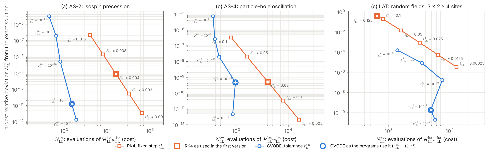
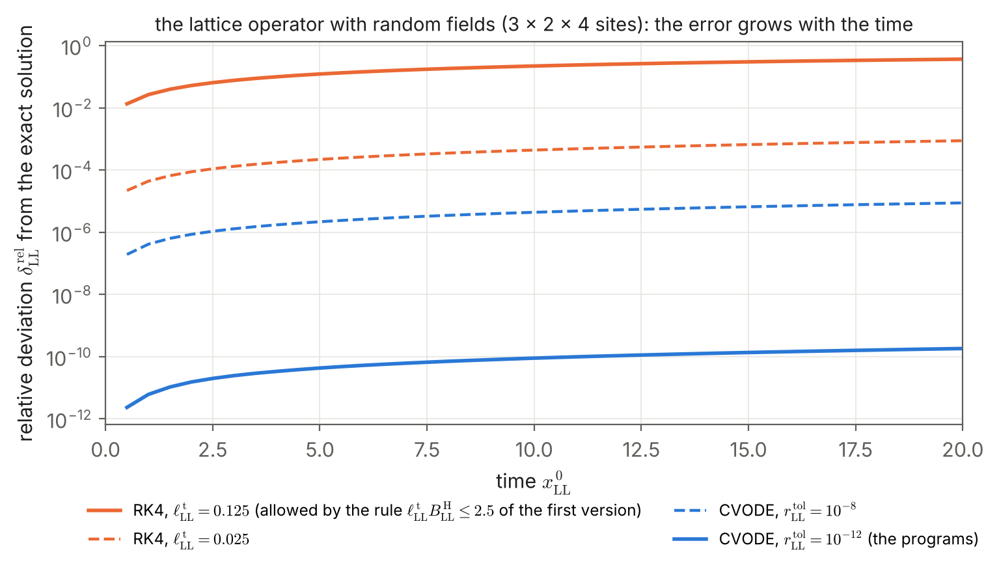
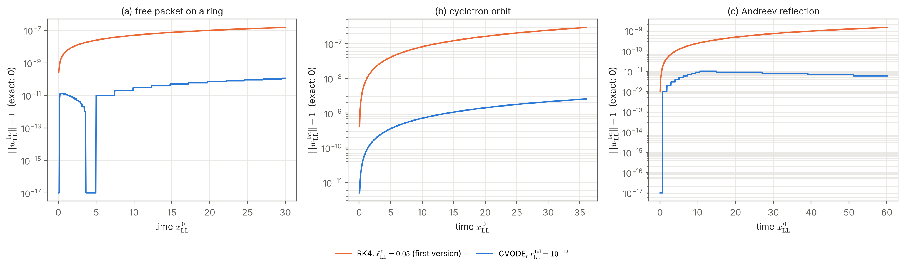
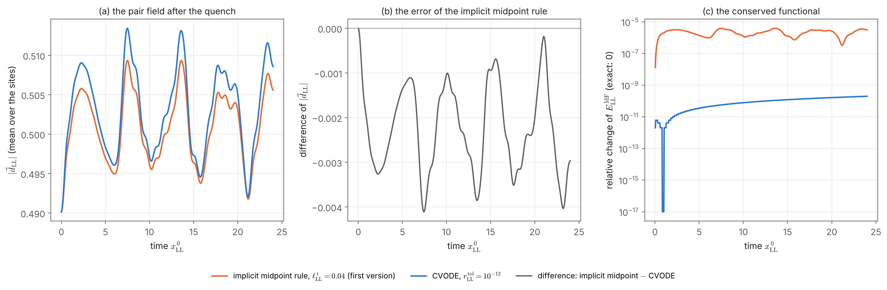
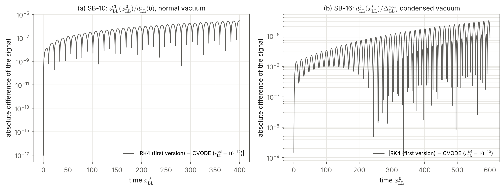

# 0. Summary

The programs of Test 2 (folder `Revision_SuperLoop/test2`) integrate the time-dependent mean-field equations of the
gauge-covariant spinor field on a lattice.  Their first version did this with two hand-written fixed-step methods:
the classical Runge-Kutta method of the fourth order (RK4: programs `t2_analytic`, `t2_fields`, the task `evolve` of
`t2_solve`, and `t2_sfbs`) and the implicit midpoint rule (the task `quench` of `t2_solve`).  On 2026-11-18 the
author of PROJECT spacetimes rejected these methods and instructed that every time integration use CVODE, the
variable-order, variable-step integrator of SUNDIALS, in the pure-Rust translation of his repository (vendored in
the folder `vendor/sundials_rs-7.8.0` of PROJECT spacetimes).  Every calculation of Test 2 that integrated in time
was redone with CVODE.  This document compares the CVODE results with the RK4 (and implicit-midpoint) results and
records the error and the rule that follows from it.

The comparison (Section 5) shows:

1. **The time-step rule of the first version guaranteed stability, not accuracy.**  It required
   $\ell^{\rm t}_{\rm LL}B^{\rm H}_{\rm LL}\le2.5$ (RK4 is stable below $2\sqrt2$).  On the lattice with random
   gauge and pair fields of check GS-13 (problem LAT), RK4 with the allowed step $\ell^{\rm t}_{\rm LL}=0.125$ deviates
   from the exact solution by 37 per cent after the time 20, and the norm of the state, which the exact evolution
   conserves, changes by 15 per cent.  CVODE with the tolerances of the programs deviates by $1.8\times10^{-10}$.
2. **The quench was wrong at the per-mille to per-cent level.**  The implicit midpoint rule with
   $\ell^{\rm t}_{\rm LL}=0.04$ gave the angular frequency 1.184485 of the amplitude oscillation of the pair field,
   the mean gap 0.5008766 after the quench and the oscillation amplitude 0.005867; CVODE gives 1.188975, 0.5031251
   and 0.007079, the same at three tolerances.  The conserved functional $E^{\rm MF}_{\rm LL}$ drifted by
   $1.9\times10^{-3}$ with the midpoint rule and by $10^{-7}$ with CVODE.  The first version explained the deviation
   $4.6\times10^{-3}$ of its frequency from the amplitude mode of the linearized equations by terms of second order in
   the amplitude and by the weaker modes; most of it was the error of the integrator.
3. **Where RK4 was accurate, CVODE is as accurate or more accurate at a smaller cost.**  For the analytic solutions
   AS-2 and AS-4, CVODE with the tolerances of the programs reaches the deviations $1.3\times10^{-11}$ and
   $4.7\times10^{-10}$ with 1494 and 963 evaluations of the right side, RK4 with the steps of the first version
   $8.7\times10^{-10}$ and $5.3\times10^{-10}$ with 16000 and 4000 evaluations.  The norm of the wave packets of the
   solver examples is conserved to $10^{-11}$ to $3\times10^{-9}$ instead of $1.5\times10^{-9}$ to $3\times10^{-7}$.
4. **The checks of the superfluid boson singlet state (SB-10, SB-16) are unchanged in substance**; CVODE moves the
   spectral line of SB-10 closer to the pole of the propagator (relative deviation $7\times10^{-9}$ instead of
   $8\times10^{-8}$) and conserves the mean-field energy 7 and 700 times better.

# 1. The instruction, the error, and the rule

**The instruction** (the author, 2026-11-18, in substance): the hand-written RK4 solver must not be used; the time
integrations must use the pure-Rust CVODE of the repository `once-ere/rustSolveIt_macos-silicon_SUNDIALS_7_8_0`, or
another applicable SUNDIALS algorithm; every calculation that used RK4 must be redone with CVODE; a provenance must
compare the CVODE results with the RK4 results; the new Rust code and its documentation must be part of PROJECT
spacetimes; the error must be remembered and not repeated.  The author decided the order of the work: Test 2 and the
notebook `3+1super-loop.nb` first, then the older code that used RK4 (the library `code/spacetimes-rs` and the three
folders `Revision_Deflation*`), in new folders, each with its own comparison.

**The error (E-CV1).**  The first version of Test 2 integrated the time-dependent lattice equations with fixed-step
methods written by hand (RK4, and the implicit midpoint rule for the self-consistent evolution), instead of a
library integrator with error control.  A fixed step chosen from a stability bound does not control the error of a
result: the error must be estimated separately for every problem, and the first version did not do that for its
largest problems (Section 5.1, problem LAT; Section 5.4, the quench).

**The rule (R-CV1).**  Every time integration of PROJECT spacetimes uses CVODE (or another integrator of SUNDIALS,
for example ARKODE or IDA, where its method fits the problem better), from the pure-Rust translation vendored in
`vendor/sundials_rs-7.8.0`, with stated tolerances; every result states the numbers of steps and evaluations and is
checked against its error budget or an exact solution.  No hand-written fixed-step time integrator is used.  The
code of the rejected RK4 is kept only inside the comparison program `t2_cvcmp` of this document, to reproduce the old
numbers.

# 2. The symbols of this document

Every symbol of this document is a symbol of the registry of the folder Revision_SuperLoop (Hard Rule 5); the table
lists each symbol that the text uses, with its plain-text names in the programs and data files and its meaning, so
that the document can be read alone.  The registry entries of the time integration ($w^{\rm lat}_{\rm LL}$,
$w^{\rm cmp}_{\rm LL}$, $n^{\rm cpx}_{\rm LL}$, $r^{\rm tol}_{\rm LL}$, $a^{\rm tol}_{\rm LL}$, $h^{\rm CV}_{\rm LL}$,
$q^{\rm CV}_{\rm LL}$, $N^{\rm st}_{\rm LL}$, $N^{\rm ev}_{\rm LL}$, $B^{\rm err}_{\rm LL}$, $\delta^{\rm rel}_{\rm LL}$,
$w^{\rm ex}_{\rm LL}$) were added for this work.  Words that are not symbols: RK4 is the classical Runge-Kutta method
of the fourth order; CVODE the integrator of SUNDIALS (SUite of Nonlinear and DIfferential/ALgebraic equation Solvers,
Lawrence Livermore National Laboratory); AS-2, AS-4 and LAT name the three test problems of Section 5.1;
"first version" means the programs of Test 2 before 2026-11-18, whose data files are kept in `test2/rk4_reference/data`.

| symbol | plain-text names | meaning |
|:----------|:----------|:--------------------------------------------|
| $\mathbb R^{1,7}_{\rm LL}$, $\mathbb R^{1,3}_{\rm LL}$; $x^p_{\rm LL}$ | `R^(1,7)_LL` `R^(1,3)_LL` `x_LL^0` `x_LL^p` `x_LL^1` `x_LL^2` `x_LL^3` `x_LL^j` | the Hermitian bi-octonions $\mathbf x=\mathbf x^\dagger=x^0_{\rm LL}\mathbf e_0+i\sum_{p=1}^7x^p_{\rm LL}\mathbf e_p$ (real $x^p_{\rm LL}$): the $7+1$ Minkowski space with the real norm $N_{\rm LL}(\mathbf x)=(x^0_{\rm LL})^2-\sum_p(x^p_{\rm LL})^2$; and its subspace of Hermitian bi-quaternions ($p\le3$), Minkowski space of $3+1$ dimensions |
| $m_{\rm LL}$, $\mu_{\rm LL}$, $\Lambda_{\rm LL}$ | `m` `mu` `Lambda` | the mass of the spinor charges, the chemical potential, and the momentum cutoff ($q_{\rm LL}<\Lambda_{\rm LL}$; $\Lambda_{\rm LL}=1$ sets the units, except where it varies) |
| $\varepsilon_{\rm LL}$, $E^\pm_{\rm LL}$, $\tilde E^\pm_{\rm LL}$ | `eps` `E^+` `E^-` `E^(+-)` `E_minus_polar` `E_plus_polar` `Etilde^+` `Etilde^-` `Etilde^(+-)` `Etilde_minus` `Etilde_plus` | the energy $\varepsilon_{\rm LL}=(q_{\rm LL}^2+m_{\rm LL}^2)^{1/2}$, the quasi-particle energies of the scalar channel $E^\pm_{\rm LL}=[(\varepsilon_{\rm LL}\pm\mu_{\rm LL})^2+\Delta_{\rm LL}^2]^{1/2}$, a function of the gap (written $E^\pm_{\rm LL}(\Delta^+_{\rm LL})$ and $E^\pm_{\rm LL}(\Delta^-_{\rm LL})$ when $\Delta_{\rm LL}$ is replaced by one of the two gaps of a general state), and those of the pseudoscalar channel, $(\tilde E^\pm_{\rm LL})^2=\varepsilon_{\rm LL}^2+\mu_{\rm LL}^2+\Delta_{\rm LL}^2\pm2[\mu_{\rm LL}^2\varepsilon_{\rm LL}^2+m_{\rm LL}^2\Delta_{\rm LL}^2]^{1/2}$ |
| $\vec d_{\rm LL}$, $d^\iota_{\rm LL}$; $\zeta_{\rm LL}$ | `dvec` `d_iota` `abs_dvec_at_min` `zeta` | the order parameter, the isospin vector $\vec d_{\rm LL}=(d^1_{\rm LL},d^2_{\rm LL},d^3_{\rm LL})\in\mathbb C^3$ with $d^\iota_{\rm LL}=-\tfrac12G_{\rm LL}\langle\Pi^\iota_{\rm LL}\rangle$, and its non-unitarity $\zeta_{\rm LL}=\lvert\vec d_{\rm LL}\times\vec d^{\,*}_{\rm LL}\rvert/\lvert\vec d_{\rm LL}\rvert^2\in[0,1]$ (plain text `cross(dvec, dvec^*)`: the cross product) |
| $x_{\rm LL}$, $\vec x_{\rm LL}$; $\partial_p$ | `x_LL` `xvec` `d_p` | a point of $\mathbb R^{1,3}_{\rm LL}$ given by its coordinates, $x_{\rm LL}=(x^0_{\rm LL},x^1_{\rm LL},x^2_{\rm LL},x^3_{\rm LL})$ (its Hermitian bi-quaternion is $x^0_{\rm LL}\mathbf e_0+i\sum_jx^j_{\rm LL}\mathbf e_j$), and its space part $\vec x_{\rm LL}=(x^1_{\rm LL},x^2_{\rm LL},x^3_{\rm LL})$; $x^0_{\rm LL}$ is the time; $\partial_p$ is the partial derivative with respect to $x^p_{\rm LL}$ (plain text `d_p`) |
| $A^\iota_{{\rm LL},p}$, $A^{\rm F}_{{\rm LL},p}$; $g^{\rm v}_{\rm LL}$, $g^{\rm F}_{\rm LL}$ | `Av_LL` `Av_LL^iota` `Av_LL^iota'` `Av_LL^iota''` `AF_LL` `g_v` `g_F` | the gauge potentials, real fields on $\mathbb R^{1,3}_{\rm LL}$: $A^\iota_{{\rm LL},p}$ of the isospin group $SU(2)_{\rm v}$ (three fields for each direction $p$) and $A^{\rm F}_{{\rm LL},p}$ of the fermion number $U(1)^{\rm F}_{\rm LL}$; $g^{\rm v}_{\rm LL}$ and $g^{\rm F}_{\rm LL}$ are their couplings (real numbers); a constant $g^{\rm F}_{\rm LL}A^{\rm F}_{{\rm LL},0}$ acts like a chemical potential |
| $\psi^{\rm p}_{\rm LL}$, $\psi^{\rm h}_{\rm LL}$ | `psi_p` `psi_h` | the particle and the hole component (eight complex functions each, in the order of the components of $\Psi_{\rm LL}$) of a mode of the mean-field equations: $\psi^{\rm p}_{\rm LL}$ transforms like $\Psi_{\rm LL}$ and $\psi^{\rm h}_{\rm LL}$ like $\Psi^*_{\rm LL}$; a component is written $\psi^{\rm p}_{{\rm LL},k}$, and a numbered mode $(\psi^{\rm p}_{{\rm LL},n},\psi^{\rm h}_{{\rm LL},n})$ |
| $E^{\rm qp}_{{\rm LL},n}$ | `E_qp` | the energy of a numbered mode of the mean-field equations in a stationary state, an eigenvalue of $\mathcal H^{\rm DB}_{\rm LL}$; the mean-field ground state is the vacuum of the quasi-particles of the modes with $E^{\rm qp}_{{\rm LL},n}>0$ |
| $\ell^{\rm x}_{\rm LL}$, $\ell^{\rm t}_{\rm LL}$, $r^{\rm W}_{\rm LL}$ | `dx` `dt` `r_W` | the lattice spacing (the same in the three directions), a time step of the lattice equations (a fixed step of the first version of Test 2, or the interval between the output times of an integration by CVODE or by IDA, which choose their own internal steps), and the coefficient of the Wilson term of the lattice equations |
| $\mathcal H^{\rm lat}_{\rm LL}$, $\varepsilon^{\rm lat}_{\rm LL}$, $B^{\rm H}_{\rm LL}$ | `H_lat` `eps_lat` `Hbound` | the lattice form of $\mathcal H^{\rm DB}_{\rm LL}$ (a matrix of 16 rows per site), the energy of a free particle on the lattice, and the bound on the largest eigenvalue magnitude of $\mathcal H^{\rm lat}_{\rm LL}$ (the first version of Test 2 chose its fixed time step from it; the solvers now use it in the bounds of their checks of the energy) |
| $P^\uparrow_{\rm LL}$, $P^{\rm h}_{\rm LL}$ | `P_up` `P_up_cvode` `P_up_rk4` `P_up_exact` `P_hole` `P_hole_cvode` `P_hole_rk4` `P_hole_exact` | the probability of isospin up of a mode, the fraction of its norm $\int d^3\vec x_{\rm LL}(\lvert\psi^{\rm p}_{\rm LL}\rvert^2+\lvert\psi^{\rm h}_{\rm LL}\rvert^2)$ that lies in the isospin-up components, and the probability of the hole, the fraction that lies in $\psi^{\rm h}_{\rm LL}$; both are functions of the time $x^0_{\rm LL}$ (in the data files the suffix `_cvode` marks the values of the integration of the lattice equations by CVODE, `_rk4` those of the integration by the fixed-step Runge-Kutta method of the first version of Test 2, kept in the folder `test2/rk4_reference` for the comparison, and `_exact` those of the exact solution) |
| $N^{\rm F}_{\rm LL}$, $E^{\rm MF}_{\rm LL}$ | `N_F` `E_MF` | the fermion number of a self-consistent lattice state, the sum over its modes and over the sites of the squared hole components $\lvert\psi^{\rm h}_{\rm LL}\rvert^2$ (conserved by the self-consistent evolution), and the mean-field energy functional, the sum over the modes of the expectation values of $\mathcal H^{\rm lat}_{\rm LL}$ without the pair field plus $2(\ell^{\rm x}_{\rm LL})^{n^{\rm act}_{\rm LL}}/G_{\rm LL}$ times the sum over the sites of $\sum_\iota\lvert d^\iota_{\rm LL}\rvert^2$ (conserved in time-independent gauge fields) |
| $\mathsf W^{\rm m}_{\rm LL}$ | `W_modes` | the matrix whose columns are the modes of a self-consistent lattice state (unit vectors with 16 components per site); the self-consistent evolution moves all columns together |
| $M^{\rm B}_{\rm LL}$ | `M_B` `M_B_GL` `line_MB` | the mass of the SFBS boson of the normal vacuum: the frequency $\omega^{\rm B}_{\rm LL}$ below the threshold $2m_{\rm LL}$ with $\chi^{\rm pr}_{\rm LL}(\omega^{\rm B}_{\rm LL},0)=1/G_{\rm LL}$ (plain text `M_B_GL`: the Ginzburg-Landau mass $(a^{\rm GL}_{\rm LL}/Z^{\rm t}_{\rm LL}(0))^{1/2}$; `line_MB`: a fitted oscillation with this frequency) |
| $u^{\rm pl}_{{\rm LL},\pm}$, $v^{\rm pl}_{{\rm LL},\pm}$ | `u_pl` `v_pl` | the two components of a mode of the uniform polar mean-field dynamics in the plane spanned by $(\chi^{\rm pw}_{\rm LL},0)$ and $(0,\mathsf K^3_{\rm LL}\chi^{\rm pw}_{\rm LL})$, for an eigenvector $\chi^{\rm pw}_{\rm LL}$ of the energy $\pm\varepsilon_{\rm LL}$; functions of the time, with $\lvert u^{\rm pl}_{{\rm LL},\pm}\rvert^2+\lvert v^{\rm pl}_{{\rm LL},\pm}\rvert^2=1$ |
| $\Delta^{\rm vac}_{\rm LL}$ | `Delta_vac` `Delta_vac_GL` | the gap of the condensed vacuum: the radius of the circle of minima of the effective potential at $\mu_{\rm LL}=0$ for $G_{\rm LL}>G^{\rm crit}_{\rm LL}$, the solution of the gap equation (plain text `Delta_vac_GL`: its Ginzburg-Landau value $(-a^{\rm GL}_{\rm LL}/(2b^{\rm GL}_{\rm LL}))^{1/2}$) |
| $w^{\rm lat}_{\rm LL}$, $w^{\rm cmp}_{\rm LL}$; $n^{\rm cpx}_{\rm LL}$ | `w_lat` `w_cmp` `n_complex` | a Nambu mode on the lattice written as one complex vector, the 16 components of $\psi^{\rm p}_{\rm LL}$ and $\psi^{\rm h}_{\rm LL}$ on every site, the sites one after the other, so that the lattice equations read $i\,\partial_0w^{\rm lat}_{\rm LL}=\mathcal H^{\rm lat}_{\rm LL}w^{\rm lat}_{\rm LL}$ (for the self-consistent evolution the columns of $\mathsf W^{\rm m}_{\rm LL}$ one after the other); one complex component of it; and the number of its complex components, $16$ times the number of sites (times the number of modes) |
| $r^{\rm tol}_{\rm LL}$, $a^{\rm tol}_{\rm LL}$ | `rtol` `atol` | the relative and the absolute tolerance of a time integration by CVODE (the programs of Test 2) or by IDA (the notebook of Test 2 in the Wolfram Language, which calls it through the function `NDSolve`), two integrators of the suite SUNDIALS: the estimated local error of every internal step is accepted only if its weighted root-mean-square norm is at most 1 (the square root of the mean, over the real unknowns, of the squares of the estimated errors, each multiplied by the weight of its unknown). The programs of Test 2 give CVODE the weight $1/(r^{\rm tol}_{\rm LL}\lvert w^{\rm cmp}_{\rm LL}\rvert+a^{\rm tol}_{\rm LL})$ for the real and for the imaginary part of every complex component $w^{\rm cmp}_{\rm LL}$ of the state; IDA has for every real unknown the weight 1 divided by the sum of $r^{\rm tol}_{\rm LL}$ times the modulus of this unknown and $a^{\rm tol}_{\rm LL}$ |
| $h^{\rm CV}_{\rm LL}$, $q^{\rm CV}_{\rm LL}$; $h^{\rm IDA}_{\rm LL}$; $N^{\rm st}_{\rm LL}$, $N^{\rm ev}_{\rm LL}$ | `h_CV` `q_CV` `h_IDA` `N_steps` `N_evals` | the size and the order of an internal step of CVODE (both chosen by CVODE, the order from 1 to 12 for the Adams-Moulton formulas); the size of an internal step of IDA (chosen by IDA, which uses the backward differentiation formulas of the orders 1 to 5 and lengthens a step only by doubling it); the number of internal steps of an integration and the number of evaluations of its right side $-i\mathcal H^{\rm lat}_{\rm LL}w^{\rm lat}_{\rm LL}$ (the cost; one step of the classical Runge-Kutta method of fourth order needs 4 evaluations) |
| $B^{\rm err}_{\rm LL}$; $\delta^{\rm rel}_{\rm LL}$, $w^{\rm ex}_{\rm LL}$ | `budget` `max_deviation` `w_exact` | the accumulated local error that the tolerances of an integration allow, $B^{\rm err}_{\rm LL}=N^{\rm st}_{\rm LL}B^{\rm loc}_{\rm LL}$, which is $N^{\rm st}_{\rm LL}\sqrt2\,(r^{\rm tol}_{\rm LL}\lVert w^{\rm lat}_{\rm LL}\rVert+a^{\rm tol}_{\rm LL}\sqrt{n^{\rm cpx}_{\rm LL}})$ with the weights of CVODE for a state of the norm $\lVert w^{\rm lat}_{\rm LL}\rVert$, the expected size of the global error of a unitary evolution; and the relative deviation of a computed state from the exact solution, $\lVert w^{\rm lat}_{\rm LL}-w^{\rm ex}_{\rm LL}\rVert/\lVert w^{\rm ex}_{\rm LL}\rVert$, with the exact solution $w^{\rm ex}_{\rm LL}$ of the same equations |

(20 entries of the registry.)


# 3. The methods

## 3.1 The equations that are integrated

The lattice equations of Test 2 for one Nambu mode, written as the complex vector $w^{\rm lat}_{\rm LL}$ of the
16 components of $\psi^{\rm p}_{\rm LL}$ and $\psi^{\rm h}_{\rm LL}$ on every site, are
$$i\,\partial_0w^{\rm lat}_{\rm LL}=\mathcal H^{\rm lat}_{\rm LL}\,w^{\rm lat}_{\rm LL},$$
with the Hermitian lattice operator $\mathcal H^{\rm lat}_{\rm LL}$ (the covariant central differences with the
links, the Wilson term, the mass, the potential of the time direction, the chemical potential $\mu_{\rm LL}$ and the
pair field).  For prescribed fields the equation is linear; with a pulse of a gauge potential the operator depends
on the time $x^0_{\rm LL}$.  The task `quench` evolves all modes of a self-consistent state, the columns of
$\mathsf W^{\rm m}_{\rm LL}$, with the pair field $d^\iota_{\rm LL}$ computed from the modes at every instant; the
equations are then nonlinear, but they still conserve the fermion number $N^{\rm F}_{\rm LL}$, the orthonormality of
the modes, and for static gauge fields the functional $E^{\rm MF}_{\rm LL}$.  The program `t2_sfbs` evolves the
uniform polar state in the planes of the plane waves, with the components $u^{\rm pl}_{{\rm LL},\pm}$,
$v^{\rm pl}_{{\rm LL},\pm}$ on radial nodes; its equations conserve the mean-field energy per volume.  In every case
the exact evolution of a single linear mode is unitary: it conserves the norm $\lVert w^{\rm lat}_{\rm LL}\rVert$.

## 3.2 RK4, the method of the first version

One RK4 step of the length $\ell^{\rm t}_{\rm LL}$ evaluates the right side $-i\mathcal H^{\rm lat}_{\rm LL}w$ four
times.  For a time-independent operator it multiplies the state by the Taylor polynomial of the fourth degree of the
exact factor $\exp(-i\ell^{\rm t}_{\rm LL}\mathcal H^{\rm lat}_{\rm LL})$,
$$w^{\rm lat}_{\rm LL}(x^0_{\rm LL}+\ell^{\rm t}_{\rm LL})=\Big(1-i\ell^{\rm t}_{\rm LL}\mathcal H^{\rm lat}_{\rm LL}-\tfrac12\big(\ell^{\rm t}_{\rm LL}\mathcal H^{\rm lat}_{\rm LL}\big)^2+\tfrac{i}{6}\big(\ell^{\rm t}_{\rm LL}\mathcal H^{\rm lat}_{\rm LL}\big)^3+\tfrac1{24}\big(\ell^{\rm t}_{\rm LL}\mathcal H^{\rm lat}_{\rm LL}\big)^4\Big)\,w^{\rm lat}_{\rm LL}(x^0_{\rm LL}).$$
An eigencomponent of the energy $E^{\rm qp}_{{\rm LL},n}$ is multiplied by this polynomial at
$\mathcal H^{\rm lat}_{\rm LL}=E^{\rm qp}_{{\rm LL},n}$; its modulus is at most 1 when
$\lvert E^{\rm qp}_{{\rm LL},n}\rvert\ell^{\rm t}_{\rm LL}\le2\sqrt2$ (stability), its modulus is smaller than 1 by
about $(E^{\rm qp}_{{\rm LL},n}\ell^{\rm t}_{\rm LL})^6/144$ per step, and its phase differs from the exact phase by
about $(E^{\rm qp}_{{\rm LL},n}\ell^{\rm t}_{\rm LL})^5/120$ per step.  The first version chose the step from the bound
$B^{\rm H}_{\rm LL}$ of the largest eigenvalue magnitude, with the rule $\ell^{\rm t}_{\rm LL}B^{\rm H}_{\rm LL}\le2.5$:
this rule keeps the method stable, but at $\lvert E^{\rm qp}_{{\rm LL},n}\rvert\ell^{\rm t}_{\rm LL}=1$ the phase error
is already $8\times10^{-3}$ per step.  The steps of the first version: 0.004 (AS-2), 0.02 (AS-4), 0.05 for the
examples `packet_free`, `cyclotron` and `andreev` of the solver ($\ell^{\rm t}_{\rm LL}B^{\rm H}_{\rm LL}=0.32$,
0.62, 0.40), 0.02 and 0.05 in SB-10 and SB-16.

## 3.3 The implicit midpoint rule, the method of the first version for the quench

The task `quench` advanced the modes by
$$\mathsf W^{\rm m}_{\rm LL}(x^0_{\rm LL}+\ell^{\rm t}_{\rm LL})=\mathsf W^{\rm m}_{\rm LL}(x^0_{\rm LL})-i\ell^{\rm t}_{\rm LL}\,\mathcal H^{\rm lat}_{\rm LL}\big[\bar{\mathsf W}^{\rm m}_{\rm LL}\big]\,\bar{\mathsf W}^{\rm m}_{\rm LL},\qquad \bar{\mathsf W}^{\rm m}_{\rm LL}=\tfrac12\big(\mathsf W^{\rm m}_{\rm LL}(x^0_{\rm LL})+\mathsf W^{\rm m}_{\rm LL}(x^0_{\rm LL}+\ell^{\rm t}_{\rm LL})\big),$$
where $\mathcal H^{\rm lat}_{\rm LL}[\bar{\mathsf W}^{\rm m}_{\rm LL}]$ is the operator with the pair field of the
midpoint modes, the implicit equation being solved by a fixed-point iteration.  The rule conserves every quadratic
invariant exactly (the orthonormality of the modes and $N^{\rm F}_{\rm LL}$), but it is only of the second order: its
error per step is of the order $(E^{\rm qp}_{{\rm LL},n}\ell^{\rm t}_{\rm LL})^3$, and with $\ell^{\rm t}_{\rm LL}=0.04$
it does not resolve the amplitude oscillation accurately (Section 5.4).

## 3.4 CVODE, the method of the present version

CVODE (SUNDIALS 7.8.0, crate `cvode_rs` of the vendored pure-Rust translation; module `t2core::cvode` of the library
of Test 2) integrates real systems.  The complex state is stored as the real vector of the real and imaginary parts of
its components, the right side $-i\mathcal H^{\rm lat}_{\rm LL}w^{\rm lat}_{\rm LL}$ in the same way.  The method:

* **Adams-Moulton formulas of the orders $q^{\rm CV}_{\rm LL}=1,\dots,12$** (the formulas of CVODE for nonstiff
  problems; the equations of Test 2 are not stiff, their eigenvalues lie on the imaginary axis).  A step of the size
  $h^{\rm CV}_{\rm LL}$ computes the new state as the old state plus $h^{\rm CV}_{\rm LL}$ times a weighted sum of the
  right side at the new time and at the $q^{\rm CV}_{\rm LL}-1$ preceding step times; the weights follow from the
  order and the recent step sizes, so that the formula is exact for polynomials of the degree $q^{\rm CV}_{\rm LL}$.
  The formula is implicit (the right side at the new time depends on the new state); CVODE solves it by the
  fixed-point iteration of SUNDIALS, which needs only evaluations of the right side.
* **Error control.**  CVODE estimates the local error of every step from the difference between the predicted and
  the corrected state, and accepts the step only if
  $$\Big(\frac{1}{2n^{\rm cpx}_{\rm LL}}\sum_{w^{\rm cmp}_{\rm LL}}\frac{\lvert\text{estimated local error of }w^{\rm cmp}_{\rm LL}\rvert^2}{\big(r^{\rm tol}_{\rm LL}\lvert w^{\rm cmp}_{\rm LL}\rvert+a^{\rm tol}_{\rm LL}\big)^2}\Big)^{1/2}\le1,$$
  the sum running over the $n^{\rm cpx}_{\rm LL}$ complex components $w^{\rm cmp}_{\rm LL}$ of the state (the factor 2:
  SUNDIALS counts the real and the imaginary part as two components).  Otherwise it repeats the step with a smaller
  $h^{\rm CV}_{\rm LL}$.  It changes $h^{\rm CV}_{\rm LL}$ and $q^{\rm CV}_{\rm LL}$ so that the steps are as large as
  the test allows.  The weight $1/(r^{\rm tol}_{\rm LL}\lvert w^{\rm cmp}_{\rm LL}\rvert+a^{\rm tol}_{\rm LL})$, the same
  for the real and the imaginary part of a component, is given to CVODE by an error-weight function of
  `t2core::cvode` (`CVodeWFtolerances`).  The standard weights of CVODE would weight the real part with its own
  modulus, which passes through zero twice in every period of an oscillation, and would force needlessly small steps.
* **Output.**  The programs ask for the state at chosen output times; CVODE steps past an output time and returns the
  value of its interpolating polynomial there, with the accuracy of the method.
* **Settings of the programs:** $r^{\rm tol}_{\rm LL}=10^{-12}$, $a^{\rm tol}_{\rm LL}=10^{-14}$ (input keys `rtol`,
  `atol` of the solver).
* **Error budget.**  If the weighted local errors are spread over the components, the 2-norm of the local error of a
  step is at most $\sqrt2(r^{\rm tol}_{\rm LL}\lVert w^{\rm lat}_{\rm LL}\rVert+a^{\rm tol}_{\rm LL}\sqrt{n^{\rm cpx}_{\rm LL}})$;
  a unitary evolution does not amplify errors, so the global error after $N^{\rm st}_{\rm LL}$ steps is expected below
  $$B^{\rm err}_{\rm LL}=N^{\rm st}_{\rm LL}\sqrt2\,\big(r^{\rm tol}_{\rm LL}\lVert w^{\rm lat}_{\rm LL}\rVert+a^{\rm tol}_{\rm LL}\sqrt{n^{\rm cpx}_{\rm LL}}\big).$$
  Check GS-13 of `t2_fields` verifies this against an exact solution (the deviation stays below $B^{\rm err}_{\rm LL}$
  for $r^{\rm tol}_{\rm LL}=10^{-8}$, $10^{-10}$, $10^{-12}$).  The solver `t2_solve` checks the conservation laws
  against $10B^{\rm err}_{\rm LL}$: CVODE's estimate of the local error is an estimate, and the true error may exceed it
  by a modest factor.

# 4. What was changed

| item | first version | present version |
|:----------|:------------------------------|:------------------------------|
| `t2core` (library) | `Lattice::rk4_step` | removed; new module `t2core::cvode` (`integrate`, `integrate_status` for a right side that can fail, `evolve_lattice`, settings, counters, error weights, error budget); dependency `cvode_rs` (path into `vendor/sundials_rs-7.8.0`) |
| `t2_analytic` AS-2, AS-4 | RK4, $\ell^{\rm t}_{\rm LL}=0.004$ and 0.02; tolerance of the checks $10^{-8}$ | CVODE at 101 output times; tolerance of the checks $10^{-9}$; counters reported; data columns `P_up_cvode`, `P_hole_cvode` |
| `t2_fields` GS-13 | the stability of the RK4 factor (a statement about the method); data `t2_rk4_stability.csv`, Figure 2 of Test 2 | CVODE against the exact spectral solution on the lattice of GS-10, for three tolerances, with the error budget; data `t2_cvode_accuracy.csv` |
| `t2_solve`, task `evolve` | RK4 with the keys `time_step`, `steps`, `output_every` (input format `t2in 1`) | CVODE with `output_step`, `outputs`, `fields_every`, `rtol`, `atol` (format `t2in 2`; the format `t2in 1` is refused with an explanation); conservation checked against $10B^{\rm err}_{\rm LL}$ |
| `t2_solve`, task `quench` | implicit midpoint rule | CVODE for all modes at once, the pair field computed from the modes at every evaluation |
| `t2_sfbs` SB-10, SB-16 | RK4, $\ell^{\rm t}_{\rm LL}=0.02$ and 0.05 | CVODE, sampled at the same times (the sampling interval of the signal is kept) |
| `t2_plot` | the titles "RK4 errors", "what the implicit midpoint rule conserves" | "CVODE errors", "the conserved quantities (CVODE errors)" |
| `t2_solve.py` (Python solver of item [3]) | RK4 (`evolve`) and the implicit midpoint rule (`quench`) in Python | the same CVODE as the Rust programs, called through the new shared library `libt2cvode` (crate `t2cvode_c`, the C interface of `t2core::cvode`) with the module `ctypes`; format `t2in 2`; the same checks and reports as the Rust solver |
| `t2_plot.py`, `make_t2_figures.py`, `t2_examples_check.py` | the titles and labels of RK4 and the midpoint rule; Figure 2 of Test 2 the RK4 factor; the fermion number of EX-7 checked against $10^{-9}$ | the titles and labels of CVODE; Figure 2 of Test 2 the accuracy of CVODE (GS-13); EX-7 against the bound of the solvers; the tables of Section 6.4 of Test 2 written as fragments |
| new | | the program `t2_cvcmp`, the shared library `libt2cvode` and the scripts of the folder `test2/cvode_vs_rk4` (this comparison) |

All programs were run again on Linux x86-64 (rustc 1.97.0); every check passes.  The data files of the first version
are kept unchanged in `test2/rk4_reference/data` (106 files, SHA-256 digests in `test2/rk4_reference/SHA256SUMS_data.txt`).
The Python solver of item [3] and the plots and documents of Test 2 were brought to CVODE in the same work; the notebook
`3+1super-loop.nb` follows (Section 7).

# 5. The comparison

## 5.1 Three problems with an exact solution

The program `t2_cvcmp` integrates three problems both with RK4 (several fixed steps, among them the step of the first
version) and with CVODE (several tolerances, $a^{\rm tol}_{\rm LL}=r^{\rm tol}_{\rm LL}/100$), and compares every
state at the output times with the exact solution $w^{\rm ex}_{\rm LL}$ by the relative deviation
$\delta^{\rm rel}_{\rm LL}=\lVert w^{\rm lat}_{\rm LL}-w^{\rm ex}_{\rm LL}\rVert/\lVert w^{\rm ex}_{\rm LL}\rVert$:

* **AS-2**: a lattice plane wave in the constant isospin potential $A^1_{{\rm LL},0}=1.5$ (periodic chain of 16 sites,
  $\ell^{\rm x}_{\rm LL}=0.5$, $m_{\rm LL}=0.4$, $\mu_{\rm LL}=0.2$; $n^{\rm cpx}_{\rm LL}=256$); the exact solution
  turns the isospin with the angular frequency $\omega^{\rm pr}_{\rm LL}=1.05$; outputs every 0.16 up to $x^0_{\rm LL}=16$;
* **AS-4**: a particle injected into the uniform polar superfluid $\vec d_{\rm LL}=(0,0,0.3)$ (16 sites,
  $\mu_{\rm LL}=0.6$); the exact solution oscillates between the particle and the hole with the frequency
  $E^-_{\rm LL}=0.456287$; outputs every 0.2 up to 20;
* **LAT**: the lattice operator with random links, potentials and pair fields on $3\times2\times4$ sites
  ($\ell^{\rm x}_{\rm LL}=0.7$, periodic in $x^1_{\rm LL}$ and $x^3_{\rm LL}$, walls in $x^2_{\rm LL}$;
  $n^{\rm cpx}_{\rm LL}=384$; seed 2026111801 of the generator SplitMix64) and a random normalized initial state; the
  exact solution is the spectral sum over the eigenpairs of $\mathcal H^{\rm lat}_{\rm LL}$; outputs every 0.5 up to 20.
  The spectral radius is 8.44, the bound $B^{\rm H}_{\rm LL}=17.67$, so that the rule of the first version allowed
  $\ell^{\rm t}_{\rm LL}\le0.1415$.

The cost is the number $N^{\rm ev}_{\rm LL}$ of evaluations of the right side (one RK4 step needs 4).

| problem | method | $\ell^{\rm t}_{\rm LL}$ or $r^{\rm tol}_{\rm LL}$ | evaluations $N^{\rm ev}_{\rm LL}$ | steps $N^{\rm st}_{\rm LL}$ | largest $\delta^{\rm rel}_{\rm LL}$ | $\delta^{\rm rel}_{\rm LL}$ at the end | largest relative change of the norm |
|:--------|:---------------|-----------------:|----------:|--------:|---------:|---------:|-----------:|
| AS-2 | RK4 | $\ell^{\rm t}_{\rm LL}=0.016$ | 4000 | 1000 | 2.23e-7 | 2.23e-7 | 4.37e-9 |
| AS-2 | RK4 | $\ell^{\rm t}_{\rm LL}=0.008$ | 8000 | 2000 | 1.39e-8 | 1.39e-8 | 1.36e-10 |
| AS-2 | RK4 (first version) | $\ell^{\rm t}_{\rm LL}=0.004$ | 16000 | 4000 | 8.72e-10 | 8.72e-10 | 4.27e-12 |
| AS-2 | RK4 | $\ell^{\rm t}_{\rm LL}=0.002$ | 32000 | 8000 | 5.45e-11 | 5.45e-11 | 1.34e-13 |
| AS-2 | RK4 | $\ell^{\rm t}_{\rm LL}=0.001$ | 64000 | 16000 | 3.41e-12 | 3.41e-12 | 4.11e-15 |
| AS-2 | CVODE | $r^{\rm tol}_{\rm LL}=10^{-6}$ | 443 | 246 | 3.14e-6 | 3.14e-6 | 1.47e-6 |
| AS-2 | CVODE | $r^{\rm tol}_{\rm LL}=10^{-8}$ | 641 | 406 | 1.99e-7 | 1.99e-7 | 1.09e-7 |
| AS-2 | CVODE | $r^{\rm tol}_{\rm LL}=10^{-10}$ | 807 | 459 | 5.11e-9 | 5.11e-9 | 3.34e-9 |
| AS-2 | CVODE (programs) | $r^{\rm tol}_{\rm LL}=10^{-12}$ | 1494 | 1013 | 1.26e-11 | 1.26e-11 | 7.85e-12 |
| AS-2 | CVODE | $r^{\rm tol}_{\rm LL}=10^{-13}$ | 1907 | 1368 | 1.34e-12 | 1.34e-12 | 9.26e-13 |
| AS-4 | RK4 | $\ell^{\rm t}_{\rm LL}=0.1$ | 800 | 200 | 3.30e-7 | 3.30e-7 | 1.25e-8 |
| AS-4 | RK4 | $\ell^{\rm t}_{\rm LL}=0.05$ | 1600 | 400 | 2.06e-8 | 2.06e-8 | 3.92e-10 |
| AS-4 | RK4 (first version) | $\ell^{\rm t}_{\rm LL}=0.02$ | 4000 | 1000 | 5.27e-10 | 5.27e-10 | 4.01e-12 |
| AS-4 | RK4 | $\ell^{\rm t}_{\rm LL}=0.01$ | 8000 | 2000 | 3.30e-11 | 3.30e-11 | 1.25e-13 |
| AS-4 | RK4 | $\ell^{\rm t}_{\rm LL}=0.005$ | 16000 | 4000 | 2.07e-12 | 2.07e-12 | 4.44e-15 |
| AS-4 | CVODE | $r^{\rm tol}_{\rm LL}=10^{-6}$ | 358 | 208 | 7.35e-6 | 6.46e-6 | 5.62e-6 |
| AS-4 | CVODE | $r^{\rm tol}_{\rm LL}=10^{-8}$ | 388 | 197 | 2.63e-7 | 3.89e-8 | 2.63e-7 |
| AS-4 | CVODE | $r^{\rm tol}_{\rm LL}=10^{-10}$ | 466 | 237 | 2.05e-8 | 2.05e-8 | 2.05e-8 |
| AS-4 | CVODE (programs) | $r^{\rm tol}_{\rm LL}=10^{-12}$ | 963 | 486 | 4.72e-10 | 4.72e-10 | 4.72e-10 |
| AS-4 | CVODE | $r^{\rm tol}_{\rm LL}=10^{-13}$ | 853 | 445 | 4.63e-12 | 4.10e-12 | 4.63e-12 |
| LAT | RK4 (first version) | $\ell^{\rm t}_{\rm LL}=0.125$ | 640 | 160 | 3.67e-1 | 3.67e-1 | 1.48e-1 |
| LAT | RK4 | $\ell^{\rm t}_{\rm LL}=0.1$ | 800 | 200 | 1.92e-1 | 1.92e-1 | 6.53e-2 |
| LAT | RK4 | $\ell^{\rm t}_{\rm LL}=0.05$ | 1600 | 400 | 1.39e-2 | 1.39e-2 | 2.54e-3 |
| LAT | RK4 | $\ell^{\rm t}_{\rm LL}=0.025$ | 3200 | 800 | 8.76e-4 | 8.76e-4 | 8.10e-5 |
| LAT | RK4 | $\ell^{\rm t}_{\rm LL}=0.0125$ | 6400 | 1600 | 5.48e-5 | 5.48e-5 | 2.54e-6 |
| LAT | RK4 | $\ell^{\rm t}_{\rm LL}=0.00625$ | 12800 | 3200 | 3.42e-6 | 3.42e-6 | 7.94e-8 |
| LAT | CVODE | $r^{\rm tol}_{\rm LL}=10^{-6}$ | 1375 | 1085 | 1.59e-4 | 1.59e-4 | 1.86e-5 |
| LAT | CVODE | $r^{\rm tol}_{\rm LL}=10^{-8}$ | 3465 | 1730 | 8.76e-6 | 8.76e-6 | 4.98e-6 |
| LAT | CVODE | $r^{\rm tol}_{\rm LL}=10^{-10}$ | 7523 | 3760 | 1.71e-7 | 1.71e-7 | 9.81e-8 |
| LAT | CVODE (programs) | $r^{\rm tol}_{\rm LL}=10^{-12}$ | 4856 | 3892 | 1.82e-10 | 1.82e-10 | 6.05e-11 |
| LAT | CVODE | $r^{\rm tol}_{\rm LL}=10^{-13}$ | 5715 | 5274 | 2.03e-11 | 2.03e-11 | 7.58e-12 |


{width=100%}

**Figure 1.** The accuracy against the cost.  For each problem the largest relative deviation
$\delta^{\rm rel}_{\rm LL}$ from the exact solution against the number $N^{\rm ev}_{\rm LL}$ of evaluations of the
right side: RK4 (orange squares, one point per fixed step $\ell^{\rm t}_{\rm LL}$) and CVODE (blue circles, one point
per tolerance $r^{\rm tol}_{\rm LL}$); the large symbols mark RK4 as the first version used it and CVODE as the programs
use it.  Data: `test2/cvode_vs_rk4/data/cmp_work_precision.csv` (program `t2_cvcmp`); figure:
`test2/cvode_vs_rk4/python/make_cmp_figures.py`.

{width=80%}

**Figure 2.** The problem LAT: the relative deviation from the exact solution against the time, for RK4 with the step
0.125 that the rule of the first version allowed and with 0.025, and for CVODE with $r^{\rm tol}_{\rm LL}=10^{-8}$ and
$10^{-12}$.  Data: `test2/cvode_vs_rk4/data/cmp_lat_deviation.csv`.

**What the table and the figures show.**  RK4 converges with the fourth power of the step (halving the step divides
the deviation by 16, as the rows of AS-2 and AS-4 show), so its accuracy is set by the step chosen; the steps of the
first version gave $10^{-9}$ for AS-2 and AS-4 because the energies of these problems times the steps are small
($\lvert E^{\rm qp}_{{\rm LL},n}\rvert\ell^{\rm t}_{\rm LL}\le0.01$), but for LAT, where the energies reach 8.4, the
allowed step 0.125 gives $\delta^{\rm rel}_{\rm LL}=0.37$.  CVODE reaches a prescribed accuracy without a choice of
step: for every problem $r^{\rm tol}_{\rm LL}=10^{-12}$ gives $\delta^{\rm rel}_{\rm LL}$ between $10^{-11}$ and
$5\times10^{-10}$.  At equal accuracy CVODE needs 10 times fewer evaluations than RK4 for AS-2 and 4 times fewer for
AS-4; for LAT it needs 7.6 times more evaluations (4856) than RK4 with the step of the first version (640), which,
however, is 37 per cent wrong; RK4 needs 12800 evaluations ($\ell^{\rm t}_{\rm LL}=0.00625$) to reach
$3.4\times10^{-6}$ there.  The cost of CVODE does not always grow monotonically as $r^{\rm tol}_{\rm LL}$ decreases (LAT at
$10^{-10}$ needs more evaluations than at $10^{-12}$): the Adams-Moulton formulas of high order have small stability
intervals on the imaginary axis, and the choice of order and step of CVODE then depends on the tolerance in a
non-monotonic way; the accuracy, which is what the tolerance controls, improves monotonically.

## 5.2 The archived RK4 numbers are reproduced

| quantity (data file) | largest deviation from the exact value, RK4 (first version) | the same, CVODE ($r^{\rm tol}_{\rm LL}=10^{-12}$) |
|:--|--:|--:|
| $P^\uparrow_{\rm LL}$ of AS-2 (`t2_A_precession.csv`) | 5.00e-10 | 1.00e-10 |
| $P^{\rm h}_{\rm LL}$ of AS-4 (`t2_B_rabi.csv`) | 2.00e-10 | 0.00e0 |


The program `t2_cvcmp` reproduces, with its own copy of the RK4 step of the first version, the columns `P_up_rk4` and
`P_hole_rk4` of the archived files `t2_A_precession.csv` and `t2_B_rabi.csv` to within half a unit of their 10th
decimal (largest differences $4.95\times10^{-11}$ and $4.98\times10^{-11}$, Appendix A): the archive and the
comparison describe the same method.  The table above gives the largest deviation of the printed probabilities of
Figures 3(b) and 4(b) of Test 2 from their exact values, for the first version and for CVODE.

## 5.3 The examples of the solver

The four time-dependent examples of `t2_solve` were solved with CVODE at $r^{\rm tol}_{\rm LL}=10^{-12}$ (the data
files of `test2/data`) and, by the script `run_convergence.sh`, at $10^{-10}$ and $10^{-13}$
($a^{\rm tol}_{\rm LL}=r^{\rm tol}_{\rm LL}/100$; folder `test2/cvode_vs_rk4/data/conv`).  The table gives, column by
column of the time series, the largest difference between the first version and CVODE at $10^{-12}$, and between
CVODE at the other two tolerances and CVODE at $10^{-12}$.  When the change from $10^{-12}$ to $10^{-13}$ is much
smaller than the difference from the first version, the CVODE result is converged and the difference is the error of
the first version.

| example | column | first version minus CVODE ($r^{\rm tol}_{\rm LL}=10^{-12}$) | CVODE $10^{-10}$ minus CVODE $10^{-12}$ | CVODE $10^{-13}$ minus CVODE $10^{-12}$ |
|:--|:--|--:|--:|--:|
| packet_free | `norm` | 1.50e-7 | 1.76e-7 | 3.00e-11 |
| packet_free | `E_expect` | 1.66e-7 | 1.96e-7 | 3.40e-11 |
| packet_free | `P_hole` | 0.00e0 | 0.00e0 | 0.00e0 |
| packet_free | `P_up` | 0.00e0 | 0.00e0 | 0.00e0 |
| packet_free | `x_mean_1` | 7.75e-6 | 8.63e-8 | 2.00e-10 |
| cyclotron | `norm` | 2.92e-7 | 7.20e-10 | 2.52e-9 |
| cyclotron | `E_expect` | 3.59e-7 | 7.71e-10 | 3.10e-9 |
| cyclotron | `P_up` | 0.00e0 | 0.00e0 | 0.00e0 |
| cyclotron | `x_mean_1` | 4.95e-6 | 1.18e-8 | 3.35e-9 |
| cyclotron | `x_mean_2` | 4.52e-6 | 1.36e-8 | 6.27e-9 |
| andreev | `norm` | 1.46e-9 | 5.60e-11 | 9.00e-12 |
| andreev | `E_expect` | 2.79e-9 | 1.29e-10 | 1.61e-11 |
| andreev | `P_hole` | 1.40e-9 | 6.20e-11 | 6.00e-12 |
| andreev | `P_up` | 1.39e-9 | 6.15e-11 | 6.00e-12 |
| andreev | `x_mean_1` | 5.06e-8 | 1.70e-9 | 4.00e-10 |
| quench | `abs_d_mean` | 4.11e-3 | 4.42e-9 | 4.20e-11 |
| quench | `abs_d_site0` | 4.11e-3 | 4.42e-9 | 4.20e-11 |
| quench | `N_F` | 1.27e-8 | 5.07e-7 | 4.90e-9 |
| quench | `E_MF` | 1.92e-3 | 3.86e-6 | 3.70e-8 |
| quench | `ortho_error` | 4.84e-10 | 2.09e-8 | 1.88e-10 |


| example | largest change of the norm, RK4 (first version) | the same, CVODE | largest change of the energy, RK4 | the same, CVODE | evaluations $N^{\rm ev}_{\rm LL}$, RK4 | the same, CVODE |
|:--|--:|--:|--:|--:|--:|--:|
| packet_free | 1.50e-7 | 1.07e-10 | 1.66e-7 | 1.23e-10 | 2400 | 1406 |
| cyclotron | 2.95e-7 | 2.56e-9 | 3.62e-7 | 3.15e-9 | 2880 | 4570 |
| andreev | 1.46e-9 | 9.81e-12 | 2.80e-9 | 1.88e-11 | 4800 | 3514 |


{width=100%}

**Figure 3.** The norm of the mode of the three evolve examples, which the exact evolution conserves: its change
$\lvert\lVert w^{\rm lat}_{\rm LL}\rVert-1\rvert$ against the time, for RK4 with $\ell^{\rm t}_{\rm LL}=0.05$ (first
version, orange) and CVODE with $r^{\rm tol}_{\rm LL}=10^{-12}$ (blue).  Data: `test2/rk4_reference/data/t2_rs_*_series.csv`
and `test2/data/t2_rs_*_series.csv`, column `norm`.  The data files print the norm with 12 decimals; the CVODE curves
therefore move in steps of $10^{-12}$, and where the printed norm is exactly 1 the change is 0 in the printed digits,
which the figure draws at $10^{-17}$, the lower edge of the panels.  The largest changes in the table above are computed
by the programs from the unrounded norm.

The wave packets were computed accurately by the first version (the centres of the packets differ by at most
$8\times10^{-6}$, the probabilities by $1.4\times10^{-9}$); CVODE conserves the norm and the energy about 100 to 1400
times better.  At $r^{\rm tol}_{\rm LL}=10^{-10}$ CVODE is not better than RK4 for `packet_free` (norm change
$1.8\times10^{-7}$): the default tolerance $10^{-12}$ of the programs is needed.

## 5.4 The quench: a correction of the results

| quantity of the example quench | implicit midpoint rule, $\ell^{\rm t}_{\rm LL}=0.04$ (first version) | CVODE, $r^{\rm tol}_{\rm LL}=10^{-10}$ | CVODE, $r^{\rm tol}_{\rm LL}=10^{-12}$ (programs) | CVODE, $r^{\rm tol}_{\rm LL}=10^{-13}$ |
|:--|--:|--:|--:|--:|
| angular frequency of the amplitude oscillation | 1.184485 | 1.188975 | 1.188975 | 1.188975 |
| mean of the gap after the quench | 0.5008765642 | 0.5031251098 | 0.5031251078 | 0.5031251078 |
| amplitude of the oscillation (fit) | 0.00586681 | 0.00707867 | 0.00707867 | 0.00707867 |
| largest change of the conserved functional $E^{\rm MF}_{\rm LL}$ | 1.92e-3 | 3.96e-6 | 9.69e-8 | 6.00e-8 |


{width=100%}

**Figure 4.** The quench of the coupling of the uniform superfluid (24 sites, 192 modes, 73728 complex unknowns):
(a) the mean of $\lvert d^\iota_{\rm LL}\rvert$ over the sites against the time, implicit midpoint rule
($\ell^{\rm t}_{\rm LL}=0.04$, first version) and CVODE ($r^{\rm tol}_{\rm LL}=10^{-12}$); (b) their difference;
(c) the relative change of the conserved functional $E^{\rm MF}_{\rm LL}$.  Data: `t2_rs_quench_series.csv` of
`test2/rk4_reference/data` and `test2/data`.

The three CVODE runs agree in the frequency to 6 decimals, in the mean gap to $2\times10^{-9}$ and in the amplitude to
8 decimals; the implicit midpoint rule differs from them by 0.00449 in the frequency (relative $3.8\times10^{-3}$),
by 0.00225 in the mean gap (relative $4.5\times10^{-3}$; the gap of the new ground state is 0.503114, close to the
CVODE mean 0.503125) and by 17 per cent in the amplitude.  The examples check of the first version compared the frequency with the amplitude (Higgs) mode of the
linearized self-consistent equations, 1.18991 at its mean gap, and found the relative deviation $4.56\times10^{-3}$,
which it attributed to the terms of second order in the amplitude and to the weaker modes.  The CVODE frequency
1.188975 deviates from that same prediction by $7.9\times10^{-4}$ only; the prediction at the CVODE mean gap is
computed by the examples check of the present version (Section 7).  The conserved quantities: the midpoint rule keeps
$N^{\rm F}_{\rm LL}$ and the orthonormality exactly (to $10^{-11}$), but $E^{\rm MF}_{\rm LL}$ only to $2\times10^{-3}$;
CVODE keeps $N^{\rm F}_{\rm LL}$ to $1.3\times10^{-8}$, the orthonormality to $5\times10^{-10}$ and
$E^{\rm MF}_{\rm LL}$ to $10^{-7}$.

## 5.5 The superfluid boson singlet state (`t2_sfbs`)

| check | quantity | RK4 (first version) | CVODE ($r^{\rm tol}_{\rm LL}=10^{-12}$) | reference value |
|:-------|:--------------------------|-------------:|-------------:|-----------:|
| SB-10 | spectral line of the pair field (pole $M^{\rm B}_{\rm LL}$ with the same nodes) | 0.279251576 | 0.279251552 | 0.279251554 |
| SB-10 | relative deviation of the line from the pole | 7.88e-8 | 7.16e-9 | |
| SB-10 | largest relative change of the mean-field energy | 1.50e-8 | 2.30e-9 | 0 |
| SB-16 | line of the gap oscillation, displacement 0.02 | 0.41888388 | 0.41888608 | |
| SB-16 | line of the gap oscillation, displacement 0.01 | 0.41895942 | 0.41896162 | |
| SB-16 | largest relative change of the mean-field energy | 6.80e-7 | 9.60e-10 | 0 |


{width=100%}

**Figure 5.** The absolute difference between the signals of RK4 (first version) and CVODE ($r^{\rm tol}_{\rm LL}=10^{-12}$)
against the time: (a) SB-10, the pair field of the normal vacuum divided by its initial value; (b) SB-16, the gap
oscillation of the condensed vacuum divided by $\Delta^{\rm vac}_{\rm LL}$.  Data: `t2_sfbs_tdbdg_normal.csv` and
`t2_sfbs_tdbdg_higgs.csv` of `test2/rk4_reference/data` and `test2/data`.

The largest differences of the two signals are $3\times10^{-6}$ and $3\times10^{-5}$ (they grow linearly with the time,
the accumulated phase error of RK4); the spectral lines that the checks measure move by $2\times10^{-8}$ and
$2\times10^{-6}$, and both checks pass as before.

# 6. Conclusions

* The first version was accurate where the energies times the step were small (AS-2, AS-4, the wave packets, SB-10,
  SB-16); its numbers there are confirmed by CVODE within $10^{-6}$ or better.
* The first version was inaccurate for the quench (relative errors of the frequency, of the mean gap and of the
  amplitude of the amplitude oscillation: $3.8\times10^{-3}$, $4.5\times10^{-3}$ and 17 per cent), and its time-step rule allowed steps with which RK4 is useless on
  lattices with large energies (problem LAT: 37 per cent).
* CVODE controls the error by its tolerances; with $r^{\rm tol}_{\rm LL}=10^{-12}$ and $a^{\rm tol}_{\rm LL}=10^{-14}$
  every result of Test 2 is converged to the printed digits, as the three tolerances of Section 5.3 show.

# 7. Status of the work and how to reproduce it

**Done:** the vendored SUNDIALS; `t2core::cvode`; the Rust programs `t2_analytic`, `t2_fields`, `t2_solve`, `t2_sfbs`,
`t2_plot` with CVODE; the Python solver `t2_solve.py` with the same CVODE through the shared library `libt2cvode`; all
data files and figures of Test 2; the documents of Test 2 and of the folder Revision_SuperLoop; the comparison program
`t2_cvcmp`, the convergence runs and the figures of this document; the registry entries of the new symbols.
**Following steps:** the notebook `3+1super-loop.nb` (its time integrations with a SUNDIALS method of the Wolfram
Language), then the older code of the repository that integrates in time with a fixed-step method.

On the Mac (Terminal), from the folder of the repository:

```bash
cd "/Users/nsh/Developer/github/spacetimes/Revision_SuperLoop/test2/rust"
cargo build --release
for p in t2_fields t2_analytic t2_sfbs; do ./target/release/$p; done
cd ..
for n in packet_free cyclotron andreev kink_spectrum ground_state kink_ground_state quench; do
  ./rust/target/release/t2_solve examples/$n.t2in --out data/t2_rs_$n
  python3 python/t2_solve.py examples/$n.t2in --out data/t2_py_$n
done
bash cvode_vs_rk4/run_convergence.sh "$PWD/rust/target/release/t2_solve"
./rust/target/release/t2_cvcmp
cd .. && python3 test2/cvode_vs_rk4/python/make_cmp_figures.py
```

The first two lines build every program of Test 2 and the shared library `libt2cvode` of the Python solver (the vendored
SUNDIALS is compiled with them); the loop runs the three check programs, the next loop the seven examples of both
solvers; `run_convergence.sh` solves the four
time-dependent examples at the tolerances $10^{-10}$ and $10^{-13}$; `t2_cvcmp` writes the comparison (it exits with
status 1 if one of its checks fails); the last line draws the five figures.  The programs write their outputs into the
folders named in the text.

# 8. The files of the comparison

| file (in the folder `Revision_SuperLoop/test2`) | content |
|:------------------------|:--------------------|
| `cvode_vs_rk4/P_CVODE_vs_RK4.src.md` | the hand-written source of this document (the assembly inserts the symbol table, the tables of Section 5, the report, the code and this list) |
| `rust/t2core/src/cvode.rs` | the module of the time integration with CVODE (library t2core) |
| `rust/t2core/src/lib.rs` | the library t2core: its list of modules |
| `rust/t2core/src/lattice.rs` | the lattice operator (its RK4 step removed) |
| `rust/t2core/Cargo.toml` | the manifest of t2core (dependency on the vendored crate cvode_rs) |
| `rust/t2analytic/src/main.rs` | the program t2_analytic (AS-2 and AS-4 with CVODE) |
| `rust/t2fields/src/main.rs` | the program t2_fields (GS-13: CVODE against the exact spectral solution) |
| `rust/t2solve/src/main.rs` | the solver t2_solve (tasks evolve and quench with CVODE) |
| `rust/t2solve/src/input.rs` | the input format t2in 2 of the solver |
| `rust/t2solve/src/ops.rs` | the operators of the solver |
| `rust/t2sfbs/src/main.rs` | the program t2_sfbs (SB-10, SB-16 with CVODE) |
| `rust/t2plot/src/main.rs` | the plotting program t2_plot |
| `rust/Cargo.toml` | the manifest of the workspace of Test 2 |
| `rust/Cargo.lock` | the locked versions of the crates |
| `rust/t2cvode_c/Cargo.toml` | the manifest of the shared library libt2cvode |
| `rust/t2cvode_c/src/lib.rs` | the C interface of t2core::cvode (the shared library libt2cvode of the Python solver) |
| `python/t2_solve.py` | the Python solver (tasks evolve and quench with CVODE through libt2cvode) |
| `python/t2_examples_check.py` | the checks EX-1 to EX-8 of the examples |
| `python/t2_plot.py` | the Python plotter of the solutions |
| `python/make_t2_figures.py` | the figures of items [1] and [2] of Test 2 (Figure 2: CVODE, check GS-13) |
| `../../vendor/sundials_rs-7.8.0/SHA256SUMS.txt` | the digests of the 283 vendored files of SUNDIALS 7.8.0 in Rust |
| `rust/t2cvcmp/src/main.rs` | the comparison program t2_cvcmp |
| `rust/t2cvcmp/Cargo.toml` | its manifest |
| `cvode_vs_rk4/run_convergence.sh` | the convergence runs of the solver examples |
| `cvode_vs_rk4/python/make_cmp_figures.py` | the figures of this document |
| `cvode_vs_rk4/tools/assemble_provenance.py` | this assembly of the document |
| `cvode_vs_rk4/tools/build_docs.sh` | the conversion .md -> .tex -> .pdf |
| `cvode_vs_rk4/tools/doc_header.tex` | the LaTeX header of the conversion |
| `cvode_vs_rk4/data/cmp_report.txt` | the report of t2_cvcmp (Appendix A) |
| `cvode_vs_rk4/data/cmp_tables.md` | the tables of Section 5, written by t2_cvcmp |
| `cvode_vs_rk4/data/cmp_work_precision.csv` | the runs of Section 5.1 (Figure 1) |
| `cvode_vs_rk4/data/cmp_lat_deviation.csv` | the deviation of LAT against the time (Figure 2) |
| `cvode_vs_rk4/data/cmp_series_differences.csv` | the differences of the time series (Sections 5.3, 5.5) |
| `rk4_reference/SHA256SUMS_data.txt` | the digests of the 106 archived data files of the first version |
| `cvode_vs_rk4/data/conv/` (36 files) | the convergence runs of the solver (Section 5.3): for each of the four examples and each of the tolerances $10^{-10}$ and $10^{-13}$ the input file `.t2in`, the fields, the time series and the summary |
| `cvode_vs_rk4/figures/` (10 files) | the five figures of this document, each as `.pdf` and `.png` |

The SHA-256 digests of these files (each line: the digest, two spaces, the path in the folder `Revision_SuperLoop/test2`; the command `sha256sum -c` on Linux, or `shasum -a 256 -c` on macOS, run in that folder with these lines as input, checks them):

```text
9daa10d19e02cdde6717421969fbab4272f7545d7a9eb553879c58f6e81b9bea  cvode_vs_rk4/P_CVODE_vs_RK4.src.md
757a4254c88030fd7662b064d77376ea6f806f1eb41f12205d5f31d5a84fc9d9  rust/t2core/src/cvode.rs
5ffa38243c640b9a0c56f599bd823d009f100d766827241d5bb916b2aa062489  rust/t2core/src/lib.rs
dab79f76867469c867f54f7596f5afe3541ff13ac20055e213fc1485b6770783  rust/t2core/src/lattice.rs
4e8d8ca5c485c44a0dbf8392db86f98b4b3539ad4c6dae7cc9e4e1146c5423c1  rust/t2core/Cargo.toml
8fb5ad97b0919f63a06d573f1d51ed92c65bf9e4cef05e79d35c7f270d75d795  rust/t2analytic/src/main.rs
11683e09d28b96cd27ad96c7081df897a228b8059d9b668821475e4810d08500  rust/t2fields/src/main.rs
51ece54663942a06f2d506cc703e821c2e9d6398fe3557ba2448c1415ef14435  rust/t2solve/src/main.rs
496582dcac974a071fcdf5f512d6d6541c54168576433bafbec7fa34c6f77109  rust/t2solve/src/input.rs
ffbf4d84fc45f3b37efa79167881d99ec83557ad646beebd07da78eafcfa13da  rust/t2solve/src/ops.rs
e45d9db743d3954fe9ea282fbd5505b7c74bf6974842c6500e035e6a1fddb787  rust/t2sfbs/src/main.rs
aa740ea0100c9dfc5b8e9986c5d3caf28f84d558a199b3275133b879f06f063f  rust/t2plot/src/main.rs
050fa0a71bf084eccd2e569177b71ef1d4c8648778a3706548f681012b5657ad  rust/Cargo.toml
0dad56f6e3c2fe012005166c6d0d24973204cd28c88adab8f427f6241844f2f4  rust/Cargo.lock
c8ef47dadc0f3a764969e9078d291b56d1fda6214c5b287dd3701478a546381e  rust/t2cvode_c/Cargo.toml
01c1d1ba6b299c3cab31973e2406850af688a900e3f439c2833529ac000462bb  rust/t2cvode_c/src/lib.rs
331b07273d2479c125d98ae081d3fd111abac02a82c81cc1c089a6633e8b1d58  python/t2_solve.py
643f9b6a5a0f716dac48f228a7778fa22431f3b08e00c8b852e609630ba6152a  python/t2_examples_check.py
e5ec0c5d264889a06265e021bbf5ce540bb56a011f005fa2f4453e89ef0d70e6  python/t2_plot.py
d5d38db002c97ab373693decf46f1e112a141273cad50b0611a2831ef161d9ad  python/make_t2_figures.py
a062365c7cc9f0e4bad502b9d5fc0a51d16dee868ef2edfee9bfd92ded3de94c  ../../vendor/sundials_rs-7.8.0/SHA256SUMS.txt
11ac2ecd6a36d5b8f5323e7a3e13b9ad476cdd2b72c89099a0015e8ee352dc54  rust/t2cvcmp/src/main.rs
bb6ec652913d355b2857746b223c186278923f631428b2633444156be19e9dd9  rust/t2cvcmp/Cargo.toml
74ab8cda1fe469b7d71651cd2847fcb2a41076cf7cae08a957de19b45e40bd34  cvode_vs_rk4/run_convergence.sh
3a48b57f9f6a5b69ce2c6d507107a93f87f23b446308091dd3a5c705cbe25537  cvode_vs_rk4/python/make_cmp_figures.py
3a5f7205f573fdae845c1f4cec3768bef74bf9d996b6750e2efa20a74589c33f  cvode_vs_rk4/tools/assemble_provenance.py
e02941150181793d5f320400aa446aa1df24d55a6b70f86183a7360a5b7a0d89  cvode_vs_rk4/tools/build_docs.sh
8273504406ab37fa7919ecb9287cfed861ee5a3b19d676f7432898e8e1d51d63  cvode_vs_rk4/tools/doc_header.tex
48e69b803c0d8b8a1d8f3bc93960b986d8c1a8c0fdb0f05166b99cca84f980ee  cvode_vs_rk4/data/cmp_report.txt
372e72ad62dd5e7ec5dff3955edde2585c5a9edce9bfcfc3d76aa7ac9474f562  cvode_vs_rk4/data/cmp_tables.md
fea0faf35475c6e7318668dd0db6642e6e328d8fe26e68ed12c7375f1425deae  cvode_vs_rk4/data/cmp_work_precision.csv
4d15f7c94146c14ec1773e5db089ee2428a3d1b70dd8b7824f7fed1570df590e  cvode_vs_rk4/data/cmp_lat_deviation.csv
41c24ed19df3a6dd1179b6b31bd3985d7a87acde295ef372905fe03e766c6520  cvode_vs_rk4/data/cmp_series_differences.csv
55fa65783cedfcb1af6275515025be90c8ca863a0418166ca9580dea7913e410  rk4_reference/SHA256SUMS_data.txt
46310bbd846f8501e686c0200c9cd7324ddf36c4d462dab754e716c38eecf17e  cvode_vs_rk4/data/conv/andreev_rtol1e-10.t2in
0f885e0bcea41ec0fc24769b8ea16b6f5828b4d49e5c31124a14a041acd08877  cvode_vs_rk4/data/conv/andreev_rtol1e-10_fields.csv
bc1419cdcdab70e2497efbcf66d457676b8f297cd4fd37b266f107f428b38214  cvode_vs_rk4/data/conv/andreev_rtol1e-10_series.csv
1e0ab48a585ad9388732de8b2a64a7e90907eee260506152c3450908656870e9  cvode_vs_rk4/data/conv/andreev_rtol1e-10_summary.txt
e4375430cf22436d49cb358490f63f2559954274a5fa77fb6eaaf98514a94269  cvode_vs_rk4/data/conv/andreev_rtol1e-13.t2in
61a91f729af99e943678a3fc00ebbde53b2f5d125b3f0ccfa8fde70162cfe15b  cvode_vs_rk4/data/conv/andreev_rtol1e-13_fields.csv
c62eb09c720f50376daf0805240ef64da25b94adb1992e0bd599e0fc69416cf3  cvode_vs_rk4/data/conv/andreev_rtol1e-13_series.csv
79a2cfb640908ea5d3ee90906c15506a4143bbf873386c5542c05410fd1a0f77  cvode_vs_rk4/data/conv/andreev_rtol1e-13_summary.txt
0c25103622adf74bca4870389031dd4bec37dbb5ea2a9d1ed36d84f77d8e8a0e  cvode_vs_rk4/data/conv/cyclotron_rtol1e-10.t2in
32e11f6ec6875b94e3ccca982cf9e4273845b22e6f838035583d8d8bcd27b639  cvode_vs_rk4/data/conv/cyclotron_rtol1e-10_fields.csv
4517cc1238bd38857f81f4967fb998bd6f836dd829a4ef8f434a8fba900300bc  cvode_vs_rk4/data/conv/cyclotron_rtol1e-10_series.csv
eecaf3591a643a656006415a462de5ee8d6c484a791e5b6e5ab1765196faec36  cvode_vs_rk4/data/conv/cyclotron_rtol1e-10_summary.txt
edce3fed5a9445b220b8f013a7e2f1d4663b8aebbc2689ed823729f75d6a2a66  cvode_vs_rk4/data/conv/cyclotron_rtol1e-13.t2in
45881806e19f3b98615fabf762baefe8bcb8ecdf9cece6f9392c7589290579d2  cvode_vs_rk4/data/conv/cyclotron_rtol1e-13_fields.csv
7038c61df1a3b4a3217f4acfa8df1bb62e610d793cd96f2bbb11662699aaff7c  cvode_vs_rk4/data/conv/cyclotron_rtol1e-13_series.csv
0182f1932e6565ec3baa020be44a664e5405b56f4ccdf735d9fd0113b6ba3f07  cvode_vs_rk4/data/conv/cyclotron_rtol1e-13_summary.txt
4f529989b9fada4f1dd6e4d2c5e84cbff3b867e4ca5d44e474c634953bcf8ce6  cvode_vs_rk4/data/conv/packet_free_rtol1e-10.t2in
12a56df2793143cceb307518c1d7a951c89331c3f10db9b99e26702e940aee56  cvode_vs_rk4/data/conv/packet_free_rtol1e-10_fields.csv
5d3e6de60bd827055f738a3cf1a8171e98fbe22c20498e5d1e537e0bc2e88f47  cvode_vs_rk4/data/conv/packet_free_rtol1e-10_series.csv
c33f857d745b785661e41c22b9d5c8432a4874f645d015047db50e56e2b42d5c  cvode_vs_rk4/data/conv/packet_free_rtol1e-10_summary.txt
3de6b714810579af5f23778b941c3cbd6976ae6b0d817f8823cd0f548eb38cd3  cvode_vs_rk4/data/conv/packet_free_rtol1e-13.t2in
03ac0010bfa50139ce34fa7b2e6d6508ad0732a9992c2da4b7c03318fcf7d56c  cvode_vs_rk4/data/conv/packet_free_rtol1e-13_fields.csv
1e032e75564f3fc0f4e2b159d2c752d8c5b9e21382edf2dc1807f9675bd7e3c4  cvode_vs_rk4/data/conv/packet_free_rtol1e-13_series.csv
d6522bdec17c7025a7b87c63ee024f10949bb60c589e1a9cbdf467e4d77eb34f  cvode_vs_rk4/data/conv/packet_free_rtol1e-13_summary.txt
2f92bbf302825e10e8d26c4e2e86ad785dc6dd73907c786aeb04c6fba4193679  cvode_vs_rk4/data/conv/quench_rtol1e-10.t2in
a9a67107b4d3bcc73a2e068071b2f27ee1229210ed86e075149d8e943412e31b  cvode_vs_rk4/data/conv/quench_rtol1e-10_fields.csv
fedf30fa15f587b6da6e0f5ba98ecaa4bc924e20e68920b4ba797c215de66ea7  cvode_vs_rk4/data/conv/quench_rtol1e-10_iterations.csv
2e755102bae80ec636a04d65e4fea75b689f141b421854662fe2ba113c93424c  cvode_vs_rk4/data/conv/quench_rtol1e-10_series.csv
9b391bb8c06355e07562835d407212cedc8ed83ab0960786bf803be010c25f4f  cvode_vs_rk4/data/conv/quench_rtol1e-10_spectrum.csv
aa8bde8bb5a037d5327242704c82df1557df0a082420389c6f8357cefa789cd9  cvode_vs_rk4/data/conv/quench_rtol1e-10_summary.txt
1fc4629bc3d0ad5d895397ff147de6b63ba7412fecc665fe13c89a8771767ca8  cvode_vs_rk4/data/conv/quench_rtol1e-13.t2in
ab787e259c9fb52450d27f347a8c43a8b35e07f76a4e789e200ce5bb0c7b7f99  cvode_vs_rk4/data/conv/quench_rtol1e-13_fields.csv
fedf30fa15f587b6da6e0f5ba98ecaa4bc924e20e68920b4ba797c215de66ea7  cvode_vs_rk4/data/conv/quench_rtol1e-13_iterations.csv
c25e8c26476f8963c6c6dbbe0d2afe13ba5816e214dd99d36cd98f075be0a8bd  cvode_vs_rk4/data/conv/quench_rtol1e-13_series.csv
9b391bb8c06355e07562835d407212cedc8ed83ab0960786bf803be010c25f4f  cvode_vs_rk4/data/conv/quench_rtol1e-13_spectrum.csv
e760c963874af9c25b953a39c79cf898e5554fd81661c9b7ad0b9783b37e38f0  cvode_vs_rk4/data/conv/quench_rtol1e-13_summary.txt
44ecb52ead82dbd052cb4ddbcb7486899184a5222688358215f91887b05204f2  cvode_vs_rk4/figures/fig_cmp_conservation.pdf
9764badfd131b386853c3c5301eb62155cb038f5caab81b7e8ba2d4a852625af  cvode_vs_rk4/figures/fig_cmp_conservation.png
ff65a931f27db57a6e588a9c12fa3428af98e05e122ce029e4b1eb1574beb02c  cvode_vs_rk4/figures/fig_cmp_lat_time.pdf
5ab90d13d08e79585a679043ac6aa4ec379f723fcb074737982a4b1514ddf7df  cvode_vs_rk4/figures/fig_cmp_lat_time.png
84c00e232fbadacceb00457d58421ef35a30cbce180637f7a843c0f1a64a9568  cvode_vs_rk4/figures/fig_cmp_quench.pdf
4ce9a92498c1f9b8287576a7d642d4802aecacf11ea489815c3bb634a70f8c84  cvode_vs_rk4/figures/fig_cmp_quench.png
d23de0775148f041688280bb78ee891218a2c5f150ff0760e652a22c9a427b34  cvode_vs_rk4/figures/fig_cmp_sfbs.pdf
92014e585daf58b90a637f85f151e7660475208d93ba78c722ac251044f1b1c0  cvode_vs_rk4/figures/fig_cmp_sfbs.png
09a3606921655bc9f044d8addde0c84c1eb94936327384dad6a932ffa61e722c  cvode_vs_rk4/figures/fig_cmp_work_precision.pdf
26b322a6384a9d5c74c2b3b73f93742c918762dd3cb0c5c9771213223f6c9c84  cvode_vs_rk4/figures/fig_cmp_work_precision.png
```


# Appendix A. The report of the program `t2_cvcmp`

```text
Revision_SuperLoop, folder test2/cvode_vs_rk4, program `t2_cvcmp`: CVODE (SUNDIALS 7.8.0, pure Rust) against RK4 and the implicit midpoint rule of the first version of Test 2
problem LAT: spectral radius of H_lat 8.439966, the bound Hbound 17.669604; the time-step rule of the first version, dt Hbound <= 2.5, allowed dt <= 0.141486
problem AS-2: isospin precession of a lattice plane wave in the constant isospin potential Av_LL^1_0 = 1.5 (periodic chain of 16 sites, dx = 0.5, m = 0.4, mu = 0.2; 256 complex unknowns; outputs every 0.16 up to x^0 = 16)
  RK4   dt = 0.016        4000 evaluations    1000 steps  largest deviation 2.23e-7  at the end 2.23e-7  relative norm change 4.37e-9
  RK4   dt = 0.008        8000 evaluations    2000 steps  largest deviation 1.39e-8  at the end 1.39e-8  relative norm change 1.36e-10
  RK4   dt = 0.004       16000 evaluations    4000 steps  largest deviation 8.72e-10  at the end 8.72e-10  relative norm change 4.27e-12  (the step of the first version)
  RK4   dt = 0.002       32000 evaluations    8000 steps  largest deviation 5.45e-11  at the end 5.45e-11  relative norm change 1.34e-13
  RK4   dt = 0.001       64000 evaluations   16000 steps  largest deviation 3.41e-12  at the end 3.41e-12  relative norm change 4.11e-15
  CVODE rtol = 1e-6        443 evaluations     246 steps  largest deviation 3.14e-6  at the end 3.14e-6  relative norm change 1.47e-6
  CVODE rtol = 1e-8        641 evaluations     406 steps  largest deviation 1.99e-7  at the end 1.99e-7  relative norm change 1.09e-7
  CVODE rtol = 1e-10       807 evaluations     459 steps  largest deviation 5.11e-9  at the end 5.11e-9  relative norm change 3.34e-9
  CVODE rtol = 1e-12      1494 evaluations    1013 steps  largest deviation 1.26e-11  at the end 1.26e-11  relative norm change 7.85e-12  (the setting of the programs)
  CVODE rtol = 1e-13      1907 evaluations    1368 steps  largest deviation 1.34e-12  at the end 1.34e-12  relative norm change 9.26e-13
problem AS-4: particle-hole (Rabi) oscillation of a particle injected into the uniform polar superfluid dvec = (0, 0, 0.3) (periodic chain of 16 sites, dx = 0.5, m = 0.4, mu = 0.6; 256 complex unknowns; outputs every 0.2 up to x^0 = 20)
  RK4   dt = 0.1           800 evaluations     200 steps  largest deviation 3.30e-7  at the end 3.30e-7  relative norm change 1.25e-8
  RK4   dt = 0.05         1600 evaluations     400 steps  largest deviation 2.06e-8  at the end 2.06e-8  relative norm change 3.92e-10
  RK4   dt = 0.02         4000 evaluations    1000 steps  largest deviation 5.27e-10  at the end 5.27e-10  relative norm change 4.01e-12  (the step of the first version)
  RK4   dt = 0.01         8000 evaluations    2000 steps  largest deviation 3.30e-11  at the end 3.30e-11  relative norm change 1.25e-13
  RK4   dt = 0.005       16000 evaluations    4000 steps  largest deviation 2.07e-12  at the end 2.07e-12  relative norm change 4.44e-15
  CVODE rtol = 1e-6        358 evaluations     208 steps  largest deviation 7.35e-6  at the end 6.46e-6  relative norm change 5.62e-6
  CVODE rtol = 1e-8        388 evaluations     197 steps  largest deviation 2.63e-7  at the end 3.89e-8  relative norm change 2.63e-7
  CVODE rtol = 1e-10       466 evaluations     237 steps  largest deviation 2.05e-8  at the end 2.05e-8  relative norm change 2.05e-8
  CVODE rtol = 1e-12       963 evaluations     486 steps  largest deviation 4.72e-10  at the end 4.72e-10  relative norm change 4.72e-10  (the setting of the programs)
  CVODE rtol = 1e-13       853 evaluations     445 steps  largest deviation 4.63e-12  at the end 4.10e-12  relative norm change 4.63e-12
problem LAT: the lattice operator with random links, potentials and pair fields on 3 x 2 x 4 sites (dx = 0.7, periodic in x^1 and x^3, walls in x^2, m = 0.4, mu = 0.3; 384 complex unknowns; random normalized initial state; outputs every 0.5 up to x^0 = 20; exact solution: the spectral sum)
  RK4   dt = 0.125         640 evaluations     160 steps  largest deviation 3.67e-1  at the end 3.67e-1  relative norm change 1.48e-1  (the step of the first version)
  RK4   dt = 0.1           800 evaluations     200 steps  largest deviation 1.92e-1  at the end 1.92e-1  relative norm change 6.53e-2
  RK4   dt = 0.05         1600 evaluations     400 steps  largest deviation 1.39e-2  at the end 1.39e-2  relative norm change 2.54e-3
  RK4   dt = 0.025        3200 evaluations     800 steps  largest deviation 8.76e-4  at the end 8.76e-4  relative norm change 8.10e-5
  RK4   dt = 0.0125       6400 evaluations    1600 steps  largest deviation 5.48e-5  at the end 5.48e-5  relative norm change 2.54e-6
  RK4   dt = 0.00625     12800 evaluations    3200 steps  largest deviation 3.42e-6  at the end 3.42e-6  relative norm change 7.94e-8
  CVODE rtol = 1e-6       1375 evaluations    1085 steps  largest deviation 1.59e-4  at the end 1.59e-4  relative norm change 1.86e-5
  CVODE rtol = 1e-8       3465 evaluations    1730 steps  largest deviation 8.76e-6  at the end 8.76e-6  relative norm change 4.98e-6
  CVODE rtol = 1e-10      7523 evaluations    3760 steps  largest deviation 1.71e-7  at the end 1.71e-7  relative norm change 9.81e-8
  CVODE rtol = 1e-12      4856 evaluations    3892 steps  largest deviation 1.82e-10  at the end 1.82e-10  relative norm change 6.05e-11  (the setting of the programs)
  CVODE rtol = 1e-13      5715 evaluations    5274 steps  largest deviation 2.03e-11  at the end 2.03e-11  relative norm change 7.58e-12
AS-2: RK4 with the step of the first version (dt = 0.004): deviation 8.72e-10 with 16000 evaluations; CVODE as the programs use it (rtol = 1e-12): deviation 1.26e-11 with 1494 evaluations
AS-4: RK4 with the step of the first version (dt = 0.02): deviation 5.27e-10 with 4000 evaluations; CVODE as the programs use it (rtol = 1e-12): deviation 4.72e-10 with 963 evaluations
LAT: RK4 with the step of the first version (dt = 0.125): deviation 3.67e-1 with 640 evaluations; CVODE as the programs use it (rtol = 1e-12): deviation 1.82e-10 with 4856 evaluations
[PASS] the RK4 run of AS-2 with dt = 0.004 reproduces the column P_up_rk4 of the archived file t2_A_precession.csv at its 101 times (largest difference 4.95e-11, allowed 5.1e-11: half a unit of the 10th decimal)
[PASS] the RK4 run of AS-4 with dt = 0.02 reproduces the column P_hole_rk4 of the archived file t2_B_rabi.csv at its 101 times (largest difference 4.98e-11, allowed 5.1e-11)
the probabilities of Figures 3(b) and 4(b): largest |P_up - exact| RK4 5.00e-10, CVODE 1.00e-10; largest |P_hole - exact| RK4 2.00e-10, CVODE 0.00e0 (both files print 10 decimals)
[PASS] example packet_free: the four time series have the same 601 output times
  packet_free norm: first version - CVODE 1.50e-7; CVODE 1e-10 - 1e-12 1.76e-7; CVODE 1e-13 - 1e-12 3.00e-11
  packet_free E_expect: first version - CVODE 1.66e-7; CVODE 1e-10 - 1e-12 1.96e-7; CVODE 1e-13 - 1e-12 3.40e-11
  packet_free P_hole: first version - CVODE 0.00e0; CVODE 1e-10 - 1e-12 0.00e0; CVODE 1e-13 - 1e-12 0.00e0
  packet_free P_up: first version - CVODE 0.00e0; CVODE 1e-10 - 1e-12 0.00e0; CVODE 1e-13 - 1e-12 0.00e0
  packet_free x_mean_1: first version - CVODE 7.75e-6; CVODE 1e-10 - 1e-12 8.63e-8; CVODE 1e-13 - 1e-12 2.00e-10
[PASS] example cyclotron: the four time series have the same 721 output times
  cyclotron norm: first version - CVODE 2.92e-7; CVODE 1e-10 - 1e-12 7.20e-10; CVODE 1e-13 - 1e-12 2.52e-9
  cyclotron E_expect: first version - CVODE 3.59e-7; CVODE 1e-10 - 1e-12 7.71e-10; CVODE 1e-13 - 1e-12 3.10e-9
  cyclotron P_up: first version - CVODE 0.00e0; CVODE 1e-10 - 1e-12 0.00e0; CVODE 1e-13 - 1e-12 0.00e0
  cyclotron x_mean_1: first version - CVODE 4.95e-6; CVODE 1e-10 - 1e-12 1.18e-8; CVODE 1e-13 - 1e-12 3.35e-9
  cyclotron x_mean_2: first version - CVODE 4.52e-6; CVODE 1e-10 - 1e-12 1.36e-8; CVODE 1e-13 - 1e-12 6.27e-9
[PASS] example andreev: the four time series have the same 1201 output times
  andreev norm: first version - CVODE 1.46e-9; CVODE 1e-10 - 1e-12 5.60e-11; CVODE 1e-13 - 1e-12 9.00e-12
  andreev E_expect: first version - CVODE 2.79e-9; CVODE 1e-10 - 1e-12 1.29e-10; CVODE 1e-13 - 1e-12 1.61e-11
  andreev P_hole: first version - CVODE 1.40e-9; CVODE 1e-10 - 1e-12 6.20e-11; CVODE 1e-13 - 1e-12 6.00e-12
  andreev P_up: first version - CVODE 1.39e-9; CVODE 1e-10 - 1e-12 6.15e-11; CVODE 1e-13 - 1e-12 6.00e-12
  andreev x_mean_1: first version - CVODE 5.06e-8; CVODE 1e-10 - 1e-12 1.70e-9; CVODE 1e-13 - 1e-12 4.00e-10
[PASS] example quench: the four time series have the same 601 output times
  quench abs_d_mean: first version - CVODE 4.11e-3; CVODE 1e-10 - 1e-12 4.42e-9; CVODE 1e-13 - 1e-12 4.20e-11
  quench abs_d_site0: first version - CVODE 4.11e-3; CVODE 1e-10 - 1e-12 4.42e-9; CVODE 1e-13 - 1e-12 4.20e-11
  quench N_F: first version - CVODE 1.27e-8; CVODE 1e-10 - 1e-12 5.07e-7; CVODE 1e-13 - 1e-12 4.90e-9
  quench E_MF: first version - CVODE 1.92e-3; CVODE 1e-10 - 1e-12 3.86e-6; CVODE 1e-13 - 1e-12 3.70e-8
  quench ortho_error: first version - CVODE 4.84e-10; CVODE 1e-10 - 1e-12 2.09e-8; CVODE 1e-13 - 1e-12 1.88e-10
[PASS] the CVODE results are converged: for every compared column the change between rtol = 1e-12 and rtol = 1e-13 is smaller than the difference from the first version (or below 1e-9)
quench: frequency 1.184485 (implicit midpoint) / 1.188975, 1.188975, 1.188975 (CVODE 1e-10, 1e-12, 1e-13); mean of |d| 0.5008765642 / 0.5031251098, 0.5031251078, 0.5031251078; amplitude 0.00586681 / 0.00707867, 0.00707867, 0.00707867; largest change of E_MF 1.92e-3 / 3.96e-6, 9.69e-8, 6.00e-8
[PASS] quench: the frequency agrees to 1e-6 and the mean of |d| to 1e-8 between the three CVODE tolerances (converged), while the implicit midpoint rule differs from them
the examples check of the first version: amplitude mode of the linearized equations at the mean of the first version 1.18991; relative deviation of the implicit midpoint frequency 4.56e-3; of the CVODE frequency from the same prediction 7.86e-4
packet_free: norm change RK4 1.50e-7 / CVODE 1.07e-10; energy change RK4 1.66e-7 / CVODE 1.23e-10; evaluations RK4 2400 / CVODE 1406
cyclotron: norm change RK4 2.95e-7 / CVODE 2.56e-9; energy change RK4 3.62e-7 / CVODE 3.15e-9; evaluations RK4 2880 / CVODE 4570
andreev: norm change RK4 1.46e-9 / CVODE 9.81e-12; energy change RK4 2.80e-9 / CVODE 1.88e-11; evaluations RK4 4800 / CVODE 3514
SB-10: line 0.279251576 (RK4) / 0.279251552 (CVODE), pole 0.279251554; energy 1.50e-8 / 2.30e-9. SB-16: lines 0.41888388, 0.41895942 (RK4) / 0.41888608, 0.41896162 (CVODE); energy 6.80e-7 / 9.60e-10
t2_sfbs_tdbdg_normal.csv: same 2001 times (largest difference of the times 0.00e0); largest difference of d_over_d0 between RK4 and CVODE 2.95e-6
t2_sfbs_tdbdg_higgs.csv: same 3001 times (largest difference of the times 0.00e0); largest difference of d_over_dvac between RK4 and CVODE 3.15e-5
```

# Appendix B. The source code

## B.1 `test2/rust/t2core/src/cvode.rs` (the time integration with CVODE)

```rust
//! Time integration with CVODE, the variable-order, variable-step linear multistep integrator of SUNDIALS
//! 7.8.0, in the pure-Rust translation `cvode_rs` (vendored in the folder vendor/sundials_rs-7.8.0 of
//! PROJECT spacetimes; no unsafe code, no foreign library).
//!
//! WHY CVODE.  The programs of Test 2 integrate the time-dependent mean-field equations
//!     i dw/dx^0 = H(x^0, w) w ,
//! (w: the 16 complex components of a Nambu mode on every site, or many modes; H: the lattice
//! Dirac-Bogoliubov-de Gennes operator, which may depend on the time through prescribed gauge fields
//! and on the modes themselves through the self-consistent pair field).  CVODE controls the local
//! error of every step: it chooses the step size h and the order q (Adams-Moulton formulas of the
//! orders 1 to 12) so that the estimated local error e of every step satisfies
//!     sqrt( (1/N) sum_k (e_k / (rtol |y_k| + atol))^2 ) <= 1
//! (the weighted root-mean-square norm of SUNDIALS, N real components y_k).  The accuracy is therefore
//! prescribed by the two numbers rtol (relative tolerance) and atol (absolute tolerance), not by a
//! fixed step chosen by hand, and the program reports how many steps and evaluations were needed.
//!
//! REAL FORM.  SUNDIALS integrates real systems dy/dt = f(t, y).  A complex vector w of length n is
//! stored as the real vector y of length 2n with y[2k] = Re w_k and y[2k+1] = Im w_k (interleaved),
//! so that the complex right side F(t, w) = -i H w gives f by the same interleaving.
//!
//! ERROR WEIGHTS OF COMPLEX COMPONENTS.  The standard weights of CVODE, 1/(rtol |y_k| + atol) for every
//! REAL component, would measure the error of Re w_k relative to |Re w_k|, which passes through zero
//! twice in every period of an oscillation; near those zeros only atol is left, and the step size is
//! then dictated by atol instead of rtol (a tight atol makes the integration needlessly slow, a loose
//! one makes it inaccurate).  The error of a complex component is a complex number, and its natural
//! scale is the modulus |w_k| = (Re w_k^2 + Im w_k^2)^(1/2), which does not change when the phase of
//! w_k rotates.  Therefore this module gives CVODE its own error-weight function (CVodeWFtolerances):
//!     weight of Re w_k = weight of Im w_k = 1/(rtol |w_k| + atol),
//! so that the local error test reads
//!     sqrt( (1/(2n)) sum_k |e_k|^2 / (rtol |w_k| + atol)^2 ) <= 1
//! with the complex local error e_k of the component k.  rtol is the relative accuracy of every
//! component; atol is the size below which a component counts as zero.
//!
//! METHOD.  The equations of Test 2 are not stiff: the eigenvalues of -i H lie on the imaginary axis
//! with modulus at most the bound Hbound of the operator (a few units), and the solution oscillates.
//! The Adams-Moulton formulas are the methods of CVODE for nonstiff problems; the implicit corrector
//! equation of every step is solved by the fixed-point (functional) iteration of SUNDIALS
//! (SUNNonlinSol_FixedPoint without acceleration), which needs only evaluations of f, no Jacobian.
//! The settings can select the BDF formulas instead (stiff problems), also with fixed-point iteration.
//!
//! OUTPUT.  `integrate` returns the solution at a list of output times t_1 < t_2 < ...; CVODE steps
//! past each output time with its own step sizes and returns the value of its interpolating
//! polynomial at the output time (itask CV_NORMAL), which has the accuracy of the method.
//!
//! FAILING RIGHT SIDES.  `integrate_status` is the same integration for a right side that reports a
//! status (0 success, positive: a recoverable failure, after which CVODE retries the step with a smaller
//! step size; negative: an unrecoverable failure, which stops the integration) and an output function
//! that can stop the integration.  The C interface of the crate t2cvode_c, through which the Python
//! solver t2_solve.py uses this module, needs it: a right side computed in another language can fail.
//! `integrate` is `integrate_status` with a right side that always succeeds.
use crate::c64::C64;
use crate::lattice::{Fields, Lattice, Mats};
use cvode_rs::prelude::*;
use std::any::Any;

/// the linear multistep family of CVODE
#[derive(Clone, Copy, Debug, PartialEq)]
pub enum Lmm {
    /// Adams-Moulton formulas, orders 1 to 12 (nonstiff problems)
    Adams,
    /// backward differentiation formulas, orders 1 to 5 (stiff problems)
    Bdf,
}

/// the settings of one CVODE integration
#[derive(Clone, Debug)]
pub struct CvodeSettings {
    pub lmm: Lmm,
    /// relative tolerance rtol of the local error test
    pub rtol: f64,
    /// absolute tolerance atol of the local error test (the same for every real component)
    pub atol: f64,
    /// the largest order (at most 12 for Adams, 5 for BDF)
    pub max_order: i32,
    /// the largest number of internal steps between two output times (CVodeSetMaxNumSteps)
    pub max_steps: i64,
}

impl CvodeSettings {
    /// Adams-Moulton formulas up to the order 12 with fixed-point iteration
    pub fn adams(rtol: f64, atol: f64) -> CvodeSettings {
        CvodeSettings { lmm: Lmm::Adams, rtol, atol, max_order: 12, max_steps: 10_000_000 }
    }
    /// backward differentiation formulas up to the order 5 with fixed-point iteration
    pub fn bdf(rtol: f64, atol: f64) -> CvodeSettings {
        CvodeSettings { lmm: Lmm::Bdf, rtol, atol, max_order: 5, max_steps: 10_000_000 }
    }
    /// The accumulated local error that the error test of CVODE permits, used by the programs as the size of the global
    /// error that they expect: the test of one step (head of this file) bounds the root-mean-square of the weighted
    /// errors e_j/(rtol |w_k| + atol) over the 2n real components by 1; if the error is spread over the components
    /// (each weighted error at this bound), its 2-norm is (sum_j (rtol |w_k| + atol)^2)^(1/2), which is at most
    /// sqrt(2) (rtol ||w|| + atol sqrt(n)) for a state of norm ||w|| (the triangle inequality in the space of the
    /// components).  For an evolution that does not amplify errors (a unitary one, i dw/dx^0 = H w with Hermitian H),
    /// the local errors add up, and the global error after N steps is expected below
    ///     N sqrt(2) (rtol ||w|| + atol sqrt(n)) .
    pub fn error_budget(&self, nsteps: i64, n: usize, norm: f64) -> f64 {
        nsteps as f64 * 2f64.sqrt() * (self.rtol * norm + self.atol * (n as f64).sqrt())
    }
    /// a one-line description for the reports of the programs
    pub fn describe(&self) -> String {
        format!(
            "CVODE (SUNDIALS 7.8.0, pure Rust), {} formulas up to the order {}, fixed-point iteration, error weights 1/(rtol |w_k| + atol) of the complex components with rtol = {:e}, atol = {:e}",
            match self.lmm {
                Lmm::Adams => "Adams-Moulton",
                Lmm::Bdf => "BDF",
            },
            self.max_order,
            self.rtol,
            self.atol
        )
    }
}

/// the counters of one integration, read from CVODE after the last output time
#[derive(Clone, Debug, Default)]
pub struct CvodeStats {
    /// internal steps (CVodeGetNumSteps)
    pub nsteps: i64,
    /// evaluations of the right side f (CVodeGetNumRhsEvals)
    pub nfevals: i64,
    /// steps rejected by the local error test (CVodeGetNumErrTestFails)
    pub netfails: i64,
    /// iterations of the fixed-point solver of the corrector (CVodeGetNumNonlinSolvIters)
    pub nniters: i64,
    /// failures of that iteration to converge (CVodeGetNumNonlinSolvConvFails)
    pub nncfails: i64,
    /// the order of the last step (CVodeGetLastOrder)
    pub qlast: i32,
    /// the size of the last step (CVodeGetLastStep)
    pub hlast: f64,
    /// at every output time after the start: the time, the size and the order of the last internal step
    /// taken before it, and the number of internal steps taken so far
    pub trace: Vec<TracePoint>,
}

/// the state of the integrator at one output time
#[derive(Clone, Debug, Default)]
pub struct TracePoint {
    pub t: f64,
    pub hlast: f64,
    pub qlast: i32,
    pub nsteps: i64,
}

impl CvodeStats {
    pub fn describe(&self) -> String {
        format!(
            "{} steps, {} evaluations of the right side, {} rejected steps, {} corrector iterations ({} convergence failures), last order {}, last step {:.4e}",
            self.nsteps, self.nfevals, self.netfails, self.nniters, self.nncfails, self.qlast, self.hlast
        )
    }
}

/// the complex right side F(t, w, dw) (it writes dw/dt = F into dw); it owns everything it needs
pub type ComplexRhs = Box<dyn FnMut(f64, &[C64], &mut [C64])>;

/// a complex right side that reports a status: it writes dw/dt = F(t, w) into dw and returns 0 (success),
/// a positive number (a recoverable failure: CVODE retries the step with a smaller step size) or a
/// negative number (an unrecoverable failure: the integration stops with an error)
pub type ComplexRhsStatus = Box<dyn FnMut(f64, &[C64], &mut [C64]) -> i32>;

/// the user data that CVODE hands to the callbacks: the right side, two work vectors and the tolerances
/// of the error-weight function
struct RhsData {
    f: ComplexRhsStatus,
    w: Vec<C64>,
    dw: Vec<C64>,
    rtol: f64,
    atol: f64,
}

/// the error-weight function given to CVODE (CVodeWFtolerances): the weight of the real and of the
/// imaginary part of the complex component k is 1/(rtol |w_k| + atol), |w_k| the modulus of the component
fn ewt_complex(y: &N_Vector, ewt: &N_Vector, user_data: &mut Option<Box<dyn Any>>) -> i32 {
    let data = match user_data.as_mut().and_then(|b| b.downcast_mut::<RhsData>()) {
        Some(d) => d,
        None => return -1,
    };
    let yd = NV_DATA_S(y);
    let mut wd = NV_DATA_S(ewt);
    for k in 0..data.w.len() {
        let modulus = (yd[2 * k] * yd[2 * k] + yd[2 * k + 1] * yd[2 * k + 1]).sqrt();
        let scale = data.rtol * modulus + data.atol;
        if scale <= 0.0 {
            return -1;
        }
        wd[2 * k] = 1.0 / scale;
        wd[2 * k + 1] = 1.0 / scale;
    }
    0
}

/// the callback of CVODE: y (real, interleaved) -> w (complex), dw = F(t, w), dw -> ydot; it returns the
/// status of the right side (0 success, positive recoverable, negative unrecoverable), and ydot is written
/// only on success.  A failed downcast of the user data returns -1, the flag of an unrecoverable failure.
fn rhs_trampoline(t: sunrealtype, y: &N_Vector, ydot: &N_Vector, user_data: &mut Option<Box<dyn Any>>) -> i32 {
    let data = match user_data.as_mut().and_then(|b| b.downcast_mut::<RhsData>()) {
        Some(d) => d,
        None => return -1,
    };
    {
        let yd = NV_DATA_S(y);
        for (k, z) in data.w.iter_mut().enumerate() {
            z.re = yd[2 * k];
            z.im = yd[2 * k + 1];
        }
    }
    let status = (data.f)(t, &data.w, &mut data.dw);
    if status != 0 {
        return status;
    }
    let mut dd = NV_DATA_S(ydot);
    for (k, z) in data.dw.iter().enumerate() {
        dd[2 * k] = z.re;
        dd[2 * k + 1] = z.im;
    }
    0
}

/// Integrates dw/dt = F(t, w) from (t0, w0) with CVODE and calls `out(i, t_i, w(t_i))` for every output
/// time t_i of `touts` (increasing, t_i >= t0; an output time equal to t0 returns w0 itself).
/// Returns the counters of the integration, or the return flag of CVODE as an error.
pub fn integrate(
    w0: &[C64],
    t0: f64,
    touts: &[f64],
    settings: &CvodeSettings,
    mut f: ComplexRhs,
    mut out: impl FnMut(usize, f64, &[C64]),
) -> Result<CvodeStats, String> {
    let g: ComplexRhsStatus = Box::new(move |t, w, dw| {
        f(t, w, dw);
        0
    });
    integrate_status(w0, t0, touts, settings, g, |i, t, w| {
        out(i, t, w);
        true
    })
}

/// The integration of `integrate` for a right side that reports a status (see `ComplexRhsStatus`) and an
/// output function `out(i, t_i, w(t_i))` that returns true to continue and false to stop the integration
/// (the function then returns an error).  A failure of the right side makes CVODE return a negative flag,
/// which is returned as an error.
pub fn integrate_status(
    w0: &[C64],
    t0: f64,
    touts: &[f64],
    settings: &CvodeSettings,
    f: ComplexRhsStatus,
    mut out: impl FnMut(usize, f64, &[C64]) -> bool,
) -> Result<CvodeStats, String> {
    let n = w0.len();
    // the SUNDIALS context, the state vector y (2n real numbers) and the integrator memory
    let mut ctx_out: Option<SUNContext> = None;
    if SUNContext_Create(SUN_COMM_NULL, &mut ctx_out) != 0 {
        return Err("SUNContext_Create failed".into());
    }
    let ctx = ctx_out.ok_or("SUNContext_Create returned no context")?;
    let y = N_VNew_Serial(2 * n as i64, &ctx).ok_or("N_VNew_Serial failed")?;
    {
        let mut yd = NV_DATA_S(&y);
        for k in 0..n {
            yd[2 * k] = w0[k].re;
            yd[2 * k + 1] = w0[k].im;
        }
    }
    let lmm = match settings.lmm {
        Lmm::Adams => CV_ADAMS,
        Lmm::Bdf => CV_BDF,
    };
    let mem = CVodeCreate(lmm, &ctx).ok_or("CVodeCreate failed")?;
    let check = |r: i32, what: &str| -> Result<(), String> {
        if r == CV_SUCCESS {
            Ok(())
        } else {
            Err(format!("{} returned {}", what, r))
        }
    };
    check(CVodeInit(&mem, rhs_trampoline, t0, &y), "CVodeInit")?;
    // the error weights of complex components (see the head of this file)
    check(CVodeWFtolerances(&mem, ewt_complex), "CVodeWFtolerances")?;
    check(CVodeSetMaxOrd(&mem, settings.max_order), "CVodeSetMaxOrd")?;
    check(CVodeSetMaxNumSteps(&mem, settings.max_steps), "CVodeSetMaxNumSteps")?;
    let data = RhsData { f, w: vec![C64::ZERO; n], dw: vec![C64::ZERO; n], rtol: settings.rtol, atol: settings.atol };
    check(CVodeSetUserData(&mem, Some(Box::new(data))), "CVodeSetUserData")?;
    // the fixed-point (functional) iteration for the corrector, without Anderson acceleration (m = 0)
    let nls = SUNNonlinSol_FixedPoint(&y, 0, &ctx).ok_or("SUNNonlinSol_FixedPoint failed")?;
    check(CVodeSetNonlinearSolver(&mem, &nls), "CVodeSetNonlinearSolver")?;
    let mut w = vec![C64::ZERO; n];
    let mut t = t0;
    let mut trace = Vec::with_capacity(touts.len());
    for (i, &tout) in touts.iter().enumerate() {
        if tout == t0 {
            if !out(i, t0, w0) {
                return Err(format!("the output function stopped the integration at the output time {}", tout));
            }
            continue;
        }
        let r = CVode(&mem, tout, &y, &mut t, CV_NORMAL);
        if r < 0 {
            return Err(format!("CVode returned {} at the output time {}", r, tout));
        }
        {
            let yd = NV_DATA_S(&y);
            for k in 0..n {
                w[k].re = yd[2 * k];
                w[k].im = yd[2 * k + 1];
            }
        }
        let mut tp = TracePoint { t, ..Default::default() };
        CVodeGetLastStep(&mem, &mut tp.hlast);
        CVodeGetLastOrder(&mem, &mut tp.qlast);
        CVodeGetNumSteps(&mem, &mut tp.nsteps);
        trace.push(tp);
        if !out(i, t, &w) {
            return Err(format!("the output function stopped the integration at the output time {}", tout));
        }
    }
    let mut st = CvodeStats { trace, ..Default::default() };
    CVodeGetNumSteps(&mem, &mut st.nsteps);
    CVodeGetNumRhsEvals(&mem, &mut st.nfevals);
    CVodeGetNumErrTestFails(&mem, &mut st.netfails);
    CVodeGetNumNonlinSolvIters(&mem, &mut st.nniters);
    CVodeGetNumNonlinSolvConvFails(&mem, &mut st.nncfails);
    CVodeGetLastOrder(&mem, &mut st.qlast);
    CVodeGetLastStep(&mem, &mut st.hlast);
    // teardown in the order of the SUNDIALS examples: integrator, nonlinear solver, vector, context
    let mut mem_opt = Some(mem);
    CVodeFree(&mut mem_opt);
    SUNNonlinSolFree(Some(nls));
    N_VDestroy(y);
    let mut ctx_opt = Some(ctx);
    SUNContext_Free(&mut ctx_opt);
    Ok(st)
}

/// The lattice equations with fixed fields, i dw/dx^0 = H_lat w, integrated with CVODE from w(0) = w0:
/// the right side is dw/dx^0 = -i H_lat w (H_lat applied by `Lattice::apply`; multiplying a + i b by -i
/// gives b - i a).  The lattice and the fields are copied into the right side, which CVODE owns.
pub fn evolve_lattice(
    lat: &Lattice,
    fl: &Fields,
    w0: &[C64],
    touts: &[f64],
    settings: &CvodeSettings,
    out: impl FnMut(usize, f64, &[C64]),
) -> Result<CvodeStats, String> {
    let (lat, fl) = (lat.clone(), fl.clone());
    let mats = Mats::new();
    let f: ComplexRhs = Box::new(move |_t, w, dw| {
        lat.apply(&fl, &mats, w, dw);
        for z in dw.iter_mut() {
            *z = C64 { re: z.im, im: -z.re };
        }
    });
    integrate(w0, 0.0, touts, settings, f, out)
}

/// One internal step of CVODE, as `integrate_steps` reports it.
#[derive(Clone, Debug, Default)]
pub struct StepReport {
    /// the number of the step (1, 2, ...)
    pub n: i64,
    /// the time t_n at the end of the step
    pub t: f64,
    /// the size h_n of the step (CVodeGetLastStep)
    pub h: f64,
    /// the order q_n of the formula with which the step was taken (CVodeGetLastOrder)
    pub q: i32,
    /// the value of the local error test of the step: the weighted root-mean-square norm of the estimate of the local
    /// error that CVODE made for this step (CVodeGetEstLocalErrors), with the error weights of the step
    /// (CVodeGetErrWeights).  CVODE accepted the step because this number is at most 1.
    pub test: f64,
    /// the number of iterations of the fixed-point solver of the corrector in this step and in the rejected attempts
    /// before it (the increase of CVodeGetNumNonlinSolvIters)
    pub iterations: i64,
    /// the number of attempts of this step that the local error test rejected (the increase of CVodeGetNumErrTestFails)
    pub rejected: i64,
}

/// The integration of `integrate`, reported step by step: CVODE is called with the task CV_ONE_STEP, which returns
/// after every internal step with the state at the END of that step (no interpolation), until the time has reached
/// or passed `tend`.  After every step the function calls `step(report, w, weights)` with the report of the step, the
/// state w(t_n) and the 2n error weights of the step (the weight of Re w_k and of Im w_k is 1/(rtol |w_k| + atol),
/// taken at the beginning of the step).
///
/// The integrator is set up by exactly the same calls, in the same order, as in `integrate_status`, and `tfirst` plays
/// the part of the first output time there (CVODE uses it once, for its first step size).  CVODE chooses its steps
/// without regard to the output times (in `integrate` it steps past an output time and interpolates), so the internal
/// steps reported here are the internal steps of `integrate` with the first output time `tfirst`.
pub fn integrate_steps(
    w0: &[C64],
    t0: f64,
    tfirst: f64,
    tend: f64,
    settings: &CvodeSettings,
    mut f: ComplexRhs,
    mut step: impl FnMut(&StepReport, &[C64], &[f64]),
) -> Result<CvodeStats, String> {
    let n = w0.len();
    let g: ComplexRhsStatus = Box::new(move |t, w, dw| {
        f(t, w, dw);
        0
    });
    let mut ctx_out: Option<SUNContext> = None;
    if SUNContext_Create(SUN_COMM_NULL, &mut ctx_out) != 0 {
        return Err("SUNContext_Create failed".into());
    }
    let ctx = ctx_out.ok_or("SUNContext_Create returned no context")?;
    let y = N_VNew_Serial(2 * n as i64, &ctx).ok_or("N_VNew_Serial failed")?;
    {
        let mut yd = NV_DATA_S(&y);
        for k in 0..n {
            yd[2 * k] = w0[k].re;
            yd[2 * k + 1] = w0[k].im;
        }
    }
    let lmm = match settings.lmm {
        Lmm::Adams => CV_ADAMS,
        Lmm::Bdf => CV_BDF,
    };
    let mem = CVodeCreate(lmm, &ctx).ok_or("CVodeCreate failed")?;
    let check = |r: i32, what: &str| -> Result<(), String> {
        if r == CV_SUCCESS {
            Ok(())
        } else {
            Err(format!("{} returned {}", what, r))
        }
    };
    check(CVodeInit(&mem, rhs_trampoline, t0, &y), "CVodeInit")?;
    check(CVodeWFtolerances(&mem, ewt_complex), "CVodeWFtolerances")?;
    check(CVodeSetMaxOrd(&mem, settings.max_order), "CVodeSetMaxOrd")?;
    check(CVodeSetMaxNumSteps(&mem, settings.max_steps), "CVodeSetMaxNumSteps")?;
    let data = RhsData { f: g, w: vec![C64::ZERO; n], dw: vec![C64::ZERO; n], rtol: settings.rtol, atol: settings.atol };
    check(CVodeSetUserData(&mem, Some(Box::new(data))), "CVodeSetUserData")?;
    let nls = SUNNonlinSol_FixedPoint(&y, 0, &ctx).ok_or("SUNNonlinSol_FixedPoint failed")?;
    check(CVodeSetNonlinearSolver(&mem, &nls), "CVodeSetNonlinearSolver")?;
    // two work vectors: the estimate of the local error and the error weights of the step
    let ele = N_VNew_Serial(2 * n as i64, &ctx).ok_or("N_VNew_Serial failed")?;
    let ewt = N_VNew_Serial(2 * n as i64, &ctx).ok_or("N_VNew_Serial failed")?;
    let mut w = vec![C64::ZERO; n];
    let mut wts = vec![0.0f64; 2 * n];
    let mut t = t0;
    let mut nst = 0i64;
    let (mut iters_before, mut fails_before) = (0i64, 0i64);
    while t < tend {
        let r = CVode(&mem, tfirst, &y, &mut t, CV_ONE_STEP);
        if r < 0 {
            return Err(format!("CVode returned {} after the step {} at the time {}", r, nst, t));
        }
        nst += 1;
        {
            let yd = NV_DATA_S(&y);
            for k in 0..n {
                w[k].re = yd[2 * k];
                w[k].im = yd[2 * k + 1];
            }
        }
        let mut rep = StepReport { n: nst, t, ..Default::default() };
        CVodeGetLastStep(&mem, &mut rep.h);
        CVodeGetLastOrder(&mem, &mut rep.q);
        check(CVodeGetEstLocalErrors(&mem, &ele), "CVodeGetEstLocalErrors")?;
        check(CVodeGetErrWeights(&mem, &ewt), "CVodeGetErrWeights")?;
        rep.test = N_VWrmsNorm(&ele, &ewt);
        let (mut iters, mut fails) = (0i64, 0i64);
        CVodeGetNumNonlinSolvIters(&mem, &mut iters);
        CVodeGetNumErrTestFails(&mem, &mut fails);
        rep.iterations = iters - iters_before;
        rep.rejected = fails - fails_before;
        iters_before = iters;
        fails_before = fails;
        {
            let wd = NV_DATA_S(&ewt);
            wts.copy_from_slice(&wd[..2 * n]);
        }
        step(&rep, &w, &wts);
    }
    let mut st = CvodeStats::default();
    CVodeGetNumSteps(&mem, &mut st.nsteps);
    CVodeGetNumRhsEvals(&mem, &mut st.nfevals);
    CVodeGetNumErrTestFails(&mem, &mut st.netfails);
    CVodeGetNumNonlinSolvIters(&mem, &mut st.nniters);
    CVodeGetNumNonlinSolvConvFails(&mem, &mut st.nncfails);
    CVodeGetLastOrder(&mem, &mut st.qlast);
    CVodeGetLastStep(&mem, &mut st.hlast);
    let mut mem_opt = Some(mem);
    CVodeFree(&mut mem_opt);
    SUNNonlinSolFree(Some(nls));
    N_VDestroy(ele);
    N_VDestroy(ewt);
    N_VDestroy(y);
    let mut ctx_opt = Some(ctx);
    SUNContext_Free(&mut ctx_opt);
    Ok(st)
}

/// `evolve_lattice`, reported step by step (see `integrate_steps`): the same right side dw/dx^0 = -i H_lat w.
pub fn evolve_lattice_steps(
    lat: &Lattice,
    fl: &Fields,
    w0: &[C64],
    tfirst: f64,
    tend: f64,
    settings: &CvodeSettings,
    step: impl FnMut(&StepReport, &[C64], &[f64]),
) -> Result<CvodeStats, String> {
    let (lat, fl) = (lat.clone(), fl.clone());
    let mats = Mats::new();
    let f: ComplexRhs = Box::new(move |_t, w, dw| {
        lat.apply(&fl, &mats, w, dw);
        for z in dw.iter_mut() {
            *z = C64 { re: z.im, im: -z.re };
        }
    });
    integrate_steps(w0, 0.0, tfirst, tend, settings, f, step)
}

/// The output times t0 + k dt for k = 0, 1, ..., n (n + 1 times), computed as t0 + k dt (no summation of dt).
pub fn uniform_times(t0: f64, dt: f64, n: usize) -> Vec<f64> {
    (0..=n).map(|k| t0 + k as f64 * dt).collect()
}

#[cfg(test)]
mod tests {
    use super::*;
    use crate::c64::c;

    /// one oscillator i dw/dt = E w, w(0) = 1: w(t) = exp(-i E t); 100 periods
    #[test]
    fn single_mode_phase() {
        let e = 1.7;
        let tend = 200.0 * std::f64::consts::PI / e;
        let touts = uniform_times(0.0, tend / 100.0, 100);
        let mut worst = 0.0f64;
        let f: ComplexRhs = Box::new(move |_t, w, dw| {
            dw[0] = c(0.0, -e) * w[0];
        });
        let st = integrate(&[C64::ONE], 0.0, &touts, &CvodeSettings::adams(1e-12, 1e-14), f, |_i, t, w| {
            let ex = C64::cis(-e * t);
            worst = worst.max((w[0] - ex).abs());
        })
        .unwrap();
        assert!(worst < 1e-8, "deviation {} ({})", worst, st.describe());
        assert!(st.nsteps > 0 && st.qlast >= 1);
    }

    /// `integrate_steps` takes the internal steps of `integrate`: the same number of steps up to the last output time,
    /// and at every step the value of the local error test is at most 1; the sum of the step sizes is the time
    #[test]
    fn steps_are_those_of_integrate() {
        let e = 1.7;
        let touts = uniform_times(0.0, 0.5, 40);
        let set = CvodeSettings::adams(1e-10, 1e-12);
        let f1: ComplexRhs = Box::new(move |_t, w, dw| {
            dw[0] = c(0.0, -e) * w[0];
        });
        let st = integrate(&[C64::ONE], 0.0, &touts, &set, f1, |_i, _t, _w| {}).unwrap();
        let f2: ComplexRhs = Box::new(move |_t, w, dw| {
            dw[0] = c(0.0, -e) * w[0];
        });
        let (mut count, mut sum_h, mut worst_test, mut last_t) = (0i64, 0.0f64, 0.0f64, 0.0f64);
        let st2 = integrate_steps(&[C64::ONE], 0.0, 0.5, 20.0, &set, f2, |rep, w, wts| {
            count += 1;
            sum_h += rep.h;
            worst_test = worst_test.max(rep.test);
            last_t = rep.t;
            assert_eq!(wts.len(), 2);
            assert!(w[0].abs() > 0.9);
        })
        .unwrap();
        assert_eq!(count, st2.nsteps);
        assert_eq!(st.nsteps, st2.nsteps, "integrate took {} steps, integrate_steps {}", st.nsteps, st2.nsteps);
        assert!((sum_h - last_t).abs() < 1e-9 * last_t, "sum of the steps {} against the time {}", sum_h, last_t);
        assert!(worst_test <= 1.0 && worst_test > 0.0, "largest test value {}", worst_test);
    }

    /// a right side that fails unrecoverably after 50 evaluations stops the integration with an error, and an
    /// output function that returns false stops it as well
    #[test]
    fn failures_stop_the_integration() {
        let touts = uniform_times(0.0, 1.0, 20);
        let mut calls = 0;
        let f: ComplexRhsStatus = Box::new(move |_t, w, dw| {
            calls += 1;
            dw[0] = c(0.0, -1.0) * w[0];
            if calls > 50 {
                -1
            } else {
                0
            }
        });
        let r = integrate_status(&[C64::ONE], 0.0, &touts, &CvodeSettings::adams(1e-12, 1e-14), f, |_i, _t, _w| true);
        assert!(r.is_err(), "the failure of the right side was not reported");
        let g: ComplexRhsStatus = Box::new(|_t, w, dw| {
            dw[0] = c(0.0, -1.0) * w[0];
            0
        });
        let r = integrate_status(&[C64::ONE], 0.0, &touts, &CvodeSettings::adams(1e-12, 1e-14), g, |i, _t, _w| i < 3);
        assert!(r.is_err(), "the stop of the output function was not reported");
    }
}
```

## B.2 `test2/rust/t2cvcmp/src/main.rs` (the comparison program)

```rust
//! t2_cvcmp -- PROJECT spacetimes, Revision_SuperLoop, folder test2/cvode_vs_rk4: the comparison of the time integrator
//! CVODE (SUNDIALS 7.8.0 in pure Rust, module t2core::cvode) with the two fixed-step methods that the first version of
//! Test 2 used and that were replaced on the instruction of the author: the classical Runge-Kutta method of the fourth
//! order (RK4: t2_analytic, t2_fields, the task evolve of t2_solve, t2_sfbs) and the implicit midpoint rule (the task
//! quench of t2_solve).
//!
//! WHAT IS COMPARED
//!   (1) Three problems with an exact solution, computed here with both methods:
//!         AS-2  the isospin precession of a lattice plane wave in a constant isospin potential (check AS-2 of
//!               t2_analytic; periodic chain of 16 sites, 256 complex unknowns; up to x^0 = 16);
//!         AS-4  the particle-hole (Rabi) oscillation in the uniform polar superfluid (check AS-4; 16 sites; up to 20);
//!         LAT   the lattice operator with random links, potentials and pair fields on 3 x 2 x 4 sites (the problem of
//!               check GS-13 of t2_fields, with its own random fields; 384 complex unknowns; up to 20), whose exact
//!               solution is the spectral sum over the eigenpairs of the Hermitian matrix.
//!       RK4 is run with several fixed steps dt (among them the steps of the first version), CVODE with several relative
//!       tolerances rtol (atol = rtol/100).  For each run: the largest relative deviation of the state from the exact
//!       solution at the output times, the number of evaluations of the right side H_lat w (the cost; one RK4 step
//!       needs 4), the number of steps, and the largest change of the norm (which the exact evolution conserves).
//!   (2) The data files of the first version (folder test2/rk4_reference/data, written by the RK4 and implicit-midpoint
//!       programs) against the data files of the present version (folder test2/data, CVODE with rtol = 1e-12) and against
//!       CVODE with rtol = 1e-10 and 1e-13 (folder test2/cvode_vs_rk4/data/conv, written by run_convergence.sh): the
//!       time series of the four time-dependent examples of the solver, the numbers of their summaries, and the time
//!       series and the check reports of t2_sfbs (SB-10, SB-16).  The differences between the three CVODE runs measure
//!       how well CVODE is converged; the difference between the old file and CVODE is then the error of the old method.
//!   (3) Reproduction: the RK4 runs of (1) with the steps of the first version reproduce the columns P_up_rk4 and
//!       P_hole_rk4 of the archived files t2_A_precession.csv and t2_B_rabi.csv to their printed precision, so that the
//!       archive and this program describe the same method.
//!
//! OUTPUT (folder test2/cvode_vs_rk4/data): cmp_report.txt (the checks and the numbers), cmp_tables.md (the tables of
//! the provenance document, generated here so that no number is copied by hand), cmp_work_precision.csv (one row per
//! run of (1)), cmp_lat_deviation.csv (the deviation of the problem LAT against the time, for four runs),
//! cmp_series_differences.csv (one row per compared column of (2)).
//!
//! Build and run (from the folder Revision_SuperLoop/test2/rust, after run_convergence.sh):
//!     cargo build --release && ./target/release/t2_cvcmp
//! The program exits with status 1 if a check fails.
use std::fs;
use std::path::{Path, PathBuf};

use t2core::c64::{c, C64};
use t2core::cmat::eigh;
use t2core::cvode::{self, CvodeSettings};
use t2core::lattice::{self, Fields, Lattice, Mats};
use t2core::model::kpair;
use t2core::rng::Rng;

const PI: f64 = std::f64::consts::PI;

// ============================================================================ the rejected method, for the comparison only
/// One step of the classical Runge-Kutta method of the fourth order (RK4) for i dw/dx^0 = H_lat w with time-independent
/// fields: k1 = -i H w, k2 = -i H (w + dt/2 k1), k3 = -i H (w + dt/2 k2), k4 = -i H (w + dt k3),
/// w <- w + dt/6 (k1 + 2 k2 + 2 k3 + k4).  This is the method of the first version of Test 2 (it was the function
/// t2core::lattice::Lattice::rk4_step), copied here without change so that its numbers can be reproduced and compared;
/// no program of Test 2 uses it any more.
fn rk4_step(lat: &Lattice, fl: &Fields, mats: &Mats, w: &mut Vec<C64>, dt: f64) {
    let n = w.len();
    let mi = C64 { re: 0.0, im: -1.0 };
    let mut tmp = vec![C64::ZERO; n];
    let mut k1 = vec![C64::ZERO; n];
    let mut k2 = vec![C64::ZERO; n];
    let mut k3 = vec![C64::ZERO; n];
    let mut k4 = vec![C64::ZERO; n];
    lat.apply(fl, mats, w, &mut k1);
    for i in 0..n {
        k1[i] = mi * k1[i];
        tmp[i] = w[i] + k1[i].scale(0.5 * dt);
    }
    lat.apply(fl, mats, &tmp, &mut k2);
    for i in 0..n {
        k2[i] = mi * k2[i];
        tmp[i] = w[i] + k2[i].scale(0.5 * dt);
    }
    lat.apply(fl, mats, &tmp, &mut k3);
    for i in 0..n {
        k3[i] = mi * k3[i];
        tmp[i] = w[i] + k3[i].scale(dt);
    }
    lat.apply(fl, mats, &tmp, &mut k4);
    for i in 0..n {
        k4[i] = mi * k4[i];
        w[i] = w[i] + (k1[i] + k2[i].scale(2.0) + k3[i].scale(2.0) + k4[i]).scale(dt / 6.0);
    }
}

// ============================================================================ helpers
fn vnorm(v: &[C64]) -> f64 {
    v.iter().map(|z| z.norm_sqr()).sum::<f64>().sqrt()
}

fn vdiff(a: &[C64], b: &[C64]) -> f64 {
    a.iter().zip(b).map(|(x, y)| (*x - *y).norm_sqr()).sum::<f64>().sqrt()
}

fn sci(x: f64) -> String {
    format!("{:.2e}", x)
}

fn chain_momentum(kq: usize, n: usize, ell: f64) -> f64 {
    let k = if kq <= n / 2 { kq as f64 } else { kq as f64 - n as f64 };
    2.0 * PI * k / (n as f64 * ell)
}

fn folder(rel: &str) -> PathBuf {
    // the crate is test2/rust/t2cvcmp; rel is relative to test2
    let mut p = PathBuf::from(env!("CARGO_MANIFEST_DIR"));
    p.pop();
    p.pop();
    p.push(rel);
    p
}

/// a problem with an exact solution: the lattice, the fields, the initial state, the exact solution at a time, the
/// interval of the outputs and their number
struct Problem {
    name: &'static str,
    text: &'static str,
    lat: Lattice,
    fl: Fields,
    w0: Vec<C64>,
    exact: Box<dyn Fn(f64) -> Vec<C64>>,
    dt_out: f64,
    nout: usize,
}

/// the result of one run
#[derive(Clone)]
struct Run {
    problem: &'static str,
    method: String,
    param: f64,
    evals: i64,
    steps: i64,
    maxdev: f64,
    enddev: f64,
    maxnorm: f64,
    devs: Vec<f64>,
    // the state at the output times (kept for the reproduction of the archived columns)
    states: Vec<Vec<C64>>,
}

fn run_rk4(p: &Problem, dt: f64) -> Run {
    let mats = Mats::new();
    let per = (p.dt_out / dt).round() as usize;
    assert!((per as f64 * dt - p.dt_out).abs() < 1e-12, "dt must divide the output interval");
    let nsteps = per * p.nout;
    let mut w = p.w0.clone();
    let (mut maxdev, mut enddev, mut maxnorm) = (0.0f64, 0.0f64, 0.0f64);
    let mut devs = vec![];
    let mut states = vec![];
    for step in 0..=nsteps {
        if step % per == 0 {
            let t = step as f64 * dt;
            let ex = (p.exact)(t);
            let d = vdiff(&w, &ex) / vnorm(&ex);
            maxdev = maxdev.max(d);
            enddev = d;
            maxnorm = maxnorm.max((vnorm(&w) / vnorm(&p.w0) - 1.0).abs());
            devs.push(d);
            states.push(w.clone());
        }
        if step < nsteps {
            rk4_step(&p.lat, &p.fl, &mats, &mut w, dt);
        }
    }
    Run { problem: p.name, method: "RK4".into(), param: dt, evals: 4 * nsteps as i64, steps: nsteps as i64, maxdev, enddev, maxnorm, devs, states }
}

fn run_cvode(p: &Problem, rtol: f64) -> Run {
    let set = CvodeSettings::adams(rtol, rtol / 100.0);
    let touts = cvode::uniform_times(0.0, p.dt_out, p.nout);
    let (mut maxdev, mut enddev, mut maxnorm) = (0.0f64, 0.0f64, 0.0f64);
    let mut devs = vec![];
    let mut states = vec![];
    let n0 = vnorm(&p.w0);
    let st = cvode::evolve_lattice(&p.lat, &p.fl, &p.w0, &touts, &set, |_i, t, w| {
        let ex = (p.exact)(t);
        let d = vdiff(w, &ex) / vnorm(&ex);
        maxdev = maxdev.max(d);
        enddev = d;
        maxnorm = maxnorm.max((vnorm(w) / n0 - 1.0).abs());
        devs.push(d);
        states.push(w.to_vec());
    })
    .expect("CVODE");
    Run { problem: p.name, method: "CVODE".into(), param: rtol, evals: st.nfevals, steps: st.nsteps, maxdev, enddev, maxnorm, devs, states }
}

/// a CSV file of the programs of Test 2: the comment lines, the header and the rows
struct Table {
    header: Vec<String>,
    rows: Vec<Vec<String>>,
}

fn read_table(path: &Path) -> Table {
    let text = fs::read_to_string(path).unwrap_or_else(|e| panic!("cannot read {}: {}", path.display(), e));
    let mut lines = text.lines().filter(|l| !l.starts_with('#'));
    let header: Vec<String> = lines.next().expect("header").split(',').map(|s| s.to_string()).collect();
    let rows = lines.filter(|l| !l.is_empty()).map(|l| l.split(',').map(|s| s.to_string()).collect()).collect();
    Table { header, rows }
}

impl Table {
    fn col(&self, name: &str) -> Vec<f64> {
        let i = self.header.iter().position(|h| h == name).unwrap_or_else(|| panic!("no column {}", name));
        self.rows.iter().map(|r| r[i].parse::<f64>().unwrap_or(f64::NAN)).collect()
    }
}

fn maxdiff(a: &[f64], b: &[f64]) -> f64 {
    assert_eq!(a.len(), b.len(), "the compared columns have different lengths");
    a.iter().zip(b).fold(0.0f64, |m, (x, y)| m.max((x - y).abs()))
}

/// the number that follows the first occurrence of `key` in `text` (digits, sign, point and exponent)
fn num_after(text: &str, key: &str) -> f64 {
    let i = text.find(key).unwrap_or_else(|| panic!("'{}' not found", key)) + key.len();
    let s: String = text[i..].chars().take_while(|ch| ch.is_ascii_digit() || *ch == '.' || *ch == '-' || *ch == '+' || *ch == 'e').collect();
    let s = s.trim_end_matches(|ch| ch == '.' || ch == 'e');
    s.parse::<f64>().unwrap_or_else(|_| panic!("cannot read the number after '{}': '{}'", key, s))
}

/// the details (the text after "  -- ") of the line of a check report that starts with "[PASS] NAME " or "[FAIL] NAME "
fn check_line(text: &str, name: &str) -> String {
    let line = text
        .lines()
        .find(|l| (l.starts_with("[PASS]") || l.starts_with("[FAIL]")) && l[6..].trim_start().starts_with(&format!("{} ", name)))
        .unwrap_or_else(|| panic!("no line {}", name));
    match line.find("  -- ") {
        Some(i) => line[i + 5..].to_string(),
        None => line.to_string(),
    }
}

struct Report {
    lines: Vec<String>,
    ok: bool,
}

impl Report {
    fn add(&mut self, s: String) {
        println!("{}", s);
        self.lines.push(s);
    }
    fn check(&mut self, ok: bool, s: String) {
        let l = format!("[{}] {}", if ok { "PASS" } else { "FAIL" }, s);
        println!("{}", l);
        self.lines.push(l);
        self.ok &= ok;
    }
}

fn main() {
    let out = folder("cvode_vs_rk4/data");
    fs::create_dir_all(&out).unwrap();
    let mut rep = Report { lines: vec![], ok: true };
    let mut md = String::new();
    rep.add("Revision_SuperLoop, folder test2/cvode_vs_rk4, program `t2_cvcmp`: CVODE (SUNDIALS 7.8.0, pure Rust) against RK4 and the implicit midpoint rule of the first version of Test 2".into());
    let (gv, gf, mass) = (0.7, 0.45, 0.4);
    let act = [true, false, false];

    // ------------------------------------------------------------------------ problem AS-2
    let (np, ellp, mu_p, apre) = (16usize, 0.5, 0.2, 1.5);
    let lat_p = Lattice { n: [np, 1, 1], ell: ellp, periodic: [true, false, false], wilson: 1.0, mass, mu: mu_p };
    let mut fl_p = Fields::trivial(np);
    for s in 0..np {
        fl_p.v0[s] = lattice::potential(gv, gf, &[apre, 0.0, 0.0], 0.0);
    }
    let qp = chain_momentum(2, np, ellp);
    let (e4p, v4p) = eigh(&lattice::h_lat_plane(&[qp, 0.0, 0.0], ellp, mass, 1.0, &act));
    let eps_p = e4p[3];
    let chi4p: Vec<C64> = (0..4).map(|a| v4p.get(a, 3)).collect();
    let omega_pr = gv * apre;
    let exact_a2 = move |t: f64| -> Vec<C64> {
        let mut w = vec![C64::ZERO; 16 * np];
        let ph_t = C64::cis(-(eps_p - mu_p) * t);
        let (cu, cd) = (c((0.5 * omega_pr * t).cos(), 0.0), c(0.0, (0.5 * omega_pr * t).sin()));
        for s in 0..np {
            let ph = ph_t * C64::cis(qp * ellp * s as f64);
            for a in 0..4 {
                w[16 * s + 2 * a] = chi4p[a] * ph * cu;
                w[16 * s + 2 * a + 1] = chi4p[a] * ph * cd;
            }
        }
        w
    };
    let as2 = Problem {
        name: "AS-2",
        text: "isospin precession of a lattice plane wave in the constant isospin potential Av_LL^1_0 = 1.5 (periodic chain of 16 sites, dx = 0.5, m = 0.4, mu = 0.2; 256 complex unknowns; outputs every 0.16 up to x^0 = 16)",
        lat: lat_p.clone(),
        fl: fl_p.clone(),
        w0: exact_a2(0.0),
        exact: Box::new(exact_a2),
        dt_out: 0.16,
        nout: 100,
    };
    // ------------------------------------------------------------------------ problem AS-4
    let (nb, ellb, mu_b, del_b) = (16usize, 0.5, 0.6, 0.3);
    let lat_b = Lattice { n: [nb, 1, 1], ell: ellb, periodic: [true, false, false], wilson: 1.0, mass, mu: mu_b };
    let mut fl_b = Fields::trivial(nb);
    for s in 0..nb {
        fl_b.d[s] = [C64::ZERO, C64::ZERO, c(del_b, 0.0)];
    }
    let qb = chain_momentum(1, nb, ellb);
    let (e4b, v4b) = eigh(&lattice::h_lat_plane(&[qb, 0.0, 0.0], ellb, mass, 1.0, &act));
    let eps_b = e4b[3];
    let mut chi8b = vec![C64::ZERO; 8];
    for a in 0..4 {
        chi8b[2 * a] = v4b.get(a, 3);
    }
    let kchi8b = kpair(3).matvec(&chi8b);
    let xb = eps_b - mu_b;
    let e_b = (xb * xb + del_b * del_b).sqrt();
    let exact_b2 = move |t: f64| -> Vec<C64> {
        let cp = c((e_b * t).cos(), -(xb / e_b) * (e_b * t).sin());
        let ch = c(0.0, -(del_b / e_b) * (e_b * t).sin());
        let mut w = vec![C64::ZERO; 16 * nb];
        for s in 0..nb {
            let ph = C64::cis(qb * ellb * s as f64);
            for a in 0..8 {
                w[16 * s + a] = chi8b[a] * cp * ph;
                w[16 * s + 8 + a] = kchi8b[a] * ch * ph;
            }
        }
        w
    };
    let as4 = Problem {
        name: "AS-4",
        text: "particle-hole (Rabi) oscillation of a particle injected into the uniform polar superfluid dvec = (0, 0, 0.3) (periodic chain of 16 sites, dx = 0.5, m = 0.4, mu = 0.6; 256 complex unknowns; outputs every 0.2 up to x^0 = 20)",
        lat: lat_b.clone(),
        fl: fl_b.clone(),
        w0: exact_b2(0.0),
        exact: Box::new(exact_b2),
        dt_out: 0.2,
        nout: 100,
    };
    // ------------------------------------------------------------------------ problem LAT (random fields, spectral solution)
    let lat_l = Lattice { n: [3, 2, 4], ell: 0.7, periodic: [true, false, true], wilson: 1.0, mass, mu: 0.3 };
    let ns_l = lat_l.nsites();
    let mut rng = Rng(2026111801);
    let mut fl_l = Fields::trivial(ns_l);
    for s in 0..ns_l {
        for j in 0..3 {
            fl_l.links[s][j] = lattice::link(gv, gf, &[rng.unit(), rng.unit(), rng.unit()], rng.unit(), lat_l.ell);
        }
        fl_l.v0[s] = lattice::potential(gv, gf, &[rng.unit(), rng.unit(), rng.unit()], rng.unit());
        fl_l.d[s] = [c(rng.unit(), rng.unit()), c(rng.unit(), rng.unit()), c(rng.unit(), rng.unit())];
    }
    let n_l = lat_l.dim();
    let mut w0_l: Vec<C64> = (0..n_l).map(|_| c(rng.unit(), rng.unit())).collect();
    let nr = vnorm(&w0_l);
    for z in w0_l.iter_mut() {
        *z = z.scale(1.0 / nr);
    }
    let mats = Mats::new();
    let hl = lat_l.dense(&fl_l, &mats);
    let (e_l, v_l) = eigh(&hl);
    let hbound_l = lat_l.norm_bound(&fl_l);
    let rho_l = e_l.iter().fold(0.0f64, |m, x| m.max(x.abs()));
    let coef_l: Vec<C64> = (0..n_l).map(|k| (0..n_l).fold(C64::ZERO, |acc, r| acc + v_l.get(r, k).conj() * w0_l[r])).collect();
    let exact_l = move |t: f64| -> Vec<C64> {
        let mut w = vec![C64::ZERO; n_l];
        for k in 0..n_l {
            let a = coef_l[k] * C64::cis(-e_l[k] * t);
            for r in 0..n_l {
                w[r] += v_l.get(r, k) * a;
            }
        }
        w
    };
    let latp = Problem {
        name: "LAT",
        text: "the lattice operator with random links, potentials and pair fields on 3 x 2 x 4 sites (dx = 0.7, periodic in x^1 and x^3, walls in x^2, m = 0.4, mu = 0.3; 384 complex unknowns; random normalized initial state; outputs every 0.5 up to x^0 = 20; exact solution: the spectral sum)",
        lat: lat_l.clone(),
        fl: fl_l.clone(),
        w0: w0_l.clone(),
        exact: Box::new(exact_l),
        dt_out: 0.5,
        nout: 40,
    };
    rep.add(format!("problem LAT: spectral radius of H_lat {:.6}, the bound Hbound {:.6}; the time-step rule of the first version, dt Hbound <= 2.5, allowed dt <= {:.6}", rho_l, hbound_l, 2.5 / hbound_l));

    // ------------------------------------------------------------------------ (1) the runs
    let rtols = [1e-6, 1e-8, 1e-10, 1e-12, 1e-13];
    let plans: Vec<(&Problem, Vec<f64>, f64)> = vec![
        (&as2, vec![0.016, 0.008, 0.004, 0.002, 0.001], 0.004),
        (&as4, vec![0.1, 0.05, 0.02, 0.01, 0.005], 0.02),
        (&latp, vec![0.125, 0.1, 0.05, 0.025, 0.0125, 0.00625], 0.125),
    ];
    let mut runs: Vec<Run> = vec![];
    md += "<!-- generated by t2_cvcmp: the table of the runs on the three problems with an exact solution -->\n";
    md += "| problem | method | $\\ell^{\\rm t}_{\\rm LL}$ or $r^{\\rm tol}_{\\rm LL}$ | evaluations $N^{\\rm ev}_{\\rm LL}$ | steps $N^{\\rm st}_{\\rm LL}$ | largest $\\delta^{\\rm rel}_{\\rm LL}$ | $\\delta^{\\rm rel}_{\\rm LL}$ at the end | largest relative change of the norm |\n";
    // the numbers of dashes give the relative widths of the columns in the typeset table
    md += "|:--------|:---------------|-----------------:|----------:|--------:|---------:|---------:|-----------:|\n";
    for (p, dts, dt_old) in &plans {
        rep.add(format!("problem {}: {}", p.name, p.text));
        for &dt in dts {
            let r = run_rk4(p, dt);
            rep.add(format!(
                "  RK4   dt = {:<8} {:>8} evaluations {:>7} steps  largest deviation {}  at the end {}  relative norm change {}{}",
                dt, r.evals, r.steps, sci(r.maxdev), sci(r.enddev), sci(r.maxnorm),
                if dt == *dt_old { "  (the step of the first version)" } else { "" }
            ));
            md += &format!(
                "| {} | RK4{} | $\\ell^{{\\rm t}}_{{\\rm LL}}={}$ | {} | {} | {} | {} | {} |\n",
                p.name, if dt == *dt_old { " (first version)" } else { "" }, dt, r.evals, r.steps, sci(r.maxdev), sci(r.enddev), sci(r.maxnorm)
            );
            runs.push(r);
        }
        for &rt in &rtols {
            let r = run_cvode(p, rt);
            rep.add(format!(
                "  CVODE rtol = {:<6e} {:>8} evaluations {:>7} steps  largest deviation {}  at the end {}  relative norm change {}{}",
                rt, r.evals, r.steps, sci(r.maxdev), sci(r.enddev), sci(r.maxnorm),
                if rt == 1e-12 { "  (the setting of the programs)" } else { "" }
            ));
            md += &format!(
                "| {} | CVODE{} | $r^{{\\rm tol}}_{{\\rm LL}}=10^{{{}}}$ | {} | {} | {} | {} | {} |\n",
                p.name, if rt == 1e-12 { " (programs)" } else { "" }, rt.log10().round() as i32, r.evals, r.steps, sci(r.maxdev), sci(r.enddev), sci(r.maxnorm)
            );
            runs.push(r);
        }
    }
    md += "\n";
    let mut wp = String::from("# content: the runs of RK4 (fixed step dt) and CVODE (relative tolerance rtol, atol = rtol/100) on the three problems with an exact solution: the number of evaluations of the right side H_lat w, the number of steps, the largest relative deviation of the state from the exact solution at the output times, the deviation at the last output time, and the largest relative change of the norm (program t2_cvcmp)\nproblem,method,param,evaluations,steps,max_deviation,end_deviation,max_norm_change\n");
    for r in &runs {
        wp += &format!("{},{},{:e},{},{},{:.6e},{:.6e},{:.6e}\n", r.problem, r.method, r.param, r.evals, r.steps, r.maxdev, r.enddev, r.maxnorm);
    }
    fs::write(out.join("cmp_work_precision.csv"), wp).unwrap();
    // the deviation of LAT against the time for four runs
    let pick = |pr: &str, m: &str, par: f64| runs.iter().find(|r| r.problem == pr && r.method == m && (r.param - par).abs() < 1e-15 * par.max(1.0)).unwrap().clone();
    let l1 = pick("LAT", "RK4", 0.125);
    let l2 = pick("LAT", "RK4", 0.025);
    let l3 = pick("LAT", "CVODE", 1e-8);
    let l4 = pick("LAT", "CVODE", 1e-12);
    let mut ld = String::from("# content: the relative deviation of the state from the exact spectral solution against the time for the problem LAT (random fields on 3 x 2 x 4 sites): RK4 with dt = 0.125 (allowed by the time-step rule of the first version) and dt = 0.025, CVODE with rtol = 1e-8 and 1e-12 (program t2_cvcmp)\nx_LL^0,rk4_dt0.125,rk4_dt0.025,cvode_rtol1e-8,cvode_rtol1e-12\n");
    for k in 0..=latp.nout {
        ld += &format!("{:.4},{:.6e},{:.6e},{:.6e},{:.6e}\n", k as f64 * latp.dt_out, l1.devs[k], l2.devs[k], l3.devs[k], l4.devs[k]);
    }
    fs::write(out.join("cmp_lat_deviation.csv"), ld).unwrap();

    // the cost at equal accuracy: for each problem, the cheapest CVODE run that is at least as accurate as RK4 with the step of
    // the first version
    for (p, _, dt_old) in &plans {
        let r_old = pick(p.name, "RK4", *dt_old);
        let r_prog = pick(p.name, "CVODE", 1e-12);
        rep.add(format!(
            "{}: RK4 with the step of the first version (dt = {}): deviation {} with {} evaluations; CVODE as the programs use it (rtol = 1e-12): deviation {} with {} evaluations",
            p.name, dt_old, sci(r_old.maxdev), r_old.evals, sci(r_prog.maxdev), r_prog.evals
        ));
    }

    // ------------------------------------------------------------------------ (3) reproduction of the archived columns
    let ref_dir = folder("rk4_reference/data");
    let new_dir = folder("data");
    let conv_dir = folder("cvode_vs_rk4/data/conv");
    let p_up = |w: &[C64]| -> f64 {
        let tot: f64 = w.iter().map(|z| z.norm_sqr()).sum();
        let mut u = 0.0;
        for s in 0..np {
            for a in 0..4 {
                u += w[16 * s + 2 * a].norm_sqr();
            }
        }
        u / tot
    };
    let p_hole = |w: &[C64]| -> f64 {
        let tot: f64 = w.iter().map(|z| z.norm_sqr()).sum();
        let mut h = 0.0;
        for s in 0..nb {
            for a in 0..8 {
                h += w[16 * s + 8 + a].norm_sqr();
            }
        }
        h / tot
    };
    let old_prec = read_table(&ref_dir.join("t2_A_precession.csv"));
    let rk_a2 = pick("AS-2", "RK4", 0.004);
    let mine: Vec<f64> = rk_a2.states.iter().map(|w| p_up(w)).collect();
    let d_a2 = maxdiff(&mine, &old_prec.col("P_up_rk4"));
    rep.check(d_a2 < 5.1e-11, format!("the RK4 run of AS-2 with dt = 0.004 reproduces the column P_up_rk4 of the archived file t2_A_precession.csv at its 101 times (largest difference {}, allowed 5.1e-11: half a unit of the 10th decimal)", sci(d_a2)));
    let old_rabi = read_table(&ref_dir.join("t2_B_rabi.csv"));
    let rk_a4 = pick("AS-4", "RK4", 0.02);
    let mine: Vec<f64> = rk_a4.states.iter().map(|w| p_hole(w)).collect();
    let d_a4 = maxdiff(&mine, &old_rabi.col("P_hole_rk4"));
    rep.check(d_a4 < 5.1e-11, format!("the RK4 run of AS-4 with dt = 0.02 reproduces the column P_hole_rk4 of the archived file t2_B_rabi.csv at its 101 times (largest difference {}, allowed 5.1e-11)", sci(d_a4)));
    // the new files against the exact columns and against each other
    let new_prec = read_table(&new_dir.join("t2_A_precession.csv"));
    let new_rabi = read_table(&new_dir.join("t2_B_rabi.csv"));
    let e_old_a2 = maxdiff(&old_prec.col("P_up_rk4"), &old_prec.col("P_up_exact"));
    let e_new_a2 = maxdiff(&new_prec.col("P_up_cvode"), &new_prec.col("P_up_exact"));
    let e_old_a4 = maxdiff(&old_rabi.col("P_hole_rk4"), &old_rabi.col("P_hole_exact"));
    let e_new_a4 = maxdiff(&new_rabi.col("P_hole_cvode"), &new_rabi.col("P_hole_exact"));
    rep.add(format!("the probabilities of Figures 3(b) and 4(b): largest |P_up - exact| RK4 {}, CVODE {}; largest |P_hole - exact| RK4 {}, CVODE {} (both files print 10 decimals)", sci(e_old_a2), sci(e_new_a2), sci(e_old_a4), sci(e_new_a4)));
    md += "<!-- generated by t2_cvcmp: the probabilities of the figures of AS-2 and AS-4 -->\n";
    md += "| quantity (data file) | largest deviation from the exact value, RK4 (first version) | the same, CVODE ($r^{\\rm tol}_{\\rm LL}=10^{-12}$) |\n|:--|--:|--:|\n";
    md += &format!("| $P^\\uparrow_{{\\rm LL}}$ of AS-2 (`t2_A_precession.csv`) | {} | {} |\n", sci(e_old_a2), sci(e_new_a2));
    md += &format!("| $P^{{\\rm h}}_{{\\rm LL}}$ of AS-4 (`t2_B_rabi.csv`) | {} | {} |\n\n", sci(e_old_a4), sci(e_new_a4));

    // ------------------------------------------------------------------------ (2) the solver examples and t2_sfbs
    let mut sd = String::from("# content: the largest differences between the time series of the first version (RK4, implicit midpoint rule; test2/rk4_reference/data) and of CVODE with rtol = 1e-12 (test2/data), and between CVODE with rtol = 1e-10 or 1e-13 (test2/cvode_vs_rk4/data/conv) and CVODE with rtol = 1e-12, column by column (program t2_cvcmp)\nexample,column,old_minus_cvode12,cvode10_minus_cvode12,cvode13_minus_cvode12\n");
    md += "<!-- generated by t2_cvcmp: the time series of the examples of the solver -->\n";
    md += "| example | column | first version minus CVODE ($r^{\\rm tol}_{\\rm LL}=10^{-12}$) | CVODE $10^{-10}$ minus CVODE $10^{-12}$ | CVODE $10^{-13}$ minus CVODE $10^{-12}$ |\n|:--|:--|--:|--:|--:|\n";
    let series_cols: Vec<(&str, Vec<&str>)> = vec![
        ("packet_free", vec!["norm", "E_expect", "P_hole", "P_up", "x_mean_1"]),
        ("cyclotron", vec!["norm", "E_expect", "P_up", "x_mean_1", "x_mean_2"]),
        ("andreev", vec!["norm", "E_expect", "P_hole", "P_up", "x_mean_1"]),
        ("quench", vec!["abs_d_mean", "abs_d_site0", "N_F", "E_MF", "ortho_error"]),
    ];
    let mut converged_ok = true;
    for (ex, cols) in &series_cols {
        let old = read_table(&ref_dir.join(format!("t2_rs_{}_series.csv", ex)));
        let new = read_table(&new_dir.join(format!("t2_rs_{}_series.csv", ex)));
        let c10 = read_table(&conv_dir.join(format!("{}_rtol1e-10_series.csv", ex)));
        let c13 = read_table(&conv_dir.join(format!("{}_rtol1e-13_series.csv", ex)));
        let t_ok = maxdiff(&old.col("x_LL^0"), &new.col("x_LL^0")) < 1e-9 && maxdiff(&c10.col("x_LL^0"), &new.col("x_LL^0")) < 1e-9 && maxdiff(&c13.col("x_LL^0"), &new.col("x_LL^0")) < 1e-9;
        rep.check(t_ok, format!("example {}: the four time series have the same {} output times", ex, new.rows.len()));
        for col in cols {
            let a = maxdiff(&old.col(col), &new.col(col));
            let b = maxdiff(&c10.col(col), &new.col(col));
            let c13d = maxdiff(&c13.col(col), &new.col(col));
            sd += &format!("{},{},{:.6e},{:.6e},{:.6e}\n", ex, col, a, b, c13d);
            md += &format!("| {} | `{}` | {} | {} | {} |\n", ex, col, sci(a), sci(b), sci(c13d));
            rep.add(format!("  {} {}: first version - CVODE {}; CVODE 1e-10 - 1e-12 {}; CVODE 1e-13 - 1e-12 {}", ex, col, sci(a), sci(b), sci(c13d)));
            // CVODE converged: the change from rtol 1e-12 to 1e-13 is smaller than the difference to the first version,
            // except for quantities that the first version also got right to the printed precision
            if c13d > a.max(1e-9) {
                converged_ok = false;
            }
        }
    }
    md += "\n";
    rep.check(converged_ok, "the CVODE results are converged: for every compared column the change between rtol = 1e-12 and rtol = 1e-13 is smaller than the difference from the first version (or below 1e-9)".into());
    // the numbers of the summaries
    let summ = |dir: &Path, f: &str| fs::read_to_string(dir.join(f)).unwrap();
    let qo = summ(&ref_dir, "t2_rs_quench_summary.txt");
    let qn = summ(&new_dir, "t2_rs_quench_summary.txt");
    let q10 = summ(&conv_dir, "quench_rtol1e-10_summary.txt");
    let q13 = summ(&conv_dir, "quench_rtol1e-13_summary.txt");
    let freq = |t: &str| num_after(t, "oscillates with the angular frequency ");
    let meand = |t: &str| num_after(t, "mean of |d| over the run after the quench ");
    let ampl = |t: &str| num_after(t, "fitted amplitude ");
    let demf = |t: &str| num_after(t, " changes by at most ");
    md += "<!-- generated by t2_cvcmp: the quench -->\n";
    md += "| quantity of the example quench | implicit midpoint rule, $\\ell^{\\rm t}_{\\rm LL}=0.04$ (first version) | CVODE, $r^{\\rm tol}_{\\rm LL}=10^{-10}$ | CVODE, $r^{\\rm tol}_{\\rm LL}=10^{-12}$ (programs) | CVODE, $r^{\\rm tol}_{\\rm LL}=10^{-13}$ |\n|:--|--:|--:|--:|--:|\n";
    md += &format!("| angular frequency of the amplitude oscillation | {:.6} | {:.6} | {:.6} | {:.6} |\n", freq(&qo), freq(&q10), freq(&qn), freq(&q13));
    md += &format!("| mean of the gap after the quench | {:.10} | {:.10} | {:.10} | {:.10} |\n", meand(&qo), meand(&q10), meand(&qn), meand(&q13));
    md += &format!("| amplitude of the oscillation (fit) | {:.8} | {:.8} | {:.8} | {:.8} |\n", ampl(&qo), ampl(&q10), ampl(&qn), ampl(&q13));
    md += &format!("| largest change of the conserved functional $E^{{\\rm MF}}_{{\\rm LL}}$ | {} | {} | {} | {} |\n\n", sci(demf(&qo)), sci(demf(&q10)), sci(demf(&qn)), sci(demf(&q13)));
    rep.add(format!(
        "quench: frequency {:.6} (implicit midpoint) / {:.6}, {:.6}, {:.6} (CVODE 1e-10, 1e-12, 1e-13); mean of |d| {:.10} / {:.10}, {:.10}, {:.10}; amplitude {:.8} / {:.8}, {:.8}, {:.8}; largest change of E_MF {} / {}, {}, {}",
        freq(&qo), freq(&q10), freq(&qn), freq(&q13), meand(&qo), meand(&q10), meand(&qn), meand(&q13), ampl(&qo), ampl(&q10), ampl(&qn), ampl(&q13),
        sci(demf(&qo)), sci(demf(&q10)), sci(demf(&qn)), sci(demf(&q13))
    ));
    let conv_q = (freq(&q10) - freq(&qn)).abs() < 1e-6 && (freq(&q13) - freq(&qn)).abs() < 1e-6 && (meand(&q13) - meand(&qn)).abs() < 1e-8;
    rep.check(conv_q, "quench: the frequency agrees to 1e-6 and the mean of |d| to 1e-8 between the three CVODE tolerances (converged), while the implicit midpoint rule differs from them".into());
    // the examples check of the first version compared the frequency of the quench with the amplitude mode of the
    // linearized equations; the predicted value and the deviation of the first version
    let exo = summ(&ref_dir, "t2_rs_examples_checks.txt");
    let pred_old = num_after(&exo, "amplitude mode of the linearized equations at the mean: ");
    rep.add(format!("the examples check of the first version: amplitude mode of the linearized equations at the mean of the first version {:.5}; relative deviation of the implicit midpoint frequency {}; of the CVODE frequency from the same prediction {}", pred_old, sci(((freq(&qo) - pred_old) / pred_old).abs()), sci(((freq(&qn) - pred_old) / pred_old).abs())));
    // the evolve examples: the conservation and the results of the summaries
    md += "<!-- generated by t2_cvcmp: the conservation laws of the evolve examples -->\n";
    md += "| example | largest change of the norm, RK4 (first version) | the same, CVODE | largest change of the energy, RK4 | the same, CVODE | evaluations $N^{\\rm ev}_{\\rm LL}$, RK4 | the same, CVODE |\n|:--|--:|--:|--:|--:|--:|--:|\n";
    for ex in ["packet_free", "cyclotron", "andreev"] {
        let so = summ(&ref_dir, &format!("t2_rs_{}_summary.txt", ex));
        let sn = summ(&new_dir, &format!("t2_rs_{}_summary.txt", ex));
        let nold = num_after(&so, "the norm of the mode is conserved: largest change ");
        let nnew = num_after(&sn, "the norm of the mode is conserved: largest change ");
        let eold = num_after(&so, "is conserved (static fields): largest change ");
        let enew = num_after(&sn, "is conserved (static fields): largest change ");
        let steps_old = num_after(&so, "steps = ");
        // the line "CVODE: N steps, M evaluations of the right side, ..." of the new summary
        let evals_new = {
            let i = sn.find("CVODE: ").expect("the CVODE line of the summary");
            num_after(&sn[i..], "steps, ") as i64
        };
        md += &format!("| {} | {} | {} | {} | {} | {} | {} |\n", ex, sci(nold), sci(nnew), sci(eold), sci(enew), 4 * steps_old as i64, evals_new);
        rep.add(format!("{}: norm change RK4 {} / CVODE {}; energy change RK4 {} / CVODE {}; evaluations RK4 {} / CVODE {}", ex, sci(nold), sci(nnew), sci(eold), sci(enew), 4 * steps_old as i64, evals_new));
    }
    md += "\n";
    // t2_sfbs: SB-10 and SB-16
    let fo = summ(&ref_dir, "t2_sfbs_checks.txt");
    let fnw = summ(&new_dir, "t2_sfbs_checks.txt");
    let s10o = check_line(&fo, "SB-10");
    let s10n = check_line(&fnw, "SB-10");
    let s16o = check_line(&fo, "SB-16");
    let s16n = check_line(&fnw, "SB-16");
    let line10 = |t: &str| num_after(t, "line of d^3(x_LL^0) at ");
    let pole10 = |t: &str| num_after(t, "pole M_B ");
    let en10 = |t: &str| num_after(t, "largest change of the mean-field energy ");
    let l16a = |t: &str| num_after(t, "disp = 0.02: line ");
    let l16b = |t: &str| num_after(t, "disp = 0.01: line ");
    let en16 = |t: &str| num_after(t, "; energy ");
    md += "<!-- generated by t2_cvcmp: t2_sfbs -->\n";
    md += "| check | quantity | RK4 (first version) | CVODE ($r^{\\rm tol}_{\\rm LL}=10^{-12}$) | reference value |\n|:-------|:--------------------------|-------------:|-------------:|-----------:|\n";
    md += &format!("| SB-10 | spectral line of the pair field (pole $M^{{\\rm B}}_{{\\rm LL}}$ with the same nodes) | {:.9} | {:.9} | {:.9} |\n", line10(&s10o), line10(&s10n), pole10(&s10n));
    md += &format!("| SB-10 | relative deviation of the line from the pole | {} | {} | |\n", sci(((line10(&s10o) - pole10(&s10o)) / pole10(&s10o)).abs()), sci(((line10(&s10n) - pole10(&s10n)) / pole10(&s10n)).abs()));
    md += &format!("| SB-10 | largest relative change of the mean-field energy | {} | {} | 0 |\n", sci(en10(&s10o)), sci(en10(&s10n)));
    md += &format!("| SB-16 | line of the gap oscillation, displacement 0.02 | {:.8} | {:.8} | |\n", l16a(&s16o), l16a(&s16n));
    md += &format!("| SB-16 | line of the gap oscillation, displacement 0.01 | {:.8} | {:.8} | |\n", l16b(&s16o), l16b(&s16n));
    md += &format!("| SB-16 | largest relative change of the mean-field energy | {} | {} | 0 |\n\n", sci(en16(&s16o)), sci(en16(&s16n)));
    rep.add(format!("SB-10: line {:.9} (RK4) / {:.9} (CVODE), pole {:.9}; energy {} / {}. SB-16: lines {:.8}, {:.8} (RK4) / {:.8}, {:.8} (CVODE); energy {} / {}", line10(&s10o), line10(&s10n), pole10(&s10n), sci(en10(&s10o)), sci(en10(&s10n)), l16a(&s16o), l16b(&s16o), l16a(&s16n), l16b(&s16n), sci(en16(&s16o)), sci(en16(&s16n))));
    for (f, colname) in [("t2_sfbs_tdbdg_normal.csv", "d_over_d0"), ("t2_sfbs_tdbdg_higgs.csv", "d_over_dvac")] {
        let a = read_table(&ref_dir.join(f));
        let b = read_table(&new_dir.join(f));
        let dmax = maxdiff(&a.col(colname), &b.col(colname));
        let tmax = maxdiff(&a.col("x_LL^0"), &b.col("x_LL^0"));
        rep.add(format!("{}: same {} times (largest difference of the times {}); largest difference of {} between RK4 and CVODE {}", f, b.rows.len(), sci(tmax), colname, sci(dmax)));
        sd += &format!("{},{},{:.6e},,\n", f, colname, dmax);
    }
    fs::write(out.join("cmp_series_differences.csv"), sd).unwrap();
    fs::write(out.join("cmp_tables.md"), md).unwrap();
    let mut text = rep.lines.join("\n");
    text.push('\n');
    fs::write(out.join("cmp_report.txt"), text).unwrap();
    println!("wrote test2/cvode_vs_rk4/data/cmp_report.txt, cmp_tables.md, cmp_work_precision.csv, cmp_lat_deviation.csv, cmp_series_differences.csv");
    if !rep.ok {
        std::process::exit(1);
    }
}
```

## B.3 `test2/cvode_vs_rk4/run_convergence.sh` (the convergence runs of the solver)

```bash
#!/usr/bin/env bash
# run_convergence.sh -- PROJECT spacetimes, Revision_SuperLoop, folder test2/cvode_vs_rk4.
# The four time-dependent examples of the solver t2_solve (packet_free, cyclotron, andreev, quench) are solved again
# with CVODE at two further relative tolerances, rtol = 1e-10 and rtol = 1e-13 (atol = rtol/100), besides the default
# rtol = 1e-12 of the files test2/examples/*.t2in.  If the results at the three tolerances agree, the CVODE results are
# converged, and their difference from the results of the fixed-step methods of the first version of Test 2 (RK4 and the
# implicit midpoint rule) is the error of those methods.
# The input files data/conv/NAME_rtolR.t2in are the example files with the two lines 'rtol = R' and 'atol = R/100'
# added; the outputs are data/conv/NAME_rtolR_{summary.txt,series.csv,fields.csv,...}.
#
# Usage (from this folder, after 'cargo build --release' in test2/rust):
#     bash run_convergence.sh [path of the t2_solve binary]
set -euo pipefail
HERE="$(cd "$(dirname "$0")" && pwd)"
BIN="${1:-$HERE/../rust/target/release/t2_solve}"
for name in packet_free cyclotron andreev quench; do
  for r in 1e-10 1e-13; do
    a=$(python3 -c "print('%g' % ($r / 100))")
    inp="$HERE/data/conv/${name}_rtol${r}.t2in"
    { cat "$HERE/../examples/${name}.t2in"; printf 'rtol = %s\natol = %s\n' "$r" "$a"; } > "$inp"
    echo "== $name, rtol = $r, atol = $a"
    "$BIN" "$inp" --out "$HERE/data/conv/${name}_rtol${r}" | tail -1
  done
done
```

## B.4 `test2/cvode_vs_rk4/python/make_cmp_figures.py` (the figures)

```python
#!/usr/bin/env python3
"""Figures of the comparison of CVODE with RK4 and the implicit midpoint rule (PROJECT spacetimes, Revision_SuperLoop,
folder test2/cvode_vs_rk4).

Usage, from the folder Revision_SuperLoop (after the Rust program t2_cvcmp has written its data):
    python3 test2/cvode_vs_rk4/python/make_cmp_figures.py

The script only draws numbers that the Rust programs wrote; it computes nothing but absolute values, differences and
ratios of columns of the data files.  Inputs:
    test2/cvode_vs_rk4/data/cmp_work_precision.csv   (t2_cvcmp: one row per run of RK4 or CVODE on the three problems
                                                      with an exact solution)
    test2/cvode_vs_rk4/data/cmp_lat_deviation.csv    (t2_cvcmp: the deviation of the problem LAT against the time)
    test2/rk4_reference/data/t2_rs_*_series.csv       (the solver of the first version: RK4, implicit midpoint rule)
    test2/data/t2_rs_*_series.csv                     (the solver with CVODE, rtol = 1e-12)
    test2/rk4_reference/data/t2_sfbs_tdbdg_*.csv, test2/data/t2_sfbs_tdbdg_*.csv  (t2_sfbs, first version and CVODE)
Output, in test2/cvode_vs_rk4/figures, each as .pdf and .png:
    fig_cmp_work_precision    the accuracy against the cost for the three problems with an exact solution
    fig_cmp_lat_time          the problem LAT: the deviation from the exact solution against the time
    fig_cmp_conservation      the norm of a mode of the three evolve examples: its change against the time
    fig_cmp_quench            the quench: the gap and the conserved functional, implicit midpoint rule against CVODE
    fig_cmp_sfbs              t2_sfbs: the difference between the RK4 and the CVODE signals of SB-10 and SB-16
Colors: CVODE blue, RK4 and the implicit midpoint rule orange (the two categorical colors of the project, which keep
a large difference for color-blind readers); every curve is named in a legend, so that no information is carried by
color alone; the reference lines are grey.
Requirements: Python 3, numpy, matplotlib.
"""
import csv
import os

import numpy as np
import matplotlib

matplotlib.use("Agg")
import matplotlib.pyplot as plt  # noqa: E402

HERE = os.path.dirname(os.path.abspath(__file__))
CMP = os.path.dirname(HERE)
T2 = os.path.dirname(CMP)
DATA = os.path.join(CMP, "data")
OLD = os.path.join(T2, "rk4_reference", "data")
NEW = os.path.join(T2, "data")
FIGS = os.path.join(CMP, "figures")
os.makedirs(FIGS, exist_ok=True)

BLUE, ORANGE, GREY, INK, MUTED = "#2a78d6", "#eb6834", "#8a8984", "#1f1f1f", "#5f5e5a"
plt.rcParams.update({"font.size": 11, "mathtext.fontset": "cm", "axes.edgecolor": MUTED,
                     "axes.labelcolor": INK, "xtick.color": MUTED, "ytick.color": MUTED})


def rows(path):
    """The rows of a CSV file of the programs (comment lines start with '#') as dictionaries."""
    with open(path, encoding="utf-8") as f:
        lines = [ln for ln in f if not ln.startswith("#")]
    return list(csv.DictReader(lines))


def col(rs, name):
    return np.array([float(r[name]) for r in rs])


def save(fig, name):
    for ext in ("pdf", "png"):
        fig.savefig(os.path.join(FIGS, "%s.%s" % (name, ext)), dpi=200, bbox_inches="tight")
    plt.close(fig)


def grid(ax):
    ax.grid(color="#e6e5e0", lw=0.6, which="both")


def fig_work_precision():
    """Accuracy against cost: for each problem the largest relative deviation from the exact solution against the
    number of evaluations of H_lat w, for RK4 (one point per fixed step dt) and CVODE (one point per rtol)."""
    wp = rows(os.path.join(DATA, "cmp_work_precision.csv"))
    first = {"AS-2": 4e-3, "AS-4": 2e-2, "LAT": 0.125}
    titles = {"AS-2": "(a) AS-2: isospin precession", "AS-4": "(b) AS-4: particle-hole oscillation",
              "LAT": "(c) LAT: random fields, 3 x 2 x 4 sites"}
    fig, axs = plt.subplots(1, 3, figsize=(17.5, 5.0))
    for ax, prob in zip(axs, ["AS-2", "AS-4", "LAT"]):
        for meth, color, marker, label in (("RK4", ORANGE, "s", "RK4, fixed step $\\ell^{\\rm t}_{\\rm LL}$"),
                                           ("CVODE", BLUE, "o", "CVODE, tolerance $r^{\\rm tol}_{\\rm LL}$")):
            sel = [r for r in wp if r["problem"] == prob and r["method"] == meth]
            x = np.array([float(r["evaluations"]) for r in sel])
            y = np.array([float(r["max_deviation"]) for r in sel])
            ax.loglog(x, y, "-", color=color, lw=1.8, marker=marker, ms=6.5, mfc="white", mew=1.6, label=label)
            for k, (r, xi, yi) in enumerate(zip(sel, x, y)):
                p = float(r["param"])
                txt = ("$\\ell^{\\rm t}_{\\rm LL}$ = %g" % p) if meth == "RK4" else ("$r^{\\rm tol}_{\\rm LL}$ = $10^{%d}$" % round(np.log10(p)))
                # the labels alternate below and above their points, so that neighbouring labels do not overlap; the
                # labels of RK4 stand to the right of the points, those of CVODE to the left
                dy = -11 if k % 2 == 0 else 5
                if meth == "RK4" and k == 0:
                    ax.annotate(txt, (xi, yi), textcoords="offset points", xytext=(-9, -12), fontsize=8, color=MUTED, ha="right")
                elif meth == "RK4":
                    ax.annotate(txt, (xi, yi), textcoords="offset points", xytext=(7, dy), fontsize=8, color=MUTED)
                else:
                    ax.annotate(txt, (xi, yi), textcoords="offset points", xytext=(-7, dy), fontsize=8, color=MUTED, ha="right")
            if meth == "RK4":
                r0 = [r for r in sel if abs(float(r["param"]) - first[prob]) < 1e-12][0]
                ax.loglog([float(r0["evaluations"])], [float(r0["max_deviation"])], "s", ms=11, mfc="none",
                          mec=ORANGE, mew=2.2, label="RK4 as used in the first version")
            else:
                r0 = [r for r in sel if abs(float(r["param"]) - 1e-12) < 1e-24][0]
                ax.loglog([float(r0["evaluations"])], [float(r0["max_deviation"])], "o", ms=11, mfc="none",
                          mec=BLUE, mew=2.2, label="CVODE as the programs use it ($r^{\\rm tol}_{\\rm LL}=10^{-12}$)")
        ax.set_xlabel("$N^{\\rm ev}_{\\rm LL}$: evaluations of $\\mathcal{H}^{\\rm lat}_{\\rm LL}w^{\\rm lat}_{\\rm LL}$ (cost)")
        ax.set_title(titles[prob], fontsize=11, color=INK)
        lo, hi = ax.get_xlim()
        ax.set_xlim(lo / 2.5, hi * 2.5)
        grid(ax)
    axs[0].set_ylabel("largest relative deviation $\\delta^{\\rm rel}_{\\rm LL}$ from the exact solution")
    fig.subplots_adjust(wspace=0.18, bottom=0.2)
    axs[0].legend(loc="upper center", bbox_to_anchor=(1.75, -0.13), ncol=4, fontsize=9, frameon=False)
    save(fig, "fig_cmp_work_precision")


def fig_lat_time():
    """The problem LAT: the relative deviation from the exact spectral solution against the time."""
    ld = rows(os.path.join(DATA, "cmp_lat_deviation.csv"))
    t = col(ld, "x_LL^0")
    fig, ax = plt.subplots(1, 1, figsize=(8.0, 4.6))
    sel = t > 0
    ax.semilogy(t[sel], col(ld, "rk4_dt0.125")[sel], "-", color=ORANGE, lw=2.0,
                label="RK4, $\\ell^{\\rm t}_{\\rm LL}=0.125$ (allowed by the rule $\\ell^{\\rm t}_{\\rm LL}B^{\\rm H}_{\\rm LL}\\leq 2.5$ of the first version)")
    ax.semilogy(t[sel], col(ld, "rk4_dt0.025")[sel], "--", color=ORANGE, lw=1.6, label="RK4, $\\ell^{\\rm t}_{\\rm LL}=0.025$")
    ax.semilogy(t[sel], col(ld, "cvode_rtol1e-8")[sel], "--", color=BLUE, lw=1.6, label="CVODE, $r^{\\rm tol}_{\\rm LL}=10^{-8}$")
    ax.semilogy(t[sel], col(ld, "cvode_rtol1e-12")[sel], "-", color=BLUE, lw=2.0, label="CVODE, $r^{\\rm tol}_{\\rm LL}=10^{-12}$ (the programs)")
    ax.set_xlim(0, 20)
    ax.set_xlabel("time $x^0_{\\rm LL}$")
    ax.set_ylabel("relative deviation $\\delta^{\\rm rel}_{\\rm LL}$ from the exact solution")
    ax.set_title("the lattice operator with random fields (3 x 2 x 4 sites): the error grows with the time",
                 fontsize=10.5, color=INK)
    ax.legend(loc="upper center", bbox_to_anchor=(0.5, -0.16), ncol=2, fontsize=8.8, frameon=False)
    grid(ax)
    fig.tight_layout()
    save(fig, "fig_cmp_lat_time")


def fig_conservation():
    """|norm - 1| of the mode against the time for the three evolve examples, RK4 (first version) against CVODE."""
    fig, axs = plt.subplots(1, 3, figsize=(15.5, 4.6))
    for ax, ex, lab in zip(axs, ["packet_free", "cyclotron", "andreev"],
                           ["(a) free packet on a ring", "(b) cyclotron orbit", "(c) Andreev reflection"]):
        o = rows(os.path.join(OLD, "t2_rs_%s_series.csv" % ex))
        n = rows(os.path.join(NEW, "t2_rs_%s_series.csv" % ex))
        to, tn = col(o, "x_LL^0"), col(n, "x_LL^0")
        do = np.maximum(np.abs(col(o, "norm") - 1.0), 1e-17)
        dn = np.maximum(np.abs(col(n, "norm") - 1.0), 1e-17)
        ax.semilogy(to[1:], do[1:], "-", color=ORANGE, lw=1.8, label="RK4, $\\ell^{\\rm t}_{\\rm LL}=0.05$ (first version)")
        ax.semilogy(tn[1:], dn[1:], "-", color=BLUE, lw=1.8, label="CVODE, $r^{\\rm tol}_{\\rm LL}=10^{-12}$")
        ax.set_xlabel("time $x^0_{\\rm LL}$")
        ax.set_ylabel("$|\\Vert w^{\\rm lat}_{\\rm LL}\\Vert-1|$ (exact: 0)")
        ax.set_title(lab, fontsize=11, color=INK)
        grid(ax)
    # one legend for the whole figure, below the three panels (a legend attached to one panel would make the layout
    # routine shrink that panel)
    h, l = axs[0].get_legend_handles_labels()
    fig.tight_layout()
    fig.subplots_adjust(bottom=0.24)
    fig.legend(h, l, loc="lower center", bbox_to_anchor=(0.5, 0.0), ncol=2, fontsize=9.5, frameon=False)
    save(fig, "fig_cmp_conservation")


def fig_quench():
    """The quench: (a) the mean gap against the time, implicit midpoint rule (dt = 0.04) and CVODE; (b) their difference;
    (c) the relative change of the conserved functional E_MF."""
    o = rows(os.path.join(OLD, "t2_rs_quench_series.csv"))
    n = rows(os.path.join(NEW, "t2_rs_quench_series.csv"))
    t = col(n, "x_LL^0")
    ao, an = col(o, "abs_d_mean"), col(n, "abs_d_mean")
    fig, axs = plt.subplots(1, 3, figsize=(15.5, 4.6))
    ax = axs[0]
    ax.plot(t, ao, "-", color=ORANGE, lw=1.8, label="implicit midpoint rule, $\\ell^{\\rm t}_{\\rm LL}=0.04$ (first version)")
    ax.plot(t, an, "-", color=BLUE, lw=1.8, label="CVODE, $r^{\\rm tol}_{\\rm LL}=10^{-12}$")
    ax.set_xlabel("time $x^0_{\\rm LL}$")
    ax.set_ylabel("$|\\vec d_{\\rm LL}|$ (mean over the sites)")
    ax.set_title("(a) the pair field after the quench", fontsize=11, color=INK)
    grid(ax)
    bx = axs[1]
    bx.plot(t, ao - an, "-", color=MUTED, lw=1.6, label="difference: implicit midpoint $-$ CVODE")
    bx.axhline(0, color=GREY, lw=0.8)
    bx.set_xlabel("time $x^0_{\\rm LL}$")
    bx.set_ylabel("difference of $|\\vec d_{\\rm LL}|$")
    bx.set_title("(b) the error of the implicit midpoint rule", fontsize=11, color=INK)
    grid(bx)
    cx = axs[2]
    eo, en = col(o, "E_MF"), col(n, "E_MF")
    cx.semilogy(t[1:], np.maximum(np.abs((eo[1:] - eo[0]) / eo[0]), 1e-17), "-", color=ORANGE, lw=1.8,
                label="implicit midpoint rule")
    cx.semilogy(t[1:], np.maximum(np.abs((en[1:] - en[0]) / en[0]), 1e-17), "-", color=BLUE, lw=1.8, label="CVODE")
    cx.set_xlabel("time $x^0_{\\rm LL}$")
    cx.set_ylabel("relative change of $E^{\\rm MF}_{\\rm LL}$ (exact: 0)")
    cx.set_title("(c) the conserved functional", fontsize=11, color=INK)
    grid(cx)
    h1, l1 = ax.get_legend_handles_labels()
    h2, l2 = bx.get_legend_handles_labels()
    fig.legend(h1 + h2, l1 + l2, loc="upper center", bbox_to_anchor=(0.5, -0.01), ncol=3, fontsize=9.5, frameon=False)
    fig.tight_layout()
    save(fig, "fig_cmp_quench")


def fig_sfbs():
    """t2_sfbs: the absolute difference between the signals of RK4 (first version) and CVODE: SB-10 (pair field in the
    normal vacuum, divided by its start value) and SB-16 (the gap oscillation, divided by Delta_vac)."""
    fig, axs = plt.subplots(1, 2, figsize=(12.0, 4.6))
    for ax, f, c, lab in ((axs[0], "t2_sfbs_tdbdg_normal.csv", "d_over_d0", "(a) SB-10: $d^3_{\\rm LL}(x^0_{\\rm LL})/d^3_{\\rm LL}(0)$, normal vacuum"),
                          (axs[1], "t2_sfbs_tdbdg_higgs.csv", "d_over_dvac", "(b) SB-16: $d^3_{\\rm LL}(x^0_{\\rm LL})/\\Delta^{\\rm vac}_{\\rm LL}$, condensed vacuum")):
        o, n = rows(os.path.join(OLD, f)), rows(os.path.join(NEW, f))
        t = col(n, "x_LL^0")
        ax.semilogy(t[1:], np.maximum(np.abs(col(o, c) - col(n, c))[1:], 1e-17), "-", color=MUTED, lw=1.2,
                    label="|RK4 (first version) $-$ CVODE ($r^{\\rm tol}_{\\rm LL}=10^{-12}$)|")
        ax.set_xlabel("time $x^0_{\\rm LL}$")
        ax.set_ylabel("absolute difference of the signal")
        ax.set_title(lab, fontsize=11, color=INK)
        ax.legend(loc="lower right", fontsize=9, frameon=False)
        grid(ax)
    fig.tight_layout()
    save(fig, "fig_cmp_sfbs")


if __name__ == "__main__":
    fig_work_precision()
    fig_lat_time()
    fig_conservation()
    fig_quench()
    fig_sfbs()
    print("wrote", ", ".join(sorted(f for f in os.listdir(FIGS) if f.endswith(".png"))))
```
