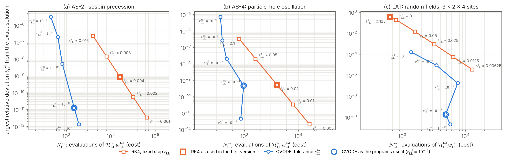
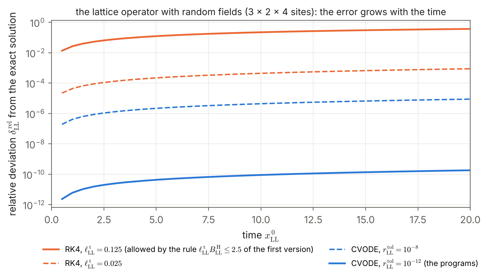
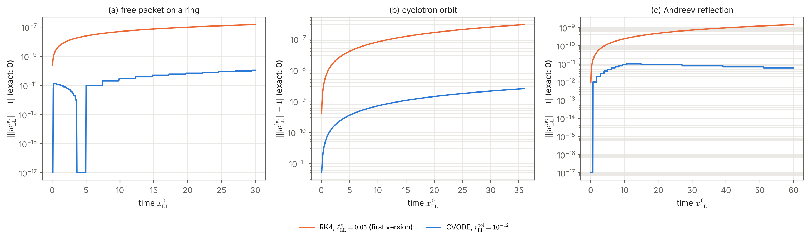
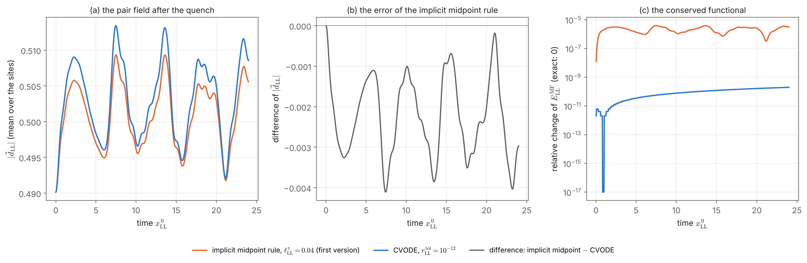
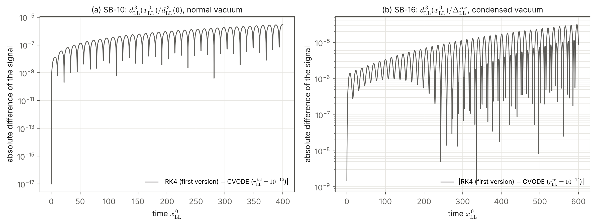

# 0. Summary

The programs of Test 2 (folder `Revision_SuperLoop/test2`) integrate the time-dependent mean-field equations of the
gauge-covariant spinor field on a lattice.  Their first version did this with two hand-written fixed-step methods:
the classical Runge-Kutta method of the fourth order (RK4: programs `t2_analytic`, `t2_fields`, the task `evolve` of
`t2_solve`, and `t2_sfbs`) and the implicit midpoint rule (the task `quench` of `t2_solve`).  On 2026-11-18 the
author of PROJECT spacetimes rejected these methods and instructed that every time integration use CVODE, the
variable-order, variable-step integrator of SUNDIALS, in the pure-Rust translation of his repository (vendored in
the folder `vendor/sundials_rs-7.8.0` of PROJECT spacetimes).  Every calculation of Test 2 that integrated in time
was redone with CVODE.  This document compares the CVODE results with the RK4 (and implicit-midpoint) results and
records the error and the rule that follows from it.

The comparison (Section 5) shows:

1. **The time-step rule of the first version guaranteed stability, not accuracy.**  It required
   $\ell^{\rm t}_{\rm LL}B^{\rm H}_{\rm LL}\le2.5$ (RK4 is stable below $2\sqrt2$).  On the lattice with random
   gauge and pair fields of check GS-13 (problem LAT), RK4 with the allowed step $\ell^{\rm t}_{\rm LL}=0.125$ deviates
   from the exact solution by 37 per cent after the time 20, and the norm of the state, which the exact evolution
   conserves, changes by 15 per cent.  CVODE with the tolerances of the programs deviates by $1.8\times10^{-10}$.
2. **The quench was wrong at the per-mille to per-cent level.**  The implicit midpoint rule with
   $\ell^{\rm t}_{\rm LL}=0.04$ gave the angular frequency 1.184485 of the amplitude oscillation of the pair field,
   the mean gap 0.5008766 after the quench and the oscillation amplitude 0.005867; CVODE gives 1.188975, 0.5031251
   and 0.007079, the same at three tolerances.  The conserved functional $E^{\rm MF}_{\rm LL}$ drifted by
   $1.9\times10^{-3}$ with the midpoint rule and by $10^{-7}$ with CVODE.  The first version explained the deviation
   $4.6\times10^{-3}$ of its frequency from the amplitude mode of the linearized equations by terms of second order in
   the amplitude and by the weaker modes; most of it was the error of the integrator.
3. **Where RK4 was accurate, CVODE is as accurate or more accurate at a smaller cost.**  For the analytic solutions
   AS-2 and AS-4, CVODE with the tolerances of the programs reaches the deviations $1.3\times10^{-11}$ and
   $4.7\times10^{-10}$ with 1494 and 963 evaluations of the right side, RK4 with the steps of the first version
   $8.7\times10^{-10}$ and $5.3\times10^{-10}$ with 16000 and 4000 evaluations.  The norm of the wave packets of the
   solver examples is conserved to $10^{-11}$ to $3\times10^{-9}$ instead of $1.5\times10^{-9}$ to $3\times10^{-7}$.
4. **The checks of the superfluid boson singlet state (SB-10, SB-16) are unchanged in substance**; CVODE moves the
   spectral line of SB-10 closer to the pole of the propagator (relative deviation $7\times10^{-9}$ instead of
   $8\times10^{-8}$) and conserves the mean-field energy 7 and 700 times better.

# 1. The instruction, the error, and the rule

**The instruction** (the author, 2026-11-18, in substance): the hand-written RK4 solver must not be used; the time
integrations must use the pure-Rust CVODE of the repository `once-ere/rustSolveIt_macos-silicon_SUNDIALS_7_8_0`, or
another applicable SUNDIALS algorithm; every calculation that used RK4 must be redone with CVODE; a provenance must
compare the CVODE results with the RK4 results; the new Rust code and its documentation must be part of PROJECT
spacetimes; the error must be remembered and not repeated.  The author decided the order of the work: Test 2 and the
notebook `3+1super-loop.nb` first, then the older code that used RK4 (the library `code/spacetimes-rs` and the three
folders `Revision_Deflation*`), in new folders, each with its own comparison.

**The error (E-CV1).**  The first version of Test 2 integrated the time-dependent lattice equations with fixed-step
methods written by hand (RK4, and the implicit midpoint rule for the self-consistent evolution), instead of a
library integrator with error control.  A fixed step chosen from a stability bound does not control the error of a
result: the error must be estimated separately for every problem, and the first version did not do that for its
largest problems (Section 5.1, problem LAT; Section 5.4, the quench).

**The rule (R-CV1).**  Every time integration of PROJECT spacetimes uses CVODE (or another integrator of SUNDIALS,
for example ARKODE or IDA, where its method fits the problem better), from the pure-Rust translation vendored in
`vendor/sundials_rs-7.8.0`, with stated tolerances; every result states the numbers of steps and evaluations and is
checked against its error budget or an exact solution.  No hand-written fixed-step time integrator is used.  The
code of the rejected RK4 is kept only inside the comparison program `t2_cvcmp` of this document, to reproduce the old
numbers.

# 2. The symbols of this document

Every symbol of this document is a symbol of the registry of the folder Revision_SuperLoop (Hard Rule 5); the table
lists each symbol that the text uses, with its plain-text names in the programs and data files and its meaning, so
that the document can be read alone.  The registry entries of the time integration ($w^{\rm lat}_{\rm LL}$,
$w^{\rm cmp}_{\rm LL}$, $n^{\rm cpx}_{\rm LL}$, $r^{\rm tol}_{\rm LL}$, $a^{\rm tol}_{\rm LL}$, $h^{\rm CV}_{\rm LL}$,
$q^{\rm CV}_{\rm LL}$, $N^{\rm st}_{\rm LL}$, $N^{\rm ev}_{\rm LL}$, $B^{\rm err}_{\rm LL}$, $\delta^{\rm rel}_{\rm LL}$,
$w^{\rm ex}_{\rm LL}$) were added for this work.  Words that are not symbols: RK4 is the classical Runge-Kutta method
of the fourth order; CVODE the integrator of SUNDIALS (SUite of Nonlinear and DIfferential/ALgebraic equation Solvers,
Lawrence Livermore National Laboratory); AS-2, AS-4 and LAT name the three test problems of Section 5.1;
"first version" means the programs of Test 2 before 2026-11-18, whose data files are kept in `test2/rk4_reference/data`.

{{SYMBOLS}}

# 3. The methods

## 3.1 The equations that are integrated

The lattice equations of Test 2 for one Nambu mode, written as the complex vector $w^{\rm lat}_{\rm LL}$ of the
16 components of $\psi^{\rm p}_{\rm LL}$ and $\psi^{\rm h}_{\rm LL}$ on every site, are
$$i\,\partial_0w^{\rm lat}_{\rm LL}=\mathcal H^{\rm lat}_{\rm LL}\,w^{\rm lat}_{\rm LL},$$
with the Hermitian lattice operator $\mathcal H^{\rm lat}_{\rm LL}$ (the covariant central differences with the
links, the Wilson term, the mass, the potential of the time direction, the chemical potential $\mu_{\rm LL}$ and the
pair field).  For prescribed fields the equation is linear; with a pulse of a gauge potential the operator depends
on the time $x^0_{\rm LL}$.  The task `quench` evolves all modes of a self-consistent state, the columns of
$\mathsf W^{\rm m}_{\rm LL}$, with the pair field $d^\iota_{\rm LL}$ computed from the modes at every instant; the
equations are then nonlinear, but they still conserve the fermion number $N^{\rm F}_{\rm LL}$, the orthonormality of
the modes, and for static gauge fields the functional $E^{\rm MF}_{\rm LL}$.  The program `t2_sfbs` evolves the
uniform polar state in the planes of the plane waves, with the components $u^{\rm pl}_{{\rm LL},\pm}$,
$v^{\rm pl}_{{\rm LL},\pm}$ on radial nodes; its equations conserve the mean-field energy per volume.  In every case
the exact evolution of a single linear mode is unitary: it conserves the norm $\lVert w^{\rm lat}_{\rm LL}\rVert$.

## 3.2 RK4, the method of the first version

One RK4 step of the length $\ell^{\rm t}_{\rm LL}$ evaluates the right side $-i\mathcal H^{\rm lat}_{\rm LL}w$ four
times.  For a time-independent operator it multiplies the state by the Taylor polynomial of the fourth degree of the
exact factor $\exp(-i\ell^{\rm t}_{\rm LL}\mathcal H^{\rm lat}_{\rm LL})$,
$$w^{\rm lat}_{\rm LL}(x^0_{\rm LL}+\ell^{\rm t}_{\rm LL})=\Big(1-i\ell^{\rm t}_{\rm LL}\mathcal H^{\rm lat}_{\rm LL}-\tfrac12\big(\ell^{\rm t}_{\rm LL}\mathcal H^{\rm lat}_{\rm LL}\big)^2+\tfrac{i}{6}\big(\ell^{\rm t}_{\rm LL}\mathcal H^{\rm lat}_{\rm LL}\big)^3+\tfrac1{24}\big(\ell^{\rm t}_{\rm LL}\mathcal H^{\rm lat}_{\rm LL}\big)^4\Big)\,w^{\rm lat}_{\rm LL}(x^0_{\rm LL}).$$
An eigencomponent of the energy $E^{\rm qp}_{{\rm LL},n}$ is multiplied by this polynomial at
$\mathcal H^{\rm lat}_{\rm LL}=E^{\rm qp}_{{\rm LL},n}$; its modulus is at most 1 when
$\lvert E^{\rm qp}_{{\rm LL},n}\rvert\ell^{\rm t}_{\rm LL}\le2\sqrt2$ (stability), its modulus is smaller than 1 by
about $(E^{\rm qp}_{{\rm LL},n}\ell^{\rm t}_{\rm LL})^6/144$ per step, and its phase differs from the exact phase by
about $(E^{\rm qp}_{{\rm LL},n}\ell^{\rm t}_{\rm LL})^5/120$ per step.  The first version chose the step from the bound
$B^{\rm H}_{\rm LL}$ of the largest eigenvalue magnitude, with the rule $\ell^{\rm t}_{\rm LL}B^{\rm H}_{\rm LL}\le2.5$:
this rule keeps the method stable, but at $\lvert E^{\rm qp}_{{\rm LL},n}\rvert\ell^{\rm t}_{\rm LL}=1$ the phase error
is already $8\times10^{-3}$ per step.  The steps of the first version: 0.004 (AS-2), 0.02 (AS-4), 0.05 for the
examples `packet_free`, `cyclotron` and `andreev` of the solver ($\ell^{\rm t}_{\rm LL}B^{\rm H}_{\rm LL}=0.32$,
0.62, 0.40), 0.02 and 0.05 in SB-10 and SB-16.

## 3.3 The implicit midpoint rule, the method of the first version for the quench

The task `quench` advanced the modes by
$$\mathsf W^{\rm m}_{\rm LL}(x^0_{\rm LL}+\ell^{\rm t}_{\rm LL})=\mathsf W^{\rm m}_{\rm LL}(x^0_{\rm LL})-i\ell^{\rm t}_{\rm LL}\,\mathcal H^{\rm lat}_{\rm LL}\big[\bar{\mathsf W}^{\rm m}_{\rm LL}\big]\,\bar{\mathsf W}^{\rm m}_{\rm LL},\qquad \bar{\mathsf W}^{\rm m}_{\rm LL}=\tfrac12\big(\mathsf W^{\rm m}_{\rm LL}(x^0_{\rm LL})+\mathsf W^{\rm m}_{\rm LL}(x^0_{\rm LL}+\ell^{\rm t}_{\rm LL})\big),$$
where $\mathcal H^{\rm lat}_{\rm LL}[\bar{\mathsf W}^{\rm m}_{\rm LL}]$ is the operator with the pair field of the
midpoint modes, the implicit equation being solved by a fixed-point iteration.  The rule conserves every quadratic
invariant exactly (the orthonormality of the modes and $N^{\rm F}_{\rm LL}$), but it is only of the second order: its
error per step is of the order $(E^{\rm qp}_{{\rm LL},n}\ell^{\rm t}_{\rm LL})^3$, and with $\ell^{\rm t}_{\rm LL}=0.04$
it does not resolve the amplitude oscillation accurately (Section 5.4).

## 3.4 CVODE, the method of the present version

CVODE (SUNDIALS 7.8.0, crate `cvode_rs` of the vendored pure-Rust translation; module `t2core::cvode` of the library
of Test 2) integrates real systems.  The complex state is stored as the real vector of the real and imaginary parts of
its components, the right side $-i\mathcal H^{\rm lat}_{\rm LL}w^{\rm lat}_{\rm LL}$ in the same way.  The method:

* **Adams-Moulton formulas of the orders $q^{\rm CV}_{\rm LL}=1,\dots,12$** (the formulas of CVODE for nonstiff
  problems; the equations of Test 2 are not stiff, their eigenvalues lie on the imaginary axis).  A step of the size
  $h^{\rm CV}_{\rm LL}$ computes the new state as the old state plus $h^{\rm CV}_{\rm LL}$ times a weighted sum of the
  right side at the new time and at the $q^{\rm CV}_{\rm LL}-1$ preceding step times; the weights follow from the
  order and the recent step sizes, so that the formula is exact for polynomials of the degree $q^{\rm CV}_{\rm LL}$.
  The formula is implicit (the right side at the new time depends on the new state); CVODE solves it by the
  fixed-point iteration of SUNDIALS, which needs only evaluations of the right side.
* **Error control.**  CVODE estimates the local error of every step from the difference between the predicted and
  the corrected state, and accepts the step only if
  $$\Big(\frac{1}{2n^{\rm cpx}_{\rm LL}}\sum_{w^{\rm cmp}_{\rm LL}}\frac{\lvert\text{estimated local error of }w^{\rm cmp}_{\rm LL}\rvert^2}{\big(r^{\rm tol}_{\rm LL}\lvert w^{\rm cmp}_{\rm LL}\rvert+a^{\rm tol}_{\rm LL}\big)^2}\Big)^{1/2}\le1,$$
  the sum running over the $n^{\rm cpx}_{\rm LL}$ complex components $w^{\rm cmp}_{\rm LL}$ of the state (the factor 2:
  SUNDIALS counts the real and the imaginary part as two components).  Otherwise it repeats the step with a smaller
  $h^{\rm CV}_{\rm LL}$.  It changes $h^{\rm CV}_{\rm LL}$ and $q^{\rm CV}_{\rm LL}$ so that the steps are as large as
  the test allows.  The weight $1/(r^{\rm tol}_{\rm LL}\lvert w^{\rm cmp}_{\rm LL}\rvert+a^{\rm tol}_{\rm LL})$, the same
  for the real and the imaginary part of a component, is given to CVODE by an error-weight function of
  `t2core::cvode` (`CVodeWFtolerances`).  The standard weights of CVODE would weight the real part with its own
  modulus, which passes through zero twice in every period of an oscillation, and would force needlessly small steps.
* **Output.**  The programs ask for the state at chosen output times; CVODE steps past an output time and returns the
  value of its interpolating polynomial there, with the accuracy of the method.
* **Settings of the programs:** $r^{\rm tol}_{\rm LL}=10^{-12}$, $a^{\rm tol}_{\rm LL}=10^{-14}$ (input keys `rtol`,
  `atol` of the solver).
* **Error budget.**  If the weighted local errors are spread over the components, the 2-norm of the local error of a
  step is at most $\sqrt2(r^{\rm tol}_{\rm LL}\lVert w^{\rm lat}_{\rm LL}\rVert+a^{\rm tol}_{\rm LL}\sqrt{n^{\rm cpx}_{\rm LL}})$;
  a unitary evolution does not amplify errors, so the global error after $N^{\rm st}_{\rm LL}$ steps is expected below
  $$B^{\rm err}_{\rm LL}=N^{\rm st}_{\rm LL}\sqrt2\,\big(r^{\rm tol}_{\rm LL}\lVert w^{\rm lat}_{\rm LL}\rVert+a^{\rm tol}_{\rm LL}\sqrt{n^{\rm cpx}_{\rm LL}}\big).$$
  Check GS-13 of `t2_fields` verifies this against an exact solution (the deviation stays below $B^{\rm err}_{\rm LL}$
  for $r^{\rm tol}_{\rm LL}=10^{-8}$, $10^{-10}$, $10^{-12}$).  The solver `t2_solve` checks the conservation laws
  against $10B^{\rm err}_{\rm LL}$: CVODE's estimate of the local error is an estimate, and the true error may exceed it
  by a modest factor.

# 4. What was changed

| item | first version | present version |
|:----------|:------------------------------|:------------------------------|
| `t2core` (library) | `Lattice::rk4_step` | removed; new module `t2core::cvode` (`integrate`, `integrate_status` for a right side that can fail, `evolve_lattice`, settings, counters, error weights, error budget); dependency `cvode_rs` (path into `vendor/sundials_rs-7.8.0`) |
| `t2_analytic` AS-2, AS-4 | RK4, $\ell^{\rm t}_{\rm LL}=0.004$ and 0.02; tolerance of the checks $10^{-8}$ | CVODE at 101 output times; tolerance of the checks $10^{-9}$; counters reported; data columns `P_up_cvode`, `P_hole_cvode` |
| `t2_fields` GS-13 | the stability of the RK4 factor (a statement about the method); data `t2_rk4_stability.csv`, Figure 2 of Test 2 | CVODE against the exact spectral solution on the lattice of GS-10, for three tolerances, with the error budget; data `t2_cvode_accuracy.csv` |
| `t2_solve`, task `evolve` | RK4 with the keys `time_step`, `steps`, `output_every` (input format `t2in 1`) | CVODE with `output_step`, `outputs`, `fields_every`, `rtol`, `atol` (format `t2in 2`; the format `t2in 1` is refused with an explanation); conservation checked against $10B^{\rm err}_{\rm LL}$ |
| `t2_solve`, task `quench` | implicit midpoint rule | CVODE for all modes at once, the pair field computed from the modes at every evaluation |
| `t2_sfbs` SB-10, SB-16 | RK4, $\ell^{\rm t}_{\rm LL}=0.02$ and 0.05 | CVODE, sampled at the same times (the sampling interval of the signal is kept) |
| `t2_plot` | the titles "RK4 errors", "what the implicit midpoint rule conserves" | "CVODE errors", "the conserved quantities (CVODE errors)" |
| `t2_solve.py` (Python solver of item [3]) | RK4 (`evolve`) and the implicit midpoint rule (`quench`) in Python | the same CVODE as the Rust programs, called through the new shared library `libt2cvode` (crate `t2cvode_c`, the C interface of `t2core::cvode`) with the module `ctypes`; format `t2in 2`; the same checks and reports as the Rust solver |
| `t2_plot.py`, `make_t2_figures.py`, `t2_examples_check.py` | the titles and labels of RK4 and the midpoint rule; Figure 2 of Test 2 the RK4 factor; the fermion number of EX-7 checked against $10^{-9}$ | the titles and labels of CVODE; Figure 2 of Test 2 the accuracy of CVODE (GS-13); EX-7 against the bound of the solvers; the tables of Section 6.4 of Test 2 written as fragments |
| new | | the program `t2_cvcmp`, the shared library `libt2cvode` and the scripts of the folder `test2/cvode_vs_rk4` (this comparison) |

All programs were run again on Linux x86-64 (rustc 1.97.0); every check passes.  The data files of the first version
are kept unchanged in `test2/rk4_reference/data` (106 files, SHA-256 digests in `test2/rk4_reference/SHA256SUMS_data.txt`).
The Python solver of item [3] and the plots and documents of Test 2 were brought to CVODE in the same work; the notebook
`3+1super-loop.nb` follows (Section 7).

# 5. The comparison

## 5.1 Three problems with an exact solution

The program `t2_cvcmp` integrates three problems both with RK4 (several fixed steps, among them the step of the first
version) and with CVODE (several tolerances, $a^{\rm tol}_{\rm LL}=r^{\rm tol}_{\rm LL}/100$), and compares every
state at the output times with the exact solution $w^{\rm ex}_{\rm LL}$ by the relative deviation
$\delta^{\rm rel}_{\rm LL}=\lVert w^{\rm lat}_{\rm LL}-w^{\rm ex}_{\rm LL}\rVert/\lVert w^{\rm ex}_{\rm LL}\rVert$:

* **AS-2**: a lattice plane wave in the constant isospin potential $A^1_{{\rm LL},0}=1.5$ (periodic chain of 16 sites,
  $\ell^{\rm x}_{\rm LL}=0.5$, $m_{\rm LL}=0.4$, $\mu_{\rm LL}=0.2$; $n^{\rm cpx}_{\rm LL}=256$); the exact solution
  turns the isospin with the angular frequency $\omega^{\rm pr}_{\rm LL}=1.05$; outputs every 0.16 up to $x^0_{\rm LL}=16$;
* **AS-4**: a particle injected into the uniform polar superfluid $\vec d_{\rm LL}=(0,0,0.3)$ (16 sites,
  $\mu_{\rm LL}=0.6$); the exact solution oscillates between the particle and the hole with the frequency
  $E^-_{\rm LL}=0.456287$; outputs every 0.2 up to 20;
* **LAT**: the lattice operator with random links, potentials and pair fields on $3\times2\times4$ sites
  ($\ell^{\rm x}_{\rm LL}=0.7$, periodic in $x^1_{\rm LL}$ and $x^3_{\rm LL}$, walls in $x^2_{\rm LL}$;
  $n^{\rm cpx}_{\rm LL}=384$; seed 2026111801 of the generator SplitMix64) and a random normalized initial state; the
  exact solution is the spectral sum over the eigenpairs of $\mathcal H^{\rm lat}_{\rm LL}$; outputs every 0.5 up to 20.
  The spectral radius is 8.44, the bound $B^{\rm H}_{\rm LL}=17.67$, so that the rule of the first version allowed
  $\ell^{\rm t}_{\rm LL}\le0.1415$.

The cost is the number $N^{\rm ev}_{\rm LL}$ of evaluations of the right side (one RK4 step needs 4).

{{TABLE:runs}}

{width=100%}

**Figure 1.** The accuracy against the cost.  For each problem the largest relative deviation
$\delta^{\rm rel}_{\rm LL}$ from the exact solution against the number $N^{\rm ev}_{\rm LL}$ of evaluations of the
right side: RK4 (orange squares, one point per fixed step $\ell^{\rm t}_{\rm LL}$) and CVODE (blue circles, one point
per tolerance $r^{\rm tol}_{\rm LL}$); the large symbols mark RK4 as the first version used it and CVODE as the programs
use it.  Data: `test2/cvode_vs_rk4/data/cmp_work_precision.csv` (program `t2_cvcmp`); figure:
`test2/cvode_vs_rk4/python/make_cmp_figures.py`.

{width=80%}

**Figure 2.** The problem LAT: the relative deviation from the exact solution against the time, for RK4 with the step
0.125 that the rule of the first version allowed and with 0.025, and for CVODE with $r^{\rm tol}_{\rm LL}=10^{-8}$ and
$10^{-12}$.  Data: `test2/cvode_vs_rk4/data/cmp_lat_deviation.csv`.

**What the table and the figures show.**  RK4 converges with the fourth power of the step (halving the step divides
the deviation by 16, as the rows of AS-2 and AS-4 show), so its accuracy is set by the step chosen; the steps of the
first version gave $10^{-9}$ for AS-2 and AS-4 because the energies of these problems times the steps are small
($\lvert E^{\rm qp}_{{\rm LL},n}\rvert\ell^{\rm t}_{\rm LL}\le0.01$), but for LAT, where the energies reach 8.4, the
allowed step 0.125 gives $\delta^{\rm rel}_{\rm LL}=0.37$.  CVODE reaches a prescribed accuracy without a choice of
step: for every problem $r^{\rm tol}_{\rm LL}=10^{-12}$ gives $\delta^{\rm rel}_{\rm LL}$ between $10^{-11}$ and
$5\times10^{-10}$.  At equal accuracy CVODE needs 10 times fewer evaluations than RK4 for AS-2 and 4 times fewer for
AS-4; for LAT it needs 7.6 times more evaluations (4856) than RK4 with the step of the first version (640), which,
however, is 37 per cent wrong; RK4 needs 12800 evaluations ($\ell^{\rm t}_{\rm LL}=0.00625$) to reach
$3.4\times10^{-6}$ there.  The cost of CVODE does not always grow monotonically as $r^{\rm tol}_{\rm LL}$ decreases (LAT at
$10^{-10}$ needs more evaluations than at $10^{-12}$): the Adams-Moulton formulas of high order have small stability
intervals on the imaginary axis, and the choice of order and step of CVODE then depends on the tolerance in a
non-monotonic way; the accuracy, which is what the tolerance controls, improves monotonically.

## 5.2 The archived RK4 numbers are reproduced

{{TABLE:probabilities}}

The program `t2_cvcmp` reproduces, with its own copy of the RK4 step of the first version, the columns `P_up_rk4` and
`P_hole_rk4` of the archived files `t2_A_precession.csv` and `t2_B_rabi.csv` to within half a unit of their 10th
decimal (largest differences $4.95\times10^{-11}$ and $4.98\times10^{-11}$, Appendix A): the archive and the
comparison describe the same method.  The table above gives the largest deviation of the printed probabilities of
Figures 3(b) and 4(b) of Test 2 from their exact values, for the first version and for CVODE.

## 5.3 The examples of the solver

The four time-dependent examples of `t2_solve` were solved with CVODE at $r^{\rm tol}_{\rm LL}=10^{-12}$ (the data
files of `test2/data`) and, by the script `run_convergence.sh`, at $10^{-10}$ and $10^{-13}$
($a^{\rm tol}_{\rm LL}=r^{\rm tol}_{\rm LL}/100$; folder `test2/cvode_vs_rk4/data/conv`).  The table gives, column by
column of the time series, the largest difference between the first version and CVODE at $10^{-12}$, and between
CVODE at the other two tolerances and CVODE at $10^{-12}$.  When the change from $10^{-12}$ to $10^{-13}$ is much
smaller than the difference from the first version, the CVODE result is converged and the difference is the error of
the first version.

{{TABLE:series}}

{{TABLE:conservation}}

{width=100%}

**Figure 3.** The norm of the mode of the three evolve examples, which the exact evolution conserves: its change
$\lvert\lVert w^{\rm lat}_{\rm LL}\rVert-1\rvert$ against the time, for RK4 with $\ell^{\rm t}_{\rm LL}=0.05$ (first
version, orange) and CVODE with $r^{\rm tol}_{\rm LL}=10^{-12}$ (blue).  Data: `test2/rk4_reference/data/t2_rs_*_series.csv`
and `test2/data/t2_rs_*_series.csv`, column `norm`.  The data files print the norm with 12 decimals; the CVODE curves
therefore move in steps of $10^{-12}$, and where the printed norm is exactly 1 the change is 0 in the printed digits,
which the figure draws at $10^{-17}$, the lower edge of the panels.  The largest changes in the table above are computed
by the programs from the unrounded norm.

The wave packets were computed accurately by the first version (the centres of the packets differ by at most
$8\times10^{-6}$, the probabilities by $1.4\times10^{-9}$); CVODE conserves the norm and the energy about 100 to 1400
times better.  At $r^{\rm tol}_{\rm LL}=10^{-10}$ CVODE is not better than RK4 for `packet_free` (norm change
$1.8\times10^{-7}$): the default tolerance $10^{-12}$ of the programs is needed.

## 5.4 The quench: a correction of the results

{{TABLE:quench}}

{width=100%}

**Figure 4.** The quench of the coupling of the uniform superfluid (24 sites, 192 modes, 73728 complex unknowns):
(a) the mean of $\lvert d^\iota_{\rm LL}\rvert$ over the sites against the time, implicit midpoint rule
($\ell^{\rm t}_{\rm LL}=0.04$, first version) and CVODE ($r^{\rm tol}_{\rm LL}=10^{-12}$); (b) their difference;
(c) the relative change of the conserved functional $E^{\rm MF}_{\rm LL}$.  Data: `t2_rs_quench_series.csv` of
`test2/rk4_reference/data` and `test2/data`.

The three CVODE runs agree in the frequency to 6 decimals, in the mean gap to $2\times10^{-9}$ and in the amplitude to
8 decimals; the implicit midpoint rule differs from them by 0.00449 in the frequency (relative $3.8\times10^{-3}$),
by 0.00225 in the mean gap (relative $4.5\times10^{-3}$; the gap of the new ground state is 0.503114, close to the
CVODE mean 0.503125) and by 17 per cent in the amplitude.  The examples check of the first version compared the frequency with the amplitude (Higgs) mode of the
linearized self-consistent equations, 1.18991 at its mean gap, and found the relative deviation $4.56\times10^{-3}$,
which it attributed to the terms of second order in the amplitude and to the weaker modes.  The CVODE frequency
1.188975 deviates from that same prediction by $7.9\times10^{-4}$ only; the prediction at the CVODE mean gap is
computed by the examples check of the present version (Section 7).  The conserved quantities: the midpoint rule keeps
$N^{\rm F}_{\rm LL}$ and the orthonormality exactly (to $10^{-11}$), but $E^{\rm MF}_{\rm LL}$ only to $2\times10^{-3}$;
CVODE keeps $N^{\rm F}_{\rm LL}$ to $1.3\times10^{-8}$, the orthonormality to $5\times10^{-10}$ and
$E^{\rm MF}_{\rm LL}$ to $10^{-7}$.

## 5.5 The superfluid boson singlet state (`t2_sfbs`)

{{TABLE:sfbs}}

{width=100%}

**Figure 5.** The absolute difference between the signals of RK4 (first version) and CVODE ($r^{\rm tol}_{\rm LL}=10^{-12}$)
against the time: (a) SB-10, the pair field of the normal vacuum divided by its initial value; (b) SB-16, the gap
oscillation of the condensed vacuum divided by $\Delta^{\rm vac}_{\rm LL}$.  Data: `t2_sfbs_tdbdg_normal.csv` and
`t2_sfbs_tdbdg_higgs.csv` of `test2/rk4_reference/data` and `test2/data`.

The largest differences of the two signals are $3\times10^{-6}$ and $3\times10^{-5}$ (they grow linearly with the time,
the accumulated phase error of RK4); the spectral lines that the checks measure move by $2\times10^{-8}$ and
$2\times10^{-6}$, and both checks pass as before.

# 6. Conclusions

* The first version was accurate where the energies times the step were small (AS-2, AS-4, the wave packets, SB-10,
  SB-16); its numbers there are confirmed by CVODE within $10^{-6}$ or better.
* The first version was inaccurate for the quench (relative errors of the frequency, of the mean gap and of the
  amplitude of the amplitude oscillation: $3.8\times10^{-3}$, $4.5\times10^{-3}$ and 17 per cent), and its time-step rule allowed steps with which RK4 is useless on
  lattices with large energies (problem LAT: 37 per cent).
* CVODE controls the error by its tolerances; with $r^{\rm tol}_{\rm LL}=10^{-12}$ and $a^{\rm tol}_{\rm LL}=10^{-14}$
  every result of Test 2 is converged to the printed digits, as the three tolerances of Section 5.3 show.

# 7. Status of the work and how to reproduce it

**Done:** the vendored SUNDIALS; `t2core::cvode`; the Rust programs `t2_analytic`, `t2_fields`, `t2_solve`, `t2_sfbs`,
`t2_plot` with CVODE; the Python solver `t2_solve.py` with the same CVODE through the shared library `libt2cvode`; all
data files and figures of Test 2; the documents of Test 2 and of the folder Revision_SuperLoop; the comparison program
`t2_cvcmp`, the convergence runs and the figures of this document; the registry entries of the new symbols.
**Following steps:** the notebook `3+1super-loop.nb` (its time integrations with a SUNDIALS method of the Wolfram
Language), then the older code of the repository that integrates in time with a fixed-step method.

On the Mac (Terminal), from the folder of the repository:

```bash
cd "/Users/nsh/Developer/github/spacetimes/Revision_SuperLoop/test2/rust"
cargo build --release
for p in t2_fields t2_analytic t2_sfbs; do ./target/release/$p; done
cd ..
for n in packet_free cyclotron andreev kink_spectrum ground_state kink_ground_state quench; do
  ./rust/target/release/t2_solve examples/$n.t2in --out data/t2_rs_$n
  python3 python/t2_solve.py examples/$n.t2in --out data/t2_py_$n
done
bash cvode_vs_rk4/run_convergence.sh "$PWD/rust/target/release/t2_solve"
./rust/target/release/t2_cvcmp
cd .. && python3 test2/cvode_vs_rk4/python/make_cmp_figures.py
```

The first two lines build every program of Test 2 and the shared library `libt2cvode` of the Python solver (the vendored
SUNDIALS is compiled with them); the loop runs the three check programs, the next loop the seven examples of both
solvers; `run_convergence.sh` solves the four
time-dependent examples at the tolerances $10^{-10}$ and $10^{-13}$; `t2_cvcmp` writes the comparison (it exits with
status 1 if one of its checks fails); the last line draws the five figures.  The programs write their outputs into the
folders named in the text.

# 8. The files of the comparison

{{FILES}}

# Appendix A. The report of the program `t2_cvcmp`

```text
{{REPORT}}
```

# Appendix B. The source code

## B.1 `test2/rust/t2core/src/cvode.rs` (the time integration with CVODE)

```rust
{{CODE:../rust/t2core/src/cvode.rs}}
```

## B.2 `test2/rust/t2cvcmp/src/main.rs` (the comparison program)

```rust
{{CODE:../rust/t2cvcmp/src/main.rs}}
```

## B.3 `test2/cvode_vs_rk4/run_convergence.sh` (the convergence runs of the solver)

```bash
{{CODE:run_convergence.sh}}
```

## B.4 `test2/cvode_vs_rk4/python/make_cmp_figures.py` (the figures)

```python
{{CODE:python/make_cmp_figures.py}}
```
