# 16 Component Dirac Fermion Condensate Singlet Superfluid on 7+1 Spacetime

**Patrick Lee Nash, Ph.D.**  
*Independent researcher*  
November 12, 2026

> Markdown version generated from `16 Component Dirac Fermion Condensate Singlet Superfluid on 7+1 Spacetime.tex` by `code/scripts/tex2md.py`; the typeset PDF (`16 Component Dirac Fermion Condensate Singlet Superfluid on 7+1 Spacetime.pdf`) is authoritative for layout. Equation, figure, table and section numbers are those of the PDF.

## Abstract

Can a 16-component Dirac field on a flat spacetime with seven space-like dimensions and one time-like dimension form a spin-singlet superfluid, and can that superfluid be the Higgs field, the dark matter, or the remedy of the Hubble tension? We prove the properties of the eight real $16\times16$ Dirac matrices of this spacetime, including that their scaled commutators generate $\mathrm{Pin}(7,1)$ and that no real chirality exists. We invent a complex scalar field, the Vorton-Scalar, which gives the fermions their mass and whose neutral current couples to their axial current with a constant of Fermi type. Its exchange pairs the fermions. With the effective action of Cornwall, Jackiw and Tomboulis we obtain the gap, the critical temperature and the order parameter, a four-vector of the rotations of the four extra space dimensions. Its condensate breaks $SO(4)$ to $SO(3)$, the pattern of the Higgs vacuum, but none of the dynamical conditions for a Higgs field is met where the model can be solved. Simulations with a purpose-built Einstein-Boltzmann solver show that the model explains neither the Hubble tension nor the galactic phenomenology of dark matter.

## I. Introduction

### A. The question

Fermions that attract one another pair, and the pairs condense. This is the origin of superconductivity in metals ([J. Bardeen, Cooper, and Schrieffer 1957](#ref-BCS1957)), of the superfluid phases of liquid $^3$He ([Leggett 1975](#ref-Leggett1975)), and of the superfluidity of nuclear matter. A condensate of pairs is described by a boson field, the expectation value of a product of two fermion field operators. If the pair has no spin, the condensate is a scalar, and scalar fields that fill space are what several open problems of physics call for: the Higgs field of the Standard Model is one, and many proposals for the dark matter and for the discrepancy between the measured values of the Hubble constant, the *Hubble tension*, involve another.

An earlier study ([Patrick Lee Nash 2026b](#ref-NashNCSS)) asked whether the known neutrinos, in ordinary spacetime with three space dimensions and one time, can form such a spin-singlet superfluid, and whether that state could account for the dark matter or relieve the Hubble tension. The answer was negative on both counts. The present paper and its companion ([Patrick Lee Nash 2026a](#ref-Companion1644)) take up the same questions for a fermion field of a different kind: a field with sixteen components on a flat spacetime of eight dimensions.

Eight dimensions are distinguished by an algebraic fact. The Dirac matrices of a spacetime are, by definition, matrices $\gamma^A$ whose anticommutators reproduce the metric. In eight dimensions the smallest such matrices have sixteen rows and columns, and for certain signatures of the metric they can be chosen *real*. Two such signatures are the subject of this work. The first has four space-like and four time-like dimensions, the signature $4{+}4$; it is the case of the split octonion algebra and of the triality of the group $SO(4,4)$, which the author has used before ([P. L. Nash 1990](#ref-Nash1990); [Patrick L. Nash 2010](#ref-Nash2010)). The second has seven space-like dimensions and one time-like dimension, the signature $7{+}1$; it is the case of the octonions ([Bryant 1982](#ref-Bryant1982); [Harvey and Lawson 1982](#ref-HarveyLawson1982); [Brown and Gray 1967](#ref-BrownGray1967)). (Real matrices of this size also exist for the Euclidean signature and for five dimensions of one kind and three of the other ([Atiyah, Bott, and Shapiro 1964](#ref-AtiyahBottShapiro1964); [Lawson and Michelsohn 1989](#ref-LawsonMichelsohn1989)).) A real set of Dirac matrices is the natural starting point for a theory in which the sixteen components of the fermion field have a geometrical meaning, and it is the starting point here.

This paper treats the signature $7{+}1$. It has one time, and its quantum field theory is conventional; what is unconventional is that the four extra dimensions are space-like, and that the real Dirac matrices force a particular sign convention on the metric and leave no real chirality. The companion paper ([Patrick Lee Nash 2026a](#ref-Companion1644)) treats the signature $4{+}4$, in which four dimensions are time-like and the theory makes sense as a quantum theory only in a restricted sector. The two papers follow the same plan, use the same methods and the same programs, and share the sections that do not depend on the signature; where the two spacetimes lead to different conclusions, the difference is stated.

Three hypotheses are examined. They are stated here as hypotheses, and the paper reports what was found for each, favorable or not.

- **H1.** A 16-component fermion field on this spacetime forms a superfluid state of spin 0 in which the fermions are paired by the exchange of a new scalar boson, through a neutral current of the kind known from the weak interaction.

- **H2.** This superfluid state is the Higgs field.

- **H3.** This superfluid state explains the observations of dark matter, or the Hubble tension, or both.

### B. Objectives

The work has six objectives.

- **O1.** To fix the eight real $16\times16$ Dirac matrices of the spacetime without ambiguity, and to prove their properties: that they are real, that they satisfy the anticommutation relations of the metric, which group their scaled commutators generate, and what chirality means for them.

- **O2.** To write down a valid Dirac equation for a 16-component field whose components are complex-valued Grassmann operators, to determine in what sense it can be quantized, and to write it as two coupled equations for 8-component fields by means of the chiral projections.

- **O3.** To invent the scalar boson that mediates the pairing. We name it the *Vorton-Scalar*. The task is to define it by a Lagrangian, to construct its neutral current, and to derive its field equations and its coupling to the fermions.

- **O4.** To construct the superfluid state of spin 0: the pairing interaction, the gap equation, the order parameter, the ground state, its thermodynamics and its collective modes; and to do this with the effective action for composite operators of Cornwall, Jackiw and Tomboulis ([Cornwall, Jackiw, and Tomboulis 1974](#ref-CJT1974)), which also yields predictions for the unpaired state, for finite temperature and for the vacuum.

- **O5.** To test hypothesis H2 against the conditions that a Higgs field must meet.

- **O6.** To test hypothesis H3 by numerical simulation of the cosmological consequences of the model.

### C. Strategy

Four principles govern the work.

*Exact algebra by machine.* Every matrix of this paper has the entries $0$, $+1$ and $-1$. An identity between such matrices can be verified with integer arithmetic, and such a verification is a proof. A program written for this project performs 106 verifications of this kind; each has an identifier, and the statements of Secs. II to IV quote the identifiers on which they rest. A second program, written independently in another language, repeats the essential ones by different methods. Where an argument is short it is given in the text as well, so that the reader can follow the logic without the computer.

*One model, stated completely.* The Vorton-Scalar is defined by a Lagrangian with three parameters. Everything else, including the mass of the fermions, the strength of the pairing force and the cosmological behavior, is derived from it. Each approximation is named where it is made.

*Two formulations of the many-body problem.* The paired state is first obtained from the gap equation and then, independently, from the minimum of the effective potential of Cornwall, Jackiw and Tomboulis, with different algorithms. The two agree to the accuracy of the arithmetic (Sec. VII).

*Simulation with validated tools.* The cosmological tests use an Einstein-Boltzmann solver that was written for this project and validated against the established code class ([Blas, Lesgourgues, and Tram 2011](#ref-BlasLesgourguesTram2011)) (Sec. XI).

All programs, all data and the documents that record the provenance of every number are public ([Patrick Lee Nash 2026c](#ref-SpacetimesRepo)). No computed result in this paper was copied by hand: the text is assembled by a program that inserts each such number from the data file in which the computation stored it. Values quoted from the literature and the parameter values of the examples are written in the text.

### D. Summary of results

*The matrices and the field (O1, O2).* The eight Dirac matrices are signed permutation matrices built from the multiplication table of the octonions. Real matrices exist only if the time-like matrix squares to $+1$ and the seven space-like ones to $-1$. Their scaled commutators span the Lie algebra $\mathfrak{so}(7,1)$ and, together with the matrices themselves, generate the group $\mathrm{Pin}(7,1)$, which has four connected components. No real chirality matrix exists; the chiral projectors are complex. The Dirac equation necessarily contains a factor $i$ in front of its real matrices. Its Hamiltonian is real and symmetric, the evolution is unitary, and the field is quantized in the conventional way. A particle has eight internal states.

*The pair (O4).* A single 16-component field has no Lorentz-invariant pair, and no $s$-wave pair that is invariant under all rotations of the seven space dimensions. It has a vector of pairs, and the component of that vector along the hidden space-like coordinate $x0$ is a scalar under the Lorentz group of ordinary spacetime. It is the only $s$-wave pair that is invariant both under ordinary rotations and under the rotations of the three other extra coordinates.

*The Vorton-Scalar (O3).* It is a complex scalar field whose vacuum value gives the fermions their mass, so that the chiral rotation of the fermions, accompanied by a phase rotation of the scalar, is an exact symmetry. Its phase mode is massless, and its exchange is a current-current interaction between the neutral current of the scalar and the axial current of the fermions, with a Fermi constant fixed by the vacuum value.

*The superfluid (O4).* The radial mode of the Vorton-Scalar attracts two fermions in every pair channel; the neutral current attracts in the four vector channels along the extra coordinates and repels in the others. The gap of the vector channel is the largest. The order parameter is a four-vector of the rotation group $SO(4)$ of the four extra space dimensions, and its direction is chosen spontaneously: the hidden-axis singlet is one of a family of degenerate ground states. The effective action of Cornwall, Jackiw and Tomboulis reproduces the gap, the critical temperature, the critical coupling of the two-body bound state and the Ginzburg-Landau coefficients, and it predicts that the fermion mass vanishes in dense matter, that matter is self-bound for strong coupling, that the mass melts at a temperature of the order of the vacuum value, and that a condensate in empty space requires a strong coupling.

*The Higgs hypothesis (O5).* The pair is a scalar of ordinary spacetime, it belongs to the representation $(2,2)$ of $SU(2)\times SU(2)$, and its condensate breaks $SO(4)$ to $SO(3)$: the representation and the breaking pattern of the Higgs field and of its custodial symmetry. This is a necessary condition, and it is met. None of the dynamical conditions has been shown, and the simplest estimates of two of them are unfavorable.

*Cosmology (O6).* The model contains dark radiation of exactly the kind that has been proposed as a remedy of the Hubble tension, with a step in its density when the fermions annihilate. For microwave-background data of the quality of the Planck satellite that agree with the standard model, raising the Hubble constant to the locally measured value costs at least 4.0 standard deviations, and 8.5 or more if the step of the model falls into the epochs that the data probe. Treated as dark matter, the superfluid suppresses the growth of structure; the fermion masses that structure formation allows are too large for the fermions to be degenerate in any galaxy, and a condensate of bound pairs cannot support cores larger than 0.37 parsec. The superfluid explains neither the Hubble tension nor the galactic phenomenology of dark matter. Heavy bound pairs or clusters of the fermions remain a possible, and so far untestable, form of cold dark matter.

### E. Organization, units and notation

Section II defines the Dirac matrices and proves their properties. Section III gives the Dirac equation and its quantization. Section IV determines which fermion pairs exist. Section V invents the Vorton-Scalar. Section VI derives the pairing interaction, Sec. VII the paired state, and Sec. VIII its order parameter and ground state. Section IX follows the Vorton-Scalar into matter, to finite temperature and into the vacuum. Section X examines the Higgs hypothesis, Secs. XI and XII the Hubble tension and the dark matter. Section XIII collects the predictions, Sec. XIV lists the principal statements with their status, and Sec. XV concludes. Each of Secs. II to XII ends with a subsection that separates what has been established from what has not.

*Coordinates.* The eight coordinates are $$X=\{x0,\;x1,\;x2,\;x3,\;x4,\;x5,\;x6,\;x7\}.
\tag{1}$$ They are never renamed. The coordinates $x1,x2,x3$ are the Cartesian coordinates $x,y,z$ of ordinary space, and $x4$ is the ordinary time. The coordinate $x0$ is a *hidden* space-like coordinate. The coordinates $x5,x6,x7$ are three additional space-like coordinates. A capital index $A,B,\dots\in\{0,\dots,7\}$ labels the coordinate $xA$, with $\partial_A=\partial/\partial x^A$ and summation over repeated indices. Three smaller index sets recur: $i,j$ for space-like coordinates, with the values $1,2,3$ of ordinary space unless a sum is said to run over all space-like coordinates of the spacetime; $a,b\in\{0,5,6,7\}$ for the hidden axis and the three additional coordinates, which we call *the four extra axes*; and $t\in\{5,6,7\}$ for the three additional coordinates alone.

*Units.* $\hbar=c=k_B=1$.

*Tags.* The companion paper uses the same letters for the corresponding objects of the other spacetime, which are different matrices. To keep the two apart, every object of the $4{+}4$ spacetime carries the tag 1644 and every object of the $7{+}1$ spacetime the tag 1671 (16 components; signature $4{+}4$ or $7{+}1$): $\gamma_{1644}^A$ and $\gamma_{1671}^A$, for example. In this paper the tag $1671$ is written in the equations that define an object or state a result, and omitted in derivations; an object of the other spacetime always carries its tag. The 16-component fields of the two papers are named `dirac1644` and `dirac1671`.

*Two stages.* The spacetime of this paper is flat. In the program to which the paper belongs this is the first of two stages. In the second stage, which is not implemented here, the metric is dynamical: the three ordinary space dimensions inflate, the three additional dimensions deflate, which is the proposed reason why they have not been detected, and the hidden coordinate $x0$ curls up into a ring of very small radius. Where a result of this paper depends on what the second stage would have to provide, this is said.

## II. The real Dirac matrices of the 7+1 spacetime

This section meets objective O1. It defines the eight matrices, proves that they are real and that they satisfy the anticommutation relations of the metric, determines the group that their scaled commutators generate, and derives the chiral projection operators. Throughout, $1_n$ denotes the $n\times n$ unit matrix, a superscript $T$ the transpose, and a dagger the Hermitian conjugate. An identifier such as `71-C1` names the machine check that verifies the statement next to which it stands (Appendix C).

### A. Definition

The matrices are built in three steps. The first uses the real $8\times8$ matrices $\tau_{1644}^A$ of the companion paper ([Patrick Lee Nash 2026a](#ref-Companion1644)), which are the reduced generators that the author has used for the split octonion algebra ([P. L. Nash 1990](#ref-Nash1990); [Patrick L. Nash 2010](#ref-Nash2010)); Appendix A defines them, so that the present paper can be read by itself.

*Step 1: seven octonionic $8\times8$ matrices.* Let $\sigma_{88}$ be the $8\times8$ matrix with the $4\times4$ blocks $(0,1_4;1_4,0)$, and define, with the labels of the present paper, $$\begin{aligned}
\tau_{1671}^4&=1_8,\qquad\tau_{1671}^j=\tau_{1644}^j\quad(j=1,2,3),\\
\tau_{1671}^0&=\tau_{1644}^4\,\sigma_{88},\qquad\tau_{1671}^k=\tau_{1644}^k\,\sigma_{88}\quad(k=5,6,7).
\tag{2}
\end{aligned}$$ The seven matrices $\tau_{1671}^j$ with $j\in\{0,1,2,3,5,6,7\}$ are real and antisymmetric, they anticommute with one another, and each squares to $-1_8$ (checks `71-B1`, `71-D6`): $$\tau^i\tau^j+\tau^j\tau^i=-2\,\delta^{ij}\,1_8 .
\tag{3}$$ They represent the multiplication by the seven imaginary units of the octonions ([Bryant 1982](#ref-Bryant1982); [Harvey and Lawson 1982](#ref-HarveyLawson1982)).

*Step 2: the time-like matrix.* In $8\times8$ blocks, $$\gamma_{1671}^4=\begin{pmatrix}0&1_8\\1_8&0\end{pmatrix}.
\tag{4}$$

*Step 3: the seven space-like matrices.* $$\gamma_{1671}^j=\begin{pmatrix}-\tau_{1671}^j&0\\0&\tau_{1671}^j\end{pmatrix},\qquad j\in\{0,1,2,3,5,6,7\}
\tag{5}$$ (check `71-B2`). The index $A$ of $\gamma_{1671}^A$ is a contravariant index: these are the matrices that multiply $\partial_A$ in the Dirac operator. Table XXVI of Appendix A displays all eight.

*Relation to the matrices of the companion paper.* Both sets consist of real $16\times16$ matrices, and each generates the algebra of all such matrices. They are related by (check `71-B4`) $$\begin{aligned}
\gamma_{1671}^4&=\gamma_{1644}^0,\qquad\gamma_{1671}^j=-\gamma_{1644}^0\gamma_{1644}^j\quad(j=1,2,3),\\
\gamma_{1671}^0&=+\gamma_{1644}^0\gamma_{1644}^5\gamma_{1644}^6\gamma_{1644}^7,\\
\gamma_{1671}^5&=-\gamma_{1644}^0\gamma_{1644}^4\gamma_{1644}^6\gamma_{1644}^7,\\
\gamma_{1671}^6&=+\gamma_{1644}^0\gamma_{1644}^4\gamma_{1644}^5\gamma_{1644}^7,\\
\gamma_{1671}^7&=-\gamma_{1644}^0\gamma_{1644}^4\gamma_{1644}^5\gamma_{1644}^6 .
\tag{6}
\end{aligned}$$ The time-like matrix of the $7{+}1$ spacetime is the matrix that the $4{+}4$ spacetime attaches to its hidden space-like axis. The other seven are products of two or of four of the $4{+}4$ matrices and are not linear combinations of them: the two sets are different sets of generators of the same algebra.

### B. Reality and the anticommutation relations

*Theorem 1.* (i) The eight matrices $\gamma_{1671}^A$ are real. Every entry is $0$, $+1$ or $-1$, and every row and every column contains exactly one non-zero entry: each is a signed permutation matrix. (ii) They satisfy $$\gamma_{1671}^A\gamma_{1671}^B+\gamma_{1671}^B\gamma_{1671}^A=2\,\eta_{1671}^{AB}\,1_{16},
\tag{7}$$ with the metric $$\eta_{1671}=\mathrm{diag}(-1,-1,-1,-1,+1,-1,-1,-1).
\tag{8}$$

*Proof.* (i) The matrices are products and blocks of integer matrices; no complex number enters (checks `71-R1`, `71-R2`). (ii) From the block forms (4) and (5): $(\gamma^4)^2=1$; $(\gamma^j)^2=\mathrm{diag}((\tau^j)^2,(\tau^j)^2)=-1$; for $i\neq j$ the anticommutator of $\gamma^i$ and $\gamma^j$ is $\mathrm{diag}(\tau^i\tau^j+\tau^j\tau^i,\ \tau^i\tau^j+\tau^j\tau^i)=0$ by Eq. (3); and $$\gamma^4\gamma^j+\gamma^j\gamma^4=\begin{pmatrix}0&\tau^j\\-\tau^j&0\end{pmatrix}+\begin{pmatrix}0&-\tau^j\\ \tau^j&0\end{pmatrix}=0 .$$ Equation (7) is also verified directly for all 64 pairs of indices (check `71-C1`). $\blacksquare$

Thus the time-like matrix $\gamma^4$ squares to $+1$ and the seven space-like matrices square to $-1$.

*Why this sign convention is forced.* In the companion paper the space-like matrices square to $+1$. Here that convention is impossible. Eight real $16\times16$ matrices with seven squares $+1$ and one square $-1$ do not exist, because the Clifford algebra with those signs is $\mathrm{Cl}(7,1)\cong\mathbb{H}(8)$, the algebra of $8\times8$ matrices over the quaternions, whose smallest real representation has 32 dimensions; whereas with one square $+1$ and seven squares $-1$ the algebra is $\mathrm{Cl}(1,7)\cong\mathbb{R}(16)$ ([Atiyah, Bott, and Shapiro 1964](#ref-AtiyahBottShapiro1964); [Lawson and Michelsohn 1989](#ref-LawsonMichelsohn1989)). For the signature $4{+}4$ the two conventions are equivalent. The consequence for the Dirac equation is the factor $i$ in Eq. (24) below, which is absent in the $4{+}4$ case.

Three consequences of Theorem 1 are used below (checks `71-C2` to `71-C4`). First, $(\gamma^A)^T=\eta^{AA}\gamma^A$ (no sum): $\gamma^4$ is symmetric and the seven $\gamma^j$ are antisymmetric, and every $\gamma^A$ is an orthogonal matrix. Second, the 256 ordered products $\gamma^{A_1}\cdots\gamma^{A_r}$ with $A_1<\dots<A_r$ and $r=0,\dots,8$ are linearly independent, so that the matrices generate all real $16\times16$ matrices. Third, the 16-dimensional representation is therefore irreducible over the real numbers.

### C. The scaled commutators and the group they generate

The *scaled commutators* are $$\Sigma_{1671}^{AB}\equiv\tfrac14\big[\gamma_{1671}^A,\gamma_{1671}^B\big]
=\tfrac12\gamma_{1671}^A\gamma_{1671}^B\quad(A\neq B),
\tag{9}$$ where the second form follows from Eq. (7). They are antisymmetric in their indices; the 28 of them with $A<B$ are linearly independent (checks `71-L1`, `71-L2`).

*Theorem 2.* (i) *Lie algebra.* The scaled commutators satisfy $$\begin{aligned}
={}&\eta^{BC}\Sigma^{AD}-\eta^{AC}\Sigma^{BD}\\
&-\eta^{BD}\Sigma^{AC}+\eta^{AD}\Sigma^{BC},\tag{10}\\
[\Sigma^{AB},\gamma^{C}]={}&\eta^{BC}\gamma^{A}-\eta^{AC}\gamma^{B}.\tag{11}
\end{aligned}$$ Their real span is a Lie algebra isomorphic to $\mathfrak{so}(7,1)$. (ii) *Identity component.* The matrices $S=\exp\big(\sum_{A<B}\theta_{AB}\Sigma^{AB}\big)$ with real parameters $\theta_{AB}$ generate a connected group, $\mathrm{Spin}_0(7,1)$. Every such $S$ satisfies $$S\gamma^AS^{-1}=\Lambda^A{}_B\gamma^B,\qquad\Lambda\,\eta\,\Lambda^T=\eta,\qquad\det\Lambda=+1,
\tag{12}$$ with a real $8\times8$ matrix $\Lambda$. The map $S\mapsto\Lambda$ sends $\mathrm{Spin}_0(7,1)$ onto the proper orthochronous Lorentz group $SO_0(7,1)$, and $S$ and $-S$ have the same image. (iii) *The whole group.* Each $\gamma^A$ is invertible, and the map $\gamma^B\mapsto-\gamma^A\gamma^B(\gamma^A)^{-1}$ reverses $\gamma^A$ and leaves the other seven matrices unchanged: it is the reflection of the axis $xA$. The group generated by $\mathrm{Spin}_0(7,1)$ together with the eight matrices is the pin group of the $7{+}1$ spacetime. It has four connected components, $$\begin{aligned}
\mathrm{Pin}(7,1)={}&\mathrm{Spin}_0(7,1)\,\cup\,\gamma^1\,\mathrm{Spin}_0(7,1)\\
&\cup\,\gamma^4\,\mathrm{Spin}_0(7,1)\,\cup\,\gamma^1\gamma^4\,\mathrm{Spin}_0(7,1).
\tag{13}
\end{aligned}$$

In words: the scaled commutators span the Lie algebra of $\mathrm{Pin}(7,1)$ and generate, by exponentiation, its identity component; the three other components are reached by multiplying with one space-like matrix, with the time-like matrix, or with both. Exponentials alone can never leave the identity component, because $\exp(sY)$, $0\le s\le1$, is a continuous path from the unit matrix to $\exp(Y)$. This is why part (iii) is needed, and it is the precise sense in which the scaled commutators generate $\mathrm{Pin}(7,1)$.

*Proof.* (i) Equation (11) follows from Eq. (7): $[\gamma^A\gamma^B,\gamma^C]=\gamma^A\{\gamma^B,\gamma^C\}-\{\gamma^A,\gamma^C\}\gamma^B
=2\eta^{BC}\gamma^A-2\eta^{AC}\gamma^B$. Applying it twice to $\Sigma^{CD}=\tfrac12\gamma^C\gamma^D$ gives Eq. (10); both are also verified for all index combinations (checks `71-L3`, `71-L4`). Relations (10) are the defining relations of the Lie algebra of the pseudo-orthogonal group of the metric $\eta$. To identify the real form without appeal to the literature, the program computes the Killing form $B(X,Y)=\mathrm{Tr}(\mathrm{ad}_X\mathrm{ad}_Y)$ from the structure constants. It is diagonal in the basis $\Sigma^{AB}$, $$B(\Sigma^{AB},\Sigma^{AB})=-12\,\eta^{AA}\eta^{BB},
\tag{14}$$ and so has 21 negative and 7 positive eigenvalues (check `71-L5`). Equivalently, 21 generators are antisymmetric matrices, the rotations among the seven space coordinates, and 7 are symmetric matrices, the boosts $\Sigma^{4j}$ (check `71-L6`). The numbers of compact and non-compact generators of the real forms $\mathfrak{so}(p,q)$ with $p+q=8$ are $(28,0)$ for $\mathfrak{so}(8)$, $(21,7)$ for $\mathfrak{so}(7,1)$, $(16,12)$ for $\mathfrak{so}(6,2)$, $(13,15)$ for $\mathfrak{so}(5,3)$ and $(12,16)$ for $\mathfrak{so}(4,4)$. The algebra is $\mathfrak{so}(7,1)$.

\(ii\) For a single plane the exponential is elementary, because $(\gamma^A\gamma^B)^2=-\eta^{AA}\eta^{BB}$: $$e^{\theta\Sigma^{AB}}=\begin{cases}\cos\frac\theta2+\gamma^A\gamma^B\sin\frac\theta2,&\eta^{AA}\eta^{BB}=+1,\\[3pt]
\cosh\frac\theta2+\gamma^A\gamma^B\sinh\frac\theta2,&\eta^{AA}\eta^{BB}=-1,\end{cases}
\tag{15}$$ a rotation in the first case and a boost in the second (check `71-G2`). By Eq. (11) the derivative of $e^{sY}\gamma^Ce^{-sY}$ with respect to $s$ is again a linear combination of the $\gamma$’s when $Y$ is a combination of the $\Sigma^{AB}$, so that $S\gamma^CS^{-1}=\Lambda^C{}_D\gamma^D$; applying $S(\cdot)S^{-1}$ to Eq. (7) shows $\Lambda\eta\Lambda^T=\eta$. Check `71-G3` confirms both statements and $\det\Lambda=1$ numerically for random elements. A rotation by $\theta=2\pi$ in Eq. (15) gives $S=-1$ while $\Lambda=1$: the map is two-to-one, and $-1$ is connected to $+1$ inside $\mathrm{Spin}_0(7,1)$.

\(iii\) $(\gamma^A)^{-1}=\eta^{AA}\gamma^A$ and the reflection property are check `71-G1`. By definition the pin group is the group generated, inside the Clifford algebra, by the vectors $v=v_A\gamma^A$ with $v^2=\pm1$ ([Atiyah, Bott, and Shapiro 1964](#ref-AtiyahBottShapiro1964); [Lawson and Michelsohn 1989](#ref-LawsonMichelsohn1989)). Every such $v$ is obtained from $\gamma^4$ (if $v^2=+1$) or from $\gamma^1$ (if $v^2=-1$) by conjugation with an element of $\mathrm{Spin}_0(7,1)$, so the group generated by $\mathrm{Spin}_0(7,1)$ and the $\gamma^A$ is the pin group. A product of two different space-like matrices is $\exp(\pi\Sigma^{ij})$ by Eq. (15) and lies in $\mathrm{Spin}_0(7,1)$; a product of a space-like matrix and the time-like one reverses one space axis and the time axis and does not. Hence the four components (13). $\blacksquare$

*What the name $\mathrm{Pin}(7,1)$ means.* We use it for the pin group of the spacetime with seven space-like dimensions and one time-like dimension, realized by the real matrices $\gamma_{1671}^A$. Two remarks make this precise. First, the matrices generate the Clifford algebra $\mathrm{Cl}(1,7)$, in which the time-like generator squares to $+1$; in the notation that records these signs the group of Theorem 2 is written $\mathrm{Pin}(1,7)$. The full Lorentz group $O(7,1)$ has a second double cover, the pin group of the algebra $\mathrm{Cl}(7,1)$ with the opposite signs, in which a reflection of a space axis squares to $+1$ instead of $-1$. Its generators would be eight real $16\times16$ matrices with seven squares $+1$ and one square $-1$, and such matrices do not exist. The two groups have the same identity component and the same Lie algebra and differ only in the components that contain reflections. With purely real $16\times16$ Dirac matrices the group of Theorem 2 is the only possibility. Second, it is not the group of the companion paper: $\mathfrak{so}(7,1)$ has 21 compact and 7 non-compact generators, $\mathfrak{so}(4,4)$ has 12 and 16, and the signature of the Killing form (14) is an invariant that distinguishes them, although both sets of matrices live in the same algebra of real $16\times16$ matrices.

### D. Chirality: no real projector, and the complex projectors

Multiply the eight matrices in the order of their indices: $$\omega_{1671}\equiv\gamma_{1671}^0\gamma_{1671}^1\cdots\gamma_{1671}^7=\begin{pmatrix}0&-1_8\\1_8&0\end{pmatrix}.
\tag{16}$$ This *volume element* anticommutes with every $\gamma^A$, because moving $\gamma^A$ through the product costs seven changes of sign; but now $\omega^2=(-1)^{28}\,(+1)(-1)^7=-1$ (checks `71-V1`, `71-V2`). A chirality matrix must square to $+1$.

*Theorem 3 (no real chirality in $7{+}1$).* A real $16\times16$ matrix that anticommutes with all eight $\gamma_{1671}^A$ is a real multiple of $\omega_{1671}$. Since $\omega_{1671}^2=-1$, no real matrix with square $+1$ anticommutes with all of them, and no real chiral projector exists.

*Proof.* Expand a real matrix $X$ in the 256 products $\gamma^{A_1}\cdots\gamma^{A_r}$. A product of rank $r$ anticommutes with $\gamma^A$ if $A$ is among its indices and $r$ is even, or if $A$ is not among them and $r$ is odd; it commutes otherwise. A product therefore anticommutes with all eight matrices only if every index occurs and $r$ is even, that is, only for $r=8$. Moreover the map $X\mapsto X\gamma^A+\gamma^AX$ sends each product either to zero or to $\pm2$ times another product, and different products to different products, so that the terms of a general $X$ cannot cancel one another. Hence $X$ anticommutes with all eight matrices only if it is a multiple of the product of rank 8, which is $\omega$, and the square of $c\,\omega$ is $-c^2\le0$. The program confirms the statement in a second way: the linear system $X\gamma^A+\gamma^AX=0$ for the 256 entries of $X$ has rank 255 (check `71-V3`). $\blacksquare$

With complex numbers a chirality matrix exists, $$\chi_{1671}\equiv i\,\omega_{1671}=\begin{pmatrix}0&-i\,1_8\\ i\,1_8&0\end{pmatrix},\quad\chi^\dagger=\chi,\quad\chi^2=1,
\tag{17}$$ which anticommutes with every $\gamma^A$ (check `71-P1`). The chiral projectors are $$\begin{aligned}
P_{1671}^{L}&=\tfrac12\big(1-\chi_{1671}\big)=\tfrac12\begin{pmatrix}1_8&i\,1_8\\-i\,1_8&1_8\end{pmatrix},\\
P_{1671}^{R}&=\tfrac12\big(1+\chi_{1671}\big)=\tfrac12\begin{pmatrix}1_8&-i\,1_8\\ i\,1_8&1_8\end{pmatrix}.
\tag{18}
\end{aligned}$$ They are Hermitian and satisfy $P^{L}+P^{R}=1$, $P^{L}P^{L}=P^{L}$, $P^{R}P^{R}=P^{R}$, $P^{L}P^{R}=0$ and $\mathrm{Tr}P^{L}=\mathrm{Tr}P^{R}=8$; every Dirac matrix turns a left-handed spinor into a right-handed one, $\gamma^AP^{L}=P^{R}\gamma^A$; and they commute with every $\Sigma^{AB}$, so that the splitting $\psi=P^{L}\psi+P^{R}\psi$ is the same in every Lorentz frame (checks `71-P2` to `71-P4`). The Dirac matrices remain real; only the projectors are complex.

The real projectors of the $4{+}4$ spacetime, $P_{1644}^{L}=\mathrm{diag}(1_8,0)$ and $P_{1644}^{R}=\mathrm{diag}(0,1_8)$, are not chiral projectors for the present matrices, by Theorem 3. They are, however, unitarily equivalent to the complex ones: with the unitary matrix $U_{1671}^{c}=(1-i\,\gamma_{1671}^4)/\sqrt2$, $$U^{c}P_{1671}^{L}(U^{c})^{-1}=P_{1644}^{R},\qquad U^{c}P_{1671}^{R}(U^{c})^{-1}=P_{1644}^{L}
\tag{19}$$ (check `71-P5`); which of the two is called left-handed is a convention.

### E. Other matrices that the theory needs

*The adjoint matrix* is the time-like matrix itself: $\gamma_{1671}^4$ is real, symmetric, squares to $1$, and satisfies $(\gamma^A)^T=\gamma^4\gamma^A\gamma^4$ (check `71-S1`). The adjoint spinor is $\bar\psi\equiv\psi^\dagger\gamma^4$.

*The two transposition matrices* (check `71-K0`), $$C^{+}_{1671}\equiv\gamma_{1671}^4,\qquad C^{-}_{1671}\equiv\gamma_{1671}^4\,\omega_{1671}=\begin{pmatrix}1_8&0\\0&-1_8\end{pmatrix},
\tag{20}$$ are real and symmetric and satisfy $$C^{\pm}\gamma^A(C^{\pm})^{-1}=\pm(\gamma^A)^T .
\tag{21}$$ They define the bilinear forms $\psi^TC^{\mp}\cdots\psi$ from which fermion pairs are built (Sec. IV).

*The Hamiltonian matrices.* $\beta_{1671}\equiv\gamma^4$ and $\alpha_{1671}^j\equiv\gamma^4\gamma^j$ for the seven space indices $j$ are real and symmetric, with $\alpha^i\alpha^j+\alpha^j\alpha^i=2\delta^{ij}$, $\alpha^j\beta+\beta\alpha^j=0$ and $\beta^2=1$ (check `71-D4`). In blocks, $$\beta_{1671}=\begin{pmatrix}0&1_8\\1_8&0\end{pmatrix},\qquad\alpha_{1671}^j=\begin{pmatrix}0&\tau_{1671}^j\\-\tau_{1671}^j&0\end{pmatrix}.
\tag{22}$$

### F. What has been established, and what has not

Established, by exact arithmetic: the eight matrices are real; they satisfy the anticommutation relations (7) of the $7{+}1$ metric, in the only sign convention that real matrices allow; they generate the algebra of all real $16\times16$ matrices; their scaled commutators span $\mathfrak{so}(7,1)$, with 21 compact and 7 non-compact generators, and generate, together with the matrices themselves, the four components of $\mathrm{Pin}(7,1)$; no real chirality matrix exists, and the chiral projectors are the complex matrices (18). The matrices rebuilt by the program are identical, entry by entry, to those of the notebooks from which they were taken, and an independent second program confirms the essential statements by other methods (Appendix C).

Not established here, because it is not needed: the relation of these matrices to the octonions and to the exceptional geometries of seven and eight dimensions, for which we refer to Refs. ([Bryant 1982](#ref-Bryant1982); [Harvey and Lawson 1982](#ref-HarveyLawson1982); [Brown and Gray 1967](#ref-BrownGray1967)).

## III. The field and its Dirac equation

This section meets objective O2. The field is the column $$\psi_{1671}(x)=\big(\psi_1(x),\dots,\psi_{16}(x)\big)^T,\qquad x=(x0,\dots,x7),$$ whose sixteen components are complex-valued Grassmann operators: they anticommute, and they are not Hermitian, $\psi_a^\dagger\neq\psi_a$. We call it the field `dirac1671`.

### A. The equation

The Dirac equation of the field is $$\big(i\,\gamma_{1671}^A\,\partial_A-m_{1671}\big)\,\psi_{1671}=0,
\tag{24}$$ with a real mass $m_{1671}>0$ and the real matrices of Sec. II. With Eq. (7), $(\gamma^A\partial_A)^2=\eta^{AB}\partial_A\partial_B=\partial_4^2-\nabla^2$, where $\nabla^2=\partial_0^2+\partial_1^2+\partial_2^2+\partial_3^2+\partial_5^2+\partial_6^2+\partial_7^2$ is the Laplace operator of the seven space dimensions, so that $$\big(i\gamma^A\partial_A+m\big)\big(i\gamma^B\partial_B-m\big)=-\big(\partial_4^2-\nabla^2+m^2\big).
\tag{25}$$ Every component of a solution obeys the Klein-Gordon equation of the $7{+}1$ spacetime. For a plane wave $\psi=u\,e^{-ik_Ax^A}$ the operator becomes $\gamma^Ak_A-m$, and the mass shell is $$k_4^2=k_0^2+k_1^2+k_2^2+k_3^2+k_5^2+k_6^2+k_7^2+m^2
\tag{26}$$ (checks `71-D1`, `71-D2`).

*The factor $i$ is unavoidable.* A real first-order operator $\gamma^A\partial_A-m$ squares to $\partial_4^2-\nabla^2-m^2$, which has the wrong sign of the mass term. A real equation with the correct mass term would require eight real $16\times16$ matrices with seven squares $+1$ and one square $-1$, and by Sec. II no such matrices exist. The matrices in Eq. (24) are real; only the number $i$ in front of them is not. This is the counterpart of the Dirac equation of the $4{+}4$ spacetime, $(\gamma_{1644}^A\partial_A-m)\psi=0$, which is entirely real ([Patrick Lee Nash 2026a](#ref-Companion1644)).

A worked example (check `71-D3`): energy $E=5$, momentum $(p^1,p^2,p^3)=(2,2,4)$ and $m=1$. Then $\Pi=(\gamma^Ak_A+m)/2m$ is a projector of trace 8 with $(\gamma^Ak_A-m)\Pi=0$: there are eight independent plane waves of positive energy.

### B. Hamiltonian form, plane waves and quantization

Multiplying Eq. (24) by $\gamma^4$ gives the Schrödinger-like equation $$i\,\partial_4\psi=\mathsf{h}\,\psi,
\tag{27}$$ with the Hamiltonian matrix $$\mathsf{h}_{1671}=-i\,\alpha_{1671}^j\partial_j+\beta_{1671}\,m_{1671},
\tag{28}$$ the real symmetric matrices of Eq. (22), and summation over the seven space indices $j$. In momentum space $\mathsf{h}(\vec p)=p^j\alpha^j+m\beta$ is a real symmetric matrix with $\mathsf{h}(\vec p)^2=(|\vec p|^2+m^2)\,1$ (check `71-D5`). The evolution in $x4$ is unitary for every momentum, and the energies are $\pm E$ with $E=\sqrt{|\vec p|^2+m^2}$, eight times each. There is one time, and none of the difficulties that the companion paper meets with four times arises.

*Real spinors.* With the real $8\times8$ matrix $M(\vec p)=m+p^j\tau^j$, which satisfies $MM^T=E^2$, the eigenvectors of $\mathsf{h}$ are real: $$\begin{aligned}
u_s(\vec p)&=\frac1{\sqrt E}\begin{pmatrix}E\,e_s\\M^Te_s\end{pmatrix},\qquad\mathsf{h}(\vec p)\,u_s=+E\,u_s,\\
v_s(\vec p)&=\frac1{\sqrt E}\begin{pmatrix}E\,e_s\\-M\,e_s\end{pmatrix},\qquad\mathsf{h}(-\vec p)\,v_s=-E\,v_s,
\tag{29}
\end{aligned}$$ where $e_s$, $s=1,\dots,8$, are the unit vectors of $\mathbb{R}^8$. They are normalized to $u_s^Tu_r=v_s^Tv_r=2E\,\delta_{sr}$ (check `71-D8`).

*Lagrangian and current.* With the adjoint spinor $\bar\psi=\psi^\dagger\gamma^4$, $$\begin{aligned}
\mathcal{L}_{1671}&=\bar\psi\big(i\gamma^A\partial_A-m\big)\psi,\\
j_{1671}^A&=\bar\psi\gamma^A\psi,\qquad\partial_Aj^A_{1671}=0 .
\tag{30}
\end{aligned}$$ The current is the Noether current of the phase symmetry $\psi\to e^{i\epsilon}\psi$, the *fermion number*, and its density $j_{1671}^4=\psi^\dagger\psi$ is positive. The Lagrangian is invariant under $\mathrm{Spin}_0(7,1)$: if $\psi(x)$ solves Eq. (24), so does $\psi'(x)=S\,\psi(\Lambda x)$ with $S$ and $\Lambda$ related by Eq. (12).

*Quantization.* In a box of volume $V$ the quantized field is $$\begin{aligned}
\psi(x4,\vec x)=\sum_{\vec p}\sum_{s=1}^{8}\frac{1}{\sqrt{2EV}}\Big[&b_s(\vec p)\,u_s(\vec p)\,e^{-i(E\,x4-\vec p\cdot\vec x)}\\
&+d_s^\dagger(\vec p)\,v_s(\vec p)\,e^{+i(E\,x4-\vec p\cdot\vec x)}\Big],
\tag{31}
\end{aligned}$$ with $\{b_s(\vec p),b_r^\dagger(\vec q)\}=\{d_s(\vec p),d_r^\dagger(\vec q)\}=\delta_{sr}\delta_{\vec p\vec q}$ and all other anticommutators zero, which is equivalent to $$\{\psi_a(x4,\vec x),\psi_b^\dagger(x4,\vec y)\}=\delta_{ab}\,\delta^7(\vec x-\vec y),\qquad\{\psi_a,\psi_b\}=0 .
\tag{32}$$ A particle has eight internal states, and so has its antiparticle.

*Charge conjugation.* $\psi_c=\omega\,\psi^*$, where $\psi^*$ is the column of the Hermitian conjugates of the components, solves Eq. (24) whenever $\psi$ does, and $(\psi_c)_c=-\psi$ (check `71-D9`). A Majorana condition $\psi_c=\psi$ therefore has no non-zero solution: the sixteen complex components cannot be halved by a reality condition.

### C. The two coupled 8-component equations

The eigenvectors of the chirality matrix $\chi$ of Eq. (17) form two $16\times8$ matrices with orthonormal columns, $$E^{L}=\frac1{\sqrt2}\begin{pmatrix}1_8\\-i\,1_8\end{pmatrix},\qquad
E^{R}=\frac1{\sqrt2}\begin{pmatrix}-i\,1_8\\1_8\end{pmatrix},
\tag{33}$$ with $\chi E^{L}=-E^{L}$, $\chi E^{R}=+E^{R}$, $E^{L}(E^{L})^\dagger=P^{L}$ and $E^{R}(E^{R})^\dagger=P^{R}$. The chiral parts of the field are the 8-component fields $$\begin{aligned}
\phi_{1671}^{L}&=(E^{L})^\dagger\psi=\frac{\psi_{\rm up}+i\,\psi_{\rm down}}{\sqrt2},\\
\phi_{1671}^{R}&=(E^{R})^\dagger\psi=\frac{i\,\psi_{\rm up}+\psi_{\rm down}}{\sqrt2},
\tag{34}
\end{aligned}$$ where $\psi_{\rm up}$ and $\psi_{\rm down}$ are the upper and the lower eight components, so that $P^{L}\psi=E^{L}\phi^{L}$ and $P^{R}\psi=E^{R}\phi^{R}$. In this basis $(E^{L})^\dagger\mathsf{h}E^{L}=-ip^j\tau^j$, $(E^{R})^\dagger\mathsf{h}E^{R}=+ip^j\tau^j$ and $(E^{L})^\dagger\mathsf{h}E^{R}=(E^{R})^\dagger\mathsf{h}E^{L}=m$ (check `71-D7`), and Eq. (27) becomes $$\begin{aligned}
\big(i\,\partial_4+\tau_{1671}^j\partial_j\big)\phi_{1671}^{L}&=m_{1671}\,\phi_{1671}^{R},\\
\big(i\,\partial_4-\tau_{1671}^j\partial_j\big)\phi_{1671}^{R}&=m_{1671}\,\phi_{1671}^{L},
\tag{35}
\end{aligned}$$ with summation over the seven space indices and the real antisymmetric $8\times8$ matrices of Eq. (2). The mass couples the two 8-component fields; for $m=0$ they decouple into two equations of the Weyl type. Each field obeys the Klein-Gordon equation, because $(\tau^j\partial_j)^2=-\nabla^2$: $$\big(i\partial_4-\tau^i\partial_i\big)\big(i\partial_4+\tau^j\partial_j\big)=-\big(\partial_4^2-\nabla^2\big).$$

### D. What has been established, and what has not

Established: Eq. (24) is a valid Dirac equation on the $7{+}1$ spacetime with purely real matrices and an unavoidable factor $i$; it is covariant under $\mathrm{Spin}_0(7,1)$, has a conserved current with positive density, a real symmetric Hamiltonian and a conventional quantization with eight internal states for the particle and eight for the antiparticle; it is equivalent to the two coupled 8-component equations (35).

Not established: nothing in this section is conditional. What the flat $7{+}1$ theory does not explain is why four of its seven space dimensions are not observed; that is the business of the second stage of the program (Sec. I E).

## IV. Which fermion pairs exist

A superfluid of fermions is a condensate of pairs. Before any dynamics is introduced, the matrices of Sec. II decide which pairs of two quanta of the field can exist at all. This section derives that list. Its result, the pair along the hidden axis, is the object that the rest of the paper studies.

### A. No Lorentz-invariant pair

A pair operator built from two field operators of the same kind has the form $\psi^TX\psi=\sum_{a,b}\psi_aX_{ab}\psi_b$ with a $16\times16$ matrix $X$. Because the components anticommute, only the antisymmetric part of $X$ contributes; a symmetric $X$ gives an operator that vanishes identically. The matrices $$X=C\,\gamma^{A_1}\cdots\gamma^{A_r}\qquad(A_1<\dots<A_r),$$ with $C=C^{-}$ or $C=C^{+}$, transform under Lorentz transformations as the components of antisymmetric tensors of rank $r$, because by Eq. (21) $S^TC\,\gamma^{A_1}\cdots\gamma^{A_r}S=C\,S^{-1}\gamma^{A_1}\cdots\gamma^{A_r}S$. The program determines the symmetry of all 256 of them for both matrices $C$ (check `71-K1`). Table I gives the result: all matrices of a given rank have the same symmetry, and 120 of the 256 are antisymmetric, as many as there are independent products $\psi_a\psi_b$ with $a<b$.

| rank $r$ | matrices | $C^{-}_{1671}\gamma\cdots\gamma$ | $C^{+}_{1671}\gamma\cdots\gamma$ |
|:--------:|:--------:|:--------------------------------:|:--------------------------------:|
|    0     |    1     |            symmetric             |            symmetric             |
|    1     |    8     |        **antisymmetric**         |            symmetric             |
|    2     |    28    |        **antisymmetric**         |        **antisymmetric**         |
|    3     |    56    |            symmetric             |        **antisymmetric**         |
|    4     |    70    |            symmetric             |            symmetric             |
|    5     |    56    |        **antisymmetric**         |            symmetric             |
|    6     |    28    |        **antisymmetric**         |        **antisymmetric**         |
|    7     |    8     |            symmetric             |        **antisymmetric**         |
|    8     |    1     |            symmetric             |            symmetric             |

TABLE I. Symmetry of the matrices $C\,\gamma^{A_1}\cdots\gamma^{A_r}$ of rank $r$ for the two transposition matrices of the $7{+}1$ spacetime. Only an antisymmetric matrix gives a pair operator $\psi^TX\psi$ that does not vanish. The pattern is the same for the companion spacetime.

*Theorem 4.* The Lorentz-scalar pair operators $\psi^TC^{-}\psi$ (rank 0) and $\psi^TC^{-}\omega\,\psi=\pm\psi^TC^{+}\psi$ (rank 8) vanish identically (check `71-K2`). A single 16-component field has no Lorentz-invariant fermion pair. The pair operators that exist are, in terms of $C^{-}$, a vector ($r=1$, eight components), a two-form (28), a five-form (56) and a six-form (28).

The theorem is a statement about the eight-dimensional Lorentz group. It does not exclude a pair that is a scalar for an observer who sees only four of the eight dimensions, and that is the possibility pursued below.

### B. The pairs of two particles at rest

A superfluid forms in a medium, and the medium singles out a rest frame. The relevant question is then: which pairs of two identical particles at rest, in a state of zero orbital angular momentum (an *$s$ wave*), are allowed, and how do they transform under the rotations that the medium leaves intact? One particle at rest has eight internal states. The Pauli principle admits the $8\cdot7/2=28$ antisymmetric combinations, which are described by the antisymmetric $8\times8$ *pair matrices*.

On particles at rest the rotation generators act as $\tfrac12\tau^i\tau^j$, and the 28 antisymmetric $8\times8$ matrices are spanned by the seven $\tau^j$ and the twenty-one products $\tau^i\tau^j$ with $i<j$, where the indices run over the seven space coordinates. The program classifies the pairs (checks `71-Q1` to `71-Q10`).

- The only matrix that commutes with all rotations is the unit matrix, which is symmetric. There is no $s$-wave pair that is a singlet under the rotations $SO(7)$ of the seven space dimensions.

- Under $SO(7)$ the 28 pairs form a vector, spanned by the seven $\tau^j$, and an adjoint, spanned by the twenty-one $\tau^i\tau^j$.

- Split the seven space coordinates into the ordinary ones, $x1,x2,x3$, whose rotations $SO(3)$ generate the ordinary spin, and the four extra axes $x0,x5,x6,x7$, whose rotations form the group $SO(4)$, locally $SU(2)_A\times SU(2)_B$. Exactly ten pairs have ordinary spin 0: the four matrices $\tau^0,\tau^5,\tau^6,\tau^7$, which form a four-vector of $SO(4)$, the representation $(2,2)$ of $SU(2)_A\times SU(2)_B$; and the six matrices $\tau^a\tau^b$ with $a<b$ in $\{0,5,6,7\}$, which form $(3,1)\oplus(1,3)$.

- *Exactly one* pair is a singlet both of the ordinary rotations and of the rotations of $x5,x6,x7$: the pair matrix $\tau^0$.

- The corresponding field operators are $\psi^TC^{-}\gamma^j\psi$ for the vector and $\psi^TC^{+}\gamma^i\gamma^j\psi$ for the adjoint.

A single particle at rest transforms as $(2;2,1)\oplus(2;1,2)$ under $SO(3)\times SU(2)_A\times SU(2)_B$: it has ordinary spin $\tfrac12$ and is a doublet of one of the two groups of the extra space.

### C. The pair along the hidden axis

In both spacetimes there is a *vector pair operator*, $$\Delta_{1671}^{A}\equiv\psi_{1671}^{T}\,C^{-}_{1671}\,\gamma_{1671}^{A}\,\psi_{1671},\qquad A=0,\dots,7,
\tag{38}$$ and its component along the hidden coordinate $x0$, $$\Delta_{1671}^{0}=\psi_{1671}^{T}\,C^{-}_{1671}\,\gamma_{1671}^{0}\,\psi_{1671},
\tag{39}$$ has three properties. (i) Its two-particle content has ordinary spin 0. (ii) It is the only $s$-wave pair that is invariant under the ordinary rotations and under the rotations of $x5,x6,x7$ (Sec. IV B). (iii) It is invariant under all 21 generators $\Sigma^{AB}$ with $A,B\in\{1,\dots,7\}$, and only the 7 generators $\Sigma^{0B}$ that involve the hidden axis change it (check `71-K3`). Property (iii) follows from Eq. (11): a transformation generated by $\Sigma^{AB}$ changes $\Delta^{0}$ by $-\psi^TC^{-}[\Sigma^{AB},\gamma^0]\psi$, which vanishes unless $A$ or $B$ is 0.

In other words, $\Delta^{0}$ is a *scalar* under the Lorentz group of the seven coordinates other than $x0$, and in particular under the Lorentz group of ordinary spacetime $(x1,x2,x3;x4)$, although it is a component of a vector of the eight-dimensional spacetime. This is the property for which the hidden axis is needed. A scalar pair of the full eight-dimensional group does not exist; but a vector along a dimension that ordinary physics does not see is a scalar for ordinary physics. The operator (39) carries fermion number 2 and spin 0, and it is the order parameter of the singlet superfluid of hypothesis H1.

### D. What has been established, and what has not

Established, by exact arithmetic and by the classification of the 28 pair states: no Lorentz-invariant pair of one 16-component field exists; a vector of pairs exists; its hidden-axis component is a scalar of ordinary spacetime and is the unique $s$-wave pair that is a singlet of the ordinary rotations and of the rotations of the three additional coordinates.

Not established by this section: that the hidden-axis pair is the pair that actually condenses. That is a question of dynamics, to which Secs. V to VIII are devoted.

## V. The Vorton-Scalar

This section meets objective O3. It invents the boson that mediates the pairing, defines it by a Lagrangian, and derives its neutral current, its coupling to the fermions and its field equations.

### A. What is wanted

Pairing needs an attraction between two fermions. Hypothesis H1 prescribes its origin: a *scalar* boson field, and an interaction of the kind known from the weak force, in which a *neutral current*, a current that does not change the kind of fermion on which it acts, couples to a current of the fermions. The neutral current is to be built from the scalar alone.

A real scalar field has no current. The simplest field that has one is a *complex* scalar $\Phi_{\mathrm{VS}}$, whose phase rotations $\Phi_{\mathrm{VS}}\to e^{i\epsilon}\Phi_{\mathrm{VS}}$ are a symmetry; the conserved current of that symmetry is bilinear in $\Phi_{\mathrm{VS}}$, and it is the neutral current sought. For it to act on the fermions, the fermions must carry the same symmetry. A fermion field with a mass term has only one phase symmetry, the fermion number. The massless field has a second one, the chiral rotation, and the mass term breaks it. This suggests the construction: *let the mass of the fermion field come from the scalar*, so that the chiral rotation of the fermions, accompanied by a phase rotation of the scalar, is an exact symmetry.

### B. Definition

The Vorton-Scalar is a complex scalar field $\Phi_{\mathrm{VS}}(x)$ on the $7{+}1$ spacetime. Together with the fermion field it is governed by the Lagrangian $$\begin{aligned}
\mathcal L_{1671}^{\rm VS}={}&\bar\psi\,i\gamma^A\partial_A\psi
+\eta^{AB}\,\partial_A\Phi_{\mathrm{VS}}^{*}\,\partial_B\Phi_{\mathrm{VS}}\\
&-\lambda_{\mathrm{VS}}\Big(|\Phi_{\mathrm{VS}}|^2-\frac{v_{\mathrm{VS}}^2}{2}\Big)^{2}\\
&-y_{\mathrm{VS}}\,\bar\psi\big(\Phi_{\mathrm{VS}}\,P^{R}+\Phi_{\mathrm{VS}}^{*}\,P^{L}\big)\psi .
\tag{40}
\end{aligned}$$ Here $\psi=\psi_{1671}$, $\gamma^A=\gamma_{1671}^A$, $\eta=\eta_{1671}$, $\bar\psi=\psi^\dagger\beta$ with $\beta=\gamma^4$, and $P^{L,R}=\tfrac12(1\mp\chi)$ are the complex chiral projectors (18) with the chirality matrix $\chi=\chi_{1671}$. The three constants are real and positive: the self-coupling $\lambda_{\mathrm{VS}}$, the vacuum value $v_{\mathrm{VS}}$, and the Yukawa coupling $y_{\mathrm{VS}}$. The last term is Hermitian, because $(\bar\psi P^{R}\psi)^\dagger=\psi^\dagger P^{R}\beta\psi=\bar\psi P^{L}\psi$: the matrix $\chi$ anticommutes with $\beta$.

*Symmetries.* Besides the Lorentz group of the $7{+}1$ spacetime, the Lagrangian (40) has two phase symmetries, $$\begin{aligned}
U(1)_F:&\quad\psi\to e^{i\epsilon}\psi;\\
U(1)_{\mathrm{VS}}:&\quad\psi\to e^{i\epsilon\chi}\psi,\quad\Phi_{\mathrm{VS}}\to e^{-2i\epsilon}\Phi_{\mathrm{VS}}.
\tag{41}
\end{aligned}$$ The first is the fermion number. The second is the symmetry wanted. To verify it, note that $\chi$ is Hermitian and anticommutes with every $\gamma^A$, so that $\bar\psi\to\bar\psi e^{i\epsilon\chi}$ and $\bar\psi\gamma^A\partial_A\psi\to\bar\psi e^{i\epsilon\chi}\gamma^Ae^{i\epsilon\chi}\partial_A\psi
=\bar\psi\gamma^A\partial_A\psi$; and $\bar\psi P^{R}\psi\to\bar\psi e^{2i\epsilon\chi}P^{R}\psi=e^{2i\epsilon}\bar\psi P^{R}\psi$, which the phase of $\Phi_{\mathrm{VS}}$ compensates. A bare mass term $m\bar\psi\psi$ is not invariant, and it is therefore absent from Eq. (40).

*The name.* In the earlier study ([Patrick Lee Nash 2026b](#ref-NashNCSS)) the name Vorton-Scalar denoted the scalar that mediates the pairing and that every quantized vortex of the superfluid carries along with it. That meaning is kept (Sec. V H). The field invented here is in addition *complex*, with a broken phase symmetry. Such a field has line-like defects of its own, on which the fermions are massless and can carry a persistent current, and closed loops stabilized by such a current are what the literature on cosmic strings calls *vortons* ([Davis and Shellard 1989](#ref-DavisShellard1989)).

### C. Dimensions of the couplings, and the reduction to four dimensions

In natural units the action is dimensionless. In eight dimensions the kinetic terms then give the fields the dimensions $[\psi]=\text{mass}^{7/2}$ and $[\Phi_{\mathrm{VS}}]=\text{mass}^{3}$, hence $$=\text{mass}^{3},\qquad[y_{\mathrm{VS}}]=\text{mass}^{-2},\qquad[\lambda_{\mathrm{VS}}]=\text{mass}^{-4}.$$ Couplings of negative mass dimension mean that the model is an *effective* theory, valid below some scale. This is unavoidable for interacting fields in eight dimensions and is not specific to the present model.

In the first stage of the program the fields that matter do not depend on the four extra coordinates: the hidden coordinate is curled up, and the three others are assumed to play no dynamical role . If the extra coordinates span a volume $V_4$, a field that is constant along them is $\psi=\psi^{(4)}/\sqrt{V_4}$, $\Phi_{\mathrm{VS}}=\Phi_{\mathrm{VS}}^{(4)}/\sqrt{V_4}$, and the action becomes a four-dimensional one with the dimensionless couplings and the scale $$y_{\mathrm{VS}}^{(4)}=\frac{y_{\mathrm{VS}}}{\sqrt{V_4}},\qquad\lambda_{\mathrm{VS}}^{(4)}=\frac{\lambda_{\mathrm{VS}}}{V_4},\qquad v_{\mathrm{VS}}^{(4)}=v_{\mathrm{VS}}\sqrt{V_4},$$ where $v_{\mathrm{VS}}^{(4)}$ is a mass. From here on all couplings are these four-dimensional ones, and the superscript is dropped. We call the fields that do not depend on the four extra coordinates the *zero-mode sector*.

### D. Symmetry breaking: the mass of the fermions and the two modes

The potential in Eq. (40) is minimal at $|\Phi_{\mathrm{VS}}|=v_{\mathrm{VS}}/\sqrt2$. Write $$\Phi_{\mathrm{VS}}(x)=\frac{v_{\mathrm{VS}}+s_{\mathrm{VS}}(x)}{\sqrt2}\,e^{i\vartheta_{\mathrm{VS}}(x)/v_{\mathrm{VS}}}
\tag{44}$$ with two real fields, the *radial mode* $s_{\mathrm{VS}}$ and the *phase mode* $\vartheta_{\mathrm{VS}}$. Because $\Phi_{\mathrm{VS}}P^{R}+\Phi_{\mathrm{VS}}^*P^{L}=|\Phi_{\mathrm{VS}}|\,e^{i\chi\arg\Phi_{\mathrm{VS}}}$, the Yukawa term becomes $-m\,(1+s_{\mathrm{VS}}/v_{\mathrm{VS}})\,\bar\psi\,e^{i\chi\vartheta_{\mathrm{VS}}/v_{\mathrm{VS}}}\psi$, and to first order in the boson fields $$\begin{aligned}
\mathcal L_{1671}^{\rm VS}={}&\mathcal L_{\psi}(m)+\tfrac12(\partial s_{\mathrm{VS}})^2-\tfrac12m_s^2s_{\mathrm{VS}}^2+\tfrac12(\partial\vartheta_{\mathrm{VS}})^2\\
&-g_{\mathrm{VS}}\,s_{\mathrm{VS}}\,\bar\psi\psi-g_{\mathrm{VS}}\,\vartheta_{\mathrm{VS}}\,\bar\psi\,i\chi\,\psi+\dots,
\tag{45}
\end{aligned}$$ where $\mathcal L_{\psi}(m)$ is the free Lagrangian of the fermion field with the mass $m$, Eq. (30), the dots stand for terms with three or more boson fields, and $$\begin{aligned}
m_{1671}&=\frac{y_{\mathrm{VS}}\,v_{\mathrm{VS}}}{\sqrt2},\qquad m_s=\sqrt{2\lambda_{\mathrm{VS}}}\;v_{\mathrm{VS}},\\
g_{\mathrm{VS}}&=\frac{m_{1671}}{v_{\mathrm{VS}}}=\frac{y_{\mathrm{VS}}}{\sqrt2}.
\tag{46}
\end{aligned}$$ Three facts follow. First, the fermion mass is no longer a free parameter put in by hand: it is the Yukawa coupling times the vacuum value of the Vorton-Scalar. Second, the radial mode is a scalar of mass $m_s$ that couples to the scalar density $\bar\psi\psi$. Third, the phase mode is massless, being the Goldstone boson ([Goldstone 1961](#ref-Goldstone1961)) of the broken symmetry $U(1)_{\mathrm{VS}}$, and it couples to the pseudoscalar density $\bar\psi\,i\chi\,\psi$. Both couplings have the same strength $g_{\mathrm{VS}}=m/v_{\mathrm{VS}}$: heavier fermions couple more strongly, a relation of the Goldberger-Treiman type ([Goldberger and Treiman 1958](#ref-GoldbergerTreiman1958)). We also use $$\alpha_{\mathrm{VS}}\equiv\frac{g_{\mathrm{VS}}^2}{4\pi}.
\tag{47}$$

In the Hamiltonian form of the theory, Eq. (27), the two vertices read $$\begin{aligned}
\text{radial mode:}&\quad-g_{\mathrm{VS}}\,s_{\mathrm{VS}}\,\psi^\dagger\beta\,\psi,\\
\text{phase mode:}&\quad-g_{\mathrm{VS}}\,\vartheta_{\mathrm{VS}}\,\psi^\dagger(i\beta\chi)\psi .
\tag{48}
\end{aligned}$$ The matrices $\beta$ and $i\beta\chi$ are Hermitian. Equations (27), (28) and (48) have the same form for both spacetimes; all that differs is which matrices $\beta$, $\alpha^j$ and $\chi$ stand in them. Everything from Sec. VI on is derived from these three equations.

### E. The neutral current

The conserved current of the symmetry $U(1)_{\mathrm{VS}}$ follows from Eq. (41) by Noether’s theorem. It is the sum of a current of the fermions and a current of the scalar. With the components along the time $x4$ and along the space coordinates $xj$ of the model (the seven values $j\neq4$), $$\begin{aligned}
J_{\mathrm{VS}}^4&=i\big(\Phi_{\mathrm{VS}}^{*}\,\partial_4\Phi_{\mathrm{VS}}-\Phi_{\mathrm{VS}}\,\partial_4\Phi_{\mathrm{VS}}^{*}\big),\\
J_{\mathrm{VS}}^j&=-i\big(\Phi_{\mathrm{VS}}^{*}\,\partial_j\Phi_{\mathrm{VS}}-\Phi_{\mathrm{VS}}\,\partial_j\Phi_{\mathrm{VS}}^{*}\big),\\
J_5^4&=\psi^\dagger\chi\,\psi,\qquad J_5^j=\psi^\dagger\alpha^j\chi\,\psi,
\tag{49}
\end{aligned}$$ the conservation law is $$\partial_4\big(J_5^4-2J_{\mathrm{VS}}^4\big)+\partial_j\big(J_5^j-2J_{\mathrm{VS}}^j\big)=0 .
\tag{50}$$ $J_{\mathrm{VS}}$ is *the neutral current of the Vorton-Scalar*: it is built from $\Phi_{\mathrm{VS}}$ alone, and it is neutral in the sense of the weak interaction, since it leaves the fermion on which it acts unchanged. $J_5$ is the axial current of the fermions. Neither is conserved separately: the current of the Vorton-Scalar supplies the divergence of the axial current. In covariant form $J_{\mathrm{VS}}^A=i(\Phi_{\mathrm{VS}}^{*}\partial^A\Phi_{\mathrm{VS}}-\Phi_{\mathrm{VS}}\partial^A\Phi_{\mathrm{VS}}^{*})$ and $J_5^A=\bar\psi\gamma^A\chi\psi$, with the index raised by $\eta_{1671}$.

The coupling of the phase mode in Eq. (45) can be written with these currents. Redefine the fermion field by a local chiral rotation, $\psi\to e^{-i\chi\vartheta_{\mathrm{VS}}/2v_{\mathrm{VS}}}\psi$. This removes $\vartheta_{\mathrm{VS}}$ from the Yukawa term, and the kinetic term of the fermions produces instead $(1/2v_{\mathrm{VS}})(\partial_4\vartheta_{\mathrm{VS}}\,J_5^4+\partial_j\vartheta_{\mathrm{VS}}\,J_5^j)$. With Eq. (44), $J_{\mathrm{VS}}^4=-(v_{\mathrm{VS}}+s_{\mathrm{VS}})^2\partial_4\vartheta_{\mathrm{VS}}/v_{\mathrm{VS}}$ and $J_{\mathrm{VS}}^j=+(v_{\mathrm{VS}}+s_{\mathrm{VS}})^2\partial_j\vartheta_{\mathrm{VS}}/v_{\mathrm{VS}}$, so that to lowest order in the fields $$\mathcal L_{\rm NC}=-\frac{G_{\mathrm{VS}}}{\sqrt2}\,\big(J_{\mathrm{VS}}^4J_5^4-J_{\mathrm{VS}}^jJ_5^j\big),\qquad\frac{G_{\mathrm{VS}}}{\sqrt2}=\frac{1}{2\,v_{\mathrm{VS}}^{2}}.
\tag{51}$$ This is a *current-current interaction of the weak type*, with a constant $G_{\mathrm{VS}}$ of the Fermi type that is fixed by the vacuum value alone, just as the Fermi constant of the weak interaction is $G_F/\sqrt2=1/(2v_{\rm EW}^2)$ in terms of the electroweak vacuum value $v_{\rm EW}$ ([Weinberg 1967](#ref-Weinberg1967)). Equations (45) and (51) describe the same physics in two sets of field variables. Equation (45) is used for the calculations below; Eq. (51) shows that the exchange of the phase mode *is* the neutral-current interaction that hypothesis H1 asks for.

### F. Field equations

Varying Eq. (40) with respect to $\bar\psi$ and $\Phi_{\mathrm{VS}}^*$ gives the coupled field equations of the model, $$\begin{aligned}
&\big[i\gamma_{1671}^A\partial_A-y_{\mathrm{VS}}\big(\Phi_{\mathrm{VS}}P_{1671}^{R}+\Phi_{\mathrm{VS}}^{*}P_{1671}^{L}\big)\big]\psi_{1671}=0,\\
&\eta_{1671}^{AB}\partial_A\partial_B\Phi_{\mathrm{VS}}+2\lambda_{\mathrm{VS}}\Big(|\Phi_{\mathrm{VS}}|^2-\frac{v_{\mathrm{VS}}^2}{2}\Big)\Phi_{\mathrm{VS}}\\
&\qquad\qquad+y_{\mathrm{VS}}\,\bar\psi_{1671}P_{1671}^{L}\psi_{1671}=0 .
\tag{52}
\end{aligned}$$ For $\Phi_{\mathrm{VS}}=v_{\mathrm{VS}}/\sqrt2$ the first equation is the Dirac equation of Sec. III with the mass (46). The second shows that the fermions act as a source of the Vorton-Scalar: a medium of fermions, with $\langle\bar\psi P^{L}\psi\rangle\neq0$, displaces the scalar field from its vacuum value. This is what makes the fermion mass depend on the density (Sec. IX).

### G. The internal symmetry of the zero-mode sector

The pairing calculation of the following sections uses fields that do not depend on the four extra coordinates: all momenta lie in ordinary space. In this zero-mode sector the dynamics is fixed by five Hermitian matrices only, $\alpha^1,\alpha^2,\alpha^3$, $\beta$ and $i\beta\chi$, and an *internal symmetry* is a unitary transformation $\psi\to e^{i\theta\mathsf g}\psi$ of the sixteen components whose generator, a Hermitian matrix $\mathsf g$, commutes with all five. The set of all such generators was computed from the matrices of each spacetime, by solving the linear equations that express the commutation. Table II gives the result.

| Quantity computed from the matrices                                                            | $7{+}1$                                    | $4{+}4$                                    |
|:-----------------------------------------------------------------------------------------------|:-------------------------------------------|:-------------------------------------------|
| dimension of the commutant, momenta along $x1,x2,x3$                                           | 8                                          | 8                                          |
| dimension of the commutant, momenta along $x0,x1,x2,x3$                                        | 4                                          | 4                                          |
| dimension of the commutant, momenta along every space coordinate of the model                  | 1                                          | 4                                          |
| dimension of the center of the zero-mode commutant                                             | 2                                          | 2                                          |
| dimensions of the two ideals                                                                   | 3, 3                                       | 3, 3                                       |
| number of positive-energy states with $P=+1$ and with $P=-1$ at a test momentum                | 4, 4                                       | 4, 4                                       |
| fermion number of the pair operators                                                           | 2                                          | 2                                          |
| number of invariant quadratic forms on the four pair operators                                 | 1                                          | 1                                          |
| the invariant form: its diagonal entries for the axes $x0,x5,x6,x7$, the first normalized to 1 | $+1,+1,+1,+1$                              | $+1,-1,-1,-1$                              |
| complex dimension of the generators that mix particles with antiparticles, $\mu=0$             | 2                                          | 2                                          |
| the same with a chemical potential                                                             | 0                                          | 0                                          |
| $\gamma^0\gamma^5$                                                                             | anti-Hermitian; commutes with the dynamics | Hermitian; commutes with the dynamics      |
| $\gamma^0\gamma^6$                                                                             | anti-Hermitian; commutes with the dynamics | Hermitian; commutes with the dynamics      |
| $\gamma^0\gamma^7$                                                                             | anti-Hermitian; commutes with the dynamics | Hermitian; commutes with the dynamics      |
| $\gamma^5\gamma^6$                                                                             | anti-Hermitian; commutes with the dynamics | anti-Hermitian; commutes with the dynamics |
| $\gamma^5\gamma^7$                                                                             | anti-Hermitian; commutes with the dynamics | anti-Hermitian; commutes with the dynamics |
| $\gamma^6\gamma^7$                                                                             | anti-Hermitian; commutes with the dynamics | anti-Hermitian; commutes with the dynamics |

TABLE II. The internal symmetry of the models in the sector of fields that do not depend on the extra coordinates, computed from the Dirac matrices of the two spacetimes. The *commutant* is the set of all matrices that commute with the matrices that fix the dynamics; its dimension is the number of independent symmetry generators. $P$ is the traceless central generator. All entries have the values required by the structure $su(2)_A\oplus su(2)_B\oplus u(1)_F\oplus u(1)_E$ described in the text. A number that the program prints as a decimal fraction and that agrees with an integer in all printed digits is shown as that integer.

The result is *the same for both spacetimes*. There are eight independent generators, and they form the Lie algebra $su(2)_A\oplus su(2)_B\oplus u(1)_F\oplus u(1)_E$. Here $u(1)_F$ is the fermion number, and $u(1)_E$ is generated by a matrix $P$ with $P^2=1$ that distinguishes the doublets of $SU(2)_A$, which have $P=+1$, from those of $SU(2)_B$, which have $P=-1$. The eight states of a particle of given momentum form the representation $(2,1)\oplus(1,2)$. The group $[SU(2)_A\times SU(2)_B]/Z_2$ is $SO(4)$, and the four vector pair operators $C^{-}\gamma^a$ with $a\in\{0,5,6,7\}$ form its four-vector, the representation $(2,2)$, with fermion number 2. There is exactly one invariant quadratic form on these four operators. It is $$\mathrm{diag}(+,+,+,+)\ \ \text{in }7+1,\qquad\mathrm{diag}(+,-,-,-)\ \ \text{in }4+4,
\tag{53}$$ which is the metric of each spacetime on the four extra axes, up to an overall sign. It reappears in the energy of the superfluid, Eq. (80).

The two spacetimes differ in *what the six generators of $SO(4)$ are*. On the $7{+}1$ spacetime they are the matrices $i\gamma^a\gamma^b$ with $a,b\in\{0,5,6,7\}$: the rotations of the four extra space axes. They are a symmetry of the full theory, in which they rotate the coordinates as well. If the fields may depend on $x0$, the rotations that involve the hidden axis are no longer internal, and four generators remain, those of the rotations of $x5,x6,x7$ and the fermion number; if the fields depend on all seven space coordinates only the fermion number remains (Table II). On the $4{+}4$ spacetime of the companion paper the same algebra appears, but three of its generators are not transformations of the spacetime at all ([Patrick Lee Nash 2026a](#ref-Companion1644)).

When the chemical potential vanishes, the zero-mode sector has still more symmetry: further generators exist that mix the field with its conjugate, and the full group is $O(4)\times O(4)$, of dimension 12 (Table II). The reason is that the sixteen components are equivalent to four ordinary Dirac fields of equal mass. A chemical potential for the fermion number removes these generators. This matters for the vacuum (Sec. IX E).

### H. Vortices and vortons

This subsection collects known results that apply to the Vorton-Scalar. None of them is computed in this paper, and each is attributed. Two kinds of vortex must be kept apart.

*Vortices of the superfluid.* The order parameter of the superfluid has a phase, the Goldstone field of the fermion number. A line around which this phase winds by $2\pi$ is a quantized vortex of the superfluid, with circulation $2\pi/(2m)$ per unit of winding, since the pair has the mass $2m$ ([Onsager 1949](#ref-Onsager1949); [Feynman 1955](#ref-Feynman1955)). In its core the condensate vanishes, and the scalar density of the fermions differs from its value in the bulk; by the second of Eqs. (52) so does the Vorton-Scalar. Every such vortex therefore carries a tube of displaced Vorton-Scalar field along with it. This is the sense in which the scalar was named.

*Vortices of the Vorton-Scalar itself.* A complex scalar with the potential of Eq. (40) has static solutions in which the phase winds by $2\pi n$ around a line and $|\Phi_{\mathrm{VS}}|$ vanishes on the line ([Nielsen and Olesen 1973](#ref-NielsenOlesen1973)). For a global symmetry such as $U(1)_{\mathrm{VS}}$ the energy per length grows logarithmically with the distance from the line. A fermion that obtains its mass from the scalar through a Yukawa coupling is massless on the line, and the Dirac equation in the background of the vortex has $|n|$ normalizable solutions of zero energy that move along the line at the speed of light ([Jackiw and Rossi 1981](#ref-JackiwRossi1981)); the first of Eqs. (52) is of exactly this type. Such zero modes make the line a perfect conductor of the corresponding charge, here the fermion number ([Witten 1985](#ref-Witten1985)). A closed loop that carries such a current has a conserved number of charge carriers and a conserved winding of the current, and the resulting angular momentum can balance the tension of the loop and prevent its collapse. Such stationary loops are *vortons* ([Davis and Shellard 1989](#ref-DavisShellard1989)). Whether they are stable, and with what abundance they would be produced, depends on details that have been studied for other models and are open here.

*The hidden ring.* In the second stage of the program the coordinate $x0$ curls up into a ring of radius $R$. A Vorton-Scalar whose phase winds around that ring, $\Phi_{\mathrm{VS}}\propto e^{i\,n\,x0/R}$, is a configuration with a constant neutral current along the hidden axis, of magnitude $nv_{\mathrm{VS}}^2/R$. By Eq. (51) it acts on the fermions as a constant axial potential along $x0$. This is a natural object of study for the second stage; nothing about it is claimed here.

### I. What has been established, and what has not

Established: a field with the required properties exists and is defined by the Lagrangian (40). It is a complex scalar whose neutral current couples to the axial current of the fermions with a constant of the Fermi type, Eq. (51), and from which the mass of the fermions originates, Eq. (46). The internal symmetry of the zero-mode sector is $SU(2)_A\times SU(2)_B\times U(1)_F\times U(1)_E$, the rotations of the four extra space axes together with two phases (Table II).

Not established: the completion of the theory at high energy, since the couplings have negative mass dimension in eight dimensions; the stability and abundance of vortons; and whether nature contains this field.

## VI. The pairing interaction

The Vorton-Scalar couples to the fermions through the two vertices (48). This section computes the force that the exchange of one boson produces between two fermions in each of the pair channels of Sec. IV. It is the first step of objective O4, and it decides which pair condenses.

### A. The exchange amplitude in a pair channel

A superfluid forms in a medium of fermions. Its rest frame is the frame of the medium, and the momenta of the fermions lie in ordinary space, $\vec p=(p^1,p^2,p^3)$, because the fields do not depend on the extra coordinates. Let $U(\vec p)$ be the $16\times8$ matrix whose columns are orthonormal positive-energy spinors, $\mathsf{h}(\vec p)\,U=E\,U$ with $E=\sqrt{m^2+p^2}$, so that the particle part of the field is $\sum_{\vec p}U(\vec p)\,b(\vec p)\,e^{i\vec p\cdot\vec x}$ with a column $b(\vec p)$ of eight annihilation operators.

A pair operator $\psi^TX\psi$ contains the product $b_r(\vec p)\,b_s(-\vec p)$ with the coefficient $$\Phi_X(\vec p)=U(\vec p)^T\,X\,U(-\vec p),
\tag{54}$$ an $8\times8$ matrix that we call the *two-particle content* of the pair operator. One boson exchanged between the two fermions scatters the pair $(\vec p,-\vec p)$ into $(\vec p\,',-\vec p\,')$. For a boson of mass $M$ that couples through $\psi^\dagger\Gamma\psi$ the amplitude, projected on the pair channel $X$ and normalized, is $-g_{\mathrm{VS}}^2F_X/(q^2+M^2)$ with the momentum transfer $\vec q=\vec p\,'-\vec p$ and $$\begin{aligned}
F_X(\vec p\,',\vec p)&=\frac{\mathrm{Tr}\big[\Phi_X(\vec p\,')^{T}\,V_1\,\Phi_X(\vec p)^{*}\,V_2^{T}\big]}{\sqrt{N_X(\vec p\,')\,N_X(\vec p)}},\\
V_1&=U(\vec p\,')^\dagger\Gamma\,U(\vec p),\quad V_2=U(-\vec p\,')^\dagger\Gamma\,U(-\vec p),
\tag{55}
\end{aligned}$$ where $N_X=\mathrm{Tr}[\Phi_X\Phi_X^\dagger]$. A positive $F_X$ means attraction. The expression does not depend on the choice of the basis $U$. The energy transfer is neglected in the propagator of the boson; this *static approximation* is the one used in the theory of superconductivity at weak coupling. For the radial mode $\Gamma=\beta$, and the amplitude is called $F_S$; for the phase mode $\Gamma=i\beta\chi$, and it is called $F_P$.

### B. Results

The program evaluates Eq. (55) from the Dirac matrices of both spacetimes, for the eight vector pair operators $C^{-}\gamma^A$ and for representative two-form pair operators $C^{+}\gamma^A\gamma^B$, at three momenta and thirteen scattering angles (1170 values in all). Figure 1 shows the amplitudes for $|\vec p|=|\vec p\,'|=m$, and Table III gives three angles. Five results follow.

<figure>
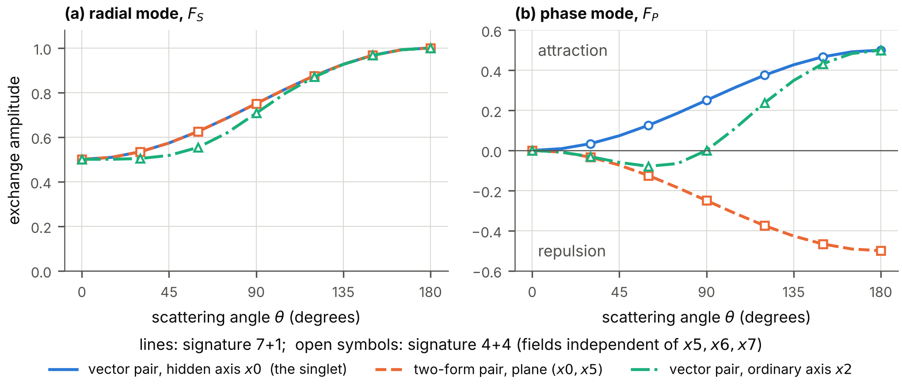
<figcaption>FIG. 1. Exchange amplitudes of the two modes of the Vorton-Scalar in three pair channels, for momenta of magnitude <em>m</em> in the plane (<em>x</em>1,<em>x</em>2), as functions of the scattering angle. Lines: 7 + 1 spacetime; open symbols: 4 + 4 spacetime. (a) The radial mode attracts in all channels. (b) The phase mode, which carries the neutral current, attracts in the vector channel along the hidden axis, repels in the two-form channel, and has both signs for a vector pair polarized in the plane of the momenta.</figcaption>
</figure>

| pair channel               | $F_S$, $60^\circ$ | $F_S$, $120^\circ$ | $F_S$, $180^\circ$ | $F_P$, $60^\circ$ | $F_P$, $120^\circ$ | $F_P$, $180^\circ$ |
|:---------------------------|:-----------------:|:------------------:|:------------------:|:-----------------:|:------------------:|:------------------:|
| vector, hidden axis $x0$   |     $+0.6250$     |     $+0.8750$      |     $+1.0000$      |     $+0.1250$     |     $+0.3750$      |     $+0.5000$      |
| vector, extra axis $x5$    |     $+0.6250$     |     $+0.8750$      |     $+1.0000$      |     $+0.1250$     |     $+0.3750$      |     $+0.5000$      |
| two-form, plane $(x0,x5)$  |     $+0.6250$     |     $+0.8750$      |     $+1.0000$      |     $-0.1250$     |     $-0.3750$      |     $-0.5000$      |
| two-form, plane $(x5,x6)$  |     $+0.6250$     |     $+0.8750$      |     $+1.0000$      |     $-0.1250$     |     $-0.3750$      |     $-0.5000$      |
| vector, ordinary axis $x2$ |     $+0.5534$     |     $+0.8696$      |     $+1.0000$      |     $-0.0791$     |     $+0.2372$      |     $+0.5000$      |

TABLE III. Exchange amplitudes $F_S$ (radial mode) and $F_P$ (phase mode) in five pair channels, for momenta of magnitude $m$ in the plane $(x1,x2)$ and three scattering angles. The values are those of the $7{+}1$ spacetime; the values of the $4{+}4$ spacetime differ from them by at most $3.0\times10^{-16}$ over all 585 entries computed.

*(i) The two spacetimes give the same amplitudes.* Although the matrices $\beta$, $\alpha^j$ and $\chi$ of the two spacetimes are different, every amplitude computed agrees between them to the accuracy of the arithmetic (Table III). The reason is the common internal symmetry of the zero-mode sector (Sec. V G). From here on the pairing calculation is one calculation for both.

*(ii) Closed forms for the pair along the hidden axis.* For $X=C^{-}\gamma^0$, with $E=\sqrt{m^2+p^2}$ and $E'=\sqrt{m^2+p'^2}$, $$\begin{aligned}
F_S&=\frac{m^2(E+E')^2+E^2p'^2+E'^2p^2}{4E^2E'^2}-\frac{\vec p\cdot\vec p\,'}{2EE'},\\
F_P&=\frac{(m^2-EE')^2+m^2q^2+p^2p'^2}{4E^2E'^2}+\frac{(m^2-EE')\,\vec p\cdot\vec p\,'}{2E^2E'^2}.
\tag{56}
\end{aligned}$$ For equal energies these reduce to $$F_S=\frac{4m^2+q^2}{4E^2},\qquad F_P=\frac{q^2}{4E^2}.
\tag{57}$$ A unit test of the program compares Eq. (56) with the matrices for 200 random momenta, on and off the energy shell.

*(iii) The radial mode does not distinguish the pair channels* in which the pair has no component along the momenta: $F_S$ is the same for the vector pairs along the four extra axes and for the two-form pairs.

*(iv) The phase mode does.* For the vector pairs along the four extra axes the amplitude is $F_P=+q^2/4E^2$ at equal energies: attraction at all angles. For the two-form pairs of the extra axes it is $F_P=-q^2/4E^2$: *repulsion* at all angles. For a vector pair polarized along an axis of ordinary space the amplitude depends on the directions of the momenta relative to that axis and takes both signs; such a pair has ordinary spin 1 and is not a candidate for the state sought here.

*(v) A contact attraction of the Fermi type.* The phase mode is massless, so that its contribution to the pairing interaction of the hidden-axis pair is $-g_{\mathrm{VS}}^2F_P/q^2=-g_{\mathrm{VS}}^2/4E^2$, independent of the momentum transfer: $$V_{\rm NC}=-\frac{g_{\mathrm{VS}}^2}{4E^2}=-\frac{1}{4v_{\mathrm{VS}}^2}\,\frac{m^2}{E^2}=-\frac{G_{\mathrm{VS}}}{2\sqrt2}\,\frac{m^2}{E^2}.
\tag{58}$$ The neutral current (51) thus produces, between two fermions in the hidden-axis channel, a point-like attraction whose strength is set by $G_{\mathrm{VS}}$ alone, the direct analog of Fermi’s contact interaction, and an equally strong repulsion in the two-form channels.

For momenta small compared with $m$ the amplitude of the radial mode tends to 1, and that mode gives the attractive Yukawa potential $$V_s(r)=-\alpha_{\mathrm{VS}}\,\frac{e^{-m_sr}}{r}
\tag{59}$$ between any two fermions, whatever their internal states.

### C. Discussion

Results (iii) to (v) are the dynamical reason for the state proposed in hypothesis H1. The radial mode binds. The neutral current then selects, among the 28 possible $s$-wave pairs, the four vector pairs along the extra axes, which are exactly the pairs of ordinary spin 0 that form a four-vector of the internal $SO(4)$, and it penalizes the six two-form pairs of spin 0. The neutral current alone would not suffice: its contact attraction (58) is weak at low density, as Sec. VII shows. What the hypothesis calls pairing “mediated by neutral currents” is thus realized in the following precise sense: the attraction that binds comes from the radial mode of the same scalar field, and the neutral current of that field decides the channel.

### D. What has been established, and what has not

Established, by numerical evaluation from the matrices of both spacetimes and by the closed forms (56): one-boson exchange is attractive in the hidden-axis vector channel for both modes; the neutral current gives the contact attraction (58) in that channel and a repulsion in the two-form channels.

Not established: anything beyond the exchange of a single boson in the static approximation. The phase mode is massless, and its exchange is not instantaneous; the dependence of the interaction on the energy transfer is neglected here.

## VII. The paired state from the effective action of Cornwall, Jackiw and Tomboulis

At a finite density of fermions the attraction of Sec. VI makes the Fermi sea unstable against the formation of pairs. This section constructs the paired state. It first explains the method, the effective action for composite operators of Cornwall, Jackiw and Tomboulis (CJT) ([Cornwall, Jackiw, and Tomboulis 1974](#ref-CJT1974)); then states the action of the present model; and then derives from it the gap equation, its solutions, the two-body bound state, and the thermodynamics of the paired state. The paired state is obtained twice, from the gap equation and from the minimum of the effective potential, by different algorithms, and the two results are compared.

### A. The method

The usual effective action of a quantum field theory is a functional of the expectation value $\phi(x)$ of a field. Its stationary points are the possible states, and for constant $\phi$ it reduces to the effective potential, whose minimum is the vacuum. It is the right tool when the quantity that acquires an expectation value is a *field*. In a superfluid of fermions it is not. A fermion field has no expectation value; what becomes non-zero is the expectation value of a *product of two fields*, a composite operator. CJT constructed the effective action for this situation: a functional $\Gamma[\phi,G]$ of two variables, the expectation value $\phi(x)$ and the full propagator $G(x,y)$, the connected expectation value of the product of two fields. An expectation value $\langle\psi\psi\rangle$ is one component of the propagator of the fermions.

We use the Euclidean form, with imaginary time, because all applications below are to equilibrium. For one real scalar field $\Phi$ with the Euclidean action $S[\Phi]$, add a source $J(x)$ for the field and a second source $K(x,y)$ for the product of two fields, $$\begin{aligned}
e^{W[J,K]}=\int\!\mathcal D\Phi\;\exp\Big\{&-S[\Phi]+\int_x J\Phi\\
&+\frac12\int_x\!\int_y\Phi(x)K(x,y)\Phi(y)\Big\}.
\tag{60}
\end{aligned}$$ The derivatives of $W$ with respect to $J$ and $K$ define $\phi$ and $G$, and the CJT action is the Legendre transform of $W$ with respect to both sources. The physical theory has no sources, and therefore *the physical $\phi$ and $G$ are the stationary point of $\Gamma$ in both variables.* The result of CJT is that $\Gamma$ has a simple structure, $$\begin{aligned}
\Gamma[\phi,G]={}&S[\phi]+\frac12\mathrm{Tr}\ln G^{-1}+\frac12\mathrm{Tr}\big[D^{-1}(\phi)\,G-1\big]\\
&+\Gamma_2[\phi,G].
\tag{61}
\end{aligned}$$ The first term is the classical action. $D^{-1}(\phi)=\delta^2S/\delta\phi\,\delta\phi$ is the inverse propagator of small fluctuations around the classical field. The traces run over the space-time arguments and over internal indices. The last term is minus the sum of all vacuum diagrams that are *two-particle irreducible*, that is, that do not fall into two pieces when any two of their lines are cut; it is computed with the vertices of the shifted action and, which is the essential point, with the *full propagator $G$ on every line*. Diagrams that do fall apart would count twice what the full propagator on the lines already contains.

Varying Eq. (61) with respect to $G$ gives $$G^{-1}=D^{-1}(\phi)+\Sigma[\phi,G],\qquad\Sigma\equiv2\,\frac{\delta\Gamma_2}{\delta G}.
\tag{62}$$ This is the exact Schwinger-Dyson equation for the propagator, in which the self-energy $\Sigma$ is expressed through the full propagator itself. It is called the *gap equation*, because in a superconductor its off-diagonal part determines the energy gap. For fields that are constant in space and time, $\Gamma$ divided by the volume of space-time is the *effective potential for composite operators*, $V(\phi,G)$. At temperature $T$ the imaginary time has the period $1/T$, and the value of $V$ at its stationary point is the thermodynamic potential per unit volume.

For a fermion field the same construction applies with two changes that follow from the anticommuting variables: the two trace terms change sign, and the factors $\tfrac12$ are absent because $\psi$ and $\bar\psi$ are independent. To allow pair correlations $\langle\psi\psi\rangle$, one combines the field and its conjugate into one doubled field $\Psi=(\psi,\psi^{\dagger T})$ ([Yoichiro Nambu 1960](#ref-Nambu1960); [Gor’kov 1958](#ref-Gorkov1958)). Its propagator $\mathcal S$ has four blocks, and the off-diagonal blocks are the pair correlations. The components of $\Psi$ are not independent, which restores the factors $\tfrac12$: $$\Gamma[\mathcal S]=-\frac12\mathrm{Tr}\ln\mathcal S^{-1}-\frac12\mathrm{Tr}\big[\mathcal S_0^{-1}\mathcal S-1\big]+\Gamma_2[\mathcal S].
\tag{63}$$

$\Gamma_2$ is an infinite sum, and an approximation keeps some of its diagrams. The natural ordering is by the number of loops. The diagrams with two loops give the approximations known by older names: the Hartree approximation for a self-interacting boson, the Hartree-Fock approximation for fermions that exchange a boson and, with pair correlations, the theory of Bardeen, Cooper and Schrieffer ([J. Bardeen, Cooper, and Schrieffer 1957](#ref-BCS1957)). Even this truncation is not perturbation theory: because the lines carry the full propagator, the gap equation sums an infinite class of perturbative diagrams self-consistently. Any truncation of $\Gamma_2$ guarantees that the thermodynamic quantities derived from the stationary value of $V$ are consistent with one another, and that the conservation laws of the symmetries that the truncation respects hold ([Luttinger and Ward 1960](#ref-LuttingerWard1960); [Baym 1962](#ref-Baym1962)). It does not guarantee that the propagator satisfies every identity of the exact theory; Sec. IX D meets an example. Appendix B tests all of this on a model that can be solved exactly, and shows that the two-loop truncation remains accurate to 11 per cent at couplings where perturbation theory is useless. All applications below use the two-loop truncation.

### B. The action of the model

The fields are the fermion field and the complex Vorton-Scalar. The variables of the CJT action are the expectation value $\phi$ of the Vorton-Scalar, defined by $\langle\Phi_{\mathrm{VS}}\rangle=\phi/\sqrt2$ and real by a choice of phase, so that the fermion mass is $g_{\mathrm{VS}}\phi$; the propagators $D_s$ and $D_\vartheta$ of the radial and of the phase mode; and the propagator $\mathcal S$ of the doubled fermion field. The action is the sum of Eq. (61) for the two boson modes and of Eq. (63) for the fermions, $$\begin{aligned}
\Gamma={}&S_{\rm cl}[\phi]
+\frac12\sum_{i=s,\vartheta}\Big\{\mathrm{Tr}\ln D_i^{-1}+\mathrm{Tr}\big[D_{0i}^{-1}(\phi)D_i-1\big]\Big\}\\
&-\frac12\mathrm{Tr}\ln\mathcal S^{-1}-\frac12\mathrm{Tr}\big[\mathcal S_0^{-1}(\phi)\,\mathcal S-1\big]\\
&+\Gamma_2[\phi,D_s,D_\vartheta,\mathcal S].
\tag{64}
\end{aligned}$$ With the vertices of Eq. (45) there are three kinds of two-particle-irreducible diagram with two loops. *Diagram (a)* is a closed fermion line with one boson line across it, for each of the two modes. Its derivative with respect to the fermion propagator is the self-energy of a fermion that emits and reabsorbs a boson: the normal blocks give the exchange energy of Sec. IX C, the pair blocks give the pairing interaction of this section and, without a medium, the ladder equation of Sec. IX E. *Diagram (b)* consists of two boson loops that touch at a four-boson vertex; it gives the bosons masses that depend on the temperature (Sec. IX D). *Diagram (c)*, two three-boson vertices joined by three boson lines, is omitted, as in the Hartree approximation. No diagram is needed for the mean field of the Vorton-Scalar acting on the fermions: that effect is contained in the dependence of $S_{\rm cl}$ and of $\mathcal S_0^{-1}(\phi)$ on $\phi$, and it appears when $\Gamma$ is varied with respect to $\phi$ (Sec. IX). Table IV states which variables are kept, and which further approximations are made, in each application.

| Section   | State                             | Variables kept                        | Further approximations                                  |
|:----------|:----------------------------------|:--------------------------------------|:--------------------------------------------------------|
| VII, VIII | paired state in a medium          | pair blocks of $\mathcal S$           | static exchange; particles only; normal state unchanged |
| IX A      | unpaired state in a medium, $T=0$ | $\phi$; normal blocks of $\mathcal S$ | exchange energy to first order; bosons at tree level    |
| IX D      | no medium, temperature $T$        | $\phi$, $D_s$, $D_\vartheta$          | fermions at one loop; diagram (b) only                  |
| IX E      | vacuum                            | pair blocks of $\mathcal S$           | linearized; normal blocks unchanged                     |

TABLE IV. The parts of the CJT action (64) that are used in each application, and the further approximations made there.

### C. The effective potential of the paired state, and the gap equation

Keep in Eq. (64) the pair blocks of the fermion propagator and diagram (a), with three further approximations, each of them standard and each stated because the results depend on them. *Static exchange:* the boson propagators are evaluated at zero energy transfer. *No change of the normal state:* the diagonal part of the self-energy is absorbed into the mass $m$ and the chemical potential $\mu$. *Particles only:* the pairing of antiparticle states is neglected, which is valid when the gap and the temperature are small compared with $m$.

A propagator with pair blocks is then specified by a gap function $\Delta(k)$. The quasiparticles have the energies $$E_k=\sqrt{\xi_k^2+\Delta(k)^2},\qquad\xi_k=\sqrt{m^2+k^2}-\mu,
\tag{65}$$ and the pair correlation is $$\kappa(k)=\big\langle b(-\vec k)\,b(\vec k)\big\rangle=\frac{\Delta(k)}{2E_k}\tanh\frac{E_k}{2T}.
\tag{66}$$ The chemical potential is kept at its value without pairing, $\mu=\sqrt{m^2+k_F^2}$, where the Fermi momentum $k_F$ is related to the density by $n=\nu k_F^3/6\pi^2$ with $\nu=8$ internal states. This is correct as long as the gap is small compared with the Fermi kinetic energy $$E_F=\sqrt{m^2+k_F^2}-m,$$ the *weak-coupling* regime. The sums over the Matsubara frequencies in Eq. (64) can be done in closed form. For a state in which all eight internal states have the same gap, which Sec. VIII calls a unitary state, and measured from the unpaired state at the same $T$ and $\mu$, the effective potential is $$\begin{aligned}
V[\Delta]={}&\nu\!\int\!\!\frac{d^3k}{(2\pi)^3}\Big\{\frac{|\xi_k|-E_k}{2}-T\ln\frac{1+e^{-E_k/T}}{1+e^{-|\xi_k|/T}}\\
&\qquad\qquad\qquad+\Delta(k)\,\kappa(k)\Big\}\\
&-\frac\nu2\int\!\!\frac{d^3k}{(2\pi)^3}\!\int\!\!\frac{d^3k'}{(2\pi)^3}\;\kappa(k)\,W(k,k')\,\kappa(k').
\tag{68}
\end{aligned}$$ The first two lines come from the trace terms of Eq. (63): the energy and the entropy of the quasiparticles, and the term $\Delta\kappa$ that the trace of $\mathcal S_0^{-1}\mathcal S$ contributes. The last line is $\Gamma_2$, one boson exchanged between two pairs, with the kernel $$W(k,k')=\frac12\int_{-1}^{1}\!d\cos\theta\;g_{\mathrm{VS}}^2\left[\frac{F_S}{q^2+m_s^2}+\sigma_X\,\frac{F_P}{q^2}\right],
\tag{69}$$ where $q^2=k^2+k'^2-2kk'\cos\theta$, the amplitudes $F_S$ and $F_P$ are those of Eq. (56), and $\sigma_X=+1$ for the vector pairs along the extra axes and $\sigma_X=-1$ for their two-form pairs. The angular integral is done in closed form.

Because the derivative of the first two terms in the braces with respect to $\Delta$ is $-\kappa$, $$\frac{\delta V}{\delta\Delta(k)}=\nu\,\frac{\partial\kappa}{\partial\Delta}\,\Big[\Delta(k)-\int\!\!\frac{d^3k'}{(2\pi)^3}W(k,k')\,\kappa(k')\Big],
\tag{70}$$ and $\partial\kappa/\partial\Delta>0$. The potential is therefore stationary exactly where the *gap equation* $$\Delta(k)=\frac{1}{4\pi^2}\int_0^\infty\!dk'\,k'^2\;W(k,k')\;\frac{\Delta(k')}{E_{k'}}\,\tanh\frac{E_{k'}}{2T}
\tag{71}$$ holds. A unit test of the program checks Eq. (70) against numerical derivatives of Eq. (68).

### D. Solutions of the gap equation

The gap equation was solved by iteration on a momentum grid that is refined logarithmically around $k_F$, for 120 combinations of the coupling $g_{\mathrm{VS}}$, the mass ratio $m_s/m$ and the Fermi momentum $k_F/m$, and for three kernels: the vector channel ($\sigma_X=+1$), the radial mode alone, and the two-form channel ($\sigma_X=-1$). The critical temperature $T_c$ is the temperature at which the linearized equation has the eigenvalue 1. The strength of each mode is measured by the dimensionless coupling $$\lambda=N(0)\,W(k_F,k_F),\qquad N(0)=\frac{k_F\sqrt{m^2+k_F^2}}{2\pi^2},
\tag{72}$$ where $N(0)$ is the density of states at the Fermi surface per internal state; $\lambda_S$ and $\lambda_P$ denote the contributions of the radial and of the phase mode. Two validations precede the results. For a kernel that is constant in a shell around the Fermi surface the program reproduces the textbook results $\Delta=2\omega_c\,e^{-1/\lambda}$ and $T_c=0.567\,\Delta$. And in the scan the ratio of $T_c$ to the gap at the Fermi momentum lies between 0.540 and 0.567 wherever the coupling is weak.

<figure>
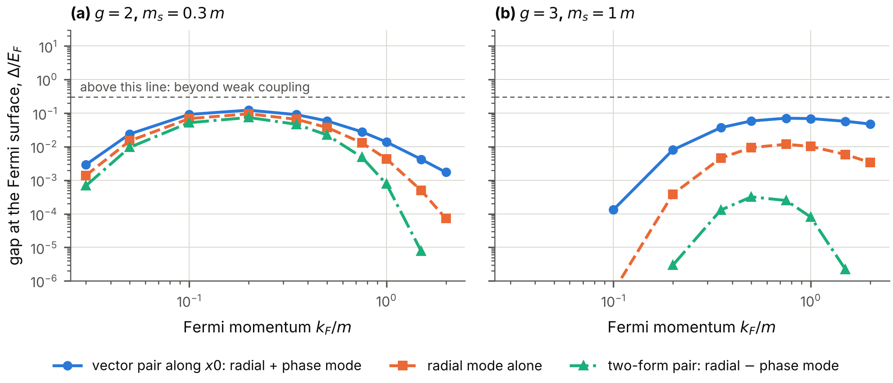
<figcaption>FIG. 2. Gap at the Fermi surface in units of the Fermi kinetic energy, as a function of the Fermi momentum, for two sets of couplings. In every case the vector pair along an extra axis, to which the radial mode and the phase mode both contribute attraction, has the largest gap; the two-form pair, in which the phase mode repels, has the smallest. Open symbols mark points above the dashed line, where the gap is no longer small compared with the Fermi energy and the gap equation with a fixed chemical potential is not quantitative.</figcaption>
</figure>

| $g_{\mathrm{VS}}$ | $m_s/m$ | $k_F/m$ | $\lambda_S$ | $\lambda_P$ | vector: $\Delta/E_F$ |    radial only     |      two-form      | $T_c/\Delta$ (vector) |
|:-----------------:|:-------:|:-------:|:-----------:|:-----------:|:--------------------:|:------------------:|:------------------:|:---------------------:|
|         1         |   0.1   |   0.1   |    0.204    |   0.0013    |  $2.5\times10^{-2}$  | $2.4\times10^{-2}$ | $2.3\times10^{-2}$ |         0.567         |
|         1         |   0.1   |  0.35   |    0.137    |   0.0042    |  $1.4\times10^{-3}$  | $1.1\times10^{-3}$ | $8.4\times10^{-4}$ |         0.567         |
|         1         |   0.1   |    1    |    0.063    |   0.0090    |  $8.2\times10^{-7}$  |     $<10^{-7}$     |     $<10^{-7}$     |         0.567         |
|         2         |   0.3   |   0.1   |    0.186    |   0.0050    |  $9.1\times10^{-2}$  | $6.8\times10^{-2}$ | $5.2\times10^{-2}$ |         0.565         |
|         2         |   0.3   |  0.35   |    0.266    |   0.0167    |  $9.0\times10^{-2}$  | $6.5\times10^{-2}$ | $4.6\times10^{-2}$ |         0.565         |
|         2         |   0.3   |    1    |    0.169    |   0.0358    |  $1.4\times10^{-2}$  | $4.3\times10^{-3}$ | $7.7\times10^{-4}$ |         0.567         |
|         3         |    1    |   0.1   |    0.045    |   0.0113    |  $1.3\times10^{-4}$  | $4.9\times10^{-7}$ |     $<10^{-7}$     |         0.567         |
|         3         |    1    |  0.35   |    0.130    |   0.0377    |  $3.7\times10^{-2}$  | $4.6\times10^{-3}$ | $1.3\times10^{-4}$ |         0.567         |
|         3         |    1    |    1    |    0.178    |   0.0806    |  $6.9\times10^{-2}$  | $1.0\times10^{-2}$ | $8.0\times10^{-5}$ |         0.566         |

TABLE V. Solutions of the gap equation (71) at zero temperature for nine of the 120 parameter sets: the dimensionless couplings $\lambda_S$ and $\lambda_P$ of the radial and of the phase mode, the gap at the Fermi momentum in units of the Fermi kinetic energy for the three kernels, and the ratio of the critical temperature to the gap for the vector channel. An entry “$<10^{-7}$” is below the resolution of the calculation.

Figure 2 and Table V show the result that matters for hypothesis H1. *The gap of the vector channel is the largest* in all 120 parameter sets, and it exceeds that of the two-form channel by a factor that grows with the density and with the mass of the radial mode, from 1.03 to $2.6\times10^{4}$ in the weak-coupling part of the scan. The phase mode alone, that is, the neutral current without the radial mode, gives a gap that is negligible at low density, because its coupling $\lambda_P=N(0)\,g_{\mathrm{VS}}^2/4(m^2+k_F^2)$ vanishes with $k_F$; it becomes comparable to the contribution of the radial mode when $k_F\sim m$.

### E. Two fermions: the bound pair

At low density the attraction (59) is felt by two fermions alone. Whether they bind is decided by one number, $$D_{\mathrm{VS}}\equiv\frac{\alpha_{\mathrm{VS}}\,m}{m_s}.
\tag{73}$$ The radial Schrödinger equation of the relative motion, with the reduced mass $m/2$, is $u''+D_{\mathrm{VS}}\,e^{-\rho}u/\rho=\varepsilon u$ in the variables $\rho=m_sr$ and $\varepsilon=mE_b/m_s^2$, where $E_b$ is the binding energy. Its numerical integration gives a bound state if and only if $$D_{\mathrm{VS}}>D_c=1.67981,
\tag{74}$$ which is the critical value known for the Yukawa potential ([Rogers, Graboske, and Harwood 1970](#ref-RogersGraboskeHarwood1970)). The scattering length $a_{\rm sc}$ has the Born limit $a_{\rm sc}=-D_{\mathrm{VS}}/m_s$ for weak coupling and diverges at $D_c$ (Fig. 3).

<figure>
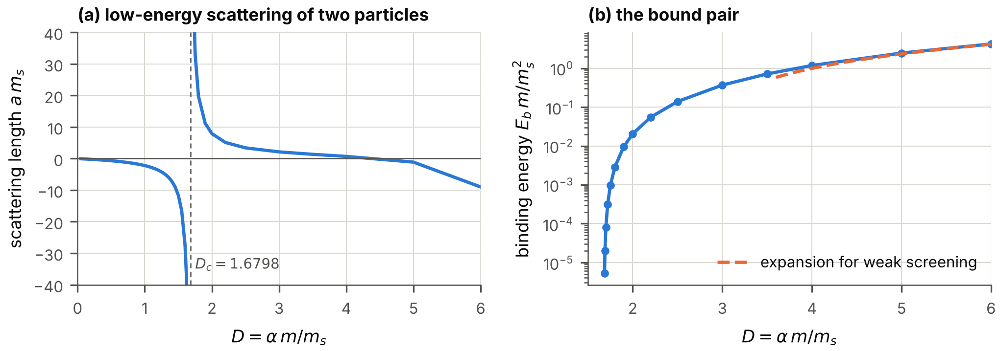
<figcaption>FIG. 3. Two fermions in the Yukawa potential of the radial mode. (a) Scattering length in units of 1/<em>m</em><em>s</em>; it diverges at the critical coupling <em>D</em><em>c</em>, where the bound state appears. (b) Binding energy of the pair.</figcaption>
</figure>

For $D_{\mathrm{VS}}<D_c$ the superfluid is of the kind described by Bardeen, Cooper and Schrieffer at all densities: large, overlapping pairs, described by Eq. (71). For $D_{\mathrm{VS}}>D_c$ a dilute gas consists of bound pairs, bosons of spin 0, that condense; as the density rises the pairs overlap, and the state crosses over continuously to the first kind ([Nozières and Schmitt-Rink 1985](#ref-NozieresSchmittRink1985)). In the scan of Sec. VII D the 35 points marked by open symbols are on the way to this regime. There the *existence* of the paired state is not in doubt, since two fermions already bind, but the numbers obtained from Eq. (71) are not quantitative.

The bound state and the instability of the vacuum against pairing are the same thing. Without a Fermi sea, at $T=0$ and $\mu<m$, the linearized gap equation becomes, for momenta small compared with $m$ and with $\mu=m-E_b/2$, the Schrödinger equation of the relative motion in momentum space. A bound state appears when the largest eigenvalue of the kernel at $\mu=m$ reaches 1. Solving this condition with the relativistic kernel (69) gives Table VI: for a force of long range compared with the Compton wavelength of the fermions the threshold is 1.67982, against 1.67981 from the Schrödinger equation in coordinate space. The two programs share no code. For $m_s$ comparable to $m$, relativistic effects raise the threshold by a few per cent.

| $m_s/m$ | $D_c$ from the gap equation | relative difference |
|:-------:|:---------------------------:|:-------------------:|
|   0.3   |           1.73473           | $3.3\times10^{-2}$  |
|   0.1   |           1.69016           | $6.2\times10^{-3}$  |
|  0.03   |           1.68096           | $6.9\times10^{-4}$  |
|  0.01   |           1.67994           | $8.1\times10^{-5}$  |
|  0.003  |           1.67982           | $7.5\times10^{-6}$  |

TABLE VI. Critical value of $D_{\mathrm{VS}}=\alpha_{\mathrm{VS}}m/m_s$ for a bound pair, obtained from the gap equation in vacuum with the relativistic kernel, and its relative difference from the value 1.67981 of the non-relativistic Schrödinger equation.

### F. Independent checks through the effective potential

The potential (68) was evaluated on the momentum grid for twelve of the parameter sets, eight in the vector channel and two each in the two-form channel and with the radial mode alone. Table VII gives four checks.

*An independent solution.* The gap equation is solved by Newton’s method with the exact Jacobian, starting from a function of different height and shape, where the scan of Sec. VII D used iteration. The two gap functions agree at every grid point within $1.1\times10^{-11}$ of the gap, and with the stored results of the scan within $7.9\times10^{-9}$.

*The solution is a minimum.* Along the family $s\,\Delta(k)$ of rescaled gap functions the potential has its minimum at $s=1$, within $5.1\times10^{-7}$. All second variations are positive: the matrix of second derivatives is positive definite, and its smallest eigenvalue, in suitable units, is given in the table.

*The value at the minimum* is the condensation energy. In weak coupling it must approach $V_{\rm BCS}=-\nu N(0)\Delta_F^2/4$, where $\Delta_F$ is the gap at the Fermi momentum. The ratio lies between 0.987 and 1.000, closest to 1 for the smallest gaps.

*The critical temperature.* Below $T_c$ the unpaired state $\Delta=0$ is unstable: the second variation of $V$ there has a negative direction. The temperature at which its determinant changes sign agrees with the $T_c$ of the linearized gap equation within $2.6\times10^{-12}$, the resolution of the bisection.

| $g_{\mathrm{VS}}$ | $m_s$ | $k_F$ | pair        |    $\Delta/E_F$     |       Newton        |        scan        | $V/V_{\rm BCS}$ | smallest curvature | $T_c/\Delta$ | $T_c$: two methods  |
|:-----------------:|:-----:|:-----:|:------------|:-------------------:|:-------------------:|:------------------:|:---------------:|:------------------:|:------------:|:-------------------:|
|         2         |  0.3  |  0.5  | vector      | $5.84\times10^{-2}$ | $3.3\times10^{-12}$ | $2.3\times10^{-9}$ |     0.9977      |       0.257        |    0.5660    | $2.6\times10^{-12}$ |
|         2         |  0.3  |   1   | vector      | $1.38\times10^{-2}$ | $4.8\times10^{-12}$ | $3.5\times10^{-9}$ |     0.9997      |       0.201        |    0.5668    | $2.6\times10^{-12}$ |
|         2         |   1   |   1   | vector      | $5.03\times10^{-4}$ | $1.1\times10^{-11}$ | $7.4\times10^{-9}$ |     1.0000      |       0.114        |    0.5669    | $2.6\times10^{-12}$ |
|         2         |  0.1  |   1   | vector      | $3.42\times10^{-2}$ | $2.8\times10^{-12}$ | $2.2\times10^{-9}$ |     0.9936      |       0.263        |    0.5641    | $2.6\times10^{-12}$ |
|         3         |   1   | 0.35  | vector      | $3.68\times10^{-2}$ | $5.7\times10^{-12}$ | $4.8\times10^{-9}$ |     0.9993      |       0.157        |    0.5666    | $2.6\times10^{-12}$ |
|         3         |   1   |  0.5  | vector      | $5.84\times10^{-2}$ | $4.7\times10^{-12}$ | $4.1\times10^{-9}$ |     0.9981      |       0.194        |    0.5660    | $2.6\times10^{-12}$ |
|         3         |   1   |   1   | vector      | $6.86\times10^{-2}$ | $4.1\times10^{-12}$ | $3.0\times10^{-9}$ |     0.9969      |       0.243        |    0.5655    | $2.6\times10^{-12}$ |
|         3         |  0.3  |  1.5  | vector      | $1.28\times10^{-1}$ | $3.2\times10^{-12}$ | $1.7\times10^{-9}$ |     0.9873      |       0.330        |    0.5634    | $2.6\times10^{-12}$ |
|         2         |  0.3  |  0.5  | two-form    | $2.22\times10^{-2}$ | $4.3\times10^{-12}$ | $3.1\times10^{-9}$ |     0.9997      |       0.219        |    0.5668    | $2.6\times10^{-12}$ |
|         3         |   1   |  0.5  | two-form    | $3.20\times10^{-4}$ | $1.0\times10^{-11}$ | $7.9\times10^{-9}$ |     1.0000      |       0.106        |    0.5669    | $2.6\times10^{-12}$ |
|         2         |  0.3  |  0.5  | radial only | $3.72\times10^{-2}$ | $3.7\times10^{-12}$ | $2.5\times10^{-9}$ |     0.9991      |       0.239        |    0.5666    | $2.6\times10^{-12}$ |
|         3         |   1   |  0.5  | radial only | $9.38\times10^{-3}$ | $5.9\times10^{-12}$ | $4.7\times10^{-9}$ |     0.9999      |       0.154        |    0.5669    | $2.6\times10^{-12}$ |

TABLE VII. Checks of the paired state through the CJT potential (68). $m_s$ and $k_F$ are in units of $m$. “Newton” and “scan” are the largest relative differences between the gap function found by Newton’s method on the potential and, respectively, the gap function found by iteration and the gap stored by the scan of Sec. VII D. $V/V_{\rm BCS}$ is the condensation energy relative to its weak-coupling value. The last column is the relative difference between the two determinations of $T_c$.

*The Ginzburg-Landau coefficients.* Near $T_c$ the potential can be expanded along a gap function of fixed shape, $\Delta(k)=s\,\varphi(k)$, where $\varphi$ is the solution of the linearized gap equation normalized to 1 at the Fermi momentum: $V=A_2(T)\,s^2+\tfrac12A_4\,s^4+\dots$ Expanding Eq. (68) gives $$\begin{aligned}
A_2(T)&=\frac\nu2\big[1-\eta(T)\big]\!\int\!\!\frac{d^3k}{(2\pi)^3}\,\kappa'\varphi^2,\\
\frac{A_4}2&=\nu\Big[\frac18-\frac{\eta(T)}{6}\Big]\!\int\!\!\frac{d^3k}{(2\pi)^3}\,\kappa'''\varphi^4,
\tag{75}
\end{aligned}$$ where $\eta(T)$ is the largest eigenvalue of the linearized gap equation, with $\eta(T_c)=1$, and $\kappa'$, $\kappa'''$ are the first and third derivatives of Eq. (66) with respect to $\Delta$ at $\Delta=0$. With a constant density of states these expressions reduce at $T_c$ to the weak-coupling coefficients $a$ and $b$ of Eq. (79) below, with $A_2=8a$ and $A_4=8b$. The gradient coefficient $K_{\rm GL}$ is obtained independently, from the dependence of the pair susceptibility on the momentum of the pair. Table VIII compares the three coefficients, extracted numerically at $T_c$, with the weak-coupling formulas: they agree within 1.0 per cent, and the deviations decrease with the coupling.

| $g_{\mathrm{VS}}$ | $m_s/m$ | $k_F/m$ |  $a$   |  $b$   | $K_{\rm GL}$ |
|:-----------------:|:-------:|:-------:|:------:|:------:|:------------:|
|         3         |    1    |   0.5   | 0.9993 | 0.9949 |    1.0101    |
|         2         |   0.3   |    1    | 0.9998 | 0.9996 |    1.0007    |
|         2         |    1    |    1    | 1.0000 | 1.0003 |    1.0000    |

TABLE VIII. The Ginzburg-Landau coefficients extracted from the CJT potential at $T_c$, divided by the weak-coupling formulas of Eq. (79): $a$ and $b$ from the expansion of the potential, $K_{\rm GL}$ from the pair susceptibility.

### G. Thermodynamics of the paired state

At the solution of the gap equation the potential (68) is the difference of the thermodynamic potentials of the paired and of the unpaired state. Figure 4 and Table IX show it, together with the gap, the entropy $S$ and the heat capacity $C=T\,dS/dT$, for $g_{\mathrm{VS}}=3$, $m_s=m$ and $k_F=0.5\,m$ in the vector channel.

<figure>
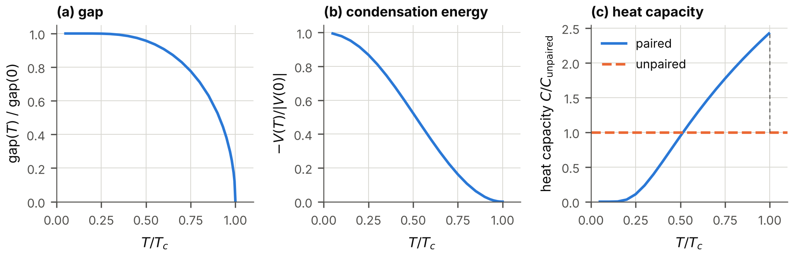
<figcaption>FIG. 4. The paired state as a function of temperature, for <em>g</em>VS = 3, <em>m</em><em>s</em> = <em>m</em>, <em>k</em><em>F</em> = 0.5 <em>m</em>. (a) Gap at the Fermi momentum. (b) Condensation energy, that is, minus the CJT potential, in units of its value at <em>T</em> = 0. (c) Heat capacity in units of that of the unpaired state at the same temperature; it jumps at <em>T</em><em>c</em>.</figcaption>
</figure>

| $T/T_c$ | $\Delta(T)/\Delta(0)$ | $-V(T)/\lvert V(0)\rvert$ | $S_s/S_n$ | $C_s/C_n$ |
|:-------:|:---------------------:|:-------------------------:|:---------:|:---------:|
|  0.10   |        1.0000         |          0.9789           |  0.0000   |  0.0000   |
|  0.20   |        0.9999         |          0.9156           |  0.0036   |  0.0304   |
|  0.30   |        0.9971         |          0.8120           |  0.0409   |  0.2340   |
|  0.40   |        0.9851         |          0.6766           |  0.1302   |  0.5743   |
|  0.50   |        0.9570         |          0.5233           |  0.2561   |  0.9443   |
|  0.60   |        0.9072         |          0.3675           |  0.4005   |  1.2973   |
|  0.70   |        0.8291         |          0.2242           |  0.5521   |  1.6217   |
|  0.80   |        0.7114         |          0.1071           |  0.7045   |  1.9170   |
|  0.90   |        0.5266         |          0.0285           |  0.8544   |  2.1863   |
|  0.95   |        0.3806         |          0.0073           |  0.9278   |  2.3123   |
|  0.99   |        0.1731         |          0.0003           |  0.9857   |  2.4093   |

TABLE IX. The paired state as a function of temperature (parameters of Fig. 4): gap, condensation energy, and entropy and heat capacity relative to the unpaired state (subscripts $s$ and $n$).

The universal numbers of weak coupling are reproduced, with corrections of the size expected for a gap of a few per cent of the Fermi energy: $$\begin{aligned}
\frac{\Delta(0)}{T_c}&=1.7668\quad(1.764),\\
\frac{C_s-C_n}{C_n}\Big|_{T_c}&=1.433\quad(1.426),
\tag{76}
\end{aligned}$$ where the values in parentheses are those of the weak-coupling limit. They hold for both spacetimes and for any unitary state. Two consequences are used in Sec. XII. The entropy of the paired state is exponentially small below about $T_c/4$, so that the paired fluid is cold in the strict sense. And the condensation energy per fermion, $\tfrac38\Delta^2/E_F$ in the non-relativistic limit, is a small fraction of the Fermi energy, so that pairing changes the pressure only by terms of relative order $(\Delta/E_F)^2$.

### H. What has been established, and what has not

Established: within the approximations of Sec. VII C the gap equation has solutions; the vector channel has the largest gap; the numerical method reproduces the textbook limits; two fermions bind when $D_{\mathrm{VS}}>D_c$; the solution of the gap equation is the minimum of the CJT potential, and a different formulation with different algorithms reproduces the gap functions, the critical temperatures, the condensation energy, the critical coupling of the bound pair and the three Ginzburg-Landau coefficients, to the accuracies of Tables VI to VIII.

Not established: anything beyond the two-loop truncation of $\Gamma_2$ and the three approximations of Sec. VII C. In particular the dependence of the pairing interaction on the energy transfer, which is known to change the prefactor of the gap in comparable systems; the renormalization of the normal state; fluctuations of the order parameter; and the strong-coupling regime beyond the open symbols of Fig. 2.

## VIII. The order parameter and the ground state

Section VII showed that the four vector pairs along the extra axes have the strongest pairing. This section determines how they combine: the structure of the order parameter, the energy as a function of it, the ground state, and the place of the hidden-axis singlet in it. It completes objective O4.

### A. The gap matrix

The condensate is described by the expectation values of the four vector pair operators along the extra axes, $$\Delta^a\propto\big\langle\psi^TC^{-}\gamma^a\psi\big\rangle,\qquad a\in\{0,5,6,7\},
\tag{77}$$ four complex numbers. On the eight internal states of the pair $(\vec p,-\vec p)$ they define the *gap matrix* $$\mathsf{M}(\vec p)=\sum_{a}\Delta^a\,\frac{\Phi_a(\vec p)}{\sqrt{N_a/8}},\qquad\Phi_a=U(\vec p)^TC^{-}\gamma^aU(-\vec p),
\tag{78}$$ with the two-particle contents $\Phi_a$ of Eq. (54) and their norms $N_a$. The energies of the quasiparticles are $\sqrt{\xi^2+d_r^2}$, where $d_r^2$, $r=1,\dots,8$, are the eigenvalues of $\mathsf{M}\mathsf{M}^\dagger$. A state is called *unitary* if $\mathsf{M}\mathsf{M}^\dagger$ is a multiple of the unit matrix, so that all eight internal states have the same gap ([Leggett 1975](#ref-Leggett1975)).

### B. The energy as a function of the order parameter

Near the critical temperature the free energy can be expanded in the order parameter. At weak coupling the expansion of Ginzburg and Landau, as derived from the microscopic theory by Gor’kov ([Gor’kov 1959](#ref-Gorkov1959)), is $$\begin{aligned}
\mathcal F={}&a(T)\,\mathrm{Tr}\big[\mathsf{M}\mathsf{M}^\dagger\big]+\frac b2\,\mathrm{Tr}\big[(\mathsf{M}\mathsf{M}^\dagger)^2\big]\\
&+K_{\rm GL}\,\mathrm{Tr}\big[\nabla\mathsf{M}\cdot\nabla\mathsf{M}^\dagger\big]+\dots,\\
a(T)={}&\frac{N(0)}2\ln\frac{T}{T_c},\qquad b=\frac{7\zeta(3)}{16\pi^2T_c^2}N(0),\\
K_{\rm GL}={}&\frac{7\zeta(3)}{96\pi^2T_c^2}N(0)\,v_F^2,
\tag{79}
\end{aligned}$$ with the Fermi velocity $v_F$ and the density of states $N(0)$ of Eq. (72). For a unitary state this is the textbook energy of four independent copies of a spin-$\tfrac12$ superconductor. Section VII F confirmed the three coefficients from the CJT potential.

The form of the quartic term is decided by one matrix identity. The program verifies it from the matrices of both spacetimes, with a largest deviation of $2.1\times10^{-14}$ for the present one: $$\begin{aligned}
\frac18\mathrm{Tr}\big[\mathsf{M}\mathsf{M}^\dagger\big]&=\sum_a|\Delta^a|^2\equiv|\Delta|^2,\\
\frac18\mathrm{Tr}\big[(\mathsf{M}\mathsf{M}^\dagger)^2\big]&=2\,|\Delta|^4-\big|\eta_{ab}\,\Delta^a\Delta^b\big|^2 ,
\tag{80}
\end{aligned}$$ where $\eta_{ab}$ is the metric of the spacetime restricted to the four extra axes, $$\eta_{ab}=\mathrm{diag}(-1,-1,-1,-1)\qquad(a,b\in\{0,5,6,7\})
\tag{81}$$ for the $7{+}1$ spacetime: all four extra axes are space-like. On the $4{+}4$ spacetime the hidden axis is space-like and the other three are time-like, and $\eta_{ab}=\mathrm{diag}(+1,-1,-1,-1)$. *The signature of the spacetime thus enters the energy of the superfluid through the quadratic form $\eta_{ab}\Delta^a\Delta^b$.* It is the invariant form (53) of the internal symmetry.

Equation (80) is a statement about the sum of the fourth powers of the gaps. The complete statement, which the program also verifies, is that the eight eigenvalues of $\mathsf{M}\mathsf{M}^\dagger$ form two fourfold sets, $$d_\pm^2=|\Delta|^2\pm\sqrt{|\Delta|^4-\big|\eta_{ab}\Delta^a\Delta^b\big|^2}.
\tag{82}$$ A state is unitary, $d_+=d_-$, exactly when $|\eta_{ab}\Delta^a\Delta^b|=|\Delta|^2$.

### C. The ground state, and the hidden-axis singlet

At fixed $|\Delta|^2$ the quartic term (80) is smallest when $|\eta_{ab}\Delta^a\Delta^b|$ is largest, that is, equal to $|\Delta|^2$. The ground states are therefore the unitary states: all eight quasiparticle branches have the same gap, and the condensation energy is the largest possible. The minimizing configurations are $$\Delta^a=|\Delta|\,e^{i\varphi}\,n^a
\tag{83}$$ with a phase $\varphi$ and a *real* unit vector $n^a$ in the space of the four extra axes. The *hidden-axis singlet* of hypothesis H1, $$\Delta^a=\Delta\,\delta^{a0},\qquad\big\langle\psi_{1671}^T\,C^{-}_{1671}\gamma_{1671}^0\,\psi_{1671}\big\rangle\neq0,
\tag{84}$$ is a member of this family. Its properties were proved in Sec. IV C: the pair has ordinary spin 0; it is invariant under the rotations of ordinary space and of the coordinates $x5,x6,x7$; and it is a scalar under the Lorentz group of the seven coordinates other than $x0$.

*How the hidden axis is singled out.* By Sec. V G the order parameter is a four-vector of the internal $SO(4)$ of the zero-mode sector, and all directions of this four-vector have exactly the same energy. On the $7{+}1$ spacetime the direction $n^a$ is chosen spontaneously, and calling the chosen one “the hidden axis” is a choice of coordinates. The symmetry breaking is $SO(4)\to SO(3)$ together with $U(1)_F\to Z_2$. Besides the sound mode of the superfluid, the Goldstone mode of the fermion number, there are three Goldstone modes, the rotations of $n^a$. Because the $SO(4)$ is a symmetry of the full theory, nothing within the flat $7{+}1$ model prefers one direction. In the second stage of the program the hidden coordinate is curled up and the three others are treated differently; this would break the $SO(4)$ explicitly and decide the direction. It is not implemented here.

### D. The space of the order parameter

The statements of Sec. VIII C rest on the expansion (79) near $T_c$. The CJT potential allows them to be tested at zero temperature and away from small amplitudes. The program builds the gap matrix (78) from the Dirac matrices of each spacetime and evaluates the potential for a constant attraction in each of the four channels, in units in which the gap of the unitary state is $\Delta_0=1$ and $N(0)=1$. Table X lists six configurations for each spacetime, and Fig. 5 shows a section through the space of the order parameter.

|     | configuration                                              |   gaps$^2$   |    $V$    |     second derivatives      | flat directions                                         |
|:----|:-----------------------------------------------------------|:------------:|:---------:|:---------------------------:|:--------------------------------------------------------|
| 7+1 | hidden-axis singlet                                        | 1.000, 1.000 | $-2.0000$ | 4 flat, 4 positive (6.6647) | Im $\Delta^0$ Re $\Delta^5$ Re $\Delta^6$ Re $\Delta^7$ |
| 7+1 | along x5                                                   | 1.000, 1.000 | $-2.0000$ | 4 flat, 4 positive (6.6647) | Re $\Delta^0$ Im $\Delta^5$ Re $\Delta^6$ Re $\Delta^7$ |
| 7+1 | unitary, rotated between x0 and x5                         | 1.000, 1.000 | $-2.0000$ | 4 flat, 4 positive (6.6648) | (combinations)                                          |
| 7+1 | unitary, general direction and phase                       | 1.000, 1.000 | $-2.0000$ | 4 flat, 4 positive (6.6648) | (combinations)                                          |
| 7+1 | half-paired: $\eta_{ab}\Delta^a\Delta^b$ = 0; larger gap 1 | 0.000, 1.000 | $-1.0000$ |    stationary; unstable     | —                                                       |
| 7+1 | the phases of the other signature’s unitary state          | 0.040, 1.960 | $-0.9184$ |       not stationary        | —                                                       |
| 4+4 | hidden-axis singlet                                        | 1.000, 1.000 | $-2.0000$ | 4 flat, 4 positive (6.6647) | Im $\Delta^0$ Im $\Delta^5$ Im $\Delta^6$ Im $\Delta^7$ |
| 4+4 | along x5                                                   | 1.000, 1.000 | $-2.0000$ | 4 flat, 4 positive (6.6647) | Im $\Delta^0$ Im $\Delta^5$ Re $\Delta^6$ Re $\Delta^7$ |
| 4+4 | unitary, rotated between x0 and x5                         | 1.000, 1.000 | $-2.0000$ | 4 flat, 4 positive (6.6648) | (combinations)                                          |
| 4+4 | unitary, general direction and phase                       | 1.000, 1.000 | $-2.0000$ | 4 flat, 4 positive (6.6648) | (combinations)                                          |
| 4+4 | half-paired: $\eta_{ab}\Delta^a\Delta^b$ = 0; larger gap 1 | 0.000, 1.000 | $-1.0000$ |    stationary; unstable     | —                                                       |
| 4+4 | the phases of the other signature’s unitary state          | 0.040, 1.960 | $-0.9184$ |       not stationary        | —                                                       |

TABLE X. The CJT potential at zero temperature on the eight-dimensional space of the order parameter, from the Dirac matrices of both spacetimes; units $\Delta_0=N(0)=1$. For each configuration: the two fourfold eigenvalues of $\mathsf{M}\mathsf{M}^\dagger$, the potential, the numbers of vanishing and of positive eigenvalues of its matrix of second derivatives (with the largest eigenvalue), and the real coordinates that span the flat directions.

<figure>
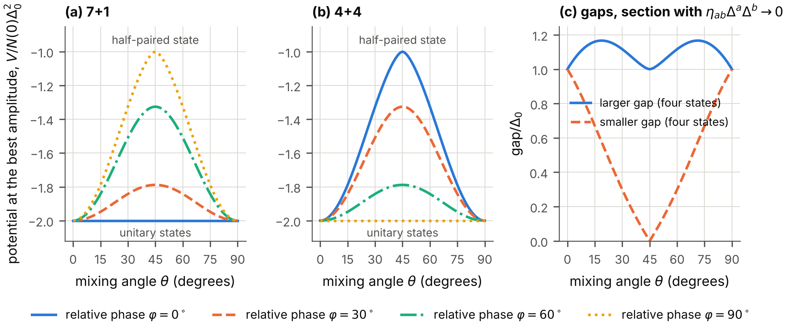
<figcaption>FIG. 5. A section through the space of the order parameter: directions (cos<em>θ</em>, <em>e</em><em>i</em><em>φ</em>sin<em>θ</em>, 0, 0) on the extra axes (<em>x</em>0,<em>x</em>5). (a), (b) The potential at the amplitude that minimizes it in each direction, for the two spacetimes. The unitary states form the flat valley at  − 2, which is the line of relative phase <em>φ</em> = 0 on the 7 + 1 spacetime and <em>φ</em> = 90∘ on the 4 + 4 spacetime; the half-paired state is the saddle at  − 1. The two panels differ only by the exchange <em>φ</em> ↔︎ 90∘ − <em>φ</em>. (c) The two fourfold gaps along the section that contains the half-paired state.</figcaption>
</figure>

*The unitary states are the minima*, with $V=-2$, that is, $-\nu N(0)\Delta_0^2/4$, whatever their direction: the hidden-axis singlet, a state along $x5$ and rotated states have the same energy to the accuracy of the calculation, on both spacetimes.

*Four flat directions and four massive ones.* Around every unitary state four of the eight real directions cost no energy: the phase, which belongs to the fermion number, and three rotations of the direction. They are the directions of the four gapless collective modes. At the hidden-axis singlet they are, on the $7{+}1$ spacetime, the imaginary part of $\Delta^0$ and the *real* parts of $\Delta^5,\Delta^6,\Delta^7$; on the $4{+}4$ spacetime, the imaginary part of $\Delta^0$ and the *imaginary* parts of the other three, because the hidden symmetry rotates $\Delta^0$ into $i\Delta^t$. The other four directions, the amplitude and three that make the state non-unitary, have equal curvature, 6.6647 $N(0)$.

*A half-paired stationary state.* If $\eta_{ab}\Delta^a\Delta^b=0$, four of the eight internal states are paired with the full gap and four are not paired at all, by Eq. (82). This state is stationary and has half the condensation energy. It is unstable against opening the second gap: the potential rises by $6.7\times10^{-4}$ when the order parameter is multiplied by 1.02 or by 0.98, and falls by $2.1\times10^{-2}$ when 0.05 is added to $\Delta^0$. It is the analog of the non-unitary phases of superfluid $^3$He, which a magnetic field stabilizes ([Leggett 1975](#ref-Leggett1975)); here the corresponding field would be a chemical potential for one of the generators of $SO(4)$.

*The two spacetimes are mirror images.* In the direction $(\cos\theta,e^{i\varphi}\sin\theta,0,0)$ the two gaps are, by Eq. (82), proportional to $\sqrt{1\mp\sin2\theta\,|\sin\varphi|}$ on the $7{+}1$ spacetime and to $\sqrt{1\mp\sin2\theta\,|\cos\varphi|}$ on the $4{+}4$ spacetime; the program compares these forms with the eigenvalues computed from the matrices at every point of Fig. 5. A rotation of the order parameter from the hidden axis towards $x5$ costs nothing if the two components have the relative phase 0 on the $7{+}1$ spacetime, or $90^\circ$ on the $4{+}4$ spacetime. With any other relative phase it costs energy, and with the opposite phase the path leads over the half-paired state. The configuration that is unitary on one spacetime is far from unitary on the other (last row of each block of Table X).

The curvatures of the potential in the massive directions depend on how propagators away from the stationary point are parametrized; they are not frequencies of collective modes. The number of flat directions and the energies of stationary states do not depend on that choice.

### E. Collective modes and the sound of the superfluid

The phase $\varphi$ of the order parameter is the Goldstone field of the broken fermion number. Its excitation is a density wave, the first sound of the superfluid ([Bogoliubov 1947](#ref-Bogoliubov1947); [Anderson 1958](#ref-Anderson1958)), with the velocity given by the compressibility, $c_s^2=dP/d\rho$. In the weak-coupling regime the pressure is the degeneracy pressure of the fermions, and in a dilute gas of bound pairs it is that of a weakly interacting Bose gas: $$c_s^2=\frac{k_F^2}{3\,(m^2+k_F^2)}=\frac{v_F^2}{3},\qquad\text{or}\qquad c_s^2=\frac{4\pi a_{BB}\,n_B}{m_B^2},
\tag{85}$$ where $m_B$, $n_B$ and $a_{BB}>0$ are the mass, the density and the mutual scattering length of the bound pairs. Equation (85) is the input of the cosmological simulations of Sec. XII, in which the superfluid appears as a fluid with this sound speed. Besides the sound mode both models have three gapless modes in which the direction of the order parameter in the space of the extra axes oscillates. On the $7{+}1$ spacetime they are exact Goldstone modes of the flat model.

### F. The field equations of the superfluid

For the reader who wants the complete set of equations in one place: in the unpaired phase the fields obey Eqs. (52). In the paired phase, in the mean-field approximation of Sec. VII C, the fermion field obeys the Bogoliubov-de Gennes equations $$\begin{aligned}
i\partial_4\psi&=(\mathsf{h}-\mu)\,\psi+\hat\Delta\,\psi^{\dagger T},\\
\hat\Delta(\vec p)&=U(\vec p)^{*}\,\mathsf{M}(\vec p)\,U(-\vec p)^{\dagger},
\tag{86}
\end{aligned}$$ in which $\hat\Delta$ is the $16\times16$ pair potential built from the gap matrix (78), and the gap obeys the self-consistency equation (71). Near $T_c$ the order parameter varies slowly and obeys the Ginzburg-Landau equation that follows from Eqs. (79) and (80) by variation with respect to $\Delta^{a*}$, $$\begin{aligned}
-K_{\rm GL}\,\nabla^2\Delta^a+a(T)\,\Delta^a+b\Big[&2\Big(\sum_c|\Delta^c|^2\Big)\Delta^a\\
&-\big(\eta_{cd}\Delta^c\Delta^d\big)\,\eta_{ab}\,\Delta^{b*}\Big]=0 .
\tag{87}
\end{aligned}$$ For a uniform unitary state it gives $a+b|\Delta|^2=0$, that is, $|\Delta|^2=\frac{8\pi^2}{7\zeta(3)}T_c^2(1-T/T_c)$ near $T_c$.

### G. What has been established, and what has not

Established, from the matrices of both spacetimes: the quartic invariant (80) with the metric of the spacetime on the extra axes; the spectrum of gaps (82) of a general state; that the unitary states are the ground states and that the hidden-axis singlet is one of them; four flat directions around every ground state; the half-paired stationary state.

Not established: that the hidden axis is *preferred*. On the flat $7{+}1$ spacetime the direction of the order parameter is spontaneous. Also not determined are the frequencies and dampings of the collective modes; only their number and the static energies were computed.

## IX. The Vorton-Scalar in matter, at finite temperature and in the vacuum

The CJT action (64) describes more than the paired state. Varied with respect to the expectation value $\phi$ of the Vorton-Scalar and to the boson propagators, it predicts what the scalar does to the fermion mass in dense matter and at finite temperature; and its pair blocks, without a medium, decide whether a condensate can form in empty space. This section derives these predictions. They hold for both spacetimes, because they depend only on the common structure of Eqs. (27), (28) and (48). The last of them is needed for the Higgs hypothesis, the others for the cosmology.

### A. The fermion mass in matter: the abnormal state and self-bound matter

Vary Eq. (64) with respect to $\phi$ for a Fermi sea without pairing at $T=0$. The fermion mass in the medium is $m^*=g_{\mathrm{VS}}\phi$; write $x=m^*/m$. With the tree-level potential of the Vorton-Scalar and the energy of fermions of mass $m^*$ filled up to the Fermi momentum $k_F$, the energy density in units of $m^4$ is $$\varepsilon(k_F,x)=\frac{(x^2-1)^2}{8C}+\nu\!\int_0^{k_F}\!\frac{k^2dk}{2\pi^2}\sqrt{k^2+x^2}\;\big[+V_{\rm sea}(x)\big],
\tag{88}$$ with momenta in units of $m$ and $$C\equiv\frac{g_{\mathrm{VS}}^2m^2}{m_s^2}=\frac{g_{\mathrm{VS}}^4}{2\lambda_{\mathrm{VS}}}=4\pi D_{\mathrm{VS}}\,\frac{m}{m_s}.
\tag{89}$$ Stationarity in $x$ is the field equation of the Vorton-Scalar, the second of Eqs. (52), with the scalar density of the fermions as source: $$x^2=1-2C\,\nu\!\int_0^{k_F}\!\frac{k^2dk}{2\pi^2}\frac{1}{\sqrt{k^2+x^2}}\qquad\text{or}\qquad x=0 .
\tag{90}$$ *Everything depends on the single number $C$.* At low density Eq. (90) gives $m^*=m\,(1-C\,n/m^3)$: the mass falls linearly with the density. The term in square brackets in Eq. (88) is the energy of the filled negative-energy states, which changes when the mass changes. It is divergent and must be renormalized. The symmetry $U(1)_{\mathrm{VS}}$ allows two counterterms, which are fixed by requiring that the vacuum value and the mass of the radial mode keep their tree-level values: $$V_{\rm sea}(x)=-\frac{\nu}{32\pi^2}\Big[x^4\ln x^2-\frac32x^4+2x^2-\frac12\Big],
\tag{91}$$ which vanishes at $x=1$ together with its first two derivatives. Results are given without and with this term; the difference measures how much depends on the quantum fluctuations of the fermions.

<figure>
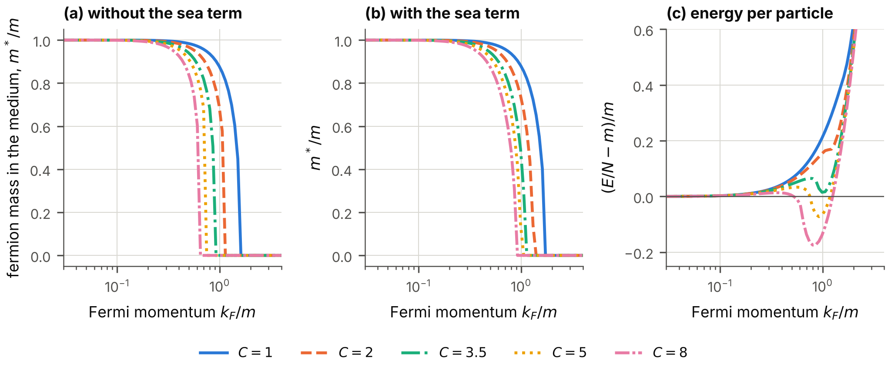
<figcaption>FIG. 6. The unpaired state at zero temperature, for several values of <em>C</em> = <em>g</em>VS2<em>m</em>2/<em>m</em><em>s</em>2. (a), (b) Fermion mass in the medium as a function of the Fermi momentum, without and with the energy of the negative-energy states. (c) Energy per particle relative to the mass of a free fermion; a minimum below zero means that matter is self-bound.</figcaption>
</figure>

| $C$  |  $E/N-m$  | $k_F^{\rm sat}$ | $k_F^{\rm abn}$ | $m^*/m$ before | $k_F^{\rm inst}$ | with sea: $E/N-m$ | $k_F^{\rm abn}$ | $k_F^{\rm inst}$ |
|:----:|:---------:|:---------------:|:---------------:|:--------------:|:----------------:|:-----------------:|:---------------:|:----------------:|
| 0.5  | not bound |        —        |      2.226      |      0.10      |        —         |     not bound     |      2.336      |        —         |
|  1   | not bound |        —        |      1.576      |      0.17      |        —         |     not bound     |      1.724      |        —         |
|  2   | not bound |        —        |      1.123      |      0.35      |      1.023       |     not bound     |      1.317      |        —         |
|  3   | not bound |        —        |      0.932      |      0.43      |      0.750       |     not bound     |      1.151      |      1.135       |
| 3.5  | not bound |        —        |      0.867      |      0.48      |      0.676       |     not bound     |      1.100      |      0.923       |
|  4   | $-0.019$  |      0.981      |      0.818      |      0.50      |      0.589       |     not bound     |      1.059      |      0.776       |
|  5   | $-0.072$  |      0.928      |      0.742      |      0.53      |      0.479       |     not bound     |      0.999      |      0.610       |
|  6   | $-0.114$  |      0.886      |      0.688      |      0.55      |      0.403       |     $-0.002$      |      0.955      |      0.479       |
|  8   | $-0.175$  |      0.825      |      0.610      |      0.59      |      0.305       |     $-0.043$      |      0.901      |      0.351       |
|  12  | $-0.255$  |      0.745      |      0.516      |      0.64      |      0.209       |     $-0.091$      |      0.840      |      0.224       |
|  20  | $-0.344$  |      0.656      |      0.423      |      0.68      |      0.124       |     $-0.135$      |      0.790      |      0.129       |
| 35.5 | $-0.432$  |      0.568      |      0.340      |      0.71      |      0.072       |     $-0.168$      |      0.755      |      0.072       |

TABLE XI. The unpaired state at zero temperature. $E/N-m$: lowest energy per particle of matter at any density, in units of $m$ (“not bound” if it is not below zero). $k_F^{\rm sat}$: Fermi momentum of that state. $k_F^{\rm abn}$: Fermi momentum above which the stable state has $m^*=0$, and $m^*/m$ just below it. $k_F^{\rm inst}$: Fermi momentum above which the pressure falls with increasing density. The last three columns repeat three of these quantities with the energy of the negative-energy states included. Momenta in units of $m$.

Figure 6 and Table XI show three results.

*Above a critical density the Vorton-Scalar has no expectation value, and the fermions are massless.* This is the “abnormal state” of matter that Lee and Wick predicted for any theory in which fermions obtain their mass from a scalar field ([Lee and Wick 1974](#ref-LeeWick1974)); the mean-field treatment is that of Walecka ([Walecka 1974](#ref-Walecka1974); [Chin 1977](#ref-Chin1977)). Without the term (91) the mass jumps to zero, by an amount that is small for small $C$; with it the mass falls continuously, to the resolution of the calculation. For weak coupling the transition is at $k_F=\pi m/(2\sqrt C)$.

*Matter is self-bound if $C$ exceeds a critical value,* $$\begin{aligned}
C&>\frac{3\pi^2}{8}\quad\text{(without the sea term)},\\
C&>\frac{3\pi^2}{5}\quad\text{(with the sea term)}.
\tag{92}
\end{aligned}$$ The program finds 3.7011 and 5.9218. The closed values follow from the energy of the abnormal state: massless fermions with a pressure equal to the energy density $B$ of the state without expectation value, as in the bag model of hadrons ([Chodos et al. 1974](#ref-Chodos1974)), have the energy per particle $(24\pi^2B/\nu)^{1/4}$, and $B=m^4/8C$ at tree level, $B=m^4/8C+\nu m^4/64\pi^2$ with the sea term. The bound state is always the abnormal one. For large $C$ a fermion in bulk matter has much less energy than a free one: 43 per cent less for $C=35.5$ without the sea term, 17 per cent with it.

*The dilute gas is mechanically unstable above a low density.* At low density the criterion is $k_F>\pi^2m/4C$, or, in terms of the scattering length $a_{\rm sc}=-g_{\mathrm{VS}}^2m/4\pi m_s^2$ of the mean-field interaction, $k_F|a_{\rm sc}|>\pi/16$.

### B. A warning about strong coupling

The same function (91) shows that for field values *larger* than the vacuum value the potential of the Vorton-Scalar with the fermion loop, $(x^2-1)^2/8C+V_{\rm sea}(x)$, eventually decreases without bound: the negative term $x^4\ln x^2$ wins, for weak coupling when $\ln x^2>\tfrac32+4\pi^2/\nu C$. Figure 7 shows the potential and Table XII the fields at which it turns over.

<figure>
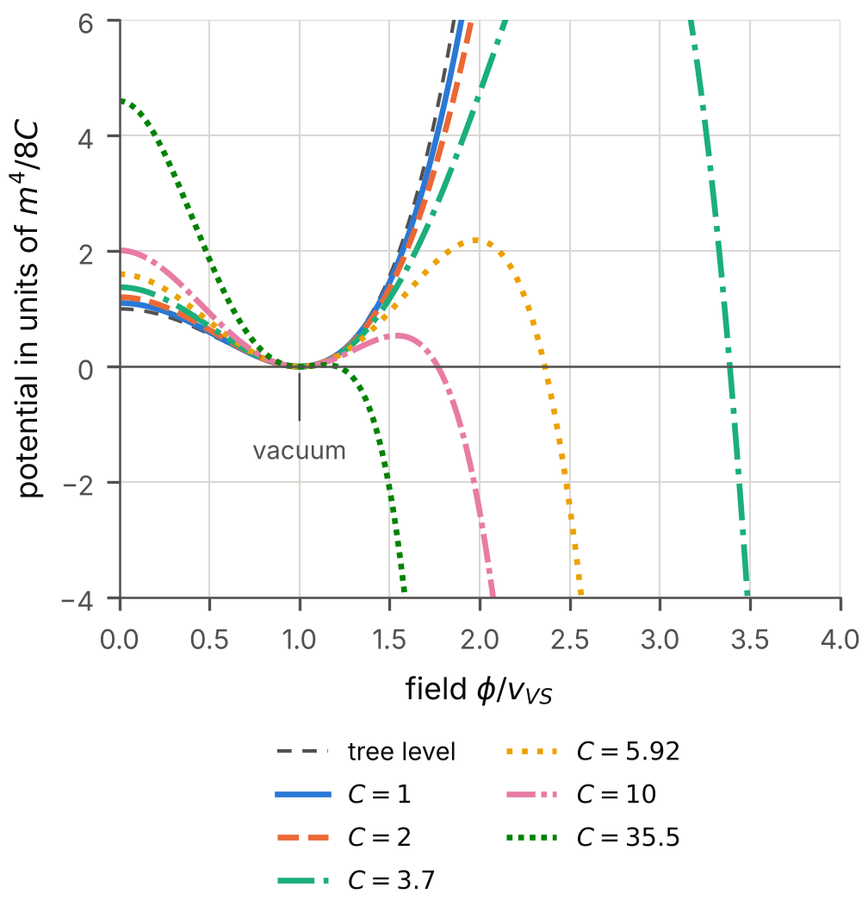
<figcaption>FIG. 7. The potential of the Vorton-Scalar in the vacuum, in units of the height <em>m</em>4/8<em>C</em> of its tree-level barrier, without (dashed) and with the renormalized loop of the fermions. The vacuum is at <em>ϕ</em> = <em>v</em>VS. For <em>C</em> ≳ 3.7, where matter is self-bound, the potential falls below its vacuum value at a field a few times <em>v</em>VS.</figcaption>
</figure>

|  $C$   |     maximum at     | below the vacuum beyond |
|:------:|:------------------:|:-----------------------:|
|  0.1   | $8.6\times10^{10}$ |   $1.1\times10^{11}$    |
|  0.5   |        229         |           294           |
|   1    |        19.3        |          24.7           |
|   2    |        5.33        |          6.74           |
| 3.7011 |        2.75        |          3.39           |
| 5.9218 |        1.98        |          2.36           |
|   10   |        1.54        |          1.77           |
|   20   |        1.26        |          1.37           |
|  35.5  |        1.14        |          1.21           |

TABLE XII. The potential of the Vorton-Scalar in the vacuum with the fermion loop: the field, in units of the vacuum value, at which it has its maximum, and the field beyond which it lies below its vacuum value.

For $C\ll1$, the regime of the weakly coupled superfluid, the instability lies at exponentially large fields and is irrelevant. But *the region of $C$ in which matter is self-bound is a region in which the model, taken at one loop, has no stable vacuum*: for $C\ge3.7$ the potential falls below its vacuum value at fields only 1.2 to 3.4 times the vacuum value. There the model needs a completion, a larger self-coupling or new physics at that scale. This is the analog of the instability that a heavy fermion induces in the potential of the Higgs field ([Coleman and Weinberg 1973](#ref-ColemanWeinberg1973)).

### C. The exchange energy

The normal blocks of diagram (a) add the exchange energy to the mean-field energy of Eq. (88). To first order, and with static exchange, it is $$\begin{aligned}
E_x={}&\frac{g_{\mathrm{VS}}^2}{2}\,\frac\nu2\!\int\!\!\int_{k,k'<k_F}\!\frac{d^3k\,d^3k'}{(2\pi)^6}\;
\frac{EE'\pm m^{*2}-\vec k\cdot\vec k'}{EE'}\\
&\times\frac{1}{|\vec k-\vec k'|^2+M^2},
\tag{93}
\end{aligned}$$ with the upper sign and $M=m_s$ for the radial mode and the lower sign and $M=0$ for the phase mode. Both contributions are positive. Evaluated for 16 combinations of $C$, $m_s/m$ and $k_F/m$, the exchange of the radial mode reduces the mean-field attraction by at most 12.6 per cent, the factor $1/\nu$ expected for $\nu=8$ internal states, and by less when the range of the force exceeds the distance between the particles. The exchange of the phase mode is of relative size $2m_s^2/\nu^2m^2$ at low density: negligible for a light radial mode, but larger than the contribution of the radial mode for $m_s=3m$. The thresholds of Sec. IX A are therefore accurate to about ten per cent for $m_s\lesssim m$, and the criterion for the instability becomes $k_F|a_{\rm sc}|>\pi/14$ when the exchange is included.

### D. Finite temperature: the fermion mass melts

Without a medium of fermions, but at a temperature $T$, vary Eq. (64) with respect to $\phi$ and to the two boson propagators, with diagram (b) and the fermions at one loop. The potential is $$\begin{aligned}
V={}&U_{\rm eff}(\phi)+\sum_{i=s,\vartheta}\Big[Q(M_i)+\frac12\big(a_i(\phi)-M_i^2\big)P(M_i)\Big]\\
&+\frac{\lambda_{\mathrm{VS}}}{4}\big[3P_s^2+3P_\vartheta^2+2P_sP_\vartheta\big],
\tag{94}
\end{aligned}$$ where $U_{\rm eff}$ is the tree-level potential plus the fermion loop, both its vacuum part (91) and its thermal part; $a_s=U_{\rm eff}''$ and $a_\vartheta=U_{\rm eff}'/\phi$; $P(M)$ is the thermal part of the boson loop and $Q(M)$ the thermal part of $\tfrac12\mathrm{Tr}\ln$; and the last term is diagram (b). Stationarity in the masses $M_s$ and $M_\vartheta$ of the two boson propagators gives their gap equations, $$\begin{aligned}
M_s^2&=a_s+3\lambda_{\mathrm{VS}}P_s+\lambda_{\mathrm{VS}}P_\vartheta,\\
M_\vartheta^2&=a_\vartheta+\lambda_{\mathrm{VS}}P_s+3\lambda_{\mathrm{VS}}P_\vartheta .
\tag{95}
\end{aligned}$$ This is the Hartree approximation for the bosons ([Dolan and Jackiw 1974](#ref-DolanJackiw1974); [Amelino-Camelia and Pi 1993](#ref-AmelinoCameliaPi1993); [Lenaghan and Rischke 2000](#ref-LenaghanRischke2000)). Two closed estimates of the temperature at which the expectation value vanishes follow from the curvature of the potential at $\phi=0$: $$\begin{aligned}
T_{\rm high}^2&=\frac{12\,[\lambda_{\mathrm{VS}}v_{\mathrm{VS}}^2+\nu g_{\mathrm{VS}}^2m^2/8\pi^2]}{4\lambda_{\mathrm{VS}}+\nu g_{\mathrm{VS}}^2},\\
T_N^2&=\frac{12\,[\lambda_{\mathrm{VS}}v_{\mathrm{VS}}^2+\nu g_{\mathrm{VS}}^2m^2/8\pi^2]}{2\lambda_{\mathrm{VS}}+\nu g_{\mathrm{VS}}^2}.
\tag{96}
\end{aligned}$$ The first is the one-loop result at high temperature; the second replaces the boson loops by their form for a large number of components, in which the phase mode stays massless. The program follows the state of lowest potential and determines the temperature $T_{1/2}$ at which the expectation value has fallen to half its vacuum value, and the temperature $T_0$ at which it has fallen to zero.

<figure>
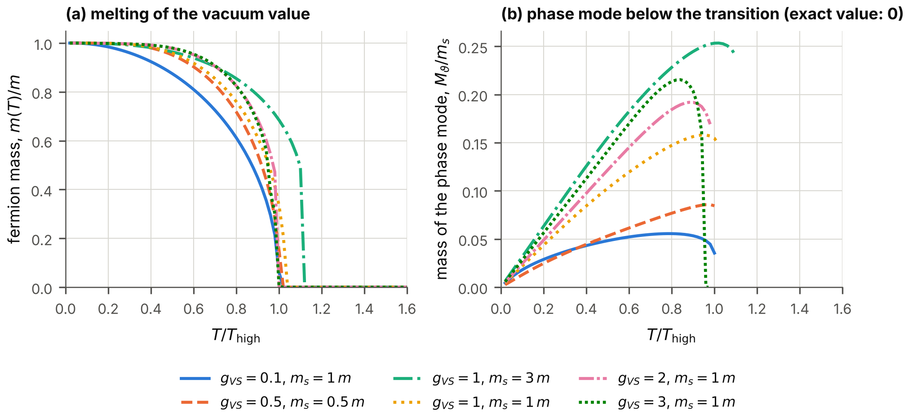
<figcaption>FIG. 8. Finite temperature. (a) The expectation value of the Vorton-Scalar, that is, the fermion mass in units of its vacuum value, in the state of lowest potential, as a function of the temperature in units of $T_{\rm high}$ of Eq. (96). (b) The mass that the Hartree approximation gives to the phase mode below the transition; in the exact theory it vanishes.</figcaption>
</figure>

| $g_{\mathrm{VS}}$ | $m_s/m$ |  $C$  | $T_{\rm high}/v_{\mathrm{VS}}$ | $T_{N}/v_{\mathrm{VS}}$ | $T_{1/2}/v_{\mathrm{VS}}$ | $T_0/v_{\mathrm{VS}}$ | $\phi/v_{\mathrm{VS}}$ before $T_0$ | $T_{1/2}/m$ |
|:-----------------:|:-------:|:-----:|:------------------------------:|:-----------------------:|:-------------------------:|:---------------------:|:-----------------------------------:|:-----------:|
|        0.1        |    1    | 0.01  |             0.775              |          0.817          |           0.677           |         0.776         |                0.07                 |    6.77     |
|        0.3        |    1    | 0.09  |             0.782              |          0.824          |           0.698           |         0.788         |                0.08                 |    2.33     |
|        0.5        |   0.5   |   1   |             0.461              |          0.468          |           0.423           |         0.464         |                0.08                 |    0.85     |
|         1         |    3    | 0.111 |             1.457              |          1.802          |           1.599           |         1.632         |                0.41                 |    1.60     |
|         1         |    1    |   1   |             0.849              |          0.895          |           0.808           |         0.875         |                0.10                 |    0.81     |
|         2         |    1    |   4   |             1.042              |          1.099          |           1.014           |         1.042         |                0.37                 |    0.51     |
|         3         |    1    |   9   |             1.302              |          1.372          |           1.238           |         1.302         |                0.14                 |    0.41     |

TABLE XIII. Melting of the vacuum value of the Vorton-Scalar. $T_{\rm high}$ and $T_N$: the closed estimates (96). $T_{1/2}$: temperature at which the expectation value has fallen to half. $T_0$: temperature at which it has fallen to zero (below 2 per cent of $v_{\mathrm{VS}}$, the resolution of the calculation). Next column: the expectation value at $0.998\,T_0$. Temperatures in units of $v_{\mathrm{VS}}$, and in the last column in units of the fermion mass.

Figure 8 and Table XIII give three results. *The fermion mass melts* at a temperature of the order of $v_{\mathrm{VS}}$: $T_{1/2}$ agrees with the two estimates (96) within 17 per cent. In units of the fermion mass it ranges from 0.4 for a strong Yukawa coupling to 7 for a weak one. *The order of the transition is not reliably predicted.* For the parameter sets $(g_{\mathrm{VS}},m_s/m)=$ (1, 3), (2, 1) the expectation value jumps to zero from about 0.4 $v_{\mathrm{VS}}$; for the others it falls steeply but, as far as the calculation can tell, continuously. The Hartree approximation is known to give a discontinuous transition for a pure scalar theory, where the true transition is continuous, so that a jump found here is not evidence that the transition of the model is discontinuous. *The defect of the approximation is visible* in Fig. 8(b): below the transition the phase mode has a mass of up to 0.25 $m_s$, where Goldstone’s theorem requires zero. This is the example, announced in Sec. VII A, of an exact identity that a truncation of $\Gamma_2$ does not preserve.

### E. The vacuum: can the pair condense without a medium?

The superfluid of Sec. VII forms in a medium: the gap equation has a solution for an arbitrarily weak attraction only because there is a Fermi surface. Whether a pair condensate can exist in empty space is a different question, and the Higgs hypothesis depends on it.

Without a chemical potential the zero-mode sector has the larger symmetry $O(4)\times O(4)$ of Sec. V G. The pair condensate of fermion number 2 is then one orientation of a 16-component real multiplet that also contains condensates of a particle and an antiparticle; a chemical potential singles out the pairs. Whatever its orientation, the condensate does the same thing to the spectrum: it splits the masses of two combinations of fields into $m+\sigma$ and $m-\sigma$. Without a Fermi surface the negative-energy states cannot be neglected, and the gap equation (71) does not apply. The appropriate equation is the stationarity condition of Eq. (64) for the fermion propagator with diagram (a) in four-dimensional Euclidean momentum space, $$\begin{aligned}
2\sigma(p)={}&g_{\mathrm{VS}}^2\!\int\!\!\frac{d^4k}{(2\pi)^4}\big[f(m+\sigma)-f(m-\sigma)\big]\\
&\times\Big[\frac{1}{(p-k)^2+m_s^2}+\frac{1}{(p-k)^2}\Big],
\tag{97}
\end{aligned}$$ with $f(M)=M/(k^2+M^2)$. Both modes contribute with the same sign in this channel, as in the medium. This is the “ladder” approximation that CJT themselves used for dynamical symmetry breaking ([Cornwall, Jackiw, and Tomboulis 1974](#ref-CJT1974)). Linearized in $\sigma$ and integrated over the angles, it is an eigenvalue problem with a cutoff $\Lambda$ at the momentum where the four-dimensional description ends; a condensate forms when the largest eigenvalue exceeds 1. For massless fermions and one massless boson the linearized equation is solved by $\sigma\propto p^{-1}\cos(\rho\ln p^2+\delta)$, with the critical coupling $g_{\mathrm{VS}}^2/16\pi^2=\tfrac14+\rho^2$ of the theory of dynamical chiral-symmetry breaking ([Maskawa and Nakajima 1974](#ref-MaskawaNakajima1974); [Miransky 1985](#ref-Miransky1985)); the program reproduces this within 0.2 per cent. With two massless bosons and $\Lambda\to\infty$ the critical coupling is $g_{\mathrm{VS}}^2/8\pi^2=\tfrac14$, that is, $\alpha_{\mathrm{VS}}=\pi/2$.

<figure>
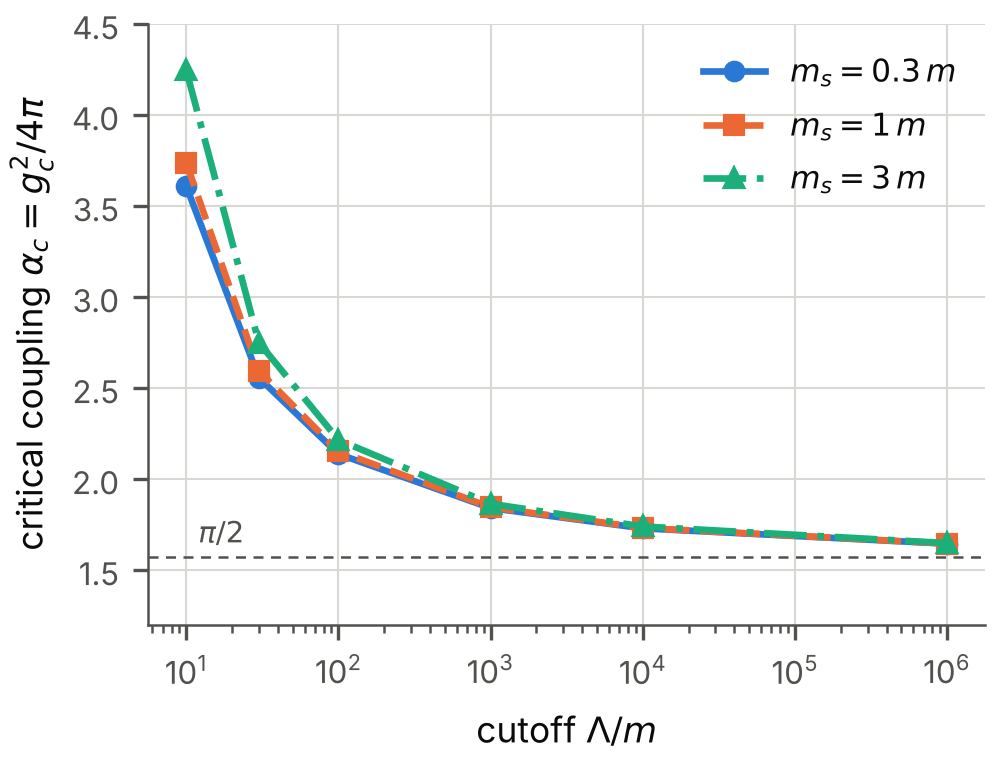
<figcaption>FIG. 9. Critical coupling <em>α</em><em>c</em> for a pair condensate in the vacuum, in the ladder approximation, as a function of the cutoff <em>Λ</em>, for three masses of the radial mode.</figcaption>
</figure>

| $m_s/m$ | $10$  | $30$  | $10^2$ | $10^3$ | $10^4$ | $10^6$ |
|:-------:|:-----:|:-----:|:------:|:------:|:------:|:------:|
|   0.3   | 3.609 | 2.556 | 2.137  | 1.840  | 1.728  | 1.644  |
|    1    | 3.737 | 2.593 | 2.152  | 1.844  | 1.730  | 1.645  |
|    3    | 4.246 | 2.749 | 2.214  | 1.863  | 1.739  | 1.647  |

TABLE XIV. Critical coupling $\alpha_c=g_{\mathrm{VS}}^2/4\pi$ for a pair condensate in the vacuum, in the ladder approximation, for cutoffs $\Lambda/m=10$, $30$, $10^2$, $10^3$, $10^4$ and $10^6$.

Figure 9 and Table XIV give the result: *a pair condensate in the vacuum requires $\alpha_{\mathrm{VS}}>\alpha_c$, between 1.64 and 4.2 for the cutoffs and masses of the table, and $\pi/2$ in the limit of an infinite cutoff.* At such couplings two fermions already form a bound state unless $m_s\gtrsim m$, by Eq. (74); and by Sec. IX B the potential of the Vorton-Scalar is then unstable unless its self-coupling is equally strong. The ladder approximation neglects the corrections to the vertices and to the boson propagators, which are not small at these couplings. The result is a statement about where to look, not a proof that a condensate forms.

### F. What has been established, and what has not

Established, within the mean-field treatment: the fermion mass in matter; the abnormal state; the thresholds $3\pi^2/8$ and $3\pi^2/5$ for self-bound matter; the size of the exchange corrections. Within the Hartree approximation: the melting temperature of the fermion mass, to about twenty per cent. Within the ladder approximation: the critical coupling for a condensate in the vacuum.

Not established: the order of the thermal transition; all properties of the strong-coupling regime, in which the one-loop potential of the Vorton-Scalar is unstable and the ladder approximation is only a guide; paired states in the abnormal phase, and the pairing of massless fermions.

## X. Is the singlet superfluid the Higgs field?

Hypothesis H2 states that the superfluid singlet state of Sec. VIII, the condensate of the pair operator along the hidden axis, *is the Higgs field*. This section meets objective O5. It lists what the Higgs field of the Standard Model is required to do, tests the condensate against each requirement, and states the result.

### A. What the Higgs field does, and the resulting conditions

In the Standard Model the Higgs field $H$ is a doublet of complex scalar fields under the weak-isospin group $SU(2)_L$, with weak hypercharge $\tfrac12$ ([Higgs 1964](#ref-Higgs1964); [Englert and Brout 1964](#ref-EnglertBrout1964); [Weinberg 1967](#ref-Weinberg1967)). Its potential is minimal at $|H|=v_{\rm EW}/\sqrt2$ with $v_{\rm EW}=(\sqrt2G_F)^{-1/2}=246.22$ GeV. This vacuum value breaks $SU(2)_L\times U(1)_Y$ to the $U(1)$ of electromagnetism, gives the $W$ and $Z$ bosons their masses with the ratio $\rho\equiv M_W^2/(M_Z^2\cos^2\theta_W)=1$, and gives the quarks and charged leptons their masses through Yukawa couplings. The one remaining scalar particle has the mass 125.20 GeV and couplings proportional to the masses of the particles to which it couples ([Navas et al. 2024](#ref-PDG2024)).

Two structural facts are essential for what follows. The first is the *custodial symmetry*. The four real components of $H$ form a vector of $SO(4)$, which is locally $SU(2)_L\times SU(2)_R$, and the Higgs potential depends only on its length. The vacuum value points in one direction and breaks $SO(4)$ to $SO(3)$; that residual $SO(3)$ is what protects $\rho=1$ ([Sikivie et al. 1980](#ref-Sikivie1980)). In the language of representations, $H$ is a *real* $(2,2)$. The second fact is that the idea of a composite Higgs field is old: it is the idea of Nambu and Jona-Lasinio ([Y. Nambu and Jona-Lasinio 1961](#ref-NJL1961)) applied to the electroweak scale, with a condensate of top quarks ([W. A. Bardeen, Hill, and Lindner 1990](#ref-BardeenHillLindner1990)). The present hypothesis is of this kind, with one difference: the pair is made of two fermions and carries fermion number 2, where those condensates are made of a fermion and an antifermion.

A condensate that is to *be* the Higgs field must satisfy the seven conditions of Table XV.

|     | Condition                                                               | Reason                                                       |
|:----|:------------------------------------------------------------------------|:-------------------------------------------------------------|
| C1  | scalar under the Lorentz group of ordinary spacetime                    | the vacuum is Lorentz invariant                              |
| C2  | non-zero in empty space                                                 | the vacuum contains no medium                                |
| C3  | a doublet of $SU(2)_L$ with a neutral component                         | to break the electroweak symmetry and leave electromagnetism |
| C4  | symmetry breaking $SO(4)\to SO(3)$                                      | $\rho=1$                                                     |
| C5  | scale 246 GeV; a scalar particle of 125 GeV with the observed couplings | measured                                                     |
| C6  | couplings that give the quarks and leptons their masses                 | measured                                                     |
| C7  | no further light or charged particles that would have been seen         | measured                                                     |

TABLE XV. Conditions that a condensate must satisfy in order to be the Higgs field of the Standard Model.

### B. Condition C1: a scalar in ordinary spacetime

This condition is met. The pair operator $\Delta^0=\psi^TC^{-}\gamma^0\psi$ is the component along $x0$ of a vector of the eight-dimensional spacetime, and it is invariant under all Lorentz transformations that do not involve $x0$ (Sec. IV C), hence under the Lorentz group of ordinary spacetime. This is the property for which the hidden axis is needed: a scalar pair of the full eight-dimensional group does not exist (Theorem 4), but a vector along a dimension that ordinary physics does not see is a scalar for ordinary physics.

### C. Condition C2: a condensate in empty space

This condition is not established. The superfluid forms in a *medium* of fermions, and the Higgs field must condense in the vacuum. The universe cannot be filled with the medium: a medium defines a rest frame and would violate Lorentz invariance, and a Fermi sea with the energy scale of the weak interaction would have an energy density of the order of $(100~\mathrm{GeV})^4$, some fifty-five orders of magnitude above the density of the universe.

The pair can condense without a medium only if the attraction exceeds a critical strength, as in the model of Nambu and Jona-Lasinio. Section IX E derived the condition in the ladder approximation: $\alpha_{\mathrm{VS}}>\alpha_c$, with $\alpha_c=3.74$ for a cutoff of ten fermion masses, $2.15$ for a hundred and $1.64$ for $10^6$ (at $m_s=m$), and $\alpha_c\to\pi/2$ for an infinite cutoff. A vacuum condensate therefore needs $\alpha_{\mathrm{VS}}$ of about 2 or more, that is, $g_{\mathrm{VS}}\gtrsim5$. At such couplings two fermions already form a bound state, the potential of the Vorton-Scalar is unstable at one loop unless its self-coupling is equally strong, and neither the one-boson-exchange kernel nor the ladder approximation is quantitatively reliable. In the weak-coupling range, where the model has been solved, there is no vacuum condensate.

### D. Conditions C3 and C4: the electroweak quantum numbers

For a condensate of the field $\psi$ to break the electroweak symmetry, $\psi$ must carry electroweak charges. The only symmetries of the model that commute with the Lorentz group of ordinary spacetime, and that could therefore be internal symmetries of four-dimensional physics, are the symmetries of Sec. V G. The question is whether the electroweak group fits into them, with the condensate in the right representation.

On the $7{+}1$ spacetime the four extra axes are space-like, and their rotation group $SO(4)$, locally $SU(2)_A\times SU(2)_B$, commutes with the ordinary rotations. For fields that do not depend on the extra coordinates it is the complete non-Abelian internal symmetry (Table II). The representations are those found in Secs. IV B and VIII. One particle at rest is $(2;2,1)\oplus(2;1,2)$ under $SO(3)\times SU(2)_A\times SU(2)_B$: it has spin $\tfrac12$ and is a doublet of one of the two groups. The ten $s$-wave pairs of ordinary spin 0 are $(2,2)\oplus(3,1)\oplus(1,3)$, and the $(2,2)$ are the four vector pairs $\Delta^a$, a four-vector of $SO(4)$. The neutral current of the Vorton-Scalar attracts in the $(2,2)$ and repels in the $(3,1)\oplus(1,3)$, and the state of lowest energy is $\Delta^a=|\Delta|e^{i\varphi}n^a$ with a real unit vector $n^a$.

Compare this with the Higgs field. *The order parameter is a $(2,2)$ of $SU(2)_A\times SU(2)_B$, and its vacuum value breaks $SO(4)\to SO(3)$: the representation and the breaking pattern of the Higgs field and of its custodial symmetry.* If $SU(2)_A$ is identified with $SU(2)_L$ and the hypercharge with the generator $T^3_B$ of $SU(2)_B$, the four components of $\Delta^a$ have the electric charges $Q=T^3_A+T^3_B=(+1,0,0,-1)$, the direction of the hidden axis is electrically neutral, and conditions C3 and C4 are met. Four qualifications apply.

\(i\) *The order parameter is complex.* $\Delta^a$ has four complex components, twice the content of the Higgs doublet, because the pair carries fermion number. Its vacuum value also breaks $U(1)_F$. If the fermion number is an exact global symmetry there is an additional massless Goldstone boson, and besides the Higgs particle a second neutral and a charged scalar: the structure is that of a model with two Higgs doublets.

\(ii\) *The identification of the gauge group is a hypothesis.* Nothing in the model makes $SU(2)_A$ a *gauge* symmetry. In theories of the Kaluza-Klein type, rotations of extra dimensions become gauge symmetries when the extra space is curled up with the corresponding isometry group ([Witten 1981](#ref-Witten1981)); a four-dimensional torus has only the isometries $U(1)^4$, a four-sphere has $SO(5)\supset SO(4)$. Whether the second stage of the program, in which the hidden axis curls up into a ring and the other three extra dimensions deflate, leaves an $SU(2)$ is open. A ring by itself has only $U(1)$, and treating $x0$ differently from $x5,x6,x7$ breaks the $SO(4)$ that the custodial structure needs.

\(iii\) *In the vacuum the multiplet is larger still.* A chemical potential singles out the pairs of fermion number 2. Without it the zero-mode sector has the symmetry $O(4)\times O(4)$, and the pair condensate is one orientation of a 16-component real multiplet that also contains condensates of a particle and an antiparticle (Sec. IX E). A vacuum condensate would have to be analyzed in that larger space.

\(iv\) *Ordinary matter must carry the same charges.* Quarks and leptons are doublets of $SU(2)_L$. If $SU(2)_L$ is a rotation group of the extra dimensions, they must be spinors of those rotations, that is, components of fields like $\psi$ itself. A picture in which the Standard Model, with an elementary Higgs doublet, lives on a brane and has its own gauge groups is an alternative to the present hypothesis, not a part of it.

On the $4{+}4$ spacetime of the companion paper ([Patrick Lee Nash 2026a](#ref-Companion1644)) the same algebraic pattern exists for the zero modes, but there the group $SO(4)$ is a hidden symmetry that is not a transformation of the spacetime, and the geometry cannot turn it into a gauge symmetry. The metric on the four extra axes is $\mathrm{diag}(-,-,-,-)$ here and $\mathrm{diag}(+,-,-,-)$ there, and the compact group $SO(4)$ is the isometry group only of the first.

### E. Conditions C5, C6 and C7: scale, masses and spectrum

These conditions concern dynamics that the present model does not determine. What can be said is the following.

*C5, the scale and the mass of the scalar particle.* In models of the Nambu-Jona-Lasinio type the scalar bound state that accompanies the condensate has a mass of about twice the mass that the condensate gives to its constituent fermions. With 125 GeV for the scalar, the constituents would weigh about 60 GeV. By C3 they carry electroweak charges, and particles of that mass with electroweak charges would have been produced in pairs at the electron-positron collider LEP, whose searches exclude new charged fermions below about 100 GeV, and in decays of the $Z$ boson if lighter than 45 GeV ([Navas et al. 2024](#ref-PDG2024)). Refinements of the relation between the two masses ([W. A. Bardeen, Hill, and Lindner 1990](#ref-BardeenHillLindner1990)) change it logarithmically, not by the factor needed. This estimate speaks against the hypothesis. It is not a proof, because the strong-coupling dynamics of C2 is not under control.

*C6, the masses of quarks and leptons.* The model contains no coupling of the pair field to ordinary fermions. A pair of fermion number 2 cannot couple to a fermion-antifermion bilinear of ordinary matter without violating either the fermion number or the conservation of the ordinary quantum numbers; an additional mechanism would have to be invented. This condition is not addressed.

*C7, additional particles.* The model predicts, besides the Higgs particle, the partners that complete the complex $(2,2)$, a second neutral and a charged scalar; a Goldstone boson of the fermion number; the fermions $\psi$ themselves, with electroweak charges; and the two modes of the Vorton-Scalar. None of these is observed. This is an obstacle, of a size that depends on unknown masses.

*The three hypotheses need three different scales.* The Higgs hypothesis needs the condensate at 246 GeV. The analysis of dark matter in Sec. XII points to bound pairs heavier than about 0.2 GeV with a coupling of nuclear strength, or to no superfluid at all. The mechanism for the Hubble tension of Sec. XI needs fermions of about 1 eV. One field with one mass cannot serve all three purposes.

### F. Verdict

| Condition                                      | $7{+}1$                                    | $4{+}4$ (quantized sector)                                                           | Basis                      |
|:-----------------------------------------------|:-------------------------------------------|:-------------------------------------------------------------------------------------|:---------------------------|
| C1, scalar in ordinary spacetime               | met                                        | met                                                                                  | Sec. IV C                  |
| C2, condensate in the vacuum                   | open; needs $\alpha_{\mathrm{VS}}\gtrsim2$ | open; needs $\alpha_{\mathrm{VS}}\gtrsim2$                                           | ladder equation, Sec. IX E |
| C3, electroweak doublet with neutral component | met, *if* $SU(2)_L=SU(2)_A$ and $Y=T^3_B$  | only under a hidden symmetry that the geometry cannot gauge; singlet under $SO(3)_T$ | Secs. IV B, V G            |
| C4, breaking $SO(4)\to SO(3)$                  | met                                        | met in the zero-mode sector only                                                     | Secs. V G, VIII C          |
| C5, scale and scalar mass                      | unfavorable (estimate)                     | —                                                                                    | this section               |
| C6, masses of ordinary fermions                | not addressed                              | —                                                                                    | this section               |
| C7, no unobserved particles                    | additional particles predicted             | —                                                                                    | this section               |

TABLE XVI. The Higgs hypothesis H2 against the seven conditions of Table XV, for the spacetime of this paper and for that of the companion paper.

Table XVI collects the results. The hypothesis “the singlet superfluid is the Higgs field” is *unproven on the $7{+}1$ spacetime, with one structural point in its favor and two estimates against it.* The structural point is not trivial: the pair is a scalar of ordinary spacetime, it belongs to a $(2,2)$ of the rotation group of the extra space axes, and its condensate has the custodial breaking pattern of the Higgs vacuum. Against it stand the estimate of the scale and of the constituent mass (C5) and the predicted additional particles (C7), and the fact that a condensate in the vacuum has been found only in a strong-coupling regime that the present methods do not control (C2).

A remark on what the model *does* contain: the Vorton-Scalar is itself a scalar field with a vacuum value that gives the fermions $\psi$ their mass. It plays for these fermions the role that the Higgs field plays for ordinary matter. But it is a singlet of all non-Abelian symmetries, and it cannot be the Higgs field of the Standard Model either.

### G. What has been established, and what has not

Established: the hidden-axis pair is a scalar of ordinary spacetime. It belongs to a $(2,2)$ of the rotation group of the four extra space axes, and its condensate has the custodial breaking pattern $SO(4)\to SO(3)$ of the Higgs vacuum.

Not established: that a condensate forms in the vacuum; that the rotation group of the extra dimensions is the electroweak gauge group; that the scale, the mass of the scalar particle and its couplings come out as observed; and that ordinary fermions obtain their masses.

## XI. Cosmology I: can the model resolve the Hubble tension?

Hypothesis H3 has two parts. This section examines the first, the Hubble tension, and Sec. XII the second, the dark matter. Together they meet objective O6. Everything was computed with a program written for this project, an Einstein-Boltzmann solver that follows the expansion of the universe, recombination and the linear perturbations of all species; the physics of the model enters through two additions to it, a dark fluid of radiation with a step (this section) and dark matter that is a superfluid (Sec. XII).

### A. What the model contains, cosmologically

The four-dimensional model of Sec. V has, besides the Standard Model, a *dark sector*: the fermions $\psi$, with 16 degrees of freedom, eight internal states each of particles and antiparticles, and the mass $m$; the radial mode, with one degree of freedom and the mass $m_s$; and the massless phase mode, with one. They interact with one another with the strength $g_{\mathrm{VS}}$, and with ordinary matter only through gravity; any further coupling would be an addition to the model. A dark sector that was populated in the early universe has a temperature of its own, $T_d$. Its history depends on the fermion mass, and two regimes must be distinguished.

*Light fermions*, with $m$ between about 1 and 100 eV, are relativistic until late. As long as $T_d\gg m$ the sector is a tightly coupled gas of radiation: the Yukawa interaction keeps it in equilibrium, and it does not stream freely. When $T_d$ falls below $m$ the fermions and antifermions annihilate into phase quanta. Entropy is conserved, so that the phase quanta are heated, and the energy density of the dark radiation rises relative to that of radiation that simply redshifts. This *step* is the mechanism of the “stepped dark radiation” that Aloni *et al.* proposed for the Hubble tension ([Aloni et al. 2022](#ref-Aloni2022)). If the radial mode is heavier than the fermions, the gas has one bosonic and sixteen fermionic degrees of freedom before the step and one bosonic after it, and the step factor is $$r_{\rm step}=\Big[\frac{1+\tfrac78\cdot16}{1}\Big]^{1/3}=15^{1/3}=2.466,
\tag{98}$$ much larger than the $(15/7)^{1/3}=1.289$ of the Wess-Zumino model of those authors.

*Heavy fermions*, with $m$ above about a keV, annihilate long before the epochs that the microwave background probes. What remains is the phase quanta, a small amount of radiation, and, if there is an excess of fermions over antifermions, the excess fermions, which are non-relativistic matter and pair up as described in Secs. VII and VIII: a candidate for dark matter.

A single field has a single mass, so that *the model cannot be in both regimes at once*. With fermions of an eV it has interesting dark radiation and no dark matter; with heavy fermions it has a candidate for dark matter and almost no dark radiation. The two parts of hypothesis H3 are therefore tested separately.

### B. The Einstein-Boltzmann solver and its validation

The program follows the standard treatment of linear cosmological perturbations in the synchronous gauge ([Ma and Bertschinger 1995](#ref-MaBertschinger1995)): photons with polarization, massless neutrinos, baryons, cold dark matter, a cosmological constant and the dark fluid. Recombination is computed with the rate equations of the effective three-level atoms of hydrogen and helium ([Seager, Sasselov, and Scott 1999](#ref-SeagerSasselovScott1999), [2000](#ref-SeagerSasselovScott2000); [Wong, Moss, and Scott 2008](#ref-WongMossScott2008)), the helium abundance from standard nucleosynthesis including the effect of extra radiation ([Ade et al. 2016](#ref-Planck2015XIII)), and the spectra by integration along the line of sight ([Seljak and Zaldarriaga 1996](#ref-SeljakZaldarriaga1996)): the temperature (TT), polarization (EE) and cross (TE) spectra of the microwave background to multipole 2500, and the matter power spectrum. Appendix D gives the details. The *fiducial model* throughout is the standard $\Lambda$CDM model with the densities $\omega_b=0.02237$ and $\omega_c=0.1200$ of baryons and of cold dark matter, the Hubble constant $H_0=67.36~\mathrm{km\,s^{-1}\,Mpc^{-1}}$, the amplitude $A_s=2.1\times10^{-9}$ and tilt $n_s=0.9649$ of the primordial spectrum, the optical depth $\tau=0.0544$, and massless neutrinos with the standard effective number of species, 3.044.

The solver was validated against spectra of the fiducial model computed with the established code class ([Blas, Lesgourgues, and Tram 2011](#ref-BlasLesgourguesTram2011)). Those spectra include gravitational lensing, which the solver does not compute; to compare like with like, its spectra were lensed with the lensing potential of the reference by the correlation-function method ([Lewis and Challinor 2006](#ref-LewisChallinor2006)). Figure 10 shows the differences, and Table XVII compares derived quantities. For multipoles between 100 and 2000 the two codes agree within 0.13 per cent in TT, within 0.17 per cent of $\sqrt{D^{TT}D^{EE}}$ in TE, and within 0.34 per cent in EE; the matter power spectrum agrees within 0.44 per cent for wavenumbers between $10^{-4}$ and 3 Mpc$^{-1}$. Halving all tolerances and all steps in wavenumber changes the spectra by less than $3.4\times10^{-4}$ for multipoles above 100. This agreement was not obtained at once: the comparison exposed five errors of the first version of the program, which are recorded, with the tests that now guard against them, in the error log of the project ([Patrick Lee Nash 2026c](#ref-SpacetimesRepo)).

<figure>
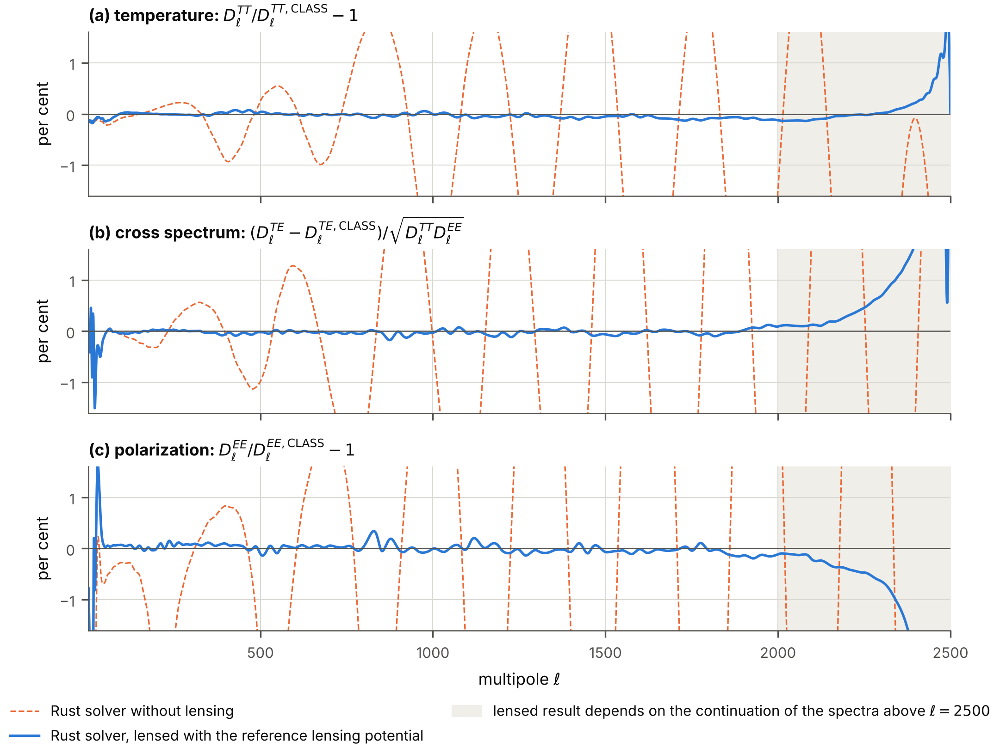
<figcaption>FIG. 10. Differences between the solver of this project and class for the fiducial model. Dashed: spectra without lensing; the oscillating difference is the smoothing of the acoustic peaks by lensing, which class includes. Solid: spectra lensed with the lensing potential of the reference.</figcaption>
</figure>

| quantity             | this work | class |
|:---------------------|:---------:|:------------------------------------:|
| $100\,\theta_s$      | 1.040358  |               1.040374               |
| $r_{\rm drag}$ (Mpc) | 147.1099  |               147.1142               |
| $\sigma_8$           |  0.82275  |               0.82291                |
| $z_*$                | 1089.915  |                  —                   |
| $z_{\rm drag}$       | 1059.930  |                  —                   |
| $z_{\rm reio}$       |  7.6875   |                  —                   |

TABLE XVII. Derived quantities of the fiducial model: the angular size $\theta_s$ of the sound horizon, the sound horizon $r_{\rm drag}$ at the end of the baryon drag epoch, the amplitude $\sigma_8$ of the matter fluctuations, and the redshifts of last scattering, of the drag epoch and of reionization.

### C. The mechanism, and the measure of success

The microwave background measures the angle $\theta_s=r_s/D_A$ under which the sound horizon $r_s$ at recombination is seen at the distance $D_A$. In the $\Lambda$CDM model, $\theta_s$ and the densities fix $H_0=67.4~\mathrm{km\,s^{-1}\,Mpc^{-1}}$ ([Aghanim et al. 2020](#ref-Planck2018VI)); the local distance network gives $73.50\pm0.81$ ([Casertano et al. 2026](#ref-H0DN2026)). Extra radiation before recombination speeds up the expansion and shrinks $r_s$; to keep $\theta_s$, $D_A$ must shrink too, which means a larger $H_0$. The difficulty is that extra radiation also changes the damping of the small-scale anisotropies and the phases of the acoustic peaks, which the data constrain. The measure of success used here is therefore: *how much does the fit to the microwave background worsen when the model is forced to give a certain $H_0$?*

### D. The dark radiation of the model

The dark fluid is described by its density today, $N$, in units of the density of one massless neutrino species, and by the transition redshift $z_t$, defined by $m=T_{d0}(1+z_t)$, where $T_{d0}$ is the temperature of the dark radiation today. Its equation of state and sound speed follow from the thermodynamics of the mixture of one massless boson and sixteen fermionic degrees of freedom of mass $m$ at constant entropy (Fig. 11). The fluid is tightly coupled: it has perturbations of density and velocity but no anisotropic stress, in contrast to free-streaming neutrinos.

<figure>
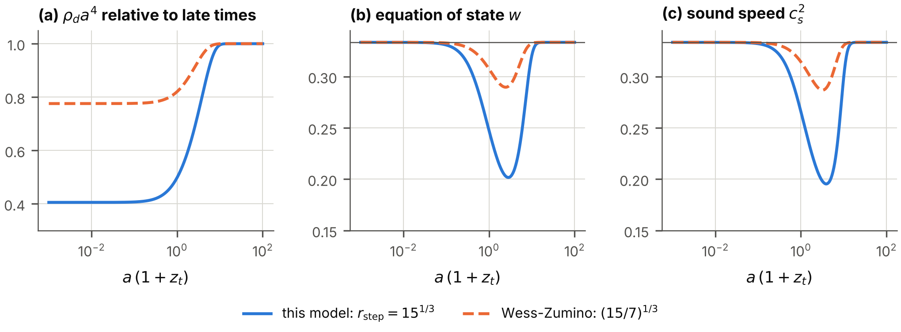
<figcaption>FIG. 11. The stepped dark fluid of the model (solid) and, for comparison, the Wess-Zumino fluid of Ref. (<a href="#ref-Aloni2022" role="doc-biblioref">Aloni et al. 2022</a>) (dashed). (a) Energy density relative to radiation that only redshifts, normalized to late times: before the step the density is lower by the factor $1/r_{\rm step}$. (b), (c) During the step the pressure and the sound speed drop below the value 1/3 of pure radiation.</figcaption>
</figure>

Seven one-parameter families of models are compared; in each, the density $N$ is varied. Family 0 is free-streaming radiation, additional massless neutrinos. Family 1 is a fluid without step, the limit $z_t\to\infty$: the phase quanta of a model with heavy fermions, if they interact enough to be a fluid. Families 2, 3 and 4 are the fluid of the model with its step in the epochs that the microwave background probes, $z_t=10^4$, $2\times10^4$ and $5\times10^4$. Family 5 is the Wess-Zumino fluid with $r_{\rm step}=(15/7)^{1/3}$ and $z_t=2\times10^4$, the best-fit region of Ref. ([Aloni et al. 2022](#ref-Aloni2022)). Family 6 is the fluid of the model with an early step, $z_t=10^6$: after nucleosynthesis, and before the scales of the microwave background enter the horizon. For $N=0.4$ the transition redshifts $10^4$, $10^{5.5}$ and $10^6$ correspond to the fermion masses 1.5, 48 and 150 eV.

### E. Mock data and method

The “observed” spectra are those of the fiducial $\Lambda$CDM model, without a noise realization, so that $\Lambda$CDM itself fits with $\chi^2=0$ and every $\chi^2$ below is a difference $\Delta\chi^2$ relative to $\Lambda$CDM. Two data sets are simulated. The first, *Planck-like*, covers 60 per cent of the sky with the noise and the beams of the three channels of the Planck satellite at 100, 143 and 217 GHz, multipoles from 30 to 2500 in temperature and to 2000 in polarization, and a prior on the optical depth in place of the large-scale polarization. The second adds a *deep survey*: 25 per cent of the sky observed with a beam of 1.4 arcminutes and a noise of 10 $\mu$K arcmin, the sensitivity of the sixth data release of the Atacama Cosmology Telescope. The likelihood is the exact likelihood of Gaussian fields on a fraction of the sky. For each family and each $N$ the six parameters of the $\Lambda$CDM model are refitted; a fit alternates exact computations of the spectra with Newton minimizations of the exact likelihood of spectra linearized with stored derivatives, and the reported $\chi^2$ is always that of an exact computation. A test with derivatives recomputed at the end point of a fit bounds the error of this procedure by 0.053 in $\chi^2$ and by 0.052 $\mathrm{km\,s^{-1}\,Mpc^{-1}}$ in $H_0$.

| parameter         |       mock P       |    Planck 2018     |      mock P+D      |
|:------------------|:------------------:|:------------------:|:------------------:|
| $\omega_b$        | $1.3\times10^{-4}$ | $1.5\times10^{-4}$ | $6.8\times10^{-5}$ |
| $\omega_c$        | $1.3\times10^{-3}$ | $1.4\times10^{-3}$ | $9.2\times10^{-4}$ |
| $h$               | $5.6\times10^{-3}$ | $6.0\times10^{-3}$ | $3.7\times10^{-3}$ |
| $\ln(10^{10}A_s)$ | $1.5\times10^{-2}$ | $1.6\times10^{-2}$ | $1.5\times10^{-2}$ |
| $n_s$             | $3.3\times10^{-3}$ | $4.4\times10^{-3}$ | $2.5\times10^{-3}$ |
| $\tau$            | $7.2\times10^{-3}$ | $7.6\times10^{-3}$ | $7.2\times10^{-3}$ |

TABLE XVIII. One-standard-deviation errors of the six parameters of the $\Lambda$CDM model from the Fisher matrix of the two sets of mock data, the Planck-like one (P) and the one with the deep survey (P+D), compared with the published errors of the Planck collaboration ([Aghanim et al. 2020](#ref-Planck2018VI)) (for $h$: the error of $H_0$ divided by 100).

Does the mock resemble the real experiment? Table XVIII compares the errors of the $\Lambda$CDM parameters predicted for the Planck-like mock with those published by the Planck collaboration; they agree within 25 per cent for every parameter. For free-streaming radiation the mock gives an error of 0.143 on $N$, where the Planck collaboration found $N_{\rm eff}=2.92\pm0.19$ ([Aghanim et al. 2020](#ref-Planck2018VI)): the mock is more constraining by a quarter, mainly because it contains no lensing. All values of $\Delta\chi^2$ below should be read with this in mind; for the real Planck data they would be smaller by a factor of about 0.6, the square of the ratio of the two errors.

### F. Results

<figure>
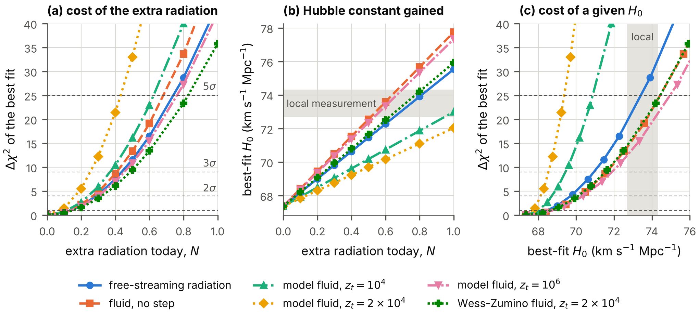
<figcaption>FIG. 12. Planck-like mock data, six of the seven families (the family with <em>z</em><em>t</em> = 5 × 104 is omitted for clarity; it is in Table XIX). (a) Worsening of the best fit, relative to <em>Λ</em>CDM, as a function of the density <em>N</em> of the extra radiation. (b) The Hubble constant of the best fit; the band is the local measurement. (c) The same information combined: the cost of a given Hubble constant.</figcaption>
</figure>

| family                               | $\sigma(N)$ | $dH_0/dN$ | $N$ at $\Delta\chi^2=4$ | $H_0$ there | $H_0$ at $\Delta\chi^2=9$ | $N_{73.5}$ | its $\Delta\chi^2$ | $\sqrt{\Delta\chi^2}$ |
|:-------------------------------------|:-----------:|:---------:|:-----------------------:|:-----------:|:-------------------------:|:----------:|:------------------:|:---------------------:|
| free-streaming radiation             |    0.143    |   8.19    |          0.29           |    69.7     |           71.0            |    0.75    |         25         |          5.0          |
| fluid, no step                       |    0.135    |   10.44   |          0.27           |    70.2     |           71.6            |    0.59    |         19         |          4.3          |
| model fluid, $z_t=10^4$              |    0.122    |   5.63    |          0.25           |    68.7     |           69.5            |   1.09\*   |        72\*        |         8.5\*         |
| model fluid, $z_t=2\times10^4$       |    0.085    |   4.68    |          0.17           |    68.2     |           68.6            |   1.32\*   |       211\*        |        14.5\*         |
| model fluid, $z_t=5\times10^4$       |    0.060    |   9.28    |          0.12           |    68.5     |           69.1            |    0.66    |        113         |         10.6          |
| Wess-Zumino fluid, $z_t=2\times10^4$ |    0.160    |   8.58    |          0.32           |    70.1     |           71.6            |    0.72    |         19         |          4.3          |
| model fluid, $z_t=10^6$              |    0.150    |   10.04   |          0.30           |    70.4     |           71.9            |    0.62    |         16         |          4.0          |

TABLE XIX. Results for the Planck-like mock data. $\sigma(N)$ and $dH_0/dN$ (in $\mathrm{km\,s^{-1}\,Mpc^{-1}}$ per unit of $N$) are from the Fisher matrix at the fiducial point; the other columns are from the exact fits: the density $N$ and the Hubble constant at $\Delta\chi^2=4$, the Hubble constant at $\Delta\chi^2=9$, the density $N_{73.5}$ at which the best-fit $H_0$ equals the local value 73.5, and its cost. An asterisk marks a linear extrapolation beyond the largest fitted $N$.

Figure 12 and Table XIX give the results for the Planck-like mock data.

*Every family can reach the local $H_0$, and every one at a prohibitive price.* The cheapest is the fluid of the model with an early step, at $\sqrt{\Delta\chi^2}=$ 4.0; the fluid without step and the Wess-Zumino fluid need 4.3 and 4.3, and free-streaming radiation 5.0.

*A step of the model that falls into the epochs probed is the most expensive case.* Its large step leaves a strong imprint: modes that enter the horizon before the step see less radiation than modes that enter after it, which changes the spectrum as a function of the multipole in a way that the other parameters cannot absorb. For $z_t$ between $10^4$ and $5\times10^4$ the local value costs $\sqrt{\Delta\chi^2}=$ 8.5 to 14.5.

*An early step is slightly cheaper than no step, because of helium.* If the step is complete before the scales of the microwave background enter the horizon, these scales see a fluid of constant density $N$; but during nucleosynthesis the fluid had only the density $N/r_{\rm step}$, and less helium was made. At $N=0.5$ the helium mass fraction is 0.2485 instead of 0.2523. Less helium means more free electrons and less damping of the small-scale anisotropies, which offsets part of the additional damping caused by the radiation; $\Delta\chi^2$ falls from 13.3 to 10.8.

*At a cost of $\Delta\chi^2=4$ the gain is small:* $H_0=$ 70.4 for the early step, 70.2 for the fluid without step, 69.7 for free-streaming radiation, and between 68.2 and 68.7 for a step in the epochs probed. At best this is 3.0 $\mathrm{km\,s^{-1}\,Mpc^{-1}}$ of the 6.1 that are needed.

<figure>
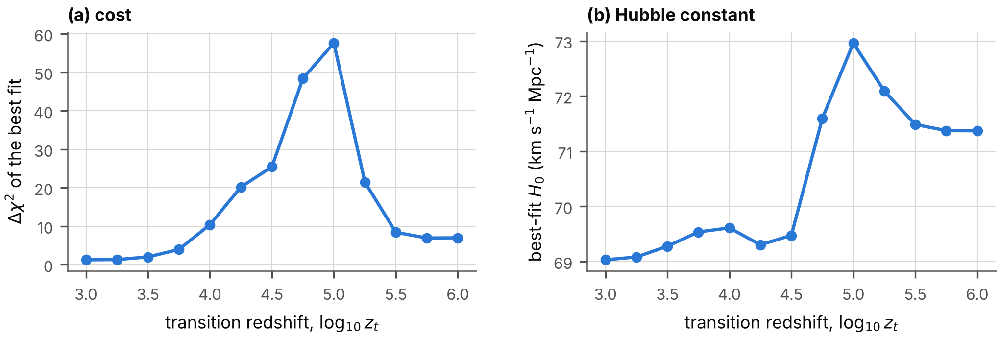
<figcaption>FIG. 13. The fluid of the model with <em>N</em> = 0.4 after the step: cost and Hubble constant as functions of the transition redshift. A step long before the epochs probed by the microwave background acts like a fluid without step that was less dense during nucleosynthesis; a step after recombination means that only $N/r_{\rm step}$ was present before recombination, so that both the cost and the gain are small; in between, the step is seen by the data and is expensive.</figcaption>
</figure>

Figure 13 shows the dependence on the transition redshift for $N=0.4$. An early step, $z_t\gtrsim10^{5.5}$, costs $\Delta\chi^2=$ 7.0 and gives $H_0=$ 71.4; a step after recombination, $z_t\lesssim10^3$, costs 1.2 and gives 69.0; the most expensive case, at $z_t=10^{5}$, costs 57.6. With the deep survey everything tightens: the local value of $H_0$ then costs $\sqrt{\Delta\chi^2}=$ 8.7 for the early step, 9.3 for the fluid without step and 9.7 for free-streaming radiation.

### G. The phase mode as a fractional neutrino, and published analyses of real data

Even with heavy fermions the model has one unavoidable piece of dark radiation, the massless phase mode. If the dark sector was once in thermal contact with ordinary matter and decoupled when the plasma had $g_*$ effective degrees of freedom, a massless boson contributes today ([Weinberg 2013](#ref-Weinberg2013)) $$\Delta N_{\rm eff}=\frac47\Big(\frac{43}{4\,g_*}\Big)^{4/3},
\tag{99}$$ which is 0.027 for a decoupling above the electroweak scale, $g_*=106.75$, and 0.39 for a decoupling just before the muons annihilate, $g_*=57/4$. With the slope $dH_0/dN$ of free-streaming radiation in Table XIX such an amount raises $H_0$ by at most 3.2 $\mathrm{km\,s^{-1}\,Mpc^{-1}}$: a welcome but insufficient shift, and the largest value is itself disfavored by the data quoted next.

The simulation assumes that the sky is like the $\Lambda$CDM model and asks what the model then costs. Whether the real data prefer extra radiation is an empirical question that others have answered. The Planck collaboration found $N_{\rm eff}=2.92\pm0.19$ for free-streaming radiation, with no preference for more ([Aghanim et al. 2020](#ref-Planck2018VI)). The Atacama Cosmology Telescope, combined with Planck, found $N_{\rm eff}=2.86\pm0.13$ and, for self-interacting dark radiation, the family 1 of this paper, $N_{\rm idr}<0.134$ at 95 per cent confidence ([Calabrese et al. 2025](#ref-Calabrese2025)). With the slope of Table XIX that limit allows a gain of 1.4 $\mathrm{km\,s^{-1}\,Mpc^{-1}}$. For the stepped fluid of Ref. ([Aloni et al. 2022](#ref-Aloni2022)) and a second interacting model, the data of that telescope restrict the density about as strongly as for simple models ([Cvetko, Joseph, and Marques-Tavares 2025](#ref-CvetkoJosephMarquesTavares2025)). The limits loosen to $\Delta N_{\rm eff}<0.58$ if the primordial spectrum is allowed a running tilt and a running of the running ([Garny, Niedermann, and Sloth 2026](#ref-GarnyNiedermannSloth2026)), a caveat that applies equally to the fixed power-law spectrum used here. Our mock results agree with this picture: for the fluid without step the forecast limits at $\Delta\chi^2=4$ are $N<$ 0.27 from the Planck-like mock and $N<$ 0.13 from the mock with the deep survey, to be compared with the published limit of 0.134 from the real data of both experiments.

### H. Verdict on the Hubble tension

The dark radiation of the model raises $H_0$, and its stepped form is exactly the kind of fluid that was proposed for this purpose. But, first, for data consistent with the $\Lambda$CDM model the density needed for the local value of $H_0$ is excluded at $\sqrt{\Delta\chi^2}\ge$ 4.0 in every family simulated, and at $\sqrt{\Delta\chi^2}\ge$ 8.5 if the step of the model falls into the epochs probed. Second, the published analyses of the real data find no preference for such radiation, and limits near $N\approx0.13$. Third, the step of the model, $15^{1/3}$, is larger than that of the Wess-Zumino model and is *more* visible to the data, not less, unless it is complete before the scales of the microwave background enter the horizon; and then the model is the fluid of family 6, which still fails by 4.0 standard deviations. *Hypothesis H3 is not supported for the Hubble tension: with the amount of fluid dark radiation that the published limit allows, the model removes about 23 per cent of the discrepancy.* This agrees with the conclusion of the earlier study for bound neutrino fields ([Patrick Lee Nash 2026b](#ref-NashNCSS)), now reached for a different dark sector with an independent code.

### I. What has been established, and what has not

Established: the solver agrees with class to the precision stated, and its results are converged. For data of the quality of the Planck satellite that follow the $\Lambda$CDM model, the cost of raising $H_0$ with each of seven kinds of dark radiation, including the stepped fluid that the model predicts, and its dependence on the transition redshift.

Not established, or assumed: the mock analysis is not an analysis of the real data. It has no lensing, no foregrounds, an idealized likelihood and a power-law primordial spectrum, and its limits on $N$ are tighter than those of Planck by about a quarter; the conclusions about the real sky rest on the published analyses cited, with which the mock results are consistent. The step was simulated for a radial mode much heavier than the fermions; if it is lighter there are two smaller steps instead of one. The dark radiation was assumed to be a perfect fluid at all times, whereas after the step the phase quanta interact only through derivative couplings and may begin to stream freely; families 0 and 1 bracket this. Finally, the fermion mass was taken to be constant through the step. By Sec. IX D the mass melts at a temperature $T_{1/2}$ between 0.4 and 7 fermion masses, and the assumption holds only if $T_{1/2}\gg m/3$, which requires $g_{\mathrm{VS}}\lesssim0.3$; for a stronger coupling the step would coincide with that transition, which was not simulated.

## XII. Cosmology II: can the superfluid be the dark matter?

The second part of hypothesis H3 concerns the dark matter. Here the fermions are taken to be heavy enough to be non-relativistic matter today, and the question is whether the paired state of Secs. VII and VIII can account for what is observed. The observations used are of three kinds: the amount of small-scale structure in the universe, measured by the absorption lines of intergalactic hydrogen, the Lyman-$\alpha$ forest; the densities and velocities of the dark matter in galaxies and clusters; and the limit on the scattering of dark matter by dark matter from colliding clusters of galaxies.

### A. The superfluid as a cosmological fluid

Suppose that the dark matter consists of the fermions of the model: an excess of particles over antiparticles, whose size is a free number that is chosen to give the observed density. At zero temperature they are in the paired state. Its response to slow perturbations of long wavelength is that of a fluid with a pressure $P(\rho)$ that depends on the mass density $\rho$ only: perturbations of the density propagate as first sound, with the speed $c_s$ given by $c_s^2=dP/d\rho$ (Sec. VIII E). Two limits bracket the possibilities.

*Weak pairing*, pairs that overlap. The pressure is the degeneracy pressure of the fermions, which pairing lowers only by terms of the relative order $(\Delta/E_F)^2$. With $\nu=8$ internal states the Fermi momentum at the number density $n$ is $k_F=(6\pi^2n/\nu)^{1/3}$, and with $x=k_F/m$ the sound speed is $$c_s^2=\frac{x^2}{3\,(1+x^2)},
\tag{100}$$ which is $v_F^2/3$ for non-relativistic fermions with the Fermi velocity $v_F=k_F/m$. At the mean cosmic density of dark matter the Fermi velocity today is fixed by the mass alone. It grows as $1/a$ towards the past, where $a$ is the scale factor of the universe, and the gas was relativistic at early times, which the program includes exactly.

*Bound pairs*, or larger bound clusters, that have condensed. If their mutual interaction is repulsive, the condensate has the equation of state of a self-interacting scalar field ([Colpi, Shapiro, and Wasserman 1986](#ref-ColpiShapiroWasserman1986); [Li, Rindler-Daller, and Shapiro 2014](#ref-LiRindlerDallerShapiro2014)), $$P=\frac{\rho_0}{3}\Big[\sqrt{1+\rho/\rho_0}-1\Big]^2,
\tag{101}$$ with one constant $\rho_0$ that measures the strength of the repulsion. At low density this is $P=\rho^2/12\rho_0$, the equation of state of a condensate with the sound speed of Bogoliubov ([Bogoliubov 1947](#ref-Bogoliubov1947)), $c_s^2=\rho/6\rho_0$; at high density it is that of radiation, $P=\rho/3$. The condensate is characterized by one number, the sound speed $c_{s0}$ today at the mean density. A self-gravitating core that is supported by this pressure has the *Thomas-Fermi radius* $$R_{TF}=\frac{\pi\,c_s}{\sqrt{4\pi G\rho}},
\tag{102}$$ which does not depend on the density, because $c_s^2\propto\rho$; $G$ is the constant of gravitation. Cores of this kind, with radii of the order of a kiloparsec, are the motivation of the proposals of superfluid dark matter ([Berezhiani and Khoury 2015](#ref-BerezhianiKhoury2015)).

In both limits the pressure is the *smallest* that the constituents can have; a thermal population of the same particles has more. The bounds derived below are therefore lower limits on what any state of these particles must satisfy.

### B. Simulation

The cold dark matter of the Einstein-Boltzmann solver of Sec. XI B was replaced by a fluid with the equation of state and the sound speed of either limit. Tests of the program verify the conservation of energy, the relation $c_s^2=dP/d\rho$ and the limits of both equations of state, and that a fluid with a negligible sound speed reproduces cold dark matter to $2\times10^{-4}$. The linear power spectrum of the matter today was computed for wavenumbers up to 250 Mpc$^{-1}$ and divided by that of cold dark matter (Fig. 14). The *half mode* is the wavenumber at which this ratio first falls to $1/4$. It is compared with the half mode of *thermal warm dark matter*, particles that were once in thermal equilibrium and whose residual velocities erase small-scale structure, at the lower limits on their mass from the Lyman-$\alpha$ forest: 5.3 keV ([Iršič et al. 2017](#ref-Irsic2017)) and, more conservatively, 3.5 keV; the relation between that mass and the half mode is the fitting formula of Ref. ([Viel et al. 2005](#ref-Viel2005)). Table XX lists the results and Table XXI the bounds that follow. A more recent analysis of the Lyman-$\alpha$ forest gives 5.7 keV ([Iršič et al. 2024](#ref-Irsic2024)), which would strengthen the bounds slightly.

<figure>
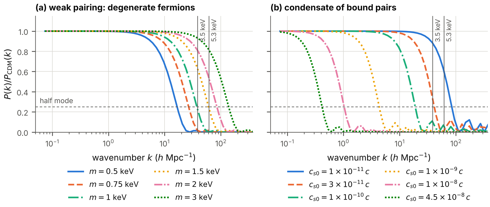
<figcaption>FIG. 14. Linear power spectrum of the matter, relative to cold dark matter, if the dark matter is the superfluid. (a) Weak pairing, for several fermion masses. (b) Condensate of bound bosons, for several sound speeds <em>c</em><em>s</em>0 today at the mean density; the largest corresponds to a Thomas-Fermi radius of 1 kpc. The vertical lines mark the half modes of thermal relics of 3.5 and 5.3 keV. The oscillations are sound waves of the dark fluid.</figcaption>
</figure>

| model                                         |     $c_{s0}/c$      | half mode ($h$ Mpc$^{-1}$) | relic (keV) | $R_{TF}$ |
|:----------------------------------------------|:-------------------:|:--------------------------:|:-----------:|:--------:|
| degenerate fermions, $m=0.3$ keV              | $1.2\times10^{-7}$  |            9.23            |    0.966    |    —     |
| degenerate fermions, $m=0.5$ keV              | $6.0\times10^{-8}$  |            16.7            |    1.65     |    —     |
| degenerate fermions, $m=0.75$ keV             | $3.5\times10^{-8}$  |            26.7            |    2.52     |    —     |
| degenerate fermions, $m=1$ keV                | $2.4\times10^{-8}$  |            37.4            |    3.41     |    —     |
| degenerate fermions, $m=1.5$ keV              | $1.4\times10^{-8}$  |            60.4            |    5.25     |    —     |
| degenerate fermions, $m=2$ keV                | $9.5\times10^{-9}$  |            85.0            |    7.14     |    —     |
| degenerate fermions, $m=3$ keV                | $5.5\times10^{-9}$  |            138             |    11.0     |    —     |
| degenerate fermions, $m=4.5$ keV              | $3.2\times10^{-9}$  |            224             |    17.1     |    —     |
| condensate, $c_{s0}=$ $3.0\times10^{-12}$ $c$ | $3.0\times10^{-12}$ |            186             |    14.4     | 0.067 pc |
| condensate, $c_{s0}=$ $1.0\times10^{-11}$ $c$ | $1.0\times10^{-11}$ |            84.4            |    7.10     | 0.22 pc  |
| condensate, $c_{s0}=$ $3.0\times10^{-11}$ $c$ | $3.0\times10^{-11}$ |            41.2            |    3.72     | 0.67 pc  |
| condensate, $c_{s0}=$ $1.0\times10^{-10}$ $c$ | $1.0\times10^{-10}$ |            18.9            |    1.84     |  2.2 pc  |
| condensate, $c_{s0}=$ $1.0\times10^{-9}$ $c$  | $1.0\times10^{-9}$  |            4.32            |    0.488    |  22 pc   |
| condensate, $c_{s0}=$ $1.0\times10^{-8}$ $c$  | $1.0\times10^{-8}$  |            1.03            |    0.134    | 0.22 kpc |
| condensate, $c_{s0}=$ $4.5\times10^{-8}$ $c$  | $4.5\times10^{-8}$  |           0.416            |   0.0593    |  1 kpc   |

TABLE XX. Superfluid dark matter in the two limits of Sec. XII A. $c_{s0}$: sound speed today at the mean cosmic density, in units of the speed of light. Half mode: wavenumber, in $h$ Mpc$^{-1}$, at which the power falls to $1/4$ of that of cold dark matter. Relic: mass of the thermal warm-dark-matter particle with the same half mode. $R_{TF}$: Thomas-Fermi radius, Eq. (102).

| relic (keV) | its half mode ($h$ Mpc$^{-1}$) | fermion mass $>$ (keV) | $v_{F0}<$ (m/s) | condensate: $c_{s0}/c<$ | $c_{s0}<$ (mm/s) | $R_{TF}<$ (pc) |
|:-----------:|:------------------------------:|:----------------------:|:---------------:|:-----------------------:|:----------------:|:--------------:|
|     3.5     |              38.5              |          1.02          |      12.07      |   $3.3\times10^{-11}$   |        10        |      0.74      |
|     5.3     |              61.0              |          1.51          |      7.17       |   $1.6\times10^{-11}$   |       4.9        |      0.37      |

TABLE XXI. Bounds on superfluid dark matter from the requirement that its half mode is not smaller than that of thermal warm dark matter at the limits from the Lyman-$\alpha$ forest. $v_{F0}$: Fermi velocity today at the mean density.

### C. What the bounds imply

*Weak pairing.* The fermion mass must exceed 1.51 keV, or 1.02 keV for the conservative benchmark. A paired state requires a degenerate gas, because its critical temperature is a fraction of the Fermi energy (Sec. VII G). A gas of the mass density $\rho$ whose particles move with the velocity dispersion $\sigma$ is degenerate if its Fermi velocity is at least $\sigma$, which is the case only for fermions lighter than $$m_{\rm deg}=\Big[\frac{6\pi^2\hbar^3\rho}{\nu\,\sigma^3}\Big]^{1/4}.
\tag{103}$$ This is the bound of Tremaine and Gunn ([Tremaine and Gunn 1979](#ref-TremaineGunn1979)) for this model. Table XXII evaluates it for three observed systems.

| system                        | $\rho$ ($M_\odot$ pc$^{-3}$) | $\rho$ (GeV cm$^{-3}$) | $\sigma$ (km/s) | $m_{\rm deg}$ (keV) | $m_{B,\max}$ (eV) | $v_F$ (km/s) | $\rho_{\rm deg}/\rho$ |
|:------------------------------|:----------------------------:|:----------------------:|:---------------:|:-------------------:|:-----------------:|:------------:|:---------------------:|
| dwarf spheroidal galaxy, core |             0.1              |          3.8           |       10        |        0.276        |        262        |    1.047     |   $8.7\times10^{2}$   |
| Milky Way at the Sun          |            0.0105            |         0.399          |       156       |        0.020        |        19         |    0.494     |   $3.1\times10^{7}$   |
| cluster of galaxies, core     |            0.003             |         0.114          |      1000       |        0.004        |       3.45        |    0.325     |  $2.9\times10^{10}$   |

TABLE XXII. Could the particles of the model be degenerate, or their bound pairs condensed, in observed systems of dark matter? $\rho$: density; $\sigma$: velocity dispersion; $m_{\rm deg}$: Eq. (103); $m_{B,\max}$: Eq. (104). The last two columns give, for fermions of 1.5 keV, the Fermi velocity at the density $\rho$ and the factor by which the density would have to be larger for them to be degenerate.

In the densest systems of dark matter that are observed, the cores of dwarf spheroidal galaxies, fermions with eight internal states are degenerate only below 0.28 keV, whereas the formation of structure demands more than 1.51 keV. *In the regime of weak pairing the dark matter in galaxies is a classical gas, not a superfluid.*

*Bound pairs.* The sound speed of the condensate today must be below $1.6\times10^{-11}$ of the speed of light, and the Thomas-Fermi radius below 0.37 pc. The reason for so strong a bound is visible in Fig. 14(b): such a condensate is like radiation in the early universe, and all perturbations that enter the horizon during that phase are erased. *The pressure of the condensate cannot produce the cores of kiloparsec size that motivate superfluid dark matter;* for a core of 1 kpc the half mode would be at 0.42 $h$ Mpc$^{-1}$, more than a hundred times too small. There is a second, independent obstacle. Bosons of the mass $m_B$ are condensed at the density $\rho$ and the temperature that corresponds to the velocity dispersion $\sigma$, $k_BT=m_B\sigma^2$, only if the number of particles in a cube with the edge of the thermal wavelength $\lambda$ satisfies $n\lambda^3\ge2.612$, that is, only if they are lighter than $$m_{B,\max}=\Big[\frac{(2\pi)^{3/2}\hbar^3\rho}{2.612\,\sigma^3}\Big]^{1/4},
\tag{104}$$ which is 262 eV in a dwarf galaxy (Table XXII). The limit on their self-interaction demands the opposite, as shown next.

*Self-interaction.* Colliding clusters of galaxies limit the cross section per unit mass of dark matter to about 1 cm$^2$/g ([Markevitch et al. 2004](#ref-Markevitch2004); [Randall et al. 2008](#ref-Randall2008)). A pair that is bound by the Yukawa potential of the radial mode has a size, and a scattering length, of at least the range $1/m_s$ of that potential, and binding requires $D_{\mathrm{VS}}>D_c$ (Sec. VII E). Identical bosons with the scattering length $a_{\rm sc}$ scatter at low energy with the cross section $8\pi a_{\rm sc}^2$; with $a_{\rm sc}=1/m_s$ and the mass $2m$ of a pair, the two conditions together give a smallest fermion mass, $m\ge[4\pi D_c^2/(\alpha_{\mathrm{VS}}^2\kappa)]^{1/3}$ with $\kappa=1$ cm$^2$/g, listed in Table XXIII for several couplings.

| $\alpha_{\mathrm{VS}}$ | $m$ (MeV) | $m_s$ (MeV) | $1/m_s$ (fm) |    $n\lambda^3$     |
|:----------------------:|:---------:|:-----------:|:------------:|:-------------------:|
|          0.01          |   4260    |    25.4     |     7.78     | $2.3\times10^{-30}$ |
|          0.1           |    918    |    54.7     |     3.61     | $1.1\times10^{-27}$ |
|           1            |    198    |     118     |     1.68     | $5.0\times10^{-25}$ |
|           4            |   78.5    |     187     |     1.06     | $2.0\times10^{-23}$ |

TABLE XXIII. Smallest fermion mass for which a gas of bound pairs satisfies the limit of 1 cm$^2$/g on the self-interaction of dark matter, the corresponding mass and range of the radial mode, and the phase-space density $n\lambda^3$ of the pairs in the core of a dwarf spheroidal galaxy; condensation would need $n\lambda^3\ge2.612$.

Bound pairs are acceptable dark matter only if the fermions are heavier than about 198 MeV, for $\alpha_{\mathrm{VS}}=1$, with a radial mode of nuclear range. At such masses the phase-space density in halos is smaller than the value needed for condensation by more than twenty orders of magnitude.

*Bound clusters.* With eight internal states and an attraction between all of them, up to eight fermions can occupy the same orbital, and bound states of more than two fermions are expected, as nuclei are bound states of nucleons. Such “nuggets” of fermions bound by a scalar field have been studied as dark matter ([Wise and Zhang 2014](#ref-WiseZhang2014); [Gresham, Lou, and Zurek 2017](#ref-GreshamLouZurek2017)). Their interior is degenerate and, by Sec. VII, paired: the superfluid would exist *inside* the particles of dark matter, as it does inside nuclei and neutron stars, without any effect on galactic scales. Section IX A gave the limit of large clusters: matter is bound by itself if $C=g_{\mathrm{VS}}^2m^2/m_s^2$ exceeds 3.7011, or 5.9218 if the energy of the negative-energy states is included, and it is then in a state in which the Vorton-Scalar has no expectation value and the fermions are massless. For the example of Table XXIII with $\alpha_{\mathrm{VS}}=1$ the coupling is $C=35.5$, and a fermion inside bulk matter weighs 43 per cent less than a free one, or 17 per cent with the negative-energy states. Whether such clusters form, and with what abundance, is outside this work.

### D. Verdict on dark matter

<figure>
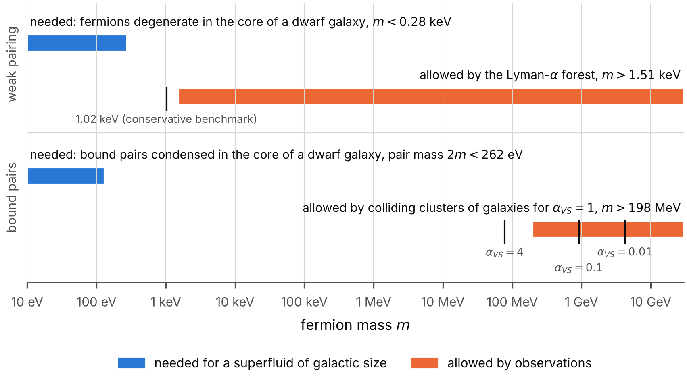
<figcaption>FIG. 15. The fermion masses that a superfluid on galactic scales needs and those that the observations allow. For weak pairing the fermions must be degenerate in halos, which requires a mass below the value of Eq. (103), while the Lyman-<em>α</em> forest requires a larger one. For bound pairs, condensation in a halo requires light pairs, while the limit on the self-interaction requires heavy ones (ticks: other values of the coupling). In neither case do the ranges overlap.</figcaption>
</figure>

The hypothesis has two readings, and they have different answers. Figure 15 summarizes the numbers on which the first answer rests.

*The superfluid state explains the observed properties of dark matter,* as in the proposals in which a condensate of galactic size shapes rotation curves or cores. *No.* The simulations exclude both ways in which the condensate could act on galactic scales: degenerate fermions that are light enough to be superfluid in halos erase the small-scale structure, and a condensate of bound pairs with enough pressure to support cores does so even more strongly.

*The dark matter is made of the particles whose condensate is the superfluid.* *Possible, and untested by these observations.* Heavy bound pairs or larger clusters, with an abundance that is set by an unexplained excess of particles over antiparticles, behave as cold dark matter with a self-interaction of nuclear size. Nothing in the present data distinguishes them from other cold dark matter, and the model does not predict their abundance.

### E. What has been established, and what has not

Established: the suppression of structure by superfluid dark matter in both limits and the resulting bounds; and the elementary conditions for degeneracy, for condensation and for an acceptable self-interaction in halos, which the masses allowed by those bounds violate by large factors.

Not established, or assumed: the translation of the limits from the Lyman-$\alpha$ forest into a half mode uses a fitting formula for thermal relics, whereas the spectrum of a fluid with sound waves has a different shape beyond the half mode; a dedicated analysis of those data could shift the bounds by a factor of order one, not by the orders of magnitude that separate them from the interesting values. For bound pairs a repulsive interaction between the pairs was assumed; with eight internal states it may be attractive, in which case the condensate is unstable to the formation of larger clusters. The sound speed of the degenerate gas was that of free fermions; the correction from the mean field of the Vorton-Scalar is of the relative order $k_F|a_{\rm sc}|$, with $a_{\rm sc}$ the scattering length, which the limit on the self-interaction keeps below $6.4\times10^{-13}$ in a dwarf galaxy for fermions of 1 keV. The abundance of the dark matter, the origin of the excess of particles, the thermal history of the dark sector and the formation of bound states were not addressed.

## XIII. Predictions

The model has three parameters, the vacuum value $v_{\mathrm{VS}}$, the Yukawa coupling $y_{\mathrm{VS}}$ and the self-coupling $\lambda_{\mathrm{VS}}$ of the Vorton-Scalar or, equivalently, the fermion mass $m$, the mass $m_s$ of the radial mode and the coupling $g_{\mathrm{VS}}=m/v_{\mathrm{VS}}$. Everything else is derived. This section collects the quantitative consequences that the preceding sections derived, so that a reader who wants to test the model, or to extend it, finds them in one place. Table XXIV lists them with the figure or table that displays each. They are of three kinds: predictions for the matter that the model describes, cosmological predictions, and predictions that distinguish the two spacetimes.

|                      | Quantity                                                | Prediction                                                                                                                                                                                               | Displayed in            |
|:---------------------|:--------------------------------------------------------|:---------------------------------------------------------------------------------------------------------------------------------------------------------------------------------------------------------|:------------------------|
| *Matter*             |                                                         |                                                                                                                                                                                                          |                         |
| 1                    | masses and couplings                                    | $m=y_{\mathrm{VS}}v_{\mathrm{VS}}/\sqrt2$, $m_s=\sqrt{2\lambda_{\mathrm{VS}}}\,v_{\mathrm{VS}}$, massless phase mode, $g_{\mathrm{VS}}=m/v_{\mathrm{VS}}$, $G_{\mathrm{VS}}/\sqrt2=1/2v_{\mathrm{VS}}^2$ | Eqs. (46), (51)         |
| 2                    | force of the neutral current between two fermions       | contact attraction $-(G_{\mathrm{VS}}/2\sqrt2)\,m^2/E^2$ in the vector channels along the extra axes; repulsion of the same strength in the two-form channels                                            | Fig. 1, Table III       |
| 3                    | channel of the largest gap                              | the vector channel; at weak coupling its gap exceeds that of the two-form channel by a factor 1.03 to $2.6\times10^{4}$                                                                                  | Fig. 2, Table V         |
| 4                    | bound pair of two fermions                              | exists if and only if $D_{\mathrm{VS}}>1.67981$                                                                                                                                                          | Fig. 3, Table VI        |
| 5                    | thermodynamics of the paired state                      | $\Delta(0)/T_c=1.7668$; jump of the heat capacity $1.433\,C_n$                                                                                                                                           | Fig. 4, Table IX        |
| 6                    | gaps of a general state                                 | two fourfold gaps, Eq. (82); ground states with one eightfold gap; a stationary state with four gapless internal states and half the condensation energy                                                 | Fig. 5, Table X         |
| 7                    | collective modes                                        | four gapless modes: the sound, with $c_s^2=v_F^2/3$ at weak pairing, and three rotations of the order parameter                                                                                          | Table X, Eq. (85)       |
| 8                    | fermion mass in matter                                  | $m^*=m(1-Cn/m^3)$ at low density; $m^*=0$ above $k_F=\pi m/2\sqrt C$ (weak coupling)                                                                                                                     | Fig. 6, Table XI        |
| 9                    | self-bound matter                                       | if $C>3\pi^2/8=3.7011$, or $3\pi^2/5=5.9218$ with the negative-energy states                                                                                                                             | Fig. 6, Table XI        |
| 10                   | stability of the vacuum at one loop                     | lost for $C\ge3.7$: the potential falls below its vacuum value beyond 1.2 to 3.4 $v_{\mathrm{VS}}$                                                                                                       | Fig. 7, Table XII       |
| 11                   | melting of the fermion mass                             | at $T_{1/2}$ between 0.4 and 7 $m$; estimates (96)                                                                                                                                                       | Fig. 8, Table XIII      |
| 12                   | pair condensate in the vacuum                           | only if $\alpha_{\mathrm{VS}}>\alpha_c$, with $\alpha_c$ between 1.64 and 4.2, and $\pi/2$ for an infinite cutoff                                                                                        | Fig. 9, Table XIV       |
| *Cosmology*          |                                                         |                                                                                                                                                                                                          |                         |
| 13                   | step of the dark radiation                              | factor $15^{1/3}=2.466$ in the density when the fermions annihilate                                                                                                                                      | Fig. 11, Eq. (98)       |
| 14                   | cost of the local Hubble constant                       | $\sqrt{\Delta\chi^2}\ge$ 4.0; 8.5 to 14.5 for a step in the epochs probed; gain at $\Delta\chi^2=4$ at most 3.0 $\mathrm{km\,s^{-1}\,Mpc^{-1}}$                                                          | Figs. 12, 13, Table XIX |
| 15                   | helium with an early step                               | mass fraction 0.2485 instead of 0.2523 at $N=0.5$                                                                                                                                                        | Sec. XI                 |
| 16                   | radiation of the phase mode                             | $\Delta N_{\rm eff}$ between 0.027 and 0.39, by the epoch of decoupling                                                                                                                                  | Eq. (99)                |
| 17                   | small-scale structure with superfluid dark matter       | suppressed; requires $m>1.51$ keV, or a condensate with $R_{TF}<0.37$ pc                                                                                                                                 | Fig. 14, Tables XX, XXI |
| 18                   | superfluidity in halos                                  | absent: degeneracy needs $m<0.28$ keV, condensation of pairs $2m<262$ eV, in a dwarf galaxy                                                                                                              | Fig. 15, Table XXII     |
| 19                   | bound pairs as dark matter                              | $m>198$ MeV for $\alpha_{\mathrm{VS}}=1$, from the limit on the self-interaction                                                                                                                         | Table XXIII             |
| *The two spacetimes* |                                                         |                                                                                                                                                                                                          |                         |
| 20                   | dependence on the extra coordinates ($7{+}1$)           | a momentum $\vec p_\perp$ along them adds to the mass, $E^2=m^2+\lvert\vec p\rvert^2+\lvert\vec p_\perp\rvert^2$; on the $4{+}4$ spacetime a dependence on the additional times produces growing modes   | Eq. (28)                |
| 21                   | relative phase of the components of the order parameter | $0$ ($7{+}1$); $\pm90^\circ$ between the hidden axis and a time-like axis ($4{+}4$)                                                                                                                      | Fig. 5                  |
| 22                   | the three rotational gapless modes                      | exact Goldstone modes ($7{+}1$); massive as soon as the fields depend on $x0$ ($4{+}4$)                                                                                                                  | Sec. VIII C             |
| 23                   | electroweak pattern                                     | a $(2,2)$ of the rotations of the extra axes with the charges $(+1,0,0,-1)$, and the content of two Higgs doublets ($7{+}1$)                                                                             | Table XVI               |

TABLE XXIV. Quantitative predictions of the model. Unless a spacetime is named, a prediction holds for both. $C=g_{\mathrm{VS}}^2m^2/m_s^2$ and $D_{\mathrm{VS}}=\alpha_{\mathrm{VS}}m/m_s$.

### A. Predictions for matter

Rows 1 to 12 describe a kind of matter: fermions with eight internal states whose mass comes from a scalar field. Their status differs. Rows 1, 2, 4 and 6 are exact consequences of the Lagrangian within the stated order: the relations between masses and couplings, the amplitudes of one-boson exchange, the threshold of the two-body problem, and the algebra of the gap matrix. Rows 3 and 5 hold in the weak-coupling regime, in which the gap is small compared with the Fermi energy; row 5 is the universal behavior of any weakly coupled superfluid with a single gap, and it tests the pairing mechanism only through the statement that the gap *is* single, that is, that the ground state is unitary. The characteristic predictions are rows 2, 3 and 6: a neutral current that attracts in the vector channels and repels in the two-form channels, so that the order parameter is a four-vector and not an antisymmetric tensor; and a spectrum with two fourfold gaps away from the ground state. An experiment on such matter that could resolve the eight internal states would see the half-paired state as a state in which four of them remain gapless.

Rows 8 to 12 concern the scalar field in a medium, at finite temperature and in the vacuum. They are mean-field results. Rows 8 and 9 depend on one number, $C$, and they imply a qualitative prediction that does not depend on details: dense matter of these fermions is in the abnormal state, in which they are massless, and for strong coupling it is bound without gravity. Row 10 limits the range in which rows 9 and 12 can be trusted.

Two further consequences are taken from the literature and were not computed here (Sec. V H): the vortices of the superfluid carry the circulation $\pi/m$ per unit of winding, and the vortex lines of the Vorton-Scalar bind fermions of zero mass that can carry a persistent current.

### B. Cosmological predictions

Rows 13 to 19 were obtained by simulation and are compared with observation in Secs. XI and XII. They are the predictions on which hypothesis H3 fails. Row 13 is a prediction in the strict sense, a pure number that follows from the count of the degrees of freedom, sixteen fermionic and one bosonic. It distinguishes the model from the stepped fluid of Ref. ([Aloni et al. 2022](#ref-Aloni2022)), whose step is $(15/7)^{1/3}$, and it is the reason why the model fares worse than that fluid when the step falls into the epochs that the microwave background probes. Row 15 is a prediction that could be tested independently of the microwave background, by the primordial helium abundance, if the dark radiation had the density needed; the difference is 0.0039 in the mass fraction at $N=0.5$, which is comparable to the uncertainty of about 0.003 of present determinations ([Navas et al. 2024](#ref-PDG2024)). Rows 17 to 19 state, in numbers, why the superfluid cannot act on galactic scales.

### C. Predictions that distinguish the two spacetimes

Rows 20 to 23 are the places where the signature of the eight-dimensional metric reaches observable physics. In the sector of fields that depend on ordinary space and time only, the two models have the same internal symmetry algebra (Table II), the same exchange amplitudes (Table III) and the same thermodynamics; a measurement within that sector that is insensitive to the relative phases of the components of the order parameter cannot tell them apart. They differ in three respects. The metric on the four extra axes enters the energy of the superfluid through the quadratic form $\eta_{ab}\Delta^a\Delta^b$ of Eq. (80), which fixes the relative phase of the components in the ground state (row 21). The symmetry that rotates the hidden axis into the other three is a symmetry of the spacetime on $7{+}1$ and a property of the zero-mode sector on $4{+}4$, which decides whether the three rotational modes are exact Goldstone modes (row 22) and whether the electroweak pattern can have a geometric origin (row 23). And the dependence of the fields on the three additional coordinates is harmless on $7{+}1$, where it adds to the mass, and destroys the quantum theory on $4{+}4$, where it produces growing modes (row 20).

## XIV. Discussion: the status of the principal statements

A paper that contains theorems, numerical results, hypotheses and assumptions side by side owes the reader a clear account of which is which. Table XXV lists the principal statements of this paper with their nature and the basis on which each rests. Four kinds of statement are distinguished. A *theorem* is proved, by an argument given in the text and by exact machine arithmetic. A *computed result* follows from the model by a numerical calculation whose approximations are named. A *hypothesis* is a statement that was examined, with the outcome given. An *assumption* is a statement on which other statements rest and which was not derived.

| Statement                                                                                                                                                                           | Nature                      | Basis                                                    | Sec.   |
|:------------------------------------------------------------------------------------------------------------------------------------------------------------------------------------|:----------------------------|:---------------------------------------------------------|:-------|
| The eight Dirac matrices are real and satisfy the anticommutation relations of the $7{+}1$ metric; real matrices force the convention in which the time-like matrix squares to $+1$ | theorem                     | exact arithmetic; structure of the Clifford algebras     | II     |
| Their scaled commutators span $\mathfrak{so}(7,1)$ and generate, with the matrices, $\mathrm{Pin}(7,1)$ with four components                                                        | theorem                     | exact arithmetic; structure of the Clifford group        | II C   |
| No real chirality matrix exists; the chiral projectors are complex                                                                                                                  | theorem                     | exact arithmetic                                         | II D   |
| The Dirac equation $(i\gamma^A\partial_A-m)\psi=0$ is covariant, has a conserved positive density and splits into two coupled 8-component equations                                 | theorem                     | derivation; exact arithmetic                             | III    |
| A single field has no Lorentz-invariant pair; the pair along $x0$ is a scalar of ordinary spacetime                                                                                 | theorem                     | exact arithmetic                                         | IV     |
| The Vorton-Scalar exists; its neutral current couples to the axial current with $G_{\mathrm{VS}}/\sqrt2=1/2v_{\mathrm{VS}}^2$                                                       | definition and derivation   | Lagrangian (40)                                          | V      |
| The zero-mode sector has the internal symmetry $su(2)_A\oplus su(2)_B\oplus u(1)_F\oplus u(1)_E$, the rotations of the four extra space axes and two phases                         | computed result             | linear algebra on the matrices                           | V G    |
| The fields that matter do not depend on the four extra coordinates                                                                                                                  | assumption                  | the second stage of the program would have to justify it | V C    |
| One-boson exchange attracts in the vector channels along the extra axes; the neutral current repels in the two-form channels                                                        | computed result             | closed forms and matrices; static, single exchange       | VI     |
| A paired state exists at any density; the vector channel has the largest gap                                                                                                        | computed result             | gap equation; two-loop truncation of the CJT action      | VII    |
| The CJT potential reproduces gap, critical temperature, bound-state threshold and Ginzburg-Landau coefficients                                                                      | computed result             | independent algorithms                                   | VII F  |
| The ground states are unitary; the hidden-axis singlet is one of a degenerate family                                                                                                | theorem and computed result | matrix identity (80); CJT potential                      | VIII   |
| The hidden axis is the preferred direction (H1 in its strict form)                                                                                                                  | hypothesis; open            | would need the second stage                              | VIII C |
| Dense matter is in the abnormal state; it is self-bound for $C>3\pi^2/8$                                                                                                            | computed result             | mean field                                               | IX A   |
| The fermion mass melts at a temperature of the order of $v_{\mathrm{VS}}$                                                                                                           | computed result             | Hartree approximation                                    | IX D   |
| A pair condensate in the vacuum needs $\alpha_{\mathrm{VS}}>\alpha_c\ge\pi/2$                                                                                                       | computed result             | ladder approximation                                     | IX E   |
| The singlet superfluid is the Higgs field (H2)                                                                                                                                      | hypothesis; unproven        | seven conditions                                         | X      |
| The model resolves the Hubble tension (H3)                                                                                                                                          | hypothesis; not supported   | simulation; published analyses                           | XI     |
| The superfluid explains the galactic phenomenology of dark matter (H3)                                                                                                              | hypothesis; excluded        | simulation; elementary estimates                         | XII    |
| The dark matter consists of bound pairs or clusters of the fermions                                                                                                                 | possibility; untested       | —                                                        | XII    |

TABLE XXV. The principal statements of this paper, their nature and their basis.

### A. The three hypotheses

*H1, the superfluid.* The affirmative part of the hypothesis is established within the approximations stated. The fermion field has a pair of ordinary spin 0 that is a scalar of ordinary spacetime; a scalar boson exists whose exchange binds that pair and whose neutral current selects it; and at any finite density the paired state has a lower thermodynamic potential than the unpaired one. Two parts of the hypothesis hold in a weaker form than its wording suggests. The pairing is “mediated by neutral currents” in the sense that the neutral current decides the channel; the attraction that binds at low density comes from the radial mode of the same field (Sec. VI). And the singlet along the hidden axis is a ground state, but one of a degenerate family: on the flat $7{+}1$ spacetime the direction of the order parameter in the space of the four extra axes is chosen spontaneously, and only the second stage of the program, which treats $x0$ differently from the other three, could prefer the hidden axis.

*H2, the Higgs field.* On the $7{+}1$ spacetime the hypothesis is unproven. One structural condition is met in a non-trivial way: the order parameter is a $(2,2)$ multiplet of the rotations of the four extra space axes, and its vacuum value breaks $SO(4)$ to $SO(3)$, the pattern of the Higgs vacuum. The dynamical conditions are not met where the model can be solved, and two estimates, of the mass of the constituents and of the additional particles, speak against it. In both spacetimes a condensate in empty space, which the hypothesis needs, was found only at couplings at which the present methods are a guide and not a proof.

*H3, dark matter and the Hubble tension.* Both parts were tested by simulation, and both answers are negative in the sense that matters. The dark radiation of the model raises the Hubble constant, but for data that agree with the standard model the price is at least 4.0 standard deviations, and the published analyses of the real data leave room for about 23 per cent of the discrepancy. A superfluid that could act on galactic scales erases the small-scale structure that is observed. What remains is the possibility that heavy bound states of the fermions are cold dark matter, which the present observations neither support nor exclude and which makes no use of the superfluid.

### B. What the two spacetimes share, and where they differ

The two papers were written from one source, and their common sections are identical. This is possible because of a fact that was not obvious at the outset: *in the sector of fields that depend on ordinary space and time only, the two models have the same structure.* Their Hamiltonians have the same form, with different matrices; their internal symmetry algebras are isomorphic; their exchange amplitudes agree to the accuracy of the arithmetic; and the paired state, its thermodynamics, the behavior of the Vorton-Scalar in matter and at finite temperature, and the cosmology are the same. The two sets of Dirac matrices are different sets of generators of the same algebra of real $16\times16$ matrices, related by Eq. (6).

They differ in everything that involves the four extra axes as directions of the spacetime. Here, on the $7{+}1$ spacetime, all four are space-like. The quantum theory is conventional. The chirality is complex, and the Vorton-Scalar exists in the fully covariant theory. The invariant form on the order parameter is positive definite, and the $SO(4)$ that mixes the hidden axis with the other three is the rotation group of the extra space, a symmetry of the spacetime. The companion paper ([Patrick Lee Nash 2026a](#ref-Companion1644)) states the corresponding results for the other signature. For the hypotheses the difference matters in one place, the Higgs hypothesis, where the $7{+}1$ spacetime offers a geometric origin of the custodial pattern and the $4{+}4$ spacetime does not.

### C. Limits of the treatment

Five limits apply to the paper as a whole; the limits of particular calculations were stated in the sections concerned.

*An effective theory.* The couplings of the model have negative mass dimension in eight dimensions. The model is an effective description below some scale, and nothing here depends on its completion; but nothing here constrains that completion either.

*Flat spacetime.* Gravity is absent. The roles of the coordinates, that $x0$ is hidden and that $x5,x6,x7$ are not observed, are put in by the restriction to fields that do not depend on them. The second stage of the program, a dynamical metric in which three dimensions inflate, three deflate and one curls up, is what would have to justify this restriction, decide the direction of the order parameter, and determine whether any rotation of the extra dimensions survives as a gauge symmetry.

*Truncations.* The paired state was obtained at two loops of the CJT action with a static interaction; the behavior in matter in the mean-field approximation; the thermal transition in the Hartree approximation; the vacuum condensate in the ladder approximation. Each is the standard first approximation of its problem, and each is known to fail quantitatively at strong coupling. Appendix B shows on a solvable example how the two-loop truncation behaves.

*Mock data.* The cosmological conclusions about the Hubble tension rest on simulated data of the quality of the Planck satellite and on published analyses of the real data, not on a new analysis of the real data.

*One field.* The three hypotheses were examined for one fermion field with one mass. They need three different mass scales (Sec. X); a model with several such fields would escape this particular objection at the price of more parameters.

### D. What should be done next

Three calculations would settle questions that this paper leaves open. First, the energy of the order parameter when the hidden axis is curled up into a ring of radius $R$ and the other three extra dimensions are not: this decides whether the singlet of hypothesis H1 is the ground state. Second, the pair condensate in the vacuum beyond the ladder approximation, with the corrections to the vertices and to the boson propagators and with the full 16-component multiplet of Sec. IX E: this decides condition C2 of the Higgs hypothesis. Third, the formation and the abundance of bound clusters of the fermions in the early universe: this decides whether the one surviving possibility for the dark matter is viable.

## XV. Conclusions

We asked whether a 16-component Dirac field on a flat eight-dimensional spacetime of signature $7{+}1$ forms a spin-singlet superfluid, and whether that state can be the Higgs field, the dark matter, or the remedy of the Hubble tension.

The mathematical foundation is secure. The eight Dirac matrices are real signed permutation matrices; they satisfy the anticommutation relations of the metric; their scaled commutators span $\mathfrak{so}(7,1)$ and generate, together with the matrices, the four components of $\mathrm{Pin}(7,1)$. No real chirality exists, the Dirac equation necessarily contains a factor $i$, and the field is quantized in the conventional way. Every one of these statements is verified by exact arithmetic.

The superfluid exists. We invented the Vorton-Scalar, a complex scalar field whose vacuum value is the origin of the fermion mass and whose neutral current couples to the axial current of the fermions with a constant of the Fermi type. Its radial mode binds two fermions, its neutral current selects the pairs that form a four-vector along the four extra axes, and the component of that four-vector along the hidden coordinate $x0$ is a spin-singlet scalar of ordinary spacetime. Two independent formulations of the many-body problem, the gap equation and the effective potential of Cornwall, Jackiw and Tomboulis, agree on the paired state. The singlet is a ground state, one of a degenerate family.

The three applications fare differently, and none succeeds. The Higgs hypothesis is unproven: the order parameter has the representation and the breaking pattern of the Higgs field, but no dynamical condition is met where the model can be solved. The dark radiation of the model cannot raise the Hubble constant to the locally measured value without spoiling the fit to the microwave background. A superfluid of these fermions cannot be the dark matter of galaxies, although heavy bound states of them could be cold dark matter of an ordinary kind.

These negative results are results. They are quantitative, they come with the programs that produced them, and they mark the places where the program to which this paper belongs must supply something new: a dynamical metric that distinguishes the hidden coordinate, and a mechanism that operates at strong coupling.

## Data availability

The source code of all programs, the data files from which every figure and every computed number of this paper is generated, the instructions for compiling and running the programs, and the documents that record the provenance of each result are openly available ([Patrick Lee Nash 2026c](#ref-SpacetimesRepo)).

## Appendix A: The matrices displayed

This appendix displays the matrices of Sec. II entry by entry, so that a reader can check any statement about them by hand or with a few lines of code. In the displays a plus sign stands for $+1$, a minus sign for $-1$ and a dot for $0$; the lines separate the $8\times8$ blocks. The same matrices are available in machine-readable form ([Patrick Lee Nash 2026c](#ref-SpacetimesRepo)).

*The $8\times8$ matrices $\tau_{1644}^A$ used in Eq. (2).* Let $\epsilon_{hpq4}$ be the sign of the permutation $(h,p,q,4)$ of $(1,2,3,4)$, and zero if two of the indices coincide. For $h=1,2,3$ and $p,q=1,\dots,4$ define the antisymmetric $4\times4$ matrices $$\begin{aligned}
(s_h)_{pq}&=\epsilon_{hpq4}-\big(\delta_{p4}\delta_{qh}-\delta_{ph}\delta_{q4}\big),\\
(t_h)_{pq}&=\epsilon_{hpq4}+\big(\delta_{p4}\delta_{qh}-\delta_{ph}\delta_{q4}\big),
\tag{A1}
\end{aligned}$$ and, in $4\times4$ blocks, $$\begin{aligned}
\tau_{1644}^h&=\begin{pmatrix}0&s_h\\ s_h&0\end{pmatrix},\qquad
\tau_{1644}^{7-h}=\begin{pmatrix}0&t_h\\ -t_h&0\end{pmatrix}\quad(h=1,2,3),\\
\tau_{1644}^7&=\tau_{1644}^1\tau_{1644}^2\tau_{1644}^3\tau_{1644}^4\tau_{1644}^5\tau_{1644}^6=\mathrm{diag}(-1_4,1_4).
\tag{A2}
\end{aligned}$$ These seven matrices satisfy $\tau_{1644}^1\tau_{1644}^2\tau_{1644}^3=\sigma_{88}$ (check `44-B1`). Equation (2) builds the seven octonionic matrices $\tau_{1671}^j$ from them, and Eqs. (4) and (5) the eight Dirac matrices of Table XXVI.

**TABLE XXVI.** The real matrices of the $7{+}1$ spacetime. First and second row: the eight Dirac matrices $\gamma_{1671}^A$; each is a signed permutation matrix. The matrix $\gamma^4$ of the time-like coordinate is symmetric and squares to $+1$; the other seven, which belong to the space-like coordinates, are antisymmetric and square to $-1$. Third row: the product $\omega_{1671}$ of the eight Dirac matrices, and the matrices $C^{-}_{1671}$ and $C^{+}_{1671}$ of Sec. II E. $\omega_{1671}$ squares to $-1$; the chirality matrix is $\chi_{1671}=i\,\omega_{1671}$, and the chiral projectors $P^{L,R}=\tfrac12(1\mp\chi_{1671})$ are complex.

$$\gamma_{1671}^0=\left(\begin{array}{cccccccc|cccccccc}
\cdot & - & \cdot & \cdot & \cdot & \cdot & \cdot & \cdot & \cdot & \cdot & \cdot & \cdot & \cdot & \cdot & \cdot & \cdot \\
+ & \cdot & \cdot & \cdot & \cdot & \cdot & \cdot & \cdot & \cdot & \cdot & \cdot & \cdot & \cdot & \cdot & \cdot & \cdot \\
\cdot & \cdot & \cdot & + & \cdot & \cdot & \cdot & \cdot & \cdot & \cdot & \cdot & \cdot & \cdot & \cdot & \cdot & \cdot \\
\cdot & \cdot & - & \cdot & \cdot & \cdot & \cdot & \cdot & \cdot & \cdot & \cdot & \cdot & \cdot & \cdot & \cdot & \cdot \\
\cdot & \cdot & \cdot & \cdot & \cdot & + & \cdot & \cdot & \cdot & \cdot & \cdot & \cdot & \cdot & \cdot & \cdot & \cdot \\
\cdot & \cdot & \cdot & \cdot & - & \cdot & \cdot & \cdot & \cdot & \cdot & \cdot & \cdot & \cdot & \cdot & \cdot & \cdot \\
\cdot & \cdot & \cdot & \cdot & \cdot & \cdot & \cdot & - & \cdot & \cdot & \cdot & \cdot & \cdot & \cdot & \cdot & \cdot \\
\cdot & \cdot & \cdot & \cdot & \cdot & \cdot & + & \cdot & \cdot & \cdot & \cdot & \cdot & \cdot & \cdot & \cdot & \cdot \\ \hline
\cdot & \cdot & \cdot & \cdot & \cdot & \cdot & \cdot & \cdot & \cdot & + & \cdot & \cdot & \cdot & \cdot & \cdot & \cdot \\
\cdot & \cdot & \cdot & \cdot & \cdot & \cdot & \cdot & \cdot & - & \cdot & \cdot & \cdot & \cdot & \cdot & \cdot & \cdot \\
\cdot & \cdot & \cdot & \cdot & \cdot & \cdot & \cdot & \cdot & \cdot & \cdot & \cdot & - & \cdot & \cdot & \cdot & \cdot \\
\cdot & \cdot & \cdot & \cdot & \cdot & \cdot & \cdot & \cdot & \cdot & \cdot & + & \cdot & \cdot & \cdot & \cdot & \cdot \\
\cdot & \cdot & \cdot & \cdot & \cdot & \cdot & \cdot & \cdot & \cdot & \cdot & \cdot & \cdot & \cdot & - & \cdot & \cdot \\
\cdot & \cdot & \cdot & \cdot & \cdot & \cdot & \cdot & \cdot & \cdot & \cdot & \cdot & \cdot & + & \cdot & \cdot & \cdot \\
\cdot & \cdot & \cdot & \cdot & \cdot & \cdot & \cdot & \cdot & \cdot & \cdot & \cdot & \cdot & \cdot & \cdot & \cdot & + \\
\cdot & \cdot & \cdot & \cdot & \cdot & \cdot & \cdot & \cdot & \cdot & \cdot & \cdot & \cdot & \cdot & \cdot & - & \cdot \\
\end{array}\right)$$

$$\gamma_{1671}^1=\left(\begin{array}{cccccccc|cccccccc}
\cdot & \cdot & \cdot & \cdot & \cdot & \cdot & \cdot & - & \cdot & \cdot & \cdot & \cdot & \cdot & \cdot & \cdot & \cdot \\
\cdot & \cdot & \cdot & \cdot & \cdot & \cdot & - & \cdot & \cdot & \cdot & \cdot & \cdot & \cdot & \cdot & \cdot & \cdot \\
\cdot & \cdot & \cdot & \cdot & \cdot & + & \cdot & \cdot & \cdot & \cdot & \cdot & \cdot & \cdot & \cdot & \cdot & \cdot \\
\cdot & \cdot & \cdot & \cdot & + & \cdot & \cdot & \cdot & \cdot & \cdot & \cdot & \cdot & \cdot & \cdot & \cdot & \cdot \\
\cdot & \cdot & \cdot & - & \cdot & \cdot & \cdot & \cdot & \cdot & \cdot & \cdot & \cdot & \cdot & \cdot & \cdot & \cdot \\
\cdot & \cdot & - & \cdot & \cdot & \cdot & \cdot & \cdot & \cdot & \cdot & \cdot & \cdot & \cdot & \cdot & \cdot & \cdot \\
\cdot & + & \cdot & \cdot & \cdot & \cdot & \cdot & \cdot & \cdot & \cdot & \cdot & \cdot & \cdot & \cdot & \cdot & \cdot \\
+ & \cdot & \cdot & \cdot & \cdot & \cdot & \cdot & \cdot & \cdot & \cdot & \cdot & \cdot & \cdot & \cdot & \cdot & \cdot \\ \hline
\cdot & \cdot & \cdot & \cdot & \cdot & \cdot & \cdot & \cdot & \cdot & \cdot & \cdot & \cdot & \cdot & \cdot & \cdot & + \\
\cdot & \cdot & \cdot & \cdot & \cdot & \cdot & \cdot & \cdot & \cdot & \cdot & \cdot & \cdot & \cdot & \cdot & + & \cdot \\
\cdot & \cdot & \cdot & \cdot & \cdot & \cdot & \cdot & \cdot & \cdot & \cdot & \cdot & \cdot & \cdot & - & \cdot & \cdot \\
\cdot & \cdot & \cdot & \cdot & \cdot & \cdot & \cdot & \cdot & \cdot & \cdot & \cdot & \cdot & - & \cdot & \cdot & \cdot \\
\cdot & \cdot & \cdot & \cdot & \cdot & \cdot & \cdot & \cdot & \cdot & \cdot & \cdot & + & \cdot & \cdot & \cdot & \cdot \\
\cdot & \cdot & \cdot & \cdot & \cdot & \cdot & \cdot & \cdot & \cdot & \cdot & + & \cdot & \cdot & \cdot & \cdot & \cdot \\
\cdot & \cdot & \cdot & \cdot & \cdot & \cdot & \cdot & \cdot & \cdot & - & \cdot & \cdot & \cdot & \cdot & \cdot & \cdot \\
\cdot & \cdot & \cdot & \cdot & \cdot & \cdot & \cdot & \cdot & - & \cdot & \cdot & \cdot & \cdot & \cdot & \cdot & \cdot \\
\end{array}\right)$$

$$\gamma_{1671}^2=\left(\begin{array}{cccccccc|cccccccc}
\cdot & \cdot & \cdot & \cdot & \cdot & \cdot & + & \cdot & \cdot & \cdot & \cdot & \cdot & \cdot & \cdot & \cdot & \cdot \\
\cdot & \cdot & \cdot & \cdot & \cdot & \cdot & \cdot & - & \cdot & \cdot & \cdot & \cdot & \cdot & \cdot & \cdot & \cdot \\
\cdot & \cdot & \cdot & \cdot & - & \cdot & \cdot & \cdot & \cdot & \cdot & \cdot & \cdot & \cdot & \cdot & \cdot & \cdot \\
\cdot & \cdot & \cdot & \cdot & \cdot & + & \cdot & \cdot & \cdot & \cdot & \cdot & \cdot & \cdot & \cdot & \cdot & \cdot \\
\cdot & \cdot & + & \cdot & \cdot & \cdot & \cdot & \cdot & \cdot & \cdot & \cdot & \cdot & \cdot & \cdot & \cdot & \cdot \\
\cdot & \cdot & \cdot & - & \cdot & \cdot & \cdot & \cdot & \cdot & \cdot & \cdot & \cdot & \cdot & \cdot & \cdot & \cdot \\
- & \cdot & \cdot & \cdot & \cdot & \cdot & \cdot & \cdot & \cdot & \cdot & \cdot & \cdot & \cdot & \cdot & \cdot & \cdot \\
\cdot & + & \cdot & \cdot & \cdot & \cdot & \cdot & \cdot & \cdot & \cdot & \cdot & \cdot & \cdot & \cdot & \cdot & \cdot \\ \hline
\cdot & \cdot & \cdot & \cdot & \cdot & \cdot & \cdot & \cdot & \cdot & \cdot & \cdot & \cdot & \cdot & \cdot & - & \cdot \\
\cdot & \cdot & \cdot & \cdot & \cdot & \cdot & \cdot & \cdot & \cdot & \cdot & \cdot & \cdot & \cdot & \cdot & \cdot & + \\
\cdot & \cdot & \cdot & \cdot & \cdot & \cdot & \cdot & \cdot & \cdot & \cdot & \cdot & \cdot & + & \cdot & \cdot & \cdot \\
\cdot & \cdot & \cdot & \cdot & \cdot & \cdot & \cdot & \cdot & \cdot & \cdot & \cdot & \cdot & \cdot & - & \cdot & \cdot \\
\cdot & \cdot & \cdot & \cdot & \cdot & \cdot & \cdot & \cdot & \cdot & \cdot & - & \cdot & \cdot & \cdot & \cdot & \cdot \\
\cdot & \cdot & \cdot & \cdot & \cdot & \cdot & \cdot & \cdot & \cdot & \cdot & \cdot & + & \cdot & \cdot & \cdot & \cdot \\
\cdot & \cdot & \cdot & \cdot & \cdot & \cdot & \cdot & \cdot & + & \cdot & \cdot & \cdot & \cdot & \cdot & \cdot & \cdot \\
\cdot & \cdot & \cdot & \cdot & \cdot & \cdot & \cdot & \cdot & \cdot & - & \cdot & \cdot & \cdot & \cdot & \cdot & \cdot \\
\end{array}\right)$$

$$\gamma_{1671}^3=\left(\begin{array}{cccccccc|cccccccc}
\cdot & \cdot & \cdot & \cdot & \cdot & - & \cdot & \cdot & \cdot & \cdot & \cdot & \cdot & \cdot & \cdot & \cdot & \cdot \\
\cdot & \cdot & \cdot & \cdot & + & \cdot & \cdot & \cdot & \cdot & \cdot & \cdot & \cdot & \cdot & \cdot & \cdot & \cdot \\
\cdot & \cdot & \cdot & \cdot & \cdot & \cdot & \cdot & - & \cdot & \cdot & \cdot & \cdot & \cdot & \cdot & \cdot & \cdot \\
\cdot & \cdot & \cdot & \cdot & \cdot & \cdot & + & \cdot & \cdot & \cdot & \cdot & \cdot & \cdot & \cdot & \cdot & \cdot \\
\cdot & - & \cdot & \cdot & \cdot & \cdot & \cdot & \cdot & \cdot & \cdot & \cdot & \cdot & \cdot & \cdot & \cdot & \cdot \\
+ & \cdot & \cdot & \cdot & \cdot & \cdot & \cdot & \cdot & \cdot & \cdot & \cdot & \cdot & \cdot & \cdot & \cdot & \cdot \\
\cdot & \cdot & \cdot & - & \cdot & \cdot & \cdot & \cdot & \cdot & \cdot & \cdot & \cdot & \cdot & \cdot & \cdot & \cdot \\
\cdot & \cdot & + & \cdot & \cdot & \cdot & \cdot & \cdot & \cdot & \cdot & \cdot & \cdot & \cdot & \cdot & \cdot & \cdot \\ \hline
\cdot & \cdot & \cdot & \cdot & \cdot & \cdot & \cdot & \cdot & \cdot & \cdot & \cdot & \cdot & \cdot & + & \cdot & \cdot \\
\cdot & \cdot & \cdot & \cdot & \cdot & \cdot & \cdot & \cdot & \cdot & \cdot & \cdot & \cdot & - & \cdot & \cdot & \cdot \\
\cdot & \cdot & \cdot & \cdot & \cdot & \cdot & \cdot & \cdot & \cdot & \cdot & \cdot & \cdot & \cdot & \cdot & \cdot & + \\
\cdot & \cdot & \cdot & \cdot & \cdot & \cdot & \cdot & \cdot & \cdot & \cdot & \cdot & \cdot & \cdot & \cdot & - & \cdot \\
\cdot & \cdot & \cdot & \cdot & \cdot & \cdot & \cdot & \cdot & \cdot & + & \cdot & \cdot & \cdot & \cdot & \cdot & \cdot \\
\cdot & \cdot & \cdot & \cdot & \cdot & \cdot & \cdot & \cdot & - & \cdot & \cdot & \cdot & \cdot & \cdot & \cdot & \cdot \\
\cdot & \cdot & \cdot & \cdot & \cdot & \cdot & \cdot & \cdot & \cdot & \cdot & \cdot & + & \cdot & \cdot & \cdot & \cdot \\
\cdot & \cdot & \cdot & \cdot & \cdot & \cdot & \cdot & \cdot & \cdot & \cdot & - & \cdot & \cdot & \cdot & \cdot & \cdot \\
\end{array}\right)$$

$$\gamma_{1671}^4=\left(\begin{array}{cccccccc|cccccccc}
\cdot & \cdot & \cdot & \cdot & \cdot & \cdot & \cdot & \cdot & + & \cdot & \cdot & \cdot & \cdot & \cdot & \cdot & \cdot \\
\cdot & \cdot & \cdot & \cdot & \cdot & \cdot & \cdot & \cdot & \cdot & + & \cdot & \cdot & \cdot & \cdot & \cdot & \cdot \\
\cdot & \cdot & \cdot & \cdot & \cdot & \cdot & \cdot & \cdot & \cdot & \cdot & + & \cdot & \cdot & \cdot & \cdot & \cdot \\
\cdot & \cdot & \cdot & \cdot & \cdot & \cdot & \cdot & \cdot & \cdot & \cdot & \cdot & + & \cdot & \cdot & \cdot & \cdot \\
\cdot & \cdot & \cdot & \cdot & \cdot & \cdot & \cdot & \cdot & \cdot & \cdot & \cdot & \cdot & + & \cdot & \cdot & \cdot \\
\cdot & \cdot & \cdot & \cdot & \cdot & \cdot & \cdot & \cdot & \cdot & \cdot & \cdot & \cdot & \cdot & + & \cdot & \cdot \\
\cdot & \cdot & \cdot & \cdot & \cdot & \cdot & \cdot & \cdot & \cdot & \cdot & \cdot & \cdot & \cdot & \cdot & + & \cdot \\
\cdot & \cdot & \cdot & \cdot & \cdot & \cdot & \cdot & \cdot & \cdot & \cdot & \cdot & \cdot & \cdot & \cdot & \cdot & + \\ \hline
+ & \cdot & \cdot & \cdot & \cdot & \cdot & \cdot & \cdot & \cdot & \cdot & \cdot & \cdot & \cdot & \cdot & \cdot & \cdot \\
\cdot & + & \cdot & \cdot & \cdot & \cdot & \cdot & \cdot & \cdot & \cdot & \cdot & \cdot & \cdot & \cdot & \cdot & \cdot \\
\cdot & \cdot & + & \cdot & \cdot & \cdot & \cdot & \cdot & \cdot & \cdot & \cdot & \cdot & \cdot & \cdot & \cdot & \cdot \\
\cdot & \cdot & \cdot & + & \cdot & \cdot & \cdot & \cdot & \cdot & \cdot & \cdot & \cdot & \cdot & \cdot & \cdot & \cdot \\
\cdot & \cdot & \cdot & \cdot & + & \cdot & \cdot & \cdot & \cdot & \cdot & \cdot & \cdot & \cdot & \cdot & \cdot & \cdot \\
\cdot & \cdot & \cdot & \cdot & \cdot & + & \cdot & \cdot & \cdot & \cdot & \cdot & \cdot & \cdot & \cdot & \cdot & \cdot \\
\cdot & \cdot & \cdot & \cdot & \cdot & \cdot & + & \cdot & \cdot & \cdot & \cdot & \cdot & \cdot & \cdot & \cdot & \cdot \\
\cdot & \cdot & \cdot & \cdot & \cdot & \cdot & \cdot & + & \cdot & \cdot & \cdot & \cdot & \cdot & \cdot & \cdot & \cdot \\
\end{array}\right)$$

$$\gamma_{1671}^5=\left(\begin{array}{cccccccc|cccccccc}
\cdot & \cdot & + & \cdot & \cdot & \cdot & \cdot & \cdot & \cdot & \cdot & \cdot & \cdot & \cdot & \cdot & \cdot & \cdot \\
\cdot & \cdot & \cdot & + & \cdot & \cdot & \cdot & \cdot & \cdot & \cdot & \cdot & \cdot & \cdot & \cdot & \cdot & \cdot \\
- & \cdot & \cdot & \cdot & \cdot & \cdot & \cdot & \cdot & \cdot & \cdot & \cdot & \cdot & \cdot & \cdot & \cdot & \cdot \\
\cdot & - & \cdot & \cdot & \cdot & \cdot & \cdot & \cdot & \cdot & \cdot & \cdot & \cdot & \cdot & \cdot & \cdot & \cdot \\
\cdot & \cdot & \cdot & \cdot & \cdot & \cdot & - & \cdot & \cdot & \cdot & \cdot & \cdot & \cdot & \cdot & \cdot & \cdot \\
\cdot & \cdot & \cdot & \cdot & \cdot & \cdot & \cdot & - & \cdot & \cdot & \cdot & \cdot & \cdot & \cdot & \cdot & \cdot \\
\cdot & \cdot & \cdot & \cdot & + & \cdot & \cdot & \cdot & \cdot & \cdot & \cdot & \cdot & \cdot & \cdot & \cdot & \cdot \\
\cdot & \cdot & \cdot & \cdot & \cdot & + & \cdot & \cdot & \cdot & \cdot & \cdot & \cdot & \cdot & \cdot & \cdot & \cdot \\ \hline
\cdot & \cdot & \cdot & \cdot & \cdot & \cdot & \cdot & \cdot & \cdot & \cdot & - & \cdot & \cdot & \cdot & \cdot & \cdot \\
\cdot & \cdot & \cdot & \cdot & \cdot & \cdot & \cdot & \cdot & \cdot & \cdot & \cdot & - & \cdot & \cdot & \cdot & \cdot \\
\cdot & \cdot & \cdot & \cdot & \cdot & \cdot & \cdot & \cdot & + & \cdot & \cdot & \cdot & \cdot & \cdot & \cdot & \cdot \\
\cdot & \cdot & \cdot & \cdot & \cdot & \cdot & \cdot & \cdot & \cdot & + & \cdot & \cdot & \cdot & \cdot & \cdot & \cdot \\
\cdot & \cdot & \cdot & \cdot & \cdot & \cdot & \cdot & \cdot & \cdot & \cdot & \cdot & \cdot & \cdot & \cdot & + & \cdot \\
\cdot & \cdot & \cdot & \cdot & \cdot & \cdot & \cdot & \cdot & \cdot & \cdot & \cdot & \cdot & \cdot & \cdot & \cdot & + \\
\cdot & \cdot & \cdot & \cdot & \cdot & \cdot & \cdot & \cdot & \cdot & \cdot & \cdot & \cdot & - & \cdot & \cdot & \cdot \\
\cdot & \cdot & \cdot & \cdot & \cdot & \cdot & \cdot & \cdot & \cdot & \cdot & \cdot & \cdot & \cdot & - & \cdot & \cdot \\
\end{array}\right)$$

$$\gamma_{1671}^6=\left(\begin{array}{cccccccc|cccccccc}
\cdot & \cdot & \cdot & + & \cdot & \cdot & \cdot & \cdot & \cdot & \cdot & \cdot & \cdot & \cdot & \cdot & \cdot & \cdot \\
\cdot & \cdot & - & \cdot & \cdot & \cdot & \cdot & \cdot & \cdot & \cdot & \cdot & \cdot & \cdot & \cdot & \cdot & \cdot \\
\cdot & + & \cdot & \cdot & \cdot & \cdot & \cdot & \cdot & \cdot & \cdot & \cdot & \cdot & \cdot & \cdot & \cdot & \cdot \\
- & \cdot & \cdot & \cdot & \cdot & \cdot & \cdot & \cdot & \cdot & \cdot & \cdot & \cdot & \cdot & \cdot & \cdot & \cdot \\
\cdot & \cdot & \cdot & \cdot & \cdot & \cdot & \cdot & - & \cdot & \cdot & \cdot & \cdot & \cdot & \cdot & \cdot & \cdot \\
\cdot & \cdot & \cdot & \cdot & \cdot & \cdot & + & \cdot & \cdot & \cdot & \cdot & \cdot & \cdot & \cdot & \cdot & \cdot \\
\cdot & \cdot & \cdot & \cdot & \cdot & - & \cdot & \cdot & \cdot & \cdot & \cdot & \cdot & \cdot & \cdot & \cdot & \cdot \\
\cdot & \cdot & \cdot & \cdot & + & \cdot & \cdot & \cdot & \cdot & \cdot & \cdot & \cdot & \cdot & \cdot & \cdot & \cdot \\ \hline
\cdot & \cdot & \cdot & \cdot & \cdot & \cdot & \cdot & \cdot & \cdot & \cdot & \cdot & - & \cdot & \cdot & \cdot & \cdot \\
\cdot & \cdot & \cdot & \cdot & \cdot & \cdot & \cdot & \cdot & \cdot & \cdot & + & \cdot & \cdot & \cdot & \cdot & \cdot \\
\cdot & \cdot & \cdot & \cdot & \cdot & \cdot & \cdot & \cdot & \cdot & - & \cdot & \cdot & \cdot & \cdot & \cdot & \cdot \\
\cdot & \cdot & \cdot & \cdot & \cdot & \cdot & \cdot & \cdot & + & \cdot & \cdot & \cdot & \cdot & \cdot & \cdot & \cdot \\
\cdot & \cdot & \cdot & \cdot & \cdot & \cdot & \cdot & \cdot & \cdot & \cdot & \cdot & \cdot & \cdot & \cdot & \cdot & + \\
\cdot & \cdot & \cdot & \cdot & \cdot & \cdot & \cdot & \cdot & \cdot & \cdot & \cdot & \cdot & \cdot & \cdot & - & \cdot \\
\cdot & \cdot & \cdot & \cdot & \cdot & \cdot & \cdot & \cdot & \cdot & \cdot & \cdot & \cdot & \cdot & + & \cdot & \cdot \\
\cdot & \cdot & \cdot & \cdot & \cdot & \cdot & \cdot & \cdot & \cdot & \cdot & \cdot & \cdot & - & \cdot & \cdot & \cdot \\
\end{array}\right)$$

$$\gamma_{1671}^7=\left(\begin{array}{cccccccc|cccccccc}
\cdot & \cdot & \cdot & \cdot & + & \cdot & \cdot & \cdot & \cdot & \cdot & \cdot & \cdot & \cdot & \cdot & \cdot & \cdot \\
\cdot & \cdot & \cdot & \cdot & \cdot & + & \cdot & \cdot & \cdot & \cdot & \cdot & \cdot & \cdot & \cdot & \cdot & \cdot \\
\cdot & \cdot & \cdot & \cdot & \cdot & \cdot & + & \cdot & \cdot & \cdot & \cdot & \cdot & \cdot & \cdot & \cdot & \cdot \\
\cdot & \cdot & \cdot & \cdot & \cdot & \cdot & \cdot & + & \cdot & \cdot & \cdot & \cdot & \cdot & \cdot & \cdot & \cdot \\
- & \cdot & \cdot & \cdot & \cdot & \cdot & \cdot & \cdot & \cdot & \cdot & \cdot & \cdot & \cdot & \cdot & \cdot & \cdot \\
\cdot & - & \cdot & \cdot & \cdot & \cdot & \cdot & \cdot & \cdot & \cdot & \cdot & \cdot & \cdot & \cdot & \cdot & \cdot \\
\cdot & \cdot & - & \cdot & \cdot & \cdot & \cdot & \cdot & \cdot & \cdot & \cdot & \cdot & \cdot & \cdot & \cdot & \cdot \\
\cdot & \cdot & \cdot & - & \cdot & \cdot & \cdot & \cdot & \cdot & \cdot & \cdot & \cdot & \cdot & \cdot & \cdot & \cdot \\ \hline
\cdot & \cdot & \cdot & \cdot & \cdot & \cdot & \cdot & \cdot & \cdot & \cdot & \cdot & \cdot & - & \cdot & \cdot & \cdot \\
\cdot & \cdot & \cdot & \cdot & \cdot & \cdot & \cdot & \cdot & \cdot & \cdot & \cdot & \cdot & \cdot & - & \cdot & \cdot \\
\cdot & \cdot & \cdot & \cdot & \cdot & \cdot & \cdot & \cdot & \cdot & \cdot & \cdot & \cdot & \cdot & \cdot & - & \cdot \\
\cdot & \cdot & \cdot & \cdot & \cdot & \cdot & \cdot & \cdot & \cdot & \cdot & \cdot & \cdot & \cdot & \cdot & \cdot & - \\
\cdot & \cdot & \cdot & \cdot & \cdot & \cdot & \cdot & \cdot & + & \cdot & \cdot & \cdot & \cdot & \cdot & \cdot & \cdot \\
\cdot & \cdot & \cdot & \cdot & \cdot & \cdot & \cdot & \cdot & \cdot & + & \cdot & \cdot & \cdot & \cdot & \cdot & \cdot \\
\cdot & \cdot & \cdot & \cdot & \cdot & \cdot & \cdot & \cdot & \cdot & \cdot & + & \cdot & \cdot & \cdot & \cdot & \cdot \\
\cdot & \cdot & \cdot & \cdot & \cdot & \cdot & \cdot & \cdot & \cdot & \cdot & \cdot & + & \cdot & \cdot & \cdot & \cdot \\
\end{array}\right)$$

$$\omega_{1671}=\left(\begin{array}{cccccccc|cccccccc}
\cdot & \cdot & \cdot & \cdot & \cdot & \cdot & \cdot & \cdot & - & \cdot & \cdot & \cdot & \cdot & \cdot & \cdot & \cdot \\
\cdot & \cdot & \cdot & \cdot & \cdot & \cdot & \cdot & \cdot & \cdot & - & \cdot & \cdot & \cdot & \cdot & \cdot & \cdot \\
\cdot & \cdot & \cdot & \cdot & \cdot & \cdot & \cdot & \cdot & \cdot & \cdot & - & \cdot & \cdot & \cdot & \cdot & \cdot \\
\cdot & \cdot & \cdot & \cdot & \cdot & \cdot & \cdot & \cdot & \cdot & \cdot & \cdot & - & \cdot & \cdot & \cdot & \cdot \\
\cdot & \cdot & \cdot & \cdot & \cdot & \cdot & \cdot & \cdot & \cdot & \cdot & \cdot & \cdot & - & \cdot & \cdot & \cdot \\
\cdot & \cdot & \cdot & \cdot & \cdot & \cdot & \cdot & \cdot & \cdot & \cdot & \cdot & \cdot & \cdot & - & \cdot & \cdot \\
\cdot & \cdot & \cdot & \cdot & \cdot & \cdot & \cdot & \cdot & \cdot & \cdot & \cdot & \cdot & \cdot & \cdot & - & \cdot \\
\cdot & \cdot & \cdot & \cdot & \cdot & \cdot & \cdot & \cdot & \cdot & \cdot & \cdot & \cdot & \cdot & \cdot & \cdot & - \\ \hline
+ & \cdot & \cdot & \cdot & \cdot & \cdot & \cdot & \cdot & \cdot & \cdot & \cdot & \cdot & \cdot & \cdot & \cdot & \cdot \\
\cdot & + & \cdot & \cdot & \cdot & \cdot & \cdot & \cdot & \cdot & \cdot & \cdot & \cdot & \cdot & \cdot & \cdot & \cdot \\
\cdot & \cdot & + & \cdot & \cdot & \cdot & \cdot & \cdot & \cdot & \cdot & \cdot & \cdot & \cdot & \cdot & \cdot & \cdot \\
\cdot & \cdot & \cdot & + & \cdot & \cdot & \cdot & \cdot & \cdot & \cdot & \cdot & \cdot & \cdot & \cdot & \cdot & \cdot \\
\cdot & \cdot & \cdot & \cdot & + & \cdot & \cdot & \cdot & \cdot & \cdot & \cdot & \cdot & \cdot & \cdot & \cdot & \cdot \\
\cdot & \cdot & \cdot & \cdot & \cdot & + & \cdot & \cdot & \cdot & \cdot & \cdot & \cdot & \cdot & \cdot & \cdot & \cdot \\
\cdot & \cdot & \cdot & \cdot & \cdot & \cdot & + & \cdot & \cdot & \cdot & \cdot & \cdot & \cdot & \cdot & \cdot & \cdot \\
\cdot & \cdot & \cdot & \cdot & \cdot & \cdot & \cdot & + & \cdot & \cdot & \cdot & \cdot & \cdot & \cdot & \cdot & \cdot \\
\end{array}\right)$$

$$C^{-}_{1671}=\left(\begin{array}{cccccccc|cccccccc}
+ & \cdot & \cdot & \cdot & \cdot & \cdot & \cdot & \cdot & \cdot & \cdot & \cdot & \cdot & \cdot & \cdot & \cdot & \cdot \\
\cdot & + & \cdot & \cdot & \cdot & \cdot & \cdot & \cdot & \cdot & \cdot & \cdot & \cdot & \cdot & \cdot & \cdot & \cdot \\
\cdot & \cdot & + & \cdot & \cdot & \cdot & \cdot & \cdot & \cdot & \cdot & \cdot & \cdot & \cdot & \cdot & \cdot & \cdot \\
\cdot & \cdot & \cdot & + & \cdot & \cdot & \cdot & \cdot & \cdot & \cdot & \cdot & \cdot & \cdot & \cdot & \cdot & \cdot \\
\cdot & \cdot & \cdot & \cdot & + & \cdot & \cdot & \cdot & \cdot & \cdot & \cdot & \cdot & \cdot & \cdot & \cdot & \cdot \\
\cdot & \cdot & \cdot & \cdot & \cdot & + & \cdot & \cdot & \cdot & \cdot & \cdot & \cdot & \cdot & \cdot & \cdot & \cdot \\
\cdot & \cdot & \cdot & \cdot & \cdot & \cdot & + & \cdot & \cdot & \cdot & \cdot & \cdot & \cdot & \cdot & \cdot & \cdot \\
\cdot & \cdot & \cdot & \cdot & \cdot & \cdot & \cdot & + & \cdot & \cdot & \cdot & \cdot & \cdot & \cdot & \cdot & \cdot \\ \hline
\cdot & \cdot & \cdot & \cdot & \cdot & \cdot & \cdot & \cdot & - & \cdot & \cdot & \cdot & \cdot & \cdot & \cdot & \cdot \\
\cdot & \cdot & \cdot & \cdot & \cdot & \cdot & \cdot & \cdot & \cdot & - & \cdot & \cdot & \cdot & \cdot & \cdot & \cdot \\
\cdot & \cdot & \cdot & \cdot & \cdot & \cdot & \cdot & \cdot & \cdot & \cdot & - & \cdot & \cdot & \cdot & \cdot & \cdot \\
\cdot & \cdot & \cdot & \cdot & \cdot & \cdot & \cdot & \cdot & \cdot & \cdot & \cdot & - & \cdot & \cdot & \cdot & \cdot \\
\cdot & \cdot & \cdot & \cdot & \cdot & \cdot & \cdot & \cdot & \cdot & \cdot & \cdot & \cdot & - & \cdot & \cdot & \cdot \\
\cdot & \cdot & \cdot & \cdot & \cdot & \cdot & \cdot & \cdot & \cdot & \cdot & \cdot & \cdot & \cdot & - & \cdot & \cdot \\
\cdot & \cdot & \cdot & \cdot & \cdot & \cdot & \cdot & \cdot & \cdot & \cdot & \cdot & \cdot & \cdot & \cdot & - & \cdot \\
\cdot & \cdot & \cdot & \cdot & \cdot & \cdot & \cdot & \cdot & \cdot & \cdot & \cdot & \cdot & \cdot & \cdot & \cdot & - \\
\end{array}\right)$$

$$C^{+}_{1671}=\left(\begin{array}{cccccccc|cccccccc}
\cdot & \cdot & \cdot & \cdot & \cdot & \cdot & \cdot & \cdot & + & \cdot & \cdot & \cdot & \cdot & \cdot & \cdot & \cdot \\
\cdot & \cdot & \cdot & \cdot & \cdot & \cdot & \cdot & \cdot & \cdot & + & \cdot & \cdot & \cdot & \cdot & \cdot & \cdot \\
\cdot & \cdot & \cdot & \cdot & \cdot & \cdot & \cdot & \cdot & \cdot & \cdot & + & \cdot & \cdot & \cdot & \cdot & \cdot \\
\cdot & \cdot & \cdot & \cdot & \cdot & \cdot & \cdot & \cdot & \cdot & \cdot & \cdot & + & \cdot & \cdot & \cdot & \cdot \\
\cdot & \cdot & \cdot & \cdot & \cdot & \cdot & \cdot & \cdot & \cdot & \cdot & \cdot & \cdot & + & \cdot & \cdot & \cdot \\
\cdot & \cdot & \cdot & \cdot & \cdot & \cdot & \cdot & \cdot & \cdot & \cdot & \cdot & \cdot & \cdot & + & \cdot & \cdot \\
\cdot & \cdot & \cdot & \cdot & \cdot & \cdot & \cdot & \cdot & \cdot & \cdot & \cdot & \cdot & \cdot & \cdot & + & \cdot \\
\cdot & \cdot & \cdot & \cdot & \cdot & \cdot & \cdot & \cdot & \cdot & \cdot & \cdot & \cdot & \cdot & \cdot & \cdot & + \\ \hline
+ & \cdot & \cdot & \cdot & \cdot & \cdot & \cdot & \cdot & \cdot & \cdot & \cdot & \cdot & \cdot & \cdot & \cdot & \cdot \\
\cdot & + & \cdot & \cdot & \cdot & \cdot & \cdot & \cdot & \cdot & \cdot & \cdot & \cdot & \cdot & \cdot & \cdot & \cdot \\
\cdot & \cdot & + & \cdot & \cdot & \cdot & \cdot & \cdot & \cdot & \cdot & \cdot & \cdot & \cdot & \cdot & \cdot & \cdot \\
\cdot & \cdot & \cdot & + & \cdot & \cdot & \cdot & \cdot & \cdot & \cdot & \cdot & \cdot & \cdot & \cdot & \cdot & \cdot \\
\cdot & \cdot & \cdot & \cdot & + & \cdot & \cdot & \cdot & \cdot & \cdot & \cdot & \cdot & \cdot & \cdot & \cdot & \cdot \\
\cdot & \cdot & \cdot & \cdot & \cdot & + & \cdot & \cdot & \cdot & \cdot & \cdot & \cdot & \cdot & \cdot & \cdot & \cdot \\
\cdot & \cdot & \cdot & \cdot & \cdot & \cdot & + & \cdot & \cdot & \cdot & \cdot & \cdot & \cdot & \cdot & \cdot & \cdot \\
\cdot & \cdot & \cdot & \cdot & \cdot & \cdot & \cdot & + & \cdot & \cdot & \cdot & \cdot & \cdot & \cdot & \cdot & \cdot \\
\end{array}\right)$$

Table XXVI shows the eight Dirac matrices and three further matrices. In $8\times8$ blocks the chiral projectors of Eq. (18) are $$P_{1671}^{L}=\frac12\begin{pmatrix}1_8&i\,1_8\\-i\,1_8&1_8\end{pmatrix},\qquad
P_{1671}^{R}=\frac12\begin{pmatrix}1_8&-i\,1_8\\i\,1_8&1_8\end{pmatrix}.$$ The real symmetric matrices of the Hamiltonian, $\beta_{1671}=\gamma_{1671}^4$ and $\alpha_{1671}^j=\gamma_{1671}^4\gamma_{1671}^j$ of Eq. (22), follow from the matrices displayed by one multiplication.

## Appendix B: The method of Cornwall, Jackiw and Tomboulis on a solvable model

The statements of Sec. VII A about truncations of $\Gamma_2$ can be tested on a model in which nothing is approximated: a “field theory” of a single real variable $\varphi$ with the action $$S(\varphi)=\frac12\varphi^2+\frac{\lambda}{24}\varphi^4 .$$ Its partition function $Z=\int d\varphi\,e^{-S}/\sqrt{2\pi}$ and its “propagator” $G=\langle\varphi^2\rangle$ are ordinary integrals. The CJT action (61) is a function of one number, $$\begin{aligned}
\Gamma(G)&=\frac12\ln\frac1G+\frac12(G-1)+\Gamma_2(G),\\
\Gamma_2&=\frac{\lambda G^2}{8}-\frac{\lambda^2G^4}{48}+\frac{\lambda^3G^6}{48}-\frac{5\lambda^4G^8}{128}+\dots,
\tag{B2}
\end{aligned}$$ whose terms are the two-particle-irreducible diagrams with two, three, four and five loops. The gap equation (62) is $1/G=1+\Sigma$ with $\Sigma=\lambda G/2-\lambda^2G^3/6+\lambda^3G^5/4-5\lambda^4G^7/8+\dots$, and the value of $\Gamma$ at its solution should equal $-\ln Z$. The coefficients follow from the Gaussian moments $\langle\varphi^{2k}\rangle_0=(2k-1)!!$: the perturbation series of the exact propagator is $G=1-\lambda/2+2\lambda^2/3-11\lambda^3/8+34\lambda^4/9-\dots$, and inverting it and expressing $1/G-1$ through $G$ itself gives the series for $\Sigma$. A unit test of the program verifies the four coefficients against the exact integral.

<figure>
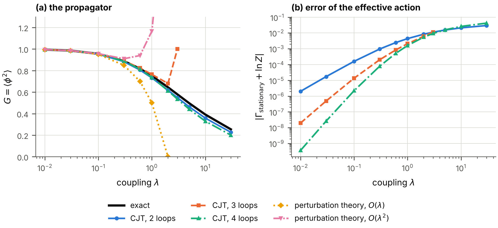
<figcaption>FIG. 16. The CJT method in zero dimensions. (a) The exact propagator, the solutions of the gap equation with <em>Γ</em>2 truncated at two, three and four loops, and ordinary perturbation theory. (b) Difference between the effective action at the stationary point and the exact  − ln <em>Z</em>.</figcaption>
</figure>

| $\lambda$ | exact  | 2 loops | 3 loops | 4 loops | 5 loops |
|:---------:|:------:|:-------:|:-------:|:-------:|:-------:|
|    0.1    | 0.9556 | 0.9545  | 0.9557  | 0.9555  | 0.9556  |
|    0.3    | 0.8887 | 0.8830  | 0.8905  | 0.8878  | 0.8894  |
|    0.6    | 0.8176 | 0.8054  | 0.8240  | 0.8125  | 0.8242  |
|     1     | 0.7505 | 0.7321  | 0.7646  | 0.7373  | 0.9776  |
|     2     | 0.6449 | 0.6180  | 0.6801  | 0.6127  |    —    |
|     3     | 0.5792 | 0.5486  | 1.0000  | 0.5351  |    —    |
|     5     | 0.4966 | 0.4633  |    —    | 0.4411  |    —    |
|    10     | 0.3915 | 0.3583  |    —    | 0.3300  |    —    |

TABLE XXVII. The propagator $G=\langle\varphi^2\rangle$ of the zero-dimensional model: exact value, and solutions of the gap equation with $\Gamma_2$ truncated at two to five loops. A dash means that the truncated gap equation has no acceptable solution. The values of perturbation theory are shown in Fig. 16.

Figure 16 and Table XXVII teach three lessons, which carry over to field theory. *The two-loop truncation is uniformly good.* It stays within 11 per cent of the exact propagator for all couplings from 0.01 to 30, where the perturbation series is useless beyond $\lambda\approx0.5$; its solution, $G=(\sqrt{1+2\lambda}-1)/\lambda$, has the correct qualitative behavior for $\lambda\to\infty$. *More loops help only at weak coupling.* The series (B2) is asymptotic, like the perturbation series. At $\lambda=1$ the error of the effective action falls from $4.4\times10^{-3}$ with two loops to $1.6\times10^{-3}$ with four. The truncations at three and at five loops, whose last term in $\Sigma$ is negative, have no acceptable solution for $\lambda\ge5$ and for $\lambda\ge2$, respectively; the entry 1.0000 at $\lambda=3$ is a solution, but a poor one. *The stationary value is more accurate than the propagator,* because an error of first order in the propagator changes the value of a stationary functional only in second order.

## Appendix C: Machine checks, tests and reproduction

| group | what the checks verify                                                                   | $4{+}4$ | $7{+}1$ |
|:-----:|:-----------------------------------------------------------------------------------------|:-------:|:-------:|
|  `R`  | the matrices are real signed permutation matrices                                        |    2    |    2    |
|  `B`  | the $8\times8$ building blocks and the block form                                        |    4    |    4    |
|  `C`  | anticommutation relations; the 256 products span all real $16\times16$ matrices          |    4    |    4    |
|  `L`  | the scaled commutators: Lie algebra, Killing form, compact and non-compact generators    |    6    |    6    |
|  `G`  | reflections, exponentials and Lorentz transformations: the group                         |    3    |    3    |
|  `N`  | identity, entry by entry, with the matrices of the author’s notebooks                    |    3    |    3    |
|  `V`  | the product of the eight matrices and the chirality                                      |    2    |    3    |
|  `P`  | the chiral projectors                                                                    |    5    |    5    |
|  `S`  | the matrices $C^{-}$, $C^{+}$ and the adjoint                                            |    5    |    1    |
|  `D`  | the Dirac equation: mass shell, examples, evolution, 8-component equations               |   11    |    9    |
|  `K`  | symmetry of the pair matrices; the Lorentz-invariant pair vanishes; the hidden-axis pair |    3    |    4    |
|  `Q`  | quantum numbers of one particle and of the 28 $s$-wave pairs                             |    4    |   10    |
|       | all groups                                                                               |   52    |   54    |

TABLE XXVIII. The machine checks by group, with the number of checks for each spacetime.

*Machine checks.* The statements of Secs. II to IV about matrices are verified by 106 checks, 54 of them for the spacetime of this paper. An identifier has the form `44-C1` or `71-C1`: the signature, a letter for the group of Table XXVIII, and a number. 96 checks are exact: they are identities between integers and are proofs. The other 10 involve exponentials of matrices or eigenvalues and are verified in floating-point arithmetic, to tolerances stated in the program. All checks pass. The log of the program lists every check with its complete statement ([Patrick Lee Nash 2026c](#ref-SpacetimesRepo)).

*An independent second program.* A program can be wrong in the same way twice. A second program, in another language and sharing no code with the first, therefore rebuilds the matrices from their definitions and repeats the essential checks by different methods: linear independence is proved with exact Gram matrices instead of ranks modulo a prime; the question which matrices anticommute with all eight Dirac matrices is settled by enumerating the 256 products instead of solving a linear system; and the classification of the pairs is redone in exact rational arithmetic. It also compares the matrices, entry by entry, with those of the first program and with the matrices printed in the notebooks from which the definitions were taken.

*Tests.* The 63 unit tests of the main program compare each numerical routine with a closed result or with an independent method: the exchange amplitudes with the closed forms (56), the gap equation with the textbook limits, the gradient of the CJT potential with numerical derivatives, the two-particle-irreducible coefficients of Appendix B with the exact integral, the equations of state of the dark fluids with the conservation of energy, and the Einstein-Boltzmann solver with stored reference values.

*Reproduction.* From the root of the repository, the commands

    cd code/spacetimes-rs
    cargo build --release
    cargo test --release
    cd ../..
    B=code/spacetimes-rs/target/release/spacetimes
    for c in matrices channels gap dimer \
        symmetry cjt background spectrum \
        forecast superfluid halos
    do $B $c; done
    python3 code/scripts/\
    verify_matrices_independent.py
    python3 code/scripts/\
    validate_cmb_against_class.py
    python3 code/scripts/make_tables.py
    python3 code/scripts/make_figures.py
    python3 code/scripts/build_manuscripts.py

compile and test the program, recompute every data file, repeat the independent verification and the comparison with class, and rebuild the tables, the figures and both manuscripts. The complete run takes about an hour and a half on a computer with two processor cores, most of it for the fits to the mock data.

## Appendix D: Numerical methods

|            |      |      |       |      |      |      |
|:-----------|:----:|:----:|:-----:|:----:|:----:|:----:|
|            |  TT  |      |  TE   |      |  EE  |      |
| multipoles | max  | rms  |  max  | rms  | max  | rms  |
| 2–29       | 0.18 | 0.13 | 1.50  | 0.67 | 7.00 | 2.78 |
| 30–99      | 0.15 | 0.09 | 0.50  | 0.18 | 1.60 | 0.41 |
| 100–499    | 0.07 | 0.03 | 0.09  | 0.04 | 0.15 | 0.07 |
| 500–999    | 0.08 | 0.03 | 0.17  | 0.05 | 0.34 | 0.09 |
| 1000–1499  | 0.11 | 0.06 | 0.11  | 0.05 | 0.20 | 0.07 |
| 1500–2000  | 0.13 | 0.08 | 0.12  | 0.06 | 0.19 | 0.09 |
| 2001–2500  | 2.00 | 0.41 | 13.40 | 1.53 | 8.65 | 2.31 |

TABLE XXIX. Differences, in per cent, between the spectra of this work, lensed with the lensing potential of the reference, and those of class: largest and root-mean-square values of $D_\ell/D_\ell^{\rm ref}-1$ for TT and EE and of $(D_\ell^{TE}-D_\ell^{TE,\rm ref})/\sqrt{D_\ell^{TT}D_\ell^{EE}}$ for TE, where $D_\ell\equiv\ell(\ell+1)C_\ell/2\pi$ and $C_\ell$ is an angular power spectrum. Below $\ell=30$ the polarization depends on the description of reionization; above $\ell=2000$ the lensed result depends on the continuation of the spectra beyond $\ell=2500$.

All calculations are performed by one program, written in the language Rust, with 63 unit tests; the figures and tables are produced from its output files by scripts. This appendix summarizes the methods; the source code is commented, and the repository ([Patrick Lee Nash 2026c](#ref-SpacetimesRepo)) documents, for every number of this paper, the command that produces it.

*Exact algebra.* Matrices with integer entries are multiplied in 64-bit integer arithmetic. Ranks are computed by elimination modulo a prime; since a rank modulo a prime cannot exceed the rank over the rational numbers, a full rank found in this way proves linear independence. Complex matrices are stored as pairs of integer matrices.

*Symmetry and pairs.* The commutant of a set of matrices is the null space of a linear system, found by Gaussian elimination with pivoting; the quantum numbers of particles and pairs are eigenvalues of Casimir operators, computed in floating-point arithmetic with the Jacobi method and, in the second program, in exact rational arithmetic.

*The paired state.* The gap equation (71) is discretized on a radial momentum grid of Gauss-Legendre panels that are refined geometrically towards the Fermi momentum, and solved by iteration; the critical temperature is found by bisection on the largest eigenvalue of the linearized kernel. The CJT potential (68) is evaluated on the same grid; its stationary point is found by Newton’s method with the analytic Jacobian. The radial Schrödinger equation of the bound pair is integrated with the fourth-order Runge-Kutta method on a grid that is uniform in $\ln(1+\rho/\rho_0)$, which resolves the singularity of the potential at the origin.

*Matter, temperature and vacuum.* The Fermi integrals of Sec. IX A are closed expressions. The thermal integrals of Sec. IX D are tabulated and interpolated with cubic polynomials. The ladder equation (97), linearized, is an eigenvalue problem on a logarithmic momentum grid, solved by power iteration.

*Cosmology.* The background is integrated by Gauss-Legendre quadrature. Recombination follows Saha equilibrium at early times and then the rate equations of the effective three-level atoms ([Seager, Sasselov, and Scott 1999](#ref-SeagerSasselovScott1999), [2000](#ref-SeagerSasselovScott2000); [Wong, Moss, and Scott 2008](#ref-WongMossScott2008)); reionization is a step whose redshift is fitted to the optical depth. The perturbations obey 50 coupled equations per wavenumber, integrated with an adaptive Runge-Kutta method of Dormand and Prince, with the tight-coupling approximation of first order at early times. The spectra are obtained by integration along the line of sight with tabulated spherical Bessel functions. Table XXIX gives the comparison with class by ranges of the multipole.

*Mock likelihood.* For Gaussian fields observed on a fraction $f_{\rm sky}$ of the sky, $$\begin{aligned}
\chi^2={}&\sum_\ell(2\ell+1)\,f_{\rm sky}\Big[\mathrm{Tr}\big(\hat C_\ell C_\ell^{-1}\big)+\ln\frac{\det C_\ell}{\det\hat C_\ell}-n\Big]\\
&+\Big(\frac{\tau-\tau_0}{\sigma_\tau}\Big)^2,
\tag{D1}
\end{aligned}$$ where $C_\ell$ is here the $n\times n$ matrix of the model spectra plus noise, for temperature and polarization, $\hat C_\ell$ the same matrix for the data, and the last term the prior on the optical depth $\tau$ (central value $\tau_0$, standard error $\sigma_\tau$). A data set is a list of disjoint patches of the sky, each with its own $f_{\rm sky}$, noise and range of multipoles, and their $\chi^2$ add.

## References

Ade, P. A. R. et al. 2016. “Planck 2015 Results. XIII. Cosmological Parameters.” *Astron. Astrophys.* 594: A13.

Aghanim, N. et al. 2020. “Planck 2018 Results. VI. Cosmological Parameters.” *Astron. Astrophys.* 641: A6.

Aloni, Daniel, Asher Berlin, Melissa Joseph, Martin Schmaltz, and Neal Weiner. 2022. “A Step in Understanding the Hubble Tension.” *Phys. Rev. D* 105: 123516.

Amelino-Camelia, G., and So-Young Pi. 1993. “Self-Consistent Improvement of the Finite-Temperature Effective Potential.” *Phys. Rev. D* 47: 2356.

Anderson, P. W. 1958. “Random-Phase Approximation in the Theory of Superconductivity.” *Phys. Rev.* 112: 1900.

Atiyah, M. F., R. Bott, and A. Shapiro. 1964. “Clifford Modules.” *Topology* 3 (Suppl. 1): 3.

Bardeen, J., L. N. Cooper, and J. R. Schrieffer. 1957. “Theory of Superconductivity.” *Phys. Rev.* 108: 1175.

Bardeen, William A., Christopher T. Hill, and Manfred Lindner. 1990. “Minimal Dynamical Symmetry Breaking of the Standard Model.” *Phys. Rev. D* 41: 1647.

Baym, Gordon. 1962. “Self-Consistent Approximations in Many-Body Systems.” *Phys. Rev.* 127: 1391.

Berezhiani, Lasha, and Justin Khoury. 2015. “Theory of Dark Matter Superfluidity.” *Phys. Rev. D* 92: 103510.

Blas, Diego, Julien Lesgourgues, and Thomas Tram. 2011. “The Cosmic Linear Anisotropy Solving System (CLASS). Part II: Approximation Schemes.” *J. Cosmol. Astropart. Phys.* 2011 (07): 034.

Bogoliubov, N. N. 1947. “On the Theory of Superfluidity.” *J. Phys. (USSR)* 11: 23.

Brown, Robert B., and Alfred Gray. 1967. “Vector Cross Products.” *Comment. Math. Helv.* 42: 222.

Bryant, Robert L. 1982. “Submanifolds and Special Structures on the Octonians.” *J. Differential Geom.* 17: 185.

Calabrese, E. et al. 2025. “The Atacama Cosmology Telescope: DR6 Constraints on Extended Cosmological Models.” *J. Cosmol. Astropart. Phys.* 2025 (11): 063. <https://arxiv.org/abs/2503.14454>.

Casertano, S. et al. 2026. “The Local Distance Network: A Community Consensus Report on the Measurement of the Hubble Constant at $\sim$<!-- -->1% Precision.” *Astron. Astrophys.* <https://doi.org/10.1051/0004-6361/202557993>.

Chin, S. A. 1977. “A Relativistic Many-Body Theory of High Density Matter.” *Ann. Phys. (N.Y.)* 108: 301.

Chodos, A., R. L. Jaffe, K. Johnson, C. B. Thorn, and V. F. Weisskopf. 1974. “New Extended Model of Hadrons.” *Phys. Rev. D* 9: 3471.

Coleman, Sidney, and Erick Weinberg. 1973. “Radiative Corrections as the Origin of Spontaneous Symmetry Breaking.” *Phys. Rev. D* 7: 1888.

Colpi, Monica, Stuart L. Shapiro, and Ira Wasserman. 1986. “Boson Stars: Gravitational Equilibria of Self-Interacting Scalar Fields.” *Phys. Rev. Lett.* 57: 2485.

Cornwall, John M., R. Jackiw, and E. Tomboulis. 1974. “Effective Action for Composite Operators.” *Phys. Rev. D* 10: 2428.

Cvetko, W., M. Joseph, and G. Marques-Tavares. 2025. “InterACTing Dark Radiation Models After ACT.” <https://arxiv.org/abs/2512.19633>.

Davis, R. L., and E. P. S. Shellard. 1989. “Cosmic Vortons.” *Nucl. Phys. B* 323: 209.

Dolan, L., and R. Jackiw. 1974. “Symmetry Behavior at Finite Temperature.” *Phys. Rev. D* 9: 3320.

Englert, F., and R. Brout. 1964. “Broken Symmetry and the Mass of Gauge Vector Mesons.” *Phys. Rev. Lett.* 13: 321.

Feynman, R. P. 1955. “Application of Quantum Mechanics to Liquid Helium.” *Prog. Low Temp. Phys.* 1: 17.

Garny, M., F. Niedermann, and M. S. Sloth. 2026. “Spectral Running, Interacting Dark Radiation, and the Hubble Tension in Light of ACT DR6 Data.” *Phys. Rev. D*. <https://doi.org/10.1103/c68x-58mj>.

Goldberger, M. L., and S. B. Treiman. 1958. “Decay of the Pi Meson.” *Phys. Rev.* 110: 1178.

Goldstone, J. 1961. “Field Theories with ‘Superconductor’ Solutions.” *Nuovo Cimento* 19: 154.

Gor’kov, L. P. 1958. “On the Energy Spectrum of Superconductors.” *Sov. Phys. JETP* 7: 505.

———. 1959. “Microscopic Derivation of the Ginzburg-Landau Equations in the Theory of Superconductivity.” *Sov. Phys. JETP* 9: 1364.

Gresham, Moira I., Hou Keong Lou, and Kathryn M. Zurek. 2017. “Nuclear Structure of Bound States of Asymmetric Dark Matter.” *Phys. Rev. D* 96: 096012.

Harvey, Reese, and H. Blaine Lawson Jr. 1982. “Calibrated Geometries.” *Acta Math.* 148: 47.

Higgs, Peter W. 1964. “Broken Symmetries and the Masses of Gauge Bosons.” *Phys. Rev. Lett.* 13: 508.

Iršič, Vid et al. 2017. “New Constraints on the Free-Streaming of Warm Dark Matter from Intermediate and Small Scale Lyman-$\alpha$ Forest Data.” *Phys. Rev. D* 96: 023522.

——— et al. 2024. “Unveiling Dark Matter Free Streaming at the Smallest Scales with the High Redshift Lyman-Alpha Forest.” *Phys. Rev. D* 109: 043511.

Jackiw, R., and P. Rossi. 1981. “Zero Modes of the Vortex-Fermion System.” *Nucl. Phys. B* 190: 681.

Lawson, H. Blaine, Jr., and Marie-Louise Michelsohn. 1989. *Spin Geometry*. Princeton: Princeton University Press.

Lee, T. D., and G. C. Wick. 1974. “Vacuum Stability and Vacuum Excitation in a Spin-0 Field Theory.” *Phys. Rev. D* 9: 2291.

Leggett, Anthony J. 1975. “A Theoretical Description of the New Phases of Liquid $^3$He.” *Rev. Mod. Phys.* 47: 331.

Lenaghan, J. T., and D. H. Rischke. 2000. “The O(N) Model at Non-Zero Temperature: Renormalization of the Gap Equations in Hartree and Large-N Approximations.” *J. Phys. G* 26: 431.

Lewis, Antony, and Anthony Challinor. 2006. “Weak Gravitational Lensing of the CMB.” *Phys. Rep.* 429: 1.

Li, Bohua, Tanja Rindler-Daller, and Paul R. Shapiro. 2014. “Cosmological Constraints on Bose-Einstein-Condensed Scalar Field Dark Matter.” *Phys. Rev. D* 89: 083536.

Luttinger, J. M., and J. C. Ward. 1960. “Ground-State Energy of a Many-Fermion System. II.” *Phys. Rev.* 118: 1417.

Ma, Chung-Pei, and Edmund Bertschinger. 1995. “Cosmological Perturbation Theory in the Synchronous and Conformal Newtonian Gauges.” *Astrophys. J.* 455: 7.

Markevitch, M. et al. 2004. “Direct Constraints on the Dark Matter Self-Interaction Cross Section from the Merging Galaxy Cluster 1E 0657-56.” *Astrophys. J.* 606: 819.

Maskawa, T., and H. Nakajima. 1974. “Spontaneous Breaking of Chiral Symmetry in a Vector-Gluon Model.” *Prog. Theor. Phys.* 52: 1326.

Miransky, V. A. 1985. “Dynamics of Spontaneous Chiral Symmetry Breaking and the Continuum Limit in Quantum Electrodynamics.” *Nuovo Cimento A* 90: 149.

Nambu, Y., and G. Jona-Lasinio. 1961. “Dynamical Model of Elementary Particles Based on an Analogy with Superconductivity. I.” *Phys. Rev.* 122: 345.

Nambu, Yoichiro. 1960. “Quasi-Particles and Gauge Invariance in the Theory of Superconductivity.” *Phys. Rev.* 117: 648.

Nash, P. L. 1990. “On the Structure of the Split Octonion Algebra.” *Nuovo Cimento B* 105: 31.

Nash, Patrick L. 2010. “Second Gravity.” *J. Math. Phys.* 51: 042501.

Nash, Patrick Lee. 2026a. “16 Component Dirac Fermion Condensate Singlet Superfluid on 4+4 Spacetime.”

———. 2026b. “Neutrino Condensate Singlet Superfluid.” manuscript, source code and data at <https://github.com/once-ere/NCSS>.

———. 2026c. “PROJECT spacetimes: Source Code, Data, the Provenance ‘Dirac Matrices,’ Supplements S1–S4 and the Provenance Documents.” <https://github.com/once-ere/spacetimes>.

Navas, S. et al. 2024. “Review of Particle Physics.” *Phys. Rev. D* 110: 030001.

Nielsen, H. B., and P. Olesen. 1973. “Vortex-Line Models for Dual Strings.” *Nucl. Phys. B* 61: 45.

Nozières, P., and S. Schmitt-Rink. 1985. “Bose Condensation in an Attractive Fermion Gas: From Weak to Strong Coupling Superconductivity.” *J. Low Temp. Phys.* 59: 195.

Onsager, L. 1949. “Statistical Hydrodynamics.” *Nuovo Cimento Suppl.* 6: 279.

Randall, Scott W., Maxim Markevitch, Douglas Clowe, Anthony H. Gonzalez, and Maruša Bradač. 2008. “Constraints on the Self-Interaction Cross Section of Dark Matter from Numerical Simulations of the Merging Galaxy Cluster 1E 0657-56.” *Astrophys. J.* 679: 1173.

Rogers, F. J., H. C. Graboske Jr., and D. J. Harwood. 1970. “Bound Eigenstates of the Static Screened Coulomb Potential.” *Phys. Rev. A* 1: 1577.

Seager, S., D. D. Sasselov, and D. Scott. 1999. “A New Calculation of the Recombination Epoch.” *Astrophys. J.* 523: L1.

———. 2000. “How Exactly Did the Universe Become Neutral?” *Astrophys. J. Suppl.* 128: 407.

Seljak, Uroš, and Matias Zaldarriaga. 1996. “A Line-of-Sight Integration Approach to Cosmic Microwave Background Anisotropies.” *Astrophys. J.* 469: 437.

Sikivie, P., L. Susskind, M. Voloshin, and V. Zakharov. 1980. “Isospin Breaking in Technicolor Models.” *Nucl. Phys. B* 173: 189.

Tremaine, S., and J. E. Gunn. 1979. “Dynamical Role of Light Neutral Leptons in Cosmology.” *Phys. Rev. Lett.* 42: 407.

Viel, Matteo, Julien Lesgourgues, Martin G. Haehnelt, Sabino Matarrese, and Antonio Riotto. 2005. “Constraining Warm Dark Matter Candidates Including Sterile Neutrinos and Light Gravitinos with WMAP and the Lyman-$\alpha$ Forest.” *Phys. Rev. D* 71: 063534.

Walecka, J. D. 1974. “A Theory of Highly Condensed Matter.” *Ann. Phys. (N.Y.)* 83: 491.

Weinberg, Steven. 1967. “A Model of Leptons.” *Phys. Rev. Lett.* 19: 1264.

———. 2013. “Goldstone Bosons as Fractional Cosmic Neutrinos.” *Phys. Rev. Lett.* 110: 241301.

Wise, Mark B., and Yue Zhang. 2014. “Stable Bound States of Asymmetric Dark Matter.” *Phys. Rev. D* 90: 055030.

Witten, Edward. 1981. “Search for a Realistic Kaluza-Klein Theory.” *Nucl. Phys. B* 186: 412.

———. 1985. “Superconducting Strings.” *Nucl. Phys. B* 249: 557.

Wong, Wan Yan, Adam Moss, and Douglas Scott. 2008. “How Well Do We Understand Cosmological Recombination?” *Mon. Not. R. Astron. Soc.* 386: 1023.

